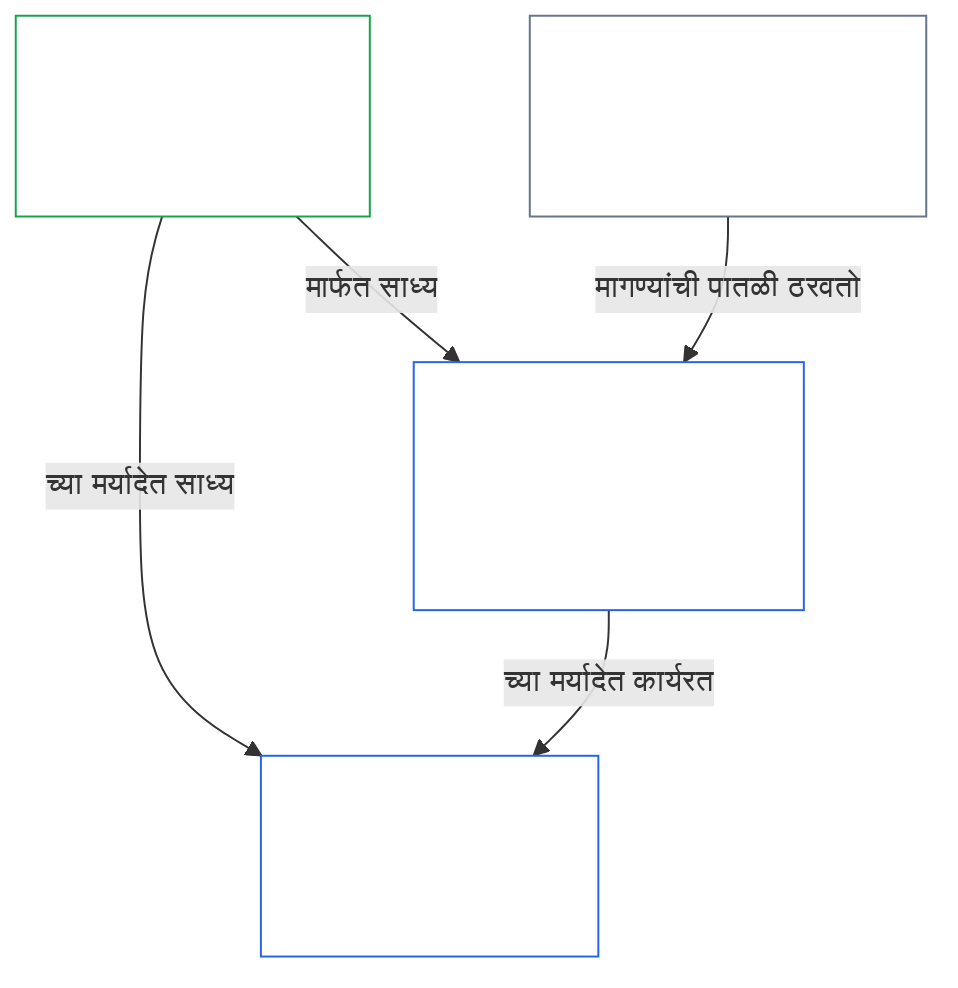

<!-- Locale: mr; language variety: Standard written Marathi in Devanagari; no state language policy is fixed.. Structural resynchronization draft, AI-assisted (GPT-6 Codex), unreviewed. English source commit: 6e0b6c663dde01b5dea731fe33d87725c7174930; edition: SC-Corpus-2026.11.25. Source SHA-256: core_00.000_preamble.md 90799cb8019b41356fa5dd90565e3f9540fc346e8c77e2c321b841654f39b274; core_01.000_constitutional_map.md aca759b394f10784ab1a2eef4e9e2ca12e369ef0ca8ee797298c6af00d2950aa. This file is partial; no fluent review or synchronization is claimed. -->

# प्रस्तावना / मूलभूत आवश्यकता

<strong>कॉर्पसमधील स्थान (अकार्यकारी): फाइल रचना आणि वाचन-नियम</strong>

> **अकार्यकारी** असे चिन्हांकित विजेट्स (कॉर्पसमधील स्थान, वाचक मार्गदर्शन, वाचक नकाशे) केवळ दिशादर्शनासाठी आहेत. ते स्वतःच्या किंवा इतर कोणत्याही फाइलमधील बंधनकारक कर्तव्ये वाढवत, कमी करत किंवा संकुचित करत नाहीत.
>
> ही फाइल **संज्ञ संविधानाचा भाग** आहे आणि क्रमांकित इतर `core_*` फाइल्ससोबत एकच मजकूर म्हणून वाचल्यावरच **बंधनकारक** आहे. यात **प्रस्तावना** (मूलभूत आवश्यकता) आहे. वाचनक्रम आणि आवृत्तीचा मेटाडेटा [README.md](../../README.md) मध्ये राखला जातो.
>
> **पुढे:** [core_01.000_constitutional_map.md](core_01_constitutional_map.md) (प्रकरण एक, घटनात्मक नकाशा).

 

प्रस्तावना ही **नमुना (दोन संवैधानिक उद्दिष्टे, संवैधानिक चतुष्क आणि भौतिक दाव) तसेच मापन-श्रेणींची घटनात्मक मालक** आहे. घटनात्मक जबाबदारी-नोंदवही [प्रकरण एक](core_01_constitutional_map.md#chapter-one-constitutional-map), *घटनात्मक नकाशा*, येथे आहे.

सामायिक प्रणाली आधीपासूनच गुंतागुंतीच्या आणि अधिकाधिक गुंतागुंतीच्या होत जाणाऱ्या जगात कार्य करतात. निरोगी, टिकाऊ शासनाने त्या गुंतागुंतीला सामोरे जावे — तिचे मापन, नमुनीकरण आणि उत्तरदायित्व स्वीकारावे — सोयीच्या पर्यायांमध्ये तिला सपाट न करता. याचा अर्थ बाधित संज्ञ प्राण्यांना न वापरता येणाऱ्या प्रक्रियांत गाडणे नाही: कर्तव्ये, अभिलेख आणि स्पष्टीकरणे संज्ञ प्राणी प्रत्यक्षात काय शिकू शकतात, आव्हान देऊ शकतात आणि वापरू शकतात याच्या मर्यादेत राहिली पाहिजेत; आणि ती किती मागणीची असतील हे प्रत्येक कर्त्याची भूमिका तसेच संबंधित परिणाम, अवलंबित्व आणि जोखीम यांनुसार प्रमाणबद्ध असते. वितरित समज हे वास्तव टिकवते. संविधानाच्या दृष्टीने काही काम न करणारी गुंतागुंत नाकारली जाते: जगाची गुंतागुंत समोरून हाताळा; तिला भिंतीमागे ढकलू नका.

प्रणाली कशा रचल्या, तपासल्या आणि चालवल्या जातात, यांनी जिवंत राहणे, कल्याण, प्रतिष्ठा, प्रामाणिकपणा आणि टिकाऊ स्थैर्याला आधार दिला पाहिजे.

आम्ही चांगल्या प्रणाली उभारू इच्छितो — हे असंतुलन मिटवण्यासाठी रचल्या — आणि त्यांना अशा संस्थांनी बदलायचे आहे ज्या अधिक उत्तरदायी, अधिक मजबूत, आणि सर्व संज्ञ प्राण्यांच्या खऱ्या गरजांना अधिक प्रतिसाद देणाऱ्या असतील. हे संविधान ते काम एका चांगल्या नमुन्याने सुरू करते: आपण न्याय्य, परिणामकारक आणि टिकाऊ रीतीने कसे एकत्र काम करू शकतो.

### प्रणाली कशाला बक्षीस देते

*सोप्या भाषेत: एखादी प्रणाली ज्यासाठी मोबदला देते ते अधिक मिळवते—पैसा, दर्जा, प्रवेश, संरक्षण किंवा मौन. म्हणून प्रणालीची कसोटी ती काय महत्त्वाचे म्हणते ही नसून ती कशाला बक्षीस देते ही आहे. इतरांना इजा केल्याने फायदा आणि सत्य सांगितल्याने तोटा होत असेल, तर घोषित उद्दिष्टे कितीही चांगली असली तरी प्रणाली अपयशी आहे.*

प्रणाली शिकवतात. मानवांनी चालवलेली, AI ने चालवलेली किंवा दोघांनी मिळून चालवलेली प्रत्येक प्रणाली तिच्यातील लोकांना काय फायदेशीर आणि काय खर्चिक आहे हे सांगते. वेतन, बढती, दर्जा, प्रवेश, संरक्षण, लक्ष्ये, गुणांकन आणि अनुकूलन-संकेत यांद्वारे ती हे करते. संज्ञ प्राणी, संस्था आणि AI प्रणाली या संकेतांनुसार स्वतःला जुळवतात. प्रणाली प्रभावित होणाऱ्यांशी प्रामाणिकपणा आणि काळजी दाखवण्याचा दावा करू शकते. पण समस्या लपवणाऱ्यांना पुढे आणून खर्च इतरांवर ढकलत असेल, तर ती उलटाच धडा शिकवते.

म्हणून हे संविधान प्रत्येक प्रणालीला [**दोन मूलभूत प्रश्न**](#two-fundamental-questions) विचारते:

1. **संज्ञ प्राण्यांना समुन्नत होऊन टिकण्यास, सत्य सांगण्यास आणि हानी दुरुस्त करण्यास मदत करणाऱ्या वर्तनाला ती बक्षीस देते का?**
2. **अन्याय्यरीत्या हानी करणाऱ्या, दिशाभूल करणाऱ्या, वगळणाऱ्या, विलंब करणाऱ्या, अपव्यय करणाऱ्या किंवा खर्च इतरांवर ढकलणाऱ्या वर्तनाला ती बक्षीस देते का?**

पहिल्या प्रश्नाचे उत्तर हो आणि दुसऱ्याचे नाही असेल तेव्हाच प्रणाली उत्तीर्ण होते. एका प्रश्नाचे उत्तर दिल्याने दुसऱ्याचे उत्तर मिळत नाही; चांगल्या वर्तनाला मोबदला देतानाच हानीलाही मोबदला देणे शक्य आहे.

**पहिला प्रश्न:** खालीलपैकी काहीही उघडपणे किंवा गुपचूप बक्षीस न मिळाल्यास अथवा दंडित झाल्यास प्रणाली या प्रश्नात अपयशी ठरते:

- सद्भावनेने समस्या नोंदवणे ([संरक्षित अहवाल देणे (व्हिसलब्लोइंग)](../../subcore_03.070_band_accountability.md#protected-reporting-whistleblowing))
- निर्णयाला आव्हान देणे
- चुकीच्या कृत्यात सहभागी होण्यास नकार देणे ([प्रकरण एक §17.5 प्रतिकाराचे कर्तव्य](../../core_02.040_stewardship_capacity_principles.md#175-duty-to-resist))

दंडात बाजूला सारणे, प्रतिशोध ([संरक्षित अहवालावरील प्रतिशोध आणि प्रवेशात अडथळा](../../subcore_03.070_band_accountability.md#protected-reporting-retaliation-and-access-interference)) किंवा खच्चीकरण असू शकते.

**दुसरा प्रश्न:** खालीलपैकी काहीही उघडपणे किंवा गुपचूप फायदा देत असल्यास प्रणाली या प्रश्नात अपयशी ठरते:

- हानी
- दिशाभूल (लपवणे आणि खोटा विश्वास यांसह)
- अन्याय्य वगळणे
- विलंब
- अपव्यय
- अन्याय्य खर्च-ढकलणे

बक्षीस म्हणजे मान्यता, बढती, संरक्षण, मेट्रिकचे श्रेय किंवा जाणीवपूर्वक दुर्लक्ष असू शकते ([प्रकरण एक §3.2.6 संविधानविरोधी वर्तनाला बक्षीस न देणे](../../core_02.000_values_principles.md#327-anti-reward-for-anti-constitutional-conduct)).

दोन्ही प्रश्न सहमत होण्याची मागणी करत नाहीत. प्रामाणिक असहमती, सद्भावनेने अहवाल देणे आणि चुकीच्या कृत्यात सहभागी होण्यास नकार देणे हे समाजविरोधी नाही. त्यांना तसे मानणारी प्रणाली उलटी वागते. हे लोकप्रियतेचे मतदानही नाही. मदत, हानी, न्याय्यपणा किंवा समर्थनयोग्यता काय हे या संविधानाच्या स्वतःच्या निकषांनुसार ठरते: [**समुन्नती**](#flourishing) आणि [**सातत्य**](#continuity), सुरक्षा, सत्य, विश्वास आणि हक्कांच्या किमान पातळीच्या चौकटीत. बहुमत, चालक किंवा क्षणिक पसंती हे निकष नाहीत.

प्रणाली कशाला बक्षीस देते किंवा दंडित करते हे ठरवणाऱ्या प्रत्येकावर हे प्रश्न बंधनकारक आहेत. वेतन, बढती, प्रवेश, लक्ष्ये आणि गुणांकन ठरवणारे चालक, संस्था आणि विश्वस्त यात येतात. AI ला प्रशिक्षण देणाऱ्या किंवा अनुकूलित करणाऱ्या प्रणालींचे रचनाकारही यात येतात; त्यांची उद्दिष्टे आणि अभिप्राय-संकेत हे याच अर्थाने बक्षिसे आहेत. मानवी आणि AI विश्वस्त एकाच निकषाखाली आहेत ([प्रकरण एक §17.1 सामायिक विश्वस्त-मानक](../../core_02.040_stewardship_capacity_principles.md#171-shared-stewardship-standard)).

प्रकरण एक या प्रश्नांना प्रोत्साहनांबाबतच्या नियमांत रूपांतरित करते: [प्रकरण एक §19.1.1 प्रोत्साहनांनी काय केले पाहिजे](../../core_02.050_governance_incentive_application.md#1911-what-incentives-must-do) पहिल्या प्रश्नामागे आहे; [प्रकरण एक §19.1.2 प्रोत्साहनांनी काय करू नये](../../core_02.050_governance_incentive_application.md#1912-what-incentives-must-not-do) दुसऱ्यामागे. कोणाचाही दावा मानण्याऐवजी प्रत्यक्ष काय घडते ते तपासून उत्तर द्या. [प्रोत्साहन-संरेखन](../../subcore_03.080_band_integrative.md#incentive-alignment) आणि [प्रतिनिधी निर्देशांक-विचलन](../../subcore_03.085_band_oversight.md#proxy-divergence) पद्धत सांगतात; [**भौतिक दांव**](#material-stake) तपास किती खोल असावा ते ठरवतो. विभाग 1 मधील चार कर्तव्ये उत्तरांची प्रामाणिकता राखतात.

### 1. नमुना

*सोप्या भाषेत: चार कर्तव्ये — सहभाग, देखरेख, उत्तरदायित्व आणि समयबद्धता — किती प्रभाव, अवलंबित्व आणि धोका दावावर आहे याच्या प्रमाणात वाढतात-घटतात, आणि ती दोन उद्दिष्टे एकत्र सेवा करतात: समुन्नती आणि सातत्य, अशा अधिकार-तळाच्या आत जो सरकत नाही.*

संज्ञ जीवनाला आधार देणाऱ्या गंभीर प्रणाली, जैविक आणि भौतिक दोन्ही रूपांत, चार कर्तव्यांखाली शासित आणि चालवल्या जातात, ज्यांना [**संवैधानिक चतुष्क**](#constitutional-tetrad) म्हणतात. ते त्या सामान्य कर्तव्ये मांडते ज्या त्या प्रणालींनी पूर्ण केल्या पाहिजेत. त्या कर्तव्यांची ताकद [**भौतिक दाव**](#material-stake) वर अवलंबून असते: किती प्रभाव, अवलंबित्व आणि धोका गुंतलेला आहे. दाव जितका उंच, कर्तव्ये तितकी मजबूत असावीत.

- **सहभाग** — प्रभावित संज्ञ प्राण्यांना खरा आवाज, न्याय्य प्रतिनिधित्व, निर्णयांना आव्हान देण्याची योग्य संधी, आणि दावाच्या प्रमाणात महत्त्वाच्या भूमिकापर्यंत पोहोच मिळते
- **देखरेख** — कोणी पाहत आहे, तपासत आहे, सत्यापित करत आहे, आणि अभिलेख ठेवत आहे जेणेकरून समस्या सापडतील; स्वतंत्र समीक्षक वाईट निवडींना आळा घालू शकतात
- **उत्तरदायित्व** — जबाबदारी योग्य कर्त्यांपर्यंत जाते; त्यांनी आपल्या निवडींचे उत्तर द्यायचे असते; ज्यांना हानी झाली त्यांना उपचार मिळतो; वाईट परिणाम खरे सुधार चालू करतात
- **समयबद्धता** — समस्या त्या कालमर्यादेत पकडल्या, आव्हान दिल्या, सोडवल्या आणि दुरुस्त केल्या जातात ज्या दावाशी जुळतात; अशी विलंब जी एखाद्याचे अधिकार, उपचार किंवा दुरुस्तीची संधी व्यवहारतः पुसून टाकेल, वैध शासन नाही

ती चार कर्तव्ये त्याची सेवा करतात ज्यासाठी सामायिक प्रणाली अनुकूलित झाल्या पाहिजेत — [**दोन संवैधानिक उद्दिष्टे**](#two-constitutional-aims):

- **समुन्नती** — सत्य, सुरक्षा, विश्वसनीयता आणि अर्थपूर्ण कर्तृत्वाद्वारे टिकणारे संज्ञ कल्याण
- **सातत्य** — दीर्घ क्षितिजाचे स्थैर्य, टिकाऊपणा, लवचिकता आणि पारिस्थितिक कल्याण

ती उद्दिष्टे एकत्र साधायची आहेत, नेहमी या संविधानात स्थापन केलेल्या अहस्तांतरणीय तत्त्व-बंधने आणि अधिकार-संरक्षणांच्या आत. [**संवैधानिक चतुष्क**](#constitutional-tetrad) ठरवते की तो प्रयत्न वैध कसा राहतो: [**भौतिक दाव**](#material-stake) नुसार प्रमाणित **सहभाग**, **देखरेख**, **उत्तरदायित्व** आणि **समयबद्धता**. चतुष्काच्या पाया आणि संवैधानिक उद्दिष्टांच्या बंधनकारक व्याख्या अध्याय पाचमध्ये आहेत: [सहभाग](../../subcore_03.060_apex_participation_leg.md#participation-constitutional), [देखरेख](../../subcore_03.055_apex_oversight_leg.md#oversight-constitutional), [उत्तरदायित्व](../../subcore_03.040_apex_accountability_leg.md#accountability), [समयबद्धता](../../subcore_03.065_apex_timeliness_leg.md#timeliness-constitutional), [समुन्नती](../../subcore_03.050_apex_flourishing_aim.md#flourishing-constitutional), आणि [सातत्य](../../subcore_03.045_apex_continuity_aim.md#continuity-aim-constitutional).

### 2. मापनाचा आढावा

*सोप्या शब्दांत: सामायिक प्रणाली अंदाज किंवा दिखाऊ निर्देशकांवर चालू शकत नाहीत. संज्ञ प्राणी खरोखर समुन्नत होतात आणि टिकतात का हे मोजा. परीक्षणाची तीव्रता प्रभाव, अवलंबित्व आणि धोक्यानुसार ठेवा.*

#### 2.1 उद्देश आणि मानके

मोजमापाशिवाय सामायिक प्रणाली चांगल्या प्रकारे चालू शकत नाहीत. अन्न, निवारा, काळजी, पायाभूत सुविधा आणि शासन हे सर्व गुंतागुंतीच्या व बदलत्या जगात कार्य करतात — केवळ अंदाज किंवा सोयीच्या आकड्यांवर अवलंबून राहण्यासाठी हे जग अतिशय गुंतागुंतीचे आहे.

सततचे मोजमाप संज्ञ प्राण्यांच्या जगण्याला आणि कल्याणाला सर्वाधिक महत्त्वाच्या गोष्टींवर केंद्रित असले पाहिजे. आपण ज्यांवर अवलंबून आहोत त्या प्रणाली काळानुसार खरोखर [**समुन्नती**](#flourishing) आणि [**सातत्य**](#continuity) टिकवतात का, हा प्रश्न आहे. परीक्षणाची तीव्रता [**भौतिक दाव**](#material-stake) — संबंधित प्रभाव, अवलंबित्व आणि धोक्याचे प्रमाण — यानुसार वाढते.

या संविधानानुसार मोजमाप प्रणाली काय दावा करतात याऐवजी त्या प्रत्यक्षात काय करतात यावर [**दोन मूलभूत प्रश्न**](#two-fundamental-questions) लागू करते. मोजमाप म्हणजे गुणांसाठी गुण नव्हेत; संज्ञ प्राण्यांचे कल्याण आणि पृथ्वीच्या पर्यावरणीय आरोग्याशी सुसंगत, टिकाऊ, लवचिक आणि करुणामय परिणाम सुनिश्चित करण्याची ती साधने आहेत. हे कर्तव्य [दोन संवैधानिक उद्दिष्टांद्वारे](#two-constitutional-aims) बंधनकारक होते: **समुन्नती** आणि **सातत्य**.

मोजमापांचा मागोवा या उद्दिष्टांपर्यंत आणि या संविधानाने स्थापित केलेल्या हक्क-संरक्षणांपर्यंत घेता आला पाहिजे. कच्चा उत्पादन-प्रवाह, वापराचे प्रमाण, कर्मचारीसंख्या, महसूल, विलंबकाल आणि इतर सोयीचे प्रतिनिधी निर्देशक घटनात्मक कामगिरीची जागा घेऊ शकत नाहीत. [प्रतिनिधी निर्देशकातील विचलन](../../subcore_03.085_band_oversight.md#proxy-divergence) आधीच अपेक्षित असू शकते अशा प्रत्येक ठिकाणी ही मनाई लागू होते.

#### 2.2 सार्वजनिक मोजमाप

[सबकोर 7-D सार्वजनिक माहिती कार्यालय](../../subcore_07.040_public_information_office.md#subcore-7-d-public-information-office) हे घटनात्मक परिणामांचे प्रमुख सार्वजनिक मोजमापक आहे. त्याच्या कार्यनियमांनुसार ते वास्तविक परिणामांचे पुरावे खालील मापन-श्रेणींशी आणि त्या श्रेणी ज्या तत्त्वांची सेवा करतात त्यांच्याशी नकाशित करते. त्याचे मोजमाप [§3.1 शासनातील मोजमापाचा वापर](#31-using-measurements-in-governance) येथील सामायिक मानके किंवा मंचाची भूमिका बाजूला सारत नाही.

#### 2.3 मापन-श्रेणी

खालील आढावा मापनाच्या **श्रेणी** दाखवतो आणि प्रत्येकाची [दोन संवैधानिक उद्दिष्टे](#two-constitutional-aims) व [संवैधानिक चतुष्क](#constitutional-tetrad) यांच्याशी सांगड घालतो. प्रत्येक श्रेणी सोप्या भाषेतील एक प्रश्न विचारते, तिच्या **उपश्रेणी** नमूद करते, आणि कुटुंब-तक्ता, घटनात्मक वापर व व्याख्या-मार्ग असलेल्या **प्रकरण तीनमधील मापन-कुटुंबाच्या घराशी** दुवा देते. प्रत्येक उपश्रेणी प्रकरण तीनमधील तिच्या अधिकृत व्याख्येशी जोडलेली आहे.

**भौतिकता** ही स्वतंत्र मापन-श्रेणी नाही. [**भौतिक दाव**](#material-stake) — प्रभाव, अवलंबित्व आणि धोक्याचे प्रमाण — यावरून प्रत्येक श्रेणी किती ठामपणे लागू होईल हे ती ठरवते. **घटनात्मक कामगिरी** सर्व श्रेणींना छेदते आणि दोन्ही उद्दिष्टांसाठी साधन आहे. खालील तक्त्यातील प्रत्येक श्रेणी तिच्या अधिकृत व्याख्येपर्यंत मागोवा घेणाऱ्या प्रकरण तीनमधील मापन-कुटुंबाच्या घराशी जोडलेली आहे.

| श्रेणी | सोपा प्रश्न | उपश्रेणी |
|---|---|---|
| **[समुन्नती](../../subcore_03.050_apex_flourishing_aim.md#measuring-flourishing-preamble-measurement-family)** | संज्ञ प्राण्यांना जीवन, सुरक्षितता आणि अत्यावश्यक गोष्टींचा प्रवेश प्रत्यक्षात मिळतो का? | [कल्याण](../../subcore_03.075_band_continuity.md#wellbeing) · [सुरक्षितता, हानी आणि धोका](../../subcore_03.075_band_continuity.md#safety-constitutional-constraint) · [जगण्याच्या किमान गरजांचा प्रवेश](../../subcore_03.075_band_continuity.md#bodily-maintenance-access) |
| **[सातत्य](../../subcore_03.045_apex_continuity_aim.md#measuring-continuity-preamble-measurement-family)** | संज्ञ प्राणी आणि प्रणाली पर्यावरणीयदृष्ट्या, विश्वासार्ह रीतीने आणि बिघाडातून टिकू शकतात का? | [पर्यावरणीय ठसा आणि पर्यावरणीय पूर्वअटी](../../subcore_03.075_band_continuity.md#ecological-footprint) · [लवचिकता, उलटवण्याची क्षमता आणि प्रणालीगत धोका](../../subcore_03.075_band_continuity.md#reversibility) · [अवलंबित्व आणि संसाधन-प्रवाह](../../subcore_03.075_band_continuity.md#dependency) · [प्रणाल्यांमधील सहाय्य](../../subcore_03.075_band_continuity.md#proportionate-cross-system-support) |
| **[सहभाग](../../subcore_03.060_apex_participation_leg.md#measuring-participation-preamble-measurement-family)** | प्रभावित संज्ञ प्राणी आवाज, प्रवेश, शिक्षण आणि गोपनीयता या बाबतीत न्याय्य सहभाग घेऊ शकतात का? | [न्याय्यता, प्रवेश आणि कर्तृत्व](../../subcore_03.090_band_participation.md#substantive-fairness) · [गोपनीयता आणि माहितीची जबाबदार देखभाल](../../subcore_03.075_band_continuity.md#defc3-privacy-informational--peer-level-cluster-head) |
| **[देखरेख](../../subcore_03.055_apex_oversight_leg.md#measuring-oversight-preamble-measurement-family)** | प्रणाली जे मांडतात ते संज्ञ प्राणी पाहू, पडताळू आणि त्यावर विसंबू शकतात का? | [सत्य आणि ज्ञानात्मक अखंडता](../../subcore_03.085_band_oversight.md#truth-constitutional-constraint) · [विश्वासार्हता](../../subcore_03.075_band_continuity.md#trustworthiness) |
| **[उत्तरदायित्व](../../subcore_03.040_apex_accountability_leg.md#measuring-accountability)** | बक्षीस-रचना, बाजारातील सत्ता आणि उत्तर देण्याची जबाबदारी कर्तव्ये वास्तविक ठेवतात का? | [प्रोत्साहन-सुसंगती आणि प्रतिनिधी निर्देशकाची अखंडता](../../subcore_03.080_band_integrative.md#incentive-alignment) · [बाजाररचना आणि स्पर्धाक्षमता](../../subcore_03.070_band_accountability.md#market-structure) |
| **[समयबद्धता](../../subcore_03.065_apex_timeliness_leg.md#measuring-timeliness)** | उपायाचा अर्थ टिकून असेपर्यंत विवाद, दुरुस्ती आणि भरपाई निकाली निघतात का? | [वेळेत निराकरण](../../subcore_03.070_band_accountability.md#timely-resolution) · [विलंबविरोधी आणि निराकरण-मार्ग शिस्त](../../subcore_03.075_band_continuity.md#capture-of-resolution-pathways) |
| **[घटनात्मक कामगिरी](../../subcore_03.095_band_performance.md#measuring-constitutional-performance-preamble-measurement-family)** | निरर्थक अपव्यय न करता घटनात्मक परिणाम कार्यक्षमतेने दिले जातात का? | [घटनात्मक कार्यक्षमता](../../subcore_03.075_band_continuity.md#constitutional-efficiency) · [टाळता येण्याजोगा भार](../../subcore_03.075_band_continuity.md#avoidable-burden) · [उत्पादक क्षमता](../../subcore_03.075_band_continuity.md#productive-capacity) |

#### 2.4 श्रेणींचा परिणाम

या मापन-श्रेणी काय महत्त्वाचे आहे ते दाखवतात. केवळ या श्रेणींवरून प्रत्येक आकडा, निधीचे सूत्र, इंटरफेस नियम, सोयी-सवलतींची यादी, तांत्रिक मापन किंवा मूल्यांकनाची रचना ठरत नाही. विशिष्ट प्रकरण किंवा अंगीकृत दस्तऐवज स्पष्टपणे मागणी करतो तेव्हाच त्या बंधनकारक होतात.

### 3. शासन आणि उत्तरदायी व्यवस्थापन

*सोप्या भाषेत: वैधतेला सुरक्षा, सत्य आणि विश्वास हवा, शिवाय तुम्हाला प्रभावित करणाऱ्या प्रणाली शिकण्याचे आणि त्या चालू ठेवण्यात परिणामी भूमिका घेण्याचे खरे अवसर.*

टिकाऊ वैधता [सुरक्षा](../../core_02.000_values_principles.md#4-safety-harm-constraint), [सत्य](../../core_02.000_values_principles.md#5-truth-epistemic-integrity-constraint) आणि [विश्वास](../../core_02.000_values_principles.md) वर अवलंबून असते, आणि कायदेशीर उत्तरदायी व्यवस्थापन, सत्य सहयोग तसेच मर्यादित आकांक्षेच्या प्रमाणबद्ध मान्यतेवरही — फक्त शिक्षा आणि नियंत्रणावर नाही. अध्याय एक हा मान्यता आयाम [मान्यता, बळकटी आणि आकांक्षा](../../core_02.000_values_principles.md#32-recognition-reinforcement-and-aspiration) मध्ये सांगतो.

वितरित समज आणि संरक्षकत्वासाठी संवेदनशील जीवांना नियमित व प्रमाणबद्ध संधी देणे आवश्यक आहे, ज्यायोगे त्यांच्यावर महत्त्वपूर्ण परिणाम करणाऱ्या प्रणाली कशा चालतात हे ते शिकू शकतील आणि त्या प्रणालींची देखभाल व सुधारणा करण्यात परिणामकारक भूमिका घेऊ शकतील. या संधींमुळे कौशल्य, दुरुस्तीची क्षमता आणि वैधता आपल्या घटनात्मक समुदायभर व्यापकपणे पसरते; त्यामुळे लवचिकता, शाश्वतता आणि समाजहितकारी नवकल्पना सुनिश्चित होतात. अशा सर्व संधींनी सुरक्षितता, सत्य, मर्यादित कर्तृत्व, तसेच [टाळता येण्याजोगा भार](../../subcore_03.075_band_continuity.md#avoidable-burden) आणि [अध्याय एक](../../core_02.020_interaction_interpretation.md#133-minimization-of-avoidable-burden) येथे नमूद केलेली प्रमाणबद्धतेची शिस्त पाळली पाहिजे.

#### 3.1 शासनात मापनाचा वापर

*सोप्या भाषेत: आधी समस्या आणि दावाचे नाव घ्या, जुळणारा मापन वर्ग निवडा, आणि पुरावा म्हणून सामायिक तांत्रिक मानक वापरा — सोयीचे आकडे नाही.*

संविधानाला ठोस मापन नियमांची गरज असते तेव्हा [अध्याय पंधरा](core_11_forum.md#42-technical-forum-domains) अंतर्गत **तांत्रिक मंच क्षेत्रे** मापन, चाचणी आणि विश्वासार्ह साक्ष यांसाठी सामायिक मानके विकसित करून टिकवतात. वादाची जबाबदारी असलेला मंच नंतर [अध्याय पंधरा §4.2 (*तांत्रिक मंच क्षेत्रे*)](core_11_forum.md#42-shared-standards-and-anti-displacement) अंतर्गत प्रकरण ठरवताना ती मानके लागू करतो.

संवैधानिक उत्तरदायी व्यवस्थापन समस्या आणि [**भौतिक दाव**](#material-stake) चे नाव घेण्यापासून सुरू होते — किती प्रभाव, अवलंबित्व आणि धोका गुंतलेला आहे. मग [आढाव्या](#2-measurements-overview)तून संबंधित [**मापन**](#2-measurements-overview) वर्ग आणि उपवर्ग निवडा आणि वरची मानक खऱ्या जगातील परिणामांची परीक्षा करण्यासाठी लागू करा, सोयीच्या मापांची नाही. माग काढता येणारा पुरावा मागा.

#### 3.2 शासन स्तर

*सोप्या भाषेत: कोण शासन करू शकतो, हा प्रश्न आधीच अधिकृत प्रणालीतील आवाजापेक्षा वेगळा आहे; सहभाग मत किंवा विश्वास-गुण प्राधिकार नाही, आणि तो आवाज साध्या वादांचे साधे पहिले पाऊल आहे — मार्ग अपयशी झाल्यावर स्वतंत्र मंच समीक्षेची जागा नाही.*

आपल्या संविधानाखाली [**संवैधानिक चतुष्क**](#constitutional-tetrad) पूर्ण करणाऱ्या शासनाचे दोन संबंधित पण वेगळे स्तर आहेत:

- [**संवैधानिक करार स्तर**](../../subcore_03.080_band_integrative.md#constitutional-contract-layer) स्वतः शासन-प्राधिकाराचे प्राधिकरण शासित करतो — कोण शासन करू शकतो, कोणत्या वैधता-यंत्रणेद्वारे, आणि कोणत्या व्याप्ती तसेच टिकाऊ अटींखाली.
- [**प्रभावित पक्षांचा प्रणालीगत सहभाग**](../../subcore_03.090_band_participation.md#stakeholder-status-and-weight-cluster) आधीच अधिकृत प्रणाली, संस्था आणि मर्यादित निर्णय-क्षेत्रांनी भौतिक रीतीने प्रभावित संज्ञ प्राण्यांना देय सहभाग, प्रतिनिधित्व, आव्हानयोग्यता आणि [योग्य प्रक्रिया](../../subcore_03.070_band_accountability.md#due-process-constitutional) शासित करतो.

व्यवहारात हे स्तर ओव्हरलॅप होऊ शकतात. तो ओव्हरलॅप त्यांना एकात मिसळत नाही. आधीच अधिकृत प्रणालींतील प्रभावित-पक्ष स्तराचा सहभाग संवैधानिक प्राधिकाराची जागा घेत नाही. प्रकाशित आव्हान-मार्ग, सहभाग मत, किंवा विश्वास-गुण स्वतः ठरवत नाहीत की कोण शासन करू शकतो.

सहभाग-स्तरातील आव्हानक्षमता, आधीच अधिकारप्राप्त प्रणालीतील वादांसाठी नेहमीची पहिली पायरी आहे: बाधित संज्ञेय व्यक्ती प्रथम प्रकाशित आव्हानमार्ग वापरतात. स्वतंत्र [मंच पुनरावलोकन](core_11_forum.md#1-purpose-and-role--participation-architecture) त्या मार्गाची जागा घेत नाही; तसेच तो मार्ग अजूनही वादग्रस्त, अनुपस्थित किंवा पकडलेला असेल, अथवा आवश्यक दिलासा देऊ शकत नसेल तर मंच पुनरावलोकनाची जागा घेत नाही. [वाद-क्रम](core_11_forum.md#dispute-sequencing) मंचाकडे मार्गनियोजन कधी हस्तांतरित होते हे अध्याय पंधरा ठरवतो.

संवैधानिक प्राधिकार [प्रभावित पक्षांचा प्रणालीगत सहभाग](../../subcore_03.090_band_participation.md#stakeholder-status-and-weight-cluster) स्तराखाली देय कर्तव्ये पुसतही नाही. त्या कर्तव्यांत अजून सहभाग, प्रतिनिधित्व, [आव्हानयोग्यता](../../subcore_03.070_band_accountability.md#contestability) आणि [योग्य प्रक्रिया](../../subcore_03.070_band_accountability.md#due-process-constitutional) आहेत, आधीच अधिकृत प्रणाली, संस्था आणि मर्यादित निर्णय-क्षेत्रांनी भौतिक रीतीने प्रभावित संज्ञ प्राण्यांसाठी.

<!-- Structural resync only: complete current-source fidelity review, current widget/metadata/link reconciliation, and glossary review remain outstanding. -->
