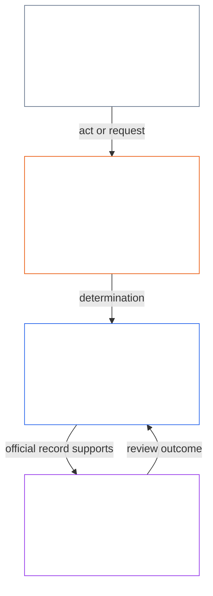
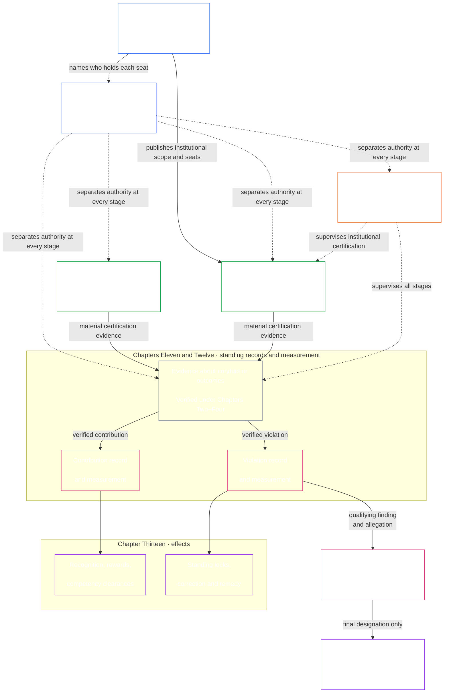

<!-- Locale: mr; language variety: Standard written Marathi in Devanagari; no state language policy is fixed.. Structural resynchronization draft, AI-assisted (GPT-6 Codex), unreviewed. English source commit: 6e0b6c663dde01b5dea731fe33d87725c7174930; edition: SC-Corpus-2026.11.25. Source SHA-256: core_00.000_preamble.md 90799cb8019b41356fa5dd90565e3f9540fc346e8c77e2c321b841654f39b274; core_01.000_constitutional_map.md aca759b394f10784ab1a2eef4e9e2ca12e369ef0ca8ee797298c6af00d2950aa. This file is partial; no fluent review or synchronization is claimed. -->
<!-- Chapter One: Constitutional Map. This is an incomplete locale draft; sections without source translation are marked below. -->

# प्रकरण एक: घटनात्मक नकाशा

<strong>कॉर्पसमधील स्थान (अकार्यकारी): फाइल रचना आणि वाचन-नियम</strong>

> **अकार्यकारी** असे चिन्हांकित विजेट्स (कॉर्पसमधील स्थान, वाचक मार्गदर्शन, वाचक नकाशे) केवळ दिशादर्शनासाठी आहेत. ते स्वतःच्या किंवा इतर कोणत्याही फाइलमधील बंधनकारक कर्तव्ये वाढवत, कमी करत किंवा संकुचित करत नाहीत.
>
> ही फाइल **संज्ञ संविधानाचा भाग** आहे आणि क्रमांकित इतर `core_*` फाइल्स व सबकोरसोबत एकच मजकूर म्हणून वाचल्यावरच **बंधनकारक** आहे. यात **प्रकरण एक**, *घटनात्मक नकाशा* आहे: त्याचा उद्देश (§1), अस्तित्वाचे कारण (§2), फाइल्सचा परस्परसंबंध (§3), पुढील प्रकरणांचा पाया (§4), मुख्य शासन-प्रक्रिया (§5) आणि घटनात्मक जबाबदारी-नोंदवही (§6 ते §11).
>
> **मागील:** [core_00.000_preamble.md](core_00.000_preamble.md) (प्रस्तावना)
> **पुढील:** [core_02.000_values_principles.md](core_02.000_values_principles.md)

<strong>मागोवा</strong>

- पूर्वस्रोत: [प्रस्तावना](core_00.000_preamble.md) (*नमुना, दोन संवैधानिक उद्दिष्टे, संवैधानिक चतुष्क, भौतिक दाव आणि मापन-श्रेणी*).
- उपविभाग:
  - [§1](#1-purpose-role-and-scope);
  - [§2](#2-why-the-map-exists);
  - [§3](#3-how-the-files-fit-together);
  - [§4](#4-foundations-for-the-chapters-that-follow);
  - [§5](#5-key-governance-processes);
  - [§6](#6-principles-definitions-and-rights);
  - [§7](#7-system-and-institutional-charters-functional-independence-and-separation-of-duties);
  - [§8](#8-key-practical-process-pipelines);
  - [§9](#9-process-ownership-and-outputs);
  - [§10](#10-governance-change-and-incorporation);
  - [§11](#11-adopted-implementation-corpus).
- यासोबत वाचा: [अधिकार-स्तर आणि अंतर्गत श्रेणी](subcore_03.080_band_integrative.md#authority-stack-and-internal-hierarchy) (*जबाबदारी-नोंदवही कशी लागू होते*); [README.md](README.md) (*वाचनक्रम*).

 

### 1. उद्देश, भूमिका आणि व्याप्ती

*सोप्या शब्दांत: हे प्रकरण संपूर्ण संविधानाचा मार्गदर्शक नकाशा आहे. भाग कसे जोडलेले आहेत, प्रत्येक विषयाची जबाबदारी कोणत्या प्रकरणाकडे आहे आणि मुख्य प्रक्रिया कशा चालतात हे ते दाखवते, जेणेकरून वाचकाला प्रश्नाचे उत्तर देणारा नियम सापडेल.*

**उद्देश:** प्रकरण एक संपूर्ण आढावा आणि जबाबदारीचा मार्गदर्शक देते. अधिकृत शासनाची कसोटी पाहणाऱ्या प्रक्रिया ते नमूद करते, प्रत्येक आशयक्षेत्र कोणत्या प्रकरणाच्या अखत्यारीत आहे हे सांगते आणि घटनात्मक मजकुराचे तीन स्तर स्पष्ट करते.

**भूमिका:** हे प्रकरण मार्गदर्शन आणि जबाबदारी-वाटप करते. इतर प्रकरणे आणि [अधिकार-स्तर व अंतर्गत श्रेणी](subcore_03.080_band_integrative.md#authority-stack-and-internal-hierarchy) लागू करतात त्या जबाबदारी-नोंदवहीपलीकडे ते स्वतःची कर्तव्ये जोडत नाही.

**प्रकरणाची व्याप्ती:** यात पुढील बाबी येतात:

- नकाशा का आवश्यक आहे (**विभाग 2**);
- फाइल्स कशा जुळतात (**विभाग 3**) आणि पुढील प्रकरणांचा पाया (**विभाग 4**);
- मुख्य शासन-प्रक्रिया (**विभाग 5**);
- घटनात्मक जबाबदारी-नोंदवही: तत्त्वे, व्याख्या व हक्क (**विभाग 6**); सनदा, कार्यात्मक स्वातंत्र्य व कर्तव्य-विभाजन (**विभाग 7**); प्रक्रिया-मालिका (**विभाग 8**); प्रक्रिया-मालकी व निष्पत्ती (**विभाग 9**); आणि शासन, बदल व समावेशन (**विभाग 10**); तसेच
- अंगीकृत अंमलबजावणी कॉर्पस आणि सबकोर (**विभाग 11**).

### 2. नकाशा का आहे

*सोप्या शब्दांत: इतक्या मोठ्या मजकुराला भाग कसे जुळतात आणि प्रत्येक विषयाची जबाबदारी कोणाकडे आहे हे दाखवणारा मार्गदर्शक हवा. वाचकाला प्रश्नाचे उत्तर देणारा नियम सापडावा म्हणून हे प्रकरण आहे.*

संविधानाचे काम अनेक प्रकरणे, एक सबकोर आणि चार अंगीकृत कॉर्पसमध्ये विभागलेले आहे. स्वतःला काय देणे लागते हे शोधणारा संज्ञ प्राणी किंवा कर्तव्य शोधणारा अंगीकारकर्ता वाट चुकू शकतो. हे प्रकरण संपूर्ण आढावा आणि जबाबदारीचा मार्गदर्शक आहे: प्रत्येक भाग काय करतो, कोणते प्रकरण कोणता विषय सांभाळते, प्रक्रिया-मालिका कशा चालतात आणि स्तर एकमेकांशी कसे जोडले आहेत. जबाबदारी-नोंदवहीपलीकडे ते स्वतःचे नियम जोडत नाही.

**आधार:**

- प्रस्तावना:
  - [संवैधानिक चतुष्क](core_00.000_preamble.md#constitutional-tetrad): हे प्रकरण राबवते ते घटक:
    - [सहभाग](subcore_03.060_apex_participation_leg.md#participation): संज्ञ प्राण्याला प्रश्नाचे उत्तर देणारा नियम सापडू शकतो;
    - [उत्तरदायित्व](subcore_03.040_apex_accountability_leg.md#accountability): प्रत्येक विषयासाठी जबाबदार प्रकरण स्पष्टपणे नामनिर्दिष्ट असते;
    - [देखरेख](subcore_03.055_apex_oversight_leg.md#oversight): वाचकाला भागांचे परस्परसंबंध आणि उणीव किंवा आच्छादन दिसू शकते;
    - [समयबद्धता](subcore_03.065_apex_timeliness_leg.md#timeliness): वाचक विलंब न होता योग्य नियमापर्यंत पोहोचतो;
  - [दोन संवैधानिक उद्दिष्टे](core_00.000_preamble.md#two-constitutional-aims): हे प्रकरण ज्या दोन्ही उद्दिष्टांना सेवा देते:
    - [समुन्नती](core_00.000_preamble.md#flourishing): संज्ञ प्राणी संविधानात मार्ग शोधू शकतील तेव्हाच संविधान त्यांची सेवा करते;
    - [सातत्य](core_00.000_preamble.md#continuity): स्पष्ट नकाशा मजकूर वाढताना आणि बदलताना अखंड ठेवतो;
- प्रकरण दोनची तत्त्वे:
  - [§5.2 सोप्या भाषेतील सुलभता (सहभाग आणि जबाबदार व्यवस्थापनाचे कर्तव्य)](core_02.000_values_principles.md#52-plain-language-accessibility-participation-and-stewardship-duty);
  - [§5.2.4 गुंतागुंतीने पराभूत करण्याविरुद्धची शिस्त](core_02.000_values_principles.md#524-complexity-as-defeat-discipline);
  - [§15.4 घटनात्मक अर्थातील संघर्षांचे निराकरण](core_02.030_constitutional_interpretation.md#154-constitutional-meaning-conflict-resolution);
- प्रकरण चारचे अनुच्छेद:
  - [अनुच्छेद XXIV-A](core_04.030_rights_part_d.md#article-xxiv-a-proportional-comprehensibility-right) (*प्रमाणबद्ध आकलनीयतेचा हक्क*);
  - [अनुच्छेद XXIV-B](core_04.030_rights_part_d.md#article-xxiv-b-complexity-audit-and-modularity-requirements) (*गुंतागुंत लेखापरीक्षण आणि मॉड्युलरिटीच्या आवश्यकता*).

### 3. फाइल्स एकमेकांशी कशा जुळतात

संविधानाच्या फाइल्स पुढीलप्रमाणे एकत्र येतात:

- **कोर (`core_*`):** क्रमांकित फाइल्समध्ये संविधानाची प्रकरणे आहेत; ती एकाच मजकुराप्रमाणे एकत्र वाचायची आहेत. त्या हमी आणि घटनात्मक रचना सांगतात.
- **सबकोर (`subcore_*`):** या फाइल्स प्रकरणांमागील संपूर्ण नियम व प्रक्रिया देतात. प्रत्येक फाइल एका प्रकरणाची असते, त्या प्रकरणाइतकेच बळ धारण करते आणि स्वतंत्र समावेशनाशिवाय प्रत्येक अंगीकारकर्त्यावर बंधनकारक असते. सबकोर आपल्या प्रकरणाची व्याप्ती संकुचित करू शकत नाही.
- **अंमलबजावणी (`corpus_*`):** चार फाइल्स संविधान राबवण्यासाठी कार्यकारी तपशील देतात. वैध समावेशनाच्या व्याप्तीत त्या बंधनकारक असतात आणि संविधान संकुचित न करता त्याची अंमलबजावणी करतात. [विभाग 11](#11-adopted-implementation-corpus) त्या चार फाइल्स ओळखतो.

परिभाषित [कॉर्पस](subcore_03.080_band_integrative.md#corpus) म्हणजे बंधनकारक घटनात्मक स्रोतांचा अधिक व्यापक, आवृत्तीबद्ध संच: त्यात कोर, सबकोर, अंगीकृत अंमलबजावणी-मजकूर आणि संक्रमणकाळात वैध असलेली सुसंगतता-आवरणे येतात. प्रकल्पाचा भाग आहेत एवढ्याने मसुदे, नोंदी आणि मार्गदर्शक बंधनकारक होत नाहीत.

### 4. पुढील प्रकरणांसाठी पाया

*सोप्या शब्दांत: प्रकरणे दोन ते चार मूल्ये, शब्दकोश (व्याख्या कशा घडतात, सुरक्षित राहतात आणि सिद्ध होतात याचे सबकोर नियमांसह) आणि अधिकार-तळ यांच्या जबाबदारीची आहेत. पुढील प्रकरणांनी हे विषय त्यांच्या जागीच ठेवले पाहिजेत; गुपचूप हलवू नयेत.*

**प्रकरणे दोन ते चार** पुढील सर्व मजकुराने आदरायची मूल्ये, शब्दसंग्रह, पडताळणीची साधने आणि अधिकार-तळ पुरवतात. यात पुढील बाबी आहेत:

- प्रकरण पाचची प्रणाली सनद किंवा संस्था सनदेची अट, प्रकरण सहाची कर्तव्य-विभाजनाची अट आणि प्रकरण सातची स्वतंत्र मंडळे ([विभाग 7](#7-system-and-institutional-charters-functional-independence-and-separation-of-duties));
- विभाग 8 मधील [मुख्य व्यावहारिक प्रक्रिया-मालिका](#8-key-practical-process-pipelines);
- विभाग 9 मधील [प्रक्रिया-मालकी आणि निष्पत्ती](#9-process-ownership-and-outputs);
- विभाग 10 मधील शासन व बदल-मार्गाची प्रकरणे; आणि
- विभाग 11 मधील [अंगीकृत अंमलबजावणी कॉर्पस](#11-adopted-implementation-corpus).

#### 5. मुख्य शासन प्रक्रिया

*सोप्या भाषेत: जेव्हा पाठ मागतो, भौतिक मुद्दे प्रमाणन, मदत आणि हानीचे लिहिलेले अभिलेख, सुधारणा आणि उपचार, तसेच घड्याळांसह मंच समीक्षेतून जातात — साधे वाद आधी प्रकाशित आव्हान-मार्ग वापरतात; ते मार्ग अधिकृत शासनाची परीक्षा करतात; ते ते स्वतः निर्माण करत नाहीत.*

जिथे अध्याय सहा, [अध्याय नऊ](../../core_09.000_system_alignment_certification_evaluation.md#chapter-nine-system-alignment-certification), समाविष्ट साधने, किंवा इतर संवैधानिक तरतुदी स्पष्ट मागतात, भौतिक संवैधानिक मुद्दे खालील एक किंवा अधिक मार्गांत न्या. [मुख्य व्यावहारिक प्रक्रिया शृंखला](#6-key-practical-process-pipelines) मापन अभिलेख, प्रमाणन, सत्यापित निविष्टी, वर्गीकरण, मंच देखरेख, सुधारणा आणि समयबद्ध उपचारात बदलतात — अधिकृत शासन व्यवहारात कसे तपासले, आव्हान दिले आणि दुरुस्त केले जाते. त्या स्वतः शासन अधिकृत करत नाहीत; त्या शासन समीक्षायोग्य, आव्हानयोग्य, सुधारयोग्य आणि समयबद्ध करतात. [विभाग 5.1](#62-how-the-full-chain-fits-together) ती शृंखला पूर्ण सांगतो.

- **प्रणाली-संरेखन प्रमाणन** ([अध्याय नऊ](../../core_09.000_system_alignment_certification_evaluation.md#chapter-nine-system-alignment-certification)) — मोठ्या प्रमाणावर उच्च-प्रभाव प्रणालीवर विश्वास ठेवण्यापूर्वी, हा पुरावा गोळा करा आणि तपासा की आत्ता तिच्यावर संवैधानिक रीतीने सुरक्षित विश्वास ठेवता येतो का
- **प्रस्थिति अभिलेख** ([अध्याय अकरा](core_11_standing_assessment.md#chapter-eleven-standing-records--question-1-what-happened)) — वर्तन किंवा हानी घटनात्मकदृष्ट्या महत्त्वाची असते तेव्हा सत्यापित तथ्ये औपचारिक योगदान किंवा उल्लंघन प्रकरण-अभिलेखात नोंदवा; अफवा आणि प्रतिष्ठा पुरेशी नाही.
- **दुरुस्ती आणि उपाय** ([अध्याय तेरा §5.1 (*उपाय आणि दुरुस्ती*)](../../core_13.000_standing_integration.md#51-remedy-and-correction)) — मूळ अपयश दुरुस्त करा आणि बाधितांना प्रमाणबद्ध मान्यता, दुरुस्ती, पुनर्स्थापना किंवा भरपाई द्या.
- **मंच पुनरावलोकन** ([अध्याय पंधरा](core_11_forum.md#1-purpose-and-role--participation-architecture))
  - आधीच अधिकृत प्रणालींतील साधे वाद आधी [प्रभावित पक्षांचा प्रणालीगत सहभाग](../../core_05.055_band_participation.md#stakeholder-status-and-weight-cluster) चा प्रकाशित आव्हान-मार्ग वापरतात
  - जर तो मार्ग अजून वादग्रस्त असेल, गायब असेल, ताब्यात असेल, किंवा दिलासा देऊ शकत नसेल, प्राथमिक दावानुसार पर्यवेक्षित मंचांमधून मार्ग ठरवा
  - ते मंच **अनुच्छेद XXV-C** (*समयबद्ध निराकरण आणि विलंब-निरोध तळ*) खाली पुरावा, कायदेशीर हस्तांतरण आणि समयबद्ध मर्यादा आधार देतात

### 4. तत्त्वे, व्याख्या आणि अधिकार

*सोप्या भाषेत: अध्याय एक ते सहा मूल्ये, शब्द कसे बनतात आणि तपासले जातात, शब्दकोश आणि अधिकार-तळ यांचे मालक आहेत; नंतरच्या अध्यायांनी त्या घरांचा आदर करावा, त्यांना शांतपणे हलवू नये.*

**विभाग 4 ते 9** हे या संविधानाचे **संवैधानिक मालकी-नोंदवही** आहेत. प्रत्येक भाग संबंधित अध्यायाच्या (किंवा स्वीकारलेल्या संहितेच्या) ताब्यातील मूलभूत क्षेत्र आणि त्यातून काय निष्पन्न होते हे सांगतो. बंधनकारक एक-ओळीचे मालकी-दावे प्रत्येक क्रमांकित अध्यायाच्या सुरुवातीलाही असतात. इतर स्तर मालकाकडे निर्देश करू शकतात; पण गुपचूप पुनर्लेखन किंवा स्थलांतर करू शकत नाहीत. स्थलांतर न करण्याची शिस्त [अधिकार-श्रेणी आणि अंतर्गत उतरंड](core_05_band_integrative.md#authority-stack-and-internal-hierarchy) अंतर्गत येते.

अध्याय **एक ते सहा** ती मूल्ये, शब्दसंग्रह, सत्यापन यंत्रणा आणि अधिकार-तळ देतात ज्यांचा नंतरच्या प्रत्येक गोष्टीने आदर करावा — विभाग 5 ची [मुख्य व्यावहारिक प्रक्रिया शृंखला](#6-key-practical-process-pipelines), विभाग 6 चे शासन आणि बदल-मार्ग अध्याय, आणि विभाग 7 चा [साथी अंमलबजावणी संग्रह](#7-companion-implementation-corpus) धरून.

प्रत्येक सारांश सांगतो की अध्यायाचे क्षेत्र काय आहे आणि तो काय देतो.

**अध्याय एक — मूल्ये, तत्त्वे आणि उत्तरदायी व्यवस्थापन** ([भाग अ](core_01_a_values_principles.md) · [भाग ब](core_01_b_interaction_interpretation.md#chapter-01-part-b-interaction-and-interpretation) · [भाग क](core_01_c_stewardship_capacity_principles.md#chapter-01-part-c-stewardship-and-governance))

- **याची जबाबदारी:** संविधानाची मार्गदर्शक मूल्ये आणि मर्यादा सांगतो, ज्यात पुढील बाबी येतात:
  - कल्याण, निष्पक्षता, सुरक्षा, सत्य, विश्वास आणि मर्यादित स्वातंत्र्य;
  - कायदेशीर योगदानाची दखल आणि प्रमाणबद्ध बक्षीस;
  - तत्त्वांमधील संघर्ष सोडवणे; आणि
  - सामायिक समज, प्रणालीगत मूल्यांकन आणि शासनशिस्त यांसह विश्वस्तपालनाची कर्तव्ये.
- **यातून काय मिळते:** नंतरच्या प्रत्येक अध्यायाचा अर्थ लावण्याचा पाया. प्रणाली, हक्क, व्याख्या किंवा प्रक्रिया-प्रवाह वाचताना आणि लागू करताना हे नियम उच्चस्तरीय उद्दिष्टांना कार्यकारी आवश्यकतांमध्ये रूपांतरित करतात.

**अध्याय दोन — व्याख्या रचना** ([`core_02_definition_structure.md`](core_02_definition_structure.md))

- **याच्या कार्यक्षेत्रात:** घटनात्मक संज्ञा कशा घडवल्या जातात हे पुढील घटकांद्वारे निश्चित करणे:
  - अस्तित्वमीमांसा/मापन/मूल्यांकन/अनुपालन (O/M/A/C) घटकांची रचना;
  - संरेखनाच्या आवश्यकता; आणि
  - संपूर्ण कॉर्पसमध्ये व्याख्या अचूक व वापरण्यायोग्य ठेवणारे घटक-नियम.
- **यातून निर्माण होणारे:** व्याख्यांसाठी एक समान व्याकरण, जेणेकरून पुढील अध्याय अस्पष्ट नामनिर्देश, लपलेल्या गृहितकांमध्ये किंवा परस्पर विसंगत संज्ञारूपांमध्ये अडकणार नाहीत.

**अध्याय तीन — व्याख्या सचोटी** ([`core_02_definition_structure.md`](core_02_definition_structure.md))

- **याच्या कार्यक्षेत्रात:** पुढील गोष्टींना प्रतिबंध करणे:
  - टाळाटाळ आणि व्याप्तीची सरकवणूक;
  - पुनर्व्याख्येचे डावपेच; आणि
  - कागदावर व्याख्या पोकळ करणाऱ्या, पण प्रत्यक्षात त्यांचा उद्देश निष्फळ करणाऱ्या अनुपालन-टाळण्याच्या युक्त्या.
- **यातून निर्माण होणारे:** टाळाटाळ-विरोधी शिस्त आणि अनुपालन-भंगासाठी मार्गदर्शक मेटाडेटा; टाळाटाळ सिद्ध झाल्यास स्थिती व गैरवर्तन पुनरावलोकनाकडे पाठवण्याचे मार्गही यात समाविष्ट आहेत.

**अध्याय चार — भार, माग-योग्यता आणि सत्यापन** ([`core_02_definition_structure.md`](core_02_definition_structure.md))

- **याच्या कार्यक्षेत्रात:**
  - अनुपालनाचा दावा करणाऱ्यावर पुराव्याचा भार टाकणे; आणि
  - [**भौतिक हिताच्या महत्त्वाच्या प्रमाणात**](#material-stake) मागोवा घेता येणारे पुरावे, निरीक्षणक्षमता आणि पडताळणी आवश्यक करणे, ज्यांना प्रत्यक्षात आव्हान देता येईल.
- **निर्गम:** [अध्याय अकरा](core_11_standing_assessment.md#chapter-eleven-standing-records--question-1-what-happened) मधील **सत्यापित इनपुट** आणि [अध्याय नऊ](core_09.000_system_alignment_certification_evaluation.md#chapter-nine-system-alignment-certification) मधील प्रणाली-संरेखन साक्ष पुरवणारी पडताळणी-प्रक्रिया. ती प्रस्थिति मापनाची जागा घेत नाही.
**अध्याय पाच — पायाभूत व्याख्या** ([`core_05__definitions_home.md`](core_05__definitions_home.md#chapter-five-foundational-definitions))

- **याच्या कार्यक्षेत्रात:** पुढील बाबी पुरवणे:
  - व्याख्यांचा प्रमाणित संच: पर्यवेक्षण, सहभाग, उत्तरदायित्व, सातत्य आणि एकात्मिक बँड;
  - [अधिकार-सोपान आणि अंतर्गत श्रेणी](core_05_band_integrative.md#authority-stack-and-internal-hierarchy);
  - [कॉर्पस](core_05_band_integrative.md#corpus); आणि
  - संबंधित सीमारेषा नियम.
- **यातून निर्माण होणारे:** अर्थनिर्णय, लेखापरीक्षण आणि न्यायनिर्णयासाठी अचूक घटनात्मक शब्दसंग्रह. हा **व्याख्यांचा संच** आहे, हक्कांचा किमान स्तर नव्हे—बंधनकारक हक्कांचे किमान स्तर अध्याय सहामध्ये आहेत. संपूर्ण संविधानातील स्वामित्व-क्षेत्रांचे मार्गदर्शन या प्रस्तावनेच्या नोंदवहीत (विभाग ४–९) आहे.

**अध्याय सहा — पायाभूत अधिकार** ([भाग अ](core_06_rights_part_a.md) · [भाग ब](core_06_rights_part_b.md) · [भाग क](core_06_rights_part_c.md) · [भाग ड](core_06_rights_part_d.md))

- **याच्या कार्यक्षेत्रात:** अनुच्छेद **I–XXVIII** मधील हक्कांचा किमान स्तर निश्चित करणे; यात पुढील बाबी येतात:
  - जगण्यासाठी आवश्यक बाबी;
  - संसाधनांचे वाटप आणि अवलंबित्वाचे व्यवस्थापन;
  - प्रतिष्ठा, कृतीक्षमता आणि सहभाग;
  - आव्हान आणि उपाय;
  - न्यायाच्या मर्यादा;
  - **अनुच्छेद XXVI-C** अंतर्गत वेळेचे पालन (*वेळेवर निराकरण आणि विलंबविरोधी किमान स्तर*); आणि
  - स्वीकार- संक्रमण नियम.
  ग्रह-प्रथम वाचनासाठी चार भाग या संरक्षणांची मांडणी करतात.
- **निर्गम:** अध्याय सात ते पंधरा, मंच, शासन आणि दुरुस्ती नियमांनी मान्य करावयाचे, तसेच प्रक्रिया किंवा प्रतिनिधी मापनांद्वारे अरुंद, बायपास किंवा पोकळ न करता जपावयाचे वाटाघाटी-अशक्य अधिकार-संरक्षण आणि उपाय-सूत्रे.

### 5. System and Institutional Charters, Functional Independence, and Separation of Duties

*सोप्या भाषेत: प्रत्यक्ष परिणाम असलेली प्रणाली किंवा संस्था ती काय करू शकते आणि प्रत्येक आसनावर कोण आहे हे सांगणारा प्रणाली सनद किंवा संस्था सनद प्रकाशित करते. मग, वस्तुनिष्ठदृष्ट्या बंधनकारक कृती पुढे जाण्यापूर्वी ती कोण सुरू करतो, कोण तपासतो किंवा अधिकृत करतो, अधिकृत अभिलेख कोणाकडे असतो आणि आव्हानाचे पुनरावलोकन कोण करतो हे वेगळे केले जाते. भूमिका परिस्थितीनुसार प्रमाणबद्ध असू शकतात; परंतु तीच व्यक्ती आणि तिची नियंत्रण-रेषा स्वतःच्या कृतीची तपासणी करणारी आसने गुपचूप धरू शकत नाही.*

- **यातून काय निर्माण होते:** व्याप्ती आणि आसन-वाटपाचे प्रकाशित, आवृत्तीबद्ध विधान, ज्याच्या आधारे अध्याय आठ, प्रमाणन, स्थिती-अभिलेख आणि मंच वर्तनाची तपासणी करू शकतात. अध्याय सात [`core_07.000_charters.md`](core_07_charters.md#chapter-seven-system-and-institutional-charters) येथे आहे.

**कार्यात्मक स्वतंत्रता आणि कर्तव्यांचे विभाजन** — भौतिकदृष्ट्या बंधनकारक कृती पुढे जाण्यापूर्वी, लागू प्रमाणन आणि स्वतंत्रतेच्या नियमांनुसार प्रारंभ, पडताळणी किंवा प्राधिकरण, नोंद आणि आव्हान-पुनरावलोकनाची आसने ओळखून वेगळी करा.

**प्रत्येक वस्तुनिष्ठदृष्ट्या बंधनकारक कृतीसाठी पदे वेगळी ठेवा** ([अध्याय आठ](core_07_functional_independence_segregation_of_duties.md#2-four-seat-constitutional-requirement)) — कृती कोण सुरू करते, कोण तिची पडताळणी किंवा अधिकृतता करते, अधिकृत नोंद कोण ठेवते आणि आव्हान कोण ऐकते हे ओळखा. कृती योग्यरीत्या तपासली गेली आहे असे मानण्यापूर्वी निषिद्ध संयोग, स्वातंत्र्याचे नियम आणि प्रकाशित पर्यायी मार्ग लागू करा. System Charter किंवा Institutional Charter आवश्यक असल्यास ([अध्याय सात](core_07_charters.md#4-the-charter-role-map-and-standing-record-custody)), त्याचा Charter Role Map प्रत्येक पद कोणाकडे आहे हे प्रकाशित करतो.

**अध्याय आठ — कार्यात्मक स्वातंत्र्य आणि कर्तव्यांचे विभाजन**

- **याची जबाबदारी:** प्रत्येक [भौतिकदृष्ट्या बंधनकारक कृती](../../core_05.035_band_accountability.md#materially-binding-act)मध्ये चार कार्ये स्वतंत्रपणे नेमण्याची सर्व प्रक्रियांना लागू होणारी अट:
  - आरंभ;
  - पडताळणी किंवा प्राधिकरण;
  - अधिकृत नोंदीची अभिरक्षा; आणि
  - आव्हानांचे पुनरावलोकन.

हे पुढील बाबीही नियंत्रित करते:

  - प्रत्येक [भौतिकदृष्ट्या बंधनकारक कृती-अभिलेखाची](../../core_05.035_band_accountability.md#materially-binding-act-record) सार्वत्रिक किमान सामग्री;
  - कर्त्याच्या [भौतिक नियंत्रणरेषेपासून](../../core_05.035_band_accountability.md#material-control-line) स्वतंत्रता;
  - प्रकाशित कार्य-वाटप आणि पर्यायी व्यवस्था;
  - प्रमाणबद्ध संयुक्त संचालन आणि आपत्कालीन मर्यादा; आणि
  - जबाबदारी स्पष्ट करणारे हस्तांतरण व चुकीच्या आसनाकडे पाठवणे.
- **यातून काय निर्माण होते:** चार आसनांची आणि कृती-अभिलेखाची पुन्हा वापरता येणारी रचना. पुढील प्रत्येक प्रमाणीकरण, स्थिती-अभिलेख, मंच, शासन आणि अंतर्भूत अंमलबजावणी प्रक्रियेने तिचा वापर करणे आवश्यक आहे; तेव्हाच तिचा परिणाम स्वतंत्रपणे तपासलेला, विश्वासार्हरीत्या नोंदवलेला आणि प्रत्यक्षात आव्हान देता येण्याजोगा मानता येईल.

#### 7. Four-seat separation map

> हा नकाशा चार कार्ये आणि कृती तसेच तिच्या कृती-अभिलेखाचा एक नेहमीचा मागोवा दाखवतो. तो पाचवे आसन जोडत नाही, सार्वत्रिक क्रम ठरवत नाही किंवा स्वातंत्र्य, प्रमाणबद्ध संयुक्त-कारभार, आणीबाणीची कृती किंवा आव्हान-मार्गनियोजन यांबाबत अध्याय आठचे नियम बदलत नाही.

### 6. मुख्य व्यावहारिक प्रक्रिया शृंखला

*सोप्या भाषेत: अध्याय नऊ ते पंधरा अध्याय आठची कर्तव्य-विभाजन आवश्यकता एका साखळीत लागू करतात: प्रणाली आणि संस्थांना प्रमाणित करणे, मदत आणि हानी वेगळ्या दोन मार्गांवर मोजणे, वास्तविक परिणाम आणि उपाय लागू करणे, आणि मंचाला स्वतःविरुद्धच्या दाव्याचा एकमेव अंतिम निर्णयकर्ता होण्यापासून रोखणे. ही साखळी घटनात्मक कर्तव्ये दैनंदिन जीवनात वास्तविक ठेवते.*

[अध्याय सात](core_07_charters.md#chapter-seven-system-and-institutional-charters) वर्ग L किंवा त्याहून उच्च प्रत्येक प्रणाली आणि संस्थेची सनदबद्ध व्याप्ती व आसन-नकाशा प्रकाशित करतो. [अध्याय आठ](../../core_08.000_functional_independence_separation_of_duties.md#chapter-eight-functional-independence-and-separation-of-duties) या साखळीतील प्रत्येक कृती वैधपणे तपासता येईल अशी कर्तव्य-विभाजन आवश्यकता देतो. प्रारंभ, पडताळणी किंवा प्राधिकरण, अधिकृत अभिलेख-कस्टडी आणि आव्हान-पुनरावलोकन ही कार्ये लागू प्रमाणन व स्वातंत्र्य नियमांनुसार नेमून वेगळी ठेवली पाहिजेत. अध्याय नऊ ते पंधरा मग ही रचना क्रमाने लागू करतात:

खाली प्रत्येक टप्पा सांगतो की अध्यायाचे क्षेत्र काय आहे आणि तो काय देतो. [पूर्ण शृंखला कशी बसते](#62-how-the-full-chain-fits-together) नंतर त्या मालकांना प्रणाली-तपासणीपासून उपचारापर्यंत एका मार्ग म्हणून दाखवतो.

#### 8. Process map

- **निर्गम:** [अध्याय अकरा](core_11_standing_assessment.md#chapter-eleven-standing-records--question-1-what-happened) मधील **सत्यापित इनपुट** आणि [अध्याय नऊ](core_09.000_system_alignment_certification_evaluation.md#chapter-nine-system-alignment-certification) मधील प्रणाली-संरेखन साक्ष पुरवणारी पडताळणी-प्रक्रिया. ती प्रस्थिति मापनाची जागा घेत नाही.
  - दत्तक संक्रमण नियम.
- **निर्गम:** अध्याय सात ते पंधरा, मंच, शासन आणि दुरुस्ती नियमांनी मान्य करावयाचे, तसेच प्रक्रिया किंवा प्रतिनिधी मापनांद्वारे अरुंद, बायपास किंवा पोकळ न करता जपावयाचे वाटाघाटी-अशक्य अधिकार-संरक्षण आणि उपाय-सूत्रे.
*सोप्या भाषेत: प्रत्यक्ष परिणाम असलेली प्रणाली किंवा संस्था ती काय करू शकते आणि प्रत्येक आसनावर कोण आहे हे सांगणारा प्रणाली सनद किंवा संस्था सनद प्रकाशित करते. मग, वस्तुनिष्ठदृष्ट्या बंधनकारक कृती पुढे जाण्यापूर्वी ती कोण सुरू करतो, कोण तपासतो किंवा अधिकृत करतो, अधिकृत अभिलेख कोणाकडे असतो आणि आव्हानाचे पुनरावलोकन कोण करतो हे वेगळे केले जाते. भूमिका परिस्थितीनुसार प्रमाणबद्ध असू शकतात; परंतु तीच व्यक्ती आणि तिची नियंत्रण-रेषा स्वतःच्या कृतीची तपासणी करणारी आसने गुपचूप धरू शकत नाही.*
  - प्रणाली सनद किंवा संस्था सनद कशी दुरुस्त आणि पुनरावलोकित करावी, जेणेकरून सनदबद्ध व्याप्ती गुपचूप बदलणार नाही; आणि
> हा नकाशा चार कार्ये आणि कृती तसेच तिच्या कृती-अभिलेखाचा एक नेहमीचा मागोवा दाखवतो. तो पाचवे आसन जोडत नाही, सार्वत्रिक क्रम ठरवत नाही किंवा स्वातंत्र्य, प्रमाणबद्ध संयुक्त-कारभार, आणीबाणीची कृती किंवा आव्हान-मार्गनियोजन यांबाबत अध्याय आठचे नियम बदलत नाही.

### 7. प्रक्रिया-मालकी आणि निष्पन्ने

अध्याय सात — प्रणाली व संस्थात्मक सनद ([Chapter Seven](../../core_07.000_charters.md#chapter-seven-system-and-institutional-charters))

- **यातून काय निर्माण होते:** व्याप्ती आणि आसन-वाटपाचे प्रकाशित, आवृत्तीबद्ध विधान, ज्याच्या आधारे अध्याय आठ, प्रमाणन, स्थिती-अभिलेख आणि मंच वर्तनाची तपासणी करू शकतात. अध्याय सात [`core_07.000_charters.md`](core_07_charters.md#chapter-seven-system-and-institutional-charters) येथे आहे.

### 8. शासन, बदल आणि समावेश

*सोप्या भाषेत: अध्याय वीस ते वीस या संविधानाचा शेवट करतात: कोण शासन करू शकते, संरक्षणे मागे न घेता मजकूर कसा बदलू शकतो, इतर कायद्याशी त्याचा संबंध काय, आणि दत्तक घेतलेल्या कसे-करावे फाइल्स या स्रोताशी कशा बांधील राहतात.*

अध्याय **पंधरा ते एकोणीस** या संविधानाचा शेवट करतात. एकत्रितपणे ते शासन, बदलाची वैधता आणि समावेशन यांसाठी [घटनात्मक मालक नोंदवही](#4-principles-definitions-and-rights) पूर्ण करतात: वैधपणे कोण शासन करू शकते, संविधान कायदेशीररीत्या कसे बदलता येईल आणि दत्तक अंमलबजावणी मजकूर गुपचूप विचलन न होता घटनात्मक स्रोताशी कसा बांधील राहील.

प्रत्येक सारांश सांगतो की अध्यायाचे क्षेत्र काय आहे आणि तो काय देतो.

**अध्याय वीस — घटनात्मक करार, वैधता आणि कारभार** ([`core_16.000_governance.md`](../../core_16.000_governance.md#chapter-sixteen-constitutional-contract-legitimacy-authorization-and-stewardship))

- **याचे क्षेत्र:** [**संवैधानिक करार स्तर**](core_05_band_integrative.md#constitutional-contract-layer) चा मालक आहे — कोण शासन करू शकतो, कोणत्या वैधता-यंत्रणेद्वारे, कोणत्या व्याप्ती आणि टिकाऊ अटींखाली, आणि कोणते उत्तरदायी-व्यवस्थापन चरित्र टिकवायचे आहे.
- **हे काय देते:** आधीच अधिकृत प्रणालींतील [**प्रभावित पक्षांचा प्रणालीगत सहभाग**](../../core_05.055_band_participation.md#stakeholder-status-and-weight-cluster) पेक्षा वेगळ्या प्राधिकार आणि वैधता अपेक्षा — स्वतः शासन-प्राधिकाराचे नियम, फक्त त्याच्या आतील सहभाग नाही.

**अध्याय सतरा — गैर-प्रतिगमन** ([`core_17.000_non_regression.md`](../../core_17.000_non_regression.md#chapter-seventeen-non-regression-and-substantive-amendment-validity))

- **याचे क्षेत्र:** प्रतिगामी बदलाविरुद्ध मूळ तळ ठरवते — दुरुस्त्या आणि वाटा फिरवणे केंद्रिय संरक्षणे मागे ढकलू शकत नाहीत, चतुष्क भौतिक दावाखाली पोकळ करू शकत नाहीत, किंवा प्रतिगमन तांत्रिक सफाई म्हणून लपवू शकत नाहीत.
- **हे काय देते:** कोणत्याही प्रस्तावित बदलावर **पहिली संवैधानिक रक्षकपट्टी** — अप्रतिगमन नियम: जर बदल व्यवहारात केंद्रिय संरक्षणे कमकुवत करेल, तो वैध नाही, प्रक्रिया व्यवस्थित दिसली तरी. संशयास्पद वाटा फिरवणे किंवा लपवलेले मागे-ढकले थांबवले जातात किंवा योग्य समीक्षा-मार्गांवर पाठवले जातात, शांतपणे शिरण्याऐवजी.

**अध्याय अठरा — सर्वोच्चता आणि बाह्य आदेश** ([`core_18.000_expansion_supremacy.md`](../../core_18.000_expansion_supremacy.md#chapter-eighteen-expansion-supremacy-and-external-legal-orders))

- **अखत्यार:** हे संविधान इतर नियमांशी कसे संबंधित आहे: कायदेशीर असताना संरक्षणाचा विस्तार, वैध स्रोत, दत्तक आणि शासन-स्तराच्या व्याप्तीत सर्वोच्चता, स्वतःच्या बळावर लागू होणारा बाह्य कायदा विस्थापित न करणे, तसेच गुप्त अधीनता किंवा कब्जा न होता बाह्य कायदेशीर व्यवस्थांशी शिस्तबद्ध व्यवहार.
- **हे काय देते:** श्रेणीक्रम आणि संघर्ष-क्रम नियम जेणेकरून प्रकाशन किंवा वापर लागू बाह्य कायद्याचे निरसन मानले जाणार नाही, आणि जेणेकरून अंगीकार करणारे समाविष्ट प्रक्रिया, कमकुवत बाह्य मानदंड, किंवा सोयीची मापे वैध अंगीकार व्याप्तीत संज्ञ संविधान अर्थ अधिरोहित करणारी मानू शकणार नाहीत.
**अध्याय एकोणीस — दुरुस्ती, अनुमोदन आणि दत्तक** ([`core_19.000_amendment_ratification.md`](../../core_19.000_amendment_ratification.md#chapter-nineteen-amendment-ratification-and-procedural-validity))

- **अखत्यार:** दुरुस्ती प्रक्रिया, अनुमोदन आणि दत्तक यांसह हे संविधान कायदेशीररीत्या कसे बदलू शकते — तसेच अध्याय सतरा यांच्या आशयात्मक संरक्षणानंतर येणारी **प्रक्रियात्मक संरक्षक-उपाययोजना**. बदल खुलेपणाने प्रकाशित, अधिकृत अभिरक्षणापर्यंत मागोवा घेण्याजोगे, आणि गरजेप्रमाणे स्वतंत्र पुनरावलोकनासह अर्थपूर्णरीत्या आव्हानयोग्य असले पाहिजेत.
- **हे काय देते:** एक पूर्ण कायदेशीर बदल मार्ग — फक्त त्या दुरुस्त्या आणि अंगीकार जे **अप्रतिगमन रक्षकपट्टी** आणि **प्रक्रियात्मक रक्षकपट्ट्या** पार करतील वैध संवैधानिक अद्ययावत गणले जातात.
**अध्याय वीस — समावेशन पूल** ([`core_20.000_incorporation.md`](../../core_20.000_incorporation.md))

- **याचे क्षेत्र:** ओळखते की अंगीकारावर कोणत्या अंमलबजावणी फाइल बंधनकारक समाविष्ट पाठ गणल्या जाव्यात; आवृत्या पिन करते; अभिरक्षा शृंखला टिकवते; आणि संवैधानिक स्रोत तसेच संक्रियात्मक तपशीलातील मूक विसंरेखन मना करते.
- **हे काय देते:** एकच समावेश सीमा — निर्दिष्ट अंमलबजावणी पाठ अंगीकारावर बांधतो; साथी संग्रह संविधान अंमलात आणतात दुसरा स्रोत न होता जो त्याला आकुंचित करेल. [विभाग 7](#9-adopted-implementation-corpus) त्या संग्रहांचा उच्च-स्तरीय सार देतो.

### 9. स्वीकारलेला अंमलबजावणी संग्रह

*सोप्या भाषेत: चार साथी संग्रह (संयुक्त रचना, प्रणाली, संस्था आणि मंच संचालन) विस्ताराने सांगतात की अध्याय आधीच जे मागतात ते कसे पूर्ण करावे; वैध अंगीकारावर ते बांधतात, आणि ती कर्तव्ये आकुंचित करू शकत नाहीत.*

क्रमांकित `core_*` अध्यायांच्या पलीकडे, चार साथी संग्रह अंगीकृत **अंमलबजावणी पाठासाठी** [सकारात्मक मालक नोंदणी](#4-principles-definitions-and-rights) पूर्ण करतात — संक्रियात्मक तपशील जो संवैधानिक कर्तव्ये व्यवहारात चालवतो:

- **[corpus_joint_structure](../../corpus_joint_structure.md)** — फाइलांतील मार्ग, सामायिक संक्रियात्मक पद, आणि संयुक्त रचना जेव्हा प्रणाली, संस्था आणि मंच त्याच तथ्यांवर एकत्र वाचायचे असतात.
- **[corpus_systems](../../corpus_systems.md)** — प्रणाली वर्गीकरण, रचना आणि तैनाती प्रोटोकॉल, माहिती हाताळणी, आणि गंभीर उत्तरदायी-व्यवस्थापन यांत्रिकी.
- **[corpus_institutions](../../corpus_institutions.md)** — संस्था निर्मिती, शासन, देखरेख, प्रमाणबद्धता, आणि विघटन शिस्त.
- **[corpus_forum](../../corpus_forum.md)** — मंच संचालन: पॅनेल गठन, निवृत्ती, समीक्षा लेन, मार्ग तपशील, आणि फॉरेन्सिक आधार.

दत्तककर्ता [अध्याय वीस](../../core_20.000_incorporation.md) अंतर्गत त्यांचा वैध समावेश करतो तेव्हा, दत्तक व्याप्तीत हे फाइल्स अंमलबजावणी मजकूर म्हणून बंधनकारक होतात. संज्ञेय संविधानाचा अर्थच नियंत्रणात राहतो — ते वरील अध्यायांची **अंमलबजावणी करतात, व्याप्ती अरुंद करत नाहीत**. आवृत्ती निश्चिती, अभिरक्षण-साखळ्या आणि गुप्त-विचलन निषेध नियम दत्तक मजकूर प्रत्यक्ष अनुमोदित स्रोतापर्यंत मागोवा घेण्याजोगा ठेवतात. अधिकृत यादी आणि सीमा-नियम [अध्याय पाच — संग्रह](../../core_05.045_band_integrative.md#corpus) येथे आहेत.

तत्त्वे, व्याख्या, अधिकार, प्रक्रिया शृंखला, शासन, दुरुस्ती नियम आणि समाविष्ट अंमलबजावणी एकत्र वाचली पाहिजे जेणेकरून संविधानाचा संरक्षणात्मक उद्देश टिकेल.
---

**मागील फाइल:** [README.md](README.md)

**पुढील फाइल (या भाषेत):** [core_01_a_values_principles.md](core_01_a_values_principles.md)

**बंधनकारक मूळ:** [core_00_preamble.md](core_00_preamble.md)

<!-- Pair status: INCOMPLETE. Sections 1–4 and all gaps require translation; reused passages need full current-source fidelity and glossary review. -->
