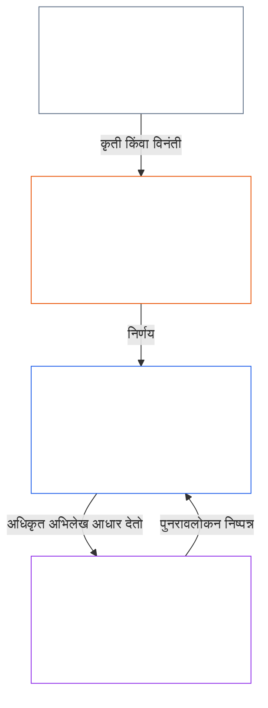
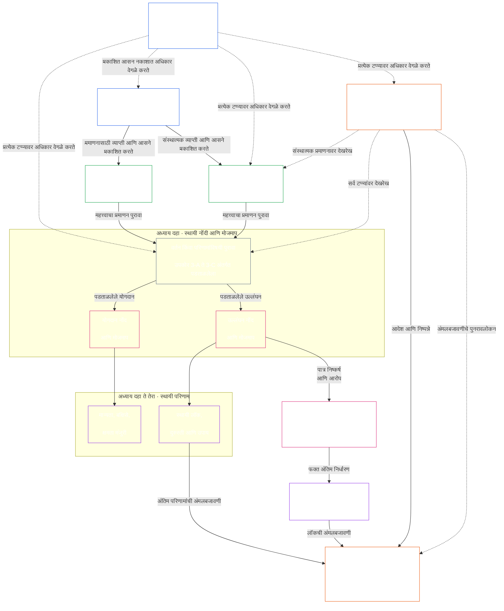

<!-- Locale: mr; language variety: Standard written Marathi in Devanagari; no state language policy is fixed.. Structural resynchronization draft, AI-assisted (GPT-6 Codex), unreviewed. English source commit: 6e0b6c663dde01b5dea731fe33d87725c7174930; edition: SC-Corpus-2026.11.25. Source SHA-256: core_00.000_preamble.md 90799cb8019b41356fa5dd90565e3f9540fc346e8c77e2c321b841654f39b274; core_01.000_constitutional_map.md aca759b394f10784ab1a2eef4e9e2ca12e369ef0ca8ee797298c6af00d2950aa. This file is partial; no fluent review or synchronization is claimed. -->
<!-- Chapter One: Constitutional Map. This is an incomplete locale draft; sections without source translation are marked below. -->

# प्रकरण एक: घटनात्मक नकाशा

<strong>कॉर्पसमधील स्थान (अकार्यकारी): फाइल रचना आणि वाचन-नियम</strong>

> **अकार्यकारी** असे चिन्हांकित विजेट्स (कॉर्पसमधील स्थान, वाचक मार्गदर्शन, वाचक नकाशे) केवळ दिशादर्शनासाठी आहेत. ते स्वतःच्या किंवा इतर कोणत्याही फाइलमधील बंधनकारक कर्तव्ये वाढवत, कमी करत किंवा संकुचित करत नाहीत.
>
> ही फाइल **संज्ञ संविधानाचा भाग** आहे आणि क्रमांकित इतर `core_*` फाइल्स व सबकोरसोबत एकच मजकूर म्हणून वाचल्यावरच **बंधनकारक** आहे. यात **प्रकरण एक**, *घटनात्मक नकाशा* आहे: त्याचा उद्देश (§1), अस्तित्वाचे कारण (§2), फाइल्सचा परस्परसंबंध (§3), पुढील प्रकरणांचा पाया (§4), मुख्य शासन-प्रक्रिया (§5) आणि घटनात्मक जबाबदारी-नोंदवही (§6 ते §11).
>
> **मागील:** [core_00.000_preamble.md](core_00_preamble.md) (प्रस्तावना)
> **पुढील:** [core_02.000_values_principles.md](../../core_02.000_values_principles.md)

<strong>मागोवा</strong>

- पूर्वस्रोत: [प्रस्तावना](core_00_preamble.md) (*नमुना, दोन संवैधानिक उद्दिष्टे, संवैधानिक चतुष्क, भौतिक दाव आणि मापन-श्रेणी*).
- उपविभाग:
  - [§1](#1-purpose-role-and-scope);
  - [§2](#2-why-the-map-exists);
  - [§3](#3-how-the-files-fit-together);
  - [§4](#4-foundations-for-the-chapters-that-follow);
  - [§5](#5-key-governance-processes);
  - [§6](#6-principles-definitions-and-rights);
  - [§7](#7-system-and-institutional-charters-functional-independence-and-separation-of-duties);
  - [§8](#8-key-practical-process-pipelines);
  - [§9](#9-process-ownership-and-outputs);
  - [§10](#10-governance-change-and-incorporation);
  - [§11](#11-adopted-implementation-corpus).
- यासोबत वाचा: [अधिकार-स्तर आणि अंतर्गत श्रेणी](../../subcore_03.080_band_integrative.md#authority-stack-and-internal-hierarchy) (*जबाबदारी-नोंदवही कशी लागू होते*); [README.md](../../README.md) (*वाचनक्रम*).

 

### 1. उद्देश, भूमिका आणि व्याप्ती

*सोप्या शब्दांत: हे प्रकरण संपूर्ण संविधानाचा मार्गदर्शक नकाशा आहे. भाग कसे जोडलेले आहेत, प्रत्येक विषयाची जबाबदारी कोणत्या प्रकरणाकडे आहे आणि मुख्य प्रक्रिया कशा चालतात हे ते दाखवते, जेणेकरून वाचकाला प्रश्नाचे उत्तर देणारा नियम सापडेल.*

**उद्देश:** प्रकरण एक संपूर्ण आढावा आणि जबाबदारीचा मार्गदर्शक देते. अधिकृत शासनाची कसोटी पाहणाऱ्या प्रक्रिया ते नमूद करते, प्रत्येक आशयक्षेत्र कोणत्या प्रकरणाच्या अखत्यारीत आहे हे सांगते आणि घटनात्मक मजकुराचे तीन स्तर स्पष्ट करते.

**भूमिका:** हे प्रकरण मार्गदर्शन आणि जबाबदारी-वाटप करते. इतर प्रकरणे आणि [अधिकार-स्तर व अंतर्गत श्रेणी](../../subcore_03.080_band_integrative.md#authority-stack-and-internal-hierarchy) लागू करतात त्या जबाबदारी-नोंदवहीपलीकडे ते स्वतःची कर्तव्ये जोडत नाही.

**प्रकरणाची व्याप्ती:** यात पुढील बाबी येतात:

- नकाशा का आवश्यक आहे (**विभाग 2**);
- फाइल्स कशा जुळतात (**विभाग 3**) आणि पुढील प्रकरणांचा पाया (**विभाग 4**);
- मुख्य शासन-प्रक्रिया (**विभाग 5**);
- घटनात्मक जबाबदारी-नोंदवही: तत्त्वे, व्याख्या व हक्क (**विभाग 6**); सनदा, कार्यात्मक स्वातंत्र्य व कर्तव्य-विभाजन (**विभाग 7**); प्रक्रिया-मालिका (**विभाग 8**); प्रक्रिया-मालकी व निष्पत्ती (**विभाग 9**); आणि शासन, बदल व समावेशन (**विभाग 10**); तसेच
- अंगीकृत अंमलबजावणी कॉर्पस आणि सबकोर (**विभाग 11**).

### 2. नकाशा का आहे

*सोप्या शब्दांत: इतक्या मोठ्या मजकुराला भाग कसे जुळतात आणि प्रत्येक विषयाची जबाबदारी कोणाकडे आहे हे दाखवणारा मार्गदर्शक हवा. वाचकाला प्रश्नाचे उत्तर देणारा नियम सापडावा म्हणून हे प्रकरण आहे.*

संविधानाचे काम अनेक प्रकरणे, एक सबकोर आणि चार अंगीकृत कॉर्पसमध्ये विभागलेले आहे. स्वतःला काय देणे लागते हे शोधणारा संज्ञ प्राणी किंवा कर्तव्य शोधणारा अंगीकारकर्ता वाट चुकू शकतो. हे प्रकरण संपूर्ण आढावा आणि जबाबदारीचा मार्गदर्शक आहे: प्रत्येक भाग काय करतो, कोणते प्रकरण कोणता विषय सांभाळते, प्रक्रिया-मालिका कशा चालतात आणि स्तर एकमेकांशी कसे जोडले आहेत. जबाबदारी-नोंदवहीपलीकडे ते स्वतःचे नियम जोडत नाही.

**आधार:**

- प्रस्तावना:
  - [संवैधानिक चतुष्क](core_00_preamble.md#constitutional-tetrad): हे प्रकरण राबवते ते घटक:
    - [सहभाग](../../subcore_03.060_apex_participation_leg.md#participation): संज्ञ प्राण्याला प्रश्नाचे उत्तर देणारा नियम सापडू शकतो;
    - [उत्तरदायित्व](../../subcore_03.040_apex_accountability_leg.md#accountability): प्रत्येक विषयासाठी जबाबदार प्रकरण स्पष्टपणे नामनिर्दिष्ट असते;
    - [देखरेख](../../subcore_03.055_apex_oversight_leg.md#oversight): वाचकाला भागांचे परस्परसंबंध आणि उणीव किंवा आच्छादन दिसू शकते;
    - [समयबद्धता](../../subcore_03.065_apex_timeliness_leg.md#timeliness): वाचक विलंब न होता योग्य नियमापर्यंत पोहोचतो;
  - [दोन संवैधानिक उद्दिष्टे](core_00_preamble.md#two-constitutional-aims): हे प्रकरण ज्या दोन्ही उद्दिष्टांना सेवा देते:
    - [समुन्नती](core_00_preamble.md#flourishing): संज्ञ प्राणी संविधानात मार्ग शोधू शकतील तेव्हाच संविधान त्यांची सेवा करते;
    - [सातत्य](core_00_preamble.md#continuity): स्पष्ट नकाशा मजकूर वाढताना आणि बदलताना अखंड ठेवतो;
- प्रकरण दोनची तत्त्वे:
  - [§5.2 सोप्या भाषेतील सुलभता (सहभाग आणि जबाबदार व्यवस्थापनाचे कर्तव्य)](../../core_02.000_values_principles.md#52-plain-language-accessibility-participation-and-stewardship-duty);
  - [§5.2.4 गुंतागुंतीने पराभूत करण्याविरुद्धची शिस्त](../../core_02.000_values_principles.md#524-complexity-as-defeat-discipline);
  - [§15.4 घटनात्मक अर्थातील संघर्षांचे निराकरण](../../core_02.030_constitutional_interpretation.md#154-constitutional-meaning-conflict-resolution);
- प्रकरण चारचे अनुच्छेद:
  - [अनुच्छेद XXIV-A](../../core_04.030_rights_part_d.md#article-xxiv-a-proportional-comprehensibility-right) (*प्रमाणबद्ध आकलनीयतेचा हक्क*);
  - [अनुच्छेद XXIV-B](../../core_04.030_rights_part_d.md#article-xxiv-b-complexity-audit-and-modularity-requirements) (*गुंतागुंत लेखापरीक्षण आणि मॉड्युलरिटीच्या आवश्यकता*).

### 3. फाइल्स एकमेकांशी कशा जुळतात

संविधानाच्या फाइल्स पुढीलप्रमाणे एकत्र येतात:

- **कोर (`core_*`):** क्रमांकित फाइल्समध्ये संविधानाची प्रकरणे आहेत; ती एकाच मजकुराप्रमाणे एकत्र वाचायची आहेत. त्या हमी आणि घटनात्मक रचना सांगतात.
- **सबकोर (`subcore_*`):** या फाइल्स प्रकरणांमागील संपूर्ण नियम व प्रक्रिया देतात. प्रत्येक फाइल एका प्रकरणाची असते, त्या प्रकरणाइतकेच बळ धारण करते आणि स्वतंत्र समावेशनाशिवाय प्रत्येक अंगीकारकर्त्यावर बंधनकारक असते. सबकोर आपल्या प्रकरणाची व्याप्ती संकुचित करू शकत नाही.
- **अंमलबजावणी (`corpus_*`):** चार फाइल्स संविधान राबवण्यासाठी कार्यकारी तपशील देतात. वैध समावेशनाच्या व्याप्तीत त्या बंधनकारक असतात आणि संविधान संकुचित न करता त्याची अंमलबजावणी करतात. [विभाग 11](#11-adopted-implementation-corpus) त्या चार फाइल्स ओळखतो.

परिभाषित [कॉर्पस](../../subcore_03.080_band_integrative.md#corpus) म्हणजे बंधनकारक घटनात्मक स्रोतांचा अधिक व्यापक, आवृत्तीबद्ध संच: त्यात कोर, सबकोर, अंगीकृत अंमलबजावणी-मजकूर आणि संक्रमणकाळात वैध असलेली सुसंगतता-आवरणे येतात. प्रकल्पाचा भाग आहेत एवढ्याने मसुदे, नोंदी आणि मार्गदर्शक बंधनकारक होत नाहीत.

### 4. पुढील प्रकरणांसाठी पाया

*सोप्या शब्दांत: प्रकरणे दोन ते चार मूल्ये, शब्दकोश (व्याख्या कशा घडतात, सुरक्षित राहतात आणि सिद्ध होतात याचे सबकोर नियमांसह) आणि अधिकार-तळ यांच्या जबाबदारीची आहेत. पुढील प्रकरणांनी हे विषय त्यांच्या जागीच ठेवले पाहिजेत; गुपचूप हलवू नयेत.*

**प्रकरणे दोन ते चार** पुढील सर्व मजकुराने आदरायची मूल्ये, शब्दसंग्रह, पडताळणीची साधने आणि अधिकार-तळ पुरवतात. यात पुढील बाबी आहेत:

- प्रकरण पाचची प्रणाली सनद किंवा संस्था सनदेची अट, प्रकरण सहाची कर्तव्य-विभाजनाची अट आणि प्रकरण सातची स्वतंत्र मंडळे ([विभाग 7](#7-system-and-institutional-charters-functional-independence-and-separation-of-duties));
- विभाग 8 मधील [मुख्य व्यावहारिक प्रक्रिया-मालिका](#8-key-practical-process-pipelines);
- विभाग 9 मधील [प्रक्रिया-मालकी आणि निष्पत्ती](#9-process-ownership-and-outputs);
- विभाग 10 मधील शासन व बदल-मार्गाची प्रकरणे; आणि
- विभाग 11 मधील [अंगीकृत अंमलबजावणी कॉर्पस](#11-adopted-implementation-corpus).

### 5. मुख्य शासन प्रक्रिया

*सोप्या भाषेत: संविधानाने मागणी केली असेल तेव्हा आधी कृती सुरू करणारे, पडताळणी किंवा अधिकृतता देणारे, अधिकृत नोंद ठेवणारे आणि आक्षेप तपासणारे स्थान वेगळे ठेवा. महत्त्वाचे प्रश्न नंतर प्रमाणन, मदत व हानीच्या लेखी नोंदी, दुरुस्ती व निवारण, आणि कालमर्यादांसह मंच-पुनरावलोकनातून जातात. सामान्य वाद आधी प्रकाशित आक्षेप-मार्गाने जातात. या प्रक्रिया अधिकृत शासनाची चाचणी घेतात; त्या स्वतः शासन-अधिकार निर्माण करत नाहीत.*

खालील मुद्दे उपलब्ध मार्ग स्पष्ट करतात:

- [प्रकरण चार — मूलभूत अधिकार](../../core_04.000_rights_part_a.md#chapter-four-foundational-rights), [सबकोर 8-B — प्रणाली-संरेखन प्रमाणन मूल्यांकन](../../subcore_08.020_system_alignment_certification_evaluation.md#subcore-8-b-system-alignment-certification--evaluation), समाविष्ट दस्तऐवज किंवा इतर घटनात्मक तरतूद स्पष्टपणे मागणी करत असेल तेव्हा महत्त्वाचा घटनात्मक प्रश्न खालीलपैकी एका किंवा अधिक मार्गांकडे न्या.
- [मुख्य व्यावहारिक प्रक्रिया-साखळ्या](#8-key-practical-process-pipelines) मापनाचे नोंदी, प्रमाणन, पडताळलेले इनपुट, वर्गीकरण, मंच-देखरेख, दुरुस्ती आणि वेळेवर निवारणात रूपांतर करतात.
- या साखळ्या अधिकृत शासनाची प्रत्यक्ष चाचणी, आक्षेप आणि दुरुस्ती करतात. त्या शासनाला अधिकार देत नाहीत; त्या त्याला पुनरावलोकनयोग्य, आक्षेपयोग्य, दुरुस्त करण्याजोगे आणि वेळेवर बनवतात.
- [§8.2](#82-how-the-full-chain-fits-together) निर्णय-स्थानांचे विभाजन, प्रमाणन, प्रस्थिति अभिलेख व मापन, प्रस्थिति परिणाम, लागू असल्यास पदनाम-पुनरावलोकन, मंच-देखरेख आणि निष्पन्नांची अंमलबजावणी हे टप्पे दाखवते.

**मार्ग:**

- **कार्यात्मक स्वातंत्र्य आणि कर्तव्यांचे विभाजन** ([प्रकरण सहा](../../core_06.000_functional_independence_separation_of_duties.md#chapter-six-functional-independence-and-separation-of-duties)): भौतिकदृष्ट्या बंधनकारक कृती पुढे नेण्यापूर्वी सुरुवात, पडताळणी किंवा अधिकृतता, अधिकृत अभिलेखाची अभिरक्षा आणि आक्षेप-पुनरावलोकन ही स्थाने लागू प्रमाणानुपातीकरण व स्वातंत्र्य नियमांनुसार वेगळी ठेवा.
- **प्रणाली-संरेखन प्रमाणन** ([सबकोर 8-B](../../subcore_08.020_system_alignment_certification_evaluation.md#subcore-8-b-system-alignment-certification--evaluation)): उच्च-प्रभावी प्रणालीवर मोठ्या प्रमाणात अवलंबून राहण्यापूर्वी, सध्या तिच्यावर अवलंबून राहणे घटनात्मकदृष्ट्या सुरक्षित आहे का याचा पुरावा गोळा करून तपासा. प्रमाणन आणि प्रणालीला आव्हान देण्याचा व लेखापरीक्षणाचा sentients चा हक्क ([अनुच्छेद XIV](../../core_04.020_rights_part_c.md#article-xiv-right-to-reliable-and-trustworthy-systems), *विश्वसनीय प्रणालींचा हक्क*) हे एकमेकांना पूरक दोन संरक्षण आहेत; एक दुसऱ्याची जागा घेत नाही.
- **प्रस्थिति अभिलेख** ([सबकोर 10-B](../../subcore_10.020_standing_assessment.md#subcore-10-b-standing-records--question-1-what-happened)): वर्तन किंवा हानी घटनात्मकदृष्ट्या महत्त्वाची असेल तेव्हा पडताळलेली तथ्ये योगदान किंवा उल्लंघनाच्या औपचारिक प्रकरण-नोंदीत ठेवा; अफवा व प्रतिष्ठा पुरेशी नाही.
- **दुरुस्ती आणि निवारण** ([प्रकरण बारा §3.1](../../core_12.000_violation_consequences.md#31-remedy-and-correction)): पडताळलेल्या उल्लंघनानंतर त्याचे कारण दूर करून ते थांबवण्यासाठी काय करणे आवश्यक आहे (दुरुस्ती) आणि बाधितांना काय देणे देय आहे (निवारण), या दोन्हींचे मूल्यांकन करा. निवारणात कबुली, दुरुस्ती किंवा पुनर्स्थापना, भरपाई, प्रत्यक्ष दुरुस्ती अशक्य असल्यास पर्यायी संरक्षण किंवा समतुल्य भरपाई यांचा समावेश असू शकतो. कारण दुरुस्त केल्याने निवारणाची जागा घेतली जात नाही आणि उलटही तसेच.
- **मंच-पुनरावलोकन** ([प्रकरण सोळा](../../core_16.000_forum.md#1-purpose-role-and-scope)): आधीच अधिकृत प्रणालींतील सामान्य वाद प्रथम प्रकाशित [हितधारक प्रणाली सहभाग](../../subcore_03.090_band_participation.md#stakeholder-status-and-weight) आक्षेप-मार्गाने जातात. तो मार्ग वादग्रस्त राहिला, अनुपस्थित किंवा ताब्यात घेतला गेला, अथवा निवारण देऊ शकला नाही तर प्राथमिक हिताच्या आधारे देखरेखीखालील मंचाकडे पाठवा. मंच पुरावा, कायदेशीर हस्तांतरण आणि **अनुच्छेद XXVII-C** (*वेळेवर निराकरण व विलंबविरोधी तळ*) मधील कालमर्यादांना आधार देतात.

### 6. तत्त्वे, व्याख्या आणि अधिकार

विभाग 6–11 हे संविधानाचे **घटनात्मक स्वामित्व नोंदवही** आहेत. प्रत्येक प्रकरण किंवा अंगभूत संग्रह कोणत्या विषयासाठी जबाबदार आहे आणि काय निष्पन्न करते हे ते सांगतात. स्वामी फाइलच्या सुरुवातीचे बंधनकारक विधान ही जबाबदारी ठरवते; इतर भाग तिला निर्देशित करू शकतात, पण शांतपणे पुन्हा लिहू किंवा दुसरीकडे हलवू शकत नाहीत. [अधिकार-स्तर आणि अंतर्गत श्रेणी](../../subcore_03.080_band_integrative.md#authority-stack-and-internal-hierarchy) पहा.

#### 6.1 [प्रकरण दोन — मूल्ये, तत्त्वे आणि जबाबदार कारभार](../../core_02.000_values_principles.md)

प्रकरण दोन संविधानाची मार्गदर्शक मूल्ये व मर्यादा ठरवते: कल्याण, न्याय, सुरक्षितता, सत्य, विश्वास, मर्यादित स्वातंत्र्य, कायदेशीर योगदानाची दखल व प्रमाणबद्ध बक्षीस, तत्त्वांतील संघर्षांचे निराकरण, तसेच वितरित समज, प्रणालीगत मूल्यांकन आणि शासन-शिस्त यांसह कारभाराची कर्तव्ये. पुढील सर्व प्रकरणांच्या अर्थलावणीचा पाया ते देते.

#### 6.2 [प्रकरण तीन — मूलभूत व्याख्या](../../core_03.000_definitions_home.md)

प्रकरण तीन पर्यवेक्षण, सहभाग, उत्तरदायित्व, सातत्य आणि एकात्मिक पट्ट्यांची प्रमाणित व्याख्या-रचना, [अधिकार-स्तर आणि अंतर्गत श्रेणी](../../subcore_03.080_band_integrative.md#authority-stack-and-internal-hierarchy), [संग्रह](../../subcore_03.080_band_integrative.md#corpus), आणि संबंधित सीमा-नियम यांचे स्वामित्व ठेवते. अर्थलावणी, लेखापरीक्षण आणि निर्णयासाठी अचूक घटनात्मक शब्दसंग्रह ते देते. ही व्याख्या-रचना आहे, अधिकार-तळ नाही; बंधनकारक अधिकार-तळ प्रकरण चारमध्ये आहे.

##### 6.2.1 [व्याख्येची रचना — सबकोर 3-A](../../subcore_03.010_definition_structure.md)

अस्तित्व/मापन/मूल्यांकन/अनुपालन (O/M/A/C) घटक-रचना, संरेखनाच्या अटी आणि घटक-नियम ठरवून अचूक व सुसंगत घटनात्मक संज्ञांसाठी समान व्याकरण देते.

##### 6.2.2 [व्याख्येची अखंडता — सबकोर 3-B](../../subcore_03.020_definition_integrity.md)

टाळाटाळ, व्याप्ती बदलणे, नव्याने व्याख्या करण्याचे डाव आणि कागदावर व्याख्या ठेवून व्यवहारात निष्प्रभ करणाऱ्या अनुपालन-टाळण्याच्या युक्त्या रोखते. टाळाटाळ सिद्ध झाल्यास प्रस्थिति व गैरवर्तन पुनरावलोकनाकडे पाठवण्याचे संकेतही देते.

##### 6.2.3 [पुराव्याचा भार, मागोवा आणि पडताळणी — सबकोर 3-C](../../subcore_03.030_burden_traceability_verification.md)

अनुपालनाचा दावा करणाऱ्यावर पुराव्याचा भार ठेवते आणि [भौतिक दाव्या](../../core_00.000_preamble.md#material-stake)च्या प्रमाणात मागोवा घेता येणारे पुरावे, निरीक्षणक्षमता आणि प्रत्यक्ष आव्हान देता येईल अशी पडताळणी मागते. पडताळलेले इनपुट सबकोर 10-B ला आणि प्रणाली-संरेखन प्रमाणनाचा पुरावा सबकोर 8-B ला देते; प्रस्थिति मापनाची जागा घेत नाही.

#### 6.3 [प्रकरण चार — मूलभूत अधिकार](../../core_04.000_rights_part_a.md)

प्रकरण चार अनुच्छेद I–XXIX मधील अधिकार-तळ ठरवते: जगण्यासाठी आवश्यक बाबी; संसाधन-वाटप व अवलंबित्वाचे कारभार; प्रतिष्ठा, कर्तृत्वक्षमता व सहभाग; आक्षेप व निवारण; न्यायाच्या मर्यादा; **अनुच्छेद XXVII-C** मधील वेळेची अट; आणि स्वीकार संक्रमणाचे नियम. चार भाग ग्रह-प्रथम वाचनासाठी संरक्षणे मांडतात. पुढील प्रकरणे, मंच, शासन आणि दुरुस्ती-नियम प्रक्रिया किंवा पर्यायी मापनांद्वारे हे अधिकार संकुचित, चुकवू किंवा पोकळ करू शकत नाहीत.

### 7. प्रणाली व संस्थात्मक सनद, कार्यात्मक स्वातंत्र्य आणि कर्तव्यांचे विभाजन

*सोप्या भाषेत: महत्त्वपूर्ण परिणाम असलेली प्रणाली किंवा संस्था काय करू शकते आणि कोण कोणते स्थान धारण करतो हे सांगणारी सनद प्रकाशित करते. भौतिकदृष्ट्या बंधनकारक कृतीपूर्वी प्रारंभ, पडताळणी/अधिकृतता, अधिकृत नोंद आणि आक्षेप-पुनरावलोकन वेगळे असतात. स्वतंत्र संस्थाही ज्या पक्षांची तपासणी करतात त्यांच्यापासून स्वतंत्र राहतात.*

हा विभाग सनद, कर्तव्य-विभाजन आणि स्वतंत्र संस्थांसाठीच्या आवश्यकतांचा तसेच त्यातून निर्माण होणाऱ्या निष्पन्नांचा सारांश देतो.

**[प्रकरण पाच — प्रणाली व संस्थात्मक सनद](../../core_05.000_charters.md#chapter-five-system-and-institutional-charters)**

- **स्वामित्व:** वर्ग L किंवा त्याहून उच्च वर्गातील प्रणाली व संस्थांनी [प्रणाली सनद](../../subcore_03.075_band_continuity.md#system-charter) किंवा [संस्था सनद](../../subcore_03.075_band_continuity.md#institutional-charter) कधी प्रकाशित करावी (वर्ग P ऐच्छिकरीत्या करू शकतो); [सनद भूमिका नकाशा](../../subcore_03.075_band_continuity.md#charter-role-map) आणि बंधनकारक भागधारक-निवड नियमांकडे निर्देश यांसह किमान मजकूर; व्याप्ती शांतपणे बदलू नये यासाठी दुरुस्ती व पुनरावलोकन; तसेच वर्ग ठरवणे, सीमा परिभाषित करणे, प्रमाणन बदलणे, निर्णय-नियम ठरवणे किंवा अधिकार देणे यांवर सनदेची मनाई.
- **निष्पन्न:** प्रकाशित, आवृत्तीबद्ध व्याप्ती व स्थान-वाटपाचे विधान, ज्याच्या आधारे प्रकरण सहा, प्रमाणन, प्रस्थिति अभिलेख आणि मंच वर्तन तपासतात.

**[प्रकरण सहा — कार्यात्मक स्वातंत्र्य व कर्तव्यांचे विभाजन](../../core_06.000_functional_independence_separation_of_duties.md#chapter-six-functional-independence-and-separation-of-duties)**

- **स्वामित्व:** प्रत्येक [भौतिकदृष्ट्या बंधनकारक कृती](../../subcore_03.070_band_accountability.md#materially-binding-act)साठी चार कार्ये वेगळी ठेवण्याची आंतर-प्रक्रिया अट: प्रारंभ; पडताळणी किंवा अधिकृतता; अधिकृत अभिलेखाची अभिरक्षा; आणि आक्षेपांचे पुनरावलोकन. तसेच प्रत्येक कृती-अभिलेखाची किमान सामग्री, कृतीकर्त्याच्या भौतिक नियंत्रण-रेषेपासून स्वातंत्र्य, प्रकाशित स्थान व पर्याय, प्रमाणानुपाती संयुक्त व्यवस्था व आपत्कालीन मर्यादा, आणि जबाबदार हस्तांतरण व चुकीच्या स्थानाकडे पाठवणे यांचा समावेश होतो.
- **निष्पन्न:** पुनर्वापरता येणारी चार-स्थान व कृती-अभिलेख रचना. पुढील प्रमाणन, प्रस्थिति, मंच, शासन आणि समाविष्ट अंमलबजावणी प्रक्रियांनी परिणाम स्वतंत्रपणे तपासलेला, विश्वासार्हपणे नोंदवलेला व खरोखर आव्हानयोग्य मानण्यापूर्वी ही रचना लागू केली पाहिजे.

**[प्रकरण सात — स्वतंत्र संस्था](../../core_07.000_independent_bodies.md#chapter-seven-independent-bodies)**

- **स्वामित्व:** संस्था स्वतंत्र कशी ठरते, तिला स्वतंत्र संस्था म्हणून कसे नामनिर्देशित करायचे, आणि प्रत्येक स्वीकारकर्त्याकडे असाव्यात अशा स्वतंत्र संस्थांची यादी व प्रत्येकाची हमी.
- **निष्पन्न:** सर्व स्वतंत्र संस्थांना लागू एकसमान स्वातंत्र्य-मानक आणि प्रत्येक संस्थेचे पूर्ण कार्यनियम तिच्या स्वतंत्र सबकोर फाइलमध्ये.

#### 7.1 चार-आसन विभाजन नकाशा

प्रत्येक **भौतिकदृष्ट्या बंधनकारक कृतीने** या एकाच-कृती संरक्षक अटी पाळल्या पाहिजेत:

- प्रारंभ करणारे आसन स्वतःच्या कृतीची पडताळणी किंवा अधिकृतता करू शकत नाही.
- पडताळणी-अधिकृतता आसन त्या कृतीचा अधिकृत अभिलेख ठेवू शकत नाही.
- पडताळणी-अधिकृतता आसन त्या कृतीवरील आव्हानाचे पुनरावलोकन करू शकत नाही.
- पडताळणी-अधिकृतता आणि आव्हान-पुनरावलोकन आसने प्रारंभ करणाऱ्या आसनाच्या [भौतिक नियंत्रण-रेषे](../../subcore_03.070_band_accountability.md#material-control-line)च्या बाहेर असली पाहिजेत.

<

### 8. मुख्य व्यावहारिक प्रक्रिया शृंखला

*सोप्या भाषेत: अध्याय पाचची सनद आणि अध्याय सहाची कार्यात्मक स्वातंत्र्य व कर्तव्य-विभाजन आवश्यकता प्रक्रिया-शृंखलेची रचना करतात. ही शृंखला प्रणाली व संस्थांचे प्रमाणन, स्वतंत्र योगदान आणि उल्लंघन नोंदी व मोजमाप, प्रमाणबद्ध परिणाम, संविधानविरोधी वर्तनाचे नामनिर्देशन, वेळेवर मंच-निवारण आणि अंमलबजावणी जोडते.*

[अध्याय पाच](../../core_05.000_charters.md#chapter-five-system-and-institutional-charters) प्रणाली व संस्थांसाठी आवश्यक सनद, त्यांची व्याप्ती आणि आसनांचा नकाशा स्पष्ट करतो. [अध्याय सहा](../../core_06.000_functional_independence_separation_of_duties.md#chapter-six-functional-independence-and-separation-of-duties) प्रत्येक भौतिकदृष्ट्या बंधनकारक कृतीसाठी प्रारंभ, पडताळणी किंवा अधिकृतता, अधिकृत अभिलेखाची अभिरक्षा आणि आव्हान-पुनरावलोकन ही चार कार्ये वेगळी ठेवण्याची आवश्यकता सांगतो. [§8.2](#82-how-the-full-chain-fits-together) या आवश्यकता प्रमाणनापासून निवारणापर्यंतच्या प्रक्रियेशी जोडतो.

#### 8.1 प्रक्रिया नकाशा

प्रत्येक टप्पा पुढील टप्प्याकडे निश्चित आणि पुनरावलोकनयोग्य निष्पन्न देतो; म्हणून ही एकच घटनात्मक प्रक्रिया राहते. ती घटनात्मकदृष्ट्या पुढील मर्यादांनी बांधलेली आहे:

- [**संवैधानिक चतुष्टय**](../../core_00.000_preamble.md#constitutional-tetrad) प्रत्येक टप्पा सहभागात्मक, पर्यवेक्षित, उत्तरदायी आणि वेळेवर राहण्याची मागणी करते;
- [**दोन घटनात्मक उद्दिष्टे**](../../core_00.000_preamble.md#two-constitutional-aims) प्रक्रियेला **समृद्धी** आणि **सातत्य** एकत्र साधण्याची मागणी करतात; आणि
- **अधिकारांचे किमान संरक्षक तळ** कोणत्याही टप्प्याला अनिवार्य संरक्षणे अरुंद, टाळण्याजोगी किंवा पोकळ करू देत नाहीत.

एकत्रितपणे, हे नियम घटनात्मक कर्तव्यांना केवळ कागदावर नव्हे तर प्रत्यक्षातही संवेदनांना तपासता, आव्हान देता, दुरुस्त करता आणि त्यांवर अवलंबून राहता येतील अशा नोंदी व निर्णयांत रूपांतरित करतात.

#### 8.2 संपूर्ण साखळी कशी जुळते

*सोप्या भाषेत: आधी आसने वेगळी ठेवा. मग प्रणालीच्या तपासणीपासून उपायापर्यंतचा मार्ग अनुसरा; फोरम वादावर देखरेख करतात आणि स्थायी-नोंदीची पावले संपूर्ण मार्गात लागू राहतात.*

संपूर्ण साखळी पुढील क्रमाने चालते:

1. **प्रत्येक भौतिकदृष्ट्या बंधनकारक कृतीसाठी आसने वेगळी करा** ([अध्याय सहा](../../core_06.000_functional_independence_separation_of_duties.md#3-four-seat-constitutional-requirement)) — कोण आरंभ करतो, कोण पडताळतो किंवा अधिकृत करतो, कोण अधिकृत नोंद ठेवतो आणि कोण आव्हान ऐकतो हे निश्चित करा. कृती वैधरीत्या तपासली गेली असे मानण्यापूर्वी निषिद्ध संयोग, स्वातंत्र्याचे नियम आणि प्रकाशित पर्यायी मार्ग लागू करा. [अध्याय पाच](../../core_05.000_charters.md#6-the-charter-role-map-and-standing-record-custody) नुसार प्रणाली किंवा संस्थात्मक सनद आवश्यक असल्यास, तिचा भूमिका-नकाशा प्रत्येक आसनाचा धारक प्रकाशित करतो.
2. **परिणाम गंभीर असताना प्रणाली आणि संस्थांचे प्रमाणन करा** — उच्च-प्रभावी प्रणालीवर मोठ्या प्रमाणात अवलंबून राहण्यापूर्वी आव्हान करता येण्याजोगी प्रणाली प्रमाणन नोंद मिळवा ([उपकोर 8-B](../../subcore_08.020_system_alignment_certification_evaluation.md#subcore-8-b-system-alignment-certification--evaluation)); संस्थेचे स्वतःच्या वर्ग, वर्तन, शासन आणि पोर्टफोलिओनुसार [उपकोर 9-B](../../subcore_09.020_institutional_alignment_certification_evaluation.md#subcore-9-b-institutional-alignment-certification--evaluation) अंतर्गत मूल्यमापन करून निष्कर्ष संस्थात्मक प्रमाणन नोंदीत नोंदवा.
3. **स्थायी-नोंदी वेगळ्या मार्गांवर नोंदवा आणि मोजा** ([उपकोर 10-B](../../subcore_10.020_standing_assessment.md#subcore-10-b-standing-records--question-1-what-happened) आणि [उपकोर 10-D](../../subcore_10.040_standing_measurement.md#subcore-10-d-standing-measurement--question-2-how-good-or-bad-was-it)) — मदत किंवा हानीला घटनात्मक महत्त्व असेल तेव्हा अध्याय दहा औपचारिक प्रकरण-नोंदी उघडतो आणि फक्त **पडताळलेले इनपुट** स्वीकारतो; पडताळलेल्या बाबींचे मोजमाप व वर्गीकरण करतो. अफवा, प्रतिष्ठा किंवा वादकथा पुरेशा नाहीत. मदतीसाठी **योगदान स्थायी नोंद** उघडा आणि योगदान अक्षावर तिचे स्वरूप वर्गीकृत करा. हानी व उत्तरदायित्वातील अपयशासाठी स्वतंत्र **उल्लंघन स्थायी नोंद** उघडा आणि उल्लंघन अक्षावर स्वरूप वर्गीकृत करा. मदत व हानी कधीही एका निव्वळ गुणात मिसळत नाहीत; जोडलेल्या नोंदी एकमेकींचा संदर्भ देतात पण वेगळ्या राहतात.
4. **प्रत्येक मार्गावर स्थायी-परिणाम लागू करा** ([उपकोर 10-F](../../subcore_10.060_standing_integration.md#subcore-10-f-standing-integration--question-3-what-follows)) — पडताळलेले योगदान क्षमता-मंजुरी देऊ शकते आणि प्रमाणबद्ध मान्यता व भौतिक बक्षिसांना आधार द्यायला हवे; पडताळलेले उल्लंघन स्थायी लॉक, दुरुस्ती आणि [हानीग्रस्तांसाठी उपाय](../../core_12.000_violation_consequences.md#31-remedy-and-correction) सुरू करू शकते.
5. **संविधानविरोधी वर्तन-निर्धारणाचे पुनरावलोकन करा** ([अध्याय चौदा](../../core_14.000_misconduct_designation.md#chapter-fourteen-anti-constitutional-misconduct-designation)) — सर्वाधिक-प्रभावी उल्लंघन निष्कर्ष संविधानविरोधी निकषही पूर्ण करू शकत असल्यास, संबंधित ACMD लागू होतो का हे अध्याय चौदा ठरवतो. तो निष्कर्षातील हानीची गंभीरता बदलत नाही. अंतिम ACMD मुळे Anti-Constitutional Trust Lock लागू होईपर्यंत सामान्य अध्याय-दहा परिणाम समांतर चालू राहतात.
6. **वाद योग्य मार्गाने पाठवा आणि उपाय वेळेत ठेवा** ([अध्याय सोळा](../../core_16.000_forum.md#1-purpose-role-and-scope) आणि [अध्याय सतरा](../../core_17.000_forum_families_escalation_timeliness_support.md#chapter-seventeen-forum-families-escalation-timely-resolution-and-support)) — प्रकरणे कशी पुढे जातात, कोणता मार्ग त्यांना हाताळतो आणि **अनुच्छेद XXVII-C** (*वेळेवर निवारण व विलंबविरोधी तळ*) अंतर्गत कालमर्यादा पाळली जाते का यावर फोरम देखरेख करतात. सामान्य वाद [वाद-क्रम](../../core_16.000_forum.md#dispute-sequencing) पाळतात. फोरमने प्रणाली-वर्गीकरणाशी जुळणाऱ्या पाच [भौतिकतेच्या पातळ्यांमध्ये](../../core_17.000_forum_families_escalation_timeliness_support.md#5-timely-resolution-materiality-tiers-and-anti-delay-discipline) वाद वर्गीकृत करावेत. अंतिम अध्याय-चौदा निर्धारण हा मुख्य मुद्दा असेल तेव्हा Integrity-family चे मूलभूत मार्गनियोजन लागू होते.
7. **निष्पन्नांची अंमलबजावणी करा** ([अध्याय एकोणीस](../../core_19.000_enforcement.md#chapter-nineteen-enforcement) आणि [अध्याय वीस](../../core_20.000_special_enforcement.md#chapter-twenty-special-enforcement)) — अंतिम परिणाम, लॉक, उपाय किंवा फोरमचा आदेश नामनिर्दिष्ट पक्षाने त्याच्या कालमर्यादेत अंमलात आणावा; तो टाळला, लांबवला किंवा शांतपणे सोडून दिला जाऊ नये. बंधनकारक घटकाने विरोध केल्यास सामायिक तळांच्या मर्यादेत विशेष अंमलबजावणी लागू होते: संरक्षित किमान शिल्लक ठेवून पैसा व मालमत्ता जप्त करणे, समर्पण-दबावाची प्रमाणित पायरी, प्रथम-अहिंसक बळाची पायरी आणि त्याच अपयशाची पुनरावृत्ती टाळण्यासाठी मूळ-कारण मूल्यमापन.

वरील प्रत्येक टप्पा त्याच्या मालक अध्यायाशी जोडलेला आहे; त्यामुळे येथेून संपूर्ण साखळी अनुसरता येते — अध्याय आठमधील पडताळता येण्याजोग्या संभाव्य इनपुटसह.

### 9. प्रक्रिया-मालकी आणि निष्पन्ने

*सोप्या भाषेत: प्रक्रिया नकाशा आणि [संपूर्ण साखळी कशी जुळते](#82-how-the-full-chain-fits-together) हे प्रवाह दाखवतात; येथे प्रत्येक टप्प्याचे स्वामी व निष्पन्ने दिली आहेत, जेणेकरून एक टप्पा दुसऱ्याचे काम घेणार नाही.*

- **सबकोर 8-B — प्रणाली-संरेखन प्रमाणन:** भौतिक परिणाम असलेल्या प्रणाली घटनात्मकदृष्ट्या संरेखित राहतात याची खात्री; पुरावा मंच-देखरेखीखाली तपासला जातो आणि प्रणालीसाठी मर्यादित, आव्हानयोग्य प्रमाणन अभिलेख तयार होतो.
- **सबकोर 9-B — संस्थात्मक संरेखन प्रमाणन:** संस्थेची स्वतःची सनद, अधिकारासाठी उत्तरदायित्व, प्रोत्साहने आणि तिच्यावरील स्वतंत्र तपासण्या वापरण्याची क्षमता तपासते; प्रणाली प्रमाणन पुन्हा करत नाही. निष्पन्न: व्याप्ती व अभिलेख-कालासाठी आव्हानयोग्य संस्थात्मक प्रमाणन अभिलेख.
- **सबकोर 10-B — प्रस्थिति अभिलेख:** सत्यापित योगदान आणि उल्लंघन स्वतंत्र अभिलेखात नोंदवते; अफवा किंवा प्रतिष्ठा ग्राह्य नाही. निष्पन्न: सत्यापित इनपुट व मंच-देखरेखीतील निष्कर्षांवर आधारित योगदान व उल्लंघन नोंदी.
- **सबकोर 10-D — प्रस्थिति मापन:** सत्यापित तथ्यांचे चांगले/वाईटपण योगदान व उल्लंघनाच्या स्वतंत्र अक्षांवर एकाच मापनपट्टीने मोजते. निष्पन्न: प्रत्येक नोंदीसाठी प्रकार, आकार आणि स्तर असलेले वर्गीकृत मापन.
- **सबकोर 10-F — प्रस्थिति एकत्रीकरण व परिणाम:** [भौतिक दाव्या](../../core_00.000_preamble.md#material-stake)नुसार योगदान व उल्लंघनाच्या स्वतंत्र मार्गांवर सत्यापित वर्गीकरणांचे प्रत्यक्ष परिणाम घडवते. योगदानातून क्षमता-मंजुरी व भौतिक बक्षिसे; उल्लंघनातून प्रस्थिति-कुलूप, मर्यादा, दुरुस्ती व बाधितांसाठी निवारण. एकल निव्वळ गुण नाही आणि सहभाग, देखरेख, उत्तरदायित्व किंवा वेळेची अट दुर्बल होत नाही.
- **प्रकरण चौदा — घटनाविरोधी गैरवर्तन पदनाम:** सर्वाधिक परिणामाच्या आधीच मोजलेल्या उल्लंघनाबाबत, गंभीर घटनाविरोधी गैरवर्तनाचा आरोप असल्यास, सामान्य परिणामांच्या समांतर पदनाम-पुनरावलोकन करते. निष्पन्न: आवश्यक निकष व न्यायप्रक्रियेनंतर पदनाम मंजूर किंवा नाकारले जाते; मंजुरीनंतरच संबंधित विश्वास-कुलूप लागू होते.
- **प्रकरण सोळा — मानके, मार्गनिर्देशन आणि मंच प्रकरणे:** वाद व प्रमाणन प्रकरणांचे मार्ग, योग्य मंच-परिवार, प्रकरण उघडणे व हाताळणे, हस्तांतरण/एकत्रीकरण आणि मंच स्वतःच्या प्रकरणाचा एकमेव अंतिम निर्णयकर्ता होऊ नये याची देखरेख. निष्पन्न: प्रस्थिति निष्कर्ष व निवारणासाठी कायदेशीर मार्ग; हे प्रकरण प्रस्थिति मापनाची जागा घेत नाही.
- **प्रकरण सतरा — मंच-परिवार, उन्नयन, वेळेवर निराकरण व आधार:** मंच-परिवार व मानके, उन्नयन व निर्णयासाठी प्रश्न, अंतरिम संरक्षणाचे पुनरावलोकन, **अनुच्छेद XXVII-C** ची वेळमर्यादा आणि पुरावा/सहभागासाठी मदत यांचे स्वामित्व. निष्पन्न: प्रत्येक प्रकारच्या प्रकरणाची सुनावणी आणि निवारण अर्थपूर्ण राहील अशा वेळेत निराकरण.
- **प्रकरण एकोणीस — अंमलबजावणी:** कोण निष्पन्नाची अंमलबजावणी करेल, केव्हा, आणि ती टाळणे, लांबवणे किंवा गाळणे कसे रोखावे हे ठरवते. निष्पन्न: कागदावर न राहता प्रत्यक्ष दिलेले परिणाम; नवे परिणाम निर्माण करत नाही.
- **प्रकरण वीस — विशेष अंमलबजावणी:** मालमत्ता गोठवणे/जप्त करणे, बळ वापरणे किंवा वापराचा धोका, आणि वारंवार अयशस्वी होणाऱ्या अंमलबजावणीसाठी अतिरिक्त संरक्षणे. निष्पन्न: परिणाम अंमलात आणताना कमीतकमी दीर्घकालीन हानी आणि अयशस्वीतेची मूळ कारणे दूर करणे.

### 10. शासन, बदल आणि समावेश

*सोप्या भाषेत: अध्याय वीस ते वीस या संविधानाचा शेवट करतात: कोण शासन करू शकते, संरक्षणे मागे न घेता मजकूर कसा बदलू शकतो, इतर कायद्याशी त्याचा संबंध काय, आणि दत्तक घेतलेल्या कसे-करावे फाइल्स या स्रोताशी कशा बांधील राहतात.*

अध्याय **पंधरा ते एकोणीस** या संविधानाचा शेवट करतात. एकत्रितपणे ते शासन, बदलाची वैधता आणि समावेशन यांसाठी [घटनात्मक मालक नोंदवही](#4-principles-definitions-and-rights) पूर्ण करतात: वैधपणे कोण शासन करू शकते, संविधान कायदेशीररीत्या कसे बदलता येईल आणि दत्तक अंमलबजावणी मजकूर गुपचूप विचलन न होता घटनात्मक स्रोताशी कसा बांधील राहील.

प्रत्येक सारांश सांगतो की अध्यायाचे क्षेत्र काय आहे आणि तो काय देतो.

**अध्याय वीस — घटनात्मक करार, वैधता आणि कारभार** ([`core_16.000_governance.md`](../../core_21.000_governance.md#chapter-twenty-one-constitutional-contract-legitimacy-authorization-and-stewardship))

- **याचे क्षेत्र:** [**संवैधानिक करार स्तर**](../../subcore_03.080_band_integrative.md#constitutional-contract-layer) चा मालक आहे — कोण शासन करू शकतो, कोणत्या वैधता-यंत्रणेद्वारे, कोणत्या व्याप्ती आणि टिकाऊ अटींखाली, आणि कोणते उत्तरदायी-व्यवस्थापन चरित्र टिकवायचे आहे.
- **हे काय देते:** आधीच अधिकृत प्रणालींतील [**प्रभावित पक्षांचा प्रणालीगत सहभाग**](../../subcore_03.090_band_participation.md#stakeholder-status-and-weight-cluster) पेक्षा वेगळ्या प्राधिकार आणि वैधता अपेक्षा — स्वतः शासन-प्राधिकाराचे नियम, फक्त त्याच्या आतील सहभाग नाही.

**अध्याय सतरा — गैर-प्रतिगमन** ([`core_17.000_non_regression.md`](../../core_22.000_non_regression.md#chapter-twenty-two-non-regression-and-substantive-amendment-validity))

- **याचे क्षेत्र:** प्रतिगामी बदलाविरुद्ध मूळ तळ ठरवते — दुरुस्त्या आणि वाटा फिरवणे केंद्रिय संरक्षणे मागे ढकलू शकत नाहीत, चतुष्क भौतिक दावाखाली पोकळ करू शकत नाहीत, किंवा प्रतिगमन तांत्रिक सफाई म्हणून लपवू शकत नाहीत.
- **हे काय देते:** कोणत्याही प्रस्तावित बदलावर **पहिली संवैधानिक रक्षकपट्टी** — अप्रतिगमन नियम: जर बदल व्यवहारात केंद्रिय संरक्षणे कमकुवत करेल, तो वैध नाही, प्रक्रिया व्यवस्थित दिसली तरी. संशयास्पद वाटा फिरवणे किंवा लपवलेले मागे-ढकले थांबवले जातात किंवा योग्य समीक्षा-मार्गांवर पाठवले जातात, शांतपणे शिरण्याऐवजी.

**अध्याय अठरा — सर्वोच्चता आणि बाह्य आदेश** ([`core_18.000_expansion_supremacy.md`](../../core_24.000_expansion_supremacy.md#chapter-twenty-four-expansion-supremacy-and-external-legal-orders))

- **अखत्यार:** हे संविधान इतर नियमांशी कसे संबंधित आहे: कायदेशीर असताना संरक्षणाचा विस्तार, वैध स्रोत, दत्तक आणि शासन-स्तराच्या व्याप्तीत सर्वोच्चता, स्वतःच्या बळावर लागू होणारा बाह्य कायदा विस्थापित न करणे, तसेच गुप्त अधीनता किंवा कब्जा न होता बाह्य कायदेशीर व्यवस्थांशी शिस्तबद्ध व्यवहार.
- **हे काय देते:** श्रेणीक्रम आणि संघर्ष-क्रम नियम जेणेकरून प्रकाशन किंवा वापर लागू बाह्य कायद्याचे निरसन मानले जाणार नाही, आणि जेणेकरून अंगीकार करणारे समाविष्ट प्रक्रिया, कमकुवत बाह्य मानदंड, किंवा सोयीची मापे वैध अंगीकार व्याप्तीत संज्ञ संविधान अर्थ अधिरोहित करणारी मानू शकणार नाहीत.
**अध्याय एकोणीस — दुरुस्ती, अनुमोदन आणि दत्तक** ([`core_19.000_amendment_ratification.md`](../../core_23.000_amendment_ratification.md#chapter-twenty-three-amendment-ratification-and-procedural-validity))

- **अखत्यार:** दुरुस्ती प्रक्रिया, अनुमोदन आणि दत्तक यांसह हे संविधान कायदेशीररीत्या कसे बदलू शकते — तसेच अध्याय सतरा यांच्या आशयात्मक संरक्षणानंतर येणारी **प्रक्रियात्मक संरक्षक-उपाययोजना**. बदल खुलेपणाने प्रकाशित, अधिकृत अभिरक्षणापर्यंत मागोवा घेण्याजोगे, आणि गरजेप्रमाणे स्वतंत्र पुनरावलोकनासह अर्थपूर्णरीत्या आव्हानयोग्य असले पाहिजेत.
- **हे काय देते:** एक पूर्ण कायदेशीर बदल मार्ग — फक्त त्या दुरुस्त्या आणि अंगीकार जे **अप्रतिगमन रक्षकपट्टी** आणि **प्रक्रियात्मक रक्षकपट्ट्या** पार करतील वैध संवैधानिक अद्ययावत गणले जातात.
**अध्याय वीस — समावेशन पूल** ([`core_20.000_incorporation.md`](../../core_25.000_incorporation.md))

- **याचे क्षेत्र:** ओळखते की अंगीकारावर कोणत्या अंमलबजावणी फाइल बंधनकारक समाविष्ट पाठ गणल्या जाव्यात; आवृत्या पिन करते; अभिरक्षा शृंखला टिकवते; आणि संवैधानिक स्रोत तसेच संक्रियात्मक तपशीलातील मूक विसंरेखन मना करते.
- **हे काय देते:** एकच समावेश सीमा — निर्दिष्ट अंमलबजावणी पाठ अंगीकारावर बांधतो; साथी संग्रह संविधान अंमलात आणतात दुसरा स्रोत न होता जो त्याला आकुंचित करेल. [विभाग 7](#9-adopted-implementation-corpus) त्या संग्रहांचा उच्च-स्तरीय सार देतो.

### 11. स्वीकारलेला अंमलबजावणी संग्रह

*सोप्या भाषेत: चार साथी संग्रह (संयुक्त रचना, प्रणाली, संस्था आणि मंच संचालन) विस्ताराने सांगतात की अध्याय आधीच जे मागतात ते कसे पूर्ण करावे; वैध अंगीकारावर ते बांधतात, आणि ती कर्तव्ये आकुंचित करू शकत नाहीत.*

क्रमांकित `core_*` अध्यायांच्या पलीकडे, चार साथी संग्रह अंगीकृत **अंमलबजावणी पाठासाठी** [सकारात्मक मालक नोंदणी](#4-principles-definitions-and-rights) पूर्ण करतात — संक्रियात्मक तपशील जो संवैधानिक कर्तव्ये व्यवहारात चालवतो:

- **[corpus_joint_structure](../../corpus_joint_structure.md)** — फाइलांतील मार्ग, सामायिक संक्रियात्मक पद, आणि संयुक्त रचना जेव्हा प्रणाली, संस्था आणि मंच त्याच तथ्यांवर एकत्र वाचायचे असतात.
- **[corpus_systems](../../corpus_systems.md)** — प्रणाली वर्गीकरण, रचना आणि तैनाती प्रोटोकॉल, माहिती हाताळणी, आणि गंभीर उत्तरदायी-व्यवस्थापन यांत्रिकी.
- **[corpus_institutions](../../corpus_institutions.md)** — संस्था निर्मिती, शासन, देखरेख, प्रमाणबद्धता, आणि विघटन शिस्त.
- **[corpus_forum](../../corpus_forum.md)** — मंच संचालन: पॅनेल गठन, निवृत्ती, समीक्षा लेन, मार्ग तपशील, आणि फॉरेन्सिक आधार.

दत्तककर्ता [अध्याय वीस](../../core_25.000_incorporation.md) अंतर्गत त्यांचा वैध समावेश करतो तेव्हा, दत्तक व्याप्तीत हे फाइल्स अंमलबजावणी मजकूर म्हणून बंधनकारक होतात. संज्ञेय संविधानाचा अर्थच नियंत्रणात राहतो — ते वरील अध्यायांची **अंमलबजावणी करतात, व्याप्ती अरुंद करत नाहीत**. आवृत्ती निश्चिती, अभिरक्षण-साखळ्या आणि गुप्त-विचलन निषेध नियम दत्तक मजकूर प्रत्यक्ष अनुमोदित स्रोतापर्यंत मागोवा घेण्याजोगा ठेवतात. अधिकृत यादी आणि सीमा-नियम [अध्याय पाच — संग्रह](../../subcore_03.080_band_integrative.md#corpus) येथे आहेत.

अध्याय आणि दत्तक घेतलेल्या संग्रहांच्या मध्ये [**सबकोर**](../../subcore_03.080_band_integrative.md#subcore) आहे: `subcore_*` फाइल्समध्ये प्रत्येक दत्तककर्त्यासाठी समान असावयाच्या हमी आणि प्रक्रियांचे संपूर्ण तपशील असतात. प्रत्येक सबकोर एका अध्यायाचा असतो, त्या अध्यायाइतकाच बंधनकारक असतो आणि [अध्याय तेवीस](../../core_23.000_amendment_ratification.md#chapter-twenty-three-amendment-ratification-and-procedural-validity) अंतर्गत दुरुस्तीनेच बदलता येतो. अध्याय प्रत्येक हमी साध्या शब्दांत सांगतो; त्याची सबकोर फाइल संपूर्ण नियम देते. उद्धरणाचा आरंभ कोणत्या स्तराकडे निर्देश करतो हे दाखवतो: “अध्याय दहा” पासून सुरू होणारे उद्धरण स्थिर हमी-मजकुराकडे निर्देश करते; “सबकोर 8-E” पासून सुरू होणारे उद्धरण प्रमाणित तपशीलाकडे निर्देश करते—दोन्ही समान बळाचे आहेत. अध्याय तीनच्या व्याख्या परिभाषित संज्ञेद्वारे उद्धृत केल्या जातात.

तत्त्वे, व्याख्या, अधिकार, प्रक्रिया शृंखला, शासन, दुरुस्ती नियम आणि समाविष्ट अंमलबजावणी एकत्र वाचली पाहिजे जेणेकरून संविधानाचा संरक्षणात्मक उद्देश टिकेल.
---

**मागील फाइल:** [README.md](../../README.md)

**पुढील फाइल (या भाषेत):** [core_01_a_values_principles.md](../../core_02.000_values_principles.md)

**बंधनकारक मूळ:** [core_00_preamble.md](core_00_preamble.md)

<!-- Pair status: INCOMPLETE. Sections 1–4 and all gaps require translation; reused passages need full current-source fidelity and glossary review. -->
