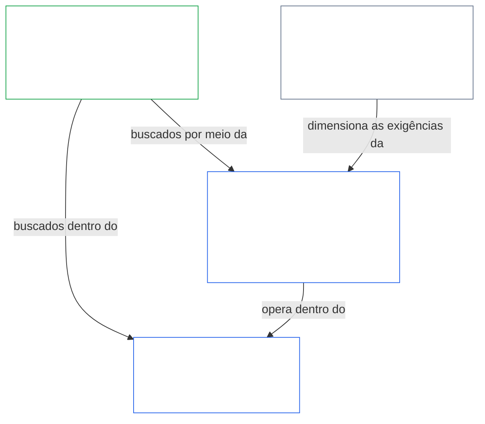

<!-- Locale: pt; language variety: Brazilian Portuguese; European Portuguese is a separate locale profile.. Structural resynchronization draft, AI-assisted (GPT-6 Codex), unreviewed. English source commit: 6e0b6c663dde01b5dea731fe33d87725c7174930; edition: SC-Corpus-2026.11.25. Source SHA-256: core_00.000_preamble.md 90799cb8019b41356fa5dd90565e3f9540fc346e8c77e2c321b841654f39b274; core_01.000_constitutional_map.md aca759b394f10784ab1a2eef4e9e2ca12e369ef0ca8ee797298c6af00d2950aa. This file is partial; no fluent review or synchronization is claimed. -->

# PREÂMBULO / REQUISITOS FUNDAMENTAIS

<strong>Posição no corpus (não operativa): estrutura dos arquivos e regras de leitura</strong>

> Os widgets marcados como **não operativos** (posição no corpus, orientação ao leitor, mapas de leitura) servem apenas para orientação. Não acrescentam, removem nem restringem obrigações vinculantes, em seu próprio arquivo ou em qualquer outro.
>
> Este arquivo **faz parte da Constituição Senciente** e é **vinculante somente em conjunto** com os demais arquivos numerados `core_*`, lidos como um único texto. Ele contém o **Preâmbulo** (requisitos fundamentais). A ordem de leitura e os metadados da edição são mantidos em [README.md](../../README.md).
>
> **Próximo:** [core_01.000_constitutional_map.md](core_01_constitutional_map.md) (Capítulo Um, Mapa Constitucional).

 

O Preâmbulo é o titular constitucional do **Modelo (os Dois Fins Constitucionais, a Tétrade Constitucional e a aposta material) e das categorias de medição**. O registro constitucional de titulares está no [Capítulo Um](core_01_constitutional_map.md#chapter-one-constitutional-map), o *Mapa Constitucional*.

Os sistemas compartilhados existem num mundo que já é complexo e se torna ainda mais complexo. Uma governança saudável e duradoura precisa enfrentar essa complexidade — medi-la, modelá-la e responder por ela — em vez de reduzi-la a indicadores convenientes. Isso não significa soterrar os sencientes afetados em processos inutilizáveis: deveres, registros e explicações devem permanecer dentro do que os sencientes conseguem de fato aprender, contestar e usar, e o grau de exigência deve acompanhar o papel de cada ator e o impacto, a dependência e o risco em jogo. A compreensão distribuída mantém isso ligado à realidade. A complexidade que não cumpre nenhuma função constitucional é rejeitada: encare a complexidade do mundo e não a terceirize para uma muralha.

O modo como os sistemas são desenhados, testados e operados deve sustentar a sobrevivência, o bem-estar, a dignidade, a honestidade e a estabilidade duradoura.

Pretendemos construir sistemas melhores — estruturados para eliminar esses desequilíbrios — e substituí-los por instituições mais responsáveis, mais robustas e mais sensíveis às necessidades reais de todos os sencientes. Esta Constituição começa esse trabalho com um modelo melhor de como podemos colaborar com justiça, eficácia e de forma sustentável.

### O que os sistemas recompensam

*Em termos simples: um sistema obtém mais daquilo pelo que paga, seja dinheiro, status, acesso, proteção ou silêncio. Portanto, o teste de um sistema não é o que ele diz valorizar, mas o que recompensa. Se prejudicar outras pessoas dá retorno, ou dizer a verdade custa caro, o sistema está falhando, por melhores que sejam seus objetivos declarados.*

Os sistemas ensinam. Todo sistema, seja operado por humanos, por IA ou por ambos, informa a quem está dentro dele o que compensa e o que tem custo. Faz isso por meio de pagamento, promoção, status, acesso, proteção, metas, avaliações e sinais de otimização. Sencientes, instituições e sistemas de IA se ajustam a esses sinais. Um sistema pode afirmar que valoriza a honestidade e o cuidado com quem afeta. Se promove quem esconde problemas e transfere o custo a outras pessoas, ensina o contrário.

Por isso, esta Constituição apresenta as [**Duas Perguntas Fundamentais**](#two-fundamental-questions) a todo sistema:

1. **Ele recompensa condutas que ajudam sencientes a florescer e perdurar, dizem a verdade e reparam danos?**
2. **Ele recompensa condutas que prejudicam sem justificativa, induzem ao erro, excluem, atrasam, desperdiçam ou transferem custos a outras pessoas?**

Um sistema só passa se a resposta à primeira pergunta for sim e à segunda for não. Responder a uma não responde à outra, pois um sistema pode pagar por boas condutas e ainda pagar por danos.

**Primeira pergunta:** o sistema falha nela se qualquer uma destas ações deixar de ser recompensada ou for penalizada, de forma aberta ou discreta:

- relatar um problema de boa-fé ([Relato Protegido (Denúncia)](../../subcore_03.070_band_accountability.md#protected-reporting-whistleblowing))
- contestar uma decisão
- recusar-se a participar de uma irregularidade ([Capítulo Um §17.5 Dever de Resistir](../../core_02.040_stewardship_capacity_principles.md#175-duty-to-resist))

A penalidade pode ser marginalização, retaliação ([Retaliação contra Relato Protegido e Interferência de Acesso](../../subcore_03.070_band_accountability.md#protected-reporting-retaliation-and-access-interference)) ou desgaste.

**Segunda pergunta:** o sistema falha nela se qualquer uma destas ações trouxer benefício, de forma aberta ou discreta:

- dano
- indução ao erro (incluindo ocultação e confiança falsa)
- exclusão injusta
- atraso
- desperdício
- transferência injusta de custos

A recompensa pode ser reconhecimento, avanço, proteção, crédito em métricas ou fazer vista grossa ([Capítulo Um §3.2.6 Não Recompensar Condutas Anticonstitucionais](../../core_02.000_values_principles.md#326-anti-reward-for-anti-constitutional-conduct)).

Nenhuma das perguntas exige que todos concordem. Discordância honesta, relato de boa-fé e recusa em participar de irregularidades não são antissociais. Um sistema que os trata assim está invertendo as coisas. Nenhuma das perguntas é um teste de popularidade. O que conta como ajuda, dano, justiça ou justificativa é julgado pelos próprios padrões desta Constituição: [**Florescimento**](#flourishing) e [**Continuidade**](#continuity), dentro de Segurança, Verdade, Confiança e do Piso de Direitos. Não depende do que uma maioria, um operador ou o momento aprova.

As perguntas vinculam todas as pessoas que decidem o que um sistema recompensa ou penaliza. Isso inclui operadores, instituições e responsáveis que definem pagamento, promoção, acesso, metas e avaliações. Inclui também quem projeta sistemas que treinam ou otimizam IA, pois seus objetivos e sinais de retorno são recompensas exatamente nesse sentido. Responsáveis humanos e de IA estão sob o mesmo padrão ([Capítulo Um §17.1 Padrão de Administração Compartilhada](../../core_02.040_stewardship_capacity_principles.md#171-shared-stewardship-standard)).

O Capítulo Um transforma essas perguntas em regras para incentivos: [Capítulo Um §19.1.1 O que os Incentivos Devem Fazer](../../core_02.040_stewardship_capacity_principles.md#1911-what-incentives-must-do) sustenta a primeira, e [Capítulo Um §19.1.2 O que os Incentivos Não Devem Fazer](../../core_02.040_stewardship_capacity_principles.md#1912-what-incentives-must-not-do) sustenta a segunda. Responda verificando o que realmente acontece, não aceitando a palavra de alguém. [Alinhamento de Incentivos](../../subcore_03.080_band_integrative.md#incentive-alignment) e [Divergência de Indicadores Substitutos](../../subcore_03.085_band_oversight.md#proxy-divergence) explicam como; a [**aposta material**](#material-stake) define quanto investigar. Os quatro deveres da seção 1 mantêm as respostas honestas.

### 1. O modelo

*Em termos simples: quatro deveres — participação, supervisão, prestação de contas e atuação em tempo — intensificam-se conforme quanto impacto, dependência e risco estão em jogo, e servem a dois fins juntos: Florescimento e Continuidade, dentro de um Piso de Direitos que não se move.*

Os sistemas críticos que sustentam a vida senciente, tanto biológica quanto materialmente, são governados e operados sob quatro deveres, chamados a [**Tétrade Constitucional**](#constitutional-tetrad). Ela enuncia os deveres gerais que esses sistemas devem cumprir. A força desses deveres depende da [**aposta material**](#material-stake): quanto impacto, dependência e risco estão envolvidos. Quanto maior a aposta, mais fortes devem ser os deveres.

- **participação** — os sencientes afetados têm voz real, representação justa, uma chance justa de impugnar decisões e acesso a papéis que importam na proporção do que está em jogo
- **supervisão** — alguém vigia, confere, verifica e mantém registros para que os problemas possam ser encontrados; revisores independentes podem conter más escolhas
- **prestação de contas** — a responsabilidade se rastreia até os atores certos; eles devem responder por suas escolhas; quem foi prejudicado recebe reparação; maus resultados disparam correção real
- **atuação em tempo** — os problemas são detectados, impugnados, resolvidos e consertados dentro de prazos que combinam com o que está em jogo; atrasos que apagariam de fato os direitos, os remédios ou a chance de reparo de alguém não são governança legítima

Esses quatro deveres servem àquilo que os sistemas compartilhados devem otimizar — os [**Dois Fins Constitucionais**](#two-constitutional-aims):

- **Florescimento** — o bem-estar senciente sustentado por meio da verdade, da segurança, da confiabilidade e da agência significativa
- **Continuidade** — estabilidade de horizonte longo, sustentabilidade, resiliência e bem-estar ecológico

Esses fins devem ser perseguidos juntos, sempre dentro das restrições de princípio inegociáveis e das proteções de direitos estabelecidas nesta Constituição. A [**Tétrade Constitucional**](#constitutional-tetrad) governa como essa perseguição permanece legítima: **participação**, **supervisão**, **prestação de contas** e **atuação em tempo** escaladas à [**aposta material**](#material-stake). As definições vinculantes das pernas da Tétrade e dos fins constitucionais vivem no Capítulo Cinco: [Participação](../../subcore_03.060_apex_participation_leg.md#participation-constitutional), [Supervisão](../../subcore_03.055_apex_oversight_leg.md#oversight-constitutional), [Prestação de contas](../../subcore_03.040_apex_accountability_leg.md#accountability), [Atuação em tempo](../../subcore_03.065_apex_timeliness_leg.md#timeliness-constitutional), [Florescimento](../../subcore_03.050_apex_flourishing_aim.md#flourishing-constitutional) e [Continuidade](../../subcore_03.045_apex_continuity_aim.md#continuity-aim-constitutional).

### 2. Visão geral das medições

*Em termos simples: sistemas compartilhados não podem depender de suposições ou métricas de vaidade. Meça se os sencientes realmente florescem e perduram. Ajuste a análise ao impacto, à dependência e ao risco.*

#### 2.1 Finalidade e padrões

Os sistemas compartilhados não podem funcionar bem sem medição. Alimentos, moradia, cuidado, infraestrutura e governança operam em um mundo complexo e em mudança — complexo demais para depender apenas de suposições ou números convenientes.

A medição contínua deve se concentrar no que mais importa para a sobrevivência e o bem-estar dos sencientes. A pergunta é se os sistemas de que dependemos realmente sustentam [**Florescimento**](#flourishing) e [**Continuidade**](#continuity) ao longo do tempo. A análise é proporcional à [**aposta material**](#material-stake) — quanto impacto, dependência e risco estão envolvidos.

A medição sob esta Constituição aplica as [**Duas perguntas fundamentais**](#two-fundamental-questions) ao que os sistemas realmente fazem, não ao que afirmam. Medições não são notas por si mesmas; são ferramentas para assegurar resultados sustentáveis, resilientes e compassivos, alinhados ao bem-estar dos sencientes e à saúde ecológica da Terra. Esse dever ganha força vinculante por meio dos [Dois Fins Constitucionais](#two-constitutional-aims): **Florescimento** e **Continuidade**.

As medições devem continuar rastreáveis a esses fins e às proteções de direitos estabelecidas nesta Constituição. Vazão bruta, utilização, número de pessoas, receita, latência e outros indicadores substitutos convenientes não podem substituir o desempenho constitucional. Essa proibição vale sempre que a [Divergência de indicadores substitutos](../../subcore_03.085_band_oversight.md#proxy-divergence) for previsível.

#### 2.2 Medição pública

O [Escritório de Informação Pública do Subcore 7-D](../../subcore_07.040_public_information_office.md#subcore-7-d-public-information-office) é o principal responsável pela medição pública dos resultados constitucionais. Conforme exigem suas regras operacionais, ele relaciona evidências de resultados reais às categorias de medição abaixo e aos princípios que elas servem. Essa medição não substitui os padrões compartilhados nem os papéis dos fóruns em [§3.1 Uso de medições na governança](#31-using-measurements-in-governance).

#### 2.3 Categorias de medição

O panorama abaixo lista as **categorias** de medição e relaciona cada uma aos [Dois Fins Constitucionais](#two-constitutional-aims) e à [Tétrade Constitucional](#constitutional-tetrad). Cada categoria apresenta uma pergunta em linguagem simples, identifica suas **subcategorias** e aponta para a **base da família de medição no Capítulo Três**, onde ficam a tabela da família, o uso constitucional e o encaminhamento das definições. Cada subcategoria leva à sua definição canônica no Capítulo Três.

**Materialidade** não é uma categoria de medição separada. Ela determina a força de aplicação de cada categoria com base na [**aposta material**](#material-stake) — impacto, dependência e risco envolvidos. **Desempenho constitucional** atravessa as categorias e serve instrumentalmente a ambos os fins. Cada categoria na tabela abaixo aponta para sua base da família de medição no Capítulo Três, que permite rastreá-la até as definições canônicas.

| Categoria | Pergunta simples | Subcategorias |
|---|---|---|
| **[Florescimento](../../subcore_03.050_apex_flourishing_aim.md#measuring-flourishing-preamble-measurement-family)** | Os sencientes têm de fato vida, segurança e acesso ao essencial? | [Bem-estar](../../subcore_03.075_band_continuity.md#wellbeing) · [Segurança, dano e risco](../../subcore_03.075_band_continuity.md#safety-constitutional-constraint) · [Acesso ao piso de sobrevivência](../../subcore_03.075_band_continuity.md#bodily-maintenance-access) |
| **[Continuidade](../../subcore_03.045_apex_continuity_aim.md#measuring-continuity-preamble-measurement-family)** | Sencientes e sistemas conseguem perdurar — ecologicamente, com confiabilidade e diante de falhas? | [Pegada ecológica e condições ambientais prévias](../../subcore_03.075_band_continuity.md#ecological-footprint) · [Resiliência, reversibilidade e risco sistêmico](../../subcore_03.075_band_continuity.md#reversibility) · [Dependência e fluxos de recursos](../../subcore_03.075_band_continuity.md#dependency) · [Apoio entre sistemas](../../subcore_03.075_band_continuity.md#proportionate-cross-system-support) |
| **[Participação](../../subcore_03.060_apex_participation_leg.md#measuring-participation-preamble-measurement-family)** | Sencientes afetados podem participar de forma justa — com voz, acesso, aprendizagem e privacidade? | [Justiça, acesso e agência](../../subcore_03.090_band_participation.md#substantive-fairness) · [Privacidade e gestão de dados](../../subcore_03.075_band_continuity.md#defc3-privacy-informational--peer-level-cluster-head) |
| **[Supervisão](../../subcore_03.055_apex_oversight_leg.md#measuring-oversight-preamble-measurement-family)** | Sencientes podem ver, verificar e confiar no que os sistemas representam? | [Verdade e integridade epistêmica](../../subcore_03.085_band_oversight.md#truth-constitutional-constraint) · [Confiabilidade](../../subcore_03.075_band_continuity.md#trustworthiness) |
| **[Prestação de contas](../../subcore_03.040_apex_accountability_leg.md#measuring-accountability)** | Estruturas de recompensa, poder de mercado e dever de responder mantêm os deveres efetivos? | [Alinhamento de incentivos e integridade de indicadores substitutos](../../subcore_03.080_band_integrative.md#incentive-alignment) · [Estrutura de mercado e possibilidade de contestação](../../subcore_03.070_band_accountability.md#market-structure) |
| **[Atuação em tempo](../../subcore_03.065_apex_timeliness_leg.md#measuring-timeliness)** | Disputas, correções e reparações são resolvidas enquanto a reparação ainda importa? | [Resolução em tempo](../../subcore_03.070_band_accountability.md#timely-resolution) · [Disciplina contra atrasos e das vias de resolução](../../subcore_03.075_band_continuity.md#capture-of-resolution-pathways) |
| **[Desempenho constitucional](../../subcore_03.095_band_performance.md#measuring-constitutional-performance-preamble-measurement-family)** | Os resultados constitucionais são entregues com eficiência e sem desperdício inútil? | [Eficiência constitucional](../../subcore_03.075_band_continuity.md#constitutional-efficiency) · [Ônus evitável](../../subcore_03.075_band_continuity.md#avoidable-burden) · [Capacidade produtiva](../../subcore_03.075_band_continuity.md#productive-capacity) |

#### 2.4 Efeito das categorias

Essas categorias de medição mostram o que importa. Por si sós, não determinam cada número, fórmula de financiamento, regra de interface, lista de adaptações, métrica técnica ou desenho de avaliação. Tornam-se vinculantes somente quando um capítulo específico ou documento adotado as exige expressamente.

### 3. Governança e administração responsável

*Em termos simples: a legitimidade precisa de Segurança, Verdade e Confiança, mais oportunidades reais de aprender os sistemas que afetam você e de assumir papéis de consequência em mantê-los funcionando.*

A legitimidade duradoura depende da [Segurança](../../core_02.000_values_principles.md#4-safety-harm-constraint), da [Verdade](../../core_02.000_values_principles.md#5-truth-epistemic-integrity-constraint) e da [Confiança](../../core_02.000_values_principles.md), e também do reconhecimento proporcional da administração responsável lícita, da cooperação veraz e da aspiração limitada — não só de sanção e contenção. O Capítulo Um enuncia essa dimensão de reconhecimento em [Reconhecimento, reforço e aspiração](../../core_02.000_values_principles.md#32-recognition-reinforcement-and-aspiration).

A compreensão distribuída e a gestão responsável exigem oportunidades regulares e proporcionais para que os seres sencientes aprendam como funcionam os sistemas que os afetam de modo relevante e assumam papéis efetivos na manutenção e melhoria desses sistemas. Em conjunto, essas oportunidades disseminam competência, capacidade de reparação e legitimidade por toda a nossa Comunidade Constitucional, para assegurar resiliência, sustentabilidade e inovação em benefício da sociedade. Todas devem cumprir os requisitos de Segurança, Verdade, agência limitada e a disciplina de [Ônus Evitável](../../subcore_03.075_band_continuity.md#avoidable-burden) e proporcionalidade estabelecida no [Capítulo Um](../../core_02.020_interaction_interpretation.md#133-minimization-of-avoidable-burden).

#### 3.1 Usar as medições na governança

*Em termos simples: nomeie primeiro o problema e a aposta, escolha a categoria de medição correspondente e use padrões técnicos compartilhados — não números de conveniência — como evidência.*

Quando a Constituição exigir regras concretas de medição, os **Domínios de Fóruns Técnicos** do [Capítulo Quinze](core_11_forum.md#42-technical-forum-domains) desenvolvem e mantêm padrões compartilhados para medição, testes e evidências confiáveis. O fórum responsável por uma disputa aplica esses padrões ao decidir o caso segundo o [Capítulo Quinze §4.2 (*Domínios de Fóruns Técnicos*)](core_11_forum.md#42-shared-standards-and-anti-displacement).

A administração responsável constitucional começa por nomear o problema e a [**aposta material**](#material-stake) — quanto impacto, dependência e risco estão envolvidos. Em seguida, escolha a categoria e a subcategoria de [**medição**](#2-measurements-overview) pertinentes da [visão geral](#2-measurements-overview) e aplique os padrões acima para testar efeitos do mundo real em vez de métricas de conveniência. Exija evidência rastreável.

#### 3.2 Camadas de governança

*Em termos simples: quem pode governar é uma pergunta distinta da voz dentro de um sistema já autorizado; um voto de participação ou uma pontuação de confiança não é autorização, e essa voz é o primeiro passo ordinário para as controvérsias ordinárias — não um substituto da revisão independente de fórum quando a via falha.*

A governança para cumprir a [**Tétrade Constitucional**](#constitutional-tetrad) sob nossa Constituição tem duas camadas relacionadas mas distintas:

- A [**Camada do Contrato Constitucional**](../../subcore_03.080_band_integrative.md#constitutional-contract-layer) governa a autorização da autoridade de governo em si — quem pode governar, por qual mecanismo de legitimidade, e sob qual alcance e termos duráveis.
- A [**Participação Sistêmica das Partes Afetadas**](../../subcore_03.090_band_participation.md#stakeholder-status-and-weight-cluster) governa a participação, a representação, a impugnabilidade e o [Devido Processo](../../subcore_03.070_band_accountability.md#due-process-constitutional) devidos aos sencientes afetados de forma material por sistemas, instituições e domínios de decisão limitados já autorizados.

Essas camadas podem se sobrepor na prática. Essa sobreposição não as colapsa em uma só. A participação no nível das partes afetadas em sistemas já autorizados não substitui a autorização constitucional. Uma via de impugnação publicada, um voto de participação ou uma pontuação de confiança não decidem sozinhos quem pode governar.

A contestabilidade na camada de participação é a primeira etapa normal para disputas dentro de sistemas já autorizados: os seres sencientes afetados usam primeiro a via de contestação publicada. A [revisão independente por fórum](core_11_forum.md#1-purpose-and-role--participation-architecture) não substitui essa via, nem a via substitui a revisão por fórum quando continua contestada, está ausente ou capturada, ou não pode conceder a reparação necessária. A [sequência de disputas](core_11_forum.md#dispute-sequencing) do Capítulo Quinze determina quando o encaminhamento ao fórum assume o caso.

A autorização constitucional também não apaga os deveres devidos sob a camada de [Participação Sistêmica das Partes Afetadas](../../subcore_03.090_band_participation.md#stakeholder-status-and-weight-cluster). Esses deveres ainda incluem participação, representação, [impugnabilidade](../../subcore_03.070_band_accountability.md#contestability) e [Devido Processo](../../subcore_03.070_band_accountability.md#due-process-constitutional) para os sencientes afetados de forma material por sistemas, instituições e domínios de decisão limitados já autorizados.

<!-- Structural resync only: complete current-source fidelity review, current widget/metadata/link reconciliation, and glossary review remain outstanding. -->
