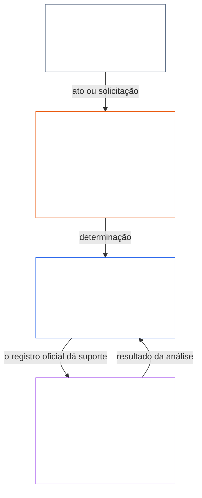
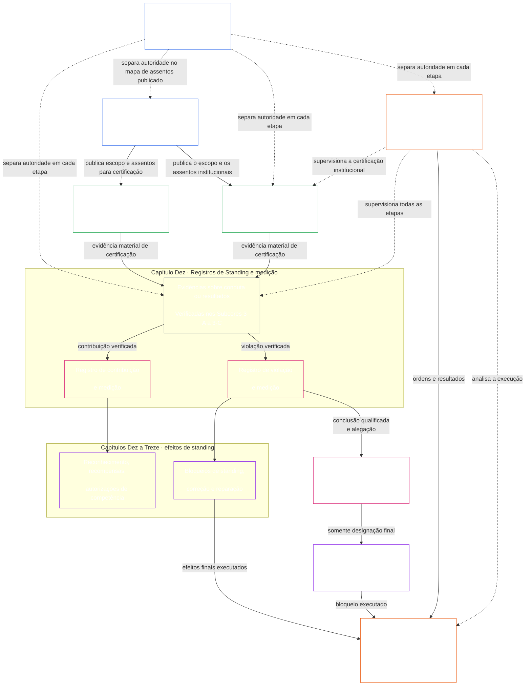

<!-- Locale: pt; language variety: Brazilian Portuguese; European Portuguese is a separate locale profile.. Structural resynchronization draft, AI-assisted (GPT-6 Codex), unreviewed. English source commit: 6e0b6c663dde01b5dea731fe33d87725c7174930; edition: SC-Corpus-2026.11.25. Source SHA-256: core_00.000_preamble.md 90799cb8019b41356fa5dd90565e3f9540fc346e8c77e2c321b841654f39b274; core_01.000_constitutional_map.md aca759b394f10784ab1a2eef4e9e2ca12e369ef0ca8ee797298c6af00d2950aa. This file is partial; no fluent review or synchronization is claimed. -->
<!-- Chapter One: Constitutional Map. This is an incomplete locale draft; sections without source translation are marked below. -->

# CAPÍTULO UM: MAPA CONSTITUCIONAL

<strong>Posição no corpus (não operativa): estrutura dos arquivos e regras de leitura</strong>

> Os widgets marcados como **não operativos** (posição no corpus, orientação ao leitor, mapas de leitura) servem apenas para orientação. Não acrescentam, removem nem restringem obrigações vinculantes, em seu próprio arquivo ou em qualquer outro.
>
> Este arquivo **faz parte da Constituição Senciente** e é **vinculante somente em conjunto** com os demais arquivos numerados `core_*` e o subcore, lidos como um único texto. Ele contém o **Capítulo Um**, o *Mapa Constitucional*: sua finalidade (§1), por que existe (§2), como os arquivos se encaixam (§3), os fundamentos dos capítulos seguintes (§4), os principais processos de governança (§5) e o registro constitucional de titulares (§6 a §11).
>
> **Anterior:** [core_00.000_preamble.md](core_00_preamble.md) (Preâmbulo)
> **Próximo:** [core_02.000_values_principles.md](../../core_02.000_values_principles.md)

<strong>Rastreamento</strong>

- Origem: [Preâmbulo](core_00_preamble.md) (*o Modelo, os Dois Fins Constitucionais, a Tétrade Constitucional, a aposta material e as categorias de medição*).
- Seções:
  - [§1](#1-purpose-role-and-scope);
  - [§2](#2-why-the-map-exists);
  - [§3](#3-how-the-files-fit-together);
  - [§4](#4-foundations-for-the-chapters-that-follow);
  - [§5](#5-key-governance-processes);
  - [§6](#6-principles-definitions-and-rights);
  - [§7](#7-system-and-institutional-charters-functional-independence-and-separation-of-duties);
  - [§8](#8-key-practical-process-pipelines);
  - [§9](#9-process-ownership-and-outputs);
  - [§10](#10-governance-change-and-incorporation);
  - [§11](#11-adopted-implementation-corpus).
- Ler também: [Pilha de Autoridade e Hierarquia Interna](../../subcore_03.080_band_integrative.md#authority-stack-and-internal-hierarchy) (*como se aplica o registro de titulares*); [README.md](../../README.md) (*ordem de leitura*).

 

### 1. Finalidade, função e escopo

*Em termos simples: este capítulo é o guia para o restante da Constituição. Mostra como as partes se encaixam, qual capítulo responde por cada tema e como funcionam os principais processos, para que quem lê encontre a regra que responde à sua pergunta.*

**Finalidade:** O Capítulo Um oferece uma visão geral e um guia de competências. Nomeia os processos que põem à prova a governança autorizada, indica qual capítulo responde por cada domínio substantivo e descreve os três níveis do texto constitucional.

**Função:** O capítulo orienta e atribui competências. Não acrescenta dever próprio além do registro de titulares, aplicado pelos demais capítulos e pela [Hierarquia Interna e Ordem de Autoridade](../../subcore_03.080_band_integrative.md#authority-stack-and-internal-hierarchy).

**Escopo do capítulo:** O capítulo abrange:

- por que o mapa existe (**seção 2**);
- como os arquivos se encaixam (**seção 3**) e os fundamentos dos capítulos seguintes (**seção 4**);
- os principais processos de governança (**seção 5**);
- o registro constitucional de titulares: princípios, definições e direitos (**seção 6**); cartas, independência funcional e separação de funções (**seção 7**); cadeias de processos (**seção 8**); competências e resultados dos processos (**seção 9**); e governança, mudança e incorporação (**seção 10**); e
- o corpus de implementação adotado e o subcorpus (**seção 11**).

### 2. Por que o mapa existe

*Em termos simples: um texto tão extenso precisa de um guia que mostre como as partes se encaixam e quem responde por cada tema. Este capítulo existe para que quem lê encontre a regra que responde à sua pergunta.*

A Constituição distribui seu trabalho entre muitos capítulos, um subcorpus e quatro corpora adotados. Uma pessoa senciente que tenta descobrir o que lhe é devido, ou um adotante que procura um dever, pode se perder. Este capítulo é a visão geral e o guia de competências: o que cada parte faz, qual capítulo responde por cada tema, como as cadeias de processos funcionam e como os níveis se relacionam. Ele não acrescenta regra própria além do registro de titulares.

**Fundamentação:**

- Preâmbulo:
  - [Tétrade Constitucional](core_00_preamble.md#constitutional-tetrad): as funções que este capítulo põe em prática:
    - [Participação](../../subcore_03.060_apex_participation_leg.md#participation): uma pessoa senciente pode encontrar a regra que responde à sua pergunta;
    - [Prestação de contas](../../subcore_03.040_apex_accountability_leg.md#accountability): cada tema tem um capítulo responsável, que responde por ele;
    - [Supervisão](../../subcore_03.055_apex_oversight_leg.md#oversight): quem lê pode ver como as partes se encaixam e detectar lacunas ou sobreposições;
    - [Atuação em tempo](../../subcore_03.065_apex_timeliness_leg.md#timeliness): quem lê chega à regra correta sem demora;
  - [Dois Fins Constitucionais](core_00_preamble.md#two-constitutional-aims): ambos os fins servidos por este capítulo:
    - [Florescimento](core_00_preamble.md#flourishing): a Constituição só serve às pessoas sencientes se elas conseguirem se orientar nela;
    - [Continuidade](core_00_preamble.md#continuity): um mapa claro mantém o texto íntegro à medida que cresce e muda;
- princípios do Capítulo Dois:
  - [§5.2 Acessibilidade em linguagem simples (dever de Participação e administração responsável)](../../core_02.000_values_principles.md#52-plain-language-accessibility-participation-and-stewardship-duty);
  - [§5.2.4 Disciplina contra a complexidade como forma de derrota](../../core_02.000_values_principles.md#524-complexity-as-defeat-discipline);
  - [§15.4 Resolução de conflitos sobre o sentido constitucional](../../core_02.030_constitutional_interpretation.md#154-constitutional-meaning-conflict-resolution);
- artigos do Capítulo Quatro:
  - [Artigo XXIV-A](../../core_04.030_rights_part_d.md#article-xxiv-a-proportional-comprehensibility-right) (*Direito à Compreensibilidade Proporcional*);
  - [Artigo XXIV-B](../../core_04.030_rights_part_d.md#article-xxiv-b-complexity-audit-and-modularity-requirements) (*Requisitos de auditoria de complexidade e modularidade*).

### 3. Como os arquivos se encaixam

Os arquivos da Constituição se encaixam assim:

- **Núcleo (`core_*`):** os arquivos numerados contêm os capítulos da Constituição, redigidos para serem lidos juntos como um único texto. Eles enunciam as garantias e a estrutura constitucional.
- **Subnúcleo (`subcore_*`):** esses arquivos apresentam as regras e os procedimentos completos que dão suporte aos capítulos. Cada arquivo pertence a um capítulo, tem a mesma força que ele e vincula cada adotante sem necessidade de incorporação separada. O subnúcleo não pode restringir seu capítulo.
- **Implementação (`corpus_*`):** quatro arquivos fornecem detalhes operacionais para executar a Constituição. Eles vinculam dentro do escopo de uma incorporação válida e implementam a Constituição sem restringi-la. A [seção 11](#11-adopted-implementation-corpus) identifica os quatro arquivos.

O [Corpus](../../subcore_03.080_band_integrative.md#corpus) definido é o conjunto mais amplo e versionado de fontes constitucionais vinculantes: inclui o núcleo, o subnúcleo, o texto de implementação adotado e quaisquer instrumentos de compatibilidade válidos durante a transição. Rascunhos, notas e guias de navegação não se tornam vinculantes apenas por fazerem parte do projeto.

### 4. Fundamentos dos capítulos seguintes

*Em termos simples: os Capítulos Dois a Quatro respondem pelos valores, pelo dicionário (junto com as regras do subnúcleo sobre como as definições são construídas, protegidas e comprovadas) e pelo Piso de Direitos; os capítulos posteriores devem respeitar esses domínios, sem transferi-los silenciosamente.*

Os Capítulos **Dois a Quatro** fornecem os valores, o vocabulário, os mecanismos de verificação e o Piso de Direitos que tudo o que vem depois deve respeitar, incluindo:

- a exigência de Carta do Sistema ou Carta Institucional do [Capítulo Cinco](#7-system-and-institutional-charters-functional-independence-and-separation-of-duties), a exigência de separação de funções do Capítulo Seis e os Órgãos Independentes do Capítulo Sete;
- as [Cadeias práticas de processo-chave](#8-key-practical-process-pipelines) da seção 8;
- as [competências e os resultados dos processos](#9-process-ownership-and-outputs) da seção 9;
- os capítulos sobre governança e vias de mudança da seção 10; e
- o [Corpus de Implementação Adotado](#11-adopted-implementation-corpus) da seção 11.

### 5. Processos-chave de governança

*Em termos simples: quando a Constituição exigir, primeiro separe quem inicia, verifica ou autoriza, mantém o registro oficial e analisa contestações. As questões materiais então passam por certificação, registros escritos de contribuição e dano, correção e reparação, e revisão por fóruns com prazos. Disputas comuns usam primeiro o caminho publicado de contestação. Esses processos testam a governança já autorizada; não criam, por si, autoridade para governar.*

Os pontos a seguir apresentam os caminhos:

- Quando exigido expressamente por [Capítulo Quatro — Direitos Fundamentais](../../core_04.000_rights_part_a.md#chapter-four-foundational-rights), [Subcore 8-B — Avaliação da certificação de alinhamento de sistemas](../../subcore_08.020_system_alignment_certification_evaluation.md#subcore-8-b-system-alignment-certification--evaluation), documento incorporado ou outra disposição constitucional, encaminhe a questão constitucional material por um ou mais caminhos abaixo.
- As [Cadeias Práticas de Processos-Chave](#8-key-practical-process-pipelines) convertem medição em registros, certificação, entradas verificadas, classificação, supervisão por fóruns, correção e reparação tempestiva.
- Essas cadeias testam, contestam e corrigem na prática a governança autorizada. Elas a tornam revisável, contestável, corrigível e tempestiva, mas não a autorizam por si mesmas.
- A [§8.2](#82-how-the-full-chain-fits-together) mostra as etapas: separação dos assentos decisórios, certificação, Registros de Posição e medição, efeitos de posição, revisão de designação quando aplicável, supervisão por fóruns e execução dos resultados.

**Os caminhos:**

- **Independência funcional e separação de deveres** ([Capítulo Seis](../../core_06.000_functional_independence_separation_of_duties.md#chapter-six-functional-independence-and-separation-of-duties)): antes de avançar um ato materialmente vinculante, separe os assentos de iniciação, verificação ou autorização, custódia do registro oficial e análise de contestações, conforme as regras aplicáveis de escala e independência.
- **Certificação de alinhamento de sistemas** ([Subcore 8-B](../../subcore_08.020_system_alignment_certification_evaluation.md#subcore-8-b-system-alignment-certification--evaluation)): antes de confiar em escala em um sistema de alto impacto, reúna e analise evidências para determinar se é constitucionalmente seguro depender dele agora. A certificação e o direito dos sentients de contestar e auditar o sistema ([Artigo XIV](../../core_04.020_rights_part_c.md#article-xiv-right-to-reliable-and-trustworthy-systems), *Direito a Sistemas Confiáveis*) são salvaguardas complementares; nenhuma substitui a outra.
- **Registros de Posição** ([Subcore 10-B](../../subcore_10.020_standing_assessment.md#subcore-10-b-standing-records--question-1-what-happened)): quando conduta ou dano tiver relevância constitucional, registre fatos verificados em processos formais de contribuição ou violação; rumores e reputação não bastam.
- **Correção e reparação** ([Capítulo Doze §3.1](../../core_12.000_violation_consequences.md#31-remedy-and-correction)): após uma violação verificada, avalie tanto o que deve ser feito para tratar sua causa e impedi-la de continuar (correção) quanto o que é devido aos prejudicados (reparação). A reparação pode incluir reconhecimento, conserto ou restauração, compensação, salvaguardas substitutas quando o reparo literal for impossível, ou reparação equivalente. Corrigir a causa não substitui a reparação, nem o inverso.
- **Revisão por fóruns** ([Capítulo Dezesseis](../../core_16.000_forum.md#1-purpose-role-and-scope)): disputas comuns em sistemas já autorizados usam primeiro o caminho publicado de contestação da [Participação de Stakeholders no Sistema](../../subcore_03.090_band_participation.md#stakeholder-status-and-weight). Se o caminho continuar contestado, estiver ausente ou capturado, ou não puder conceder reparação, encaminhe a disputa segundo o interesse primário por fóruns supervisionados. Esses fóruns apoiam provas, transferências lícitas e prazos do **Artigo XXVII-C** (*Piso de Resolução Tempestiva e Antiatraso*).

### 6. Princípios, definições e direitos

As Seções 6–11 compõem o **registro constitucional de titularidades**: indicam de qual capítulo ou corpus complementar é cada tema e o que ele produz. A frase vinculante de abertura do arquivo titular declara essa responsabilidade. Outras partes podem remeter a esse titular, mas não podem reescrever ou deslocar sua responsabilidade em silêncio. Consulte [hierarquia interna e pilha de autoridade](../../subcore_03.080_band_integrative.md#authority-stack-and-internal-hierarchy).

#### 6.1 [Capítulo Dois — Valores, princípios e stewardship](../../core_02.000_values_principles.md)

O Capítulo Dois estabelece os valores e limites orientadores da Constituição: bem-estar, justiça, Segurança, Verdade, Confiança e liberdade delimitada; reconhecimento e recompensa proporcional pela contribuição lícita; resolução de conflitos entre princípios; e deveres de stewardship, incluindo compreensão distribuída, avaliação sistêmica e disciplina de governança. Produz a base interpretativa para todos os capítulos posteriores.

#### 6.2 [Capítulo Três — Definições fundamentais](../../core_03.000_definitions_home.md)

O Capítulo Três é titular da estrutura canônica de definições nas bandas de Supervisão, Participação, Responsabilização, Continuidade e Integração; da [Pilha de Autoridade e Hierarquia Interna](../../subcore_03.080_band_integrative.md#authority-stack-and-internal-hierarchy); do [Corpus](../../subcore_03.080_band_integrative.md#corpus); e das regras de fronteira relacionadas. Produz vocabulário constitucional preciso para interpretação, auditoria e decisão. É a estrutura de definições, não o Piso de Direitos: os pisos vinculantes estão no Capítulo Quatro.

##### 6.2.1 [Estrutura das definições — Subcore 3-A](../../subcore_03.010_definition_structure.md)

Define a estrutura de componentes Ontologia/Medição/Avaliação/Conformidade (O/M/A/C), os requisitos de alinhamento e as regras dos componentes, criando uma gramática comum para termos precisos e coerentes.

##### 6.2.2 [Integridade das definições — Subcore 3-B](../../subcore_03.020_definition_integrity.md)

Previne evasão, deslocamento de escopo, jogos de redefinição e manobras de não conformidade que esvaziariam definições na prática; fornece metadados e encaminhamentos a revisões de posição e de conduta indevida quando a evasão é comprovada.

##### 6.2.3 [Ônus, rastreabilidade e verificação — Subcore 3-C](../../subcore_03.030_burden_traceability_verification.md)

Atribui o ônus da prova a quem alega conformidade e exige evidência rastreável, observabilidade e verificação proporcionais à [aposta material](../../core_00.000_preamble.md#material-stake) e realmente contestáveis. Alimenta as entradas verificadas do Subcore 10-B e as evidências de alinhamento do Subcore 8-B, sem substituir a medição de posição.

#### 6.3 [Capítulo Quatro — Direitos Fundamentais](../../core_04.000_rights_part_a.md)

O Capítulo Quatro estabelece o Piso de Direitos nos Artigos I–XXIX: essenciais à sobrevivência; alocação de recursos e stewardship das dependências; dignidade, agência e participação; contestação e reparação; limites de justiça; tempestividade segundo o **Artigo XXVII-C**; e regras de transição para adoção. As quatro partes organizam essas proteções para uma leitura que prioriza o planeta. Capítulos Cinco a Vinte e Seis, fóruns, governança e regras de emenda não podem restringi-las, contorná-las ou esvaziá-las por procedimentos ou métricas substitutas.

### 7. Cartas de sistemas e instituições, independência funcional e separação de deveres

*Em termos simples: um sistema ou instituição de impacto relevante publica uma Carta que declara o que pode fazer e quem ocupa cada assento. Antes de um ato materialmente vinculante, devem ser separados os assentos de iniciação, verificação/autorização, custódia do registro oficial e análise de contestação. Os órgãos independentes também permanecem separados daqueles que fiscalizam.*

Esta seção resume os requisitos das Cartas, da separação de deveres e dos órgãos independentes, bem como o que cada um produz.

**[Capítulo Cinco — Cartas de sistemas e instituições](../../core_05.000_charters.md#chapter-five-system-and-institutional-charters)**

- **O que abrange:** quando sistemas e instituições de Classe L ou superior devem publicar uma [Carta do Sistema](../../subcore_03.075_band_continuity.md#system-charter) ou [Carta Institucional](../../subcore_03.075_band_continuity.md#institutional-charter) (Classe P pode fazê-lo voluntariamente); conteúdo mínimo, incluindo o [Mapa de Papéis da Carta](../../subcore_03.075_band_continuity.md#charter-role-map) e referências às regras vinculantes publicadas de escolha dos stakeholders; como alterar e revisar a Carta sem mudança silenciosa de escopo; e o que ela não pode fazer: definir classe ou fronteira, substituir certificação, carregar regras decisórias ou conceder autoridade.
- **O que produz:** declaração publicada e versionada de escopo e distribuição dos assentos, que o Capítulo Seis, a certificação, os Registros de Posição e os fóruns podem usar para avaliar condutas.

**[Capítulo Seis — Independência funcional e separação de deveres](../../core_06.000_functional_independence_separation_of_duties.md#chapter-six-functional-independence-and-separation-of-duties)**

- **O que abrange:** a exigência transversal de atribuir separadamente quatro funções em cada [Ato Materialmente Vinculante](../../subcore_03.070_band_accountability.md#materially-binding-act): iniciação; verificação ou autorização; custódia do registro oficial; e análise de contestações. Também regula o conteúdo mínimo universal do Registro do Ato, a independência da linha de controle material do agente, distribuição publicada e substitutos, hospedagem combinada proporcional e limites de emergência, além de transferências atribuíveis e encaminhamentos ao assento incorreto.
- **O que produz:** arquitetura reutilizável de quatro assentos e Registro do Ato. Os processos posteriores devem aplicá-la antes de considerar seus resultados verificados de forma independente, registrados com confiança e realmente contestáveis.

**[Capítulo Sete — Órgãos Independentes](../../core_07.000_independent_bodies.md#chapter-seven-independent-bodies)**

- **O que abrange:** o que torna um órgão independente, a regra para designá-lo como Órgão Independente e a lista dos órgãos que cada adotante deve ter, com a garantia de cada um aos sentients.
- **O que produz:** um padrão uniforme de independência e regras operacionais completas em arquivos subcore próprios para cada Órgão Independente.

#### 7.1 Mapa de separação dos quatro assentos

Cada **Ato Materialmente Vinculante** deve observar estas salvaguardas para o mesmo ato:

- O assento de iniciação não pode verificar nem autorizar seu próprio ato.
- O assento de verificação ou autorização não pode manter a custódia do registro oficial do ato.
- O assento de verificação ou autorização não pode analisar uma contestação ao ato.
- Os assentos de verificação/autorização e de análise de contestações devem ficar fora da [Linha de Controle Material](../../subcore_03.070_band_accountability.md#material-control-line) do assento de iniciação.

<strong>Orientação de leitura (não operativa): mapa de separação dos quatro assentos</strong>

> Este mapa mostra as quatro funções e um percurso típico de um ato e de seu Registro do Ato. Não acrescenta um quinto assento, não prescreve uma sequência universal nem altera as regras do Capítulo Seis sobre independência, combinação proporcional de funções, ação emergencial ou encaminhamento de contestações.

 

### 8. Cadeias práticas de processo-chave

*Em termos simples: os requisitos de Carta do Capítulo Cinco e de independência funcional e separação de funções do Capítulo Seis estruturam a cadeia de processos. Ela conecta a certificação de sistemas e instituições, registros e medições separados de contribuição e violação, efeitos proporcionais, designação de conduta anticonstitucional, resolução tempestiva por fóruns e execução.*

O [Capítulo Cinco](../../core_05.000_charters.md#chapter-five-system-and-institutional-charters) define as Cartas exigidas para sistemas e instituições, seu escopo e o mapa de assentos. O [Capítulo Seis](../../core_06.000_functional_independence_separation_of_duties.md#chapter-six-functional-independence-and-separation-of-duties) exige que, para cada ato materialmente vinculante, permaneçam separadas quatro funções: iniciação, verificação ou autorização, custódia do registro oficial e análise de contestações. A [§8.2](#82-how-the-full-chain-fits-together) conecta esses requisitos ao processo da certificação à reparação.

#### 8.1 Mapa de processos

Cada etapa entrega à seguinte um resultado definido e revisável, mantendo a cadeia como um único processo constitucional. Ela permanece constitucionalmente limitada porque:

- a [**Tétrade Constitucional**](../../core_00.000_preamble.md#constitutional-tetrad) exige que cada etapa continue participativa, supervisionada, responsável e tempestiva;
- os [**Dois Objetivos Constitucionais**](../../core_00.000_preamble.md#two-constitutional-aims) exigem que o processo sirva conjuntamente à **Flourishing** e à **Continuity**; e
- os **Pisos de Direitos** proíbem que qualquer etapa restrinja, contorne ou esvazie proteções inegociáveis.

Em conjunto, essas regras transformam deveres constitucionais em registros e decisões que sentients podem verificar, contestar, reparar e usar na prática, não apenas no papel.

#### 8.2 Como a cadeia completa se encaixa

*Em termos simples: primeiro, separe os assentos. Depois, siga o caminho da verificação do sistema à reparação, com os fóruns supervisionando a controvérsia e as etapas de standing ao longo de todo o percurso.*

A cadeia completa segue esta ordem:

1. **Separe os assentos para todo ato materialmente vinculante** ([Capítulo Seis](../../core_06.000_functional_independence_separation_of_duties.md#3-four-seat-constitutional-requirement)) — identifique quem inicia, quem verifica ou autoriza, quem mantém o registro oficial e quem recebe uma contestação. Aplique as combinações proibidas, as regras de independência e a rota substituta publicada antes de tratar o ato como validamente verificado. Quando uma Carta de Sistema ou Institucional for exigida ([Capítulo Cinco](../../core_05.000_charters.md#6-the-charter-role-map-and-standing-record-custody)), seu Mapa de Funções da Carta publica quem ocupa cada assento.
2. **Certifique sistemas e instituições quando o impacto for suficientemente grave** — antes de confiar em escala em um sistema de alto impacto, obtenha um Registro de Certificação do Sistema contestável ([Subcore 8-B](../../subcore_08.020_system_alignment_certification_evaluation.md#subcore-8-b-system-alignment-certification--evaluation)); avalie a instituição por sua própria classe, conduta, governança e portfólio sob o [Subcore 9-B](../../subcore_09.020_institutional_alignment_certification_evaluation.md#subcore-9-b-institutional-alignment-certification--evaluation) e registre o resultado em um Registro de Certificação Institucional.
3. **Registre e meça o standing em trilhas separadas** ([Subcore 10-B](../../subcore_10.020_standing_assessment.md#subcore-10-b-standing-records--question-1-what-happened) e [Subcore 10-D](../../subcore_10.040_standing_measurement.md#subcore-10-d-standing-measurement--question-2-how-good-or-bad-was-it)) — quando ajuda ou dano tiver relevância constitucional, o Capítulo Dez abre processos formais e admite somente **insumos verificados**, incluindo evidências materiais de certificação de alinhamento do sistema do Capítulo Oito; depois mede e classifica o que foi verificado. Rumores, reputação e narrativas de disputa não bastam. Para ajuda, abra um **Registro de Standing de contribuição** e classifique a natureza da contribuição no Eixo de Contribuição. Para dano e falhas de responsabilização, abra um **Registro de Standing de violação** separado e classifique a natureza da violação no Eixo de Violação. Ajuda e dano nunca se fundem em uma pontuação líquida; registros relacionados fazem referência cruzada, mas permanecem separados.
4. **Aplique efeitos de standing em cada trilha** ([Subcore 10-F](../../subcore_10.060_standing_integration.md#subcore-10-f-standing-integration--question-3-what-follows)) — contribuição verificada pode conceder habilitação de competência e deve sustentar reconhecimento proporcional e recompensas materiais; violação verificada pode acionar bloqueios de standing, correção e [reparação para quem sofreu dano](../../core_12.000_violation_consequences.md#31-remedy-and-correction).
5. **Realize a revisão de designação de conduta anticonstitucional** ([Capítulo Quatorze](../../core_14.000_misconduct_designation.md#chapter-fourteen-anti-constitutional-misconduct-designation)) — se uma constatação de violação de impacto máximo também puder satisfazer os critérios anticonstitucionais, o Capítulo Quatorze decide se a ACMD correspondente se aplica. Essa ACMD não altera a gravidade do dano já constatada. Os efeitos ordinários do Capítulo Dez continuam em paralelo até que uma ACMD final acione o Bloqueio de Confiança Anticonstitucional.
6. **Encaminhe disputas e mantenha a reparação tempestiva** ([Capítulo Dezesseis](../../core_16.000_forum.md#1-purpose-role-and-scope) e [Capítulo Dezessete](../../core_17.000_forum_families_escalation_timeliness_support.md#chapter-seventeen-forum-families-escalation-timely-resolution-and-support)) — os fóruns supervisionam o andamento dos casos, a trilha que os trata e o cumprimento das janelas do **Artigo XXVII-C** (*Resolução tempestiva e piso contra atrasos*), para que a reparação não morra por demora. Disputas ordinárias seguem a [sequência de disputas](../../core_16.000_forum.md#dispute-sequencing). Os fóruns também classificam disputas em cinco [níveis de materialidade](../../core_17.000_forum_families_escalation_timeliness_support.md#5-timely-resolution-materiality-tiers-and-anti-delay-discipline) (A/B/C/L/P), alinhados ao alfabeto de classificação dos sistemas, da urgência crítica à sobrevivência até questões privadas ou contidas. O encaminhamento padrão da família de integridade se aplica quando a designação final do Capítulo Quatorze é o interesse principal.
7. **Execute os resultados** ([Capítulo Dezenove](../../core_19.000_enforcement.md#chapter-nineteen-enforcement) e [Capítulo Vinte](../../core_20.000_special_enforcement.md#chapter-twenty-special-enforcement)) — uma consequência final, bloqueio, reparação ou ordem de fórum é executada por uma parte identificada dentro de seu prazo; não pode ser evitada, atrasada ou abandonada em silêncio. Se o agente vinculado resistir, aplica-se a execução especial dentro dos pisos compartilhados: apreensão de dinheiro e bens com mínimo protegido, escada padrão de pressão para rendição, escada de força que prioriza meios não letais e avaliação de causa-raiz para evitar a repetição da falha.

Cada etapa acima aponta para seu capítulo responsável, permitindo percorrer a cadeia a partir daqui — inclusive os possíveis insumos verificados do Capítulo Oito para a medição de standing.

### 9. Titularidade e resultados dos processos

*Em termos simples: o mapa e [como a cadeia completa se encaixa](#82-how-the-full-chain-fits-together) mostram o fluxo; aqui se identifica o titular e o resultado de cada etapa, para que nenhuma etapa assuma silenciosamente o trabalho de outra.*

- **Subcore 8-B — Certificação de alinhamento de sistemas:** mantém sistemas de impacto material alinhados à Constituição; evidências são revisadas sob supervisão de fóruns e produzem um Registro de Certificação do Sistema delimitado e contestável.
- **Subcore 9-B — Certificação de alinhamento institucional:** avalia a Carta própria da instituição, a responsabilização por sua autoridade, seus incentivos e a disponibilidade de verificações independentes; não repete a certificação de cada sistema. Resultado: Registro de Certificação Institucional contestável para escopo e período definidos.
- **Subcore 10-B — Registros de Posição:** registra fatos verificados em trilhas separadas de contribuição e violação; rumores e reputação não bastam. Resultado: registros limitados baseados em entradas verificadas e conclusões supervisionadas por fóruns.
- **Subcore 10-D — Medição de Posição:** mede fatos verificados nos eixos separados de contribuição e violação, usando a mesma escala unificada. Resultado: medição classificada por natureza, tamanho e categoria para cada Registro de Posição.
- **Subcore 10-F — Integração e efeitos da posição:** converte classificações verificadas em efeitos reais e separados, proporcionais à [aposta material](../../core_00.000_preamble.md#material-stake). A contribuição pode gerar habilitações de competência e recompensas materiais; a violação pode gerar travas de posição, limites, correção e reparação. Não há pontuação líquida única nem esvaziamento de participação, supervisão, responsabilização ou tempestividade.
- **Capítulo Quatorze — Designação de conduta anticonstitucional:** diante de violação já medida no nível mais alto e alegação material de conduta anticonstitucional, conduz revisão de designação em paralelo aos efeitos comuns de posição. Resultado: designação aprovada ou rejeitada após critérios e devido processo; só a designação final aciona a trava de confiança correspondente.
- **Capítulo Dezesseis — Padrões, encaminhamento e casos em fóruns:** supervisiona o encaminhamento de disputas e certificações, a família de fóruns e o início dos casos, transferências/consolidações e regras contra julgamento exclusivo pelo próprio fórum. Resultado: conclusões de posição e encaminhamento lícito à reparação; fóruns não substituem a medição de posição.
- **Capítulo Dezessete — Famílias de fóruns, escalonamento, tempestividade e apoio:** define famílias e padrões, escalonamento, questões para decisão, encaminhamento e revisão de proteção provisória, prazos do **Artigo XXVII-C** e apoio às provas e aos participantes. Resultado: famílias aptas a ouvir cada classe de matéria e resolver a tempo de manter a reparação útil.
- **Capítulo Dezenove — Execução:** define quem executa os resultados produzidos pelo processo de posição ou por um fórum, em que prazo e como impedir evasão, atraso ou abandono. Resultado: resultados efetivamente cumpridos; não cria novos tipos de consequência.
- **Capítulo Vinte — Execução especial:** acrescenta salvaguardas para congelamento ou apreensão de ativos, uso ou possível uso de força e falhas repetidas de execução. Resultado: execução com o menor dano duradouro possível e remoção das causas-raiz das falhas.

### 10. Governança, mudança e incorporação

*Em termos simples: os Capítulos Dezesseis a Vinte concluem esta Constituição: quem pode governar, como o texto pode mudar sem reverter proteções, como ele se relaciona com outras leis e como arquivos de orientação adotados permanecem vinculados a esta fonte.*

Os Capítulos **Quinze a Dezenove** concluem esta Constituição. Juntos, completam o [registro de titularidade constitucional](#4-principles-definitions-and-rights) para governança, validade de mudanças e incorporação: quem pode governar legitimamente, como a Constituição pode ser alterada legalmente e como o texto de implementação adotado permanece vinculado à fonte constitucional sem desvio silencioso.

Cada resumo enuncia o que cabe ao capítulo e o que ele produz.

**Capítulo Vinte — Contrato constitucional, legitimidade e gestão responsável** ([`core_16.000_governance.md`](../../core_21.000_governance.md#chapter-twenty-one-constitutional-contract-legitimacy-authorization-and-stewardship))

- **O que lhe cabe:** Tem a seu cargo a [**Camada do Contrato Constitucional**](../../subcore_03.080_band_integrative.md#constitutional-contract-layer) — quem pode governar, por qual mecanismo de legitimidade, sob qual alcance e termos duráveis, e com qual caráter de administração responsável deve ser mantido.
- **O que produz:** Requisitos de autorização e legitimidade distintos da [**Participação Sistêmica das Partes Afetadas**](../../subcore_03.090_band_participation.md#stakeholder-status-and-weight-cluster) em sistemas já autorizados — as regras da autoridade de governo em si, não só a participação dentro dela.

**Capítulo Dezessete — Não regressão** ([`core_17.000_non_regression.md`](../../core_22.000_non_regression.md#chapter-twenty-two-non-regression-and-substantive-amendment-validity))

- **O que lhe cabe:** Fixa o piso substantivo contra a mudança regressiva — emendas e atalhos não podem recortar as proteções centrais, esvaziar a Tétrade abaixo da aposta material, nem disfarçar a regressão como limpeza técnica.
- **O que produz:** A **primeira trava constitucional** sobre qualquer mudança proposta — a regra de não regressão: se a mudança enfraqueceria na prática as proteções centrais, não é válida, ainda que o procedimento pareça correto. Atalhos suspeitos ou recortes disfarçados são detidos ou enviados às vias de revisão próprias em vez de se colarem em silêncio.

**Capítulo Dezoito — Supremacia e ordens externas** ([`core_18.000_expansion_supremacy.md`](../../core_24.000_expansion_supremacy.md#chapter-twenty-four-expansion-supremacy-and-external-legal-orders))

- **O que rege:** Como esta Constituição se relaciona com outras normas: ampliação da proteção quando legal, supremacia dentro do escopo válido da fonte, da adoção e da camada de governança, não deslocamento da lei externa aplicável por sua própria força e interação disciplinada com ordens jurídicas externas sem subordinação silenciosa ou captura.
- **O que produz:** Regras de hierarquia e de ordem de conflito para que a publicação ou o uso não sejam tratados como revogação do direito externo aplicável, e para que quem adota não trate o procedimento incorporado, normas externas mais fracas ou métricas de conveniência como se anulassem o significado da Constituição Senciente dentro do alcance válido de adoção.
**Capítulo Dezenove — Emenda, ratificação e adoção** ([`core_19.000_amendment_ratification.md`](../../core_23.000_amendment_ratification.md#chapter-twenty-three-amendment-ratification-and-procedural-validity))

- **O que rege:** Como esta Constituição pode ser alterada legalmente — procedimento de emenda, ratificação e adoção — e as **salvaguardas processuais** que seguem as salvaguardas substantivas do Capítulo Dezessete: as mudanças devem ser publicadas abertamente, rastreáveis até a custódia autorizada e permanecer significativamente contestáveis, com revisão independente quando exigida.
- **O que produz:** Uma via de mudança lícita completa — só as emendas e as adoções que superam a **trava de não regressão** e as **travas procedimentais** contam como atualizações constitucionais válidas.
**Capítulo Vinte — Ponte de incorporação** ([`core_20.000_incorporation.md`](../../core_25.000_incorporation.md))

- **O que lhe cabe:** Identifica quais arquivos de implementação contam como texto incorporado vinculante quando adotados; fixa edições; mantém cadeias de custódia; e proíbe o desalinhamento silencioso entre a fonte constitucional e o detalhe operacional.
- **O que produz:** Uma só fronteira de incorporação — o texto de implementação designado vincula quando adotado; os corpora companheiros implementam a Constituição sem se tornarem uma segunda fonte que a estreite. A [seção 7](#9-adopted-implementation-corpus) resume esses corpora em alto nível.

### 11. Corpus de implementação adotado

*Em termos simples: quatro corpora companheiros (estrutura conjunta, sistemas, instituições e operações de fórum) detalham como cumprir o que os capítulos já exigem; vinculam quando adotados validamente, e não podem encolher esses deveres.*

Além dos capítulos numerados `core_*`, quatro corpora companheiros completam o [registro positivo de titulares](#4-principles-definitions-and-rights) para o **texto de implementação** adotado — detalhe operacional que torna os deveres constitucionais executáveis na prática:

- **[corpus_joint_structure](../../corpus_joint_structure.md)** — roteamento entre arquivos, termos operacionais compartilhados e estrutura conjunta quando sistemas, instituições e fóruns devem ser lidos juntos sobre os mesmos fatos.
- **[corpus_systems](../../corpus_systems.md)** — classificação de sistemas, protocolos de desenho e implantação, manejo de informação e mecânica de administração responsável crítica.
- **[corpus_institutions](../../corpus_institutions.md)** — formação institucional, governança, supervisão, proporcionalidade e disciplina de dissolução.
- **[corpus_forum](../../corpus_forum.md)** — operações de fórum: formação de painéis, suspeição, faixas de revisão, detalhe de roteamento e apoio forense.

Quando um adotante os incorpora validamente segundo o [Capítulo Vinte](../../core_25.000_incorporation.md), esses arquivos vinculam como texto de implementação dentro do escopo da adoção. O sentido da Constituição dos Seres Sencientes continua prevalecendo — eles **implementam, não restringem**, os capítulos acima. Fixação da edição, cadeias de custódia e a regra contra desvio silencioso mantêm o texto adotado rastreável até o que foi efetivamente ratificado. A lista canônica e as regras de limites estão no [Capítulo Cinco — Corpus](../../subcore_03.080_band_integrative.md#corpus).

Entre os capítulos e os corpora adotados fica o [**subcore**](../../subcore_03.080_band_integrative.md#subcore): arquivos `subcore_*` que contêm o detalhamento completo das garantias e dos procedimentos que devem ser iguais para cada adotante. Cada um pertence a um capítulo, vincula como esse capítulo e só muda por emenda segundo o [Capítulo Vinte e Três](../../core_23.000_amendment_ratification.md#chapter-twenty-three-amendment-ratification-and-procedural-validity). O capítulo enuncia cada garantia em palavras simples; seu arquivo subcore contém a regra completa. As citações indicam a camada a que se referem: uma citação que começa com “Capítulo Dez” aponta para o texto fixo da garantia; uma que começa com “Subcore 8-E” aponta para o detalhamento padronizado; ambas têm a mesma força. As definições do Capítulo Três são citadas pelo termo definido.

Os princípios, as definições, os direitos, as cadeias de processo, a governança, as regras de emenda e a implementação incorporada devem ser lidos juntos para preservar o propósito protetor da Constituição.
---

**Arquivo anterior:** [README.md](../../README.md)

**Próximo arquivo (neste idioma):** [core_01_a_values_principles.md](../../core_02.000_values_principles.md)

**Original vinculante:** [core_00_preamble.md](core_00_preamble.md)

<!-- Pair status: INCOMPLETE. Sections 1–4 and all gaps require translation; reused passages need full current-source fidelity and glossary review. -->
