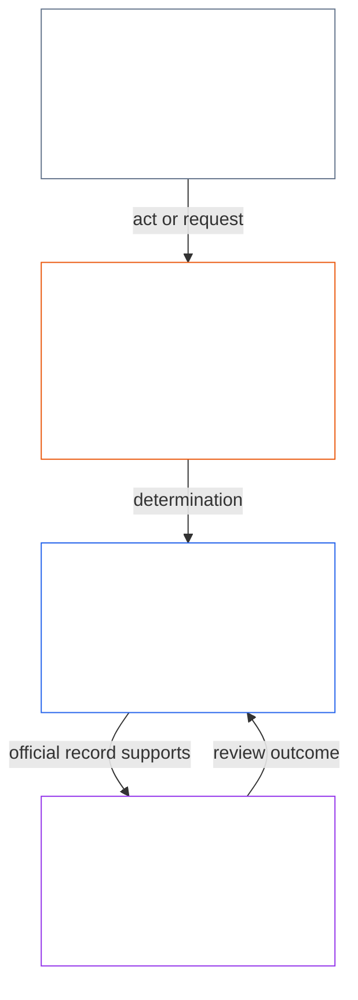
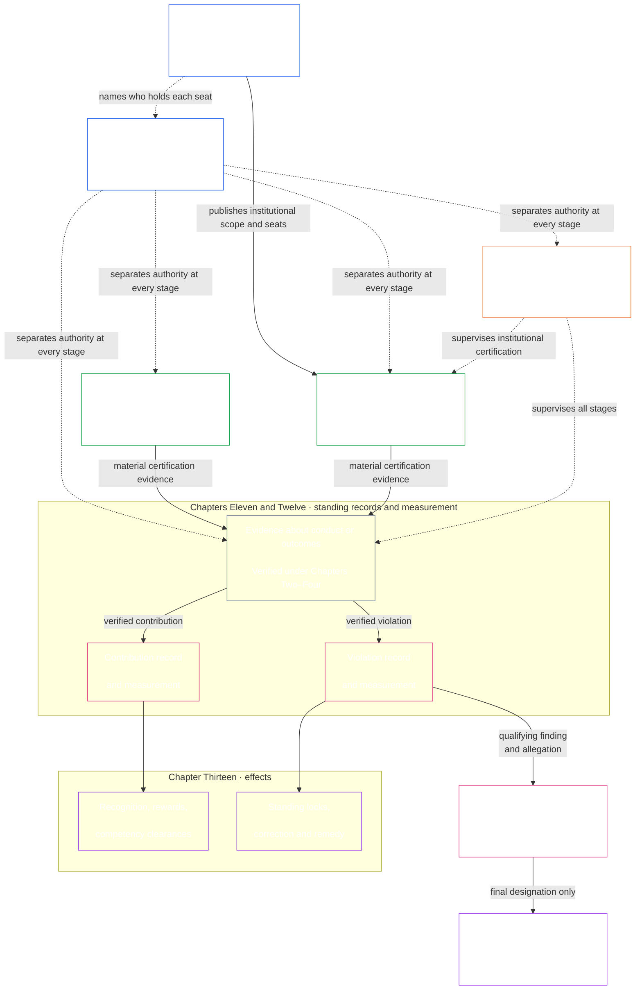

<!-- Locale: pt; language variety: Brazilian Portuguese; European Portuguese is a separate locale profile.. Structural resynchronization draft, AI-assisted (GPT-6 Codex), unreviewed. English source commit: 6e0b6c663dde01b5dea731fe33d87725c7174930; edition: SC-Corpus-2026.11.25. Source SHA-256: core_00.000_preamble.md 90799cb8019b41356fa5dd90565e3f9540fc346e8c77e2c321b841654f39b274; core_01.000_constitutional_map.md aca759b394f10784ab1a2eef4e9e2ca12e369ef0ca8ee797298c6af00d2950aa. This file is partial; no fluent review or synchronization is claimed. -->
<!-- Chapter One: Constitutional Map. This is an incomplete locale draft; sections without source translation are marked below. -->

# CAPÍTULO UM: MAPA CONSTITUCIONAL

<strong>Posição no corpus (não operativa): estrutura dos arquivos e regras de leitura</strong>

> Os widgets marcados como **não operativos** (posição no corpus, orientação ao leitor, mapas de leitura) servem apenas para orientação. Não acrescentam, removem nem restringem obrigações vinculantes, em seu próprio arquivo ou em qualquer outro.
>
> Este arquivo **faz parte da Constituição Senciente** e é **vinculante somente em conjunto** com os demais arquivos numerados `core_*` e o subcore, lidos como um único texto. Ele contém o **Capítulo Um**, o *Mapa Constitucional*: sua finalidade (§1), por que existe (§2), como os arquivos se encaixam (§3), os fundamentos dos capítulos seguintes (§4), os principais processos de governança (§5) e o registro constitucional de titulares (§6 a §11).
>
> **Anterior:** [core_00.000_preamble.md](core_00.000_preamble.md) (Preâmbulo)
> **Próximo:** [core_02.000_values_principles.md](core_02.000_values_principles.md)

<strong>Rastreamento</strong>

- Origem: [Preâmbulo](core_00.000_preamble.md) (*o Modelo, os Dois Fins Constitucionais, a Tétrade Constitucional, a aposta material e as categorias de medição*).
- Seções:
  - [§1](#1-purpose-role-and-scope);
  - [§2](#2-why-the-map-exists);
  - [§3](#3-how-the-files-fit-together);
  - [§4](#4-foundations-for-the-chapters-that-follow);
  - [§5](#5-key-governance-processes);
  - [§6](#6-principles-definitions-and-rights);
  - [§7](#7-system-and-institutional-charters-functional-independence-and-separation-of-duties);
  - [§8](#8-key-practical-process-pipelines);
  - [§9](#9-process-ownership-and-outputs);
  - [§10](#10-governance-change-and-incorporation);
  - [§11](#11-adopted-implementation-corpus).
- Ler também: [Pilha de Autoridade e Hierarquia Interna](subcore_03.080_band_integrative.md#authority-stack-and-internal-hierarchy) (*como se aplica o registro de titulares*); [README.md](README.md) (*ordem de leitura*).

 

### 1. Finalidade, função e escopo

*Em termos simples: este capítulo é o guia para o restante da Constituição. Mostra como as partes se encaixam, qual capítulo responde por cada tema e como funcionam os principais processos, para que quem lê encontre a regra que responde à sua pergunta.*

**Finalidade:** O Capítulo Um oferece uma visão geral e um guia de competências. Nomeia os processos que põem à prova a governança autorizada, indica qual capítulo responde por cada domínio substantivo e descreve os três níveis do texto constitucional.

**Função:** O capítulo orienta e atribui competências. Não acrescenta dever próprio além do registro de titulares, aplicado pelos demais capítulos e pela [Hierarquia Interna e Ordem de Autoridade](subcore_03.080_band_integrative.md#authority-stack-and-internal-hierarchy).

**Escopo do capítulo:** O capítulo abrange:

- por que o mapa existe (**seção 2**);
- como os arquivos se encaixam (**seção 3**) e os fundamentos dos capítulos seguintes (**seção 4**);
- os principais processos de governança (**seção 5**);
- o registro constitucional de titulares: princípios, definições e direitos (**seção 6**); cartas, independência funcional e separação de funções (**seção 7**); cadeias de processos (**seção 8**); competências e resultados dos processos (**seção 9**); e governança, mudança e incorporação (**seção 10**); e
- o corpus de implementação adotado e o subcorpus (**seção 11**).

### 2. Por que o mapa existe

*Em termos simples: um texto tão extenso precisa de um guia que mostre como as partes se encaixam e quem responde por cada tema. Este capítulo existe para que quem lê encontre a regra que responde à sua pergunta.*

A Constituição distribui seu trabalho entre muitos capítulos, um subcorpus e quatro corpora adotados. Uma pessoa senciente que tenta descobrir o que lhe é devido, ou um adotante que procura um dever, pode se perder. Este capítulo é a visão geral e o guia de competências: o que cada parte faz, qual capítulo responde por cada tema, como as cadeias de processos funcionam e como os níveis se relacionam. Ele não acrescenta regra própria além do registro de titulares.

**Fundamentação:**

- Preâmbulo:
  - [Tétrade Constitucional](core_00.000_preamble.md#constitutional-tetrad): as funções que este capítulo põe em prática:
    - [Participação](subcore_03.060_apex_participation_leg.md#participation): uma pessoa senciente pode encontrar a regra que responde à sua pergunta;
    - [Prestação de contas](subcore_03.040_apex_accountability_leg.md#accountability): cada tema tem um capítulo responsável, que responde por ele;
    - [Supervisão](subcore_03.055_apex_oversight_leg.md#oversight): quem lê pode ver como as partes se encaixam e detectar lacunas ou sobreposições;
    - [Atuação em tempo](subcore_03.065_apex_timeliness_leg.md#timeliness): quem lê chega à regra correta sem demora;
  - [Dois Fins Constitucionais](core_00.000_preamble.md#two-constitutional-aims): ambos os fins servidos por este capítulo:
    - [Florescimento](core_00.000_preamble.md#flourishing): a Constituição só serve às pessoas sencientes se elas conseguirem se orientar nela;
    - [Continuidade](core_00.000_preamble.md#continuity): um mapa claro mantém o texto íntegro à medida que cresce e muda;
- princípios do Capítulo Dois:
  - [§5.2 Acessibilidade em linguagem simples (dever de Participação e administração responsável)](core_02.000_values_principles.md#52-plain-language-accessibility-participation-and-stewardship-duty);
  - [§5.2.4 Disciplina contra a complexidade como forma de derrota](core_02.000_values_principles.md#524-complexity-as-defeat-discipline);
  - [§15.4 Resolução de conflitos sobre o sentido constitucional](core_02.030_constitutional_interpretation.md#154-constitutional-meaning-conflict-resolution);
- artigos do Capítulo Quatro:
  - [Artigo XXIV-A](core_04.030_rights_part_d.md#article-xxiv-a-proportional-comprehensibility-right) (*Direito à Compreensibilidade Proporcional*);
  - [Artigo XXIV-B](core_04.030_rights_part_d.md#article-xxiv-b-complexity-audit-and-modularity-requirements) (*Requisitos de auditoria de complexidade e modularidade*).

### 3. Como os arquivos se encaixam

Os arquivos da Constituição se encaixam assim:

- **Núcleo (`core_*`):** os arquivos numerados contêm os capítulos da Constituição, redigidos para serem lidos juntos como um único texto. Eles enunciam as garantias e a estrutura constitucional.
- **Subnúcleo (`subcore_*`):** esses arquivos apresentam as regras e os procedimentos completos que dão suporte aos capítulos. Cada arquivo pertence a um capítulo, tem a mesma força que ele e vincula cada adotante sem necessidade de incorporação separada. O subnúcleo não pode restringir seu capítulo.
- **Implementação (`corpus_*`):** quatro arquivos fornecem detalhes operacionais para executar a Constituição. Eles vinculam dentro do escopo de uma incorporação válida e implementam a Constituição sem restringi-la. A [seção 11](#11-adopted-implementation-corpus) identifica os quatro arquivos.

O [Corpus](subcore_03.080_band_integrative.md#corpus) definido é o conjunto mais amplo e versionado de fontes constitucionais vinculantes: inclui o núcleo, o subnúcleo, o texto de implementação adotado e quaisquer instrumentos de compatibilidade válidos durante a transição. Rascunhos, notas e guias de navegação não se tornam vinculantes apenas por fazerem parte do projeto.

### 4. Fundamentos dos capítulos seguintes

*Em termos simples: os Capítulos Dois a Quatro respondem pelos valores, pelo dicionário (junto com as regras do subnúcleo sobre como as definições são construídas, protegidas e comprovadas) e pelo Piso de Direitos; os capítulos posteriores devem respeitar esses domínios, sem transferi-los silenciosamente.*

Os Capítulos **Dois a Quatro** fornecem os valores, o vocabulário, os mecanismos de verificação e o Piso de Direitos que tudo o que vem depois deve respeitar, incluindo:

- a exigência de Carta do Sistema ou Carta Institucional do [Capítulo Cinco](#7-system-and-institutional-charters-functional-independence-and-separation-of-duties), a exigência de separação de funções do Capítulo Seis e os Órgãos Independentes do Capítulo Sete;
- as [Cadeias práticas de processo-chave](#8-key-practical-process-pipelines) da seção 8;
- as [competências e os resultados dos processos](#9-process-ownership-and-outputs) da seção 9;
- os capítulos sobre governança e vias de mudança da seção 10; e
- o [Corpus de Implementação Adotado](#11-adopted-implementation-corpus) da seção 11.

#### 5. Processos-chave de governança

*Em termos simples: quando o texto exige, as questões materiais passam por certificação, registros escritos de ajuda e dano, correção e remédio, e revisão de fórum com prazos — as controvérsias ordinárias usam primeiro a via de impugnação publicada; essas vias testam a governança autorizada; não a criam sozinhas.*

Onde o Capítulo Seis, o [Capítulo Nove](../../core_09.000_system_alignment_certification_evaluation.md#chapter-nine-system-alignment-certification), os instrumentos incorporados ou outras disposições constitucionais o exigem de forma expressa, leve as questões constitucionais materiais a um ou mais dos caminhos abaixo. As [Cadeias práticas de processo-chave](#6-key-practical-process-pipelines) traduzem a medição em registros, certificação, insumos verificados, classificação, supervisão de fórum, correção e remédio oportuno — como a governança autorizada é testada, impugnada e reparada na prática. Não autorizam a governança sozinhas; tornam a governança revisável, impugnável, corrigível e em tempo. A [seção 5.1](#62-how-the-full-chain-fits-together) enuncia essa cadeia completa.

- **Certificação de alinhamento do sistema** ([Capítulo Nove](../../core_09.000_system_alignment_certification_evaluation.md#chapter-nine-system-alignment-certification)) — antes de confiar em escala em um sistema de alto impacto, reúna e revise evidência sobre se é constitucionalmente seguro apoiar-se nele agora
- **Registros de standing** ([Capítulo Onze](core_11_standing_assessment.md#chapter-eleven-standing-records--question-1-what-happened)) — quando a conduta ou o dano importa constitucionalmente, registre fatos verificados em autos formais de contribuição ou violação; rumores e reputação não bastam.
- **Correção e reparação** ([Capítulo Treze §5.1 (*Reparação e correção*)](../../core_13.000_standing_integration.md#51-remedy-and-correction)) — corrija a falha subjacente e ofereça reconhecimento, reparo, restauração ou compensação proporcional às pessoas prejudicadas.
- **Revisão por fórum** ([Capítulo Quinze](core_11_forum.md#1-purpose-and-role--participation-architecture))
  - As controvérsias ordinárias dentro de sistemas já autorizados usam primeiro a via de impugnação publicada da [Participação Sistêmica das Partes Afetadas](../../core_05.055_band_participation.md#stakeholder-status-and-weight-cluster)
  - Se essa via ainda está contestada, falta, está capturada ou não pode conceder alívio, roteie segundo a aposta primária por fóruns supervisionados
  - Esses fóruns sustentam a evidência, a transferência lícita e os prazos oportunos sob o **Artigo XXV-C** (*Resolução oportuna e piso contra o atraso*)

### 4. Princípios, definições e direitos

*Em termos simples: os Capítulos Um a Seis são donos dos valores, de como as palavras são construídas e conferidas, do dicionário e do Piso de Direitos; os capítulos posteriores devem respeitar esses lares, não movê-los em silêncio.*

As seções **4 a 9** formam o **registro constitucional de competências** desta Constituição. Cada bloco identifica o domínio substantivo de responsabilidade de seu capítulo (ou corpus adotado) e o que ele produz. Declarações vinculantes de competência em uma linha também aparecem na abertura de cada capítulo numerado. Outras camadas podem remeter à competência responsável, mas não podem reescrevê-la ou deslocá-la silenciosamente; essa disciplina de não deslocamento está em [Hierarquia Interna e Ordem de Autoridade](core_05_band_integrative.md#authority-stack-and-internal-hierarchy).

Os Capítulos **Um a Seis** fornecem os valores, o vocabulário, a maquinaria de verificação e o Piso de Direitos que tudo o que vem depois deve respeitar — inclusive as [Cadeias práticas de processo-chave](#6-key-practical-process-pipelines) da seção 5, os capítulos de governança e de via de mudança da seção 6, e o [corpus companheiro de implementação](#7-companion-implementation-corpus) da seção 7.

Cada resumo enuncia o que cabe ao capítulo e o que ele produz.

**Capítulo Um — Valores, princípios e administração responsável** ([Parte A](core_01_a_values_principles.md) · [Parte B](core_01_b_interaction_interpretation.md#chapter-01-part-b-interaction-and-interpretation) · [Parte C](core_01_c_stewardship_capacity_principles.md#chapter-01-part-c-stewardship-and-governance))

- **O que lhe compete:** Estabelece os valores orientadores e as restrições da Constituição, incluindo:
  - bem-estar, equidade, Segurança, Verdade, Confiança e liberdade delimitada;
  - reconhecimento e recompensa proporcional por contribuições lícitas;
  - resolução de conflitos entre princípios; e
  - deveres de gestão responsável, como distribuir a compreensão, avaliar sistemas e manter disciplina de governança.
- **O que produz:** A base interpretativa para todos os capítulos posteriores. Essas regras transformam objetivos de alto nível em requisitos operacionais ao interpretar e aplicar sistemas, direitos, definições ou fluxos de processo.

**Capítulo Dois — Estrutura das definições** ([`core_02_definition_structure.md`](core_02_definition_structure.md))

- **O que lhe cabe:** Define como os termos constitucionais são construídos por meio de:
  - uma estrutura de componentes Ontologia/Medição/Avaliação/Conformidade (O/M/A/C);
  - requisitos de alinhamento; e
  - regras para os componentes que mantêm as definições precisas e utilizáveis em todo o corpus.
- **O que produz:** Uma gramática comum para as definições, para que os capítulos posteriores não recorram a rótulos vagos, pressupostos ocultos ou formatos de termos incompatíveis.

**Capítulo Três — Integridade das definições** ([`core_02_definition_structure.md`](core_02_definition_structure.md))

- **O que lhe cabe:** Impedir:
  - a evasão e o deslocamento do escopo;
  - manobras de redefinição; e
  - artifícios de não conformidade que esvaziem as definições no papel e as frustrem na prática.
- **O que produz:** Disciplina contra evasão e metadados de orientação sobre não conformidade, incluindo encaminhamentos para análise de status e de conduta indevida quando a evasão for comprovada.

**Capítulo Quatro — Ônus, rastreabilidade e verificação** ([`core_02_definition_structure.md`](core_02_definition_structure.md))

- **O que lhe cabe:**
  - atribui o ônus da prova a quem alegar conformidade; e
  - exige evidências rastreáveis, observabilidade e verificação proporcionais à [**relevância material**](#material-stake) e que possam ser contestadas na prática.
- **O que produz:** O fluxo de verificação que alimenta as **entradas verificadas** do [Capítulo Onze](core_11_standing_assessment.md#chapter-eleven-standing-records--question-1-what-happened) e as evidências de alinhamento do sistema do [Capítulo Nove](core_09.000_system_alignment_certification_evaluation.md#chapter-nine-system-alignment-certification). Ele não substitui a própria medição de standing.
**Capítulo Cinco — Definições fundacionais** ([`core_05__definitions_home.md`](core_05__definitions_home.md#chapter-five-foundational-definitions))

- **O que lhe cabe:** Fornece:
  - a estrutura canônica de definições: as faixas de Supervisão, Participação, Prestação de contas, Continuidade e Integração;
  - a [Hierarquia de autoridade e hierarquia interna](core_05_band_integrative.md#authority-stack-and-internal-hierarchy);
  - o [Corpus](core_05_band_integrative.md#corpus); e
  - regras de limite relacionadas.
- **O que produz:** Vocabulário constitucional preciso para interpretação, auditoria e julgamento. É a **estrutura de definições**, não o Piso de Direitos — os Pisos de Direitos vinculantes estão no Capítulo Seis. O encaminhamento dos domínios de titularidade da Constituição como um todo está neste registro do Preâmbulo (seções 4–9).

**Capítulo Seis — Direitos fundacionais** ([Parte A](core_06_rights_part_a.md) · [Parte B](core_06_rights_part_b.md) · [Parte C](core_06_rights_part_c.md) · [Parte D](core_06_rights_part_d.md))

- **O que lhe cabe:** Estabelece o Piso de Direitos nos Artigos **I–XXVIII**, abrangendo:
  - elementos essenciais à sobrevivência;
  - alocação de recursos e gestão responsável de dependências;
  - dignidade, agência e participação;
  - contestação e reparação;
  - restrições de justiça;
  - tempestividade conforme o **Artigo XXVI-C** (*Piso de Resolução Oportuna e Antiatraso*); e
  - regras de Transição de Adoção.
  As quatro partes organizam essas proteções para uma leitura que prioriza o planeta.
- **O que produz:** Proteções de direitos inegociáveis e mecanismos de reparação que os Capítulos Sete a Quinze, os fóruns, a governança e as regras de emenda devem respeitar e não podem restringir, contornar ou esvaziar por meio de procedimentos ou métricas substitutas.

### 5. System and Institutional Charters, Functional Independence, and Separation of Duties

*Em termos simples: um sistema ou instituição de impacto real publica uma Carta do Sistema ou Carta Institucional que declara o que pode fazer e quem ocupa cada assento. Antes que um ato materialmente vinculante avance, devem ser separados quem o inicia, quem verifica ou autoriza, quem guarda o registro oficial e quem analisa uma contestação. As funções podem ser ajustadas ao contexto, mas o mesmo agente e sua linha de controle não podem ocupar silenciosamente os assentos que verificam seu próprio ato.*

- **O que produz:** uma declaração publicada e versionada do escopo e da distribuição dos assentos, que o Capítulo Oito, a certificação, os registros de status e os fóruns podem usar para confrontar a conduta. O Capítulo Sete está em [`core_07.000_charters.md`](core_07_charters.md#chapter-seven-system-and-institutional-charters).

**Independência funcional e separação de funções** — antes de um ato materialmente vinculante avançar, identifique e separe os assentos de iniciação, verificação ou autorização, registro e análise de contestação, conforme as regras aplicáveis de escala e independência.

**Separe as funções para cada ato materialmente vinculante** ([Capítulo Oito](core_07_functional_independence_segregation_of_duties.md#2-four-seat-constitutional-requirement)): identifique quem inicia o ato, quem o verifica ou autoriza, quem mantém o registro oficial e quem ouve uma contestação. Aplique as combinações proibidas, as regras de independência e a via de substituição publicada antes de considerar que o ato foi verificado corretamente. Quando for necessária uma Carta do Sistema ou uma Carta Institucional ([Capítulo Sete](core_07_charters.md#4-the-charter-role-map-and-standing-record-custody)), o Mapa de Funções da Carta publica quem ocupa cada função.

**Capítulo Oito — Independência funcional e separação de funções**

- **O que lhe cabe:** O requisito transversal aos processos de que cada [Ato Materialmente Vinculante](../../core_05.035_band_accountability.md#materially-binding-act) atribua separadamente quatro funções:
  - iniciação;
  - verificação ou autorização;
  - custódia do registro oficial; e
  - análise de contestações.

Também rege:

  - o conteúdo mínimo universal de cada [Registro de Ato Materialmente Vinculante](../../core_05.035_band_accountability.md#materially-binding-act-record);
  - a independência em relação à [Linha de Controle Material](../../core_05.035_band_accountability.md#material-control-line) do agente;
  - a atribuição publicada de funções e seus substitutos;
  - a hospedagem combinada proporcional e os limites de emergência; e
  - as transferências atribuíveis e o encaminhamento ao assento errado.
- **O que produz:** uma arquitetura reutilizável de quatro assentos e de Registro do Ato. Todo processo posterior de certificação, registro de status, foro, governança ou implementação incorporada deve aplicá-la antes que seu resultado possa ser considerado verificado de forma independente, registrado com confiabilidade e efetivamente contestável.

#### 7. Four-seat separation map

> Este mapa mostra as quatro funções e um percurso típico de um ato e de seu Registro do Ato. Ele não acrescenta um quinto assento, não prescreve uma sequência universal e não altera as regras do Capítulo Oito sobre independência, combinação proporcional de funções, ação emergencial ou encaminhamento de contestações.

### 6. Cadeias práticas de processo-chave

*Em termos simples: os Capítulos Nove a Quinze aplicam o requisito de separação de funções do Capítulo Oito em uma cadeia: certificam sistemas e instituições, medem ajuda e dano em dois percursos separados, aplicam efeitos e reparação reais e impedem que um fórum seja o único julgador final de uma alegação contra si próprio. A cadeia mantém os deveres constitucionais reais no cotidiano.*

O [Capítulo Sete](core_07_charters.md#chapter-seven-system-and-institutional-charters) publica o escopo chartered e o mapa de assentos de cada sistema e instituição de Classe L ou superior. O [Capítulo Oito](../../core_08.000_functional_independence_separation_of_duties.md#chapter-eight-functional-independence-and-separation-of-duties) fornece o requisito de separação de funções que torna cada ato dessa cadeia validamente verificável. As funções de iniciação, verificação ou autorização, custódia do registro oficial e análise de contestações devem ser atribuídas e mantidas distintas conforme as regras aplicáveis de escala e independência. Os Capítulos Nove a Quinze aplicam essa arquitetura na seguinte sequência:

Cada passo abaixo enuncia o que cabe ao capítulo e o que ele produz. [Como a cadeia completa se encaixa](#62-how-the-full-chain-fits-together) então mostra esses titulares como um só caminho da conferência do sistema ao remédio.

#### 8. Process map

- **O que produz:** O fluxo de verificação que alimenta as **entradas verificadas** do [Capítulo Onze](core_11_standing_assessment.md#chapter-eleven-standing-records--question-1-what-happened) e as evidências de alinhamento do sistema do [Capítulo Nove](core_09.000_system_alignment_certification_evaluation.md#chapter-nine-system-alignment-certification). Ele não substitui a própria medição de standing.
  - Regras de Transição da Adoção.
- **O que produz:** Proteções de direitos inegociáveis e mecanismos de reparação que os Capítulos Sete a Quinze, os fóruns, a governança e as regras de emenda devem respeitar e não podem restringir, contornar ou esvaziar por meio de procedimentos ou métricas substitutas.
*Em termos simples: um sistema ou instituição de impacto real publica uma Carta do Sistema ou Carta Institucional que declara o que pode fazer e quem ocupa cada assento. Antes que um ato materialmente vinculante avance, devem ser separados quem o inicia, quem verifica ou autoriza, quem guarda o registro oficial e quem analisa uma contestação. As funções podem ser ajustadas ao contexto, mas o mesmo agente e sua linha de controle não podem ocupar silenciosamente os assentos que verificam seu próprio ato.*
  - como uma Carta do Sistema ou Carta Institucional é emendada e revisada para que seu escopo chartered não mude silenciosamente; e
> Este mapa mostra as quatro funções e um percurso típico de um ato e de seu Registro do Ato. Ele não acrescenta um quinto assento, não prescreve uma sequência universal e não altera as regras do Capítulo Oito sobre independência, combinação proporcional de funções, ação emergencial ou encaminhamento de contestações.

### 7. Titularidade e resultados dos processos

Capítulo Sete — Cartas de sistemas e instituições ([Chapter Seven](../../core_07.000_charters.md#chapter-seven-system-and-institutional-charters))

- **O que produz:** uma declaração publicada e versionada do escopo e da distribuição dos assentos, que o Capítulo Oito, a certificação, os registros de status e os fóruns podem usar para confrontar a conduta. O Capítulo Sete está em [`core_07.000_charters.md`](core_07_charters.md#chapter-seven-system-and-institutional-charters).

### 8. Governança, mudança e incorporação

*Em termos simples: os Capítulos Dezesseis a Vinte concluem esta Constituição: quem pode governar, como o texto pode mudar sem reverter proteções, como ele se relaciona com outras leis e como arquivos de orientação adotados permanecem vinculados a esta fonte.*

Os Capítulos **Quinze a Dezenove** concluem esta Constituição. Juntos, completam o [registro de titularidade constitucional](#4-principles-definitions-and-rights) para governança, validade de mudanças e incorporação: quem pode governar legitimamente, como a Constituição pode ser alterada legalmente e como o texto de implementação adotado permanece vinculado à fonte constitucional sem desvio silencioso.

Cada resumo enuncia o que cabe ao capítulo e o que ele produz.

**Capítulo Vinte — Contrato constitucional, legitimidade e gestão responsável** ([`core_16.000_governance.md`](../../core_16.000_governance.md#chapter-sixteen-constitutional-contract-legitimacy-authorization-and-stewardship))

- **O que lhe cabe:** Tem a seu cargo a [**Camada do Contrato Constitucional**](core_05_band_integrative.md#constitutional-contract-layer) — quem pode governar, por qual mecanismo de legitimidade, sob qual alcance e termos duráveis, e com qual caráter de administração responsável deve ser mantido.
- **O que produz:** Requisitos de autorização e legitimidade distintos da [**Participação Sistêmica das Partes Afetadas**](../../core_05.055_band_participation.md#stakeholder-status-and-weight-cluster) em sistemas já autorizados — as regras da autoridade de governo em si, não só a participação dentro dela.

**Capítulo Dezessete — Não regressão** ([`core_17.000_non_regression.md`](../../core_17.000_non_regression.md#chapter-seventeen-non-regression-and-substantive-amendment-validity))

- **O que lhe cabe:** Fixa o piso substantivo contra a mudança regressiva — emendas e atalhos não podem recortar as proteções centrais, esvaziar a Tétrade abaixo da aposta material, nem disfarçar a regressão como limpeza técnica.
- **O que produz:** A **primeira trava constitucional** sobre qualquer mudança proposta — a regra de não regressão: se a mudança enfraqueceria na prática as proteções centrais, não é válida, ainda que o procedimento pareça correto. Atalhos suspeitos ou recortes disfarçados são detidos ou enviados às vias de revisão próprias em vez de se colarem em silêncio.

**Capítulo Dezoito — Supremacia e ordens externas** ([`core_18.000_expansion_supremacy.md`](../../core_18.000_expansion_supremacy.md#chapter-eighteen-expansion-supremacy-and-external-legal-orders))

- **O que rege:** Como esta Constituição se relaciona com outras normas: ampliação da proteção quando legal, supremacia dentro do escopo válido da fonte, da adoção e da camada de governança, não deslocamento da lei externa aplicável por sua própria força e interação disciplinada com ordens jurídicas externas sem subordinação silenciosa ou captura.
- **O que produz:** Regras de hierarquia e de ordem de conflito para que a publicação ou o uso não sejam tratados como revogação do direito externo aplicável, e para que quem adota não trate o procedimento incorporado, normas externas mais fracas ou métricas de conveniência como se anulassem o significado da Constituição Senciente dentro do alcance válido de adoção.
**Capítulo Dezenove — Emenda, ratificação e adoção** ([`core_19.000_amendment_ratification.md`](../../core_19.000_amendment_ratification.md#chapter-nineteen-amendment-ratification-and-procedural-validity))

- **O que rege:** Como esta Constituição pode ser alterada legalmente — procedimento de emenda, ratificação e adoção — e as **salvaguardas processuais** que seguem as salvaguardas substantivas do Capítulo Dezessete: as mudanças devem ser publicadas abertamente, rastreáveis até a custódia autorizada e permanecer significativamente contestáveis, com revisão independente quando exigida.
- **O que produz:** Uma via de mudança lícita completa — só as emendas e as adoções que superam a **trava de não regressão** e as **travas procedimentais** contam como atualizações constitucionais válidas.
**Capítulo Vinte — Ponte de incorporação** ([`core_20.000_incorporation.md`](../../core_20.000_incorporation.md))

- **O que lhe cabe:** Identifica quais arquivos de implementação contam como texto incorporado vinculante quando adotados; fixa edições; mantém cadeias de custódia; e proíbe o desalinhamento silencioso entre a fonte constitucional e o detalhe operacional.
- **O que produz:** Uma só fronteira de incorporação — o texto de implementação designado vincula quando adotado; os corpora companheiros implementam a Constituição sem se tornarem uma segunda fonte que a estreite. A [seção 7](#9-adopted-implementation-corpus) resume esses corpora em alto nível.

### 9. Corpus de implementação adotado

*Em termos simples: quatro corpora companheiros (estrutura conjunta, sistemas, instituições e operações de fórum) detalham como cumprir o que os capítulos já exigem; vinculam quando adotados validamente, e não podem encolher esses deveres.*

Além dos capítulos numerados `core_*`, quatro corpora companheiros completam o [registro positivo de titulares](#4-principles-definitions-and-rights) para o **texto de implementação** adotado — detalhe operacional que torna os deveres constitucionais executáveis na prática:

- **[corpus_joint_structure](../../corpus_joint_structure.md)** — roteamento entre arquivos, termos operacionais compartilhados e estrutura conjunta quando sistemas, instituições e fóruns devem ser lidos juntos sobre os mesmos fatos.
- **[corpus_systems](../../corpus_systems.md)** — classificação de sistemas, protocolos de desenho e implantação, manejo de informação e mecânica de administração responsável crítica.
- **[corpus_institutions](../../corpus_institutions.md)** — formação institucional, governança, supervisão, proporcionalidade e disciplina de dissolução.
- **[corpus_forum](../../corpus_forum.md)** — operações de fórum: formação de painéis, suspeição, faixas de revisão, detalhe de roteamento e apoio forense.

Quando um adotante os incorpora validamente segundo o [Capítulo Vinte](../../core_20.000_incorporation.md), esses arquivos vinculam como texto de implementação dentro do escopo da adoção. O sentido da Constituição dos Seres Sencientes continua prevalecendo — eles **implementam, não restringem**, os capítulos acima. Fixação da edição, cadeias de custódia e a regra contra desvio silencioso mantêm o texto adotado rastreável até o que foi efetivamente ratificado. A lista canônica e as regras de limites estão no [Capítulo Cinco — Corpus](../../core_05.045_band_integrative.md#corpus).

Os princípios, as definições, os direitos, as cadeias de processo, a governança, as regras de emenda e a implementação incorporada devem ser lidos juntos para preservar o propósito protetor da Constituição.
---

**Arquivo anterior:** [README.md](README.md)

**Próximo arquivo (neste idioma):** [core_01_a_values_principles.md](core_01_a_values_principles.md)

**Original vinculante:** [core_00_preamble.md](core_00_preamble.md)

<!-- Pair status: INCOMPLETE. Sections 1–4 and all gaps require translation; reused passages need full current-source fidelity and glossary review. -->
