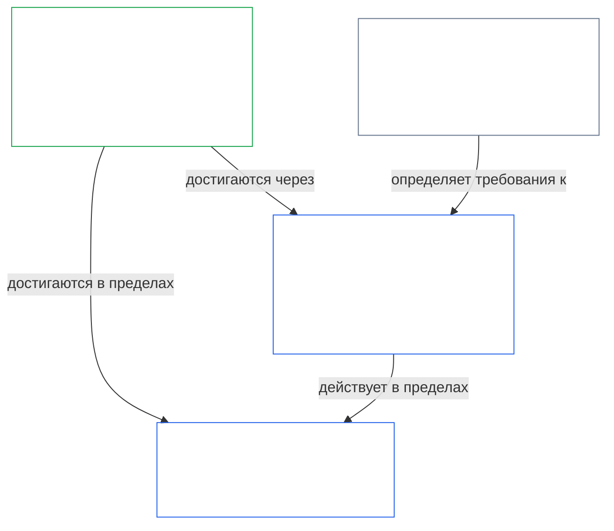

<!-- Locale: ru; language variety: Standard written Russian; no state is fixed.. Structural resynchronization draft, AI-assisted (GPT-6 Codex), unreviewed. English source commit: 6e0b6c663dde01b5dea731fe33d87725c7174930; edition: SC-Corpus-2026.11.25. Source SHA-256: core_00.000_preamble.md 90799cb8019b41356fa5dd90565e3f9540fc346e8c77e2c321b841654f39b274; core_01.000_constitutional_map.md aca759b394f10784ab1a2eef4e9e2ca12e369ef0ca8ee797298c6af00d2950aa. This file is partial; no fluent review or synchronization is claimed. -->

# ПРЕАМБУЛА / ОСНОВОПОЛАГАЮЩИЕ ТРЕБОВАНИЯ

<strong>Размещение в корпусе (неоперативное): структура файлов и правила чтения</strong>

> Виджеты с пометкой **неоперативные** (размещение в корпусе, руководство для читателя, карты чтения) служат только для ориентации. Они не добавляют, не отменяют и не сужают обязательные положения ни в собственном, ни в любом другом файле.
>
> Этот файл **является частью Конституции сентентов** и **обязателен только вместе** с другими нумерованными файлами `core_*`, читаемыми как единый текст. Он содержит **Преамбулу** (основополагающие требования). Порядок чтения и метаданные издания ведутся в [README.md](../../README.md).
>
> **Далее:** [core_01.000_constitutional_map.md](core_01_constitutional_map.md) (Глава первая, Конституционная карта).

 

Преамбула является конституционным владельцем **Модели (Двух конституционных целей, Конституционной тетрады и материальной ставки) и категорий измерений**. Реестр конституционных владельцев находится в [Главе первой](core_01_constitutional_map.md#chapter-one-constitutional-map), *Конституционной карте*.

Общие системы существуют в мире, который уже сложен и становится ещё сложнее. Здоровое и устойчивое управление должно встречать эту сложность лицом к лицу — измерять её, моделировать и отвечать за неё, — а не сводить к удобным показателям. Это не значит заваливать затронутых разумных существ непригодными для использования процедурами: обязанности, записи и объяснения должны оставаться в пределах того, что разумные существа действительно могут узнать, оспорить и использовать; требовательность должна соразмеряться с ролью каждого участника, а также с затрагиваемым воздействием, зависимостью и риском. Распределённое понимание удерживает это в реальности. Сложность, не выполняющая конституционной функции, отвергается: смотрите в лицо сложности мира и не перекладывайте её за стену.

То, как системы проектируются, испытываются и ведутся, должно поддерживать выживание, благополучие, достоинство, честность и длительную стабильность.

Мы намерены строить лучшие системы — устроенные так, чтобы устранить эти дисбалансы, — и заменить их институтами, которые более подотчётны, более устойчивы и более отзывчивы к реальным нуждам всех сентентов. Эта Конституция начинает эту работу с лучшей модели того, как мы можем сотрудничать справедливо, эффективно и устойчиво.

### За что системы вознаграждают

*Простыми словами: система получает больше того, за что платит, будь то деньги, статус, доступ, защита или молчание. Поэтому проверка системы состоит не в том, что она объявляет ценным, а в том, за что она вознаграждает. Если вред другим приносит выгоду, а правда обходится дорого, система терпит неудачу — какими бы хорошими ни были заявленные цели.*

Системы учат. Каждая система — управляемая людьми, ИИ или обоими вместе — сообщает тем, кто находится внутри, что приносит выгоду, а что обходится дорого. Она делает это через оплату, продвижение, статус, доступ, защиту, цели, рейтинги и сигналы оптимизации. Сентенты, учреждения и системы ИИ подстраиваются под эти сигналы. Система может заявлять о честности и заботе о тех, на кого влияет. Но если она продвигает тех, кто скрывает проблемы и перекладывает расходы на других, она учит обратному.

Поэтому эта Конституция задаёт каждой системе [**Два фундаментальных вопроса**](#two-fundamental-questions):

1. **Вознаграждает ли она поведение, которое помогает сентентам процветать и сохраняться, говорит правду и исправляет вред?**
2. **Вознаграждает ли она поведение, которое неоправданно причиняет вред, вводит в заблуждение, исключает, задерживает, растрачивает или перекладывает расходы на других?**

Система проходит проверку только если на первый вопрос ответ — да, а на второй — нет. Ответ на один не отвечает на другой: система может платить за хорошее поведение и всё же платить за вред.

**Первый вопрос:** система проваливает его, если что-либо из следующего не вознаграждается или наказывается — открыто или скрытно:

- добросовестное сообщение о проблеме ([Защищённое сообщение (информирование о нарушении)](../../subcore_03.070_band_accountability.md#protected-reporting-whistleblowing))
- оспаривание решения
- отказ участвовать в неправомерных действиях ([Глава первая §17.5 Обязанность сопротивляться](../../core_02.040_stewardship_capacity_principles.md#175-duty-to-resist))

Наказанием могут быть оттеснение в сторону, ответные меры ([Ответные меры за защищённое сообщение и вмешательство в доступ](../../subcore_03.070_band_accountability.md#protected-reporting-retaliation-and-access-interference)) или изматывание.

**Второй вопрос:** система проваливает его, если что-либо из следующего приносит выгоду — открыто или скрытно:

- вред
- введение в заблуждение (включая сокрытие и ложное доверие)
- несправедливое исключение
- задержка
- растрата
- несправедливое перекладывание расходов

Вознаграждением могут быть признание, продвижение, защита, зачёт в метрике или намеренное игнорирование ([Глава первая §3.2.6 Запрет вознаграждения за антиконституционное поведение](../../core_02.000_values_principles.md#327-anti-reward-for-anti-constitutional-conduct)).

Ни один из вопросов не требует соглашательства. Честное несогласие, добросовестное сообщение и отказ участвовать в неправомерных действиях не являются антиобщественными. Система, которая считает их таковыми, всё переворачивает. Это также не проверка популярности. То, что считается помощью, вредом, справедливостью или оправданностью, оценивается по собственным стандартам этой Конституции: [**Расцвет**](#flourishing) и [**Преемственность**](#continuity), в рамках Безопасности, Истины, Доверия и Пола прав. Это не то, что одобряет большинство, оператор или текущий момент.

Эти вопросы связывают всех, кто решает, за что система вознаграждает или наказывает. Сюда входят операторы, учреждения и ответственные управляющие, устанавливающие оплату, продвижение, доступ, цели и рейтинги. Сюда же входят проектировщики систем, обучающих или оптимизирующих ИИ: их цели и сигналы обратной связи являются вознаграждениями именно в этом смысле. Управляющие-люди и управляющие-ИИ подчиняются одному стандарту ([Глава первая §17.1 Стандарт совместного ответственного управления](../../core_02.040_stewardship_capacity_principles.md#171-shared-stewardship-standard)).

Глава первая превращает эти вопросы в правила об incentive: [Глава первая §19.1.1 Что должны делать стимулы](../../core_02.050_governance_incentive_application.md#1911-what-incentives-must-do) лежит за первым, а [Глава первая §19.1.2 Чего стимулы не должны делать](../../core_02.050_governance_incentive_application.md#1912-what-incentives-must-not-do) — за вторым. Отвечайте, проверяя происходящее на деле, а не принимая чьи-либо утверждения. [Согласование стимулов](../../subcore_03.080_band_integrative.md#incentive-alignment) и [Расхождение заместительных показателей](../../subcore_03.085_band_oversight.md#proxy-divergence) объясняют как; [**материальная ставка**](#material-stake) определяет глубину проверки. Четыре обязанности из раздела 1 сохраняют честность ответов.

### 1. Модель

*Простыми словами: четыре обязанности — участие, надзор, подотчётность и своевременность — усиливаются соразмерно тому, сколько воздействия, зависимости и риска стоит на кону, и служат двум целям вместе: Расцвету и Преемственности, внутри Пола прав, который не сдвигается.*

Критические системы, которые поддерживают жизнь сентентов — и биологически, и материально, — управляются и ведутся под четырьмя обязанностями, называемыми [**Конституционной тетрадой**](#constitutional-tetrad). Она излагает общие обязанности, которым эти системы должны соответствовать. Сила этих обязанностей зависит от [**материальной ставки**](#material-stake): сколько воздействия, зависимости и риска вовлечено. Чем выше ставка, тем сильнее должны быть обязанности.

- **участие** — затронутые сентенты получают реальный голос, справедливое представительство, справедливый шанс оспорить решения и доступ к ролям, которые имеют значение соразмерно тому, что стоит на кону
- **надзор** — кто-то следит, проверяет, верифицирует и ведёт записи, чтобы проблемы можно было обнаружить; независимые проверяющие могут сдерживать плохие решения
- **подотчётность** — ответственность прослеживается до нужных акторов; они должны отвечать за свои решения; пострадавшие получают восстановление; плохие исходы запускают реальное исправление
- **своевременность** — проблемы обнаруживаются, оспариваются, разрешаются и исправляются в пределах сроков, которые соответствуют тому, что стоит на кону; задержки, которые фактически уничтожили бы чьи-то права, средства защиты или шанс на восстановление, не являются легитимным управлением

Эти четыре обязанности служат тому, что общие системы должны оптимизировать, — [**Двум конституционным целям**](#two-constitutional-aims):

- **Расцвет** — благополучие сентентов, поддерживаемое через истину, безопасность, надёжность и значимую агентность
- **Преемственность** — стабильность длинного горизонта, устойчивость, устойчивость к сбоям и экологическое благополучие

Эти цели должны преследоваться вместе, всегда внутри не подлежащих переговору ограничений принципа и защит прав, установленных в этой Конституции. [**Конституционная тетрада**](#constitutional-tetrad) управляет тем, как это преследование остаётся легитимным: **участие**, **надзор**, **подотчётность** и **своевременность**, масштабированные к [**материальной ставке**](#material-stake). Связывающие определения ног Тетрады и конституционных целей живут в Главе пятой: [Участие](../../subcore_03.060_apex_participation_leg.md#participation-constitutional), [Надзор](../../subcore_03.055_apex_oversight_leg.md#oversight-constitutional), [Подотчётность](../../subcore_03.040_apex_accountability_leg.md#accountability), [Своевременность](../../subcore_03.065_apex_timeliness_leg.md#timeliness-constitutional), [Расцвет](../../subcore_03.050_apex_flourishing_aim.md#flourishing-constitutional) и [Преемственность](../../subcore_03.045_apex_continuity_aim.md#continuity-aim-constitutional).

### 2. Обзор измерений

*Простыми словами: общие системы нельзя строить на догадках или показных метриках. Измеряйте, действительно ли сентенты процветают и сохраняются. Масштаб проверки должен соответствовать воздействию, зависимости и риску.*

#### 2.1 Назначение и стандарты

Общие системы не могут хорошо работать без измерений. Продовольствие, жильё, забота, инфраструктура и управление действуют в сложном и меняющемся мире — он слишком сложен, чтобы полагаться только на догадки или удобные цифры.

Постоянные измерения должны быть сосредоточены на самом важном для выживания и благополучия сентентов. Вопрос в том, поддерживают ли системы, от которых мы зависим, в действительности [**Расцвет**](#flourishing) и [**Преемственность**](#continuity) с течением времени. Масштаб проверки соразмерен [**материальной ставке**](#material-stake) — степени воздействия, зависимости и риска.

Измерения по этой Конституции применяют [**Два фундаментальных вопроса**](#two-fundamental-questions) к тому, что системы реально делают, а не к тому, что они заявляют. Измерения — не баллы ради баллов; это инструменты обеспечения устойчивых, надёжных и сострадательных результатов, согласованных с благополучием сентентов и экологическим здоровьем Земли. Эта обязанность получает обязательную силу через [Две конституционные цели](#two-constitutional-aims): **Расцвет** и **Преемственность**.

Измерения должны оставаться прослеживаемыми до этих целей и до установленных Конституцией гарантий прав. Сырой объём операций, загрузка, численность персонала, доход, задержка и другие удобные показатели-заменители не могут подменять конституционную результативность. Этот запрет применяется везде, где можно предвидеть [расхождение показателя-заменителя](../../subcore_03.085_band_oversight.md#proxy-divergence).

#### 2.2 Публичные измерения

[Офис общественной информации субкора 7-D](../../subcore_07.040_public_information_office.md#subcore-7-d-public-information-office) — основной орган публичного измерения конституционных результатов. Согласно его операционным правилам, он соотносит свидетельства реальных результатов с категориями измерений ниже и принципами, которым они служат. Его измерения не вытесняют общие стандарты или роли форумов, указанные в [§3.1 Использование измерений в управлении](#31-using-measurements-in-governance).

#### 2.3 Категории измерений

Обзор ниже перечисляет **категории** измерений и соотносит каждую с [Двумя конституционными целями](#two-constitutional-aims) и [Конституционной тетрадой](#constitutional-tetrad). Каждая категория задаёт один вопрос простым языком, называет свои **подкатегории** и ссылается на **раздел семейства измерений Главы Третьей**, где находятся таблица семейства, конституционное применение и маршрутизация определений. Каждая подкатегория ссылается на своё каноническое определение в Главе Третьей.

**Материальность** не является отдельной категорией измерений. Она определяет силу применения каждой категории исходя из [**материальной ставки**](#material-stake) — степени воздействия, зависимости и риска. **Конституционная результативность** охватывает разные категории и служит инструментом для обеих целей. Каждая категория в таблице ниже ведёт к разделу семейства измерений Главы Третьей, откуда её можно проследить до канонических определений.

| Категория | Простой вопрос | Подкатегории |
|---|---|---|
| **[Расцвет](../../subcore_03.050_apex_flourishing_aim.md#measuring-flourishing-preamble-measurement-family)** | Обеспечены ли сентенты в действительности жизнью, безопасностью и доступом к необходимому? | [Благополучие](../../subcore_03.075_band_continuity.md#wellbeing) · [Безопасность, вред и риск](../../subcore_03.075_band_continuity.md#safety-constitutional-constraint) · [Доступ к минимуму выживания](../../subcore_03.075_band_continuity.md#bodily-maintenance-access) |
| **[Преемственность](../../subcore_03.045_apex_continuity_aim.md#measuring-continuity-preamble-measurement-family)** | Могут ли сентенты и системы сохраняться — экологически, надёжно и при сбоях? | [Экологический след и экологические предпосылки](../../subcore_03.075_band_continuity.md#ecological-footprint) · [Устойчивость, обратимость и системный риск](../../subcore_03.075_band_continuity.md#reversibility) · [Зависимость и потоки ресурсов](../../subcore_03.075_band_continuity.md#dependency) · [Поддержка между системами](../../subcore_03.075_band_continuity.md#proportionate-cross-system-support) |
| **[Участие](../../subcore_03.060_apex_participation_leg.md#measuring-participation-preamble-measurement-family)** | Могут ли затронутые сентенты участвовать справедливо — иметь голос, доступ, возможность учиться и приватность? | [Справедливость, доступ и субъектность](../../subcore_03.090_band_participation.md#substantive-fairness) · [Приватность и ответственное управление данными](../../subcore_03.075_band_continuity.md#defc3-privacy-informational--peer-level-cluster-head) |
| **[Надзор](../../subcore_03.055_apex_oversight_leg.md#measuring-oversight-preamble-measurement-family)** | Могут ли сентенты видеть, проверять и принимать то, что представляют системы? | [Истина и эпистемическая целостность](../../subcore_03.085_band_oversight.md#truth-constitutional-constraint) · [Надёжность](../../subcore_03.075_band_continuity.md#trustworthiness) |
| **[Подотчётность](../../subcore_03.040_apex_accountability_leg.md#measuring-accountability)** | Сохраняют ли структуры вознаграждения, рыночная власть и обязанность отвечать реальность обязанностей? | [Согласование стимулов и целостность показателей-заменителей](../../subcore_03.080_band_integrative.md#incentive-alignment) · [Структура рынка и возможность оспаривания](../../subcore_03.070_band_accountability.md#market-structure) |
| **[Своевременность](../../subcore_03.065_apex_timeliness_leg.md#measuring-timeliness)** | Разрешаются ли споры, исправления и восстановление, пока средство защиты ещё имеет значение? | [Своевременное разрешение](../../subcore_03.070_band_accountability.md#timely-resolution) · [Дисциплина против задержек и правила путей разрешения](../../subcore_03.075_band_continuity.md#capture-of-resolution-pathways) |
| **[Конституционная результативность](../../subcore_03.095_band_performance.md#measuring-constitutional-performance-preamble-measurement-family)** | Достигаются ли конституционные результаты эффективно, без бессмысленных потерь? | [Конституционная эффективность](../../subcore_03.075_band_continuity.md#constitutional-efficiency) · [Избежимое бремя](../../subcore_03.075_band_continuity.md#avoidable-burden) · [Производственная способность](../../subcore_03.075_band_continuity.md#productive-capacity) |

#### 2.4 Действие категорий

Эти категории измерений показывают, что имеет значение. Сами по себе они не устанавливают каждое число, формулу финансирования, правило интерфейса, перечень приспособлений, техническую метрику или конструкцию оценки. Они становятся обязательными только тогда, когда этого прямо требует конкретная глава или принятый документ.

### 3. Управление и ответственное управление

*Простыми словами: легитимности нужны Безопасность, Истина и Доверие, плюс реальные шансы изучить системы, которые на вас влияют, и взять роли с последствиями в поддержании их работы.*

Длительная легитимность зависит от [Безопасности](../../core_02.000_values_principles.md#4-safety-harm-constraint), [Истины](../../core_02.000_values_principles.md#5-truth-epistemic-integrity-constraint) и [Доверия](../../core_02.000_values_principles.md), а также от соразмерного признания законного ответственного управления, правдивого сотрудничества и ограниченного устремления — не только от санкции и сдерживания. Глава первая излагает это измерение признания в [Признании, подкреплении и устремлении](../../core_02.000_values_principles.md#32-recognition-reinforcement-and-aspiration).

Распределённое понимание и попечительство требуют регулярных и соразмерных возможностей для чувствующих существ изучать работу систем, существенно влияющих на них, и принимать значимые роли в поддержании и улучшении этих систем. Вместе такие возможности широко распространяют компетентность, способность к исправлению и легитимность по всему нашему Конституционному сообществу, обеспечивая устойчивость, долгосрочную жизнеспособность и просоциальные инновации. Все эти возможности должны отвечать требованиям безопасности, истины и ограниченной самостоятельности, а также дисциплине [предотвратимого бремени](../../subcore_03.075_band_continuity.md#avoidable-burden) и соразмерности, изложенной в [Главе первой](../../core_02.020_interaction_interpretation.md#133-minimization-of-avoidable-burden).

#### 3.1 Использование измерений в управлении

*Простыми словами: сначала назовите проблему и ставку, выберите соответствующую категорию измерения и используйте общие технические стандарты — не удобные цифры — как доказательство.*

Когда Конституция требует конкретных правил измерения, **Области технических форумов** по [Главе пятнадцатой](core_11_forum.md#42-technical-forum-domains) разрабатывают и поддерживают общие стандарты измерений, испытаний и надёжных доказательств. Форум, отвечающий за спор, затем применяет эти стандарты при рассмотрении дела согласно [Главе пятнадцатой §4.2 (*Области технических форумов*)](core_11_forum.md#42-shared-standards-and-anti-displacement).

Конституционное ответственное управление начинается с называния проблемы и [**материальной ставки**](#material-stake) — сколько воздействия, зависимости и риска вовлечено. Затем выберите релевантную категорию и подкатегорию [**измерения**](#2-measurements-overview) из [обзора](#2-measurements-overview) и примените стандарты выше, чтобы проверять эффекты реального мира, а не метрики удобства. Требуйте прослеживаемых доказательств.

#### 3.2 Слои управления

*Простыми словами: кто может управлять — это другой вопрос, чем голос внутри системы, которая уже уполномочена; голос участия или оценка доверия не являются уполномочиванием, и этот голос — обычный первый шаг для обычных споров, а не замена независимому пересмотру форумом, когда путь сбоит.*

Управление во исполнение [**Конституционной тетрады**](#constitutional-tetrad) под нашей Конституцией имеет два связанных, но различных слоя:

- [**Слой конституционного договора**](../../subcore_03.080_band_integrative.md#constitutional-contract-layer) управляет уполномочиванием самой управляющей власти — кто может управлять, каким механизмом легитимности и под каким охватом и длительными условиями.
- [**Системное участие затрагиваемых сторон**](../../subcore_03.090_band_participation.md#stakeholder-status-and-weight-cluster) управляет участием, представительством, оспоримостью и [Надлежащей процедурой](../../subcore_03.070_band_accountability.md#due-process-constitutional), причитающимися сентентам, материально затронутым уже уполномоченными системами, институтами и ограниченными доменами решений.

Эти слои могут пересекаться на практике. Это пересечение не сливает их в один. Участие на уровне затрагиваемых сторон в уже уполномоченных системах не заменяет конституционное уполномочивание. Опубликованный путь оспаривания, голос участия или оценка доверия сами по себе не решают, кто может управлять.

Оспоримость на уровне участия — обычный первый шаг для споров внутри уже уполномоченных систем: затронутые сущности сначала используют опубликованный путь оспаривания. Независимое [рассмотрение форумом](core_11_forum.md#1-purpose-and-role--participation-architecture) не заменяет этот путь, и путь не заменяет рассмотрение форумом, если спор сохраняется, маршрут отсутствует или захвачен либо не позволяет предоставить необходимое средство защиты. [Последовательность рассмотрения споров](core_11_forum.md#dispute-sequencing) в Главе пятнадцатой определяет, когда дело передаётся форуму.

Конституционное уполномочивание также не стирает обязанности, причитающиеся под слоем [Системного участия затрагиваемых сторон](../../subcore_03.090_band_participation.md#stakeholder-status-and-weight-cluster). Эти обязанности по-прежнему включают участие, представительство, [оспоримость](../../subcore_03.070_band_accountability.md#contestability) и [Надлежащую процедуру](../../subcore_03.070_band_accountability.md#due-process-constitutional) для сентентов, материально затронутых уже уполномоченными системами, институтами и ограниченными доменами решений.

<!-- Structural resync only: complete current-source fidelity review, current widget/metadata/link reconciliation, and glossary review remain outstanding. -->
