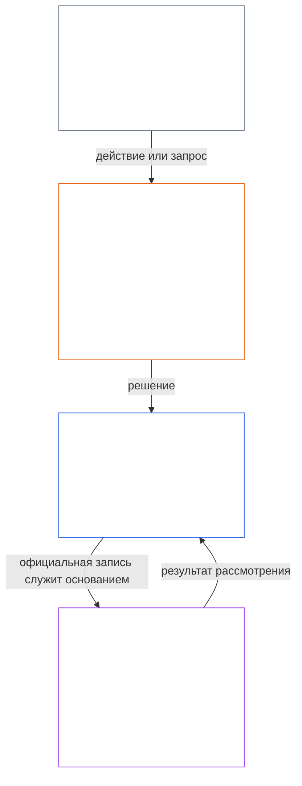
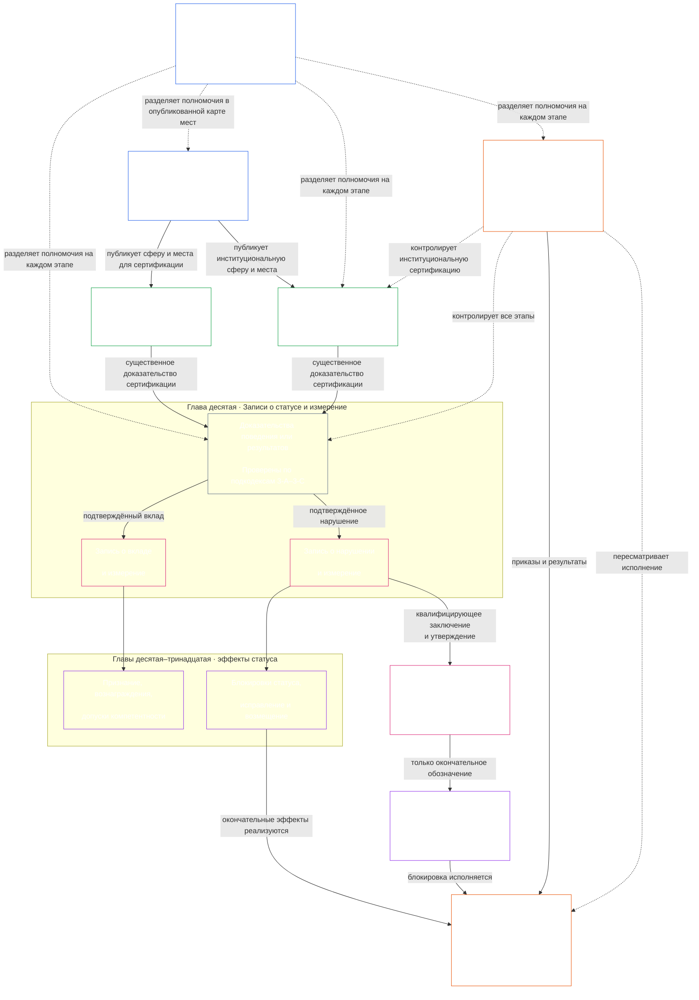

<!-- Locale: ru; language variety: Standard written Russian; no state is fixed.. Structural resynchronization draft, AI-assisted (GPT-6 Codex), unreviewed. English source commit: 6e0b6c663dde01b5dea731fe33d87725c7174930; edition: SC-Corpus-2026.11.25. Source SHA-256: core_00.000_preamble.md 90799cb8019b41356fa5dd90565e3f9540fc346e8c77e2c321b841654f39b274; core_01.000_constitutional_map.md aca759b394f10784ab1a2eef4e9e2ca12e369ef0ca8ee797298c6af00d2950aa. This file is partial; no fluent review or synchronization is claimed. -->
<!-- Chapter One: Constitutional Map. This is an incomplete locale draft; sections without source translation are marked below. -->

# ГЛАВА ПЕРВАЯ: КОНСТИТУЦИОННАЯ КАРТА

<strong>Размещение в корпусе (неоперативное): структура файлов и правила чтения</strong>

> Виджеты с пометкой **неоперативные** (размещение в корпусе, руководство для читателя, карты чтения) служат только для ориентации. Они не добавляют, не отменяют и не сужают обязательные положения ни в собственном, ни в любом другом файле.
>
> Этот файл **является частью Конституции сентентов** и **обязателен только вместе** с другими нумерованными файлами `core_*` и субкором, читаемыми как единый текст. Он содержит **Главу первую**, *Конституционную карту*: её цель (§1), причины существования (§2), связь файлов (§3), основы последующих глав (§4), ключевые процессы управления (§5) и реестр конституционных владельцев (§§6–11).
>
> **Предыдущий:** [core_00.000_preamble.md](core_00_preamble.md) (Преамбула)
> **Следующий:** [core_02.000_values_principles.md](../../core_02.000_values_principles.md)

<strong>Трассировка</strong>

- Источник: [Преамбула](core_00_preamble.md) (*Модель, Две конституционные цели, Конституционная тетрада, материальная ставка и категории измерений*).
- Разделы:
  - [§1](#1-purpose-role-and-scope);
  - [§2](#2-why-the-map-exists);
  - [§3](#3-how-the-files-fit-together);
  - [§4](#4-foundations-for-the-chapters-that-follow);
  - [§5](#5-key-governance-processes);
  - [§6](#6-principles-definitions-and-rights);
  - [§7](#7-system-and-institutional-charters-functional-independence-and-separation-of-duties);
  - [§8](#8-key-practical-process-pipelines);
  - [§9](#9-process-ownership-and-outputs);
  - [§10](#10-governance-change-and-incorporation);
  - [§11](#11-adopted-implementation-corpus).
- Читать вместе с [Стеком полномочий и внутренней иерархией](../../subcore_03.080_band_integrative.md#authority-stack-and-internal-hierarchy) (*как применяется реестр владельцев*) и [README.md](../../README.md) (*порядок чтения*).

 

### 1. Назначение, роль и охват

*Простыми словами: эта глава служит путеводителем по остальной Конституции. Она показывает, как связаны её части, какая глава отвечает за каждую тему и как работают основные процессы, чтобы читатель мог найти правило, отвечающее на его вопрос.*

**Назначение:** Глава первая даёт общий обзор и реестр ответственности. Она называет процессы, проверяющие уполномоченное управление, указывает, какая глава отвечает за каждую предметную область, и описывает три уровня конституционного текста.

**Роль:** Глава ориентирует и распределяет ответственность. Она не устанавливает собственных обязанностей помимо реестра владельцев, который применяют другие главы и [Внутренняя иерархия и стек полномочий](../../subcore_03.080_band_integrative.md#authority-stack-and-internal-hierarchy).

**Охват главы:** Глава охватывает:

- зачем нужна карта (**раздел 2**);
- как связаны файлы (**раздел 3**) и каковы основания для последующих глав (**раздел 4**);
- ключевые процессы управления (**раздел 5**);
- конституционный реестр владельцев: принципы, определения и права (**раздел 6**); уставы, функциональную независимость и разделение обязанностей (**раздел 7**); цепочки процессов (**раздел 8**); владельцев процессов и их результаты (**раздел 9**); управление, изменения и включение (**раздел 10**); и
- принятый корпус реализации и субкорпус (**раздел 11**).

### 2. Зачем нужна карта

*Простыми словами: столь большой текст нуждается в путеводителе, который показывает, как связаны его части и кто отвечает за каждую тему. Эта глава нужна, чтобы читатель мог найти правило, отвечающее на его вопрос.*

Конституция распределяет свою работу между многими главами, субкорпусом и четырьмя принятыми корпусами. Сентент, пытающийся выяснить, что ему причитается, или адоптер, ищущий обязанность, может заблудиться. Эта глава даёт общий обзор и реестр ответственности: что делает каждая часть, какая глава отвечает за каждую тему, как работают цепочки процессов и как соотносятся уровни. Помимо реестра владельцев, она не устанавливает собственных правил.

**Основания:**

- Преамбула:
  - [Конституционная тетрада](core_00_preamble.md#constitutional-tetrad): её составляющие, которые эта глава воплощает на практике:
    - [Участие](../../subcore_03.060_apex_participation_leg.md#participation): сентент может найти правило, отвечающее на его вопрос;
    - [Подотчётность](../../subcore_03.040_apex_accountability_leg.md#accountability): за каждую тему отвечает названная глава;
    - [Надзор](../../subcore_03.055_apex_oversight_leg.md#oversight): читатель может увидеть, как связаны части, и обнаружить пробел или пересечение;
    - [Своевременность](../../subcore_03.065_apex_timeliness_leg.md#timeliness): читатель без промедления находит нужное правило;
  - [Две конституционные цели](core_00_preamble.md#two-constitutional-aims): обе цели, которым служит эта глава:
    - [Расцвет](core_00_preamble.md#flourishing): Конституция служит сентентам, только если они могут в ней ориентироваться;
    - [Преемственность](core_00_preamble.md#continuity): ясная карта сохраняет целостность текста по мере его роста и изменений;
- принципы Главы второй:
  - [§5.2 Доступность простого языка (обязанность участия и ответственного управления)](../../core_02.000_values_principles.md#52-plain-language-accessibility-participation-and-stewardship-duty);
  - [§5.2.4 Дисциплина против использования сложности как способа поражения](../../core_02.000_values_principles.md#524-complexity-as-defeat-discipline);
  - [§15.4 Разрешение конфликтов конституционного смысла](../../core_02.030_constitutional_interpretation.md#154-constitutional-meaning-conflict-resolution);
- статьи Главы четвёртой:
  - [Статья XXIV-A](../../core_04.030_rights_part_d.md#article-xxiv-a-proportional-comprehensibility-right) (*Право на пропорциональную понятность*);
  - [Статья XXIV-B](../../core_04.030_rights_part_d.md#article-xxiv-b-complexity-audit-and-modularity-requirements) (*Требования к аудиту сложности и модульности*).

### 3. Как связаны файлы

Файлы Конституции связаны следующим образом:

- **Ядро (`core_*`):** нумерованные файлы содержат главы Конституции, которые следует читать вместе как единый текст. Они устанавливают гарантии и конституционную структуру.
- **Субкорпус (`subcore_*`):** эти файлы содержат полные правила и процедуры, лежащие в основе глав. Каждый относится к своей главе, имеет ту же силу и связывает каждого адоптера без отдельного включения. Субкорпус не может сужать положения своей главы.
- **Реализация (`corpus_*`):** четыре файла содержат операционные подробности исполнения Конституции. Они обязательны в пределах действительного включения и реализуют Конституцию, не сужая её. В [разделе 11](#11-adopted-implementation-corpus) указаны все четыре файла.

Определённый [Корпус](../../subcore_03.080_band_integrative.md#corpus) — это более широкий версионируемый набор обязательных конституционных источников: ядро, субкорпус, принятый текст реализации и любые действительные переходные обёртки совместимости. Проекты, заметки и навигационные руководства не становятся обязательными лишь потому, что входят в проект.

### 4. Основания для последующих глав

*Простыми словами: Главы со второй по четвёртую отвечают за ценности, словарь (а правила субкорпуса — за то, как строятся, защищаются и доказываются определения) и Пол прав; последующие главы должны уважать эти области ответственности и не перемещать их незаметно.*

Главы **со второй по четвёртую** задают ценности, словарь, механизмы проверки и Пол прав, которые должны соблюдать все последующие положения, включая:

- требование Устава системы или Устава учреждения из [Главы пятой](#7-system-and-institutional-charters-functional-independence-and-separation-of-duties), требование разделения обязанностей из Главы шестой и Независимые органы Главы седьмой;
- [Ключевые практические цепочки процессов](#8-key-practical-process-pipelines) раздела 8;
- [владельцев процессов и их результаты](#9-process-ownership-and-outputs) раздела 9;
- главы об управлении и путях изменений из раздела 10; и
- [Принятый корпус реализации](#11-adopted-implementation-corpus) раздела 11.

### 5. Ключевые процессы управления

*Простыми словами: когда этого требует Конституция, сначала разделите тех, кто начинает действие, проверяет или разрешает его, хранит официальную запись и рассматривает оспаривание. Затем материальные вопросы проходят сертификацию, письменную фиксацию помощи и вреда, исправление и средство защиты, а также рассмотрение форумом в установленные сроки. Обычные споры сначала используют опубликованный путь оспаривания. Эти процессы проверяют уже уполномоченное управление, но сами по себе не создают полномочий управлять.*

Ниже описаны соответствующие пути:

- Если это прямо требуется [Главой четвёртой — Основополагающие права](../../core_04.000_rights_part_a.md#chapter-four-foundational-rights), [Подкодексом 8-B — Оценка сертификации конституционного согласования системы](../../subcore_08.020_system_alignment_certification_evaluation.md#subcore-8-b-system-alignment-certification--evaluation), инкорпорированным документом или иным положением Конституции, направьте материальный конституционный вопрос по одному или нескольким указанным ниже путям.
- [Ключевые практические цепочки процессов](#8-key-practical-process-pipelines) превращают измерение в записи, сертификацию, проверенные исходные данные, классификацию, надзор форума, исправление и своевременное средство защиты.
- Эти цепочки на практике проверяют, оспаривают и исправляют уполномоченное управление. Они делают его подлежащим пересмотру, оспариванию и исправлению в надлежащий срок, но сами его не уполномочивают.
- [§8.2](#82-how-the-full-chain-fits-together) показывает этапы: разделение мест принятия решений, сертификация, записи о статусе и измерение, эффекты статуса, рассмотрение назначения при необходимости, надзор форума и исполнение результатов.

**Пути:**

- **Функциональная независимость и разделение обязанностей** ([Глава шестая](../../core_06.000_functional_independence_separation_of_duties.md#chapter-six-functional-independence-and-separation-of-duties)): прежде чем продвигать материально обязывающее действие, разделите места инициирования, проверки или разрешения, хранения официальной записи и рассмотрения оспаривания согласно применимым правилам соразмерности и независимости.
- **Сертификация конституционного согласования системы** ([Подкодекс 8-B](../../subcore_08.020_system_alignment_certification_evaluation.md#subcore-8-b-system-alignment-certification--evaluation)): прежде чем широко полагаться на систему высокого воздействия, соберите и проверьте доказательства того, безопасно ли с конституционной точки зрения полагаться на неё сейчас. Сертификация и право sentients оспаривать и аудировать систему ([Статья XIV](../../core_04.020_rights_part_c.md#article-xiv-right-to-reliable-and-trustworthy-systems), *Право на надёжные и заслуживающие доверия системы*) — две взаимодополняющие гарантии; ни одна не заменяет другую.
- **Записи о статусе** ([Подкодекс 10-B](../../subcore_10.020_standing_assessment.md#subcore-10-b-standing-records--question-1-what-happened)): когда поведение или вред имеет конституционное значение, вносите проверенные факты в официальные дела о вкладе или нарушении; слухов и репутации недостаточно.
- **Исправление и средство защиты** ([Глава двенадцатая §3.1](../../core_12.000_violation_consequences.md#31-remedy-and-correction)): после проверенного нарушения оцените и то, что нужно сделать для устранения причины и прекращения нарушения (исправление), и то, что причитается пострадавшим (средство защиты). Оно может включать признание, ремонт или восстановление, компенсацию, заменяющие гарантии, когда буквальный ремонт невозможен, либо сопоставимое возмещение. Исправление причины не заменяет средство защиты, и наоборот.
- **Рассмотрение форумом** ([Глава шестнадцатая](../../core_16.000_forum.md#1-purpose-role-and-scope)): обычные споры внутри уже уполномоченных систем сначала используют опубликованный путь оспаривания [Системного участия затронутых сторон](../../subcore_03.090_band_participation.md#stakeholder-status-and-weight). Если путь остаётся спорным, отсутствует, захвачен или не может предоставить защиту, направьте спор по первичному интересу через форумы под надзором. Форумы обеспечивают доказательства, законную передачу и сроки по **Статье XXVII-C** (*Пол своевременного разрешения и запрета задержек*).

### 6. Принципы, определения и права

Разделы 6–11 составляют **конституционный реестр владельцев**: указывают, какая глава или дополнительный корпус отвечает за каждую тему и что она производит. Обязательное вводное предложение файла-владельца закрепляет эту ответственность. Другие части могут ссылаться на владельца, но не должны незаметно переписывать или переносить его ответственность. См. [Стек полномочий и внутренняя иерархия](../../subcore_03.080_band_integrative.md#authority-stack-and-internal-hierarchy).

#### 6.1 [Глава вторая — Ценности, принципы и ответственное управление](../../core_02.000_values_principles.md)

Глава вторая устанавливает руководящие ценности и ограничения Конституции: благополучие, справедливость, Безопасность, Истину, Доверие и ограниченную свободу; признание законного вклада и соразмерное вознаграждение; разрешение конфликтов между принципами; обязанности попечения, включая распределение понимания, системную оценку и дисциплину управления. Она создаёт основу толкования для всех последующих глав.

#### 6.2 [Глава третья — Основополагающие определения](../../core_03.000_definitions_home.md)

Глава третья отвечает за каноническую структуру определений: полосы Надзора, Участия, Подотчётности, Непрерывности и Интеграции; [Стек полномочий и внутреннюю иерархию](../../subcore_03.080_band_integrative.md#authority-stack-and-internal-hierarchy); [Корпус](../../subcore_03.080_band_integrative.md#corpus); и связанные правила границ. Она создаёт точную конституционную терминологию для толкования, аудита и разрешения дел. Это структура определений, а не Пол прав: обязательный Пол прав закреплён в Главе четвёртой.

##### 6.2.1 [Структура определений — Подкодекс 3-A](../../subcore_03.010_definition_structure.md)

Устанавливает структуру компонентов Онтология/Измерение/Оценка/Соответствие (O/M/A/C), требования согласования и правила компонентов, создавая общий грамматический каркас точных и согласованных терминов.

##### 6.2.2 [Целостность определений — Подкодекс 3-B](../../subcore_03.020_definition_integrity.md)

Предотвращает уклонение, сдвиг охвата, манипуляции переопределением и уловки несоблюдения, которые оставили бы определения на бумаге, но лишили бы их силы на практике. При доказанном уклонении он даёт основания для направления на рассмотрение статуса и неправомерного поведения.

##### 6.2.3 [Бремя доказывания, прослеживаемость и проверка — Подкодекс 3-C](../../subcore_03.030_burden_traceability_verification.md)

Возлагает бремя доказывания соблюдения на того, кто его заявляет, и требует прослеживаемых доказательств, наблюдаемости и проверки, соразмерных [материальной ставке](../../core_00.000_preamble.md#material-stake) и реально доступных для оспаривания. Он подаёт проверенные исходные данные в Подкодекс 10-B и доказательства для сертификации системы в Подкодекс 8-B, но не заменяет измерение статуса.

#### 6.3 [Глава четвёртая — Основополагающие права](../../core_04.000_rights_part_a.md)

Глава четвёртая устанавливает Пол прав в Статьях I–XXIX: жизненно необходимые условия; распределение ресурсов и управление зависимостями; достоинство, субъектность и участие; оспаривание и средства защиты; ограничения справедливости; своевременность по **Статье XXVII-C**; правила перехода к принятию. Четыре части организуют гарантии с приоритетом планеты. Главы с пятой по двадцать шестую, форумы, управление и правила поправок не вправе сужать, обходить или обессмысливать их посредством процедуры или суррогатных метрик.

### 7. Системные и институциональные хартии, функциональная независимость и разделение обязанностей

*Простыми словами: система или учреждение со значимым воздействием публикует Хартию, где указано, что ей разрешено делать и кто занимает каждое место. До материально обязывающего действия необходимо разделить места инициирования, проверки/разрешения, хранения официальной записи и рассмотрения оспаривания. Независимые органы также должны быть отделены от тех, кого они проверяют.*

Этот раздел кратко излагает требования к Хартиям, разделению обязанностей и независимым органам, а также их результаты.

**[Глава пятая — Системные и институциональные хартии](../../core_05.000_charters.md#chapter-five-system-and-institutional-charters)**

- **За что отвечает:** когда системы и учреждения класса L или выше обязаны публиковать [Системную хартию](../../subcore_03.075_band_continuity.md#system-charter) или [Институциональную хартию](../../subcore_03.075_band_continuity.md#institutional-charter) (класс P может делать это добровольно); минимальное содержание, включая [Карту ролей Хартии](../../subcore_03.075_band_continuity.md#charter-role-map) и ссылки на опубликованные обязательные правила выбора заинтересованных сторон; порядок изменения и пересмотра без незаметной смены охвата; а также запреты на установление класса или границы, замену сертификации, включение правил принятия решений и предоставление полномочий.
- **Результат:** опубликованное версионируемое описание охвата и распределения мест, с которым Глава шестая, сертификация, записи о статусе и форумы могут сопоставлять поведение.

**[Глава шестая — Функциональная независимость и разделение обязанностей](../../core_06.000_functional_independence_separation_of_duties.md#chapter-six-functional-independence-and-separation-of-duties)**

- **За что отвечает:** межпроцессное требование отдельно назначать четыре функции для каждого [Материально обязывающего действия](../../subcore_03.070_band_accountability.md#materially-binding-act): инициирование; проверка или разрешение; хранение официальной записи; рассмотрение оспариваний. Также регулирует обязательный минимум содержания записи о таком действии, независимость от материальной линии контроля субъекта, опубликованное распределение и замену мест, соразмерное совмещение ролей и пределы чрезвычайных мер, а также прослеживаемую передачу и направление не в то место.
- **Результат:** повторно используемая архитектура четырёх мест и записи о действии. Её необходимо применять в последующих процессах сертификации, статуса, форума, управления и инкорпорированной реализации, прежде чем считать результат независимо проверенным, надёжно записанным и действительно оспоримым.

**[Глава седьмая — Независимые органы](../../core_07.000_independent_bodies.md#chapter-seven-independent-bodies)**

- **За что отвечает:** условия независимости органа, правила его наименования Независимым органом и перечень Независимых органов, обязательных для каждого адоптера, с гарантией каждого органа sentients.
- **Результат:** единый стандарт независимости и полные правила работы каждого Независимого органа в его собственном файле подкодекса.

#### 7.1 Карта разделения четырёх мест

Каждый **существенно обязывающий акт** должен соблюдать следующие гарантии для одного и того же акта:

- Место инициирования не должно проверять или утверждать собственный акт.
- Место проверки или утверждения не должно хранить официальную запись этого акта.
- Место проверки или утверждения не должно рассматривать оспаривание акта.
- Места проверки/утверждения и рассмотрения оспариваний должны находиться вне [линии существенного контроля](../../subcore_03.070_band_accountability.md#material-control-line) места инициирования.

<

### 8. Ключевые практические цепочки процессов

*Простыми словами: требования Главы пятой к хартиям и Главы шестой к функциональной независимости и разделению обязанностей задают структуру цепочки процессов. Она связывает сертификацию систем и учреждений, отдельные записи и измерения вклада и нарушений, соразмерные последствия, обозначение антиконституционного поведения, своевременное разрешение споров форумами и исполнение.*

[Глава пятая](../../core_05.000_charters.md#chapter-five-system-and-institutional-charters) определяет необходимые хартии систем и учреждений, их охват и карту мест. [Глава шестая](../../core_06.000_functional_independence_separation_of_duties.md#chapter-six-functional-independence-and-separation-of-duties) требует для каждого существенно обязывающего действия разделять четыре функции: инициирование, проверку или утверждение, хранение официальной записи и рассмотрение оспаривания. [§8.2](#82-how-the-full-chain-fits-together) связывает эти требования с процессом от сертификации до возмещения.

#### 8.1 Карта процесса

Каждый этап передаёт следующему определённый результат, подлежащий проверке, поэтому цепочка остаётся единым конституционным процессом. Она ограничена Конституцией, поскольку:

- [**Конституционная тетрада**](../../core_00.000_preamble.md#constitutional-tetrad) требует, чтобы каждый этап оставался основанным на участии, надзоре, подотчётности и своевременности;
- [**Две конституционные цели**](../../core_00.000_preamble.md#two-constitutional-aims) требуют, чтобы процесс одновременно служил **Flourishing** и **Continuity**; и
- **Правовые минимумы** запрещают на любом этапе сужать, обходить или выхолащивать не подлежащие уступкам гарантии.

Вместе эти правила превращают конституционные обязанности в записи и решения, которые сентенты могут проверять, оспаривать, исправлять и на практике использовать, а не только видеть на бумаге.

#### 8.2 Как складывается вся цепочка

*Проще говоря: сначала разделите места. Затем проследите путь от проверки системы до возмещения; форумы контролируют спор, а этапы учета статуса действуют на всем протяжении.*

Вся цепочка проходит в следующем порядке:

1. **Разделите места для каждого материально обязательного действия** ([Глава шестая](../../core_06.000_functional_independence_separation_of_duties.md#3-four-seat-constitutional-requirement)) — определите, кто начинает действие, кто проверяет или разрешает его, кто хранит официальную запись и кто рассматривает оспаривание. Прежде чем считать действие надлежащим образом проверенным, примените запреты на совмещение, правила независимости и опубликованный маршрут замены. Если требуется системный или институциональный устав ([Глава пятая](../../core_05.000_charters.md#6-the-charter-role-map-and-standing-record-custody)), его карта ролей указывает, кто занимает каждое место.
2. **Сертифицируйте системы и учреждения при достаточно серьезном воздействии** — прежде чем полагаться в широком масштабе на систему с высоким воздействием, получите оспоримую Запись о сертификации системы ([Подкодекс 8-B](../../subcore_08.020_system_alignment_certification_evaluation.md#subcore-8-b-system-alignment-certification--evaluation)); оцените учреждение по его собственному классу, поведению, управлению и портфелю в соответствии с [Подкодексом 9-B](../../subcore_09.020_institutional_alignment_certification_evaluation.md#subcore-9-b-institutional-alignment-certification--evaluation) и зафиксируйте результат в Записи о сертификации учреждения.
3. **Ведите записи о статусе и измеряйте его по отдельным направлениям** ([Подкодекс 10-B](../../subcore_10.020_standing_assessment.md#subcore-10-b-standing-records--question-1-what-happened) и [Подкодекс 10-D](../../subcore_10.040_standing_measurement.md#subcore-10-d-standing-measurement--question-2-how-good-or-bad-was-it)) — когда помощь или вред имеют конституционную значимость, Глава десятая открывает официальные дела и принимает только **проверенные исходные данные**, включая существенные доказательства сертификации соответствия системы из Главы восьмой; затем измеряет и классифицирует проверенное. Слухов, репутации и рассказов о споре недостаточно. Для помощи откройте **Запись о статусе вклада** и классифицируйте характер вклада по Оси вклада. Для вреда и провалов подотчетности откройте отдельную **Запись о статусе нарушения** и классифицируйте характер нарушения по Оси нарушений. Помощь и вред никогда не сводятся к единой чистой оценке; связанные записи ссылаются друг на друга, но остаются раздельными.
4. **Применяйте эффекты статуса по каждому направлению** ([Подкодекс 10-F](../../subcore_10.060_standing_integration.md#subcore-10-f-standing-integration--question-3-what-follows)) — подтвержденный вклад может дать допуск по компетентности и должен обосновывать соразмерное признание и материальные вознаграждения; подтвержденное нарушение может повлечь блокировки статуса, исправление и [возмещение пострадавшим](../../core_12.000_violation_consequences.md#31-remedy-and-correction).
5. **Проведите рассмотрение назначения за антиконституционное поведение** ([Глава четырнадцатая](../../core_14.000_misconduct_designation.md#chapter-fourteen-anti-constitutional-misconduct-designation)) — если вывод о нарушении с наивысшим воздействием может также соответствовать антиконституционным критериям, Глава четырнадцатая решает, применяется ли соответствующее ACMD. Это ACMD не меняет уже установленную серьезность вреда. Обычные последствия Главы десятой идут параллельно, пока окончательное ACMD не активирует Блокировку антиконституционного доверия.
6. **Направляйте споры по надлежащему маршруту и обеспечивайте своевременное возмещение** ([Глава шестнадцатая](../../core_16.000_forum.md#1-purpose-role-and-scope) и [Глава семнадцатая](../../core_17.000_forum_families_escalation_timeliness_support.md#chapter-seventeen-forum-families-escalation-timely-resolution-and-support)) — форумы контролируют движение дел, направление, которое их рассматривает, и соблюдение сроков по **Статье XXVII-C** (*Своевременное разрешение и нижний предел против задержек*), чтобы задержка не лишила людей возмещения. Обычные споры следуют [очередности рассмотрения споров](../../core_16.000_forum.md#dispute-sequencing). Форумы также относят споры к пяти [уровням существенности](../../core_17.000_forum_families_escalation_timeliness_support.md#5-timely-resolution-materiality-tiers-and-anti-delay-discipline) (A/B/C/L/P), соответствующим алфавиту классификации систем, от срочности при угрозе выживанию до частных или ограниченных вопросов. Стандартная маршрутизация семейства целостности применяется, когда главным интересом является окончательное назначение по Главе четырнадцатой.
7. **Исполняйте результаты** ([Глава девятнадцатая](../../core_19.000_enforcement.md#chapter-nineteen-enforcement) и [Глава двадцатая](../../core_20.000_special_enforcement.md#chapter-twenty-special-enforcement)) — окончательный эффект, блокировку, возмещение или приказ форума исполняет названная сторона в установленный срок; их нельзя обходить, затягивать или молча оставлять без исполнения. При сопротивлении связанного обязанного лица применяется специальное исполнение в пределах общих гарантий: взыскание денег и имущества с защищенным минимумом, стандартная ступенчатая шкала давления для сдачи, шкала применения силы с приоритетом ненасильственных средств и анализ первопричины, чтобы сбой не повторился.

Каждый этап выше связан с главой, ответственной за него; поэтому всю цепочку можно проследить отсюда, включая потенциальные проверенные исходные данные Главы восьмой для измерения статуса.

### 9. Владение процессами и результаты

*Простыми словами: карта процессов и [как складывается вся цепочка](#82-how-the-full-chain-fits-together) показывают ход работы; здесь указаны владелец и результат каждого этапа, чтобы один этап незаметно не подменял другой.*

- **Подкодекс 8-B — Сертификация согласования системы:** обеспечивает конституционное согласование систем с материальным воздействием; доказательства рассматриваются под надзором форума, результатом является ограниченная и оспоримая Запись о сертификации системы.
- **Подкодекс 9-B — Сертификация согласования учреждения:** оценивает собственную Хартию учреждения, ответственность за его полномочия, стимулы и доступность независимых проверок; не повторяет сертификацию систем. Результат: оспоримая Запись о сертификации учреждения в заявленном охвате и периоде.
- **Подкодекс 10-B — Записи о статусе:** вносит проверенные факты в отдельные записи о вкладе и нарушениях; слухи и репутация недостаточны. Результат: ограниченные записи, основанные на проверенных исходных данных и выводах под надзором форума.
- **Подкодекс 10-D — Измерение статуса:** измеряет проверенные факты по отдельным осям вклада и нарушения на единой шкале. Результат: классифицированное измерение каждого дела по характеру, размеру и уровню.
- **Подкодекс 10-F — Интеграция статуса и эффекты:** преобразует проверенные классификации в реальные раздельные эффекты соразмерно [материальной ставке](../../core_00.000_preamble.md#material-stake). Вклад может давать допуски по компетентности и материальные вознаграждения; нарушение — блокировки статуса, ограничения роли, исправление и возмещение. Единой чистой оценки нет; участие, надзор, подотчётность и своевременность не ослабляются.
- **Глава четырнадцатая — Назначение антиконституционного неправомерного поведения:** при уже измеренном нарушении наивысшего уровня и материальном обвинении в антиконституционном поведении проводит отдельное рассмотрение назначения параллельно обычным эффектам статуса. Результат: назначение утверждается или отклоняется после проверки критериев и надлежащей процедуры; только итоговое назначение запускает связанный блок доверия.
- **Глава шестнадцатая — Стандарты, маршрутизация и форумные дела:** надзирает за движением споров и сертификационных дел, выбором семейства форума, открытием дела, передачей или объединением и запретом форуму быть единственным окончательным судьёй собственного дела. Результат: выводы о статусе и законный путь к средству защиты; форумы не заменяют измерение статуса.
- **Глава семнадцатая — Семейства форумов, эскалация, своевременность и поддержка:** определяет семейства и общие стандарты, эскалацию, вопросы для решения, пересмотр временной защиты, сроки по **Статье XXVII-C** и поддержку доказательств и участников. Результат: возможность рассмотреть каждый класс дел и разрешить его, пока средство защиты ещё имеет смысл.
- **Глава девятнадцатая — Исполнение:** устанавливает, кто и когда исполняет результат процесса статуса или форума и как не допустить уклонения, задержки или тихого отказа от исполнения. Результат: фактически исполненные решения; новых последствий не создаёт.
- **Глава двадцатая — Специальное исполнение:** устанавливает дополнительные гарантии при замораживании или изъятии активов, применении силы либо её возможном применении, а также повторяющихся сбоях исполнения. Результат: исполнение с наименьшим длительным вредом и устранение коренных причин сбоев.

### 10. Управление, изменение и инкорпорация

*Простыми словами: Главы с шестнадцатой по двадцатую завершают эту Конституцию: кто может управлять, как менять текст без отката гарантий, как он соотносится с другими законами и как принятые практические материалы остаются связанными с этим источником.*

Главы **с двенадцатой по шестнадцатую** закрывают инструмент — и завершают [позитивный реестр владельцев](#4-principles-definitions-and-rights) для управления, действительности изменения и инкорпорации: кто может управлять легитимно, как Конституция может законно меняться и как принятый текст реализации остаётся привязанным к конституционному источнику без тихой конституционной рассогласованности.

Каждое резюме излагает, что принадлежит главе и что она производит.

**Глава двадцатая — Конституционный договор, легитимность и ответственное управление** ([`core_16.000_governance.md`](../../core_21.000_governance.md#chapter-twenty-one-constitutional-contract-legitimacy-authorization-and-stewardship))

- **Что ей принадлежит:** Владеет [**Слоем конституционного договора**](../../subcore_03.080_band_integrative.md#constitutional-contract-layer) — кто может управлять, каким механизмом легитимности, под каким охватом и длительными условиями и с каким характером ответственного управления это должно поддерживаться.
- **Что она производит:** Требования уполномочивания и легитимности, отличные от [**Системного участия затрагиваемых сторон**](../../subcore_03.090_band_participation.md#stakeholder-status-and-weight-cluster) в уже уполномоченных системах — правила самой управляющей власти, а не только участия внутри неё.

**Глава семнадцатая — Недопущение регресса** ([`core_17.000_non_regression.md`](../../core_22.000_non_regression.md#chapter-twenty-two-non-regression-and-substantive-amendment-validity))

- **Что ей принадлежит:** Задаёт содержательный пол против регрессивного изменения — поправки и обходы не могут откатить основные защиты, выхолостить Тетраду ниже материальной ставки или замаскировать регресс как техническую чистку.
- **Что она производит:** **Первое конституционное ограждение** на любое предложенное изменение — правило нерегресса: если изменение на практике ослабило бы основные защиты, оно недействительно, даже когда процедура выглядит в порядке. Подозреваемые обходы или замаскированные откаты останавливаются или направляются на надлежащие пути пересмотра вместо того, чтобы тихо проскользнуть.

**Глава восемнадцатая — Верховенство и внешние распоряжения** ([`core_18.000_expansion_supremacy.md`](../../core_24.000_expansion_supremacy.md#chapter-twenty-four-expansion-supremacy-and-external-legal-orders))

- **Компетенция:** определяет отношение этой Конституции к другим нормам: расширение защиты там, где это законно; верховенство в пределах действительного источника, принятия и слоя управления; недопущение вытеснения применимого внешнего права, действующего самостоятельно; упорядоченное взаимодействие с внешними правовыми системами без скрытого подчинения или захвата.
- **Что она производит:** Правила иерархии и порядка конфликтов, чтобы публикация или использование не трактовались как отмена применимого внешнего права, и чтобы принявшие не могли трактовать инкорпорированную процедуру, более слабые внешние нормы или метрики удобства как перекрывающие значение Конституции сентентов внутри действительного охвата принятия.
**Глава девятнадцатая — Поправки, ратификация и принятие** ([`core_19.000_amendment_ratification.md`](../../core_23.000_amendment_ratification.md#chapter-twenty-three-amendment-ratification-and-procedural-validity))

- **Компетенция:** определяет, как правомерно менять эту Конституцию — процедуру поправок, ратификацию и принятие, — а также **процедурные гарантии**, следующие за содержательными гарантиями Главы семнадцатой: изменения должны публиковаться открыто, прослеживаться до уполномоченного хранения и оставаться предметом содержательного оспаривания с независимой проверкой, когда она требуется.
- **Что она производит:** Полный законный путь изменения — только поправки и принятия, которые проходят **ограждение нерегресса** и **процедурные ограждения**, считаются действительными конституционными обновлениями.
**Глава двадцатая — Мост инкорпорации** ([`core_20.000_incorporation.md`](../../core_25.000_incorporation.md))

- **Что ей принадлежит:** Определяет, какие файлы реализации считаются связывающим инкорпорированным текстом при принятии; закрепляет издания; ведёт цепочки хранения; и запрещает тихую конституционную рассогласованность между конституционным источником и операционной деталью.
- **Что она производит:** Единую границу инкорпорации — обозначенный текст реализации связывает при принятии; корпуса-спутники реализуют Конституцию, не становясь вторым источником, который её сужает. [Раздел 7](#9-adopted-implementation-corpus) суммирует эти корпуса на высоком уровне.

### 11. Принятый корпус реализации

*Простыми словами: четыре корпуса-спутника (совместная структура, системы, институты и операции форумов) излагают, как исполнять то, что главы уже требуют; они связывают, когда законно приняты, и не могут сузить эти обязанности.*

За пределами нумерованных глав `core_*` четыре корпуса-спутника завершают [позитивный реестр владельцев](#4-principles-definitions-and-rights) для принятого **текста реализации** — операционной детали, которая делает конституционные обязанности исполнимыми на практике:

- **[corpus_joint_structure](../../corpus_joint_structure.md)** — межфайловая маршрутизация, общие операционные термины и совместная структура, когда системы, институты и форумы должны читаться вместе по одним и тем же фактам.
- **[corpus_systems](../../corpus_systems.md)** — классификация систем, протоколы проектирования и развёртывания, обращение с информацией и механика критического ответственного управления.
- **[corpus_institutions](../../corpus_institutions.md)** — институциональное образование, управление, надзор, соразмерность и дисциплина роспуска.
- **[corpus_forum](../../corpus_forum.md)** — операции форумов: формирование коллегий, отвод, полосы пересмотра, деталь маршрутизации и форензическая поддержка.

Когда принимающая сторона правомерно включает их согласно [Главе двадцатой](../../core_25.000_incorporation.md), эти файлы становятся обязательным текстом реализации в пределах принятия. Значение Конституции разумных существ продолжает иметь приоритет — эти файлы **реализуют изложенные выше главы, но не сужают их**. Фиксация редакции, цепочки хранения и запрет на незаметный дрейф позволяют проследить принятый текст до фактически ратифицированного источника. Канонический перечень и правила границ приведены в [Главе пятой — Корпус](../../subcore_03.080_band_integrative.md#corpus).

Между главами и принятыми корпусами находится [**субкорпус**](../../subcore_03.080_band_integrative.md#subcore): файлы `subcore_*`, содержащие полную детализацию гарантий и процедур, одинаковых для каждого адоптера. Каждый файл относится к одной главе, связывает так же, как эта глава, и изменяется только поправкой по [Главе двадцать третьей](../../core_23.000_amendment_ratification.md#chapter-twenty-three-amendment-ratification-and-procedural-validity). Глава излагает каждую гарантию простыми словами; её файл субкорпуса содержит полное правило. Ссылки показывают, на какой уровень они указывают: ссылка, начинающаяся словами «Глава десятая», ведёт к неизменному тексту гарантии; начинающаяся словами «Субкорпус 8-E» — к стандартизированной детализации; обе имеют одинаковую силу. Определения Главы третьей цитируются по определяемому термину.

Принципы, определения, права, цепочки процессов, управление, правила поправок и инкорпорированная реализация должны читаться вместе, чтобы сохранить защитную цель Конституции.
---

**Предыдущий файл:** [README.md](../../README.md)

**Следующий файл (этот язык):** [core_01_a_values_principles.md](../../core_02.000_values_principles.md)

**Связывающий оригинал:** [core_00_preamble.md](core_00_preamble.md)

<!-- Pair status: INCOMPLETE. Sections 1–4 and all gaps require translation; reused passages need full current-source fidelity and glossary review. -->
