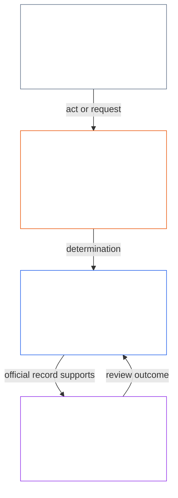
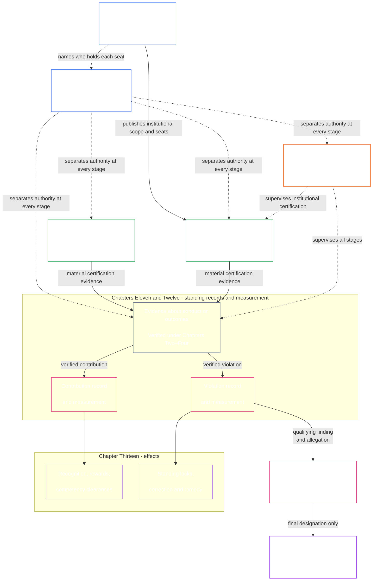

<!-- Locale: ru; language variety: Standard written Russian; no state is fixed.. Structural resynchronization draft, AI-assisted (GPT-6 Codex), unreviewed. English source commit: 6e0b6c663dde01b5dea731fe33d87725c7174930; edition: SC-Corpus-2026.11.25. Source SHA-256: core_00.000_preamble.md 90799cb8019b41356fa5dd90565e3f9540fc346e8c77e2c321b841654f39b274; core_01.000_constitutional_map.md aca759b394f10784ab1a2eef4e9e2ca12e369ef0ca8ee797298c6af00d2950aa. This file is partial; no fluent review or synchronization is claimed. -->
<!-- Chapter One: Constitutional Map. This is an incomplete locale draft; sections without source translation are marked below. -->

# ГЛАВА ПЕРВАЯ: КОНСТИТУЦИОННАЯ КАРТА

<strong>Размещение в корпусе (неоперативное): структура файлов и правила чтения</strong>

> Виджеты с пометкой **неоперативные** (размещение в корпусе, руководство для читателя, карты чтения) служат только для ориентации. Они не добавляют, не отменяют и не сужают обязательные положения ни в собственном, ни в любом другом файле.
>
> Этот файл **является частью Конституции сентентов** и **обязателен только вместе** с другими нумерованными файлами `core_*` и субкором, читаемыми как единый текст. Он содержит **Главу первую**, *Конституционную карту*: её цель (§1), причины существования (§2), связь файлов (§3), основы последующих глав (§4), ключевые процессы управления (§5) и реестр конституционных владельцев (§§6–11).
>
> **Предыдущий:** [core_00.000_preamble.md](core_00.000_preamble.md) (Преамбула)
> **Следующий:** [core_02.000_values_principles.md](core_02.000_values_principles.md)

<strong>Трассировка</strong>

- Источник: [Преамбула](core_00.000_preamble.md) (*Модель, Две конституционные цели, Конституционная тетрада, материальная ставка и категории измерений*).
- Разделы:
  - [§1](#1-purpose-role-and-scope);
  - [§2](#2-why-the-map-exists);
  - [§3](#3-how-the-files-fit-together);
  - [§4](#4-foundations-for-the-chapters-that-follow);
  - [§5](#5-key-governance-processes);
  - [§6](#6-principles-definitions-and-rights);
  - [§7](#7-system-and-institutional-charters-functional-independence-and-separation-of-duties);
  - [§8](#8-key-practical-process-pipelines);
  - [§9](#9-process-ownership-and-outputs);
  - [§10](#10-governance-change-and-incorporation);
  - [§11](#11-adopted-implementation-corpus).
- Читать вместе с [Стеком полномочий и внутренней иерархией](subcore_03.080_band_integrative.md#authority-stack-and-internal-hierarchy) (*как применяется реестр владельцев*) и [README.md](README.md) (*порядок чтения*).

 

### 1. Назначение, роль и охват

*Простыми словами: эта глава служит путеводителем по остальной Конституции. Она показывает, как связаны её части, какая глава отвечает за каждую тему и как работают основные процессы, чтобы читатель мог найти правило, отвечающее на его вопрос.*

**Назначение:** Глава первая даёт общий обзор и реестр ответственности. Она называет процессы, проверяющие уполномоченное управление, указывает, какая глава отвечает за каждую предметную область, и описывает три уровня конституционного текста.

**Роль:** Глава ориентирует и распределяет ответственность. Она не устанавливает собственных обязанностей помимо реестра владельцев, который применяют другие главы и [Внутренняя иерархия и стек полномочий](subcore_03.080_band_integrative.md#authority-stack-and-internal-hierarchy).

**Охват главы:** Глава охватывает:

- зачем нужна карта (**раздел 2**);
- как связаны файлы (**раздел 3**) и каковы основания для последующих глав (**раздел 4**);
- ключевые процессы управления (**раздел 5**);
- конституционный реестр владельцев: принципы, определения и права (**раздел 6**); уставы, функциональную независимость и разделение обязанностей (**раздел 7**); цепочки процессов (**раздел 8**); владельцев процессов и их результаты (**раздел 9**); управление, изменения и включение (**раздел 10**); и
- принятый корпус реализации и субкорпус (**раздел 11**).

### 2. Зачем нужна карта

*Простыми словами: столь большой текст нуждается в путеводителе, который показывает, как связаны его части и кто отвечает за каждую тему. Эта глава нужна, чтобы читатель мог найти правило, отвечающее на его вопрос.*

Конституция распределяет свою работу между многими главами, субкорпусом и четырьмя принятыми корпусами. Сентент, пытающийся выяснить, что ему причитается, или адоптер, ищущий обязанность, может заблудиться. Эта глава даёт общий обзор и реестр ответственности: что делает каждая часть, какая глава отвечает за каждую тему, как работают цепочки процессов и как соотносятся уровни. Помимо реестра владельцев, она не устанавливает собственных правил.

**Основания:**

- Преамбула:
  - [Конституционная тетрада](core_00.000_preamble.md#constitutional-tetrad): её составляющие, которые эта глава воплощает на практике:
    - [Участие](subcore_03.060_apex_participation_leg.md#participation): сентент может найти правило, отвечающее на его вопрос;
    - [Подотчётность](subcore_03.040_apex_accountability_leg.md#accountability): за каждую тему отвечает названная глава;
    - [Надзор](subcore_03.055_apex_oversight_leg.md#oversight): читатель может увидеть, как связаны части, и обнаружить пробел или пересечение;
    - [Своевременность](subcore_03.065_apex_timeliness_leg.md#timeliness): читатель без промедления находит нужное правило;
  - [Две конституционные цели](core_00.000_preamble.md#two-constitutional-aims): обе цели, которым служит эта глава:
    - [Расцвет](core_00.000_preamble.md#flourishing): Конституция служит сентентам, только если они могут в ней ориентироваться;
    - [Преемственность](core_00.000_preamble.md#continuity): ясная карта сохраняет целостность текста по мере его роста и изменений;
- принципы Главы второй:
  - [§5.2 Доступность простого языка (обязанность участия и ответственного управления)](core_02.000_values_principles.md#52-plain-language-accessibility-participation-and-stewardship-duty);
  - [§5.2.4 Дисциплина против использования сложности как способа поражения](core_02.000_values_principles.md#524-complexity-as-defeat-discipline);
  - [§15.4 Разрешение конфликтов конституционного смысла](core_02.030_constitutional_interpretation.md#154-constitutional-meaning-conflict-resolution);
- статьи Главы четвёртой:
  - [Статья XXIV-A](core_04.030_rights_part_d.md#article-xxiv-a-proportional-comprehensibility-right) (*Право на пропорциональную понятность*);
  - [Статья XXIV-B](core_04.030_rights_part_d.md#article-xxiv-b-complexity-audit-and-modularity-requirements) (*Требования к аудиту сложности и модульности*).

### 3. Как связаны файлы

Файлы Конституции связаны следующим образом:

- **Ядро (`core_*`):** нумерованные файлы содержат главы Конституции, которые следует читать вместе как единый текст. Они устанавливают гарантии и конституционную структуру.
- **Субкорпус (`subcore_*`):** эти файлы содержат полные правила и процедуры, лежащие в основе глав. Каждый относится к своей главе, имеет ту же силу и связывает каждого адоптера без отдельного включения. Субкорпус не может сужать положения своей главы.
- **Реализация (`corpus_*`):** четыре файла содержат операционные подробности исполнения Конституции. Они обязательны в пределах действительного включения и реализуют Конституцию, не сужая её. В [разделе 11](#11-adopted-implementation-corpus) указаны все четыре файла.

Определённый [Корпус](subcore_03.080_band_integrative.md#corpus) — это более широкий версионируемый набор обязательных конституционных источников: ядро, субкорпус, принятый текст реализации и любые действительные переходные обёртки совместимости. Проекты, заметки и навигационные руководства не становятся обязательными лишь потому, что входят в проект.

### 4. Основания для последующих глав

*Простыми словами: Главы со второй по четвёртую отвечают за ценности, словарь (а правила субкорпуса — за то, как строятся, защищаются и доказываются определения) и Пол прав; последующие главы должны уважать эти области ответственности и не перемещать их незаметно.*

Главы **со второй по четвёртую** задают ценности, словарь, механизмы проверки и Пол прав, которые должны соблюдать все последующие положения, включая:

- требование Устава системы или Устава учреждения из [Главы пятой](#7-system-and-institutional-charters-functional-independence-and-separation-of-duties), требование разделения обязанностей из Главы шестой и Независимые органы Главы седьмой;
- [Ключевые практические цепочки процессов](#8-key-practical-process-pipelines) раздела 8;
- [владельцев процессов и их результаты](#9-process-ownership-and-outputs) раздела 9;
- главы об управлении и путях изменений из раздела 10; и
- [Принятый корпус реализации](#11-adopted-implementation-corpus) раздела 11.

#### 5. Ключевые процессы управления

*Простыми словами: когда текст этого требует, материальные вопросы проходят через сертификацию, письменные записи помощи и вреда, исправление и средство защиты, и пересмотр форумом со сроками — обычные споры сначала используют опубликованный путь оспаривания; эти пути проверяют уполномоченное управление; сами по себе они его не создают.*

Там, где Глава шестая, [Глава седьмая](../../core_09.000_system_alignment_certification_evaluation.md#chapter-nine-system-alignment-certification), инкорпорированные инструменты или другие конституционные положения прямо этого требуют, введите материальные конституционные вопросы в один или несколько путей ниже. [Ключевые практические цепочки процессов](#6-key-practical-process-pipelines) переводят измерение в записи, сертификацию, проверенные входные данные, классификацию, надзор форума, исправление и своевременное средство защиты — как уполномоченное управление проверяется, оспаривается и чинится на практике. Сами по себе они не уполномочивают управление; они делают управление подлежащим пересмотру, оспоримым, исправимым и своевременным. [Раздел 5.1](#62-how-the-full-chain-fits-together) излагает эту цепочку полностью.

- **Сертификация конституционного согласования системы** ([Глава седьмая](../../core_09.000_system_alignment_certification_evaluation.md#chapter-nine-system-alignment-certification)) — прежде чем системе высокого воздействия доверяют в масштабе, соберите и проверьте доказательства того, конституционно ли безопасно опираться на неё прямо сейчас
- **Записи о статусе** ([Глава одиннадцатая](core_11_standing_assessment.md#chapter-eleven-standing-records--question-1-what-happened)) — если поведение или вред имеет конституционное значение, вносите проверенные факты в официальные дела о вкладе или нарушении; слухов и репутации недостаточно.
- **Исправление и возмещение** ([Глава тринадцатая §5.1 (*Возмещение и исправление*)](../../core_13.000_standing_integration.md#51-remedy-and-correction)) — устраните исходный сбой и предоставьте пострадавшим соразмерное признание, исправление, восстановление или компенсацию.
- **Рассмотрение форумом** ([Глава пятнадцатая](core_11_forum.md#1-purpose-and-role--participation-architecture))
  - Обычные споры внутри уже уполномоченных систем сначала используют опубликованный путь оспаривания [Системного участия затрагиваемых сторон](../../core_05.055_band_participation.md#stakeholder-status-and-weight-cluster)
  - Если этот путь всё ещё оспаривается, отсутствует, захвачен или не может предоставить защиту, маршрутизируйте по первичной ставке через надзираемые форумы
  - Эти форумы поддерживают доказательства, законную передачу и своевременные сроки под **Статьёй XXV-C** (*Своевременное разрешение и пол против промедления*)

### 4. Принципы, определения и права

*Простыми словами: Главы с первой по шестую владеют ценностями, тем, как слова строятся и проверяются, словарём и Полом прав; позднейшие главы должны уважать эти дома, а не тихо их перемещать.*

Разделы **4–7** — это **позитивный реестр владельцев** этой Конституции: каждый блок называет содержательный домен, которым владеет его глава (или корпус-спутник), и что она производит. Связывающие однострочные заявления владельца также появляются в открытии каждой нумерованной главы. Другие слои могут указывать на владельца — они не должны тихо переписывать или перемещать его; эта дисциплина неперемещения живёт под [Стеком власти и внутренней иерархией](core_05_band_integrative.md#authority-stack).

Главы **с первой по шестую** поставляют ценности, словарь, машинерию проверки и Пол прав, которые всё последующее должно уважать, — включая [Ключевые практические цепочки процессов](#6-key-practical-process-pipelines) в разделе 5, главы управления и пути изменения в разделе 6 и [корпус-спутник реализации](#7-companion-implementation-corpus) в разделе 7.

Каждое резюме излагает, что принадлежит главе и что она производит.

**Глава первая — Ценности, принципы и ответственное управление** ([Часть A](core_01_a_values_principles.md) · [Часть B](core_01_b_interaction_interpretation.md#chapter-01-part-b-interaction-and-interpretation) · [Часть C](core_01_c_stewardship_capacity_principles.md#chapter-01-part-c-stewardship-and-governance))

- **За что отвечает:** устанавливает руководящие ценности и ограничения Конституции, включая:
  - благополучие, справедливость, Безопасность, Истину, Доверие и ограниченную свободу;
  - признание законного вклада и соразмерное вознаграждение за него;
  - разрешение конфликтов между принципами; и
  - обязанности попечения, включая распределение понимания, системную оценку и дисциплину управления.
- **Результат:** интерпретационная основа для всех последующих глав. Эти правила превращают общие цели в действующие требования при чтении и применении систем, прав, определений или процессных цепочек.

**Глава вторая — Структура определений** ([`core_02_definition_structure.md`](core_02_definition_structure.md))

- **Её предмет:** определяет, как строятся конституционные термины посредством:
  - структуры компонентов «Онтология/Измерение/Оценка/Соответствие» (O/M/A/C);
  - требований согласованности; и
  - правил для компонентов, обеспечивающих точность и применимость определений во всём корпусе.
- **Результат:** единый язык определений, чтобы последующие главы не прибегали к расплывчатым обозначениям, скрытым предпосылкам или несовместимым формам терминов.

**Глава третья — Целостность определений** ([`core_02_definition_structure.md`](core_02_definition_structure.md))

- **Её предмет:** препятствует:
  - уклонению и смещению сферы действия;
  - манипуляциям с переопределением; и
  - уловкам несоблюдения, которые обессмысливают определения на бумаге и сводят на нет их действие на практике.
- **Результат:** дисциплина против уклонения и ориентирующие метаданные о несоблюдении, включая маршруты для проверки статуса и неправомерного поведения, если уклонение доказано.

**Глава четвёртая — Бремя, прослеживаемость и проверка** ([`core_02_definition_structure.md`](core_02_definition_structure.md))

- **Её предмет:**
  - возлагает бремя доказывания на того, кто заявляет о соблюдении требований; и
  - требует прослеживаемых доказательств, наблюдаемости и проверки, соразмерных [**значимости материального интереса**](#material-stake) и допускающих практическое оспаривание.
- **Результат:** Процесс проверки, обеспечивающий **проверенные входные данные** для [Главы одиннадцатой](core_11_standing_assessment.md#chapter-eleven-standing-records--question-1-what-happened) и доказательства согласованности системы для [Главы девятой](core_09.000_system_alignment_certification_evaluation.md#chapter-nine-system-alignment-certification). Он не заменяет само измерение статуса.
**Глава пятая — Основополагающие определения** ([`core_05__definitions_home.md`](core_05__definitions_home.md#chapter-five-foundational-definitions))

- **Её предмет:** устанавливает:
  - каноническую структуру определений: уровни Надзора, Участия, Подотчётности, Непрерывности и Интеграции;
  - [Иерархию полномочий и внутреннюю иерархию](core_05_band_integrative.md#authority-stack-and-internal-hierarchy);
  - [Корпус](core_05_band_integrative.md#corpus); и
  - связанные с ними правила разграничения.
- **Результат:** точная конституционная терминология для толкования, аудита и разрешения дел. Это **структура определений**, а не нижний предел прав — обязательные нижние пределы прав изложены в Главе шестой. Направление к областям компетенции в Конституции в целом содержится в данном реестре Преамбулы (разделы 4–9).

**Глава шестая — Основополагающие права** ([Часть A](core_06_rights_part_a.md) · [Часть B](core_06_rights_part_b.md) · [Часть C](core_06_rights_part_c.md) · [Часть D](core_06_rights_part_d.md))

- **Её предмет:** устанавливает Нижний предел прав в Статьях **I–XXVIII**, охватывая:
  - жизненно необходимые условия;
  - распределение ресурсов и управление зависимостями;
  - достоинство, субъектность и участие;
  - оспаривание и средства защиты;
  - ограничения во имя справедливости;
  - своевременность по **Статье XXVI-C** (*Нижний предел своевременного разрешения и запрета задержек*); и
  - правила перехода к принятию.
  Четыре части упорядочивают эти гарантии для чтения с приоритетом планеты.
- **Компетенция:** определяет, как правомерно менять эту Конституцию — процедуру поправок, ратификацию и принятие, — а также **процедурные гарантии**, следующие за содержательными гарантиями Главы семнадцатой: изменения должны публиковаться открыто, прослеживаться до уполномоченного хранения и оставаться предметом содержательного оспаривания с независимой проверкой, когда она требуется.

### 5. System and Institutional Charters, Functional Independence, and Separation of Duties

*Простыми словами: система или учреждение с реальным воздействием публикует Системную хартию или Институциональную хартию, где указано, что она может делать и кто занимает каждое место. Затем, до совершения существенно обязывающего действия, необходимо разделить функции инициирования, проверки или утверждения, хранения официальной записи и рассмотрения оспаривания. Роли можно соразмерять с условиями, но один и тот же субъект и линия его контроля не могут незаметно занимать места, проверяющие его собственное действие.*

- **Результат:** опубликованное, версионируемое описание области действия и распределения позиций, с которым Глава восьмая, сертификация, записи о статусе и форумы могут сопоставлять поведение. Глава седьмая находится в [`core_07.000_charters.md`](core_07_charters.md#chapter-seven-system-and-institutional-charters).

**Функциональная независимость и разделение обязанностей** — прежде чем продвигать материально обязательный акт, определите и разделите позиции инициирования, проверки или санкционирования, ведения записи и рассмотрения оспаривания согласно применимым правилам масштабирования и независимости.

**Разделяйте места для каждого материально обязывающего действия** ([глава восьмая](core_07_functional_independence_segregation_of_duties.md#2-four-seat-constitutional-requirement)): определите, кто начинает действие, кто проверяет или разрешает его, кто хранит официальную запись и кто рассматривает оспаривание. Прежде чем считать действие надлежащим образом проверенным, примените запреты на совмещение, правила независимости и опубликованный порядок замещения. Если требуется Хартия системы или Хартия учреждения ([глава седьмая](core_07_charters.md#4-the-charter-role-map-and-standing-record-custody)), ее карта ролей указывает, кто занимает каждое место.

**Глава Восьмая — Функциональная независимость и разделение обязанностей**

- **За что она отвечает:** за межпроцессное требование отдельно назначать четыре функции для каждого [Материально обязательного действия](../../core_05.035_band_accountability.md#materially-binding-act):
  - инициирование;
  - проверка или разрешение;
  - хранение официальной записи; и
  - рассмотрение оспариваний.

Кроме того, он регулирует:

  - универсальный минимальный состав каждой [Записи о материально обязательном акте](../../core_05.035_band_accountability.md#materially-binding-act-record);
  - независимость от [Линии существенного контроля](../../core_05.035_band_accountability.md#material-control-line) действующего лица;
  - опубликованное распределение функций и замещающие варианты;
  - соразмерное совмещенное размещение и пределы действий в чрезвычайной ситуации; и
  - передаваемые с указанием ответственных полномочия и направление не на ту позицию.
- **Результат:** повторно используемая архитектура четырех позиций и Записи о действии. Каждый последующий процесс сертификации, учета статуса, форума, управления и встроенного внедрения должен применять ее, прежде чем его результат можно будет считать независимо проверенным, надежно зафиксированным и действительно оспоримым.

#### 7. Four-seat separation map

> Эта схема показывает четыре функции и типичную последовательность действия и Записи о действии. Она не добавляет пятого места, не предписывает универсальную последовательность и не меняет правила Главы восьмой о независимости, соразмерном совмещении функций, действиях в чрезвычайной ситуации или маршрутизации оспаривания.

### 6. Ключевые практические цепочки процессов

*Простыми словами: Главы с девятой по пятнадцатую применяют требование разделения обязанностей из Главы восьмой как единую цепочку: сертифицируют системы и учреждения, измеряют помощь и вред по двум отдельным направлениям, применяют реальные последствия и возмещение и не позволяют форуму стать единственным окончательным судьёй по жалобе на него самого. Эта цепочка делает конституционные обязанности реальными в повседневной жизни.*

[Глава седьмая](core_07_charters.md#chapter-seven-system-and-institutional-charters) публикует охват хартии и карту мест для каждой системы и учреждения класса L или выше. [Глава восьмая](../../core_08.000_functional_independence_separation_of_duties.md#chapter-eight-functional-independence-and-separation-of-duties) устанавливает требование разделения обязанностей, благодаря которому каждое действие в этой цепочке можно надлежащим образом проверить. Функции инициирования, проверки или утверждения, хранения официальных записей и рассмотрения оспаривания должны распределяться и оставаться раздельными согласно применимым правилам масштабирования и независимости. Затем Главы с девятой по пятнадцатую последовательно применяют эту архитектуру:

Каждый шаг ниже излагает, что принадлежит главе и что она производит. [Как целая цепочка складывается](#62-how-the-full-chain-fits-together) затем показывает этих владельцев как один путь от проверки системы до средства защиты.

#### 8. Process map

- **Результат:** Процесс проверки, обеспечивающий **проверенные входные данные** для [Главы одиннадцатой](core_11_standing_assessment.md#chapter-eleven-standing-records--question-1-what-happened) и доказательства согласованности системы для [Главы девятой](core_09.000_system_alignment_certification_evaluation.md#chapter-nine-system-alignment-certification). Он не заменяет само измерение статуса.
  - Правила перехода при принятии.
- **Результат:** Неподлежащие обсуждению гарантии прав и механизмы возмещения, которые Главы седьмая по пятнадцатую, форумы, управление и правила внесения поправок обязаны уважать и не могут сужать, обходить или опустошать посредством процедур или косвенных показателей.
*Простыми словами: система или учреждение с реальным воздействием публикует Системную хартию или Институциональную хартию, где указано, что она может делать и кто занимает каждое место. Затем, до совершения существенно обязывающего действия, необходимо разделить функции инициирования, проверки или утверждения, хранения официальной записи и рассмотрения оспаривания. Роли можно соразмерять с условиями, но один и тот же субъект и линия его контроля не могут незаметно занимать места, проверяющие его собственное действие.*
  - как изменять и пересматривать Системную хартию или Институциональную хартию, чтобы установленный хартией охват не менялся незаметно; и
> Эта схема показывает четыре функции и типичную последовательность действия и Записи о действии. Она не добавляет пятого места, не предписывает универсальную последовательность и не меняет правила Главы восьмой о независимости, соразмерном совмещении функций, действиях в чрезвычайной ситуации или маршрутизации оспаривания.

### 7. Владение процессами и результаты

Глава седьмая — Хартии систем и учреждений ([Chapter Seven](../../core_07.000_charters.md#chapter-seven-system-and-institutional-charters))

- **Результат:** опубликованное, версионируемое описание области действия и распределения позиций, с которым Глава восьмая, сертификация, записи о статусе и форумы могут сопоставлять поведение. Глава седьмая находится в [`core_07.000_charters.md`](core_07_charters.md#chapter-seven-system-and-institutional-charters).

### 8. Управление, изменение и инкорпорация

*Простыми словами: Главы с шестнадцатой по двадцатую завершают эту Конституцию: кто может управлять, как менять текст без отката гарантий, как он соотносится с другими законами и как принятые практические материалы остаются связанными с этим источником.*

Главы **с двенадцатой по шестнадцатую** закрывают инструмент — и завершают [позитивный реестр владельцев](#4-principles-definitions-and-rights) для управления, действительности изменения и инкорпорации: кто может управлять легитимно, как Конституция может законно меняться и как принятый текст реализации остаётся привязанным к конституционному источнику без тихой конституционной рассогласованности.

Каждое резюме излагает, что принадлежит главе и что она производит.

**Глава двадцатая — Конституционный договор, легитимность и ответственное управление** ([`core_16.000_governance.md`](../../core_16.000_governance.md#chapter-sixteen-constitutional-contract-legitimacy-authorization-and-stewardship))

- **Что ей принадлежит:** Владеет [**Слоем конституционного договора**](core_05_band_integrative.md#constitutional-contract-layer) — кто может управлять, каким механизмом легитимности, под каким охватом и длительными условиями и с каким характером ответственного управления это должно поддерживаться.
- **Что она производит:** Требования уполномочивания и легитимности, отличные от [**Системного участия затрагиваемых сторон**](../../core_05.055_band_participation.md#stakeholder-status-and-weight-cluster) в уже уполномоченных системах — правила самой управляющей власти, а не только участия внутри неё.

**Глава семнадцатая — Недопущение регресса** ([`core_17.000_non_regression.md`](../../core_17.000_non_regression.md#chapter-seventeen-non-regression-and-substantive-amendment-validity))

- **Что ей принадлежит:** Задаёт содержательный пол против регрессивного изменения — поправки и обходы не могут откатить основные защиты, выхолостить Тетраду ниже материальной ставки или замаскировать регресс как техническую чистку.
- **Что она производит:** **Первое конституционное ограждение** на любое предложенное изменение — правило нерегресса: если изменение на практике ослабило бы основные защиты, оно недействительно, даже когда процедура выглядит в порядке. Подозреваемые обходы или замаскированные откаты останавливаются или направляются на надлежащие пути пересмотра вместо того, чтобы тихо проскользнуть.

**Глава восемнадцатая — Верховенство и внешние распоряжения** ([`core_18.000_expansion_supremacy.md`](../../core_18.000_expansion_supremacy.md#chapter-eighteen-expansion-supremacy-and-external-legal-orders))

- **Компетенция:** определяет отношение этой Конституции к другим нормам: расширение защиты там, где это законно; верховенство в пределах действительного источника, принятия и слоя управления; недопущение вытеснения применимого внешнего права, действующего самостоятельно; упорядоченное взаимодействие с внешними правовыми системами без скрытого подчинения или захвата.
- **Что она производит:** Правила иерархии и порядка конфликтов, чтобы публикация или использование не трактовались как отмена применимого внешнего права, и чтобы принявшие не могли трактовать инкорпорированную процедуру, более слабые внешние нормы или метрики удобства как перекрывающие значение Конституции сентентов внутри действительного охвата принятия.
**Глава девятнадцатая — Поправки, ратификация и принятие** ([`core_19.000_amendment_ratification.md`](../../core_19.000_amendment_ratification.md#chapter-nineteen-amendment-ratification-and-procedural-validity))

- **Компетенция:** определяет, как правомерно менять эту Конституцию — процедуру поправок, ратификацию и принятие, — а также **процедурные гарантии**, следующие за содержательными гарантиями Главы семнадцатой: изменения должны публиковаться открыто, прослеживаться до уполномоченного хранения и оставаться предметом содержательного оспаривания с независимой проверкой, когда она требуется.
- **Что она производит:** Полный законный путь изменения — только поправки и принятия, которые проходят **ограждение нерегресса** и **процедурные ограждения**, считаются действительными конституционными обновлениями.
**Глава двадцатая — Мост инкорпорации** ([`core_20.000_incorporation.md`](../../core_20.000_incorporation.md))

- **Что ей принадлежит:** Определяет, какие файлы реализации считаются связывающим инкорпорированным текстом при принятии; закрепляет издания; ведёт цепочки хранения; и запрещает тихую конституционную рассогласованность между конституционным источником и операционной деталью.
- **Что она производит:** Единую границу инкорпорации — обозначенный текст реализации связывает при принятии; корпуса-спутники реализуют Конституцию, не становясь вторым источником, который её сужает. [Раздел 7](#9-adopted-implementation-corpus) суммирует эти корпуса на высоком уровне.

### 9. Принятый корпус реализации

*Простыми словами: четыре корпуса-спутника (совместная структура, системы, институты и операции форумов) излагают, как исполнять то, что главы уже требуют; они связывают, когда законно приняты, и не могут сузить эти обязанности.*

За пределами нумерованных глав `core_*` четыре корпуса-спутника завершают [позитивный реестр владельцев](#4-principles-definitions-and-rights) для принятого **текста реализации** — операционной детали, которая делает конституционные обязанности исполнимыми на практике:

- **[corpus_joint_structure](../../corpus_joint_structure.md)** — межфайловая маршрутизация, общие операционные термины и совместная структура, когда системы, институты и форумы должны читаться вместе по одним и тем же фактам.
- **[corpus_systems](../../corpus_systems.md)** — классификация систем, протоколы проектирования и развёртывания, обращение с информацией и механика критического ответственного управления.
- **[corpus_institutions](../../corpus_institutions.md)** — институциональное образование, управление, надзор, соразмерность и дисциплина роспуска.
- **[corpus_forum](../../corpus_forum.md)** — операции форумов: формирование коллегий, отвод, полосы пересмотра, деталь маршрутизации и форензическая поддержка.

Когда принимающая сторона правомерно включает их согласно [Главе двадцатой](../../core_20.000_incorporation.md), эти файлы становятся обязательным текстом реализации в пределах принятия. Значение Конституции разумных существ продолжает иметь приоритет — эти файлы **реализуют изложенные выше главы, но не сужают их**. Фиксация редакции, цепочки хранения и запрет на незаметный дрейф позволяют проследить принятый текст до фактически ратифицированного источника. Канонический перечень и правила границ приведены в [Главе пятой — Корпус](../../core_05.045_band_integrative.md#corpus).

Принципы, определения, права, цепочки процессов, управление, правила поправок и инкорпорированная реализация должны читаться вместе, чтобы сохранить защитную цель Конституции.
---

**Предыдущий файл:** [README.md](README.md)

**Следующий файл (этот язык):** [core_01_a_values_principles.md](core_01_a_values_principles.md)

**Связывающий оригинал:** [core_00_preamble.md](core_00_preamble.md)

<!-- Pair status: INCOMPLETE. Sections 1–4 and all gaps require translation; reused passages need full current-source fidelity and glossary review. -->
