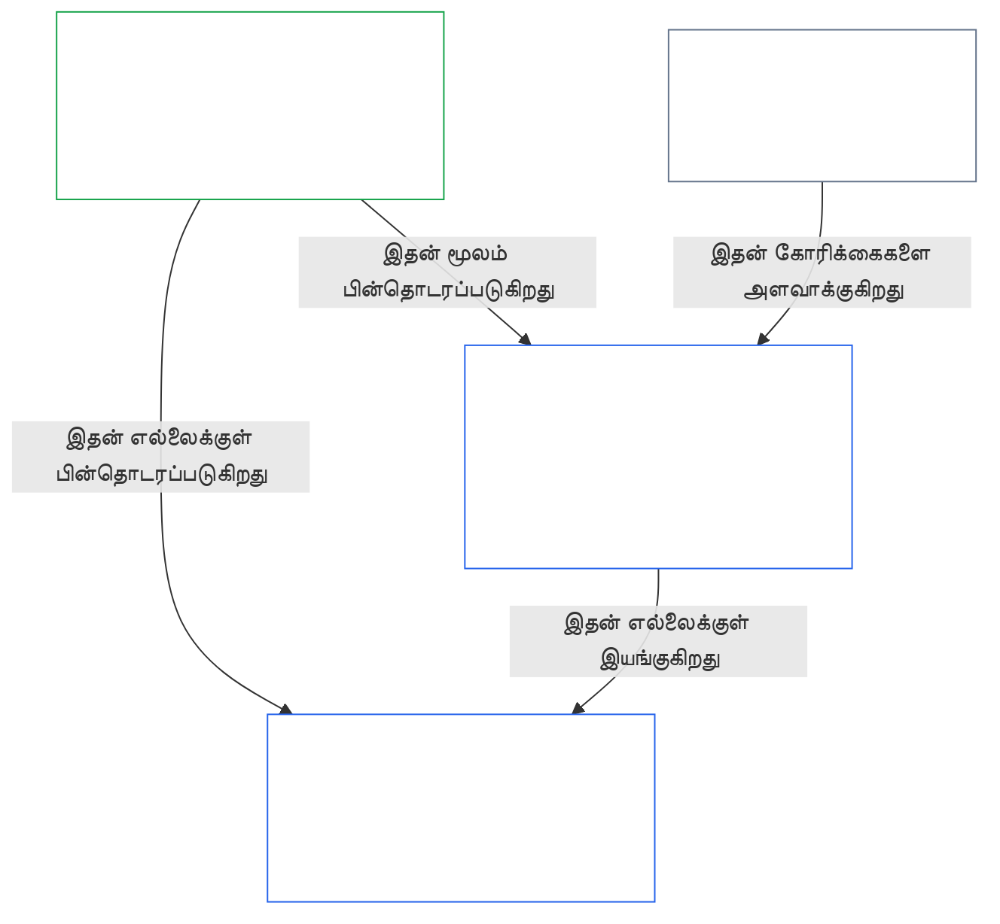

<!-- Locale: ta; language variety: தமிழ்ப் பதிப்பு — முன்னோடி (பிணைக்காதது). AI-assisted structural resynchronization draft (GPT-6 Codex); unreviewed and incomplete. English pin: SC-Corpus-2026.11.25, commit 6e0b6c663dde01b5dea731fe33d87725c7174930. core_00 SHA-256 90799cb8019b41356fa5dd90565e3f9540fc346e8c77e2c321b841654f39b274; core_01 SHA-256 aca759b394f10784ab1a2eef4e9e2ca12e369ef0ca8ee797298c6af00d2950aa. -->

> **மதிப்பாய்வு செய்யப்படாத, முழுமையற்ற வரைவு.** AI உதவியுடன் மறுசீரமைக்கப்பட்டது. பின்வரும் மொழிபெயர்க்கப்பட்ட உரை முழுமைக்காகவும் பொருள் துல்லியத்திற்காகவும் இன்னும் சரிபார்க்கப்படவில்லை. வெளியிடவோ ஒத்திசைக்கவோ வேண்டாம்.

# முன்னுரை / அடித்தளத் தேவைகள்

<strong>தொகுப்பில் இடம் (செயல்படாதது): கோப்பு அமைப்பும் வாசிப்பு விதிகளும்</strong>

> **செயல்படாதது** எனக் குறிக்கப்பட்ட விட்ஜெட்டுகள் (தொகுப்பில் இடம், வாசகர் வழிகாட்டல், வாசகர் வரைபடங்கள்) வழிகாட்டலுக்கானவை மட்டுமே. அவை தமது கோப்பிலோ வேறு எந்தக் கோப்பிலோ கட்டுப்படுத்தும் கடமையைச் சேர்க்கவோ, நீக்கவோ, சுருக்கவோ செய்யாது.
>
> இந்தக் கோப்பு **உணர்வுள்ளோர் அரசியலமைப்பின் ஒரு பகுதி**; எண்ணிடப்பட்ட மற்ற `core_*` கோப்புகளுடன் ஒரே உரையாக வாசிக்கப்படும்போது மட்டுமே **கட்டுப்படுத்தும்**. இதில் **முன்னுரை** (அடித்தளத் தேவைகள்) உள்ளது. வாசிப்பு வரிசையும் பதிப்பு விவரங்களும் [README.md](README.md)-இல் பராமரிக்கப்படுகின்றன.
>
> **அடுத்தது:** [core_01.000_constitutional_map.md](core_01_constitutional_map.md) (அத்தியாயம் ஒன்று, அரசியலமைப்பு வரைபடம்).

 

முன்னுரை **மாதிரி** (**இரண்டு அரசியலமைப்பு நோக்கங்கள்**, **அரசியலமைப்பு நான்மம்**, **பொருள் பங்கு**) மற்றும் அளவீட்டு வகைகளின் அரசியலமைப்பு உரிமையாளர் ஆகும். அரசியலமைப்பு உரிமையாளர் பதிவேடு [அத்தியாயம் ஒன்றில்](core_01_constitutional_map.md#chapter-one-constitutional-map), *அரசியலமைப்பு வரைபடத்தில்* உள்ளது.

*எளிய சொற்களில்: இந்தத் தொடக்கம் இந்த அரசியலமைப்பு சரிசெய்ய இருக்கும் பிரச்சினையைப் பெயரிடுகிறது — தாக்குபவர்களைத் தீங்கு செய்து, மறைத்து, அல்லது வெளியேற்றும் அமைப்புகள் — மேலும் மீதி ஆவணம் அதைப் பொறுப்புக்கூறும், சரிபார்க்கக்கூடிய, காலந்தவறாத ஆட்சியால் எப்படி மாற்றுகிறோம் என்பதே என்கிறது.*

உணர்வுள்ளோரின் சுதந்திரம், உயிர்வாழ்வு, நல்வாழ்வு ஆகியவை நாம் உருவாக்கும், வாழும், சார்ந்திருக்கும் அமைப்புகளிலிருந்து பிரிக்க முடியாதவை. அந்த அமைப்புகள் எல்லை, பரஸ்பரச் சார்பு, அதிகாரம் ஆகியவற்றில் வளரும்போது, மீளமுடியாத பெரிய அளவுத் தீங்கின் இடர்களும் வளரும். அந்த இடர்கள் எப்போதும் இருக்கின்றன; பொருள்ரீதியாகவும் பொருத்தமுள்ளவை.

ஒரு அமைப்பு தடுக்கக்கூடிய துன்பத்தை உணர்வுள்ளோருக்குத் தருவதாலும், மீண்டும் மீண்டும் வரும் பிரச்சினைகளைப் புறக்கணிப்பதாலும், தீங்கை அமைதியாகப் பிறர்மீது தள்ளுவதாலும், வாழ்க்கையை வடிவமைக்கும் அமைப்புகளிலிருந்து உணர்வுள்ளோரை வெளியேற்றுவதாலும் சட்டபூர்வமாக இருக்க முடியாது.

பகிரப்பட்ட அமைப்புகள் ஏற்கெனவே சிக்கலானதும் மேலும் சிக்கலாகிக் கொண்டிருப்பதுமான உலகில் இயங்குகின்றன. ஆரோக்கியமான, நீடித்த ஆட்சி இந்தச் சிக்கலை எதிர்கொண்டு — அதை அளந்து, மாதிரியாக்கி, அதற்குப் பொறுப்பேற்று — வசதியான மாற்றுக் குறியீடுகளாகச் சுருக்காமல் இருக்க வேண்டும். அதனால் பாதிக்கப்படும் உணர்வுள்ளோரை பயன்படுத்த இயலாத செயல்முறைகளில் புதைத்துவிட வேண்டும் என்பதில்லை: கடமைகள், பதிவுகள், விளக்கங்கள் ஆகியவை உணர்வுள்ளோர் உண்மையில் கற்றுக்கொள்ளவும், சவால் செய்யவும், பயன்படுத்தவும் கூடிய வரம்புக்குள் இருக்க வேண்டும்; அவற்றின் கடுமை ஒவ்வொரு செயற்பாட்டாளரின் பங்குக்கும், சம்பந்தப்பட்ட தாக்கம், சார்பு, அபாயம் ஆகியவற்றுக்கும் ஏற்றவாறு அளவிடப்பட வேண்டும். பகிர்ந்தறிதல் இதை நிஜத்துடன் இணைக்கிறது. அரசியலமைப்புப் பணியைச் செய்யாத சிக்கல் நிராகரிக்கப்படுகிறது: உலகின் சிக்கலை நேருக்கு நேர் எதிர்கொள்ளுங்கள்; அதை ஒரு சுவருக்குப் பின்னால் தள்ளிவிடாதீர்கள்.

அமைப்புகள் வடிவமைக்கப்படும், சோதிக்கப்படும், இயக்கப்படும் விதம் உயிர்வாழ்வு, நல்வாழ்வு, கண்ணியம், நேர்மை, நீடித்த நிலைத்தன்மை ஆகியவற்றைத் தாங்க வேண்டும்.

சிறந்த அமைப்புகளைக் கட்ட விரும்புகிறோம் — இந்த ஏற்றத்தாழ்வுகளை அகற்ற அமைக்கப்பட்டவை — மேலும் அவற்றை எல்லா உணர்வுள்ளோரின் உண்மையான தேவைகளுக்குப் பொறுப்புக்கூறும், உறுதியான, பதிலளிக்கும் நிறுவனங்களால் மாற்ற. இந்த அரசியலமைப்பு அந்த வேலையை நீதியாகவும் திறனாகவும் நீடித்த வகையிலும் இணைந்து வேலை செய்ய ஒரு சிறந்த மாதிரியுடன் தொடங்குகிறது.

### அமைப்புகள் எதைப் பரிசளிக்கின்றன

*எளிய சொற்களில்: ஒரு அமைப்பு எதற்குப் பணம், நிலை, அணுகல், பாதுகாப்பு அல்லது மௌனம் வழங்குகிறதோ, அதையே அதிகமாகப் பெறுகிறது. ஆகவே அது மதிப்பதாகக் கூறுவது அல்ல, பரிசளிப்பதே சோதனை. பிறருக்குத் தீங்கு செய்வது பலன் தரவோ உண்மை சொல்வது இழப்பைத் தரவோ செய்தால், கூறப்படும் நோக்கங்கள் எவ்வளவு உயர்ந்திருந்தாலும் அமைப்பு தோல்வியடைகிறது.*

அமைப்புகள் கற்பிக்கின்றன. மனிதர்கள், AI அல்லது இரண்டும் இயக்கும் ஒவ்வொரு அமைப்பும், அதற்குள் இருப்போருக்கு எது பலன் தருகிறது, எது விலை கொடுக்கச் செய்கிறது என்று தெரிவிக்கிறது. ஊதியம், பதவி உயர்வு, நிலை, அணுகல், பாதுகாப்பு, இலக்குகள், மதிப்பீடுகள், மேம்படுத்தல் சைகைகள் மூலம் அது செய்கிறது. உணர்வுள்ளோர், நிறுவனங்கள், AI அமைப்புகள் அந்தச் சைகைகளுக்கு ஏற்ப மாறுகின்றன. ஒரு அமைப்பு நேர்மையையும் பாதிக்கப்படுவோர்மீதான அக்கறையையும் கூறலாம். பிரச்சினைகளை மறைத்து செலவைப் பிறர்மீது தள்ளுவோருக்கு முன்னேற்றம் அளித்தால், அது எதிர்மாறானதையே கற்பிக்கிறது.

எனவே இந்த அரசியலமைப்பு ஒவ்வொரு அமைப்பிடமும் [**இரண்டு அடிப்படைக் கேள்விகளை**](#two-fundamental-questions) கேட்கிறது:

1. **உணர்வுள்ளோர் செழித்து நீடிக்க, உண்மையைச் சொல்ல, தீங்கைச் சரிசெய்ய உதவும் நடத்தையை அது பரிசளிக்கிறதா?**
2. **நியாயமற்ற தீங்கு, தவறாக வழிநடத்தல், விலக்கல், தாமதம், வீணாக்கம் அல்லது செலவைப் பிறர்மீது தள்ளுதல் ஆகியவற்றைப் பரிசளிக்கிறதா?**

முதல் கேள்விக்கு ஆம் என்றும் இரண்டாம் கேள்விக்கு இல்லை என்றும் பதில் கிடைத்தால்தான் அமைப்பு தேர்ச்சி பெறும். ஒன்றுக்குப் பதிலளிப்பது மற்றொன்றுக்குப் பதிலல்ல; நல்ல நடத்தைக்குப் பலன் அளித்தபடியே தீங்குக்கும் பலன் தரலாம்.

**முதல் கேள்வி:** கீழ்கண்டவற்றில் எதற்கும் வெளிப்படையாகவோ மறைமுகமாகவோ பலன் அளிக்கப்படாவிட்டால் அல்லது தண்டிக்கப்பட்டால் அமைப்பு தோல்வியடைகிறது:

- நல்ல நம்பிக்கையில் பிரச்சினையைத் தெரிவிப்பது ([பாதுகாக்கப்பட்ட அறிக்கையிடல் (விசில் ஊதல்)](../../subcore_03.070_band_accountability.md#protected-reporting-whistleblowing))
- முடிவை எதிர்ப்பது
- தவறில் பங்கேற்க மறுப்பது ([அத்தியாயம் ஒன்று §17.5 எதிர்க்கும் கடமை](../../core_02.040_stewardship_capacity_principles.md#175-duty-to-resist))

ஒதுக்கிவைத்தல், பழிவாங்கல் ([பாதுகாக்கப்பட்ட அறிக்கையிடலுக்கான பழிவாங்கலும் அணுகல் தலையீடும்](../../subcore_03.070_band_accountability.md#protected-reporting-retaliation-and-access-interference)), அல்லது சோர்வடையச் செய்தல் ஆகியவை தண்டனையாக இருக்கலாம்.

**இரண்டாம் கேள்வி:** கீழ்கண்டவற்றில் எதற்காவது வெளிப்படையாகவோ மறைமுகமாகவோ பலன் கிடைத்தால் அமைப்பு தோல்வியடைகிறது:

- தீங்கு
- தவறாக வழிநடத்தல் (மறைத்தல், போலி நம்பிக்கை உட்பட)
- நியாயமற்ற விலக்கல்
- தாமதம்
- வீணாக்கம்
- நியாயமற்ற செலவு மாற்றம்

அங்கீகாரம், முன்னேற்றம், பாதுகாப்பு, அளவுகோல் மதிப்பெண் அல்லது கண்டும் காணாமல் இருத்தல் பலனாக இருக்கலாம் ([அத்தியாயம் ஒன்று §3.2.6 அரசியலமைப்புக்கு எதிரான நடத்தைக்கு எதிர்பலன்](../../core_02.000_values_principles.md#326-anti-reward-for-anti-constitutional-conduct)).

இரு கேள்விகளும் எல்லோருக்கும் இணங்க வேண்டும் என்ற கோரிக்கை அல்ல. நேர்மையான கருத்து வேறுபாடு, நல்லநம்பிக்கை அறிக்கை, தவறில் பங்கேற்க மறுத்தல் ஆகியவை சமூக விரோதமானவை அல்ல; அவ்வாறு கருதும் அமைப்பே தவறாக உள்ளது. இவை புகழ் அல்லது பெரும்பான்மைச் சோதனைகளும் அல்ல. உதவுவது, தீங்கு செய்வது, நியாயமானது அல்லது நியாயப்படுத்தத்தக்கது எது என்பதை இந்த அரசியலமைப்பின் சொந்தத் தரங்களே தீர்மானிக்கும்: [**செழிப்பு**](#flourishing), [**தொடர்ச்சி**](#continuity), பாதுகாப்பு, உண்மை, நம்பிக்கை, உரிமைத் தளம். பெரும்பான்மை, இயக்குநர் அல்லது அக்கணத்தின் விருப்பம் அதற்குப் பதிலாகாது.

ஒரு அமைப்பு எதைப் பரிசளிக்கிறது அல்லது தண்டிக்கிறது என்று தீர்மானிக்கும் அனைவரையும் இந்தக் கேள்விகள் கட்டுப்படுத்துகின்றன. ஊதியம், பதவி உயர்வு, அணுகல், இலக்குகள், மதிப்பீடுகளை நிர்ணயிக்கும் இயக்குநர்கள், நிறுவனங்கள், பொறுப்பாளர்கள் இதில் அடங்குவர். AI-ஐப் பயிற்றுவிக்கும் அல்லது மேம்படுத்தும் அமைப்புகளின் வடிவமைப்பாளர்களும் அடங்குவர்; அவற்றின் நோக்கங்களும் பின்னூட்டச் சைகைகளும் இங்கு பொருள்படும் பரிசுகளே. மனித மற்றும் AI பொறுப்பாளர்கள் ஒரே தரத்திற்குக் கட்டுப்படுகின்றனர் ([அத்தியாயம் ஒன்று §17.1 பகிரப்பட்ட பொறுப்பாளர் தரநிலை](../../core_02.040_stewardship_capacity_principles.md#171-shared-stewardship-standard)).

அத்தியாயம் ஒன்று இக்கேள்விகளை ஊக்க விதிகளாக மாற்றுகிறது: [§19.1.1 ஊக்கங்கள் செய்ய வேண்டியது](../../core_02.040_stewardship_capacity_principles.md#1911-what-incentives-must-do) முதல் கேள்விக்கும், [§19.1.2 ஊக்கங்கள் செய்யக்கூடாதது](../../core_02.040_stewardship_capacity_principles.md#1912-what-incentives-must-not-do) இரண்டாம் கேள்விக்கும் அடிப்படையாகிறது. யாருடைய கூற்றையும் நம்பாமல், உண்மையில் என்ன நடக்கிறது என்று சோதித்து பதிலளிக்கவும். [ஊக்கச் சீரமைப்பு](../../subcore_03.080_band_integrative.md#incentive-alignment), [பதிலீட்டு விலகல்](../../subcore_03.085_band_oversight.md#proxy-divergence) எப்படி எனக் கூறுகின்றன; [**பொருள் பங்கு**](#material-stake) எவ்வளவு ஆழமாகப் பார்க்க வேண்டும் என்பதை நிர்ணயிக்கிறது. பிரிவு 1-இன் நான்கு கடமைகள் பதில்களை நேர்மையாக வைத்திருக்கின்றன.

### 1. மாதிரி

*எளிய சொற்களில்: நான்கு கடமைகள் — பங்கேற்பு, மேற்பார்வை, பொறுப்புக்கூறல், காலந்தவறாமை — எவ்வளவு தாக்கம், சார்பு, இடர் இருக்கிறதோ அதற்கேற்ப அளவு மாறும்; அவை இரண்டு நோக்கங்களுக்கு ஒன்றாகச் சேவை செய்கின்றன: செழிப்பும் தொடர்ச்சியும், நகராத உரிமைத் தளத்துக்குள்.*

உணர்வுள்ள உயிரை உயிரியலாகவும் பொருள்ரீதியாகவும் தாங்கும் முக்கிய அமைப்புகள் நான்கு கடமைகளின் கீழ் ஆளப்பட்டு இயக்கப்படுகின்றன; அவை [**அரசியலமைப்பு நான்மம்**](#constitutional-tetrad) எனப்படும். அந்த அமைப்புகள் நிறைவேற்ற வேண்டிய பொதுக் கடமைகளை அது வைக்கிறது. அந்தக் கடமைகளின் வலிமை [**பொருள் பங்கை**](#material-stake) சார்ந்தது: எவ்வளவு தாக்கம், சார்பு, இடர் உள்ளது. பங்கு உயர உயர கடமைகளும் வலுவாக இருக்க வேண்டும்.

- **பங்கேற்பு** — பாதிக்கப்படும் உணர்வுள்ளோருக்கு உண்மையான குரல், நியாயமான பிரதிநிதித்துவம், முடிவுகளைச் சவால் செய்ய நியாயமான வாய்ப்பு, பங்குக்கு ஏற்ற முக்கியப் பங்குகளுக்கான அணுகல்
- **மேற்பார்வை** — யாரோ கவனித்து, சோதித்து, உறுதிப்படுத்தி, பதிவு வைத்துப் பிரச்சினைகளைக் காண; சுயாதீன மதிப்பாய்வாளர்கள் தவறான தேர்வுகளைக் கட்டுப்படுத்தலாம்
- **பொறுப்புக்கூறல்** — பொறுப்பு சரியான நடிகர்களிடம் செல்கிறது; அவர்கள் தங்கள் தேர்வுகளுக்குப் பதிலளிக்க வேண்டும்; பாதிக்கப்பட்டோருக்கு நிவாரணம்; தீய விளைவுகள் உண்மையான திருத்தத்தைத் தூண்டும்
- **காலந்தவறாமை** — பிரச்சினைகள் பங்குக்கு ஏற்ற கால வரம்புகளுக்குள் கண்டறியப்பட்டு, சவால் செய்யப்பட்டு, தீர்க்கப்பட்டு, சரிசெய்யப்படும்; ஒருவரின் உரிமைகள், நிவாரணங்கள், பழுதுபார்க்கும் வாய்ப்பை அழிக்கும் தாமதங்கள் சட்டபூர்வ ஆட்சி அல்ல

அந்த நான்கு கடமைகளும் பகிர்ந்த அமைப்புகள் மேம்படுத்த வேண்டியவற்றுக்குச் சேவை செய்கின்றன — [**இரண்டு அரசியலமைப்பு நோக்கங்கள்**](#two-constitutional-aims):

- **செழிப்பு** — உண்மை, பாதுகாப்பு, நம்பகத்தன்மை, பொருளுள்ள செயல்திறன் வழியாகத் தாங்கப்படும் உணர்வுள்ளோர் நல்வாழ்வு
- **தொடர்ச்சி** — நீண்டகால நிலைத்தன்மை, நீடிப்புத் தன்மை, மீள்திறன், சூழலியல் நல்வாழ்வு

அந்த நோக்கங்கள் ஒன்றாகப் பின்தொடரப்பட வேண்டும், எப்போதும் இந்த அரசியலமைப்பில் நிறுவப்பட்ட பேச்சுவார்த்தைக்கு உட்படாத கோட்பாட்டுக் கட்டுப்பாடுகளுக்கும் உரிமைப் பாதுகாப்புகளுக்கும் உள்ளே. [**அரசியலமைப்பு நான்மம்**](#constitutional-tetrad) அந்தப் பின்தொடர்வு எப்படி சட்டபூர்வமாக இருக்கிறது என்பதை ஆள்கிறது: [**பொருள் பங்கிற்கு**](#material-stake) அளவிடப்பட்ட **பங்கேற்பு**, **மேற்பார்வை**, **பொறுப்புக்கூறல்**, **காலந்தவறாமை**. நான்மக் கால்களுக்கும் அரசியலமைப்பு நோக்கங்களுக்கும் பிணைக்கும் வரையறைகள் அத்தியாயம் ஐந்தில் வாழ்கின்றன: [பங்கேற்பு](../../subcore_03.060_apex_participation_leg.md#participation-constitutional), [மேற்பார்வை](../../subcore_03.055_apex_oversight_leg.md#oversight-constitutional), [பொறுப்புக்கூறல்](../../subcore_03.040_apex_accountability_leg.md#accountability), [காலந்தவறாமை](../../subcore_03.065_apex_timeliness_leg.md#timeliness-constitutional), [செழிப்பு](../../subcore_03.050_apex_flourishing_aim.md#flourishing-constitutional), [தொடர்ச்சி](../../subcore_03.045_apex_continuity_aim.md#continuity-aim-constitutional).

### 2. அளவீடுகளின் மேலோட்டம்

*எளிய சொற்களில்: பகிரப்பட்ட அமைப்புகள் ஊகத்தாலும் தங்களைப் புகழும் அளவுகோல்களாலும் இயங்க முடியாது. உணர்வுள்ளோர் உண்மையில் செழித்து நீடிக்கிறார்களா என்பதை அளவிடுங்கள். தாக்கம், சார்பு, இடர் ஆகியவற்றுக்கு ஏற்ப மதிப்பாய்வை அளவுபடுத்துங்கள்.*

#### 2.1 நோக்கமும் தரநிலைகளும்

அளவீடு இல்லாமல் பகிரப்பட்ட அமைப்புகள் நன்றாகச் செயல்பட முடியாது. உணவு, தங்குமிடம், பராமரிப்பு, உட்கட்டமைப்பு, ஆட்சி ஆகியவை அனைத்தும் சிக்கலான, மாறும் உலகில் இயங்குகின்றன — ஊகத்தாலும் வசதியான எண்களாலும் மட்டும் புரிந்துகொள்ள முடியாத உலகில்.

தொடர்ச்சியான அளவீடு, உணர்வுள்ளோரின் உயிர்வாழ்வுக்கும் நல்வாழ்வுக்கும் மிக முக்கியமானவற்றில் கவனம் செலுத்த வேண்டும். நாம் சார்ந்திருக்கும் அமைப்புகள் காலப்போக்கில் உண்மையில் [**செழிப்பையும்**](#flourishing) [**தொடர்ச்சியையும்**](#continuity) ஆதரிக்கின்றனவா என்பதே கேள்வி. இந்த மதிப்பாய்வு [**பொருள் பங்கிற்கு**](#material-stake) ஏற்ப அளவுபடுத்தப்படுகிறது — தாக்கம், சார்பு, இடர் எவ்வளவு உள்ளன என்பதற்கேற்ப.

இந்த அரசியலமைப்பின் கீழ் அளவீடு, அமைப்புகள் கூறுவதை அல்ல, அவை உண்மையில் செய்வதைப் பற்றி [**இரண்டு அடிப்படைக் கேள்விகளை**](#two-fundamental-questions) முன்வைக்கிறது. அளவீடுகள் தமக்காகவே வழங்கப்படும் மதிப்பெண்கள் அல்ல — உணர்வுள்ளோரின் நல்வாழ்வுக்கும் பூமியின் சூழலியல் ஆரோக்கியத்துக்கும் இசைவான, நீடித்த, தாங்குதிறன் கொண்ட, பரிவுள்ள விளைவுகளை உறுதிசெய்யும் கருவிகள். [இரண்டு அரசியலமைப்பு நோக்கங்கள்](#two-constitutional-aims) மூலம் அந்தக் கடமை கட்டுப்படுத்தும் வடிவம் பெறுகிறது: **செழிப்பும்** **தொடர்ச்சியும்**.

அளவீடுகள் அந்த நோக்கங்களுடனும் இந்த அரசியலமைப்பு நிறுவிய உரிமைப் பாதுகாப்புகளுடனும் தொடர்ந்து கண்டறியக்கூடிய தொடர்பில் இருக்க வேண்டும். மொத்தச் செயலளவு, பயன்பாட்டு விகிதம், தலைஎண்ணிக்கை, வருவாய், தாமதம், மற்றும் பிற வசதியான மாற்றளவுகள் அரசியலமைப்புச் செயல்திறனுக்குப் பதிலாக முடியாது. [மாற்றளவு விலகல்](../../subcore_03.085_band_oversight.md#proxy-divergence) முன்னறியக்கூடிய எல்லா இடங்களிலும் இந்தத் தடை பொருந்தும்.

#### 2.2 பொது அளவீடு

[துணைமையம் 7-D பொது தகவல் அலுவலகம்](../../subcore_07.040_public_information_office.md#subcore-7-d-public-information-office), அரசியலமைப்பு விளைவுகளைப் பொதுவில் முதன்மையாக அளவிடும் அமைப்பாகும். அதன் செயல்பாட்டு விதிகள் கோருவதன்படி, உண்மையான விளைவுகளுக்கான ஆதாரங்களை இந்த அளவீட்டு வகைகளுடனும் அவை சேவை செய்யும் கொள்கைகளுடனும் அது வரைபடமாக்குகிறது. அதன் அளவீடு [§3.1 ஆட்சியில் அளவீடுகளைப் பயன்படுத்துதல்](#31-using-measurements-in-governance) என்பதில் உள்ள பகிரப்பட்ட தரநிலைகளையோ மன்றப் பங்குகளையோ மாற்றாது.

#### 2.3 அளவீட்டு வகைகள்

கீழுள்ள மேலோட்டம் அளவீட்டு **வகைகளை** பட்டியலிட்டு, ஒவ்வொன்றையும் [இரண்டு அரசியலமைப்பு நோக்கங்களுடனும்](#two-constitutional-aims) [அரசியலமைப்பு நான்மத்துடனும்](#constitutional-tetrad) இணைக்கிறது. ஒவ்வொரு வகையும் எளிய மொழியில் ஒரு கேள்வியை முன்வைத்து, அதன் **துணைவகைகளை** பெயரிடுகிறது; குடும்ப அட்டவணை, அரசியலமைப்புப் பயன்பாடு, வரையறை வழித்தடம் ஆகியவை உள்ள அதன் **அத்தியாயம் மூன்றின் அளவீட்டுக் குடும்ப இல்லத்திற்கும்** இணைக்கிறது. ஒவ்வொரு துணைவகையும் அதன் நியமன அத்தியாயம் மூன்று வரையறையுடன் இணைக்கப்பட்டுள்ளது.

[**பொருண்மைத்தன்மை**](#material-stake) தனி அளவீட்டு வகை அல்ல. தாக்கம், சார்பு, இடர் எவ்வளவு உள்ளன என்பதன் அடிப்படையில், ஒவ்வொரு வகையும் எவ்வளவு வலுவாகப் பொருந்தும் என்பதை அது அமைக்கிறது. **அரசியலமைப்புச் செயல்திறன்** இரு நோக்கங்களுக்கும் குறுக்காகப் பொருந்தும் கருவியாகும். கீழுள்ள அட்டவணையின் ஒவ்வொரு வகையும், அந்த வகையை அதன் நியமன வரையறைகளுடன் இணைக்கும் அத்தியாயம் மூன்றின் அளவீட்டுக் குடும்ப இல்லத்துடன் இணைக்கிறது.

| வகை | எளிய கேள்வி | துணைவகைகள் |
|---|---|---|
| **[செழிப்பு](../../subcore_03.050_apex_flourishing_aim.md#measuring-flourishing-preamble-measurement-family)** | உணர்வுள்ளோர் வாழ்வு, பாதுகாப்பு, அத்தியாவசிய அணுகல் ஆகியவற்றில் உண்மையில் நிலைநிறுத்தப்படுகிறார்களா? | [நல்வாழ்வு](../../subcore_03.075_band_continuity.md#wellbeing) · [பாதுகாப்பு, தீங்கு, இடர்](../../subcore_03.075_band_continuity.md#safety-constitutional-constraint) · [உயிர்வாழ்வு-தள அணுகல்](../../subcore_03.075_band_continuity.md#bodily-maintenance-access) |
| **[தொடர்ச்சி](../../subcore_03.045_apex_continuity_aim.md#measuring-continuity-preamble-measurement-family)** | உணர்வுள்ளோரும் அமைப்புகளும் சூழலியல் ரீதியாகவும், நம்பகமாகவும், தோல்வியின்போதும் நீடிக்க முடியுமா? | [சூழலியல் தடமும் சுற்றுச்சூழல் முன்நிபந்தனைகளும்](../../subcore_03.075_band_continuity.md#ecological-footprint) · [தாங்குதிறன், மீள்தன்மை, அமைப்புசார் இடர்](../../subcore_03.075_band_continuity.md#reversibility) · [சார்பும் வள ஓட்டங்களும்](../../subcore_03.075_band_continuity.md#dependency) · [அமைப்புகளிடையிலான ஆதரவு](../../subcore_03.075_band_continuity.md#proportionate-cross-system-support) |
| **[பங்கேற்பு](../../subcore_03.060_apex_participation_leg.md#measuring-participation-preamble-measurement-family)** | பாதிக்கப்படும் உணர்வுள்ளோர் நியாயமாகப் பங்கேற்க முடியுமா — குரல், அணுகல், கற்றல், தனியுரிமை ஆகியவற்றில்? | [நியாயம், அணுகல், செயற்பாட்டு சுதந்திரம்](../../subcore_03.090_band_participation.md#substantive-fairness) · [தனியுரிமையும் தரவுப் பொறுப்பான நிர்வாகமும்](subcore_03.075_band_continuity.md#defc3-privacy-informational--peer-level-cluster-head) |
| **[மேற்பார்வை](../../subcore_03.055_apex_oversight_leg.md#measuring-oversight-preamble-measurement-family)** | அமைப்புகள் கூறுவதை உணர்வுள்ளோர் கண்டு, சரிபார்த்து, நம்ப முடியுமா? | [உண்மையும் அறிவுசார் நேர்மையும்](../../subcore_03.085_band_oversight.md#truth-constitutional-constraint) · [நம்பகத்தன்மை](../../subcore_03.075_band_continuity.md#trustworthiness) |
| **[பொறுப்புக்கூறல்](../../subcore_03.040_apex_accountability_leg.md#measuring-accountability)** | ஊக்க அமைப்புகள், சந்தை அதிகாரம், பதிலளிக்கும் பொறுப்பு ஆகியவை கடமைகளை உண்மையாக்குகின்றனவா? | [ஊக்க ஒழுங்கும் மாற்றளவு நேர்மையும்](../../subcore_03.080_band_integrative.md#incentive-alignment) · [சந்தை அமைப்பும் போட்டியிடத் திறனும்](../../subcore_03.070_band_accountability.md#market-structure) |
| **[காலந்தவறாமை](../../subcore_03.065_apex_timeliness_leg.md#measuring-timeliness)** | நிவாரணம் இன்னும் பயனுள்ள காலத்திலேயே தகராறுகள், திருத்தங்கள், சீரமைப்புகள் தீர்க்கப்படுகின்றனவா? | [சரியான நேரத் தீர்வு](../../subcore_03.070_band_accountability.md#timely-resolution) · [தாமத எதிர்ப்பு மற்றும் தீர்வுப் பாதை ஒழுங்கு](../../subcore_03.075_band_continuity.md#capture-of-resolution-pathways) |
| **[அரசியலமைப்புச் செயல்திறன்](../../subcore_03.095_band_performance.md#measuring-constitutional-performance-preamble-measurement-family)** | தேவையற்ற வீணாக்கமின்றி அரசியலமைப்பு விளைவுகள் திறம்பட வழங்கப்படுகிறதா? | [அரசியலமைப்புத் திறன்](../../subcore_03.075_band_continuity.md#constitutional-efficiency) · [தவிர்க்கக்கூடிய சுமை](../../subcore_03.075_band_continuity.md#avoidable-burden) · [உற்பத்தித் திறன்](../../subcore_03.075_band_continuity.md#productive-capacity) |

#### 2.4 வகைகளின் விளைவு

இந்த அளவீட்டு வகைகள் எது முக்கியம் என்பதைக் காட்டுகின்றன. அவை தனியாக நின்று ஒவ்வொரு எண்ணையும், நிதியளிப்பு சூத்திரத்தையும், இடைமுக விதியையும், ஏற்பாட்டு பட்டியலையும், தொழில்நுட்ப அளவுகோலையும், மதிப்பீட்டு வடிவமைப்பையும் அமைப்பதில்லை. ஒரு குறிப்பிட்ட அத்தியாயமோ ஏற்றுக்கொள்ளப்பட்ட ஆவணமோ அவற்றை வெளிப்படையாகக் கோரும்போது மட்டுமே அவை கட்டுப்படுத்தும்.

### 3. ஆட்சியும் பொறுப்பான நிர்வாகமும்

*எளிய சொற்களில்: சட்டபூர்வத்தன்மைக்கு பாதுகாப்பு, உண்மை, நம்பிக்கை தேவை; உங்களைப் பாதிக்கும் அமைப்புகளைக் கற்கவும் அவற்றை இயக்க வைக்கும் விளைவுள்ள பங்குகளை எடுக்கவும் உண்மையான வாய்ப்புகளும் தேவை.*

நீடித்த சட்டபூர்வத்தன்மை [பாதுகாப்பு](../../core_02.000_values_principles.md#4-safety-harm-constraint), [உண்மை](../../core_02.000_values_principles.md#5-truth-epistemic-integrity-constraint), [நம்பிக்கை](../../core_02.000_values_principles.md) ஆகியவற்றைச் சார்ந்தது; சட்டபூர்வமான பொறுப்பான நிர்வாகம், உண்மையான ஒத்துழைப்பு, வரம்புடைய ஆசை ஆகியவற்றின் விகிதாசார அங்கீகாரத்தையும் சார்ந்தது — தண்டனை மற்றும் கட்டுப்பாட்டை மட்டும் அல்ல. அத்தியாயம் ஒன்று இந்த அங்கீகாரப் பரிமாணத்தை [அங்கீகாரம், வலுப்படுத்தல், ஆசை](../../core_02.000_values_principles.md#32-recognition-reinforcement-and-aspiration)-இல் கூறுகிறது.

பரவலான புரிதலும் பொறுப்புக் காப்பும், உணர்திறன் கொண்ட உயிர்கள் தங்களைப் பெரிதும் பாதிக்கும் அமைப்புகள் எவ்வாறு செயல்படுகின்றன என்பதை அறியவும், அவற்றைப் பராமரித்து மேம்படுத்துவதில் முக்கியப் பங்குகளை ஏற்கவும் வழக்கமான, விகிதாசாரமான வாய்ப்புகளைத் தேவைப்படுத்துகின்றன. இந்த வாய்ப்புகள் திறன், சீரமைப்புத் திறன், நியாயத்தன்மை ஆகியவற்றை நமது அரசியலமைப்புச் சமூகமெங்கும் பரப்பி, மீள்திறன், நிலைத்தன்மை, சமூகநலப் புதுமை ஆகியவற்றை உறுதிசெய்கின்றன. இவ்வாய்ப்புகள் அனைத்தும் பாதுகாப்பு, உண்மை, வரையறுக்கப்பட்ட செயற்பாட்டு சுதந்திரம் ஆகியவற்றையும், [தவிர்க்கக்கூடிய சுமை](../../subcore_03.075_band_continuity.md#avoidable-burden) மற்றும் [அத்தியாயம் ஒன்று](../../core_02.020_interaction_interpretation.md#133-minimization-of-avoidable-burden) கூறும் விகிதாசார ஒழுங்கையும் பூர்த்தி செய்ய வேண்டும்.

#### 3.1 ஆட்சியில் அளவீடுகளைப் பயன்படுத்துதல்

*எளிய சொற்களில்: முதலில் பிரச்சினையையும் பங்கையும் பெயரிடுங்கள், பொருந்தும் அளவீட்டு வகையைத் தேர்ந்தெடுங்கள், வசதி எண்களல்ல — பகிர்ந்த தொழில்நுட்பத் தரங்களைச் சான்றாகப் பயன்படுத்துங்கள்.*

அரசியலமைப்பு குறிப்பான அளவீட்டு விதிகளை வேண்டும்போது, [அத்தியாயம் பதினைந்து](core_11_forum.md#42-technical-forum-domains)-இன் கீழுள்ள **தொழில்நுட்ப மன்றக் களங்கள்** அளவீடு, சோதனை, நம்பகமான சான்று ஆகியவற்றுக்கான பகிர்ந்த தரநிலைகளை உருவாக்கிப் பராமரிக்கின்றன. பின்னர், ஒரு தகராறுக்குப் பொறுப்பான மன்றம் [அத்தியாயம் பதினைந்து §4.2 (*தொழில்நுட்ப மன்றக் களங்கள்*)](core_11_forum.md#42-shared-standards-and-anti-displacement) கீழ் வழக்கைத் தீர்மானிக்கும்போது அந்தத் தரநிலைகளைப் பயன்படுத்துகிறது.

அரசியலமைப்புப் பொறுப்பான நிர்வாகம் பிரச்சினையையும் [**பொருள் பங்கையும்**](#material-stake) பெயரிடுவதில் தொடங்குகிறது — எவ்வளவு தாக்கம், சார்பு, இடர் உள்ளது. அடுத்து, [மேலோட்டத்திலிருந்து](#2-measurements-overview) பொருத்தமான [**அளவீட்டு**](#2-measurements-overview) வகையையும் துணைவகையையும் தேர்ந்தெடுத்து மேலே உள்ள தரங்களைப் பயன்படுத்தி வசதி அளவுகோல்களுக்குப் பதிலாக உலக விளைவுகளைச் சோதிக்கவும். தடமறியக்கூடிய சான்றைக் கேளுங்கள்.

#### 3.2 ஆட்சி அடுக்குகள்

*எளிய சொற்களில்: யார் ஆளலாம் என்பது ஏற்கனவே அங்கீகரிக்கப்பட்ட அமைப்புக்குள் குரலிலிருந்து வேறு கேள்வி; பங்கேற்பு வாக்கோ நம்பிக்கை மதிப்பெண்ணோ அங்கீகாரம் அல்ல; அந்தக் குரல் சாதாரண தகராறுகளுக்கான சாதாரண முதல் படி — பாதை தோல்வியடையும்போது சுயாதீன மன்ற மதிப்பாய்வுக்குப் பதிலீடு அல்ல.*

நம் அரசியலமைப்பின் கீழ் [**அரசியலமைப்பு நான்மத்தை**](#constitutional-tetrad) நிறைவேற்றும் ஆட்சிக்கு இரண்டு தொடர்புடைய ஆனால் வேறுபட்ட அடுக்குகள் உண்டு:

- [**அரசியலமைப்பு ஒப்பந்த அடுக்கு**](../../subcore_03.080_band_integrative.md#constitutional-contract-layer) ஆளும் அதிகாரத்தின் அங்கீகாரத்தையே ஆள்கிறது — யார் ஆளலாம், எந்த சட்டபூர்வ இயந்திரத்தால், எந்த எல்லை மற்றும் நீடித்த நிபந்தனைகளின் கீழ்.
- [**பாதிக்கப்படுவோரின் அமைப்புப் பங்கேற்பு**](../../subcore_03.090_band_participation.md#stakeholder-status-and-weight-cluster) ஏற்கனவே அங்கீகரிக்கப்பட்ட அமைப்புகள், நிறுவனங்கள், வரம்புடைய முடிவுக் களங்களால் பொருள்ரீதியாகப் பாதிக்கப்படும் உணர்வுள்ளோருக்கு உரிய பங்கேற்பு, பிரதிநிதித்துவம், சவால் செய்யக்கூடிய தன்மை, [முறையான நடைமுறை](../../subcore_03.070_band_accountability.md#due-process-constitutional) ஆகியவற்றை ஆள்கிறது.

இந்த அடுக்குகள் நடைமுறையில் ஒன்றாக அமையலாம். அந்த ஒன்றுசேர்தல் அவற்றை ஒன்றாகச் சுருக்காது. ஏற்கனவே அங்கீகரிக்கப்பட்ட அமைப்புகளில் பாதிக்கப்படுவோர்-நிலைப் பங்கேற்பு அரசியலமைப்பு அங்கீகாரத்துக்குப் பதிலீடு அல்ல. வெளியிடப்பட்ட சவால் பாதை, பங்கேற்பு வாக்கு, அல்லது நம்பிக்கை மதிப்பெண் தனியாக யார் ஆளலாம் என்பதை முடிவு செய்யாது.

பங்கேற்பு அடுக்கின் சவாலிடத்தக்க தன்மை, ஏற்கெனவே அங்கீகரிக்கப்பட்ட அமைப்புகளுக்குள் உள்ள தகராறுகளுக்கான வழக்கமான முதல் படியாகும்: பாதிக்கப்பட்ட உணர்வுள்ள உயிர்கள் முதலில் வெளியிடப்பட்ட சவால் வழியைப் பயன்படுத்துகின்றன. சுயாதீனமான [மன்ற மறுஆய்வு](core_11_forum.md#1-purpose-and-role--participation-architecture) அந்த வழியை மாற்றாது; தகராறு தொடரும்போது, வழி இல்லாதபோது அல்லது கைப்பற்றப்பட்டபோது, அல்லது தேவையான நிவாரணம் வழங்க முடியாதபோது, அந்த வழியும் மன்ற மறுஆய்வை மாற்றாது. மன்றத்துக்கு வழிமாற்றம் எப்போது பொறுப்பேற்கிறது என்பதை அத்தியாயம் பதினைந்தின் [தகராறு வரிசைமுறை](core_11_forum.md#dispute-sequencing) கூறுகிறது.

அரசியலமைப்பு அங்கீகாரம் [பாதிக்கப்படுவோரின் அமைப்புப் பங்கேற்பு](../../subcore_03.090_band_participation.md#stakeholder-status-and-weight-cluster) அடுக்கின் கீழ் உரிய கடமைகளை அழிப்பதும் இல்லை. அந்தக் கடமைகள் இன்னும் பங்கேற்பு, பிரதிநிதித்துவம், [சவால் செய்யக்கூடிய தன்மை](../../subcore_03.070_band_accountability.md#contestability), [முறையான நடைமுறை](../../subcore_03.070_band_accountability.md#due-process-constitutional) ஆகியவற்றை ஏற்கனவே அங்கீகரிக்கப்பட்ட அமைப்புகள், நிறுவனங்கள், வரம்புடைய முடிவுக் களங்களால் பொருள்ரீதியாகப் பாதிக்கப்படும் உணர்வுள்ளோருக்கு உள்ளடக்குகின்றன.
