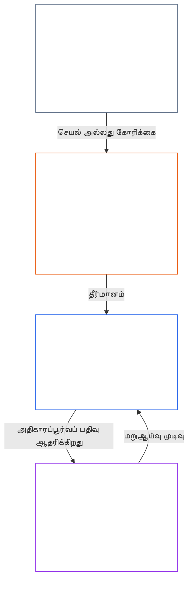
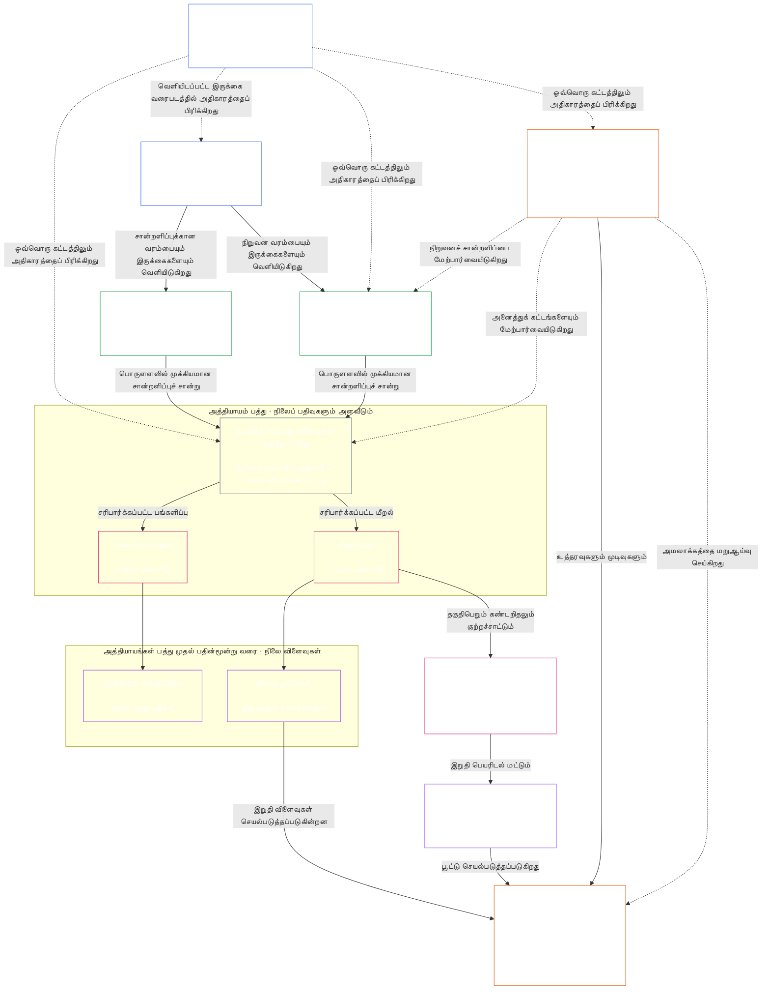

<!-- Locale: ta; language variety: தமிழ்ப் பதிப்பு — முன்னோடி (பிணைக்காதது). AI-assisted structural resynchronization draft (GPT-6 Codex); unreviewed and incomplete. English pin: SC-Corpus-2026.11.25, commit 6e0b6c663dde01b5dea731fe33d87725c7174930. core_00 SHA-256 90799cb8019b41356fa5dd90565e3f9540fc346e8c77e2c321b841654f39b274; core_01 SHA-256 aca759b394f10784ab1a2eef4e9e2ca12e369ef0ca8ee797298c6af00d2950aa. -->

<!-- Structural extraction only. Current Chapter One §§1–4 are new translation work. Missing sections are marked as gaps. Do not publish or synchronize. -->

# அத்தியாயம் ஒன்று: அரசியலமைப்பு வரைபடம்

<strong>தொகுப்பில் இடம் (செயல்படாதது): கோப்பு அமைப்பும் வாசிப்பு விதிகளும்</strong>

> **செயல்படாதது** எனக் குறிக்கப்பட்ட விட்ஜெட்டுகள் (தொகுப்பில் இடம், வாசகர் வழிகாட்டல், வாசகர் வரைபடங்கள்) வழிகாட்டலுக்கானவை மட்டுமே. அவை தமது கோப்பிலோ வேறு எந்தக் கோப்பிலோ கட்டுப்படுத்தும் கடமையைச் சேர்க்கவோ, நீக்கவோ, சுருக்கவோ செய்யாது.
>
> இந்தக் கோப்பு **உணர்வுள்ளோர் அரசியலமைப்பின் ஒரு பகுதி**; எண்ணிடப்பட்ட மற்ற `core_*` கோப்புகளுடனும் துணைமையத்துடனும் ஒரே உரையாக வாசிக்கப்படும்போது மட்டுமே **கட்டுப்படுத்தும்**. இதில் **அத்தியாயம் ஒன்று**, *அரசியலமைப்பு வரைபடம்* உள்ளது: அதன் நோக்கம் (§1), அது ஏன் உள்ளது (§2), அதன் கோப்புகள் எவ்வாறு பொருந்துகின்றன (§3), பின்னர் வரும் அத்தியாயங்களுக்கான அடித்தளங்கள் (§4), முக்கிய ஆட்சி செயல்முறைகள் (§5), அரசியலமைப்பு உரிமையாளர் பதிவேடு (§6 முதல் §11 வரை).
>
> **முந்தையது:** [core_00.000_preamble.md](core_00_preamble.md) (முன்னுரை)
> **அடுத்தது:** [core_02.000_values_principles.md](../../core_02.000_values_principles.md)

<strong>தடமறிதல்</strong>

- முந்தையது: [முன்னுரை](core_00_preamble.md) (*மாதிரி, இரண்டு அரசியலமைப்பு நோக்கங்கள், அரசியலமைப்பு நான்மம், பொருள் பங்கு, அளவீட்டு வகைகள்*).
- துணைப்பிரிவுகள்:
  - [§1](#1-purpose-role-and-scope);
  - [§2](#2-why-the-map-exists);
  - [§3](#3-how-the-files-fit-together);
  - [§4](#4-foundations-for-the-chapters-that-follow);
  - [§5](#5-key-governance-processes);
  - [§6](#6-principles-definitions-and-rights);
  - [§7](#7-system-and-institutional-charters-functional-independence-and-separation-of-duties);
  - [§8](#8-key-practical-process-pipelines);
  - [§9](#9-process-ownership-and-outputs);
  - [§10](#10-governance-change-and-incorporation);
  - [§11](#11-adopted-implementation-corpus).
- இதனுடன் வாசிக்க: [அதிகார அடுக்கும் உள் படிநிலையும்](../../subcore_03.080_band_integrative.md#authority-stack-and-internal-hierarchy) (*உரிமையாளர் பதிவேடு எவ்வாறு பயன்படுத்தப்படுகிறது*); [README.md](README.md) (*வாசிப்பு வரிசை*).

 

### 1. நோக்கம், பங்கு, வரம்பு

*எளிய சொற்களில்: இந்த அத்தியாயம் அரசியலமைப்பின் மற்ற பகுதிகளுக்கான வழிகாட்டி. பகுதிகள் எவ்வாறு பொருந்துகின்றன, ஒவ்வொரு தலைப்புக்கும் எந்த அத்தியாயம் பொறுப்பு, முக்கிய செயல்முறைகள் எவ்வாறு இயங்குகின்றன என்பதைக் காட்டி, வாசகர் தன் கேள்விக்குப் பதிலளிக்கும் விதியைக் கண்டுபிடிக்க உதவுகிறது.*

**நோக்கம்:** அத்தியாயம் ஒன்று மேலோட்டத்தையும் பொறுப்புக் காட்டியையும் வழங்குகிறது. அங்கீகரிக்கப்பட்ட ஆட்சியைச் சோதிக்கும் செயல்முறைகளைப் பெயரிட்டு, ஒவ்வொரு பொருண்மைக் களத்திற்கும் எந்த அத்தியாயம் பொறுப்பு என்பதைக் கூறி, அரசியலமைப்பு உரையின் மூன்று அடுக்குகளை விவரிக்கிறது.

**பங்கு:** இந்த அத்தியாயம் வழிகாட்டி மற்றும் பொறுப்பு ஒதுக்கீடு. பிற அத்தியாயங்களும் [அதிகார அடுக்கும் உள் படிநிலையும்](../../subcore_03.080_band_integrative.md#authority-stack-and-internal-hierarchy) பயன்படுத்தும் உரிமையாளர் பதிவேட்டைத் தவிர, தனக்கெனக் கடமைகளைச் சேர்ப்பதில்லை.

**அத்தியாய வரம்பு:** இந்த அத்தியாயம் பின்வருவனவற்றை உள்ளடக்குகிறது:

- வரைபடம் ஏன் உள்ளது (**பிரிவு 2**);
- கோப்புகள் எவ்வாறு பொருந்துகின்றன (**பிரிவு 3**) மற்றும் பின்வரும் அத்தியாயங்களுக்கான அடித்தளங்கள் (**பிரிவு 4**);
- முக்கிய ஆட்சி செயல்முறைகள் (**பிரிவு 5**);
- அரசியலமைப்பு உரிமையாளர் பதிவேடு: கொள்கைகள், வரையறைகள், உரிமைகள் (**பிரிவு 6**); சாசனங்கள், செயல்பாட்டு சுதந்திரம், கடமைகள் பிரிப்பு (**பிரிவு 7**); செயல்முறைத் தொடர்கள் (**பிரிவு 8**); செயல்முறைப் பொறுப்பாளர்கள் மற்றும் வெளியீடுகள் (**பிரிவு 9**); ஆட்சி, மாற்றம், உட்சேர்ப்பு (**பிரிவு 10**); மற்றும்
- ஏற்றுக்கொள்ளப்பட்ட செயலாக்கத் தொகுப்பும் துணைத் தொகுப்பும் (**பிரிவு 11**).

### 2. வரைபடம் ஏன் உள்ளது

*எளிய சொற்களில்: இவ்வளவு பெரிய உரைக்கு, அதன் பகுதிகள் எப்படிப் பொருந்துகின்றன, ஒவ்வொரு தலைப்புக்கும் யார் பொறுப்பு என்பதைக் காட்டும் வழிகாட்டி தேவை. வாசகர் தன் கேள்விக்குப் பதிலளிக்கும் விதியைக் கண்டுபிடிக்க இந்த அத்தியாயம் உதவுகிறது.*

அரசியலமைப்பு தனது பணியைப் பல அத்தியாயங்கள், ஒரு துணைத் தொகுப்பு, நான்கு ஏற்றுக்கொள்ளப்பட்ட தொகுப்புகள் ஆகியவற்றில் பகிர்கிறது. தனக்குக் கிடைக்க வேண்டியது என்ன என்று தேடும் உணர்வுள்ளோர் அல்லது கடமையைத் தேடும் ஏற்றுக்கொள்பவர் வழி தவறலாம். இந்த அத்தியாயம் ஒவ்வொரு பகுதியும் என்ன செய்கிறது, எந்த அத்தியாயம் எந்தத் தலைப்புக்குப் பொறுப்பு, செயல்முறைத் தொடர்கள் எப்படிச் செல்கின்றன, அடுக்குகள் எவ்வாறு தொடர்புபடுகின்றன என்பதற்கான மேலோட்டமும் பொறுப்பு வழிகாட்டியும் ஆகும். உரிமையாளர் பதிவேட்டைத் தவிர தனி விதி எதையும் சேர்ப்பதில்லை.

**அடிப்படை:**

- முன்னுரை:
  - [அரசியலமைப்பு நான்மம்](core_00_preamble.md#constitutional-tetrad): இந்த அத்தியாயம் நடைமுறைப்படுத்தும் கூறுகள்:
    - [பங்கேற்பு](../../subcore_03.060_apex_participation_leg.md#participation): உணர்வுள்ளோர் தமது கேள்விக்குப் பதிலளிக்கும் விதியைக் கண்டுபிடிக்கலாம்;
    - [பொறுப்புக்கூறல்](../../subcore_03.040_apex_accountability_leg.md#accountability): ஒவ்வொரு தலைப்புக்கும் பொறுப்பேற்கும் அத்தியாயம் பெயரிடப்பட்டுள்ளது;
    - [மேற்பார்வை](../../subcore_03.055_apex_oversight_leg.md#oversight): பகுதிகள் எப்படிப் பொருந்துகின்றன என்பதை வாசகர் கண்டு, இடைவெளி அல்லது மேலிடலைக் கண்டறியலாம்;
    - [காலந்தவறாமை](../../subcore_03.065_apex_timeliness_leg.md#timeliness): சரியான விதியை வாசகர் தாமதமின்றி அடைகிறார்;
  - [இரண்டு அரசியலமைப்பு நோக்கங்கள்](core_00_preamble.md#two-constitutional-aims): இந்த அத்தியாயம் சேவை செய்யும் இரு நோக்கங்களும்:
    - [செழிப்பு](core_00_preamble.md#flourishing): உணர்வுள்ளோர் அரசியலமைப்பில் வழிகாண முடிந்தால்தான் அது அவர்களுக்குச் சேவை செய்கிறது;
    - [தொடர்ச்சி](core_00_preamble.md#continuity): தெளிவான வரைபடம், உரை வளர்ந்து மாறும்போதும் அதன் முழுமையைக் காக்கிறது;
- அத்தியாயம் இரண்டின் கொள்கைகள்:
  - [§5.2 எளிய மொழி அணுகல்தன்மை (பங்கேற்பு மற்றும் பொறுப்பான நிர்வாகக் கடமை)](../../core_02.000_values_principles.md#52-plain-language-accessibility-participation-and-stewardship-duty);
  - [§5.2.4 சிக்கலைத் தோல்விக்கான கருவியாக்குவதைத் தடுக்கும் ஒழுங்கு](../../core_02.000_values_principles.md#524-complexity-as-defeat-discipline);
  - [§15.4 அரசியலமைப்புப் பொருள் முரண்பாடுகளைத் தீர்த்தல்](../../core_02.030_constitutional_interpretation.md#154-constitutional-meaning-conflict-resolution);
- அத்தியாயம் நான்கின் கட்டுரைகள்:
  - [கட்டுரை XXIV-A](../../core_04.030_rights_part_d.md#article-xxiv-a-proportional-comprehensibility-right) (*விகிதாசாரப் புரிதல்திறன் உரிமை*);
  - [கட்டுரை XXIV-B](../../core_04.030_rights_part_d.md#article-xxiv-b-complexity-audit-and-modularity-requirements) (*சிக்கல் தணிக்கை மற்றும் தொகுதித்தன்மைத் தேவைகள்*).

### 3. கோப்புகள் எவ்வாறு பொருந்துகின்றன

அரசியலமைப்பின் கோப்புகள் பின்வருமாறு ஒன்றோடொன்று பொருந்துகின்றன:

- **மையம் (`core_*`):** எண்ணிடப்பட்ட கோப்புகள் அரசியலமைப்பின் அத்தியாயங்களைக் கொண்டுள்ளன; அவை ஒரே உரையாக ஒன்றாக வாசிக்கப்பட வேண்டும். அவை உத்தரவாதங்களையும் அரசியலமைப்பு அமைப்பையும் கூறுகின்றன.
- **துணைமையம் (`subcore_*`):** இந்தக் கோப்புகள் அத்தியாயங்களின் பின்னணியில் உள்ள முழு விதிகளையும் நடைமுறைகளையும் வழங்குகின்றன. ஒவ்வொன்றும் ஓர் அத்தியாயத்துக்குச் சொந்தமானது, அதே வலிமையுடையது, தனியே உட்சேர்க்க வேண்டாமலேயே ஒவ்வொரு ஏற்றுக்கொள்பவரையும் கட்டுப்படுத்துகிறது. துணைமையம் தனது அத்தியாயத்தைச் சுருக்கவோ கட்டுப்படுத்தவோ முடியாது.
- **செயலாக்கம் (`corpus_*`):** நான்கு கோப்புகள் அரசியலமைப்பைச் செயல்படுத்துவதற்கான நடைமுறை விவரங்களை வழங்குகின்றன. செல்லத்தக்க உட்சேர்ப்பின் வரம்புக்குள் அவை கட்டுப்படுத்தும்; அரசியலமைப்பைச் சுருக்காமல் செயல்படுத்தும். [பிரிவு 11](#11-adopted-implementation-corpus) அந்த நான்கு கோப்புகளைக் குறிப்பிடுகிறது.

வரையறுக்கப்பட்ட [தொகுப்பு](../../subcore_03.080_band_integrative.md#corpus) என்பது கட்டுப்படுத்தும் அரசியலமைப்பு ஆதாரங்களின் பரந்த, பதிப்பிடப்பட்ட தொகுப்பு: மையம், துணைமையம், ஏற்றுக்கொள்ளப்பட்ட செயலாக்க உரை, மாற்றக் காலத்தில் செல்லத்தக்க இணக்கச் சுற்றுகள் ஆகியவை இதில் அடங்கும். வரைவு, குறிப்பு, வழிகாட்டி ஆகியவை திட்டத்தின் பகுதியாக இருப்பதாலேயே கட்டுப்படுத்துவன ஆகிவிடாது.

### 4. அடுத்த அத்தியாயங்களுக்கான அடித்தளங்கள்

*எளிய சொற்களில்: அத்தியாயங்கள் இரண்டு முதல் நான்கு வரை மதிப்புகள், அகராதி (வரையறைகள் எவ்வாறு கட்டமைக்கப்படுகின்றன, பாதுகாக்கப்படுகின்றன, நிரூபிக்கப்படுகின்றன என்பதற்கான துணைமைய விதிகளுடன்), உரிமைத் தளம் ஆகியவற்றுக்குப் பொறுப்பாகின்றன; பின்னர் வரும் அத்தியாயங்கள் அந்தப் பகுதிகளை மதிக்க வேண்டும், அமைதியாக இடமாற்றக் கூடாது.*

**இரண்டு முதல் நான்கு வரையிலான அத்தியாயங்கள்** மதிப்புகள், சொற்களஞ்சியம், சரிபார்ப்பு வழிமுறைகள், உரிமைத் தளம் ஆகியவற்றை வழங்குகின்றன. பின்னர் வரும் அனைத்தும் இவற்றை மதிக்க வேண்டும்; அதில் பின்வருவனவும் அடங்கும்:

- [அத்தியாயம் ஐந்தின் அமைப்பு சாசனம் அல்லது நிறுவன சாசனம் தேவை](#7-system-and-institutional-charters-functional-independence-and-separation-of-duties), அத்தியாயம் ஆறின் கடமைகள் பிரிப்பு தேவை, அத்தியாயம் ஏழின் சுதந்திர அமைப்புகள் (பிரிவு 7);
- பிரிவு 8-இன் [முக்கிய நடைமுறைச் செயல்பாட்டுத் தொடர்கள்](#8-key-practical-process-pipelines);
- பிரிவு 9-இன் [செயல்முறைப் பொறுப்பாளர்களும் வெளியீடுகளும்](#9-process-ownership-and-outputs);
- பிரிவு 10-இன் ஆட்சி மற்றும் மாற்றப் பாதை அத்தியாயங்கள்; மற்றும்
- பிரிவு 11-இன் [ஏற்றுக்கொள்ளப்பட்ட செயலாக்கத் தொகுப்பு](#11-adopted-implementation-corpus).

### 5 முக்கிய ஆட்சிச் செயல்முறைகள்

*எளிய சொற்களில்: உரை கேட்கும்போது, பொருள் பிரச்சினைகள் சான்றளிப்பு, உதவி மற்றும் தீங்கின் எழுத்துப் பதிவுகள், திருத்தம் மற்றும் நிவாரணம், கடிகாரங்களுடன் மன்ற மதிப்பாய்வு வழியாகச் செல்கின்றன — சாதாரண தகராறுகள் முதலில் வெளியிடப்பட்ட சவால் பாதையைப் பயன்படுத்துகின்றன; அந்தப் பாதைகள் அங்கீகரிக்கப்பட்ட ஆட்சியைச் சோதிக்கின்றன; தனியாக அதை உருவாக்குவதில்லை.*

அத்தியாயம் ஆறு, [அத்தியாயம் ஒன்பது](../../core_08.000_system_alignment_certification_evaluation.md#chapter-eight-system-alignment-certification), இணைக்கப்பட்ட ஆவணங்கள், அல்லது பிற அரசியலமைப்பு ஏற்பாடுகள் வெளிப்படையாகக் கேட்கும் இடத்தில், பொருள் அரசியலமைப்புப் பிரச்சினைகளைக் கீழே உள்ள ஒன்று அல்லது அதற்கு மேற்பட்ட பாதைகளுக்கு எடுத்துச் செல்லுங்கள். [முக்கிய நடைமுறைச் செயல்பாட்டுத் தொடர்கள்](#6-key-practical-process-pipelines) அளவீட்டைப் பதிவுகள், சான்றளிப்பு, சரிபார்க்கப்பட்ட உள்ளீடுகள், வகைப்பாடு, மன்ற மேற்பார்வை, திருத்தம், காலந்தவறா நிவாரணமாக மொழிபெயர்க்கின்றன — அங்கீகரிக்கப்பட்ட ஆட்சி நடைமுறையில் எப்படிச் சோதிக்கப்படுகிறது, சவால் செய்யப்படுகிறது, பழுதுபார்க்கப்படுகிறது. அவை தனியாக ஆட்சியை அங்கீகரிக்கா; ஆட்சியை மதிப்பாய்வு செய்யக்கூடியதாகவும், சவால் செய்யக்கூடியதாகவும், திருத்தக்கூடியதாகவும், காலந்தவறாததாகவும் ஆக்குகின்றன. [பிரிவு 5.1](#62-how-the-full-chain-fits-together) அந்தத் தொடரை முழுமையாகக் கூறுகிறது.

- **செயல்பாட்டுச் சுதந்திரமும் கடமைகள் பிரிப்பும்** ([அத்தியாயம் ஆறு](../../core_06.000_functional_independence_separation_of_duties.md#chapter-six-functional-independence-and-separation-of-duties)): பொருளளவில் கட்டுப்படுத்தும் செயல் நகர்வதற்கு முன், தொடக்கம், சரிபார்ப்பு அல்லது அங்கீகாரம், அதிகாரப்பூர்வப் பதிவுக் காவல், சவால் மதிப்பாய்வு ஆகிய இருக்கைகளைப் பொருந்தும் அளவாக்கு மற்றும் சுதந்திர விதிகளின்படி அடையாளம் கண்டு தனித்தனியாக வைக்கவும்.
- **அமைப்பு இணக்கச் சான்றளிப்பு** ([அத்தியாயம் ஒன்பது](../../core_08.000_system_alignment_certification_evaluation.md#chapter-eight-system-alignment-certification)) — உயர்-தாக்க அமைப்பை அளவில் நம்பும் முன், இப்போதே அரசியலமைப்புரீதியாக நம்ப பாதுகாப்பானதா என்பதற்கான சான்றைச் சேகரித்து மதிப்பாய்வு செய்யுங்கள்
- **நிலைப் பதிவுகள்** ([அத்தியாயம் பதினொன்று](core_11_standing_assessment.md#chapter-eleven-standing-records--question-1-what-happened)) — நடத்தை அல்லது தீங்கு அரசியலமைப்பு ரீதியாக முக்கியமானபோது, சரிபார்க்கப்பட்ட உண்மைகளை முறையான பங்களிப்பு அல்லது மீறல் வழக்குக் கோப்புகளில் பதிவு செய்யுங்கள்; வதந்தியும் நற்பெயரும் போதாது.
- **திருத்தமும் நிவாரணமும்** ([அத்தியாயம் பதின்மூன்று §5.1 (*நிவாரணமும் திருத்தமும்*)](../../core_12.000_violation_consequences.md#31-remedy-and-correction)) — அடிப்படைத் தோல்வியைச் சரிசெய்து, பாதிக்கப்பட்டவர்களுக்கு அளவான ஒப்புதல், பழுதுபார்ப்பு, மீட்டமைப்பு அல்லது இழப்பீடு வழங்குங்கள்.
- **மன்ற மறுஆய்வு** ([அத்தியாயம் பதினைந்து](core_11_forum.md#1-purpose-and-role--participation-architecture))
  - ஏற்கனவே அங்கீகரிக்கப்பட்ட அமைப்புகளுக்குள் சாதாரண தகராறுகள் முதலில் வெளியிடப்பட்ட [பாதிக்கப்படுவோரின் அமைப்புப் பங்கேற்பு](../../subcore_03.090_band_participation.md#stakeholder-status-and-weight-cluster) சவால் பாதையைப் பயன்படுத்துகின்றன
  - அந்தப் பாதை இன்னும் சவால் செய்யப்பட்டாலோ, இல்லாவிட்டாலோ, கைப்பற்றப்பட்டாலோ, நிவாரணம் தர முடியாவிட்டாலோ, முதன்மைப் பங்கு வழியாக மேற்பார்வை செய்யப்படும் மன்றங்களுக்கு வழிமாற்றுங்கள்
  - அந்த மன்றங்கள் சான்று, சட்டபூர்வ இடமாற்றம், காலந்தவறாக் கடிகாரங்களை **சரத்து XXV-C** (*காலந்தவறாத் தீர்வும் தாமத எதிர்ப்புத் தளமும்*) கீழ் தாங்குகின்றன

### 6. கோட்பாடுகள், வரையறைகள், உரிமைகள்

*எளிய சொற்களில்: அத்தியாயங்கள் ஒன்று முதல் ஆறு வரை மதிப்புகள், சொற்கள் எப்படிக் கட்டப்பட்டுச் சோதிக்கப்படுகின்றன, அகராதி, உரிமைத் தளம் ஆகியவற்றை உரிமைகொள்கின்றன; பிற்கால அத்தியாயங்கள் அந்த இல்லங்களை மதிக்க வேண்டும், அமைதியாக நகர்த்தக்கூடாது.*

**4 முதல் 9 வரையிலான பிரிவுகள்** இந்த அரசியலமைப்பின் **அரசியலமைப்புச் சொந்தப் பொறுப்பு பதிவேடு** ஆகும். ஒவ்வொரு தொகுதியும் அதன் அத்தியாயம் (அல்லது ஏற்றுக்கொள்ளப்பட்ட தொகுப்பு) பொறுப்பேற்கும் பொருள்சார் துறையையும் அது உருவாக்குவதையும் குறிப்பிடுகிறது. கட்டுப்படுத்தும் ஒற்றை வரி உரிமைக் கூற்றுகளும் ஒவ்வொரு எண்ணிடப்பட்ட அத்தியாயத்தின் தொடக்கத்தில் இடம்பெறும். பிற அடுக்குகள் உரிய பொறுப்பிடத்தைச் சுட்டலாம்; ஆனால் அதை அமைதியாக மறுஎழுதவோ இடமாற்றவோ கூடாது. இடமாற்றமின்மை ஒழுங்கு [அதிகார அடுக்கு மற்றும் உள் படிநிலை](../../subcore_03.080_band_integrative.md#authority-stack-and-internal-hierarchy) கீழ் உள்ளது.

அத்தியாயங்கள் **ஒன்று முதல் ஆறு** பிறகு வரும் அனைத்தும் மதிக்க வேண்டிய மதிப்புகள், சொற்களஞ்சியம், சரிபார்ப்பு இயந்திரம், உரிமைத் தளம் ஆகியவற்றை வழங்குகின்றன — பிரிவு 5-இன் [முக்கிய நடைமுறைச் செயல்பாட்டுத் தொடர்கள்](#6-key-practical-process-pipelines), பிரிவு 6-இன் ஆட்சி மற்றும் மாற்றப் பாதை அத்தியாயங்கள், பிரிவு 7-இன் [துணைச் செயல்படுத்தல் தொகுப்பு](#11-adopted-implementation-corpus) உட்பட.

ஒவ்வொரு சுருக்கமும் அத்தியாயம் எதை உரிமைகொள்கிறது, எதை உருவாக்குகிறது என்பதைக் கூறுகிறது.

**அத்தியாயம் ஒன்று — மதிப்புகள், கோட்பாடுகள், பொறுப்பான நிர்வாகம்** ([பகுதி அ](../../core_02.000_values_principles.md) · [பகுதி ஆ](../../core_02.020_interaction_interpretation.md) · [பகுதி இ](../../core_02.040_stewardship_capacity_principles.md))

- **இதன் பொறுப்பு:** அரசியலமைப்பின் வழிகாட்டும் மதிப்புகளையும் கட்டுப்பாடுகளையும் கூறுகிறது; அவற்றில்:
  - நலவாழ்வு, நியாயம், பாதுகாப்பு, உண்மை, நம்பிக்கை, வரம்பிட்ட சுதந்திரம்;
  - சட்டபூர்வப் பங்களிப்பை அங்கீகரித்து அதற்கேற்ற பரிசு வழங்குதல்;
  - கொள்கைகளுக்கிடையிலான முரண்பாடுகளைத் தீர்த்தல்; மற்றும்
  - புரிதலைப் பரவலாக்குதல், அமைப்புமுறை மதிப்பீடு, ஆளுகை ஒழுங்கு உள்ளிட்ட பொறுப்பாண்மைக் கடமைகள்.
- **இதன் விளைவு:** பின்னர் வரும் ஒவ்வொரு அத்தியாயத்திற்குமான விளக்க அடித்தளம். அமைப்புகள், உரிமைகள், வரையறைகள் அல்லது செயல்முறைப் பாதைகளைப் படித்து பயன்படுத்தும்போது, இந்த விதிகள் உயர்நிலை நோக்கங்களை நடைமுறைத் தேவைகளாக மாற்றுகின்றன.

**அத்தியாயம் இரண்டு — வரையறை அமைப்பு** ([`core_02_definition_structure.md`](../../subcore_03.010_definition_structure.md))

- **இதன் வரம்பு:** அரசியலமைப்புச் சொற்கள் எவ்வாறு உருவாக்கப்படுகின்றன என்பதைப் பின்வருவன மூலம் வரையறுக்கிறது:
  - இருப்பியல்/அளவீடு/மதிப்பீடு/இணக்கம் (O/M/A/C) கூறுக் கட்டமைப்பு;
  - ஒத்திசைவு தேவைகள்; மற்றும்
  - முழுக் கார்பஸிலும் வரையறைகளைத் துல்லியமாகவும் பயன்படுத்தக்கூடியதாகவும் வைத்திருக்கும் கூறு விதிகள்.
- **இதன் விளைவு:** வரையறைகளுக்கான பொதுவான இலக்கணம்; இதனால் பிந்தைய அத்தியாயங்கள் தெளிவற்ற பெயரிடல்கள், மறைந்த முன்கணிப்புகள் அல்லது ஒன்றுக்கொன்று பொருந்தாத சொல் வடிவங்களில் சிக்காது.

**அத்தியாயம் மூன்று — வரையறை முழுமை** ([`core_02_definition_structure.md`](../../subcore_03.010_definition_structure.md))

- **இதன் வரம்பு:** பின்வருவனவற்றைத் தடுக்கிறது:
  - தவிர்த்தல் மற்றும் வரம்பை மாற்றுதல்;
  - மறுவரையறைச் சூழ்ச்சிகள்; மற்றும்
  - காகிதத்தில் வரையறைகளை உள்ளீடற்றதாக்கி, நடைமுறையில் அவற்றின் நோக்கத்தைத் தோற்கடிக்கும் இணக்கமின்மைத் தந்திரங்கள்.
- **இதன் விளைவு:** தவிர்த்தலைத் தடுக்கும் ஒழுங்கும் இணக்கமின்மைக்கான வழிகாட்டும் மெட்டாடேட்டாவும்; தவிர்த்தல் உறுதிப்படுத்தப்பட்டால் நிலை மற்றும் தவறான நடத்தை மீளாய்வுக்குப் பரிந்துரைக்கும் வழிகளும் இதில் அடங்கும்.

**அத்தியாயம் நான்கு — சுமை, தடமறிதல், சரிபார்ப்பு** ([`core_02_definition_structure.md`](../../subcore_03.010_definition_structure.md))

- **இதன் வரம்பு:**
  - இணக்கமாக இருப்பதாகக் கூறுபவர்மீது நிரூபணப் பொறுப்பை வைக்கிறது; மற்றும்
  - [**பொருட்டான பங்கின் முக்கியத்துவத்திற்கு**](core_00_preamble.md#material-stake) ஏற்ற, தடமறியக்கூடிய சான்று, கண்காணிக்கத்தன்மை மற்றும் சரிபார்ப்பைக் கோருகிறது; இவற்றை நடைமுறையில் சவால் செய்யவும் இயல வேண்டும்.
- **இது உருவாக்குவது:** [அத்தியாயம் பதினொன்றின்](core_11_standing_assessment.md#chapter-eleven-standing-records--question-1-what-happened) **சரிபார்க்கப்பட்ட உள்ளீடுகளுக்கும்**, [அத்தியாயம் ஒன்பதின்](../../core_08.000_system_alignment_certification_evaluation.md#chapter-eight-system-alignment-certification) அமைப்பு-ஒத்திசைவு சான்றுக்கும் உள்ளீடு தரும் சரிபார்ப்புப் பாதை. இது நிலை அளவீட்டையே மாற்றாது.
**அத்தியாயம் ஐந்து — அடிப்படை வரையறைகள்** ([`core_05__definitions_home.md`](../../core_03.000_definitions_home.md#chapter-three-foundational-definitions))

- **இதன் வரம்பு:** பின்வருவனவற்றை வழங்குகிறது:
  - வரையறைகளின் அதிகாரப்பூர்வ அடுக்கு: மேற்பார்வை, பங்கேற்பு, பொறுப்புக்கூறல், தொடர்ச்சி மற்றும் ஒருங்கிணைப்பு பட்டைகள்;
  - [அதிகார அடுக்கு மற்றும் உள் படிநிலை](../../subcore_03.080_band_integrative.md#authority-stack-and-internal-hierarchy);
  - [கார்பஸ்](../../subcore_03.080_band_integrative.md#corpus); மற்றும்
  - தொடர்புடைய எல்லை விதிகள்.
- **இதன் விளைவு:** விளக்கம், தணிக்கை மற்றும் தீர்ப்பளிப்புக்கான துல்லியமான அரசியலமைப்புச் சொற்களஞ்சியம். இது **வரையறை அடுக்கு**, உரிமைகளின் அடித்தளமல்ல—கட்டுப்படுத்தும் உரிமை அடித்தளங்கள் அத்தியாயம் ஆறில் உள்ளன. முழு அரசியலமைப்பின் உரிமைப் பகுதிகளுக்கான வழிகாட்டல் இந்த முன்னுரைப் பதிவேட்டில் (பிரிவுகள் 4–9) உள்ளது.

**அத்தியாயம் ஆறு — அடிப்படை உரிமைகள்** ([பகுதி அ](../../core_04.000_rights_part_a.md) · [பகுதி ஆ](../../core_04.010_rights_part_b.md) · [பகுதி இ](../../core_04.020_rights_part_c.md) · [பகுதி ஈ](../../core_04.030_rights_part_d.md))

- **இதன் வரம்பு:** **I–XXVIII** உறுப்புகளில் உரிமைகளின் அடித்தளத்தை நிறுவுகிறது; இதில் அடங்குபவை:
  - உயிர்வாழ்வதற்கான அத்தியாவசியங்கள்;
  - வள ஒதுக்கீடும் சார்புநிலைப் பொறுப்பேற்பும்;
  - கண்ணியம், செயல்திறன் மற்றும் பங்கேற்பு;
  - சவால் செய்தலும் தீர்வும்;
  - நீதிக் கட்டுப்பாடுகள்;
  - **XXVI-C உறுப்பின்** கீழ் காலத்திற்குள் செயல்படுதல் (*காலத்திற்குள் தீர்வு மற்றும் தாமதத் தடுப்பு அடித்தளம்*); மற்றும்
  - ஏற்றுக்கொள்ளல் மாற்ற விதிகள்.
  பூமிக்கு முன்னுரிமை அளிக்கும் வாசிப்புக்காக நான்கு பகுதிகள் இப்பாதுகாப்புகளை ஒழுங்கமைக்கின்றன.
- **இது உருவாக்குவது:** பேச்சுவார்த்தைக்கு உட்படாத உரிமைப் பாதுகாப்புகளும் நிவாரண வழிகளும்; அத்தியாயங்கள் ஏழு முதல் பதினைந்து, மன்றங்கள், ஆளுகை, திருத்த விதிகள் ஆகியவை அவற்றை மதிக்க வேண்டும்; நடைமுறை அல்லது பதிலி அளவீடுகளால் அவற்றைக் குறுக்கவோ தவிர்க்கவோ வெறுமையாக்கவோ கூடாது.

### 7. அமைப்பு மற்றும் நிறுவன சாசனங்கள், செயல்பாட்டுச் சுதந்திரம், கடமைகளின் பிரிப்பு

*எளிய சொற்களில்: உண்மையான தாக்கமுள்ள அமைப்பு அல்லது நிறுவனம், அது என்ன செய்யலாம், ஒவ்வொரு இருக்கையிலும் யார் அமர்கிறார்கள் என்பதைச் சொல்லும் அமைப்பு சாசனம் அல்லது நிறுவனச் சாசனத்தை வெளியிடுகிறது. பின்னர், பொருள்ரீதியாகக் கட்டுப்படுத்தும் செயல் முன்னேறுமுன், அதைத் தொடங்குபவர், சரிபார்ப்பவர் அல்லது அங்கீகரிப்பவர், அதிகாரப்பூர்வப் பதிவைப் பாதுகாப்பவர், சவாலை மறுஆய்வு செய்பவர் ஆகியோரின் பங்குகள் பிரிக்கப்படுகின்றன. சூழலுக்கு ஏற்ப பங்குகள் மாறலாம்; ஆனால் அதே செயற்பாட்டாளரும் அதன் கட்டுப்பாட்டு வரியும் தமது செயலைத் தணிக்கை செய்யும் இருக்கைகளை மறைமுகமாகப் பிடித்திருக்கக் கூடாது.*

- **இதன் வெளியீடு:** வரம்பையும் இருக்கை ஒதுக்கீட்டையும் விளக்கும் வெளியிடப்பட்ட, பதிப்பிடப்பட்ட அறிக்கை. இதை அடிப்படையாகக் கொண்டு அத்தியாயம் எட்டு, சான்றளிப்பு, நிலைப் பதிவுகள், மன்றங்கள் ஆகியவை நடத்தையைச் சோதிக்கலாம். அத்தியாயம் ஏழு [`core_07.000_charters.md`](../../core_05.000_charters.md#chapter-five-system-and-institutional-charters)-இல் உள்ளது.

**செயல்பாட்டுச் சுதந்திரமும் கடமைகளைப் பிரித்தலும்** — பொருளளவில் கட்டுப்படுத்தும் செயல் முன்னேறுவதற்கு முன், பொருந்தும் அளவாக்கம் மற்றும் சுதந்திர விதிகளின்படி தொடக்கம், சரிபார்ப்பு அல்லது அங்கீகாரம், பதிவு, சவால் மறுஆய்வு ஆகிய இருக்கைகளை அடையாளம் கண்டு தனித்தனியாகப் பிரிக்கவும்.

**ஒவ்வொரு பொருளளவில் கட்டுப்படுத்தும் செயலுக்கும் பொறுப்பிடங்களைத் தனித்தனியாக வைத்திருங்கள்** ([எட்டாம் அத்தியாயம்](core_07_functional_independence_segregation_of_duties.md#2-four-seat-constitutional-requirement)) — செயல்முறையைத் தொடங்குபவர், அதைச் சரிபார்ப்பவர் அல்லது அங்கீகரிப்பவர், அதிகாரப்பூர்வப் பதிவைப் பாதுகாப்பவர், சவாலைக் கேட்பவர் யார் என்பதை அடையாளம் காணுங்கள். அந்தச் செயல் முறையாகச் சரிபார்க்கப்பட்டது எனக் கருதுவதற்கு முன், தடைசெய்யப்பட்ட பொறுப்பிணைப்புகள், சுதந்திர விதிகள், வெளியிடப்பட்ட மாற்றுப் பாதை ஆகியவற்றைப் பயன்படுத்துங்கள். System Charter அல்லது Institutional Charter தேவைப்படும் இடத்தில் ([ஏழாம் அத்தியாயம்](../../core_05.000_charters.md#6-the-charter-role-map-and-standing-record-custody)), அதன் Charter Role Map ஒவ்வொரு பொறுப்பிடத்தையும் யார் வகிக்கிறார்கள் என்பதை வெளியிடும்.

**அத்தியாயம் எட்டு — செயல்பாட்டுச் சுதந்திரமும் கடமைப் பிரிப்பும்**

- **இதன் பொறுப்பு:** ஒவ்வொரு [பொருளளவில் கட்டுப்படுத்தும் செயலுக்கும்](../../subcore_03.070_band_accountability.md#materially-binding-act) நான்கு பணிகளைத் தனித்தனியாக ஒதுக்க வேண்டும் என்ற செயல்முறைகளைக் கடந்த தேவையாகும்:
  - தொடங்குதல்;
  - சரிபார்த்தல் அல்லது அங்கீகரித்தல்;
  - அதிகாரப்பூர்வப் பதிவைப் பாதுகாத்தல்; மற்றும்
  - சவால்களை மறுஆய்வு செய்தல்.

மேலும் இது பின்வருவனவற்றையும் நிர்வகிக்கிறது:

  - ஒவ்வொரு [பொருளளவில் கட்டுப்படுத்தும் செயல்பாட்டு பதிவின்](../../subcore_03.070_band_accountability.md#materially-binding-act-record) பொதுவான குறைந்தபட்ச உள்ளடக்கம்;
  - செயல்படுத்துபவரின் [பொருளளவிலான கட்டுப்பாட்டுக் கோட்டிலிருந்து](../../subcore_03.070_band_accountability.md#material-control-line) சுதந்திரம்;
  - வெளியிடப்பட்ட செயல்பாட்டுப் பொறுப்பு ஒதுக்கீடும் மாற்றுப் பொறுப்பாளர்களும்;
  - விகிதாசார ஒருங்கிணைந்த செயல்பாடும் அவசரநிலை வரம்புகளும்; மற்றும்
  - பொறுப்பைத் தெளிவுபடுத்தும் ஒப்படைப்புகளும் தவறான இருக்கைக்கு வழிமாற்றலும்.
- **இதன் வெளியீடு:** நான்கு இருக்கைகள் மற்றும் செயல்பாட்டுப் பதிவுக்கான மீண்டும் பயன்படுத்தக்கூடிய கட்டமைப்பு. அடுத்தடுத்த ஒவ்வொரு சான்றளிப்பு, நிலை, மன்றம், ஆளுகை, ஒருங்கிணைந்த செயலாக்கச் செயல்முறையும் அதன் முடிவு சுயாதீனமாகச் சரிபார்க்கப்பட்டதாகவும் நம்பகமாகப் பதிவுசெய்யப்பட்டதாகவும் உண்மையில் சவால் செய்யக்கூடியதாகவும் கருதப்படுவதற்கு முன் இந்தக் கட்டமைப்பை நடைமுறைப்படுத்த வேண்டும்.

#### 7.1 நான்கு இருக்கைப் பிரிப்பு வரைபடம்

> இந்த வரைபடம் நான்கு செயல்பாடுகளையும் ஒரு செயலும் அதன் செயல் பதிவும் பின்பற்றும் வழக்கமான தடத்தையும் காட்டுகிறது. இது ஐந்தாவது இருக்கையைச் சேர்க்கவோ, உலகளாவிய வரிசையை விதிக்கவோ, சுதந்திரம், அளவான இணைந்த ஹோஸ்டிங், அவசர நடவடிக்கை அல்லது சவால் வழிமாற்றம் குறித்த அத்தியாயம் எட்டின் விதிகளை மாற்றவோ இல்லை.

### 8. முக்கிய நடைமுறைச் செயல்பாட்டுத் தொடர்கள்

*எளிய சொற்களில்: அத்தியாயங்கள் ஒன்பது முதல் பதினைந்து வரை, அத்தியாயம் எட்டின் கடமைப் பிரிப்பு தேவையை ஒரே தொடராகப் பயன்படுத்துகின்றன: அமைப்புகளையும் நிறுவனங்களையும் சான்றளித்தல், உதவியையும் தீங்கையும் தனித்தனி தடங்களில் அளவிடுதல், உண்மையான விளைவுகளையும் நிவாரணத்தையும் செயல்படுத்துதல், மேலும் ஒரு மன்றம் தனக்கெதிரான கோரிக்கையின் ஒரே இறுதி இடமாக இருப்பதைத் தடுத்தல். இந்தத் தொடர் அன்றாட வாழ்வில் அரசியலமைப்புக் கடமைகளை உண்மையாக்குகிறது.*

[அத்தியாயம் ஏழு](../../core_05.000_charters.md#chapter-five-system-and-institutional-charters) L வகுப்பு அல்லது அதற்கு மேற்பட்ட ஒவ்வொரு அமைப்பினதும் நிறுவனத்தினதும் சாசன வரம்பையும் இருக்கை வரைபடத்தையும் வெளியிடுகிறது. [அத்தியாயம் எட்டு](../../core_06.000_functional_independence_separation_of_duties.md#chapter-six-functional-independence-and-separation-of-duties), இந்தத் தொடரில் ஒவ்வொரு செயலையும் செல்லத்தக்க வகையில் சரிபார்க்கக்கூடியதாக்கும் கடமைப் பிரிப்பு தேவையை வழங்குகிறது. தொடக்கம், சரிபார்ப்பு அல்லது அங்கீகாரம், அதிகாரப்பூர்வப் பதிவு பாதுகாப்பு, சவால் மறுஆய்வு ஆகிய பணிகள் பொருந்தும் அளவீடு மற்றும் சுதந்திர விதிகளின்படி ஒதுக்கப்பட்டு தனித்தனியாக வைக்கப்பட வேண்டும். பின்னர் அத்தியாயங்கள் ஒன்பது முதல் பதினைந்து வரை அந்தக் கட்டமைப்பை வரிசையாகப் பயன்படுத்துகின்றன:

கீழே உள்ள ஒவ்வொரு படியும் அத்தியாயம் எதை உரிமைகொள்கிறது, எதை உருவாக்குகிறது என்பதைக் கூறுகிறது. [முழுத் தொடர் எப்படிப் பொருந்துகிறது](#62-how-the-full-chain-fits-together) பின்னர் அந்த உரிமையாளர்களை அமைப்புச் சோதனையிலிருந்து நிவாரணம் வரை ஒரு பாதையாகக் காட்டுகிறது.

#### 8.1 செயல்முறை வரைபடம்

- **அத்தியாயம் ஒன்பது** சுயாதீன சரிபார்ப்பைப் பயன்படுத்தி, பொருள்ரீதியாகத் தாக்கமுள்ள அமைப்பு அல்லது நிறுவனம் அறிவித்த வரம்பிலும் பதிவு காலத்திலும் ஒத்திசைந்துள்ளதா என்பதை முடிவுசெய்கிறது. அத்தியாயம் ஒன்பது அமைப்புச் சான்றளிப்பை நிர்வகிக்கிறது; அத்தியாயம் பத்து நிறுவனச் சான்றளிப்பை நிர்வகிக்கிறது; நிறுவனத்தின் சொந்த வகை, மதிப்பீடு, பதிவு, சீர்செய்தல் முடிவும் இதில் அடங்கும்.
- **அத்தியாயம் பதினொன்று** சரிபார்க்கப்பட்ட உண்மைகளைப் பெற்று, தனித்த பங்களிப்பு மற்றும் மீறல் நிலைப் பதிவுகளில் பதிவு செய்கிறது.
- **அத்தியாயம் பன்னிரண்டு** ஒவ்வொரு நிலைப் பதிவையும் அதன் சொந்த அச்சில் அளவிடுகிறது. செழிப்பை நோக்கிய சரிபார்க்கப்பட்ட பங்களிப்பு, தனியாகச் சரிபார்க்கப்பட்ட தீங்கு அல்லது பொறுப்புக்கூறல் தோல்வியை ஈடுசெய்யவோ ரத்துசெய்யவோ குறைக்கவோாது; ஒவ்வொன்றும் பதிவாகி அதன் சொந்த விளைவுகளுக்கு உட்படும்.
- **அத்தியாயம் பதின்மூன்று** அந்த வகைப்பாடுகளை அளவான நிலை விளைவுகளாக மாற்றுகிறது; பங்களிப்பு தடத்தில் திறன் அனுமதிகளும் அங்கீகாரமும், மீறல் தடத்தில் நிலை முடக்கங்கள், திருத்தம், நிவாரணம் ஆகியவை அடங்கும்.
- **அத்தியாயம் பதினான்கு** அத்தியாயம் பன்னிரண்டு உயர்நிலை மீறலை அளந்த பின்னரே பொருந்தும். உரிய நடைமுறைப் பாதுகாப்புகளுக்குப் பிறகு, நடத்தை இறுதி அரசியலமைப்புக்கு எதிரான தவறான நடத்தைக் குறியீட்டின் (ACMD) அளவுகோல்களைத் தனித்த முறையில் பூர்த்திசெய்கிறதா என முடிவுசெய்கிறது.
- **அத்தியாயம் பதினைந்து** வழிமாற்றம், சான்று, மாற்றம், மன்றச் சுதந்திரம், காலத்திற்குள் தீர்வு ஆகியவற்றைக் கண்காணிக்கிறது; இதனால் விளையும் பதிவுகளையும் விளைவுகளையும் சவாலிடவும் திருத்தவும் அமல்படுத்தவும் முடியும், கைப்பற்றப்பட்ட மன்றம் தன் நடத்தைக்கான ஒரே இறுதி நீதிபதியாகாமல்.
- **தவறான நடத்தை மறுஆய்வு** அதன் தனித்த கேள்விக்கு விடையளிக்கிறது: தகுதிபெறும் மீறலுக்கு இறுதி ACMD-யும் தேவையா?
- **மன்ற மேற்பார்வை** வழிமாற்றம், சான்று, மாற்றம், சவால், நிவாரணம் ஆகியவற்றைக் கட்டுப்படுத்துகிறது; அதிகாரப்பூர்வப் பதிவுகளும் முடிவுகளும் காலத்திற்குள் மறுஆய்வு செய்யப்பட்டு திருத்தப்படுவதற்காக.

இந்த விதிகள் ஒவ்வொரு கட்டத்தையும் அரசியலமைப்புச் செயல்முறையாக ஒருங்கிணைக்கின்றன; ஒவ்வொரு கட்டமும் தெளிவான, மதிப்பாய்வு செய்யக்கூடிய முடிவை அடுத்த கட்டத்திற்கு அளிக்கிறது. அதேவேளை, இந்தச் செயல்முறை அரசியலமைப்பு வரம்புகளுக்குள் உள்ளது:

- [**அரசியலமைப்பு நான்மம்**](core_00_preamble.md#constitutional-tetrad) ஒவ்வொரு கட்டத்திலும் பங்கேற்பு, மேற்பார்வை, பொறுப்புக்கூறல், காலந்தவறாமை ஆகியவற்றை உறுதிப்படுத்துகிறது;
- [**இரண்டு அரசியலமைப்பு நோக்கங்கள்**](core_00_preamble.md#two-constitutional-aims) செழிப்பும் தொடர்ச்சியும் ஒன்றாகச் சேவிக்கப்பட வேண்டும் எனக் கோருகின்றன; மேலும்
- உரிமைத் தளங்கள் எந்தக் கட்டமும் பேரம் பேச முடியாத பாதுகாப்புகளைச் சுருக்கவோ, தவிர்க்கவோ, உள்ளீடற்றதாக்கவோ தடை செய்கின்றன.

இந்த விதிகள் அரசியலமைப்புக் கடமைகளைப் பதிவுகளாகவும் முடிவுகளாகவும் மாற்றுகின்றன; அவற்றை உண்மையான நடைமுறையில், காகிதத்தில் மட்டும் அல்லாமல், உணர்வுயிர்கள் சரிபார்க்கவும், சவால் செய்யவும், சரிசெய்யவும், நம்பியிருக்கவும் முடியும்.

#### 8.2 முழுத் தொடர் எப்படிப் பொருந்துகிறது

*எளிய சொற்களில்: முதலில் பொறுப்பிடங்களைப் பிரிக்கவும். பின்னர் அமைப்பு சோதனையிலிருந்து நிவாரணம் வரை உள்ள பாதையைப் பின்பற்றவும்; வழக்குகளையும் காலவரம்புகளையும் மன்றங்கள் மேற்பார்வையிடும்.*

முழுச் செயல்முறை இவ்வரிசையில் செல்கிறது:

1. **ஒவ்வொரு பொருள்பூர்வமாகக் கட்டுப்படுத்தும் செயலுக்கும் பொறுப்பிடங்களைப் பிரிக்கவும்** ([அத்தியாயம் ஆறு](../../core_06.000_functional_independence_separation_of_duties.md#3-four-seat-constitutional-requirement)) — யார் தொடங்குகிறார், யார் சரிபார்க்கிறார் அல்லது அங்கீகரிக்கிறார், யார் அதிகாரப்பூர்வப் பதிவை வைத்திருக்கிறார், யார் சவாலை விசாரிக்கிறார் என்பதை அடையாளம் காண்க. ஒருங்கிணைக்கத் தடை செய்யப்பட்ட பொறுப்புகள், சுதந்திர விதிகள், வெளியிடப்பட்ட மாற்று வழி ஆகியவற்றைப் பின்பற்றுக. சாசனம் தேவைப்பட்டால், [அத்தியாயம் ஐந்தின்](../../core_05.000_charters.md#6-the-charter-role-map-and-standing-record-custody) பங்கு வரைபடம் ஒவ்வொரு பொறுப்பிடத்தையும் யார் வகிக்கிறார் என வெளியிடும்.
2. **பாதிப்பு தீவிரமானபோது அமைப்புகளையும் நிறுவனங்களையும் சான்றளிக்கவும்** — உயர் தாக்க அமைப்பை பெரிய அளவில் நம்புவதற்கு முன், சவாலுக்குட்படுத்தக்கூடிய அமைப்பு சான்றிதழ் பதிவைப் பெறுக ([துணைக்கோர் 8-B](../../subcore_08.020_system_alignment_certification_evaluation.md#subcore-8-b-system-alignment-certification--evaluation)); நிறுவனத்தை அதன் சொந்த வகை, நடத்தை, ஆட்சி, செயல்தொகுப்பு அடிப்படையில் [துணைக்கோர் 9-B](../../subcore_09.020_institutional_alignment_certification_evaluation.md#subcore-9-b-institutional-alignment-certification--evaluation) கீழ் மதிப்பிட்டு நிறுவனச் சான்றிதழ் பதிவில் பதிவு செய்க.
3. **தனித்தனி வழித்தடங்களில் நிலைமையைப் பதிவு செய்து அளவிடுக** ([துணைக்கோர் 10-B](../../subcore_10.020_standing_assessment.md#subcore-10-b-standing-records--question-1-what-happened), [10-D](../../subcore_10.040_standing_measurement.md#subcore-10-d-standing-measurement--question-2-how-good-or-bad-was-it)) — உதவியோ தீங்கோ அரசியலமைப்புச் சார்ந்து முக்கியமானபோது, அத்தியாயம் பத்து அதிகாரப்பூர்வ வழக்குக் கோப்புகளைத் திறந்து சரிபார்க்கப்பட்ட உள்ளீடுகளை மட்டுமே ஏற்கும்; சரிபார்க்கப்பட்டவற்றை அளவிட்டு வகைப்படுத்தும். வதந்தி, நற்பெயர் அல்லது தகராறு கதைகள் போதாது. பங்களிப்பு மற்றும் மீறல் தனித்தனி பதிவுகள், அச்சுகள்; உதவி தீங்கை நீக்காது, இரண்டும் ஒரே நிகர மதிப்பாகக் கலக்கப்படாது.
4. **ஒவ்வொரு வழியிலும் நிலை விளைவுகளைப் பயன்படுத்து** ([துணைக்கோர் 10-F](../../subcore_10.060_standing_integration.md#subcore-10-f-standing-integration--question-3-what-follows)) — சரிபார்க்கப்பட்ட பங்களிப்பு திறன் அனுமதி, அளவான அங்கீகாரம், பொருள்சார் வெகுமதிகளை ஆதரிக்க வேண்டும்; சரிபார்க்கப்பட்ட மீறல் நிலைத் தடைகள், திருத்தம், பாதிக்கப்பட்டோருக்கான [நிவாரணம்](../../core_12.000_violation_consequences.md#31-remedy-and-correction) ஏற்படுத்தலாம்.
5. **தேவையானபோது அரசியலமைப்புக்கு எதிரான நடத்தைக்கான பதவி-மதிப்பாய்வை நடத்து** ([அத்தியாயம் பதினான்கு](../../core_14.000_misconduct_designation.md#chapter-fourteen-anti-constitutional-misconduct-designation)) — மிக உயர்ந்த தாக்கம் கொண்ட மீறல் கண்டறிதல் அரசியலமைப்புக்கு எதிரான அளவுகோலையும் நிறைவேற்றக்கூடும் என்றால், அதற்குரிய பதவி-நியமனம் பொருந்துமா என அத்தியாயம் பதினான்கு முடிவு செய்கிறது. அத்தியாயம் பத்து ஏற்கெனவே அளந்த தீங்கின் தீவிரம் மாறாது; இறுதி பதவி-நியமனம் வந்தால் மட்டுமே நம்பிக்கைத் தடை அமலும். வழக்கமான நிலை விளைவுகள் இணையாகத் தொடரும்.
6. **வழக்குகளை வழிமாற்றி நிவாரணத்தை காலத்திற்குள் வழங்குக** ([அத்தியாயங்கள் பதினாறு](../../core_16.000_forum.md#1-purpose-role-and-scope), [பதினேழு](../../core_17.000_forum_families_escalation_timeliness_support.md#chapter-seventeen-forum-families-escalation-timely-resolution-and-support)) — வழக்கின் இயக்கம், பொருத்தமான மன்றம், **அனுச்சேதம் XXVII-C** காலவரம்பு ஆகியவற்றை மன்றங்கள் மேற்பார்வையிடும். வழக்கமான சர்ச்சைகள் முதலில் வெளியிடப்பட்ட பங்கேற்பு-சவால் வழியைப் பின்பற்றும்; மன்றங்கள் A/B/C/L/P என்ற ஐந்து பொருள்மையின் நிலைகளையும் வகைப்படுத்தும். இறுதி பதவி-நியமனமே முதன்மை நலனாக இருந்தால் நேர்மை மன்றக் குடும்பத்துக்கு இயல்புநிலை வழிமாற்றம் உண்டு.
7. **முடிவுகளைச் செயல்படுத்து** ([அத்தியாயங்கள் பத்தொன்பது](../../core_19.000_enforcement.md#chapter-nineteen-enforcement), [இருபது](../../core_20.000_special_enforcement.md#chapter-twenty-special-enforcement)) — பெயரிடப்பட்ட தரப்பு, காலவரம்புக்குள் இறுதி விளைவு, தடை, நிவாரணம் அல்லது மன்ற உத்தரவை நிறைவேற்ற வேண்டும்; தவிர்க்கவோ தாமதிக்கவோ கைவிடவோ கூடாது. எதிர்ப்பின் போது, பாதுகாக்கப்பட்ட குறைந்தபட்சத்துடன் சொத்து பறிமுதல், ஒப்படை அழுத்தப் படிநிலை, உயிர்க்கொல்லாத வலு முதலில் என்ற படிநிலை, மீண்டும் நிகழாமல் வேர்க்காரண மதிப்பீடு ஆகிய சிறப்பு பாதுகாப்புகள் பொருந்தும்.

மேலுள்ள ஒவ்வொரு கட்டமும் அதன் உரிமையாளர் அத்தியாயத்துடன் இணைக்கப்பட்டுள்ளது.

### 9. செயல்முறை உரிமையும் விளைவுகளும்

செயல்முறை வரைபடமும் [முழுச் சங்கிலியின் ஒருங்கிணைப்பும்](#82-how-the-full-chain-fits-together) பாதையைக் காட்டுகின்றன; ஒவ்வொரு கட்டத்தின் பொறுப்பாளரும் அதன் விளைவும் கீழே தரப்படுகின்றன.

- **[துணைக்கோர் 8-B — அமைப்பு-ஒத்திசைவு சான்றிதழ்](../../subcore_08.020_system_alignment_certification_evaluation.md#subcore-8-b-system-alignment-certification--evaluation):** பொருள்பூர்வ தாக்கமுள்ள அமைப்புகள் அரசியலமைப்புடன் ஒத்திசைந்திருக்கச் செய்கிறது. மன்ற மேற்பார்வையில் உயிர்வாழ்வு அத்தியாவசியங்கள், அனுச்சேதம் V வள ஒதுக்கீடு/சார்புநிலை, பாதுகாப்பு, பங்கேற்பு மற்றும் பிற அரசியலமைப்புத் தளங்களை ஆதாரத்துடன் மதிப்பிடும்; தகுதியுள்ளோர் சவால் செய்யலாம், உயர்-ஆபத்து அமைப்புகள் மீள்சான்றளிக்கப்பட வேண்டும். விளைவு: வரம்பும் பதிவுக் காலமும் குறிப்பிடப்பட்ட சவாலுக்குட்படும் அமைப்பு சான்றிதழ் பதிவு.
- **[துணைக்கோர் 9-B — நிறுவன ஒத்திசைவு சான்றிதழ்](../../subcore_09.020_institutional_alignment_certification_evaluation.md#subcore-9-b-institutional-alignment-certification--evaluation):** நிறுவனத்தின் சொந்த சாசனம், அதிகாரத்திற்கான பொறுப்பேற்பு, ஊக்கங்கள், சுதந்திரச் சோதனைகள் செயல்படுதலை மதிப்பிடும்; அமைப்பு சான்றிதழை மீண்டும் செய்வதில்லை. அத்தியாயம் ஒன்பது I–II கட்டங்களை, 9-D III–IV கட்டங்களை, 9-F V–VI கட்டங்களை உடையவை. விளைவு: வரம்பு/காலம் குறிப்பிட்ட சவாலுக்குட்படும் நிறுவனச் சான்றிதழ் பதிவு; நிறுவுவதற்கோ செயல்படுவதற்கோ உரிமம் அல்லது வாயில் அல்ல.
- **[துணைக்கோர் 10-B — நிலைப் பதிவுகள்](../../subcore_10.020_standing_assessment.md#subcore-10-b-standing-records--question-1-what-happened):** சரிபார்க்கப்பட்ட பங்களிப்பையும் மீறலையும் தனித்தனி நிலைப் பதிவுகளில் வைக்கிறது; வதந்தி, புகழ், முறைசாரா மதிப்பீடு அவற்றுக்கு மாற்றல்ல. விளைவு: சரிபார்க்கப்பட்ட உள்ளீடுகள் மற்றும் மன்ற மேற்பார்வைத் தீர்மானங்களின் அடிப்படையிலான வரம்புள்ள பதிவுகள்.
- **[துணைக்கோர் 10-D — நிலை அளவீடு](../../subcore_10.040_standing_measurement.md#subcore-10-d-standing-measurement--question-2-how-good-or-bad-was-it):** பங்களிப்பையும் மீறலையும் ஒரே அளவுகோலில், தனித்தனி அச்சுகளில் அளவிடுகிறது; நிகர மதிப்பாகக் கலக்காது. விளைவு: ஒவ்வொரு பதிவுக்கும் தன்மை, அளவு, நிலைப்பெட்டி வகைப்பாடு.
- **[துணைக்கோர் 10-F — நிலை ஒருங்கிணைப்பு மற்றும் விளைவுகள்](../../subcore_10.060_standing_integration.md#subcore-10-f-standing-integration--question-3-what-follows):** சரிபார்க்கப்பட்ட வகைப்பாடுகளை பொருள்சார் நலனுக்கேற்ப தனித்தனி உண்மை விளைவுகளாக மாற்றுகிறது; பங்கேற்பு, மேற்பார்வை, பொறுப்பேற்பு, காலத்தன்மையை வெறுமையாக்காது. பங்களிப்புப் பாதையில் திறன் அனுமதி மற்றும் பொருள்சார் வெகுமதி; மீறல் பாதையில் நிலைத் தடைகள், பங்குவரம்பு, திருத்தம், நிவாரணம். விளைவு: கலக்கப்படாத அளவான நிலை விளைவுகள்.
- **[அத்தியாயம் பதினான்கு — அரசியலமைப்புக்கு எதிரான தவறான நடத்தை நியமனம்](../../core_14.000_misconduct_designation.md#chapter-fourteen-anti-constitutional-misconduct-designation):** அரசியலமைப்புக் கடமைகளைப் பெருமளவில் கைப்பற்றியிருக்கக்கூடிய மிகக் கடுமையான சரிபார்க்கப்பட்ட மீறல்களை மட்டும் கையாள்கிறது. உயர் தாக்கக் கண்டறிதலும் முக்கிய குற்றச்சாட்டும் இருந்தால் இணை வழியாக மதிப்பாய்வு செய்கிறது. விளைவு: அளவுகோல் மற்றும் உரிய நடைமுறைக்குப் பின் இறுதி ACMD அல்லது நிராகரிப்பு; இறுதி ACMD மட்டுமே நம்பிக்கைத் தடையைத் தூண்டும்.
- **[அத்தியாயம் பதினாறு — தரநிலைகள், வழிமாற்றம், மன்ற வழக்குகள்](../../core_16.000_forum.md#chapter-sixteen-standards-routing-and-forum-cases):** சர்ச்சை வரிசை, மன்றக் குடும்பம், வழக்கு தொடக்கம்/பராமரிப்பு, மாற்றம்/ஒருங்கிணைப்பு, தன்னைத்தானே தீர்ப்பதைத் தடுக்கும் விதிகளை மேற்பார்வையிடுகிறது. விளைவு: நிலைத் தீர்மானங்களும் நிவாரணத்திற்கான சட்டபூர்வ வழிமாற்றமும்; நிலை அளவீட்டிற்கு மாற்றல்ல.
- **[அத்தியாயம் பதினேழு — மன்றக் குடும்பங்கள், மேல்முறையீடு, காலத்திற்குள் தீர்வு, ஆதரவு](../../core_17.000_forum_families_escalation_timeliness_support.md#chapter-seventeen-forum-families-escalation-timely-resolution-and-support):** மன்றக் குடும்பங்கள்/தரநிலைகள், மேல்முறையீடு, இடைக்காலப் பாதுகாப்பு, அனுச்சேதம் XXVII-C காலக்கெடு, ஆதார/பங்கேற்பாளர் ஆதரவு ஆகியவற்றை நிர்ணயிக்கிறது. விளைவு: ஒவ்வொரு வகை வழக்கையும் விசாரித்து நிவாரணம் பொருள்படும் காலத்தில் தீர்ப்பது.
- **[அத்தியாயம் பத்தொன்பது — அமலாக்கம்](../../core_19.000_enforcement.md#chapter-nineteen-enforcement):** யார், எப்போது முடிவை நிறைவேற்றுவார், தவிர்ப்பு/தாமதம்/கைவிடுதலை எப்படித் தடுப்பது என்பதை நிர்ணயிக்கிறது. விளைவு: காகிதத்தில் மட்டும் இல்லாமல் வழங்கப்பட்ட முடிவுகள்; புதிய விளைவுகளை உருவாக்காது.
- **[அத்தியாயம் இருபது — சிறப்பு அமலாக்கம்](../../core_20.000_special_enforcement.md#chapter-twenty-special-enforcement):** சொத்து முடக்கம்/பறிமுதல், வலு பயன்பாடு அல்லது அதன் வாய்ப்பு, மீண்டும் மீண்டும் தோல்வியுறும் அமலாக்கம் ஆகியவற்றுக்கு கூடுதல் பாதுகாப்புகள். விளைவு: குறைந்த நீடித்த தீங்குடன் நிறைவேற்றுதல் மற்றும் தோல்வியின் வேர்க்காரணங்களை நீக்குதல்.

### 10. ஆட்சி, மாற்றம், இணைப்பு

அத்தியாயம் பதினெட்டு முதல் இருபத்தைந்து வரை ஆட்சி, மாற்றத்தின் செல்லுபடித்தன்மை, இணைப்பு ஆகியவற்றுக்கான பொறுப்புகளை நிறைவேற்றுகின்றன. அத்தியாயம் பதினெட்டு வாசிப்பு வரிசையில் மன்றங்களுக்குப் பின் வந்தாலும், அது ஆட்சியைச் சார்ந்தது: அத்தியாயம் இருபத்தொன்று ஆட்சியதிகாரம் எவ்வாறு அங்கீகரிக்கப்படுகிறது எனவும், அத்தியாயம் பதினெட்டு சட்டமன்றம் அதை எவ்வாறு பயன்படுத்துகிறது எனவும் கூறுகின்றன.

- **[அத்தியாயம் பதினெட்டு — சட்டமன்றங்கள்](../../core_18.000_assemblies.md#chapter-eighteen-assemblies):** வரி/வரவு-செலவு, உள்ளூர்/பிராந்திய/தேசியப் பணிப் பங்கீடு, ஒவ்வொரு செயலுக்கான பெரும்பான்மை, தேர்ந்தெடுத்து நீக்கக்கூடிய நிர்வாகம், வாக்கெடுப்பு, வகைப்படுத்தப்பட்ட அவசரநிலை ஆகியவற்றை ஆள்கிறது. விளைவு: பொறுப்புள்ள அமைப்பின் வெளிப்படையான விதிகள்/வரவு-செலவு, அதற்குப் பதிலளிக்கும் நிர்வாகம், உரிமைத் தளத்தைத் தொடாத விரைவில் உறுதி செய்யப்பட்டு எப்போதும் திரும்பப் பெறக்கூடிய அவசர அதிகாரங்கள்.
- **[அத்தியாயம் இருபத்தொன்று — அரசியலமைப்பு ஒப்பந்தம், நியாயத்தன்மை, பொறுப்பான பராமரிப்பு](../../core_21.000_governance.md#chapter-twenty-one-constitutional-contract-legitimacy-authorization-and-stewardship):** [அரசியலமைப்பு ஒப்பந்த அடுக்கு](../../subcore_03.080_band_integrative.md#constitutional-contract-layer): யார், எந்த நியாயத்தன்மை வழிமுறையில், எந்த வரம்பு/நீடித்த நிபந்தனைகளில் ஆளலாம் என்பதைக் குறிப்பிடுகிறது. ஏற்கெனவே அங்கீகரிக்கப்பட்ட அமைப்புகளின் பங்கேற்பிலிருந்து ஆட்சியதிகாரத்தின் அங்கீகாரத்தை வேறுபடுத்துகிறது.
- **[அத்தியாயம் இருபத்திரண்டு — பின்னடைவு தடை](../../core_22.000_non_regression.md#chapter-twenty-two-non-regression-and-substantive-amendment-validity):** மாற்றம் அடிப்படைப் பாதுகாப்புகளைப் பின்னோக்கி இழுக்கவோ, பொருள்சார் நலனுக்குத் தேவையான அளவுக்குக் கீழ் டெட்ராட்டை வெறுமையாக்கவோ, பின்னடைவை தொழில்நுட்பச் சுத்திகரிப்பாக மறைக்கவோ கூடாது. நடைமுறையில் பாதுகாப்பைக் குறைக்கும் மாற்றம் செல்லாது; மறைமுகத் தவிர்ப்பு தடுக்கப்பட வேண்டும்.
- **[அத்தியாயம் இருபத்துமூன்று — திருத்தம், உறுதிப்படுத்தல், ஏற்றுக்கொள்ளல்](../../core_23.000_amendment_ratification.md#chapter-twenty-three-amendment-ratification-and-procedural-validity):** சட்டபூர்வ திருத்த நடைமுறை, உறுதிப்படுத்தல், ஏற்றுக்கொள்ளல், வெளிப்படையான வெளியீடு, அதிகாரப்பூர்வக் காவல் வரை கண்டறிதல், தேவையான இடத்தில் சவால்/சுதந்திர மதிப்பாய்வு ஆகிய நடைமுறைப் பாதுகாப்புகளை நிர்ணயிக்கிறது. இரு பாதுகாப்புகளையும் கடக்கும் மாற்றங்களே செல்லும்.
- **[அத்தியாயம் இருபத்துநான்கு — மேலாதிக்கம் மற்றும் வெளி சட்ட ஆணைகள்](../../core_24.000_expansion_supremacy.md#chapter-twenty-four-expansion-supremacy-and-external-legal-orders):** சட்டப்படி பாதுகாப்பு விரிவாக்கம், செல்லுபடியாகும் வரம்பில் அரசியலமைப்பின் மேலாதிக்கம், ஏற்றுக்கொள்ளல், பிற சட்டத்தின் தனிச்செயல்பாடு, வெளி சட்ட ஒழுங்குகளுடனான ஒழுங்கான தொடர்பு ஆகியவற்றை ஆள்கிறது. வெளியீடு மட்டும் பொருந்தும் வெளிச் சட்டத்தை ரத்து செய்யாது; பலவீனமான நெறி அல்லது வசதி அளவுகோல் அரசியலமைப்பை மீறாது.
- **[அத்தியாயம் இருபத்தைந்து — இணைப்பு பாலம்](../../core_25.000_incorporation.md):** ஏற்றுக்கொள்ளப்பட்டபின் எந்த செயலாக்கக் கோப்புகள் கட்டுப்படுத்தும் உரையாகும், பதிப்பு/காவல்-சங்கிலி, அமைதியான விலகலைத் தடை செய்தல். விளைவு: செயலாக்கம் அரசியலமைப்பைச் சுருக்கும் இரண்டாம் ஆதாரமாக மாறாத ஒரே இணைப்பு எல்லை.

### 11. ஏற்றுக்கொள்ளப்பட்ட செயலாக்கக் கார்பஸ்

எண் கொண்ட `core_*` அத்தியாயங்களுக்கு அப்பால், நான்கு ஏற்றுக்கொள்ளப்பட்ட கார்பஸ்கள் அரசியலமைப்பின் கடமைகளை நடைமுறைப்படுத்தும் செயலாக்க விவரங்களை வழங்குகின்றன. அத்தியாயம் இருபத்தைந்தின் கீழ் செல்லுபடியாக இணைக்கப்பட்டால், ஏற்றுக்கொள்ளப்பட்ட வரம்புக்குள் அவை கட்டுப்படுத்தும் செயலாக்க உரையாகும்; அரசியலமைப்பை நடைமுறைப்படுத்தும், சுருக்காது.

- **[corpus_joint_structure](../../corpus_joint_structure.md)** — கோப்புகளுக்கிடையிலான வழிமாற்றம், பகிரப்பட்ட நடைமுறைச் சொற்கள், ஒரே உண்மைகளை அடிப்படையாகக் கொண்டு அமைப்புகள்/நிறுவனங்கள்/மன்றங்களை இணைத்துப் படிக்கும் கட்டமைப்பு.
- **[corpus_systems](../../corpus_systems.md)** — அமைப்பு வகைப்படுத்தல், வடிவமைப்பு/பயன்பாட்டு நடைமுறைகள், தகவல் கையாளுதல், முக்கிய பொறுப்புப் பராமரிப்பு.
- **[corpus_institutions](../../corpus_institutions.md)** — நிறுவனம் உருவாக்கம், ஆட்சி, மேற்பார்வை, விகிதாசாரம், கலைப்பு ஒழுங்கு.
- **[corpus_forum](../../corpus_forum.md)** — மன்றக் குழு அமைப்பு, விலகல், மதிப்பாய்வு வழிகள், வழிமாற்ற விவரம், தடயவியல் ஆதரவு.

அத்தியாயங்களுக்கும் ஏற்றுக்கொள்ளப்பட்ட கார்பஸ்களுக்கும் இடையில் [துணைக்கோர்](../../subcore_03.080_band_integrative.md#subcore) உள்ளது: ஒவ்வொரு ஏற்றுநருக்கும் ஒரே மாதிரியாக இருக்க வேண்டிய உத்தரவாதங்கள் மற்றும் நடைமுறைகளின் முழு விவரங்கள். ஒவ்வொன்றும் ஒரு அத்தியாயத்துக்குச் சொந்தமானது; அந்த அத்தியாயம் போலவே கட்டுப்படும்; அத்தியாயம் இருபத்துமூன்றின் கீழ் திருத்தப்படும். அத்தியாயம் உத்தரவாதத்தை எளிய சொற்களில் கூறும், துணைக்கோர் முழு விதியைத் தரும். “அத்தியாயம் பத்து” என்ற மேற்கோள் நிலையான உத்தரவாத உரையையும், “துணைக்கோர் 8-E” தரநிலைப்படுத்தப்பட்ட விவரத்தையும் குறிக்கும்; இரண்டுக்கும் ஒரே வலிமை. அத்தியாயம் மூன்றின் வரையறைகள் வரையறுக்கப்பட்ட சொல்லால் மேற்கோள் காட்டப்படும்.

கொள்கைகள், வரையறைகள், உரிமைகள், செயல்முறைச் சங்கிலிகள், ஆட்சி, திருத்த விதிகள், துணைக்கோர், இணைக்கப்பட்ட செயலாக்கம் ஆகிய அனைத்தையும் ஒன்றாகப் படித்தாலே அரசியலமைப்பின் பாதுகாப்பு நோக்கம் நிலைக்கும்.

---

**முந்தைய கோப்பு:** [README.md](README.md)

**அடுத்த கோப்பு (இந்த மொழியில்):** [core_01_a_values_principles.md](../../core_02.000_values_principles.md)

**பிணைக்கும் மூலம்:** [core_00_preamble.md](core_00_preamble.md)
