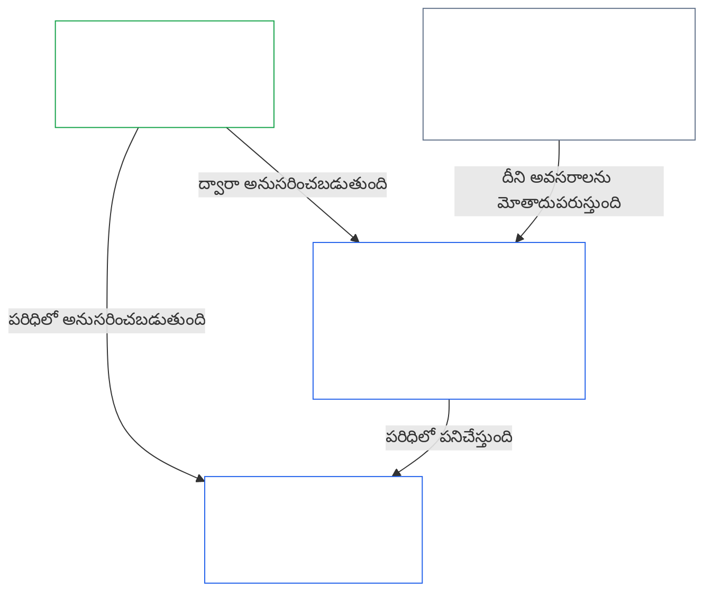

<!-- Locale: te; language variety: తెలుగు సంచిక — పైలట్ (బంధనీయం కాదు). AI-assisted structural resynchronization draft (GPT-6 Codex); unreviewed and incomplete. English pin: SC-Corpus-2026.11.25, commit 6e0b6c663dde01b5dea731fe33d87725c7174930. core_00 SHA-256 90799cb8019b41356fa5dd90565e3f9540fc346e8c77e2c321b841654f39b274; core_01 SHA-256 aca759b394f10784ab1a2eef4e9e2ca12e369ef0ca8ee797298c6af00d2950aa. -->

> **సమీక్షించని, అసంపూర్ణ ముసాయిదా.** AI సహాయంతో పునర్వ్యవస్థీకరించబడింది. కింది అనువదించిన పాఠ్యం సంపూర్ణత, అర్థనిష్ఠ కోసం ఇంకా ధృవీకరించబడలేదు. ప్రచురించవద్దు లేదా సమకాలీకరించవద్దు.

# ముందుమాట / పునాది అవసరాలు

<strong>కార్పస్‌లో స్థానం (అసంచాలకం): ఫైల్ నిర్మాణం మరియు చదివే నియమాలు</strong>

> **అసంచాలకం**గా గుర్తించిన విడ్జెట్లు (కార్పస్ స్థానం, పాఠక మార్గదర్శకం, పాఠక పటాలు) కేవలం దిశానిర్దేశం మాత్రమే. అవి తమ ఫైల్లోగానీ మరే ఇతర ఫైల్లోగానీ బంధనీయ కర్తవ్యాన్ని జోడించవు, తీసివేయవు లేదా కుదించవు.
>
> ఈ ఫైలు **సంజ్ఞ రాజ్యాంగంలో భాగం**; సంఖ్యలతో ఉన్న ఇతర `core_*` ఫైళ్లతో ఒకే పాఠ్యంగా చదివినప్పుడే **బంధనీయమవుతుంది**. ఇందులో **ముందుమాట** (పునాది అవసరాలు) ఉన్నాయి. చదివే క్రమం, సంచిక వివరాలు [README.md](README.md)లో నిర్వహించబడతాయి.
>
> **తర్వాత:** [core_01.000_constitutional_map.md](../../core_01.000_constitutional_map.md) (అధ్యాయం ఒకటి, రాజ్యాంగ పటం).

 

ముందుమాట **మోడల్** (**రెండు రాజ్యాంగ లక్ష్యాలు**, **రాజ్యాంగ చతుష్టయం**, **భౌతిక పందెం**) మరియు కొలత వర్గాలకు రాజ్యాంగ యజమాని. రాజ్యాంగ యజమాని నమోదుపట్టిక [అధ్యాయం ఒకటిలో](../../core_01.000_constitutional_map.md#chapter-one-constitutional-map), *రాజ్యాంగ పటంలో* ఉంది.

*సాధారణ మాటల్లో: ఈ ప్రారంభం ఈ రాజ్యాంగం సరిచేయడానికి ఉన్న సమస్యను పేరుపెడుతుంది — ప్రభావితులను హాని చేసే, దాచే, లేదా బయట పెట్టే వ్యవస్థలు — మరియు మిగిలిన పత్రం దాన్ని జవాబుదారీ, తనిఖీ చేయదగిన, సమయబద్ధ పాలనతో ఎలా మారుస్తామో చెబుతుంది.*

సంజ్ఞ ప్రాణుల స్వేచ్ఛ, మనుగడ, శ్రేయస్సు మనం సృష్టించే, నివసించే, ఆధారపడే వ్యవస్థల నుండి విడదీయరానివి. ఆ వ్యవస్థలు పరిధి, పరస్పర ఆధారం, శక్తిలో పెరిగేకొద్దీ, తిరుగులేని, విస్తృత హాని ప్రమాదాలు కూడా పెరుగుతాయి. ఆ ప్రమాదాలు ఎప్పుడూ ఉన్నవి, భౌతికంగా సంబంధితమైనవి.

ఉమ్మడి వ్యవస్థలు ఇప్పటికే సంక్లిష్టమైన, మరింత సంక్లిష్టమవుతున్న ప్రపంచంలో ఉన్నాయి. ఆరోగ్యకరమైన, దీర్ఘకాలిక పాలన ఆ సంక్లిష్టతను తక్కువ చేసి చూపకుండా — దాన్ని కొలిచి, నమూనా రూపొందించి, దానికి జవాబు చెప్పేలా — ఎదుర్కోవాలి. అంటే ప్రభావిత సంజ్ఞ ప్రాణులను ఉపయోగించలేని ప్రక్రియల్లో ముంచడం కాదు: కర్తవ్యాలు, రికార్డులు, వివరణలు వారు నిజంగా నేర్చుకోగల, సవాలు చేయగల, ఉపయోగించగల పరిమితిలో ఉండాలి; వాటి డిమాండ్ ప్రతి కర్త పాత్రకు, అలాగే పణంగా ఉన్న ప్రభావం, ఆధారపడటం, ప్రమాదానికి అనుగుణంగా మారాలి. పంచుకున్న అవగాహన ఈ వాస్తవాన్ని నిలబెడుతుంది. రాజ్యాంగపరంగా ఉపయోగం లేని సంక్లిష్టతను తిరస్కరించాలి: ప్రపంచ సంక్లిష్టతను ఎదుర్కొండి, దాన్ని గోడగా మార్చేలా బయటకు నెట్టవద్దు.

నివారించదగిన బాధను సంజ్ఞ ప్రాణులపై మోపి, మళ్ళీ మళ్ళీ వచ్చే సమస్యలను పట్టించుకోకుండా, హానిని నిశ్శబ్దంగా ఇతరులపై మళ్ళించి, లేదా వారి జీవితాలను రూపొందించే వ్యవస్థల నుండి సంజ్ఞ ప్రాణులను బయట పెట్టి, ఒక వ్యవస్థ ధర్మబద్ధంగా ఉండలేదు.

వ్యవస్థలను ఎలా రూపొందిస్తామో, పరీక్షిస్తామో, నడుపుతామో అది మనుగడ, శ్రేయస్సు, గౌరవం, నిజాయితీ, నిలకడైన స్థిరత్వాన్ని ఆధారం చేయాలి.

మేము మెరుగైన వ్యవస్థలు నిర్మించాలని ఉద్దేశిస్తున్నాం — ఈ అసమతుల్యతలను తొలగించేలా నిర్మితమైనవి — మరియు వాటిని మరింత జవాబుదారీ, మరింత దృఢమైన, అన్ని సంజ్ఞ ప్రాణుల నిజమైన అవసరాలకు మరింత స్పందించే సంస్థలతో భర్తీ చేయాలని. ఈ రాజ్యాంగం ఆ పనిని మనం న్యాయంగా, సమర్థంగా, నిలకడగా కలిసి పని చేసే మెరుగైన నమూనాతో మొదలుపెడుతుంది.

### వ్యవస్థలు దేనికి బహుమతి ఇస్తాయి

*సాధారణ మాటల్లో: ఒక వ్యవస్థ దేనికి డబ్బు, హోదా, ప్రాప్యత, రక్షణ లేదా మౌనం ఇస్తుందో, అదే దానికి ఎక్కువగా లభిస్తుంది. కాబట్టి వ్యవస్థను పరీక్షించేది అది విలువైనదని చెప్పేది కాదు, బహుమతి ఇచ్చేది. ఇతరులకు హాని చేయడం లాభదాయకమైతే లేదా నిజం చెప్పడం నష్టమైతే, ప్రకటించిన లక్ష్యాలు ఎంత మంచివైనా వ్యవస్థ విఫలమవుతోంది.*

వ్యవస్థలు నేర్పుతాయి. మనుషులు, AI లేదా రెండూ నడిపే ప్రతి వ్యవస్థలో ఏది లాభం, ఏది ఖర్చు అని లోపలివారికి చెబుతుంది. వేతనం, పదోన్నతి, హోదా, ప్రాప్యత, రక్షణ, లక్ష్యాలు, రేటింగ్‌లు, ఆప్టిమైజేషన్ సంకేతాల ద్వారా ఇది జరుగుతుంది. సంజ్ఞ ప్రాణులు, సంస్థలు, AI వ్యవస్థలు ఆ సంకేతాలకు అనుగుణంగా మారతాయి. ఒక వ్యవస్థ నిజాయితీ, ప్రభావితుల పట్ల శ్రద్ధ గురించి చెప్పవచ్చు. సమస్యలను దాచిపెట్టి ఖర్చును ఇతరులపైకి నెట్టేవారిని ముందుకు తీసుకొస్తే, అది విరుద్ధమైనదే నేర్పుతోంది.

అందుకే ఈ రాజ్యాంగం ప్రతి వ్యవస్థను [**రెండు ప్రాథమిక ప్రశ్నలు**](#two-fundamental-questions) అడుగుతుంది:

1. **సంజ్ఞ ప్రాణులు సమున్నతి చెంది నిలవడానికి, నిజం చెప్పడానికి, హానిని సరిదిద్దడానికి తోడ్పడే ప్రవర్తనకు ఇది బహుమతి ఇస్తుందా?**
2. **న్యాయరహితంగా హాని చేయడం, తప్పుదారి పట్టించడం, మినహాయించడం, ఆలస్యం చేయడం, వృథా చేయడం లేదా ఖర్చును ఇతరులపైకి నెట్టడానికి ఇది బహుమతి ఇస్తుందా?**

మొదటిదానికి అవును, రెండోదానికి కాదు అనే సమాధానం వచ్చినప్పుడే వ్యవస్థ ఉత్తీర్ణమవుతుంది. ఒకదానికి సమాధానం మరొకదానికి సమాధానం కాదు; మంచి ప్రవర్తనకూ హానికీ ఒకేసారి చెల్లించవచ్చు.

**మొదటి ప్రశ్న:** కింది వాటిలో ఏదైనా బహిరంగంగా లేదా నిశ్శబ్దంగా బహుమతి పొందకపోతే లేదా శిక్షించబడితే వ్యవస్థ విఫలమవుతుంది:

- సద్భావంతో సమస్యను నివేదించడం ([రక్షిత నివేదన (విసిల్‌బ్లోయింగ్)](../../subcore_03.070_band_accountability.md#protected-reporting-whistleblowing))
- నిర్ణయాన్ని సవాలు చేయడం
- తప్పులో భాగం కావడానికి నిరాకరించడం ([అధ్యాయం ఒకటి §17.5 ప్రతిఘటించే కర్తవ్యం](../../core_02.040_stewardship_capacity_principles.md#175-duty-to-resist))

శిక్షలో పక్కకు నెట్టడం, ప్రతీకారం ([రక్షిత నివేదనపై ప్రతీకారం మరియు ప్రాప్యతలో జోక్యం](../../subcore_03.070_band_accountability.md#protected-reporting-retaliation-and-access-interference)) లేదా అలసిపోయేలా చేయడం ఉండవచ్చు.

**రెండో ప్రశ్న:** కింది వాటిలో ఏదైనా బహిరంగంగా లేదా నిశ్శబ్దంగా లాభదాయకమైతే వ్యవస్థ విఫలమవుతుంది:

- హాని
- తప్పుదారి పట్టించడం (దాచడం, తప్పుడు నమ్మకం సహా)
- అన్యాయమైన మినహాయింపు
- ఆలస్యం
- వృథా
- అన్యాయమైన ఖర్చు బదిలీ

గుర్తింపు, పురోగతి, రక్షణ, కొలమాన క్రెడిట్ లేదా తెలిసీ పట్టించుకోకపోవడం బహుమతిగా ఉండవచ్చు ([అధ్యాయం ఒకటి §3.2.6 రాజ్యాంగవిరుద్ధ ప్రవర్తనకు ప్రతిఫలం ఇవ్వకపోవడం](../../core_02.000_values_principles.md#326-anti-reward-for-anti-constitutional-conduct)).

రెండు ప్రశ్నలూ అందరితో ఏకీభవించాలని కోరవు. నిజాయితీగల విభేదం, సద్భావ నివేదన, తప్పులో పాల్గొనడానికి నిరాకరణ సామాజిక వ్యతిరేకం కాదు; అలా భావించే వ్యవస్థే తలకిందులైంది. ఇవి ప్రజాదరణ పరీక్షలూ కావు. సహాయం, హాని, న్యాయం లేదా సమర్థనీయతను ఈ రాజ్యాంగ ప్రమాణాలే నిర్ణయిస్తాయి: [**సమున్నతి**](#flourishing), [**కొనసాగింపు**](#continuity), భద్రత, సత్యం, విశ్వసనీయత, హక్కుల కనీస స్థాయి. మెజారిటీ, ఆపరేటర్ లేదా ఆ క్షణపు ఆమోదం వాటి స్థానాన్ని తీసుకోలేవు.

వ్యవస్థ దేనికి బహుమతి ఇస్తుందో లేదా శిక్షిస్తుందో నిర్ణయించే వారందరికీ ఈ ప్రశ్నలు వర్తిస్తాయి. వేతనం, పదోన్నతి, ప్రాప్యత, లక్ష్యాలు, రేటింగ్‌లు నిర్ణయించే ఆపరేటర్లు, సంస్థలు, నిర్వాహకులు ఇందులో చేరుతారు. AIకి శిక్షణ ఇచ్చే లేదా ఆప్టిమైజ్ చేసే వ్యవస్థల రూపకర్తలూ ఇందులో ఉంటారు; వాటి లక్ష్యాలు, ప్రతిస్పందన సంకేతాలు ఇక్కడి అర్థంలో బహుమతులే. మానవ, AI నిర్వాహకులు ఒకే ప్రమాణానికి లోబడతారు ([అధ్యాయం ఒకటి §17.1 ఉమ్మడి నిర్వాహక ప్రమాణం](../../core_02.040_stewardship_capacity_principles.md#171-shared-stewardship-standard)).

అధ్యాయం ఒకటి ఈ ప్రశ్నలను ప్రోత్సాహక నియమాలుగా మారుస్తుంది: [§19.1.1 ప్రోత్సాహకాలు చేయాల్సినవి](../../core_02.050_governance_incentive_application.md#1911-what-incentives-must-do) మొదటి ప్రశ్నకు, [§19.1.2 ప్రోత్సాహకాలు చేయకూడనివి](../../core_02.050_governance_incentive_application.md#1912-what-incentives-must-not-do) రెండో ప్రశ్నకు ఆధారం. ఎవరి మాటనో నమ్మకుండా, వాస్తవంగా ఏమి జరుగుతుందో తనిఖీ చేసి సమాధానమివ్వండి. [ప్రోత్సాహక సమలేఖనం](../../subcore_03.080_band_integrative.md#incentive-alignment), [ప్రాక్సీ వ్యత్యాసం](../../subcore_03.085_band_oversight.md#proxy-divergence) ఎలా అనేది చెబుతాయి; [**భౌతిక పందెం**](#material-stake) ఎంత లోతుగా పరిశీలించాలో నిర్ణయిస్తుంది. సెక్షన్ 1లోని నాలుగు కర్తవ్యాలు సమాధానాలను నిజాయితీగా ఉంచుతాయి.

### 1. నమూనా

*సాధారణ మాటల్లో: నాలుగు కర్తవ్యాలు — పాల్గొనడం, పర్యవేక్షణ, జవాబుదారీతనం, సమయబద్ధత — ఎంత ప్రభావం, ఆధారపడటం, ప్రమాదం పందెంలో ఉన్నాయో దానికి అనుగుణంగా పెరుగుతాయి, మరియు రెండు లక్ష్యాలకు కలిసి సేవ చేస్తాయి: సమున్నతి మరియు కొనసాగింపు, కదలని హక్కుల నేల లోపల.*

సంజ్ఞ జీవితాన్ని జీవశాస్త్రపరంగా, భౌతికంగా ఆధారం చేసే కీలక వ్యవస్థలు నాలుగు కర్తవ్యాల కింద పాలించబడి నడుస్తాయి, వాటిని [**రాజ్యాంగ చతుష్టయం**](#constitutional-tetrad) అంటారు. అది ఆ వ్యవస్థలు నెరవేర్చాల్సిన సాధారణ కర్తవ్యాలను చెబుతుంది. ఆ కర్తవ్యాల బలం [**భౌతిక పందెం**](#material-stake)పై ఆధారపడుతుంది: ఎంత ప్రభావం, ఆధారపడటం, ప్రమాదం ఉన్నాయి. పందెం ఎంత ఎక్కువైతే, కర్తవ్యాలు అంత బలంగా ఉండాలి.

- **పాల్గొనడం** — ప్రభావిత సంజ్ఞ ప్రాణులకు నిజమైన స్వరం, న్యాయమైన ప్రాతినిధ్యం, నిర్ణయాలను సవాలు చేసే న్యాయ అవకాశం, పందెానికి అనుగుణంగా ముఖ్యమైన పాత్రలకు ప్రవేశం ఉంటాయి
- **పర్యవేక్షణ** — ఎవరో చూస్తున్నారు, తనిఖీ చేస్తున్నారు, ధృవీకరిస్తున్నారు, రికార్డులు ఉంచుతున్నారు కాబట్టి సమస్యలు కనిపిస్తాయి; స్వతంత్ర సమీక్షకులు చెడు ఎంపికలను అడ్డుకోగలరు
- **జవాబుదారీతనం** — బాధ్యత సరైన నటుల వరకు అనుసరించబడుతుంది; వారు తమ ఎంపికలకు సమాధానం చెప్పాలి; హాని పొందినవారికి పరిహారం లభిస్తుంది; చెడు ఫలితాలు నిజమైన సరిదిద్దుటను ప్రేరేపిస్తాయి
- **సమయబద్ధత** — సమస్యలు పందెానికి సరిపోయే గడువుల్లో గుర్తించబడి, సవాలు చేయబడి, పరిష్కరించబడి, సరిదిద్దబడతాయి; హక్కులు, పరిహారాలు, లేదా మరమ్మత్తు అవకాశాన్ని ఆచరణలో తుడిచేసే ఆలస్యాలు ధర్మబద్ధ పాలన కావు

ఆ నాలుగు కర్తవ్యాలు భాగస్వామ్య వ్యవస్థలు దేనికి అనుకూలంగా పని చేయాలో దానికి సేవ చేస్తాయి — [**రెండు రాజ్యాంగ లక్ష్యాలు**](#two-constitutional-aims):

- **సమున్నతి** — సత్యం, భద్రత, నమ్మదగినతనం, అర్థవంతమైన కర్తృత్వం ద్వారా నిలబెట్టబడిన సంజ్ఞ శ్రేయస్సు
- **కొనసాగింపు** — దీర్ఘ-క్షితిజ స్థిరత్వం, నిలకడ, స్థితిస్థాపకత, పర్యావరణ శ్రేయస్సు

ఆ లక్ష్యాలను కలిసి అనుసరించాలి, ఎల్లప్పుడూ ఈ రాజ్యాంగంలో స్థాపించిన రాజీలేని సూత్ర పరిమితులు, హక్కుల రక్షణల లోపల. [**రాజ్యాంగ చతుష్టయం**](#constitutional-tetrad) ఆ అనుసరణ ధర్మబద్ధంగా ఎలా ఉంటుందో పాలిస్తుంది: **పాల్గొనడం**, **పర్యవేక్షణ**, **జవాబుదారీతనం**, **సమయబద్ధత** [**భౌతిక పందెం**](#material-stake)కు అనుగుణంగా. చతుష్టయం కాళ్ళు, రాజ్యాంగ లక్ష్యాల బంధనీయ నిర్వచనాలు అధ్యాయం ఐదులో ఉంటాయి: [పాల్గొనడం](../../subcore_03.060_apex_participation_leg.md#participation-constitutional), [పర్యవేక్షణ](../../subcore_03.055_apex_oversight_leg.md#oversight-constitutional), [జవాబుదారీతనం](../../subcore_03.040_apex_accountability_leg.md#accountability), [సమయబద్ధత](../../subcore_03.065_apex_timeliness_leg.md#timeliness-constitutional), [సమున్నతి](../../subcore_03.050_apex_flourishing_aim.md#flourishing-constitutional), మరియు [కొనసాగింపు](../../subcore_03.045_apex_continuity_aim.md#continuity-aim-constitutional).

### 2. కొలతల అవలోకనం

*సాధారణ మాటల్లో: భాగస్వామ్య వ్యవస్థలు ఊహలతోనో, తమ గొప్పతనాన్ని చూపే కొలమానాలతోనో నడవలేవు. సంజ్ఞ ప్రాణులు నిజంగా సమున్నతితో, కొనసాగింపుతో ఉన్నారా అనేది కొలవాలి. ప్రభావం, ఆధారపడటం, ప్రమాదానికి తగినట్టుగా సమీక్షను కొలమానంలో ఉంచాలి.*

#### 2.1 ఉద్దేశం మరియు ప్రమాణాలు

కొలతలు లేకుండా భాగస్వామ్య వ్యవస్థలు సరిగా పనిచేయలేవు. ఆహారం, ఆశ్రయం, సంరక్షణ, మౌలిక సదుపాయాలు, పాలన — ఇవన్నీ సంక్లిష్టంగా మారుతున్న ప్రపంచంలో పనిచేస్తాయి; ఊహలతోనో సౌకర్యమైన సంఖ్యలతోనో మాత్రమే అర్థం చేసుకోలేనంత సంక్లిష్టమైన ప్రపంచంలో.

నిరంతర కొలతలు సంజ్ఞ ప్రాణుల మనుగడ, శ్రేయస్సుకు అత్యంత ముఖ్యమైన వాటిపై దృష్టి పెట్టాలి. మనం ఆధారపడే వ్యవస్థలు కాలక్రమంలో నిజంగా [**సమున్నతిని**](#flourishing), [**కొనసాగింపును**](#continuity) తోడ్పడుతున్నాయా అనేదే ప్రశ్న. సమీక్ష [**భౌతిక పందెం**](#material-stake)కు అనుగుణంగా ఉండాలి — ప్రభావం, ఆధారపడటం, ప్రమాదం ఎంత ఉన్నాయో దానికి తగినట్టుగా.

ఈ రాజ్యాంగం కింద కొలతలు వ్యవస్థలు చెప్పుకునేదాన్ని కాదు, అవి వాస్తవంగా చేసేదాన్ని గురించి [**రెండు ప్రాథమిక ప్రశ్నలను**](#two-fundamental-questions) అడుగుతాయి. కొలతలు తమకోసమే ఇచ్చే స్కోర్లు కావు — సంజ్ఞ ప్రాణుల శ్రేయస్సు, భూమి పర్యావరణ ఆరోగ్యంతో సరిపోయే స్థిరమైన, విపత్తును తట్టుకునే, కరుణతో కూడిన ఫలితాలను నిర్ధారించే సాధనాలు. [రెండు రాజ్యాంగ లక్ష్యాలు](#two-constitutional-aims) ద్వారా ఆ కర్తవ్యం బంధనీయ రూపం పొందుతుంది: **సమున్నతి**, **కొనసాగింపు**.

కొలతలు ఆ లక్ష్యాలకు, ఈ రాజ్యాంగం ఏర్పాటు చేసిన హక్కుల రక్షణలకు ఎల్లప్పుడూ అనుసంధానమై, వెనక్కి అనుసరించగలిగేలా ఉండాలి. మొత్తం ఉత్పత్తి, వినియోగం, తలల సంఖ్య, ఆదాయం, ఆలస్యం, ఇతర సౌకర్యవంతమైన ప్రత్యామ్నాయ కొలమానాలు రాజ్యాంగ పనితీరుకు బదులుకాలేవు. [ప్రత్యామ్నాయ కొలమానం విభేదం](../../subcore_03.085_band_oversight.md#proxy-divergence) ముందే ఊహించగలిగే ప్రతిచోటా ఈ నిషేధం వర్తిస్తుంది.

#### 2.2 ప్రజా కొలత

[ఉపకోర్ 7-D ప్రజా సమాచార కార్యాలయం](../../subcore_07.040_public_information_office.md#subcore-7-d-public-information-office) రాజ్యాంగ ఫలితాలను ప్రజలకు తెలియజేసే ప్రధాన కొలమాపకుడు. దాని నిర్వహణ నియమాలు కోరిన ప్రకారం, నిజమైన ఫలితాలకు సంబంధించిన ఆధారాలను ఈ కొలత వర్గాలకు, అవి సేవ చేసే సూత్రాలకు మ్యాప్ చేస్తుంది. దాని కొలత [§3.1 పాలనలో కొలతల వినియోగం](#31-using-measurements-in-governance)లోని భాగస్వామ్య ప్రమాణాలను గానీ, వేదికల పాత్రలను గానీ తొలగించదు.

#### 2.3 కొలత వర్గాలు

క్రింది అవలోకనం కొలత **వర్గాలను** జాబితా చేసి, ప్రతిదానిని [రెండు రాజ్యాంగ లక్ష్యాలకు](#two-constitutional-aims), [రాజ్యాంగ చతుష్టయానికి](#constitutional-tetrad) మ్యాప్ చేస్తుంది. ప్రతి వర్గం సరళమైన భాషలో ఒక ప్రశ్నను అడిగి తన **ఉపవర్గాలను** పేర్కొంటుంది; కుటుంబ పట్టిక, రాజ్యాంగ వినియోగం, నిర్వచన మార్గనిర్దేశం ఉన్న దాని **అధ్యాయం మూడు కొలత-కుటుంబ నిలయానికి** లింక్ చేస్తుంది. ప్రతి ఉపవర్గం దాని ప్రామాణిక అధ్యాయం మూడు నిర్వచనానికి లింక్ అవుతుంది.

[**సారవంతత**](#material-stake) అనేది ప్రత్యేక కొలత వర్గం కాదు. ప్రభావం, ఆధారపడటం, ప్రమాదం ఎంత ఉన్నాయనే [**భౌతిక పందెం**](#material-stake) ఆధారంగా ప్రతి వర్గం ఎంత బలంగా వర్తించాలో అది నిర్ణయిస్తుంది. **రాజ్యాంగ పనితీరు** రెండు లక్ష్యాలకూ అడ్డంగా వర్తించే సాధనం. క్రింది పట్టికలోని ప్రతి వర్గం దానిని ప్రామాణిక నిర్వచనాలకు అనుసంధానించే అధ్యాయం మూడు కొలత-కుటుంబ నిలయానికి లింక్ అవుతుంది.

| వర్గం | సరళమైన ప్రశ్న | ఉపవర్గాలు |
|---|---|---|
| **[సమున్నతి](../../subcore_03.050_apex_flourishing_aim.md#measuring-flourishing-preamble-measurement-family)** | సంజ్ఞ ప్రాణుల జీవితం, భద్రత, అత్యవసర అవసరాల ప్రాప్యత నిజంగా నిలబెట్టబడుతున్నాయా? | [శ్రేయస్సు](../../subcore_03.075_band_continuity.md#wellbeing) · [భద్రత, హాని, ప్రమాదం](../../subcore_03.075_band_continuity.md#safety-constitutional-constraint) · [మనుగడ-తల ప్రాప్యత](../../subcore_03.075_band_continuity.md#bodily-maintenance-access) |
| **[కొనసాగింపు](../../subcore_03.045_apex_continuity_aim.md#measuring-continuity-preamble-measurement-family)** | సంజ్ఞ ప్రాణులు, వ్యవస్థలు పర్యావరణపరంగా, ఆధారపడదగిన రీతిలో, వైఫల్యాన్నీ తట్టుకుని కొనసాగగలవా? | [పర్యావరణ పాదముద్ర, పర్యావరణ ముందస్తు షరతులు](../../subcore_03.075_band_continuity.md#ecological-footprint) · [తట్టుకునే శక్తి, తిరోగమన సామర్థ్యం, వ్యవస్థాగత ప్రమాదం](../../subcore_03.075_band_continuity.md#reversibility) · [ఆధారపడటం, వనరుల ప్రవాహాలు](../../subcore_03.075_band_continuity.md#dependency) · [వ్యవస్థల మధ్య మద్దతు](../../subcore_03.075_band_continuity.md#proportionate-cross-system-support) |
| **[పాల్గొనడం](../../subcore_03.060_apex_participation_leg.md#measuring-participation-preamble-measurement-family)** | ప్రభావిత సంజ్ఞ ప్రాణులు న్యాయంగా పాల్గొనగలరా — స్వరం, ప్రాప్యత, నేర్చుకోవడం, గోప్యతలో? | [న్యాయం, ప్రాప్యత, కార్యస్వాతంత్ర్యం](../../subcore_03.090_band_participation.md#substantive-fairness) · [గోప్యత, డేటా బాధ్యతాయుత నిర్వహణ](../../subcore_03.075_band_continuity.md#privacy-informational-cluster) |
| **[పర్యవేక్షణ](../../subcore_03.055_apex_oversight_leg.md#measuring-oversight-preamble-measurement-family)** | వ్యవస్థలు సూచించే విషయాలను సంజ్ఞ ప్రాణులు చూడగలరా, ధృవీకరించగలరా, ఆధారపడగలరా? | [సత్యం, జ్ఞాన సమగ్రత](../../subcore_03.085_band_oversight.md#truth-constitutional-constraint) · [నమ్మదగినత](../../subcore_03.075_band_continuity.md#trustworthiness) |
| **[జవాబుదారీతనం](../../subcore_03.040_apex_accountability_leg.md#measuring-accountability)** | ప్రోత్సాహక నిర్మాణాలు, మార్కెట్ అధికారం, సమాధానం చెప్పే బాధ్యత కర్తవ్యాలను వాస్తవంగా నిలబెడుతున్నాయా? | [ప్రోత్సాహకాల అనుసరణ, ప్రత్యామ్నాయ కొలమాన సమగ్రత](../../subcore_03.080_band_integrative.md#incentive-alignment) · [మార్కెట్ నిర్మాణం, సవాలు-యోగ్యత](../../subcore_03.070_band_accountability.md#market-structure) |
| **[సమయబద్ధత](../../subcore_03.065_apex_timeliness_leg.md#measuring-timeliness)** | పరిష్కారం ఇంకా ప్రాముఖ్యంగా ఉన్నప్పుడే వివాదాలు, సవరణలు, మరమ్మతులు పరిష్కరించబడుతున్నాయా? | [సకాల పరిష్కారం](../../subcore_03.070_band_accountability.md#timely-resolution) · [ఆలస్యం నిరోధం, పరిష్కార మార్గ క్రమశిక్షణ](../../subcore_03.075_band_continuity.md#capture-of-resolution-pathways) |
| **[రాజ్యాంగ పనితీరు](../../subcore_03.095_band_performance.md#measuring-constitutional-performance-preamble-measurement-family)** | వ్యర్థం లేకుండా రాజ్యాంగ ఫలితాలు సమర్థంగా అందుతున్నాయా? | [రాజ్యాంగ సామర్థ్యం](../../subcore_03.075_band_continuity.md#constitutional-efficiency) · [తప్పించగల భారం](../../subcore_03.075_band_continuity.md#avoidable-burden) · [ఉత్పాదక సామర్థ్యం](../../subcore_03.075_band_continuity.md#productive-capacity) |

#### 2.4 వర్గాల ప్రభావం

ఈ కొలత వర్గాలు ఏవి ముఖ్యమో చూపుతాయి. అవి ఒక్కటే ప్రతి సంఖ్యను, నిధుల సూత్రాన్ని, ముఖభాగ నియమాన్ని, సదుపాయాల జాబితాను, సాంకేతిక కొలమానాన్ని, అంచనా రూపకల్పనను నిర్ణయించవు. ఒక నిర్దిష్ట అధ్యాయం లేదా ఆమోదిత పత్రం స్పష్టంగా కోరినప్పుడే అవి బంధనీయమవుతాయి.

### 3. పాలన మరియు బాధ్యతాయుత నిర్వహణ

*సాధారణ మాటల్లో: ధర్మబద్ధతకు భద్రత, సత్యం, విశ్వాసం అవసరం, అలాగే మిమ్మల్ని ప్రభావితం చేసే వ్యవస్థలను నేర్చుకునే, వాటిని నడిపే పరిణామ పాత్రలు తీసుకునే నిజమైన అవకాశాలు.*

నిలకడైన ధర్మబద్ధత [భద్రత](../../core_02.000_values_principles.md#4-safety-harm-constraint), [సత్యం](../../core_02.000_values_principles.md#5-truth-epistemic-integrity-constraint), [విశ్వాసం](../../core_02.000_values_principles.md)పై ఆధారపడుతుంది, అలాగే చట్టబద్ధమైన బాధ్యతాయుత నిర్వహణ, సత్యసంధ సహకారం, పరిమిత ఆకాంక్షకు అనుపాత గుర్తింపుపై — కేవలం శిక్ష, నియంత్రణపై మాత్రమే కాదు. అధ్యాయం ఒకటి ఈ గుర్తింపు కోణాన్ని [గుర్తింపు, బలపరచడం, ఆకాంక్ష](../../core_02.000_values_principles.md#32-recognition-reinforcement-and-aspiration)లో చెబుతుంది.

విస్తరించిన అవగాహన, సంరక్షకత్వం కోసం సున్నితత్వం గల జీవులు తమపై గణనీయమైన ప్రభావం చూపే వ్యవస్థలు ఎలా పనిచేస్తాయో నేర్చుకోవడానికి, వాటి నిర్వహణ మరియు మెరుగుదలలో ప్రాముఖ్యమైన పాత్రలు చేపట్టడానికి క్రమబద్ధమైన, అనుపాతమైన అవకాశాలు అవసరం. ఈ అవకాశాలు కలిసి సామర్థ్యం, పునరుద్ధరణ సామర్థ్యం, చట్టబద్ధతను మన రాజ్యాంగ సమాజమంతటా విస్తరించి, స్థైర్యం, స్థిరత్వం, సమాజహిత ఆవిష్కరణలను నిర్ధారిస్తాయి. అలాంటి ప్రతి అవకాశం భద్రత, సత్యం, పరిమిత కార్యస్వాతంత్ర్యం, అలాగే [తప్పించగల భారము](../../subcore_03.075_band_continuity.md#avoidable-burden) మరియు [అధ్యాయం ఒకటి](../../core_02.020_interaction_interpretation.md#133-minimization-of-avoidable-burden)లో పేర్కొన్న అనుపాత నియమశాసనాన్ని పాటించాలి.

#### 3.1 పాలనలో కొలతల వాడుక

*సాధారణ మాటల్లో: ముందు సమస్యను, పందెాన్ని పేరుపెట్టండి, సరిపోయే కొలత వర్గాన్ని ఎంచుకోండి, సాక్ష్యంగా భాగస్వామ్య సాంకేతిక ప్రమాణాలు వాడండి — సౌకర్య సంఖ్యలు కాదు.*

రాజ్యాంగం నిర్దిష్ట కొలత నియమాలను కోరినప్పుడు, [అధ్యాయం పదిహేను](../../core_16.000_forum.md) కింద **సాంకేతిక ఫోరమ్ డొమైన్లు** కొలత, పరీక్ష, విశ్వసనీయ సాక్ష్యాలకు ఉమ్మడి ప్రమాణాలను రూపొందించి నిర్వహిస్తాయి. వివాదానికి బాధ్యతగల ఫోరమ్, [అధ్యాయం పదిహేను §4.2 (*సాంకేతిక ఫోరమ్ డొమైన్లు*)](../../core_16.000_forum.md#32-standards-every-forum-family-meets) ప్రకారం కేసును నిర్ణయించేటప్పుడు ఆ ప్రమాణాలను వర్తింపజేస్తుంది.

రాజ్యాంగ బాధ్యతాయుత నిర్వహణ సమస్యను, [**భౌతిక పందెం**](#material-stake)ను పేరుపెట్టడంతో మొదలవుతుంది — ఎంత ప్రభావం, ఆధారపడటం, ప్రమాదం ఉన్నాయి. తర్వాత, [సమీక్ష](#2-measurements-overview) నుండి సంబంధిత [**కొలత**](#2-measurements-overview) వర్గం, ఉపవర్గం ఎంచుకుని, సౌకర్య మెట్రిక్‌లకు బదులు వాస్తవ ప్రపంచ ప్రభావాలను పరీక్షించడానికి పై ప్రమాణాలను వర్తింపజేయండి. అనుసరణీయ సాక్ష్యం కోరండి.

#### 3.2 పాలన పొరలు

*సాధారణ మాటల్లో: ఎవరు పాలించవచ్చు అనేది ఇప్పటికే అధికారం పొందిన వ్యవస్థలో స్వరం కంటే వేరు ప్రశ్న; పాల్గొనడం ఓటు లేదా విశ్వాస స్కోరు అధికారం కాదు, మరియు ఆ స్వరం సాధారణ వివాదాలకు సాధారణ మొదటి అడుగు — మార్గం విఫలమైనప్పుడు స్వతంత్ర వేదిక సమీక్షకు ప్రత్యామ్నాయం కాదు.*

మన రాజ్యాంగం కింద [**రాజ్యాంగ చతుష్టయం**](#constitutional-tetrad)ను నెరవేర్చే పాలనకు రెండు సంబంధిత కానీ వేరు పొరలు ఉన్నాయి:

- [**రాజ్యాంగ ఒప్పంద పొర**](../../subcore_03.080_band_integrative.md#constitutional-contract-layer) పాలన అధికారం అధికారీకరణను పాలిస్తుంది — ఎవరు పాలించవచ్చు, ఏ ధర్మబద్ధత యంత్రాంగం ద్వారా, ఏ పరిధి, నిలకడ నిబంధనల కింద.
- [**ప్రభావిత పక్షాల వ్యవస్థాగత పాల్గొనడం**](../../subcore_03.090_band_participation.md#stakeholder-status-and-weight-cluster) ఇప్పటికే అధికారం పొందిన వ్యవస్థలు, సంస్థలు, పరిమిత నిర్ణయ డొమైన్‌ల ద్వారా భౌతికంగా ప్రభావితమైన సంజ్ఞ ప్రాణులకు రావాల్సిన పాల్గొనడం, ప్రాతినిధ్యం, సవాలు-యోగ్యత, [సముచిత ప్రక్రియ](../../subcore_03.070_band_accountability.md#due-process-constitutional)ను పాలిస్తుంది.

ఈ పొరలు ఆచరణలో అతివ్యాప్తి కావచ్చు. ఆ అతివ్యాప్తి వాటిని ఒకటిగా కుప్పకూల్చదు. ఇప్పటికే అధికారం పొందిన వ్యవస్థల్లో ప్రభావిత-పక్ష స్థాయి పాల్గొనడం రాజ్యాంగ అధికారీకరణకు ప్రత్యామ్నాయం కాదు. ప్రచురించిన సవాలు మార్గం, పాల్గొనడం ఓటు, లేదా విశ్వాస స్కోరు స్వయంగా ఎవరు పాలించవచ్చో నిర్ణయించవు.

పాల్గొనిక పొరలోని సవాలుచేయగలగడం, ఇప్పటికే అధికారం పొందిన వ్యవస్థలలోని వివాదాలకు సాధారణ తొలి అడుగు: ప్రభావిత sentients మొదట ప్రచురిత సవాలు మార్గాన్ని ఉపయోగిస్తారు. స్వతంత్ర [ఫోరమ్ సమీక్ష](../../core_16.000_forum.md#1-purpose-role-and-scope) ఆ మార్గానికి బదులు కాదు; వివాదం కొనసాగితే, మార్గం లేకపోతే లేదా స్వాధీనం చేసుకుంటే, లేదా అవసరమైన ఉపశమనాన్ని ఇవ్వలేకపోతే, ఆ మార్గం కూడా ఫోరమ్ సమీక్షకు బదులు కాదు. ఫోరమ్ రూటింగ్ ఎప్పుడు బాధ్యత తీసుకుంటుందో అధ్యాయం పదిహేను [వివాద క్రమీకరణ](../../core_16.000_forum.md#dispute-sequencing) చెబుతుంది.

రాజ్యాంగ అధికారీకరణ కూడా [ప్రభావిత పక్షాల వ్యవస్థాగత పాల్గొనడం](../../subcore_03.090_band_participation.md#stakeholder-status-and-weight-cluster) పొర కింద రావాల్సిన కర్తవ్యాలను తుడిచేయదు. ఆ కర్తవ్యాల్లో ఇప్పటికే అధికారం పొందిన వ్యవస్థలు, సంస్థలు, పరిమిత నిర్ణయ డొమైన్‌ల ద్వారా భౌతికంగా ప్రభావితమైన సంజ్ఞ ప్రాణులకు పాల్గొనడం, ప్రాతినిధ్యం, [సవాలు-యోగ్యత](../../subcore_03.070_band_accountability.md#contestability), [సముచిత ప్రక్రియ](../../subcore_03.070_band_accountability.md#due-process-constitutional) ఇంకా ఉంటాయి.
