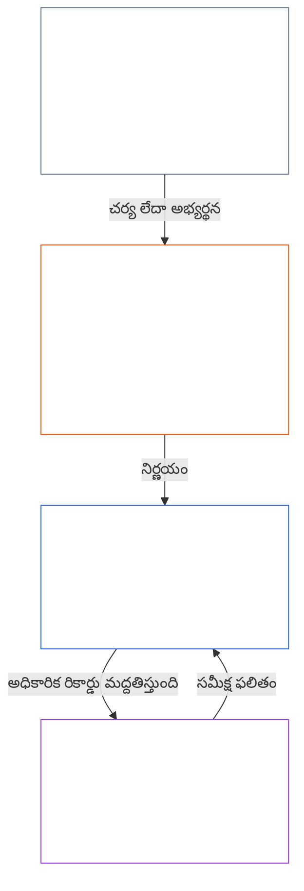
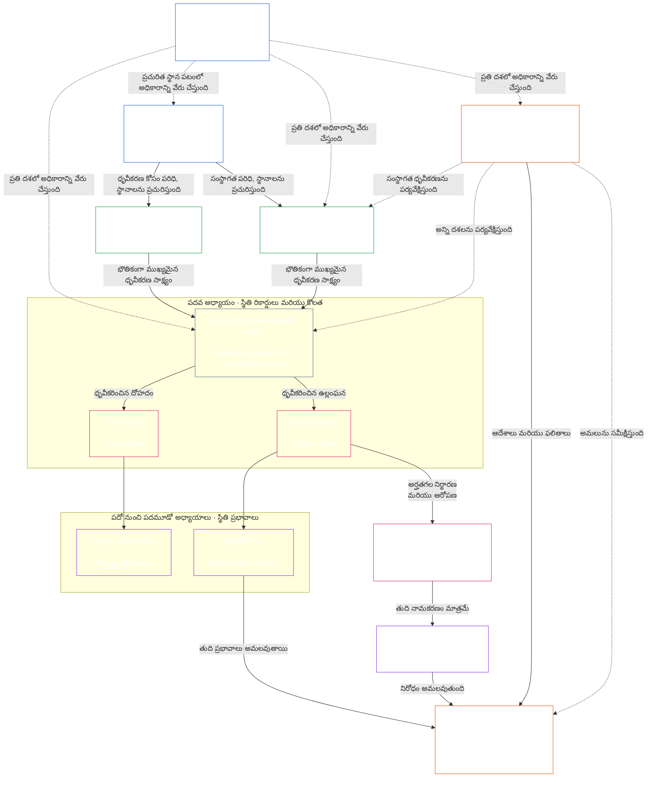

<!-- Locale: te; language variety: తెలుగు సంచిక — పైలట్ (బంధనీయం కాదు). AI-assisted structural resynchronization draft (GPT-6 Codex); unreviewed and incomplete. English pin: SC-Corpus-2026.11.25, commit 6e0b6c663dde01b5dea731fe33d87725c7174930. core_00 SHA-256 90799cb8019b41356fa5dd90565e3f9540fc346e8c77e2c321b841654f39b274; core_01 SHA-256 aca759b394f10784ab1a2eef4e9e2ca12e369ef0ca8ee797298c6af00d2950aa. -->

<!-- Structural extraction only. Current Chapter One §§1–4 are new translation work. Missing sections are marked as gaps. Do not publish or synchronize. -->

# అధ్యాయం ఒకటి: రాజ్యాంగ పటం

<strong>కార్పస్‌లో స్థానం (అసంచాలకం): ఫైల్ నిర్మాణం మరియు చదివే నియమాలు</strong>

> **అసంచాలకం**గా గుర్తించిన విడ్జెట్లు (కార్పస్ స్థానం, పాఠక మార్గదర్శకం, పాఠక పటాలు) కేవలం దిశానిర్దేశం మాత్రమే. అవి తమ ఫైల్లోగానీ మరే ఇతర ఫైల్లోగానీ బంధనీయ కర్తవ్యాన్ని జోడించవు, తీసివేయవు లేదా కుదించవు.
>
> ఈ ఫైలు **సంజ్ఞ రాజ్యాంగంలో భాగం**; సంఖ్యలతో ఉన్న ఇతర `core_*` ఫైళ్లు మరియు ఉపకోర్‌తో కలిపి ఒకే పాఠ్యంగా చదివినప్పుడే **బంధనీయమవుతుంది**. ఇందులో **అధ్యాయం ఒకటి**, *రాజ్యాంగ పటం* ఉంది: దాని ఉద్దేశం (§1), అది ఎందుకు ఉందో (§2), దాని ఫైళ్లు ఎలా కలుస్తాయో (§3), తరువాతి అధ్యాయాలకు పునాదులు (§4), ప్రధాన పాలనా ప్రక్రియలు (§5), రాజ్యాంగ యజమాని నమోదుపట్టిక (§6 నుంచి §11 వరకు).
>
> **ముందున్నది:** [core_00.000_preamble.md](core_00_preamble.md) (ముందుమాట)
> **తర్వాత:** [core_02.000_values_principles.md](../../core_02.000_values_principles.md)

<strong>జాడ</strong>

- ముందున్నది: [ముందుమాట](core_00_preamble.md) (*మోడల్, రెండు రాజ్యాంగ లక్ష్యాలు, రాజ్యాంగ చతుష్టయం, భౌతిక పందెం, కొలత వర్గాలు*).
- ఉపవిభాగాలు:
  - [§1](#1-purpose-role-and-scope);
  - [§2](#2-why-the-map-exists);
  - [§3](#3-how-the-files-fit-together);
  - [§4](#4-foundations-for-the-chapters-that-follow);
  - [§5](#5-key-governance-processes);
  - [§6](#6-principles-definitions-and-rights);
  - [§7](#7-system-and-institutional-charters-functional-independence-and-separation-of-duties);
  - [§8](#8-key-practical-process-pipelines);
  - [§9](#9-process-ownership-and-outputs);
  - [§10](#10-governance-change-and-incorporation);
  - [§11](#11-adopted-implementation-corpus).
- వీటితో చదవండి: [అధికార క్రమం మరియు అంతర్గత శ్రేణి](../../subcore_03.080_band_integrative.md#authority-stack-and-internal-hierarchy) (*యజమాని నమోదుపట్టిక ఎలా వర్తిస్తుంది*); [README.md](README.md) (*చదివే క్రమం*).

 

### 1. ఉద్దేశం, పాత్ర, పరిధి

*సాధారణ మాటల్లో: ఈ అధ్యాయం మిగతా రాజ్యాంగానికి మార్గదర్శి. భాగాలు ఎలా కలుస్తాయో, ప్రతి విషయానికి ఏ అధ్యాయం బాధ్యత వహిస్తుందో, ప్రధాన ప్రక్రియలు ఎలా నడుస్తాయో చూపి, పాఠకుడు తన ప్రశ్నకు సమాధానమిచ్చే నియమాన్ని కనుగొనేలా చేస్తుంది.*

**ఉద్దేశం:** అధ్యాయం ఒకటి సమగ్ర అవలోకనాన్ని, బాధ్యతల మార్గదర్శిని అందిస్తుంది. అధికారం పొందిన పాలనను పరీక్షించే ప్రక్రియలను పేర్కొంటుంది, ప్రతి సారవంతమైన విషయ పరిధికి ఏ అధ్యాయం బాధ్యత వహిస్తుందో చెబుతుంది, రాజ్యాంగ పాఠ్యంలోని మూడు స్థాయిలను వివరిస్తుంది.

**పాత్ర:** ఈ అధ్యాయం దిశానిర్దేశం చేసి బాధ్యతను చూపుతుంది. ఇతర అధ్యాయాలు మరియు [అధికార క్రమం మరియు అంతర్గత శ్రేణి](../../subcore_03.080_band_integrative.md#authority-stack-and-internal-hierarchy) అమలు చేసే యజమాని నమోదుపట్టికకు మించి స్వంత కర్తవ్యాన్ని జోడించదు.

**అధ్యాయం పరిధి:** ఇందులో ఇవి ఉంటాయి:

- ఈ పటం ఎందుకు ఉందో (**విభాగం 2**);
- ఫైళ్లు ఎలా కలుస్తాయో (**విభాగం 3**), తరువాతి అధ్యాయాలకు పునాదులు (**విభాగం 4**);
- ప్రధాన పాలనా ప్రక్రియలు (**విభాగం 5**);
- రాజ్యాంగ యజమాని నమోదుపట్టిక: సూత్రాలు, నిర్వచనాలు, హక్కులు (**విభాగం 6**); చార్టర్లు, కార్యాత్మక స్వాతంత్ర్యం, కర్తవ్యాల విభజన (**విభాగం 7**); ప్రక్రియా శ్రేణులు (**విభాగం 8**); ప్రక్రియల యజమాన్యం, ఫలితాలు (**విభాగం 9**); పాలన, మార్పు, చేర్పు (**విభాగం 10**); మరియు
- ఆమోదిత అమలు కార్పస్, ఉపకార్పస్ (**విభాగం 11**).

### 2. ఈ పటం ఎందుకు ఉంది

*సాధారణ మాటల్లో: ఇంత పెద్ద పాఠ్యానికి భాగాలు ఎలా కలుస్తాయో, ప్రతి విషయానికి ఎవరు బాధ్యులో చూపే మార్గదర్శి అవసరం. పాఠకుడు తన ప్రశ్నకు సమాధానమిచ్చే నియమాన్ని కనుగొనడానికి ఈ అధ్యాయం ఉంది.*

రాజ్యాంగం తన పనిని అనేక అధ్యాయాలు, ఒక ఉపకార్పస్, నాలుగు ఆమోదిత కార్పస్‌ల మధ్య విస్తరించింది. తనకు ఏమి లభించాలో తెలుసుకోవాలనుకునే సంజ్ఞ ప్రాణి లేదా ఒక కర్తవ్యాన్ని వెతుకుతున్న ఆమోదకుడు దారి తప్పవచ్చు. ఈ అధ్యాయం సమగ్ర అవలోకనం, బాధ్యతల మార్గదర్శి: ప్రతి భాగం ఏమి చేస్తుంది, ప్రతి విషయానికి ఏ అధ్యాయం బాధ్యత వహిస్తుంది, ప్రక్రియా శ్రేణులు ఎలా నడుస్తాయి, స్థాయిలు ఎలా సంబంధం కలిగి ఉంటాయి. యజమాని నమోదుపట్టికకు మించి ఇది స్వంత నియమం జోడించదు.

**ఆధారం:**

- ముందుమాట:
  - [రాజ్యాంగ చతుష్టయం](core_00_preamble.md#constitutional-tetrad): ఈ అధ్యాయం ఆచరణలో పెట్టే కాళ్లు:
    - [పాల్గొనడం](../../subcore_03.060_apex_participation_leg.md#participation): సంజ్ఞ ప్రాణి తన ప్రశ్నకు సమాధానమిచ్చే నియమాన్ని కనుగొనగలదు;
    - [జవాబుదారీతనం](../../subcore_03.040_apex_accountability_leg.md#accountability): ప్రతి విషయానికి బాధ్యత వహించే అధ్యాయం పేరుతో ఉంటుంది;
    - [పర్యవేక్షణ](../../subcore_03.055_apex_oversight_leg.md#oversight): భాగాలు ఎలా సరిపోతాయో పాఠకుడు చూసి, ఖాళీని లేదా అతివ్యాప్తిని గుర్తించగలడు;
    - [సమయబద్ధత](../../subcore_03.065_apex_timeliness_leg.md#timeliness): పాఠకుడు సరైన నియమాన్ని ఆలస్యం లేకుండా చేరుకోగలడు;
  - [రెండు రాజ్యాంగ లక్ష్యాలు](core_00_preamble.md#two-constitutional-aims): ఈ అధ్యాయం సేవ చేసే రెండు లక్ష్యాలు:
    - [సమున్నతి](core_00_preamble.md#flourishing): సంజ్ఞ ప్రాణులు రాజ్యాంగంలో దారిని కనుగొనగలిగితేనే అది వారికి ఉపయోగపడుతుంది;
    - [కొనసాగింపు](core_00_preamble.md#continuity): స్పష్టమైన పటం పాఠ్యం పెరుగుతూ మారుతున్నప్పుడు దాని సమగ్రతను కాపాడుతుంది;
- అధ్యాయం రెండులోని సూత్రాలు:
  - [§5.2 సరళ భాషలో అందుబాటు (పాల్గొనడం, బాధ్యతాయుత నిర్వహణ కర్తవ్యం)](../../core_02.000_values_principles.md#52-plain-language-accessibility-participation-and-stewardship-duty);
  - [§5.2.4 సంక్లిష్టతను ఓటమి సాధనంగా వాడకుండా క్రమశిక్షణ](../../core_02.000_values_principles.md#524-complexity-as-defeat-discipline);
  - [§15.4 రాజ్యాంగార్థ విభేదాల పరిష్కారం](../../core_02.030_constitutional_interpretation.md#154-constitutional-meaning-conflict-resolution);
- అధ్యాయం నాలుగులోని అధికరణాలు:
  - [అధికరణం XXIV-A](../../core_04.030_rights_part_d.md#article-xxiv-a-proportional-comprehensibility-right) (*అనుపాత అవగాహన హక్కు*);
  - [అధికరణం XXIV-B](../../core_04.030_rights_part_d.md#article-xxiv-b-complexity-audit-and-modularity-requirements) (*సంక్లిష్టత తనిఖీ, మాడ్యులారిటీ అవసరాలు*).

### 3. ఫైళ్లు ఎలా కలుస్తాయి

రాజ్యాంగ ఫైళ్లు ఈ విధంగా కలుస్తాయి:

- **కోర్ (`core_*`):** సంఖ్యలతో ఉన్న ఫైళ్లు రాజ్యాంగ అధ్యాయాలను కలిగి ఉంటాయి; వాటిని ఒకే పాఠ్యంగా కలిసి చదవాలి. అవి హామీలు, రాజ్యాంగ నిర్మాణాన్ని పేర్కొంటాయి.
- **ఉపకోర్ (`subcore_*`):** ఈ ఫైళ్లు అధ్యాయాల వెనుక ఉన్న పూర్తి నియమాలు, విధానాలను అందిస్తాయి. ప్రతి ఫైలు ఒక అధ్యాయానికి చెందుతుంది, అదే బలం కలిగి ఉంటుంది, వేరుగా చేర్చాల్సిన అవసరం లేకుండా ప్రతి ఆమోదకుడినీ బంధిస్తుంది. ఉపకోర్ తన అధ్యాయ పరిధిని కుదించకూడదు.
- **అమలు (`corpus_*`):** నాలుగు ఫైళ్లు రాజ్యాంగాన్ని అమలు చేయడానికి కార్యాచరణ వివరాలు అందిస్తాయి. చెల్లుబాటు అయ్యే చేర్పు పరిధిలో అవి బంధిస్తాయి; రాజ్యాంగాన్ని కుదించకుండా అమలు చేస్తాయి. [విభాగం 11](#11-adopted-implementation-corpus) ఆ నాలుగు ఫైళ్లను గుర్తిస్తుంది.

నిర్వచించిన [కార్పస్](../../subcore_03.080_band_integrative.md#corpus) అనేది బంధించే రాజ్యాంగ మూలాల విస్తృత, సంచికలతో కూడిన సముదాయం: కోర్, ఉపకోర్, ఆమోదిత అమలు పాఠ్యం, మార్పు సమయంలో చెల్లుబాటు అయ్యే అనుకూలత కవర్లు ఇందులో ఉంటాయి. ముసాయిదాలు, గమనికలు, దారి చూపే మార్గదర్శకాలు ప్రాజెక్టులో భాగమని మాత్రమే బంధనీయమవు.

### 4. తరువాతి అధ్యాయాలకు పునాదులు

*సాధారణ మాటల్లో: అధ్యాయాలు రెండు నుంచి నాలుగు విలువలు, పదకోశం (నిర్వచనాలు ఎలా నిర్మించాలి, రక్షించాలి, నిరూపించాలి అనే ఉపకోర్ నియమాలతో సహా), హక్కుల తలానికి బాధ్యత వహిస్తాయి; తరువాతి అధ్యాయాలు ఆ పరిధులను గౌరవించాలి, నిశ్శబ్దంగా మార్చకూడదు.*

**అధ్యాయాలు రెండు నుంచి నాలుగు** విలువలు, పదసంపద, ధృవీకరణ యంత్రాంగం, హక్కుల తలాన్ని అందిస్తాయి; తరువాతి ప్రతిదీ వాటిని గౌరవించాలి. ఇందులో ఇవి కూడా ఉంటాయి:

- [అధ్యాయం ఐదు](#7-system-and-institutional-charters-functional-independence-and-separation-of-duties)లోని వ్యవస్థ చార్టర్ లేదా సంస్థాగత చార్టర్ అవసరం, అధ్యాయం ఆరులోని కర్తవ్యాల విభజన అవసరం, అధ్యాయం ఏడులోని స్వతంత్ర సంస్థలు (విభాగం 7);
- విభాగం 8లోని [ప్రధాన ఆచరణాత్మక ప్రక్రియా శ్రేణులు](#8-key-practical-process-pipelines);
- విభాగం 9లోని [ప్రక్రియల యజమాన్యం, ఫలితాలు](#9-process-ownership-and-outputs);
- విభాగం 10లోని పాలన, మార్పు మార్గాల అధ్యాయాలు; మరియు
- విభాగం 11లోని [ఆమోదిత అమలు కార్పస్](#11-adopted-implementation-corpus).

### 5 కీలక పాలన ప్రక్రియలు

*సాధారణ మాటల్లో: పాఠం కోరినప్పుడు, భౌతిక విషయాలు ధృవీకరణ, సహాయం-హాని రాతపూర్వక రికార్డులు, సరిదిద్దుట మరియు పరిహారం, గడియారాలతో వేదిక సమీక్ష గుండా వెళ్తాయి — సాధారణ వివాదాలు ముందు ప్రచురించిన సవాలు మార్గం వాడతాయి; ఆ మార్గాలు అధికార పాలనను పరీక్షిస్తాయి; స్వయంగా సృష్టించవు.*

అధ్యాయం ఆరు, [అధ్యాయం తొమ్మిది](../../core_08.000_system_alignment_certification_evaluation.md#chapter-eight-system-alignment-certification), సమావేశీకరించిన పత్రాలు, లేదా ఇతర రాజ్యాంగ నిబంధనలు స్పష్టంగా కోరిన చోట, భౌతిక రాజ్యాంగ విషయాలను కింది మార్గాల్లో ఒకటి లేదా ఎక్కువలోకి తీసుకెళ్ళండి. [ప్రధాన ఆచరణాత్మక ప్రక్రియ గొలుసులు](#6-key-practical-process-pipelines) కొలతను రికార్డులు, ధృవీకరణ, ధృవీకరించిన ఇన్‌పుట్‌లు, వర్గీకరణ, వేదిక పర్యవేక్షణ, సరిదిద్దుట, సమయానుకూల పరిహారంగా మారుస్తాయి — అధికార పాలన ఆచరణలో ఎలా పరీక్షించబడుతుంది, సవాలు చేయబడుతుంది, మరమ్మత్తు అవుతుంది. అవి స్వయంగా పాలనను అధికారం చేయవు; పాలనను సమీక్షించదగినది, సవాలు-యోగ్యం, సరిదిద్దదగినది, సమయబద్ధం చేస్తాయి. [విభాగం 5.1](#62-how-the-full-chain-fits-together) ఆ గొలుసును పూర్తిగా చెబుతుంది.

- **కార్యాచరణ స్వాతంత్ర్యం మరియు విధుల విభజన** ([అధ్యాయం ఆరు](../../core_06.000_functional_independence_separation_of_duties.md#chapter-six-functional-independence-and-separation-of-duties)): భౌతికంగా బంధించే చర్య ముందుకు సాగేముందు, ప్రారంభం, ధృవీకరణ లేదా అధికారం, అధికారిక రికార్డు సంరక్షణ, సవాలు సమీక్ష స్థానాలను వర్తించే స్థాయీకరణ మరియు స్వాతంత్ర్య నియమాల ప్రకారం గుర్తించి వేరుచేయాలి.
- **వ్యవస్థ అనుగుణత ధృవీకరణ** ([అధ్యాయం తొమ్మిది](../../core_08.000_system_alignment_certification_evaluation.md#chapter-eight-system-alignment-certification)) — అధిక-ప్రభావ వ్యవస్థను స్కేల్‌లో నమ్మే ముందు, ఇప్పుడు దానిపై ఆధారపడటం రాజ్యాంగపరంగా సురక్షితమా అని సాక్ష్యం సేకరించి సమీక్షించండి
- **స్థితి రికార్డులు** ([అధ్యాయం పదకొండు](core_11_standing_assessment.md#chapter-eleven-standing-records--question-1-what-happened)) — ప్రవర్తన లేదా హాని రాజ్యాంగపరంగా ముఖ్యమైనప్పుడు, ధృవీకరించిన వాస్తవాలను అధికారిక సహకారం లేదా ఉల్లంఘన కేసు ఫైళ్లలో నమోదు చేయండి; పుకార్లు, పేరు ప్రతిష్ఠలు సరిపోవు.
- **సరిదిద్దడం మరియు పరిహారం** ([అధ్యాయం పదమూడు §5.1 (*పరిహారం మరియు సరిదిద్దడం*)](../../core_12.000_violation_consequences.md#31-remedy-and-correction)) — మూల వైఫల్యాన్ని సరిచేసి, హాని పొందినవారికి తగిన గుర్తింపు, మరమ్మత్తు, పునరుద్ధరణ లేదా పరిహారం అందించండి.
- **ఫోరమ్ సమీక్ష** ([అధ్యాయం పదిహేను](../../core_16.000_forum.md#1-purpose-role-and-scope))
  - ఇప్పటికే అధికారం పొందిన వ్యవస్థల్లో సాధారణ వివాదాలు ముందు ప్రచురించిన [ప్రభావిత పక్షాల వ్యవస్థాగత పాల్గొనడం](../../subcore_03.090_band_participation.md#stakeholder-status-and-weight-cluster) సవాలు మార్గం వాడతాయి
  - ఆ మార్గం ఇంకా సవాలులో ఉంటే, లేకపోతే, స్వాధీనమైతే, లేదా ఉపశమనం ఇవ్వలేకపోతే, ప్రాథమిక పందెం ప్రకారం పర్యవేక్షిత వేదికల ద్వారా మార్గం పెట్టండి
  - ఆ వేదికలు **అనుచ్ఛేదం XXV-C** (*సమయానుకూల పరిష్కారం మరియు ఆలస్య-నిరోధ నేల*) కింద సాక్ష్యం, చట్టబద్ధ బదిలీ, సమయబద్ధ గడియారాలను ఆధారం చేస్తాయి

### 6. సూత్రాలు, నిర్వచనాలు, హక్కులు

*సాధారణ మాటల్లో: అధ్యాయాలు ఒకటి నుండి ఆరు విలువలు, పదాలు ఎలా నిర్మించబడి తనిఖీ అవుతాయి, నిఘంటువు, హక్కుల నేల సొంతం; తరువాతి అధ్యాయాలు ఆ ఇళ్ళను గౌరవించాలి, నిశ్శబ్దంగా తరలించకూడదు.*

**4 నుండి 9** విభాగాలు ఈ రాజ్యాంగపు **రాజ్యాంగపరమైన బాధ్యతల నమోదు**. ప్రతి భాగం తన అధ్యాయం (లేదా ఆమోదిత కార్పస్) బాధ్యత వహించే విషయ పరిధిని, అది ఉత్పత్తి చేసేదాన్ని పేర్కొంటుంది. ప్రతి సంఖ్యా అధ్యాయం ప్రారంభంలోనూ బంధనకరమైన ఒక-వరుస బాధ్యతా ప్రకటనలు ఉంటాయి. ఇతర స్థాయిలు బాధ్యత వహించే అంశాన్ని సూచించవచ్చు, కానీ దాన్ని నిశ్శబ్దంగా తిరిగి రాయడం లేదా తరలించడం చేయకూడదు; ఈ తరలింపు-నిషేధ క్రమశిక్షణ [అధికార క్రమం మరియు అంతర్గత శ్రేణి](../../subcore_03.080_band_integrative.md#authority-stack-and-internal-hierarchy) కింద ఉంటుంది.

అధ్యాయాలు **ఒకటి నుండి ఆరు** తరువాతి ప్రతిదీ గౌరవించాల్సిన విలువలు, పదకోశం, ధృవీకరణ యంత్రాంగం, హక్కుల నేలను ఇస్తాయి — విభాగం 5లో [ప్రధాన ఆచరణాత్మక ప్రక్రియ గొలుసులు](#6-key-practical-process-pipelines), విభాగం 6లో పాలన, మార్పు-మార్గ అధ్యాయాలు, విభాగం 7లో [సహచర అమలు సంకలనం](#11-adopted-implementation-corpus) సహా.

ప్రతి సారాంశం అధ్యాయం దేన్ని సొంతం చేసుకుంటుందో, ఏమి ఇస్తుందో చెబుతుంది.

**అధ్యాయం ఒకటి — విలువలు, సూత్రాలు, బాధ్యతాయుత నిర్వహణ** ([భాగం ఎ](../../core_02.000_values_principles.md) · [భాగం బి](../../core_02.020_interaction_interpretation.md) · [భాగం సి](../../core_02.040_stewardship_capacity_principles.md))

- **దీని పరిధి:** రాజ్యాంగానికి మార్గనిర్దేశం చేసే విలువలు, పరిమితులను పేర్కొంటుంది; అందులో:
  - శ్రేయస్సు, న్యాయం, భద్రత, సత్యం, నమ్మకం, పరిమిత స్వేచ్ఛ;
  - చట్టబద్ధ సహకారాన్ని గుర్తించి దానికి తగిన ప్రతిఫలం ఇవ్వడం;
  - సూత్రాల మధ్య విభేదాల పరిష్కారం; మరియు
  - అవగాహనను పంచడం, వ్యవస్థాగత మూల్యాంకనం, పాలనా క్రమశిక్షణ సహా పరిరక్షక బాధ్యతలు.
- **దీని ఫలితం:** తరువాతి ప్రతి అధ్యాయానికి వ్యాఖ్యాన పునాది. వ్యవస్థలు, హక్కులు, నిర్వచనాలు లేదా ప్రక్రియా మార్గాలను చదివి వర్తింపజేసేటప్పుడు ఈ నియమాలు ఉన్నత స్థాయి లక్ష్యాలను కార్యాచరణ అవసరాలుగా మారుస్తాయి.

**అధ్యాయం రెండు — నిర్వచన నిర్మాణం** ([`core_02_definition_structure.md`](../../subcore_03.010_definition_structure.md))

- **దాని పరిధి:** రాజ్యాంగ పదాలు ఎలా నిర్మించబడతాయో ఈ అంశాల ద్వారా నిర్వచిస్తుంది:
  - సత్తాత్మక/కొలత/మూల్యాంకనం/అనుసరణ (O/M/A/C) భాగాల నిర్మాణం;
  - సమన్వయ అవసరాలు; మరియు
  - మొత్తం కార్పస్‌లో నిర్వచనాలు కచ్చితంగా, ఉపయోగించదగినవిగా ఉండేలా చేసే భాగాల నియమాలు.
- **దాని ఫలితం:** నిర్వచనాలకు ఉమ్మడి వ్యాకరణం; తద్వారా తరువాతి అధ్యాయాలు అస్పష్ట లేబుళ్లు, దాచిన ఊహలు లేదా పరస్పరం సరిపోని పదరూపాల బారిన పడవు.

**అధ్యాయం మూడు — నిర్వచన సమగ్రత** ([`core_02_definition_structure.md`](../../subcore_03.010_definition_structure.md))

- **దాని పరిధి:** వీటిని అడ్డుకుంటుంది:
  - తప్పించుకోవడం, పరిధిని పక్కదారి పట్టించడం;
  - మళ్లీ నిర్వచించే ఎత్తుగడలు; మరియు
  - కాగితంపై నిర్వచనాలను ఖాళీ చేసి, ఆచరణలో వాటి ప్రయోజనాన్ని విఫలం చేసే అనుసరణ-లేమి ఉపాయాలు.
- **దాని ఫలితం:** తప్పించుకునే చర్యలకు వ్యతిరేకమైన క్రమశిక్షణ, అనుసరణ-లేమి దిశానిర్దేశ మెటాడేటా; తప్పించుకోవడం నిర్ధారితమైతే స్థితి మరియు దుష్ప్రవర్తన సమీక్షకు పంపే మార్గాలు కూడా ఇందులో ఉంటాయి.

**అధ్యాయం నాలుగు — భారం, అనుసరణీయత, ధృవీకరణ** ([`core_02_definition_structure.md`](../../subcore_03.010_definition_structure.md))

- **దాని పరిధి:**
  - అనుసరణ ఉందని చెప్పేవారిపైనే నిరూపణ భారాన్ని ఉంచుతుంది; మరియు
  - [**భౌతిక ప్రయోజనం పరిమాణానికి**](core_00_preamble.md#material-stake) తగిన, జాడ అనుసరించగల ఆధారాలు, పరిశీలనసాధ్యత, ధృవీకరణను కోరుతుంది; వీటిని ఆచరణలో సవాలు చేయగలగాలి.
- **ఇది అందించేది:** [అధ్యాయం పదకొండు](core_11_standing_assessment.md#chapter-eleven-standing-records--question-1-what-happened)లోని **ధృవీకరించిన ఇన్‌పుట్‌లు**, [అధ్యాయం తొమ్మిది](../../core_08.000_system_alignment_certification_evaluation.md#chapter-eight-system-alignment-certification)లోని వ్యవస్థ-సమలేఖన సాక్ష్యాలకు ఆధారమయ్యే ధృవీకరణ ప్రక్రియ. ఇది స్వయంగా స్థితి కొలతకు బదులు కాదు.
**అధ్యాయం ఐదు — పునాది నిర్వచనాలు** ([`core_05__definitions_home.md`](../../core_03.000_definitions_home.md#chapter-three-foundational-definitions))

- **దాని పరిధి:** ఇవి అందిస్తుంది:
  - ప్రామాణిక నిర్వచన క్రమం: పర్యవేక్షణ, భాగస్వామ్యం, జవాబుదారీతనం, నిరంతరత్వం మరియు సమగ్రత బ్యాండ్లు;
  - [అధికార క్రమం మరియు అంతర్గత శ్రేణీకరణ](../../subcore_03.080_band_integrative.md#authority-stack-and-internal-hierarchy);
  - [కార్పస్](../../subcore_03.080_band_integrative.md#corpus); మరియు
  - సంబంధిత సరిహద్దు నియమాలు.
- **దాని ఫలితం:** వ్యాఖ్యానం, ఆడిట్ మరియు న్యాయనిర్ణయం కోసం ఖచ్చితమైన రాజ్యాంగ పదజాలం. ఇది **నిర్వచన క్రమం**, హక్కుల కనీసస్థాయి కాదు—బాధ్యతాయుత హక్కుల కనీసస్థాయిలు అధ్యాయం ఆరులో ఉన్నాయి. మొత్తం రాజ్యాంగానికి సంబంధించిన అధికార పరిధుల దిశానిర్దేశం ఈ ఉపోద్ఘాత రిజిస్టర్‌లో (విభాగాలు 4–9) ఉంది.

**అధ్యాయం ఆరు — పునాది హక్కులు** ([భాగం ఎ](../../core_04.000_rights_part_a.md) · [భాగం బి](../../core_04.010_rights_part_b.md) · [భాగం సి](../../core_04.020_rights_part_c.md) · [భాగం డి](../../core_04.030_rights_part_d.md))

- **దాని పరిధి:** **I–XXVIII అధికరణాల్లో** హక్కుల కనీసస్థాయిని పేర్కొంటుంది; ఇందులో ఇవి ఉన్నాయి:
  - జీవనానికి అవసరమైన అంశాలు;
  - వనరుల కేటాయింపు, ఆధారపడే వ్యవస్థల పరిరక్షణ;
  - గౌరవం, కార్యసామర్థ్యం, భాగస్వామ్యం;
  - సవాలు మరియు పరిహారం;
  - న్యాయ పరిమితులు;
  - **XXVI-C అధికరణం** కింద సకాలికత (*సకాలిక పరిష్కారం మరియు జాప్య-నిరోధ కనీసస్థాయి*); మరియు
  - స్వీకరణ పరివర్తన నియమాలు.
  భూమికి ప్రాధాన్యమిచ్చే పఠనానికి ఈ రక్షణలను నాలుగు భాగాలు క్రమబద్ధం చేస్తాయి.
- **ఇది అందించేది:** చర్చించలేని హక్కుల రక్షణలు, పరిహార మార్గాలు. అధ్యాయాలు ఏడు నుంచి పదిహేను, ఫోరమ్‌లు, పాలన, సవరణ నియమాలు వాటిని గౌరవించాలి; ప్రక్రియ లేదా ప్రతినిధి కొలమానాల ద్వారా కుదించకూడదు, తప్పించకూడదు, సారహీనంచేయకూడదు.

### 7. వ్యవస్థ మరియు సంస్థాగత చార్టర్లు, కార్యాచరణ స్వాతంత్ర్యం, విధుల విభజన

*సరళంగా చెప్పాలంటే: నిజమైన ప్రభావం కలిగిన వ్యవస్థ లేదా సంస్థ, తాను ఏమి చేయవచ్చు, ప్రతి స్థానం ఎవరి వద్ద ఉందో తెలిపే వ్యవస్థ చార్టర్ లేదా సంస్థాగత చార్టర్‌ను ప్రచురిస్తుంది. ఆపై భౌతికంగా బంధించే చర్య ముందుకు వెళ్లే ముందు దాన్ని ప్రారంభించేవారు, తనిఖీ లేదా అధికారం ఇచ్చేవారు, అధికారిక రికార్డు సంరక్షకులు, సవాలును సమీక్షించేవారు వేరుగా ఉంటారు. సందర్భానికి తగినట్టు పాత్రలు మారవచ్చు; కానీ అదే కర్త మరియు దాని నియంత్రణ రేఖ తమ చర్యను తనిఖీ చేసే స్థానాలను నిశ్శబ్దంగా కలిగి ఉండకూడదు.*

- **దీని ఫలితం:** పరిధి, స్థాన కేటాయింపును తెలిపే ప్రచురిత, సంచికలతో నిర్వహించే ప్రకటన. దీనితో ఎనిమిదవ అధ్యాయం, ధృవీకరణ, స్థితి రికార్డులు, వేదికలు ప్రవర్తనను పరీక్షించగలవు. ఏడవ అధ్యాయం [`core_07.000_charters.md`](../../core_05.000_charters.md#chapter-five-system-and-institutional-charters)లో ఉంది.

**కార్యాత్మక స్వతంత్రత, విధుల విభజన** — వస్తుపరంగా బంధించే చర్య ముందుకు వెళ్లే ముందు, వర్తించే స్థాయీకరణ, స్వతంత్రత నియమాల ప్రకారం ప్రారంభం, ధృవీకరణ లేదా అధికారం, రికార్డు, సవాలు సమీక్ష స్థానాలను గుర్తించి వేరు చేయాలి.

**ప్రతి వాస్తవికంగా బద్ధత కలిగించే చర్యకు బాధ్యతా స్థానాలను వేర్వేరుగా ఉంచండి** ([ఎనిమిదో అధ్యాయం](core_07_functional_independence_segregation_of_duties.md#2-four-seat-constitutional-requirement)) — చర్యను ఎవరు ప్రారంభిస్తారు, ఎవరు ధృవీకరిస్తారు లేదా అనుమతిస్తారు, అధికారిక రికార్డును ఎవరు ఉంచుతారు, అభ్యంతరాన్ని ఎవరు వింటారు అనేది గుర్తించండి. చర్యను సక్రమంగా తనిఖీ చేసినట్లు పరిగణించే ముందు నిషేధిత కలయికలు, స్వాతంత్ర్య నియమాలు, ప్రచురిత ప్రత్యామ్నాయ మార్గాన్ని అమలు చేయండి. System Charter లేదా Institutional Charter అవసరమైనప్పుడు ([ఏడో అధ్యాయం](../../core_05.000_charters.md#6-the-charter-role-map-and-standing-record-custody)), దాని Charter Role Map ప్రతి స్థానాన్ని ఎవరు నిర్వహిస్తారో ప్రచురిస్తుంది.

**అధ్యాయం ఎనిమిది — కార్యాత్మక స్వతంత్రత మరియు విధుల విభజన**

- **దాని బాధ్యత:** ప్రతి [వస్తుపరంగా బంధించే చర్య](../../subcore_03.070_band_accountability.md#materially-binding-act)కు నాలుగు విధులను వేరువేరుగా కేటాయించాలనే ప్రక్రియలన్నింటికీ వర్తించే అవసరం:
  - ప్రారంభించడం;
  - ధృవీకరణ లేదా అధికారం ఇవ్వడం;
  - అధికారిక రికార్డు సంరక్షణ; మరియు
  - అభ్యంతరాల సమీక్ష.

ఇది ఇంకా వీటిని నియంత్రిస్తుంది:

  - ప్రతి [వస్తుపరంగా బంధించే చర్య రికార్డు](../../subcore_03.070_band_accountability.md#materially-binding-act-record)లో ఉండాల్సిన సార్వత్రిక కనిష్ఠ విషయాలు;
  - కార్యనిర్వాహకుడి [వస్తుపరమైన నియంత్రణ రేఖ](../../subcore_03.070_band_accountability.md#material-control-line) నుంచి స్వతంత్రత;
  - ప్రచురించిన విధుల కేటాయింపు, ప్రత్యామ్నాయాలు;
  - అనుపాతబద్ధమైన సంయుక్త నిర్వహణ, అత్యవసర పరిమితులు; మరియు
  - బాధ్యతను గుర్తించగల బదిలీలు, తప్పు స్థానానికి పంపడం.
- **దీని ఫలితం:** మళ్లీ ఉపయోగించగల నాలుగు-స్థానాల, చర్య-రికార్డు నిర్మాణం. తదుపరి ప్రతి ధృవీకరణ, స్థితి నమోదు, వేదిక, పాలన, అంతర్నిర్మిత అమలు ప్రక్రియ దాని ఫలితాన్ని స్వతంత్రంగా తనిఖీ చేసినదిగా, విశ్వసనీయంగా నమోదు చేసినదిగా, వాస్తవంగా సవాలు చేయదగినదిగా పరిగణించే ముందు ఈ నిర్మాణాన్ని అమలు చేయాలి.

#### 7.1 నాలుగు-స్థానాల విభజన పటం

> ఈ పటం నాలుగు విధులను, ఒక చర్య మరియు దాని చర్య రికార్డు యొక్క సాధారణ అనుసరణను చూపుతుంది. ఇది ఐదో స్థానాన్ని జోడించదు, సార్వత్రిక క్రమాన్ని నిర్దేశించదు, స్వాతంత్ర్యం, అనుపాతంగా విలీనం చేసిన హోస్టింగ్, అత్యవసర చర్య లేదా సవాలు రూటింగ్‌పై అధ్యాయం ఎనిమిది నియమాలను మార్చదు.

### 8. ప్రధాన ఆచరణాత్మక ప్రక్రియ గొలుసులు

*సరళంగా చెప్పాలంటే: అధ్యాయాలు తొమ్మిది నుంచి పదిహేను, అధ్యాయం ఎనిమిదిలోని విధుల విభజన అవసరాన్ని ఒక గొలుసులో అమలు చేస్తాయి: వ్యవస్థలు, సంస్థలకు ధృవీకరణ; సహాయం, హానిని రెండు వేరు మార్గాల్లో కొలత; నిజమైన ప్రభావాలు, పరిహారం అమలు; అలాగే ఒక ఫోరమ్ తనపై వచ్చిన దావాకు ఏకైక తుది నిలయంగా ఉండకుండా నిరోధం. ఈ గొలుసు రాజ్యాంగ విధులను రోజువారీ జీవితంలో వాస్తవం చేస్తుంది.*

[అధ్యాయం ఏడు](../../core_05.000_charters.md#chapter-five-system-and-institutional-charters), L తరగతి లేదా అంతకంటే పై స్థాయి ప్రతి వ్యవస్థ, సంస్థ యొక్క చార్టర్ పరిధి మరియు స్థాన పటాన్ని ప్రచురిస్తుంది. [అధ్యాయం ఎనిమిది](../../core_06.000_functional_independence_separation_of_duties.md#chapter-six-functional-independence-and-separation-of-duties), ఈ గొలుసులోని ప్రతి చర్యను చెల్లుబాటుగా తనిఖీ చేయగలిగేలా చేసే విధుల విభజన అవసరాన్ని అందిస్తుంది. వర్తించే స్థాయి, స్వాతంత్ర్య నియమాల ప్రకారం ప్రారంభం, ధృవీకరణ లేదా అధికారం, అధికారిక రికార్డు సంరక్షణ, సవాలు సమీక్ష విధులను కేటాయించి వేరుగా ఉంచాలి. తర్వాత అధ్యాయాలు తొమ్మిది నుంచి పదిహేను ఈ నిర్మాణాన్ని క్రమంగా అమలు చేస్తాయి:

కింది ప్రతి అడుగు అధ్యాయం దేన్ని సొంతం చేసుకుంటుందో, ఏమి ఇస్తుందో చెబుతుంది. [పూర్తి గొలుసు ఎలా కలుస్తుంది](#62-how-the-full-chain-fits-together) తర్వాత ఆ యజమానులను వ్యవస్థ తనిఖీ నుండి పరిహారం వరకు ఒక మార్గంగా చూపిస్తుంది.

#### 8.1 ప్రక్రియ పటం

- **అధ్యాయం తొమ్మిది** స్వతంత్ర ధృవీకరణతో, భౌతిక ప్రభావమున్న వ్యవస్థ లేదా సంస్థ తన ప్రకటిత పరిధి, రికార్డు కాలవ్యవధిలో సమలేఖనంగా ఉందో నిర్ణయిస్తుంది. అధ్యాయం తొమ్మిది వ్యవస్థ ధృవీకరణను నిర్వహిస్తుంది; అధ్యాయం పది సంస్థాగత ధృవీకరణను నిర్వహిస్తుంది—సంస్థ సొంత తరగతి, మూల్యాంకనం, రికార్డు, పరిష్కార ఫలితం సహా.
- **అధ్యాయం పదకొండు** ధృవీకరించిన వాస్తవాలను తీసుకుని వేర్వేరు సహకారం, ఉల్లంఘన స్థితి రికార్డుల్లో నమోదు చేస్తుంది.
- **అధ్యాయం పన్నెండు** ప్రతి స్థితి రికార్డును దాని స్వంత అక్షంపై కొలుస్తుంది. సమృద్ధికి ధృవీకరించిన సహకారం వేరుగా ధృవీకరించిన హాని లేదా జవాబుదారీతన వైఫల్యాన్ని భర్తీ చేయదు, రద్దు చేయదు, తగ్గించదు; ప్రతి ఒక్కటి నమోదై తన సొంత పరిణామాలకు లోబడి ఉంటుంది.
- **అధ్యాయం పదమూడు** ఆ వర్గీకరణలను అనుపాత స్థితి ప్రభావాలుగా మారుస్తుంది; సహకారం మార్గంలో సామర్థ్య అనుమతులు, గుర్తింపు, ఉల్లంఘన మార్గంలో స్థితి లాక్‌లు, సరిదిద్దడం, పరిహారం వీటిలో చేరతాయి.
- **అధ్యాయం పద్నాలుగు** అధ్యాయం పన్నెండు అధిక-స్థాయి ఉల్లంఘనను కొలిచిన తర్వాత మాత్రమే వర్తిస్తుంది. తగిన ప్రక్రియ రక్షణల తర్వాత, ప్రవర్తన తుది రాజ్యాంగ-వ్యతిరేక దుష్ప్రవర్తన హోదా (ACMD) ప్రమాణాలను స్వతంత్రంగా తీరుస్తుందా నిర్ణయిస్తుంది.
- **అధ్యాయం పదిహేను** రూటింగ్, సాక్ష్యం, బదిలీ, ఫోరమ్ స్వాతంత్ర్యం, సకాల పరిష్కారాన్ని పర్యవేక్షిస్తుంది; ఫలిత రికార్డులు, ప్రభావాలను సవాలు చేయడం, సరిచేయడం, అమలు చేయడం సాధ్యమవుతుంది, స్వాధీనమైన ఫోరమ్ తన ప్రవర్తనపై ఏకైక తుది న్యాయనిర్ణేత కాకుండా.
- **దుష్ప్రవర్తన సమీక్ష** తన ప్రత్యేక ప్రశ్నకు జవాబిస్తుంది: అర్హమైన ఉల్లంఘనకు తుది ACMD కూడా అవసరమా?
- **ఫోరమ్ పర్యవేక్షణ** రూటింగ్, సాక్ష్యం, బదిలీ, సవాలు, పరిహారాన్ని నియంత్రిస్తుంది; అధికారిక రికార్డులు, నిర్ణయాలు సకాలంలో సమీక్షించి సరిచేయడానికి.

ఈ నియమాలు ప్రతి దశ స్పష్టమైన, సమీక్షించగల ఫలితాన్ని తదుపరి దశకు అందించే ఒక రాజ్యాంగ ప్రక్రియగా గొలుసును నిలుపుతాయి. అదే సమయంలో, ఆ ప్రక్రియకు రాజ్యాంగ పరిమితులు ఉంటాయి:

- [**రాజ్యాంగ చతుష్టయం**](core_00_preamble.md#constitutional-tetrad) ప్రతి దశలో భాగస్వామ్యం, పర్యవేక్షణ, జవాబుదారీతనం, సమయబద్ధత ఉండాలని కోరుతుంది;
- [**రెండు రాజ్యాంగ లక్ష్యాలు**](core_00_preamble.md#two-constitutional-aims) ఈ ప్రక్రియ సమున్నతి మరియు కొనసాగింపును కలిపి సేవించాలని కోరుతాయి; మరియు
- హక్కుల నేలలు చర్చకు లేని రక్షణలను ఏ దశా కుదించకుండా, పక్కన పెట్టకుండా లేదా వాటి సారాన్ని తొలగించకుండా నిరోధిస్తాయి.

ఈ నియమాలు రాజ్యాంగ బాధ్యతలను రికార్డులు, నిర్ణయాలుగా మార్చుతాయి; అవి కాగితంపై మాత్రమే కాక ఆచరణలోనూ సెంటియెంట్లు తనిఖీ చేయగల, సవాలు చేయగల, సరిచేయగల, ఆధారపడగల రూపంలో ఉంటాయి.

#### 8.2 పూర్తి గొలుసు ఎలా కలుస్తుంది

*సరళంగా: మొదట బాధ్యతా స్థానాలను వేరు చేయండి. తర్వాత వ్యవస్థ తనిఖీ నుంచి పరిహారం వరకు మార్గాన్ని అనుసరించండి; వివాదం మరియు గడువులను వేదికలు పర్యవేక్షిస్తాయి.*

పూర్తి గొలుసు ఈ క్రమంలో సాగుతుంది:

1. **ప్రతి భౌతికంగా బంధించే చర్యకు స్థానాలను వేరు చేయండి** ([అధ్యాయం ఆరు](../../core_06.000_functional_independence_separation_of_duties.md#3-four-seat-constitutional-requirement)) — ఎవరు ప్రారంభిస్తారు, ఎవరు ధృవీకరిస్తారు లేదా అధికారం ఇస్తారు, ఎవరు అధికారిక రికార్డును ఉంచుతారు, ఎవరు సవాలును విచారిస్తారు గుర్తించండి. నిషేధిత కలయికలు, స్వతంత్రత నియమాలు, ప్రచురిత ప్రత్యామ్నాయ మార్గాన్ని వర్తింపజేయండి. చార్టర్ అవసరమైనప్పుడు [అధ్యాయం ఐదు](../../core_05.000_charters.md#6-the-charter-role-map-and-standing-record-custody)లోని పాత్రల పటం ప్రతి స్థానాన్ని ఎవరు నిర్వహిస్తారో ప్రకటిస్తుంది.
2. **ప్రభావం తగినంత తీవ్రమైతే వ్యవస్థలు, సంస్థలకు ధృవీకరణ ఇవ్వండి** — అధిక ప్రభావ వ్యవస్థను విస్తృతంగా నమ్మే ముందు సవాలు చేయగల వ్యవస్థ ధృవీకరణ రికార్డు పొందాలి ([సబ్‌కోర్ 8-B](../../subcore_08.020_system_alignment_certification_evaluation.md#subcore-8-b-system-alignment-certification--evaluation)); సంస్థను దాని స్వంత తరగతి, ప్రవర్తన, పాలన, పోర్ట్‌ఫోలియో ప్రకారం [సబ్‌కోర్ 9-B](../../subcore_09.020_institutional_alignment_certification_evaluation.md#subcore-9-b-institutional-alignment-certification--evaluation) కింద అంచనా వేసి సంస్థ ధృవీకరణ రికార్డులో నమోదు చేయాలి.
3. **వేర్వేరు మార్గాల్లో స్థితిని నమోదు చేసి కొలవండి** ([సబ్‌కోర్ 10-B](../../subcore_10.020_standing_assessment.md#subcore-10-b-standing-records--question-1-what-happened), [10-D](../../subcore_10.040_standing_measurement.md#subcore-10-d-standing-measurement--question-2-how-good-or-bad-was-it)) — సహాయం లేదా హాని రాజ్యాంగపరంగా ముఖ్యమైనప్పుడు, అధ్యాయం పది అధికారిక కేసు ఫైళ్లను తెరిచి **ధృవీకరించిన ఇన్‌పుట్‌లను** మాత్రమే స్వీకరిస్తుంది; ధృవీకరించిన వాస్తవాలను కొలిచి వర్గీకరిస్తుంది. పుకార్లు, పేరుప్రఖ్యాతి, వివాద కథనాలు సరిపోవు. సహకారం, ఉల్లంఘన విడివిడి రికార్డులు మరియు అక్షాలపై ఉంటాయి; సహాయం హానిని చెరపదు, రెండూ నికర స్కోరుగా కలవవు.
4. **ప్రతి మార్గంలో స్థితి ప్రభావాలను అమలు చేయండి** ([సబ్‌కోర్ 10-F](../../subcore_10.060_standing_integration.md#subcore-10-f-standing-integration--question-3-what-follows)) — ధృవీకరించిన సహకారం సామర్థ్య అనుమతి, తగిన గుర్తింపు, భౌతిక బహుమతులకు మద్దతివ్వాలి; ధృవీకరించిన ఉల్లంఘన స్థితి నిరోధాలు, సవరణ, బాధితులకు [పరిహారం](../../core_12.000_violation_consequences.md#31-remedy-and-correction) కలిగించవచ్చు.
5. **అవసరమైతే రాజ్యాంగ వ్యతిరేక ప్రవర్తన హోదా సమీక్ష చేయండి** ([అధ్యాయం పద్నాలుగు](../../core_14.000_misconduct_designation.md#chapter-fourteen-anti-constitutional-misconduct-designation)) — అత్యధిక ప్రభావ ఉల్లంఘన రాజ్యాంగ వ్యతిరేక ప్రమాణాన్ని కూడా నెరవేర్చవచ్చని ఉంటే, సంబంధిత హోదా వర్తిస్తుందో అధ్యాయం పద్నాలుగు నిర్ణయిస్తుంది. అధ్యాయం పది ఇప్పటికే కొలిచిన హాని తీవ్రత మారదు. తుది హోదా వచ్చినప్పుడే విశ్వాస నిరోధం ప్రారంభమవుతుంది; సాధారణ స్థితి ప్రభావాలు సమాంతరంగా కొనసాగుతాయి.
6. **వివాదాలకు మార్గం చూపి పరిహారాన్ని సకాలంలో అందించండి** ([అధ్యాయాలు పదహారు](../../core_16.000_forum.md#1-purpose-role-and-scope), [పదిహేడు](../../core_17.000_forum_families_escalation_timeliness_support.md#chapter-seventeen-forum-families-escalation-timely-resolution-and-support)) — కేసుల కదలిక, సరైన వేదిక, **ఆర్టికల్ XXVII-C** గడువులను వేదికలు పర్యవేక్షిస్తాయి. సాధారణ వివాదాలు ముందుగా ప్రచురిత సవాలు మార్గాన్ని అనుసరిస్తాయి; వేదికలు A/B/C/L/P అనే ఐదు భౌతికత శ్రేణుల్లో వర్గీకరిస్తాయి. తుది హోదానే ప్రధాన ప్రయోజనమైతే Integrity వేదిక కుటుంబానికి డిఫాల్ట్ మార్గనిర్దేశం ఉంటుంది.
7. **ఫలితాలను అమలు చేయండి** ([అధ్యాయాలు పంతొమ్మిది](../../core_19.000_enforcement.md#chapter-nineteen-enforcement), [ఇరవై](../../core_20.000_special_enforcement.md#chapter-twenty-special-enforcement)) — పేరున్న పక్షం తుది ప్రభావం, నిరోధం, పరిహారం లేదా వేదిక ఉత్తర్వును నిర్ణీత గడువులో అమలు చేయాలి; తప్పించకూడదు, ఆలస్యం చేయకూడదు, నిశ్శబ్దంగా వదలకూడదు. ప్రతిఘటన ఉంటే, కనీస రక్షణతో ఆస్తి స్వాధీనం, సమర్పణ ఒత్తిడి మెట్లు, ప్రాణాంతకం కాని బలానికి ప్రాధాన్య మెట్లు, అదే వైఫల్యం మళ్లీ జరగకుండా మూలకారణ పరిశీలన వంటి ప్రత్యేక భద్రతలు వర్తిస్తాయి.

ప్రతి దశ దాని బాధ్యతగల అధ్యాయానికి లింక్ చేయబడింది.

### 9. ప్రక్రియ యాజమాన్యం మరియు ఫలితాలు

ప్రక్రియ పటం మరియు [పూర్తి గొలుసు కలిసే విధానం](#82-how-the-full-chain-fits-together) ప్రవాహాన్ని చూపుతాయి; ప్రతి దశ యజమాని, ఫలితం క్రింద ఇవ్వబడింది.

- **[సబ్‌కోర్ 8-B — వ్యవస్థ అమరిక ధృవీకరణ](../../subcore_08.020_system_alignment_certification_evaluation.md#subcore-8-b-system-alignment-certification--evaluation):** భౌతిక ప్రభావం ఉన్న వ్యవస్థలు రాజ్యాంగానికి అనుగుణంగా ఉండేలా నిర్ధారిస్తుంది. వేదిక పర్యవేక్షణలో జీవనావసరాలు, ఆర్టికల్ V వనరుల కేటాయింపు/ఆధారపడటం, భద్రత, భాగస్వామ్యం మరియు ఇతర రాజ్యాంగ కనీసాలపై సాక్ష్యాలను సమీక్షిస్తుంది; అర్హులైన sentients సవాలు చేయగలరు, అధిక-ప్రమాద వ్యవస్థలు క్రమం తప్పక తిరిగి ధృవీకరించాలి. ఫలితం: పరిధి, రికార్డు కాలం పేర్కొన్న సవాలు చేయదగిన వ్యవస్థ ధృవీకరణ రికార్డు.
- **[సబ్‌కోర్ 9-B — సంస్థ అమరిక ధృవీకరణ](../../subcore_09.020_institutional_alignment_certification_evaluation.md#subcore-9-b-institutional-alignment-certification--evaluation):** సంస్థ తన చార్టర్‌ను పాటిస్తుందా, అధికారానికి ఎవరు జవాబుదారీ, ఏం ప్రోత్సహిస్తుంది, స్వతంత్ర తనిఖీలు అందుబాటులో ఉన్నాయా అన్నదాన్ని పరిశీలిస్తుంది; వ్యవస్థ ధృవీకరణను మళ్లీ చేయదు. అధ్యాయం తొమ్మిది దశలు I–II, 9-D దశలు III–IV, 9-F దశలు V–VI నిర్వహిస్తాయి. ఫలితం: పరిధి/కాలానికి సంబంధించిన సవాలు చేయగల సంస్థ ధృవీకరణ రికార్డు; సంస్థను స్థాపించడానికి లేదా నడపడానికి లైసెన్స్/ద్వారం కాదు.
- **[సబ్‌కోర్ 10-B — స్థితి రికార్డులు](../../subcore_10.020_standing_assessment.md#subcore-10-b-standing-records--question-1-what-happened):** ధృవీకరించిన సహకారం, ఉల్లంఘనలను విడివిడిగా నమోదు చేస్తుంది; పుకారు, పేరు, అనధికారిక స్కోరు ప్రత్యామ్నాయం కాదు. ఫలితం: ధృవీకరించిన ఇన్‌పుట్లు, వేదిక పర్యవేక్షిత నిర్ధారణల ఆధారంగా పరిమిత రికార్డులు.
- **[సబ్‌కోర్ 10-D — స్థితి కొలత](../../subcore_10.040_standing_measurement.md#subcore-10-d-standing-measurement--question-2-how-good-or-bad-was-it):** సహకారం, ఉల్లంఘనను ఒకే ప్రమాణంతో వేర్వేరు అక్షాలపై కొలుస్తుంది; నికర స్కోరుగా కలపదు. ఫలితం: ప్రతి రికార్డుకు స్వభావం, పరిమాణం, స్థాయి వర్గీకరణ.
- **[సబ్‌కోర్ 10-F — స్థితి సమీకరణ మరియు ప్రభావాలు](../../subcore_10.060_standing_integration.md#subcore-10-f-standing-integration--question-3-what-follows):** ధృవీకరించిన వర్గీకరణలను భౌతిక ప్రయోజనానికి అనుగుణంగా వేర్వేరు వాస్తవ ప్రభావాలుగా మారుస్తుంది; భాగస్వామ్యం, పర్యవేక్షణ, జవాబుదారీతనం, సమయపాలనను బలహీనపరచదు. సహకార మార్గంలో సామర్థ్య అనుమతి, గుర్తింపు, బహుమతులు; ఉల్లంఘన మార్గంలో స్థితి నిరోధాలు, పాత్ర పరిమితులు, సవరణ, పరిహారం. ఫలితం: కలపని, పరిమాణానుసార ప్రభావాలు.
- **[అధ్యాయం పద్నాలుగు — రాజ్యాంగ వ్యతిరేక దుష్ప్రవర్తన హోదా](../../core_14.000_misconduct_designation.md#chapter-fourteen-anti-constitutional-misconduct-designation):** విస్తృత స్థాయిలో రాజ్యాంగ విధులను ఆక్రమించిన/బలహీనపరిచిన అత్యంత తీవ్రమైన ధృవీకరించిన ఉల్లంఘనలనే చూస్తుంది; అత్యధిక ప్రభావ నిర్ధారణ మరియు ముఖ్య ఆరోపణ ఉన్నప్పుడు సాధారణ స్థితి ప్రభావాలతో సమాంతరంగా సమీక్షిస్తుంది. ఫలితం: ప్రమాణాలు, న్యాయ ప్రక్రియ తర్వాత తుది ACMD లేదా తిరస్కరణ; తుది ACMD మాత్రమే విశ్వాస నిరోధం ప్రారంభిస్తుంది.
- **[అధ్యాయం పదహారు — ప్రమాణాలు, మార్గనిర్దేశం, వేదిక కేసులు](../../core_16.000_forum.md#chapter-sixteen-standards-routing-and-forum-cases):** వివాద క్రమం, సరైన వేదిక కుటుంబం/ప్రారంభ స్థానం, కేసు నమోదు/నిర్వహణ, బదిలీ/ఏకీకరణ, స్వీయ-తీర్పు నిరోధాలను పర్యవేక్షిస్తుంది. ఫలితం: స్థితి నిర్ధారణలు, పరిహారానికి చట్టబద్ధ మార్గనిర్దేశం; స్థితి కొలతకు ప్రత్యామ్నాయం కాదు.
- **[అధ్యాయం పదిహేడు — వేదిక కుటుంబాలు, ఎస్కలేషన్, సకాల పరిష్కారం, మద్దతు](../../core_17.000_forum_families_escalation_timeliness_support.md#chapter-seventeen-forum-families-escalation-timely-resolution-and-support):** వేదిక కుటుంబాలు/ప్రమాణాలు, ఎస్కలేషన్, తీర్పు ప్రశ్నలు, మధ్యంతర రక్షణ సమీక్ష, ఆర్టికల్ XXVII-C గడువులు, సాక్ష్యాలు/పాల్గొనేవారికి మద్దతు నిర్వహిస్తుంది. ఫలితం: ప్రతి తరగతి అంశానికి వేదిక, పరిహారం ప్రయోజనకరంగా ఉండేలోపు పరిష్కారం.
- **[అధ్యాయం పంతొమ్మిది — అమలు](../../core_19.000_enforcement.md#chapter-nineteen-enforcement):** ఎవరు, ఎప్పుడు ఫలితాన్ని అమలు చేస్తారు, తప్పించటం/ఆలస్యం/వదిలేయటం ఎలా నివారించాలి నిర్ణయిస్తుంది. ఫలితం: కాగితంపై కాక అమలైన ఫలితాలు; కొత్త పరిణామాలు సృష్టించదు.
- **[అధ్యాయం ఇరవై — ప్రత్యేక అమలు](../../core_20.000_special_enforcement.md#chapter-twenty-special-enforcement):** ఆస్తి/నిధుల నిలిపివేత లేదా స్వాధీనం, బలప్రయోగం లేదా దాని అవకాశం, పునరావృత అమలు వైఫల్యాలకు అదనపు రక్షణలు. ఫలితం: సాధ్యమైనంత తక్కువ దీర్ఘకాల హానితో అమలు, వైఫల్యపు మూలకారణాల తొలగింపు.

### 10. పాలన, మార్పు మరియు సమావేశీకరణ

అధ్యాయాలు పద్దెనిమిది నుండి ఇరవై ఐదు వరకు పాలన, చట్టబద్ధ మార్పు, సమావేశీకరణ అంశాలకు యజమానులు. పఠన క్రమంలో వేదిక అధ్యాయాల తర్వాత వచ్చినా, అధ్యాయం పద్దెనిమిది పాలనకు చెందుతుంది: అధ్యాయం ఇరవై ఒకటి పాలనా అధికారం ఎలా చెల్లుబాటు అవుతుందో, అధ్యాయం పద్దెనిమిది సభ దాన్ని ఎలా వినియోగిస్తుందో చెబుతుంది.

- **[అధ్యాయం పద్దెనిమిది — సభలు](../../core_18.000_assemblies.md#chapter-eighteen-assemblies):** పన్నులు/బడ్జెట్లు, స్థానిక-ప్రాంతీయ-జాతీయ పనివిభజన, చర్యల వారీ మెజారిటీలు, సభ ఎన్నుకుని తొలగించే కార్యనిర్వాహకులు, ప్రజాభిప్రాయ సేకరణలు, వర్గీకరించిన అత్యవసర స్థితులపై సభ నిర్ణయాలను నియంత్రిస్తుంది. ఫలితం: జవాబుదారీ సంస్థ రూపొందించే బహిరంగ నియమాలు/బడ్జెట్లు, దానికి జవాబిచ్చే కార్యనిర్వాహకులు, హక్కుల కనీసాన్ని తాకని త్వరిత నిర్ధారణ/ఎప్పుడైనా రద్దు చేయగల అత్యవసర అధికారాలు.
- **[అధ్యాయం ఇరవై ఒకటి — రాజ్యాంగ ఒప్పందం, చట్టబద్ధత, బాధ్యతాయుత పరిరక్షణ](../../core_21.000_governance.md#chapter-twenty-one-constitutional-contract-legitimacy-authorization-and-stewardship):** [రాజ్యాంగ ఒప్పంద పొర](../../subcore_03.080_band_integrative.md#constitutional-contract-layer)ను నిర్వచిస్తుంది: ఎవరు పాలించవచ్చు, ఏ చట్టబద్ధత పద్ధతితో, ఏ పరిధి/దీర్ఘకాల నిబంధనల్లో, ఏ పరిరక్షణ స్వభావంతో. ఫలితం: ఇప్పటికే అధికారం పొందిన వ్యవస్థలో పాల్గొనటానికి భిన్నమైన పాలనా అధికార నిబంధనలు.
- **[అధ్యాయం ఇరవై రెండు — వెనుకకు తగ్గుదల నిషేధం](../../core_22.000_non_regression.md#chapter-twenty-two-non-regression-and-substantive-amendment-validity):** ప్రధాన రక్షణలను వెనక్కి తీయడం, భౌతిక ప్రయోజనానికి అవసరమైన మేరకు Tetradను ఖాళీ చేయడం, వెనుకడుగును సాంకేతిక శుభ్రపరిచే పనిగా చూపడం నిషేధిస్తుంది. ఆచరణలో రక్షణ తగ్గించే మార్పు చెల్లదు; మాయమాటలతో తప్పించడాన్ని నిలిపి తగిన సమీక్షకు పంపాలి.
- **[అధ్యాయం ఇరవై మూడు — సవరణ, ఆమోదీకరణ, స్వీకరణ](../../core_23.000_amendment_ratification.md#chapter-twenty-three-amendment-ratification-and-procedural-validity):** చట్టబద్ధ సవరణ ప్రక్రియ, ఆమోదీకరణ, స్వీకరణ; బహిరంగ ప్రచురణ, అధికారిక సంరక్షణ వరకు ట్రేస్, అవసరమైనప్పుడు అర్థవంతమైన సవాలు/స్వతంత్ర సమీక్ష వంటి విధాన భద్రతలు. రెండు రకాల భద్రతలూ దాటిన మార్పులే చెల్లుబాటు.
- **[అధ్యాయం ఇరవై నాలుగు — ఆధిపత్యం మరియు బాహ్య చట్ట ఉత్తర్వులు](../../core_24.000_expansion_supremacy.md#chapter-twenty-four-expansion-supremacy-and-external-legal-orders):** చట్టబద్ధ రక్షణ విస్తరణ, చెల్లుబాటు మూలంలో రాజ్యాంగ ఆధిపత్యం, స్వీకరణ/పాలనా పరిధి, తనంతట తాను వర్తించే బాహ్య చట్టాన్ని తొలగించకపోవడం, బాహ్య చట్ట వ్యవస్థలతో నియమబద్ధ పరస్పర సంబంధం. ప్రచురణ వల్ల బాహ్య చట్టం రద్దు కాదు; బలహీన నిబంధన లేదా సౌలభ్య ప్రమాణం రాజ్యాంగ అర్థాన్ని అధిగమించదు.
- **[అధ్యాయం ఇరవై ఐదు — సమావేశీకరణ వంతెన](../../core_25.000_incorporation.md):** స్వీకరించిన తర్వాత ఏ అమలు ఫైళ్లు బంధనాత్మకంగా ఉంటాయి, ఎడిషన్ స్థిరీకరణ, సంరక్షణ గొలుసు, నిశ్శబ్ద మార్పును నిరోధించడం. ఫలితం: అమలు పాఠ్యం రాజ్యాంగాన్ని అమలు చేస్తుంది కానీ దాన్ని కుదించే రెండో మూలం కాదు.

### 11. స్వీకరించిన అమలు కార్పస్

సంఖ్యగల `core_*` అధ్యాయాలతో పాటు, నాలుగు స్వీకరించిన కార్పస్‌లు ఇప్పటికే ఉన్న రాజ్యాంగ బాధ్యతలను ఆచరణలో అమలు చేసే వివరాలను అందిస్తాయి. అధ్యాయం ఇరవై ఐదు ప్రకారం చెల్లుబాటుగా చేర్చినప్పుడు, స్వీకరణ పరిధిలో అమలు పాఠ్యంగా బంధిస్తాయి; అవి అమలు చేస్తాయి, కుదించవు.

- **[corpus_joint_structure](../../corpus_joint_structure.md)** — ఫైళ్ల మధ్య మార్గనిర్దేశం, ఉమ్మడి కార్యాచరణ పదాలు, ఒకే వాస్తవాలపై వ్యవస్థలు/సంస్థలు/వేదికలను కలిపి చదివే నిర్మాణం.
- **[corpus_systems](../../corpus_systems.md)** — వ్యవస్థ వర్గీకరణ, రూపకల్పన/ప్రయోగ విధానాలు, సమాచార నిర్వహణ, కీలక పరిరక్షణ పద్ధతులు.
- **[corpus_institutions](../../corpus_institutions.md)** — సంస్థ ఏర్పాటు, పాలన, పర్యవేక్షణ, అనుపాతబద్ధత, రద్దు నియమాలు.
- **[corpus_forum](../../corpus_forum.md)** — వేదికల కార్యాచరణ: ప్యానెల్ ఏర్పాటు, తప్పుకోవడం, సమీక్ష మార్గాలు, కేసు మార్గనిర్దేశం, ఫోరెన్సిక్ మద్దతు.

అధ్యాయాలు మరియు స్వీకరించిన కార్పస్‌ల మధ్య [సబ్‌కోర్](../../subcore_03.080_band_integrative.md#subcore) ఉంటుంది: ప్రతి స్వీకర్తకు ఒకేలా ఉండాల్సిన హామీలు/విధానాల పూర్తి వివరాలు. ప్రతి సబ్‌కోర్ ఒక అధ్యాయానికి చెందుతుంది, అదే బంధన శక్తి కలిగి ఉంటుంది, అధ్యాయం ఇరవై మూడు ప్రకారం సవరణ చేయాలి. అధ్యాయం హామీని సరళంగా చెబుతుంది; సబ్‌కోర్ పూర్తి నియమాన్ని అందిస్తుంది. “అధ్యాయం పది” సూచన స్థిర హామీ పాఠ్యాన్ని, “సబ్‌కోర్ 8-E” ప్రమాణ వివరాలను సూచిస్తుంది; రెండింటికీ సమాన బలం. అధ్యాయం మూడులోని నిర్వచనాలు నిర్వచిత పదం ద్వారానే సూచించబడతాయి.

సూత్రాలు, నిర్వచనాలు, హక్కులు, ప్రక్రియలు, పాలన, సవరణ నియమాలు, సబ్‌కోర్, చేర్చిన అమలు పాఠ్యాన్ని కలిపి చదివితేనే రాజ్యాంగ రక్షణ ఉద్దేశం నిలుస్తుంది.

---

**మునుపటి ఫైల్:** [README.md](README.md)

**తదుపరి ఫైల్ (ఈ భాషలో):** [core_01_a_values_principles.md](../../core_02.000_values_principles.md)

**బంధనీయ మూలం:** [core_00_preamble.md](core_00_preamble.md)
