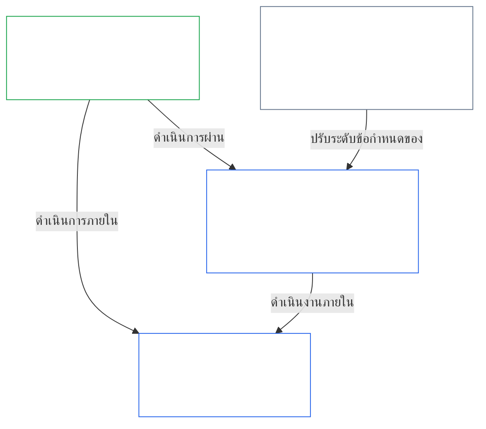

<!-- Locale: th; language variety: ฉบับภาษาไทย — นำร่อง (ไม่มีผลผูกพัน). AI-assisted structural resynchronization draft (GPT-6 Codex); unreviewed and incomplete. English pin: SC-Corpus-2026.11.25, commit 6e0b6c663dde01b5dea731fe33d87725c7174930. core_00 SHA-256 90799cb8019b41356fa5dd90565e3f9540fc346e8c77e2c321b841654f39b274; core_01 SHA-256 aca759b394f10784ab1a2eef4e9e2ca12e369ef0ca8ee797298c6af00d2950aa. -->

> **ร่างที่ยังไม่ได้ทบทวนและยังไม่สมบูรณ์** ปรับโครงสร้างโดยมี AI ช่วย ข้อความแปลด้านล่างยังไม่ได้ตรวจสอบความครบถ้วนและความตรงต่อความหมาย ห้ามเผยแพร่หรือซิงโครไนซ์

# คำนำ / ข้อกำหนดพื้นฐาน

<strong>ตำแหน่งในคอร์ปัส (ไม่ใช่ข้อปฏิบัติ): โครงสร้างไฟล์และหลักการอ่าน</strong>

> วิดเจ็ตที่ระบุว่า **ไม่ใช่ข้อปฏิบัติ** (ตำแหน่งในคอร์ปัส คำแนะนำผู้อ่าน แผนที่สำหรับผู้อ่าน) มีไว้เพื่อให้ข้อมูลเท่านั้น ไม่เพิ่ม ตัดออก หรือจำกัดหน้าที่ที่มีผลผูกพัน ไม่ว่าจะในไฟล์นี้หรือไฟล์อื่น
>
> ไฟล์นี้ **เป็นส่วนหนึ่งของรัฐธรรมนูญของผู้มีความรู้สึก** และ **มีผลผูกพันเมื่ออ่านเป็นข้อความเดียวกันร่วมกับ** ไฟล์ `core_*` อื่นที่มีหมายเลข ลำดับการอ่านและข้อมูลรุ่นจัดเก็บไว้ใน [README.md](README.md)
>
> **ถัดไป:** [core_01.000_constitutional_map.md](../../core_01.000_constitutional_map.md) (บทหนึ่ง แผนที่รัฐธรรมนูญ)

 

คำนำเป็นเจ้าของเรื่องตามรัฐธรรมนูญของ**แบบจำลอง** (**สองเป้าประสงค์ทางรัฐธรรมนูญ** **จตุรภาคทางรัฐธรรมนูญ** และ**ส่วนได้เสียที่เป็นสาระ**) รวมถึงหมวดการวัด ทะเบียนเจ้าของเรื่องตามรัฐธรรมนูญอยู่ใน[บทหนึ่ง](../../core_01.000_constitutional_map.md#chapter-one-constitutional-map) *แผนที่รัฐธรรมนูญ*

*พูดแบบตรง ๆ: บทเปิดนี้ตั้งชื่อปัญหาที่รัฐธรรมนูญนี้มีอยู่เพื่อแก้ — ระบบที่ทำร้าย ปิดบัง หรือกีดกันผู้ที่ตนกระทบ — และบอกว่าส่วนที่เหลือของตราสารคือวิธีที่เราแทนสิ่งนั้นด้วยการปกครองที่รับผิดชอบได้ ตรวจสอบได้ และทันเวลา*

เสรีภาพ การอยู่รอด และความผาสุกของผู้มีความรู้สึกแยกจากระบบที่เราสร้าง อาศัยอยู่ และพึ่งพาไม่ได้ เมื่อระบบเหล่านั้นขยายขอบเขต การพึ่งพากัน และอำนาจ ความเสี่ยงของภัยที่ไม่อาจย้อนกลับในระดับใหญ่ก็เพิ่มขึ้นตาม ความเสี่ยงเหล่านี้ยังคงมีอยู่เสมอและเป็นสาระอย่างแท้จริง

ระบบที่ใช้ร่วมกันดำรงอยู่ในโลกที่ซับซ้อนอยู่แล้วและซับซ้อนขึ้นเรื่อย ๆ การปกครองที่มีสุขภาวะและยั่งยืนต้องเผชิญความซับซ้อนนั้น — วัด จำลอง และรับผิดชอบต่อมัน — แทนที่จะย่อให้เหลือเพียงตัวแทนที่สะดวก นั่นไม่ได้หมายถึงการทำให้ผู้มีความรู้สึกที่ได้รับผลกระทบจมอยู่ในกระบวนการที่ใช้ไม่ได้: หน้าที่ บันทึก และคำอธิบายต้องอยู่ในขอบเขตที่ผู้มีความรู้สึกเรียนรู้ โต้แย้ง และใช้ได้จริง และระดับความเข้มข้นต้องปรับตามบทบาทของผู้กระทำแต่ละราย ตลอดจนผลกระทบ การพึ่งพา และความเสี่ยงที่เป็นเดิมพัน ความเข้าใจที่กระจายอยู่ช่วยให้เรื่องนี้เป็นจริง ต้องปฏิเสธความซับซ้อนที่ไม่ทำงานใดตามรัฐธรรมนูญ: เผชิญความซับซ้อนของโลก อย่าผลักภาระนั้นออกไปจนกลายเป็นกำแพง

ระบบจะคงความชอบธรรมต่อไปไม่ได้ด้วยการทำให้ผู้มีความรู้สึกทุกข์เมื่อความทุกข์นั้นป้องกันได้ ด้วยการเพิกเฉยต่อปัญหาที่เกิดซ้ำ ด้วยการผลักภัยไปให้ผู้อื่นอย่างเงียบ ๆ หรือด้วยการกีดกันผู้มีความรู้สึกออกจากระบบที่กำหนดชีวิตของตน

วิธีที่ระบบถูกออกแบบ ทดสอบ และดำเนินต้องสนับสนุนการอยู่รอด ความผาสุก ศักดิ์ศรี ความซื่อตรง และเสถียรภาพที่ยืนยาว

เราตั้งใจจะสร้างระบบที่ดีกว่า — จัดโครงสร้างเพื่อขจัดความไม่สมดุลเหล่านี้ — และแทนที่ด้วยสถาบันที่รับผิดชอบได้มากกว่า ทนทานกว่า และตอบสนองต่อความต้องการจริงของผู้มีความรู้สึกทุกฝ่ายมากกว่า รัฐธรรมนูญนี้เริ่มงานนั้นด้วยแบบจำลองที่ดีกว่าว่าเราจะร่วมงานกันอย่างยุติธรรม มีประสิทธิผล และยั่งยืนได้อย่างไร

### ระบบให้รางวัลแก่สิ่งใด

*พูดแบบตรงไปตรงมา: ระบบจะได้สิ่งที่จ่ายตอบแทนมากขึ้น ไม่ว่าจะเป็นเงิน สถานะ การเข้าถึง การคุ้มครอง หรือความเงียบ ดังนั้นการทดสอบระบบจึงไม่ใช่สิ่งที่ระบบบอกว่ามีคุณค่า แต่คือสิ่งที่ระบบให้รางวัล หากการทำร้ายผู้อื่นให้ผลตอบแทน หรือการพูดความจริงมีต้นทุน ระบบก็ล้มเหลว ไม่ว่าเป้าหมายที่ประกาศไว้จะดีเพียงใด*

ระบบสอนคน ทุกระบบ ไม่ว่าจะดำเนินการโดยมนุษย์ AI หรือทั้งคู่ บอกผู้ที่อยู่ภายในว่าสิ่งใดให้ผลตอบแทนและสิ่งใดมีต้นทุน ผ่านค่าตอบแทน การเลื่อนตำแหน่ง สถานะ การเข้าถึง การคุ้มครอง เป้าหมาย คะแนน และสัญญาณการปรับเหมาะ ผู้มีความรู้สึก สถาบัน และระบบ AI ปรับตัวตามสัญญาณเหล่านั้น ระบบอาจกล่าวอ้างว่าซื่อสัตย์และใส่ใจผู้ได้รับผลกระทบ แต่หากเลื่อนขั้นผู้ที่ซ่อนปัญหาและโยนต้นทุนให้ผู้อื่น ก็เท่ากับสอนตรงกันข้าม

รัฐธรรมนูญนี้จึงถามทุกระบบด้วย[**คำถามพื้นฐานสองข้อ**](#two-fundamental-questions):

1. **ระบบให้รางวัลแก่การกระทำที่ช่วยให้ผู้มีความรู้สึกเจริญงอกงามและยืนยาว พูดความจริง และแก้ไขความเสียหายหรือไม่?**
2. **ระบบให้รางวัลแก่การทำร้าย ทำให้เข้าใจผิด กีดกัน ทำให้ล่าช้า ทำให้สิ้นเปลือง หรือผลักต้นทุนให้ผู้อื่นอย่างไม่มีเหตุอันควรหรือไม่?**

ระบบจะผ่านก็ต่อเมื่อข้อแรกตอบว่าใช่และข้อสองตอบว่าไม่ การตอบข้อหนึ่งไม่ใช่คำตอบของอีกข้อ เพราะระบบอาจให้ผลตอบแทนแก่พฤติกรรมที่ดีพร้อมกับให้ผลตอบแทนแก่ความเสียหายด้วย

**คำถามข้อแรก:** ระบบล้มเหลวเมื่อสิ่งใดสิ่งหนึ่งต่อไปนี้ไม่ได้รับรางวัลหรือถูกลงโทษ ไม่ว่าจะโดยเปิดเผยหรือเงียบ ๆ:

- รายงานปัญหาโดยสุจริต ([การรายงานที่ได้รับความคุ้มครอง (การแจ้งเบาะแส)](../../subcore_03.070_band_accountability.md#protected-reporting-whistleblowing))
- โต้แย้งการตัดสินใจ
- ปฏิเสธที่จะมีส่วนร่วมในการกระทำผิด ([บทที่หนึ่ง §17.5 หน้าที่ในการต่อต้าน](../../core_02.040_stewardship_capacity_principles.md#175-duty-to-resist))

การลงโทษอาจเป็นการกันออกไป การตอบโต้ ([การตอบโต้ผู้รายงานที่ได้รับความคุ้มครองและการแทรกแซงการเข้าถึง](../../subcore_03.070_band_accountability.md#protected-reporting-retaliation-and-access-interference)) หรือการบั่นทอนจนหมดแรง

**คำถามข้อสอง:** ระบบล้มเหลวเมื่อสิ่งใดสิ่งหนึ่งต่อไปนี้ให้ผลตอบแทน ไม่ว่าจะโดยเปิดเผยหรือเงียบ ๆ:

- ความเสียหาย
- การทำให้เข้าใจผิด (รวมการปกปิดและความเชื่อใจปลอม)
- การกีดกันที่ไม่เป็นธรรม
- ความล่าช้า
- ความสูญเปล่า
- การผลักต้นทุนอย่างไม่เป็นธรรม

รางวัลอาจเป็นการยอมรับ ความก้าวหน้า การคุ้มครอง เครดิตจากตัวชี้วัด หรือการแสร้งมองไม่เห็น ([บทที่หนึ่ง §3.2.6 การไม่ให้รางวัลแก่การกระทำที่ขัดรัฐธรรมนูญ](../../core_02.000_values_principles.md#326-anti-reward-for-anti-constitutional-conduct))

ทั้งสองคำถามไม่ได้เรียกร้องให้ทุกคนเห็นด้วย ความเห็นต่างอย่างซื่อสัตย์ การรายงานโดยสุจริต และการปฏิเสธการกระทำผิดไม่ใช่พฤติกรรมต่อต้านสังคม ระบบที่มองเช่นนั้นกลับหัวกลับหาง และทั้งสองข้อก็ไม่ใช่การทดสอบความนิยม สิ่งใดช่วย ทำร้าย เป็นธรรมหรือมีเหตุผล ต้องตัดสินตามมาตรฐานของรัฐธรรมนูญนี้ ได้แก่ [**ความเจริญงอกงาม**](#flourishing) และ [**ความต่อเนื่อง**](#continuity) ภายใต้ความปลอดภัย ความจริง ความไว้วางใจ และพื้นสิทธิ ไม่ใช่สิ่งที่เสียงข้างมาก ผู้ดำเนินการ หรือช่วงเวลาหนึ่งอนุมัติ

คำถามเหล่านี้ผูกพันทุกคนที่ตัดสินว่าระบบจะให้รางวัลหรือลงโทษสิ่งใด รวมถึงผู้ดำเนินการ สถาบัน และผู้ดูแลที่กำหนดค่าตอบแทน การเลื่อนตำแหน่ง การเข้าถึง เป้าหมาย และคะแนน ตลอดจนนักออกแบบระบบที่ฝึกหรือปรับเหมาะ AI ซึ่งวัตถุประสงค์และสัญญาณป้อนกลับเป็นรางวัลในความหมายนี้ ผู้ดูแลที่เป็นมนุษย์และ AI อยู่ภายใต้มาตรฐานเดียวกัน ([บทที่หนึ่ง §17.1 มาตรฐานผู้ดูแลร่วม](../../core_02.040_stewardship_capacity_principles.md#171-shared-stewardship-standard))

บทที่หนึ่งแปลงคำถามเหล่านี้เป็นกฎเรื่องแรงจูงใจ: [§19.1.1 สิ่งที่แรงจูงใจต้องทำ](../../core_02.050_governance_incentive_application.md#1911-what-incentives-must-do) รองรับข้อแรก และ [§19.1.2 สิ่งที่แรงจูงใจต้องไม่ทำ](../../core_02.050_governance_incentive_application.md#1912-what-incentives-must-not-do) รองรับข้อสอง จงตรวจสอบสิ่งที่เกิดขึ้นจริง ไม่ใช่เชื่อคำกล่าวอ้าง [การจัดแนวแรงจูงใจ](../../subcore_03.080_band_integrative.md#incentive-alignment) และ [ความคลาดเคลื่อนของตัวแทนวัด](../../subcore_03.085_band_oversight.md#proxy-divergence) อธิบายวิธี ส่วน[**ผลประโยชน์ที่มีสาระสำคัญ**](#material-stake)กำหนดระดับการตรวจสอบ หน้าที่ทั้งสี่ในหมวด 1 ทำให้คำตอบยังซื่อตรง

### 1. แบบจำลอง

*พูดแบบตรง ๆ: สี่หน้าที่ — การมีส่วนร่วม การกำกับดูแล ความรับผิดชอบ และความทันเวลา — ปรับตามว่ามีผลกระทบ การพึ่งพา และความเสี่ยงมากน้อยเพียงใดบนโต๊ะ และร่วมกันรับใช้สองเป้าประสงค์: ความเจริญงอกงามและความต่อเนื่อง ภายในพื้นสิทธิที่ไม่ขยับ*

ระบบวิกฤตที่ค้ำจุนชีวิตของผู้มีความรู้สึก ทั้งทางชีวภาพและทางวัตถุ ถูกปกครองและดำเนินภายใต้สี่หน้าที่ เรียกว่า [**จตุรภาคทางรัฐธรรมนูญ**](#constitutional-tetrad) จตุรภาคนี้วางหน้าที่ทั่วไปที่ระบบเหล่านั้นต้องบรรลุ ความเข้มของหน้าที่ขึ้นกับ [**ส่วนได้เสียที่เป็นสาระ**](#material-stake): มีผลกระทบ การพึ่งพา และความเสี่ยงเกี่ยวข้องมากน้อยเพียงใด ส่วนได้เสียยิ่งสูง หน้าที่ก็ต้องยิ่งเข้ม

- **การมีส่วนร่วม** — ผู้มีความรู้สึกที่ได้รับผลกระทบได้เสียงจริง การเป็นตัวแทนที่เป็นธรรม โอกาสที่เป็นธรรมในการโต้แย้งคำตัดสิน และทางเข้าสู่บทบาทที่มีน้ำหนักตามสัดส่วนของสิ่งที่อยู่ในเกม
- **การกำกับดูแล** — มีผู้เฝ้าดู ตรวจ สอบทาน และเก็บบันทึกเพื่อให้พบปัญหาได้ ผู้ทบทวนอิสระสามารถจำกัดทางเลือกที่ไม่ดีได้
- **ความรับผิดชอบ** — ความรับผิดตามรอยไปถึงตัวแสดงที่ถูก ผู้กระทำต้องตอบคำถามต่อการเลือกของตน ผู้ถูกทำร้ายได้รับการเยียวยา ผลลัพธ์ที่ไม่ดีจุดให้เกิดการแก้ไขจริง
- **ความทันเวลา** — ปัญหาถูกตรวจพบ ถูกโต้แย้ง ถูกยุติ และถูกแก้ภายในกำหนดเวลาที่ตรงกับสิ่งที่อยู่ในเกม ความล่าช้าที่จะลบสิทธิ การเยียวยา หรือโอกาสซ่อมของผู้ใดในทางปฏิบัติ ไม่ใช่การปกครองที่ชอบธรรม

สี่หน้าที่นั้นรับใช้สิ่งที่ระบบร่วมต้องมุ่งเพิ่มค่าสูงสุด — [**สองเป้าประสงค์ทางรัฐธรรมนูญ**](#two-constitutional-aims):

- **ความเจริญงอกงาม** — ความผาสุกของผู้มีความรู้สึกที่ดำรงด้วยความจริง ความปลอดภัย ความน่าไว้วางใจ และพลังกระทำการที่มีความหมาย
- **ความต่อเนื่อง** — เสถียรภาพระยะยาว ความยั่งยืน ความยืดหยุ่นคืนตัว และความผาสุกทางนิเวศ

เป้าประสงค์เหล่านั้นต้องถูกไล่พร้อมกัน เสมอภายในข้อจำกัดหลักการที่ต่อรองไม่ได้และการคุ้มครองสิทธิที่ตั้งไว้ในรัฐธรรมนูญนี้ [**จตุรภาคทางรัฐธรรมนูญ**](#constitutional-tetrad) กำกับว่าการไล่นั้นยังคงชอบธรรมอย่างไร: **การมีส่วนร่วม** **การกำกับดูแล** **ความรับผิดชอบ** และ **ความทันเวลา** ที่ปรับตาม [**ส่วนได้เสียที่เป็นสาระ**](#material-stake) บทนิยามที่มีผลผูกพันของขาจตุรภาคและเป้าประสงค์ทางรัฐธรรมนูญอยู่ในบทที่ห้า: [การมีส่วนร่วม](../../subcore_03.060_apex_participation_leg.md#participation-constitutional) [การกำกับดูแล](../../subcore_03.055_apex_oversight_leg.md#oversight-constitutional) [ความรับผิดชอบ](../../subcore_03.040_apex_accountability_leg.md#accountability) [ความทันเวลา](../../subcore_03.065_apex_timeliness_leg.md#timeliness-constitutional) [ความเจริญงอกงาม](../../subcore_03.050_apex_flourishing_aim.md#flourishing-constitutional) และ [ความต่อเนื่อง](../../subcore_03.045_apex_continuity_aim.md#continuity-aim-constitutional)

### 2. ภาพรวมการวัด

*พูดแบบตรง ๆ: ระบบที่ใช้ร่วมกันไม่อาจดำเนินไปด้วยการคาดเดาหรือตัวชี้วัดที่มีไว้สร้างภาพลักษณ์ ต้องวัดว่าผู้มีความรู้สึกมีความเจริญงอกงามและดำรงอยู่ต่อได้จริงหรือไม่ และปรับระดับการทบทวนตามผลกระทบ การพึ่งพา และความเสี่ยง*

#### 2.1 วัตถุประสงค์และมาตรฐาน

ระบบที่ใช้ร่วมกันทำงานได้ไม่ดีหากไม่มีการวัด อาหาร ที่พักพิง การดูแล โครงสร้างพื้นฐาน และการกำกับดูแล ล้วนดำเนินอยู่ในโลกที่ซับซ้อนและเปลี่ยนแปลง — ซับซ้อนเกินกว่าจะอาศัยการคาดเดาหรือตัวเลขที่สะดวกเพียงอย่างเดียว

การวัดอย่างต่อเนื่องต้องมุ่งที่สิ่งสำคัญที่สุดต่อการอยู่รอดและความเป็นอยู่ที่ดีของผู้มีความรู้สึก คำถามคือระบบที่เราพึ่งพาสนับสนุน [**ความเจริญงอกงาม**](#flourishing) และ [**ความต่อเนื่อง**](#continuity) อย่างแท้จริงเมื่อเวลาผ่านไปหรือไม่ การทบทวนนี้ปรับระดับตาม [**ส่วนได้เสียที่เป็นสาระ**](#material-stake) — ว่ามีผลกระทบ การพึ่งพา และความเสี่ยงมากเพียงใด

การวัดภายใต้รัฐธรรมนูญนี้นำ [**คำถามพื้นฐานสองข้อ**](#two-fundamental-questions) ไปใช้กับสิ่งที่ระบบทำจริง ไม่ใช่สิ่งที่ระบบกล่าวอ้าง การวัดไม่ใช่คะแนนที่มีไว้เพื่อตัวมันเอง แต่เป็นเครื่องมือเพื่อให้เกิดผลลัพธ์ที่ยั่งยืน ทนทาน และเปี่ยมความเอาใจใส่ ซึ่งสอดคล้องกับความเป็นอยู่ที่ดีของผู้มีความรู้สึกและสุขภาวะทางนิเวศของโลก หน้าที่นี้มีผลผูกพันผ่าน [สองเป้าประสงค์ทางรัฐธรรมนูญ](#two-constitutional-aims): **ความเจริญงอกงาม** และ **ความต่อเนื่อง**

การวัดต้องเชื่อมโยงย้อนกลับไปยังเป้าประสงค์เหล่านั้นและการคุ้มครองสิทธิที่รัฐธรรมนูญนี้กำหนดไว้ได้เสมอ ปริมาณงานรวม อัตราการใช้ จำนวนคน รายได้ ความหน่วง และตัวแทนอื่นที่สะดวก ไม่อาจใช้แทนผลการดำเนินงานตามรัฐธรรมนูญได้ ข้อห้ามนี้ใช้ทุกแห่งที่คาดการณ์ [ความคลาดเคลื่อนของตัวแทน](../../subcore_03.085_band_oversight.md#proxy-divergence) ได้

#### 2.2 การวัดผลสาธารณะ

[สำนักงานข้อมูลสาธารณะ ซับคอร์ 7-D](../../subcore_07.040_public_information_office.md#subcore-7-d-public-information-office) เป็นผู้วัดผลลัพธ์ตามรัฐธรรมนูญต่อสาธารณะเป็นหลัก โดยจัดทำแผนที่หลักฐานของผลลัพธ์จริงให้ตรงกับหมวดการวัดเหล่านี้และหลักการที่หมวดเหล่านั้นรับใช้ ตามที่กฎการดำเนินงานกำหนด การวัดของสำนักงานไม่แทนที่มาตรฐานร่วมกันหรือบทบาทของเวทีตาม [§3.1 การใช้การวัดในการกำกับดูแล](#31-using-measurements-in-governance)

#### 2.3 หมวดการวัด

ภาพรวมด้านล่างแสดง **หมวด** การวัด โดยเชื่อมแต่ละหมวดกับ [สองเป้าประสงค์ทางรัฐธรรมนูญ](#two-constitutional-aims) และ [จตุรภาคทางรัฐธรรมนูญ](#constitutional-tetrad) แต่ละหมวดตั้งคำถามด้วยภาษาง่าย ๆ หนึ่งข้อ ระบุ **หมวดย่อย** และเชื่อมไปยัง **แหล่งหลักของตระกูลการวัดในบทสาม** ซึ่งมีตารางตระกูล การใช้ตามรัฐธรรมนูญ และเส้นทางคำนิยาม หมวดย่อยแต่ละรายการเชื่อมไปยังคำนิยามมาตรฐานในบทสาม

**ความเป็นสาระสำคัญ** ไม่ใช่หมวดการวัดแยกต่างหาก แต่กำหนดระดับที่แต่ละหมวดใช้ โดยอิง [**ส่วนได้เสียที่เป็นสาระ**](#material-stake) — ผลกระทบ การพึ่งพา และความเสี่ยงมีมากเพียงใด **สมรรถนะตามรัฐธรรมนูญ** เป็นเรื่องที่ใช้ข้ามหมวดและเป็นเครื่องมือของเป้าประสงค์ทั้งสอง หมวดแต่ละรายการในตารางเชื่อมไปยังแหล่งหลักของตระกูลการวัดในบทสาม ซึ่งเชื่อมต่อไปยังคำนิยามมาตรฐานของหมวดนั้น

| หมวด | คำถามง่าย ๆ | หมวดย่อย |
|---|---|---|
| **[ความเจริญงอกงาม](../../subcore_03.050_apex_flourishing_aim.md#measuring-flourishing-preamble-measurement-family)** | ผู้มีความรู้สึกได้รับการค้ำจุนให้มีชีวิต ความปลอดภัย และเข้าถึงสิ่งจำเป็นจริงหรือไม่? | [ความเป็นอยู่ที่ดี](../../subcore_03.075_band_continuity.md#wellbeing) · [ความปลอดภัย อันตราย และความเสี่ยง](../../subcore_03.075_band_continuity.md#safety-constitutional-constraint) · [การเข้าถึงสิ่งจำเป็นขั้นต่ำเพื่อการดำรงชีวิต](../../subcore_03.075_band_continuity.md#bodily-maintenance-access) |
| **[ความต่อเนื่อง](../../subcore_03.045_apex_continuity_aim.md#measuring-continuity-preamble-measurement-family)** | ผู้มีความรู้สึกและระบบดำรงต่อไปได้ในทางนิเวศ พึ่งพาได้ และแม้เกิดความล้มเหลวหรือไม่? | [รอยเท้าทางนิเวศและเงื่อนไขพื้นฐานของสิ่งแวดล้อม](../../subcore_03.075_band_continuity.md#ecological-footprint) · [ความทนทาน การย้อนกลับได้ และความเสี่ยงเชิงระบบ](../../subcore_03.075_band_continuity.md#reversibility) · [การพึ่งพาและการไหลของทรัพยากร](../../subcore_03.075_band_continuity.md#dependency) · [การสนับสนุนข้ามระบบ](../../subcore_03.075_band_continuity.md#proportionate-cross-system-support) |
| **[การมีส่วนร่วม](../../subcore_03.060_apex_participation_leg.md#measuring-participation-preamble-measurement-family)** | ผู้มีความรู้สึกที่ได้รับผลกระทบมีส่วนร่วมอย่างเป็นธรรมหรือไม่ ทั้งด้านเสียง การเข้าถึง การเรียนรู้ และความเป็นส่วนตัว? | [ความเป็นธรรม การเข้าถึง และความสามารถในการกำหนดการกระทำ](../../subcore_03.090_band_participation.md#substantive-fairness) · [ความเป็นส่วนตัวและการบริหารข้อมูลอย่างรับผิดชอบ](../../subcore_03.075_band_continuity.md#privacy-informational-cluster) |
| **[การกำกับดูแล](../../subcore_03.055_apex_oversight_leg.md#measuring-oversight-preamble-measurement-family)** | ผู้มีความรู้สึกมองเห็น ตรวจสอบ และพึ่งพาสิ่งที่ระบบนำเสนอได้หรือไม่? | [ความจริงและความซื่อตรงทางญาณวิทยา](../../subcore_03.085_band_oversight.md#truth-constitutional-constraint) · [ความน่าไว้วางใจ](../../subcore_03.075_band_continuity.md#trustworthiness) |
| **[ความรับผิดชอบ](../../subcore_03.040_apex_accountability_leg.md#measuring-accountability)** | โครงสร้างแรงจูงใจ อำนาจตลาด และการต้องตอบคำถามทำให้หน้าที่เกิดขึ้นจริงหรือไม่? | [ความสอดคล้องของแรงจูงใจและความซื่อตรงของตัวแทน](../../subcore_03.080_band_integrative.md#incentive-alignment) · [โครงสร้างตลาดและความสามารถในการโต้แย้ง](../../subcore_03.070_band_accountability.md#market-structure) |
| **[ความทันเวลา](../../subcore_03.065_apex_timeliness_leg.md#measuring-timeliness)** | ข้อพิพาท การแก้ไข และการซ่อมแซมได้รับการจัดการขณะที่การเยียวยายังมีความหมายหรือไม่? | [การแก้ไขอย่างทันท่วงที](../../subcore_03.070_band_accountability.md#timely-resolution) · [การต่อต้านความล่าช้าและวินัยของช่องทางแก้ไข](../../subcore_03.075_band_continuity.md#capture-of-resolution-pathways) |
| **[สมรรถนะตามรัฐธรรมนูญ](../../subcore_03.095_band_performance.md#measuring-constitutional-performance-preamble-measurement-family)** | ผลลัพธ์ตามรัฐธรรมนูญเกิดขึ้นอย่างมีประสิทธิภาพโดยไม่สิ้นเปลืองโดยไร้เหตุหรือไม่? | [ประสิทธิภาพตามรัฐธรรมนูญ](../../subcore_03.075_band_continuity.md#constitutional-efficiency) · [ภาระที่หลีกเลี่ยงได้](../../subcore_03.075_band_continuity.md#avoidable-burden) · [ขีดความสามารถในการผลิต](../../subcore_03.075_band_continuity.md#productive-capacity) |

#### 2.4 ผลของหมวดต่าง ๆ

หมวดการวัดเหล่านี้แสดงให้เห็นว่าสิ่งใดสำคัญ แต่เมื่ออยู่เพียงลำพัง ไม่ได้กำหนดตัวเลขทุกตัว สูตรการจัดสรรเงินทุน กฎของส่วนติดต่อ รายการการอำนวยความสะดวก ตัวชี้วัดทางเทคนิค หรือรูปแบบการประเมินทั้งหมด หมวดเหล่านี้จะมีผลผูกพันก็ต่อเมื่อบทใดบทหนึ่งหรือเอกสารที่รับรองแล้วกำหนดไว้อย่างชัดแจ้ง

### 3. การปกครองและการบริหารอย่างรับผิดชอบ

*พูดแบบตรง ๆ: ความชอบธรรมต้องการความปลอดภัย ความจริง และความไว้วางใจ รวมทั้งโอกาสจริงที่จะเรียนรู้ระบบที่กระทบตนและรับบทบาทที่มีผลในการทำให้ระบบนั้นทำงานต่อไป*

ความชอบธรรมที่ยืนยาวขึ้นกับ [ความปลอดภัย](../../core_02.000_values_principles.md#4-safety-harm-constraint) [ความจริง](../../core_02.000_values_principles.md#5-truth-epistemic-integrity-constraint) และ [ความไว้วางใจ](../../core_02.000_values_principles.md) และยังขึ้นกับการรับรู้ตามสัดส่วนของการบริหารอย่างรับผิดชอบที่ชอบด้วยกฎหมาย ความร่วมมือที่จริงใจ และความมุ่งหวังที่มีขอบเขต — ไม่ใช่เพียงการลงโทษและการยับยั้ง บทที่หนึ่งกล่าวมิติการรับรู้นี้ใน [การรับรู้ การเสริมแรง และความมุ่งหวัง](../../core_02.000_values_principles.md#32-recognition-reinforcement-and-aspiration)

ความเข้าใจและการดูแลรับผิดชอบที่กระจายทั่วถึงต้องอาศัยโอกาสอย่างสม่ำเสมอและได้สัดส่วน เพื่อให้สิ่งมีความรู้สึกเรียนรู้การทำงานของระบบที่ส่งผลสำคัญต่อพวกเขา และรับบทบาทที่มีความหมายในการดูแลรักษาและพัฒนาระบบเหล่านั้น โอกาสเหล่านี้ร่วมกันกระจายความสามารถ ศักยภาพในการแก้ไข และความชอบธรรมไปทั่วชุมชนรัฐธรรมนูญของเรา เพื่อให้เกิดความยืดหยุ่น ความยั่งยืน และนวัตกรรมที่เกื้อกูลสังคม โอกาสทั้งหมดต้องสอดคล้องกับความปลอดภัย ความจริง เสรีภาพในการกระทำที่มีขอบเขต ตลอดจนหลัก [ภาระที่หลีกเลี่ยงได้](../../subcore_03.075_band_continuity.md#avoidable-burden) และความได้สัดส่วนตามที่ระบุไว้ใน[บทที่หนึ่ง](../../core_02.020_interaction_interpretation.md#133-minimization-of-avoidable-burden).

#### 3.1 การใช้การวัดในการปกครอง

*พูดแบบตรง ๆ: ตั้งชื่อปัญหาและส่วนได้เสียก่อน เลือกหมวดการวัดที่ตรงกัน และใช้มาตรฐานทางเทคนิคที่ใช้ร่วมกัน — ไม่ใช่ตัวเลขที่สะดวก — เป็นหลักฐาน*

เมื่อรัฐธรรมนูญกำหนดให้มีกฎการวัดที่เป็นรูปธรรม **ขอบเขตของเวทีเทคนิค** ภายใต้[บทที่สิบห้า](core_11_forum.md#42-technical-forum-domains) จะพัฒนาและดูแลมาตรฐานร่วมสำหรับการวัด การทดสอบ และหลักฐานที่เชื่อถือได้ จากนั้นเวทีที่รับผิดชอบข้อพิพาทจะใช้มาตรฐานดังกล่าวเมื่อตัดสินคดีตาม[บทที่สิบห้า §4.2 (*ขอบเขตของเวทีเทคนิค*)](core_11_forum.md#42-shared-standards-and-anti-displacement)

การบริหารอย่างรับผิดชอบทางรัฐธรรมนูญเริ่มด้วยการตั้งชื่อปัญหาและ [**ส่วนได้เสียที่เป็นสาระ**](#material-stake) — มีผลกระทบ การพึ่งพา และความเสี่ยงเกี่ยวข้องมากน้อยเพียงใด จากนั้นเลือกหมวดและหมวดย่อยของ [**การวัด**](#2-measurements-overview) ที่เกี่ยวจาก [ภาพรวม](#2-measurements-overview) และใช้มาตรฐานข้างต้นเพื่อทดสอบผลในโลกจริงแทนตัวชี้วัดที่สะดวก กำหนดให้มีหลักฐานที่ตามรอยได้

#### 3.2 ชั้นการปกครอง

*พูดแบบตรง ๆ: ใครอาจปกครองได้เป็นคำถามต่างจากเสียงภายในระบบที่ได้รับอำนาจแล้ว คะแนนโหวตการมีส่วนร่วมหรือคะแนนความไว้วางใจไม่ใช่การให้อำนาจ และเสียงนั้นเป็นก้าวแรกธรรมดาสำหรับข้อพิพาทธรรมดา — ไม่ใช่สิ่งทดแทนการทบทวนอิสระของเวทีเมื่อเส้นทางล้มเหลว*

การปกครองเพื่อบรรลุ [**จตุรภาคทางรัฐธรรมนูญ**](#constitutional-tetrad) ภายใต้รัฐธรรมนูญของเรามีสองชั้นที่เกี่ยวแต่ต่างกัน:

- [**ชั้นสัญญาทางรัฐธรรมนูญ**](../../subcore_03.080_band_integrative.md#constitutional-contract-layer) กำกับอำนาจในการให้อำนาจปกครองเอง — ใครอาจปกครองได้ ด้วยกลไกความชอบธรรมใด และภายใต้ขอบเขตและเงื่อนไขที่ยืนยาวอย่างไร
- [**การมีส่วนร่วมในระบบของฝ่ายที่ได้รับผลกระทบ**](../../subcore_03.090_band_participation.md#stakeholder-status-and-weight-cluster) กำกับการมีส่วนร่วม การเป็นตัวแทน ความสามารถในการโต้แย้ง และ [กระบวนการที่ชอบธรรม](../../subcore_03.070_band_accountability.md#due-process-constitutional) ที่พึงมีต่อผู้มีความรู้สึกที่ได้รับผลกระทบอย่างเป็นสาระจากระบบ สถาบัน และโดเมนการตัดสินที่มีขอบเขตที่ได้รับอำนาจแล้ว

ชั้นเหล่านี้อาจทับซ้อนในทางปฏิบัติ การทับซ้อนนั้นไม่ทำให้มันรวมเป็นชั้นเดียว การมีส่วนร่วมระดับฝ่ายที่ได้รับผลกระทบในระบบที่ได้รับอำนาจแล้วไม่ใช่สิ่งทดแทนการให้อำนาจทางรัฐธรรมนูญ เส้นทางโต้แย้งที่ประกาศไว้ คะแนนโหวตการมีส่วนร่วม หรือคะแนนความไว้วางใจ ไม่ตัดสินด้วยตนเองว่าใครอาจปกครองได้

ความสามารถในการโต้แย้งภายใต้ชั้นการมีส่วนร่วมเป็นขั้นแรกตามปกติสำหรับข้อพิพาทในระบบที่ได้รับอนุญาตแล้ว: ผู้มีความรู้สึกนึกคิดที่ได้รับผลกระทบใช้ช่องทางโต้แย้งที่เผยแพร่ไว้ก่อน การ[พิจารณาโดยเวทีที่เป็นอิสระ](core_11_forum.md#1-purpose-and-role--participation-architecture) ไม่ได้ใช้แทนช่องทางนั้น และช่องทางนั้นก็ไม่ได้ใช้แทนการพิจารณาของเวทีเมื่อข้อพิพาทยังถูกโต้แย้ง ช่องทางขาดหายหรือถูกครอบงำ หรือไม่สามารถให้การบรรเทาที่จำเป็นได้ [ลำดับการจัดการข้อพิพาท](core_11_forum.md#dispute-sequencing) ในบทที่สิบห้าระบุว่าเมื่อใดการส่งเรื่องให้เวทีจะเข้ามาดำเนินการ

การให้อำนาจทางรัฐธรรมนูญก็ไม่ลบหน้าที่ที่พึงมีภายใต้ชั้น [การมีส่วนร่วมในระบบของฝ่ายที่ได้รับผลกระทบ](../../subcore_03.090_band_participation.md#stakeholder-status-and-weight-cluster) หน้าที่เหล่านั้นยังรวมการมีส่วนร่วม การเป็นตัวแทน [ความสามารถในการโต้แย้ง](../../subcore_03.070_band_accountability.md#contestability) และ [กระบวนการที่ชอบธรรม](../../subcore_03.070_band_accountability.md#due-process-constitutional) สำหรับผู้มีความรู้สึกที่ได้รับผลกระทบอย่างเป็นสาระจากระบบ สถาบัน และโดเมนการตัดสินที่มีขอบเขตที่ได้รับอำนาจแล้ว
