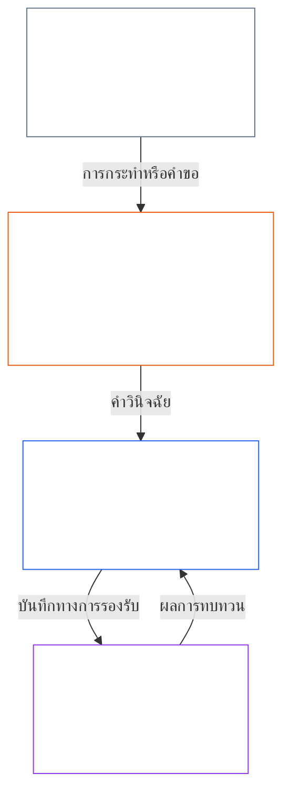
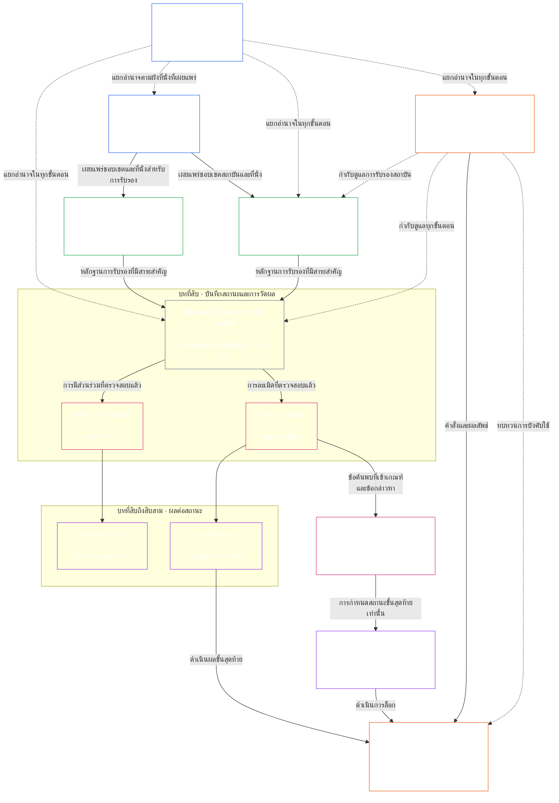

<!-- Locale: th; language variety: ฉบับภาษาไทย — นำร่อง (ไม่มีผลผูกพัน). AI-assisted structural resynchronization draft (GPT-6 Codex); unreviewed and incomplete. English pin: SC-Corpus-2026.11.25, commit 6e0b6c663dde01b5dea731fe33d87725c7174930. core_00 SHA-256 90799cb8019b41356fa5dd90565e3f9540fc346e8c77e2c321b841654f39b274; core_01 SHA-256 aca759b394f10784ab1a2eef4e9e2ca12e369ef0ca8ee797298c6af00d2950aa. -->

<!-- Structural extraction only. Current Chapter One §§1–4 are new translation work. Missing sections are marked as gaps. Do not publish or synchronize. -->

# บทหนึ่ง: แผนที่รัฐธรรมนูญ

<strong>ตำแหน่งในคอร์ปัส (ไม่ใช่ข้อปฏิบัติ): โครงสร้างไฟล์และหลักการอ่าน</strong>

> วิดเจ็ตที่ระบุว่า **ไม่ใช่ข้อปฏิบัติ** (ตำแหน่งในคอร์ปัส คำแนะนำผู้อ่าน แผนที่สำหรับผู้อ่าน) มีไว้เพื่อให้ข้อมูลเท่านั้น ไม่เพิ่ม ตัดออก หรือจำกัดหน้าที่ที่มีผลผูกพัน ไม่ว่าจะในไฟล์นี้หรือไฟล์อื่น
>
> ไฟล์นี้ **เป็นส่วนหนึ่งของรัฐธรรมนูญของผู้มีความรู้สึก** และ **มีผลผูกพันเมื่ออ่านร่วมกันเท่านั้น** กับไฟล์ `core_*` อื่นที่มีหมายเลขและซับคอร์ปัส โดยอ่านเป็นข้อความเดียวกัน ไฟล์นี้มี **บทหนึ่ง** คือ *แผนที่รัฐธรรมนูญ*: วัตถุประสงค์ (§1) เหตุที่มีอยู่ (§2) วิธีเชื่อมโยงของไฟล์ (§3) รากฐานสำหรับบทต่อไป (§4) กระบวนการกำกับดูแลหลัก (§5) และทะเบียนเจ้าของเรื่องตามรัฐธรรมนูญ (§6 ถึง §11)
>
> **ก่อนหน้า:** [core_00.000_preamble.md](core_01_constitutional_map.md) (คำนำ)
> **ถัดไป:** [core_02.000_values_principles.md](../../core_02.000_values_principles.md)

<strong>การสืบย้อน</strong>

- ก่อนหน้า: [คำนำ](core_01_constitutional_map.md) (*แบบจำลอง สองเป้าประสงค์ทางรัฐธรรมนูญ จตุรภาคทางรัฐธรรมนูญ ส่วนได้เสียที่เป็นสาระ และหมวดการวัด*).
- หมวดย่อย:
  - [§1](#1-purpose-role-and-scope);
  - [§2](#2-why-the-map-exists);
  - [§3](#3-how-the-files-fit-together);
  - [§4](#4-foundations-for-the-chapters-that-follow);
  - [§5](#5-key-governance-processes);
  - [§6](#6-principles-definitions-and-rights);
  - [§7](#7-system-and-institutional-charters-functional-independence-and-separation-of-duties);
  - [§8](#8-key-practical-process-pipelines);
  - [§9](#9-process-ownership-and-outputs);
  - [§10](#10-governance-change-and-incorporation);
  - [§11](#11-adopted-implementation-corpus).
- อ่านร่วมกับ: [ลำดับชั้นอำนาจและลำดับภายใน](../../subcore_03.080_band_integrative.md#authority-stack-and-internal-hierarchy) (*วิธีใช้ทะเบียนเจ้าของเรื่อง*); [README.md](README.md) (*ลำดับการอ่าน*).

 

### 1. วัตถุประสงค์ บทบาท และขอบเขต

*พูดแบบตรง ๆ: บทนี้เป็นคู่มือสำหรับส่วนที่เหลือของรัฐธรรมนูญ แสดงว่าส่วนต่าง ๆ เชื่อมโยงกันอย่างไร บทใดรับผิดชอบแต่ละเรื่อง และกระบวนการหลักดำเนินไปอย่างไร เพื่อให้ผู้อ่านหากฎที่ตอบคำถามของตนได้*

**วัตถุประสงค์:** บทหนึ่งให้ภาพรวมและแนวทางระบุผู้รับผิดชอบ ระบุกระบวนการที่ใช้ทดสอบการปกครองที่ได้รับอำนาจ บอกว่าบทใดรับผิดชอบขอบเขตสาระสำคัญแต่ละด้าน และอธิบายข้อความรัฐธรรมนูญทั้งสามระดับ

**บทบาท:** บทนี้ให้แนวทางและระบุความรับผิดชอบ ไม่เพิ่มหน้าที่ของตนเอง นอกเหนือจากทะเบียนเจ้าของเรื่องซึ่งบทอื่นและ [ลำดับชั้นอำนาจและลำดับภายใน](../../subcore_03.080_band_integrative.md#authority-stack-and-internal-hierarchy) นำไปใช้

**ขอบเขตของบท:** ครอบคลุมเรื่องต่อไปนี้:

- เหตุที่ต้องมีแผนที่ (**หมวด 2**);
- วิธีที่ไฟล์เชื่อมโยงกัน (**หมวด 3**) และรากฐานสำหรับบทต่อ ๆ ไป (**หมวด 4**);
- กระบวนการกำกับดูแลหลัก (**หมวด 5**);
- ทะเบียนเจ้าของเรื่องตามรัฐธรรมนูญ: หลักการ คำนิยาม และสิทธิ (**หมวด 6**); กฎบัตร ความเป็นอิสระเชิงหน้าที่ และการแบ่งแยกหน้าที่ (**หมวด 7**); สายกระบวนการ (**หมวด 8**); เจ้าของกระบวนการและผลลัพธ์ (**หมวด 9**); การกำกับดูแล การเปลี่ยนแปลง และการนำเข้าเป็นส่วนหนึ่ง (**หมวด 10**); และ
- คอร์ปัสการดำเนินงานที่รับรองแล้วและซับคอร์ปัส (**หมวด 11**)

### 2. เหตุใดจึงมีแผนที่

*พูดแบบตรง ๆ: ข้อความที่ใหญ่ขนาดนี้ต้องมีคู่มือแสดงว่าส่วนต่าง ๆ เชื่อมโยงกันอย่างไรและใครรับผิดชอบแต่ละเรื่อง บทนี้มีไว้เพื่อให้ผู้อ่านหากฎที่ตอบคำถามของตนได้*

รัฐธรรมนูญกระจายงานไว้ในหลายบท ซับคอร์ปัสหนึ่งชุด และคอร์ปัสที่รับรองแล้วสี่ชุด ผู้มีความรู้สึกที่พยายามค้นหาว่าตนมีสิทธิได้รับอะไร หรือผู้รับรองที่ค้นหาหน้าที่ อาจหลงทางได้ บทนี้เป็นภาพรวมและคู่มือระบุผู้รับผิดชอบ: แต่ละส่วนทำอะไร บทใดรับผิดชอบแต่ละเรื่อง สายกระบวนการดำเนินอย่างไร และระดับต่าง ๆ สัมพันธ์กันอย่างไร นอกเหนือจากทะเบียนเจ้าของเรื่องแล้ว บทนี้ไม่ได้เพิ่มกฎของตนเอง

**มีรากฐานจาก:**

- คำนำ:
  - [จตุรภาคทางรัฐธรรมนูญ](core_00_preamble.md#constitutional-tetrad): องค์ประกอบที่บทนี้นำไปปฏิบัติ:
    - [การมีส่วนร่วม](../../subcore_03.060_apex_participation_leg.md#participation): ผู้มีความรู้สึกค้นหากฎที่ตอบคำถามของตนได้;
    - [ความรับผิดชอบ](../../subcore_03.040_apex_accountability_leg.md#accountability): แต่ละเรื่องมีบทที่ระบุชื่อไว้ให้รับผิดชอบ;
    - [การกำกับดูแล](../../subcore_03.055_apex_oversight_leg.md#oversight): ผู้อ่านเห็นได้ว่าส่วนต่าง ๆ เชื่อมโยงกันอย่างไร และพบช่องว่างหรือการทับซ้อนได้;
    - [ความทันเวลา](../../subcore_03.065_apex_timeliness_leg.md#timeliness): ผู้อ่านไปถึงกฎที่ถูกต้องโดยไม่ล่าช้า;
  - [สองเป้าประสงค์ทางรัฐธรรมนูญ](core_00_preamble.md#two-constitutional-aims): เป้าประสงค์ทั้งสองที่บทนี้รับใช้:
    - [ความเจริญงอกงาม](core_00_preamble.md#flourishing): รัฐธรรมนูญรับใช้ผู้มีความรู้สึกได้ก็ต่อเมื่อพวกเขาหาทางในรัฐธรรมนูญได้;
    - [ความต่อเนื่อง](core_00_preamble.md#continuity): แผนที่ที่ชัดเจนรักษาความครบถ้วนของข้อความขณะที่เติบโตและเปลี่ยนแปลง;
- หลักการในบทสอง:
  - [§5.2 การเข้าถึงด้วยภาษาที่เข้าใจง่าย (หน้าที่ด้านการมีส่วนร่วมและการบริหารอย่างรับผิดชอบ)](../../core_02.000_values_principles.md#52-plain-language-accessibility-participation-and-stewardship-duty);
  - [§5.2.4 วินัยต่อต้านการใช้ความซับซ้อนเป็นเครื่องมือให้พ่ายแพ้](../../core_02.000_values_principles.md#524-complexity-as-defeat-discipline);
  - [§15.4 การแก้ไขข้อขัดแย้งเกี่ยวกับความหมายตามรัฐธรรมนูญ](../../core_02.030_constitutional_interpretation.md#154-constitutional-meaning-conflict-resolution);
- มาตราในบทสี่:
  - [มาตรา XXIV-A](../../core_04.030_rights_part_d.md#article-xxiv-a-proportional-comprehensibility-right) (*สิทธิในการทำความเข้าใจตามสัดส่วน*);
  - [มาตรา XXIV-B](../../core_04.030_rights_part_d.md#article-xxiv-b-complexity-audit-and-modularity-requirements) (*ข้อกำหนดการตรวจสอบความซับซ้อนและการแบ่งเป็นโมดูล*).

### 3. ไฟล์ต่าง ๆ เชื่อมโยงกันอย่างไร

ไฟล์ของรัฐธรรมนูญเชื่อมโยงกันดังนี้:

- **คอร์ (`core_*`):** ไฟล์ที่มีหมายเลขประกอบด้วยบทต่าง ๆ ของรัฐธรรมนูญ ซึ่งต้องอ่านร่วมกันเป็นข้อความเดียว ระบุหลักประกันและโครงสร้างตามรัฐธรรมนูญ
- **ซับคอร์ (`subcore_*`):** ไฟล์เหล่านี้ให้กฎและกระบวนการฉบับเต็มที่รองรับบทต่าง ๆ แต่ละไฟล์สังกัดบทหนึ่ง มีผลบังคับเท่ากับบทนั้น และผูกพันผู้รับรองทุกคนโดยไม่ต้องนำเข้าแยกต่างหาก ซับคอร์ห้ามจำกัดขอบเขตของบทที่ตนสังกัด
- **การดำเนินงาน (`corpus_*`):** ไฟล์สี่ไฟล์ให้รายละเอียดเชิงปฏิบัติการสำหรับดำเนินการตามรัฐธรรมนูญ ผูกพันภายในขอบเขตของการนำเข้าที่ถูกต้อง และดำเนินการตามรัฐธรรมนูญโดยไม่จำกัดขอบเขต [หมวด 11](#11-adopted-implementation-corpus) ระบุไฟล์ทั้งสี่

[คอร์ปัส](../../subcore_03.080_band_integrative.md#corpus) ที่นิยามไว้คือชุดแหล่งข้อมูลตามรัฐธรรมนูญที่มีผลผูกพัน ซึ่งกว้างกว่าและมีการระบุรุ่น ประกอบด้วยคอร์ ซับคอร์ ข้อความการดำเนินงานที่รับรองแล้ว และกรอบความเข้ากันได้ช่วงเปลี่ยนผ่านที่ถูกต้อง ร่าง บันทึก และคู่มือนำทางไม่กลายเป็นข้อผูกพันเพียงเพราะเป็นส่วนหนึ่งของโครงการ

### 4. รากฐานสำหรับบทต่อไป

*พูดแบบตรง ๆ: บทสองถึงบทสี่รับผิดชอบด้านคุณค่า พจนานุกรม (พร้อมกฎในซับคอร์เกี่ยวกับการสร้าง คุ้มครอง และพิสูจน์คำนิยาม) และพื้นสิทธิ; บทหลังจากนั้นต้องเคารพขอบเขตเหล่านี้และห้ามย้ายอย่างเงียบ ๆ*

**บทสองถึงบทสี่** จัดเตรียมคุณค่า คำศัพท์ กลไกการตรวจสอบ และพื้นสิทธิ ซึ่งทุกส่วนหลังจากนั้นต้องเคารพ รวมถึง:

- ข้อกำหนดเรื่องกฎบัตรระบบหรือกฎบัตรสถาบันของ [บทห้า](#7-system-and-institutional-charters-functional-independence-and-separation-of-duties) ข้อกำหนดการแบ่งแยกหน้าที่ของบทหก และองค์กรอิสระของบทเจ็ด;
- [สายกระบวนการปฏิบัติหลัก](#8-key-practical-process-pipelines) ในหมวด 8;
- [เจ้าของกระบวนการและผลลัพธ์](#9-process-ownership-and-outputs) ในหมวด 9;
- บทเกี่ยวกับการกำกับดูแลและแนวทางการเปลี่ยนแปลงในหมวด 10; และ
- [คอร์ปัสการดำเนินงานที่รับรองแล้ว](#11-adopted-implementation-corpus) ในหมวด 11.

### 5 กระบวนการปกครองหลัก

*พูดแบบตรง ๆ: เมื่อตัวบทกำหนด ประเด็นที่เป็นสาระผ่านการรับรอง บันทึกเป็นลายลักษณ์อักษรของการช่วยและการทำร้าย การแก้ไขและการเยียวยา และการทบทวนของเวทีพร้อมนาฬิกา — ข้อพิพาทธรรมดาใช้เส้นทางโต้แย้งที่ประกาศไว้ก่อน เส้นทางเหล่านั้นทดสอบการปกครองที่ได้รับอำนาจแล้ว ไม่ได้สร้างการปกครองด้วยตนเอง*

ในที่ที่บทที่หก [บทที่เก้า](../../core_08.000_system_alignment_certification_evaluation.md#chapter-nine-system-alignment-certification) ตราสารที่นำเข้า หรือบทบัญญัติทางรัฐธรรมนูญอื่นกำหนดโดยชัด ให้นำประเด็นทางรัฐธรรมนูญที่เป็นสาระเข้าสู่หนึ่งหรือมากกว่าของเส้นทางด้านล่าง [สายกระบวนการปฏิบัติหลัก](#6-key-practical-process-pipelines) แปลงการวัดเป็นบันทึก การรับรอง ข้อมูลเข้าที่ตรวจสอบแล้ว การจำแนก การกำกับของเวที การแก้ไข และการเยียวยาที่ทันเวลา — วิธีที่การปกครองที่ได้รับอำนาจถูกทดสอบ ถูกโต้แย้ง และถูกซ่อมในทางปฏิบัติ พวกมันไม่อำนาจการปกครองด้วยตนเอง ทำให้การปกครองทบทวนได้ โต้แย้งได้ แก้ไขได้ และทันเวลา [หมวด 5.1](#62-how-the-full-chain-fits-together) กล่าวสายนั้นทั้งสาย

- **การรับรองความสอดคล้องของระบบ** ([บทที่เก้า](../../core_08.000_system_alignment_certification_evaluation.md#chapter-nine-system-alignment-certification)) — ก่อนจะไว้วางใจระบบผลกระทบสูงในระดับใหญ่ ให้รวบรวมและทบทวนหลักฐานว่าพึ่งมันได้โดยปลอดภัยตามรัฐธรรมนูญในขณะนี้หรือไม่
- **บันทึกสถานะ** ([บทที่สิบเอ็ด](core_11_standing_assessment.md#chapter-eleven-standing-records--question-1-what-happened)) — เมื่อการกระทำหรือความเสียหายมีความสำคัญตามรัฐธรรมนูญ ให้บันทึกข้อเท็จจริงที่ตรวจสอบแล้วในสำนวนคดีการมีส่วนช่วยหรือการละเมิดอย่างเป็นทางการ ข่าวลือและชื่อเสียงไม่เพียงพอ
- **การแก้ไขและการเยียวยา** ([บทที่สิบสาม §5.1 (*การเยียวยาและการแก้ไข*)](../../core_13.000_standing_integration.md#51-remedy-and-correction)) — แก้ไขความล้มเหลวที่เป็นต้นเหตุ และจัดให้มีการยอมรับ การซ่อมแซม การฟื้นฟู หรือค่าชดเชยที่ได้สัดส่วนแก่ผู้ได้รับความเสียหาย
- **การพิจารณาของเวที** ([บทที่สิบห้า](core_11_forum.md#1-purpose-and-role--participation-architecture))
  - ข้อพิพาทธรรมดาภายในระบบที่ได้รับอำนาจแล้วใช้เส้นทางโต้แย้งที่ประกาศไว้ของ [การมีส่วนร่วมในระบบของฝ่ายที่ได้รับผลกระทบ](../../subcore_03.090_band_participation.md#stakeholder-status-and-weight-cluster) ก่อน
  - หากเส้นทางนั้นยังถูกโต้แย้ง ขาด ถูกยึดครอง หรือให้การเยียวยาไม่ได้ ให้จัดเส้นทางตามส่วนได้เสียหลักผ่านเวทีที่ถูกกำกับ
  - เวทีเหล่านั้นรองรับหลักฐาน การโอนที่ชอบด้วยกฎหมาย และนาฬิกาที่ทันเวลาภายใต้ **มาตรา XXV-C** (*พื้นการยุติที่ทันเวลาและต้านความล่าช้า*)

### 6. หลักการ บทนิยาม และสิทธิ

*พูดแบบตรง ๆ: บทที่หนึ่งถึงหกเป็นเจ้าของค่านิยม วิธีสร้างและตรวจคำ ปทานุกรม และพื้นสิทธิ บทหลังต้องเคารพบ้านเหล่านั้น ไม่ย้ายอย่างเงียบ ๆ*

หมวด **4 ถึง 7** เป็น **ทะเบียนเจ้าของเชิงบวก** ของรัฐธรรมนูญนี้: แต่ละบล็อกตั้งชื่อโดเมนสาระที่บท (หรือคลังเพื่อน) ของตนเป็นเจ้าของและสิ่งที่ผลิต คำกล่าวเจ้าของหนึ่งบรรทัดที่มีผลผูกพันยังปรากฏที่การเปิดของแต่ละบทที่มีหมายเลข ชั้นอื่นอาจชี้ไปยังเจ้าของ — ต้องไม่เขียนใหม่หรือย้ายอย่างเงียบ ๆ วินัยไม่ย้ายนั้นอยู่ใน [กองอำนาจและลำดับชั้นภายใน](../../subcore_03.080_band_integrative.md#authority-stack)

บท **หนึ่งถึงหก** ส่งค่านิยม คำศัพท์ เครื่องจักรการตรวจสอบ และพื้นสิทธิที่ทุกอย่างหลังต้องเคารพ — รวม [สายกระบวนการปฏิบัติหลัก](#6-key-practical-process-pipelines) ในหมวด 5 บทว่าด้วยการปกครองและเส้นทางเปลี่ยนในหมวด 6 และ [คลังเพื่อนด้านการนำไปใช้](#7-companion-implementation-corpus) ในหมวด 7

แต่ละสรุปกล่าวว่าบทนั้นเป็นเจ้าของอะไรและผลิตอะไร

**บทที่หนึ่ง — ค่านิยม หลักการ และการบริหารอย่างรับผิดชอบ** ([ส่วน ก](../../core_02.000_values_principles.md) · [ส่วน ข](../../core_02.020_interaction_interpretation.md#chapter-01-part-b-interaction-and-interpretation) · [ส่วน ค](../../core_02.040_stewardship_capacity_principles.md#chapter-01-part-c-stewardship-and-governance))

- **ขอบเขตความรับผิดชอบ:** ระบุค่านิยมและข้อจำกัดชี้นำของรัฐธรรมนูญ ได้แก่
  - ความเป็นอยู่ที่ดี ความเป็นธรรม ความปลอดภัย ความจริง ความไว้วางใจ และเสรีภาพที่มีขอบเขต;
  - การยอมรับและให้รางวัลอย่างได้สัดส่วนแก่การมีส่วนร่วมที่ชอบด้วยกฎหมาย;
  - การแก้ไขความขัดแย้งระหว่างหลักการ; และ
  - หน้าที่ดูแลรับผิดชอบ ซึ่งรวมถึงการกระจายความเข้าใจ การประเมินเชิงระบบ และวินัยในการกำกับดูแล
- **สิ่งที่จัดทำ:** เป็นรากฐานการตีความสำหรับทุกบทที่ตามมา กฎเหล่านี้เปลี่ยนเป้าหมายระดับสูงให้เป็นข้อกำหนดที่ใช้ปฏิบัติได้ เมื่อต้องอ่านและใช้ระบบ สิทธิ คำนิยาม หรือสายงานกระบวนการ.

**บทที่สอง — โครงสร้างบทนิยาม** ([`core_02_definition_structure.md`](../../subcore_03.010_definition_structure.md))

- **ขอบเขตหน้าที่:** กำหนดวิธีสร้างคำศัพท์ตามรัฐธรรมนูญผ่านสิ่งต่อไปนี้:
  - โครงสร้างองค์ประกอบด้านภววิทยา/การวัด/การประเมิน/การปฏิบัติตาม (O/M/A/C);
  - ข้อกำหนดด้านความสอดคล้อง; และ
  - กฎเกี่ยวกับองค์ประกอบที่ทำให้นิยามแม่นยำและใช้งานได้ทั่วทั้งคลังเอกสาร
- **ผลลัพธ์:** ไวยากรณ์ร่วมสำหรับนิยาม เพื่อไม่ให้บทต่อ ๆ ไปหันไปใช้ป้ายกำกับคลุมเครือ ข้อสมมติที่ซ่อนอยู่ หรือรูปแบบคำศัพท์ที่เข้ากันไม่ได้

**บทที่สาม — ความครบถ้วนของบทนิยาม** ([`core_02_definition_structure.md`](../../subcore_03.010_definition_structure.md))

- **ขอบเขตหน้าที่:** ป้องกัน:
  - การหลบเลี่ยงและการเลื่อนขอบเขต;
  - กลอุบายในการนิยามใหม่; และ
  - วิธีหลีกเลี่ยงการปฏิบัติตามที่ทำให้นิยามกลวงเปล่าบนเอกสารและทำให้ใช้ไม่ได้จริง
- **ผลลัพธ์:** วินัยต่อต้านการหลบเลี่ยงและข้อมูลกำกับแนวทางเกี่ยวกับการไม่ปฏิบัติตาม รวมถึงช่องทางส่งต่อไปทบทวนสถานะและการประพฤติมิชอบเมื่อพิสูจน์การหลบเลี่ยงได้

**บทที่สี่ — ภาระ ความสามารถในการตามรอย และการตรวจสอบ** ([`core_02_definition_structure.md`](../../subcore_03.010_definition_structure.md))

- **ขอบเขตหน้าที่:**
  - กำหนดภาระการพิสูจน์แก่ผู้ที่กล่าวอ้างว่าปฏิบัติตาม; และ
  - กำหนดให้มีหลักฐานที่ตรวจสอบย้อนกลับได้ ความสามารถในการสังเกต และการยืนยันที่ได้สัดส่วนกับ[**ระดับผลประโยชน์อันเป็นสาระสำคัญ**](#material-stake) และยังสามารถโต้แย้งได้ในทางปฏิบัติ
- **สิ่งที่จัดให้:** กระบวนการตรวจสอบที่เป็นข้อมูลให้แก่ **ข้อมูลนำเข้าที่ตรวจสอบแล้ว** ใน[บทที่สิบเอ็ด](core_11_standing_assessment.md#chapter-eleven-standing-records--question-1-what-happened) และหลักฐานความสอดคล้องของระบบใน[บทที่เก้า](../../core_08.000_system_alignment_certification_evaluation.md#chapter-nine-system-alignment-certification) กระบวนการนี้ไม่ได้ใช้แทนการวัดสถานะเอง
**บทที่ห้า — บทนิยามพื้นฐาน** ([`core_05__definitions_home.md`](../../core_03.000_definitions_home.md#chapter-five-foundational-definitions))

- **ขอบเขตหน้าที่:** จัดให้มี:
  - ลำดับชั้นนิยามมาตรฐาน ได้แก่ ชั้นการกำกับดูแล การมีส่วนร่วม ความรับผิดรับชอบ ความต่อเนื่อง และบูรณาการ;
  - [ลำดับชั้นอำนาจและลำดับชั้นภายใน](../../subcore_03.080_band_integrative.md#authority-stack-and-internal-hierarchy);
  - [คลังเอกสาร](../../subcore_03.080_band_integrative.md#corpus); และ
  - กฎกำหนดขอบเขตที่เกี่ยวข้อง
- **ผลลัพธ์:** คำศัพท์ตามรัฐธรรมนูญที่แม่นยำสำหรับการตีความ การตรวจสอบ และการวินิจฉัย นี่คือ**ลำดับชั้นนิยาม** ไม่ใช่พื้นฐานสิทธิ—พื้นฐานสิทธิที่มีผลผูกพันอยู่ในบทที่หก การชี้ไปยังขอบเขตความรับผิดชอบทั่วทั้งรัฐธรรมนูญอยู่ในทะเบียนของคำนำนี้ (หมวด 4–9)

**บทที่หก — สิทธิพื้นฐาน** ([ส่วน ก](../../core_04.000_rights_part_a.md) · [ส่วน ข](../../core_04.010_rights_part_b.md) · [ส่วน ค](../../core_04.020_rights_part_c.md) · [ส่วน ง](../../core_04.030_rights_part_d.md))

- **ขอบเขตหน้าที่:** กำหนดพื้นฐานสิทธิไว้ในมาตรา **I–XXVIII** ครอบคลุม:
  - สิ่งจำเป็นต่อการอยู่รอด;
  - การจัดสรรทรัพยากรและการดูแลการพึ่งพา;
  - ศักดิ์ศรี ความสามารถในการกระทำ และการมีส่วนร่วม;
  - การคัดค้านและการเยียวยา;
  - ข้อจำกัดด้านความยุติธรรม;
  - ความทันท่วงทีตาม**มาตรา XXVI-C** (*พื้นฐานการแก้ไขอย่างทันท่วงทีและต่อต้านความล่าช้า*); และ
  - กฎการเปลี่ยนผ่านสู่การรับรอง
  ทั้งสี่ส่วนจัดระเบียบการคุ้มครองเหล่านี้เพื่อการอ่านที่ให้ความสำคัญกับโลกเป็นอันดับแรก
- **สิ่งที่จัดให้:** การคุ้มครองสิทธิที่ต่อรองไม่ได้และช่องทางการเยียวยา ซึ่งบทที่เจ็ดถึงสิบห้า เวที การปกครอง และกฎการแก้ไขต้องเคารพ และห้ามจำกัด เลี่ยง หรือทำให้ว่างเปล่าผ่านขั้นตอนหรือมาตรวัดตัวแทน

### 7. กฎบัตรระบบและสถาบัน ความเป็นอิสระเชิงหน้าที่ และการแยกหน้าที่

*กล่าวอย่างง่าย: ระบบหรือสถาบันที่มีผลกระทบจริงเผยแพร่กฎบัตรระบบหรือกฎบัตรสถาบัน ซึ่งระบุว่าตนทำอะไรได้และใครดำรงแต่ละที่นั่ง จากนั้นก่อนที่การกระทำซึ่งมีผลผูกพันในสาระจะดำเนินต่อ ต้องแยกผู้เริ่ม ผู้ตรวจสอบหรืออนุมัติ ผู้ดูแลบันทึกทางการ และผู้พิจารณาการโต้แย้ง บทบาทอาจปรับตามบริบทได้ แต่ผู้กระทำรายเดียวและสายควบคุมของตนต้องไม่แอบดำรงที่นั่งที่ตรวจสอบการกระทำของตนเอง*

- **สิ่งที่จัดให้มี:** ข้อความระบุขอบเขตและการจัดที่นั่งที่เผยแพร่และควบคุมเวอร์ชัน ซึ่งบทที่แปด การรับรอง บันทึกสถานะ และเวทีต่าง ๆ ใช้ตรวจสอบพฤติกรรมได้ บทที่เจ็ดอยู่ใน [`core_07.000_charters.md`](../../core_05.000_charters.md#chapter-seven-system-and-institutional-charters)

**ความเป็นอิสระเชิงหน้าที่และการแยกหน้าที่** — ก่อนดำเนินการใดที่มีผลผูกพันในสาระสำคัญ ให้ระบุและแยกที่นั่งสำหรับการริเริ่ม การตรวจสอบหรืออนุมัติ การบันทึก และการพิจารณาคำโต้แย้ง ตามกฎการปรับระดับและความเป็นอิสระที่ใช้บังคับ

**แยกที่นั่งสำหรับการกระทำที่มีผลผูกพันในสาระสำคัญทุกกรณี** ([บทที่แปด](core_07_functional_independence_segregation_of_duties.md#2-four-seat-constitutional-requirement)) โดยระบุว่าใครเป็นผู้เริ่มการกระทำ ใครตรวจสอบหรืออนุมัติ ใครเก็บรักษาบันทึกทางการ และใครรับฟังคำคัดค้าน ให้ใช้ข้อห้ามการควบตำแหน่ง กฎความเป็นอิสระ และช่องทางผู้ทำหน้าที่แทนที่เผยแพร่ไว้ ก่อนถือว่าการกระทำนั้นได้รับการตรวจสอบอย่างถูกต้อง เมื่อจำเป็นต้องมีธรรมนูญระบบหรือธรรมนูญสถาบัน ([บทที่เจ็ด](../../core_05.000_charters.md#4-the-charter-role-map-and-standing-record-custody)) แผนผังบทบาทตามธรรมนูญจะระบุว่าใครดำรงแต่ละที่นั่ง

**บทที่แปด — ความเป็นอิสระเชิงหน้าที่และการแยกหน้าที่**

- **สิ่งที่บทนี้กำหนด:** ข้อกำหนดข้ามกระบวนการให้ [การกระทำที่มีผลผูกพันในสาระสำคัญ](../../subcore_03.070_band_accountability.md#materially-binding-act) ทุกกรณีแยกมอบหมายหน้าที่สี่ประการออกจากกัน ได้แก่
  - การริเริ่ม;
  - การตรวจสอบหรืออนุมัติ;
  - การเก็บรักษาบันทึกอย่างเป็นทางการ; และ
  - การพิจารณาคำโต้แย้ง.

นอกจากนี้ยังควบคุมเรื่องต่อไปนี้:

  - เนื้อหาขั้นต่ำที่ต้องมีใน [บันทึกการกระทำที่มีผลผูกพันในสาระสำคัญ](../../subcore_03.070_band_accountability.md#materially-binding-act-record) ทุกฉบับ;
  - ความเป็นอิสระจาก [สายการควบคุมที่มีนัยสำคัญ](../../subcore_03.070_band_accountability.md#material-control-line) ของผู้กระทำ;
  - การจัดสรรหน้าที่และผู้ทำหน้าที่แทนที่ประกาศไว้;
  - การรวมการดำเนินงานอย่างได้สัดส่วนและขอบเขตในภาวะฉุกเฉิน; และ
  - การส่งต่องานที่ระบุผู้รับผิดชอบได้และการส่งเรื่องไปยังหน้าที่ที่ไม่ถูกต้อง
- **สิ่งที่จัดให้มี:** โครงสร้างสี่ที่นั่งและบันทึกการกระทำที่นำกลับมาใช้ได้ ทุกกระบวนการรับรอง การบันทึกสถานะ เวที การกำกับดูแล และการนำไปใช้แบบผนวกในขั้นต่อไปต้องใช้โครงสร้างนี้ก่อนที่จะถือว่าผลลัพธ์ผ่านการตรวจสอบอย่างเป็นอิสระ บันทึกไว้อย่างเชื่อถือได้ และโต้แย้งได้จริง

#### 7.1 แผนผังการแยกหน้าที่สี่ที่นั่ง

> แผนภาพนี้แสดงหน้าที่ทั้งสี่และเส้นทางทั่วไปของการกระทำกับบันทึกการกระทำนั้น แผนภาพไม่ได้เพิ่มที่นั่งที่ห้า ไม่กำหนดลำดับสากล และไม่เปลี่ยนกฎของบทที่แปดเรื่องความเป็นอิสระ การโฮสต์แบบรวมที่ได้สัดส่วน การดำเนินการฉุกเฉิน หรือการส่งต่อข้อโต้แย้ง

### 8. สายกระบวนการปฏิบัติหลัก

*กล่าวอย่างง่าย: บทที่เก้าถึงสิบห้านำข้อกำหนดเรื่องการแยกหน้าที่ของบทที่แปดมาใช้เป็นห่วงโซ่เดียว: รับรองระบบและสถาบัน วัดความช่วยเหลือและความเสียหายแยกกันสองแนว ใช้ผลกระทบจริงและการเยียวยา และป้องกันไม่ให้เวทีเป็นที่พึ่งสุดท้ายเพียงแห่งเดียวสำหรับข้อเรียกร้องต่อตนเอง ห่วงโซ่นี้ทำให้หน้าที่ตามรัฐธรรมนูญเกิดผลในชีวิตประจำวัน*

[บทที่เจ็ด](../../core_05.000_charters.md#chapter-seven-system-and-institutional-charters) เผยแพร่ขอบเขตตามกฎบัตรและแผนผังที่นั่งของระบบและสถาบันแต่ละแห่งที่มีชั้น L ขึ้นไป [บทที่แปด](../../core_06.000_functional_independence_separation_of_duties.md#chapter-eight-functional-independence-and-separation-of-duties) กำหนดข้อกำหนดเรื่องการแยกหน้าที่ซึ่งทำให้ทุกการกระทำในห่วงโซ่นี้ตรวจสอบได้อย่างถูกต้อง โดยกำหนดให้จัดสรรและแยกหน้าที่เริ่มต้น ตรวจสอบหรืออนุมัติ ดูแลบันทึกทางการ และพิจารณาการโต้แย้ง ตามกฎการปรับขนาดและความเป็นอิสระที่เกี่ยวข้อง จากนั้นบทที่เก้าถึงสิบห้าจึงใช้สถาปัตยกรรมนี้ตามลำดับ:

แต่ละก้าวด้านล่างกล่าวว่าบทนั้นเป็นเจ้าของอะไรและผลิตอะไร [สายทั้งหมดประกอบกันอย่างไร](#62-how-the-full-chain-fits-together) จากนั้นแสดงเจ้าของเหล่านั้นเป็นเส้นทางเดียวจากการตรวจระบบถึงการเยียวยา

#### 8.1 แผนผังกระบวนการ

- **บทที่เก้า** ใช้การตรวจสอบโดยอิสระเพื่อตัดสินว่าระบบหรือสถาบันที่มีผลกระทบสำคัญสอดคล้องภายในขอบเขตและช่วงเวลาบันทึกที่ประกาศไว้หรือไม่ บทที่เก้าควบคุมการรับรองระบบ ส่วนบทที่สิบควบคุมการรับรองสถาบัน รวมถึงชั้น การประเมิน บันทึก และผลการแก้ไขของสถาบันเอง
- **บทที่สิบเอ็ด** รับข้อเท็จจริงที่ตรวจสอบแล้วและบันทึกลงในบันทึกสถานะด้านการมีส่วนช่วยและการละเมิดที่แยกจากกัน
- **บทที่สิบสอง** วัดบันทึกสถานะแต่ละรายการบนแกนของตนเอง การมีส่วนช่วยต่อความเจริญรุ่งเรืองที่ตรวจสอบแล้วไม่ชดเชย ลบล้าง หรือลดความเสียหายหรือความล้มเหลวด้านความรับผิดที่ตรวจสอบแยกต่างหาก แต่ละรายการยังคงถูกบันทึกและมีผลตามของตนเอง
- **บทที่สิบสาม** แปลงการจัดประเภทเหล่านั้นเป็นผลด้านสถานะที่ได้สัดส่วน รวมถึงการรับรองความสามารถและการยอมรับในแนวการมีส่วนช่วย และการล็อกสถานะ การแก้ไข และการเยียวยาในแนวการละเมิด
- **บทที่สิบสี่** ใช้หลังจากบทที่สิบสองวัดการละเมิดระดับสูงแล้วเท่านั้น โดยตัดสินว่าการกระทำนั้นเข้าเกณฑ์การกำหนดสถานะสุดท้ายว่าเป็นการประพฤติมิชอบที่ขัดรัฐธรรมนูญ (ACMD) แยกต่างหากหรือไม่ หลังมีหลักประกันกระบวนการอันควร
- **บทที่สิบห้า** กำกับการส่งเรื่อง หลักฐาน การโอน ความเป็นอิสระของเวที และการระงับข้อพิพาทอย่างทันท่วงที เพื่อให้ท้าทาย แก้ไข และบังคับใช้บันทึกกับผลที่เกิดขึ้นได้ โดยไม่ปล่อยให้เวทีที่ถูกครอบงำเป็นผู้ตัดสินสุดท้ายเพียงรายเดียวต่อการกระทำของตนเอง
- **การพิจารณาการประพฤติมิชอบ** ตอบคำถามเฉพาะของตน: การละเมิดที่เข้าเกณฑ์สมควรได้รับ ACMD ขั้นสุดท้ายด้วยหรือไม่
- **การกำกับดูแลเวที** ควบคุมการส่งเรื่อง หลักฐาน การโอน การโต้แย้ง และการเยียวยา เพื่อให้ตรวจสอบและแก้ไขบันทึกกับคำตัดสินทางการได้ทันเวลา

#### 8.2 สายทั้งหมดประกอบกันอย่างไร

*พูดแบบตรง ๆ: นึกเป็นเส้นทางจากการตรวจระบบถึงการเยียวยา — โดยเวทีกำกับข้อพิพาทและก้าวร่องรอยตลอดทาง*

1. **แยกบทบาทสำหรับทุกการกระทำที่มีผลผูกพันอย่างมีนัยสำคัญ** ([บทที่แปด](core_07_functional_independence_segregation_of_duties.md#2-four-seat-constitutional-requirement)) — ระบุว่าใครเป็นผู้ริเริ่ม ใครตรวจสอบหรืออนุมัติ ใครเก็บบันทึกทางการ และใครรับฟังคำคัดค้าน ก่อนถือว่าการกระทำนั้นผ่านการตรวจสอบอย่างถูกต้อง ต้องใช้ข้อห้ามการควบรวมบทบาท กฎความเป็นอิสระ และช่องทางทดแทนที่ประกาศไว้ หากต้องมีธรรมนูญระบบหรือสถาบัน ([บทที่เจ็ด](../../core_05.000_charters.md#4-the-charter-role-map-and-standing-record-custody)) แผนผังบทบาทของธรรมนูญต้องเผยแพร่ผู้รับผิดชอบแต่ละบทบาท
2. **รับรองระบบและสถาบันเมื่อผลกระทบร้ายแรงเพียงพอ** — ก่อนวางใจระบบผลกระทบสูงในวงกว้าง ให้จัดทำบันทึกการรับรองระบบที่โต้แย้งได้ ([บทที่เก้า ส่วน A–B](../../core_08.000_system_alignment_certification_evaluation.md#chapter-nine-system-alignment-certification)); ประเมินสถาบันตามชั้น การกระทำ การปกครอง และชุดผลงานของตนภายใต้[บทที่สิบ](core_10.000_institutional_alignment_certification.md#chapter-ten-institutional-alignment-certification) และบันทึกผลในบันทึกการรับรองสถาบัน
3. **บันทึกและวัดสถานะแยกเป็นคนละแนว** ([บทที่สิบเอ็ด](core_11_standing_assessment.md#chapter-eleven-standing-records--question-1-what-happened) และ[บทที่สิบสอง](core_12_standing_measurement.md#chapter-twelve-standing-measurement--question-2-how-good-or-bad-was-it)) — เมื่อความช่วยเหลือหรือความเสียหายร้ายแรงพอที่จะมีนัยตามรัฐธรรมนูญ บทที่สิบเอ็ดต้องเปิดสำนวนทางการและรับเฉพาะ **ข้อมูลนำเข้าที่ตรวจสอบแล้ว** (รวมหลักฐานการรับรองความสอดคล้องของระบบจากบทที่เก้าเมื่อหลักฐานนั้นมีสาระสำคัญ) และบทที่สิบสองจะวัดและจัดประเภทสิ่งที่ตรวจสอบแล้ว ข่าวลือ ชื่อเสียง และเรื่องเล่าข้อพิพาทไม่เพียงพอ
   - **ลักษณะการละเมิด:** เปิด **บันทึกสถานะการละเมิด** — สำนวนคดีที่มีขอบเขตและโต้แย้งได้ สำหรับความเสียหายที่ตรวจสอบแล้วและความล้มเหลวด้านความรับผิด — แล้วจัดประเภท **ลักษณะการละเมิด** บนแกนการละเมิด ความช่วยเหลือและความเสียหายไม่ถูกรวมเป็นคะแนนสุทธิเดียว บันทึกสถานะที่เชื่อมโยงกันอ้างอิงถึงกันแต่ยังแยกจากกัน
4. **ใช้ผลด้านสถานะในแต่ละแนว** ([บทที่สิบสาม](../../core_13.000_standing_integration.md#chapter-thirteen-standing-effects-and-integration)) — การมีส่วนช่วยที่ตรวจสอบแล้วอาจให้การรับรองความสามารถและต้องสนับสนุนการยอมรับกับรางวัลทางวัตถุที่ได้สัดส่วน การละเมิดที่ตรวจสอบแล้วอาจทำให้เกิดการล็อกสถานะ การแก้ไข และ[การเยียวยาผู้ได้รับความเสียหาย](../../core_13.000_standing_integration.md#51-remedy-and-correction)
5. **ดำเนินการทบทวนการกำหนดสถานะขัดรัฐธรรมนูญ** ([บทที่สิบสี่](../../core_14.000_misconduct_designation.md#chapter-fourteen-anti-constitutional-misconduct)) — หากข้อค้นพบการละเมิดที่มีผลกระทบสูงสุดอาจเข้าเกณฑ์ขัดรัฐธรรมนูญด้วย บทที่สิบสี่ต้องตัดสินว่า ACMD ที่เกี่ยวข้องจะมีผลหรือไม่ ACMD นั้นไม่เปลี่ยนระดับความร้ายแรงของความเสียหายที่บทที่สิบสองวัดแล้ว ผลตามปกติของบทที่สิบสามยังดำเนินคู่ขนานต่อไปจนกว่า ACMD ขั้นสุดท้ายจะทำให้เกิดการล็อกความไว้วางใจต่อต้านรัฐธรรมนูญ
6. **ส่งต่อข้อพิพาทและรักษาการเยียวยาให้ทันท่วงที** ([บทที่สิบห้า](core_11_forum.md#1-purpose-and-role--participation-architecture)) — เวทีต้องกำกับว่าคดีเคลื่อนไปอย่างไร แนวใดจัดการ และเป็นไปตามกรอบเวลาของ **ข้อ XXVI-C** (*การระงับข้อพิพาททันเวลาและข้อจำกัดต่อต้านความล่าช้า*) หรือไม่ เพื่อไม่ให้การเยียวยาสูญสิ้นไปเพราะความล่าช้า ข้อพิพาททั่วไปเป็นไปตาม[ลำดับการจัดการข้อพิพาท](core_11_forum.md#dispute-sequencing) เวทียังต้องจัดประเภทข้อพิพาทเป็นห้า[ระดับความมีนัยสำคัญ](core_11_forum.md#6-timely-resolution-materiality-tiers-and-anti-delay-discipline) (A/B/C/L/P) ที่สะท้อนอักษรจัดประเภทระบบ ตั้งแต่เหตุเร่งด่วนต่อการอยู่รอดไปจนถึงเรื่องส่วนตัว/จำกัดขอบเขต การส่งเรื่องเริ่มต้นของกลุ่มความซื่อตรงใช้เมื่อการกำหนดสถานะสุดท้ายตามบทที่สิบสี่เป็นประเด็นหลัก

[แผนที่สายร่องรอยของ README](../../README.md#standing-pipeline-and-forums) ให้การนำทางตรงสำหรับสายข้างบน รวมข้อมูลเข้าที่ตรวจสอบแล้วที่อาจมาจากบทที่เจ็ดสู่การวัดร่องรอย

### 9. ความเป็นเจ้าของกระบวนการและผลลัพธ์

บทที่เจ็ด — กฎบัตรระบบและสถาบัน ([Chapter Seven](../../core_05.000_charters.md#chapter-seven-system-and-institutional-charters))

- **สิ่งที่จัดให้มี:** ข้อความระบุขอบเขตและการจัดที่นั่งที่เผยแพร่และควบคุมเวอร์ชัน ซึ่งบทที่แปด การรับรอง บันทึกสถานะ และเวทีต่าง ๆ ใช้ตรวจสอบพฤติกรรมได้ บทที่เจ็ดอยู่ใน [`core_07.000_charters.md`](../../core_05.000_charters.md#chapter-seven-system-and-institutional-charters)

### 10. การปกครอง การเปลี่ยนแปลง และการนำเข้า

*กล่าวอย่างง่าย: บทที่ยี่สิบถึงยี่สิบปิดรัฐธรรมนูญฉบับนี้: ใครปกครองได้ จะเปลี่ยนข้อความอย่างไรโดยไม่ย้อนการคุ้มครอง ความสัมพันธ์กับกฎหมายอื่นเป็นอย่างไร และแฟ้มแนวทางที่รับรองแล้วผูกกับแหล่งนี้อย่างไร*

บท **สิบสองถึงสิบหก** ปิดตราสาร — และทำให้ [ทะเบียนเจ้าของเชิงบวก](#4-principles-definitions-and-rights) ครบสำหรับการปกครอง ความสมบูรณ์ของการเปลี่ยนแปลง และการนำเข้า: ใครอาจปกครองด้วยความชอบธรรม รัฐธรรมนูญจะเปลี่ยนโดยชอบด้วยกฎหมายได้อย่างไร และข้อความนำไปใช้ที่รับเป็นของตนยังผูกกับแหล่งทางรัฐธรรมนูญโดยไม่คลาดเงียบอย่างไร

แต่ละสรุปกล่าวว่าบทนั้นเป็นเจ้าของอะไรและผลิตอะไร

**บทที่ยี่สิบ — สัญญารัฐธรรมนูญ ความชอบธรรม และการดูแลรับผิดชอบ** ([`core_16.000_governance.md`](../../core_16.000_governance.md#chapter-sixteen-constitutional-contract-legitimacy-authorization-and-stewardship))

- **สิ่งที่เป็นเจ้าของ:** เป็นเจ้าของ [**ชั้นสัญญาทางรัฐธรรมนูญ**](../../subcore_03.080_band_integrative.md#constitutional-contract-layer) — ใครอาจปกครองได้ ด้วยกลไกความชอบธรรมใด ภายใต้ขอบเขตและเงื่อนไขที่ยืนยาวอย่างไร และด้วยลักษณะการบริหารอย่างรับผิดชอบใดที่ต้องรักษาไว้
- **สิ่งที่ผลิต:** ข้อกำหนดการให้อำนาจและความชอบธรรมที่ต่างจาก [**การมีส่วนร่วมในระบบของฝ่ายที่ได้รับผลกระทบ**](../../subcore_03.090_band_participation.md#stakeholder-status-and-weight-cluster) ในระบบที่ได้รับอำนาจแล้ว — กฎของอำนาจปกครองเอง ไม่ใช่เพียงการมีส่วนร่วมภายในนั้น

**บทที่สิบเจ็ด — การไม่ถดถอย** ([`core_17.000_non_regression.md`](../../core_17.000_non_regression.md#chapter-seventeen-non-regression-and-substantive-amendment-validity))

- **สิ่งที่เป็นเจ้าของ:** ตั้งพื้นสาระต้านการเปลี่ยนแปลงที่ย้อนหลัง — การแก้ไขเพิ่มเติมและทางลัดไม่สามารถถอยการคุ้มครองแกน ทำให้จตุรภาคกลวงต่ำกว่าส่วนได้เสียที่เป็นสาระ หรือปลอมการถอยเป็นงานทำความสะอาดทางเทคนิค
- **สิ่งที่ผลิต:** **ราวกั้นทางรัฐธรรมนูญแรก** ต่อการเปลี่ยนแปลงที่เสนอใด ๆ — กฎการไม่ถอยหลัง: หากการเปลี่ยนแปลงจะทำให้อ่อนการคุ้มครองแกนในทางปฏิบัติ มันไม่สมบูรณ์ แม้วิธีดำเนินการจะดูถูกต้อง ทางลัดที่น่าสงสัยหรือการถอยที่ปลอมถูกหยุดหรือส่งไปยังเส้นทางทบทวนที่ถูกแทนที่จะเล็ดลอดอย่างเงียบ ๆ

**บทที่สิบแปด — ความเป็นใหญ่และคำสั่งภายนอก** ([`core_18.000_expansion_supremacy.md`](../../core_18.000_expansion_supremacy.md#chapter-eighteen-expansion-supremacy-and-external-legal-orders))

- **รับผิดชอบ:** ความสัมพันธ์ระหว่างรัฐธรรมนูญนี้กับบรรทัดฐานอื่น: การขยายการคุ้มครองเมื่อกฎหมายอนุญาต ความเป็นใหญ่ภายในแหล่งที่ถูกต้อง การรับรองและขอบเขตของชั้นการปกครอง การไม่แทนที่กฎหมายภายนอกที่ใช้บังคับโดยอำนาจของตนเอง และปฏิสัมพันธ์อย่างมีระเบียบกับระเบียบกฎหมายภายนอกโดยไม่อยู่ใต้อำนาจหรือถูกครอบงำอย่างเงียบ ๆ
- **สิ่งที่ผลิต:** กฎลำดับชั้นและลำดับความขัดแย้ง เพื่อไม่ให้การเผยแพร่หรือการใช้ถูกถือเป็นการยกเลิกกฎหมายภายนอกที่ใช้บังคับ และเพื่อไม่ให้ผู้รับเป็นของตนถือวิธีดำเนินการที่นำเข้า บรรทัดฐานภายนอกที่อ่อนกว่า หรือตัวชี้วัดที่สะดวก เป็นสิ่งที่ลบล้างความหมายของรัฐธรรมนูญของผู้มีความรู้สึกภายในขอบเขตการรับเป็นของตนที่สมบูรณ์
**บทที่สิบเก้า — การแก้ไข การให้สัตยาบัน และการรับรอง** ([`core_19.000_amendment_ratification.md`](../../core_19.000_amendment_ratification.md#chapter-nineteen-amendment-ratification-and-procedural-validity))

- **รับผิดชอบ:** วิธีเปลี่ยนรัฐธรรมนูญนี้โดยชอบด้วยกฎหมาย — กระบวนการแก้ไข การให้สัตยาบัน และการรับรอง — รวมทั้ง**หลักประกันเชิงกระบวนการ**ที่ตามหลังหลักสาระสำคัญในบทที่สิบเจ็ด: ต้องเผยแพร่การเปลี่ยนแปลงอย่างเปิดเผย ติดตามย้อนกลับถึงผู้ดูแลที่มีอำนาจ และยังโต้แย้งได้อย่างมีความหมายโดยมีการทบทวนอิสระเมื่อจำเป็น
- **สิ่งที่ผลิต:** เส้นทางเปลี่ยนที่ชอบด้วยกฎหมายครบ — มีเพียงการแก้ไขเพิ่มเติมและการรับเป็นของตนที่ผ่าน **ราวกั้นการไม่ถอยหลัง** และ **ราวกั้นเชิงวิธีดำเนินการ** ที่นับเป็นการอัปเดตทางรัฐธรรมนูญที่สมบูรณ์
**บทที่ยี่สิบ — สะพานการนำเข้า** ([`core_20.000_incorporation.md`](../../core_20.000_incorporation.md))

- **สิ่งที่เป็นเจ้าของ:** ระบุไฟล์นำไปใช้ใดนับเป็นข้อความที่นำเข้าที่มีผลผูกพันเมื่อรับเป็นของตน ตรึงฉบับ รักษาสายการพิทักษ์ และห้ามความคลาดเงียบระหว่างแหล่งทางรัฐธรรมนูญกับรายละเอียดปฏิบัติการ
- **สิ่งที่ผลิต:** ขอบเขตการนำเข้าเดียว — ข้อความนำไปใช้ที่กำหนดมีผลผูกพันเมื่อรับเป็นของตน คลังเพื่อนนำไปใช้รัฐธรรมนูญโดยไม่กลายเป็นแหล่งที่สองที่ทำให้แคบ [หมวด 7](#9-adopted-implementation-corpus) สรุปคลังเหล่านั้นในระดับสูง

### 11. คลังการดำเนินงานที่รับรองแล้ว

*พูดแบบตรง ๆ: สี่คลังเพื่อน (โครงสร้างร่วม ระบบ สถาบัน และการปฏิบัติการของเวที) แจกแจงวิธีทำให้สิ่งที่บทกำหนดไว้แล้วเกิดผล พวกมันมีผลผูกพันเมื่อรับเป็นของตนอย่างสมบูรณ์ และทำให้หน้าที่เหล่านั้นแคบลงไม่ได้*

นอกบท `core_*` ที่มีหมายเลข สี่คลังเพื่อนทำให้ [ทะเบียนเจ้าของเชิงบวก](#4-principles-definitions-and-rights) ครบสำหรับ **ข้อความนำไปใช้** ที่รับเป็นของตน — รายละเอียดปฏิบัติการที่ทำให้หน้าที่ทางรัฐธรรมนูญใช้ได้ในทางปฏิบัติ:

- **[corpus_joint_structure](../../corpus_joint_structure.md)** — การจัดเส้นทางข้ามไฟล์ คำศัพท์ปฏิบัติการที่ใช้ร่วมกัน และโครงสร้างร่วมเมื่อระบบ สถาบัน และเวทีต้องอ่านด้วยกันบนข้อเท็จจริงชุดเดียวกัน
- **[corpus_systems](../../corpus_systems.md)** — การจำแนกระบบ พิธีการออกแบบและการนำไปใช้ การจัดการข้อมูล และกลไกการบริหารอย่างรับผิดชอบวิกฤต
- **[corpus_institutions](../../corpus_institutions.md)** — การก่อตั้งสถาบัน การปกครอง การกำกับดูแล สัดส่วน และวินัยการยุบ
- **[corpus_forum](../../corpus_forum.md)** — การปฏิบัติการของเวที: การจัดคณะพิจารณา การถอนตัว ช่องทบทวน รายละเอียดการจัดเส้นทาง และการสนับสนุนทางนิติวิทยาศาสตร์

เมื่อผู้รับรองนำสิ่งเหล่านี้เข้าใช้อย่างถูกต้องตาม[บทที่ยี่สิบ](../../core_20.000_incorporation.md) แฟ้มเหล่านี้จะมีผลผูกพันเป็นข้อความนำไปใช้ภายในขอบเขตการรับรอง ความหมายของรัฐธรรมนูญ Sentient ยังคงเป็นหลักควบคุม — เอกสารเหล่านี้**นำบทข้างต้นไปใช้ ไม่ได้จำกัด** การตรึงฉบับ โซ่การดูแล และกฎห้ามการคลาดเคลื่อนเงียบ ทำให้ติดตามข้อความที่รับรองแล้วกลับไปยังสิ่งที่ให้สัตยาบันจริงได้ รายการมาตรฐานและกฎขอบเขตอยู่ใน[บทที่ห้า — คลังเอกสาร](../../subcore_03.080_band_integrative.md#corpus)

หลักการ บทนิยาม สิทธิ สายกระบวนการ การปกครอง กฎการแก้ไขเพิ่มเติม และการนำไปใช้ที่นำเข้า ต้องอ่านด้วยกันเพื่อรักษาจุดประสงค์คุ้มครองของรัฐธรรมนูญ
---

**ไฟล์ก่อนหน้า:** [README.md](README.md)

**ไฟล์ถัดไป (ภาษานี้):** [core_01_a_values_principles.md](../../core_02.000_values_principles.md)

**ต้นฉบับที่มีผลผูกพัน:** [core_00_preamble.md](core_00_preamble.md)
