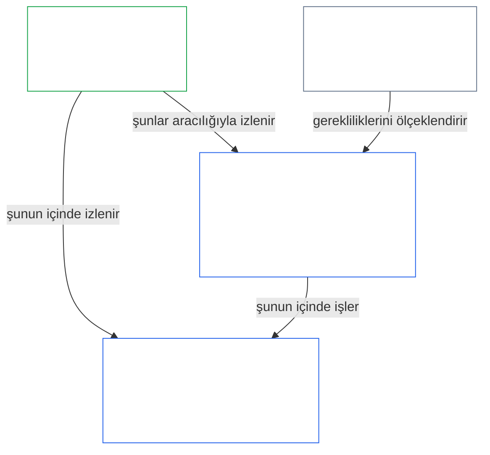

<!-- Locale: tr; language variety: Türkçe baskı — pilot (bağlayıcı değil). AI-assisted structural resynchronization draft (GPT-6 Codex); unreviewed and incomplete. English pin: SC-Corpus-2026.11.25, commit 6e0b6c663dde01b5dea731fe33d87725c7174930. core_00 SHA-256 90799cb8019b41356fa5dd90565e3f9540fc346e8c77e2c321b841654f39b274; core_01 SHA-256 aca759b394f10784ab1a2eef4e9e2ca12e369ef0ca8ee797298c6af00d2950aa. -->

> **İncelenmemiş ve eksik taslak.** Yapısal eşleştirme AI yardımıyla hazırlandı. Aşağıdaki çeviri tamlık ve anlam sadakati bakımından henüz doğrulanmadı. Yayımlamayın veya eşzamanlamayın.

# Önsöz / Temel Gereklilikler

<strong>Derlemdeki yeri (işletimsel değildir): dosya yapısı ve okuma kuralları</strong>

> **İşletimsel değildir** olarak işaretlenen bileşenler (derlemdeki yer, okur rehberi, okur haritaları) yalnızca yönlendirme amaçlıdır. Kendi dosyalarında veya başka herhangi bir dosyada bağlayıcı bir yükümlülük eklemez, kaldırmaz ya da daraltmazlar.
>
> Bu dosya **Algılayan Anayasası'nın bir parçasıdır** ve numaralı diğer `core_*` dosyalarıyla tek bir metin olarak okunduğunda **bağlayıcıdır**. **Önsözü** (temel gereklilikler) içerir. Okuma sırası ve sürüm bilgileri [README.md](README.md) içinde tutulur.
>
> **Sonraki:** [core_01.000_constitutional_map.md](../../core_01.000_constitutional_map.md) (Birinci Bölüm, Anayasal Harita).

 

Önsöz, **Modelin** (**İki Anayasal Amaç**, **Anayasal Dörtlü** ve **maddi pay**) ve ölçüm kategorilerinin anayasal sorumlusudur. Anayasal sorumlu sicili, *Anayasal Harita* olan [Birinci Bölümde](../../core_01.000_constitutional_map.md#chapter-one-constitutional-map) yer alır.

*Yalın dille: bu açılış, bu Anayasanın düzeltmek için var olduğu sorunu adlandırır — etkilediklerine zarar veren, onları gizleyen ya da dışarıda bırakan sistemler — ve belgenin geri kalanının bunu hesap verebilir, denetlenebilir ve zamanında yönetimle nasıl değiştirdiğimizi söylediğini belirtir.*

Algılayanların özgürlüğü, hayatta kalması ve esenliği, yarattığımız, içinde yaşadığımız ve bağımlı olduğumuz sistemlerden ayrılamaz. O sistemler kapsam, karşılıklı bağımlılık ve güçte büyüdükçe, geri döndürülemez, büyük ölçekli zarar riskleri de büyür. Bu riskler her zaman vardır ve maddi olarak ilgilidir.

Paylaşılan sistemler, zaten karmaşık olan ve giderek daha da karmaşıklaşan bir dünyada yer alır. Sağlıklı ve dayanıklı yönetişim, bu karmaşıklığı elverişli göstergelere indirgemek yerine onunla yüzleşmeli — ölçmeli, modellemeli ve hesabını vermelidir. Bu, etkilenen duyarlı varlıkları kullanılamaz süreçlere boğmak demek değildir: görevler, kayıtlar ve açıklamalar, duyarlı varlıkların gerçekten öğrenebileceği, itiraz edebileceği ve kullanabileceği sınırlar içinde kalmalı; ne kadar talepkâr oldukları her aktörün rolüne ve söz konusu etki, bağımlılık ve riske göre ölçeklenmelidir. Dağıtılmış anlayış bunu gerçek kılar. Anayasal bir işlev görmeyen karmaşıklık reddedilir: dünyanın karmaşıklığıyla yüzleşin, onu bir duvara dönüştürüp başkalarına yüklemeyin

Bir sistem, o acı önlenebilirken algılayanları acı çektirerek, yinelenen sorunları yok sayarak, zararı sessizce başkalarına kaydırarak ya da algılayanları yaşamlarını şekillendiren sistemlerin dışında bırakarak meşru kalamaz.

Sistemlerin nasıl tasarlandığı, denendiği ve işletildiği hayatta kalmayı, esenliği, onuru, dürüstlüğü ve kalıcı istikrarı desteklemelidir.

Daha iyi sistemler kurmayı — bu dengesizlikleri ortadan kaldıracak biçimde yapılandırılmış — ve bunları tüm algılayanların gerçek ihtiyaçlarına daha hesap verebilir, daha sağlam ve daha duyarlı kurumlarla değiştirmeyi amaçlıyoruz. Bu Anayasa o işe, birlikte adil, etkili ve sürdürülebilir biçimde nasıl çalışabileceğimize dair daha iyi bir modelle başlar.

### Sistemler Neyi Ödüllendirir

*Yalın dille: Bir sistem neye para, statü, erişim, koruma ya da sessizlik sağlıyorsa ondan daha fazlasını alır. Bu yüzden sistemin sınaması, değer verdiğini söylediği şey değil, ödüllendirdiği şeydir. Başkalarına zarar vermek kazandırıyor ya da doğruyu söylemek bedel getiriyorsa, belirtilen amaçları ne kadar iyi olursa olsun sistem başarısızdır.*

Sistemler öğretir. İnsanlar, AI ya da her ikisi tarafından işletilen her sistem, içindekilere neyin kazandırdığını ve neyin bedel getirdiğini anlatır. Bunu ücret, terfi, statü, erişim, koruma, hedefler, puanlamalar ve optimizasyon sinyalleriyle yapar. Sentientler, kurumlar ve AI sistemleri bu sinyallere uyum sağlar. Bir sistem dürüstlüğü ve etkilediği kişileri gözetmeyi savunabilir. Sorunları gizleyen ve maliyeti başkalarına aktaranları ilerletiyorsa, tersini öğretiyor demektir.

Bu nedenle Anayasa her sisteme [**İki Temel Soruyu**](#two-fundamental-questions) yöneltir:

1. **Sentientlerin gelişmesine ve dayanmasına, doğruyu söylemesine ve zararı onarmasına yardımcı olan davranışları ödüllendiriyor mu?**
2. **Haklı bir neden olmaksızın zarar veren, yanıltan, dışlayan, geciktiren, israf eden ya da maliyeti başkalarına aktaran davranışları ödüllendiriyor mu?**

Bir sistem ancak ilk sorunun yanıtı evet, ikincinin yanıtı hayırsa geçer. Birine verilen yanıt diğerini yanıtlamaz; sistem iyi davranışın yanı sıra zararı da ödüllendirebilir.

**Birinci soru:** Aşağıdakilerden herhangi biri açıkça ya da sessizce ödüllendirilmez veya cezalandırılırsa sistem bu soruda başarısızdır:

- iyi niyetle sorun bildirmek ([Korunan Bildirim (İhbar)](../../subcore_03.070_band_accountability.md#protected-reporting-whistleblowing))
- bir karara itiraz etmek
- suça ortak olmayı reddetmek ([Birinci Bölüm §17.5 Direnme Görevi](../../core_02.040_stewardship_capacity_principles.md#175-duty-to-resist))

Ceza; kenara itme, misilleme ([Korunan Bildirime Misilleme ve Erişime Müdahale](../../subcore_03.070_band_accountability.md#protected-reporting-retaliation-and-access-interference)) veya yıldırıp yıpratma olabilir.

**İkinci soru:** Aşağıdakilerden herhangi biri açıkça ya da sessizce ödüllendirilirse sistem bu soruda başarısızdır:

- zarar
- yanıltma (gizleme ve sahte güven dâhil)
- haksız dışlama
- gecikme
- israf
- maliyetin haksız biçimde aktarılması

Ödül; tanınma, ilerleme, koruma, ölçüt kredisi ya da görmezden gelme olabilir ([Birinci Bölüm §3.2.6 Anayasaya Aykırı Davranışı Ödüllendirmeme](../../core_02.000_values_principles.md#326-anti-reward-for-anti-constitutional-conduct)).

Bu sorular herkesten uyumlu olmasını istemez. Dürüst muhalefet, iyi niyetli bildirim ve suça katılmayı reddetmek toplum karşıtı değildir; bunları öyle gören sistem tersini yapıyordur. Sorular popülerlik testi de değildir. Yardımın, zararın, adaletin veya haklılığın ölçüsü bu Anayasanın kendi standartlarıdır: [**Gelişim**](#flourishing) ve [**Süreklilik**](#continuity); Güvenlik, Doğruluk, Güven ve Haklar Tabanı içinde. Çoğunluğun, operatörün ya da anın onayı bunların yerini alamaz.

Sorular, bir sistemin neyi ödüllendirip cezalandıracağına karar veren herkesi bağlar. Ücreti, terfiyi, erişimi, hedefleri ve puanlamayı belirleyen operatörler, kurumlar ve sorumlular buna dâhildir. AI'ı eğiten veya optimize eden sistemlerin tasarımcıları da buna dâhildir; amaçları ve geri bildirim sinyalleri tam da bu anlamda ödüldür. İnsan ve AI sorumlular aynı standarda tabidir ([Birinci Bölüm §17.1 Ortak Sorumluluk Standardı](../../core_02.040_stewardship_capacity_principles.md#171-shared-stewardship-standard)).

Birinci Bölüm bu soruları teşvik kurallarına dönüştürür: [§19.1.1 Teşviklerin Yapması Gerekenler](../../core_02.050_governance_incentive_application.md#1911-what-incentives-must-do) ilk sorunun, [§19.1.2 Teşviklerin Yapmaması Gerekenler](../../core_02.050_governance_incentive_application.md#1912-what-incentives-must-not-do) ikincinin temelidir. Söylenene inanmak yerine gerçekte ne olduğunu denetleyerek yanıtlayın. [Teşvik Uyumu](../../subcore_03.080_band_integrative.md#incentive-alignment) ve [Vekil Sapması](../../subcore_03.085_band_oversight.md#proxy-divergence) yöntemi açıklar; [**maddi menfaat**](#material-stake) ne kadar derine bakılacağını belirler. Bölüm 1'deki dört görev, yanıtların dürüst kalmasını sağlar.

### 1. Model

*Yalın dille: dört ödev — katılım, gözetim, hesap verebilirlik ve zamanındalık — ne kadar etki, bağımlılık ve riskin söz konusu olduğuna göre ölçeklenir ve iki amacı birlikte hizmet eder: Gelişim ve Süreklilik, yerinden oynamayan bir Hak Tabanının içinde.*

Algılayan yaşamı hem biyolojik hem maddi olarak destekleyen kritik sistemler, [**Anayasal Dörtlü**](#constitutional-tetrad) denen dört ödev altında yönetilir ve işletilir. Bu, o sistemlerin karşılaması gereken genel ödevleri ortaya koyar. Bu ödevlerin gücü, [**maddi pay**](#material-stake)a bağlıdır: ne kadar etki, bağımlılık ve riskin söz konusu olduğu. Pay ne kadar yüksekse, ödevler o kadar güçlü olmalıdır.

- **katılım** — etkilenen algılayanlar gerçek bir ses, adil temsil, kararlara itiraz için adil bir şans ve söz konusu olana orantılı önemli rollere erişim elde eder
- **gözetim** — biri izler, denetler, doğrular ve kayıt tutar ki sorunlar bulunabilsin; bağımsız inceleyenler kötü seçimleri sınırlayabilir
- **hesap verebilirlik** — sorumluluk doğru aktörlere izlenir; seçimleri için yanıt vermek zorundadırlar; zarar görenler onarım alır; kötü sonuçlar gerçek düzeltmeyi tetikler
- **zamanındalık** — sorunlar, söz konusu olana uyan süre sınırları içinde saptanır, itiraz edilir, çözülür ve düzeltilir; birinin haklarını, çarelerini ya da onarım şansını fiilen silen gecikmeler meşru yönetim değildir

Bu dört ödev, paylaşılan sistemlerin ne için eniyilemesi gerektiğine hizmet eder — [**İki Anayasal Amaç**](#two-constitutional-aims):

- **Gelişim** — doğruluk, güvenlik, güvenilirlik ve anlamlı eylem yetisi yoluyla sürdürülen algılayan esenliği
- **Süreklilik** — uzun ufuklu istikrar, sürdürülebilirlik, dayanıklılık ve ekolojik esenlik

Bu amaçlar birlikte izlenmelidir; her zaman bu Anayasada kurulan pazarlığa kapalı ilke kısıtları ve hak korumaları içinde. [**Anayasal Dörtlü**](#constitutional-tetrad) bu izlemenin nasıl meşru kaldığını yönetir: [**maddi pay**](#material-stake)a ölçeklenmiş **katılım**, **gözetim**, **hesap verebilirlik** ve **zamanındalık**. Dörtlü bacakları ve anayasal amaçlar için bağlayıcı tanımlar Beşinci Bölümde yaşar: [Katılım](../../subcore_03.060_apex_participation_leg.md#participation-constitutional), [Gözetim](../../subcore_03.055_apex_oversight_leg.md#oversight-constitutional), [Hesap verebilirlik](../../subcore_03.040_apex_accountability_leg.md#accountability), [Zamanındalık](../../subcore_03.065_apex_timeliness_leg.md#timeliness-constitutional), [Gelişim](../../subcore_03.050_apex_flourishing_aim.md#flourishing-constitutional) ve [Süreklilik](../../subcore_03.045_apex_continuity_aim.md#continuity-aim-constitutional).

### 2. Ölçümlere Genel Bakış

*Basitçe: Ortak sistemler tahminlerle veya gösteriş ölçütleriyle işlemez. Algılayanların gerçekten Gelişim gösterip gösteremediğini ve varlığını sürdürebildiğini ölçün. İncelemeyi etki, bağımlılık ve riskle orantılı tutun.*

#### 2.1 Amaç ve Standartlar

Ortak sistemler ölçüm olmadan iyi işleyemez. Gıda, barınma, bakım, altyapı ve yönetişim karmaşık ve değişen bir dünyada işler — yalnızca tahminlere veya elverişli sayılara sığmayacak kadar karmaşık bir dünyada.

Sürekli ölçüm, algılayanların hayatta kalması ve esenliği açısından en önemli noktalara odaklanmalıdır. Soru, bağımlı olduğumuz sistemlerin zaman içinde gerçekten [**Gelişimi**](#flourishing) ve [**Sürekliliği**](#continuity) destekleyip desteklemediğidir. Bu inceleme [**maddi payla**](#material-stake) — etki, bağımlılık ve riskin büyüklüğüyle — orantılıdır.

Bu Anayasa uyarınca ölçüm, sistemlerin iddialarını değil, gerçekte yaptıklarını [**İki Temel Soru**](#two-fundamental-questions) ile sınar. Ölçümler kendi başına amaç olan puanlar değildir; algılayanların esenliği ve Dünya'nın ekolojik sağlığıyla uyumlu, sürdürülebilir, dayanıklı ve şefkatli sonuçları güvenceye alma araçlarıdır. Bu görev [İki Anayasal Amaç](#two-constitutional-aims) aracılığıyla bağlayıcı biçim alır: **Gelişim** ve **Süreklilik**.

Ölçümler bu amaçlara ve Anayasa'da tesis edilen hak korumalarına kadar izlenebilir kalmalıdır. Ham çıktı miktarı, kullanım oranı, çalışan sayısı, gelir, gecikme ve diğer elverişli vekil ölçüler anayasal performansın yerini tutamaz. [Vekil Sapması](../../subcore_03.085_band_oversight.md#proxy-divergence) öngörülebilir olduğunda bu yasak uygulanır.

#### 2.2 Kamusal Ölçüm

[Subcore 7-D Kamu Bilgilendirme Ofisi](../../subcore_07.040_public_information_office.md#subcore-7-d-public-information-office), anayasal sonuçları kamusal olarak ölçen başlıca birimdir. İşletim kurallarının gerektirdiği biçimde gerçek sonuçlara ilişkin kanıtları bu ölçüm kategorilerine ve hizmet ettikleri ilkelere eşler. Bu ölçüm, [§3.1 Yönetişimde Ölçümlerin Kullanılması](#31-using-measurements-in-governance) bölümündeki ortak standartların veya forum rollerinin yerini almaz.

#### 2.3 Ölçüm Kategorileri

Aşağıdaki genel bakış ölçüm **kategorilerini** listeler ve her birini [İki Anayasal Amaç](#two-constitutional-aims) ile [Anayasal Dörtlüye](#constitutional-tetrad) eşler. Her kategori yalın dille bir soru sorar, **alt kategorilerini** adlandırır ve aile tablosunun, anayasal kullanımın ve tanım yönlendirmesinin bulunduğu **Üçüncü Bölüm ölçüm ailesi ana sayfasına** bağlanır. Her alt kategori, Üçüncü Bölümdeki kanonik tanımına bağlanır.

[**Maddilik**](#material-stake) ayrı bir ölçüm kategorisi değildir. [**Maddi payın**](#material-stake) — etki, bağımlılık ve riskin — düzeyine göre her kategorinin ne ölçüde uygulanacağını belirler. **Anayasal performans** her kategoriyi kesen ve her iki amaca hizmet eden bir araçtır. Aşağıdaki tablodaki her kategori, onu kanonik tanımlarına bağlayan Üçüncü Bölüm ölçüm ailesi ana sayfasına bağlanır.

| Kategori | Sade soru | Alt kategoriler |
|---|---|---|
| **[Gelişim](../../subcore_03.050_apex_flourishing_aim.md#measuring-flourishing-preamble-measurement-family)** | Algılayanların yaşamı, güvenliği ve temel ihtiyaçlara erişimi gerçekten güvence altında mı? | [Esenlik](../../subcore_03.075_band_continuity.md#wellbeing) · [Güvenlik, zarar ve risk](../../subcore_03.075_band_continuity.md#safety-constitutional-constraint) · [Yaşamı sürdürme tabanına erişim](../../subcore_03.075_band_continuity.md#bodily-maintenance-access) |
| **[Süreklilik](../../subcore_03.045_apex_continuity_aim.md#measuring-continuity-preamble-measurement-family)** | Algılayanlar ve sistemler ekolojik olarak, güvenilir biçimde ve arıza koşullarında varlığını sürdürebiliyor mu? | [Ekolojik ayak izi ve çevresel önkoşullar](../../subcore_03.075_band_continuity.md#ecological-footprint) · [Dayanıklılık, geri döndürülebilirlik ve sistemik risk](../../subcore_03.075_band_continuity.md#reversibility) · [Bağımlılık ve kaynak akışları](../../subcore_03.075_band_continuity.md#dependency) · [Sistemler arası destek](../../subcore_03.075_band_continuity.md#proportionate-cross-system-support) |
| **[Katılım](../../subcore_03.060_apex_participation_leg.md#measuring-participation-preamble-measurement-family)** | Etkilenen algılayanlar söz, erişim, öğrenme ve mahremiyet bakımından adil biçimde katılabiliyor mu? | [Adalet, erişim ve eyleme geçme gücü](../../subcore_03.090_band_participation.md#substantive-fairness) · [Mahremiyet ve verilerin sorumlu yönetimi](../../subcore_03.075_band_continuity.md#privacy-informational-cluster) |
| **[Gözetim](../../subcore_03.055_apex_oversight_leg.md#measuring-oversight-preamble-measurement-family)** | Algılayanlar, sistemlerin sunduğu bilgileri görebiliyor, doğrulayabiliyor ve bunlara güvenebiliyor mu? | [Hakikat ve epistemik bütünlük](../../subcore_03.085_band_oversight.md#truth-constitutional-constraint) · [Güvenilirlik](../../subcore_03.075_band_continuity.md#trustworthiness) |
| **[Hesap verebilirlik](../../subcore_03.040_apex_accountability_leg.md#measuring-accountability)** | Teşvik yapıları, piyasa gücü ve hesap verme yükümlülüğü görevleri gerçeğe dönüştürüyor mu? | [Teşvik uyumu ve vekil bütünlüğü](../../subcore_03.080_band_integrative.md#incentive-alignment) · [Piyasa yapısı ve itiraz edilebilirlik](../../subcore_03.070_band_accountability.md#market-structure) |
| **[Zamanındalık](../../subcore_03.065_apex_timeliness_leg.md#measuring-timeliness)** | Uyuşmazlıklar, düzeltmeler ve onarımlar, giderim hâlâ önem taşırken çözüme kavuşturuluyor mu? | [Zamanında çözüm](../../subcore_03.070_band_accountability.md#timely-resolution) · [Gecikme karşıtı ve çözüm yolu disiplini](../../subcore_03.075_band_continuity.md#capture-of-resolution-pathways) |
| **[Anayasal performans](../../subcore_03.095_band_performance.md#measuring-constitutional-performance-preamble-measurement-family)** | Anayasal sonuçlar anlamsız israf olmaksızın verimli biçimde sağlanıyor mu? | [Anayasal verimlilik](../../subcore_03.075_band_continuity.md#constitutional-efficiency) · [Önlenebilir Yük](../../subcore_03.075_band_continuity.md#avoidable-burden) · [Üretken kapasite](../../subcore_03.075_band_continuity.md#productive-capacity) |

#### 2.4 Kategorilerin Etkisi

Bu ölçüm kategorileri neyin önemli olduğunu gösterir. Tek başlarına her sayıyı, finansman formülünü, arayüz kuralını, uyarlama listesini, teknik ölçüyü veya değerlendirme tasarımını belirlemezler. Yalnızca belirli bir bölüm veya kabul edilmiş belge onları açıkça zorunlu kıldığında bağlayıcı olurlar.

### 3. Yönetişim ve sorumlu yönetim

*Yalın dille: meşruiyet Güvenlik, Doğruluk ve Güven ister; artı sizi etkileyen sistemleri öğrenmek ve onları çalışır tutmakta sonuç doğuran roller almak için gerçek fırsatlar.*

Kalıcı meşruiyet [Güvenlik](../../core_02.000_values_principles.md#4-safety-harm-constraint), [Doğruluk](../../core_02.000_values_principles.md#5-truth-epistemic-integrity-constraint) ve [Güven](../../core_02.000_values_principles.md)e bağlıdır; ayrıca yasal sorumlu yönetimin, doğrucu işbirliğinin ve sınırlı yönelimin orantılı tanınmasına — yalnızca yaptırım ve kısıtlama değil. Birinci Bölüm bu tanıma boyutunu [Tanıma, pekiştirme ve yönelim](../../core_02.000_values_principles.md#32-recognition-reinforcement-and-aspiration)de belirtir.

Dağıtılmış anlayış ve emanet sorumluluğu, duyarlı varlıkların kendilerini önemli ölçüde etkileyen sistemlerin nasıl işlediğini öğrenmeleri ve bu sistemlerin sürdürülmesi ile iyileştirilmesinde etkili roller üstlenmeleri için düzenli ve orantılı fırsatlar gerektirir. Bu fırsatlar, dayanıklılığı, sürdürülebilirliği ve toplum yararına yeniliği güvence altına almak üzere yetkinliği, onarım kapasitesini ve meşruiyeti Anayasal Topluluğumuzun geneline yayar. Tüm bu fırsatlar Güvenlik, Hakikat ve sınırlandırılmış eyleyicilik ilkelerini; ayrıca [Önlenebilir Yük](../../subcore_03.075_band_continuity.md#avoidable-burden) ile [Birinci Bölümde](../../core_02.020_interaction_interpretation.md#133-minimization-of-avoidable-burden) belirtilen orantılılık disiplinini karşılamalıdır.

#### 3.1 Yönetişimde ölçümleri kullanmak

*Yalın dille: önce sorunu ve payı adlandırın, eşleşen ölçüm kategorisini seçin ve kanıt olarak elverişlilik sayıları değil paylaşılan teknik standartlar kullanın.*

Anayasa somut ölçüm kuralları gerektirdiğinde, [On Beşinci Bölüm](core_11_forum.md#42-technical-forum-domains) kapsamındaki **Teknik Forum Alanları**, ölçüm, test ve güvenilir kanıta ilişkin ortak standartları geliştirip sürdürür. Uyuşmazlıktan sorumlu forum, davayı karara bağlarken [On Beşinci Bölüm §4.2 (*Teknik Forum Alanları*)](core_11_forum.md#42-shared-standards-and-anti-displacement) uyarınca bu standartları uygular.

Anayasal sorumlu yönetim, sorunu ve [**maddi pay**](#material-stake)ı — ne kadar etki, bağımlılık ve riskin söz konusu olduğunu — adlandırmakla başlar. Sonra [genel bakış](#2-measurements-overview)tan ilgili [**ölçüm**](#2-measurements-overview) kategorisini ve alt kategorisini seçin ve elverişlilik ölçütleri yerine gerçek dünya etkilerini denemek için yukarıdaki standartları uygulayın. İzlenebilir kanıt isteyin.

#### 3.2 Yönetişim katmanları

*Yalın dille: kim yönetebilir, zaten yetkilendirilmiş bir sistemin içindeki sesten farklı bir sorudur; bir katılım oyu ya da bir güven puanı yetkilendirme değildir ve o ses olağan uyuşmazlıklar için olağan ilk adımdır — yol başarısız olduğunda bağımsız forum incelemesinin yerine geçmez.*

Anayasamız altında [**Anayasal Dörtlü**](#constitutional-tetrad)yü yerine getirmek için yönetişimin birbiriyle ilişkili ama ayrı iki katmanı vardır:

- [**Anayasal Sözleşme Katmanı**](../../subcore_03.080_band_integrative.md#constitutional-contract-layer) yönetme yetkisinin kendisinin yetkilendirilmesini yönetir — kim yönetebilir, hangi meşruiyet düzeneğiyle ve hangi kapsam ve kalıcı koşullar altında.
- [**Etkilenen Tarafların Sistem Katılımı**](../../subcore_03.090_band_participation.md#stakeholder-status-and-weight-cluster) zaten yetkilendirilmiş sistemler, kurumlar ve sınırlı karar alanlarından maddi olarak etkilenen algılayanlara borçlu olunan katılımı, temsili, [itiraz edilebilirliği](../../subcore_03.070_band_accountability.md#contestability) ve [usul güvencesini](../../subcore_03.070_band_accountability.md#due-process-constitutional) yönetir.

Bu katmanlar pratikte örtüşebilir. Bu örtüşme onları tek katmana çökertmez. Zaten yetkilendirilmiş sistemlerde etkilenen-taraf düzeyinde katılım, anayasal yetkilendirmenin yerine geçmez. Yayımlanmış bir itiraz yolu, bir katılım oyu ya da bir güven puanı tek başına kim yönetebilir sorusunu kararlaştırmaz.

Katılım katmanındaki itiraz edilebilirlik, önceden yetkilendirilmiş sistemlerdeki uyuşmazlıkların olağan ilk adımıdır: etkilenen sentient'lar önce yayımlanmış itiraz yolunu kullanır. Bağımsız [forum incelemesi](core_11_forum.md#1-purpose-and-role--participation-architecture) bu yolun yerine geçmez; uyuşmazlık sürerse, yol eksik veya ele geçirilmişse ya da gereken giderimi sağlayamıyorsa yol da forum incelemesinin yerine geçmez. [Uyuşmazlık sıralaması](core_11_forum.md#dispute-sequencing), forum yönlendirmesinin ne zaman devreye gireceğini belirtir.

Anayasal yetkilendirme ayrıca [Etkilenen Tarafların Sistem Katılımı](../../subcore_03.090_band_participation.md#stakeholder-status-and-weight-cluster) katmanı altında borçlu ödevleri silmez. Bu ödevler hâlâ zaten yetkilendirilmiş sistemler, kurumlar ve sınırlı karar alanlarından maddi olarak etkilenen algılayanlar için katılımı, temsili, [itiraz edilebilirliği](../../subcore_03.070_band_accountability.md#contestability) ve [usul güvencesini](../../subcore_03.070_band_accountability.md#due-process-constitutional) içerir.
