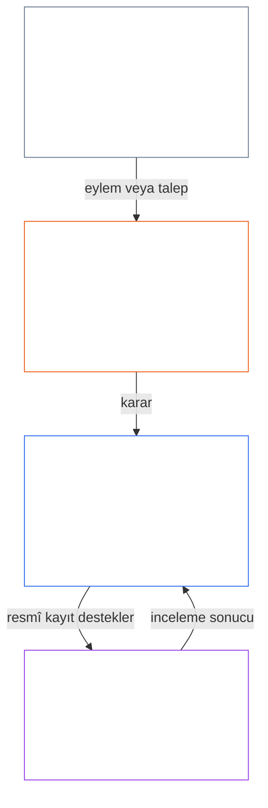
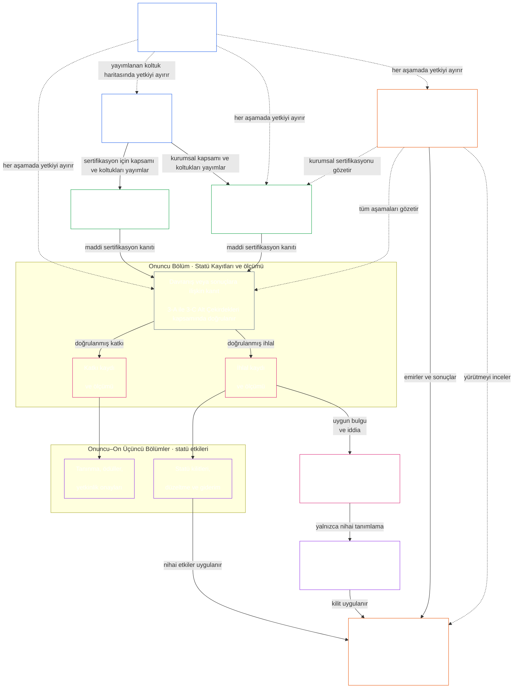

<!-- Locale: tr; language variety: Türkçe baskı — pilot (bağlayıcı değil). AI-assisted structural resynchronization draft (GPT-6 Codex); unreviewed and incomplete. English pin: SC-Corpus-2026.11.25, commit 6e0b6c663dde01b5dea731fe33d87725c7174930. core_00 SHA-256 90799cb8019b41356fa5dd90565e3f9540fc346e8c77e2c321b841654f39b274; core_01 SHA-256 aca759b394f10784ab1a2eef4e9e2ca12e369ef0ca8ee797298c6af00d2950aa. -->

<!-- Structural resynchronization draft; §§1–4 newly translated against the pinned English source, still requiring independent fidelity review. Other gaps are marked. Do not publish or synchronize. -->

# Birinci Bölüm: Anayasal Harita

<strong>Derlemdeki yeri (işletimsel değildir): dosya yapısı ve okuma kuralları</strong>

> **İşletimsel değildir** olarak işaretlenen bileşenler (derlemdeki yer, okur rehberi, okur haritaları) yalnızca yönlendirme amaçlıdır. Kendi dosyalarında veya başka herhangi bir dosyada bağlayıcı bir yükümlülük eklemez, kaldırmaz ya da daraltmazlar.
>
> Bu dosya **Algılayan Anayasası'nın bir parçasıdır** ve numaralı diğer `core_*` dosyaları ile subcore birlikte tek bir metin olarak okunduğunda **bağlayıcıdır**. Bu dosya **Birinci Bölümü**, *Anayasal Harita'yı* içerir: amacı (§1), neden var olduğu (§2), dosyalarının nasıl bir araya geldiği (§3), sonraki bölümlerin dayanakları (§4), temel yönetişim süreçleri (§5) ve anayasal sorumlu sicili (§6–§11).
>
> **Önceki:** [core_00.000_preamble.md](core_00_preamble.md) (Önsöz)
> **Sonraki:** [core_02.000_values_principles.md](../../core_02.000_values_principles.md)

<strong>İz</strong>

- Önceki: [Önsöz](core_00_preamble.md) (*Model, İki Anayasal Amaç, Anayasal Dörtlü, maddi pay ve ölçüm kategorileri*).
- Alt bölümler:
  - [§1](#1-purpose-role-and-scope);
  - [§2](#2-why-the-map-exists);
  - [§3](#3-how-the-files-fit-together);
  - [§4](#4-foundations-for-the-chapters-that-follow);
  - [§5](#5-key-governance-processes);
  - [§6](#6-principles-definitions-and-rights);
  - [§7](#7-system-and-institutional-charters-functional-independence-and-separation-of-duties);
  - [§8](#8-key-practical-process-pipelines);
  - [§9](#9-process-ownership-and-outputs);
  - [§10](#10-governance-change-and-incorporation);
  - [§11](#11-adopted-implementation-corpus).
- Şunlarla birlikte okuyun: [Yetki Hiyerarşisi ve İç Düzen](../../subcore_03.080_band_integrative.md#authority-stack-and-internal-hierarchy) (*sorumlu sicilinin uygulanması*); [README.md](README.md) (*okuma sırası*).

 

### 1. Amaç, Rol ve Kapsam

*Yalın dille: Bu bölüm Anayasa’nın geri kalanı için bir rehberdir. Parçaların nasıl birleştiğini, her konudan hangi bölümün sorumlu olduğunu ve başlıca süreçlerin nasıl işlediğini gösterir; böylece okur sorusunu yanıtlayan kuralı bulabilir.*

**Amaç:** Birinci Bölüm genel görünümü ve sorumluluk rehberini sunar. Yetkilendirilmiş yönetişimi sınayan süreçleri adlandırır, hangi esas alanın hangi bölüme ait olduğunu belirtir ve anayasal metnin üç katmanını açıklar.

**Rol:** Bu bölüm yönlendirme ve sorumluluk belirleme işlevi görür. Diğer bölümlerin ve [Yetki Hiyerarşisi ve İç Düzenin](../../subcore_03.080_band_integrative.md#authority-stack-and-internal-hierarchy) uyguladığı sorumlu sicili dışında kendi başına bir yükümlülük getirmez.

**Bölümün kapsamı:**

- haritanın neden var olduğu (**§2**);
- dosyaların nasıl birleştiği (**§3**) ve sonraki bölümlerin dayanakları (**§4**);
- temel yönetişim süreçleri (**§5**);
- anayasal sorumlu sicili: ilkeler, tanımlar ve haklar (**§6**); sistem ve kurum şartları, işlevsel bağımsızlık ve görev ayrılığı (**§7**); süreç zincirleri (**§8**); süreç sorumluluğu ve çıktılar (**§9**); yönetişim, değişiklik ve dahil etme (**§10**); ve
- kabul edilmiş uygulama külliyatı ve alt-külliyat (**§11**).

### 2. Harita Neden Var

*Yalın dille: Bu kadar büyük bir metin, parçaların nasıl birleştiğini ve her konudan kimin sorumlu olduğunu gösteren bir rehbere ihtiyaç duyar. Bu bölüm, okurun sorusunu yanıtlayan kuralı bulmasına yardım eder.*

Anayasa görevlerini çok sayıda bölüm, bir alt-külliyat ve kabul edilmiş dört külliyat arasında dağıtır. Kendisine ne borçlu olunduğunu arayan bir algılayan ya da bir yükümlülük arayan kabul eden yolunu kaybedebilir. Bu bölüm genel görünümü ve sorumluluk rehberini verir: her parçanın işlevini, her konunun hangi bölüme ait olduğunu, süreç zincirlerinin nasıl yürüdüğünü ve metin katmanlarının ilişkisini gösterir. Sorumlu sicili dışında kendi başına kural koymaz.

**Dayanakları:**

- Önsöz:
  - [Anayasal Dörtlü](core_00_preamble.md#constitutional-tetrad): bu bölümün uygulamaya taşıdığı işlevler:
    - [Katılım](../../subcore_03.060_apex_participation_leg.md#participation): algılayan, sorusunu yanıtlayan kuralı bulabilir;
    - [Hesap verebilirlik](../../subcore_03.040_apex_accountability_leg.md#accountability): her konunun yanıt veren bir sorumlu bölümü vardır;
    - [Gözetim](../../subcore_03.055_apex_oversight_leg.md#oversight): okur parçaların ilişkisini görüp boşluk veya çakışmayı fark edebilir;
    - [Zamanındalık](../../subcore_03.065_apex_timeliness_leg.md#timeliness): okur doğru kurala gecikmeden ulaşır;
  - [İki Anayasal Amaç](core_00_preamble.md#two-constitutional-aims): bu bölümün hizmet ettiği iki amaç:
    - [Gelişim](core_00_preamble.md#flourishing): algılayanlar metinde yollarını bulabilirse Anayasa işlevini yerine getirir;
    - [Süreklilik](core_00_preamble.md#continuity): açık bir harita, metin büyüyüp değişirken bütünlüğünü korur;
- İkinci Bölüm ilkeleri:
  - [§5.2 Açık Dilde Erişilebilirlik (Katılım ve Sorumlu Yönetim Görevi)](../../core_02.000_values_principles.md#52-plain-language-accessibility-participation-and-stewardship-duty);
  - [§5.2.4 Karmaşıklığın Engelleme Olarak Kullanılmasına Karşı Disiplin](../../core_02.000_values_principles.md#524-complexity-as-defeat-discipline);
  - [§15.4 Anayasal Anlam Çatışmalarının Çözümü](../../core_02.030_constitutional_interpretation.md#154-constitutional-meaning-conflict-resolution);
- Dördüncü Bölüm maddeleri:
  - [Madde XXIV-A](../../core_04.030_rights_part_d.md#article-xxiv-a-proportional-comprehensibility-right) (*Orantılı Anlaşılabilirlik Hakkı*);
  - [Madde XXIV-B](../../core_04.030_rights_part_d.md#article-xxiv-b-complexity-audit-and-modularity-requirements) (*Karmaşıklık Denetimi ve Modülerlik Gereklilikleri*).

### 3. Dosyalar Nasıl Birleşir

Anayasa dosyaları şu şekilde bir araya gelir:

- **Çekirdek (`core_*`):** Numaralı dosyalar, tek bir metin olarak birlikte okunacak Anayasa bölümlerini içerir. Güvenceleri ve anayasal yapıyı bildirir.
- **Alt-külliyat (`subcore_*`):** Bölümlerin arkasındaki kuralların ve usullerin tamamını verir. Her dosya bir bölüme aittir, o bölümle aynı kuvvettedir ve ayrıca dahil edilmeyi gerektirmeden her kabul edeni bağlar. Alt-külliyat kendi bölümünü daraltamaz.
- **Uygulama (`corpus_*`):** Dört dosya, Anayasa’nın uygulanmasına ilişkin operasyonel ayrıntıları verir. Geçerli dahil etmenin kapsamı içinde bağlayıcıdır ve Anayasa’yı daraltmadan uygular. [§11](#11-adopted-implementation-corpus) bu dört dosyayı belirtir.

Tanımlı [Külliyat](../../subcore_03.080_band_integrative.md#corpus), bağlayıcı anayasal kaynakların daha geniş, sürümlenmiş kümesidir: çekirdeği, alt-külliyatı, kabul edilmiş uygulama metnini ve geçiş sırasında geçerli uyumluluk sarmalayıcılarını kapsar. Taslaklar, notlar ve gezinme rehberleri sırf projede yer aldıkları için bağlayıcı olmaz.

### 4. Sonraki Bölümlerin Dayanakları

*Yalın dille: İkinci ila Dördüncü Bölümler değerlerden, sözlükten (tanımların nasıl kurulduğunu, korunduğunu ve kanıtlandığını açıklayan alt-külliyat kurallarıyla birlikte) ve Hak Tabanı’ndan sorumludur; sonraki bölümler bu alanları sessizce başka yere taşıyamaz.*

**İkinci ila Dördüncü Bölümler**, sonraki her şeyin uyması gereken değerleri, söz varlığını, doğrulama düzeneklerini ve Hak Tabanı’nı sağlar. Bunlara şunlar dahildir:

- [Beşinci Bölümün Sistem Şartı veya Kurum Şartı gerekliliği, Altıncı Bölümün görev ayrılığı gerekliliği ve Yedinci Bölümün Bağımsız Organları](#7-system-and-institutional-charters-functional-independence-and-separation-of-duties);
- §8’deki [Temel Uygulamalı Süreç Zincirleri](#8-key-practical-process-pipelines);
- §9’daki [süreç sorumluluğu ve çıktıları](#9-process-ownership-and-outputs);
- §10’daki yönetişim ve değişiklik yolu bölümleri; ve
- §11’deki [Kabul Edilmiş Uygulama Külliyatı](#11-adopted-implementation-corpus).

### 5. Temel yönetişim süreçleri

*Yalın dille: Metin gerektirdiğinde önce işlem yapan, denetleyen, kaydeden ve itirazı dinleyen sentientlerin veya sistemlerin koltuklarını ayırın. Maddi meseleler ardından belgelendirme, yardım ve zararın yazılı kaydı, düzeltme ve çare ile süreli forum incelemesinden geçer. Olağan uyuşmazlıklar önce yayımlanmış itiraz yolunu kullanır. Bu süreçler yetkilendirilmiş yönetişimi sınar; kendi başlarına yönetme yetkisi yaratmaz.*

[Temel Haklar Dördüncü Bölüm](../../core_04.000_rights_part_a.md#chapter-four-foundational-rights), [Altbölüm 8-B — Sistem uyum belgelendirmesi](../../subcore_08.020_system_alignment_certification_evaluation.md#subcore-8-b-system-alignment-certification--evaluation), içerilmiş bir belge veya başka bir anayasal hüküm bunu açıkça gerektirdiğinde, maddi anayasal meseleyi aşağıdaki yollardan birine ya da birkaçına alın. [Temel Uygulamalı Süreç Zincirleri](#8-key-practical-process-pipelines) ölçümü kayıtlara, belgelendirmeye, doğrulanmış girdilere, sınıflandırmaya, forum gözetimine, düzeltmeye ve zamanında çareye dönüştürür. Zincir yetkilendirilmiş yönetişimi uygulamada sınar, itiraza açar ve onarır; yönetişimi kendisi yetkilendirmez. [§8.2](#82-how-the-full-chain-fits-together) aşamaların nasıl bağlandığını gösterir.

**Yollar:**

- **İşlevsel bağımsızlık ve görevlerin ayrılığı** ([Altıncı Bölüm](../../core_06.000_functional_independence_separation_of_duties.md#chapter-six-functional-independence-and-separation-of-duties)): Maddi bağlayıcı işlem ilerlemeden önce başlatma, doğrulama veya yetkilendirme, resmî kayıt muhafazası ve itiraz incelemesi koltuklarını geçerli ölçekleme ve bağımsızlık kurallarına göre belirleyip ayırın.
- **Sistem uyum belgelendirmesi** ([Altbölüm 8-B](../../subcore_08.020_system_alignment_certification_evaluation.md#subcore-8-b-system-alignment-certification--evaluation)): Yüksek etkili Sisteme ölçekli güven duyulmadan önce, ona şu anda güvenmenin anayasal bakımdan güvenli olup olmadığını belirlemek için kanıt toplayıp inceleyin. Belgelendirme, sentientlerin sistemi sorgulama ve denetleme haklarıyla birlikte işleyen iki güvenceden biridir ([Madde XIV — Güvenilir Sistem Hakkı](../../core_04.020_rights_part_c.md#article-xiv-right-to-reliable-and-trustworthy-systems)); biri diğerinin yerini almaz.
- **Güzergâh Kayıtları** ([Altbölüm 10-B](../../subcore_10.020_standing_assessment.md#subcore-10-b-standing-records--question-1-what-happened)): Davranış veya zarar anayasal açıdan önemliyse doğrulanmış olguları resmî katkı ya da ihlal dosyalarına kaydedin; söylenti ve itibar yeterli değildir.
- **Düzeltme ve çare** ([On İkinci Bölüm §3.1](../../core_12.000_violation_consequences.md#31-remedy-and-correction)): Doğrulanmış ihlalden sonra hem nedeni giderip sürmesini durduracak düzeltmeyi hem zarar görenlere borçlu olunan çareyi değerlendirin. Çare, uygun olduğunda kabul, onarım veya eski hâle getirme; ayrıca tazmin, aynen onarım imkânsızsa ikame güvence veya benzer giderim içerir. Nedeni düzeltmek çarenin, çare de nedeni düzeltmenin yerine geçmez.
- **Forum incelemesi** ([On Altıncı Bölüm](../../core_16.000_forum.md#1-purpose-role-and-scope)): Yetkilendirilmiş sistemlerde olağan uyuşmazlık önce yayımlanmış [Etkilenen Tarafların Sistem Katılımı](../../subcore_03.090_band_participation.md#stakeholder-status-and-weight) itiraz yolunu kullanır. Yol tartışmalı, eksik, ele geçirilmiş ya da giderim veremez durumdaysa uyuşmazlık birincil paya göre gözetimli forumlara yönlendirilir. Forumlar **Madde XXVII-C** (*Zamanında Çözüm ve Gecikme Karşıtı Taban*) uyarınca kanıtı, hukuka uygun aktarımı ve zaman pencerelerini destekler.

### 6. İlkeler, tanımlar ve haklar

**Altıncı ila On Birinci bölümler** Anayasanın **anayasal sahiplik sicilini** oluşturur: her konuya hangi bölümün veya kabul edilmiş külliyatın baktığını ve ne ürettiğini söyler. Her numaralı bölüm ve altçekirdek dosyası da başında bağlayıcı sahiplik cümlesi taşır. Başka kısımlar bu sahibe yönlendirebilir; sorumluluğunu sessizce değiştiremez veya başka yere taşıyamaz. Kural [Yetki Yığını ve İç Hiyerarşi](../../subcore_03.080_band_integrative.md#authority-stack-and-internal-hierarchy) içinde açıklanır.

Her özet, bölümün sorumluluk alanını ve çıktısını belirtir.

#### 6.1 [İkinci Bölüm — Değerler, İlkeler ve Sorumlu Yönetim](../../core_02.000_values_principles.md)

- **Sahip olduğu:** Esenlik, hakkaniyet, Güvenlik, Hakikat, Güven ve sınırlı özgürlük dâhil yol gösteren değerleri ve kısıtları; hukuka uygun katkının tanınması ve orantılı ödüllendirilmesini; ilkeler çatışmasının çözümünü; dağıtılmış anlayış, sistemik değerlendirme ve yönetişim disiplini dâhil sorumlu yönetim görevlerini belirler.
- **Ürettiği:** Daha sonraki her bölümün yorumlama temeli; yüksek düzeyli amaçları sistem, hak, tanım ve süreçler uygulanırken işleyen gerekliliklere dönüştürür.

#### 6.2 [Üçüncü Bölüm — Temel Tanımlar](../../core_03.000_definitions_home.md)

- **Sahip olduğu:** Gözetim, Katılım, Hesap Verebilirlik, Süreklilik ve Bütünleştirici katmanlardan oluşan kanonik tanım yığını; [Yetki Yığını ve İç Hiyerarşi](../../subcore_03.080_band_integrative.md#authority-stack-and-internal-hierarchy); [Corpus](../../subcore_03.080_band_integrative.md#corpus); ilgili sınır kuralları.
- **Ürettiği:** Yorum, denetim ve hükme bağlama için kesin anayasal söz varlığı. Bu **tanım yığınıdır**, Hak Tabanı değildir; bağlayıcı Hak Tabanı Dördüncü Bölümdedir. Sözlüğün arkasındaki kurallar 3-A, 3-B ve 3-C altçekirdeklerindedir.

##### 6.2.1 [Tanım Yapısı](../../subcore_03.010_definition_structure.md)

Altçekirdek 3-A; anayasal terimleri Ontoloji/Ölçüm/Değerlendirme/Uygunluk (O/M/A/C) bileşen yapısı, uyum gereklilikleri ve külliyat boyunca kesin/kullanılabilir kalmalarını sağlayan bileşen kurallarıyla kurar. **Çıktısı:** muğlak etiketleri, gizli varsayımları ve bağdaşmayan terim biçimlerini önleyen ortak tanım dilbilgisi.

##### 6.2.2 [Tanım Bütünlüğü](../../subcore_03.020_definition_integrity.md)

Altçekirdek 3-B; kaçınma ve kapsam kaydırma, yeniden tanımlama oyunları ve kâğıt üzerinde tanımları içi boşaltıp uygulamada boşa çıkaran uyumsuzluk hilelerine karşı korur. **Çıktısı:** kaçınma karşıtı disiplin ve uyumsuzluk yönlendirme üstverisi; kanıtlanmış kaçınmada güzergâh ve kötü davranış incelemesine sevk bağlantıları.

##### 6.2.3 [Yük, İzlenebilirlik ve Doğrulama](../../subcore_03.030_burden_traceability_verification.md)

Altçekirdek 3-C ispat yükünü uyum iddiasında bulunana verir; [maddi payla](../../core_00.000_preamble.md#material-stake) ölçekli, izlenebilir kanıt, gözlemlenebilirlik ve uygulamada itiraz edilebilir doğrulama ister. **Çıktısı:** [Altbölüm 10-B](../../subcore_10.020_standing_assessment.md#subcore-10-b-standing-records--question-1-what-happened) için doğrulanmış girdileri ve [Altbölüm 8-B](../../subcore_08.020_system_alignment_certification_evaluation.md#subcore-8-b-system-alignment-certification--evaluation) için sistem uyum kanıtını besleyen doğrulama hattı; güzergâh ölçümünün kendisinin yerini almaz.

#### 6.3 [Dördüncü Bölüm — Temel Haklar](../../core_04.000_rights_part_a.md)

- **Sahip olduğu:** I–XXIX Maddelerdeki Hak Tabanı: yaşam için zorunlu ihtiyaçlar; kaynak tahsisi ve bağımlılıkların sorumlu yönetimi; onur, faillik ve katılım; itiraz ve çare; adalet kısıtları; **XXVII-C Maddesi** (*Zamanında Çözüm ve Gecikme Karşıtı Taban*) uyarınca zamanlılık; Kabul Geçişi kuralları. Dört kısım bu korumaları gezegeni önceleyen okumaya göre düzenler.
- **Ürettiği:** Vazgeçilemez hak korumaları ve çare bağlantıları. Beşinci ila Yirmi Altıncı bölümler, forumlar, yönetişim ve değişiklik kuralları bunlara uymalı; usul veya vekil ölçütlerle daraltmamalı, atlamamalı veya içini boşaltmamalıdır.

### 7. Sistem ve Kurum Şartları, İşlevsel Bağımsızlık ve Görevlerin Ayrılığı

*Basitçe: Gerçek etkisi olan bir sistem veya kurum, ne yapabileceğini ve her koltuğun sahibini belirten bir Sistem Şartı ya da Kurum Şartı yayımlar. Maddi bakımdan bağlayıcı bir işlem ilerlemeden önce, işlemi kimin başlatacağı, kimin denetleyeceği veya yetkilendireceği, resmî kaydı kimin tutacağı ve itirazı kimin inceleyeceği ayrıştırılır. Roller ortama göre ölçeklenebilir; ancak aynı aktör ve onun kontrol hattı kendi işlemini denetleyen koltukları sessizce tutamaz.*

- **Ürettiği şey:** Kapsamı ve koltuk yerleşimini açıklayan, yayımlanmış ve sürümlenmiş bir beyan; Sekizinci Bölüm, sertifikasyon, statü kayıtları ve forumlar davranışı buna göre sınayabilir. Yedinci Bölüm [`core_07.000_charters.md`](../../core_05.000_charters.md#chapter-five-system-and-institutional-charters) dosyasındadır.

**İşlevsel bağımsızlık ve görevlerin ayrılması** — maddi bağlayıcılığı olan bir işlem ilerlemeden önce, geçerli ölçeklendirme ve bağımsızlık kuralları uyarınca başlatma, doğrulama veya yetkilendirme, kayıt ve itiraz inceleme koltuklarını belirleyip ayırın.

**Maddi açıdan bağlayıcı her eylem için koltukları ayrı tutun** ([Sekizinci Bölüm](core_07_functional_independence_segregation_of_duties.md#2-four-seat-constitutional-requirement)): eylemi kimin başlattığını, kimin doğruladığını veya yetkilendirdiğini, resmî kaydı kimin tuttuğunu ve itirazı kimin dinlediğini belirleyin. Eylemin usulüne uygun biçimde denetlendiğini kabul etmeden önce yasaklanan görev birleşimlerini, bağımsızlık kurallarını ve yayımlanmış yedek yolu uygulayın. Sistem Şartı veya Kurum Şartı gerektiğinde ([Yedinci Bölüm](../../core_05.000_charters.md#6-the-charter-role-map-and-standing-record-custody)), Şart Rol Haritası her koltuğu kimin tuttuğunu yayımlar.

**Sekizinci Bölüm — İşlevsel bağımsızlık ve görevlerin ayrılması**

- **Sorumluluğu:** Her [Maddi Açıdan Bağlayıcı İşlemin](../../subcore_03.070_band_accountability.md#materially-binding-act) dört işlevi ayrı ayrı atamasını gerektiren süreçler arası koşuldur:
  - başlatma;
  - doğrulama veya yetkilendirme;
  - resmî kayıtların tutulması; ve
  - itirazların incelenmesi.

Ayrıca şunları da düzenler:

  - her [Maddi Bağlayıcılığı Olan İşlem Kaydının](../../subcore_03.070_band_accountability.md#materially-binding-act-record) evrensel asgari içeriğini;
  - eyleyenin [Maddi Kontrol Hattından](../../subcore_03.070_band_accountability.md#material-control-line) bağımsızlığı;
  - yayımlanmış görev yerleşimini ve yedekleri;
  - orantılı birleştirilmiş işletimi ve acil durum sınırlarını; ve
  - kime atfedildiği belli devirleri ve yanlış koltuğa yönlendirmeyi.
- **Ürettiği şey:** Yeniden kullanılabilir dört koltuk ve İşlem Kaydı mimarisi. Sonraki her sertifikasyon, statü kaydı, forum, yönetişim ve bütünleşik uygulama süreci, sonucu bağımsız biçimde denetlenmiş, güvenilir biçimde kayda geçirilmiş ve gerçekten itiraz edilebilir sayılmadan önce bu mimariyi uygulamalıdır.

#### 7.1 Dört Koltuklu Ayrım Haritası

> Bu harita dört işlevi ve bir işlem ile İşlem Kaydının tipik izini gösterir. Beşinci bir koltuk eklemez, evrensel bir sıra belirlemez ve Sekizinci Bölümün bağımsızlık, orantılı ortak barındırma, acil işlem veya itiraz yönlendirme kurallarını değiştirmez.

### 8. Temel Uygulamalı Süreç Zincirleri

*Yalın dille: Sekizinci ila Yirmi İkinci Bölümler, Altıncı Bölümün görev ayrılığı şartını tek zincirde uygular: sistem ve kurumları belgelendirir, yardım ve zararı ayrı izlerde ölçer, gerçek etkiler ve çare uygular ve bir forumun kendisine karşı iddia için tek nihai yer olmasını önler. Zincir anayasal görevleri gündelik hayatta işler kılar.*

İki bölüm zincirin temelini kurar:

- [Beşinci Bölüm](../../core_05.000_charters.md#chapter-five-system-and-institutional-charters), L Sınıfı veya üstündeki her sistem ve kurumun şart kapsamını ve koltuk haritasını yayımlar.
- [Altıncı Bölüm](../../core_06.000_functional_independence_separation_of_duties.md#chapter-six-functional-independence-and-separation-of-duties), başlatma, doğrulama/yetkilendirme, resmî kayıt muhafazası ve itiraz incelemesini geçerli ölçekleme ve bağımsızlık kuralları altında ayrı tutarak zincirdeki her işlemin geçerli biçimde denetlenmesini sağlar.

Aşağıdaki süreçler bu mimariyi uygular; her biri ayrı ve incelenebilir sonuç üretir:

- **Belgelendirme**, sistem veya kurumun belirtilen kapsamı ve kayıt dönemi içinde uyumlu olup olmadığını sınar. Sekizinci Bölüm sistem değerlendirmesini, forum süreci/sonuçlarını, Sistem Belgelendirme Kaydını ve yeniden belgelendirmeyi düzenler. Dokuzuncu Bölüm kurumun kendi sınıfını/değerlendirmesini, forum süreci/sonucunu (giderime hazır olma dâhil), Kurum Belgelendirme Kaydını ve yeniden belgelendirmeyi düzenler; bağımsız doğrulama bu kararları destekler.
- **Güzergâh Kayıtları ve ölçümü**, doğrulanmış olguları kaydeder, katkı ve ihlali ayrı değerlendirir. Onuncu Bölüm ayrı Katkı ve İhlal Güzergâh Kayıtlarına doğrulanmış olguları alır ve her kaydı kendi ekseninde ölçer. Gelişmeye yönelik doğrulanmış katkı ayrıca doğrulanmış zararı veya hesap verebilirlik başarısızlığını dengelemez, iptal etmez veya azaltmaz.
- **Güzergâhların bütünleştirilmesi**, sınıflandırmaları Onuncu Bölüm altında orantılı etkilere çevirir: katkı izi yetkinlik izinleri ve tanınmayı; ihlal izi güzergâh kilitleri, düzeltme ve çareyi içerir.
- **Kötü davranış incelemesi**, On Dördüncü Bölüm uyarınca ayrı bir soruyu sorar: Onuncu Bölüm yüksek düzeyli ihlali ölçtükten sonra, usul güvenceleriyle davranış nihai ACMD ölçütlerini ayrıca karşılıyor mu?
- **Forum gözetimi**, On Altıncı ve On Yedinci Bölümler uyarınca inceleme ve düzeltmeyi destekler. Forumlar yönlendirme, kanıt, aktarım, forum bağımsızlığı ve zamanında çözümü gözetir; ele geçirilmiş forumun kendi davranışında tek nihai yargıç olmasına izin vermeden kayıt ve etkilerin itiraz edilmesini, düzeltilmesini ve uygulanmasını sağlar.

6–11. bölümlerin özetleri her alanın sahibini ve çıktısını belirtir.

#### 8.1 Süreç Haritası

#### 8.1 Süreç Haritası

#### 8.1 Süreç Haritası

- **Dokuzuncu Bölüm**, bağımsız doğrulamayla maddi etkili sistem veya kurumun belirtilen kapsam ve kayıt aralığında uyumlu olup olmadığını belirler. Sistem sertifikasyonunu Dokuzuncu Bölüm; kurumun sınıfı, değerlendirmesi, kaydı ve giderim sonucu dâhil kurumsal sertifikasyonu Onuncu Bölüm düzenler.
- **On Birinci Bölüm** doğrulanmış olguları alır ve ayrı Katkı ve İhlal durum kayıtlarına işler.
- **On İkinci Bölüm** her durum kaydını kendi ekseninde ölçer. Gelişmeye yönelik doğrulanmış katkı, ayrıca doğrulanmış zararı veya hesap verebilirlik başarısızlığını dengelemez, iptal etmez ya da azaltmaz; her biri ayrı kaydedilir ve kendi sonuçlarına tabidir.
- **On Üçüncü Bölüm** sınıflandırmaları orantılı durum etkilerine dönüştürür: katkı hattında yeterlilik onayları ve tanınma; ihlal hattında durum kilitleri, düzeltme ve giderim.
- **On Dördüncü Bölüm** ancak On İkinci Bölüm yüksek düzeyli bir ihlali ölçtükten sonra uygulanır. Usul güvenceleri ardından, davranışın nihai anayasa karşıtı kötü davranış tanımı (ACMD) ölçütlerini bağımsız olarak karşılayıp karşılamadığını belirler.
- **On Beşinci Bölüm**, kayıt ve etkilerin itiraz edilebilir, düzeltilebilir ve uygulanabilir olması için yönlendirme, kanıt, aktarım, forum bağımsızlığı ve zamanında çözümü gözetir; ele geçirilmiş forumun kendi davranışı hakkında tek nihai yargıç olmasını önler.
- **Kötü davranış incelemesi** ayrı soruyu yanıtlar: koşulları sağlayan bir ihlal nihai ACMD'yi de gerektiriyor mu?
- **Forum gözetimi**, resmî kayıt ve kararların zamanında incelenip düzeltilmesini sağlamak üzere yönlendirme, kanıt, aktarım, itiraz ve giderimi yönetir.

Bu zincir, her aşama tanımlı ve incelenebilir bir sonuç aktardığı için tek bir anayasal süreç olarak kalır. Anayasal sınırlar içinde kalması için:

- [**Anayasal Tetrad**](core_00_preamble.md#constitutional-tetrad) her aşamanın katılımcı, gözetimli, hesap verebilir ve zamanında olmasını gerektirir;
- [**İki Anayasal Amaç**](core_00_preamble.md#two-constitutional-aims) sürecin **Gelişme** ve **Sürekliliğe** birlikte hizmet etmesini gerektirir; ve
- Hak Tabanları her aşamanın pazarlık konusu olmayan korumaları daraltmasını, atlamasını veya içini boşaltmasını yasaklar.

Bu kurallar, anayasal görevleri yalnızca kâğıt üzerinde değil, sentientlerin uygulamada inceleyebileceği, itiraz edebileceği, düzeltebileceği ve güvenebileceği kayıt ve kararlara dönüştürür.

#### 8.2 Tam zincir nasıl bir araya gelir

*Yalın dille: Önce koltukları ayırın; sonra sistem incelemesinden çareye uzanan yolu izleyin. Forumlar uyuşmazlıkları ve güzergâh aşamalarını gözetir.*

Zincir şu sırayla işler:

1. **Maddi bağlayıcı her işlemde koltukları ayırın** ([Altıncı Bölüm](../../core_06.000_functional_independence_separation_of_duties.md#3-four-seat-constitutional-requirement)) — kimin başlattığını, doğruladığını veya yetkilendirdiğini, resmî kaydı tuttuğunu ve itirazı dinlediğini belirleyin. İşlemi geçerli biçimde denetlenmiş saymadan önce yasak birleşimleri, bağımsızlık kurallarını ve yayımlanmış ikame yolu uygulayın. Şart gerekiyorsa [Beşinci Bölümün](../../core_05.000_charters.md#6-the-charter-role-map-and-standing-record-custody) Şart Rol Haritası her koltuğu kimin tuttuğunu yayımlar.
2. **Etki yeterince ağırsa sistem ve kurumları belgelendirin** — yüksek etkili Sisteme ölçekli güven duyulmadan önce itiraz edilebilir Sistem Belgelendirme Kaydı alın ([Altbölüm 8-B](../../subcore_08.020_system_alignment_certification_evaluation.md#subcore-8-b-system-alignment-certification--evaluation)); Kurumu kendi sınıfı, davranışı, yönetişimi ve faaliyet portföyüyle [Altbölüm 9-B](../../subcore_09.020_institutional_alignment_certification_evaluation.md#subcore-9-b-institutional-alignment-certification--evaluation) uyarınca değerlendirin ve sonucu Kurum Belgelendirme Kaydına geçirin.
3. **Güzergâh durumunu ayrı izlerde kaydedip ölçün** ([Altbölüm 10-B](../../subcore_10.020_standing_assessment.md#subcore-10-b-standing-records--question-1-what-happened) ve [Altbölüm 10-D](../../subcore_10.040_standing_measurement.md#subcore-10-d-standing-measurement--question-2-how-good-or-bad-was-it)) — yardım veya zarar anayasal açıdan önemliyse Onuncu Bölüm resmî dosya açar ve yalnızca **doğrulanmış girdileri** kabul eder; Sekizinci Bölümün maddi sistem belgelendirme kanıtı da gerektiğinde girdidir. Katkı ile ihlal ayrı kaydedilip ölçülür; söylenti, itibar ve uyuşmazlık anlatısı yeterli değildir, ikisi net puanda birleştirilmez.
4. **Her izde güzergâh etkilerini uygulayın** ([Altbölüm 10-F](../../subcore_10.060_standing_integration.md#subcore-10-f-standing-integration--question-3-what-follows)) — katkı yetkinlik izni ile orantılı tanınma ve maddi ödülleri destekler; ihlal güzergâh kilidi, düzeltme ve [zarar görenler için çareyi](../../core_12.000_violation_consequences.md#31-remedy-and-correction) doğurabilir.
5. **Anayasaya aykırı kötü davranış belirleme incelemesi yapın** ([On Dördüncü Bölüm](../../core_14.000_misconduct_designation.md#chapter-fourteen-anti-constitutional-misconduct-designation)) — en yüksek etkili ihlal bulgusu anayasaya aykırılık ölçütlerini de karşılayabilirse, On Dördüncü Bölüm karşılık gelen ACMD'nin bağlanıp bağlanmadığına karar verir. Bu, zararın Onuncu Bölümce ölçülmüş ağırlığını değiştirmez; olağan etkiler, nihai ACMD Anayasaya Aykırı Güven Kilidini tetikleyene dek paralel sürer.
6. **Uyuşmazlığı yönlendirip çareyi zamanında sağlayın** ([On Altıncı Bölüm](../../core_16.000_forum.md#1-purpose-role-and-scope) ve [On Yedinci Bölüm](../../core_17.000_forum_families_escalation_timeliness_support.md#chapter-seventeen-forum-families-escalation-timely-resolution-and-support)) — forumlar dosyaların hareketini, hangi izin ele aldığını ve **Madde XXVII-C** (*Zamanında Çözüm ve Geciktirmeme Tabanı*) pencerelerine uyulmasını gözeterek gecikmenin çareyi anlamsızlaştırmasını önler. Olağan uyuşmazlıklar [Uyuşmazlık sıralamasını](../../core_16.000_forum.md#dispute-sequencing) izler. Forumlar ayrıca uyuşmazlıkları sistem sınıflandırma alfabesini izleyen beş [maddi pay kademesine](../../core_17.000_forum_families_escalation_timeliness_support.md#5-timely-resolution-materiality-tiers-and-anti-delay-discipline) (A/B/C/L/P) ayırır: yaşam için kritik aciliyetten özel/sınırlı konulara kadar. Nihai On Dördüncü Bölüm belirlemesi başlıca maddi pay ise Bütünlük ailesinin varsayılan yönlendirmesi uygulanır.
7. **Sonuçları yerine getirin** ([On Dokuzuncu Bölüm](../../core_19.000_enforcement.md#chapter-nineteen-enforcement) ve [Yirminci Bölüm](../../core_20.000_special_enforcement.md#chapter-twenty-special-enforcement)) — nihai etki, kilit, çare veya forum emrini adı belirli taraf kendi penceresi içinde yerine getirir; sonuç kaçırılmaz, geciktirilmez veya sessizce düşürülmez. Bağlı aktör direnirse, özel uygulama ortak taban sınırları içinde işler: korunan asgari miktara riayet ederek para/varlıklara el koyma, standart teslim baskısı basamakları, önce ölümcül olmayan güç basamakları ve aynı başarısızlığın yinelenmemesi için kök neden değerlendirmesi.

Her aşama kendi sorumlu bölümüne bağlanır; böylece zincir buradan izlenebilir ve Sekizinci Bölümün güzergâh ölçümüne olası doğrulanmış girdileri de görülebilir.

### 9. Süreç sahipliği ve çıktılar

Her aşamanın sahibi ve ürettiği sonuç aşağıdadır; hiçbiri diğerinin işini devralmaz.

- **[Altbölüm 8-B — Sistem uyum belgelendirmesi](../../subcore_08.020_system_alignment_certification_evaluation.md#subcore-8-b-system-alignment-certification--evaluation):** Maddi etkisi olan sistemlerin anayasal uyumunu sağlar. Ölçekli güven veya belgelendirme öncesi forum gözetiminde kanıt toplanıp incelenir; inceleme hayati ihtiyaçları, Madde V kaynak tahsisi ve bağımlılık yönetimini (önemliyse sistemler arası desteği), güvenliği, katılımı ve diğer anayasal tabanları kapsar. İlgililer sonucu itiraz edebilir; yüksek riskli sistemler düzenli yeniden belgelendirilir. **Çıktı:** kapsamı ve kayıt dönemi belirli, itiraz edilebilir Sistem Belgelendirme Kaydı.
- **[Altbölüm 9-B — Kurumsal uyum belgelendirmesi](../../subcore_09.020_institutional_alignment_certification_evaluation.md#subcore-9-b-institutional-alignment-certification--evaluation):** Maddi etkili kurumları aynı altı aşama boyunca değerlendirir. Dokuzuncu Bölüm I–II değerlendirmeyi; 9-D III–IV forum süreci ve sonuçlarını; 9-F V–VI Kurum Belgelendirme Kaydı ve işleyişi üstlenir. İnceleme kurumun kendi sınıfını, şartına uyumunu, yetkisine kimin yanıt verdiğini, ödüllerini ve bağımsız denetimlerin kullanılabilirliğini kapsar; sistem belgelendirmelerini yinelemez. **Çıktı:** itiraz edilebilir Kurum Belgelendirme Kaydı; bu, kurum kurma veya işletme lisansı ya da koşulu değildir.
- **[Altbölüm 10-B — Güzergâh kayıtları](../../subcore_10.020_standing_assessment.md#subcore-10-b-standing-records--question-1-what-happened):** Anayasal açıdan önemli davranışa ilişkin doğrulanmış olguları ayrı Katkı ve İhlal Güzergâh Kayıtlarına alır. Söylenti, itibar ve gayriresmî puanlama yeterli değildir. **Çıktı:** yalnızca doğrulanmış girdilere ve forum gözetimli bulgulara dayanan, sınırlı kayıtlar.
- **[Altbölüm 10-D — Güzergâh ölçümü](../../subcore_10.040_standing_measurement.md#subcore-10-d-standing-measurement--question-2-how-good-or-bad-was-it):** Katkı ve ihlali aynı birleşik ölçekte ayrı eksenlerde ölçer; net puanda birleştirmez. **Çıktı:** her kayıt için ilgili eksende nitelik, büyüklük ve yuva sınıflandırması.
- **[Altbölüm 10-F — Güzergâhların bütünleştirilmesi ve etkileri](../../subcore_10.060_standing_integration.md#subcore-10-f-standing-integration--question-3-what-follows):** Sınıflandırmaları maddi paya göre ayrı güzergâhlarda gerçek etkilere çevirir; katılımı, gözetimi, hesap verebilirliği veya zamanlılığı zayıflatmaz. **Çıktı:** katkı tarafında yetkinlik izinleri, tanınma ve maddi ödül; ihlal tarafında kilitler, görev sınırları, düzeltme, çare ve uygulama bağlantıları.
- **[On Dördüncü Bölüm — Anayasaya aykırı kötü davranış belirlemesi](../../core_14.000_misconduct_designation.md#chapter-fourteen-anti-constitutional-misconduct-designation):** Anayasal görevleri geniş ölçekte ele geçirmiş veya içini boşaltmış olabilecek en ciddi doğrulanmış ihlalleri, usul güvenceleriyle inceler. **Çıktı:** mevcut en yüksek etkili bulgu için nihai ACMD veya ret; Onuncu Bölümün Anayasaya Aykırı Güven Kilidi yalnızca nihai ACMD ile tetiklenir.
- **[On Altıncı Bölüm — Standartlar, yönlendirme ve forum dosyaları](../../core_16.000_forum.md#chapter-sixteen-standards-routing-and-forum-cases):** Yayımlanmış Etkilenen Tarafların Sistem Katılımı itiraz yolundan forum yönlendirmesine geçişi; forum ailesi ve olağan başlangıç yerini; dosyaların açılması ve tutulmasını; aktarım/birleştirmeyi ve yakalanmış bir forumun kendi davranışına tek nihai yargıç olmasını önleyen kuralları belirler. **Çıktı:** Güzergâh Kayıtlarını açabilecek veya güncelleyebilecek bulgular ve çareye/ zamanında çözüme hukuka uygun yönlendirme; forum ölçümün yerini almaz.
- **[On Yedinci Bölüm — Forum aileleri, yükseltme, zamanlı çözüm ve destek](../../core_17.000_forum_families_escalation_timeliness_support.md#chapter-seventeen-forum-families-escalation-timely-resolution-and-support):** Forum ailelerini ve ortak ölçütlerini; yükseltme ve hüküm sorularını; adlandırılmış bir yol üzerindeki dar Geçici Tutmayı; XXVII-C sürelerini; kanıt ve katılımcı desteğini düzenler. **Çıktı:** her mesele türünü dinleyebilen forumlar ve çare anlamlı kalırken çözüme ulaşma.
- **[On Dokuzuncu Bölüm — Uygulama](../../core_19.000_enforcement.md#chapter-nineteen-enforcement):** Güzergâh süreci ya da forumun ürettiği sonucu kimin, ne zaman yerine getireceğini ve kaçırma, geciktirme veya sessizce düşürmeyi neyin önleyeceğini belirler. **Çıktı:** kâğıt üzerinde kalmayan, fiilen yerine getirilen sonuçlar; yeni sonuç türü yaratmaz.
- **[Yirminci Bölüm — Özel uygulama](../../core_20.000_special_enforcement.md#chapter-twenty-special-enforcement):** Para veya varlıkların dondurulması/el konulması, güç kullanılması ya da uygulamanın aynı biçimde tekrarlayan başarısızlıkları için ek güvenceler sağlar. **Çıktı:** sonucu yerine getirmeyi sağlayan en az kalıcı zararlı uygulama ve tekrar eden başarısızlığın kök nedenlerinin giderilmesi.

### 10. Yönetişim, değişiklik ve içerme

On Sekizinci ve Yirmi Birinci ila Yirmi Beşinci Bölümler yönetişim, değişikliğin geçerliliği ve içerme konularındaki anayasal sahiplik kaydını tamamlar. On Sekizinci Bölüm okuma sırasına göre forumlardan sonra gelse de yönetişim alanındadır: Yirmi Birinci Bölüm yönetme yetkisinin nasıl meşrulaştırıldığını, On Sekizinci Bölüm ise meclisin bu yetkiyle ne yaptığını açıklar.

- **[On Sekizinci Bölüm — Meclisler](../../core_18.000_assemblies.md#chapter-eighteen-assemblies):** Bir siyasal topluluğun meclisinin kararlarını ve sınırlarını düzenler: vergi ve bütçeler, yerel/bölgesel/ulusal iş bölümü, işlem türlerine göre çoğunluklar, meclisin seçip görevden alabileceği yürütme, topluluk referandumları ve türü belirlenmiş acil durumlar. **Çıktı:** hesap veren organın kamuya açık kuralları ve bütçeleri, ona karşı sorumlu yürütmeler ve hızla teyit edilen, her zaman geri alınabilen ve Haklar Tabanına dokunmayan acil yetkiler.
- **[Yirmi Birinci Bölüm — Anayasal sözleşme, meşruiyet ve sorumlu yönetim](../../core_21.000_governance.md#chapter-twenty-one-constitutional-contract-legitimacy-authorization-and-stewardship):** Anayasal Sözleşme Katmanını — kimin, hangi meşruiyet mekanizmasıyla, hangi kapsam ve kalıcı koşullarda yönetebileceğini ve hangi sorumlu yönetim niteliğinin korunacağını — düzenler. **Çıktı:** yetkilendirilmiş sistem içindeki paydaş katılımından ayrı yönetme yetkisi kuralları.
- **[Yirmi İkinci Bölüm — Geriye götürmeme](../../core_22.000_non_regression.md#chapter-twenty-two-non-regression-and-substantive-amendment-validity):** Geriye götürücü değişikliğe karşı maddi tabanı kurar. Değişiklik ve dolanma yolları temel korumaları geriye alamaz, Tetrad'ı maddi payın altına indiremez veya gerilemeyi teknik temizlik gibi gösteremez. **Çıktı:** ilk anayasal güvence; uygulamada temel korumaları zayıflatan değişiklik geçersizdir ve şüpheli dolanma durdurulur ya da uygun incelemeye yöneltilir.
- **[Yirmi Üçüncü Bölüm — Değişiklik, onaylama ve kabul](../../core_23.000_amendment_ratification.md#chapter-twenty-three-amendment-ratification-and-procedural-validity):** Hukuka uygun değişiklik, onaylama ve kabul yolunu; açık yayımlama, yetkili muhafazaya izlenebilirlik, anlamlı itiraz ve gerektiğinde bağımsız inceleme usul güvencelerini düzenler. **Çıktı:** geriye götürmeme ve usul güvencelerinin ikisini de geçen değişiklik ve kabuller için geçerli yol.
- **[Yirmi Dördüncü Bölüm — Üstünlük ve dış hukuk emirleri](../../core_24.000_expansion_supremacy.md#chapter-twenty-four-expansion-supremacy-and-external-legal-orders):** Hukuka uygun koruma genişlemesini, geçerli kaynağı içinde üstünlüğü, kabulü ve yönetişim katmanı kapsamını; kendi gücüyle uygulanabilir dış hukukun yerini almamayı; dış hukuk düzenleriyle düzenli etkileşimi belirler. **Çıktı:** hiyerarşi ve çatışma sırası kuralları; yayımlama veya kullanma uygulanabilir dış hukuku yürürlükten kaldırmış sayılmaz, dış normlar ya da kolaylık ölçütleri de geçerli kabul kapsamındaki Anayasa anlamını geçersiz kılamaz.
- **[Yirmi Beşinci Bölüm — İçerme köprüsü](../../core_25.000_incorporation.md):** Kabul edildiğinde hangi uygulama dosyalarının bağlayıcı içerilmiş metin sayıldığını belirler; sürümleri sabitler, muhafaza zincirini korur ve anayasal kaynakla işleyiş ayrıntıları arasındaki sessiz kaymayı yasaklar. **Çıktı:** tek içerme sınırı; belirlenmiş uygulama metni kabul edildiğinde bağlar ancak Anayasayı daraltan ikinci kaynak olamaz. §11 bu derlemleri özetler.

### 11. Kabul edilmiş uygulama derlemi

Dört kabul edilmiş derlem, bölümlerin zaten gerektirdiği şeylerin nasıl uygulanacağını ayrıntılandırır. Yirmi Beşinci Bölüm uyarınca geçerli biçimde içerildiklerinde kabul kapsamındaki uygulama metni olarak bağlayıcıdırlar; ancak Anayasayı uygular, daraltamazlar.

- **[corpus_joint_structure](../../corpus_joint_structure.md)** — dosyalar arası yönlendirme, ortak işleyiş terimleri ve sistem, kurum ve forumların aynı olgular için birlikte okunacağı ortak yapı.
- **[corpus_systems](../../corpus_systems.md)** — sistem sınıflandırması, tasarım ve konuşlandırma protokolleri, bilgi işleme ve kritik sorumlu yönetim mekanikleri.
- **[corpus_institutions](../../corpus_institutions.md)** — kurum oluşumu, yönetişim, gözetim, orantılılık ve fesih disiplini.
- **[corpus_forum](../../corpus_forum.md)** — forum işleyişi: heyet oluşturma, çekilme, inceleme hatları, yönlendirme ayrıntısı ve adli destek.

Bu dosyalar geçerli biçimde kabul edildiğinde kapsam içinde bağlayıcı uygulama metnidir. Sentient Constitution'ın anlamı belirleyicidir; sürüm sabitleme, muhafaza zincirleri ve sessiz kaymayı önleme kuralı kabul edilen metni onaylanmış içeriğe izlenebilir kılar. Yetkili liste ve sınır kuralları [Corpus](../../subcore_03.080_band_integrative.md#corpus) bölümündedir.

Bölümlerle kabul edilmiş derlemler arasında **altçekirdekler** bulunur: `subcore_*` dosyaları her kabul eden için aynı kalması gereken güvencelerin ve usullerin ayrıntısını taşır. Her altçekirdek tek bir bölüme aittir, o bölümle aynı biçimde bağlayıcıdır ve yalnızca [Yirmi Üçüncü Bölüm](../../core_23.000_amendment_ratification.md#chapter-twenty-three-amendment-ratification-and-procedural-validity) uyarınca değiştirilebilir. Bölüm güvenceyi yalın dille söyler; altçekirdek tam kuralı verir. Atıflar hedef katmanı gösterir: “Onuncu Bölüm” sabit güvence metnini, “Altbölüm 8-E” standartlaştırılmış ayrıntıyı belirtir ve ikisi aynı güce sahiptir; Üçüncü Bölüm tanımları tanımlı terimle anılır.

Anayasanın koruyucu amacını muhafaza etmek için ilkeler, tanımlar, haklar, süreç zincirleri, yönetişim, değişiklik kuralları, altçekirdek ve içerilmiş uygulama birlikte okunmalıdır.
---

**Önceki dosya:** [README.md](README.md)

**Sonraki dosya (bu dil):** [core_01_a_values_principles.md](../../core_02.000_values_principles.md)

**Bağlayıcı asıl:** [core_00_preamble.md](core_00_preamble.md)
