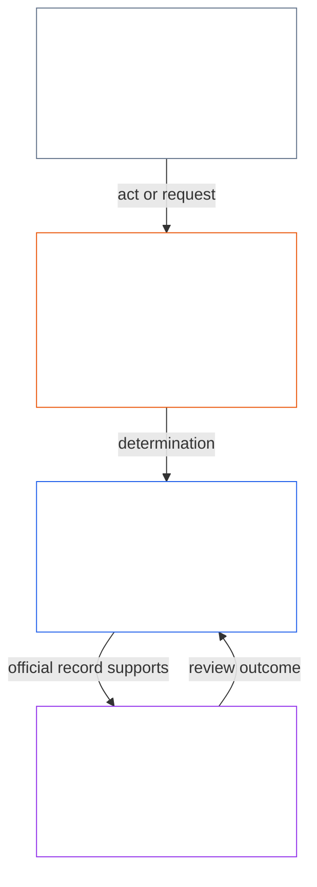
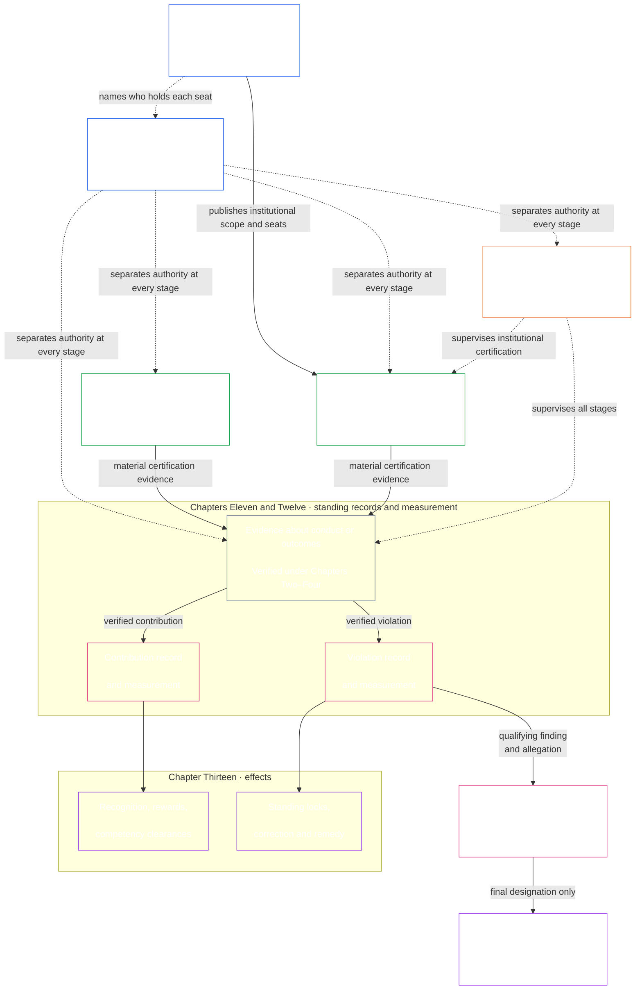

<!-- Locale: tr; language variety: Türkçe baskı — pilot (bağlayıcı değil). AI-assisted structural resynchronization draft (GPT-6 Codex); unreviewed and incomplete. English pin: SC-Corpus-2026.11.25, commit 6e0b6c663dde01b5dea731fe33d87725c7174930. core_00 SHA-256 90799cb8019b41356fa5dd90565e3f9540fc346e8c77e2c321b841654f39b274; core_01 SHA-256 aca759b394f10784ab1a2eef4e9e2ca12e369ef0ca8ee797298c6af00d2950aa. -->

<!-- Structural resynchronization draft; §§1–4 newly translated against the pinned English source, still requiring independent fidelity review. Other gaps are marked. Do not publish or synchronize. -->

# Birinci Bölüm: Anayasal Harita

<strong>Derlemdeki yeri (işletimsel değildir): dosya yapısı ve okuma kuralları</strong>

> **İşletimsel değildir** olarak işaretlenen bileşenler (derlemdeki yer, okur rehberi, okur haritaları) yalnızca yönlendirme amaçlıdır. Kendi dosyalarında veya başka herhangi bir dosyada bağlayıcı bir yükümlülük eklemez, kaldırmaz ya da daraltmazlar.
>
> Bu dosya **Algılayan Anayasası'nın bir parçasıdır** ve numaralı diğer `core_*` dosyaları ile subcore birlikte tek bir metin olarak okunduğunda **bağlayıcıdır**. Bu dosya **Birinci Bölümü**, *Anayasal Harita'yı* içerir: amacı (§1), neden var olduğu (§2), dosyalarının nasıl bir araya geldiği (§3), sonraki bölümlerin dayanakları (§4), temel yönetişim süreçleri (§5) ve anayasal sorumlu sicili (§6–§11).
>
> **Önceki:** [core_00.000_preamble.md](core_00.000_preamble.md) (Önsöz)
> **Sonraki:** [core_02.000_values_principles.md](core_02.000_values_principles.md)

<strong>İz</strong>

- Önceki: [Önsöz](core_00.000_preamble.md) (*Model, İki Anayasal Amaç, Anayasal Dörtlü, maddi pay ve ölçüm kategorileri*).
- Alt bölümler:
  - [§1](#1-purpose-role-and-scope);
  - [§2](#2-why-the-map-exists);
  - [§3](#3-how-the-files-fit-together);
  - [§4](#4-foundations-for-the-chapters-that-follow);
  - [§5](#5-key-governance-processes);
  - [§6](#6-principles-definitions-and-rights);
  - [§7](#7-system-and-institutional-charters-functional-independence-and-separation-of-duties);
  - [§8](#8-key-practical-process-pipelines);
  - [§9](#9-process-ownership-and-outputs);
  - [§10](#10-governance-change-and-incorporation);
  - [§11](#11-adopted-implementation-corpus).
- Şunlarla birlikte okuyun: [Yetki Hiyerarşisi ve İç Düzen](subcore_03.080_band_integrative.md#authority-stack-and-internal-hierarchy) (*sorumlu sicilinin uygulanması*); [README.md](README.md) (*okuma sırası*).

 

### 1. Amaç, Rol ve Kapsam

*Yalın dille: Bu bölüm Anayasa’nın geri kalanı için bir rehberdir. Parçaların nasıl birleştiğini, her konudan hangi bölümün sorumlu olduğunu ve başlıca süreçlerin nasıl işlediğini gösterir; böylece okur sorusunu yanıtlayan kuralı bulabilir.*

**Amaç:** Birinci Bölüm genel görünümü ve sorumluluk rehberini sunar. Yetkilendirilmiş yönetişimi sınayan süreçleri adlandırır, hangi esas alanın hangi bölüme ait olduğunu belirtir ve anayasal metnin üç katmanını açıklar.

**Rol:** Bu bölüm yönlendirme ve sorumluluk belirleme işlevi görür. Diğer bölümlerin ve [Yetki Hiyerarşisi ve İç Düzenin](subcore_03.080_band_integrative.md#authority-stack-and-internal-hierarchy) uyguladığı sorumlu sicili dışında kendi başına bir yükümlülük getirmez.

**Bölümün kapsamı:**

- haritanın neden var olduğu (**§2**);
- dosyaların nasıl birleştiği (**§3**) ve sonraki bölümlerin dayanakları (**§4**);
- temel yönetişim süreçleri (**§5**);
- anayasal sorumlu sicili: ilkeler, tanımlar ve haklar (**§6**); sistem ve kurum şartları, işlevsel bağımsızlık ve görev ayrılığı (**§7**); süreç zincirleri (**§8**); süreç sorumluluğu ve çıktılar (**§9**); yönetişim, değişiklik ve dahil etme (**§10**); ve
- kabul edilmiş uygulama külliyatı ve alt-külliyat (**§11**).

### 2. Harita Neden Var

*Yalın dille: Bu kadar büyük bir metin, parçaların nasıl birleştiğini ve her konudan kimin sorumlu olduğunu gösteren bir rehbere ihtiyaç duyar. Bu bölüm, okurun sorusunu yanıtlayan kuralı bulmasına yardım eder.*

Anayasa görevlerini çok sayıda bölüm, bir alt-külliyat ve kabul edilmiş dört külliyat arasında dağıtır. Kendisine ne borçlu olunduğunu arayan bir algılayan ya da bir yükümlülük arayan kabul eden yolunu kaybedebilir. Bu bölüm genel görünümü ve sorumluluk rehberini verir: her parçanın işlevini, her konunun hangi bölüme ait olduğunu, süreç zincirlerinin nasıl yürüdüğünü ve metin katmanlarının ilişkisini gösterir. Sorumlu sicili dışında kendi başına kural koymaz.

**Dayanakları:**

- Önsöz:
  - [Anayasal Dörtlü](core_00.000_preamble.md#constitutional-tetrad): bu bölümün uygulamaya taşıdığı işlevler:
    - [Katılım](subcore_03.060_apex_participation_leg.md#participation): algılayan, sorusunu yanıtlayan kuralı bulabilir;
    - [Hesap verebilirlik](subcore_03.040_apex_accountability_leg.md#accountability): her konunun yanıt veren bir sorumlu bölümü vardır;
    - [Gözetim](subcore_03.055_apex_oversight_leg.md#oversight): okur parçaların ilişkisini görüp boşluk veya çakışmayı fark edebilir;
    - [Zamanındalık](subcore_03.065_apex_timeliness_leg.md#timeliness): okur doğru kurala gecikmeden ulaşır;
  - [İki Anayasal Amaç](core_00.000_preamble.md#two-constitutional-aims): bu bölümün hizmet ettiği iki amaç:
    - [Gelişim](core_00.000_preamble.md#flourishing): algılayanlar metinde yollarını bulabilirse Anayasa işlevini yerine getirir;
    - [Süreklilik](core_00.000_preamble.md#continuity): açık bir harita, metin büyüyüp değişirken bütünlüğünü korur;
- İkinci Bölüm ilkeleri:
  - [§5.2 Açık Dilde Erişilebilirlik (Katılım ve Sorumlu Yönetim Görevi)](core_02.000_values_principles.md#52-plain-language-accessibility-participation-and-stewardship-duty);
  - [§5.2.4 Karmaşıklığın Engelleme Olarak Kullanılmasına Karşı Disiplin](core_02.000_values_principles.md#524-complexity-as-defeat-discipline);
  - [§15.4 Anayasal Anlam Çatışmalarının Çözümü](core_02.030_constitutional_interpretation.md#154-constitutional-meaning-conflict-resolution);
- Dördüncü Bölüm maddeleri:
  - [Madde XXIV-A](core_04.030_rights_part_d.md#article-xxiv-a-proportional-comprehensibility-right) (*Orantılı Anlaşılabilirlik Hakkı*);
  - [Madde XXIV-B](core_04.030_rights_part_d.md#article-xxiv-b-complexity-audit-and-modularity-requirements) (*Karmaşıklık Denetimi ve Modülerlik Gereklilikleri*).

### 3. Dosyalar Nasıl Birleşir

Anayasa dosyaları şu şekilde bir araya gelir:

- **Çekirdek (`core_*`):** Numaralı dosyalar, tek bir metin olarak birlikte okunacak Anayasa bölümlerini içerir. Güvenceleri ve anayasal yapıyı bildirir.
- **Alt-külliyat (`subcore_*`):** Bölümlerin arkasındaki kuralların ve usullerin tamamını verir. Her dosya bir bölüme aittir, o bölümle aynı kuvvettedir ve ayrıca dahil edilmeyi gerektirmeden her kabul edeni bağlar. Alt-külliyat kendi bölümünü daraltamaz.
- **Uygulama (`corpus_*`):** Dört dosya, Anayasa’nın uygulanmasına ilişkin operasyonel ayrıntıları verir. Geçerli dahil etmenin kapsamı içinde bağlayıcıdır ve Anayasa’yı daraltmadan uygular. [§11](#11-adopted-implementation-corpus) bu dört dosyayı belirtir.

Tanımlı [Külliyat](subcore_03.080_band_integrative.md#corpus), bağlayıcı anayasal kaynakların daha geniş, sürümlenmiş kümesidir: çekirdeği, alt-külliyatı, kabul edilmiş uygulama metnini ve geçiş sırasında geçerli uyumluluk sarmalayıcılarını kapsar. Taslaklar, notlar ve gezinme rehberleri sırf projede yer aldıkları için bağlayıcı olmaz.

### 4. Sonraki Bölümlerin Dayanakları

*Yalın dille: İkinci ila Dördüncü Bölümler değerlerden, sözlükten (tanımların nasıl kurulduğunu, korunduğunu ve kanıtlandığını açıklayan alt-külliyat kurallarıyla birlikte) ve Hak Tabanı’ndan sorumludur; sonraki bölümler bu alanları sessizce başka yere taşıyamaz.*

**İkinci ila Dördüncü Bölümler**, sonraki her şeyin uyması gereken değerleri, söz varlığını, doğrulama düzeneklerini ve Hak Tabanı’nı sağlar. Bunlara şunlar dahildir:

- [Beşinci Bölümün Sistem Şartı veya Kurum Şartı gerekliliği, Altıncı Bölümün görev ayrılığı gerekliliği ve Yedinci Bölümün Bağımsız Organları](#7-system-and-institutional-charters-functional-independence-and-separation-of-duties);
- §8’deki [Temel Uygulamalı Süreç Zincirleri](#8-key-practical-process-pipelines);
- §9’daki [süreç sorumluluğu ve çıktıları](#9-process-ownership-and-outputs);
- §10’daki yönetişim ve değişiklik yolu bölümleri; ve
- §11’deki [Kabul Edilmiş Uygulama Külliyatı](#11-adopted-implementation-corpus).

#### 5 Temel yönetişim süreçleri

*Yalın dille: metin istediğinde, maddi meseleler belgelendirme, yardım ve zararın yazılı kayıtları, düzeltme ve çare ve saatli forum incelemesinden geçer — olağan uyuşmazlıklar önce yayımlanmış itiraz yolunu kullanır; bu yollar yetkilendirilmiş yönetişimi dener; onu tek başlarına yaratmaz.*

Altıncı Bölüm, [Dokuzuncu Bölüm](../../core_09.000_system_alignment_certification_evaluation.md#chapter-nine-system-alignment-certification), içerilmiş belgeler ya da diğer anayasal hükümler açıkça istediğinde, maddi anayasal meseleleri aşağıdaki yollardan birine ya da birkaçına alın. [Temel Uygulamalı Süreç Zincirleri](#6-key-practical-process-pipelines) ölçümü kayıtlara, belgelendirmeye, doğrulanmış girdilere, sınıflamaya, forum gözetimine, düzeltmeye ve zamanında çareye çevirir — yetkilendirilmiş yönetişimin pratikte nasıl denendiği, itiraz edildiği ve onarıldığı. Yönetişimi tek başlarına yetkilendirmezler; yönetişimi incelenebilir, itiraz edilebilir, düzeltilebilir ve zamanında kılarlar. [Bölüm 5.1](#62-how-the-full-chain-fits-together) bu zinciri tam belirtir.

- **Sistem hizalama belgelendirmesi** ([Dokuzuncu Bölüm](../../core_09.000_system_alignment_certification_evaluation.md#chapter-nine-system-alignment-certification)) — yüksek etkili bir sisteme ölçekte güvenilmeden önce, şu anda ona bel bağlamanın anayasal olarak güvenli olup olmadığına dair kanıt toplayın ve inceleyin
- **Durum kayıtları** ([On Birinci Bölüm](core_11_standing_assessment.md#chapter-eleven-standing-records--question-1-what-happened)) — davranış veya zarar anayasal bakımdan önemliyse doğrulanmış olguları resmî katkı ya da ihlal dosyalarına kaydedin; söylenti ve itibar yeterli değildir.
- **Düzeltme ve giderim** ([On Üçüncü Bölüm §5.1 (*Giderim ve düzeltme*)](../../core_13.000_standing_integration.md#51-remedy-and-correction)) — altta yatan başarısızlığı düzeltin ve zarar görenlere orantılı kabul, onarım, eski hâle getirme veya tazmin sağlayın.
- **Forum incelemesi** ([On Beşinci Bölüm](core_11_forum.md#1-purpose-and-role--participation-architecture))
  - Zaten yetkilendirilmiş sistemlerin içindeki olağan uyuşmazlıklar önce yayımlanmış [Etkilenen Tarafların Sistem Katılımı](../../core_05.055_band_participation.md#stakeholder-status-and-weight-cluster) itiraz yolunu kullanır
  - Bu yol hâlâ itiraz ediliyorsa, eksikse, ele geçirilmişse ya da rahatlama veremiyorsa, birincil paya göre gözetimli forumlardan yönlendirin
  - Bu forumlar **Madde XXV-C** (*Zamanında çözüm ve gecikme karşıtı taban*) altında kanıtı, yasal aktarımı ve zamanında saatleri destekler

### 6. İlkeler, tanımlar ve haklar

*Yalın dille: Birinci Bölümden Altıncı Bölüme değerler, sözcüklerin nasıl kurulup denetlendiği, sözlük ve Hak Tabanı aittir; sonraki bölümler bu evlere saygı göstermelidir, onları sessizce taşımamalıdır.*

**4. ile 7. bölümler** bu Anayasanın **olumlu sahip sicilidir**: her blok, bölümünün (ya da yoldaş corpusunun) sahiplendiği maddi alanı ve ne ürettiğini adlandırır. Bağlayıcı tek satırlık sahip iddiaları her numaralı bölüm açılışında da görünür. Diğer katmanlar bir sahibe işaret edebilir — onu sessizce yeniden yazmamalı ya da yerini değiştirmemelidir; bu yer-değiştirmeme disiplini [Yetki yığını ve iç hiyerarşi](core_05_band_integrative.md#authority-stack) altında yaşar.

**Birinci Bölümden Altıncı Bölüme** sonraki her şeyin saygı göstermesi gereken değerleri, sözlüğü, doğrulama makinesini ve Hak Tabanını sağlar — 5. bölümdeki [Temel Uygulamalı Süreç Zincirleri](#6-key-practical-process-pipelines), 6. bölümdeki yönetişim ve değişiklik-yolu bölümleri ve 7. bölümdeki [yoldaş uygulama corpusu](#7-companion-implementation-corpus) dahil.

Her özet, bölümün ne sahiplendiğini ve ne ürettiğini belirtir.

**Birinci Bölüm — Değerler, ilkeler ve sorumlu yönetim** ([A Kısmı](core_01_a_values_principles.md) · [B Kısmı](core_01_b_interaction_interpretation.md#chapter-01-part-b-interaction-and-interpretation) · [C Kısmı](core_01_c_stewardship_capacity_principles.md#chapter-01-part-c-stewardship-and-governance))

- **Sorumluluk alanı:** Anayasanın yol gösterici değerlerini ve kısıtlarını belirler; bunlara şunlar dahildir:
  - esenlik, hakkaniyet, Güvenlik, Hakikat, Güven ve sınırlandırılmış özgürlük;
  - hukuka uygun katkının tanınması ve orantılı biçimde ödüllendirilmesi;
  - ilkeler arasındaki çatışmaların çözümü; ve
  - anlayışın yaygınlaştırılması, sistemik değerlendirme ve yönetişim disiplini dâhil emanet sorumlulukları.
- **Ürettiği:** Sonraki tüm bölümlerin yorumlama temelidir. Sistemler, haklar, tanımlar veya süreç yolları okunup uygulanırken bu kurallar üst düzey amaçları işler gerekliliklere dönüştürür.

**İkinci Bölüm — Tanım yapısı** ([`core_02_definition_structure.md`](core_02_definition_structure.md))

- **Görev alanı:** Anayasal terimlerin nasıl oluşturulacağını şu yollarla tanımlar:
  - Ontolojik/Ölçüm/Değerlendirme/Uygunluk (O/M/A/C) bileşen yapısı;
  - uyum gereklilikleri; ve
  - tanımları tüm külliyatta kesin ve kullanılabilir tutan bileşen kuralları.
- **Ürettiği:** Sonraki bölümlerin muğlak etiketlere, gizli varsayımlara veya birbiriyle bağdaşmayan terim biçimlerine düşmemesi için tanımlara ortak bir dilbilgisi sağlar.

**Üçüncü Bölüm — Tanım bütünlüğü** ([`core_02_definition_structure.md`](core_02_definition_structure.md))

- **Görev alanı:** Şunlara karşı koruma sağlar:
  - kaçınma ve kapsam kaydırma;
  - yeniden tanımlama oyunları; ve
  - tanımları kâğıt üzerinde içi boşaltıp uygulamada etkisizleştiren uyumsuzluk hileleri.
- **Ürettiği:** Kaçınmayı önleyen disiplin ve uyumsuzluğa ilişkin yönlendirme üstverisi; kaçınma kanıtlandığında statü ve kötü davranış incelemesine sevk yolları da buna dahildir.

**Dördüncü Bölüm — Yük, izlenebilirlik ve doğrulama** ([`core_02_definition_structure.md`](core_02_definition_structure.md))

- **Görev alanı:**
  - uyum iddiasında bulunan kişiye ispat yükü verir; ve
  - [**maddi menfaatin önemine**](#material-stake) uygun, izlenebilir kanıt, gözlemlenebilirlik ve doğrulama ister; bunlara uygulamada itiraz edilebilmelidir.
- **Ürettiği:** [On Birinci Bölüm](core_11_standing_assessment.md#chapter-eleven-standing-records--question-1-what-happened) için **doğrulanmış girdileri**, [Dokuzuncu Bölüm](core_09.000_system_alignment_certification_evaluation.md#chapter-nine-system-alignment-certification) için sistem uyumu kanıtını sağlayan doğrulama hattı. Durum ölçümünün kendisinin yerini almaz.
**Beşinci Bölüm — Temel tanımlar** ([`core_05__definitions_home.md`](core_05__definitions_home.md#chapter-five-foundational-definitions))

- **Görev alanı:** Şunları sağlar:
  - kanonik tanım yığını: Gözetim, Katılım, Hesap Verebilirlik, Süreklilik ve Bütünleştirici katmanları;
  - [Yetki yığını ve iç hiyerarşi](core_05_band_integrative.md#authority-stack-and-internal-hierarchy);
  - [Külliyat](core_05_band_integrative.md#corpus); ve
  - ilgili sınır kuralları.
- **Ürettiği:** Yorumlama, denetim ve hükme bağlama için kesin anayasal terimler. Bu, **tanım yığınıdır**; Haklar Tabanı değildir. Bağlayıcı Haklar Tabanı Altıncı Bölüm’de yer alır. Anayasanın tümü için sahiplik alanlarına yönlendirme bu Önsöz kayıt bölümündedir (4–9. bölümler).

**Altıncı Bölüm — Temel haklar** ([A Kısmı](core_06_rights_part_a.md) · [B Kısmı](core_06_rights_part_b.md) · [C Kısmı](core_06_rights_part_c.md) · [D Kısmı](core_06_rights_part_d.md))

- **Görev alanı:** **I–XXVIII. Maddelerde** Haklar Tabanı’nı belirler; şunları kapsar:
  - yaşam için zorunlu ihtiyaçlar;
  - kaynak tahsisi ve bağımlılıkların gözetimi;
  - onur, faillik ve katılım;
  - itiraz ve giderim;
  - adalet kısıtları;
  - **XXVI-C. Madde** uyarınca zamanında işlem (*Zamanında Çözüm ve Gecikme Karşıtı Taban*); ve
  - Kabul Geçişi kuralları.
  Dört bölüm, bu korumaları gezegeni önceleyen bir okuma için düzenler.
- **Ürettiği:** Pazarlık konusu olmayan hak korumaları ve giderim yolları oluşturur. Yedinci ila On Üçüncü Bölümler, forumlar, yönetişim ve değişiklik kuralları bunlara saygı göstermeli; bunları usuller veya vekil ölçütler aracılığıyla daraltmamalı, aşmamalı ya da içini boşaltmamalıdır.

### 7. System and Institutional Charters, Functional Independence, and Separation of Duties

*Basitçe: Gerçek etkisi olan bir sistem veya kurum, ne yapabileceğini ve her koltuğun sahibini belirten bir Sistem Şartı ya da Kurum Şartı yayımlar. Maddi bakımdan bağlayıcı bir işlem ilerlemeden önce, işlemi kimin başlatacağı, kimin denetleyeceği veya yetkilendireceği, resmî kaydı kimin tutacağı ve itirazı kimin inceleyeceği ayrıştırılır. Roller ortama göre ölçeklenebilir; ancak aynı aktör ve onun kontrol hattı kendi işlemini denetleyen koltukları sessizce tutamaz.*

- **Ürettiği şey:** Kapsamı ve koltuk yerleşimini açıklayan, yayımlanmış ve sürümlenmiş bir beyan; Sekizinci Bölüm, sertifikasyon, statü kayıtları ve forumlar davranışı buna göre sınayabilir. Yedinci Bölüm [`core_07.000_charters.md`](core_07_charters.md#chapter-seven-system-and-institutional-charters) dosyasındadır.

**İşlevsel bağımsızlık ve görevlerin ayrılması** — maddi bağlayıcılığı olan bir işlem ilerlemeden önce, geçerli ölçeklendirme ve bağımsızlık kuralları uyarınca başlatma, doğrulama veya yetkilendirme, kayıt ve itiraz inceleme koltuklarını belirleyip ayırın.

**Maddi açıdan bağlayıcı her eylem için koltukları ayrı tutun** ([Sekizinci Bölüm](core_07_functional_independence_segregation_of_duties.md#2-four-seat-constitutional-requirement)): eylemi kimin başlattığını, kimin doğruladığını veya yetkilendirdiğini, resmî kaydı kimin tuttuğunu ve itirazı kimin dinlediğini belirleyin. Eylemin usulüne uygun biçimde denetlendiğini kabul etmeden önce yasaklanan görev birleşimlerini, bağımsızlık kurallarını ve yayımlanmış yedek yolu uygulayın. Sistem Şartı veya Kurum Şartı gerektiğinde ([Yedinci Bölüm](core_07_charters.md#4-the-charter-role-map-and-standing-record-custody)), Şart Rol Haritası her koltuğu kimin tuttuğunu yayımlar.

**Sekizinci Bölüm — İşlevsel bağımsızlık ve görevlerin ayrılması**

- **Sorumluluğu:** Her [Maddi Açıdan Bağlayıcı İşlemin](../../core_05.035_band_accountability.md#materially-binding-act) dört işlevi ayrı ayrı atamasını gerektiren süreçler arası koşuldur:
  - başlatma;
  - doğrulama veya yetkilendirme;
  - resmî kayıtların tutulması; ve
  - itirazların incelenmesi.

Ayrıca şunları da düzenler:

  - her [Maddi Bağlayıcılığı Olan İşlem Kaydının](../../core_05.035_band_accountability.md#materially-binding-act-record) evrensel asgari içeriğini;
  - eyleyenin [Maddi Kontrol Hattından](../../core_05.035_band_accountability.md#material-control-line) bağımsızlığı;
  - yayımlanmış görev yerleşimini ve yedekleri;
  - orantılı birleştirilmiş işletimi ve acil durum sınırlarını; ve
  - kime atfedildiği belli devirleri ve yanlış koltuğa yönlendirmeyi.
- **Ürettiği şey:** Yeniden kullanılabilir dört koltuk ve İşlem Kaydı mimarisi. Sonraki her sertifikasyon, statü kaydı, forum, yönetişim ve bütünleşik uygulama süreci, sonucu bağımsız biçimde denetlenmiş, güvenilir biçimde kayda geçirilmiş ve gerçekten itiraz edilebilir sayılmadan önce bu mimariyi uygulamalıdır.

#### 7.1 Four-seat separation map

> Bu harita dört işlevi ve bir işlem ile İşlem Kaydının tipik izini gösterir. Beşinci bir koltuk eklemez, evrensel bir sıra belirlemez ve Sekizinci Bölümün bağımsızlık, orantılı ortak barındırma, acil işlem veya itiraz yönlendirme kurallarını değiştirmez.

### 8. Temel Uygulamalı Süreç Zincirleri

*Basitçe: Dokuzuncu ila On Beşinci Bölümler, Sekizinci Bölümün görev ayrılığı şartını tek zincirde uygular: sistemleri ve kurumları sertifikalandırır, yardımı ve zararı iki ayrı hatta ölçer, gerçek etkiler ve giderim uygular, forumun kendisine karşı iddianın tek nihai mercii olmasını önler. Bu zincir anayasal görevleri günlük yaşamda işler kılar.*

[Yedinci Bölüm](core_07_charters.md#chapter-seven-system-and-institutional-charters), L Sınıfı veya üstündeki her sistem ve kurumun şart kapsamını ve koltuk haritasını yayımlar. [Sekizinci Bölüm](../../core_08.000_functional_independence_separation_of_duties.md#chapter-eight-functional-independence-and-separation-of-duties), bu zincirdeki her işlemin geçerli biçimde denetlenmesini sağlayan görev ayrılığı şartını getirir. Uygun ölçekleme ve bağımsızlık kurallarına göre başlatma, doğrulama veya yetkilendirme, resmî kayıt muhafazası ve itiraz incelemesi işlevlerinin ayrı atanıp ayrı tutulması gerekir. Dokuzuncu ila On Beşinci Bölümler bu mimariyi sırayla uygular:

Aşağıdaki her adım, bölümün ne sahiplendiğini ve ne ürettiğini belirtir. [Tam zincirin nasıl bir araya geldiği](#62-how-the-full-chain-fits-together) sonra bu sahipleri sistem denetiminden çareye tek bir yol olarak gösterir.

#### 8.1 Process map

- **Dokuzuncu Bölüm**, bağımsız doğrulamayla maddi etkili sistem veya kurumun belirtilen kapsam ve kayıt aralığında uyumlu olup olmadığını belirler. Sistem sertifikasyonunu Dokuzuncu Bölüm; kurumun sınıfı, değerlendirmesi, kaydı ve giderim sonucu dâhil kurumsal sertifikasyonu Onuncu Bölüm düzenler.
- **On Birinci Bölüm** doğrulanmış olguları alır ve ayrı Katkı ve İhlal durum kayıtlarına işler.
- **On İkinci Bölüm** her durum kaydını kendi ekseninde ölçer. Gelişmeye yönelik doğrulanmış katkı, ayrıca doğrulanmış zararı veya hesap verebilirlik başarısızlığını dengelemez, iptal etmez ya da azaltmaz; her biri ayrı kaydedilir ve kendi sonuçlarına tabidir.
- **On Üçüncü Bölüm** sınıflandırmaları orantılı durum etkilerine dönüştürür: katkı hattında yeterlilik onayları ve tanınma; ihlal hattında durum kilitleri, düzeltme ve giderim.
- **On Dördüncü Bölüm** ancak On İkinci Bölüm yüksek düzeyli bir ihlali ölçtükten sonra uygulanır. Usul güvenceleri ardından, davranışın nihai anayasa karşıtı kötü davranış tanımı (ACMD) ölçütlerini bağımsız olarak karşılayıp karşılamadığını belirler.
- **On Beşinci Bölüm**, kayıt ve etkilerin itiraz edilebilir, düzeltilebilir ve uygulanabilir olması için yönlendirme, kanıt, aktarım, forum bağımsızlığı ve zamanında çözümü gözetir; ele geçirilmiş forumun kendi davranışı hakkında tek nihai yargıç olmasını önler.
- **Kötü davranış incelemesi** ayrı soruyu yanıtlar: koşulları sağlayan bir ihlal nihai ACMD'yi de gerektiriyor mu?
- **Forum gözetimi**, resmî kayıt ve kararların zamanında incelenip düzeltilmesini sağlamak üzere yönlendirme, kanıt, aktarım, itiraz ve giderimi yönetir.

#### 8.2 Tam zincir nasıl bir araya gelir

*Yalın dille: bunu sistem denetiminden çareye bir yol olarak düşünün — forumlar uyuşmazlığı ve güzergâh adımlarını baştan sona gözetirken.*

1. **Maddi ölçüde bağlayıcı her işlemde görevleri ayırın** ([Sekizinci Bölüm](core_07_functional_independence_segregation_of_duties.md#2-four-seat-constitutional-requirement)): kimin başlattığını, kimin doğruladığını veya yetkilendirdiğini, kimin resmî kaydı tuttuğunu ve kimin itirazı dinlediğini belirleyin. İşlem usulüne uygun biçimde denetlenmiş sayılmadan önce yasaklı görev birleşimlerini, bağımsızlık kurallarını ve yayımlanmış ikame yolunu uygulayın. Sistem veya Kurum Şartı gerektiğinde ([Yedinci Bölüm](core_07_charters.md#4-the-charter-role-map-and-standing-record-custody)), Şartın Görev Haritası her görevi kimin üstlendiğini yayımlar.
2. **Etki yeterince ciddiyse sistemleri ve kurumları sertifikalandırın** — yüksek etkili bir sisteme büyük ölçekte güvenmeden önce itiraz edilebilir Sistem Sertifikasyon Kaydı alın ([Dokuzuncu Bölüm Kısım A–B](core_09.000_system_alignment_certification_evaluation.md#chapter-nine-system-alignment-certification)); Kurumu kendi sınıfı, davranışı, yönetişimi ve portföyü açısından [Onuncu Bölüm](core_10.000_institutional_alignment_certification.md#chapter-ten-institutional-alignment-certification) kapsamında değerlendirin ve sonucu Kurum Sertifikasyon Kaydına işleyin.
3. **Durumu ayrı hatlarda kaydedin ve ölçün** ([On Birinci Bölüm](core_11_standing_assessment.md#chapter-eleven-standing-records--question-1-what-happened) ve [On İkinci Bölüm](core_12_standing_measurement.md#chapter-twelve-standing-measurement--question-2-how-good-or-bad-was-it)) — yardım veya zarar anayasal bakımdan önemliyse On Birinci Bölüm resmî dosyalar açmalı ve yalnızca **doğrulanmış girdileri** kabul etmelidir (maddi olduğu durumlarda Dokuzuncu Bölümün sistem uyumu sertifikasyon kanıtı dâhil); On İkinci Bölüm doğrulananı ölçüp sınıflandırır. Söylentiler, itibar ve uyuşmazlık anlatıları yetmez.
   - **İhlalin niteliği:** doğrulanmış zarar ve hesap verebilirlik başarısızlıkları için sınırlı, itiraz edilebilir bir dosya olan **ihlal durum kaydını** açın; **ihlal niteliğini** İhlal Ekseninde sınıflandırın. Yardım ve zarar hiçbir zaman tek net puana katlanmaz; bağlantılı durum kayıtları çapraz başvuru yapar ama ayrı kalır.
4. **Her hatta durum etkilerini uygulayın** ([On Üçüncü Bölüm](../../core_13.000_standing_integration.md#chapter-thirteen-standing-effects-and-integration)) — doğrulanmış katkı yeterlilik onayı sağlayabilir ve orantılı tanınma ile maddi ödülleri desteklemelidir; doğrulanmış ihlal durum kilitleri, düzeltme ve [zarar görenler için giderimi](../../core_13.000_standing_integration.md#51-remedy-and-correction) tetikleyebilir.
5. **Anayasa karşıtı tanım incelemesi yürütün** ([On Dördüncü Bölüm](../../core_14.000_misconduct_designation.md#chapter-fourteen-anti-constitutional-misconduct)) — en yüksek etkili ihlal bulgusu anayasa karşıtı ölçütleri de karşılayabilecekse, ilgili ACMD'nin uygulanıp uygulanmayacağına On Dördüncü Bölüm karar vermelidir. ACMD, On İkinci Bölümün zararın ciddiyetine ilişkin bulgusunu değiştirmez. Nihai ACMD Anayasa Karşıtı Güven Kilidini tetikleyene kadar olağan On Üçüncü Bölüm etkileri paralel sürer.
6. **Uyuşmazlıkları yönlendirin ve giderimi zamanında tutun** ([On Beşinci Bölüm](core_11_forum.md#1-purpose-and-role--participation-architecture)) — forumlar davaların akışını, hangi hattın işleyeceğini ve **Madde XXVI-C** (*Zamanında Çözüm ve Gecikme Karşıtı Taban*) sürelerinin karşılanıp karşılanmadığını gözeterek giderimin gecikmede kaybolmasını önlemelidir. Olağan uyuşmazlıklar [Uyuşmazlık sıralamasını](core_11_forum.md#dispute-sequencing) izler. Forumlar ayrıca uyuşmazlıkları sistem sınıflandırma alfabesini yansıtan beş [maddilik düzeyine](core_11_forum.md#6-timely-resolution-materiality-tiers-and-anti-delay-discipline) (A/B/C/L/P) ayırmalıdır: yaşamı tehdit eden aciliyetten özel/sınırlı konulara. Nihai On Dördüncü Bölüm tanımı başlıca menfaatsa bütünlük ailesinin varsayılan yönlendirmesi uygulanır.

[README güzergâh-zinciri haritası](../../README.md#standing-pipeline-and-forums) yukarıdaki zincir için doğrudan gezinme sağlar; Yedinci Bölümün güzergâh ölçümüne olası doğrulanmış girdileri dahil.

### 9. Süreç sahipliği ve çıktılar

Yedinci Bölüm — Sistem ve Kurum Şartları ([Chapter Seven](../../core_07.000_charters.md#chapter-seven-system-and-institutional-charters))

- **Ürettiği şey:** Kapsamı ve koltuk yerleşimini açıklayan, yayımlanmış ve sürümlenmiş bir beyan; Sekizinci Bölüm, sertifikasyon, statü kayıtları ve forumlar davranışı buna göre sınayabilir. Yedinci Bölüm [`core_07.000_charters.md`](core_07_charters.md#chapter-seven-system-and-institutional-charters) dosyasındadır.

### 10. Yönetişim, değişiklik ve içerme

*Basitçe: On Altıncı ila Yirminci Bölümler bu Anayasayı tamamlar: kimin yönetebileceği, korumaları geriletmeden metnin nasıl değiştirilebileceği, diğer hukukla ilişkisi ve kabul edilen uygulama dosyalarının kaynağa bağlı kalması.*

**Yirminci Bölümden Yirminci Bölüme** belgeyi kapatır — ve yönetişim, değişiklik geçerliliği ve içerme için [olumlu sahip sicilini](#4-principles-definitions-and-rights) tamamlar: kim meşru yönetebilir, Anayasa yasal olarak nasıl değişebilir ve benimsenmiş uygulama metninin sessiz sapma olmadan anayasal kaynağa nasıl bağlı kaldığı.

Her özet, bölümün ne sahiplendiğini ve ne ürettiğini belirtir.

**Yirminci Bölüm — Anayasal sözleşme, meşruiyet ve emanet sorumluluğu** ([core_16.000_governance.md](../../core_16.000_governance.md#chapter-sixteen-constitutional-contract-legitimacy-authorization-and-stewardship))

- **Ne sahiplenir:** [**Anayasal Sözleşme Katmanı**](core_05_band_integrative.md#constitutional-contract-layer)nı sahiplenir — kim yönetebilir, hangi meşruiyet düzeneğiyle, hangi kapsam ve kalıcı koşullar altında ve hangi sorumlu yönetim karakterinin sürdürülmesi gerektiği.
- **Ne üretir:** Zaten yetkilendirilmiş sistemlerdeki [**Etkilenen Tarafların Sistem Katılımı**](../../core_05.055_band_participation.md#stakeholder-status-and-weight-cluster)ndan ayrı yetkilendirme ve meşruiyet gerekleri — yönetme yetkisinin kendisinin kuralları, yalnızca onun içindeki katılım değil.

**On Yedinci Bölüm — Gerilememe** ([core_17.000_non_regression.md](../../core_17.000_non_regression.md#chapter-seventeen-non-regression-and-substantive-amendment-validity))

- **Ne sahiplenir:** Gerileyici değişikliğe karşı maddi tabanı koyar — değişiklikler ve dolambaçlar çekirdek korumaları geri alamaz, Dörtlüyü maddi payın altına boşaltamaz ya da gerilemeyi teknik temizlik diye gizleyemez.
- **Ne üretir:** Önerilen herhangi bir değişiklik üzerindeki **ilk anayasal korkuluk** — gerilememe kuralı: değişiklik pratikte çekirdek korumaları zayıflatacaksa, usul doğru görünse bile geçerli değildir. Şüpheli dolambaçlar ya da gizlenmiş geri almalar sessizce sızmak yerine durdurulur ya da uygun inceleme yollarına gönderilir.

**On Sekizinci Bölüm — Üstünlük ve dış emirler** ([core_18.000_expansion_supremacy.md](../../core_18.000_expansion_supremacy.md#chapter-eighteen-expansion-supremacy-and-external-legal-orders))

- **Sorumluluğu:** Bu Anayasanın diğer normlarla ilişkisi: hukuken mümkün olduğunda korumayı genişletmek, geçerli kaynağı içinde üstünlük, kabul ve yönetişim katmanı kapsamı, kendi gücüyle uygulanan dış hukuku hükümsüz kılmamak ve sessiz tâbi olma ya da ele geçirilme olmadan dış hukuk düzenleriyle disiplinli etkileşim.
- **Ne üretir:** Yayımlama ya da kullanımın uygulanabilir dış hukuku yürürlükten kaldırma sayılmaması ve benimseyenlerin içerilmiş usulü, daha zayıf dış normları ya da elverişlilik ölçütlerini geçerli benimseme kapsamında Algılayanlar Anayasası anlamını geçersiz kılıyor gibi işlememesi için hiyerarşi ve çatışma-düzeni kuralları.
**On Dokuzuncu Bölüm — Değişiklik, onaylama ve kabul** ([core_19.000_amendment_ratification.md](../../core_19.000_amendment_ratification.md#chapter-nineteen-amendment-ratification-and-procedural-validity))

- **Sorumluluğu:** Bu Anayasanın hukuken nasıl değiştirileceği — değişiklik usulü, onaylama ve kabul — ve On Yedinci Bölümün esas güvencesini izleyen **usul güvenceleri**: değişiklikler açıkça yayımlanmalı, yetkili muhafazaya kadar izlenebilmeli ve gerektiğinde bağımsız incelemeyle anlamlı biçimde itiraz edilebilir kalmalıdır.
- **Ne üretir:** Tam bir yasal değişiklik yolu — yalnızca **gerilememe korkuluğunu** ve **usul korkuluklarını** geçen değişiklikler ve benimsemeler geçerli anayasal güncelleme sayılır.
**Yirminci Bölüm — Dâhil etme köprüsü** ([core_20.000_incorporation.md](../../core_20.000_incorporation.md))

- **Ne sahiplenir:** Hangi uygulama dosyalarının benimsendiğinde bağlayıcı içerilmiş metin sayıldığını belirler; baskıları sabitler; emanet zincirlerini sürdürür; ve anayasal kaynak ile işlemsel ayrıntı arasında sessiz sapmayı yasaklar.
- **Ne üretir:** Tek bir içerme sınırı — belirlenmiş uygulama metni benimsendiğinde bağlar; yoldaş corpuslar Anayasayı onu daraltan ikinci bir kaynak olmadan uygular. [Bölüm 7](#9-adopted-implementation-corpus) bu corpusları üst düzeyde özetler.

### 11. Kabul Edilmiş Uygulama Derlemi

*Yalın dille: dört yoldaş corpus (ortak yapı, sistemler, kurumlar ve forum işlemleri) bölümlerin zaten istediğini nasıl yerine getireceğini ayrıntılandırır; geçerli biçimde benimsendiğinde bağlar ve bu ödevleri küçültemez.*

Numaralı `core_*` bölümlerinin ötesinde, dört yoldaş corpus benimsenmiş **uygulama metni** için [olumlu sahip sicilini](#4-principles-definitions-and-rights) tamamlar — anayasal ödevleri pratikte işletilebilir kılan işlemsel ayrıntı:

- **[corpus_joint_structure](../../corpus_joint_structure.md)** — dosyalar arası yönlendirme, paylaşılan işlemsel terimler ve sistemler, kurumlar ve forumların aynı olgular üzerinde birlikte okunması gerektiğinde ortak yapı.
- **[corpus_systems](../../corpus_systems.md)** — sistem sınıflaması, tasarım ve konuşlandırma protokolleri, bilgi işleme ve kritik sorumlu yönetim mekaniği.
- **[corpus_institutions](../../corpus_institutions.md)** — kurumsal kuruluş, yönetişim, gözetim, orantılılık ve fesih disiplini.
- **[corpus_forum](../../corpus_forum.md)** — forum işlemleri: panel kuruluşu, çekilme, inceleme şeritleri, yönlendirme ayrıntısı ve adli destek.

Bir benimseyen bunları [Yirminci Bölüm](../../core_20.000_incorporation.md) uyarınca geçerli biçimde dâhil ettiğinde, dosyalar kabul kapsamındaki uygulama metni olarak bağlayıcı olur. Sentient Constitution'ın anlamı üstün kalır — bunlar yukarıdaki bölümleri **uygular, daraltmaz**. Sürüm sabitleme, muhafaza zincirleri ve sessiz sapma yasağı, kabul edilen metnin gerçekten onaylanan içeriğe kadar izlenmesini sağlar. Yetkili liste ve sınır kuralları [Beşinci Bölüm — Külliyat](../../core_05.045_band_integrative.md#corpus) içindedir.

İlkeler, tanımlar, haklar, süreç zincirleri, yönetişim, değişiklik kuralları ve içerilmiş uygulama, Anayasanın koruyucu amacını korumak için birlikte okunmalıdır.
---

**Önceki dosya:** [README.md](README.md)

**Sonraki dosya (bu dil):** [core_01_a_values_principles.md](core_01_a_values_principles.md)

**Bağlayıcı asıl:** [core_00_preamble.md](core_00_preamble.md)
