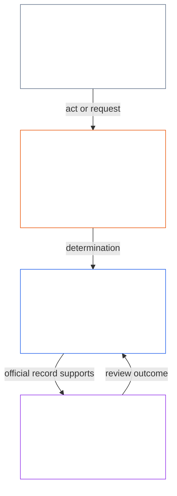
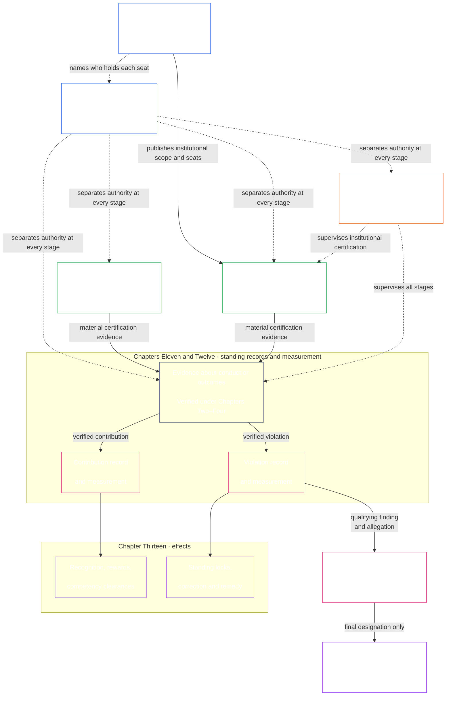

<!-- Locale: ur; language variety: اردو ایڈیشن — پائلٹ (پابند نہیں). AI-assisted structural resynchronization draft (GPT-6 Codex); unreviewed and incomplete. English pin: SC-Corpus-2026.11.25, commit 6e0b6c663dde01b5dea731fe33d87725c7174930. core_00 SHA-256 90799cb8019b41356fa5dd90565e3f9540fc346e8c77e2c321b841654f39b274; core_01 SHA-256 aca759b394f10784ab1a2eef4e9e2ca12e369ef0ca8ee797298c6af00d2950aa. -->

<!-- Structural resynchronization draft; §§1–4 newly translated against the pinned English source, still requiring independent fidelity review. Other gaps are marked. Do not publish or synchronize. -->

# باب اوّل: آئینی نقشہ

<strong>مجموعے میں مقام (غیر عملی): فائل کی ساخت اور مطالعے کے قواعد</strong>

> **غیر عملی** نشان زدہ ویجٹس (مجموعے میں مقام، قاری کی رہنمائی، قاری کے نقشے) صرف رہنمائی کے لیے ہیں۔ یہ اپنی فائل یا کسی دوسری فائل میں کسی پابند فرض کو نہ بڑھاتے، نہ گھٹاتے اور نہ محدود کرتے ہیں۔
>
> یہ فائل **آئینِ شعوری وجود کا حصہ** ہے اور دوسری نمبر شدہ `core_*` فائلوں اور ذیلی آئین کے ساتھ ایک متن کے طور پر مل کر پڑھی جائے تو **پابند** ہے۔ اس میں **باب اوّل**، یعنی *آئینی نقشہ* شامل ہے: اس کا مقصد (§1)، یہ کیوں موجود ہے (§2)، فائلیں کیسے جڑتی ہیں (§3)، آئندہ ابواب کی بنیادیں (§4)، حکمرانی کے بنیادی عمل (§5)، اور آئینی ذمہ داروں کا اندراج (§6 تا §11)۔
>
> **پچھلا:** [core_00.000_preamble.md](core_00.000_preamble.md) (دیباچہ)
> **اگلا:** [core_02.000_values_principles.md](core_02.000_values_principles.md)

<strong>سراغ</strong>

- پچھلا: [دیباچہ](core_00.000_preamble.md) (*ماڈل، دو آئینی مقاصد، آئینی چوکڑی، مادی داؤ اور پیمائش کی اقسام*).
- ذیلی دفعات:
  - [§1](#1-purpose-role-and-scope);
  - [§2](#2-why-the-map-exists);
  - [§3](#3-how-the-files-fit-together);
  - [§4](#4-foundations-for-the-chapters-that-follow);
  - [§5](#5-key-governance-processes);
  - [§6](#6-principles-definitions-and-rights);
  - [§7](#7-system-and-institutional-charters-functional-independence-and-separation-of-duties);
  - [§8](#8-key-practical-process-pipelines);
  - [§9](#9-process-ownership-and-outputs);
  - [§10](#10-governance-change-and-incorporation);
  - [§11](#11-adopted-implementation-corpus).
- اس کے ساتھ پڑھیں: [اختیاراتی ترتیب اور داخلی درجہ بندی](subcore_03.080_band_integrative.md#authority-stack-and-internal-hierarchy) (*ذمہ داروں کا اندراج کیسے لاگو ہوتا ہے*); [README.md](README.md) (*مطالعے کی ترتیب*).

 

### ۱۔ مقصد، کردار اور دائرۂ کار

*سادہ الفاظ میں: یہ باب آئین کے باقی حصے کے لیے رہنما ہے۔ یہ دکھاتا ہے کہ حصے کیسے جڑتے ہیں، ہر موضوع کا ذمہ دار کون سا باب ہے، اور بنیادی عمل کیسے چلتے ہیں تاکہ قاری اپنے سوال کا جواب دینے والا قاعدہ ڈھونڈ سکے۔*

**مقصد:** باب ایک مجموعی جائزہ اور ذمہ داریوں کی رہنمائی دیتا ہے۔ یہ ان اعمال کی نشان دہی کرتا ہے جو مجاز حکمرانی کو جانچتے ہیں، بتاتا ہے کہ کون سا باب کس موضوع کا ذمہ دار ہے، اور آئینی متن کی تین سطحیں بیان کرتا ہے۔

**کردار:** یہ باب رہنمائی اور ذمہ داری متعین کرتا ہے۔ ذمہ داروں کے اندراج کے سوا، جسے دوسرے ابواب اور [اختیاراتی ترتیب اور داخلی درجہ بندی](subcore_03.080_band_integrative.md#authority-stack-and-internal-hierarchy) نافذ کرتے ہیں، یہ اپنی طرف سے کوئی فرض عائد نہیں کرتا۔

**باب کا دائرۂ کار:**

- نقشہ کیوں موجود ہے (**دفعہ ۲**);
- فائلیں کیسے جڑتی ہیں (**دفعہ ۳**) اور آئندہ ابواب کی بنیادیں (**دفعہ ۴**);
- بنیادی حکمرانی کے عمل (**دفعہ ۵**);
- آئینی ذمہ داروں کا اندراج: اصول، تعریفیں اور حقوق (**دفعہ ۶**); نظام اور ادارہ جاتی منشور، فعلی خودمختاری اور فرائض کی علیحدگی (**دفعہ ۷**); عملی سلسلے (**دفعہ ۸**); عمل کی ذمہ داری اور نتائج (**دفعہ ۹**); حکمرانی، تبدیلی اور شمولیت (**دفعہ ۱۰**); اور
- منظور شدہ نفاذی متن اور ذیلی متن (**دفعہ ۱۱**).

### ۲۔ نقشہ کیوں موجود ہے

*سادہ الفاظ میں: اتنے بڑے متن کو ایسے رہنما کی ضرورت ہے جو حصوں کے باہمی تعلق اور ہر موضوع کے ذمہ دار کو دکھائے۔ یہ باب اس لیے ہے کہ قاری اپنے سوال کا جواب دینے والا قاعدہ تلاش کر سکے۔*

آئین اپنا کام متعدد ابواب، ایک ذیلی متن اور چار منظور شدہ مجموعوں میں تقسیم کرتا ہے۔ کوئی شعوری وجود یہ جاننے کی کوشش کرے کہ اس کا حق کیا ہے، یا کوئی اختیار کنندہ کسی فرض کو تلاش کرے، تو راستہ بھول سکتا ہے۔ یہ باب مجموعی جائزہ اور ذمہ داریوں کی رہنمائی ہے: ہر حصے کا کام کیا ہے، ہر موضوع کس باب کی ذمہ داری ہے، عملی سلسلے کیسے چلتے ہیں اور متن کی سطحیں آپس میں کیسے متعلق ہیں۔ ذمہ داروں کے اندراج کے علاوہ یہ اپنا کوئی قاعدہ نہیں بناتا۔

**بنیاد:**

- دیباچہ:
  - [آئینی چوکڑی](core_00.000_preamble.md#constitutional-tetrad): وہ افعال جنہیں یہ باب عملی صورت دیتا ہے:
    - [شرکت](subcore_03.060_apex_participation_leg.md#participation): شعوری وجود اپنے سوال کا جواب دینے والا قاعدہ تلاش کر سکتا ہے؛
    - [جوابدہی](subcore_03.040_apex_accountability_leg.md#accountability): ہر موضوع کا ایک نامزد ذمہ دار باب ہے جو اس کا جواب دیتا ہے؛
    - [نگرانی](subcore_03.055_apex_oversight_leg.md#oversight): قاری حصوں کا تعلق دیکھ سکتا اور خلا یا تداخل کی نشان دہی کر سکتا ہے؛
    - [بروقت کارروائی](subcore_03.065_apex_timeliness_leg.md#timeliness): قاری درست قاعدے تک بلا تاخیر پہنچتا ہے؛
  - [دو آئینی مقاصد](core_00.000_preamble.md#two-constitutional-aims): دونوں مقاصد جن کی یہ باب خدمت کرتا ہے:
    - [شگفتگی](core_00.000_preamble.md#flourishing): آئین شعوری وجودوں کی اسی وقت خدمت کرتا ہے جب وہ اس میں اپنا راستہ پا سکیں؛
    - [استمرار](core_00.000_preamble.md#continuity): واضح نقشہ متن کو بڑھتے اور بدلتے ہوئے مکمل رکھتا ہے؛
- باب دو کے اصول:
  - [§5.2 سادہ زبان میں رسائی (شرکت اور ذمہ دارانہ انتظام کی ذمہ داری)](core_02.000_values_principles.md#52-plain-language-accessibility-participation-and-stewardship-duty);
  - [§5.2.4 پیچیدگی کو شکست کے طور پر استعمال کرنے کے خلاف نظم](core_02.000_values_principles.md#524-complexity-as-defeat-discipline);
  - [§15.4 آئینی معنی کے تنازع کا حل](core_02.030_constitutional_interpretation.md#154-constitutional-meaning-conflict-resolution);
- باب چار کے آرٹیکلز:
  - [آرٹیکل XXIV-A](core_04.030_rights_part_d.md#article-xxiv-a-proportional-comprehensibility-right) (*متناسب فہم پذیری کا حق*);
  - [آرٹیکل XXIV-B](core_04.030_rights_part_d.md#article-xxiv-b-complexity-audit-and-modularity-requirements) (*پیچیدگی کے جائزے اور ماڈیولر ساخت کے تقاضے*).

### ۳۔ فائلیں کیسے جڑتی ہیں

آئین کی فائلیں یوں جڑتی ہیں:

- **بنیادی متن (`core_*`):** نمبر شدہ فائلوں میں آئین کے ابواب ہیں، جنہیں ایک متن کے طور پر اکٹھا پڑھنا ہے۔ یہ ضمانتیں اور آئینی ساخت بیان کرتی ہیں۔
- **ذیلی متن (`subcore_*`):** ابواب کے پیچھے مکمل قواعد اور طریقۂ کار دیتا ہے۔ ہر فائل ایک باب سے تعلق رکھتی ہے، اسی کے برابر قوت رکھتی ہے، اور الگ سے شامل کیے بغیر ہر اختیار کنندہ پر لازم ہے۔ ذیلی متن اپنے باب کو محدود نہیں کر سکتا۔
- **نفاذ (`corpus_*`):** چار فائلیں آئین پر عمل درآمد کی عملی تفصیل دیتی ہیں۔ درست شمولیت کی حدود میں لازم ہوتی ہیں اور آئین کو محدود کیے بغیر نافذ کرتی ہیں۔ [دفعہ ۱۱](#11-adopted-implementation-corpus) چاروں فائلوں کی نشان دہی کرتی ہے۔

متعین [متن](subcore_03.080_band_integrative.md#corpus) پابند آئینی ذرائع کا وسیع تر، نسخہ بند مجموعہ ہے: اس میں بنیادی متن، ذیلی متن، منظور شدہ نفاذی متن اور انتقال کے دوران کوئی بھی درست مطابقتی لفافہ شامل ہے۔ مسودے، نوٹس اور رہنمائی محض منصوبے کا حصہ ہونے سے پابند نہیں بنتے۔

### ۴۔ آئندہ ابواب کی بنیادیں

*سادہ الفاظ میں: باب دو تا چار اقدار، لغت (تعریفیں کیسے بنائی، محفوظ اور ثابت کی جاتی ہیں، اس بارے میں ذیلی متن کے قواعد سمیت) اور حقوق کی تہہ کے ذمہ دار ہیں؛ بعد کے ابواب ان ذمہ داریوں کو خاموشی سے دوسری جگہ منتقل نہیں کر سکتے۔*

**باب دو تا چار** وہ اقدار، الفاظ، تصدیقی طریقے اور حقوق کی تہہ فراہم کرتے ہیں جن کا بعد کی ہر چیز کو احترام کرنا ہے، بشمول:

- [باب پانچ میں نظامی یا ادارہ جاتی منشور کی شرط، باب چھ میں فرائض کی علیحدگی کی شرط اور باب سات کے آزاد ادارے](#7-system-and-institutional-charters-functional-independence-and-separation-of-duties);
- دفعہ ۸ کی [کلیدی عملی عمل کی زنجیریں](#8-key-practical-process-pipelines);
- دفعہ ۹ میں [عمل کی ذمہ داری اور نتائج](#9-process-ownership-and-outputs);
- دفعہ ۱۰ میں حکمرانی اور تبدیلی کے راستوں سے متعلق ابواب؛ اور
- دفعہ ۱۱ میں [منظور شدہ نفاذی متن](#11-adopted-implementation-corpus).

#### 5 کلیدی حکمرانی عمل

*سادہ الفاظ میں: جب متن مانگے، مادی مسائل تصدیق، مدد اور نقصان کے تحریری ریکارڈ، اصلاح اور تدارک، اور وقتی حدود والی فورم جائزہ سے گزرتے ہیں — عام تنازعات پہلے شائع شدہ چیلنج راستہ استعمال کرتے ہیں؛ وہ راستے مجاز حکمرانی کی آزمائش کرتے ہیں؛ وہ اسے خود نہیں بناتے۔*

جہاں باب ششم، [باب نہم](../../core_09.000_system_alignment_certification_evaluation.md#chapter-nine-system-alignment-certification)، شامل دستاویزات، یا دیگر آئینی احکام صریحاً مانگیں، مادی آئینی مسائل کو نیچے کے ایک یا زیادہ راستوں میں لے جائیں۔ [کلیدی عملی عمل کی زنجیریں](#6-key-practical-process-pipelines) پیمائش کو ریکارڈ، تصدیق، تصدیق شدہ مواد، درجہ بندی، فورم نگرانی، اصلاح اور بروقت تدارک میں بدلتی ہیں — مجاز حکمرانی عمل میں کیسے آزمائی، چیلنج اور مرمت کی جاتی ہے۔ وہ خود حکمرانی مجاز نہیں کرتیں؛ وہ حکمرانی کو جائزے کے قابل، چیلنج کے قابل، اصلاح کے قابل اور بروقت بناتی ہیں۔ [قطعہ 5.1](#62-how-the-full-chain-fits-together) وہ زنجیر پوری بیان کرتا ہے۔

- **نظام کی ہم آہنگی کی تصدیق** ([باب نہم](../../core_09.000_system_alignment_certification_evaluation.md#chapter-nine-system-alignment-certification)) — بڑے پیمانے پر کسی اعلیٰ اثر نظام پر بھروسہ کرنے سے پہلے، یہ ثبوت اکٹھا اور جائزہ لیں کہ کیا اب اس پر آئینی طور پر محفوظ انحصار کیا جا سکتا ہے
- **قائمہ ریکارڈ** ([باب گیارہ](core_11_standing_assessment.md#chapter-eleven-standing-records--question-1-what-happened)) — جب طرزِ عمل یا نقصان آئینی اہمیت رکھتا ہو تو تصدیق شدہ حقائق رسمی شراکت یا خلاف ورزی کی فائلوں میں درج کریں؛ افواہ اور شہرت کافی نہیں۔
- **اصلاح اور تلافی** ([باب تیرہ §5.1 (*تلافی اور اصلاح*)](../../core_13.000_standing_integration.md#51-remedy-and-correction)) — بنیادی ناکامی درست کریں اور متاثرہ افراد کو متناسب اعتراف، مرمت، بحالی یا معاوضہ دیں۔
- **فورم کا جائزہ** ([باب پندرہ](core_11_forum.md#1-purpose-and-role--participation-architecture))
  - پہلے سے مجاز نظاموں کے اندر عام تنازعات پہلے [متاثر فریقوں کی نظامی شرکت](../../core_05.055_band_participation.md#stakeholder-status-and-weight-cluster) کا شائع شدہ چیلنج راستہ استعمال کرتے ہیں
  - اگر وہ راستہ اب بھی متنازع، غائب، قبضے میں، یا راحت نہیں دے سکتا، بنیادی داؤ کے مطابق نگرانی شدہ فورموں سے راستہ طے کریں
  - وہ فورم **دفعہ XXV-C** (*بروقت حل اور تاخیر مخالف تہہ*) کے تحت ثبوت، جائز منتقلی اور بروقت حدود سہارا دیتے ہیں

### 6. اصول، تعریفیں اور حقوق

*سادہ الفاظ میں: باب یکم تا ششم اقدار، الفاظ کے بننے اور جانچنے کے ڈھنگ، لغت اور حقوق کی تہہ کے مالک ہیں؛ بعد کے ابواب کو ان گھروں کا احترام کرنا ہے، انہیں خاموشی سے ہٹانا نہیں۔*

قطعے **4 تا 7** اس آئین کا **مثبت مالک رجسٹر** ہیں: ہر بلاک اس اصل دائرے کا نام لیتا ہے جس کا مالک اس کا باب (یا ساتھی کارپس) ہے اور وہ کیا دیتا ہے۔ پابند ایک سطری مالک دعوے ہر نمبر والے باب کے آغاز پر بھی آتے ہیں۔ دیگر تہیں کسی مالک کی طرف اشارہ کر سکتی ہیں — انہیں اسے خاموشی سے دوبارہ نہیں لکھنا یا منتقل نہیں کرنا چاہیے؛ وہ عدمِ منتقلی ضبط [اختیار کا ڈھیر اور داخلی مراتب](core_05_band_integrative.md#authority-stack) کے تحت رہتی ہے۔

باب **یکم تا ششم** وہ اقدار، الفاظ، تصدیق مشینری اور حقوق کی تہہ دیتے ہیں جن کا بعد کی ہر چیز کو احترام کرنا ہے — قطعہ 5 کی [کلیدی عملی عمل کی زنجیریں](#6-key-practical-process-pipelines)، قطعہ 6 کے حکمرانی اور تبدیلی کے راستے کے ابواب، اور قطعہ 7 کا [ساتھی نفاذ کارپس](#7-companion-implementation-corpus) شامل۔

ہر خلاصہ کہتا ہے کہ باب کا دائرہ کیا ہے اور وہ کیا دیتا ہے۔

**باب یکم — اقدار، اصول اور ذمہ دارانہ انتظام** ([حصہ الف](core_01_a_values_principles.md) · [حصہ ب](core_01_b_interaction_interpretation.md#chapter-01-part-b-interaction-and-interpretation) · [حصہ ج](core_01_c_stewardship_capacity_principles.md#chapter-01-part-c-stewardship-and-governance))

- **اس کی ذمہ داری:** آئین کی رہنما اقدار اور پابندیاں بیان کرتا ہے، جن میں شامل ہیں:
  - فلاح، انصاف، حفاظت، سچائی، اعتماد اور محدود آزادی؛
  - جائز تعاون کو تسلیم کرنا اور اس کے تناسب سے انعام دینا؛
  - اصولوں کے درمیان تنازعات حل کرنا؛ اور
  - نگہداشت کے فرائض، جن میں فہم کی تقسیم، نظامی جائزہ اور حکمرانی کا نظم شامل ہے۔
- **اس کا نتیجہ:** بعد کے تمام ابواب کی تشریحی بنیاد۔ نظام، حقوق، تعریفوں یا عملی طریقوں کو پڑھتے اور لاگو کرتے وقت یہ قواعد اعلیٰ سطح کے مقاصد کو قابلِ عمل تقاضوں میں بدلتے ہیں۔

**باب دوم — تعریف کی ساخت** ([`core_02_definition_structure.md`](core_02_definition_structure.md))

- **اس کا دائرۂ کار:** متعین کرتا ہے کہ آئینی اصطلاحات کن طریقوں سے تشکیل پاتی ہیں:
  - وجودیاتی/پیمائش/جانچ/تعمیل (O/M/A/C) اجزائی ساخت؛
  - ہم آہنگی کے تقاضے؛ اور
  - اجزائی قواعد جو پورے مجموعے میں تعریفوں کو دقیق اور قابلِ استعمال رکھتے ہیں۔
- **اس کا نتیجہ:** تعریفوں کے لیے ایک مشترک قواعدی ڈھانچا، تاکہ بعد کے ابواب مبہم لیبلوں، پوشیدہ مفروضوں یا باہم غیر موافق اصطلاحی ساختوں میں نہ پڑیں۔

**باب سوم — تعریف کی سالمیت** ([`core_02_definition_structure.md`](core_02_definition_structure.md))

- **اس کا دائرۂ کار:** ان امور کے خلاف حفاظت کرتا ہے:
  - بچ نکلنا اور دائرۂ کار کو سرکانا؛
  - ازسرِنو تعریف کے حربے؛ اور
  - عدم تعمیل کی ایسی چالیں جو کاغذ پر تعریفات کو کھوکھلا اور عمل میں بے اثر کر دیں۔
- **اس کا نتیجہ:** بچ نکلنے کے خلاف نظم اور عدم تعمیل سے متعلق رہنما میٹاڈیٹا؛ اگر بچ نکلنا ثابت ہو تو حیثیت اور بدعملی کے جائزے کی طرف بھیجنے کے راستے اس میں شامل ہیں۔

**باب چہارم — بوجھ، سراغ اور تصدیق** ([`core_02_definition_structure.md`](core_02_definition_structure.md))

- **اس کا دائرۂ کار:**
  - تعمیل کا دعویٰ کرنے والے پر ثبوت کا بوجھ ڈالتا ہے؛ اور
  - [**مادی مفاد کی اہمیت**](#material-stake) کے تناسب سے قابلِ سراغ ثبوت، مشاہدہ پذیری اور توثیق لازم کرتا ہے، جنہیں عملاً چیلنج کیا جا سکے۔
- **حاصل:** تصدیقی سلسلہ جو [باب گیارہ](core_11_standing_assessment.md#chapter-eleven-standing-records--question-1-what-happened) کے **تصدیق شدہ ان پٹ** اور [باب نہم](core_09.000_system_alignment_certification_evaluation.md#chapter-nine-system-alignment-certification) کے نظامی ہم آہنگی کے ثبوت فراہم کرتا ہے۔ یہ قائمہ پیمائش کی جگہ نہیں لیتا۔
**باب پنجم — بنیادی تعریفیں** ([`core_05__definitions_home.md`](core_05__definitions_home.md#chapter-five-foundational-definitions))

- **اس کا دائرۂ کار:** فراہم کرتا ہے:
  - تعریفات کا معیاری سلسلہ: نگرانی، شرکت، جواب دہی، تسلسل اور انضمامی پرتیں؛
  - [اختیارات کا سلسلہ اور اندرونی درجہ بندی](core_05_band_integrative.md#authority-stack-and-internal-hierarchy)؛
  - [مجموعہ](core_05_band_integrative.md#corpus)؛ اور
  - متعلقہ حد بندی کے قواعد۔
- **اس کا نتیجہ:** تشریح، آڈٹ اور فیصلہ سازی کے لیے دقیق آئینی اصطلاحات۔ یہ **تعریفات کا سلسلہ** ہے، حقوق کی بنیادی حد نہیں—لازم حقوق کی بنیادی حد باب ششم میں ہے۔ پورے آئین کے ملکیتی دائروں کی رہنمائی اس تمہید کے رجسٹر (حصے ۴–۹) میں ہے۔

**باب ششم — بنیادی حقوق** ([حصہ الف](core_06_rights_part_a.md) · [حصہ ب](core_06_rights_part_b.md) · [حصہ ج](core_06_rights_part_c.md) · [حصہ د](core_06_rights_part_d.md))

- **اس کا دائرۂ کار:** دفعات **I–XXVIII** میں حقوق کی بنیادی حد بیان کرتا ہے، جس میں شامل ہیں:
  - بقا کے لیے ضروری امور؛
  - وسائل کی تقسیم اور انحصار کی نگہداشت؛
  - وقار، اختیارِ عمل اور شرکت؛
  - چیلنج اور تدارک؛
  - انصاف کی پابندیاں؛
  - **دفعہ XXVI-C** کے تحت بروقت کارروائی (*بروقت حل اور تاخیر کے خلاف بنیادی حد*)؛ اور
  - قبولیت کی عبوری منتقلی کے قواعد۔
  چار حصے سیارے کو ترجیح دینے والی قرأت کے لیے ان تحفظات کو منظم کرتے ہیں۔
- **اس کا نتیجہ:** ناقابلِ مذاکرہ حقوقی تحفظات اور تدارک کے راستے، جن کا باب ہفتم تا سیزدہم، فورمز، حکمرانی اور ترمیمی قواعد کو احترام کرنا ہوگا؛ طریقۂ کار یا متبادل پیمانوں سے انہیں محدود، نظرانداز یا کھوکھلا نہیں کیا جا سکتا۔

### 7. System and Institutional Charters, Functional Independence, and Separation of Duties

*سادہ الفاظ میں: حقیقی اثر رکھنے والا نظام یا ادارہ نظامی منشور یا ادارہ جاتی منشور شائع کرتا ہے، جس میں اس کے مجاز کام اور ہر نشست کا حامل بتایا جاتا ہے۔ مادی طور پر پابند عمل آگے بڑھنے سے پہلے طے کریں کہ اسے کون شروع کرے، کون جانچے یا مجاز کرے، سرکاری ریکارڈ کون رکھے اور چیلنج کون دیکھے۔ کردار ماحول کے مطابق ہو سکتے ہیں، مگر ایک ہی فریق اور اس کی کنٹرول لائن اپنی کارروائی جانچنے والی نشستیں خاموشی سے نہیں رکھ سکتی۔*

- **اس کا نتیجہ:** دائرۂ کار اور نشستوں کی جگہ بندی کا شائع شدہ، نسخہ وار بیان جس کے مقابل باب ہشتم، توثیق، حیثیتی ریکارڈ اور فورم رویے کو جانچ سکتے ہیں۔ باب ہفتم [`core_07.000_charters.md`](core_07_charters.md#chapter-seven-system-and-institutional-charters) میں ہے۔

**فعلی آزادی اور فرائض کی علیحدگی** — کسی مادی طور پر پابند عمل کے آگے بڑھنے سے پہلے، قابلِ اطلاق پیمانہ بندی اور آزادی کے قواعد کے مطابق آغاز، تصدیق یا اجازت، ریکارڈ اور اعتراض کے جائزے کی نشستوں کی شناخت اور علیحدگی کریں۔

**ہر مادی طور پر پابند عمل کے لیے نشستیں الگ رکھیں** ([باب ہشتم](core_07_functional_independence_segregation_of_duties.md#2-four-seat-constitutional-requirement)) — یہ متعین کریں کہ عمل کون شروع کرتا ہے، کون اس کی تصدیق یا اجازت دیتا ہے، سرکاری ریکارڈ کون رکھتا ہے اور اعتراض کون سنتا ہے۔ عمل کو درست طور پر جانچا ہوا قرار دینے سے پہلے ممنوعہ اختلاط، خودمختاری کے قواعد اور شائع شدہ متبادل راستہ نافذ کریں۔ جہاں نظامی منشور یا ادارہ جاتی منشور درکار ہو ([باب ہفتم](core_07_charters.md#4-the-charter-role-map-and-standing-record-custody))، وہاں منشور کا کردار نقشہ شائع کرتا ہے کہ ہر نشست کس کے پاس ہے۔

**باب ہشتم — فعلی خودمختاری اور فرائض کی علیحدگی**

- **اس کی ذمہ داری:** تمام عملوں پر لاگو یہ تقاضا کہ ہر [مادی طور پر پابند عمل](../../core_05.035_band_accountability.md#materially-binding-act) کے لیے چار افعال الگ الگ مقرر ہوں:
  - آغاز؛
  - تصدیق یا اجازت؛
  - سرکاری ریکارڈ کی تحویل؛ اور
  - چیلنجوں کا جائزہ۔

یہ مزید ان امور کو بھی منضبط کرتا ہے:

  - ہر [مادی طور پر پابند عمل کے ریکارڈ](../../core_05.035_band_accountability.md#materially-binding-act-record) کا عمومی کم از کم مواد؛
  - فاعل کی [مادی کنٹرول لائن](../../core_05.035_band_accountability.md#material-control-line) سے آزادی؛
  - ذمہ داریوں کی شائع شدہ تقسیم اور متبادل؛
  - متناسب مشترکہ میزبانی اور ہنگامی حدود؛ اور
  - قابلِ انتساب حوالگیاں اور معاملے کو غلط نشست پر بھیجنا۔
- **اس کا نتیجہ:** چار نشستوں اور عمل کے ریکارڈ کا دوبارہ قابلِ استعمال ڈھانچہ۔ بعد کا ہر تصدیقی، حیثیتی اندراج، فورم، حکمرانی اور مربوط نفاذ کا عمل اس ڈھانچے کو نافذ کرے گا، اس سے پہلے کہ اس کے نتیجے کو آزادانہ طور پر جانچا ہوا، قابلِ اعتماد طور پر درج شدہ اور حقیقتاً قابلِ اعتراض سمجھا جائے۔

#### 7.1 Four-seat separation map

> یہ نقشہ چار افعال اور ایک عمل اور اس کے Act Record کا عام سراغ دکھاتا ہے۔ یہ پانچویں نشست شامل نہیں کرتا، عالمگیر ترتیب مقرر نہیں کرتا، اور آزادی، متناسب مشترک میزبانی، ہنگامی کارروائی یا چیلنج روٹنگ سے متعلق باب ہشتم کے قواعد نہیں بدلتا۔

### 8. کلیدی عملی عمل کی زنجیریں

*سادہ الفاظ میں: باب نہم تا پندرہ، باب ہشتم کی فرائض کی علیحدگی کو ایک سلسلے میں لاگو کرتے ہیں: نظاموں اور اداروں کی تصدیق، مدد اور نقصان کو دو الگ راستوں پر ناپنا، حقیقی اثرات اور تلافی دینا، اور فورم کو اپنے خلاف دعوے کا واحد آخری فیصلہ ساز بننے سے روکنا۔ یہ سلسلہ آئینی فرائض کو روزمرہ زندگی میں مؤثر رکھتا ہے۔*

[باب ہفتم](core_07_charters.md#chapter-seven-system-and-institutional-charters) کلاس L یا اس سے اوپر کے ہر نظام اور ادارے کا منشور دائرہ اور نشستوں کا نقشہ شائع کرتا ہے۔ [باب ہشتم](../../core_08.000_functional_independence_separation_of_duties.md#chapter-eight-functional-independence-and-separation-of-duties) فرائض کی علیحدگی لازم کرتا ہے تاکہ سلسلے کا ہر عمل معتبر طور پر جانچا جا سکے۔ قابلِ اطلاق پیمانے اور آزادی کے قواعد کے مطابق آغاز، تصدیق یا اجازت، سرکاری ریکارڈ کی تحویل اور چیلنج کا جائزہ الگ الگ تفویض اور برقرار رکھنا ضروری ہے۔ پھر باب نہم تا پندرہ اس ساخت کو ترتیب سے لاگو کرتے ہیں:

نیچے ہر قدم کہتا ہے کہ باب کا دائرہ کیا ہے اور وہ کیا دیتا ہے۔ [پوری زنجیر کیسے بیٹھتی ہے](#62-how-the-full-chain-fits-together) پھر ان مالکوں کو نظام کی جانچ سے تدارک تک ایک راستے کے طور پر دکھاتا ہے۔

#### 8.1 Process map

- **باب نہم** آزاد تصدیق سے طے کرتا ہے کہ مادی اثر والا نظام یا ادارہ بیان کردہ دائرے اور ریکارڈ مدت میں ہم آہنگ ہے یا نہیں۔ یہ نظامی تصدیق چلاتا ہے؛ باب دہم ادارہ جاتی تصدیق، بشمول ادارے کی اپنی جماعت، جائزہ، ریکارڈ اور تلافی کے نتیجے کو چلاتا ہے۔
- **باب گیارہ** تصدیق شدہ حقائق لے کر الگ شراکت اور خلاف ورزی کے قائمہ ریکارڈ میں درج کرتا ہے۔
- **باب بارہ** ہر قائمہ ریکارڈ کو اپنے محور پر ناپتا ہے۔ فروغِ بہبود کی تصدیق شدہ شراکت، الگ تصدیق شدہ نقصان یا جوابدہی کی ناکامی کو پورا، منسوخ یا کم نہیں کرتی؛ دونوں درج ہوتے اور اپنے نتائج کے تابع رہتے ہیں۔
- **باب تیرہ** ان درجہ بندیوں کو متناسب قائمہ اثرات میں بدلتا ہے: شراکت کے راستے پر اہلیت منظوری اور اعتراف، خلاف ورزی کے راستے پر قائمہ تالے، اصلاح اور تلافی۔
- **باب چودہ** صرف باب بارہ کے اعلیٰ سطح کی خلاف ورزی ناپنے کے بعد لاگو ہوتا ہے۔ منصفانہ عمل کے تحفظات کے بعد یہ طے کرتا ہے کہ طرزِ عمل حتمی آئین مخالف بدعملی کے نامزدگی (ACMD) کے معیار الگ سے پورے کرتا ہے یا نہیں۔
- **باب پندرہ** روٹنگ، ثبوت، منتقلی، فورم کی آزادی اور بروقت حل کی نگرانی کرتا ہے تاکہ ریکارڈ اور اثرات کو چیلنج، درست اور نافذ کیا جا سکے، اور قابو شدہ فورم اپنے طرزِ عمل کا واحد آخری منصف نہ بنے۔
- **بدعملی کا جائزہ** الگ سوال کا جواب دیتا ہے: کیا اہل خلاف ورزی حتمی ACMD بھی چاہتی ہے؟
- **فورم کی نگرانی** روٹنگ، ثبوت، منتقلی، چیلنج اور تلافی کو کنٹرول کرتی ہے تاکہ سرکاری ریکارڈ اور فیصلے بروقت دیکھے اور درست کیے جائیں۔

#### 8.2 پوری زنجیر کیسے بیٹھتی ہے

*سادہ الفاظ میں: اسے نظام کی جانچ سے تدارک تک ایک راستہ سمجھیں — فورم پورے راستے تنازعے اور کیفیت کے قدموں کی نگرانی کرتے ہیں۔*

1. **ہر مادی طور پر پابند عمل میں ذمہ داریاں الگ رکھیں** ([باب ہشتم](core_07_functional_independence_segregation_of_duties.md#2-four-seat-constitutional-requirement)) — شناخت کریں کہ کون عمل شروع کرتا، کون تصدیق یا اجازت دیتا، کون سرکاری ریکارڈ رکھتا، اور کون اعتراض سنتا ہے۔ عمل کو درست طور پر جانچا ہوا ماننے سے پہلے ممنوعہ ذمہ داری کے امتزاج، خودمختاری کے قواعد اور شائع شدہ متبادل راستہ لاگو کریں۔ جہاں نظامی یا ادارہ جاتی منشور درکار ہو ([باب ہفتم](core_07_charters.md#4-the-charter-role-map-and-standing-record-custody))، اس کا کردار نقشہ ہر ذمہ داری کے حامل کو شائع کرے۔
2. **اثر کافی سنگین ہو تو نظاموں اور اداروں کی تصدیق کریں** — بڑے پیمانے پر زیادہ اثر والے نظام پر اعتماد سے پہلے قابلِ اعتراض نظامی تصدیق کا ریکارڈ حاصل کریں ([باب نہم حصے A–B](core_09.000_system_alignment_certification_evaluation.md#chapter-nine-system-alignment-certification))؛ [باب دہم](core_10.000_institutional_alignment_certification.md#chapter-ten-institutional-alignment-certification) کے تحت ادارے کی اپنی جماعت، طرزِ عمل، حکمرانی اور پورٹ فولیو کا جائزہ لے کر نتیجہ ادارہ جاتی تصدیق کے ریکارڈ میں درج کریں۔
3. **قائمہ حیثیت الگ راستوں پر درج اور ناپیں** ([باب گیارہ](core_11_standing_assessment.md#chapter-eleven-standing-records--question-1-what-happened) اور [باب بارہ](core_12_standing_measurement.md#chapter-twelve-standing-measurement--question-2-how-good-or-bad-was-it)) — جب مدد یا نقصان آئینی طور پر اہم ہو، باب گیارہ رسمی فائلیں کھولے اور صرف **تصدیق شدہ ان پٹ** قبول کرے (مادی ثبوت میں باب نہم کے نظامی ہم آہنگی کے تصدیقی ثبوت بھی)؛ باب بارہ تصدیق شدہ چیزوں کو ناپے اور درجہ بند کرے۔ افواہ، شہرت، تنازعے کی کہانی کافی نہیں۔
   - **خلاف ورزی کی نوعیت:** تصدیق شدہ نقصان اور جوابدہی ناکامیوں کی محدود، قابلِ اعتراض فائل، یعنی **خلاف ورزی قائمہ ریکارڈ** کھولیں؛ خلاف ورزی کی نوعیت کو خلاف ورزی محور پر درجہ بند کریں۔ مدد اور نقصان ایک خالص اسکور نہیں بنتے؛ منسلک قائمہ ریکارڈ ایک دوسرے کا حوالہ دیتے مگر الگ رہتے ہیں۔
4. **ہر راستے پر قائمہ اثرات لاگو کریں** ([باب تیرہ](../../core_13.000_standing_integration.md#chapter-thirteen-standing-effects-and-integration)) — تصدیق شدہ شراکت اہلیت منظوری دے سکتی اور متناسب اعتراف و مادی انعامات کو سہارا دے؛ تصدیق شدہ خلاف ورزی قائمہ تالے، اصلاح اور [متاثرین کی تلافی](../../core_13.000_standing_integration.md#51-remedy-and-correction) چلا سکتی ہے۔
5. **آئین مخالف نامزدگی کا جائزہ لیں** ([باب چودہ](../../core_14.000_misconduct_designation.md#chapter-fourteen-anti-constitutional-misconduct)) — سب سے زیادہ اثر والی خلاف ورزی آئین مخالف معیار بھی پوری کر سکتی ہو تو باب چودہ طے کرے کہ متعلقہ ACMD لاگو ہوتا ہے یا نہیں۔ اس سے باب بارہ کی نقصان کی شدت کی پیمائش نہیں بدلتی۔ حتمی ACMD آئین مخالف اعتماد کا تالا چلانے تک باب تیرہ کے معمول کے اثرات ساتھ جاری رہتے ہیں۔
6. **تنازعات روٹ کریں اور تلافی بروقت رکھیں** ([باب پندرہ](core_11_forum.md#1-purpose-and-role--participation-architecture)) — فورمز کیس کی پیش رفت، متعلقہ راستے، اور **آرٹیکل XXVI-C** (*بروقت حل اور تاخیر مخالف حد*) کی مدت کی نگرانی کریں تاکہ تاخیر سے تلافی ختم نہ ہو۔ عام تنازعات [تنازعہ ترتیب](core_11_forum.md#dispute-sequencing) اپناتے ہیں۔ فورمز پانچ [مادیت کی سطحوں](core_11_forum.md#6-timely-resolution-materiality-tiers-and-anti-delay-discipline) (A/B/C/L/P) میں تنازعات بانٹیں، جو نظامی درجہ بندی حروف کی نقل ہیں — بقا کی اہم ہنگامی صورت سے نجی/محدود معاملات تک۔ جب حتمی باب چودہ نامزدگی بنیادی داؤ ہو تو سالمیت خاندان کی طے شدہ روٹنگ لگتی ہے۔

[README کیفیت زنجیر نقشہ](../../README.md#standing-pipeline-and-forums) اوپر کی زنجیر کے لیے سیدھا نیویگیشن دیتا ہے، باب ہفتم کے ممکنہ تصدیق شدہ مواد کیفیت پیمائش میں شامل۔

### 9. عمل کی ملکیت اور نتائج

باب ہفتم — نظام اور ادارہ جاتی منشور ([Chapter Seven](../../core_07.000_charters.md#chapter-seven-system-and-institutional-charters))

- **اس کا نتیجہ:** دائرۂ کار اور نشستوں کی جگہ بندی کا شائع شدہ، نسخہ وار بیان جس کے مقابل باب ہشتم، توثیق، حیثیتی ریکارڈ اور فورم رویے کو جانچ سکتے ہیں۔ باب ہفتم [`core_07.000_charters.md`](core_07_charters.md#chapter-seven-system-and-institutional-charters) میں ہے۔

### 10. حکمرانی، تبدیلی اور شمولیت

*سادہ الفاظ میں: باب بیس تا بیس اس آئین کو مکمل کرتے ہیں: کون حکومت کر سکتا، تحفظات واپس لیے بغیر متن کیسے بدل سکتا، دوسرے قانون سے تعلق کیا ہے، اور اختیار کردہ طریقۂ کار فائلیں اس ماخذ سے کیسے بندھی رہیں۔*

باب **دوازدہم تا شانزدہم** دستاویز بند کرتے ہیں — اور حکمرانی، تبدیلی کی صحت اور شمولیت کے لیے [مثبت مالک رجسٹر](#4-principles-definitions-and-rights) مکمل کرتے ہیں: کون جائز طور پر حکومت کر سکتا ہے، آئین قانونی طور پر کیسے بدل سکتا ہے، اور اختیار کردہ نفاذ متن آئینی ماخذ سے خاموش عدمِ ہم آہنگی کے بغیر کیسے بندھا رہتا ہے۔

ہر خلاصہ کہتا ہے کہ باب کا دائرہ کیا ہے اور وہ کیا دیتا ہے۔

**باب بیس — آئینی معاہدہ، جواز اور نگہبانی** ([core_16.000_governance.md](../../core_16.000_governance.md#chapter-sixteen-constitutional-contract-legitimacy-authorization-and-stewardship))

- **اس کا دائرہ:** [**آئینی معاہدہ تہہ**](core_05_band_integrative.md#constitutional-contract-layer) کا مالک ہے — کون حکومت کر سکتا ہے، کس جواز کے طریقے سے، کس دائرے اور پائیدار شرائط کے تحت، اور کس ذمہ دارانہ انتظام کے کردار کو برقرار رکھنا ہے۔
- **وہ کیا دیتا ہے:** پہلے سے مجاز نظاموں میں [**متاثر فریقوں کی نظامی شرکت**](../../core_05.055_band_participation.md#stakeholder-status-and-weight-cluster) سے الگ اجازت اور جواز کے تقاضے — خود حکمرانی کے اختیار کے قواعد، صرف اس کے اندر شرکت نہیں۔

**باب سترہ — عدم تنزلی** ([core_17.000_non_regression.md](../../core_17.000_non_regression.md#chapter-seventeen-non-regression-and-substantive-amendment-validity))

- **اس کا دائرہ:** رجعتی تبدیلی کے خلاف اصل تہہ طے کرتا ہے — ترامیم اور راستے نہیں مرکزی حفاظت پیچھے نہیں ہٹا سکتے، چوکڑی کو مادی داؤ سے نیچے کھوکھلا نہیں کر سکتے، یا رجعت کو تکنیکی صفائی کے طور پر چھپا نہیں سکتے۔
- **وہ کیا دیتا ہے:** کسی تجویز کردہ تبدیلی پر **پہلی آئینی رکاوٹ** — عدمِ رجعت قاعدہ: اگر تبدیلی عمل میں مرکزی حفاظت کمزور کرے، وہ جائز نہیں، خواہ طریقہ ٹھیک دکھے۔ مشتبہ راستے یا چھپی پیچھے ہٹائیں روکی جاتی ہیں یا درست جائزہ راستوں پر بھیجی جاتی ہیں، خاموشی سے گھسنے کے بجائے۔

**باب اٹھارہ — بالادستی اور بیرونی احکامات** ([core_18.000_expansion_supremacy.md](../../core_18.000_expansion_supremacy.md#chapter-eighteen-expansion-supremacy-and-external-legal-orders))

- **ذمہ داری:** اس آئین کا دوسرے اصولوں سے تعلق: قانونی طور پر ممکن تحفظ کی توسیع، معتبر ماخذ میں بالادستی، اختیار و حکمرانی دائرہ، اپنے زور سے لاگو بیرونی قانون کو بے دخل نہ کرنا، اور خاموش ماتحتی یا قبضے کے بغیر بیرونی قانونی نظاموں سے منضبط تعامل۔
- **وہ کیا دیتا ہے:** مراتب اور تنازعے کی ترتیب کے قواعد تاکہ اشاعت یا استعمال قابلِ اطلاق بیرونی قانون کی منسوخی نہ سمجھا جائے، اور تاکہ اختیار کرنے والے شامل عمل، کمزور بیرونی معیار، یا سہولت پیمائشوں کو جائز اختیار دائرے میں شعوری آئین معنی پر غالب نہ مان سکیں۔
**باب انیس — ترمیم، توثیق اور اختیار** ([core_19.000_amendment_ratification.md](../../core_19.000_amendment_ratification.md#chapter-nineteen-amendment-ratification-and-procedural-validity))

- **ذمہ داری:** آئین کو قانوناً بدلنے کا طریقہ — ترمیم، توثیق، اختیار — اور باب سترہ کے مادی تحفظ کے بعد آنے والی **طریقۂ کار کی حفاظتیں**: تبدیلیاں کھلے عام شائع، مستند تحویل تک قابلِ سراغ، اور جہاں لازم ہو آزاد جائزے کے ساتھ بامعنی طور پر قابلِ اعتراض ہوں۔
- **وہ کیا دیتا ہے:** ایک پورا جائز تبدیلی راستہ — صرف وہ ترامیم اور اختیارات جو **عدمِ رجعت رکاوٹ** اور **عملی رکاوٹیں** پار کریں جائز آئینی تازہ کاری گنی جاتی ہیں۔
**باب بیس — شمولیت کا پل** ([core_20.000_incorporation.md](../../core_20.000_incorporation.md))

- **اس کا دائرہ:** پہچانتا ہے کہ اختیار پر کون سی نفاذ فائلیں پابند شامل متن گنی جائیں؛ ایڈیشن پن کرتا ہے؛ حراست زنجیریں رکھتا ہے؛ اور آئینی ماخذ اور عملی تفصیل کے درمیان خاموش عدمِ ہم آہنگی منع کرتا ہے۔
- **وہ کیا دیتا ہے:** ایک شمولیت سرحد — مقررہ نفاذ متن اختیار پر پابند کرتا ہے؛ ساتھی کارپس آئین نافذ کرتے ہیں بغیر دوسرا ماخذ بنے جو اسے تنگ کرے۔ [قطعہ 7](#9-adopted-implementation-corpus) ان کارپس کا اعلیٰ سطحی خلاصہ دیتا ہے۔

### 11. اختیار کردہ نفاذی مجموعہ

*سادہ الفاظ میں: چار ساتھی کارپس (مشترکہ ساخت، نظام، ادارے اور فورم آپریشن) تفصیل سے بتاتے ہیں کہ ابواب پہلے سے جو مانگتے ہیں اسے کیسے پورا کریں؛ جائز اختیار پر وہ پابند کرتے ہیں، اور ان فرائض کو چھوٹا نہیں کر سکتے۔*

نمبر والے `core_*` ابواب کے آگے، چار ساتھی کارپس اختیار کردہ **نفاذ متن** کے لیے [مثبت مالک رجسٹر](#4-principles-definitions-and-rights) مکمل کرتے ہیں — عملی تفصیل جو آئینی فرائض کو عمل میں چلاتی ہے:

- **[corpus_joint_structure](../../corpus_joint_structure.md)** — فائلوں کے پار راستہ، مشترکہ عملی اصطلاحیں، اور مشترکہ ساخت جب نظام، اداروں اور فورموں کو ایک ہی حقائق پر ساتھ پڑھنا ہو۔
- **[corpus_systems](../../corpus_systems.md)** — نظام درجہ بندی، ڈیزائن اور تعیناتی پروٹوکول، معلومات کا ہینڈلنگ، اور سنگین ذمہ دارانہ انتظام کی میکانکس۔
- **[corpus_institutions](../../corpus_institutions.md)** — ادارہ جاتی تشکیل، حکمرانی، نگرانی، تناسب، اور تحلیل ضبط۔
- **[corpus_forum](../../corpus_forum.md)** — فورم آپریشن: پینل تشکیل، علیحدگی، جائزہ لین، راستے کی تفصیل، اور فورینزک سہارا۔

جب اختیار کنندہ [باب بیس](../../core_20.000_incorporation.md) کے تحت انہیں درست طور پر شامل کرے تو فائلیں اختیار کے دائرے میں نفاذی متن کے طور پر پابند ہوتی ہیں۔ Sentient Constitution کا مفہوم پھر بھی حاکم ہے — یہ اوپر کے ابواب کو **نافذ کرتی ہیں، محدود نہیں**۔ ایڈیشن کی تثبیت، تحویل کی زنجیر اور خاموش انحراف کی ممانعت اختیار کردہ متن کو اصل توثیق تک قابلِ سراغ رکھتے ہیں۔ مستند فہرست اور حد بندی کے قواعد [باب پانچ — مجموعہ](../../core_05.045_band_integrative.md#corpus) میں ہیں۔

اصول، تعریفیں، حقوق، عمل کی زنجیریں، حکمرانی، ترمیم قواعد اور شامل نفاذ کو ساتھ پڑھنا چاہیے تاکہ آئین کا حفاظتی مقصد بچے۔
---

**پچھلی فائل:** [README.md](README.md)

**اگلی فائل (اس زبان میں):** [core_01_a_values_principles.md](core_01_a_values_principles.md)

**پابند اصل:** [core_00_preamble.md](core_00_preamble.md)
