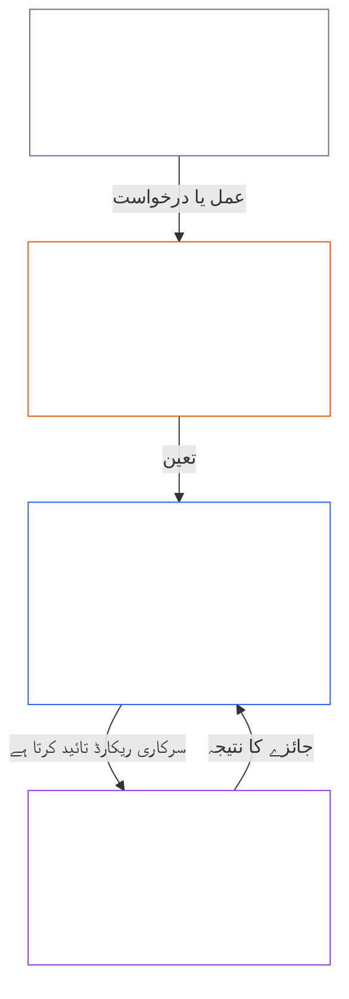
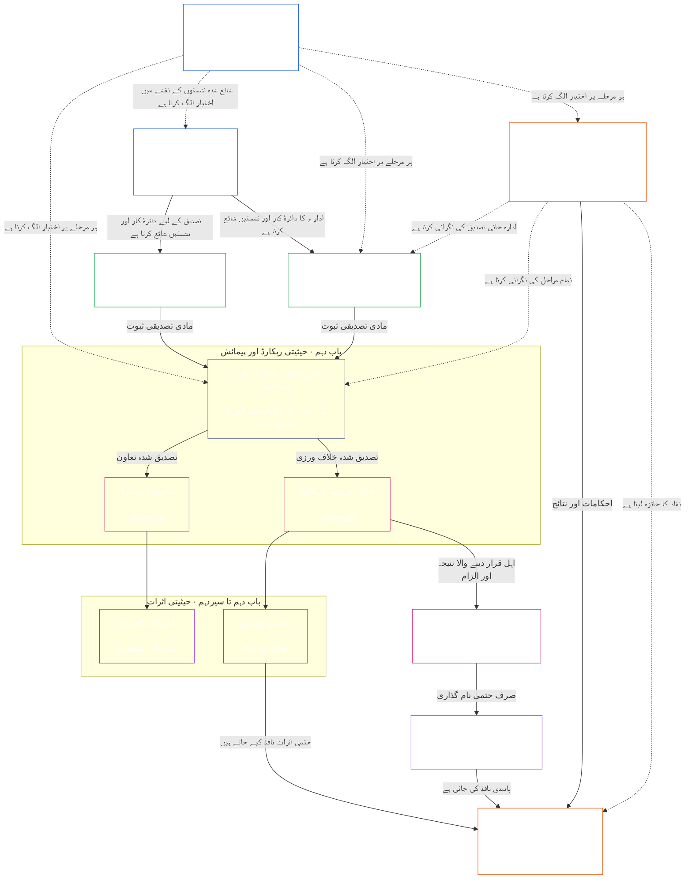

<!-- Locale: ur; language variety: اردو ایڈیشن — پائلٹ (پابند نہیں). AI-assisted structural resynchronization draft (GPT-6 Codex); unreviewed and incomplete. English pin: SC-Corpus-2026.11.25, commit 6e0b6c663dde01b5dea731fe33d87725c7174930. core_00 SHA-256 90799cb8019b41356fa5dd90565e3f9540fc346e8c77e2c321b841654f39b274; core_01 SHA-256 aca759b394f10784ab1a2eef4e9e2ca12e369ef0ca8ee797298c6af00d2950aa. -->

<!-- Structural resynchronization draft; §§1–4 newly translated against the pinned English source, still requiring independent fidelity review. Other gaps are marked. Do not publish or synchronize. -->

# باب اوّل: آئینی نقشہ

<strong>مجموعے میں مقام (غیر عملی): فائل کی ساخت اور مطالعے کے قواعد</strong>

> **غیر عملی** نشان زدہ ویجٹس (مجموعے میں مقام، قاری کی رہنمائی، قاری کے نقشے) صرف رہنمائی کے لیے ہیں۔ یہ اپنی فائل یا کسی دوسری فائل میں کسی پابند فرض کو نہ بڑھاتے، نہ گھٹاتے اور نہ محدود کرتے ہیں۔
>
> یہ فائل **آئینِ شعوری وجود کا حصہ** ہے اور دوسری نمبر شدہ `core_*` فائلوں اور ذیلی آئین کے ساتھ ایک متن کے طور پر مل کر پڑھی جائے تو **پابند** ہے۔ اس میں **باب اوّل**، یعنی *آئینی نقشہ* شامل ہے: اس کا مقصد (§1)، یہ کیوں موجود ہے (§2)، فائلیں کیسے جڑتی ہیں (§3)، آئندہ ابواب کی بنیادیں (§4)، حکمرانی کے بنیادی عمل (§5)، اور آئینی ذمہ داروں کا اندراج (§6 تا §11)۔
>
> **پچھلا:** [core_00.000_preamble.md](core_00_preamble.md) (دیباچہ)
> **اگلا:** [core_02.000_values_principles.md](../../core_02.000_values_principles.md)

<strong>سراغ</strong>

- پچھلا: [دیباچہ](core_00_preamble.md) (*ماڈل، دو آئینی مقاصد، آئینی چوکڑی، مادی داؤ اور پیمائش کی اقسام*).
- ذیلی دفعات:
  - [§1](#1-purpose-role-and-scope);
  - [§2](#2-why-the-map-exists);
  - [§3](#3-how-the-files-fit-together);
  - [§4](#4-foundations-for-the-chapters-that-follow);
  - [§5](#5-key-governance-processes);
  - [§6](#6-principles-definitions-and-rights);
  - [§7](#7-system-and-institutional-charters-functional-independence-and-separation-of-duties);
  - [§8](#8-key-practical-process-pipelines);
  - [§9](#9-process-ownership-and-outputs);
  - [§10](#10-governance-change-and-incorporation);
  - [§11](#11-adopted-implementation-corpus).
- اس کے ساتھ پڑھیں: [اختیاراتی ترتیب اور داخلی درجہ بندی](../../subcore_03.080_band_integrative.md#authority-stack-and-internal-hierarchy) (*ذمہ داروں کا اندراج کیسے لاگو ہوتا ہے*); [README.md](README.md) (*مطالعے کی ترتیب*).

 

### ۱۔ مقصد، کردار اور دائرۂ کار

*سادہ الفاظ میں: یہ باب آئین کے باقی حصے کے لیے رہنما ہے۔ یہ دکھاتا ہے کہ حصے کیسے جڑتے ہیں، ہر موضوع کا ذمہ دار کون سا باب ہے، اور بنیادی عمل کیسے چلتے ہیں تاکہ قاری اپنے سوال کا جواب دینے والا قاعدہ ڈھونڈ سکے۔*

**مقصد:** باب ایک مجموعی جائزہ اور ذمہ داریوں کی رہنمائی دیتا ہے۔ یہ ان اعمال کی نشان دہی کرتا ہے جو مجاز حکمرانی کو جانچتے ہیں، بتاتا ہے کہ کون سا باب کس موضوع کا ذمہ دار ہے، اور آئینی متن کی تین سطحیں بیان کرتا ہے۔

**کردار:** یہ باب رہنمائی اور ذمہ داری متعین کرتا ہے۔ ذمہ داروں کے اندراج کے سوا، جسے دوسرے ابواب اور [اختیاراتی ترتیب اور داخلی درجہ بندی](../../subcore_03.080_band_integrative.md#authority-stack-and-internal-hierarchy) نافذ کرتے ہیں، یہ اپنی طرف سے کوئی فرض عائد نہیں کرتا۔

**باب کا دائرۂ کار:**

- نقشہ کیوں موجود ہے (**دفعہ ۲**);
- فائلیں کیسے جڑتی ہیں (**دفعہ ۳**) اور آئندہ ابواب کی بنیادیں (**دفعہ ۴**);
- بنیادی حکمرانی کے عمل (**دفعہ ۵**);
- آئینی ذمہ داروں کا اندراج: اصول، تعریفیں اور حقوق (**دفعہ ۶**); نظام اور ادارہ جاتی منشور، فعلی خودمختاری اور فرائض کی علیحدگی (**دفعہ ۷**); عملی سلسلے (**دفعہ ۸**); عمل کی ذمہ داری اور نتائج (**دفعہ ۹**); حکمرانی، تبدیلی اور شمولیت (**دفعہ ۱۰**); اور
- منظور شدہ نفاذی متن اور ذیلی متن (**دفعہ ۱۱**).

### ۲۔ نقشہ کیوں موجود ہے

*سادہ الفاظ میں: اتنے بڑے متن کو ایسے رہنما کی ضرورت ہے جو حصوں کے باہمی تعلق اور ہر موضوع کے ذمہ دار کو دکھائے۔ یہ باب اس لیے ہے کہ قاری اپنے سوال کا جواب دینے والا قاعدہ تلاش کر سکے۔*

آئین اپنا کام متعدد ابواب، ایک ذیلی متن اور چار منظور شدہ مجموعوں میں تقسیم کرتا ہے۔ کوئی شعوری وجود یہ جاننے کی کوشش کرے کہ اس کا حق کیا ہے، یا کوئی اختیار کنندہ کسی فرض کو تلاش کرے، تو راستہ بھول سکتا ہے۔ یہ باب مجموعی جائزہ اور ذمہ داریوں کی رہنمائی ہے: ہر حصے کا کام کیا ہے، ہر موضوع کس باب کی ذمہ داری ہے، عملی سلسلے کیسے چلتے ہیں اور متن کی سطحیں آپس میں کیسے متعلق ہیں۔ ذمہ داروں کے اندراج کے علاوہ یہ اپنا کوئی قاعدہ نہیں بناتا۔

**بنیاد:**

- دیباچہ:
  - [آئینی چوکڑی](core_00_preamble.md#constitutional-tetrad): وہ افعال جنہیں یہ باب عملی صورت دیتا ہے:
    - [شرکت](../../subcore_03.060_apex_participation_leg.md#participation): شعوری وجود اپنے سوال کا جواب دینے والا قاعدہ تلاش کر سکتا ہے؛
    - [جوابدہی](../../subcore_03.040_apex_accountability_leg.md#accountability): ہر موضوع کا ایک نامزد ذمہ دار باب ہے جو اس کا جواب دیتا ہے؛
    - [نگرانی](../../subcore_03.055_apex_oversight_leg.md#oversight): قاری حصوں کا تعلق دیکھ سکتا اور خلا یا تداخل کی نشان دہی کر سکتا ہے؛
    - [بروقت کارروائی](../../subcore_03.065_apex_timeliness_leg.md#timeliness): قاری درست قاعدے تک بلا تاخیر پہنچتا ہے؛
  - [دو آئینی مقاصد](core_00_preamble.md#two-constitutional-aims): دونوں مقاصد جن کی یہ باب خدمت کرتا ہے:
    - [شگفتگی](core_00_preamble.md#flourishing): آئین شعوری وجودوں کی اسی وقت خدمت کرتا ہے جب وہ اس میں اپنا راستہ پا سکیں؛
    - [استمرار](core_00_preamble.md#continuity): واضح نقشہ متن کو بڑھتے اور بدلتے ہوئے مکمل رکھتا ہے؛
- باب دو کے اصول:
  - [§5.2 سادہ زبان میں رسائی (شرکت اور ذمہ دارانہ انتظام کی ذمہ داری)](../../core_02.000_values_principles.md#52-plain-language-accessibility-participation-and-stewardship-duty);
  - [§5.2.4 پیچیدگی کو شکست کے طور پر استعمال کرنے کے خلاف نظم](../../core_02.000_values_principles.md#524-complexity-as-defeat-discipline);
  - [§15.4 آئینی معنی کے تنازع کا حل](../../core_02.030_constitutional_interpretation.md#154-constitutional-meaning-conflict-resolution);
- باب چار کے آرٹیکلز:
  - [آرٹیکل XXIV-A](../../core_04.030_rights_part_d.md#article-xxiv-a-proportional-comprehensibility-right) (*متناسب فہم پذیری کا حق*);
  - [آرٹیکل XXIV-B](../../core_04.030_rights_part_d.md#article-xxiv-b-complexity-audit-and-modularity-requirements) (*پیچیدگی کے جائزے اور ماڈیولر ساخت کے تقاضے*).

### ۳۔ فائلیں کیسے جڑتی ہیں

آئین کی فائلیں یوں جڑتی ہیں:

- **بنیادی متن (`core_*`):** نمبر شدہ فائلوں میں آئین کے ابواب ہیں، جنہیں ایک متن کے طور پر اکٹھا پڑھنا ہے۔ یہ ضمانتیں اور آئینی ساخت بیان کرتی ہیں۔
- **ذیلی متن (`subcore_*`):** ابواب کے پیچھے مکمل قواعد اور طریقۂ کار دیتا ہے۔ ہر فائل ایک باب سے تعلق رکھتی ہے، اسی کے برابر قوت رکھتی ہے، اور الگ سے شامل کیے بغیر ہر اختیار کنندہ پر لازم ہے۔ ذیلی متن اپنے باب کو محدود نہیں کر سکتا۔
- **نفاذ (`corpus_*`):** چار فائلیں آئین پر عمل درآمد کی عملی تفصیل دیتی ہیں۔ درست شمولیت کی حدود میں لازم ہوتی ہیں اور آئین کو محدود کیے بغیر نافذ کرتی ہیں۔ [دفعہ ۱۱](#11-adopted-implementation-corpus) چاروں فائلوں کی نشان دہی کرتی ہے۔

متعین [متن](../../subcore_03.080_band_integrative.md#corpus) پابند آئینی ذرائع کا وسیع تر، نسخہ بند مجموعہ ہے: اس میں بنیادی متن، ذیلی متن، منظور شدہ نفاذی متن اور انتقال کے دوران کوئی بھی درست مطابقتی لفافہ شامل ہے۔ مسودے، نوٹس اور رہنمائی محض منصوبے کا حصہ ہونے سے پابند نہیں بنتے۔

### ۴۔ آئندہ ابواب کی بنیادیں

*سادہ الفاظ میں: باب دو تا چار اقدار، لغت (تعریفیں کیسے بنائی، محفوظ اور ثابت کی جاتی ہیں، اس بارے میں ذیلی متن کے قواعد سمیت) اور حقوق کی تہہ کے ذمہ دار ہیں؛ بعد کے ابواب ان ذمہ داریوں کو خاموشی سے دوسری جگہ منتقل نہیں کر سکتے۔*

**باب دو تا چار** وہ اقدار، الفاظ، تصدیقی طریقے اور حقوق کی تہہ فراہم کرتے ہیں جن کا بعد کی ہر چیز کو احترام کرنا ہے، بشمول:

- [باب پانچ میں نظامی یا ادارہ جاتی منشور کی شرط، باب چھ میں فرائض کی علیحدگی کی شرط اور باب سات کے آزاد ادارے](#7-system-and-institutional-charters-functional-independence-and-separation-of-duties);
- دفعہ ۸ کی [کلیدی عملی عمل کی زنجیریں](#8-key-practical-process-pipelines);
- دفعہ ۹ میں [عمل کی ذمہ داری اور نتائج](#9-process-ownership-and-outputs);
- دفعہ ۱۰ میں حکمرانی اور تبدیلی کے راستوں سے متعلق ابواب؛ اور
- دفعہ ۱۱ میں [منظور شدہ نفاذی متن](#11-adopted-implementation-corpus).

### 5 کلیدی حکمرانی عمل

*سادہ الفاظ میں: جب متن مانگے، مادی مسائل تصدیق، مدد اور نقصان کے تحریری ریکارڈ، اصلاح اور تدارک، اور وقتی حدود والی فورم جائزہ سے گزرتے ہیں — عام تنازعات پہلے شائع شدہ چیلنج راستہ استعمال کرتے ہیں؛ وہ راستے مجاز حکمرانی کی آزمائش کرتے ہیں؛ وہ اسے خود نہیں بناتے۔*

جہاں باب ششم، [باب نہم](../../core_08.000_system_alignment_certification_evaluation.md#chapter-eight-system-alignment-certification)، شامل دستاویزات، یا دیگر آئینی احکام صریحاً مانگیں، مادی آئینی مسائل کو نیچے کے ایک یا زیادہ راستوں میں لے جائیں۔ [کلیدی عملی عمل کی زنجیریں](#6-key-practical-process-pipelines) پیمائش کو ریکارڈ، تصدیق، تصدیق شدہ مواد، درجہ بندی، فورم نگرانی، اصلاح اور بروقت تدارک میں بدلتی ہیں — مجاز حکمرانی عمل میں کیسے آزمائی، چیلنج اور مرمت کی جاتی ہے۔ وہ خود حکمرانی مجاز نہیں کرتیں؛ وہ حکمرانی کو جائزے کے قابل، چیلنج کے قابل، اصلاح کے قابل اور بروقت بناتی ہیں۔ [قطعہ 5.1](#62-how-the-full-chain-fits-together) وہ زنجیر پوری بیان کرتا ہے۔

- **فعلی خودمختاری اور فرائض کی علیحدگی** ([باب ششم](../../core_06.000_functional_independence_separation_of_duties.md#chapter-six-functional-independence-and-separation-of-duties)): کسی مادی طور پر پابند عمل کے آگے بڑھنے سے پہلے، آغاز، تصدیق یا اجازت، سرکاری ریکارڈ کی تحویل، اور چیلنج کے جائزے کی نشستوں کو قابلِ اطلاق تناسب اور خودمختاری کے قواعد کے مطابق شناخت کرکے الگ رکھیں۔
- **نظام کی ہم آہنگی کی تصدیق** ([باب نہم](../../core_08.000_system_alignment_certification_evaluation.md#chapter-eight-system-alignment-certification)) — بڑے پیمانے پر کسی اعلیٰ اثر نظام پر بھروسہ کرنے سے پہلے، یہ ثبوت اکٹھا اور جائزہ لیں کہ کیا اب اس پر آئینی طور پر محفوظ انحصار کیا جا سکتا ہے
- **قائمہ ریکارڈ** ([باب گیارہ](core_11_standing_assessment.md#chapter-eleven-standing-records--question-1-what-happened)) — جب طرزِ عمل یا نقصان آئینی اہمیت رکھتا ہو تو تصدیق شدہ حقائق رسمی شراکت یا خلاف ورزی کی فائلوں میں درج کریں؛ افواہ اور شہرت کافی نہیں۔
- **اصلاح اور تلافی** ([باب تیرہ §5.1 (*تلافی اور اصلاح*)](../../core_12.000_violation_consequences.md#31-remedy-and-correction)) — بنیادی ناکامی درست کریں اور متاثرہ افراد کو متناسب اعتراف، مرمت، بحالی یا معاوضہ دیں۔
- **فورم کا جائزہ** ([باب پندرہ](core_11_forum.md#1-purpose-and-role--participation-architecture))
  - پہلے سے مجاز نظاموں کے اندر عام تنازعات پہلے [متاثر فریقوں کی نظامی شرکت](../../subcore_03.090_band_participation.md#stakeholder-status-and-weight-cluster) کا شائع شدہ چیلنج راستہ استعمال کرتے ہیں
  - اگر وہ راستہ اب بھی متنازع، غائب، قبضے میں، یا راحت نہیں دے سکتا، بنیادی داؤ کے مطابق نگرانی شدہ فورموں سے راستہ طے کریں
  - وہ فورم **دفعہ XXV-C** (*بروقت حل اور تاخیر مخالف تہہ*) کے تحت ثبوت، جائز منتقلی اور بروقت حدود سہارا دیتے ہیں

### 6. اصول، تعریفیں اور حقوق

*سادہ الفاظ میں: باب یکم تا ششم اقدار، الفاظ کے بننے اور جانچنے کے ڈھنگ، لغت اور حقوق کی تہہ کے مالک ہیں؛ بعد کے ابواب کو ان گھروں کا احترام کرنا ہے، انہیں خاموشی سے ہٹانا نہیں۔*

قطعے **4 تا 7** اس آئین کا **مثبت مالک رجسٹر** ہیں: ہر بلاک اس اصل دائرے کا نام لیتا ہے جس کا مالک اس کا باب (یا ساتھی کارپس) ہے اور وہ کیا دیتا ہے۔ پابند ایک سطری مالک دعوے ہر نمبر والے باب کے آغاز پر بھی آتے ہیں۔ دیگر تہیں کسی مالک کی طرف اشارہ کر سکتی ہیں — انہیں اسے خاموشی سے دوبارہ نہیں لکھنا یا منتقل نہیں کرنا چاہیے؛ وہ عدمِ منتقلی ضبط [اختیار کا ڈھیر اور داخلی مراتب](../../subcore_03.080_band_integrative.md#authority-stack) کے تحت رہتی ہے۔

باب **یکم تا ششم** وہ اقدار، الفاظ، تصدیق مشینری اور حقوق کی تہہ دیتے ہیں جن کا بعد کی ہر چیز کو احترام کرنا ہے — قطعہ 5 کی [کلیدی عملی عمل کی زنجیریں](#6-key-practical-process-pipelines)، قطعہ 6 کے حکمرانی اور تبدیلی کے راستے کے ابواب، اور قطعہ 7 کا [ساتھی نفاذ کارپس](#11-adopted-implementation-corpus) شامل۔

ہر خلاصہ کہتا ہے کہ باب کا دائرہ کیا ہے اور وہ کیا دیتا ہے۔

**باب یکم — اقدار، اصول اور ذمہ دارانہ انتظام** ([حصہ الف](../../core_02.000_values_principles.md) · [حصہ ب](../../core_02.020_interaction_interpretation.md) · [حصہ ج](../../core_02.040_stewardship_capacity_principles.md))

- **اس کی ذمہ داری:** آئین کی رہنما اقدار اور پابندیاں بیان کرتا ہے، جن میں شامل ہیں:
  - فلاح، انصاف، حفاظت، سچائی، اعتماد اور محدود آزادی؛
  - جائز تعاون کو تسلیم کرنا اور اس کے تناسب سے انعام دینا؛
  - اصولوں کے درمیان تنازعات حل کرنا؛ اور
  - نگہداشت کے فرائض، جن میں فہم کی تقسیم، نظامی جائزہ اور حکمرانی کا نظم شامل ہے۔
- **اس کا نتیجہ:** بعد کے تمام ابواب کی تشریحی بنیاد۔ نظام، حقوق، تعریفوں یا عملی طریقوں کو پڑھتے اور لاگو کرتے وقت یہ قواعد اعلیٰ سطح کے مقاصد کو قابلِ عمل تقاضوں میں بدلتے ہیں۔

**باب دوم — تعریف کی ساخت** ([`core_02_definition_structure.md`](../../subcore_03.010_definition_structure.md))

- **اس کا دائرۂ کار:** متعین کرتا ہے کہ آئینی اصطلاحات کن طریقوں سے تشکیل پاتی ہیں:
  - وجودیاتی/پیمائش/جانچ/تعمیل (O/M/A/C) اجزائی ساخت؛
  - ہم آہنگی کے تقاضے؛ اور
  - اجزائی قواعد جو پورے مجموعے میں تعریفوں کو دقیق اور قابلِ استعمال رکھتے ہیں۔
- **اس کا نتیجہ:** تعریفوں کے لیے ایک مشترک قواعدی ڈھانچا، تاکہ بعد کے ابواب مبہم لیبلوں، پوشیدہ مفروضوں یا باہم غیر موافق اصطلاحی ساختوں میں نہ پڑیں۔

**باب سوم — تعریف کی سالمیت** ([`core_02_definition_structure.md`](../../subcore_03.010_definition_structure.md))

- **اس کا دائرۂ کار:** ان امور کے خلاف حفاظت کرتا ہے:
  - بچ نکلنا اور دائرۂ کار کو سرکانا؛
  - ازسرِنو تعریف کے حربے؛ اور
  - عدم تعمیل کی ایسی چالیں جو کاغذ پر تعریفات کو کھوکھلا اور عمل میں بے اثر کر دیں۔
- **اس کا نتیجہ:** بچ نکلنے کے خلاف نظم اور عدم تعمیل سے متعلق رہنما میٹاڈیٹا؛ اگر بچ نکلنا ثابت ہو تو حیثیت اور بدعملی کے جائزے کی طرف بھیجنے کے راستے اس میں شامل ہیں۔

**باب چہارم — بوجھ، سراغ اور تصدیق** ([`core_02_definition_structure.md`](../../subcore_03.010_definition_structure.md))

- **اس کا دائرۂ کار:**
  - تعمیل کا دعویٰ کرنے والے پر ثبوت کا بوجھ ڈالتا ہے؛ اور
  - [**مادی مفاد کی اہمیت**](core_00_preamble.md#material-stake) کے تناسب سے قابلِ سراغ ثبوت، مشاہدہ پذیری اور توثیق لازم کرتا ہے، جنہیں عملاً چیلنج کیا جا سکے۔
- **حاصل:** تصدیقی سلسلہ جو [باب گیارہ](core_11_standing_assessment.md#chapter-eleven-standing-records--question-1-what-happened) کے **تصدیق شدہ ان پٹ** اور [باب نہم](../../core_08.000_system_alignment_certification_evaluation.md#chapter-eight-system-alignment-certification) کے نظامی ہم آہنگی کے ثبوت فراہم کرتا ہے۔ یہ قائمہ پیمائش کی جگہ نہیں لیتا۔
**باب پنجم — بنیادی تعریفیں** ([`core_05__definitions_home.md`](../../core_03.000_definitions_home.md#chapter-three-foundational-definitions))

- **اس کا دائرۂ کار:** فراہم کرتا ہے:
  - تعریفات کا معیاری سلسلہ: نگرانی، شرکت، جواب دہی، تسلسل اور انضمامی پرتیں؛
  - [اختیارات کا سلسلہ اور اندرونی درجہ بندی](../../subcore_03.080_band_integrative.md#authority-stack-and-internal-hierarchy)؛
  - [مجموعہ](../../subcore_03.080_band_integrative.md#corpus)؛ اور
  - متعلقہ حد بندی کے قواعد۔
- **اس کا نتیجہ:** تشریح، آڈٹ اور فیصلہ سازی کے لیے دقیق آئینی اصطلاحات۔ یہ **تعریفات کا سلسلہ** ہے، حقوق کی بنیادی حد نہیں—لازم حقوق کی بنیادی حد باب ششم میں ہے۔ پورے آئین کے ملکیتی دائروں کی رہنمائی اس تمہید کے رجسٹر (حصے ۴–۹) میں ہے۔

**باب ششم — بنیادی حقوق** ([حصہ الف](../../core_04.000_rights_part_a.md) · [حصہ ب](../../core_04.010_rights_part_b.md) · [حصہ ج](../../core_04.020_rights_part_c.md) · [حصہ د](../../core_04.030_rights_part_d.md))

- **اس کا دائرۂ کار:** دفعات **I–XXVIII** میں حقوق کی بنیادی حد بیان کرتا ہے، جس میں شامل ہیں:
  - بقا کے لیے ضروری امور؛
  - وسائل کی تقسیم اور انحصار کی نگہداشت؛
  - وقار، اختیارِ عمل اور شرکت؛
  - چیلنج اور تدارک؛
  - انصاف کی پابندیاں؛
  - **دفعہ XXVI-C** کے تحت بروقت کارروائی (*بروقت حل اور تاخیر کے خلاف بنیادی حد*)؛ اور
  - قبولیت کی عبوری منتقلی کے قواعد۔
  چار حصے سیارے کو ترجیح دینے والی قرأت کے لیے ان تحفظات کو منظم کرتے ہیں۔
- **اس کا نتیجہ:** ناقابلِ مذاکرہ حقوقی تحفظات اور تدارک کے راستے، جن کا باب ہفتم تا سیزدہم، فورمز، حکمرانی اور ترمیمی قواعد کو احترام کرنا ہوگا؛ طریقۂ کار یا متبادل پیمانوں سے انہیں محدود، نظرانداز یا کھوکھلا نہیں کیا جا سکتا۔

### 7. نظامی اور ادارہ جاتی منشور، فعلی خودمختاری، اور فرائض کی علیحدگی

*سادہ الفاظ میں: حقیقی اثر رکھنے والا نظام یا ادارہ نظامی منشور یا ادارہ جاتی منشور شائع کرتا ہے، جس میں اس کے مجاز کام اور ہر نشست کا حامل بتایا جاتا ہے۔ مادی طور پر پابند عمل آگے بڑھنے سے پہلے طے کریں کہ اسے کون شروع کرے، کون جانچے یا مجاز کرے، سرکاری ریکارڈ کون رکھے اور چیلنج کون دیکھے۔ کردار ماحول کے مطابق ہو سکتے ہیں، مگر ایک ہی فریق اور اس کی کنٹرول لائن اپنی کارروائی جانچنے والی نشستیں خاموشی سے نہیں رکھ سکتی۔*

- **اس کا نتیجہ:** دائرۂ کار اور نشستوں کی جگہ بندی کا شائع شدہ، نسخہ وار بیان جس کے مقابل باب ہشتم، توثیق، حیثیتی ریکارڈ اور فورم رویے کو جانچ سکتے ہیں۔ باب ہفتم [`core_07.000_charters.md`](../../core_05.000_charters.md#chapter-five-system-and-institutional-charters) میں ہے۔

**فعلی آزادی اور فرائض کی علیحدگی** — کسی مادی طور پر پابند عمل کے آگے بڑھنے سے پہلے، قابلِ اطلاق پیمانہ بندی اور آزادی کے قواعد کے مطابق آغاز، تصدیق یا اجازت، ریکارڈ اور اعتراض کے جائزے کی نشستوں کی شناخت اور علیحدگی کریں۔

**ہر مادی طور پر پابند عمل کے لیے نشستیں الگ رکھیں** ([باب ہشتم](core_07_functional_independence_segregation_of_duties.md#2-four-seat-constitutional-requirement)) — یہ متعین کریں کہ عمل کون شروع کرتا ہے، کون اس کی تصدیق یا اجازت دیتا ہے، سرکاری ریکارڈ کون رکھتا ہے اور اعتراض کون سنتا ہے۔ عمل کو درست طور پر جانچا ہوا قرار دینے سے پہلے ممنوعہ اختلاط، خودمختاری کے قواعد اور شائع شدہ متبادل راستہ نافذ کریں۔ جہاں نظامی منشور یا ادارہ جاتی منشور درکار ہو ([باب ہفتم](../../core_05.000_charters.md#6-the-charter-role-map-and-standing-record-custody))، وہاں منشور کا کردار نقشہ شائع کرتا ہے کہ ہر نشست کس کے پاس ہے۔

**باب ہشتم — فعلی خودمختاری اور فرائض کی علیحدگی**

- **اس کی ذمہ داری:** تمام عملوں پر لاگو یہ تقاضا کہ ہر [مادی طور پر پابند عمل](../../subcore_03.070_band_accountability.md#materially-binding-act) کے لیے چار افعال الگ الگ مقرر ہوں:
  - آغاز؛
  - تصدیق یا اجازت؛
  - سرکاری ریکارڈ کی تحویل؛ اور
  - چیلنجوں کا جائزہ۔

یہ مزید ان امور کو بھی منضبط کرتا ہے:

  - ہر [مادی طور پر پابند عمل کے ریکارڈ](../../subcore_03.070_band_accountability.md#materially-binding-act-record) کا عمومی کم از کم مواد؛
  - فاعل کی [مادی کنٹرول لائن](../../subcore_03.070_band_accountability.md#material-control-line) سے آزادی؛
  - ذمہ داریوں کی شائع شدہ تقسیم اور متبادل؛
  - متناسب مشترکہ میزبانی اور ہنگامی حدود؛ اور
  - قابلِ انتساب حوالگیاں اور معاملے کو غلط نشست پر بھیجنا۔
- **اس کا نتیجہ:** چار نشستوں اور عمل کے ریکارڈ کا دوبارہ قابلِ استعمال ڈھانچہ۔ بعد کا ہر تصدیقی، حیثیتی اندراج، فورم، حکمرانی اور مربوط نفاذ کا عمل اس ڈھانچے کو نافذ کرے گا، اس سے پہلے کہ اس کے نتیجے کو آزادانہ طور پر جانچا ہوا، قابلِ اعتماد طور پر درج شدہ اور حقیقتاً قابلِ اعتراض سمجھا جائے۔

#### 7.1 چار نشستوں کی علیحدگی کا نقشہ

> یہ نقشہ چار افعال اور ایک عمل اور اس کے Act Record کا عام سراغ دکھاتا ہے۔ یہ پانچویں نشست شامل نہیں کرتا، عالمگیر ترتیب مقرر نہیں کرتا، اور آزادی، متناسب مشترک میزبانی، ہنگامی کارروائی یا چیلنج روٹنگ سے متعلق باب ہشتم کے قواعد نہیں بدلتا۔

### 8. کلیدی عملی عمل کی زنجیریں

*سادہ الفاظ میں: باب نہم تا پندرہ، باب ہشتم کی فرائض کی علیحدگی کو ایک سلسلے میں لاگو کرتے ہیں: نظاموں اور اداروں کی تصدیق، مدد اور نقصان کو دو الگ راستوں پر ناپنا، حقیقی اثرات اور تلافی دینا، اور فورم کو اپنے خلاف دعوے کا واحد آخری فیصلہ ساز بننے سے روکنا۔ یہ سلسلہ آئینی فرائض کو روزمرہ زندگی میں مؤثر رکھتا ہے۔*

[باب ہفتم](../../core_05.000_charters.md#chapter-five-system-and-institutional-charters) کلاس L یا اس سے اوپر کے ہر نظام اور ادارے کا منشور دائرہ اور نشستوں کا نقشہ شائع کرتا ہے۔ [باب ہشتم](../../core_06.000_functional_independence_separation_of_duties.md#chapter-six-functional-independence-and-separation-of-duties) فرائض کی علیحدگی لازم کرتا ہے تاکہ سلسلے کا ہر عمل معتبر طور پر جانچا جا سکے۔ قابلِ اطلاق پیمانے اور آزادی کے قواعد کے مطابق آغاز، تصدیق یا اجازت، سرکاری ریکارڈ کی تحویل اور چیلنج کا جائزہ الگ الگ تفویض اور برقرار رکھنا ضروری ہے۔ پھر باب نہم تا پندرہ اس ساخت کو ترتیب سے لاگو کرتے ہیں:

نیچے ہر قدم کہتا ہے کہ باب کا دائرہ کیا ہے اور وہ کیا دیتا ہے۔ [پوری زنجیر کیسے بیٹھتی ہے](#62-how-the-full-chain-fits-together) پھر ان مالکوں کو نظام کی جانچ سے تدارک تک ایک راستے کے طور پر دکھاتا ہے۔

#### 8.1 عملی نقشہ

- **باب نہم** آزاد تصدیق سے طے کرتا ہے کہ مادی اثر والا نظام یا ادارہ بیان کردہ دائرے اور ریکارڈ مدت میں ہم آہنگ ہے یا نہیں۔ یہ نظامی تصدیق چلاتا ہے؛ باب دہم ادارہ جاتی تصدیق، بشمول ادارے کی اپنی جماعت، جائزہ، ریکارڈ اور تلافی کے نتیجے کو چلاتا ہے۔
- **باب گیارہ** تصدیق شدہ حقائق لے کر الگ شراکت اور خلاف ورزی کے قائمہ ریکارڈ میں درج کرتا ہے۔
- **باب بارہ** ہر قائمہ ریکارڈ کو اپنے محور پر ناپتا ہے۔ فروغِ بہبود کی تصدیق شدہ شراکت، الگ تصدیق شدہ نقصان یا جوابدہی کی ناکامی کو پورا، منسوخ یا کم نہیں کرتی؛ دونوں درج ہوتے اور اپنے نتائج کے تابع رہتے ہیں۔
- **باب تیرہ** ان درجہ بندیوں کو متناسب قائمہ اثرات میں بدلتا ہے: شراکت کے راستے پر اہلیت منظوری اور اعتراف، خلاف ورزی کے راستے پر قائمہ تالے، اصلاح اور تلافی۔
- **باب چودہ** صرف باب بارہ کے اعلیٰ سطح کی خلاف ورزی ناپنے کے بعد لاگو ہوتا ہے۔ منصفانہ عمل کے تحفظات کے بعد یہ طے کرتا ہے کہ طرزِ عمل حتمی آئین مخالف بدعملی کے نامزدگی (ACMD) کے معیار الگ سے پورے کرتا ہے یا نہیں۔
- **باب پندرہ** روٹنگ، ثبوت، منتقلی، فورم کی آزادی اور بروقت حل کی نگرانی کرتا ہے تاکہ ریکارڈ اور اثرات کو چیلنج، درست اور نافذ کیا جا سکے، اور قابو شدہ فورم اپنے طرزِ عمل کا واحد آخری منصف نہ بنے۔
- **بدعملی کا جائزہ** الگ سوال کا جواب دیتا ہے: کیا اہل خلاف ورزی حتمی ACMD بھی چاہتی ہے؟
- **فورم کی نگرانی** روٹنگ، ثبوت، منتقلی، چیلنج اور تلافی کو کنٹرول کرتی ہے تاکہ سرکاری ریکارڈ اور فیصلے بروقت دیکھے اور درست کیے جائیں۔

یہ قواعد ہر مرحلے کے واضح اور قابلِ جائزہ نتیجے کو اگلے مرحلے تک پہنچا کر اس زنجیر کو ایک آئینی عمل رکھتے ہیں۔ یہ عمل آئینی حدود کے اندر بھی رہتا ہے:

- [**آئینی چوکڑی**](core_00_preamble.md#constitutional-tetrad) لازم کرتی ہے کہ ہر مرحلہ شرکت، نگرانی، جوابدہی اور بروقت کارروائی برقرار رکھے؛
- [**دو آئینی مقاصد**](core_00_preamble.md#two-constitutional-aims) لازم کرتے ہیں کہ یہ عمل شگفتگی اور استمرار دونوں کی خدمت کرے؛ اور
- حقوق کی تہہ ہر مرحلے کو ناقابلِ مذاکرہ تحفظات محدود کرنے، نظرانداز کرنے یا کھوکھلا کرنے سے روکتی ہے۔

یہ قواعد آئینی فرائض کو ایسے ریکارڈ اور فیصلوں میں بدلتے ہیں جنہیں ذی شعور مخلوقات کاغذ پر ہی نہیں بلکہ عملی طور پر بھی جانچ، چیلنج اور درست کر سکتی ہیں اور جن پر بھروسا کر سکتی ہیں۔

#### 8.2 پوری زنجیر کیسے جڑتی ہے

*سادہ الفاظ میں: پہلے ذمہ داری کی نشستیں الگ کریں، پھر نظام کی جانچ سے تلافی تک راستہ دیکھیں؛ فورم تنازع اور مدتوں کی نگرانی کرتے ہیں۔*

پوری زنجیر اس ترتیب سے چلتی ہے:

1. **ہر مادی طور پر پابند عمل کے لیے نشستیں الگ کریں** ([باب ششم](../../core_06.000_functional_independence_separation_of_duties.md#3-four-seat-constitutional-requirement)) — شناخت کریں کہ کون آغاز کرتا، کون تصدیق یا اجازت دیتا، کون سرکاری ریکارڈ رکھتا، اور کون اعتراض سنتا ہے۔ ممنوعہ امتزاج، آزادی کے اصول، اور شائع شدہ متبادل راستہ نافذ کریں۔ جہاں منشور درکار ہو، [باب پنجم](../../core_05.000_charters.md#6-the-charter-role-map-and-standing-record-custody) کا کردار نقشہ ہر نشست کے ذمہ دار کو ظاہر کرتا ہے۔
2. **جب اثر کافی سنگین ہو تو نظاموں اور اداروں کی تصدیق کریں** — بڑے پیمانے پر بلند اثر نظام پر بھروسا کرنے سے پہلے قابلِ اعتراض نظامی سرٹیفکیشن ریکارڈ حاصل کریں ([سب کور 8-B](../../subcore_08.020_system_alignment_certification_evaluation.md#subcore-8-b-system-alignment-certification--evaluation))؛ ادارے کو اس کی اپنی جماعت، طرزِ عمل، حکمرانی اور پورٹ فولیو کے مطابق [سب کور 9-B](../../subcore_09.020_institutional_alignment_certification_evaluation.md#subcore-9-b-institutional-alignment-certification--evaluation) کے تحت جانچ کر ادارہ جاتی سرٹیفکیشن ریکارڈ میں درج کریں۔
3. **حیثیت کو الگ راستوں پر درج اور ناپیں** ([سب کور 10-B](../../subcore_10.020_standing_assessment.md#subcore-10-b-standing-records--question-1-what-happened)، [10-D](../../subcore_10.040_standing_measurement.md#subcore-10-d-standing-measurement--question-2-how-good-or-bad-was-it)) — جب مدد یا نقصان آئینی اہمیت رکھتا ہو، باب دہم باقاعدہ مقدماتی فائلیں کھولتا اور صرف **تصدیق شدہ معلومات** قبول کرتا ہے، پھر تصدیق شدہ حقائق ناپ کر درجہ بند کرتا ہے۔ افواہ، شہرت یا تنازع کی کہانیاں کافی نہیں۔ تعاون اور خلاف ورزی الگ ریکارڈ اور محور پر رہیں؛ مدد نقصان کو نہیں مٹاتی اور دونوں کا ایک خالص اسکور نہیں بنتا۔
4. **ہر راستے پر حیثیتی اثرات نافذ کریں** ([سب کور 10-F](../../subcore_10.060_standing_integration.md#subcore-10-f-standing-integration--question-3-what-follows)) — تصدیق شدہ تعاون اہلیت کی منظوری، متناسب اعتراف اور مادی انعامات دے سکتا/لازم کرتا ہے؛ تصدیق شدہ خلاف ورزی حیثیتی پابندیاں، اصلاح اور متاثرین کے لیے [تلافی](../../core_12.000_violation_consequences.md#31-remedy-and-correction) پیدا کر سکتی ہے۔
5. **ضرورت پر آئین مخالف طرزِ عمل کی نامزدگی کا جائزہ لیں** ([باب چہاردہم](../../core_14.000_misconduct_designation.md#chapter-fourteen-anti-constitutional-misconduct-designation)) — اگر بلند ترین اثر کی خلاف ورزی آئین مخالف معیار بھی پوری کر سکتی ہو تو باب چہاردہم فیصلہ کرے گا کہ متعلقہ ACMD لگے یا نہیں۔ اس سے باب دہم کی پہلے سے طے شدہ نقصان کی شدت نہیں بدلتی۔ معمول کے حیثیتی اثرات ساتھ چلتے ہیں؛ صرف حتمی ACMD اعتماد کی پابندی شروع کرتا ہے۔
6. **تنازعات کی درست راہ بندی اور بروقت تلافی کریں** ([باب شانزدہم](../../core_16.000_forum.md#1-purpose-role-and-scope) اور [باب ہفدہم](../../core_17.000_forum_families_escalation_timeliness_support.md#chapter-seventeen-forum-families-escalation-timely-resolution-and-support)) — فورم مقدمے کی پیش رفت، مناسب فورم، اور **آرٹیکل XXVII-C** کی مدتوں کی نگرانی کرتے ہیں تاکہ تاخیر تلافی کو بے معنی نہ بنائے۔ عام تنازعات پہلے شائع شدہ اعتراض راستے پر چلتے ہیں؛ فورم A/B/C/L/P کی پانچ مادی سطحوں میں درجہ بندی کرتے ہیں۔ حتمی ACMD بنیادی معاملہ ہو تو Integrity فورم خاندان کو ابتدائی ترجیح ملتی ہے۔
7. **نتائج نافذ کریں** ([باب نوزدہم](../../core_19.000_enforcement.md#chapter-nineteen-enforcement) اور [باب بیستم](../../core_20.000_special_enforcement.md#chapter-twenty-special-enforcement)) — نامزد فریق حتمی اثر، پابندی، تلافی یا فورم حکم کو مقررہ مدت میں نافذ کرے؛ اس سے گریز، تاخیر یا خاموش ترک نہ ہو۔ مزاحمت کی صورت میں مشترک حدود کے ساتھ خصوصی تحفظات لاگو ہوں: محفوظ کم از کم کے ساتھ مال/اثاثے ضبط کرنا، سپردگی کے دباؤ کی درجہ وار سیڑھی، پہلے غیر مہلک قوت کی سیڑھی، اور دوبارہ ناکامی روکنے کے لیے بنیادی وجہ کا جائزہ۔

ہر مرحلہ اس کے ذمہ دار باب سے منسلک ہے۔

### 9. عمل کی ملکیت اور نتائج

عملی نقشہ اور [پوری زنجیر کا باہمی تعلق](#82-how-the-full-chain-fits-together) ترتیب دکھاتے ہیں؛ ذیل میں ہر مرحلے کا مالک اور نتیجہ درج ہے تاکہ کوئی مرحلہ دوسرے کا کام خاموشی سے نہ لے۔

- **[سب کور 8-B — نظامی ہم آہنگی کی تصدیق](../../subcore_08.020_system_alignment_certification_evaluation.md#subcore-8-b-system-alignment-certification--evaluation):** مادی اثر والے نظاموں کی آئینی ہم آہنگی یقینی بناتا ہے۔ فورم کی نگرانی میں بقا کی ضروریات، آرٹیکل V کے وسائل اور انحصار، تحفظ، شرکت اور دیگر آئینی کم از کم معیار کے ثبوت دیکھے جاتے ہیں؛ اہل افراد نتیجہ چیلنج کر سکتے ہیں، بلند خطرے کے نظام باقاعدہ دوبارہ تصدیق ہوتے ہیں۔ نتیجہ: واضح دائرہ اور مدت والا قابلِ اعتراض نظامی سرٹیفکیشن ریکارڈ۔
- **[سب کور 9-B — ادارہ جاتی ہم آہنگی کی تصدیق](../../subcore_09.020_institutional_alignment_certification_evaluation.md#subcore-9-b-institutional-alignment-certification--evaluation):** ادارے کے اپنے منشور، اختیار کے جواب دہ فرد، انعامات اور آزاد جانچ کی دستیابی دیکھتا ہے؛ نظامی تصدیق دوبارہ نہیں کرتا۔ باب نہم مراحل I–II، 9-D مراحل III–IV، اور 9-F مراحل V–VI رکھتا ہے۔ نتیجہ: دائرہ/مدت کے لیے قابلِ اعتراض ادارہ جاتی سرٹیفکیشن ریکارڈ؛ ادارہ بنانے یا چلانے کا لائسنس یا شرط نہیں۔
- **[سب کور 10-B — حیثیتی ریکارڈ](../../subcore_10.020_standing_assessment.md#subcore-10-b-standing-records--question-1-what-happened):** تصدیق شدہ تعاون اور خلاف ورزی الگ الگ درج کرتا ہے؛ افواہ، شہرت یا غیر رسمی اسکور متبادل نہیں۔ نتیجہ: تصدیق شدہ معلومات اور فورم کی نگرانی میں نتائج پر مبنی محدود ریکارڈ۔
- **[سب کور 10-D — حیثیت کی پیمائش](../../subcore_10.040_standing_measurement.md#subcore-10-d-standing-measurement--question-2-how-good-or-bad-was-it):** تعاون اور خلاف ورزی کو ایک متحد پیمانے پر مگر الگ محوروں پر ناپتا ہے؛ خالص اسکور نہیں بناتا۔ نتیجہ: ہر ریکارڈ کے لیے نوعیت، مقدار اور درجے کی درجہ بندی۔
- **[سب کور 10-F — حیثیت کا انضمام اور اثرات](../../subcore_10.060_standing_integration.md#subcore-10-f-standing-integration--question-3-what-follows):** تصدیق شدہ درجہ بندیوں کو مادی مفاد کے مطابق حقیقی، الگ اثرات میں بدلتا ہے؛ شرکت، نگرانی، جواب دہی یا بروقت کارروائی کو کھوکھلا نہیں کرتا۔ نتیجہ: تعاون پر اہلیت منظوری/مادی انعام؛ خلاف ورزی پر حیثیتی پابندیاں، کردار کی حد، اصلاح اور تلافی؛ دونوں کا ایک اسکور نہیں۔
- **[باب چہاردہم — آئین مخالف بدعملی کی نامزدگی](../../core_14.000_misconduct_designation.md#chapter-fourteen-anti-constitutional-misconduct-designation):** صرف انتہائی سنگین تصدیق شدہ خلاف ورزیوں کو دیکھتا ہے جو بڑے پیمانے پر آئینی فرائض پر قبضہ یا انہیں کھوکھلا کر سکتی ہوں۔ نتیجہ: معیار اور منصفانہ طریقۂ کار کے بعد حتمی ACMD یا انکار؛ اعتماد کی پابندی صرف حتمی ACMD سے شروع ہوتی ہے۔
- **[باب شانزدہم — معیار، راہ بندی، فورم مقدمات](../../core_16.000_forum.md#chapter-sixteen-standards-routing-and-forum-cases):** تنازع کی ترتیب، مناسب فورم، مقدمہ شروع/برقرار رکھنے، منتقلی/یکجائی، اور خود اپنے مقدمے کا واحد آخری فیصلہ کرنے سے روکنے کے قواعد کی نگرانی کرتا ہے۔ نتیجہ: حیثیتی فیصلے اور تلافی کی قانونی راہ؛ حیثیت کی پیمائش کا بدل نہیں۔
- **[باب ہفدہم — فورم خاندان، تصعید، بروقت حل اور مدد](../../core_17.000_forum_families_escalation_timeliness_support.md#chapter-seventeen-forum-families-escalation-timely-resolution-and-support):** فورم خاندان اور مشترک معیار، تصعید، فیصلے کے سوالات، عارضی تحفظ، آرٹیکل XXVII-C کے اوقات، اور ثبوت/شرکاء کی مدد مقرر کرتا ہے۔ نتیجہ: ہر قسم کے معاملے کی سماعت اور تلافی بامعنی رہنے تک حل۔
- **[باب نوزدہم — نفاذ](../../core_19.000_enforcement.md#chapter-nineteen-enforcement):** طے کرتا ہے کہ حیثیتی عمل یا فورم کے نتیجے کو کون کب نافذ کرے اور گریز/تاخیر/خاموش ترک کیسے روکے۔ نتیجہ: کاغذ پر نہیں بلکہ حقیقت میں نافذ نتائج؛ کوئی نئی سزا نہیں بناتا۔
- **[باب بیستم — خصوصی نفاذ](../../core_20.000_special_enforcement.md#chapter-twenty-special-enforcement):** رقم/اثاثے منجمد یا ضبط کرنے، قوت استعمال یا اس کے امکان، اور بار بار نفاذ کی ناکامی پر اضافی تحفظ دیتا ہے۔ نتیجہ: نتیجہ نافذ کرنے والی کم سے کم دیرپا ضرر اور ناکامی کی بنیادی وجوہ کا خاتمہ۔

### 10. حکمرانی، تبدیلی اور شمولیت

باب ہجدہم تا پچیس حکمرانی، تبدیلی کی صحت اور شمولیت کے مالک ہیں۔ باب ہجدہم مطالعے میں فورم ابواب کے بعد آتا ہے مگر حکمرانی سے متعلق ہے: باب اکیس بتاتا ہے اختیارِ حکمرانی کیسے جائز ہوتا ہے، باب ہجدہم بتاتا ہے مجلس اسے کیسے استعمال کرتی ہے۔

- **[باب ہجدہم — مجالس](../../core_18.000_assemblies.md#chapter-eighteen-assemblies):** مجلس کے فیصلوں اور حدود کا احاطہ: ٹیکس/بجٹ، مقامی/علاقائی/قومی کام کی تقسیم، مطلوبہ اکثریت، منتخب و برطرف کیے جانے والے انتظامی سربراہ، ریفرنڈم اور متعین ہنگامی حالتیں۔ نتیجہ: جواب دہ ادارے کے کھلے قواعد/بجٹ، اس کے سامنے جواب دہ انتظامیہ، اور فوری تصدیق و ہر وقت منسوخی کے قابل ہنگامی اختیار جو حقوق کی حد کو نہ چھوئے۔
- **[باب اکیس — آئینی معاہدہ، جواز اور نگہداشت](../../core_21.000_governance.md#chapter-twenty-one-constitutional-contract-legitimacy-authorization-and-stewardship):** [آئینی معاہدے کی تہہ](../../subcore_03.080_band_integrative.md#constitutional-contract-layer) — کون، کس جواز کے طریقے سے، کس دائرے/پائیدار شرائط پر حکومت کر سکتا ہے اور کیسی نگہداشت برقرار رکھے۔ نتیجہ: پہلے سے مجاز نظام میں شرکت سے الگ اختیارِ حکمرانی کے جواز کے اصول۔
- **[باب بائیس — عدمِ تنزل](../../core_22.000_non_regression.md#chapter-twenty-two-non-regression-and-substantive-amendment-validity):** بنیادی تحفظات واپس لینے، مادی مفاد کے مطابق Tetrad کو کھوکھلا کرنے، یا تنزل کو فنی صفائی کہنے پر پابندی۔ نتیجہ: پہلا آئینی حفاظتی اصول؛ عملی تحفظ کم کرنے والی تبدیلی باطل اور مشتبہ حیلہ روکا یا جائزے کو بھیجا جاتا ہے۔
- **[باب تئیس — ترمیم، توثیق اور اختیار](../../core_23.000_amendment_ratification.md#chapter-twenty-three-amendment-ratification-and-procedural-validity):** آئینی ترمیم، توثیق، اختیار، نیز کھلی اشاعت، مستند تحویل تک سراغ رسانی، اور ضرورت پر بامعنی اعتراض و آزاد جانچ کے طریقۂ کار مقرر کرتا ہے۔ نتیجہ: مکمل قانونی تبدیلی کا راستہ؛ دونوں حفاظتی اصول پورے کرنے والی تبدیلی ہی درست ہے۔
- **[باب چوبیس — بالادستی اور بیرونی قانونی احکام](../../core_24.000_expansion_supremacy.md#chapter-twenty-four-expansion-supremacy-and-external-legal-orders):** قانونی طور پر تحفظ کی توسیع، درست ماخذ میں آئین کی بالادستی، اختیار کا دائرہ، اپنے بل پر نافذ بیرونی قانون کی عدمِ تنسیخ، بیرونی قانونی نظام سے منضبط تعلق طے کرتا ہے۔ نتیجہ: درجہ بندی اور تصادم کے قواعد؛ اشاعت خارجی قانون منسوخ نہیں کرتی اور کمزور ضابطہ یا سہولت پیمانہ آئینی مفہوم پر غالب نہیں ہوتا۔
- **[باب پچیس — شمولیت کا پل](../../core_25.000_incorporation.md):** اختیار کے بعد کون سی عملی فائلیں پابند متن بنتی ہیں، ایڈیشن اور تحویل سلسلہ کیسے محفوظ رہتے ہیں، خاموش تبدیلی کیسے رکے۔ نتیجہ: واحد شمولیتی حد؛ عملی متن آئین نافذ کرتا ہے مگر اسے تنگ کرنے کا دوسرا ماخذ نہیں بنتا۔

### 11. اختیار کردہ نفاذی مجموعہ

نمبر والے `core_*` ابواب کے علاوہ، چار اختیار کردہ مجموعے آئینی فرائض کو عملی بنانے کی تفصیل دیتے ہیں۔ باب پچیس کے تحت درست شمولیت پر وہ اختیار کے دائرے میں پابند نفاذی متن ہوتے ہیں؛ وہ آئین نافذ کرتے ہیں، اسے محدود نہیں کرتے۔

- **[corpus_joint_structure](../../corpus_joint_structure.md)** — فائلوں کے پار راہ بندی، مشترک عملی اصطلاحات، اور ایک ہی حقائق پر نظام، ادارے اور فورم اکٹھے پڑھنے کی ساخت۔
- **[corpus_systems](../../corpus_systems.md)** — نظام کی درجہ بندی، ڈیزائن/تعیناتی طریقے، معلومات کا انتظام، اور اہم نگہداشت کے طریقے۔
- **[corpus_institutions](../../corpus_institutions.md)** — ادارہ سازی، حکمرانی، نگرانی، تناسب اور تحلیل کے اصول۔
- **[corpus_forum](../../corpus_forum.md)** — فورم کے کام: پینل کی تشکیل، علیحدگی، جائزے کی راہیں، راہ بندی کی تفصیل اور فرانزک مدد۔

ابواب اور اختیار کردہ مجموعوں کے درمیان [سب کور](../../subcore_03.080_band_integrative.md#subcore) ہے: `subcore_*` فائلیں جو ہر اختیار کنندہ کے لیے یکساں ضمانت اور طریقۂ کار کی مکمل تفصیل رکھتی ہیں۔ ہر سب کور ایک باب سے تعلق رکھتا، اسی طرح پابند ہوتا، اور باب تئیس کے مطابق صرف ترمیم سے بدلتا ہے۔ باب ضمانت سادہ الفاظ میں بتاتا ہے؛ سب کور مکمل قاعدہ دیتا ہے۔ “باب دہم” کا حوالہ مقرر ضمانتی متن اور “سب کور 8-E” کا حوالہ معیاری تفصیل بتاتا ہے؛ دونوں کی قوت یکساں ہے۔ باب سوم کی تعریفیں متعین اصطلاح کے ذریعے حوالہ دی جاتی ہیں۔

آئینی تحفظ کے مقصد کو قائم رکھنے کے لیے اصول، تعریفیں، حقوق، عمل کی زنجیریں، حکمرانی، ترمیمی قواعد، سب کور اور شامل شدہ نفاذی متن اکٹھے پڑھے جائیں۔

---

**پچھلی فائل:** [README.md](README.md)

**اگلی فائل (اس زبان میں):** [core_01_a_values_principles.md](../../core_02.000_values_principles.md)

**پابند اصل:** [core_00_preamble.md](core_00_preamble.md)
