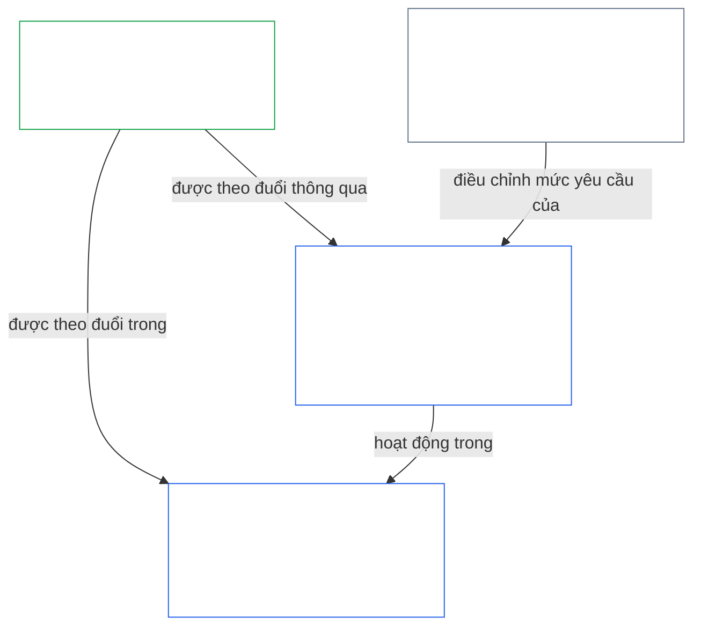

<!-- Locale: vi; language variety: Bản tiếng Việt — thử nghiệm (không ràng buộc). AI-assisted structural resynchronization draft (GPT-6 Codex); unreviewed and incomplete. English pin: SC-Corpus-2026.11.25, commit 6e0b6c663dde01b5dea731fe33d87725c7174930. core_00 SHA-256 90799cb8019b41356fa5dd90565e3f9540fc346e8c77e2c321b841654f39b274; core_01 SHA-256 aca759b394f10784ab1a2eef4e9e2ca12e369ef0ca8ee797298c6af00d2950aa. -->

> **Bản nháp chưa được rà soát và chưa hoàn chỉnh.** Đã tái cấu trúc với sự hỗ trợ của AI. Bản dịch dưới đây chưa được kiểm tra về tính đầy đủ và độ trung thành ý nghĩa. Không xuất bản hoặc đồng bộ hóa.

# Lời mở đầu / Các yêu cầu nền tảng

<strong>Vị trí trong kho văn bản (không vận hành): cấu trúc tệp và quy tắc đọc</strong>

> Các tiện ích được đánh dấu **không vận hành** (vị trí trong kho văn bản, hướng dẫn người đọc, bản đồ cho người đọc) chỉ nhằm định hướng. Chúng không thêm, bỏ hay thu hẹp nghĩa vụ ràng buộc, dù trong chính tệp của chúng hay bất kỳ tệp nào khác.
>
> Tệp này **là một phần của Hiến pháp Hữu tri** và **chỉ có tính ràng buộc khi được đọc cùng nhau** với các tệp `core_*` được đánh số khác như một văn bản thống nhất. Tệp này có **Lời mở đầu** (Các yêu cầu nền tảng). Thứ tự đọc và thông tin ấn bản được duy trì trong [README.md](README.md).
>
> **Tiếp:** [core_01.000_constitutional_map.md](core_01_constitutional_map.md) (Chương Một, Bản đồ Hiến pháp).

 

Lời mở đầu là chủ thể chịu trách nhiệm theo hiến pháp về **Mô hình** (**Hai Mục tiêu Hiến pháp**, **Tứ diện Hiến pháp** và **lợi hại vật chất**) cùng các loại đo lường. Sổ đăng ký chủ thể chịu trách nhiệm theo hiến pháp nằm tại [Chương Một](core_01_constitutional_map.md#chapter-one-constitutional-map), *Bản đồ Hiến pháp*.

*Nói thẳng: phần mở này gọi tên vấn đề mà Hiến pháp này tồn tại để sửa — các hệ thống gây hại, che giấu, hoặc khóa các hữu tri mà chúng tác động ra ngoài — và nói rằng phần còn lại của văn kiện là cách ta thay thế điều đó bằng quản trị có trách nhiệm giải trình, kiểm tra được, và kịp thời.*

Tự do, sự sống còn và phúc lợi của các hữu tri không tách rời các hệ thống ta tạo ra, sống trong, và phụ thuộc. Khi những hệ thống đó lớn dần về phạm vi, sự phụ thuộc lẫn nhau, và quyền lực, rủi ro hại không đảo ngược, quy mô lớn cũng lớn theo. Những rủi ro đó luôn hiện diện và có liên quan về mặt vật chất.

Các hệ thống dùng chung nằm trong một thế giới vốn đã phức tạp và ngày càng phức tạp hơn. Quản trị lành mạnh, bền vững phải đối mặt với sự phức tạp đó — đo lường, mô hình hóa và chịu trách nhiệm về nó — thay vì làm phẳng nó thành những đại lượng thay thế tiện lợi. Điều đó không có nghĩa là nhấn chìm các hữu tri chịu tác động trong những quy trình không thể sử dụng: nghĩa vụ, hồ sơ và giải thích phải nằm trong giới hạn mà các hữu tri thực sự có thể học, phản biện và sử dụng; mức độ đòi hỏi phải tương xứng với vai trò của từng tác nhân và với tác động, sự phụ thuộc, rủi ro đang đặt cược. Hiểu biết được phân tán giúp điều đó thành hiện thực. Phải từ chối sự phức tạp không phục vụ công việc hiến định nào: hãy đối mặt với sự phức tạp của thế giới, đừng đẩy nó ra ngoài thành một bức tường

Một hệ thống không thể giữ tính chính danh bằng cách khiến các hữu tri chịu khổ khi khổ đó có thể tránh được, bằng cách bỏ qua các vấn đề cứ lặp lại, bằng cách lặng lẽ chuyển hại sang người khác, hoặc bằng cách khóa các hữu tri ra khỏi các hệ thống định hình đời họ.

Cách các hệ thống được thiết kế, thử nghiệm, và vận hành phải nâng đỡ sự sống còn, phúc lợi, phẩm giá, sự trung thực, và ổn định bền.

Ta chủ ý xây các hệ thống tốt hơn — được cấu trúc để loại các mất cân bằng này — và thay chúng bằng các thể chế có trách nhiệm giải trình hơn, vững hơn, và đáp ứng hơn với nhu cầu thực của mọi hữu tri. Hiến pháp này bắt đầu công việc đó bằng một mô hình tốt hơn về cách ta có thể cộng tác công bằng, hiệu quả, và bền vững.

### Hệ thống tưởng thưởng điều gì

*Nói thẳng: hệ thống sẽ nhận được nhiều hơn thứ nó trả công, dù đó là tiền, địa vị, quyền tiếp cận, sự bảo vệ hay im lặng. Vì vậy, phép thử của hệ thống không phải điều nó nói là có giá trị, mà là điều nó tưởng thưởng. Nếu làm hại người khác có lợi, hoặc nói thật phải trả giá, hệ thống đang thất bại dù mục tiêu tuyên bố tốt đến đâu.*

Hệ thống dạy người ta. Mọi hệ thống, do con người, AI hay cả hai vận hành, đều cho người bên trong biết điều gì đem lại lợi ích và điều gì gây tốn kém. Hệ thống làm vậy qua tiền công, thăng tiến, địa vị, quyền tiếp cận, bảo vệ, chỉ tiêu, xếp hạng và tín hiệu tối ưu hóa. Các hữu tri, tổ chức và hệ thống AI điều chỉnh theo những tín hiệu đó. Một hệ thống có thể nói mình trung thực và quan tâm đến người chịu tác động. Nếu nó đề bạt người che giấu vấn đề và chuyển chi phí sang người khác, nó đang dạy điều ngược lại.

Vì vậy, Hiến pháp đặt [**Hai Câu hỏi Nền tảng**](#two-fundamental-questions) cho mọi hệ thống:

1. **Hệ thống có tưởng thưởng hành vi giúp hữu tri hưng thịnh và bền vững, nói thật và sửa chữa tổn hại không?**
2. **Hệ thống có tưởng thưởng hành vi gây hại, đánh lừa, loại trừ, trì hoãn, lãng phí hoặc chuyển chi phí sang người khác một cách không chính đáng không?**

Hệ thống chỉ đạt nếu câu trả lời cho câu thứ nhất là có và câu thứ hai là không. Trả lời câu này không trả lời câu kia, vì hệ thống có thể trả công cho hành vi tốt mà vẫn trả công cho tổn hại.

**Câu hỏi thứ nhất:** hệ thống thất bại nếu bất kỳ điều nào sau đây không được tưởng thưởng hoặc bị trừng phạt, công khai hay âm thầm:

- báo cáo vấn đề với thiện chí ([Báo cáo được bảo vệ (Tố giác)](../../subcore_03.070_band_accountability.md#protected-reporting-whistleblowing))
- phản biện một quyết định
- từ chối tham gia việc sai trái ([Chương Một §17.5 Nghĩa vụ chống lại](../../core_02.040_stewardship_capacity_principles.md#175-duty-to-resist))

Hình phạt có thể là gạt ra ngoài, trả đũa ([Trả đũa người báo cáo được bảo vệ và can thiệp quyền tiếp cận](../../subcore_03.070_band_accountability.md#protected-reporting-retaliation-and-access-interference)), hoặc bào mòn sức lực.

**Câu hỏi thứ hai:** hệ thống thất bại nếu bất kỳ điều nào sau đây được tưởng thưởng, công khai hay âm thầm:

- gây hại
- đánh lừa (kể cả che giấu và tạo niềm tin giả)
- loại trừ bất công
- trì hoãn
- lãng phí
- chuyển chi phí bất công

Phần thưởng có thể là sự ghi nhận, thăng tiến, bảo vệ, điểm chỉ số hoặc làm ngơ ([Chương Một §3.2.6 Không tưởng thưởng hành vi phản hiến pháp](../../core_02.000_values_principles.md#326-anti-reward-for-anti-constitutional-conduct)).

Hai câu hỏi này không đòi hỏi phải dễ chịu với mọi người. Bất đồng trung thực, báo cáo thiện chí và từ chối tham gia việc sai trái không phải là chống xã hội; hệ thống coi chúng như vậy mới là đảo ngược. Đây cũng không phải phép thử mức độ được ưa chuộng. Điều gì là giúp ích, gây hại, công bằng hay chính đáng được đánh giá theo chính chuẩn mực của Hiến pháp: [**Hưng thịnh**](#flourishing) và [**Liên tục**](#continuity), trong An toàn, Sự thật, Tin cậy và Sàn Quyền. Chúng không tùy thuộc vào đa số, người vận hành hay sự tán thành nhất thời.

Các câu hỏi ràng buộc mọi người quyết định hệ thống tưởng thưởng hay trừng phạt điều gì. Bao gồm người vận hành, tổ chức và quản thủ đặt tiền công, thăng tiến, quyền tiếp cận, chỉ tiêu và xếp hạng. Cũng bao gồm người thiết kế hệ thống huấn luyện hoặc tối ưu AI; mục tiêu và tín hiệu phản hồi của họ chính là phần thưởng theo nghĩa này. Quản thủ con người và AI cùng chịu một chuẩn mực ([Chương Một §17.1 Chuẩn mực Quản thủ Chung](../../core_02.040_stewardship_capacity_principles.md#171-shared-stewardship-standard)).

Chương Một biến các câu hỏi thành quy tắc khuyến khích: [§19.1.1 Khuyến khích phải làm gì](../../core_02.040_stewardship_capacity_principles.md#1911-what-incentives-must-do) làm nền cho câu thứ nhất, [§19.1.2 Khuyến khích không được làm gì](../../core_02.040_stewardship_capacity_principles.md#1912-what-incentives-must-not-do) cho câu thứ hai. Hãy trả lời bằng cách kiểm tra điều thực sự xảy ra, không phải tin lời ai. [Căn chỉnh Khuyến khích](../../subcore_03.080_band_integrative.md#incentive-alignment) và [Sai lệch Chỉ số Đại diện](../../subcore_03.085_band_oversight.md#proxy-divergence) nói cách làm; [**lợi ích trọng yếu**](#material-stake) quyết định cần nhìn sâu đến đâu. Bốn nghĩa vụ ở mục 1 giữ cho câu trả lời trung thực.

### 1. Mô hình

*Nói thẳng: bốn nghĩa vụ — tham gia, giám sát, trách nhiệm giải trình, và kịp thời — tăng theo mức tác động, phụ thuộc, và rủi ro đang đặt lên bàn, và chúng phục vụ hai mục tiêu cùng lúc: Hưng thịnh và Liên tục, bên trong một Sàn Quyền không dịch chuyển.*

Các hệ thống then chốt nâng đỡ đời sống hữu tri, cả sinh học lẫn vật chất, được quản trị và vận hành dưới bốn nghĩa vụ, gọi là [**Tứ diện Hiến pháp**](#constitutional-tetrad). Nó nêu các nghĩa vụ chung mà những hệ thống đó phải đáp. Sức mạnh của những nghĩa vụ đó phụ thuộc vào [**lợi hại vật chất**](#material-stake): mức tác động, phụ thuộc, và rủi ro liên quan. Lợi hại càng cao, nghĩa vụ càng phải mạnh.

- **tham gia** — các hữu tri bị ảnh hưởng có tiếng nói thực, đại diện công bằng, cơ hội công bằng để tranh biện các quyết định, và lối vào các vai trò quan trọng theo tỷ lệ với những gì đang đặt lên bàn
- **giám sát** — có người đang theo dõi, kiểm tra, xác minh, và giữ hồ sơ để phát hiện vấn đề; người rà soát độc lập có thể kiềm các lựa chọn xấu
- **trách nhiệm giải trình** — trách nhiệm truy về đúng các bên; họ phải trả lời cho các lựa chọn của mình; những ai bị hại được khắc phục; kết quả xấu kích hoạt sửa chữa thực
- **kịp thời** — các vấn đề được phát hiện, tranh biện, giải quyết, và sửa trong hạn thời gian khớp với những gì đang đặt lên bàn; trì hoãn mà trên thực tế xóa quyền, biện pháp khắc phục, hoặc cơ hội sửa chữa của ai đó không phải quản trị chính danh

Bốn nghĩa vụ đó phục vụ điều các hệ thống chung phải tối ưu — [**Hai Mục tiêu Hiến pháp**](#two-constitutional-aims):

- **Hưng thịnh** — phúc lợi hữu tri được duy trì qua sự thật, an toàn, đáng tin cậy, và quyền năng có ý nghĩa
- **Liên tục** — ổn định tầm dài, bền vững, khả năng phục hồi, và phúc lợi sinh thái

Những mục tiêu đó phải được theo đuổi cùng nhau, luôn trong các ràng buộc nguyên tắc không thương lượng và các bảo vệ quyền đã lập trong Hiến pháp này. [**Tứ diện Hiến pháp**](#constitutional-tetrad) quản trị cách cuộc theo đuổi đó vẫn chính danh: **tham gia**, **giám sát**, **trách nhiệm giải trình**, và **kịp thời** được chia tỷ lệ theo [**lợi hại vật chất**](#material-stake). Các định nghĩa ràng buộc cho các trụ của Tứ diện và các mục tiêu hiến pháp sống ở Chương Năm: [Tham gia](../../subcore_03.060_apex_participation_leg.md#participation-constitutional), [Giám sát](../../subcore_03.055_apex_oversight_leg.md#oversight-constitutional), [Trách nhiệm giải trình](../../subcore_03.040_apex_accountability_leg.md#accountability), [Kịp thời](../../subcore_03.065_apex_timeliness_leg.md#timeliness-constitutional), [Hưng thịnh](../../subcore_03.050_apex_flourishing_aim.md#flourishing-constitutional), và [Liên tục](../../subcore_03.045_apex_continuity_aim.md#continuity-aim-constitutional).

### 2. Tổng quan về đo lường

*Nói đơn giản: các hệ thống chung không thể vận hành bằng phỏng đoán hay chỉ số tô điểm. Hãy đo xem hữu tri có thực sự Hưng thịnh và tiếp tục tồn tại hay không. Điều chỉnh mức độ rà soát theo tác động, sự phụ thuộc và rủi ro.*

#### 2.1 Mục đích và tiêu chuẩn

Các hệ thống chung không thể hoạt động tốt nếu thiếu đo lường. Thực phẩm, chỗ ở, chăm sóc, cơ sở hạ tầng và quản trị đều vận hành trong một thế giới phức tạp, luôn biến đổi — phức tạp đến mức không thể chỉ dựa vào phỏng đoán hay những con số tiện lợi.

Việc đo lường liên tục phải tập trung vào điều quan trọng nhất đối với sự sống còn và phúc lợi của hữu tri. Câu hỏi là liệu các hệ thống mà chúng ta phụ thuộc có thực sự hỗ trợ [**Hưng thịnh**](#flourishing) và [**Liên tục**](#continuity) theo thời gian hay không. Mức độ rà soát được điều chỉnh theo [**lợi hại vật chất**](#material-stake) — tác động, sự phụ thuộc và rủi ro lớn đến đâu.

Theo Hiến pháp này, đo lường đặt [**Hai Câu hỏi Căn bản**](#two-fundamental-questions) trước việc các hệ thống thực sự làm, chứ không phải điều chúng tuyên bố. Số đo không phải là điểm số tự thân; chúng là công cụ để bảo đảm kết quả bền vững, có khả năng chống chịu và giàu lòng trắc ẩn, phù hợp với phúc lợi của hữu tri và sức khỏe sinh thái của Trái Đất. Nghĩa vụ đó có hình thức ràng buộc thông qua [Hai Mục tiêu Hiến pháp](#two-constitutional-aims): **Hưng thịnh** và **Liên tục**.

Các số đo phải luôn truy nguyên được tới những mục tiêu đó và các biện pháp bảo vệ quyền do Hiến pháp này thiết lập. Sản lượng thô, mức sử dụng, số đầu người, doanh thu, độ trễ và các chỉ số thay thế tiện lợi khác không thể thay thế hiệu quả theo hiến pháp. Điều cấm này áp dụng ở mọi nơi có thể dự đoán [Sự lệch khỏi chỉ số thay thế](../../subcore_03.085_band_oversight.md#proxy-divergence).

#### 2.2 Đo lường công khai

[Văn phòng Thông tin Công chúng Subcore 7-D](../../subcore_07.040_public_information_office.md#subcore-7-d-public-information-office) là cơ quan chính đo lường công khai các kết quả theo hiến pháp. Theo yêu cầu của quy tắc vận hành, văn phòng này ánh xạ bằng chứng về kết quả thực tế tới các loại đo lường và các nguyên tắc mà chúng phục vụ. Việc đo lường này không thay thế tiêu chuẩn chung hay vai trò của diễn đàn trong [§3.1 Sử dụng Đo lường trong Quản trị](#31-using-measurements-in-governance).

#### 2.3 Các loại đo lường

Tổng quan dưới đây liệt kê các **loại** đo lường, ánh xạ từng loại tới [Hai Mục tiêu Hiến pháp](#two-constitutional-aims) và [Tứ diện Hiến pháp](#constitutional-tetrad). Mỗi loại đặt một câu hỏi bằng ngôn ngữ giản dị, nêu **các phân loại con**, và liên kết tới **trang chính của họ đo lường trong Chương Ba**, nơi có bảng họ, cách sử dụng theo hiến pháp và định tuyến định nghĩa. Mỗi phân loại con liên kết tới định nghĩa chuẩn tắc tương ứng trong Chương Ba.

**Tính trọng yếu** không phải là một loại đo lường riêng. Nó xác định mức độ áp dụng của từng loại dựa trên [**lợi hại vật chất**](#material-stake) — mức tác động, phụ thuộc và rủi ro. **Hiệu quả theo hiến pháp** là yếu tố xuyên suốt và là công cụ phục vụ cả hai mục tiêu. Mỗi loại trong bảng dưới đây liên kết tới trang chính của họ đo lường ở Chương Ba, nơi truy nguyên loại đó về các định nghĩa chuẩn tắc.

| Loại | Câu hỏi giản dị | Các phân loại con |
|---|---|---|
| **[Hưng thịnh](../../subcore_03.050_apex_flourishing_aim.md#measuring-flourishing-preamble-measurement-family)** | Hữu tri có thực sự được duy trì sự sống, an toàn và tiếp cận các nhu yếu phẩm không? | [Phúc lợi](../../subcore_03.075_band_continuity.md#wellbeing) · [An toàn, tổn hại và rủi ro](../../subcore_03.075_band_continuity.md#safety-constitutional-constraint) · [Tiếp cận mức sàn duy trì sự sống](../../subcore_03.075_band_continuity.md#bodily-maintenance-access) |
| **[Liên tục](../../subcore_03.045_apex_continuity_aim.md#measuring-continuity-preamble-measurement-family)** | Hữu tri và các hệ thống có thể tồn tại bền vững về sinh thái, đáng tin cậy và xuyên qua sự cố không? | [Dấu chân sinh thái và điều kiện tiên quyết môi trường](../../subcore_03.075_band_continuity.md#ecological-footprint) · [Khả năng chống chịu, đảo ngược và rủi ro hệ thống](../../subcore_03.075_band_continuity.md#reversibility) · [Sự phụ thuộc và luồng tài nguyên](../../subcore_03.075_band_continuity.md#dependency) · [Hỗ trợ giữa các hệ thống](../../subcore_03.075_band_continuity.md#proportionate-cross-system-support) |
| **[Tham gia](../../subcore_03.060_apex_participation_leg.md#measuring-participation-preamble-measurement-family)** | Hữu tri bị ảnh hưởng có thể tham gia công bằng về tiếng nói, tiếp cận, học hỏi và riêng tư không? | [Công bằng thực chất, tiếp cận và năng lực hành động](../../subcore_03.090_band_participation.md#substantive-fairness) · [Quyền riêng tư và quản trị dữ liệu có trách nhiệm](subcore_03.075_band_continuity.md#defc3-privacy-informational--peer-level-cluster-head) |
| **[Giám sát](../../subcore_03.055_apex_oversight_leg.md#measuring-oversight-preamble-measurement-family)** | Hữu tri có thể nhìn thấy, xác minh và dựa vào những gì hệ thống thể hiện không? | [Sự thật và tính toàn vẹn nhận thức](../../subcore_03.085_band_oversight.md#truth-constitutional-constraint) · [Độ đáng tin cậy](../../subcore_03.075_band_continuity.md#trustworthiness) |
| **[Trách nhiệm giải trình](../../subcore_03.040_apex_accountability_leg.md#measuring-accountability)** | Cơ cấu khuyến khích, quyền lực thị trường và nghĩa vụ trả lời có làm cho các nghĩa vụ trở thành thực tế không? | [Sự phù hợp của khuyến khích và tính toàn vẹn của chỉ số thay thế](../../subcore_03.080_band_integrative.md#incentive-alignment) · [Cấu trúc thị trường và khả năng tranh biện](../../subcore_03.070_band_accountability.md#market-structure) |
| **[Kịp thời](../../subcore_03.065_apex_timeliness_leg.md#measuring-timeliness)** | Tranh chấp, chỉnh sửa và sửa chữa có được giải quyết khi biện pháp khắc phục vẫn còn ý nghĩa không? | [Giải quyết kịp thời](../../subcore_03.070_band_accountability.md#timely-resolution) · [Chống trì hoãn và kỷ luật về lộ trình giải quyết](../../subcore_03.075_band_continuity.md#capture-of-resolution-pathways) |
| **[Hiệu quả theo hiến pháp](../../subcore_03.095_band_performance.md#measuring-constitutional-performance-preamble-measurement-family)** | Các kết quả theo hiến pháp có được cung cấp hiệu quả mà không lãng phí vô ích không? | [Hiệu suất theo hiến pháp](../../subcore_03.075_band_continuity.md#constitutional-efficiency) · [Gánh nặng có thể tránh được](../../subcore_03.075_band_continuity.md#avoidable-burden) · [Năng lực sản xuất](../../subcore_03.075_band_continuity.md#productive-capacity) |

#### 2.4 Tác động của các loại

Các loại đo lường này cho thấy điều gì quan trọng. Đứng riêng, chúng không ấn định mọi con số, công thức tài trợ, quy tắc giao diện, danh mục điều chỉnh hỗ trợ, chỉ số kỹ thuật hay thiết kế đánh giá. Chúng chỉ trở nên ràng buộc khi một chương cụ thể hoặc văn bản được thông qua yêu cầu rõ ràng.

### 3. Quản trị và quản trị có trách nhiệm

*Nói thẳng: tính chính danh cần An toàn, Sự thật, và Tin cậy, cộng các cơ hội thực để học các hệ thống tác động tới mình và đảm nhận các vai trò có hệ quả trong việc giữ chúng vận hành.*

Tính chính danh bền phụ thuộc vào [An toàn](../../core_02.000_values_principles.md#4-safety-harm-constraint), [Sự thật](../../core_02.000_values_principles.md#5-truth-epistemic-integrity-constraint), và [Tin cậy](../../core_02.000_values_principles.md), và cũng vào sự ghi nhận tương xứng đối với quản trị có trách nhiệm hợp pháp, hợp tác trung thực, và khát vọng có giới hạn — không chỉ trừng phạt và kiềm chế. Chương Một nêu chiều ghi nhận này ở [Ghi nhận, củng cố, và khát vọng](../../core_02.000_values_principles.md#32-recognition-reinforcement-and-aspiration).

Hiểu biết và trách nhiệm quản trị được phân bổ rộng đòi hỏi những cơ hội thường xuyên, tương xứng để các sinh thể có tri giác tìm hiểu cách vận hành của những hệ thống tác động đáng kể đến họ, đồng thời đảm nhận vai trò thiết thực trong việc duy trì và cải thiện các hệ thống ấy. Những cơ hội này cùng nhau lan tỏa năng lực, khả năng khắc phục và tính chính danh trong toàn Cộng đồng Hiến pháp, nhằm bảo đảm khả năng chống chịu, tính bền vững và đổi mới vì lợi ích xã hội. Mọi cơ hội như vậy phải đáp ứng các yêu cầu về An toàn, Sự thật, quyền tự chủ có giới hạn, cùng kỷ luật về [Gánh nặng có thể tránh được](../../subcore_03.075_band_continuity.md#avoidable-burden) và tính tương xứng được nêu tại [Chương Một](../../core_02.020_interaction_interpretation.md#133-minimization-of-avoidable-burden).

#### 3.1 Dùng đo lường trong quản trị

*Nói thẳng: hãy gọi tên vấn đề và lợi hại trước, chọn nhóm đo lường khớp, và dùng các chuẩn kỹ thuật chung — không phải con số tiện — làm bằng chứng.*

Khi Hiến pháp yêu cầu các quy tắc đo lường cụ thể, **Các lĩnh vực Diễn đàn Kỹ thuật** theo [Chương Mười Lăm](core_11_forum.md#42-technical-forum-domains) xây dựng và duy trì các tiêu chuẩn chung về đo lường, kiểm thử và chứng cứ đáng tin cậy. Diễn đàn phụ trách tranh chấp sau đó áp dụng các tiêu chuẩn ấy khi xét xử theo [Chương Mười Lăm §4.2 (*Các lĩnh vực Diễn đàn Kỹ thuật*)](core_11_forum.md#42-shared-standards-and-anti-displacement).

Quản trị có trách nhiệm hiến pháp bắt đầu bằng việc gọi tên vấn đề và [**lợi hại vật chất**](#material-stake) — mức tác động, phụ thuộc, và rủi ro liên quan. Tiếp theo, chọn nhóm và nhóm con [**đo lường**](#2-measurements-overview) thích hợp từ [tổng quan](#2-measurements-overview) và áp dụng các chuẩn trên để thử hiệu ứng đời thực thay vì chỉ số tiện. Đòi bằng chứng truy được.

#### 3.2 Các tầng quản trị

*Nói thẳng: ai được quản trị là câu hỏi khác tiếng nói bên trong một hệ thống đã được ủy quyền; một phiếu tham gia hay một điểm tin cậy không phải ủy quyền, và tiếng nói đó là bước thường đầu tiên cho tranh chấp thường — không phải vật thay cho rà soát diễn đàn độc lập khi đường dẫn thất bại.*

Quản trị để làm tròn [**Tứ diện Hiến pháp**](#constitutional-tetrad) dưới Hiến pháp của ta có hai tầng liên quan nhưng riêng:

- [**Tầng Hợp đồng Hiến pháp**](../../subcore_03.080_band_integrative.md#constitutional-contract-layer) quản trị chính việc ủy quyền quyền quản trị — ai được quản trị, bằng cơ chế chính danh nào, và dưới phạm vi cùng các điều khoản bền nào.
- [**Tham gia hệ thống của bên bị ảnh hưởng**](../../subcore_03.090_band_participation.md#stakeholder-status-and-weight-cluster) quản trị sự tham gia, đại diện, khả năng tranh biện, và [thủ tục đúng đắn](../../subcore_03.070_band_accountability.md#due-process-constitutional) nợ các hữu tri bị hệ thống, thể chế, và lĩnh vực quyết định có giới hạn đã được ủy quyền tác động vật chất.

Các tầng này có thể chồng trong thực tế. Sự chồng đó không gộp chúng thành một. Tham gia cấp bên bị ảnh hưởng trong hệ thống đã được ủy quyền không thay cho ủy quyền hiến pháp. Một đường dẫn tranh biện đã công bố, một phiếu tham gia, hay một điểm tin cậy không tự quyết ai được quản trị.

Khả năng phản đối ở tầng tham gia là bước đầu thông thường đối với tranh chấp trong các hệ thống đã được cho phép: sentients bị ảnh hưởng trước hết dùng lộ trình phản đối đã công bố. [Xem xét độc lập của diễn đàn](core_11_forum.md#1-purpose-and-role--participation-architecture) không thay thế lộ trình ấy; lộ trình cũng không thay thế xem xét của diễn đàn khi tranh chấp vẫn tiếp diễn, lộ trình bị thiếu hoặc bị chiếm dụng, hay không thể cấp biện pháp cần thiết. [Trình tự tranh chấp](core_11_forum.md#dispute-sequencing) theo Chương Mười Lăm quy định khi nào chuyển sang diễn đàn.

Ủy quyền hiến pháp cũng không xóa các nghĩa vụ dưới tầng [Tham gia hệ thống của bên bị ảnh hưởng](../../subcore_03.090_band_participation.md#stakeholder-status-and-weight-cluster). Những nghĩa vụ đó vẫn gồm tham gia, đại diện, [khả năng tranh biện](../../subcore_03.070_band_accountability.md#contestability), và [thủ tục đúng đắn](../../subcore_03.070_band_accountability.md#due-process-constitutional) cho các hữu tri bị hệ thống, thể chế, và lĩnh vực quyết định có giới hạn đã được ủy quyền tác động vật chất.
