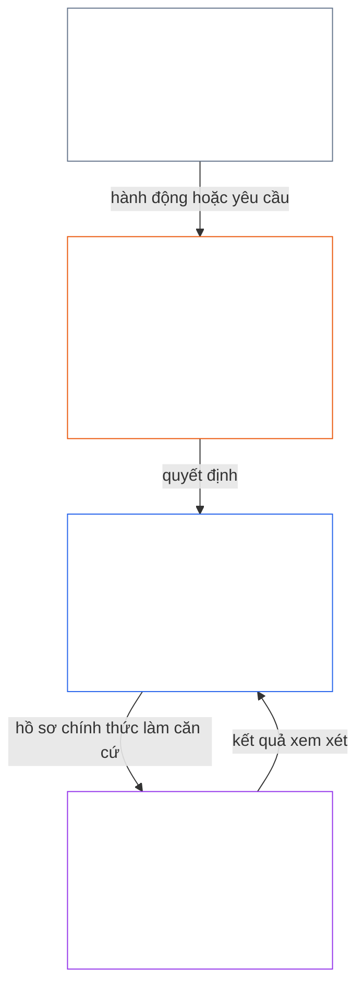
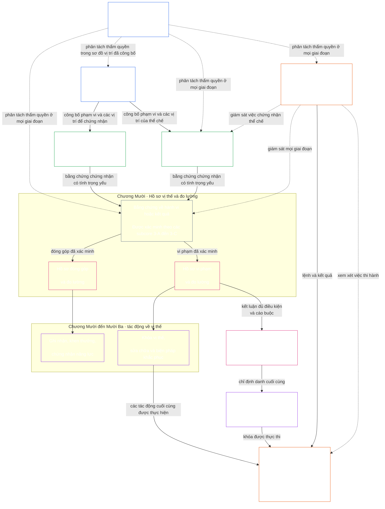

<!-- Locale: vi; language variety: Bản tiếng Việt — thử nghiệm (không ràng buộc). AI-assisted structural resynchronization draft (GPT-6 Codex); unreviewed and incomplete. English pin: SC-Corpus-2026.11.25, commit 6e0b6c663dde01b5dea731fe33d87725c7174930. core_00 SHA-256 90799cb8019b41356fa5dd90565e3f9540fc346e8c77e2c321b841654f39b274; core_01 SHA-256 aca759b394f10784ab1a2eef4e9e2ca12e369ef0ca8ee797298c6af00d2950aa. -->

<!-- Structural resynchronization draft; §§1–4 newly translated against the pinned English source, still requiring independent fidelity review. Other gaps are marked. Do not publish or synchronize. -->

# Chương Một: Bản đồ Hiến pháp

<strong>Vị trí trong kho văn bản (không vận hành): cấu trúc tệp và quy tắc đọc</strong>

> Các tiện ích được đánh dấu **không vận hành** (vị trí trong kho văn bản, hướng dẫn người đọc, bản đồ cho người đọc) chỉ nhằm định hướng. Chúng không thêm, bỏ hay thu hẹp nghĩa vụ ràng buộc, dù trong chính tệp của chúng hay bất kỳ tệp nào khác.
>
> Tệp này **là một phần của Hiến pháp Hữu tri** và **chỉ có tính ràng buộc khi được đọc cùng nhau** với các tệp `core_*` được đánh số khác và subcore như một văn bản thống nhất. Tệp này có **Chương Một**, *Bản đồ Hiến pháp*: mục đích (§1), lý do tồn tại (§2), cách các tệp liên kết (§3), nền tảng cho các chương tiếp theo (§4), các quy trình quản trị chính (§5), và sổ đăng ký chủ thể chịu trách nhiệm theo hiến pháp (§6 đến §11).
>
> **Trước:** [core_00.000_preamble.md](core_01_constitutional_map.md) (Lời mở đầu)
> **Tiếp:** [core_02.000_values_principles.md](../../core_02.000_values_principles.md)

<strong>Dấu vết</strong>

- Trước: [Lời mở đầu](core_01_constitutional_map.md) (*Mô hình, Hai Mục tiêu Hiến pháp, Tứ diện Hiến pháp, lợi hại vật chất và các loại đo lường*).
- Các mục:
  - [§1](#1-purpose-role-and-scope);
  - [§2](#2-why-the-map-exists);
  - [§3](#3-how-the-files-fit-together);
  - [§4](#4-foundations-for-the-chapters-that-follow);
  - [§5](#5-key-governance-processes);
  - [§6](#6-principles-definitions-and-rights);
  - [§7](#7-system-and-institutional-charters-functional-independence-and-separation-of-duties);
  - [§8](#8-key-practical-process-pipelines);
  - [§9](#9-process-ownership-and-outputs);
  - [§10](#10-governance-change-and-incorporation);
  - [§11](#11-adopted-implementation-corpus).
- Đọc cùng: [Thứ bậc Thẩm quyền và Hệ thống Nội bộ](../../subcore_03.080_band_integrative.md#authority-stack-and-internal-hierarchy) (*cách áp dụng sổ đăng ký chủ thể chịu trách nhiệm*); [README.md](README.md) (*thứ tự đọc*).

 

### 1. Mục đích, Vai trò và Phạm vi

*Nói thẳng: chương này là bản hướng dẫn cho phần còn lại của Hiến pháp. Nó cho thấy các phần liên kết với nhau ra sao, chương nào chịu trách nhiệm về từng chủ đề và các quy trình chính vận hành thế nào, để người đọc tìm được quy tắc trả lời câu hỏi của mình.*

**Mục đích:** Chương Một cung cấp cái nhìn tổng quan và hướng dẫn về trách nhiệm. Chương nêu tên các quy trình kiểm tra quản trị được ủy quyền, chỉ rõ chương nào chịu trách nhiệm về từng lĩnh vực nội dung và mô tả ba tầng văn bản hiến pháp.

**Vai trò:** Chương này định hướng và phân định trách nhiệm. Ngoài sổ đăng ký chủ thể chịu trách nhiệm, được các chương khác và [Thứ bậc Thẩm quyền và Hệ thống Nội bộ](../../subcore_03.080_band_integrative.md#authority-stack-and-internal-hierarchy) áp dụng, chương không tự đặt ra nghĩa vụ nào.

**Phạm vi chương:**

- lý do bản đồ tồn tại (**mục 2**);
- cách các tệp liên kết với nhau (**mục 3**) và nền tảng cho các chương tiếp theo (**mục 4**);
- các quy trình quản trị chính (**mục 5**);
- sổ đăng ký chủ thể chịu trách nhiệm của hiến pháp: nguyên tắc, định nghĩa và quyền (**mục 6**); hiến chương hệ thống và thể chế, tính độc lập chức năng và phân tách nhiệm vụ (**mục 7**); các chuỗi quy trình (**mục 8**); chủ thể chịu trách nhiệm và đầu ra của quy trình (**mục 9**); quản trị, thay đổi và việc đưa vào áp dụng (**mục 10**); và
- tập hợp văn bản triển khai đã được thông qua cùng tập hợp văn bản phụ (**mục 11**).

### 2. Vì sao có bản đồ

*Nói thẳng: một văn bản dài như thế này cần bản hướng dẫn cho thấy các phần liên kết ra sao và ai chịu trách nhiệm về từng chủ đề. Chương này giúp người đọc tìm quy tắc trả lời câu hỏi của mình.*

Hiến pháp phân chia công việc giữa nhiều chương, một tập hợp văn bản phụ và bốn tập hợp văn bản đã được thông qua. Một hữu tri muốn biết mình được hưởng điều gì, hoặc một bên thông qua muốn tìm nghĩa vụ, có thể bị lạc. Chương này là cái nhìn tổng quan và hướng dẫn về trách nhiệm: mỗi phần làm gì, chương nào chịu trách nhiệm về từng chủ đề, các chuỗi quy trình vận hành thế nào và các tầng văn bản liên hệ ra sao. Ngoài sổ đăng ký chủ thể chịu trách nhiệm, chương không tự đặt ra quy tắc.

**Cơ sở:**

- Lời nói đầu:
  - [Tứ diện Hiến pháp](core_00_preamble.md#constitutional-tetrad): các chức năng mà chương này đưa vào thực tiễn:
    - [Tham gia](../../subcore_03.060_apex_participation_leg.md#participation): hữu tri có thể tìm quy tắc trả lời câu hỏi của mình;
    - [Trách nhiệm giải trình](../../subcore_03.040_apex_accountability_leg.md#accountability): mỗi chủ đề có một chương được nêu tên, chịu trách nhiệm trả lời;
    - [Giám sát](../../subcore_03.055_apex_oversight_leg.md#oversight): người đọc có thể thấy các phần khớp với nhau thế nào và phát hiện chỗ thiếu hoặc chồng lấn;
    - [Kịp thời](../../subcore_03.065_apex_timeliness_leg.md#timeliness): người đọc đến được quy tắc phù hợp mà không bị trì hoãn;
  - [Hai Mục tiêu Hiến pháp](core_00_preamble.md#two-constitutional-aims): cả hai mục tiêu mà chương này phục vụ:
    - [Hưng thịnh](core_00_preamble.md#flourishing): Hiến pháp chỉ phục vụ các hữu tri nếu họ có thể tìm đường trong văn bản;
    - [Liên tục](core_00_preamble.md#continuity): bản đồ rõ ràng giữ văn bản nguyên vẹn khi nó phát triển và thay đổi;
- các nguyên tắc của Chương Hai:
  - [§5.2 Khả năng tiếp cận bằng ngôn ngữ phổ thông (nghĩa vụ tham gia và quản trị có trách nhiệm)](../../core_02.000_values_principles.md#52-plain-language-accessibility-participation-and-stewardship-duty);
  - [§5.2.4 Kỷ luật chống dùng sự phức tạp để đánh bại mục đích](../../core_02.000_values_principles.md#524-complexity-as-defeat-discipline);
  - [§15.4 Giải quyết xung đột về ý nghĩa hiến pháp](../../core_02.030_constitutional_interpretation.md#154-constitutional-meaning-conflict-resolution);
- các điều khoản của Chương Bốn:
  - [Điều XXIV-A](../../core_04.030_rights_part_d.md#article-xxiv-a-proportional-comprehensibility-right) (*Quyền được hiểu tương xứng*);
  - [Điều XXIV-B](../../core_04.030_rights_part_d.md#article-xxiv-b-complexity-audit-and-modularity-requirements) (*Yêu cầu kiểm toán độ phức tạp và tính mô-đun*).

### 3. Các tệp liên kết với nhau ra sao

Các tệp của Hiến pháp liên kết như sau:

- **Lõi (`core_*`):** Các tệp được đánh số chứa các chương của Hiến pháp, được viết để đọc cùng nhau như một văn bản. Chúng nêu các bảo đảm và cấu trúc hiến pháp.
- **Tập hợp văn bản phụ (`subcore_*`):** Các tệp này cung cấp đầy đủ quy tắc và thủ tục đứng sau các chương. Mỗi tệp thuộc về một chương, có hiệu lực ngang với chương đó và ràng buộc mọi bên thông qua mà không cần đưa vào riêng. Tập hợp văn bản phụ không được thu hẹp chương của mình.
- **Triển khai (`corpus_*`):** Bốn tệp cung cấp chi tiết vận hành để thực thi Hiến pháp. Chúng ràng buộc trong phạm vi được đưa vào hợp lệ và triển khai Hiến pháp mà không thu hẹp Hiến pháp. [Mục 11](#11-adopted-implementation-corpus) nêu bốn tệp đó.

[Corpus](../../subcore_03.080_band_integrative.md#corpus) được định nghĩa là tập hợp rộng hơn, có phiên bản, gồm các nguồn hiến pháp ràng buộc: lõi, tập hợp văn bản phụ, văn bản triển khai đã được thông qua và mọi lớp bao tương thích hợp lệ trong giai đoạn chuyển tiếp. Bản nháp, ghi chú và hướng dẫn điều hướng không trở nên ràng buộc chỉ vì chúng thuộc dự án.

### 4. Nền tảng cho các chương tiếp theo

*Nói thẳng: Chương Hai đến Chương Bốn chịu trách nhiệm về các giá trị, từ điển (cùng quy tắc trong tập hợp văn bản phụ về cách xây dựng, bảo vệ và chứng minh định nghĩa) và Sàn Quyền; các chương sau phải tôn trọng những phạm vi đó, không âm thầm chuyển chúng đi nơi khác.*

**Chương Hai đến Chương Bốn** cung cấp các giá trị, từ vựng, cơ chế xác minh và Sàn Quyền mà mọi nội dung phía sau phải tôn trọng, bao gồm:

- yêu cầu về Hiến chương Hệ thống hoặc Hiến chương Thể chế ở Chương Năm, yêu cầu phân tách nhiệm vụ ở Chương Sáu và các Cơ quan Độc lập ở Chương Bảy;
- [Các chuỗi quy trình thực tiễn then chốt](#8-key-practical-process-pipelines) tại mục 8;
- [chủ thể chịu trách nhiệm và đầu ra của quy trình](#9-process-ownership-and-outputs) tại mục 9;
- các chương về quản trị và lộ trình thay đổi tại mục 10; và
- [Tập hợp văn bản triển khai đã được thông qua](#11-adopted-implementation-corpus) tại mục 11.

### 5. Các quy trình quản trị then chốt

*Nói thẳng: khi văn bản đòi hỏi, trước hết tách các vị trí hành động, kiểm tra, ghi nhận và nghe phản biện. Vấn đề trọng yếu đi qua chứng nhận, hồ sơ viết về giúp ích và tổn hại, sửa chữa và khắc phục, rồi rà soát diễn đàn có thời hạn. Tranh chấp thường dùng đường phản biện đã công bố trước. Các quy trình này thử thách quản trị đã được ủy quyền; bản thân chúng không tạo quyền quản trị.*

Khi [Chương Bốn — Quyền nền tảng](../../core_04.000_rights_part_a.md#chapter-four-foundational-rights), [Subcore 8-B — Chứng nhận thẳng hàng hệ thống](../../subcore_08.020_system_alignment_certification_evaluation.md#subcore-8-b-system-alignment-certification--evaluation), văn bản được hợp nhất, hoặc quy định hiến pháp khác đòi rõ, hãy đưa vấn đề hiến pháp trọng yếu vào một hay nhiều đường dẫn dưới đây. [Các chuỗi quy trình thực tiễn then chốt](#8-key-practical-process-pipelines) biến đo lường thành hồ sơ, chứng nhận, đầu vào đã xác minh, phân loại, giám sát diễn đàn, sửa chữa và khắc phục kịp thời. Chúng thử thách, tiếp nhận phản biện và sửa chữa quản trị đã được ủy quyền trong thực tế; không tự ủy quyền quản trị. [§8.2](#82-how-the-full-chain-fits-together) cho thấy các giai đoạn khớp nhau thế nào.

**Các đường dẫn:**

- **Độc lập chức năng và phân tách nhiệm vụ** ([Chương Sáu](../../core_06.000_functional_independence_separation_of_duties.md#chapter-six-functional-independence-and-separation-of-duties)): trước khi hành vi ràng buộc trọng yếu được tiến hành, hãy xác định và tách riêng các vị trí khởi xướng, xác minh hoặc cho phép, lưu giữ hồ sơ chính thức, và xem xét phản biện theo quy tắc quy mô và độc lập áp dụng.
- **Chứng nhận thẳng hàng hệ thống** ([Subcore 8-B](../../subcore_08.020_system_alignment_certification_evaluation.md#subcore-8-b-system-alignment-certification--evaluation)): trước khi tin cậy hệ thống tác động cao ở quy mô lớn, thu thập và rà soát chứng cứ xem việc dựa vào nó lúc này có an toàn về hiến pháp không. Chứng nhận là một trong hai bảo vệ phối hợp: chứng nhận khiến hệ thống đáng tin, còn quyền phản biện và kiểm toán hệ thống của cảm tri ([Điều XIV — Quyền đối với hệ thống đáng tin cậy](../../core_04.020_rights_part_c.md#article-xiv-right-to-reliable-and-trustworthy-systems)) giữ cho sự tin cậy được kiểm soát; bên này không thay thế bên kia.
- **Hồ sơ quỹ đạo** ([Subcore 10-B](../../subcore_10.020_standing_assessment.md#subcore-10-b-standing-records--question-1-what-happened)): khi hành vi hoặc tổn hại có ý nghĩa hiến pháp, ghi sự kiện đã xác minh vào hồ sơ vụ việc về đóng góp hoặc vi phạm chính thức; tin đồn và danh tiếng không đủ.
- **Sửa chữa và khắc phục** ([Chương Mười Hai §3.1](../../core_12.000_violation_consequences.md#31-remedy-and-correction)): sau vi phạm đã xác minh, đánh giá riêng việc cần làm để xử lý nguyên nhân và ngăn vi phạm tiếp diễn (**sửa chữa**) cùng điều phải dành cho người bị hại (**khắc phục**). Tùy trường hợp, khắc phục gồm thừa nhận, sửa chữa hoặc phục hồi, cùng bồi thường, bảo vệ thay thế khi không thể sửa nguyên trạng, hoặc hình thức đền bù tương đương. Sửa nguyên nhân không thay khắc phục và ngược lại.
- **Rà soát diễn đàn** ([Chương Mười Sáu](../../core_16.000_forum.md#1-purpose-role-and-scope)): tranh chấp thường trong hệ thống đã được ủy quyền trước hết dùng đường phản biện đã công bố của [Tham gia Hệ thống của Bên liên quan](../../subcore_03.090_band_participation.md#stakeholder-status-and-weight). Nếu đường đó vẫn bị tranh biện, thiếu, bị chiếm đoạt hoặc không thể cấp khắc phục, định tuyến theo lợi hại chính qua các diễn đàn được giám sát. Diễn đàn hỗ trợ chứng cứ, chuyển giao hợp pháp và thời hạn theo **Điều XXVII-C** (*Sàn Giải quyết Kịp thời và Chống Trì hoãn*).

### 6. Nguyên tắc, định nghĩa và quyền

**Các mục Sáu đến Mười Một** tạo thành **sổ đăng ký chủ sở hữu hiến định**: nêu chương hoặc kho nội dung được thông qua nào chịu trách nhiệm cho từng chủ đề và tạo ra kết quả gì. Mỗi chương được đánh số và tệp subcore cũng mở đầu bằng câu ràng buộc nêu rõ phần mình phụ trách. Các phần khác có thể dẫn đến chủ sở hữu đó nhưng không được âm thầm viết lại hay chuyển trách nhiệm. Quy tắc được giải thích tại [Thứ bậc Thẩm quyền và Trật tự Nội bộ](../../subcore_03.080_band_integrative.md#authority-stack-and-internal-hierarchy).

Mỗi tóm tắt dưới đây nêu chương phụ trách gì và tạo ra gì.

#### 6.1 [Chương Hai — Giá trị, Nguyên tắc và Quản trị có trách nhiệm](../../core_02.000_values_principles.md)

- **Phụ trách:** Các giá trị và ràng buộc định hướng của Hiến pháp, gồm phúc lợi, công bằng, An toàn, Sự thật, Niềm tin và tự do có giới hạn; ghi nhận và thưởng tương xứng đóng góp hợp pháp; giải quyết xung đột giữa nguyên tắc; và nghĩa vụ quản trị có trách nhiệm như phổ biến hiểu biết, đánh giá toàn hệ thống, kỷ luật quản trị.
- **Kết quả:** nền tảng diễn giải cho mọi chương sau, chuyển mục đích cấp cao thành yêu cầu có hiệu lực khi đọc và áp dụng hệ thống, quyền, định nghĩa và chuỗi quy trình.

#### 6.2 [Chương Ba — Định nghĩa Nền tảng](../../core_03.000_definitions_home.md)

- **Phụ trách:** cấu trúc định nghĩa chuẩn tắc gồm các tầng Giám sát, Tham gia, Trách nhiệm giải trình, Tính liên tục và Tích hợp; [Thứ bậc Thẩm quyền và Trật tự Nội bộ](../../subcore_03.080_band_integrative.md#authority-stack-and-internal-hierarchy); [Bộ văn bản](../../subcore_03.080_band_integrative.md#corpus); và quy tắc ranh giới liên quan.
- **Kết quả:** từ vựng hiến định chính xác cho diễn giải, kiểm toán và phân xử. Đây là **cấu trúc định nghĩa**, không phải Sàn Quyền; Sàn Quyền ràng buộc ở Chương Bốn. Các subcore của Chương Ba nêu quy tắc sau từ điển: 3-A, 3-B và 3-C.

##### 6.2.1 [Cấu trúc Định nghĩa](../../subcore_03.010_definition_structure.md)

Subcore 3-A quy định cách xây thuật ngữ hiến định qua cấu trúc thành phần Bản thể luận/Đo lường/Đánh giá/Tuân thủ (O/M/A/C), yêu cầu tương thích và quy tắc thành phần giữ cho định nghĩa chính xác, dùng được trên toàn bộ văn bản. **Kết quả:** ngữ pháp chung để các chương sau tránh nhãn mơ hồ, giả định ẩn và hình dạng thuật ngữ không tương thích.

##### 6.2.2 [Tính Toàn vẹn của Định nghĩa](../../subcore_03.020_definition_integrity.md)

Subcore 3-B ngăn né tránh và dịch chuyển phạm vi, trò định nghĩa lại, và mánh khóe không tuân thủ làm rỗng định nghĩa trên giấy nhưng đánh bại chúng trong thực tế. **Kết quả:** kỷ luật chống né tránh và siêu dữ liệu định hướng không tuân thủ, gồm các lộ trình sang rà soát quỹ đạo và hành vi sai trái khi đã chứng minh được né tránh.

##### 6.2.3 [Gánh nặng, Khả năng truy vết và Xác minh](../../subcore_03.030_burden_traceability_verification.md)

Subcore 3-C đặt gánh nặng chứng minh lên người khẳng định tuân thủ; đòi hỏi chứng cứ truy vết được, khả năng quan sát và xác minh tương xứng với [**lợi hại vật chất**](../../core_00.000_preamble.md#material-stake), vẫn có thể bị chất vấn trên thực tế. **Kết quả:** quy trình xác minh cấp **đầu vào đã xác minh** cho [Subcore 10-B](../../subcore_10.020_standing_assessment.md#subcore-10-b-standing-records--question-1-what-happened) và chứng cứ thẳng hàng hệ thống cho [Subcore 8-B](../../subcore_08.020_system_alignment_certification_evaluation.md#subcore-8-b-system-alignment-certification--evaluation); không thay việc đo lường quỹ đạo.

#### 6.3 [Chương Bốn — Quyền Nền tảng](../../core_04.000_rights_part_a.md)

- **Phụ trách:** Sàn Quyền tại các Điều **I–XXIX**, gồm nhu cầu thiết yếu để sinh tồn; phân bổ nguồn lực và quản trị sự phụ thuộc; phẩm giá, năng lực tự quyết và tham gia; phản biện và khắc phục; giới hạn công lý; tính kịp thời theo **Điều XXVII-C** (*Sàn Giải quyết Kịp thời và Chống Trì hoãn*); và quy tắc Chuyển tiếp Tiếp nhận. Bốn phần sắp xếp các bảo vệ theo lối đọc ưu tiên hành tinh.
- **Kết quả:** bảo vệ quyền không thể thương lượng và các cơ chế khắc phục mà Chương Năm đến Hai Mươi Sáu, diễn đàn, quản trị và quy tắc sửa đổi phải tôn trọng; không được thu hẹp, né tránh hay làm rỗng bằng thủ tục hoặc chỉ số thay thế.

### 7. Điều lệ hệ thống và thể chế, độc lập chức năng, và phân tách nhiệm vụ

*Nói đơn giản: một hệ thống hoặc tổ chức có ảnh hưởng thực tế công bố Điều lệ Hệ thống hoặc Điều lệ Tổ chức, nêu rõ nó được làm gì và ai giữ từng vị trí. Trước khi một hành động có tính ràng buộc đáng kể được tiến hành, phải tách biệt người khởi xướng, người kiểm tra hoặc cho phép, người giữ hồ sơ chính thức và người xem xét phản đối. Vai trò có thể co giãn theo hoàn cảnh, nhưng cùng một tác nhân và tuyến kiểm soát của nó không thể âm thầm giữ các vị trí kiểm tra chính hành động của mình.*

- **Kết quả tạo ra:** một tuyên bố về phạm vi và vị trí các ghế được công bố, quản lý phiên bản để Chương Tám, chứng nhận, hồ sơ tư cách và các diễn đàn có thể dùng làm căn cứ kiểm tra hành vi. Chương Bảy nằm tại [`core_07.000_charters.md`](../../core_05.000_charters.md#chapter-seven-system-and-institutional-charters).

**Tính độc lập về chức năng và phân tách nhiệm vụ** — trước khi một hành vi ràng buộc đáng kể được tiến hành, hãy xác định và tách biệt các vị trí khởi xướng, xác minh hoặc phê chuẩn, lưu hồ sơ và xem xét phản biện theo các quy tắc điều chỉnh quy mô và độc lập áp dụng.

**Tách biệt các vị trí cho mọi hành vi có tính ràng buộc trọng yếu** ([Chương Tám](core_07_functional_independence_segregation_of_duties.md#2-four-seat-constitutional-requirement)): xác định ai khởi xướng hành vi, ai xác minh hoặc cho phép, ai lưu giữ hồ sơ chính thức và ai tiếp nhận khiếu nại. Áp dụng các tổ hợp bị cấm, quy tắc độc lập và tuyến thay thế đã công bố trước khi coi hành vi là đã được kiểm tra đúng cách. Khi cần Hiến chương Hệ thống hoặc Hiến chương Tổ chức ([Chương Bảy](../../core_05.000_charters.md#4-the-charter-role-map-and-standing-record-custody)), Bản đồ Vai trò trong Hiến chương công bố ai đảm nhiệm từng vị trí.

**Chương Tám — Tính độc lập chức năng và phân tách nhiệm vụ**

- **Phạm vi phụ trách:** Yêu cầu xuyên quy trình rằng mỗi [Hành động Ràng buộc Trọng yếu](../../subcore_03.070_band_accountability.md#materially-binding-act) phải phân công riêng bốn chức năng:
  - khởi xướng;
  - xác minh hoặc cho phép;
  - lưu giữ hồ sơ chính thức; và
  - xem xét phản đối.

Nội dung này cũng điều chỉnh:

  - nội dung tối thiểu áp dụng chung của mỗi [Hồ sơ Hành vi Ràng buộc Đáng kể](../../subcore_03.070_band_accountability.md#materially-binding-act-record);
  - tính độc lập với [Tuyến Kiểm soát Vật chất](../../subcore_03.070_band_accountability.md#material-control-line) của chủ thể hành động;
  - việc phân công chức năng được công bố và các phương án thay thế;
  - việc hợp nhất vận hành tương xứng và giới hạn trong tình huống khẩn cấp; và
  - các lần bàn giao có thể quy trách nhiệm cùng việc chuyển sai vị trí.
- **Kết quả tạo ra:** một kiến trúc bốn vị trí và Hồ sơ Hành vi có thể tái sử dụng. Mọi quy trình chứng nhận, ghi nhận tư cách, diễn đàn, quản trị và triển khai tích hợp về sau phải áp dụng kiến trúc này trước khi kết quả được xem là đã được kiểm tra độc lập, ghi nhận đáng tin cậy và thực sự có thể bị phản biện.

#### 7.1 Bản đồ phân tách bốn vị trí

> Sơ đồ này cho thấy bốn chức năng và đường truy nguyên điển hình của một hành động cùng Hồ sơ Hành động. Sơ đồ không thêm vị trí thứ năm, không đặt ra trình tự phổ quát, và không thay đổi quy tắc ở Chương Tám về tính độc lập, việc lưu trữ chung tương xứng, hành động khẩn cấp hoặc định tuyến phản đối.

### 8. Các chuỗi quy trình thực tiễn then chốt

*Nói thẳng: Chương Tám đến Hai Mươi Hai áp dụng yêu cầu phân tách nhiệm vụ của Chương Sáu thành một chuỗi: chứng nhận hệ thống và thể chế, đo giúp ích và tổn hại trên hai tuyến riêng, áp dụng hiệu ứng và khắc phục thực tế, đồng thời ngăn diễn đàn trở thành nơi cuối cùng duy nhất xét yêu cầu chống lại chính mình. Chuỗi khiến nghĩa vụ hiến pháp có hiệu lực trong đời sống hằng ngày.*

Hai chương đặt nền tảng cho chuỗi quy trình:

- [Chương Năm](../../core_05.000_charters.md#chapter-five-system-and-institutional-charters) công bố phạm vi theo điều lệ và bản đồ vị trí của mọi hệ thống và thể chế L trở lên.
- [Chương Sáu](../../core_06.000_functional_independence_separation_of_duties.md#chapter-six-functional-independence-and-separation-of-duties) đặt yêu cầu phân tách nhiệm vụ để mỗi hành vi trong chuỗi có thể được kiểm tra hợp lệ: khởi xướng, xác minh hoặc cho phép, lưu hồ sơ chính thức và xem xét phản biện phải được giao riêng và giữ riêng theo quy tắc quy mô/độc lập áp dụng.

Các quy trình dưới đây áp dụng kiến trúc đó. Mỗi quy trình tạo kết quả riêng, có thể rà soát; vai trò không nhập làm một:

- **Chứng nhận** kiểm tra hệ thống hoặc thể chế có thẳng hàng trong phạm vi và kỳ ghi nhận đã nêu không. Với hệ thống, Chương Tám quản lý đánh giá, quy trình/kết quả diễn đàn, Hồ sơ Chứng nhận Hệ thống và tái chứng nhận, tạo chứng cứ đã xác minh về sự thẳng hàng. Với thể chế, Chương Chín quản lý lớp riêng, đánh giá, quy trình/kết quả diễn đàn (kể cả mức sẵn sàng khắc phục), Hồ sơ Chứng nhận Thể chế và tái chứng nhận; xác minh độc lập hỗ trợ quyết định.
- **Hồ sơ quỹ đạo và đo lường** ghi sự kiện đã xác minh, đánh giá riêng đóng góp và vi phạm. Chương Mười ghi sự kiện đã xác minh vào Hồ sơ Đóng góp và Hồ sơ Vi phạm riêng rồi đo từng hồ sơ trên trục riêng. Đóng góp đã xác minh cho Hưng thịnh không bù trừ, hủy bỏ hay giảm tổn hại hoặc thiếu trách nhiệm đã xác minh riêng.
- **Tích hợp quỹ đạo** biến phân loại thành hiệu ứng tương xứng theo Chương Mười: tuyến đóng góp gồm giấy phép năng lực và ghi nhận; tuyến vi phạm gồm khóa quỹ đạo, sửa chữa và khắc phục.
- **Rà soát hành vi sai trái** đặt câu hỏi riêng theo Chương Mười Bốn: sau khi Chương Mười đo vi phạm cấp cao, hành vi có độc lập đạt tiêu chí chỉ định ACMD cuối cùng không, sau các bảo đảm thủ tục đúng đắn?
- **Giám sát diễn đàn** theo Chương Mười Sáu và Mười Bảy hỗ trợ rà soát, sửa chữa. Diễn đàn giám sát định tuyến, chứng cứ, chuyển giao, tính độc lập diễn đàn và giải quyết kịp thời; hồ sơ và hiệu ứng có thể bị phản biện, sửa và thi hành mà không để diễn đàn bị chiếm đoạt là nơi duy nhất xét xử cuối cùng hành vi của chính mình.

Tóm tắt tại các mục Sáu đến Mười Một nêu chủ sở hữu và kết quả của từng lĩnh vực.

#### 8.1 Sơ đồ Quy trình

#### 8.1 Sơ đồ Quy trình

#### 8.1 Sơ đồ quy trình

- **Chương Chín** dùng xác minh độc lập để quyết định hệ thống hoặc tổ chức có ảnh hưởng đáng kể có phù hợp trong phạm vi và thời hạn hồ sơ đã nêu hay không. Chương Chín điều chỉnh chứng nhận hệ thống; Chương Mười điều chỉnh chứng nhận tổ chức, gồm lớp, đánh giá, hồ sơ và kết quả khắc phục riêng của tổ chức.
- **Chương Mười Một** tiếp nhận sự kiện đã xác minh và ghi vào hồ sơ trạng thái Đóng góp và Vi phạm riêng biệt.
- **Chương Mười Hai** đo từng hồ sơ trạng thái theo trục riêng. Đóng góp đã xác minh cho sự hưng thịnh không bù trừ, xóa bỏ hoặc giảm tổn hại hay thất bại trách nhiệm giải trình được xác minh riêng; mỗi bên vẫn được ghi nhận và chịu hệ quả riêng.
- **Chương Mười Ba** chuyển các phân loại đó thành tác động trạng thái tương xứng, gồm thông qua năng lực và sự công nhận ở tuyến đóng góp, cùng khóa trạng thái, sửa chữa và khắc phục ở tuyến vi phạm.
- **Chương Mười Bốn** chỉ áp dụng sau khi Chương Mười Hai đã đo một vi phạm cấp cao. Sau các bảo đảm thủ tục công bằng, chương này quyết định liệu hành vi có độc lập đáp ứng tiêu chí của chỉ định cuối cùng về hành vi sai trái chống hiến pháp (ACMD) hay không.
- **Chương Mười Lăm** giám sát định tuyến, chứng cứ, chuyển giao, tính độc lập của diễn đàn và giải quyết đúng hạn để hồ sơ và tác động có thể bị phản đối, sửa chữa và thi hành mà không cho phép diễn đàn bị chiếm dụng làm thẩm phán cuối cùng duy nhất cho hành vi của chính nó.
- **Xem xét hành vi sai trái** trả lời câu hỏi riêng: vi phạm đủ điều kiện có đồng thời cần chỉ định ACMD cuối cùng không?
- **Giám sát diễn đàn** kiểm soát định tuyến, chứng cứ, chuyển giao, phản đối và khắc phục để hồ sơ chính thức và quyết định được xem xét, sửa chữa kịp thời.

Chuỗi này vẫn là một quy trình hiến pháp thống nhất vì mỗi giai đoạn chuyển giao một kết quả xác định, có thể rà soát. Chuỗi vẫn nằm trong các giới hạn hiến pháp vì:

- [**Tứ trụ Hiến pháp**](core_00.000_preamble.md#constitutional-tetrad) đòi hỏi mọi giai đoạn có tham gia, được giám sát, có trách nhiệm giải trình và kịp thời;
- [**Hai Mục đích Hiến pháp**](core_00.000_preamble.md#two-constitutional-aims) đòi hỏi quy trình phục vụ đồng thời **Hưng thịnh** và **Liên tục**; và
- các Sàn Quyền cấm mọi giai đoạn thu hẹp, bỏ qua hoặc làm rỗng các bảo vệ không thể thương lượng.

Các quy tắc này biến nghĩa vụ hiến pháp thành hồ sơ và quyết định mà cảm tri có thể kiểm tra, tranh biện, sửa chữa và dựa vào trong thực tế, chứ không chỉ trên giấy.

#### 8.2 Chuỗi đầy đủ khớp nhau thế nào

*Nói thẳng: trước hết tách các vị trí; sau đó đi theo đường từ kiểm tra hệ thống đến khắc phục, với diễn đàn giám sát tranh chấp và các bước quỹ đạo.*

Chuỗi đầy đủ diễn ra theo thứ tự sau:

1. **Tách các vị trí cho mọi hành vi ràng buộc trọng yếu** ([Chương Sáu](../../core_06.000_functional_independence_separation_of_duties.md#3-four-seat-constitutional-requirement)) — xác định ai khởi xướng, ai xác minh hoặc cho phép, ai lưu hồ sơ chính thức và ai nghe tranh biện. Áp dụng các tổ hợp bị cấm, quy tắc độc lập và đường thay thế đã công bố trước khi coi hành vi được kiểm tra hợp lệ. Khi cần điều lệ, Bản đồ Vai trò Điều lệ của [Chương Năm](../../core_05.000_charters.md#6-the-charter-role-map-and-standing-record-custody) công bố người giữ từng vị trí.
2. **Chứng nhận hệ thống và thể chế khi tác động đủ nghiêm trọng** — trước khi tin cậy hệ thống tác động cao ở quy mô lớn, cần có Hồ sơ Chứng nhận Hệ thống có thể tranh biện ([Subcore 8-B](../../subcore_08.020_system_alignment_certification_evaluation.md#subcore-8-b-system-alignment-certification--evaluation)); đánh giá thể chế theo lớp, hành vi, quản trị và danh mục hoạt động của chính thể chế theo [Subcore 9-B](../../subcore_09.020_institutional_alignment_certification_evaluation.md#subcore-9-b-institutional-alignment-certification--evaluation), rồi ghi kết quả vào Hồ sơ Chứng nhận Thể chế.
3. **Ghi và đo quỹ đạo trên các tuyến riêng** ([Subcore 10-B](../../subcore_10.020_standing_assessment.md#subcore-10-b-standing-records--question-1-what-happened) và [Subcore 10-D](../../subcore_10.040_standing_measurement.md#subcore-10-d-standing-measurement--question-2-how-good-or-bad-was-it)) — khi giúp ích hoặc tổn hại đủ trọng yếu về hiến pháp, Chương Mười mở hồ sơ chính thức và chỉ nhận **đầu vào đã xác minh** (kể cả chứng cứ chứng nhận thẳng hàng hệ thống từ Chương Tám khi có ý nghĩa trọng yếu). Đóng góp và vi phạm được ghi, đo riêng; tin đồn, danh tiếng và chuyện kể tranh chấp không đủ, hai bên không gộp thành điểm ròng.
4. **Áp dụng hiệu ứng quỹ đạo riêng cho mỗi tuyến** ([Subcore 10-F](../../subcore_10.060_standing_integration.md#subcore-10-f-standing-integration--question-3-what-follows)) — đóng góp đã xác minh có thể cấp giấy phép năng lực và phải hỗ trợ ghi nhận, thưởng vật chất tương xứng; vi phạm đã xác minh có thể dẫn đến khóa quỹ đạo, sửa chữa và [khắc phục cho người bị hại](../../core_12.000_violation_consequences.md#31-remedy-and-correction).
5. **Rà soát chỉ định hành vi chống hiến pháp** ([Chương Mười Bốn](../../core_14.000_misconduct_designation.md#chapter-fourteen-anti-constitutional-misconduct-designation)) — nếu phát hiện vi phạm tác động cao nhất cũng có thể đạt tiêu chí chống hiến pháp, Chương Mười Bốn quyết định có gắn ACMD tương ứng hay không. ACMD không đổi mức độ tổn hại mà Chương Mười đã đo; hiệu ứng thông thường tiếp tục song song cho đến khi ACMD cuối cùng kích hoạt Khóa Niềm tin Chống Hiến pháp.
6. **Định tuyến tranh chấp và bảo đảm khắc phục kịp thời** ([Chương Mười Sáu](../../core_16.000_forum.md#1-purpose-role-and-scope) và [Chương Mười Bảy](../../core_17.000_forum_families_escalation_timeliness_support.md#chapter-seventeen-forum-families-escalation-timely-resolution-and-support)) — diễn đàn giám sát việc di chuyển vụ việc, tuyến xử lý và thời hạn theo **Điều XXVII-C** (*Sàn Giải quyết Kịp thời và Chống Trì hoãn*), để khắc phục không mất ý nghĩa vì chậm trễ. Tranh chấp thông thường theo [Trình tự tranh chấp](../../core_16.000_forum.md#dispute-sequencing). Diễn đàn cũng phân loại vụ việc theo năm [mức lợi hại trọng yếu](../../core_17.000_forum_families_escalation_timeliness_support.md#5-timely-resolution-materiality-tiers-and-anti-delay-discipline) (A/B/C/L/P), tương ứng bảng chữ cái phân loại hệ thống, từ khẩn cấp sống còn đến việc riêng tư/giới hạn. Mặc định định tuyến về họ Tính toàn vẹn áp dụng khi việc chỉ định cuối cùng của Chương Mười Bốn là lợi hại chính.
7. **Thi hành kết quả** ([Chương Mười Chín](../../core_19.000_enforcement.md#chapter-nineteen-enforcement) và [Chương Hai Mươi](../../core_20.000_special_enforcement.md#chapter-twenty-special-enforcement)) — bên được nêu tên thi hành hiệu ứng cuối cùng, khóa, khắc phục hoặc lệnh diễn đàn trong thời hạn của mình; không được né tránh, trì hoãn hoặc âm thầm bỏ qua. Nếu chủ thể bị ràng buộc chống lại, áp dụng thực thi đặc biệt trong các sàn chung: thu giữ tiền/tài sản với mức tối thiểu được bảo vệ, thang áp lực bàn giao chuẩn, thang dùng vũ lực ưu tiên phi sát thương, và đánh giá nguyên nhân gốc để không lặp lại cùng thất bại.

Mỗi giai đoạn dẫn đến chương sở hữu nó để có thể lần theo chuỗi từ đây, kể cả đầu vào đã xác minh tiềm năng từ Chương Tám vào việc đo lường quỹ đạo.

### 9. Quyền sở hữu quy trình và kết quả

Mỗi mục dưới đây nêu chủ sở hữu và kết quả của một giai đoạn; không giai đoạn nào thay nhiệm vụ của giai đoạn khác.

- **[Subcore 8-B — Chứng nhận thẳng hàng hệ thống](../../subcore_08.020_system_alignment_certification_evaluation.md#subcore-8-b-system-alignment-certification--evaluation):** Bảo đảm hệ thống có tác động trọng yếu thẳng hàng với hiến pháp. Trước khi chứng nhận hoặc tin cậy ở quy mô lớn, chứng cứ được thu thập và rà soát dưới giám sát diễn đàn, bao gồm nhu cầu sinh tồn, phân bổ nguồn lực và quản trị phụ thuộc theo Điều V (kể cả hỗ trợ liên hệ thống khi có liên quan), an toàn, tham gia và các sàn hiến pháp khác. Người có tư cách có thể tranh biện; hệ thống rủi ro cao phải được chứng nhận lại định kỳ. **Kết quả:** Hồ sơ Chứng nhận Hệ thống có phạm vi/kỳ ghi nhận rõ và có thể tranh biện.
- **[Subcore 9-B — Chứng nhận thẳng hàng thể chế](../../subcore_09.020_institutional_alignment_certification_evaluation.md#subcore-9-b-institutional-alignment-certification--evaluation):** Bảo đảm thể chế có tác động trọng yếu thẳng hàng qua cùng sáu giai đoạn. Chương Chín sở hữu đánh giá (I–II), 9-D sở hữu quy trình và kết quả diễn đàn (III–IV), 9-F sở hữu hồ sơ chứng nhận và vận hành (V–VI). Việc rà soát tập trung vào những điều thể chế kiểm soát và dựa vào chứng nhận hệ thống, không làm lại. **Kết quả:** Hồ sơ Chứng nhận Thể chế có phạm vi/kỳ ghi nhận rõ, có thể tranh biện; đây không phải giấy phép hay điều kiện để lập hoặc vận hành thể chế.
- **[Subcore 10-B — Hồ sơ quỹ đạo](../../subcore_10.020_standing_assessment.md#subcore-10-b-standing-records--question-1-what-happened):** Ghi sự kiện đã xác minh vào hồ sơ đóng góp và vi phạm riêng khi hành vi có ý nghĩa hiến pháp; tin đồn, danh tiếng và chấm điểm không chính thức không đủ. **Kết quả:** Hồ sơ có giới hạn dựa riêng trên đầu vào đã xác minh và phát hiện dưới giám sát diễn đàn.
- **[Subcore 10-D — Đo lường quỹ đạo](../../subcore_10.040_standing_measurement.md#subcore-10-d-standing-measurement--question-2-how-good-or-bad-was-it):** Đo đóng góp và vi phạm trên các trục riêng nhưng cùng thang đo thống nhất, không gộp điểm ròng. **Kết quả:** Phân loại tính chất, quy mô và mức cho từng hồ sơ trên trục tương ứng.
- **[Subcore 10-F — Tích hợp và hiệu ứng quỹ đạo](../../subcore_10.060_standing_integration.md#subcore-10-f-standing-integration--question-3-what-follows):** Chuyển phân loại đã xác minh thành hiệu ứng thực tế riêng theo lợi hại vật chất, không gộp hai quỹ đạo hoặc làm rỗng tham gia, giám sát, trách nhiệm giải trình hay tính kịp thời. **Kết quả:** giấy phép năng lực, ghi nhận và thưởng vật chất ở quỹ đạo đóng góp; khóa, giới hạn vai trò, sửa chữa, khắc phục và cơ chế thực thi ở quỹ đạo vi phạm.
- **[Chương Mười Bốn — Chỉ định hành vi chống hiến pháp](../../core_14.000_misconduct_designation.md#chapter-fourteen-anti-constitutional-misconduct-designation):** Xử lý vi phạm đã xác minh nghiêm trọng nhất có thể chiếm đoạt hoặc làm rỗng nghĩa vụ hiến pháp trên quy mô lớn, bằng rà soát với thủ tục đúng đắn. **Kết quả:** ACMD cuối cùng hoặc bác bỏ cho phát hiện tác động cao nhất hiện có; chỉ ACMD cuối cùng kích hoạt Khóa Niềm tin Chống Hiến pháp của Chương Mười.
- **[Chương Mười Sáu — Tiêu chuẩn, định tuyến và hồ sơ diễn đàn](../../core_16.000_forum.md#chapter-sixteen-standards-routing-and-forum-cases):** Giám sát trình tự từ đường tranh biện tham gia hệ thống đã công bố đến diễn đàn, họ diễn đàn và điểm bắt đầu thường lệ, mở/lưu hồ sơ, chuyển/gộp vụ việc, và quy tắc ngăn diễn đàn bị chiếm đoạt trở thành nơi xét xử cuối cùng duy nhất cho hành vi của chính mình. **Kết quả:** phát hiện có thể mở/cập nhật hồ sơ quỹ đạo và định tuyến hợp pháp đến khắc phục, giải quyết kịp thời; diễn đàn không thay đo lường của Chương Mười.
- **[Chương Mười Bảy — Họ diễn đàn, nâng cấp, giải quyết kịp thời và hỗ trợ](../../core_17.000_forum_families_escalation_timeliness_support.md#chapter-seventeen-forum-families-escalation-timely-resolution-and-support):** Quy định họ diễn đàn và chuẩn chung, nâng cấp/câu hỏi cần phán quyết, rà soát Bảo lưu Tạm thời hẹp trên đường dẫn có tên, hạn Điều XXVII-C, cùng hỗ trợ chứng cứ và người tham gia trước/trong/sau rà soát. **Kết quả:** diễn đàn thích hợp cho mỗi loại việc và giải quyết trong thời gian để khắc phục còn ý nghĩa.
- **[Chương Mười Chín — Thực thi](../../core_19.000_enforcement.md#chapter-nineteen-enforcement):** Quy định ai thi hành kết quả của quy trình quỹ đạo hoặc diễn đàn, trong thời hạn nào, và ngăn né tránh, trì hoãn hay âm thầm bỏ qua. **Kết quả:** kết quả được thực hiện trên thực tế, không chỉ trên giấy; chương không tạo loại hệ quả mới.
- **[Chương Hai Mươi — Thực thi đặc biệt](../../core_20.000_special_enforcement.md#chapter-twenty-special-enforcement):** Bổ sung bảo đảm khi thực thi phải đóng băng/thu giữ tiền hoặc tài sản, khi dùng hoặc có thể dùng vũ lực, hay khi thực thi lặp lại thất bại theo cùng cách. **Kết quả:** thi hành với mức tổn hại lâu dài thấp nhất vẫn thực hiện được kết quả, đồng thời tìm và loại bỏ nguyên nhân gốc của thất bại lặp lại.

### 10. Quản trị, thay đổi và hợp nhất

Chương Mười Tám và các Chương Hai Mươi Mốt đến Hai Mươi Lăm hoàn tất sổ đăng ký chủ sở hữu về quản trị, tính hợp lệ của thay đổi và hợp nhất. Chương Mười Tám đứng sau các chương về diễn đàn theo thứ tự đọc nhưng thuộc lĩnh vực quản trị: Chương Hai Mươi Mốt quy định cách ủy quyền quyền lực quản trị, còn Chương Mười Tám quy định nghị hội làm gì với quyền đó.

- **[Chương Mười Tám — Nghị hội](../../core_18.000_assemblies.md#chapter-eighteen-assemblies):** Quy định quyết định và giới hạn của nghị hội chính thể: chính sách thuế/ngân sách, phân công địa phương/khu vực/quốc gia, đa số cần cho từng loại hành vi, hành pháp do nghị hội chọn/bãi nhiệm, trưng cầu cộng đồng và tình trạng khẩn cấp có phân loại. **Kết quả:** quy tắc và ngân sách công khai do cơ quan chịu trách nhiệm đặt ra, hành pháp chịu trách nhiệm trước nghị hội, và quyền khẩn cấp có loại rõ, được xác nhận nhanh, có thể thu hồi bất cứ lúc nào, không chạm Sàn Quyền.
- **[Chương Hai Mươi Mốt — Khế ước hiến pháp, tính chính danh và quản trị có trách nhiệm](../../core_21.000_governance.md#chapter-twenty-one-constitutional-contract-legitimacy-authorization-and-stewardship):** Sở hữu Lớp Khế ước Hiến pháp: ai được quản trị, theo cơ chế chính danh nào, trong phạm vi/điều khoản lâu dài nào và phải duy trì phẩm chất quản trị nào. **Kết quả:** yêu cầu ủy quyền và chính danh cho bản thân quyền quản trị, khác với tham gia hệ thống của bên liên quan bên trong hệ thống đã được ủy quyền.
- **[Chương Hai Mươi Hai — Không thoái lui](../../core_22.000_non_regression.md#chapter-twenty-two-non-regression-and-substantive-amendment-validity):** Đặt sàn thực chất chống thay đổi thoái lui. Sửa đổi hay lách luật không được đảo ngược bảo vệ cốt lõi, làm rỗng Tứ trụ dưới mức lợi hại vật chất, hoặc ngụy trang thoái lui thành dọn dẹp kỹ thuật. **Kết quả:** rào chắn hiến pháp đầu tiên; thay đổi làm yếu bảo vệ cốt lõi trên thực tế là vô hiệu và lách luật đáng ngờ phải bị chặn hoặc chuyển rà soát.
- **[Chương Hai Mươi Ba — Tu chính, phê chuẩn và tiếp nhận](../../core_23.000_amendment_ratification.md#chapter-twenty-three-amendment-ratification-and-procedural-validity):** Quy định con đường thay đổi hợp pháp và các bảo đảm thủ tục: công bố công khai, truy nguyên đến nơi lưu giữ có thẩm quyền, có thể tranh biện thực chất và được rà soát độc lập khi cần. **Kết quả:** con đường thay đổi hợp pháp đầy đủ; chỉ cập nhật vượt cả rào chắn không thoái lui và bảo đảm thủ tục mới hợp lệ.
- **[Chương Hai Mươi Bốn — Tối cao và mệnh lệnh pháp lý bên ngoài](../../core_24.000_expansion_supremacy.md#chapter-twenty-four-expansion-supremacy-and-external-legal-orders):** Quy định mở rộng bảo vệ hợp pháp, tính tối cao trong nguồn hợp lệ, phạm vi tiếp nhận/lớp quản trị, không gạt bỏ luật bên ngoài có hiệu lực riêng, và tương tác có kỷ luật với trật tự pháp lý bên ngoài. **Kết quả:** quy tắc thứ bậc/xung đột; việc công bố hay sử dụng không được coi là bãi bỏ luật bên ngoài đang áp dụng, và thủ tục hợp nhất, chuẩn bên ngoài yếu hơn hay thước đo tiện lợi không thể lấn át ý nghĩa Hiến pháp trong phạm vi tiếp nhận hợp lệ.
- **[Chương Hai Mươi Lăm — Cầu nối hợp nhất](../../core_25.000_incorporation.md):** Xác định tệp triển khai nào trở thành văn bản hợp nhất ràng buộc khi được tiếp nhận; ghim ấn bản, duy trì chuỗi lưu giữ và cấm lệch lạc thầm lặng giữa nguồn hiến pháp và chi tiết vận hành. **Kết quả:** một biên hợp nhất duy nhất; văn bản triển khai được chỉ định ràng buộc khi tiếp nhận nhưng không trở thành nguồn thứ hai thu hẹp Hiến pháp. §11 tóm tắt các kho đó.

### 11. Bộ nội dung triển khai đã được thông qua

Bốn kho nội dung đã được thông qua cung cấp chi tiết vận hành để thực hiện điều các chương đã yêu cầu. Khi được hợp nhất hợp lệ theo Chương Hai Mươi Lăm, chúng ràng buộc trong phạm vi tiếp nhận với tư cách văn bản triển khai; chúng thực hiện chứ không thu hẹp Hiến pháp.

- **[corpus_joint_structure](../../corpus_joint_structure.md)** — định tuyến xuyên tệp, thuật ngữ vận hành chung và cấu trúc chung khi hệ thống, thể chế, diễn đàn cần được đọc cùng trên cùng sự kiện.
- **[corpus_systems](../../corpus_systems.md)** — phân loại hệ thống, quy trình thiết kế/triển khai, xử lý thông tin và cơ chế quản trị có trách nhiệm trọng yếu.
- **[corpus_institutions](../../corpus_institutions.md)** — hình thành thể chế, quản trị, giám sát, tính tương xứng và kỷ luật giải thể.
- **[corpus_forum](../../corpus_forum.md)** — vận hành diễn đàn: lập hội đồng, rút khỏi vụ việc, làn rà soát, chi tiết định tuyến và hỗ trợ pháp y.

Khi được tiếp nhận hợp lệ, các tệp này ràng buộc trong phạm vi tiếp nhận nhưng ý nghĩa của Sentient Constitution vẫn kiểm soát. Ghim ấn bản, chuỗi lưu giữ và quy tắc không lệch lạc thầm lặng giúp truy nguyên văn bản được tiếp nhận đến nội dung đã phê chuẩn. Danh sách chuẩn và ranh giới nằm tại [Corpus](../../subcore_03.080_band_integrative.md#corpus).

Giữa các chương và kho nội dung đã tiếp nhận là **subcore**: các tệp `subcore_*` chứa chi tiết đầy đủ về bảo đảm và thủ tục phải giống nhau cho mọi bên tiếp nhận. Mỗi subcore thuộc một chương, ràng buộc như chương đó và chỉ thay đổi bằng tu chính theo [Chương Hai Mươi Ba](../../core_23.000_amendment_ratification.md#chapter-twenty-three-amendment-ratification-and-procedural-validity). Chương nêu bảo đảm bằng lời rõ ràng; subcore nêu quy tắc đầy đủ. Trích dẫn chỉ tầng được dẫn: “Chương Mười” dẫn đến văn bản bảo đảm cố định; “Subcore 8-E” dẫn đến chi tiết chuẩn hóa; hai tầng có cùng hiệu lực. Định nghĩa của Chương Ba được dẫn bằng thuật ngữ đã định nghĩa.

Nguyên tắc, định nghĩa, quyền, chuỗi quy trình, quản trị, quy tắc tu chính, subcore và triển khai được hợp nhất phải được đọc cùng để bảo toàn mục đích bảo vệ của Hiến pháp.
---

**Tệp trước:** [README.md](README.md)

**Tệp tiếp theo (ngôn ngữ này):** [core_01_a_values_principles.md](../../core_02.000_values_principles.md)

**Nguyên bản ràng buộc:** [core_00_preamble.md](core_00_preamble.md)
