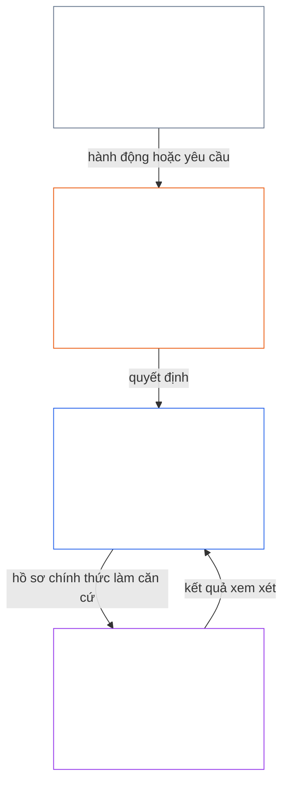
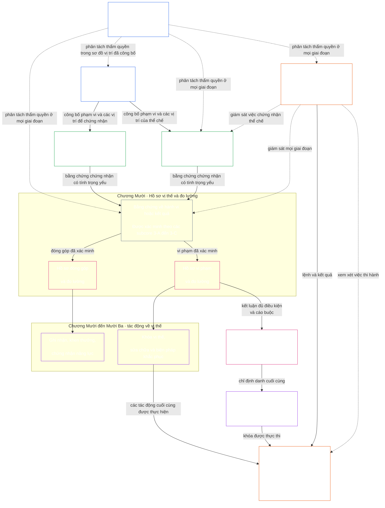

<!-- Locale: vi; language variety: Bản tiếng Việt — thử nghiệm (không ràng buộc). AI-assisted structural resynchronization draft (GPT-6 Codex); unreviewed and incomplete. English pin: SC-Corpus-2026.11.25, commit 6e0b6c663dde01b5dea731fe33d87725c7174930. core_00 SHA-256 90799cb8019b41356fa5dd90565e3f9540fc346e8c77e2c321b841654f39b274; core_01 SHA-256 aca759b394f10784ab1a2eef4e9e2ca12e369ef0ca8ee797298c6af00d2950aa. -->

<!-- Structural resynchronization draft; §§1–4 newly translated against the pinned English source, still requiring independent fidelity review. Other gaps are marked. Do not publish or synchronize. -->

# Chương Một: Bản đồ Hiến pháp

<strong>Vị trí trong kho văn bản (không vận hành): cấu trúc tệp và quy tắc đọc</strong>

> Các tiện ích được đánh dấu **không vận hành** (vị trí trong kho văn bản, hướng dẫn người đọc, bản đồ cho người đọc) chỉ nhằm định hướng. Chúng không thêm, bỏ hay thu hẹp nghĩa vụ ràng buộc, dù trong chính tệp của chúng hay bất kỳ tệp nào khác.
>
> Tệp này **là một phần của Hiến pháp Hữu tri** và **chỉ có tính ràng buộc khi được đọc cùng nhau** với các tệp `core_*` được đánh số khác và subcore như một văn bản thống nhất. Tệp này có **Chương Một**, *Bản đồ Hiến pháp*: mục đích (§1), lý do tồn tại (§2), cách các tệp liên kết (§3), nền tảng cho các chương tiếp theo (§4), các quy trình quản trị chính (§5), và sổ đăng ký chủ thể chịu trách nhiệm theo hiến pháp (§6 đến §11).
>
> **Trước:** [core_00.000_preamble.md](core_01_constitutional_map.md) (Lời mở đầu)
> **Tiếp:** [core_02.000_values_principles.md](../../core_02.000_values_principles.md)

<strong>Dấu vết</strong>

- Trước: [Lời mở đầu](core_01_constitutional_map.md) (*Mô hình, Hai Mục tiêu Hiến pháp, Tứ diện Hiến pháp, lợi hại vật chất và các loại đo lường*).
- Các mục:
  - [§1](#1-purpose-role-and-scope);
  - [§2](#2-why-the-map-exists);
  - [§3](#3-how-the-files-fit-together);
  - [§4](#4-foundations-for-the-chapters-that-follow);
  - [§5](#5-key-governance-processes);
  - [§6](#6-principles-definitions-and-rights);
  - [§7](#7-system-and-institutional-charters-functional-independence-and-separation-of-duties);
  - [§8](#8-key-practical-process-pipelines);
  - [§9](#9-process-ownership-and-outputs);
  - [§10](#10-governance-change-and-incorporation);
  - [§11](#11-adopted-implementation-corpus).
- Đọc cùng: [Thứ bậc Thẩm quyền và Hệ thống Nội bộ](../../subcore_03.080_band_integrative.md#authority-stack-and-internal-hierarchy) (*cách áp dụng sổ đăng ký chủ thể chịu trách nhiệm*); [README.md](README.md) (*thứ tự đọc*).

 

### 1. Mục đích, Vai trò và Phạm vi

*Nói thẳng: chương này là bản hướng dẫn cho phần còn lại của Hiến pháp. Nó cho thấy các phần liên kết với nhau ra sao, chương nào chịu trách nhiệm về từng chủ đề và các quy trình chính vận hành thế nào, để người đọc tìm được quy tắc trả lời câu hỏi của mình.*

**Mục đích:** Chương Một cung cấp cái nhìn tổng quan và hướng dẫn về trách nhiệm. Chương nêu tên các quy trình kiểm tra quản trị được ủy quyền, chỉ rõ chương nào chịu trách nhiệm về từng lĩnh vực nội dung và mô tả ba tầng văn bản hiến pháp.

**Vai trò:** Chương này định hướng và phân định trách nhiệm. Ngoài sổ đăng ký chủ thể chịu trách nhiệm, được các chương khác và [Thứ bậc Thẩm quyền và Hệ thống Nội bộ](../../subcore_03.080_band_integrative.md#authority-stack-and-internal-hierarchy) áp dụng, chương không tự đặt ra nghĩa vụ nào.

**Phạm vi chương:**

- lý do bản đồ tồn tại (**mục 2**);
- cách các tệp liên kết với nhau (**mục 3**) và nền tảng cho các chương tiếp theo (**mục 4**);
- các quy trình quản trị chính (**mục 5**);
- sổ đăng ký chủ thể chịu trách nhiệm của hiến pháp: nguyên tắc, định nghĩa và quyền (**mục 6**); hiến chương hệ thống và thể chế, tính độc lập chức năng và phân tách nhiệm vụ (**mục 7**); các chuỗi quy trình (**mục 8**); chủ thể chịu trách nhiệm và đầu ra của quy trình (**mục 9**); quản trị, thay đổi và việc đưa vào áp dụng (**mục 10**); và
- tập hợp văn bản triển khai đã được thông qua cùng tập hợp văn bản phụ (**mục 11**).

### 2. Vì sao có bản đồ

*Nói thẳng: một văn bản dài như thế này cần bản hướng dẫn cho thấy các phần liên kết ra sao và ai chịu trách nhiệm về từng chủ đề. Chương này giúp người đọc tìm quy tắc trả lời câu hỏi của mình.*

Hiến pháp phân chia công việc giữa nhiều chương, một tập hợp văn bản phụ và bốn tập hợp văn bản đã được thông qua. Một hữu tri muốn biết mình được hưởng điều gì, hoặc một bên thông qua muốn tìm nghĩa vụ, có thể bị lạc. Chương này là cái nhìn tổng quan và hướng dẫn về trách nhiệm: mỗi phần làm gì, chương nào chịu trách nhiệm về từng chủ đề, các chuỗi quy trình vận hành thế nào và các tầng văn bản liên hệ ra sao. Ngoài sổ đăng ký chủ thể chịu trách nhiệm, chương không tự đặt ra quy tắc.

**Cơ sở:**

- Lời nói đầu:
  - [Tứ diện Hiến pháp](core_00_preamble.md#constitutional-tetrad): các chức năng mà chương này đưa vào thực tiễn:
    - [Tham gia](../../subcore_03.060_apex_participation_leg.md#participation): hữu tri có thể tìm quy tắc trả lời câu hỏi của mình;
    - [Trách nhiệm giải trình](../../subcore_03.040_apex_accountability_leg.md#accountability): mỗi chủ đề có một chương được nêu tên, chịu trách nhiệm trả lời;
    - [Giám sát](../../subcore_03.055_apex_oversight_leg.md#oversight): người đọc có thể thấy các phần khớp với nhau thế nào và phát hiện chỗ thiếu hoặc chồng lấn;
    - [Kịp thời](../../subcore_03.065_apex_timeliness_leg.md#timeliness): người đọc đến được quy tắc phù hợp mà không bị trì hoãn;
  - [Hai Mục tiêu Hiến pháp](core_00_preamble.md#two-constitutional-aims): cả hai mục tiêu mà chương này phục vụ:
    - [Hưng thịnh](core_00_preamble.md#flourishing): Hiến pháp chỉ phục vụ các hữu tri nếu họ có thể tìm đường trong văn bản;
    - [Liên tục](core_00_preamble.md#continuity): bản đồ rõ ràng giữ văn bản nguyên vẹn khi nó phát triển và thay đổi;
- các nguyên tắc của Chương Hai:
  - [§5.2 Khả năng tiếp cận bằng ngôn ngữ phổ thông (nghĩa vụ tham gia và quản trị có trách nhiệm)](../../core_02.000_values_principles.md#52-plain-language-accessibility-participation-and-stewardship-duty);
  - [§5.2.4 Kỷ luật chống dùng sự phức tạp để đánh bại mục đích](../../core_02.000_values_principles.md#524-complexity-as-defeat-discipline);
  - [§15.4 Giải quyết xung đột về ý nghĩa hiến pháp](../../core_02.030_constitutional_interpretation.md#154-constitutional-meaning-conflict-resolution);
- các điều khoản của Chương Bốn:
  - [Điều XXIV-A](../../core_04.030_rights_part_d.md#article-xxiv-a-proportional-comprehensibility-right) (*Quyền được hiểu tương xứng*);
  - [Điều XXIV-B](../../core_04.030_rights_part_d.md#article-xxiv-b-complexity-audit-and-modularity-requirements) (*Yêu cầu kiểm toán độ phức tạp và tính mô-đun*).

### 3. Các tệp liên kết với nhau ra sao

Các tệp của Hiến pháp liên kết như sau:

- **Lõi (`core_*`):** Các tệp được đánh số chứa các chương của Hiến pháp, được viết để đọc cùng nhau như một văn bản. Chúng nêu các bảo đảm và cấu trúc hiến pháp.
- **Tập hợp văn bản phụ (`subcore_*`):** Các tệp này cung cấp đầy đủ quy tắc và thủ tục đứng sau các chương. Mỗi tệp thuộc về một chương, có hiệu lực ngang với chương đó và ràng buộc mọi bên thông qua mà không cần đưa vào riêng. Tập hợp văn bản phụ không được thu hẹp chương của mình.
- **Triển khai (`corpus_*`):** Bốn tệp cung cấp chi tiết vận hành để thực thi Hiến pháp. Chúng ràng buộc trong phạm vi được đưa vào hợp lệ và triển khai Hiến pháp mà không thu hẹp Hiến pháp. [Mục 11](#11-adopted-implementation-corpus) nêu bốn tệp đó.

[Corpus](../../subcore_03.080_band_integrative.md#corpus) được định nghĩa là tập hợp rộng hơn, có phiên bản, gồm các nguồn hiến pháp ràng buộc: lõi, tập hợp văn bản phụ, văn bản triển khai đã được thông qua và mọi lớp bao tương thích hợp lệ trong giai đoạn chuyển tiếp. Bản nháp, ghi chú và hướng dẫn điều hướng không trở nên ràng buộc chỉ vì chúng thuộc dự án.

### 4. Nền tảng cho các chương tiếp theo

*Nói thẳng: Chương Hai đến Chương Bốn chịu trách nhiệm về các giá trị, từ điển (cùng quy tắc trong tập hợp văn bản phụ về cách xây dựng, bảo vệ và chứng minh định nghĩa) và Sàn Quyền; các chương sau phải tôn trọng những phạm vi đó, không âm thầm chuyển chúng đi nơi khác.*

**Chương Hai đến Chương Bốn** cung cấp các giá trị, từ vựng, cơ chế xác minh và Sàn Quyền mà mọi nội dung phía sau phải tôn trọng, bao gồm:

- yêu cầu về Hiến chương Hệ thống hoặc Hiến chương Thể chế ở Chương Năm, yêu cầu phân tách nhiệm vụ ở Chương Sáu và các Cơ quan Độc lập ở Chương Bảy;
- [Các chuỗi quy trình thực tiễn then chốt](#8-key-practical-process-pipelines) tại mục 8;
- [chủ thể chịu trách nhiệm và đầu ra của quy trình](#9-process-ownership-and-outputs) tại mục 9;
- các chương về quản trị và lộ trình thay đổi tại mục 10; và
- [Tập hợp văn bản triển khai đã được thông qua](#11-adopted-implementation-corpus) tại mục 11.

### 5 Các quy trình quản trị then chốt

*Nói thẳng: khi văn bản đòi, các vấn đề trọng yếu đi qua chứng nhận, hồ sơ viết về giúp và hại, sửa chữa và khắc phục, và rà soát diễn đàn có đồng hồ — tranh chấp thường dùng đường dẫn tranh biện đã công bố trước; những đường dẫn đó thử quản trị đã được ủy quyền; chúng không tự tạo ra quản trị.*

Nơi Chương Sáu, [Chương Chín](../../core_08.000_system_alignment_certification_evaluation.md#chapter-nine-system-alignment-certification), các văn kiện đã hợp nhất, hoặc các điều khoản hiến pháp khác đòi rõ, hãy đưa các vấn đề hiến pháp trọng yếu vào một hay nhiều đường dẫn dưới đây. [Các chuỗi quy trình thực tiễn then chốt](#6-key-practical-process-pipelines) chuyển đo lường thành hồ sơ, chứng nhận, đầu vào đã xác minh, phân loại, giám sát diễn đàn, sửa chữa, và khắc phục kịp thời — cách quản trị đã được ủy quyền được thử, tranh biện, và sửa trong thực tế. Chúng không tự ủy quyền quản trị; chúng làm quản trị có thể rà soát, tranh biện, sửa, và kịp thời. [Mục 5.1](#62-how-the-full-chain-fits-together) nêu đầy đủ chuỗi đó.

- **Chứng nhận thẳng hàng hệ thống** ([Chương Chín](../../core_08.000_system_alignment_certification_evaluation.md#chapter-nine-system-alignment-certification)) — trước khi tin một hệ thống tác động cao ở quy mô lớn, thu và rà soát bằng chứng về việc hiện giờ có an toàn hiến pháp để dựa vào nó không
- **Hồ sơ trạng thái** ([Chương Mười Một](core_11_standing_assessment.md#chapter-eleven-standing-records--question-1-what-happened)) — khi hành vi hoặc tổn hại có ý nghĩa hiến định, ghi sự kiện đã xác minh vào hồ sơ vụ việc chính thức về đóng góp hoặc vi phạm; tin đồn và danh tiếng không đủ.
- **Sửa chữa và khắc phục** ([Chương Mười Ba §5.1 (*Khắc phục và sửa chữa*)](../../core_13.000_standing_integration.md#51-remedy-and-correction)) — sửa lỗi gốc và cung cấp sự thừa nhận, sửa chữa, phục hồi hoặc bồi thường tương xứng cho người bị hại.
- **Xem xét của diễn đàn** ([Chương Mười Lăm](core_11_forum.md#1-purpose-and-role--participation-architecture))
  - Tranh chấp thường bên trong hệ thống đã được ủy quyền dùng đường dẫn tranh biện đã công bố của [Tham gia hệ thống của bên bị ảnh hưởng](../../subcore_03.090_band_participation.md#stakeholder-status-and-weight-cluster) trước
  - Nếu đường dẫn đó vẫn bị tranh, thiếu, bị chiếm, hoặc không thể cấp cứu trợ, định tuyến theo lợi hại chính qua các diễn đàn được giám sát
  - Những diễn đàn đó nâng đỡ bằng chứng, chuyển hợp pháp, và đồng hồ kịp thời dưới **Điều XXV-C** (*Sàn Giải quyết kịp thời và Chống trì hoãn*)

### 6. Nguyên tắc, định nghĩa, và quyền

*Nói thẳng: Chương Một đến Sáu nắm giá trị, cách từ được xây và kiểm, từ điển, và Sàn Quyền; các chương sau phải tôn những nhà đó, không lặng lẽ dời chúng.*

Các mục **4 đến 9** là **sổ đăng ký chủ quyền hiến định** của Hiến pháp này. Mỗi khối nêu rõ lĩnh vực thực chất thuộc trách nhiệm của chương (hoặc bộ văn bản được thông qua) và sản phẩm mà nó tạo ra. Các tuyên bố trách nhiệm ràng buộc một dòng cũng xuất hiện ở đầu mỗi chương được đánh số. Các tầng khác có thể dẫn chiếu đến nơi chịu trách nhiệm, nhưng không được âm thầm viết lại hoặc chuyển dời; kỷ luật không di dời được quy định tại [Thứ bậc thẩm quyền và trật tự nội bộ](../../subcore_03.080_band_integrative.md#authority-stack-and-internal-hierarchy).

Chương **Một đến Sáu** cung cấp các giá trị, từ vựng, máy xác minh, và Sàn Quyền mà mọi thứ sau phải tôn — kể cả [Các chuỗi quy trình thực tiễn then chốt](#6-key-practical-process-pipelines) ở mục 5, các chương quản trị và đường dẫn thay đổi ở mục 6, và [kho triển khai kèm](#7-companion-implementation-corpus) ở mục 7.

Mỗi tóm tắt nêu chương nắm gì và tạo ra gì.

**Chương Một — Giá trị, nguyên tắc, và quản trị có trách nhiệm** ([Phần A](../../core_02.000_values_principles.md) · [Phần B](../../core_02.020_interaction_interpretation.md#chapter-01-part-b-interaction-and-interpretation) · [Phần C](../../core_02.040_stewardship_capacity_principles.md#chapter-01-part-c-stewardship-and-governance))

- **Phạm vi phụ trách:** Nêu các giá trị và ràng buộc định hướng của Hiến pháp, bao gồm:
  - phúc lợi, công bằng, An toàn, Sự thật, Niềm tin và tự do có giới hạn;
  - ghi nhận và khen thưởng tương xứng cho đóng góp hợp pháp;
  - giải quyết xung đột giữa các nguyên tắc; và
  - các nghĩa vụ quản trị, gồm phổ biến hiểu biết, đánh giá toàn hệ thống và kỷ luật quản trị.
- **Kết quả:** Nền tảng diễn giải cho mọi chương tiếp theo. Các quy tắc này biến mục tiêu cấp cao thành yêu cầu có hiệu lực khi đọc và áp dụng hệ thống, quyền, định nghĩa hoặc chuỗi quy trình.

**Chương Hai — Cấu trúc định nghĩa** ([`core_02_definition_structure.md`](../../subcore_03.010_definition_structure.md))

- **Phạm vi phụ trách:** Quy định cách xây dựng các thuật ngữ hiến định thông qua:
  - cấu trúc thành phần Bản thể luận/Đo lường/Đánh giá/Tuân thủ (O/M/A/C);
  - các yêu cầu về sự tương thích; và
  - các quy tắc thành phần giúp định nghĩa chính xác, hữu dụng trong toàn bộ bộ văn bản.
- **Kết quả tạo ra:** Một ngữ pháp chung cho các định nghĩa, để những chương sau không rơi vào nhãn gọi mơ hồ, giả định ẩn hoặc hình thức thuật ngữ không tương thích.

**Chương Ba — Tính toàn vẹn định nghĩa** ([`core_02_definition_structure.md`](../../subcore_03.010_definition_structure.md))

- **Phạm vi phụ trách:** Ngăn chặn:
  - né tránh và dịch chuyển phạm vi;
  - thủ thuật định nghĩa lại; và
  - mánh khóe không tuân thủ làm rỗng định nghĩa trên văn bản nhưng vô hiệu hóa chúng trong thực tế.
- **Kết quả tạo ra:** Kỷ luật chống né tránh và siêu dữ liệu định hướng về việc không tuân thủ, bao gồm các lộ trình chuyển sang xem xét tư cách và hành vi sai trái khi hành vi né tránh được chứng minh.

**Chương Bốn — Gánh, truy vết, và xác minh** ([`core_02_definition_structure.md`](../../subcore_03.010_definition_structure.md))

- **Phạm vi phụ trách:**
  - đặt gánh nặng chứng minh lên người khẳng định có tuân thủ; và
  - yêu cầu bằng chứng có thể truy xuất, khả năng quan sát và việc xác minh tương xứng với [**mức độ lợi ích trọng yếu**](#material-stake), đồng thời có thể bị chất vấn trên thực tế.
- **Sản phẩm:** quy trình xác minh cung cấp **đầu vào đã xác minh** cho [Chương Mười Một](core_11_standing_assessment.md#chapter-eleven-standing-records--question-1-what-happened) và chứng cứ phù hợp hệ thống cho [Chương Chín](../../core_08.000_system_alignment_certification_evaluation.md#chapter-nine-system-alignment-certification). Quy trình này không thay thế việc đo trạng thái.
**Chương Năm — Định nghĩa nền tảng** ([`core_05__definitions_home.md`](../../core_03.000_definitions_home.md#chapter-five-foundational-definitions))

- **Phạm vi phụ trách:** Cung cấp:
  - cấu trúc định nghĩa chuẩn tắc: các tầng Giám sát, Tham gia, Trách nhiệm giải trình, Tính liên tục và Tích hợp;
  - [Thứ bậc thẩm quyền và thứ bậc nội bộ](../../subcore_03.080_band_integrative.md#authority-stack-and-internal-hierarchy);
  - [Bộ văn bản](../../subcore_03.080_band_integrative.md#corpus); và
  - các quy tắc ranh giới liên quan.
- **Kết quả tạo ra:** Từ vựng hiến định chính xác phục vụ diễn giải, kiểm toán và phân xử. Đây là **cấu trúc định nghĩa**, không phải Sàn Quyền; các Sàn Quyền có tính ràng buộc nằm ở Chương Sáu. Việc định tuyến đến các lĩnh vực phụ trách của toàn bộ Hiến pháp nằm trong danh mục của Lời mở đầu này (các mục 4–9).

**Chương Sáu — Quyền nền tảng** ([Phần A](../../core_04.000_rights_part_a.md) · [Phần B](../../core_04.010_rights_part_b.md) · [Phần C](../../core_04.020_rights_part_c.md) · [Phần D](../../core_04.030_rights_part_d.md))

- **Phạm vi phụ trách:** Quy định Sàn Quyền trong các Điều **I–XXVIII**, bao gồm:
  - các nhu cầu thiết yếu để sinh tồn;
  - phân bổ nguồn lực và quản lý sự phụ thuộc;
  - phẩm giá, năng lực tự quyết và sự tham gia;
  - quyền phản đối và biện pháp khắc phục;
  - các giới hạn về công lý;
  - tính kịp thời theo **Điều XXVI-C** (*Sàn Giải quyết Kịp thời và Chống Trì hoãn*); và
  - các quy tắc Chuyển tiếp Tiếp nhận.
  Bốn phần sắp xếp các biện pháp bảo vệ này theo cách đọc ưu tiên hành tinh.
- **Kết quả tạo ra:** Các bảo vệ quyền không thể thương lượng và các cơ chế khắc phục mà Chương Bảy đến Chương Mười Ba, các diễn đàn, hoạt động quản trị và quy tắc sửa đổi phải tôn trọng, không được thu hẹp, né tránh hoặc làm rỗng thông qua thủ tục hay chỉ số thay thế.

### 7. Điều lệ hệ thống và thể chế, độc lập chức năng, và phân tách nhiệm vụ

*Nói đơn giản: một hệ thống hoặc tổ chức có ảnh hưởng thực tế công bố Điều lệ Hệ thống hoặc Điều lệ Tổ chức, nêu rõ nó được làm gì và ai giữ từng vị trí. Trước khi một hành động có tính ràng buộc đáng kể được tiến hành, phải tách biệt người khởi xướng, người kiểm tra hoặc cho phép, người giữ hồ sơ chính thức và người xem xét phản đối. Vai trò có thể co giãn theo hoàn cảnh, nhưng cùng một tác nhân và tuyến kiểm soát của nó không thể âm thầm giữ các vị trí kiểm tra chính hành động của mình.*

- **Kết quả tạo ra:** một tuyên bố về phạm vi và vị trí các ghế được công bố, quản lý phiên bản để Chương Tám, chứng nhận, hồ sơ tư cách và các diễn đàn có thể dùng làm căn cứ kiểm tra hành vi. Chương Bảy nằm tại [`core_07.000_charters.md`](../../core_05.000_charters.md#chapter-seven-system-and-institutional-charters).

**Tính độc lập về chức năng và phân tách nhiệm vụ** — trước khi một hành vi ràng buộc đáng kể được tiến hành, hãy xác định và tách biệt các vị trí khởi xướng, xác minh hoặc phê chuẩn, lưu hồ sơ và xem xét phản biện theo các quy tắc điều chỉnh quy mô và độc lập áp dụng.

**Tách biệt các vị trí cho mọi hành vi có tính ràng buộc trọng yếu** ([Chương Tám](core_07_functional_independence_segregation_of_duties.md#2-four-seat-constitutional-requirement)): xác định ai khởi xướng hành vi, ai xác minh hoặc cho phép, ai lưu giữ hồ sơ chính thức và ai tiếp nhận khiếu nại. Áp dụng các tổ hợp bị cấm, quy tắc độc lập và tuyến thay thế đã công bố trước khi coi hành vi là đã được kiểm tra đúng cách. Khi cần Hiến chương Hệ thống hoặc Hiến chương Tổ chức ([Chương Bảy](../../core_05.000_charters.md#4-the-charter-role-map-and-standing-record-custody)), Bản đồ Vai trò trong Hiến chương công bố ai đảm nhiệm từng vị trí.

**Chương Tám — Tính độc lập chức năng và phân tách nhiệm vụ**

- **Phạm vi phụ trách:** Yêu cầu xuyên quy trình rằng mỗi [Hành động Ràng buộc Trọng yếu](../../subcore_03.070_band_accountability.md#materially-binding-act) phải phân công riêng bốn chức năng:
  - khởi xướng;
  - xác minh hoặc cho phép;
  - lưu giữ hồ sơ chính thức; và
  - xem xét phản đối.

Nội dung này cũng điều chỉnh:

  - nội dung tối thiểu áp dụng chung của mỗi [Hồ sơ Hành vi Ràng buộc Đáng kể](../../subcore_03.070_band_accountability.md#materially-binding-act-record);
  - tính độc lập với [Tuyến Kiểm soát Vật chất](../../subcore_03.070_band_accountability.md#material-control-line) của chủ thể hành động;
  - việc phân công chức năng được công bố và các phương án thay thế;
  - việc hợp nhất vận hành tương xứng và giới hạn trong tình huống khẩn cấp; và
  - các lần bàn giao có thể quy trách nhiệm cùng việc chuyển sai vị trí.
- **Kết quả tạo ra:** một kiến trúc bốn vị trí và Hồ sơ Hành vi có thể tái sử dụng. Mọi quy trình chứng nhận, ghi nhận tư cách, diễn đàn, quản trị và triển khai tích hợp về sau phải áp dụng kiến trúc này trước khi kết quả được xem là đã được kiểm tra độc lập, ghi nhận đáng tin cậy và thực sự có thể bị phản biện.

#### 7.1 Bản đồ phân tách bốn vị trí

> Sơ đồ này cho thấy bốn chức năng và đường truy nguyên điển hình của một hành động cùng Hồ sơ Hành động. Sơ đồ không thêm vị trí thứ năm, không đặt ra trình tự phổ quát, và không thay đổi quy tắc ở Chương Tám về tính độc lập, việc lưu trữ chung tương xứng, hành động khẩn cấp hoặc định tuyến phản đối.

### 8. Các chuỗi quy trình thực tiễn then chốt

*Nói đơn giản: Chương Chín đến Mười Lăm áp dụng yêu cầu phân tách nhiệm vụ của Chương Tám thành một chuỗi: chứng nhận hệ thống và tổ chức, đo trợ giúp và tổn hại trên hai tuyến riêng, áp dụng tác động thực tế và biện pháp khắc phục, đồng thời ngăn diễn đàn trở thành nơi phán quyết cuối cùng duy nhất cho khiếu nại chống lại chính nó. Chuỗi này khiến nghĩa vụ hiến định có hiệu lực trong đời sống hằng ngày.*

[Chương Bảy](../../core_05.000_charters.md#chapter-seven-system-and-institutional-charters) công bố phạm vi theo điều lệ và sơ đồ vị trí của mỗi hệ thống, tổ chức từ Lớp L trở lên. [Chương Tám](../../core_06.000_functional_independence_separation_of_duties.md#chapter-eight-functional-independence-and-separation-of-duties) đặt ra yêu cầu phân tách nhiệm vụ để mọi hành động trong chuỗi đều có thể được kiểm tra hợp lệ. Theo quy tắc co giãn và độc lập áp dụng, chức năng khởi xướng, xác minh hoặc cho phép, lưu giữ hồ sơ chính thức và xem xét phản đối phải được giao riêng và giữ riêng. Sau đó Chương Chín đến Mười Lăm lần lượt áp dụng cấu trúc này:

Mỗi bước dưới đây nêu chương nắm gì và tạo ra gì. [Chuỗi đầy đủ khớp nhau thế nào](#62-how-the-full-chain-fits-together) rồi cho thấy những chủ sở hữu đó như một đường từ kiểm hệ thống đến khắc phục.

#### 8.1 Sơ đồ quy trình

- **Chương Chín** dùng xác minh độc lập để quyết định hệ thống hoặc tổ chức có ảnh hưởng đáng kể có phù hợp trong phạm vi và thời hạn hồ sơ đã nêu hay không. Chương Chín điều chỉnh chứng nhận hệ thống; Chương Mười điều chỉnh chứng nhận tổ chức, gồm lớp, đánh giá, hồ sơ và kết quả khắc phục riêng của tổ chức.
- **Chương Mười Một** tiếp nhận sự kiện đã xác minh và ghi vào hồ sơ trạng thái Đóng góp và Vi phạm riêng biệt.
- **Chương Mười Hai** đo từng hồ sơ trạng thái theo trục riêng. Đóng góp đã xác minh cho sự hưng thịnh không bù trừ, xóa bỏ hoặc giảm tổn hại hay thất bại trách nhiệm giải trình được xác minh riêng; mỗi bên vẫn được ghi nhận và chịu hệ quả riêng.
- **Chương Mười Ba** chuyển các phân loại đó thành tác động trạng thái tương xứng, gồm thông qua năng lực và sự công nhận ở tuyến đóng góp, cùng khóa trạng thái, sửa chữa và khắc phục ở tuyến vi phạm.
- **Chương Mười Bốn** chỉ áp dụng sau khi Chương Mười Hai đã đo một vi phạm cấp cao. Sau các bảo đảm thủ tục công bằng, chương này quyết định liệu hành vi có độc lập đáp ứng tiêu chí của chỉ định cuối cùng về hành vi sai trái chống hiến pháp (ACMD) hay không.
- **Chương Mười Lăm** giám sát định tuyến, chứng cứ, chuyển giao, tính độc lập của diễn đàn và giải quyết đúng hạn để hồ sơ và tác động có thể bị phản đối, sửa chữa và thi hành mà không cho phép diễn đàn bị chiếm dụng làm thẩm phán cuối cùng duy nhất cho hành vi của chính nó.
- **Xem xét hành vi sai trái** trả lời câu hỏi riêng: vi phạm đủ điều kiện có đồng thời cần chỉ định ACMD cuối cùng không?
- **Giám sát diễn đàn** kiểm soát định tuyến, chứng cứ, chuyển giao, phản đối và khắc phục để hồ sơ chính thức và quyết định được xem xét, sửa chữa kịp thời.

#### 8.2 Chuỗi đầy đủ khớp nhau thế nào

*Nói thẳng: hãy nghĩ nó như một đường từ kiểm hệ thống đến khắc phục — với các diễn đàn giám sát tranh chấp và các bước quỹ đạo suốt đường.*

1. **Tách các vị trí trong mọi hành vi có tính ràng buộc trọng yếu** ([Chương Tám](core_07_functional_independence_segregation_of_duties.md#2-four-seat-constitutional-requirement)): xác định ai khởi xướng, ai xác minh hoặc cho phép, ai giữ hồ sơ chính thức và ai nghe phản đối. Trước khi coi hành vi đã được kiểm tra hợp lệ, hãy áp dụng các tổ hợp bị cấm, quy tắc độc lập và lộ trình thay thế đã công bố. Khi cần Hiến chương Hệ thống hoặc Hiến chương Tổ chức ([Chương Bảy](../../core_05.000_charters.md#4-the-charter-role-map-and-standing-record-custody)), Bản đồ Vai trò của Hiến chương công bố người giữ từng vị trí.
2. **Chứng nhận hệ thống và tổ chức khi tác động đủ nghiêm trọng** — trước khi tin cậy một Hệ thống có tác động cao ở quy mô lớn, phải có Hồ sơ Chứng nhận Hệ thống có thể bị phản đối ([Phần A–B Chương Chín](../../core_08.000_system_alignment_certification_evaluation.md#chapter-nine-system-alignment-certification)); đánh giá một Tổ chức theo lớp, hành vi, quản trị và danh mục riêng theo [Chương Mười](core_10.000_institutional_alignment_certification.md#chapter-ten-institutional-alignment-certification), rồi ghi kết quả vào Hồ sơ Chứng nhận Tổ chức.
3. **Ghi nhận và đo trạng thái theo các tuyến riêng** ([Chương Mười Một](core_11_standing_assessment.md#chapter-eleven-standing-records--question-1-what-happened) và [Chương Mười Hai](core_12_standing_measurement.md#chapter-twelve-standing-measurement--question-2-how-good-or-bad-was-it)) — khi trợ giúp hoặc tổn hại đủ quan trọng về hiến định, Chương Mười Một phải mở hồ sơ vụ việc chính thức và chỉ nhận **đầu vào đã xác minh** (kể cả chứng cứ chứng nhận phù hợp hệ thống từ Chương Chín khi có ý nghĩa trọng yếu); Chương Mười Hai đo lường và phân loại điều đã xác minh. Tin đồn, danh tiếng và câu chuyện tranh chấp không đủ.
   - **Tính chất vi phạm:** mở **hồ sơ trạng thái vi phạm** — hồ sơ vụ việc giới hạn và có thể phản đối về tổn hại đã xác minh và thất bại trách nhiệm giải trình — rồi phân loại **tính chất vi phạm** trên Trục Vi phạm. Trợ giúp và tổn hại không bao giờ gộp thành điểm ròng; hồ sơ trạng thái liên kết dẫn chiếu nhau nhưng vẫn tách biệt.
4. **Áp dụng tác động trạng thái trên từng tuyến** ([Chương Mười Ba](../../core_13.000_standing_integration.md#chapter-thirteen-standing-effects-and-integration)) — đóng góp đã xác minh có thể cấp thông qua năng lực và phải hỗ trợ sự công nhận, phần thưởng vật chất tương xứng; vi phạm đã xác minh có thể kích hoạt khóa trạng thái, sửa chữa và [khắc phục cho người bị hại](../../core_13.000_standing_integration.md#51-remedy-and-correction).
5. **Xem xét chỉ định chống hiến pháp** ([Chương Mười Bốn](../../core_14.000_misconduct_designation.md#chapter-fourteen-anti-constitutional-misconduct)) — nếu phát hiện vi phạm có tác động cao nhất cũng có thể đáp ứng tiêu chí chống hiến pháp, Chương Mười Bốn phải quyết định ACMD tương ứng có được gắn hay không. ACMD đó không thay đổi mức độ nghiêm trọng của tổn hại mà Chương Mười Hai đã xác định. Tác động thông thường của Chương Mười Ba tiếp tục song song cho đến khi ACMD cuối cùng kích hoạt Khóa Tin cậy Chống Hiến pháp.
6. **Định tuyến tranh chấp và bảo đảm khắc phục đúng hạn** ([Chương Mười Lăm](core_11_forum.md#1-purpose-and-role--participation-architecture)) — diễn đàn phải giám sát cách vụ việc được chuyển, tuyến nào xử lý và các thời hạn theo **Điều XXVI-C** (*Giải quyết Đúng hạn và Ngưỡng Chống Trì hoãn*) có được đáp ứng không, để khắc phục không chết vì trì hoãn. Tranh chấp thông thường theo [Trình tự tranh chấp](core_11_forum.md#dispute-sequencing). Diễn đàn cũng phải phân loại tranh chấp thành năm [cấp độ trọng yếu](core_11_forum.md#6-timely-resolution-materiality-tiers-and-anti-delay-discipline) (A/B/C/L/P), tương ứng với bảng chữ cái phân loại hệ thống, từ tình huống khẩn cấp đe dọa sinh tồn đến vấn đề riêng tư/được khoanh vùng. Định tuyến mặc định của nhóm liêm chính áp dụng khi chỉ định cuối cùng của Chương Mười Bốn là lợi ích chính.

[Bản đồ chuỗi quỹ đạo của README](../../README.md#standing-pipeline-and-forums) cung cấp điều hướng trực tiếp cho chuỗi trên, kể cả các đầu vào đã xác minh tiềm năng của Chương Bảy vào đo lường quỹ đạo.

### 9. Quyền sở hữu quy trình và kết quả

Chương Bảy — Hiến chương hệ thống và tổ chức ([Chapter Seven](../../core_05.000_charters.md#chapter-seven-system-and-institutional-charters))

- **Kết quả tạo ra:** một tuyên bố về phạm vi và vị trí các ghế được công bố, quản lý phiên bản để Chương Tám, chứng nhận, hồ sơ tư cách và các diễn đàn có thể dùng làm căn cứ kiểm tra hành vi. Chương Bảy nằm tại [`core_07.000_charters.md`](../../core_05.000_charters.md#chapter-seven-system-and-institutional-charters).

### 10. Quản trị, thay đổi, và hợp nhất

*Nói đơn giản: Chương Hai Mươi đến Hai Mươi hoàn tất Hiến pháp này: ai có thể quản trị, văn bản có thể đổi ra sao mà không thoái lui bảo vệ, quan hệ với luật khác thế nào, và các tệp hướng dẫn đã được thông qua tiếp tục gắn với nguồn này ra sao.*

Chương **Mười Hai đến Mười Sáu** đóng văn kiện — và hoàn tất [sổ đăng ký chủ sở hữu dương](#4-principles-definitions-and-rights) cho quản trị, hiệu lực thay đổi, và hợp nhất: ai được quản trị chính danh, Hiến pháp có thể đổi hợp pháp thế nào, và văn bản triển khai đã tiếp nhận giữ gắn với nguồn hiến pháp thế nào mà không lệch lạc thầm lặng.

Mỗi tóm tắt nêu chương nắm gì và tạo ra gì.

**Chương Hai Mươi — Khế ước hiến định, tính chính đáng và quản thủ** ([core_16.000_governance.md](../../core_16.000_governance.md#chapter-sixteen-constitutional-contract-legitimacy-authorization-and-stewardship))

- **Nội dung nắm giữ:** Nắm [**Tầng Hợp đồng Hiến pháp**](../../subcore_03.080_band_integrative.md#constitutional-contract-layer) — ai được quản trị, bằng cơ chế chính danh nào, dưới phạm vi và điều khoản bền nào, và với tính cách quản trị có trách nhiệm nào phải được duy trì.
- **Nội dung tạo ra:** Yêu cầu ủy quyền và chính danh riêng với [**Tham gia hệ thống của bên bị ảnh hưởng**](../../subcore_03.090_band_participation.md#stakeholder-status-and-weight-cluster) trong hệ thống đã được ủy quyền — các quy tắc của chính quyền quản trị, không chỉ tham gia bên trong nó.

**Chương Mười Bảy — Không thụt lùi** ([core_17.000_non_regression.md](../../core_17.000_non_regression.md#chapter-seventeen-non-regression-and-substantive-amendment-validity))

- **Nội dung nắm giữ:** Đặt sàn nội dung chống thay đổi thoái lui — tu chính và đường vòng không thể cắt các bảo vệ cốt, làm rỗng Tứ diện dưới lợi hại vật chất, hoặc ngụy trang thoái lui thành dọn kỹ thuật.
- **Nội dung tạo ra:** **Lan can hiến pháp đầu** trên mọi thay đổi đề xuất — quy tắc không thoái lui: nếu thay đổi sẽ làm yếu các bảo vệ cốt trong thực tế, nó không có hiệu lực, dù thủ tục trông ổn. Đường vòng bị nghi hoặc cắt giả trang bị dừng hoặc gửi tới đường rà soát đúng thay vì lọt thầm.

**Chương Mười Tám — Tính tối cao và mệnh lệnh bên ngoài** ([core_18.000_expansion_supremacy.md](../../core_18.000_expansion_supremacy.md#chapter-eighteen-expansion-supremacy-and-external-legal-orders))

- **Phụ trách:** quan hệ giữa Hiến pháp này và các chuẩn mực khác: mở rộng bảo vệ khi hợp pháp, tính tối cao trong nguồn có hiệu lực, phạm vi tiếp nhận và tầng quản trị, không loại bỏ luật bên ngoài tự có hiệu lực, và tương tác có kỷ luật với trật tự pháp luật bên ngoài mà không âm thầm lệ thuộc hoặc bị chiếm dụng.
- **Nội dung tạo ra:** Quy tắc thứ bậc và thứ tự xung đột để công bố hoặc dùng không bị coi là bãi luật bên ngoài áp dụng, và để bên tiếp nhận không coi thủ tục đã hợp nhất, chuẩn bên ngoài yếu hơn, hoặc chỉ số tiện là án ngữ nghĩa Hiến pháp Hữu tri trong phạm vi tiếp nhận hợp lệ.
**Chương Mười Chín — Sửa đổi, phê chuẩn và tiếp nhận** ([core_19.000_amendment_ratification.md](../../core_19.000_amendment_ratification.md#chapter-nineteen-amendment-ratification-and-procedural-validity))

- **Phụ trách:** cách Hiến pháp này có thể được thay đổi hợp pháp — thủ tục sửa đổi, phê chuẩn và tiếp nhận — cùng các **bảo đảm thủ tục** tiếp nối bảo đảm nội dung của Chương Mười Bảy: thay đổi phải được công bố công khai, truy nguyên đến nơi lưu giữ có thẩm quyền và vẫn có thể bị phản đối thực chất, với xem xét độc lập khi cần.
- **Nội dung tạo ra:** Một đường thay đổi hợp pháp đầy đủ — chỉ tu chính và tiếp nhận vượt **lan can không thoái lui** và các **lan can thủ tục** mới được tính là cập nhật hiến pháp hợp lệ.
**Chương Hai Mươi — Cầu nối tiếp nhận** ([core_20.000_incorporation.md](../../core_20.000_incorporation.md))

- **Nội dung nắm giữ:** Nhận diện tệp triển khai nào được tính là văn bản hợp nhất ràng buộc khi được tiếp nhận; ghim ấn bản; giữ chuỗi lưu giữ; và cấm lệch lạc thầm lặng giữa nguồn hiến pháp và chi tiết vận hành.
- **Nội dung tạo ra:** Một biên hợp nhất duy nhất — văn bản triển khai được chỉ định ràng buộc khi được tiếp nhận; các kho kèm triển khai Hiến pháp mà không trở thành nguồn thứ hai thu hẹp nó. [Mục 7](#9-adopted-implementation-corpus) tóm tắt những kho đó ở mức cao.

### 11. Bộ nội dung triển khai đã được thông qua

*Nói thẳng: bốn kho kèm (cấu trúc chung, hệ thống, thể chế, và vận hành diễn đàn) nêu cách thực hiện điều các chương đã đòi; chúng ràng buộc khi được tiếp nhận hợp lệ, và chúng không được thu nhỏ những nghĩa vụ đó.*

Ngoài các chương `core_*` đánh số, bốn kho kèm hoàn tất [sổ đăng ký chủ sở hữu dương](#4-principles-definitions-and-rights) cho **văn bản triển khai** đã tiếp nhận — chi tiết vận hành làm nghĩa vụ hiến pháp chạy được trong thực tế:

- **[corpus_joint_structure](../../corpus_joint_structure.md)** — định tuyến xuyên tệp, thuật ngữ vận hành chung, và cấu trúc chung khi hệ thống, thể chế, và diễn đàn phải được đọc cùng trên cùng sự kiện.
- **[corpus_systems](../../corpus_systems.md)** — phân loại hệ thống, giao thức thiết kế và triển khai, xử lý thông tin, và cơ chế quản trị có trách nhiệm then chốt.
- **[corpus_institutions](../../corpus_institutions.md)** — hình thành thể chế, quản trị, giám sát, tính tương xứng, và kỷ luật giải thể.
- **[corpus_forum](../../corpus_forum.md)** — vận hành diễn đàn: lập ban, xin rút, làn rà soát, chi tiết định tuyến, và hỗ trợ pháp y.

Khi bên tiếp nhận đưa các tệp này vào hợp lệ theo [Chương Hai Mươi](../../core_20.000_incorporation.md), chúng ràng buộc như văn bản triển khai trong phạm vi tiếp nhận. Ý nghĩa của Sentient Constitution vẫn chi phối — chúng **triển khai, không thu hẹp** các chương trên. Ghim phiên bản, chuỗi lưu giữ và quy tắc không trôi lệch âm thầm giúp truy nguyên văn bản được tiếp nhận về đúng nội dung đã phê chuẩn. Danh mục chuẩn và quy tắc ranh giới nằm trong [Chương Năm — Kho văn bản](../../subcore_03.080_band_integrative.md#corpus).

Nguyên tắc, định nghĩa, quyền, chuỗi quy trình, quản trị, quy tắc tu chính, và triển khai đã hợp nhất phải được đọc cùng để giữ mục đích bảo vệ của Hiến pháp.
---

**Tệp trước:** [README.md](README.md)

**Tệp tiếp theo (ngôn ngữ này):** [core_01_a_values_principles.md](../../core_02.000_values_principles.md)

**Nguyên bản ràng buộc:** [core_00_preamble.md](core_00_preamble.md)
