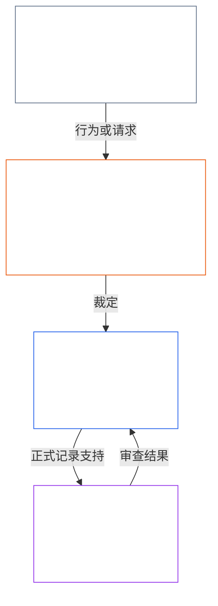
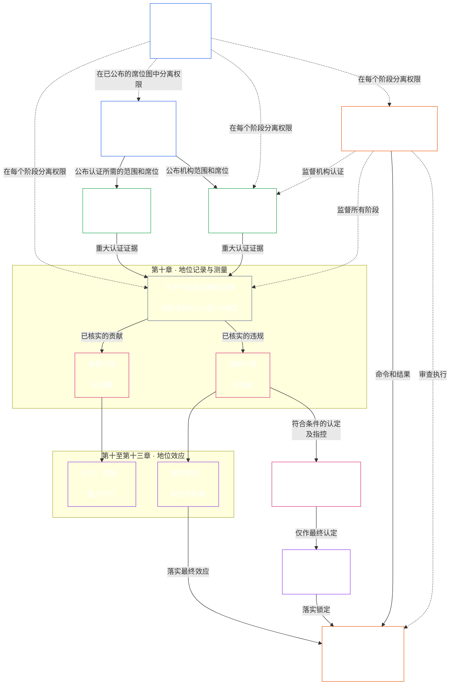

<!-- Locale: zh; language variety: 中文版 — 试点（不具约束力）. AI-assisted structural resynchronization draft (GPT-6 Codex); unreviewed and incomplete. English pin: SC-Corpus-2026.11.25, commit 6e0b6c663dde01b5dea731fe33d87725c7174930. core_00 SHA-256 90799cb8019b41356fa5dd90565e3f9540fc346e8c77e2c321b841654f39b274; core_01 SHA-256 aca759b394f10784ab1a2eef4e9e2ca12e369ef0ca8ee797298c6af00d2950aa. -->

<!-- Structural resynchronization draft; §§1–4 newly translated against the pinned English source, still requiring independent fidelity review. Other gaps are marked. Do not publish or synchronize. -->

# 第一章：宪法地图

<strong>在文本库中的位置（非操作性）：文件结构与阅读规则</strong>

> 标记为**非操作性**的小组件（文本库位置、读者指引、读者地图）仅用于导览。无论在其自身文件还是其他文件中，它们均不增加、删除或收窄任何有约束力的义务。
>
> 本文件**是感知者宪法的一部分**；只有与其他编号的 `core_*` 文件和子语料库一并作为同一文本阅读时，才具有**约束力**。本文件包含**第一章**，即*宪法地图*：其目的（§1）、存在理由（§2）、文件如何衔接（§3）、后续章节的基础（§4）、关键治理流程（§5）以及宪法责任主体登记册（§6 至 §11）。
>
> **上游：** [core_00.000_preamble.md](core_01_constitutional_map.md)（序言）
> **下游：** [core_02.000_values_principles.md](../../core_02.000_values_principles.md)

<strong>追溯</strong>

- 上游：[序言](core_01_constitutional_map.md)（*模型、两项宪法宗旨、宪法四元、实质利害和测量类别*）。
- 各节：
  - [§1](#1-purpose-role-and-scope);
  - [§2](#2-why-the-map-exists);
  - [§3](#3-how-the-files-fit-together);
  - [§4](#4-foundations-for-the-chapters-that-follow);
  - [§5](#5-key-governance-processes);
  - [§6](#6-principles-definitions-and-rights);
  - [§7](#7-system-and-institutional-charters-functional-independence-and-separation-of-duties);
  - [§8](#8-key-practical-process-pipelines);
  - [§9](#9-process-ownership-and-outputs);
  - [§10](#10-governance-change-and-incorporation);
  - [§11](#11-adopted-implementation-corpus)。
- 配合阅读：[权威层级与内部层次](../../subcore_03.080_band_integrative.md#authority-stack-and-internal-hierarchy)（*责任主体登记册的适用方式*）；[README.md](README.md)（*阅读顺序*）。

 

### 1. 目的、作用与范围

*用直白的话说：本章是整部宪法的导览。它说明各部分如何衔接、哪个章节负责哪个主题、主要流程如何运行，使读者能找到回答自己问题的规则。*

**目的：**第一章提供总体概览和责任指引。它列出检验授权治理的流程，指出各实质领域由哪个章节负责，并说明宪法文本的三个层级。

**作用：**本章负责导览和划分责任。除责任登记册外，本章不自行增加义务；其他章节和[权威层级与内部层次](../../subcore_03.080_band_integrative.md#authority-stack-and-internal-hierarchy)适用该登记册。

**本章范围：**

- 地图存在的原因（**第2节**）；
- 文件如何衔接（**第3节**）以及后续章节的基础（**第4节**）；
- 关键治理流程（**第5节**）；
- 宪法责任登记册：原则、定义和权利（**第6节**）；系统与机构章程、职能独立和职责分离（**第7节**）；流程链（**第8节**）；流程责任与产出（**第9节**）；治理、变更与纳入（**第10节**）；以及
- 已通过的实施语料和子语料（**第11节**）。

### 2. 地图为何存在

*用直白的话说：如此庞大的文本需要一份导览，说明各部分如何衔接以及每个主题由谁负责。本章帮助读者找到回答自己问题的规则。*

宪法将工作分布在许多章节、一个子语料和四个已通过语料中。感知者想知道自己应得到什么，或采纳方想查找一项义务，都可能迷失方向。本章提供总体概览和责任指引：每个部分做什么、哪个章节负责哪个主题、流程链如何运行，以及各文本层级如何关联。除责任登记册外，本章不自行设定规则。

**依据：**

- 序言：
  - [宪法四元](core_00_preamble.md#constitutional-tetrad)：本章落实的各项职能：
    - [参与](../../subcore_03.060_apex_participation_leg.md#participation)：感知者能够找到回答其问题的规则；
    - [问责](../../subcore_03.040_apex_accountability_leg.md#accountability)：每个主题都有一个指定负责并作出回应的章节；
    - [监督](../../subcore_03.055_apex_oversight_leg.md#oversight)：读者能够看清各部分如何衔接，并发现缺口或重叠；
    - [及时性](../../subcore_03.065_apex_timeliness_leg.md#timeliness)：读者无需延误即可找到正确规则；
  - [两项宪法宗旨](core_00_preamble.md#two-constitutional-aims)：本章服务的两项目标：
    - [繁盛](core_00_preamble.md#flourishing)：只有感知者能够在宪法中找到方向，宪法才能服务于他们；
    - [延续](core_00_preamble.md#continuity)：清晰的地图使文本在发展和变化时仍保持完整；
- 第二章原则：
  - [§5.2 通俗语言可及性（参与与尽责管理义务）](../../core_02.000_values_principles.md#52-plain-language-accessibility-participation-and-stewardship-duty);
  - [§5.2.4 防止以复杂性挫败目的的纪律](../../core_02.000_values_principles.md#524-complexity-as-defeat-discipline);
  - [§15.4 宪法含义冲突的解决](../../core_02.030_constitutional_interpretation.md#154-constitutional-meaning-conflict-resolution);
- 第四章条款：
  - [第XXIV-A条](../../core_04.030_rights_part_d.md#article-xxiv-a-proportional-comprehensibility-right)（*比例适当的可理解权*）；
  - [第XXIV-B条](../../core_04.030_rights_part_d.md#article-xxiv-b-complexity-audit-and-modularity-requirements)（*复杂性审计与模块化要求*）。

### 3. 文件如何衔接

宪法文件的衔接方式如下：

- **核心（`core_*`）：**编号文件包含宪法各章节，应作为同一文本共同阅读。它们陈述保障和宪法结构。
- **子核心（`subcore_*`）：**这些文件提供各章节背后的完整规则和程序。每个文件归属一个章节，效力与该章节相同，无需另行纳入即可约束每个采纳方。子核心不得缩窄其所属章节。
- **实施（`corpus_*`）：**四个文件提供落实宪法的操作细节。在有效纳入的范围内，它们具有约束力，并实施宪法而不缩窄宪法。[第11节](#11-adopted-implementation-corpus)列出这四个文件。

定义的[语料](../../subcore_03.080_band_integrative.md#corpus)是范围更广且带有版本的约束性宪法来源集合，包括核心、子核心、已通过的实施文本，以及过渡期间任何有效的兼容性封装。草案、注释和导航指南不会仅仅因为属于项目就变成有约束力的文本。

### 4. 后续章节的基础

*用直白的话说：第二至第四章负责价值、词典（包括子核心中关于如何构建、保护和证明定义的规则）以及权利底线；后续章节必须尊重这些归属，不得暗中转移。*

**第二至第四章**提供后续所有内容都必须遵守的价值、词汇、验证机制和权利底线，包括：

- [第五章的系统章程或机构章程要求、第六章的职责分离要求，以及第七章的独立机构](#7-system-and-institutional-charters-functional-independence-and-separation-of-duties)；
- 第8节的[关键实务流程链](#8-key-practical-process-pipelines)；
- 第9节的[流程责任与产出](#9-process-ownership-and-outputs)；
- 第10节的治理和变更路径章节；以及
- 第11节的[已通过实施语料](#11-adopted-implementation-corpus)。

### 5 关键治理过程

*简而言之：当宪法要求时，先分离发起、核验、记录和审查异议的职责席位。重大事项随后经过认证、帮助与伤害的书面记录、纠正与补救，以及有时限的论坛审查。一般争议先走已公布的质疑路径。这些流程检验已获授权的治理，但本身不创设治理权力。*

以下说明可采用的路径：

- 当[第四章——基本权利](../../core_04.000_rights_part_a.md#chapter-four-foundational-rights)、[子核心8-B——系统对齐认证评估](../../subcore_08.020_system_alignment_certification_evaluation.md#subcore-8-b-system-alignment-certification--evaluation)、已纳入文书或其他宪法规定明确要求时，将重大宪法问题纳入下列一条或多条路径。
- [关键实务流程链](#8-key-practical-process-pipelines)把测量转为记录、认证、经核实输入、分类、论坛监督、纠正和及时补救。
- 这些流程在实践中检验、质疑和修复已获授权的治理；它们不自行授权治理，而使治理可审查、可质疑、可纠正且及时。
- [§8.2](#82-how-the-full-chain-fits-together)展示各阶段如何衔接：分离决策席位、认证、持续记录与测量、持续状态影响、适用时的认定审查、论坛监督和结果执行。

**路径：**

- **职能独立与职责分离**（[第六章](../../core_06.000_functional_independence_separation_of_duties.md#chapter-six-functional-independence-and-separation-of-duties)）：具有重大约束力的行为推进前，依适用的规模调整和独立性规则分开发起、核验或授权、正式记录保管和异议审查席位。
- **系统对齐认证**（[子核心8-B](../../subcore_08.020_system_alignment_certification_evaluation.md#subcore-8-b-system-alignment-certification--evaluation)）：高影响系统被大规模信赖前，收集并审查证据，判断当前依赖该系统是否符合宪制安全要求。认证与感知者质疑、审计系统的权利（[第十四条——可靠可信系统权](../../core_04.020_rights_part_c.md#article-xiv-right-to-reliable-and-trustworthy-systems)）是相互配合的两项保障，彼此不能取代。
- **持续记录**（[子核心10-B](../../subcore_10.020_standing_assessment.md#subcore-10-b-standing-records--question-1-what-happened)）：行为或伤害在宪制上重要时，把经核实事实纳入正式贡献或违规案卷；传闻和声誉不足为据。
- **纠正与补救**（[第十二章§3.1](../../core_12.000_violation_consequences.md#31-remedy-and-correction)）：核实违规后，分别评估消除原因并制止持续发生所需的纠正，以及对受害者所负的补救。补救可包括承认、修复或恢复，也可按情况包括赔偿、无法原样修复时的替代保障或同等救济；纠正原因不能取代补救，补救也不能取代纠正原因。
- **论坛审查**（[第十六章](../../core_16.000_forum.md#1-purpose-role-and-scope)）：已获授权系统中的一般争议先走已公布的[利益相关方系统参与](../../subcore_03.090_band_participation.md#stakeholder-status-and-weight)质疑路径。若该路径仍有争议、缺失、被俘获或无法提供救济，则按主要利害经受监督的论坛分流。论坛依**第二十七条-C（及时解决与反拖延底线）**保障证据、合法移送和及时期限。

### 6 原则、定义与权利

第6至11节构成本宪法的**宪法职权归属登记册**：每个编号章节或采纳语料负责哪些实质领域、产出什么。职权归属文件开篇的约束性语句标明该责任；其他部分可以指向该职权归属方，但不得暗中改写或转移。详见[权威层级与内部层级](../../subcore_03.080_band_integrative.md#authority-stack-and-internal-hierarchy)。

#### 6.1 [第二章——价值、原则与尽责管理](../../core_02.000_values_principles.md)

第二章确立宪法的指导价值与限制，包括福祉、公平、安全、真理、信任和有界自由；对合法贡献予以承认和相称奖励；解决原则之间的冲突；以及分布式理解、系统评估和治理纪律等尽责管理义务。它为后续章节提供解释基础，把高层目标转化为适用于系统、权利、定义和流程的操作要求。

#### 6.2 [第三章——基础定义](../../core_03.000_definitions_home.md)

第三章负责监督、参与、问责、连续性和整合各层的规范定义体系；[权威层级与内部层级](../../subcore_03.080_band_integrative.md#authority-stack-and-internal-hierarchy)、[语料](../../subcore_03.080_band_integrative.md#corpus)及相关边界规则。它提供解释、审计和裁决所需的精确宪法词汇。第三章是定义体系，不是权利底线；有约束力的权利底线属于第四章。其子核心包括以下规则：

##### 6.2.1 [定义结构——子核心3-A](../../subcore_03.010_definition_structure.md)

规定本体／测量／评估／合规（O/M/A/C）的组成结构、对齐要求和组成部分规则，为全语料的精确、一致术语提供共同语法。

##### 6.2.2 [定义完整性——子核心3-B](../../subcore_03.020_definition_integrity.md)

防止规避、范围转移、重新定义把戏，以及使定义只留在纸面、却在实践中失效的不合规手段；在规避得到证实时提供转入持续状态与不当行为审查的线索。

##### 6.2.3 [举证责任、可追溯性与核验——子核心3-C](../../subcore_03.030_burden_traceability_verification.md)

由主张合规者承担举证责任，并要求证据可追溯、可观察、可核验，且与[重大利害](../../core_00.000_preamble.md#material-stake)相称并能在实践中受到质疑。它向子核心10-B提供经核实输入，向子核心8-B提供系统对齐证据；它不取代持续状态测量。

#### 6.3 [第四章——基本权利](../../core_04.000_rights_part_a.md)

第四章确立第I至XXIX条的权利底线，涵盖生存必需、资源分配与依赖关系管理、尊严／主体性／参与、质疑与补救、正义约束、**第二十七条-C**的及时性，以及采纳过渡规则。四部分以星球优先的方式组织这些保护。第五至第二十六章、论坛、治理和修正规则均不得通过程序或代理指标缩窄、绕过或掏空这些不可协商的权利。

### 7. 系统章程与机构章程、职能独立及职责分离

*简而言之：具有实际影响的系统或机构应公布系统宪章或机构宪章，说明其可以做什么、每个席位由谁担任。随后，在具有实质约束力的行为实施前，应分别指定谁发起、谁核查或授权、谁保管正式记录、谁审查质疑。角色可按情境调整规模，但同一行动者及其控制链不得暗中占据核查自身行为的席位。*

- **产出：**一份已发布并进行版本管理的范围与席位安排说明，第八章、认证程序、地位记录和论坛可据此检验行为。第七章见[`core_07.000_charters.md`](../../core_05.000_charters.md#chapter-seven-system-and-institutional-charters)。

**职能独立与职责分离**——在实质约束行为推进之前，依据适用的分级和独立性规则，识别并分离发起、核验或授权、记录以及审查质疑的席位。

**对每项具有实质约束力的行为分别设置席位**（[第八章](core_07_functional_independence_segregation_of_duties.md#2-four-seat-constitutional-requirement)）：明确谁发起行为、谁核验或授权、谁保管正式记录，以及谁受理质疑。在认定行为已得到适当核验之前，应执行禁止兼任的组合限制、独立性规则和已公布的替代路径。需要系统宪章或机构宪章时（[第七章](../../core_05.000_charters.md#4-the-charter-role-map-and-standing-record-custody)），其宪章角色图应公布每个席位由谁担任。

**第八章——职能独立与职责分离**

- **其职责：**一项跨流程要求，即每项[实质性约束行为](../../subcore_03.070_band_accountability.md#materially-binding-act)都必须分别配置以下四项职能：
  - 发起；
  - 核验或授权；
  - 保管正式记录；以及
  - 审查异议。

它还规范：

  - 每份[实质约束行为记录](../../subcore_03.070_band_accountability.md#materially-binding-act-record)的通用最低内容；
  - 与行为者的[实质控制链](../../subcore_03.070_band_accountability.md#material-control-line)相独立；
  - 已公布的职能安排及替代安排；
  - 合乎比例的合并承载和紧急情况边界；以及
  - 可归责的交接和错误席位路由。
- **产出：**可重复使用的四席与行为记录架构。后续每一项认证、地位记录、论坛、治理及整合实施流程，都必须先落实该架构，其结果方可被视为经过独立核验、得到可靠记录且确实可以质疑。

#### 7.1 四席分离图

> 此图展示四项职能，以及某项行为及其行为记录的典型追踪路径。它不新增第五个席位，不规定通用顺序，也不改变第八章关于独立性、相称的合并托管、紧急行动或质疑分流的规则。

### 8. 关键实务流程链

*简而言之：第八至第二十二章沿一条链落实第六章的职责分离要求：认证系统和机构，在两条独立轨道上衡量帮助与伤害，应用实际影响与补救，并防止论坛成为针对自身主张的唯一最终裁决处。这条链使宪法义务在日常生活中切实有效。*

两个章节构成流程链的基础：

- [第五章](../../core_05.000_charters.md#chapter-five-system-and-institutional-charters)公布L类或以上各系统与机构的章程范围和席位图。
- [第六章](../../core_06.000_functional_independence_separation_of_duties.md#chapter-six-functional-independence-and-separation-of-duties)规定职责分离，使链条中的每项行为都能得到有效核查；依适用的规模调整和独立性规则，分别指派并维持发起、核验或授权、正式记录保管和异议审查职能。

以下流程按这一架构运行；每一项都产生独立、可审查的结果，职责彼此不合并：

- **认证**检查系统或机构是否在其声明的范围和记录期间内保持对齐。系统认证由第八章负责；机构认证由第九章负责，并包括机构自身类别、评估、论坛程序、结果、认证记录和重新认证。
- **持续记录与测量**记录经核实的事实，并分别评估贡献和违规。第十章建立独立的贡献与违规持续记录，分别衡量；经核实的促进繁荣的贡献不能抵销、取消或减少另行核实的伤害或问责失责。
- **持续状态整合**依第十章把分类转化为相称影响：贡献轨道包括能力许可和承认；违规轨道包括持续锁定、纠正和补救。
- **不当行为审查**依第十四章回答独立问题：第十章衡量高层级违规后，该行为是否也独立满足最终反宪制不当行为认定（ACMD）的标准；审查须有正当程序保障。
- **论坛监督**由第十六和第十七章支持审查与纠正。论坛监督分流、证据、移送、论坛独立性和及时解决，使记录与影响能够受到质疑、纠正和执行，并防止被俘获的论坛成为裁判自身行为的唯一最终场所。

第6至11节的章节摘要指出各主题的职权归属方及其产出。

#### 8.1 流程图

- **第九章**通过独立核验，判断具有实质影响的系统或机构是否在其声明的范围和记录期间内保持对齐。第九章规范系统认证；第十章规范机构认证，包括机构自身的类别、评估、记录和补救结果。
- **第十一章**接收经核实的事实，并分别记录在贡献和违规持续记录中。
- **第十二章**沿各自轴衡量每一份持续记录。经核实的促进繁荣贡献，不抵销、取消或减少另行核实的伤害或问责失责；两者各自记录并承担各自后果。
- **第十三章**将这些分类转化为相称的持续状态影响，包括贡献轨道上的能力许可和认可，以及违规轨道上的持续锁定、纠正和补救。
- **第十四章**仅在第十二章已衡量出高层级违规后适用。经正当程序保障后，它判断相关行为是否独立满足最终反宪制不当行为认定（ACMD）的标准。
- **第十五章**监督分流、证据、移交、论坛独立性和及时解决，使由此产生的记录和影响能够受到质疑、纠正和执行，并防止被控制的论坛成为审判自身行为的唯一最终裁决者。
- **不当行为审查**回答其独立问题：符合条件的违规是否也应作出最终ACMD认定。
- **论坛监督**管理分流、证据、移交、质疑和补救，确保正式记录与决定能及时接受审查和纠正。

流程链之所以构成一个宪法过程，是因为每个阶段都会交付明确、可审查的结果；它也受宪法边界约束：

- [**宪法四元**](../../core_00.000_preamble.md#constitutional-tetrad)要求每个阶段都保持参与、监督、问责和及时；
- [**两项宪法目标**](../../core_00.000_preamble.md#two-constitutional-aims)要求整个过程同时服务于**繁荣**与**连续性**；并且
- 权利底线禁止任何阶段缩窄、绕过或掏空不可协商的保护。

这些规则使宪法义务转化为记录和决定，让感知者在实践中而不只在纸面上能够核查、质疑、修复并据以依靠。

#### 8.2 整条链如何合在一起

1. **分离每项重大约束行为的职责席位。** 依[第六章](../../core_06.000_functional_independence_separation_of_duties.md#chapter-six-functional-independence-and-separation-of-duties)确定并分开启动、核验或授权、正式记录保管及异议审查；按适用规则处理禁并职责、独立性、相称分工和已公布替代安排。需要章程时，[第五章](../../core_05.000_charters.md#chapter-five-system-and-institutional-charters)的角色图公布各席位承担者。
2. **在利害重大时认证系统与机构。** [第八章](../../core_08.000_system_alignment_certification_evaluation.md)在高影响系统被大规模信赖前形成可质疑的系统认证记录；[第九章](../../core_09.000_institutional_alignment_certification_evaluation.md)按机构自身类别、行为、治理及业务组合评估，并形成机构认证记录。
3. **在不同轨道记录和衡量持续状态。** [第十章](../../core_10.000_standing_assessment.md)只把经核实输入纳入贡献或违规持续记录；[子核心10-D](../../subcore_10.040_standing_measurement.md)分别衡量和分类。传闻、名声或争议叙述不能替代核实事实。帮助与伤害不得合并为净分；相互关联的记录仍须分开。
4. **分别应用持续状态影响。** [子核心10-F](../../subcore_10.060_standing_integration.md)按重大利害把分类转为实际后果：贡献轨道包括能力许可、相称认可和实质奖励；违规轨道包括持续锁定、角色限制、纠正和受害者补救。贡献方面的许可不能豁免违规方面的锁定。
5. **必要时进行反宪制行为认定审查。** 当最高影响违规已衡量且有重大反宪制行为指控，[第十四章](../../core_14.000_misconduct_designation.md)在正当程序后作出最终认定或驳回。此审查与常规持续状态影响并行；第十章衡量伤害严重程度，只有最终认定触发反宪制信任锁。
6. **分流争议并确保补救及时。** [第十六章](../../core_16.000_forum.md#1-purpose-role-and-scope)与[第十七章](../../core_17.000_forum_families_escalation_timeliness_support.md#chapter-seventeen-forum-families-escalation-timely-resolution-and-support)监督案件如何推进、由哪条论坛路径处理，以及是否遵守**第二十七条-C（及时解决与反拖延底线）**的时限，避免补救死于拖延。普通争议遵循[争议顺序](../../core_16.000_forum.md#dispute-sequencing)。论坛还必须把争议分入五个[重大性等级](../../core_17.000_forum_families_escalation_timeliness_support.md#5-timely-resolution-materiality-tiers-and-anti-delay-discipline)（A/B/C/L/P），与系统分类字母一致，范围从生存关键的紧迫事项到私人或受限事项。当最终的第十四章认定是主要利害时，适用廉正类论坛的默认分流。论坛监督分流与审查，不取代持续状态衡量，也不得成为裁判自身行为的唯一最终场所。
7. **执行结果**（[第十九章](../../core_19.000_enforcement.md#chapter-nineteen-enforcement)与[第二十章](../../core_20.000_special_enforcement.md#chapter-twenty-special-enforcement)）：由具名责任方在规定时限内执行最终影响、锁定、补救或论坛命令，不得规避、拖延或悄然搁置。若受约束方抵制，则在共同底线内适用特别执行：扣押资金和资产时保障受保护的最低限额；使用标准化的促使交付阶梯；采用非致命手段优先的武力阶梯；并评估执行失败的根本原因，避免同类失败重演。

### 9. 流程归属与产出

以下列出各阶段的主责方和产出；每一阶段保持独立、可审查，不取代其他阶段。

- **[子核心8-B——系统对齐认证](../../subcore_08.020_system_alignment_certification_evaluation.md#subcore-8-b-system-alignment-certification--evaluation)：**确保有重大影响的系统保持宪制对齐。系统认证或大规模依赖前须在论坛监督下收集、审查证据，涵盖生存必需、第五条资源分配与依赖管理（共享基础设施重要时包括跨系统支持）、安全、参与及其他宪法底线；有资格者可质疑，高风险系统须定期重新认证。产出：每次审查一份范围和记录期间明确、可质疑的系统认证记录。
- **[子核心9-B——机构对齐认证](../../subcore_09.020_institutional_alignment_certification_evaluation.md#subcore-9-b-institutional-alignment-certification--evaluation)：**确保有重大影响的机构保持宪制对齐。第九章负责评估（阶段I、II），子核心9-D负责论坛程序与结果（III、IV），子核心9-F负责记录与运行（V、VI）；核查机构自身控制事项并依赖而不重做各系统认证。产出：范围和记录期间明确、可质疑的机构认证记录；认证不是成立或运行机构的许可或门槛。
- **[子核心10-B——持续记录](../../subcore_10.020_standing_assessment.md#subcore-10-b-standing-records--question-1-what-happened)：**把有宪制意义的行为事实仅依据经核实输入及论坛监督认定，分别写入贡献和违规持续记录；传闻、声誉、非正式评分不能替代。产出：贡献轨道与违规轨道各自有界、可核查的持续记录。
- **[子核心10-D——持续衡量](../../subcore_10.040_standing_measurement.md#subcore-10-d-standing-measurement--question-2-how-good-or-bad-was-it)：**用同一统一尺度在不同轴上衡量贡献与违规，绝不合成净分。产出：每份记录在相应轴上的性质、大小和档位分类。
- **[子核心10-F——持续整合与影响](../../subcore_10.060_standing_integration.md#subcore-10-f-standing-integration--question-3-what-follows)：**将核实分类按重大利害转为实际影响，且不合并两轨、不掏空参与、监督、问责或及时性。产出：贡献轨道的能力许可、相称认可及实质奖励；违规轨道的锁定、角色限制、纠正、补救与执行路径；贡献许可不得豁免违规锁定。
- **[第十四章——反宪制行为认定](../../core_14.000_misconduct_designation.md#chapter-fourteen-anti-constitutional-misconduct-designation)：**只处理可能大规模俘获或掏空宪法义务的最严重已核实违规；在第十章最高影响认定及重大指控存在时，以正当程序并行审查。产出：针对该既有认定的最终ACMD或驳回；只有最终ACMD触发第十章反宪制信任锁。
- **[第十六章——标准、分流与论坛案件](../../core_16.000_forum.md#chapter-sixteen-standards-routing-and-forum-cases)：**规定从已公布的系统参与质疑路径到论坛的争议顺序、论坛类别和通常起点、立案与案卷维护、移送或合并，以及防止被俘获论坛成为自身案件唯一最终审理处的规则。产出：可开启或更新持续记录的论坛认定，以及通向补救和及时解决的合法路由；论坛不代替第十章衡量。
- **[第十七章——论坛类别、升级、及时解决与支持](../../core_17.000_forum_families_escalation_timeliness_support.md#chapter-seventeen-forum-families-escalation-timely-resolution-and-support)：**规定论坛类别及共同标准、升级和裁决问题、临时保护（含对具名路径的狭义临时限制）之路由与审查、第二十七条-C时限，以及对证据和参与者的审查前中后支持。产出：适合各类事项的论坛，以及让补救仍有意义的及时解决。
- **[第十九章——执行](../../core_19.000_enforcement.md#chapter-nineteen-enforcement)：**规定由谁在何时执行持续流程或论坛已作出的结果，并防止规避、拖延或悄然搁置。产出：实际履行而非留在纸面的结果；本章不创设新后果，只规定如何执行既定后果。
- **[第二十章——特别执行](../../core_20.000_special_enforcement.md#chapter-twenty-special-enforcement)：**当执行涉及冻结或扣押资金/资产、使用或可能使用武力，或执行持续以同一方式失败时提供额外保障。产出：以能够执行结果的最低持久伤害执行，并识别、消除反复失败的根因。

### 10. 治理、变更与纳入

第十八章至第二十五章中的治理、变更和纳入主责由下列章节共同完成。第十八章虽按阅读顺序位于论坛章节之后，但属于治理：第二十一章说明治理权威如何获得授权，第十八章说明议会如何行使该权威。

- **[第十八章——议会](../../core_18.000_assemblies.md#chapter-eighteen-assemblies)：**掌管政体议会的决策及其限制，包括税收和预算、地方/区域/国家分工、各类行为所需多数、行政首长任免、公投和分类紧急状态。产出：问责机构公开制定的规则和预算、向议会负责的行政首长，以及迅速确认、随时可撤销且绝不触及权利底线的紧急权力。
- **[第二十一章——宪法契约、正当性与尽责管理](../../core_21.000_governance.md#chapter-twenty-one-constitutional-contract-legitimacy-authorization-and-stewardship)：**掌管[宪法契约层](../../subcore_03.080_band_integrative.md#constitutional-contract-layer)：谁可治理、依据何种正当性机制、在何种范围和持久条款下治理，以及应保持何种尽责管理品格。产出：治理权威本身的授权和正当性要求，有别于已获授权系统中的受影响方参与。
- **[第二十二章——不倒退](../../core_22.000_non_regression.md#chapter-twenty-two-non-regression-and-substantive-amendment-validity)：**掌管防止倒退变更的实质底线。修正或变通不得回撤核心保护、将四元掏空至重大利害以下，或把倒退伪装成技术清理。产出：任何变更的第一道宪法护栏；实践中削弱核心保护的变更无效，可疑变通须阻止或送交适当审查。
- **[第二十三章——修正、批准与采纳](../../core_23.000_amendment_ratification.md#chapter-twenty-three-amendment-ratification-and-procedural-validity)：**掌管合法修正程序、批准和采纳，以及程序护栏：公开发布、可追溯至权威保管，在需要时保持实质可质疑并接受独立审查。产出：完整合法变更路径；只有同时通过不倒退护栏和程序护栏的更新才有效。
- **[第二十四章——至上地位与外部法律命令](../../core_24.000_expansion_supremacy.md#chapter-twenty-four-expansion-supremacy-and-external-legal-orders)：**掌管合法扩展保护、宪法在有效来源范围内的至上地位、采纳与治理层范围、不排除凭自身效力适用的外部法，以及与外部法律秩序的有序互动。产出：层级和冲突次序规则；不得以公布或使用为由认定外部适用法律已被废止，也不得让纳入程序、较弱外部规范或便利指标压过有效采纳范围内的宪法含义。
- **[第二十五章——纳入衔接机制](../../core_25.000_incorporation.md)：**掌管采纳后哪些实施文件构成有约束力的纳入文本，固定版本、维持保管链并禁止宪法来源与操作细节无声偏移。产出：单一纳入边界；指定实施文本可在采纳时约束，但语料只能实施宪法，不能成为收窄宪法的第二来源。§11概述这些语料。

### 11. 已采纳的实施语料

四个已采纳语料提供执行各章既有要求的操作细节；在依第二十五章有效纳入时，它们在采纳范围内作为实施文本有约束力，但只实施、不收窄宪法。

- **[corpus_joint_structure](../../corpus_joint_structure.md)**——跨文件路由、共同操作术语，以及系统、机构和论坛须基于同一事实合并阅读时的联合结构。
- **[corpus_systems](../../corpus_systems.md)**——系统分类、设计与部署协议、信息处理及关键尽责管理机制。
- **[corpus_institutions](../../corpus_institutions.md)**——机构成立、治理、监督、相称性和解散纪律。
- **[corpus_forum](../../corpus_forum.md)**——论坛运作，包括合议组组成、回避、审查通道、路由细节和取证支持。

有效纳入后，这些文件在采纳范围内作为实施文本有约束力；《感知者宪法》的含义仍控制，不得被实施文本缩窄。版本固定、保管链和禁止无声偏移规则确保文本可追溯至实际批准内容。规范目录与边界规则见[语料](../../subcore_03.080_band_integrative.md#corpus)。

编号章节与已采纳语料之间是**子核心**：`subcore_*` 文件承载须对每位采纳者一致的保障和程序细节。每个子核心属于一个章节，具有与该章相同的约束力，且只能依[第二十三章](../../core_23.000_amendment_ratification.md#chapter-twenty-three-amendment-ratification-and-procedural-validity)修正。章节以通俗语言说明各项保障，子核心给出完整规则。引文标示目标层级：“第十章”指固定保障文本，“子核心8-E”指标准化细节，两者效力相同；第三章的定义则以定义术语引用。

原则、定义、权利、流程链、治理、修正规则、子核心和纳入的实施文本必须合并阅读，以维护宪法的保护目的。
---

**上一文件：** [README.md](README.md)

**下一文件（本语言）：** [core_01_a_values_principles.md](../../core_02.000_values_principles.md)

**有约束力的原文：** [core_00_preamble.md](core_00_preamble.md)
