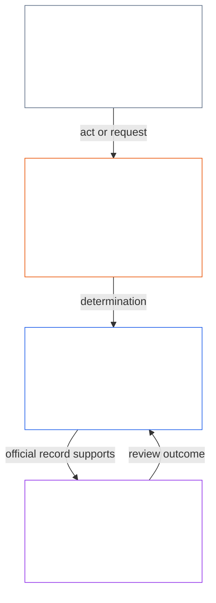
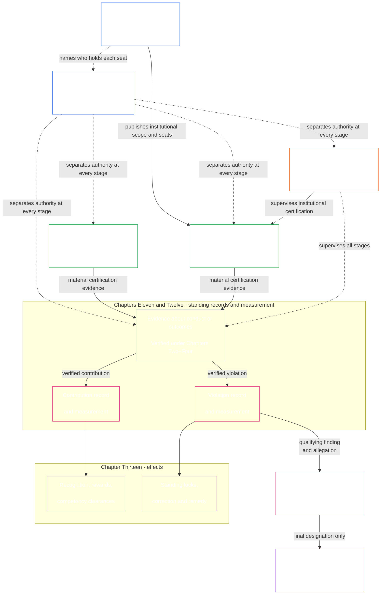

<!-- Locale: zh; language variety: 中文版 — 试点（不具约束力）. AI-assisted structural resynchronization draft (GPT-6 Codex); unreviewed and incomplete. English pin: SC-Corpus-2026.11.25, commit 6e0b6c663dde01b5dea731fe33d87725c7174930. core_00 SHA-256 90799cb8019b41356fa5dd90565e3f9540fc346e8c77e2c321b841654f39b274; core_01 SHA-256 aca759b394f10784ab1a2eef4e9e2ca12e369ef0ca8ee797298c6af00d2950aa. -->

<!-- Structural resynchronization draft; §§1–4 newly translated against the pinned English source, still requiring independent fidelity review. Other gaps are marked. Do not publish or synchronize. -->

# 第一章：宪法地图

<strong>在文本库中的位置（非操作性）：文件结构与阅读规则</strong>

> 标记为**非操作性**的小组件（文本库位置、读者指引、读者地图）仅用于导览。无论在其自身文件还是其他文件中，它们均不增加、删除或收窄任何有约束力的义务。
>
> 本文件**是感知者宪法的一部分**；只有与其他编号的 `core_*` 文件和子语料库一并作为同一文本阅读时，才具有**约束力**。本文件包含**第一章**，即*宪法地图*：其目的（§1）、存在理由（§2）、文件如何衔接（§3）、后续章节的基础（§4）、关键治理流程（§5）以及宪法责任主体登记册（§6 至 §11）。
>
> **上游：** [core_00.000_preamble.md](core_00.000_preamble.md)（序言）
> **下游：** [core_02.000_values_principles.md](core_02.000_values_principles.md)

<strong>追溯</strong>

- 上游：[序言](core_00.000_preamble.md)（*模型、两项宪法宗旨、宪法四元、实质利害和测量类别*）。
- 各节：
  - [§1](#1-purpose-role-and-scope);
  - [§2](#2-why-the-map-exists);
  - [§3](#3-how-the-files-fit-together);
  - [§4](#4-foundations-for-the-chapters-that-follow);
  - [§5](#5-key-governance-processes);
  - [§6](#6-principles-definitions-and-rights);
  - [§7](#7-system-and-institutional-charters-functional-independence-and-separation-of-duties);
  - [§8](#8-key-practical-process-pipelines);
  - [§9](#9-process-ownership-and-outputs);
  - [§10](#10-governance-change-and-incorporation);
  - [§11](#11-adopted-implementation-corpus)。
- 配合阅读：[权威层级与内部层次](subcore_03.080_band_integrative.md#authority-stack-and-internal-hierarchy)（*责任主体登记册的适用方式*）；[README.md](README.md)（*阅读顺序*）。

 

### 1. 目的、作用与范围

*用直白的话说：本章是整部宪法的导览。它说明各部分如何衔接、哪个章节负责哪个主题、主要流程如何运行，使读者能找到回答自己问题的规则。*

**目的：**第一章提供总体概览和责任指引。它列出检验授权治理的流程，指出各实质领域由哪个章节负责，并说明宪法文本的三个层级。

**作用：**本章负责导览和划分责任。除责任登记册外，本章不自行增加义务；其他章节和[权威层级与内部层次](subcore_03.080_band_integrative.md#authority-stack-and-internal-hierarchy)适用该登记册。

**本章范围：**

- 地图存在的原因（**第2节**）；
- 文件如何衔接（**第3节**）以及后续章节的基础（**第4节**）；
- 关键治理流程（**第5节**）；
- 宪法责任登记册：原则、定义和权利（**第6节**）；系统与机构章程、职能独立和职责分离（**第7节**）；流程链（**第8节**）；流程责任与产出（**第9节**）；治理、变更与纳入（**第10节**）；以及
- 已通过的实施语料和子语料（**第11节**）。

### 2. 地图为何存在

*用直白的话说：如此庞大的文本需要一份导览，说明各部分如何衔接以及每个主题由谁负责。本章帮助读者找到回答自己问题的规则。*

宪法将工作分布在许多章节、一个子语料和四个已通过语料中。感知者想知道自己应得到什么，或采纳方想查找一项义务，都可能迷失方向。本章提供总体概览和责任指引：每个部分做什么、哪个章节负责哪个主题、流程链如何运行，以及各文本层级如何关联。除责任登记册外，本章不自行设定规则。

**依据：**

- 序言：
  - [宪法四元](core_00.000_preamble.md#constitutional-tetrad)：本章落实的各项职能：
    - [参与](subcore_03.060_apex_participation_leg.md#participation)：感知者能够找到回答其问题的规则；
    - [问责](subcore_03.040_apex_accountability_leg.md#accountability)：每个主题都有一个指定负责并作出回应的章节；
    - [监督](subcore_03.055_apex_oversight_leg.md#oversight)：读者能够看清各部分如何衔接，并发现缺口或重叠；
    - [及时性](subcore_03.065_apex_timeliness_leg.md#timeliness)：读者无需延误即可找到正确规则；
  - [两项宪法宗旨](core_00.000_preamble.md#two-constitutional-aims)：本章服务的两项目标：
    - [繁盛](core_00.000_preamble.md#flourishing)：只有感知者能够在宪法中找到方向，宪法才能服务于他们；
    - [延续](core_00.000_preamble.md#continuity)：清晰的地图使文本在发展和变化时仍保持完整；
- 第二章原则：
  - [§5.2 通俗语言可及性（参与与尽责管理义务）](core_02.000_values_principles.md#52-plain-language-accessibility-participation-and-stewardship-duty);
  - [§5.2.4 防止以复杂性挫败目的的纪律](core_02.000_values_principles.md#524-complexity-as-defeat-discipline);
  - [§15.4 宪法含义冲突的解决](core_02.030_constitutional_interpretation.md#154-constitutional-meaning-conflict-resolution);
- 第四章条款：
  - [第XXIV-A条](core_04.030_rights_part_d.md#article-xxiv-a-proportional-comprehensibility-right)（*比例适当的可理解权*）；
  - [第XXIV-B条](core_04.030_rights_part_d.md#article-xxiv-b-complexity-audit-and-modularity-requirements)（*复杂性审计与模块化要求*）。

### 3. 文件如何衔接

宪法文件的衔接方式如下：

- **核心（`core_*`）：**编号文件包含宪法各章节，应作为同一文本共同阅读。它们陈述保障和宪法结构。
- **子核心（`subcore_*`）：**这些文件提供各章节背后的完整规则和程序。每个文件归属一个章节，效力与该章节相同，无需另行纳入即可约束每个采纳方。子核心不得缩窄其所属章节。
- **实施（`corpus_*`）：**四个文件提供落实宪法的操作细节。在有效纳入的范围内，它们具有约束力，并实施宪法而不缩窄宪法。[第11节](#11-adopted-implementation-corpus)列出这四个文件。

定义的[语料](subcore_03.080_band_integrative.md#corpus)是范围更广且带有版本的约束性宪法来源集合，包括核心、子核心、已通过的实施文本，以及过渡期间任何有效的兼容性封装。草案、注释和导航指南不会仅仅因为属于项目就变成有约束力的文本。

### 4. 后续章节的基础

*用直白的话说：第二至第四章负责价值、词典（包括子核心中关于如何构建、保护和证明定义的规则）以及权利底线；后续章节必须尊重这些归属，不得暗中转移。*

**第二至第四章**提供后续所有内容都必须遵守的价值、词汇、验证机制和权利底线，包括：

- [第五章的系统章程或机构章程要求、第六章的职责分离要求，以及第七章的独立机构](#7-system-and-institutional-charters-functional-independence-and-separation-of-duties)；
- 第8节的[关键实务流程链](#8-key-practical-process-pipelines)；
- 第9节的[流程责任与产出](#9-process-ownership-and-outputs)；
- 第10节的治理和变更路径章节；以及
- 第11节的[已通过实施语料](#11-adopted-implementation-corpus)。

#### 5 关键治理过程

*用直白的话说：当文本有要求时，实质问题要经过认证、帮助与伤害的书面记录、纠正与救济，以及带时限的评议所审查 — 普通争议先走已公布的质疑路径；这些路径检验已获授权的治理；它们本身并不创建治理。*

凡第六章、[第九章](../../core_09.000_system_alignment_certification_evaluation.md#chapter-nine-system-alignment-certification)、纳入文书或其他宪法规定明确要求之处，把实质宪法问题带入下列一条或多条路径。[关键实务流程链](#6-key-practical-process-pipelines)把测量转成记录、认证、经核实的输入、分类、评议所监督、纠正与及时救济 — 已获授权的治理在实践中如何被检验、被质疑、被修复。它们本身并不授权治理；它们使治理可审查、可质疑、可纠正、及时。[第 5.1 节](#62-how-the-full-chain-fits-together)完整陈述该链。

- **系统对齐认证**（[第九章](../../core_09.000_system_alignment_certification_evaluation.md#chapter-nine-system-alignment-certification)） — 在高影响系统被大规模信赖之前，收集并审查证据：现在依赖它在宪法上是否安全
- **持续记录**（[第十一章](core_11_standing_assessment.md#chapter-eleven-standing-records--question-1-what-happened)）——当行为或伤害在宪制上具有意义时，将经核实的事实写入正式的贡献或违规案卷；谣言和名声不足为据。
- **纠正与补救**（[第十三章§5.1（*补救与纠正*）](../../core_13.000_standing_integration.md#51-remedy-and-correction)）——纠正根本失误，并为受害者提供相称的承认、修复、恢复或补偿。
- **论坛审查**（[第十五章](core_11_forum.md#1-purpose-and-role--participation-architecture)）
  - 已获授权系统内部的普通争议，先走[受影响方的系统参与](../../core_05.055_band_participation.md#stakeholder-status-and-weight-cluster)已公布的质疑路径
  - 若该路径仍被争议、缺失、被俘获、或不能给予救济，则按首要利害经受监督的评议所路由
  - 这些评议所在 **第 XXV-C 条**（《及时解决与反拖延底线》）下支撑证据、合法移送与及时时限

### 6. 原则、定义与权利

*用直白的话说：第一至第六章掌管价值、语词如何构造与核验、词典与权利底线；后续章节必须尊重这些家园，不得悄悄挪走。*

**第4至第9节**是本宪法的**宪法职权归属登记册**。每个区块都说明其所属章节（或采纳的语料）负责的实质领域及其产出。每个编号章节的开篇也列有具有约束力的一行职权声明。其他层级可以指向职权归属方，但不得暗中改写或转移；不转移的纪律由[权威层级与内部层级](core_05_band_integrative.md#authority-stack-and-internal-hierarchy)规定。

第 **一至六** 章提供后续一切必须尊重的价值、词汇、核验机器与权利底线 — 包括第 5 节的[关键实务流程链](#6-key-practical-process-pipelines)、第 6 节的治理与变更路径章节，以及第 7 节的[配套实施文本库](#7-companion-implementation-corpus)。

每一摘要陈述该章掌管什么、产出什么。

**第一章 — 价值、原则与尽责管理**（[A 部分](core_01_a_values_principles.md) · [B 部分](core_01_b_interaction_interpretation.md#chapter-01-part-b-interaction-and-interpretation) · [C 部分](core_01_c_stewardship_capacity_principles.md#chapter-01-part-c-stewardship-and-governance)）

- **负责事项：**阐明本宪法的指导价值与约束，包括：
  - 福祉、公平、安全、真相、信任和有边界的自由；
  - 承认合法贡献并给予相称奖励；
  - 解决原则之间的冲突；以及
  - 受托治理义务，包括普及理解、系统评估和治理纪律。
- **产出：**为后续每一章提供解释基础。在阅读和适用系统、权利、定义或流程链时，这些规则将高层目标转化为可操作要求。

**第二章 — 定义结构**（[`core_02_definition_structure.md`](core_02_definition_structure.md)）

- **负责范围：**规定宪法术语如何通过以下要素构建：
  - 本体／测量／评估／合规（O/M/A/C）组件结构；
  - 对齐要求；以及
  - 使定义在整个语料中保持精确且可用的组件规则。
- **产出：**为定义建立共同语法，使后续章节不会陷入含糊标签、隐含假设或彼此不兼容的术语形式。

**第三章 — 定义完整性**（[`core_02_definition_structure.md`](core_02_definition_structure.md)）

- **负责范围：**防止：
  - 规避和转移适用范围；
  - 玩弄重新定义；以及
  - 在文字上掏空定义、在实践中使其失效的不合规伎俩。
- **产出：**建立反规避纪律和不合规指引元数据；规避行为得到证实时，还包括转交审查其地位和不当行为的路径。

**第四章 — 负担、可追溯性与核验**（[`core_02_definition_structure.md`](core_02_definition_structure.md)）

- **负责范围：**
  - 将举证责任交给声称合规的一方；以及
  - 要求与[**重大利益的程度**](#material-stake)相称且在实践中可受质疑的可追溯证据、可观察性和核验。
- **产出：**为[第十一章](core_11_standing_assessment.md#chapter-eleven-standing-records--question-1-what-happened)提供**经核实的输入**、为[第九章](core_09.000_system_alignment_certification_evaluation.md#chapter-nine-system-alignment-certification)提供系统对齐证据的核验流程。它不取代持续状态衡量本身。
**第五章 — 基础定义**（[`core_05__definitions_home.md`](core_05__definitions_home.md#chapter-five-foundational-definitions)）

- **负责范围：**提供：
  - 规范的定义层级：监督、参与、问责、连续性和整合层；
  - [权力层级与内部层级](core_05_band_integrative.md#authority-stack-and-internal-hierarchy)；
  - [语料](core_05_band_integrative.md#corpus)；以及
  - 相关边界规则。
- **产出：**用于解释、审计和裁决的精确宪法词汇。这是**定义层级**，而非权利底线；具有约束力的权利底线载于第六章。整部宪法的权责领域指引位于本序言登记册（第4至9节）。

**第六章 — 基础权利**（[A 部分](core_06_rights_part_a.md) · [B 部分](core_06_rights_part_b.md) · [C 部分](core_06_rights_part_c.md) · [D 部分](core_06_rights_part_d.md)）

- **负责范围：**在**第I至XXVIII条**规定权利底线，涵盖：
  - 生存必需品；
  - 资源分配与依赖关系管理；
  - 尊严、能动性与参与；
  - 挑战与补救；
  - 正义约束；
  - **第XXVI-C条**规定的及时性（*及时解决与反拖延底线*）；以及
  - 采纳过渡规则。
  四个部分按优先考虑地球的阅读方式组织这些保护。
- **产出：**不可协商的权利保护和补救机制。第七至第十三章、各论坛、治理和修正规则都必须尊重这些保障，不得通过程序或代理指标加以缩窄、规避或掏空。

### 7. System and Institutional Charters, Functional Independence, and Separation of Duties

*简而言之：具有实际影响的系统或机构应公布系统宪章或机构宪章，说明其可以做什么、每个席位由谁担任。随后，在具有实质约束力的行为实施前，应分别指定谁发起、谁核查或授权、谁保管正式记录、谁审查质疑。角色可按情境调整规模，但同一行动者及其控制链不得暗中占据核查自身行为的席位。*

- **产出：**一份已发布并进行版本管理的范围与席位安排说明，第八章、认证程序、地位记录和论坛可据此检验行为。第七章见[`core_07.000_charters.md`](core_07_charters.md#chapter-seven-system-and-institutional-charters)。

**职能独立与职责分离**——在实质约束行为推进之前，依据适用的分级和独立性规则，识别并分离发起、核验或授权、记录以及审查质疑的席位。

**对每项具有实质约束力的行为分别设置席位**（[第八章](core_07_functional_independence_segregation_of_duties.md#2-four-seat-constitutional-requirement)）：明确谁发起行为、谁核验或授权、谁保管正式记录，以及谁受理质疑。在认定行为已得到适当核验之前，应执行禁止兼任的组合限制、独立性规则和已公布的替代路径。需要系统宪章或机构宪章时（[第七章](core_07_charters.md#4-the-charter-role-map-and-standing-record-custody)），其宪章角色图应公布每个席位由谁担任。

**第八章——职能独立与职责分离**

- **其职责：**一项跨流程要求，即每项[实质性约束行为](../../core_05.035_band_accountability.md#materially-binding-act)都必须分别配置以下四项职能：
  - 发起；
  - 核验或授权；
  - 保管正式记录；以及
  - 审查异议。

它还规范：

  - 每份[实质约束行为记录](../../core_05.035_band_accountability.md#materially-binding-act-record)的通用最低内容；
  - 与行为者的[实质控制链](../../core_05.035_band_accountability.md#material-control-line)相独立；
  - 已公布的职能安排及替代安排；
  - 合乎比例的合并承载和紧急情况边界；以及
  - 可归责的交接和错误席位路由。
- **产出：**可重复使用的四席与行为记录架构。后续每一项认证、地位记录、论坛、治理及整合实施流程，都必须先落实该架构，其结果方可被视为经过独立核验、得到可靠记录且确实可以质疑。

#### 7.1 Four-seat separation map

> 此图展示四项职能，以及某项行为及其行为记录的典型追踪路径。它不新增第五个席位，不规定通用顺序，也不改变第八章关于独立性、相称的合并托管、紧急行动或质疑分流的规则。

### 8. 关键实务流程链

*简而言之：第九至第十五章沿着一条链适用第八章的职责分离要求：认证系统和机构，在两条独立轨道上衡量帮助与伤害，适用实际影响和补救，并防止论坛成为针对自身主张的唯一最终裁决者。这条链使宪制义务在日常生活中切实有效。*

[第七章](core_07_charters.md#chapter-seven-system-and-institutional-charters)公布每个L类或更高级别系统和机构的特许范围与席位图。[第八章](../../core_08.000_functional_independence_separation_of_duties.md#chapter-eight-functional-independence-and-separation-of-duties)规定职责分离要求，使链条中的每项行为都能得到有效核查。它要求依适用的规模调整和独立性规则，分开指派并维持发起、核验或授权、正式记录保管和质疑审查职能。随后，第九至第十五章依序适用这一架构：

下列每一步陈述该章掌管什么、产出什么。[整条链如何合在一起](#62-how-the-full-chain-fits-together)随后把这些主责显示为从系统核验到救济的一条路径。

#### 8.1 Process map

- **第九章**通过独立核验，判断具有实质影响的系统或机构是否在其声明的范围和记录期间内保持对齐。第九章规范系统认证；第十章规范机构认证，包括机构自身的类别、评估、记录和补救结果。
- **第十一章**接收经核实的事实，并分别记录在贡献和违规持续记录中。
- **第十二章**沿各自轴衡量每一份持续记录。经核实的促进繁荣贡献，不抵销、取消或减少另行核实的伤害或问责失责；两者各自记录并承担各自后果。
- **第十三章**将这些分类转化为相称的持续状态影响，包括贡献轨道上的能力许可和认可，以及违规轨道上的持续锁定、纠正和补救。
- **第十四章**仅在第十二章已衡量出高层级违规后适用。经正当程序保障后，它判断相关行为是否独立满足最终反宪制不当行为认定（ACMD）的标准。
- **第十五章**监督分流、证据、移交、论坛独立性和及时解决，使由此产生的记录和影响能够受到质疑、纠正和执行，并防止被控制的论坛成为审判自身行为的唯一最终裁决者。
- **不当行为审查**回答其独立问题：符合条件的违规是否也应作出最终ACMD认定。
- **论坛监督**管理分流、证据、移交、质疑和补救，确保正式记录与决定能及时接受审查和纠正。

#### 8.2 整条链如何合在一起

*用直白的话说：把它想成从系统核验到救济的一条路 — 评议所全程监督争议与轨迹步骤。*

1. **对每项具有重大约束力的行为分离职责席位**（[第八章](core_07_functional_independence_segregation_of_duties.md#2-four-seat-constitutional-requirement)）：明确谁发起、谁核验或授权、谁持有正式记录、谁听取异议。在认定行为已得到适当核验之前，应适用禁止兼任的组合、独立性规则和已公布的替代路径。若要求系统宪章或机构宪章（[第七章](core_07_charters.md#4-the-charter-role-map-and-standing-record-custody)），其宪章角色图应公布每个席位的承担者。
2. **在影响足够重大时认证系统和机构**——高影响系统在大规模获得信任之前，须取得可质疑的系统认证记录（[第九章A至B部分](core_09.000_system_alignment_certification_evaluation.md#chapter-nine-system-alignment-certification)）；依[第十章](core_10.000_institutional_alignment_certification.md#chapter-ten-institutional-alignment-certification)按机构自身类别、行为、治理和业务组合评估，并将结果记录在机构认证记录中。
3. **在不同轨道上记录并衡量持续状态**（[第十一章](core_11_standing_assessment.md#chapter-eleven-standing-records--question-1-what-happened)和[第十二章](core_12_standing_measurement.md#chapter-twelve-standing-measurement--question-2-how-good-or-bad-was-it)）——当帮助或伤害在宪制上足够重要时，第十一章必须开立正式案卷，且仅接纳**经核实的输入**（包括在相关时来自第九章的系统对齐认证证据）；第十二章衡量并分类已核实的内容。谣言、名声和争议叙述不足为据。
   - **违规性质：**开立**违规持续记录**——用于记录经核实伤害和问责失责、范围明确且可质疑的案卷——并在违规轴上分类**违规性质**。帮助与伤害绝不合并为一个净分；相互关联的持续记录会交叉引用，但仍保持分开。
4. **在每条轨道上适用持续状态影响**（[第十三章](../../core_13.000_standing_integration.md#chapter-thirteen-standing-effects-and-integration)）——经核实的贡献可授予能力许可，并须支持相称的认可和实质奖励；经核实的违规可触发持续锁定、纠正以及[对受害者的补救](../../core_13.000_standing_integration.md#51-remedy-and-correction)。
5. **进行反宪制认定审查**（[第十四章](../../core_14.000_misconduct_designation.md#chapter-fourteen-anti-constitutional-misconduct)）——若最高影响级别的违规发现也可能符合反宪制标准，第十四章必须决定是否附加相应ACMD。该ACMD不会改变第十二章已判定的伤害严重程度。在最终ACMD触发反宪制信任锁之前，通常的第十三章影响仍并行适用。
6. **分流争议并确保补救及时**（[第十五章](core_11_forum.md#1-purpose-and-role--participation-architecture)）——论坛必须监督案件流转、负责轨道，以及是否遵守**第二十六条-C**（*及时解决与反拖延底线*）的时限，避免补救因拖延而落空。一般争议遵循[争议顺序](core_11_forum.md#dispute-sequencing)。论坛还必须把争议划分为五个[重要性等级](core_11_forum.md#6-timely-resolution-materiality-tiers-and-anti-delay-discipline)（A/B/C/L/P），与系统分类字母一致，涵盖从生存攸关的紧急事项到私密/受控事项。若最终第十四章认定是主要争点，则适用诚信类默认分流。

[README 轨迹链地图](../../README.md#standing-pipeline-and-forums)为上述链提供直接导航，包括第七章进入轨迹测量的潜在经核实输入。

### 9. 流程归属与产出

第七章——系统与机构章程 ([Chapter Seven](../../core_07.000_charters.md#chapter-seven-system-and-institutional-charters))

- **产出：**一份已发布并进行版本管理的范围与席位安排说明，第八章、认证程序、地位记录和论坛可据此检验行为。第七章见[`core_07.000_charters.md`](core_07_charters.md#chapter-seven-system-and-institutional-charters)。

### 10. 治理、变更与纳入

*简而言之：第十六至第二十章完成本宪法：谁可以治理，如何修改文本而不倒退权利保障，宪法与其他法律的关系，以及已采纳的操作指南如何持续受本源约束。*

第 **十二至十六** 章收束文书 — 并完成治理、变更效力与纳入的[正向主责登记](#4-principles-definitions-and-rights)：谁可以正当地治理，宪法如何可以合法变更，以及已采纳的实施文本如何在无声错位之外仍绑定宪法源。

每一摘要陈述该章掌管什么、产出什么。

**第二十章——宪制契约、正当性与管理责任**（[`core_16.000_governance.md`](../../core_16.000_governance.md#chapter-sixteen-constitutional-contract-legitimacy-authorization-and-stewardship)）

- **其职掌：** 掌管[**宪法契约层**](core_05_band_integrative.md#constitutional-contract-layer) — 谁可以治理、凭何种正当性机制、在何种范围与持久条款之下，以及必须维持何种尽责管理品格。
- **其产出：** 有别于已获授权系统中[**受影响方的系统参与**](../../core_05.055_band_participation.md#stakeholder-status-and-weight-cluster)的授权与正当性要求 — 治理权威本身的规则，而不只是其内部的参与。

**第十七章——不倒退**（[`core_17.000_non_regression.md`](../../core_17.000_non_regression.md#chapter-seventeen-non-regression-and-substantive-amendment-validity)）

- **其职掌：** 设定对抗回退变更的实质底线 — 修正与变通不能回撤核心保护、把四元掏空到实质利害以下，或把回退伪装成技术清理。
- **其产出：** 对任何拟议变更的**第一条宪法护栏** — 不回退规则：若变更在实践中会削弱核心保护，则无效，哪怕程序看起来没问题。可疑变通或伪装回撤被拦住或送往正当审查路径，而不是悄悄溜过。

**第十八章——至上地位与外部命令**（[`core_18.000_expansion_supremacy.md`](../../core_18.000_expansion_supremacy.md#chapter-eighteen-expansion-supremacy-and-external-legal-orders)）

- **负责事项：**本宪法与其他规范的关系：在合法范围内扩大保护、在有效本源范围内享有至上地位、采纳和治理层级范围、不得排除凭其自身效力适用的外部法律，并以有纪律的方式与外部法律秩序互动，避免无声从属或俘获。
- **其产出：** 层级与冲突顺序规则，使公布或使用不被当作废止可适用的外部法，并使采纳方不能把纳入程序、更弱的外部规范或图方便的指标，当作在有效采纳范围内压过感知者宪法含义。
**第十九章——修正、批准与采纳**（[`core_19.000_amendment_ratification.md`](../../core_19.000_amendment_ratification.md#chapter-nineteen-amendment-ratification-and-procedural-validity)）

- **负责事项：**本宪法如何依法变更——修正规程、批准和采纳——以及继第十七章实质性防护之后的**程序保障**：变更须公开发布、可追溯至权威保管，并在必要时保持实质可质疑且接受独立审查。
- **其产出：** 一条完整的合法变更路径 — 只有越过**不回退护栏**与**程序护栏**的修正与采纳，才算有效的宪法更新。
**第二十章——纳入衔接机制**（[`core_20.000_incorporation.md`](../../core_20.000_incorporation.md)）

- **其职掌：** 识别哪些实施文件在获采纳时算有约束力的纳入文本；钉住版本；维持保管链；并禁止宪法源与操作细节之间的无声错位。
- **其产出：** 一条纳入边界 — 指定实施文本在获采纳时具约束力；配套文本库实施宪法，而不成为收窄它的第二源。[第 7 节](#9-adopted-implementation-corpus)高层概述这些文本库。

### 11. 已采纳的实施语料

*用直白的话说：四个配套文本库（联合结构、系统、机构、评议所运作）详述如何落实各章已经要求的内容；在有效采纳时具约束力，且不得缩小那些义务。*

在编号 `core_*` 各章之外，四个配套文本库完成已采纳**实施文本**的[正向主责登记](#4-principles-definitions-and-rights) — 使宪法义务在实践中可运行的操作细节：

- **[corpus_joint_structure](../../corpus_joint_structure.md)** — 跨文件路由、共享操作用语，以及在系统、机构与评议所必须就同一事实一并阅读时的联合结构。
- **[corpus_systems](../../corpus_systems.md)** — 系统分类、设计与部署协议、信息处理，以及关键尽责管理机制。
- **[corpus_institutions](../../corpus_institutions.md)** — 机构组建、治理、监督、相称性与解散纪律。
- **[corpus_forum](../../corpus_forum.md)** — 评议所运作：小组组成、回避、审查通道、路由细节与取证支持。

采纳方依[第二十章](../../core_20.000_incorporation.md)有效纳入这些文件后，它们在采纳范围内作为实施文本具有约束力。仍以《Sentient Constitution》的含义为准——这些文件是**实施，而非缩窄**上述章节。版本固定、保管链和禁止无声偏移规则，确保已采纳文本可追溯至实际批准的内容。规范清单和边界规则见[第五章——语料库](../../core_05.045_band_integrative.md#corpus)。

原则、定义、权利、流程链、治理、修正规则与纳入的实施必须一并阅读，以保全宪法的保护目的。
---

**上一文件：** [README.md](README.md)

**下一文件（本语言）：** [core_01_a_values_principles.md](core_01_a_values_principles.md)

**有约束力的原文：** [core_00_preamble.md](core_00_preamble.md)
