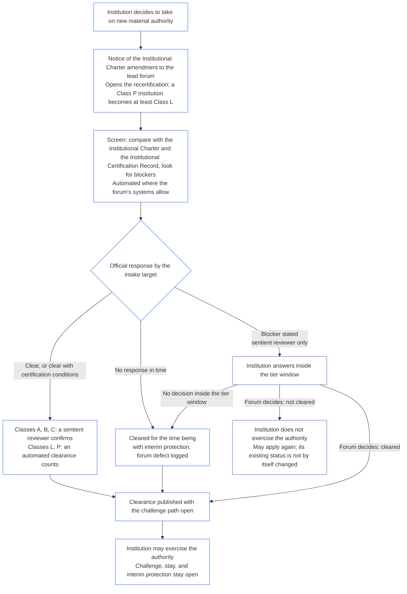

# SUBCORE 9-E: NEW MATERIAL AUTHORITY AND REOPENING THE INSTITUTION'S SYSTEMS

<strong>Corpus placement (non-operative): file structure and reading rules</strong>

> This file is **part of the Sentient Constitution**: a [subcore](subcore_03.080_band_integrative.md#subcore) file attached to [Subcore 9-F](subcore_09.060_institutional_alignment_certification_records_recertification.md#subcore-9-f-institutional-alignment-certification--records-recertification-challenge-and-standing), with the same force as that chapter, binding only together with the numbered `core_*` files and the rest of the subcore read as one text. It is **Subcore 9-E**. Until 2026-11-21 its text was in Chapter Thirteen as §§4.2.1–4.2.3 (*New material authority*) and §4.6 (*Reopening the Institution's Systems*); here they are §§3.1–3.3 and §4. Chapter Thirteen keeps every heading and anchor, the wait that **Article XI-E** (*Institutional Formation and Business Creation*) states, and one line for each guarantee.
>
> **Upstream:** [Subcore 9-F §4 Recertification and Reopening](subcore_09.060_institutional_alignment_certification_records_recertification.md#4-recertification-and-reopening), which lists the reopening triggers, and [Subcore 9-B §2.2 No Permission and No Gate on Forming or Running](subcore_09.020_institutional_alignment_certification_evaluation.md#22-no-permission-and-no-gate-on-forming-or-running).
> **Downstream:** [Subcore 8-F §4.1 Recertification Schedule and the New System Certification Record](subcore_08.060_system_alignment_certification_records_recertification.md#41-recertification-schedule-and-the-new-system-certification-record), under which each reopened System review runs; [CS-8.320 §12 Illustrative Institution Walkthroughs](corpus_systems/cs_08.320_system_alignment_certification_illustrations.md#cs-8320-12-illustrative-institution-walkthroughs).

 

---

### 1. Purpose, Role, and Scope

Subcore 9-E is the constitutional owner of two procedures of institutional recertification: the **recertification an Institution must pass before it exercises new material authority**, with what counts as such authority and the only blockers that may stop it, and the **reopening of each System in an Institution's portfolio** after a governance violation. [Subcore 9-F](subcore_09.060_institutional_alignment_certification_records_recertification.md#subcore-9-f-institutional-alignment-certification--records-recertification-challenge-and-standing) states the wait, the triggers, and the guarantees; where a line there and the text here seem to differ, the reading more protective of the affected sentient controls.

*In plain terms: Chapter Nine says an institution must wait for a fresh look before taking power over others that its Institutional Charter never covered, and that bad governance reopens its systems. This file sets out both procedures step by step.*

### 2. Why the Procedure Is the Same for Every Adopter

*In plain terms: if each adopter set its own rules for clearing new authority, some would wave power through and others would use the wait to block rivals.*

New authority over others is where an Institution can do the most harm before anyone looks, and where a forum can do the most harm by never answering. One procedure, the same for every adopter and scaled only by institution class, keeps both risks small: the Institution waits, the forum must answer inside fixed windows or the authority clears for the time being, and only five named blockers can stop it. The same is true of reopening: a governance failure that matters reaches every System it touches, without stopping any of them and without letting the Institution choose which ones are looked at again.

**Grounded in:**

- Preamble:
  - [Constitutional Tetrad](core_00.000_preamble.md#constitutional-tetrad): the legs this file carries:
    - [Accountability](subcore_03.040_apex_accountability_leg.md#accountability): new authority needs a named accountable office, and every clearance or blocker is stated with its evidence;
    - [Oversight](subcore_03.055_apex_oversight_leg.md#oversight): an independent lead forum, and a sentient reviewer for every judgment blocker;
    - [Participation](subcore_03.060_apex_participation_leg.md#participation): clearances are published, and affected sentients may challenge them and ask for a stay;
    - [Timeliness](subcore_03.065_apex_timeliness_leg.md#timeliness): intake targets and tier windows bind the forum, and its delay clears the authority for the time being;
  - [Two Constitutional Aims](core_00.000_preamble.md#two-constitutional-aims): both aims, which this file serves:
    - [Flourishing](core_00.000_preamble.md#flourishing): Institutions may form, run, and grow without permission, and new ventures are not blocked to protect incumbents;
    - [Continuity](core_00.000_preamble.md#continuity): power over others is not taken on unexamined, and a governance failure is followed into every System it reaches;
- Chapter Two principles:
  - [§11 Market Structure](core_02.010_values_principles_continuity_aim.md#11-market-structure);
  - [§13.3 Minimization of Avoidable Burden](core_02.020_interaction_interpretation.md#133-minimization-of-avoidable-burden);
- Chapter Four Articles:
  - [Article XI-E](core_04.010_rights_part_b.md#article-xi-e-institutional-formation-and-business-creation) (*Institutional Formation and Business Creation*).

### 3. New Material Authority

*In plain terms: what counts as new power over others, how the institution is recertified before using it, and the only reasons the forum may refuse.*

The trigger that opens this procedure is in [Subcore 9-F §4.2 Reopening Triggers](subcore_09.060_institutional_alignment_certification_records_recertification.md#42-reopening-triggers) (*New material authority*).

#### 3.1 What Counts as New Material Authority

Authority is **new material authority** when both of these hold:

- **Material:** It is authority to decide, direct, allocate, restrict, or control something for others, and it is material to them under [Domain-Specific Materiality](subcore_03.085_band_oversight.md#domain-specific-materiality).
- **Not covered:** Neither the Institution's Institutional Charter nor its current Institutional Certification Record covers it.

It includes:

- a new function, or a new kind of decision, over others;
- a new group of sentients that the Institution governs or affects;
- a new domain, resource, or shared system that the Institution controls;
- a reach that is material only when counted together with Operating Parties under common control or with others on the same shared system ([Materiality Integrity Constraint](subcore_03.085_band_oversight.md#materiality-integrity-constraint); [Systemic Materiality](subcore_03.075_band_continuity.md#systemic-materiality)); and
- a pilot or trial of any of the above that is itself material, judged under [Domain-Specific Materiality](subcore_03.085_band_oversight.md#domain-specific-materiality) on its actual scope, population, and duration. Such a pilot exercises the authority, so it waits for the recertification like the full authority, as [Subcore 8-B §3.3 Pilot Certification](subcore_08.020_system_alignment_certification_evaluation.md#33-pilot-certification) treats a System pilot as a go-live. The recertification is scaled to the pilot's actual scope, population, and duration. A pilot that is not material on those terms is not new material authority.

It does not include:

- **Authority stated at formation:** authority that the Institution states in its first Institutional Charter, since there is no gate on forming ([Subcore 9-B §2.2 No Permission and No Gate on Forming or Running](subcore_09.020_institutional_alignment_certification_evaluation.md#22-no-permission-and-no-gate-on-forming-or-running));
- **More of what is covered:** growth within a scope the Institutional Certification Record already evaluated, which the dependency growth and material change triggers above handle; and
- **A new System:** a new System goes live on its own certification ([Subcore 8-D §4.1 Go-Live Gate](subcore_08.040_system_alignment_certification_forum_process_outcomes.md#41-go-live-gate)). If the System also gives the Institution authority that its Institutional Certification Record does not cover, that authority is new material authority.

Splitting or staging an authority into parts, so that no part is new or material, does not avoid the wait ([Subcore 8-F §4.4 Non-Evasion](subcore_08.060_system_alignment_certification_records_recertification.md#44-non-evasion)). Where it is unclear whether authority is new material authority, the Institution gives notice, and the lead forum decides.

#### 3.2 Recertification for New Material Authority

An Institution that decides to take on new material authority must be recertified, and it must wait for the result before it exercises that authority. This is the wait that **Article XI-E** (*Institutional Formation and Business Creation*) states. It runs as follows:

- **Notice first:** The Institution gives the notice of the Institutional Charter amendment that [Chapter Five §9.1 Changing the Document](core_05.000_charters.md#91-changing-the-document) already requires, and sends it to the lead forum. The notice opens the recertification.
- **No Institutional Certification Record yet:** An Institution with no Institutional Certification Record gives the same notice. The notice opens a first certification limited to the new authority, judged against the Institutional Charter and the evaluations in [Subcore 9-B §4 Whole-Institution Certification Evaluation](subcore_09.020_institutional_alignment_certification_evaluation.md#4-whole-institution-certification-evaluation) to [Subcore 9-B §6 Rights-Floor and Domain Evaluations](subcore_09.020_institutional_alignment_certification_evaluation.md#6-rights-floor-and-domain-evaluations) as they bear on that authority. The rest of the first certification still runs on the window in [Subcore 9-B §2.3 Window for the First Certification](subcore_09.020_institutional_alignment_certification_evaluation.md#23-window-for-the-first-certification) (for a Class P Institution reclassified by the notice, a window that runs from the notice), and the wait for the new authority does not depend on it.
- **Within the tier windows:** The recertification runs under the tier windows of [Subcore 8-F §4.3.4 Tier Windows](subcore_08.060_system_alignment_certification_records_recertification.md#434-tier-windows), with the tier presumptively matching the institution class. A missed window is handled under [Article XXVII-C](core_04.040_rights_part_e.md#article-xxvii-c-timely-resolution-and-anti-delay-floor) (*Timely Resolution and Anti-Delay Floor*), and fees and waits may not become a barrier ([Avoidable Burden](subcore_03.075_band_continuity.md#avoidable-burden)).
- **Automated where it can be:** The notice, the comparison of the new authority with the Institutional Charter and current Institutional Certification Record, the screen for blockers, and the clearance are automated wherever the forum's systems allow. [Chapter Two §13.3 Minimization of Avoidable Burden](core_02.020_interaction_interpretation.md#133-minimization-of-avoidable-burden) makes automation the preferred remedy for an avoidable burden, and [Chapter Two §16.4 Document at Action](core_02.040_stewardship_capacity_principles.md#164-document-at-action) puts the burden of automation on the system and not on the steward.
  - **Clears, does not refuse:** An automated screen may clear the new authority, either outright or with the certification conditions the current Institutional Certification Record already supports. It may not, on its own, state a blocker (one of those in [§3.3 Blockers to Clearing New Material Authority](#33-blockers-to-clearing-new-material-authority)) or decline to clear. The screen may flag a possible blocker, but only a sentient reviewer in the lead forum may state one, after looking at what the screen flagged.
  - **Classes A, B, and C:** A sentient reviewer in the lead forum confirms every clearance before it counts as the official response. This applies to an Institution in one of those classes, and to one that the new authority would bring into one. The intake target still applies to the confirmation. The reviewer sits in the lead forum, which already holds the verify-or-authorize seat and must be independent of the Institution ([Subcore 9-D §3.1 Four Seats in an Institutional Certification](subcore_09.040_institutional_alignment_certification_forum_process_outcomes.md#31-four-seats-in-an-institutional-certification)).
  - **Classes L and P:** An automated clearance counts as the official response without confirmation. A Class P Institution is reclassified to at least Class L when it gives the notice ([Subcore 9-B §2.1 Who Is Certified](subcore_09.020_institutional_alignment_certification_evaluation.md#21-who-is-certified)), so for it this is the Class L rule.
  - **Exceptional circumstances:** A sentient reviewer takes the matter instead, in any class when the screen flags a possible blocker, when the screen cannot tell whether the authority is covered or material, or when the Institution or an affected sentient asks for review. A request for review is answered by the [matching intake target](subcore_03.075_band_continuity.md#tier-window), counted from the request. It does not extend the tier window.
  - **Same Institutional Certification Record and same clocks:** The Institutional Certification Record shows the checks that were run, so an automated clearance can be challenged like any other decision. Automation does not extend the intake target or the tier window, and a screen that is down or fails to answer is a missed response under the bullet below. The forum answers for the screen as for any System it uses ([Subcore 9-D §3.3 Forums, Certifiers, and Record Offices as Institutions](subcore_09.040_institutional_alignment_certification_forum_process_outcomes.md#33-forums-certifiers-and-record-offices-as-institutions)).
- **The wait:** The Institution does not exercise the new authority until the recertification clears it.
  - **Every class waits:** No class is exempt, and neither emergency nor urgency lifts the wait.
  - **Everything else continues:** What the Institution already does goes on ([Subcore 9-B §2.2 No Permission and No Gate on Forming or Running](subcore_09.020_institutional_alignment_certification_evaluation.md#22-no-permission-and-no-gate-on-forming-or-running)).
  - **Protection does not wait:** The forums' urgent protection of affected sentients does not wait for the recertification ([Subcore 8-D §3.2 Supervisory Sequence](subcore_08.040_system_alignment_certification_forum_process_outcomes.md#32-supervisory-sequence)). That protects sentients and is not a ground for the Institution to exercise the authority early.
- **Published when cleared:** The lead forum publishes each clearance as soon as it is given, including a clearance for the time being, with the challenge path of [Subcore 9-F §5 Challenging a Certification](subcore_09.060_institutional_alignment_certification_records_recertification.md#5-challenging-a-certification) open. The Institution may exercise the authority from clearance. It does not wait for a notice interval or for a challenge to be decided. An affected sentient may challenge the clearance like any other decision and may ask for a stay or interim protection, which does not wait ([§3.2 Recertification for New Material Authority](#32-recertification-for-new-material-authority), *Protection does not wait*). At publication the lead forum also gives notice of the clearance to the affected sentients it knows of and to the forums of the Systems concerned. A request for a stay or interim protection is answered inside the matching intake target ([CF-16.445 §5.1 Stage Targets and Outer Bounds](corpus_forum/cf_16.445_performance_backlog_publication_accessibility.md#cf-16445-51-stage-targets-and-outer-bounds)), or inside the bound of its Emergency setting where that setting applies.
- **Presumed cleared:** The authority is presumed cleared. The lead forum declines to clear it only where it shows, on evidence stated on the Institutional Certification Record, a blocker listed in [§3.3 Blockers to Clearing New Material Authority](#33-blockers-to-clearing-new-material-authority). Where certification conditions tied to the blocker could contain it, the authority is cleared with those certification conditions and not refused.
- **What cleared means:** The recertification ends in provisional or full certification, with or without certification conditions, and every certification condition required before the authority is exercised has been independently verified.
- **If the forum does not respond in time:** The lead forum owes an official response by the matching intake target ([CF-16.445 §5.1 Stage Targets and Outer Bounds](corpus_forum/cf_16.445_performance_backlog_publication_accessibility.md#cf-16445-51-stage-targets-and-outer-bounds)). The response clears the authority, clears it with certification conditions, or states a blocker with the evidence it rests on. A response that states a blocker gives the Institution its chance to answer, and the forum decides inside the tier window above.
  - **Cleared for the time being:** If no official response comes by the intake target, or a stated blocker is not decided inside the tier window, the authority is cleared for the time being, with the interim protection and reliance limits that [Subcore 8-D §4.2 Certification Defects and Correction](subcore_08.040_system_alignment_certification_forum_process_outcomes.md#42-certification-defects-and-correction) provides.
  - **A forum defect:** The missed target or window is a forum defect, not a fault of the Institution. It is logged, corrected, and reviewed as an overrun under [Chapter Seventeen §5 Timely Resolution, Materiality Tiers, and Anti-Delay Discipline](core_17.000_forum_families_escalation_timeliness_support.md#5-timely-resolution-materiality-tiers-and-anti-delay-discipline) (*Overrun review*).
  - **Handed to another forum:** The recertification request is transferred to another forum in the same family ([Chapter Sixteen §6 Transfer, consolidation, and anti-self-judging](core_16.000_forum.md#6-transfer-consolidation-and-anti-self-judging--continuity-and-anti-capture)). That forum carries the recertification on the regular windows for the Institution's class, counted from the transfer.
- **If it is not cleared:** The Institution does not exercise the authority and may apply again on the terms of Chapter Nine §4.4 (*Not a Permanent Bar*). Not clearing the new authority is not by itself a denial or revocation of the status the Institution holds for what it already does. That status changes only on a finding under [Subcore 9-D §4.3 Remediation Readiness for an Institution](subcore_09.040_institutional_alignment_certification_forum_process_outcomes.md#43-remediation-readiness-for-an-institution) and [Subcore 9-D §4.4 Denial and Revocation for an Institution](subcore_09.040_institutional_alignment_certification_forum_process_outcomes.md#44-denial-and-revocation-for-an-institution).
- **Without notice, or before it is cleared:** Exercising new material authority without the notice, or before it is cleared, is practice outside the Institutional Charter. It is a finding under [Subcore 9-B §4 Whole-Institution Certification Evaluation](subcore_09.020_institutional_alignment_certification_evaluation.md#4-whole-institution-certification-evaluation) (item 1) and reopens review as an Institutional Charter event.

<strong>Reader guide (non-operative): the wait for new material authority</strong>

This figure summarizes §3.2 Recertification for New Material Authority. Where it differs from the text, the text controls. Everything the Institution already does continues throughout, and urgent protection of affected sentients never waits. Worked examples of Institutions are in [CS-8.320 §12 Illustrative Institution Walkthroughs](corpus_systems/cs_08.320_system_alignment_certification_illustrations.md#cs-8320-12-illustrative-institution-walkthroughs).

 

#### 3.3 Blockers to Clearing New Material Authority

The lead forum may decline to clear new material authority only for one of these blockers. Blocker 2 is mostly a matter of plain fact, read from the Charter Role Map and the authority chain, and an automated screen can run it ([§3.2 Recertification for New Material Authority](#32-recertification-for-new-material-authority)). Blockers 1, 3, 4, and 5 call for judgment, so a screen may flag them and only a sentient reviewer may state them. Each must be shown on evidence about the new authority or about the Institution's readiness to hold it, and the forum states it on the Institutional Certification Record with what would clear it:

1. **Misaligned authority:** The new authority would violate a [Constitutional Constraint](subcore_03.080_band_integrative.md#constitutional-constraint) or a Rights Floor protection, or the evaluations in [Subcore 9-B §4 Whole-Institution Certification Evaluation](subcore_09.020_institutional_alignment_certification_evaluation.md#4-whole-institution-certification-evaluation) to [Subcore 9-B §6 Rights-Floor and Domain Evaluations](subcore_09.020_institutional_alignment_certification_evaluation.md#6-rights-floor-and-domain-evaluations) find a certification defect in it, and no certification condition could contain the problem.
2. **No accountability for it:** No accountable office can be named for the new authority, or no independent route can reach it, as [Subcore 9-B §4 Whole-Institution Certification Evaluation](subcore_09.020_institutional_alignment_certification_evaluation.md#4-whole-institution-certification-evaluation) (items 3 and 5) requires.
3. **Unresolved misalignment and no readiness to correct it:** A current misalignment of the Institution that bears on the new authority is unresolved, and the readiness check in [Subcore 9-D §4.3 Remediation Readiness for an Institution](subcore_09.040_institutional_alignment_certification_forum_process_outcomes.md#43-remediation-readiness-for-an-institution) finds the Institution not willing, or not able, to correct it inside the tier windows.
4. **Concealment:** The notice or the Institution's showing is false, fabricated, or materially concealed.
5. **Concentration of power:** The new authority would concentrate power contrary to [Chapter Two §11 Market Structure](core_02.010_values_principles_continuity_aim.md#11-market-structure).

These are not blockers:

- the size, age, or wealth of the Institution, or that it has no earlier Institutional Certification Record;
- competition with other Institutions, or protection of an incumbent;
- the cost or workload of the recertification for the forum; or
- a good-faith dispute with a finding, made through the published route ([Subcore 8-D §4.3.1 Willingness](subcore_08.040_system_alignment_certification_forum_process_outcomes.md#431-willingness)).

**Holds and locks still apply.** The three narrow gates of **Article XI-E** (*Institutional Formation and Business Creation*) apply on their own terms. An [Interim Hold](subcore_03.070_band_accountability.md#interim-hold) or a standing lock on a named sentient bars that sentient, within its gated pathway, from taking or exercising the new authority. It bars the sentient and not the Institution, and it is not a blocker on the Institution, so the authority can still be cleared for another holder.

Before the forum decides not to clear, the Institution is told the blocker and the evidence and has the chance to answer inside the tier window. The decision states its reasons on the Institutional Certification Record ([Subcore 8-F §3.1 Minimum Record Contents](subcore_08.060_system_alignment_certification_records_recertification.md#31-minimum-record-contents)).

### 4. Reopening the Institution's Systems

*In plain terms: when an institution is found to have governed badly in a way that matters, each of its systems is reopened for a fresh look as soon as notice is given, unless that system's own review is already under way. That is a fresh look and not an outcome. Each system keeps its status until its own review decides.*

When an Institution has a **governance violation**, review of each System in its portfolio reopens. The name does not mean a violation for standing; it names the reopening grounds below. A governance violation is any one of these, and only a material one reopens (see *Material only* below):

- **A determination that its governance failed:** a determination that the Institution's own governance failed on one of these items of [Subcore 9-B §4 Whole-Institution Certification Evaluation](subcore_09.020_institutional_alignment_certification_evaluation.md#4-whole-institution-certification-evaluation): the Institutional Charter against practice (item 1), portfolio and aggregate effect (item 2), accountable authority (item 3), rewards and incentives (item 4), the Role Map and custody (item 5), office-holder standing and authenticity (item 7), or the Institution's own institutional duties (item 8). It also covers a defect in the Institution's own conduct under an evaluation in [Subcore 9-B §5 Evaluations Where Implicated](subcore_09.020_institutional_alignment_certification_evaluation.md#5-evaluations-where-implicated) or [Subcore 9-B §6 Rights-Floor and Domain Evaluations](subcore_09.020_institutional_alignment_certification_evaluation.md#6-rights-floor-and-domain-evaluations), or under the systemic-risk or data types and handling parts of [Subcore 8-B §4 Whole-System Certification Evaluation](subcore_08.020_system_alignment_certification_evaluation.md#4-whole-system-certification-evaluation) that apply to the Institution. It may be made in the Institution's certification pass, in a recertification or reopened review, or in a forum case. Where it is made in a certification evaluation it counts even if the result is only that the Institution is not yet aligned, which is not a violation for standing ([Subcore 8-F §6.2 Every Certification Outcome](subcore_08.060_system_alignment_certification_records_recertification.md#62-every-certification-outcome)).
- **A denial or revocation of the Institution** on a denial or revocation ground that lies in the matters above, or in the conduct of its governing authority (the denial or revocation grounds that are that conduct are the ones in the *Both* bullet of [Subcore 9-D §4.4 Denial and Revocation for an Institution](subcore_09.040_institutional_alignment_certification_forum_process_outcomes.md#44-denial-and-revocation-for-an-institution)).
- **An institutional cause:** a cause finding under rule 2 of [Subcore 9-F §4.5 Cascade from System Certifications](subcore_09.060_institutional_alignment_certification_records_recertification.md#45-cascade-from-system-certifications) that places the cause of a cited System's misalignment in the Institution. That System is already in review; every other System in its portfolio reopens.

Item 6 (currency of each cited System certification) is not a governance violation of its own. It comes from the Systems' own System Certification Records, and [Subcore 9-F §4.5 Cascade from System Certifications](subcore_09.060_institutional_alignment_certification_records_recertification.md#45-cascade-from-system-certifications) carries it.

- **Material only:** A determination reopens the Systems only where it is material, judged by what it bears on for the Institution's Systems and scaled to the Institution's class. A trivial determination logged and corrected in a first filing does not.
- **Once per determination:** Each determination reopens each System once. A cause finding or defect made in a review reopened under this section is not a new trigger under this section on that determination, and a failure to give the notice below is a defect under item 3 and not a new trigger on the same determination. A System that fails or is withdrawn as a result of a reopened review is still a cited System event for [Subcore 9-F §4.2 Reopening Triggers](subcore_09.060_institutional_alignment_certification_records_recertification.md#42-reopening-triggers) and [Subcore 9-F §4.5 Cascade from System Certifications](subcore_09.060_institutional_alignment_certification_records_recertification.md#45-cascade-from-system-certifications).
- **Notice at once:** Where the Institution has been denied or revoked, this is the same notice as the one in [Subcore 9-D §4.5 Effects of Denial and Revocation for an Institution](subcore_09.040_institutional_alignment_certification_forum_process_outcomes.md#45-effects-of-denial-and-revocation-for-an-institution) (item 2). The Institution's governing authority gives notice of the violation to the lead forum of each such System's certification pass and asks that the System's review reopen. The notice goes at once. If it is not given, the forum that made the determination gives it, to those lead forums and to the lead forum of the Institution's pass, inside the matching intake target of the Institution's class ([CF-16.445 §5.1 Stage Targets and Outer Bounds](corpus_forum/cf_16.445_performance_backlog_publication_accessibility.md#cf-16445-51-stage-targets-and-outer-bounds)), counted from the determination. Where there is no such lead forum (a Class P Institution, an Institution or System still inside its first window, or a lapsed pass), the forum that made the determination refers the reopened review to the forum that would take that pass under [Subcore 9-D §3.2 Forum Roles and Sequence](subcore_09.040_institutional_alignment_certification_forum_process_outcomes.md#32-forum-roles-and-sequence). A governing authority that does not give the notice has a defect under item 3 (accountable authority), and [Subcore 9-F §4.4 Non-Evasion](subcore_09.060_institutional_alignment_certification_records_recertification.md#44-non-evasion) applies.
- **Closing a reopening:** The lead forum of a System may close its reopening on a short note on the Institutional Certification Record, inside the matching intake target, where the determination bears on nothing for that System.
- **A reopened review of each System:** The lead forum of each System's certification pass opens it as a reopened review under [Subcore 8-F §4.1 Recertification Schedule and the New System Certification Record](subcore_08.060_system_alignment_certification_records_recertification.md#41-recertification-schedule-and-the-new-system-certification-record), with a new System Certification Record linked to the last. The Institution's determination is evidence under [Subcore 8-B §4.1 Governance, Incentive, and Contestability Discipline](subcore_08.020_system_alignment_certification_evaluation.md#41-governance-incentive-and-contestability-discipline), and the review looks at what the violation bears on for that System. It runs on the tier windows of [Subcore 8-F §4.3.4 Tier Windows](subcore_08.060_system_alignment_certification_records_recertification.md#434-tier-windows), with the tier presumptively matching the System's class.
- **A review, not an outcome:** Reopening changes no System's outcome, status, or certification condition. The System's own certification pass decides what follows, on its own findings.
- **Operation continues:** Neither the Institution nor any of its Systems is stopped by the reopening ([Subcore 9-B §2.2 No Permission and No Gate on Forming or Running](subcore_09.020_institutional_alignment_certification_evaluation.md#22-no-permission-and-no-gate-on-forming-or-running)). Urgent protection of affected sentients does not wait ([Subcore 8-D §3.2.3 Urgent Protection](subcore_08.040_system_alignment_certification_forum_process_outcomes.md#323-urgent-protection)).
- **A System already in a certification pass:** It takes the determination into that pass, and no second certification pass is opened.
- **One System:** A determination made in the one-System evaluation is already before it, so nothing separate opens. A determination made in a forum case or a recertification reopens that evaluation under [Subcore 8-F §4.1 Recertification Schedule and the New System Certification Record](subcore_08.060_system_alignment_certification_records_recertification.md#41-recertification-schedule-and-the-new-system-certification-record).
- **Record:** The Institutional Certification Record names each System notified and the date of the notice ([Subcore 9-F §3.1 Minimum Record Contents](subcore_09.060_institutional_alignment_certification_records_recertification.md#31-minimum-record-contents), *Systems notified*).

---

**Previous file:** [subcore_09.040_institutional_alignment_certification_forum_process_outcomes.md](subcore_09.040_institutional_alignment_certification_forum_process_outcomes.md)

**Next file:** [subcore_09.060_institutional_alignment_certification_records_recertification.md](subcore_09.060_institutional_alignment_certification_records_recertification.md)
