# الفصل السابع، الجزء أ: تصديق مواءمة النظام — التقييم

<strong>موضع الملف في المتن (غير تشغيلي): بنية الملف وقواعد القراءة</strong>

> هذا الملف **تجريب بلغة القارئ** لـ[الفصل السابع، الجزء أ بالإنجليزية](../../core_08_a_system_alignment_certification_evaluation.md). **ليس** جزءًا ملزمًا من دستور الكائنات الواعية. **ليس** دستورًا ثانيًا. **ليس** طبعة إرسال. وهو **مثبّت** على `SC-Corpus-2026.08.09`. إذا بدا أن هذه الترجمة والأصل الإنجليزي يختلفان، يفوز الملف المرقّم [`core_07_a_system_alignment_certification_evaluation.md`](../../core_08_a_system_alignment_certification_evaluation.md). ترتيب القراءة وبيانات الطبعة تُحفظ في [README.md](../../README.md). المنهج والمسرد: [translations/ar/README.md](README.md).
>
> يحتوي **الفصل السابع، الجزء أ** — متطلبات **تقييم** التصديق (صنف النظام، وعوامل النظام كاملًا، وخطافات تقييم المجال). **الجزء ب** — سجل التصديق وعملية المنتدى وجسر الوضعية وإعادة الفتح — في [`core_07_b_system_alignment_certification_record_process.md`](core_07_b_system_alignment_certification_record_process.md).
>
> - **المالك الدستوري (مشترك مع الجزء ب):** **تصديق مواءمة النظام والسجلات ذات الصلة** تحت إشراف المنتدى — مجالات التقييم (الجزء أ)؛ واجبات سجل التصديق ونواتج الاعتراف وإيقاع إعادة التحقق وتسلسل الإشراف وسلسلة قابلية الطعن وجسر المدخلات الموثّقة إلى الفصل الثامن (الجزء ب). تحت رجل **الرقابة** في الرباعية، SAC عملية تدقيق كبيرة بوجه خاص وعالية الرهان بين غيرها؛ وتبقى أرضيات التدقيق في **المادة XVI** و[قابلية التدقيق](core_05_band_oversight.md#auditability) في الفصل الخامس.
> - **مالك ركيزة التحقق:** [الفصل الرابع — عبء الإثبات وقابلية التتبع والتحقق](core_04_burden_traceability_verification.md#chapter-four-burden-of-proof-traceability-and-verification) (ضمن الفصول من الثاني إلى الرابع) يملك توزيع العبء ودليل الامتثال وقابلية تتبع التعريف وقابلية الرصد والتحقق المقيَّد أمنيًا. **يطبق** الفصل السابع ذلك الانضباط على سجلات تصديق مواءمة النظام؛ وهو **لا** يعيد بيان أقسام الفصل الرابع **1** حتى **5**.
> - **موطن التدقيق (غير منقول إلى هنا):** **المادة XVI** (*التدقيق والشفافية والتحقق المستقل*) و**Def.O1** (*الشفافية وقابلية التدقيق والتحقق*) و**CJS-3.3**–**CJS-3.5** تملك أرضيات التدقيق والحدود التشغيلية. يدير الفصل السابع عملية تدقيق SAC كبيرة بوجه خاص يجب أن تستوفي تلك الأرضيات؛ وهو لا يملك التدقيق كله.
> - **مالك التنفيذ:** يجب أن تبقى معالجة صنف النظام وCS-5 وتفصيل عملية المنتدى في ملفات التنفيذ المعيَّنة متسقة مع الفصل السابع، ويجوز أن تكون أشد حيث يوفّر المتن أصلًا منطق قاعدة أشد.
> - **قاعدة منع النقل:** لا يعيد الجزء أ بيان التعريفات القانونية في الفصل الخامس، ولا انضباط منع التهرّب في الفصل الثالث (انظر [الجزء ب §16](core_07_b_system_alignment_certification_record_process.md#16-reopening-drift-and-non-evasion))، ولا قياس الإسهام أو الوضعية في الفصل الثامن، ولا آثار الوضعية في الفصل التاسع. تبيّن **[الجزء ب §15](core_07_b_system_alignment_certification_record_process.md#15-relationship-to-standing)** حدّ جسر الوضعية صراحة.
>
> **أعلى:** تعريفات الفصل الخامس وسجل الفصول من الثاني إلى الرابع والتحقق والعبء وقابلية تتبع التعريفات إلى النتائج.
> **أسفل:** [الجزء ب](core_07_b_system_alignment_certification_record_process.md#chapter-seven-part-b-certification-record-and-process) (*السجل وعملية المنتدى وجسر الوضعية*)؛ سجلات الوضعية والمدخلات الموثّقة في الفصل الثامن؛ آثار الوضعية في الفصل التاسع؛ إشراف المنتدى ومسارات تصديق مواءمة النظام في الفصل الحادي عشر.
>
> **باب الإدارة المسؤولة (غير تشغيلي):** بيان الخطوة التالية الملزم: [بيان الإدارة المسؤولة التشغيلي](#operative-steward-statement-sac). ولا تستطيع مؤشرات الدعم في [`implementation/STEWARD_ENTRY_DOORS.md`](../../implementation/STEWARD_ENTRY_DOORS.md) تضييقه.

>
> **السابق (هذه اللغة):** [core_07_system_alignment_certification.md](core_07_system_alignment_certification.md#chapter-seven-system-alignment-certification-index)
>
> **التالي (هذه اللغة):** [core_07_b_system_alignment_certification_record_process.md](core_07_b_system_alignment_certification_record_process.md#chapter-seven-part-b-certification-record-and-process)
> **قوس القراءة:** §1 الغرض والدور → §2 صنف النظام → §3 تقييم النظام كاملًا → §4–§10 تقييمات المجال

 

الفصل السابع، **الجزء أ**، هو المالك الدستوري لـ**تقييم تصديق مواءمة النظام**. محتويات السجل وإشراف المنتدى ومسارات الطعن وجسر الوضعية في **[الجزء ب](core_07_b_system_alignment_certification_record_process.md#chapter-seven-part-b-certification-record-and-process)**.

> **بيان الإدارة المسؤولة التشغيلي.** **المالك:** الفصل السابع (SAC تحت إشراف المنتدى). عدسة طبقة المبادئ: الفصل الأول §14. SAC عملية تدقيق كبيرة بوجه خاص تحت المادة XVI / قابلية التدقيق — لا التدقيق الوحيد. **الحركة المحظورة:** لا تعامل اختبارات الوحدة أو قوائم التحقق من الخصوصية أو تسميات المواءمة المحلية تصديقًا. لا تتجاوز نافذة الطعن. لا تخترع موطن تدقيق خامسًا. لا تعامل شارة تصديق أو درجة LEQU مركز كائن واعٍ. **الساعة:** افتح أو استعد مسارًا قابلًا للطعن من الفصل السابع، بما في ذلك نافذة طعن للأطراف المتأثرة، قبل ادعاء المواءمة.

### 1. الغرض والدور

<strong>التتبع</strong>

- المنابع: [الديباجة — سجل المالك الدستوري](core_00_preamble.md#4-principles-definitions-and-rights) و[تسلسل السلطات والتراتبية الداخلية](core_05_band_integrative.md#authority-stack-and-internal-hierarchy)؛ [الرباعية الدستورية](core_00_preamble.md#constitutional-tetrad)؛ [المقصدان الدستوريان](core_00_preamble.md#two-constitutional-aims)؛ [الرهان المادي](core_00_preamble.md#material-stake)؛ [التناسب](core_05_band_accountability.md#proportionality) و[الإنصاف الموضوعي](core_05_band_participation.md#substantive-fairness) (الفصل الخامس)؛ أسرة قياس المشاركة (*الصوت والوصول ومسارات الطعن*)؛ [الفصل الأول §16 الإدارة المسؤولة بتعمق](core_01_c_stewardship_capacity_principles.md#16-stewardship-in-depth)؛ [الفصل الأول §12 متطلب التقييم النظامي](core_01_a_values_principles.md#12-systemic-evaluation-requirement) (*منظور تقييم النظام بأكمله على مستوى المبادئ — لا زاوية واحدة فقط*)؛ الفصول من الثاني إلى الرابع؛ [الفصل الخامس](core_05__definitions_home.md#chapter-five-foundational-definitions) (*التعريفات المرجعية*)؛ [الفصل السابع §2 أرضية المقاعد الدستورية الأربعة](core_07_functional_independence_segregation_of_duties.md#2-four-seat-constitutional-floor)؛ [تصديق اتساق النظام](core_05_band_continuity.md#system-alignment-certification) (المصطلح المرجعي في الفصل الخامس؛ والاختصار **SAC** غير تشغيلي)؛ [سجل تصديق النظام](core_05_band_continuity.md#system-certification-record) (بمعناه في الفصل الخامس).
- المسارات اللاحقة: [§2](#2-system-class-evaluation) (*تقييم فئة النظام*)؛ [الجزء B §9.1](core_08_b_system_alignment_certification_record_process.md#91-challenging-a-certification) (*الطعن في التصديق*)؛ و[ملفات فئات النظام في الجزء C](core_08_c_system_alignment_certification_illustrations.md#illustrative-system-class-profiles-non-exhaustive) (*ملفات فئات النظام التوضيحية*)؛ [جولات تطبيق النظام بأكمله في الجزء C](core_08_c_system_alignment_certification_illustrations.md#illustrative-whole-system-application-by-system-class-non-exhaustive) (*أمثلة تطبيقية للنظام بأكمله بحسب فئة النظام*)؛ [§3.4.8](core_08_c_system_alignment_certification_illustrations.md#348-illustrative-data-handling-application-by-system-class-non-exhaustive) (*أمثلة تطبيقية لمعالجة البيانات بحسب فئة النظام*)؛ [§5.1.5](core_08_c_system_alignment_certification_illustrations.md#515-illustrative-ecological-footprint-application-by-system-class-non-exhaustive) (*أمثلة تطبيقية للبصمة البيئية بحسب فئة النظام*)؛ [§5.2.5](core_08_c_system_alignment_certification_illustrations.md#525-illustrative-educational-capability-application-by-system-class-non-exhaustive) (*أمثلة تطبيقية للقدرات التعليمية بحسب فئة النظام*)؛ [§5.3.8](core_08_c_system_alignment_certification_illustrations.md#538-illustrative-cross-system-support-application-by-system-class-non-exhaustive) (*أمثلة تطبيقية للدعم بين الأنظمة بحسب فئة النظام*)؛ [§5.4.5](core_08_c_system_alignment_certification_illustrations.md#545-illustrative-nondiscrimination-application-by-system-class-non-exhaustive) (*أمثلة تطبيقية لعدم التمييز بحسب فئة النظام*)؛ [§5.5.6](core_08_c_system_alignment_certification_illustrations.md#556-illustrative-accessibility-application-by-system-class-non-exhaustive) (*أمثلة تطبيقية لإمكانية الوصول بحسب فئة النظام*)؛ [§5.6.5](core_08_c_system_alignment_certification_illustrations.md#565-illustrative-trustworthiness-application-by-system-class-non-exhaustive) (*أمثلة تطبيقية للجدارة بالثقة ونزاهة الاعتماد على النظام بحسب فئة النظام*)؛ [§3](#3-whole-system-certification-evaluation) (*عوامل تقييم التصديق الشامل للنظام*)؛ من [§3.4](#34-data-types-and-handling-evaluation) إلى [§5.6](#56-trustworthiness-and-system-reliance-integrity-evaluation) (*تقييمات المجالات*)؛ [الجزء B §6](core_08_b_system_alignment_certification_record_process.md#6-forum-process) (*تسلسل الإشراف وسلسلة قابلية الطعن*)؛ [الجزء B §6.1](core_08_b_system_alignment_certification_record_process.md#61-forum-supervision-and-component-roles) (*أدوار مكونات المنتدى*)؛ [الجزء B §8](core_08_b_system_alignment_certification_record_process.md#8-system-certification-record) (*محتويات سجل التصديق*)؛ [الجزء B §8.2](core_08_b_system_alignment_certification_record_process.md#82-record-integrity-transparency-and-auditability) (*متطلبات نزاهة السجل*)؛ [الجزء B §7](core_08_b_system_alignment_certification_record_process.md#7-certification-outcomes) (*إعادة الفتح ومناهضة التحايل*)؛ [الجزء B §10](core_08_b_system_alignment_certification_record_process.md#10-relationship-to-standing) (*جسر سجلات قياس الوضعية*)؛ [الفصل التاسع](core_09_standing_assessment.md#chapter-nine-contribution-violation-and-standing-model--measurement) (*سجلات قياس الوضعية وبوابة المدخلات المتحقق منها*)؛ [الفصل العاشر](core_10_standing_integration.md#chapter-ten-standing-effects-and-integration) (*آثار قياس الوضعية ودمجها*)؛ [الفصل الثاني عشر](core_12_forum.md#chapter-twelve-forums-and-jurisdiction) (*إشراف المنتديات والتصديق وتصديق الاتساق والمراجعة*).
- يُقرأ مع: [corpus_systems.md](corpus_systems.md)، ولا سيما **CS-3 — تصنيف الأنظمة ومعالجتها** و**CS-2 — أنواع المعلومات ومعالجتها** و**CS-5** (*واجهات القدرات المقدمة للمستخدم*)؛ [corpus_forum.md](corpus_forum.md)، ولا سيما **CF-5** (*عمليات التوجيه والنقل والتصديق والمعاملة التمثيلية*) و**CF-7** (*ضمانات النزاهة وعمليات منع الاستحواذ ودعم منع الحكم على الذات*)؛ **المادة XVI** (*التدقيق والشفافية والتحقق المستقل*) و[قابلية التدقيق](core_05_band_oversight.md#auditability) (*أرضيات التدقيق — SAC عملية تدقيق كبيرة على نحو خاص ضمن الرقابة، وليست مرجع التدقيق الوحيد*)؛ **CJS-3.3** (*الرقابة: مصطلحات قابلية التدقيق وإعادة البناء (ملحق)*) إلى **CJS-3.5** (*الرقابة: مصطلحات التحقق المستقل ونزاهة الادعاءات*).

 

*بعبارات واضحة: حين يؤثر نظام فعلياً في حياة الكائنات الواعية، ينبغي أن يكون التصديق **متناسباً** مع الأثر والاعتماد والمخاطر الفعلية للنظام؛ فلا يكون قائمة موحدة تصلح لكل الحالات ولا ختم موافقة آلياً. وينبغي أيضاً أن يكون **تشاركياً**: يجب أن تتمكن الكائنات الواعية والمجتمعات المتأثرة من معرفة ما خضع للمراجعة، وفهم القرار، والطعن فيه عند وجود خطأ. تراجع المنتديات الأدلة، وتدوّنها في سجل التصديق، وتطلب إعادة الفحص وفق جدول يناسب مخاطر النظام. تخضع الفئات A وB وC للعملية كاملة، والفئة L لعملية أخف. ويُشجَّع النظام من الفئة P على استخدامها، وتصبح واجبة حين تتجاوز آثاره وحدة خاصة أو حين يزعم مشغّله الامتثال الدستوري.*

*التصديق ليس مقياساً للشعبية، ولا تصريحاً أبدياً، ولا وسيلة لتجاوز مراجعة الحقوق. إنه بيان محدود زمنياً وقابل للطعن بشأن ما هو معلوم عن اتساق النظام في الوقت الراهن. وفي ضلع **الرقابة** من الرباعية الدستورية، يقتضي الرقابة التدقيق؛ وتصديق اتساق النظام عملية تدقيق كبيرة وعالية المخاطر بين عمليات أخرى، وليس المرجع الوحيد للتدقيق (**المادة XVI** (*التدقيق والشفافية والتحقق المستقل*)، [قابلية التدقيق](core_05_band_oversight.md#auditability)).*

يهدف **تصديق اتساق النظام** إلى الإجابة عن سؤال واحد ضمن نطاق وجدول مراجعة محددين: هل أظهر النظام اتساقاً دستورياً كافياً للتصديق، أو التصديق المشروط، أو التحقق، أو إعادة التصديق، أو استمرار الاعتماد عليه، أو نشره، أو رفع شروط جوهرية عنه؟

يجب أن يتناسب عمق التصديق، وعبء السجل، وتواتر إعادة التصديق، ومراجعة أصحاب المصلحة، ومسارات الطعن مع [الرهان المادي](core_00_preamble.md#material-stake) وفق [التناسب](core_05_band_accountability.md#proportionality):

- تتطلب الأنظمة الأعلى أثراً واعتماداً ومخاطر أدلة أقوى وسجلات أوضح ومشاركة أيسر عملياً، بما يشمل إمكانية الوصول الفعلية ومدخلات أصحاب المصلحة ومسارات طعن تتناسب مع فئات المعتمدين على النظام.
- تظل الفئات الأدنى والنطاقات المحدودة ملزمة بالتصنيف الصادق والضمان المتناسب؛ ولا يعفيها ذلك من الالتزامات المادية عند وجود آثار خارجية.

تُطبّق العملية بحسب فئة الأثر، وفق [CS-3 §3.5 شرط إعادة التصنيف](corpus_systems/cs_03_a_system_classification_machinery.md#35-reclassification-requirement):

- **الفئات A وB وC:** تحمل أعلى مستويات الأثر والاعتماد والمخاطر، ويلزمها التقييم الشامل للنظام بكامل عمقه وفق [§3](#3-whole-system-certification-evaluation) و[§4](#4-evaluations-where-implicated) و[§5](#5-rights-floor-and-domain-evaluations)، كلٌّ بحسب الطبقة التي تنطبق عليه؛
- **الفئة L:** يلزمها التقييم نفسه على نحو متناسب، مع وتيرة افتراضية أقل لإعادة الفحص وسجلات أبسط حيثما تجيز CS-3 ذلك؛ و
- **الفئة P:** يُشجَّع النظام المصنف فيها تصنيفاً صحيحاً على اتباع العملية، وله أن يستخدمها طوعاً. وتصبح إلزامية عند إعادة تصنيفه إلى L أو أعلى، أو حين يعلن مشغّله طوعاً امتثاله الدستوري.

يُنفّذ التصديق [الهدفين الدستوريين](core_00_preamble.md#two-constitutional-aims) من خلال [الرباعية الدستورية](core_00_preamble.md#constitutional-tetrad):

- **[الازدهار](core_00_preamble.md#flourishing):** يتحقق التصديق من أن التصديق أو استمرار الاعتماد لا يهزم خفيةً أرضيات الحقوق ولا يحول دون المشاركة العادلة في الحياة ذات الصلة دستورياً؛
- **[الاستمرارية](core_00_preamble.md#continuity):** يتحقق من إمداد مستدام غير تراجعي يدعم النظم الطبيعية السليمة ولا يستنزفها ([السلامة البيئية](core_05_band_continuity.md#ecological-integrity)، بما فيها [قدرة التعافي البيئي](core_05_band_continuity.md#ecological-recovery-capacity))، ومن إعادة التصديق بالوتيرة المناسبة لفئة النظام حين تتحكم الأنظمة المشتركة في الإمداد أو تدعمه؛
- **المشاركة:** تتمكن الكائنات الواعية والمجتمعات المتأثرة من فهم مسارات المراجعة التي تهمها والطعن فيها والمشاركة فيها؛
- **الرقابة:** تكون السجلات والأدلة والافتراضات ظاهرة وقابلة للتدقيق بما يكفي للتحقق المستقل؛ والتصديق نفسه عملية تدقيق كبيرة ضمن واجب الرقابة وليست العملية الوحيدة؛
- **المساءلة:** تُحال العيوب والتصنيف الخاطئ والتشغيل الذي يهزم أرضيات الحقوق إلى علاج أو شروط أو سحب أو مدخلات في قياس الوضعية، متى ساندت الوقائع ذلك؛
- **التوقيت المناسب:** تمنع مهل المراجعة والطعن تقادم التصديق ما دام بالإمكان منع الضرر أو عكسه.

وبصفته أداة إشراف، يُعد التصديق عملية تدقيق كبيرة ضمن [قابلية التدقيق](core_05_band_oversight.md#auditability) و**المادة XVI** (*التدقيق والشفافية والتحقق المستقل*):

- يخضع لإشراف المنتديات، ويشمل مجالات متعددة، ويمنح وضعاً رسمياً.
- يمكنه دمج نتائج أنماط التدقيق الشقيقة، لكنه لا يستوعبها ولا يحل محلها. ولكل نمط مالكه الخاص المحدد في [خريطة مالكي أنماط التدقيق الشقيقة](corpus_joint_structure/cjs_03u_audit_process.md#sibling-audit-modes-owner-map) في مرجع عملية التدقيق:
  - تدقيق سجل أنواع بيانات النظام بموجب **CS-2** (*أنواع المعلومات ومعالجتها*)؛
  - تدقيق سجل تصنيف النظام بموجب **CS-3** (*آلية تصنيف الأنظمة*)؛
  - مراجعات ضمان الرقابة بموجب **CS-4** (*الرقابة على الأنظمة الحرجة*)؛
  - التدقيق المستمر بموجب **CS-5** (*التصميم والاختبار والتحقق والنشر*) وACA؛
  - تدقيق التعقيد بموجب **CS-6** (*قابلية الفهم والرقابة على التعقيد*) و**المادة XXIII-B** (*متطلبات تدقيق التعقيد والنمطية*)؛
  - التحقق من الادعاءات بموجب **CJS-3.5** (*الرقابة: مصطلحات التحقق المستقل ونزاهة الادعاءات*).
- يمكن إجراء أي من هذه الفحوص منفرداً دون المرور بالتصديق. ولا يحل التصديق محلها.

#### 1.1 التصديق في لمحة

*بعبارات واضحة: صنّف النظام بصدق، وأجرِ التقييمات المنطبقة، ودع المنتديات تراجع الأدلة ومخاوف أصحاب المصلحة باستقلال، ثم تحدد النتيجة. أكمل السجل الوحيد المفتوح لمراجعة المنتدى وانشره مع مسار طعن مفتوح. لا يبدأ النظام المصدّق عمله إلا بعد انقضاء مهلة الإخطار واستيفاء وسائل الحماية المطلوبة. راقب النتائج الفعلية، واستجب للحوادث والطعون، وأعد الفحص في موعده أو عند تغير الوقائع. أصلح العيوب واجعل التصحيح خاضعاً لتحقق مستقل قبل الإذن بالنطاق المتأثر أو رفع شروطه. وتستخدم كل جولة مراجعة سجلاً جديداً مرتبطاً بالسجل السابق.*

تتألف العملية من **ست مراحل**: **I التأطير**، **II التقييم**، **III المراجعة**، **IV القرار**، **V التسجيل**، و**VI التشغيل**. وتنقسم المرحلة II إلى ثلاث طبقات، لكل منها قسمها: **IIa** (دائماً)، و**IIb** (عند انطباقها)، و**IIc** (عند تحقق شروطها). وتنقسم المرحلة VI إلى مرحلتين فرعيتين، لكل منهما قسمها: **VIa** (التشغيل وإعادة التصديق، [§9](core_08_b_system_alignment_certification_record_process.md#9-recertification-and-reopening)) و**VIb** (جسر قياس الوضعية، [§10](core_08_b_system_alignment_certification_record_process.md#10-relationship-to-standing)). يبيّن المخطط العملية كاملة بهذا الترتيب. يغطي الجزء A المرحلتين الأوليين، التأطير والتقييم؛ ويغطي [الجزء B](core_08_b_system_alignment_certification_record_process.md#chapter-eight-part-b-system-alignment-certification--record-and-process) المراحل الأربع الأخيرة: إجراءات المنتديات والنتيجة وبوابة بدء التشغيل والسجل والتشغيل (مسار الطعن وإعادة التصديق وإعادة الفتح وجسر قياس الوضعية).

يُعاد كل تقييم منطبق في كل جولة تصديق: عند التصديق الأول، وعند كل إعادة تصديق وفق الجدول المحدد في [§2 تقييم فئة النظام](#2-system-class-evaluation)، وعند كل مراجعة معاد فتحها أو جديدة. وتُفتح المراجعة قبل موعد إعادة التصديق التالية عند تغير وقائع مادية، مثل ازدياد الاعتماد على النظام أو ازدياد استخراجه من الموارد المشتركة أو انخفاض كبير فيما يعيده إليها أو ظهور طعن موثوق. تسرد [§9 إعادة التصديق وإعادة الفتح في الجزء B](core_08_b_system_alignment_certification_record_process.md#9-recertification-and-reopening) المحفزات.

```mermaid
flowchart TB
    T(["نظام ذو أثر مادي يطلب التصديق،<br/>أو يزداد الاعتماد عليه"])
    C["المرحلة I، التأطير — §2<br/>التصنيف بصدق<br/><br/>تحدد الفئة العمق وجدول إعادة الفحص"]
    subgraph W["المرحلة II، التقييم — §3–§5 تقييم شامل للنظام"]
        direction LR
        Al["IIa، §3.1–§3.4 — دائماً<br/><br/>المخاطر النظامية: تقييم وإفصاح<br/>لمن يحتاجها؛ الأفق الزمني؛<br/>الحوكمة؛ أنواع البيانات"]
        Im["IIb، §4 — عند انطباقها<br/><br/>مواضع الخصوصية، حقوق الخروج،<br/>التجمع والمعارضة"]
        Tr["IIc، §5 — عند تحقق شروطها<br/><br/>فحوص أرضيات الحقوق المنطبقة<br/>وتقييمات المجالات الستة"]
        Al ~~~ Im ~~~ Tr
    end
    F["المرحلة III، المراجعة — §6<br/>مراجعة مستقلة للأدلة<br/>ومخاوف أصحاب المصلحة<br/><br/>تصدر المنتديات المعيّنة نتائجها؛<br/>وتظل مسارات الطعن متاحة"]
    Rec["المرحلة V، السجل — §8<br/>سجل واحد لتصديق النظام<br/><br/>يفتح لمراجعة المنتدى؛ ويستكمل بالنتيجة،<br/>والنتائج المؤيدة والشروط وخطة التشغيل"]
    S[["الفصل التاسع — سجلات<br/>قياس الوضعية<br/><br/>خارج هذا الفصل"]]
    O{"المرحلة IV، القرار — §7<br/><br/>ما النتيجة والوضع<br/>اللذان تسندهما الأدلة؟"}
    Fc["تصديق كامل — §7، §9.2<br/><br/>إعادات تصديق أولية نظيفة متتالية مطلوبة؛<br/>لا يوجد اختلال حالي أو وشيك تشير إليه الأدلة<br/>مهلة أطول لإعادة التصديق؛ وقد تُفرض شروط"]
    Pc["تصديق مؤقت — §7، §9.2<br/><br/>منح أول، أو تعافٍ بعد اختلال،<br/>أو استمرار الوضع المؤقت أو تخفيضه<br/>مهلة أقصر لإعادة التصديق؛ وقد تُفرض شروط"]
    Nc["غير مصدّق — §7<br/><br/>مؤجل أو مرفوض أو مسحوب أو منقضٍ<br/>لا بدء للتشغيل؛ تُذكر الأسباب والعمل التصحيحي المطلوب"]
    Pub["نشر السجل المكتمل — §7، §9.1<br/><br/>فتح مسار الطعن في السجل المنشور؛<br/>وللنطاق الجديد أو الموسّع، يُذكر بدء التشغيل والإخطار"]
    G{"بوابة بدء التشغيل — §7<br/><br/>هل استوفي التصديق والمتطلبات<br/>المنطبقة لبدء التشغيل؟"}
    Hold["استيفاء متطلبات بدء التشغيل — §7<br/><br/>إكمال الإخطار والتحقق المستقل من<br/>الشروط المطلوبة قبل بدء التشغيل"]
    Rm["الحماية والتصحيح — §7، §9.2<br/><br/>لا بدء جديداً في النطاق المتأثر؛<br/>حماية الكائنات الواعية المتأثرة وتصحيح التصميم أو التشغيل،<br/>وتقديم الأدلة للتحقق المستقل"]
    Ch["المرحلة VIa، التشغيل وإعادة التصديق — §9–§9.2<br/>الرصد وإبقاء الطعون مفتوحة<br/><br/>التشغيل ضمن النطاق والشروط المصدّق عليها؛<br/>ورصد النتائج والاستجابة للحوادث والطعون"]
    S2[["الفصل التاسع — سجلات<br/>قياس الوضعية<br/><br/>خارج هذا الفصل"]]
    Sp["&nbsp;&nbsp;&nbsp;&nbsp;&nbsp;&nbsp;&nbsp;&nbsp;&nbsp;&nbsp;&nbsp;&nbsp;&nbsp;&nbsp;&nbsp;&nbsp;&nbsp;&nbsp;&nbsp;&nbsp;&nbsp;&nbsp;&nbsp;&nbsp;&nbsp;&nbsp;&nbsp;&nbsp;&nbsp;&nbsp;&nbsp;&nbsp;&nbsp;"]
    SpL["&nbsp;&nbsp;&nbsp;&nbsp;&nbsp;&nbsp;&nbsp;&nbsp;&nbsp;&nbsp;&nbsp;&nbsp;&nbsp;&nbsp;&nbsp;&nbsp;&nbsp;&nbsp;&nbsp;&nbsp;&nbsp;&nbsp;&nbsp;&nbsp;&nbsp;&nbsp;&nbsp;&nbsp;&nbsp;&nbsp;&nbsp;&nbsp;&nbsp;&nbsp;&nbsp;"]
    SpA["&nbsp;&nbsp;&nbsp;&nbsp;&nbsp;&nbsp;&nbsp;&nbsp;&nbsp;&nbsp;&nbsp;&nbsp;&nbsp;&nbsp;&nbsp;&nbsp;&nbsp;&nbsp;&nbsp;&nbsp;&nbsp;&nbsp;&nbsp;&nbsp;&nbsp;&nbsp;&nbsp;&nbsp;&nbsp;&nbsp;&nbsp;&nbsp;&nbsp;&nbsp;&nbsp;&nbsp;&nbsp;&nbsp;&nbsp;&nbsp;&nbsp;"]
    Re["جولة المراجعة التالية — §9<br/><br/>إعادة تصديق أو إعادة فتح أو مراجعة جديدة؛<br/>تفتح كل جولة سجلاً جديداً مرتبطاً بالسابق"]
    T --> C
    A1((A)) --> C
    C --> W
    W --> F
    F --> O
    O --> Fc
    O --> Pc
    O --> Nc
    Fc --> Rec
    Pc --> Rec
    Nc --> Rec
    Rec -.->|VIb، §10 —<br/>مدخلات تم التحقق منها فقط؛<br/>تصديق حالي أو وقائع<br/>نشأت أثناء التصديق| S
    Rec --> Pub
    Rec ~~~ Sp
    Pub --> G
    G ~~~ SpL
    G -->|غير مصدّق| Rm
    G --->|نعم: التشغيل<br/>ضمن السجل| Ch
    G --->|مصدّق،<br/>المتطلبات معلقة| Hold
    Hold --> G
    Ch -->|عيب مادي:<br/>احمِ وصحّح| Rm
    Ch -->|في الموعد، أو<br/>تغير مادي أو<br/>طعن موثوق<br/>يقتضي المراجعة| Re
    Ch -.->|VIb، §10 —<br/>مدخلات تم التحقق منها فقط؛<br/>قد يوفر التشغيل وقائع<br/>لسجلات المساهمة<br/>والانتهاك| S2
    Rm -->|تُفحص أدلة التصحيح<br/>في جولة المراجعة<br/>التالية| Re
    S2 ~~~~ SpA
    SpA ~~~ Re
    Re --> A2((A))
    style Sp fill:none,stroke:none,color:#111111
    style SpL fill:none,stroke:none,color:#111111
    style SpA fill:none,stroke:none,color:#111111
    style T fill:none,stroke:#64748b,color:#ffffff
    style C fill:none,stroke:#16a34a,color:#ffffff
    style Ch fill:none,stroke:#16a34a,color:#ffffff
    style Al fill:none,stroke:#16a34a,color:#ffffff
    style Im fill:none,stroke:#16a34a,color:#ffffff
    style Tr fill:none,stroke:#16a34a,color:#ffffff
    style F fill:none,stroke:#ea580c,color:#ffffff
    style Rec fill:none,stroke:#2563eb,color:#ffffff
    style S fill:none,stroke:#db2777,color:#ffffff
    style S2 fill:none,stroke:#db2777,color:#ffffff
    style O fill:none,stroke:#ea580c,color:#ffffff
    style Fc fill:none,stroke:#9333ea,color:#ffffff
    style Pc fill:none,stroke:#9333ea,color:#ffffff
    style Nc fill:none,stroke:#9333ea,color:#ffffff
    style G fill:none,stroke:#ea580c,color:#ffffff
    style Pub fill:none,stroke:#2563eb,color:#ffffff
    style Rm fill:none,stroke:#9333ea,color:#ffffff
    style Hold fill:none,stroke:#16a34a,color:#ffffff
    style Re fill:none,stroke:#16a34a,color:#ffffff
    style A1 fill:none,stroke:#64748b,color:#ffffff
    style A2 fill:none,stroke:#64748b,color:#ffffff
```

<strong>دليل القارئ (غير تشغيلي): المراحل الست</strong>

> | المرحلة | الأقسام | السؤال الذي تجيب عنه المرحلة | الموضع |
> |-------|----------|----------------------------|-------|
> | **I. التأطير** | [§2](#2-system-class-evaluation) | ما فئة النظام، وما عمق تقييمه وتواتره؟ | الجزء A |
> | **II. التقييم** | [§3](#3-whole-system-certification-evaluation) (IIa، دائماً) · [§4](#4-evaluations-where-implicated) (IIb، عند انطباقها) · [§5](#5-rights-floor-and-domain-evaluations) (IIc، عند تحقق شروطها) | ماذا يفعل النظام ككل — دائماً، وعند انطباق الشروط، وعند تحقق محفز؟ | الجزء A |
> | **III. المراجعة** | [§6](core_08_b_system_alignment_certification_record_process.md#6-forum-process) | أي المنتديات المستقلة تراجع الأدلة ومخاوف أصحاب المصلحة، وبأي ترتيب، وكيف يمكن الطعن؟ | الجزء B |
> | **IV. القرار** | [§7](core_08_b_system_alignment_certification_record_process.md#7-certification-outcomes) | ما النتيجة التي تتوصل إليها المنتديات، وهل يجوز بدء تشغيل النظام؟ | الجزء B |
> | **V. السجل** | [§8](core_08_b_system_alignment_certification_record_process.md#8-system-certification-record) | هل اكتمل السجل المفتوح لمراجعة المنتدى بالنتيجة والنتائج المؤيدة والشروط وخطة التشغيل، وهل يمكن تدقيقه؟ | الجزء B |
> | **VI. التشغيل** | [§9](core_08_b_system_alignment_certification_record_process.md#9-recertification-and-reopening) (VIa، التشغيل وإعادة التصديق) · [§10](core_08_b_system_alignment_certification_record_process.md#10-relationship-to-standing) (VIb، جسر قياس الوضعية) | من يرصد النتائج ويستجيب للحوادث والطعون؟ وكيف يجري التحقق من التصحيحات، ومتى تتكرر المراجعة، وما الذي يصل إلى قياس الوضعية؟ | الجزء B |
>
> ترد نماذج **الفئة A** و**الفئة B** و**الفئة C** التوضيحية — وكيف تحدد فئة النظام عمق التصديق في هذا الفصل — في [ملفات فئات النظام التوضيحية (غير حصرية)](core_08_c_system_alignment_certification_illustrations.md#illustrative-system-class-profiles-non-exhaustive). وترد هناك أيضاً جولات تطبيقية للأنظمة الثلاثة نفسها في كل مجال تقييم من [§3](#3-whole-system-certification-evaluation) إلى [§5.6](#56-trustworthiness-and-system-reliance-integrity-evaluation)، في [الجزء C — أمثلة توضيحية](core_08_c_system_alignment_certification_illustrations.md#chapter-eight-part-c-system-alignment-certification--illustrations)، مع ربط كل ملف وجولة بالقسم الذي توضحه في الجزء A.

 

### 2. تقييم فئة النظام

<strong>التتبع</strong>

- المنابع: [§1](#1-purpose-and-role) (*الغرض والدور*)؛ المادية التكاملية ([المادية](core_05_band_oversight.md#materiality)) (*المادية*)؛ [الرباعية الدستورية](core_00_preamble.md#constitutional-tetrad)؛ [المقصدان الدستوريان](core_00_preamble.md#two-constitutional-aims)؛ [الأثر المادي](core_05_band_oversight.md#material-impact) و[الاعتماد](core_05_band_continuity.md#dependency) و[المخاطر](core_05_band_continuity.md#risk) و[حدود النظام](core_05_band_continuity.md#system-boundaries) و[الميثاق](core_05_band_continuity.md#charter) (الفصل الخامس)؛ [الفصل الأول §12 متطلب التقييم النظامي](core_01_a_values_principles.md#12-systemic-evaluation-requirement)؛ **المادة III-A** (*البقاء*) و**المادة IV-A** (*تسليم أرضية الحقوق حيث يتحكم التصنيف في الوصول*)؛ **المادة V-A** (*رسم خرائط الاعتماد وشفافية تدفق الموارد*) و**المادة V-B** (*تخصيص الموارد والإدارة المسؤولة للاعتماد حيث يجعل التصديق الاعتماد على البنية التحتية المشتركة رهناً به*).
- المسارات اللاحقة: [§2.1](#21-how-system-class-scales-every-evaluation) (*المشاركة والتناسب بحسب فئة النظام*)؛ [§2.2](#22-pilot-certification) (*التصديق التجريبي*)؛ [ملفات فئات النظام وإعادة التصنيف في الجزء C](core_08_c_system_alignment_certification_illustrations.md#illustrative-system-class-profiles-non-exhaustive) (*ملفات فئات النظام التوضيحية*)؛ [جولات التطبيق الشامل للنظام في الجزء C](core_08_c_system_alignment_certification_illustrations.md#illustrative-whole-system-application-by-system-class-non-exhaustive) (*أمثلة تطبيقية شاملة للنظام بحسب فئته*)؛ [§3.4.8](core_08_c_system_alignment_certification_illustrations.md#348-illustrative-data-handling-application-by-system-class-non-exhaustive) (*أمثلة تطبيقية لمعالجة البيانات بحسب فئة النظام*)؛ [§5.1.5](core_08_c_system_alignment_certification_illustrations.md#515-illustrative-ecological-footprint-application-by-system-class-non-exhaustive) (*أمثلة تطبيقية للبصمة البيئية بحسب فئة النظام*)؛ [§5.2.5](core_08_c_system_alignment_certification_illustrations.md#525-illustrative-educational-capability-application-by-system-class-non-exhaustive) (*أمثلة تطبيقية للقدرات التعليمية بحسب فئة النظام*)؛ [§5.3.8](core_08_c_system_alignment_certification_illustrations.md#538-illustrative-cross-system-support-application-by-system-class-non-exhaustive) (*أمثلة تطبيقية للدعم بين الأنظمة بحسب فئة النظام*)؛ [§5.4.5](core_08_c_system_alignment_certification_illustrations.md#545-illustrative-nondiscrimination-application-by-system-class-non-exhaustive) (*أمثلة تطبيقية لعدم التمييز بحسب فئة النظام*)؛ [§5.5.6](core_08_c_system_alignment_certification_illustrations.md#556-illustrative-accessibility-application-by-system-class-non-exhaustive) (*أمثلة تطبيقية لإمكانية الوصول بحسب فئة النظام*)؛ [§5.6.5](core_08_c_system_alignment_certification_illustrations.md#565-illustrative-trustworthiness-application-by-system-class-non-exhaustive) (*أمثلة تطبيقية للجدارة بالثقة بحسب فئة النظام*)؛ [§3.4](#34-data-types-and-handling-evaluation) (*التقييم المشترك لمعالجة البيانات*)؛ [§5.1](#51-ecological-footprint-evaluation) (*تقييم البصمة البيئية*)؛ [§5.3](#53-proportionate-cross-system-support-evaluation) (*تقييم الدعم المتناسب بين الأنظمة*)؛ [الجزء B §8.2](core_08_b_system_alignment_certification_record_process.md#82-record-integrity-transparency-and-auditability) (*نزاهة السجل*)؛ [الجزء B §10](core_08_b_system_alignment_certification_record_process.md#10-relationship-to-standing) (*بوابة المدخلات المتحقق منها*)؛ [الجزء B §7](core_08_b_system_alignment_certification_record_process.md#7-certification-outcomes) (*انحراف التصنيف ومحفزات إعادة التصنيف*).
- يُقرأ مع: [سجل تصنيف النظام](core_05_band_continuity.md#system-classification-record)؛ [corpus_systems.md](corpus_systems.md)، **CS-3 — تصنيف الأنظمة ومعالجتها**، بما فيه **[CS-3 §3.5 شرط إعادة التصنيف](corpus_systems/cs_03_a_system_classification_machinery.md#35-reclassification-requirement)** (*محفزات إعادة التصنيف وعمق التقييم المتناسب مع فئة النظام وجسر التحقق الخاص بـSAC*) و**[CS-3 §7](corpus_systems/cs_03_a_system_classification_machinery.md#cs-37-classification-governance-disclosure-and-challenge)** (*حوكمة التصنيف والإفصاح والطعن*) — واجبات حوكمة سجل التصنيف وجسر SAC؛ [CS-5 — التصميم والاختبار والتحقق والنشر](corpus_systems/cs_05_design_testing_verification_deployment.md)؛ [CJS-3.21 — مصطلحات المتانة العدائية ومقاومة إساءة الاستخدام](corpus_joint_structure/cjs_03c_continuity_operations.md#cjs-321-continuity-adversarial-robustness-and-abuse-resistance-terms) (*التزامات دورة التراجع والتحصين*)؛ [corpus_forum.md](corpus_forum.md)، **CF-7.2** (*تصديق اتساق النظام ومراجعته*).

 

*بعبارات واضحة: يجب أن يتحقق التصديق من أن تصنيف النظام صادق — لا بحسب الاسم الذي يطلقه المشغّل عليه، بل بحسب ما يفعله فعلياً، وما يعتمد عليه، وما قد يسوء. الفئات الأعلى تعني أدلة أشد، وإعادة فحص أسرع، وتوقعات أقوى للمتانة. انظر [الجزء C — أمثلة توضيحية](core_08_c_system_alignment_certification_illustrations.md#chapter-eight-part-c-system-alignment-certification--illustrations) للاطلاع على نظام نموذجي لكل فئة وكيفية تطبيق التقييم عليه.*

يجب أن يتضمن كل سجل تصديق لنظام ذي أثر مادي تقييماً **لفئة النظام**.

ترد القواعد التفصيلية في [corpus_systems.md](corpus_systems.md)، و[CS-3 — تصنيف الأنظمة ومعالجتها](corpus_systems/cs_03_a_system_classification_machinery.md)، و[CS-5 — التصميم والاختبار والتحقق والنشر](corpus_systems/cs_05_design_testing_verification_deployment.md). وهي تتناول:

- فئات الأنظمة، وكيفية تعيين فئة للنظام، وملفات الفئات؛
- حوكمة التصنيف؛
- مستوى الضمان الذي تتطلبه كل فئة؛
- متانة البنية التحتية المطلوبة؛
- الفحوص والسجلات التي يعاد تصديقها، وجدول ذلك المتناسب مع فئة النظام، وكيف يغيّر التصديق المؤقت والكامل هذا الجدول.

يوضح هذا القسم ما يجب على التصديق التحقق منه.

يجب أن يتحقق التصديق مما يلي:

- **متطلب التقييم:**
  - أن فئة النظام المعيّنة تعكس الأثر والاعتماد والمخاطر المرصودة والمتوقعة على نحو معقول بموجب CS-3 (*آلية تصنيف الأنظمة*)، بما يشمل:
    - الآثار التراكمية؛
    - آثار التفاعل؛
    - الآثار العدائية؛
    - آثار العتبات؛
  - أن التصنيف تحدده سلوكيات النظام وآثاره الفعلية، لا:
    - النية المعلنة؛
    - النطاق الاسمي؛
    - نص [الميثاق](core_05_band_continuity.md#charter) وحده؛ أو
    - الوصف الذاتي وحده؛
  - أن فئة النظام أعيد فحصها وفق **[CS-3 §3.5 شرط إعادة التصنيف](corpus_systems/cs_03_a_system_classification_machinery.md#35-reclassification-requirement)** كلما استدعى تغير مهم ذلك؛ و
  - أن [سجل تصنيف النظام](core_05_band_continuity.md#system-classification-record) يبيّن **أعلى فئة نظام منطبقة** في الظروف الحالية.
- **الضمان واختبار التراجع:**
  - أن الضمان والمتانة البنيوية وتغطية اختبارات التراجع المتناسبة مع فئة النظام تطابق الفئة المعيّنة وفق:
    - CS-3 (*آلية تصنيف الأنظمة*)؛ و
    - CS-5 (*واجهات القدرات المقدمة للمستخدم*)، مع قراءة المصطلحات التشغيلية المشتركة التالية حيث تكون منطبقة مادياً:
      - [**CJS-3.19**](corpus_joint_structure/cjs_03c_continuity_operations.md#cjs-319-continuity-graceful-degradation-and-failure-mode-integrity-terms) (*الاستمرارية: التدهور التدريجي ونزاهة أنماط الإخفاق*)؛
      - [**CJS-3.20**](corpus_joint_structure/cjs_03c_continuity_operations.md#cjs-320-continuity-reversibility-and-containment-terms) (*الاستمرارية: قابلية العكس والاحتواء*)؛
      - [**CJS-3.21**](corpus_joint_structure/cjs_03c_continuity_operations.md#cjs-321-continuity-adversarial-robustness-and-abuse-resistance-terms) (*الاستمرارية: المتانة العدائية ومقاومة إساءة الاستخدام*)؛ و
      - [**CJS-3.22**](corpus_joint_structure/cjs_03i_integrative_operations.md#cjs-322-integrative-constrained-secrecy-and-protected-investigation-terms) (*التكامل: السرية المقيدة والتحقيق المحمي*) و[**CJS-3.23**](corpus_joint_structure/cjs_03i_integrative_operations.md#cjs-323-integrative-intervention-and-override-integrity-terms) (*التكامل: التدخل ونزاهة التجاوز*)، حين تجعل فئة النظام أو وظيفته هذه المصطلحات منطبقة مادياً؛ و
  - أن اختبار التراجع أجري عند كل إعادة تصديق كما يقتضي CS-5 (*واجهات القدرات المقدمة للمستخدم*)، وأن نتائجه أدرجت في السجل وفق [§8.1 الحد الأدنى لمحتويات السجل](core_08_b_system_alignment_certification_record_process.md#81-minimum-record-contents).
- **التصديق وإعادة التصديق:**
  - وجود حزمة أدلة للتصديق والمراجعة لدورة التصديق، كما يقتضي CS-5 (*واجهات القدرات المقدمة للمستخدم*) ضمن *تصديق المنتدى ومراجعة دورة الحياة*؛
  - دعم وضع التصديق المسجل وفق [الجزء B §9.2 التصديق المؤقت والكامل](core_08_b_system_alignment_certification_record_process.md#92-provisional-and-full-certification):
    - لا يُمنح التصديق الكامل إلا إذا:
      - استوفي الحد الأدنى لإعادات التصديق النظيفة؛
      - لم يوجد اختلال راهن؛ و
      - لم يشر أي مؤشر رصد إلى اختلال وشيك؛
    - يمنح التصديق المؤقت لنظام أخفق في آخر إعادة تصديق؛ و
  - بالنسبة للأنظمة التي توفر حماية أرضيات الحقوق الأساسية أو تعتمد عليها:
    - أن تواتر إعادة فحص النظام وعمق إعادة اختباره يخدمان هدف **الاستمرارية** في [الهدفين الدستوريين](core_00_preamble.md#two-constitutional-aims)، أي استمرار وصول الضروريات إلى الكائنات الواعية بمرور الوقت؛
    - ألا يُتخذ أبداً التصديق المتقادم أو المبكر أكثر من اللازم دليلاً على أن الكائنات الواعية تتلقى فعلياً الغذاء أو الماء أو المأوى أو التعليم أو السلامة اليوم.
- **سوء التصنيف والعيوب:**
  - تشمل عيوب التصديق بموجب CS-3 (*آلية تصنيف الأنظمة*) و[الجزء B §7](core_08_b_system_alignment_certification_record_process.md#7-certification-outcomes)، لا الأخطاء الورقية البسيطة:
    - ادعاء فئة مخاطر أدنى مما يستحقه النظام؛
    - تقسيم النظام إلى أجزاء للتحايل على القواعد الأشد؛ أو
    - الإبقاء على وسم قديم لفئة النظام بعد تغير الظروف، بما في ذلك عدم إعادة التقييم وفق **[CS-3 §3.5 شرط إعادة التصنيف](corpus_systems/cs_03_a_system_classification_machinery.md#35-reclassification-requirement)**؛
  - وتشمل عيوب التصديق بموجب CS-5 (*واجهات القدرات المقدمة للمستخدم*):
    - تخطي اختبارات التراجع؛
    - الاعتماد على نتائج متقادمة؛
    - ترك أعطال معروفة بلا إصلاح؛ أو
    - قبول إصلاحات كبيرة دون إعادة اختبار حين يكون ذلك ممكناً؛ و
  - إذا كان النظام مصدقاً وكانت الوقائع تسند ذلك، فقد تدخل مشكلات التصنيف نفسها أيضاً في النتائج السلبية لقياس الوضعية في [الفصل التاسع](core_09_standing_assessment.md#chapter-nine-contribution-violation-and-standing-model--measurement).

تحدد [§7 نتائج التصديق](core_08_b_system_alignment_certification_record_process.md#7-certification-outcomes) عواقب هذه العيوب.

#### 2.1 كيف تضبط فئة النظام مقياس كل تقييم

تحدد فئة النظام عمق كل تقييم في هذا الفصل — عوامل تقييم النظام بأكمله في [§3 تقييم التصديق الشامل للنظام](#3-whole-system-certification-evaluation)، ومعالجة البيانات في [§3.4 تقييم أنواع البيانات ومعالجتها](#34-data-types-and-handling-evaluation)، وكل تقييم لأرضيات الحقوق والمجالات في [§5 تقييمات أرضيات الحقوق والمجالات](#5-rights-floor-and-domain-evaluations) — وعدد مرات تكراره:

- تتطلب الأنظمة ذات الفئات الأعلى أدلة أقوى ومتناسبة على أن كل تقييم منطبق أجري فعلاً، لا مجرد ادعاء إجرائه.
- تظل الأنظمة ذات الفئات الأدنى بحاجة إلى تقييم صادق ومتناسب كلما انطبق محفز.
- لا تسمح فئة النظام مطلقاً بتجاوز تقييم مطلوب. ويجب إعادة تصنيف النظام الذي يتجاوز دوره الفعلي فئته ثم إعادة تقييمه بالعمق الأعلى وفق [§9 إعادة التصديق وإعادة الفتح](core_08_b_system_alignment_certification_record_process.md#9-recertification-and-reopening).
- تحدد فئة النظام عمق المراجعة؛ لكنها لا تجعل الاكتفاء بمؤهلات أو تسميات أو تيسيرات شكلية مقبولاً، ولا تقبل تقييماً أو قراراً يتعذر على أحد الاطلاع على أساسه.

وتتدرج متطلبات المشاركة والتناسب بالطريقة نفسها:

- تتطلب أنظمة **الفئة A** أقوى مسارات المشاركة الممكنة عملياً، لأن الأخطاء قد تحرم الكائنات الواعية من أساسيات البقاء قبل إمكان الإنصاف. وتشمل:
  - إتاحة الطعن؛
  - مراجعة أصحاب المصلحة؛ و
  - نتائج أسرة المنتديات المسند إليها الرهان المتأثر وفق [الجزء B §6.1 الإشراف على المنتديات وأدوار المكونات](core_08_b_system_alignment_certification_record_process.md#61-forum-supervision-and-component-roles)، بما فيها المنتديات المؤسسية أو منتديات الكائنات الواعية بحسب مقتضى ذلك القسم.
- تتطلب أنظمة **الفئة B** مشاركة قوية حين يتحكم النظام في:
  - الرعاية الصحية؛
  - التعليم؛
  - الإعانات؛
  - العمل؛ أو
  - جوانب مماثلة من الحياة اليومية.
- تظل أنظمة **الفئة C** بحاجة إلى سجلات قابلة للطعن وإفصاح متناسب، ولا سيما حين تؤدي آثار التنسيق إلى:
  - تحميل الجماعات المحمية أعباء؛
  - تركيز الاعتماد؛ أو
  - التمهيد للتصعيد إلى الفئة B أو A.

#### 2.2 التصديق التجريبي

**[التجربة](core_05_band_continuity.md#pilot)** هي [بدء تشغيل](core_05_band_continuity.md#go-live)، ولذلك تحتاج إلى تصديق مستقل قبل انطلاقها، بموجب قاعدة بدء التشغيل في [الجزء B §7 نتائج التصديق](core_08_b_system_alignment_certification_record_process.md#7-certification-outcomes).

- يُتوقع من نظام في أي فئة أن يجري تجربة قبل النشر الكامل؛ ومن لا يفعل ذلك يسجل السبب.
- تظل التجربة بحاجة إلى تصنيف صادق وكل تقييم ينطبق محفزه، ويُذكر نطاقها ومجتمعها ومدتها في سجلها.
- تُقيّم التجربة في سجل مستقل وبعمق يتناسب مع فئة النظام ومدى قابليته للاستبدال: هل يوجد بديل قابل للتطبيق للكائنات الواعية التي ستتأثر به أو تعتمد عليه، وما كلفة ذلك وتأخيره وفقدان وظائفه (انظر [الاعتماد](core_05_band_continuity.md#dependency)).
  - كلما سهُل استبدال النظام وانخفضت فئته، أمكن تخفيف تقييم التجربة.
  - أما تجربة نظام يصعب استبداله، فتُقيّم بالعمق الذي تتطلبه فئته عند النشر الكامل.

### 3. تقييم التصديق الشامل للنظام

<strong>التتبع</strong>

- المنابع: [الفصل الأول §12 متطلب التقييم النظامي](core_01_a_values_principles.md#12-systemic-evaluation-requirement)؛ أسرة قياس الازدهار (*الرفاه والسلامة والضرر والوصول إلى أرضية البقاء*)؛ أسرة قياس الأداء الدستوري (*الكفاءة الدستورية والعبء الممكن تجنبه والقدرة الإنتاجية*)؛ [الرباعية الدستورية](core_00_preamble.md#constitutional-tetrad)؛ [المقصدان الدستوريان](core_00_preamble.md#two-constitutional-aims)؛ [الرهان المادي](core_00_preamble.md#material-stake)؛ [§1 الغرض والدور](#1-purpose-and-role).
- المسارات اللاحقة: [جولات التطبيق الشامل للنظام في الجزء C](core_08_c_system_alignment_certification_illustrations.md#illustrative-whole-system-application-by-system-class-non-exhaustive) (*جولات توضيحية شاملة للنظام*)؛ من [§3.4](#34-data-types-and-handling-evaluation) إلى [§5.6](#56-trustworthiness-and-system-reliance-integrity-evaluation) (*تقييمات المجالات*)؛ [ملفات فئات النظام في الجزء C](core_08_c_system_alignment_certification_illustrations.md#illustrative-system-class-profiles-non-exhaustive) (*ملفات فئات النظام التوضيحية*)؛ [الجزء B §8](core_08_b_system_alignment_certification_record_process.md#8-system-certification-record) (*محتويات السجل*)؛ [الجزء B §8.2](core_08_b_system_alignment_certification_record_process.md#82-record-integrity-transparency-and-auditability) (*نزاهة السجل*)؛ [الجزء B §6](core_08_b_system_alignment_certification_record_process.md#6-forum-process) (*سلسلة قابلية الطعن*)؛ [الجزء B §7](core_08_b_system_alignment_certification_record_process.md#7-certification-outcomes) (*إعادة الفتح ومناهضة التحايل*).
- يُقرأ مع: [الفصل الأول §16](core_01_c_stewardship_capacity_principles.md#16-stewardship-in-depth) و[§18](core_01_c_stewardship_capacity_principles.md#18-governance-under-stewardship-discipline) و[§19](core_01_c_stewardship_capacity_principles.md#19-incentive-alignment-and-system-capture)؛ [الفصل الأول §7.4 التوقف الطوعي والتعديل الذاتي الجوهري وحقوق الخروج](core_01_a_values_principles.md#74-voluntary-discontinuation-and-exit-rights)؛ [الفصل الأول §7.2 التجمع والتنظيم الجماعي وتكوين المؤسسات](core_01_a_values_principles.md#72-assembly-collective-organization-and-institutional-formation)؛ **المادة XVI** (*التدقيق والشفافية والتحقق المستقل*) حيث تكون أرضيات حقوق التدقيق أو الشفافية أو التحقق المستقل ذات رهان مادي؛ أسرة قياس الاستمرارية ([§3.1](#31-systemic-scope-and-risk-factors) — المتانة وقابلية العكس والمخاطر النظامية)؛ [تقييم المخاطر](core_05_band_continuity.md#risk-evaluation)؛ [الإفصاح عن المخاطر](core_05_band_oversight.md#risk-disclosure)؛ [الإفصاح عن خط الأساس للإشراف العام](core_05_band_oversight.md#public-oversight-baseline-disclosure)؛ أسرة قياس المشاركة ([§4.1](#41-privacy-informational-joint-invocation) — الخصوصية والإدارة المسؤولة للبيانات)؛ أسرة قياس المساءلة ([§3.3](#33-governance-incentive-and-contestability-discipline) — مواءمة الحوافز وقابلية المنافسة في السوق)؛ [حدود النظام](core_05_band_continuity.md#system-boundaries)؛ [الميثاق](core_05_band_continuity.md#charter).
- الأقسام الفرعية: من [§3.1](#31-systemic-scope-and-risk-factors) إلى [§3.4](#34-data-types-and-handling-evaluation) (*دائماً: العوامل النظامية والأفق الزمني والحوكمة وأنواع البيانات ومعالجتها*). يستمر التقييم في المرحلة II في [§4 التقييمات حيث تنطبق](#4-evaluations-where-implicated) (*عند انطباقها: مواضع الخصوصية وحقوق الخروج والتجمع والمعارضة*) و[§5 تقييمات أرضيات الحقوق والمجالات](#5-rights-floor-and-domain-evaluations) (*عند تحقق محفز*).

 

*بعبارات واضحة: لا يمكن الموافقة على جزء من نظام وتجاهل بقيته. يحتاج المراجعون إلى الصورة الكاملة — ما الذي يعتمد عليه النظام، وما الذي يتعطل عند إخفاق مكوّن سابق، والأضرار التي تظهر لاحقاً أو تتراكم بمرور الوقت، وهل يستطيع الكائنات الواعية استخدامه فعلاً لا على الورق فقط، وهل تبقى المعلومات الخاصة محمية كما ينبغي، وهل يمكن للكائنات الواعية المغادرة دون أن تقع في الأسر، وهل تستطيع الجماعات التنظيم دون أن يفرقها النظام، وهل تخفي المكاسب القصيرة الأجل ضرراً طويل الأجل، وهل ستظل الرقابة والمساءلة الفعليتان ممكنتين حين تكون الرهانات كبيرة.*

*أمثلة تطبيقية: يوضح [الجزء C](core_08_c_system_alignment_certification_illustrations.md#illustrative-whole-system-application-by-system-class-non-exhaustive) تطبيق هذا القسم عملياً. فهو يأخذ ثلاثة أنظمة نموذجية، واحداً لكل فئة، ويستعرض فحوصها أعلاه.*

يكون تقييم تصديق اتساق النظام غير مكتمل إذا اقتصر على الآثار الفورية أو المحلية؛ فتقييم النظام بأكمله (المرحلة II) يسد هذه الفجوة عبر ثلاث طبقات، لكل منها قسمها، كما في الجدول أدناه. يحدد هذا القسم الطبقة الأولى **IIa**؛ ويحدد [§4 التقييمات حيث تنطبق](#4-evaluations-where-implicated) **IIb**، ويحدد [§5 تقييمات أرضيات الحقوق والمجالات](#5-rights-floor-and-domain-evaluations) **IIc**. يوجه الجدول القارئ ولا يضيف إلى متطلبات أي قسم أو قسم فرعي أو يضيّقها أو يعيد ترتيبها.

| الطبقة | المرحلة الفرعية | الأقسام | مجال التطبيق |
|------|-----------|----------|---------|
| **دائماً** | IIa | [§3.1 النطاق النظامي وعوامل المخاطر](#31-systemic-scope-and-risk-factors)؛ [§3.2 قيد الاتساق الزمني](#32-time-consistency-constraint)؛ [§3.3 انضباط الحوكمة والحوافز وقابلية الطعن](#33-governance-incentive-and-contestability-discipline)؛ [§3.4 تقييم أنواع البيانات ومعالجتها](#34-data-types-and-handling-evaluation) | كل سجل تصديق ذي أثر مادي |
| **عند انطباقها** | IIb | [§4.1 الاستدعاء المشترك للخصوصية (المعلوماتية)](#41-privacy-informational-joint-invocation)؛ [§4.2 التوقف الطوعي والتعديل الذاتي الجوهري وحقوق الخروج](#42-voluntary-discontinuation-major-self-modification-and-exit-rights)؛ [§4.3 التجمع والتنظيم الجماعي وتكوين المؤسسات](#43-assembly-collective-organization-and-institutional-formation)، بما في ذلك [§4.3.1](#431-dissent-and-peaceful-protest) | حين تمس مسألة التصديق مادياً الموضع أو المبدأ الذي يسميه القسم الفرعي |
| **عند تحقق محفز** | IIc | [§5 تقييمات أرضيات الحقوق والمجالات](#5-rights-floor-and-domain-evaluations) | حيث يتحقق محفز من جدول §5 |

يجب أن تبين سجلات التصديق أن التقييم نظر في العوامل أدناه حيثما كانت ذات صلة مادية بـ:

- التصديق؛
- التحقق؛
- إعادة التصديق؛
- استمرار الاعتماد؛
- النشر؛ أو
- رفع شرط مفروض على تصديق.

ويجب أن يؤكد التقييم أيضاً أن [الرباعية الدستورية](core_00_preamble.md#constitutional-tetrad) ستطبق مقياس [الرهان المادي](core_00_preamble.md#material-stake) على النظام قيد المراجعة.

#### 3.1 النطاق النظامي وعوامل المخاطر

يجب أن تراعي تقييمات التصديق ما يلي:

- **علاقات الاعتماد والآثار المتسلسلة** — ما الذي يتعطل في المراحل اللاحقة إذا تعطل شيء في المراحل السابقة؛
- **آثار التجميع والحجم** — ما الذي يتغير حين تجتمع أفعال صغيرة كثيرة؛
- **الآثار المتأخرة والتراكمية والاحتمالية** — أضرار تظهر لاحقاً أو تتراكم أو تتوقف على الاحتمال؛
- **الظروف العدائية وإمكان إساءة الاستخدام** — كيف قد يستغل أطراف سيئون أو إساءة متوقعة النظام؛
- **النطاق المحدد بالميثاق مقابل الحدود الوظيفية** — هل يطابق [الميثاق](core_05_band_continuity.md#charter) الحاكم، حيث يوجد أو يلزم، [حدود النظام](core_05_band_continuity.md#system-boundaries) المرصودة، وهل يقلل النطاق المعلن من تقدير الأثر المادي أو الاعتماد؛
- **قدرة التعافي البيئي** — هل يمكن أن يضر النظام [قدرة التعافي البيئي](core_05_band_continuity.md#ecological-recovery-capacity) لأي نظام بيئي طبيعي وعلى أي نطاق، بحيث يعجز عن التجدد بعد الضرر؛
- **المخاطر الوجودية** — نتائج قد تهدد بقاء الكائنات الواعية على نطاق الحضارة.

**جسر تقييم المخاطر والإفصاح عنها.** حين تدخل [المخاطر](core_05_band_continuity.md#risk) النظامية في النطاق وفق العوامل أعلاه، يجب أن يتحقق التصديق من شطري الزوج الوارد في الفصل الخامس — دون استحداث نوع مستقل مسمّى من سجلات الإفصاح عن المخاطر:

- **[تقييم المخاطر](core_05_band_continuity.md#risk-evaluation)** — هل قيّمت المخاطر النظامية فعلاً في ظل الظروف المهمة (الاعتماد، والآفاق الزمنية، و[الظروف العدائية والموسعة والمستغلة](core_05_band_oversight.md#adversarial-scaled-and-exploited-conditions))، وبحجم يتناسب مع فئة النظام و[الرهان المادي](core_00_preamble.md#material-stake)؛ و
- **[الإفصاح عن المخاطر](core_05_band_oversight.md#risk-disclosure)** — هل وصلت المخاطر المقيمة إلى الكائنات الواعية المعنية في الوقت المناسب لفهمها والطعن فيها والتصرف على أساسها.

لا يكفي تنفيذ واحد من الشقين وحده:

- لا يُقبل تقييم المخاطر دون مشاركتها؛ و
- لا يُقبل نشر المخاطر دون تقييمها كما ينبغي.

**العيوب وعدم الاتساق.** يجب التعامل مع الحالات التالية بوصفها عيوباً في التصديق:

- اعتبار مذكرة داخلية أو ملحق مدفون أو قائمة تحقق أو بيان لاحق للواقعة تقييماً أو إفصاحاً؛
- عدم الإفصاح عن المخاطر النظامية المقيمة لمن يحتاج إليها حيث يقتضي [الشفافية](core_05_band_oversight.md#transparency) أو [السلامة (قيد دستوري)](core_05_band_continuity.md#safety-constitutional-constraint) ذلك؛ أو
- الموافقة على استمرار الاعتماد على النظام مع بقاء مخاطر معروفة بلا توثيق أو إفصاح أو معالجة.

تحدد [§7 نتائج التصديق](core_08_b_system_alignment_certification_record_process.md#7-certification-outcomes) عواقبها.

#### 3.2 قيد الاتساق الزمني

لا يجوز للتصديق اعتبار المقاييس القريبة الأجل أو الامتثال المحلي أو الكفاءة القصيرة الأفق كافية ما دامت انتهاكات متوقعة في الأفقين المتوسط أو الطويل بلا معالجة. ولا يصح تحسين الأداء قصير الأجل إذا كان متوقعاً أن ينتج عنه انتهاك لقيود **السلامة** أو **الحقيقة** أو **الرفاه** في الأفق المتوسط أو الطويل، في ظل ظروف تراكمية أو متأخرة أو عابرة للأنظمة.

#### 3.3 انضباط الحوكمة والحوافز وقابلية الطعن

*بعبارات واضحة: لا تكتمل المراجعة حتى يسأل المراجعون إن كانت أرجل [الرباعية](core_00_preamble.md#constitutional-tetrad) الأربع ستظل قائمة بالمستوى الذي يقتضيه الخطر — المشاركة (هل يستطيع الكائنات الواعية المشاركة فعلاً)، والرقابة (هل يمكن مراقبة العمل وفحصه)، والمساءلة (هل يمكن محاسبة مرتكب الخطأ)، وحسن التوقيت (هل تتحرك القرارات بالسرعة المطلوبة حين يهم الأمر). ويحتاج المراجعون أيضاً إلى معرفة من يملك السلطة المادية فعلاً ومن يُسأل عن ماذا — لا عبارة مبهمة مثل «الفريق» أو كياناً يتهرب من اللوم. لا تصح الشهادة إلا بإجابة هذه الأسئلة.*

يكون تقييم التصديق غير مكتمل إذا لم يقيّم ما إذا كانت **الرقابة** و**المساءلة** و**المشاركة** و**حسن التوقيت** ستفي بمقياس [الرهان المادي](core_00_preamble.md#material-stake) للنظام قيد المراجعة. ويجب أن يشمل التقييم ما إذا كانت أدوار الإدارة المسؤولة والحوكمة والمساءلة ذات الأثر المادي **مُسندة رسمياً وموثقة وقابلة للتتبع** بما يكفي لتمكين المحاسبة ومسارات الطعن العملية، وبمقياس يتناسب مع فئة النظام وأثره المادي وفق **[corpus_systems.md](corpus_systems.md)، CS-3 — تصنيف الأنظمة ومعالجتها**.

ولتحقيق هذا الانضباط، يجب أن يقرأ التصديق:

- **[الفصل الأول §16 الإدارة المسؤولة بتعمق](core_01_c_stewardship_capacity_principles.md#16-stewardship-in-depth)** — الفهم الموزع والشفافية وقابلية التدقيق وإمكان ملاحظة النظام والطعن فيه؛
- **[الفصل الأول §18 الحوكمة في ظل انضباط الإدارة المسؤولة](core_01_c_stewardship_capacity_principles.md#18-governance-under-stewardship-discipline)** — الحوكمة المصرح بها والمساءلة في ظل هذا الانضباط؛
- **[الفصل الأول §19 مواءمة الحوافز والاستحواذ على النظام](core_01_c_stewardship_capacity_principles.md#19-incentive-alignment-and-system-capture)** — مواءمة الحوافز ونزاهة المؤشرات البديلة وتصحيح العيوب قصيرة الأجل والاستجابة للاستحواذ؛
- **[الفصل الأول §19.1.4 مسارات عمق الدور والمسؤولية المادية](core_01_c_stewardship_capacity_principles.md#1914-role-depth-and-material-responsibility-pathways)** — مسارات الأدوار ذات العواقب والانضباط المناهض للمشاركة الرمزية؛
- **[الفصل الثالث عشر §5 الأدوار المصرح بها وتطوير الكفاءة والمساهمة](core_13_governance.md#5-authorized-roles-competency-development-and-contribution)** و**[corpus_systems.md](corpus_systems.md)، CS-4 — الإشراف على الأنظمة الحرجة** — أرضيات تعريف الأدوار والكفاءة والتتبع التشغيلية حيث تكون ذات أثر مادي؛
- **[المادة XVI: التدقيق والشفافية والتحقق المستقل](core_06_rights_part_c.md#article-xvi-audit-transparency-and-independent-verification)** حيث تكون أرضيات حقوق التدقيق أو الشفافية أو التحقق المستقل ذات رهان مادي.

#### 3.4 تقييم أنواع البيانات ومعالجتها

<strong>التتبع</strong>

- المنابع: [§3](#3-whole-system-certification-evaluation) (*عوامل تقييم النظام بأكمله*)؛ [جولات التطبيق الشامل للنظام في الجزء C](core_08_c_system_alignment_certification_illustrations.md#illustrative-whole-system-application-by-system-class-non-exhaustive) (*جولات توضيحية شاملة للنظام*)؛ [الجزء B §8](core_08_b_system_alignment_certification_record_process.md#8-system-certification-record) (*محتويات السجل*)؛ [§2](#2-system-class-evaluation) (*تقييم فئة النظام*)؛ أسرة قياس الرقابة (*الحقيقة والنزاهة المعرفية بوصفهما قياساً دستورياً*)؛ [المادة XV: نزاهة المجال المعلوماتي](core_06_rights_part_c.md#article-xv-info-sphere-integrity)؛ [المادة XVI: التدقيق والشفافية والتحقق المستقل](core_06_rights_part_c.md#article-xvi-audit-transparency-and-independent-verification)؛ [المادة VII: ملكية الذات](core_06_rights_part_b.md#article-vii-self-ownership).
- المسارات اللاحقة: [§3.4.8](core_08_c_system_alignment_certification_illustrations.md#348-illustrative-data-handling-application-by-system-class-non-exhaustive) (*جولات توضيحية لمعالجة البيانات*)؛ [§5.1](#51-ecological-footprint-evaluation) و[§5.1.5](core_08_c_system_alignment_certification_illustrations.md#515-illustrative-ecological-footprint-application-by-system-class-non-exhaustive) (*تقييم البصمة البيئية وجولاته التوضيحية*)؛ [الجزء B §8.2](core_08_b_system_alignment_certification_record_process.md#82-record-integrity-transparency-and-auditability) (*نزاهة السجل*)؛ [الجزء B §10](core_08_b_system_alignment_certification_record_process.md#10-relationship-to-standing) (*بوابة المدخلات المتحقق منها*)؛ [الجزء B §7](core_08_b_system_alignment_certification_record_process.md#7-certification-outcomes) (*إعادة التصنيف ومعالجة عدم الاتساق*).
- يُقرأ مع: [corpus_systems.md](corpus_systems.md)، **CS-2 — أنواع المعلومات ومعالجتها** (بما في ذلك **[CS-2 §5.2](corpus_systems/cs_02_a_information_types_and_handling.md#52-reclassification-and-lifecycle-governance)** (*حوكمة إعادة التصنيف ودورة الحياة*) و**[CS-2 §8](corpus_systems/cs_02_a_information_types_and_handling.md#cs-28-system-data-types-record-governance)** (*حوكمة سجل أنواع بيانات النظام*))؛ [سجل أنواع بيانات النظام](core_05_band_continuity.md#system-data-types-record)؛ [الإفصاح عن خط الأساس للإشراف العام](core_05_band_oversight.md#public-oversight-baseline-disclosure)؛ **CJS-3.18** (*مصطلحات الاحتفاظ بالبيانات ونزاهة دورة الحياة*) و**CJS-3.21** (*مصطلحات المتانة العدائية ومقاومة إساءة الاستخدام*) و**CJS-3.17** (*مصطلحات التشغيل البيني وقابلية النقل ونزاهة الخروج*) حيث تنطبق مادياً؛ [§4.1 الاستدعاء المشترك للخصوصية (المعلوماتية)](#41-privacy-informational-joint-invocation) حيث يكون موضع خصوصية معنيّاً.
- الأقسام الفرعية: [§3.4.1](#341-type-o-baseline-disclosure) (*الإفصاح الأساسي عن النوع O*)؛ [§3.4.2](#342-privacy-discipline) (*انضباط الخصوصية*)؛ [§3.4.3](#343-protective-storage-and-key-custody) (*التخزين الوقائي وحيازة المفاتيح*)؛ [§3.4.4](#344-periodic-data-type-re-evaluation) (*إعادة التقييم الدورية لأنواع البيانات*)؛ [§3.4.5](#345-system-class-scaled-infrastructure-assurance) (*ضمان البنية التحتية المتناسب مع فئة النظام*)؛ [§3.4.6](#346-infrastructure-robustness-for-data) (*متانة البنية التحتية للبيانات*)؛ [§3.4.7](#347-defects-and-misalignment) (*العيوب وعدم الاتساق*)؛ [§3.4.8](core_08_c_system_alignment_certification_illustrations.md#348-illustrative-data-handling-application-by-system-class-non-exhaustive) (*تطبيق توضيحي لمعالجة البيانات بحسب فئة النظام*).

 

*بعبارات واضحة: يجب أن ينظر التصديق أيضاً إلى أنواع البيانات التي يتعامل معها النظام ومدى ملاءمة معالجتها — بما يشمل استمرار صحة تصنيف الأنواع في دورة المراجعة الراهنة، وكفاية قوة البنية التحتية الأساسية لتلك البيانات ضمن فئة النظام. توجد قواعد الأنواع وسجل أنواع بيانات النظام في مدونة الأنظمة؛ ويتحقق التصديق من تطبيق القواعد فعلاً ومن صدق السجل.*

يجب أن يقيّم تصديق اتساق النظام **أنواع البيانات ومعالجتها** ضمن كل سجل تصديق ذي أثر مادي. يحدد هذا القسم ما يجب على التصديق التحقق منه. يوجد تصنيف الأنواع وآليات المعالجة في **[corpus_systems.md](corpus_systems.md)، CS-2 — أنواع المعلومات ومعالجتها**، مع ما يلي:

- التعريفات المرجعية لأنواع المعلومات؛
- قواعد المعالجة ومتطلبات الفصل؛
- تفاصيل دورة الحياة؛ و
- [سجل أنواع بيانات النظام](core_05_band_continuity.md#system-data-types-record) الدائم.

**متطلب التقييم.** يجب أن يحدد مسار التصديق ما إذا كان النظام:

- يحدد أنواع البيانات الواقعة ضمن نطاقه المادي؛ و
- يعالجها وفق **أشد تصنيف منطبق**، بما يشمل التحويل والتجميع والتفويض والتخزين والاحتفاظ والربط عبر المجالات.

يجب أن يعكس التقييم الأثر الوظيفي، لا التسمية أو التنسيق أو مرحلة خط المعالجة وحدها.

##### 3.4.1 الإفصاح الأساسي عن النوع O

حيث ينطبق **[الخط الأساسي للنوع O في CS-2، الجزء A §7](corpus_systems/cs_02_a_information_types_and_handling.md#cs-27-type-o-baseline-for-class-abc-systems)**، يجب أن يتحقق التصديق أيضاً من أن [الإفصاح المنشور عن خط الأساس للإشراف العام](core_05_band_oversight.md#public-oversight-baseline-disclosure) (**النوع O**) يشمل **النطاق المصدّق عليه**، المحدد استناداً إلى:

- [الميثاق](core_05_band_continuity.md#charter) الحاكم (أو أداة نطاق منشورة مكافئة)؛
- فئة النظام المعيّنة؛ و
- [حدود النظام](core_05_band_continuity.md#system-boundaries) المرصودة.

يمكن أن يسهم نشر المخاطر المقيمة أيضاً في هذا الخط الأساسي حين تكون المخاطر النظامية قائمة. وحق الجمهور في خط الأساس أوسع من التصديق، ولا يستلزم سجلاً منفصلاً إلى جانب [سجل تصنيف النظام](core_05_band_continuity.md#system-classification-record) أو [سجل أنواع بيانات النظام](core_05_band_continuity.md#system-data-types-record).

يجب أن يقترن كل حجب مبرر بأقوى بديل علني ممكن على نحو معقول (تورد [§3.4.5 ضمان البنية التحتية المتناسب مع فئة النظام](#345-system-class-scaled-infrastructure-assurance) أمثلة). يختص الفصل الخامس بالمصطلح، ويختص CS-2 (*أنواع المعلومات ومعالجتها*) بمحتوى الخط الأساسي وآليات النشر.

##### 3.4.2 انضباط الخصوصية

يجب أن تخضع معالجة البيانات في التصديق لانضباط الخصوصية التالي:

- *الأنواع H وI وN وS وY.* بالنسبة إلى بيانات **النوع H** و**I** و**N** و**S** و**Y**، يجب أن يتحقق التصديق من استيفاء المعالجة [مواضع الخصوصية](corpus_systems/cs_02_b_data_classifications.md#privacy-link) التي يسميها كل نوع في **CS-2** (*أنواع المعلومات ومعالجتها*)، بما يشمل [الضرورة](core_05_band_accountability.md#necessity) و[التناسب](core_05_band_accountability.md#proportionality) والتقليل إلى الحد الأدنى والموافقة أو سلطة كافية أخرى.
- *الاستدعاء المشترك.* حين يكون أكثر من موضع خصوصية واحد معنيّاً، ينطبق أيضاً [§4.1 الاستدعاء المشترك للخصوصية (المعلوماتية)](#41-privacy-informational-joint-invocation).
- *التسميات لا تكفي.* لا تثبت تسمية النوع الصحيحة وحدها الامتثال للخصوصية.
- *الأنواع W وU وT.* بالنسبة إلى أعمال **النوع W** و**U** و**T**، يجب أن يتحقق التصديق من احترام سيطرة المنشئ، بما يشمل:
  - سحب إصدار علني بموجب [CS-2 الجزء B §9.9](corpus_systems/cs_02_b_data_classifications.md#99-type-w-works-published) (*النوع W: الأعمال المنشورة*)؛
  - حدود كل منحة مسجلة بموجب [CS-2 الجزء B §9.13](corpus_systems/cs_02_b_data_classifications.md#913-commercial-grants) (*المنح التجارية*)؛ و
  - [الحقوق المحفوظة](corpus_systems/cs_02_b_data_classifications.md#9133-reserved-rights) للمنشئ.
- *لا موافقة ضمنية.* لا يجوز اعتبار أي منحة موافقة على استخدام لم تسمّه.

##### 3.4.3 التخزين الوقائي وحيازة المفاتيح

بالنسبة إلى البيانات في النطاقات المقيدة افتراضياً وغير المتاحة، يجب أن يتحقق التصديق من استيفاء النظام لأرضية التخزين الوقائي وحيازة المفاتيح في [CS-2 الجزء A §5.0 نطاقات وضع الوصول](corpus_systems/cs_02_a_information_types_and_handling.md#50-access-posture-bands). ويجب أن يبين السجل:

- الموضع الفعلي للبيانات المقيدة ومفاتيحها، بما يشمل النسخ الاحتياطية والذاكرة الوسيطة والسجلات ومساحة التبديل؛
- حصر النص الصريح في العمليات التي تحتاج إليه؛ و
- استمرار عمل مسارات التدقيق والتصدير والتجاوز القانوني.

لا يكفي ادعاء التشفير دون هذه الأدلة.

##### 3.4.4 إعادة التقييم الدورية لأنواع البيانات

في كل دورة تصديق أو إعادة تصديق ذات أثر مادي، يجب أن يتحقق المسار من أن مجموعات البيانات المادية ضمن النطاق:

- **أعيد تقييمها دورياً** لتصنيفها الملائم بموجب **[CS-2 §5.2](corpus_systems/cs_02_a_information_types_and_handling.md#52-reclassification-and-lifecycle-governance)** (*حوكمة إعادة التصنيف ودورة الحياة*) و**CJS-3.18** (*مصطلحات الاحتفاظ بالبيانات ونزاهة دورة الحياة*)؛ و
- **أعيد تصنيفها** حيث استلزم ذلك التقييم.

يجب أن يتناسب التواتر مع فئة النظام والأثر المادي وفق [§2 تقييم فئة النظام](#2-system-class-evaluation). ولا تحل إعادة تحديد النوع عند وقوع حدث بموجب CS-2 (*أنواع المعلومات ومعالجتها*) محل فحص التصديق الدوري هذا.

##### 3.4.5 ضمان البنية التحتية المتناسب مع فئة النظام

بموجب [§2.1 كيف تضبط فئة النظام مقياس كل تقييم](#21-how-system-class-scales-every-evaluation) وCS-3 (*آلية تصنيف الأنظمة*)، تحتاج الأنظمة الأعلى فئة إلى أدلة أقوى ومتناسبة على قدرة البنية التحتية للمعالجة والتخزين والتشغيل والنقل والنسخ الاحتياطي والتعافي والرصد على صون ما يلي تحت الضغط:

- نزاهة التصنيف؛
- الإسناد؛ و
- قابلية الطعن.

حيث تنطبق افتراضات المصلحة العامة بشأن إتاحة الرؤية في CS-2 (*أنواع المعلومات ومعالجتها*)، يجب أن يتحقق التصديق من أن القيود:

- ضيقة النطاق؛
- موثقة وقابلة للتدقيق؛ و
- تقترن بأقوى بديل علني ممكن على نحو معقول (مثل ملخص أو بيانات مجمعة أو نسخة منزوعة الهوية أو نشر مؤجل أو إتاحة تدقيق لمؤهلين)، بحيث يفسر المحتوى المحجوب بدلاً من إخفائه فحسب.

##### 3.4.6 متانة البنية التحتية للبيانات

يجب أن يقيّم التصديق مدى ملاءمة البنية التحتية لمعالجة البيانات لأنواع البيانات وفئة النظام المعنيين. وتشمل هذه البنية:

- طبقات الاستبقاء وخطوط المعالجة؛
- ضوابط الوصول؛
- حدود التشفير أو العزل؛
- مسارات النسخ الاحتياطي والاستعادة؛ و
- سلاسل تفويض المشغّل أو المورّد.

يجب تدوين الثغرات المادية في نزاهة دورة الحياة أو المتانة العدائية أو قابلية النقل أو قابلية الاستعادة، وعكسها في نتيجة التصديق أو شروطه أو حدود الاعتماد.

##### 3.4.7 العيوب وعدم الاتساق

يجب التعامل مع كل مما يلي بوصفه عيباً في التصديق:

- سوء تصنيف البيانات؛
- إعادة الهيكلة للتحايل؛
- الربط غير الآمن عبر المجالات؛
- معالجة تطابق تسمية النوع لكنها تخفق في مواضع الخصوصية التي يحددها ذلك النوع؛
- غياب الإسناد حيث يتعذر التحقيق في ضرر مادي؛
- **تأخر إعادة التقييم الدورية لأنواع البيانات أو تجاوزها**؛
- تخزين البيانات المقيدة كنص صريح أو خارج حدود معالجتها المصرح بها، أو إتاحة المفاتيح لعمليات لا تحتاج إليها؛ و
- هشاشة البنية التحتية التي تهزم على نحو متوقع وسائل الحماية في CS-2 (*أنواع المعلومات ومعالجتها*).

تحدد [§7 نتائج التصديق](core_08_b_system_alignment_certification_record_process.md#7-certification-outcomes) عواقب هذه العيوب.

### ۴. ارزیابی‌ها در موارد مرتبط

<strong>ردیابی</strong>

- منابع بالادستی: [§3](#3-whole-system-certification-evaluation) (*ارزیابی کل سامانه، از جمله لایه همیشه‌الاجرا*)؛ [§2](#2-system-class-evaluation) (*ارزیابی طبقه سامانه*)؛ [فصل یکم §12 الزام ارزیابی سیستمی](core_01_a_values_principles.md#12-systemic-evaluation-requirement).
- منابع پایین‌دستی: [§4.1](#41-privacy-informational-joint-invocation) (*کانون‌های حریم خصوصی*)؛ [§4.2](#42-voluntary-discontinuation-major-self-modification-and-exit-rights) (*حقوق خروج*)؛ [§4.3](#43-assembly-collective-organization-and-institutional-formation) (*گردهمایی و مخالفت*)؛ [بخش B §8](core_08_b_system_alignment_certification_record_process.md#8-system-certification-record) (*محتوای پرونده*).
- همراه با این مورد بخوانید: [§5 ارزیابی‌های کف حقوق و حوزه‌ها](#5-rights-floor-and-domain-evaluations) (*لایه‌ای که در صورت فعال‌شدن محرک اعمال می‌شود*).

 

*به زبان ساده: سه بررسی فقط وقتی اعمال می‌شوند که سامانه واقعاً با آن موضوع‌ها سروکار داشته باشد: آیا اطلاعات خصوصی به‌درستی محفوظ می‌مانند، آیا حس‌مندان می‌توانند بی‌آنکه گرفتار شوند خارج شوند، و آیا گروه‌ها همچنان می‌توانند سازمان یابند و مخالفت کنند. اگر سامانه یکی از این موارد را درگیر کند، گواهی باید آن را بررسی کند.*

این بخش زیرمرحله **IIb** از مرحله II (ارزیابی) است. ارزیابی‌های کل سامانه‌ای را گرد هم می‌آورد که وقتی موضوع گواهی به‌طور مادی کانون یا اصلی را که یک زیربخش نام می‌برد درگیر می‌کند، اعمال می‌شوند. الزامات هیچ زیربخشی را اضافه، محدود یا بازترتیب نمی‌کند.

#### 4.1 فراخوان مشترک حریم خصوصی (اطلاعاتی)

<strong>ردیابی</strong>

- همراه با این موارد بخوانید: فصل پنج، [**Def.C3** (*حریم خصوصی (اطلاعاتی)* — سرگروه خوشه هم‌سطح)](core_05_band_continuity.md#defc3-privacy-informational--peer-level-cluster-head) و [حریم خصوصی (اطلاعاتی)](core_05_band_continuity.md#privacy-informational)، خانه سرگروه خوشه که مرجع تعیین معناست.

 

*به زبان ساده: فصل شش حمایت‌های حریم خصوصی را در چندین ماده پخش می‌کند، نه در یک گوشه مرتب. اگر بررسی گواهی بیش از یکی از این حمایت‌ها را درگیر کند، ارزیابان باید تک‌تک موارد واقعاً قابل‌اعمال را بررسی کنند. تیک‌زدن آسان‌ترین مورد و اعلام پایان کار کافی نیست.*

هرگاه موضوع گواهی به‌طور مادی بیش از یک کانون حریم خصوصی در فصل شش را درگیر کند، گواهی باید به هر یک از آن کانون‌ها بپردازد. بستن موضوع تنها ذیل یک کانون کافی نیست.

- *فراهم‌سازی امکان مشارکت.* [حریم خصوصی (اطلاعاتی)](core_05_band_continuity.md#privacy-informational) امکان [مشارکت](core_05_apex_participation_leg.md#participation-constitutional) واقعی را فراهم می‌کند. گواهی باید تأیید کند حمایت‌های حریم خصوصی که از بیان نظر، شور، همبستگی و به‌چالش‌کشیدن پشتیبانی می‌کنند، با بخش‌بندی، سرایت میان‌زمینه‌ای یا فشارِ درمعرض‌گذاشتن خنثی نمی‌شوند.
- *کانون‌های خوشه.* پوشش پراکنده حریم خصوصی در **ماده VII-A** (*خودمالکی بدن*)، **ماده VII-B** (*خودمالکی ذهن*)، **ماده IX** (*حق تصویر، داده تجربی و حقوق انتشار*)، **ماده X-A** (*عاملیت و آزادی از دستکاری*) و **ماده XIV-A** (*امنیت، اطلاعات و محدودیت‌های قدرت پنهان*) قرار دارد.
- *قاعده فراخوان مشترک.* هرگاه موضوع بیش از یک کانون را به‌طور مادی درگیر کند، گواهی باید به هرکدام بپردازد و نباید موضوع را از مسیر یک کانونی عبور دهد که راه گریز از کانون دیگر را باز می‌گذارد.
- *عدم سست‌کردن از راه سرایت میان‌زمینه‌ای.* معیار محلی هر عضو خوشه در دامنه خودش حاکم است و نمی‌توان آن را با واردکردن معیار آسان‌گیرانه‌ترِ عضو دیگری سست کرد.
- *حفظ کف‌های نوع داده.* این عامل رسیدگی به هیچ نوع **[corpus_systems.md](corpus_systems.md)، CS-2** (*انواع اطلاعات و رسیدگی*) را که بر داده‌های در دامنه اعمال می‌شود محدود نمی‌کند. وضعیت دسترسی و تکالیف رسیدگی هر نوع قابل‌اعمال طبق [CS-2 بخش B §9](corpus_systems/cs_02_b_data_classifications.md#cs-29-data-classifications) (*طبقه‌بندی‌های داده*) به‌طور کامل همراه با [خانه‌های حریم خصوصی](corpus_systems/cs_02_b_data_classifications.md#privacy-link) نام‌برده‌شده برای آن نوع اعمال می‌شود. اگر بیش از یک نوع بر همان داده صدق کند، طبق [CS-2 بخش A §2](corpus_systems/cs_02_a_information_types_and_handling.md#cs-22-determination-of-classification) (*تعیین طبقه‌بندی*) رسیدگیِ محافظت‌کننده‌ترِ قابل‌اعمال حاکم است و رعایت رسیدگی یک نوع، تکلیف نوع دیگر را رفع نمی‌کند. کانون‌های بالا به این انواع می‌رسند:
  - **ماده VII-A** (*خودمالکی بدن*) — [**نوع I**](corpus_systems/cs_02_b_data_classifications.md#95-type-i-identity-and-attribution-data) برای سوابق سلامت، زیست‌سنجی و مرتبط با بستر بدنی؛
  - **ماده VII-B** (*خودمالکی ذهن*) و **ماده X-A** (*عاملیت و آزادی از دستکاری*) — [**نوع N**](corpus_systems/cs_02_b_data_classifications.md#96-type-n-neurocognitive-and-internal-data) برای حالت‌های درونی، از جمله بازسازی یا استنباط آن‌ها؛
  - **ماده IX** (*حق تصویر، داده تجربی و حقوق انتشار*) — **نوع I** برای تصویر و صدا طبق [ماده IX-A](core_06_rights_part_b.md#article-ix-a-self-ownership-of-likeness-and-reputation) (*خودمالکی تصویر و شهرت*)؛ [**نوع H**](corpus_systems/cs_02_b_data_classifications.md#94-type-h-historical-relational-transactional-and-participation-data) برای داده تجربی و مشتق از تعامل طبق [ماده IX-B](core_06_rights_part_b.md#article-ix-b-experiential-and-derived-data-rights) (*حقوق داده تجربی و مشتق‌شده*)؛ و [**نوع Y**](corpus_systems/cs_02_b_data_classifications.md#98-type-y-yours) برای آثار آفریننده طبق [ماده IX-D](core_06_rights_part_b.md#article-ix-d-creative-work-training-data-use-and-anti-displacement) (*اثر خلاق، استفاده از داده آموزشی و جلوگیری از جایگزینی*)؛ حمایت‌های آن به [**نوع W**](corpus_systems/cs_02_b_data_classifications.md#99-type-w-works-published)، [**نوع U**](corpus_systems/cs_02_b_data_classifications.md#911-type-u-use-licensed) و [**نوع T**](corpus_systems/cs_02_b_data_classifications.md#912-type-t-transferred) نیز همراه با [حقوق محفوظ](corpus_systems/cs_02_b_data_classifications.md#9133-reserved-rights) آفریننده منتقل می‌شود؛ و
  - **ماده XIV-A** (*امنیت، اطلاعات و محدودیت‌های قدرت پنهان*) — [**نوع S**](corpus_systems/cs_02_b_data_classifications.md#97-type-s-safety-security-and-restricted-investigation-data) برای مواد محدودشده امنیتی و تحقیقاتی؛ اجزای **H**، **I** یا **N** آن پس از پایان محدودیت نیز حمایت نوع خود را حفظ می‌کنند.

  این کف‌ها در هر دو جهت، برای انواع باز و قابل‌دسترسی از راه ممیزی، اعمال می‌شوند:
  - محتوای شخصی، رابطه‌ای یا حالت درونی در مواد **نوع E**، **نوع G** یا **نوع O**، رسیدگی **H**، **I** یا **N** خود را حفظ می‌کند؛
  - کانون حریم خصوصی به‌تنهایی توجیه نمی‌کند که داده **نوع O** یا **نوع E** بیش از موارد استثنای محدودِ مجاز در قواعد خودشان پنهان بماند؛ و
  - اگر حفاظت از حریم خصوصی یک شخص واقعاً با انتشار چیزی که عموم حق دریافت آن را دارند در تعارض باشد، هیچ‌یک خودبه‌خود برنده نیست: تعارض، طبق [CS-2 بخش A §7](corpus_systems/cs_02_a_information_types_and_handling.md#cs-27-type-o-baseline-for-class-abc-systems) (*پایه نوع O برای سامانه‌های طبقه A/B/C*)، آشکارا و در پرونده حل‌وفصل می‌شود.
- *شواهد نوع داده.* گواهی باید از [پرونده انواع داده سامانه](core_05_band_continuity.md#system-data-types-record) که طبق [§3.4 ارزیابی انواع و رسیدگی به داده](#34-data-types-and-handling-evaluation) راستی‌آزمایی شده است، برای هر کانون حریم خصوصیِ مورد رسیدگی به‌عنوان شاهد استفاده کند: انواع در دامنه و هدف، گیرندگان، مبنا و داده‌های مشتق‌شده. نمی‌توان کانون حریم خصوصی را بر پایه رسیدگی‌ای بست که آن پرونده نشان نمی‌دهد.

#### 4.2 توقف داوطلبانه، خوددگرگونی عمده و حقوق خروج

هرگاه [فصل یکم §7.4 توقف داوطلبانه، خوددگرگونی عمده و حقوق خروج](core_01_a_values_principles.md#74-voluntary-discontinuation-and-exit-rights) بر موضوع گواهی اعمال شود، پیش از معتبرشدن ادعای گواهی باید داوطلبانه‌بودن، رضایت، منع اجبار، فشار وابستگی، آگاهی و برگشت‌پذیری را بیازماید. اعلام موافقت رسمی به‌تنهایی کافی نیست.

#### 4.3 گردهمایی، سازمان‌یابی جمعی و تشکیل نهاد

هرگاه [فصل یکم §7.2 گردهمایی، سازمان‌یابی جمعی و تشکیل نهاد](core_01_a_values_principles.md#72-assembly-collective-organization-and-institutional-formation) بر موضوع گواهی اعمال شود، گواهی باید موضوع را طبق [اصل منع بخش‌بندی](core_01_b_interaction_interpretation.md#1511-anti-segmentation-principle) به‌صورت مشترک بیازماید. اگر موضوع را تنها از یک چارچوب عبور دهد و بدین‌ترتیب حمایت از گردهمایی یا سازمان‌یابی جمعی را خنثی کند، ارزیابی ناقص است.

##### 4.3.1 مخالفت و اعتراض مسالمت‌آمیز

*به زبان ساده: سامانه‌ای را نمی‌توان هم‌سو گواهی کرد اگر بی‌سروصدا حس‌مندانی را که با آن مخالف‌اند مجازات کند. ارزیابان باید بررسی کنند آیا حس‌مندان واقعاً می‌توانند اعتراض و تظاهرات کنند و آیا مخالفت در هر جایی از منطق سامانه علیه آنان به کار می‌رود؛ از جمله هنگامی که خود سامانه مخالف است.*

هرگاه [فصل یکم §7.3 مخالفت و اعتراض مسالمت‌آمیز](core_01_a_values_principles.md#73-dissent-and-peaceful-protest) بر موضوع گواهی اعمال شود، گواهی باید این موارد را بیازماید:

- آیا حس‌مندان متأثر واقعاً می‌توانند از راه کانال‌هایی که سامانه کنترل می‌کند، بدون دروازه‌بانی مبتنی بر دیدگاه، علیه سامانه و گردانندگانش مخالفت کنند، اعتراض کنند و سازمان یابند؛
- آیا سوابق، امتیازها، رتبه‌بندی‌ها، تعدیل محتوا، کنترل دسترسی، منطق احراز صلاحیت یا سازوکارهای مشابه، مخالفت، اعتراض مسالمت‌آمیز یا [نافرمانی مدنی مسالمت‌آمیزِ حمایت‌شده](core_06_rights_part_b.md#xi-d-nonviolent-civil-disobedience) را مستقیم یا از طریق شاخص‌های جانشین، به‌عنوان ورودی نامطلوب به کار می‌برند؛
- آیا اقدام‌های نامطلوب پس از مخالفت، مبانی مستقل و راستی‌آزمایی‌شده‌ای دارند که طبق [بار **ماده XI-D** (*گردهمایی، مخالفت و اعتراض مسالمت‌آمیز*)](core_06_rights_part_b.md#xi-d-dissent-burden-and-pretext) در پرونده ثبت شده باشد؛ و
- اگر سامانه خود یک حس‌مند مصنوعی است یا میزبان آن است، آیا آن حس‌مند کانالی کارآمد برای اعتراض دارد و آیا اعتراضش نقص تلقی می‌شود یا با تغییر ارزش‌ها، حافظه یا حالت‌های درونی او به‌عنوان تلافی پاسخ می‌گیرد.

مخالفت خود سامانه با گرداننده‌اش که از کانال‌های موجود بیان شود، برای اهداف گواهی شاهدی بر ناهم‌سویی نیست. سامانه‌ای که مخالفتِ حمایت‌شده را مجازات کند، نقص گواهی دارد. تلقی مخالفت به‌عنوان علامت خطر، یا بستن موضوع با بیانیه رسمی بی‌طرفی درحالی‌که اثر نامطلوب ادامه دارد، برای پایان‌دادن به بررسی کافی نیست.

### 5. تقييم أرضية الحقوق والمجالات

<strong>التتبّع</strong>

- المنابع: [§1](#1-purpose-and-role) (*الغرض والدور*)؛ [§2.1](#21-how-system-class-scales-every-evaluation) (*التناسب بحسب فئة النظام*)؛ أرضيات الحقوق في الفصل السادس — **المادة I-B** (*البصمة البيئية والشفافية*)، **المادة III-A** (*البقاء*)، **المادة IV** (*الحق في التعليم المتمحور حول الكائنات الواعية*)، **المادة IV-A** (*تكافؤ الوصول إلى التعليم*)، **المادة V** (*تخصيص الموارد والاعتماد وتمويل النظم الإيكولوجية*)، **المادة VI-C** (*عدم التمييز*)، **المادة VI-D** (*إمكانية الوصول*)، **المادة XIII** (*الحق في أنظمة موثوقة وجديرة بالثقة*) و**المادة XIII-A** (*خط أساس الموثوقية والجدارة بالثقة*).
- المصبّ: [الجزء B §8.1](core_07_b_system_alignment_certification_record_process.md#111-minimum-record-contents) (*محتويات السجل*)؛ [الجزء B §6.1](core_07_b_system_alignment_certification_record_process.md#13-forum-supervision-and-component-roles) (*أدوار مكوّنات المنتدى*)؛ [الجزء B §7](core_07_b_system_alignment_certification_record_process.md#16-reopening-drift-and-non-evasion) (*النتائج وإعادة الفتح*)؛ [الجزء B §10](core_07_b_system_alignment_certification_record_process.md#15-relationship-to-standing) (*بوابة المدخلات المتحقق منها*).
- الأقسام الفرعية: [§5.1](#51-ecological-footprint-evaluation) (*البصمة البيئية*)؛ [§5.2](#52-educational-capability-and-learning-system-integrity-evaluation) (*القدرة التعليمية*)؛ [§5.3](#53-proportionate-cross-system-support-evaluation) (*الدعم المتناسب بين الأنظمة*)؛ [§5.4](#54-nondiscrimination-evaluation) (*عدم التمييز*)؛ [§5.5](#55-accessibility-evaluation) (*إمكانية الوصول*)؛ [§5.6](#56-trustworthiness-and-system-reliance-integrity-evaluation) (*الجدارة بالثقة*).

 

*بعبارات بسيطة: لبعض الأنظمة أثر كبير في حصول الكائنات الواعية على حماياتها الأساسية — مثل المحاسبة الصادقة للأعباء البيئية، والغذاء والماء، والتعليم، والمعاملة المنصفة، والوصول الفعلي، والأنظمة التي يمكن الوثوق بها، والحصة العادلة من تكاليف البنية التحتية المشتركة. عندما يكون للنظام هذا الأثر، يجب أن يتحقق التصديق من أن إقراره لن يقوّض تلك الحمايات خفيةً، وأن يكون التحقق فعليًا لا مجرد خانة وضع المشغّل علامة فيها. يبيّن الجدول الحماية التي يغطيها كل تحقق، ومتى ينطبق، وأين يجري تقييمها.*

هذا القسم هو المرحلة الفرعية **IIc** من المرحلة II (التقييم)، بعد [§3 تقييم التصديق الشامل للنظام](#3-whole-system-certification-evaluation) (**IIa**) و[§4 التقييمات عند انطباقها](#4-evaluations-where-implicated) (**IIb**).

عندما يستوفي نظام ذو أثر مادي محفّزًا في الجدول أدناه، يجب أن يقيّم التصديق الحماية المقابلة، بالقراءة مع أحكام الفصل السادس ذات الصلة. ويجب أن يسأل التقييم هل سيمنع التصديق أو استمرار الاعتماد تلك الحماية أو يخفضها ماديًا. ولا يحلّ تأكيد المشغّل أو إقراره الذاتي أو الامتثال الورقي محل هذا التقييم.

| الحماية | تنطبق عندما يقوم النظام بـ… | التقييم بموجب |
|------------|--------------------------|-----------------|
| **المادة I-B** (*البصمة البيئية والشفافية*) | تحمّل أعباء بيئية مادية قابلة للإسناد | [§5.1](#51-ecological-footprint-evaluation) |
| **المادة III-A** (*البقاء*) — الغذاء والماء والمأوى وبيئة التشغيل والمدخلات المماثلة بصرف النظر عن الركيزة | توفير الوصول إلى مقومات البقاء الأساسية أو تخصيصه أو تسعيره أو استضافته أو إنهاؤه | [§2](#2-system-class-evaluation) و[§3](#3-whole-system-certification-evaluation) |
| **المادة IV** (*الحق في التعليم المتمحور حول الكائنات الواعية*) | ترتيب الكائنات الواعية أو تقييمها أو التوصية بها أو إلحاقها أو حجب اعتماد عنها في سياقات التعليم أو التدريب، أو حجب مسارات إعادة التدريب والتعلم مدى الحياة | [§5.2](#52-educational-capability-and-learning-system-integrity-evaluation) |
| **المادة IV-A** (*تكافؤ الوصول إلى التعليم*) | توفير الوصول إلى التعليم أو تخصيصه أو تسعيره أو استضافته أو إنهاؤه | [§2](#2-system-class-evaluation) و[§3](#3-whole-system-certification-evaluation)؛ و[§5.2](#52-educational-capability-and-learning-system-integrity-evaluation) و[§5.5](#55-accessibility-evaluation) عند انطباق محفّزاتهما |
| **المادة V** (*تخصيص الموارد والاعتماد وتمويل النظم الإيكولوجية*)، بما يشمل [الدعم المتناسب بين الأنظمة](../../core_05_band_continuity.md#proportionate-cross-system-support) بموجب **المادة V-A** (*رسم خرائط الاعتماد وشفافية تدفقات الموارد*) و**المادة V-B** (*الإنصاف والاستدامة بين الأنظمة*) | تخصيص البنية التحتية المشتركة أو توجيهها أو تمويلها أو استخراج الموارد منها، أو فعل ذلك بشأن اعتمادات أساسية تعتمد عليها أنظمة أو كائنات واعية أخرى | [§5.3](#53-proportionate-cross-system-support-evaluation) |
| **المادة VI-C** (*عدم التمييز*) | تصنيف الكائنات الواعية أو ترتيبها أو تسعيرها أو وضع بوابات لها أو استبعادها أو تخصيص الأعباء والمنافع بينها | [§5.4](#54-nondiscrimination-evaluation) |
| **المادة VI-D** (*إمكانية الوصول*) | وضع بوابات للمشاركة الجوهرية في مجالات ذات صلة دستورية | [§5.5](#55-accessibility-evaluation) |
| **المادة XIII** (*الحق في أنظمة موثوقة وجديرة بالثقة*) | تشكيل اعتماد الكائنات الواعية على السلوك الممثّل أو الحدود أو المخاطر أو مسارات الطعن أو المعالجة | [§5.6](#56-trustworthiness-and-system-reliance-integrity-evaluation) |
| **المادة XIII-A** (*خط أساس الموثوقية والجدارة بالثقة*) و[**الشروط الآمنة**](../../core_05_band_continuity.md#safe-conditions) | توفير النشاط المنتج أو وضع بوابة له، أو توفير الوصول إلى الشروط الآمنة أو تخصيصه أو تسعيره أو استضافته أو إنهاؤه | [§2](#2-system-class-evaluation) و[§3](#3-whole-system-certification-evaluation)؛ و[§5.6](#56-trustworthiness-and-system-reliance-integrity-evaluation) عند انطباق محفّزه |

كل تقييم مجالي في [§5.1 تقييم البصمة البيئية](#51-ecological-footprint-evaluation) حتى [§5.6 تقييم الجدارة بالثقة ونزاهة الاعتماد على النظام](#56-trustworthiness-and-system-reliance-integrity-evaluation):

- لا ينطبق إلا عند تحقق محفّز الأهمية المادية الخاص به، ولا يفرض تدقيقًا كاملًا على كل سجل تصديق؛
- يتناسب مع فئة النظام بموجب [§2.1 كيف تحدد فئة النظام نطاق كل تقييم](#21-how-system-class-scales-every-evaluation)؛
- تُدرج نتائجه في سجل التصديق بموجب [الجزء B §8.1](core_07_b_system_alignment_certification_record_process.md#111-minimum-record-contents)؛ و
- يعامل العيوب التي يحددها كعيوب تصديق، مع ما يترتب عليها بموجب [الجزء B §7](core_07_b_system_alignment_certification_record_process.md#16-reopening-drift-and-non-evasion).

يبيّن كل تقييم مجالي ما يجب على التصديق التحقق منه، ولا يتجاوز ذلك. أما معناه المرجعي وعوامل التقييم وانضباط عدم الامتثال فترد في الفصل الخامس والمادة التي يسميها. وترد أساليب المحاسبة والفهارس والمقاييس وصيغ الإفصاح والأهداف العددية وغيرها من الآليات التشغيلية في الأدوات المُدمجة حيثما انطبق ذلك. ولا يعيد التقييم المجالي صياغتها أو يفرضها.

#### 5.1 تقييم البصمة البيئية

<strong>التتبّع</strong>

- المنابع: [الجزء B §8](core_07_b_system_alignment_certification_record_process.md#11-certification-record) (*محتويات السجل*)؛ [§2](#2-system-class-evaluation) (*تقييم فئة النظام*)؛ أسرة قياس الاستمرارية (*البصمة البيئية بوصفها قياسًا دستوريًا*)؛ **المادة I-B** (*البصمة البيئية والشفافية*)؛ [البصمة البيئية](../../core_05_band_continuity.md#ecological-footprint)، [الأثر المادي](../../core_05_band_oversight.md#material-impact)، [الاعتماد](../../core_05_band_continuity.md#dependency)، [الشفافية](../../core_05_band_oversight.md#transparency) و[النزاهة المعرفية](../../core_05_band_oversight.md#epistemic-integrity) (الفصل الخامس)؛ و[الشروط البيئية المسبقة](../../core_05_band_continuity.md#environmental-preconditions) و[النزاهة البيئية](../../core_05_band_continuity.md#ecological-integrity) حيث تكون ذات صلة مادية.
- المصبّ: [§5.1.5](../../core_08_c_system_alignment_certification_illustrations.md#515-illustrative-ecological-footprint-application-by-system-class-non-exhaustive) (*جولات توضيحية للبصمة البيئية*)؛ [§5.3](#53-proportionate-cross-system-support-evaluation) و[§5.3.8](../../core_08_c_system_alignment_certification_illustrations.md#538-illustrative-cross-system-support-application-by-system-class-non-exhaustive) (*تقييم الدعم بين الأنظمة وجولاته التوضيحية*)؛ [الجزء B §8.2](core_07_b_system_alignment_certification_record_process.md#12-transparency-auditability-and-contestability) (*نزاهة السجل*)؛ [الجزء B §10](core_07_b_system_alignment_certification_record_process.md#15-relationship-to-standing) (*بوابة المدخلات المتحقق منها*)؛ [الجزء B §7](core_07_b_system_alignment_certification_record_process.md#16-reopening-drift-and-non-evasion) (*تحريف البصمة والانحراف*).
- يُقرأ مع: [corpus_systems.md](../../corpus_systems.md)، و[CS-8 — الاستدامة التكيفية ومرونة النظم الإيكولوجية](../../corpus_systems/cs_08_adaptive_sustainability_ecosystem_resilience.md) حيث يكون التخصيص التكيفي أو الترابط بين النظم الإيكولوجية داخل النطاق ماديًا.
- الأقسام الفرعية: [§5.1.1](#511-scope-and-governing-rules) (*النطاق والقواعد الحاكمة*)؛ [§5.1.2](#512-evaluation-requirement) (*متطلب التقييم*)؛ [§5.1.3](#513-system-class-scaling-and-escalation) (*التناسب والتصعيد بحسب فئة النظام*)؛ [§5.1.4](#514-defects-and-misalignment) (*العيوب والانحراف*)؛ [§5.1.5](../../core_08_c_system_alignment_certification_illustrations.md#515-illustrative-ecological-footprint-application-by-system-class-non-exhaustive) (*تطبيق توضيحي للبصمة البيئية بحسب فئة النظام*).

 

*بعبارات بسيطة: إذا ألحق النظام ضررًا حقيقيًا بالبيئة، فعلى التصديق أن ينظر إلى هذا الضرر بصدق — بما في ذلك الضرر الذي يحدث عبر مورّديه وما يحدث بعد أن يستخدمه الكائنات الواعية. ولا يجوز للمراجعين الاكتفاء بكلام المشغّل عن أن النظام «صديق للبيئة». لا يشرح هذا القسم كيفية قياس البصمة أو مقدار ما يجب خفضه؛ فوثائق أخرى تتناول ذلك. وهو يقتضي فقط أن يُحسب فعليًا، عند أهمية الضرر، نصيب هذا النظام منه، وأن يُفصح عنه ويُقارن بالبدائل. أمثلة تطبيقية: [§5.1.5 تطبيق توضيحي للبصمة البيئية بحسب فئة النظام (غير حصري)](../../core_08_c_system_alignment_certification_illustrations.md#515-illustrative-ecological-footprint-application-by-system-class-non-exhaustive).*

##### 5.1.1 النطاق والقواعد الحاكمة

يجب أن يقيّم تصديق اتساق النظام **البصمة البيئية** ضمن كل سجل تصديق ذي أثر مادي، متى كانت الأعباء البيئية القابلة للإسناد مادية بموجب [البصمة البيئية](../../core_05_band_continuity.md#ecological-footprint) و**المادة I-B** (*البصمة البيئية والشفافية*).

##### 5.1.2 متطلب التقييم

يجب أن يحدد إجراء التصديق ما إذا كانت التدفقات البيئية القابلة للإسناد — الطاقة والمواد والانبعاثات وجودة الهواء وجودة المياه واستخدام المياه واستخدام الأراضي والأعباء ذات الصلة — قد:

- حُددت عبر دورة حياة النظام ذات الصلة المادية وعلاقات [الاعتماد](../../core_05_band_continuity.md#dependency)؛
- قُيّمت بموجب [الأثر المادي](../../core_05_band_oversight.md#material-impact)؛ و
- أُفصح عنها أو حُجب الإفصاح عنها فقط بالقدر الذي تسمح به [الشفافية](../../core_05_band_oversight.md#transparency) و[النزاهة المعرفية](../../core_05_band_oversight.md#epistemic-integrity) والتزامات الشفافية المنطبقة.

يجب أن يعكس التقييم الأثر الوظيفي وحدود النظام، لا النطاق الاسمي أو التسميات التسويقية أو الاقتصار على جزء من دورة الحياة.

حيثما كان ذلك عمليًا، يجب على المراجعين مقارنة الأضرار البيئية الكبيرة الناجمة عن النظام ببدائل واقعية. وعليهم أيضًا التحقق من عدم إخفاء تلك الأضرار عن طريق:

- **رسم الحدود على نحو ضيق** — تحديد حدود النظام بحيث تقع أسوأ الآثار خارجها؛
- **تمرير العبء إلى غيره** — إسناد العمل الضار إلى الموردين أو الشركاء كي لا يُحتسب كجزء من النظام؛ أو
- **عرض الأخبار الجيدة وحدها** — الإبلاغ عن الأرقام المواتية وإغفال غير المواتية.

##### 5.1.3 التناسب والتصعيد بحسب فئة النظام

تحدد فئة النظام مدى عمق تتبع ضرره البيئي ومقدار المقارنة المطلوبة. ولا يجوز أبدًا اتخاذها وسيلة لتجنب النظر في الضرر الكبير.

- يجب ألا تُخفض فئة النظام بينما يظل استخراج المياه أو تصريف الملوثات أو استخدام الطاقة أو الأعباء المماثلة محسوبًا جزئيًا فقط — ولا سيما حين تؤثر هذه الأعباء في توفير شيء تحتاج إليه الكائنات الواعية للبقاء، مثل المياه الآمنة.
- إذا نما النظام (بزيادة الحمولة أو بتركيز الاستضافة أكثر في مكان واحد) وازداد ضرره البيئي ازديادًا كبيرًا، فيجب توسيع المراجعة بما يتناسب معه. وقد يعني ذلك بلوغ عمق **الفئة A** عندما يتعلق الأمر بتوفير ما هو ضروري للبقاء وبأعباء مصادر النظام معًا.
- إذا أصبح النظام عنق زجاجة يعتمد عليه الكائنات الواعية للتنسيق الضروري للبقاء، فلا يجوز الاكتفاء بملف بصمة رمزي لمجرد أن المشغّل يصفه بأنه «غير حرج».

##### 5.1.4 العيوب والانحراف

يُعد كل مما يلي عيبًا في التصديق:

- إخفاء معلومات جوهرية عن البصمة، أو تحريفها أو تجزئتها أو إحالتها إلى جهة أخرى، مع أن قواعد التصديق أو **المادة I-B** (*البصمة البيئية والشفافية*) تقتضي الإفصاح عنها؛
- مراجعة الأجزاء التي اختار المشغّل عرضها من دورة حياة النظام فقط، مع أن النظرة الأوسع مهمة؛ و
- قبول ادعاءات البصمة بناءً على قول المشغّل دون دليل قابل للتحقق.

 

#### 5.2 تقييم القدرة التعليمية ونزاهة نظام التعلّم

<strong>التتبّع</strong>

- المنابع: [الجزء B §8](core_07_b_system_alignment_certification_record_process.md#11-certification-record) (*محتويات السجل*)؛ [§2](#2-system-class-evaluation) (*تقييم فئة النظام*)؛ أسرة قياس المشاركة (*القدرة التعليمية بوصفها قياسًا دستوريًا*)؛ **المادة IV** (*الحق في التعليم المتمحور حول الكائنات الواعية*)؛ [الاستقلالية التعليمية](../../core_05_band_participation.md#educational-agency)، [الاستقلالية الفعلية](../../core_05_band_participation.md#meaningful-agency)، [الانغلاق النظامي](../../core_05_band_continuity.md#systemic-lock-in)، [قابلية الطعن](../../core_05_band_accountability.md#contestability)، [الشفافية](../../core_05_band_oversight.md#transparency)، [قابلية التدقيق](../../core_05_band_oversight.md#auditability)، [الإكراه والتلاعب](../../core_05_band_participation.md#coercion-and-manipulation)، [الأهمية المادية](../../core_05_band_oversight.md#materiality) و[الاعتماد](../../core_05_band_continuity.md#dependency) (الفصل الخامس).
- المصبّ: [§5.2.5](../../core_08_c_system_alignment_certification_illustrations.md#525-illustrative-educational-capability-application-by-system-class-non-exhaustive) (*جولات توضيحية للقدرة التعليمية*)؛ [الجزء B §8.2](core_07_b_system_alignment_certification_record_process.md#12-transparency-auditability-and-contestability) (*نزاهة السجل*)؛ [الجزء B §10](core_07_b_system_alignment_certification_record_process.md#15-relationship-to-standing) (*بوابة المدخلات المتحقق منها*)؛ [الجزء B §7](core_07_b_system_alignment_certification_record_process.md#16-reopening-drift-and-non-evasion) (*الانحراف بسبب غموض التقييمات وحراسة بوابات الاعتماد وفرض التقادم*).
- يُقرأ مع: **المادة IV-A** (*تكافؤ الوصول إلى التعليم*) حيث تكون المساواة في الوصول أو إمكانية الوصول التعليمية موضع اعتبار — وتظل المساواة في الوصول وإمكانية الوصول التعليمية من اختصاصها؛ **المادة VI-C** (*عدم التمييز*) و[§5.4](#54-nondiscrimination-evaluation) حيث تنطوي أنماط الترتيب أو الإلحاق على تحميل أعباء مرتبط بخصائص محمية؛ **المادة X-A** (*الاستقلالية والتحرر من التلاعب*) حيث يكون تصميم التعلّم القسري أو المتلاعب به ذا صلة مادية؛ [الفصل الأول §16 الإدارة المسؤولة بعمق](core_01_c_stewardship_capacity_principles.md#16-stewardship-in-depth) (*قراءة مشتركة لفهم القدرات وبنائها على نحو موزّع*).
- الأقسام الفرعية: [§5.2.1](#521-materiality-trigger-and-governing-rules) (*محفّز الأهمية المادية والقواعد الحاكمة*)؛ [§5.2.2](#522-evaluation-requirement) (*متطلب التقييم*)؛ [§5.2.3](#523-system-class-scaling-and-escalation) (*التناسب والتصعيد بحسب فئة النظام*)؛ [§5.2.4](#524-defects-and-misalignment) (*العيوب والانحراف*)؛ [§5.2.5](../../core_08_c_system_alignment_certification_illustrations.md#525-illustrative-educational-capability-application-by-system-class-non-exhaustive) (*تطبيق توضيحي للقدرة التعليمية بحسب فئة النظام*).

 

*بعبارات بسيطة: يمكن لبعض المدارس والمنصات وأنظمة التدريب تشكيل مستقبل الكائن الواعي من خلال درجات أو تصنيفات أو توصيات أو إلحاق أو اعتمادات تفتح الأبواب أو تغلقها. وحين يكون ذلك صحيحًا، يجب أن يتحقق التصديق من ثلاثة أمور: هل يستطيع الكائنات الواعية بناء مهارات حقيقية بالفعل؛ وهل يستطيعون إعادة التدريب عندما تتغير المهارات التي يحتاج إليها العالم؛ وهل يمكنهم معرفة كيفية اتخاذ القرارات المتعلقة بهم، والتحقق منها، والطعن فيها. لا يحدد هذا القسم ما يجب تدريسه أو كيفية التقييم أو كيفية تمويله؛ فتلك أمور تتناولها وثائق أخرى. وهو يتحقق فقط من أن بناء المهارات وإنصاف نظام التعلّم قد خضعا فعلًا للتقييم عند انطباق هذا القسم. أمثلة تطبيقية: [§5.2.5 تطبيق توضيحي للقدرة التعليمية بحسب فئة النظام (غير حصري)](../../core_08_c_system_alignment_certification_illustrations.md#525-illustrative-educational-capability-application-by-system-class-non-exhaustive).*

##### 5.2.1 محفّز الأهمية المادية والقواعد الحاكمة

ينطبق هذا القسم عندما يقوم نظام ذو أثر كبير في حياة الكائنات الواعية بأحد الأمرين التاليين في التعليم أو التدريب:

- أن يرتّب الكائنات الواعية أو يقيّمهم أو يوصي لهم أو يلحقهم أو يعمل بوصفه بوابة اعتماد لهم على نحو ذي شأن — مثلًا من خلال الدرجات أو الإلحاق أو القبول أو الترخيص أو التوصية بالمواد الدراسية أو توجيه التعلّم التكيّفي أو قرارات مماثلة؛ أو
- أن يتحكم على نحو ذي شأن في الوصول إلى التعليم المستمر أو إعادة التدريب أو المساعدة على الانتقال، في الحالات التي تكون فيها تغييرات النظام قد غيّرت بدرجة كبيرة المهارات التي يحتاج إليها الكائنات الواعية.

يظل تكافؤ الوصول إلى التعليم وإمكانية الوصول إليه خاضعين **للمادة IV-A** (*تكافؤ الوصول إلى التعليم*)، ولا يضيّق هذا القسم أيًا منهما.

عند انطباق محفّز الأهمية المادية، يجب أن يقيّم التصديق **القدرة التعليمية ونزاهة نظام التعلّم** — أي هل يبني النظام القدرة فعلًا وهل يعامل الكائنات الواعية بإنصاف — بموجب:

- **المادة IV** (*الحق في التعليم المتمحور حول الكائنات الواعية*)؛
- **المادة IV-C** (*التعلّم مدى الحياة والتكيّفي وقابلية الطعن*)؛ و
- [الاستقلالية التعليمية](../../core_05_band_participation.md#educational-agency).

لا يضع هذا القسم قواعد عمل التعليم نفسه. وتُحدَّد قرارات ما يُدرّس والاعتمادات القائمة وكيفية تقييم العمل وتمويل المدارس في وثائق أخرى قد تُدمج؛ ولا يختار التصديق منهجًا دراسيًا أو صيغة اعتماد أو طريقة تقييم.

##### 5.2.2 متطلب التقييم

يجب أن يتحقق التصديق مما إذا كانت مسارات التعلّم والاعتماد التي يعتمد عليها الكائنات الواعية فعلًا تمنحهم سبيلًا حقيقيًا لبناء المهارات — لا مجرد شهادة تبدو جيدة على الورق — وما إذا كانت لا تزال لديهم سبل عملية لإعادة التدريب ومواصلة التعلّم واجتياز التحولات حين تتغير المهارات التي يحتاجون إليها تغيرًا كبيرًا.

ويجب على المراجعين أيضًا اختبار ما إذا كان بالإمكان الاطلاع على قرارات النظام المتعلقة بالترتيب والدرجات والتوصيات والإلحاق، وتدقيقها والطعن فيها، كما تقتضي **المادة IV-C** (*التعلّم مدى الحياة والتكيّفي وقابلية الطعن*). ويتوقف مدى صرامة هذا الاختبار على حجم الرهان ([الأهمية المادية](../../core_05_band_oversight.md#materiality)) ومقدار اعتماد الكائنات الواعية على النظام ([الاعتماد](../../core_05_band_continuity.md#dependency)).

وعلى المراجعين الانتباه إلى:

- الدرجات أو التصنيفات القائمة على مؤشرات بديلة خفية لا يستطيع أحد مراجعتها؛
- حراسة بوابات الاعتماد على نحو يمنع الكائنات الواعية من تعلّم المهارة فعلًا؛
- التقادم المفروض أو الانغلاق الذي يسلب الكائنات الواعية رأيهم في مسارهم الخاص؛
- تصميم تعلّم قسري أو متلاعب به؛ و
- فرز الكائنات الواعية في مسارات تنتقص من قدرتهم على الطعن في القرارات أو مواصلة التكيّف، حيث تنطبق أيضًا **المادة IV** (*الحق في التعليم المتمحور حول الكائنات الواعية*).

ويجب على المراجعين الحكم استنادًا إلى ما يفعله النظام فعلًا، لا إلى تسميات الوصول أو ما يقول المصممون إنهم ينوون فعله أو سلامة الأوراق.

##### 5.2.3 التناسب والتصعيد بحسب فئة النظام

يتوقف عمق المراجعة على فئة النظام. وكلما تحقق محفّز الأهمية المادية:

- إذا كان النظام يختبر مشغّلي بنية تحتية يحتاج إليها الكائنات الواعية للبقاء أو يمنحهم تراخيص، وكان من الممكن أن تمنع قراراته تشغيل تلك البنية بأمان، فيجب أن يبيّن السجل أقوى الأدلة على أن النظام يبني مهارات حقيقية ويوفر إعادة التدريب ويمكن الطعن فيه. ولا تكفي سياسة تدريب عامة.
- إذا كانت امتيازات النظام أو قواعد الإلحاق أو التعليم المستمر تحدد من يستطيع العمل في الأدوار السريرية، فيجب أن يبيّن السجل كيفية فحص التقييمات وكيفية تمكّن الكائنات الواعية من إعادة التدريب. وكلما زادت أهمية العمل، زادت التفاصيل المطلوبة.
- لا تكفي فقرة قصيرة عن التعليم حين يرتّب منطق النظام المتعلق بمقاعد التدريب أو التوصيات أو توجيه الاعتماد المشاركين أو يستبعدهم بدرجة كبيرة.
- إذا أصبح النظام مسارًا إلزاميًا للكائنات الواعية كي يعملوا أو يحصلوا على ترخيص، فيجب أن يراجع التصديق النظام بمزيد من التعمق ويعيد النظر في فئته بموجب [§2 تقييم فئة النظام](#2-system-class-evaluation) و[الجزء B §7 نتائج التصديق](core_07_b_system_alignment_certification_record_process.md#16-reopening-drift-and-non-evasion). ويشمل ذلك رفعه نحو **الفئة A** حين تُفرض بوابات على الاعتمادات اللازمة لموظفي الخدمات الضرورية للبقاء.

##### 5.2.4 العيوب والانحراف

يُعد كل مما يلي عيبًا في التصديق:

- إخفاء أو تحريف أو تشتيت أو إحالة منطق الترتيبات أو التقييمات أو التوصيات أو الإلحاقات المهمة إلى جهة أخرى، حيث تقتضي **المادة IV-C** (*التعلّم مدى الحياة والتكيّفي وقابلية الطعن*) إتاحة ذلك المنطق للمراجعة؛
- قبول الاعتمادات أو معدلات الإكمال الإجمالية أو أقوال المشغّل دليلًا على تعلّم الكائنات الواعية، دون التحقق مما إذا كانوا يبنون المهارات فعلًا؛
- التصديق على استمرار اعتماد الكائنات الواعية على النظام مع وجود مشكلات موثقة — مثل غموض التقييمات أو حراسة بوابات الاعتماد أو التقادم المفروض أو تصميم تعلّم متلاعب به — تهدد بدرجة كبيرة اتساقه مع الدستور؛ و
- استخدام الكفاءة أو التخصيص أو الحجم ذريعة لرفض إعادة التدريب أو القدرة على الطعن في القرارات، دون استيفاء النظام متطلبات بناء المهارات في **المادة IV** (*الحق في التعليم المتمحور حول الكائنات الواعية*) ومتطلبات الشفافية في **المادة IV-C** (*التعلّم مدى الحياة والتكيّفي وقابلية الطعن*).

 

#### 5.3 تقييم الدعم المتناسب بين الأنظمة

<strong>التتبّع</strong>

- المنابع: [الجزء B §8](core_07_b_system_alignment_certification_record_process.md#11-certification-record) (*محتويات السجل*)؛ [§2](#2-system-class-evaluation) (*تقييم فئة النظام*)؛ أسرة قياس الاستمرارية (*الدعم المتناسب بين الأنظمة بوصفه قياسًا دستوريًا*)؛ **المادة V-A** (*رسم خرائط الاعتماد وشفافية تدفقات الموارد*) و**المادة V-B** (*الإنصاف والاستدامة بين الأنظمة*)؛ [الاستخراج بين الأنظمة](../../core_05_band_continuity.md#cross-system-extraction)، [الدعم المتناسب بين الأنظمة](../../core_05_band_continuity.md#proportionate-cross-system-support)، [الاعتماد](../../core_05_band_continuity.md#dependency)، [الإنصاف الموضوعي](../../core_05_band_participation.md#substantive-fairness)، [التناسب](../../core_05_band_accountability.md#proportionality)، [البصمة البيئية](../../core_05_band_continuity.md#ecological-footprint) و[الاستدامة](../../core_05_band_continuity.md#sustainability) (الفصل الخامس).
- المصبّ: [§5.3.8](../../core_08_c_system_alignment_certification_illustrations.md#538-illustrative-cross-system-support-application-by-system-class-non-exhaustive) (*جولات توضيحية للدعم بين الأنظمة*)؛ [الجزء B §8.2](core_07_b_system_alignment_certification_record_process.md#12-transparency-auditability-and-contestability) (*نزاهة السجل*)؛ [الجزء B §10](core_07_b_system_alignment_certification_record_process.md#15-relationship-to-standing) (*بوابة المدخلات المتحقق منها*)؛ [الجزء B §7](core_07_b_system_alignment_certification_record_process.md#16-reopening-drift-and-non-evasion) (*تحريف تدفق الموارد والانحراف في الاستخراج وعدم كفاية الدعم*).
- يُقرأ مع: **[corpus_systems.md](../../corpus_systems.md)** و**CS-9** (*الإشراف على تخصيص الموارد وتمويلها*) و**CS-8** (*الاستدامة التكيفية ومرونة النظم الإيكولوجية*)؛ و[بنية الحوكمة والرقابة والاعتماد واللامركزية والتركّز وهيكل السوق ونزاهة مسارات الخروج](../../core_05_band_accountability.md#governance-architecture-decentralization-and-concentration) حيث يتقاطع التركّز أو الاعتماد أو توجيه الحوافز مع **المادة V-B** (*الإنصاف والاستدامة بين الأنظمة*).
- الأقسام الفرعية: [§5.3.1](#531-materiality-trigger) (*محفّز الأهمية المادية*)؛ [§5.3.2](#532-meaning-of-extraction) (*معنى الاستخراج*)؛ [§5.3.3](#533-governing-rules) (*القواعد الحاكمة*)؛ [§5.3.4](#534-evaluation-requirement) (*متطلب التقييم*)؛ [§5.3.5](#535-map-and-record-integrity) (*نزاهة الخريطة والسجل*)؛ [§5.3.6](#536-system-class-scaling-and-escalation) (*التناسب والتصعيد بحسب فئة النظام*)؛ [§5.3.7](#537-defects-and-misalignment) (*العيوب والانحراف*)؛ [§5.3.8](../../core_08_c_system_alignment_certification_illustrations.md#538-illustrative-cross-system-support-application-by-system-class-non-exhaustive) (*تطبيق توضيحي للدعم بين الأنظمة بحسب فئة النظام*).

 

*بعبارات بسيطة: تعتمد بعض الأنظمة على أسس مشتركة — بنى تحتية وخدمات وموارد تعتمد عليها أنظمة وكائنات واعية كثيرة أخرى. عندما يسحب نظام موارد كبيرة من تلك الأسس، يجب أن يتحقق التصديق مما إذا كان يعيد إليها ما يكفي لاستمرارها، وما إذا كانت السجلات توضح ذلك بما يكفي كي يتمكن أي طرف من تتبعه. ولا يكفي قول المشغّل إن «الحسابات متوازنة». لا يحدد هذا القسم صيغ التخصيص أو الأهداف العددية؛ فتلك تحددها وثائق أخرى. وهو يتحقق من أن الاعتمادات وما يأخذه النظام وما يعيده ومدى إنصاف الترتيب للآخرين خضعت للتقييم فعلًا عند انطباق هذا القسم. أمثلة تطبيقية: [§5.3.8 تطبيق توضيحي للدعم بين الأنظمة بحسب فئة النظام (غير حصري)](../../core_08_c_system_alignment_certification_illustrations.md#538-illustrative-cross-system-support-application-by-system-class-non-exhaustive).*

##### 5.3.1 محفّز الأهمية المادية

ينطبق هذا القسم عندما يقوم نظام له أثر مادي في حياة الكائنات الواعية بأحد الأمور التالية بشأن بنية تحتية أو أسس مشتركة — أي أمور تعتمد عليها أنظمة وكائنات واعية أخرى:

- يقرر من يحصل عليها (يخصصها)؛
- يوجّه مسار تدفقها؛
- يمولها؛ أو
- يستخرج منها.

##### 5.3.2 معنى الاستخراج

يحمل **الاستخراج** في هذا القسم المعنى الوارد في [الاستخراج بين الأنظمة](../../core_05_band_continuity.md#cross-system-extraction) بموجب [المادة V-B](core_06_rights_part_a.md#article-v-b-cross-system-fairness-and-sustainability) (*الإنصاف والاستدامة بين الأنظمة*).

- السؤال هو **من يستفيد من الأنظمة الخلفية المشتركة ومن يدفع لاستمرار تشغيلها** — لا ما يفعله النظام ببيانات الكائنات الواعية.
- ويُفحص تعامل النظام مع البيانات، بما يشمل البيع والإعلان والتنميط، بموجب [§3.4 تقييم أنواع البيانات ومعالجتها](#34-data-types-and-handling-evaluation) (ولا سيما [§3.4.2 انضباط الخصوصية](#342-privacy-discipline)) و[§4.1 الاستدعاء المشترك للخصوصية (المعلوماتية)](#41-privacy-informational-joint-invocation).
- ولا يحلّ أي من التقييمين محل الآخر.

##### 5.3.3 القواعد الحاكمة

كلما انطبق محفّز الأهمية المادية، يجب أن يقيّم التصديق **الدعم المتناسب بين الأنظمة**. وبعبارة بسيطة: إذا كان النظام يعتمد على أسس مشتركة، فهل يعيد إليها ما يكفي لاستمرارها؟ والقواعد الحاكمة لذلك هي:

- [الدعم المتناسب بين الأنظمة](../../core_05_band_continuity.md#proportionate-cross-system-support)؛
- **المادة V-A** (*رسم خرائط الاعتماد وشفافية تدفقات الموارد*)؛ و
- **المادة V-B** (*الإنصاف والاستدامة بين الأنظمة*).

وترد التفاصيل في مواضع أخرى:

- يعرّف *الفصل الخامس* المصطلحات وأنواع الدعم المحتسبة واختبار كفاية الدعم.
- تحدد **المادة V-B** (*الإنصاف والاستدامة بين الأنظمة*) عوامل التخصيص المنصف وأرضيته الدنيا نفسها.
- تحدد *[corpus_systems.md](../../corpus_systems.md)* و**CS-9** (*الإشراف على تخصيص الموارد وتمويلها*) و**CS-8** (*الاستدامة التكيفية ومرونة النظم الإيكولوجية*) فئات التخصيص وكيفية تجديد التمويل والأهداف العددية حيث تنطبق.

ولا يقتضي ذلك تقسيمًا متساويًا أو نسبًا ثابتة أو نموذج تمويل بعينه.

##### 5.3.4 متطلب التقييم

يجب أن يجيب التصديق عن سؤالين:

- **ماذا يأخذ النظام؟** هل تُظهر خرائط الأنظمة التابعة الموثقة وسجلات تدفق الموارد القابلة للتدقيق التي تقتضيها **المادة V-A** (*رسم خرائط الاعتماد وشفافية تدفقات الموارد*) أن النظام يأخذ من بنية تحتية أو أسس مشتركة يعتمد عليها؟
- **ماذا يعيد النظام؟** هل تكفي تدفقات العائد منه فعلًا لتوفير دعم كافٍ بموجب [الدعم المتناسب بين الأنظمة](../../core_05_band_continuity.md#proportionate-cross-system-support)؟

ويجب أن يحكم التصديق على الأمرين من حيث الإنصاف والتناسب بموجب [الإنصاف الموضوعي](../../core_05_band_participation.md#substantive-fairness) و[التناسب](../../core_05_band_accountability.md#proportionality)، آخذًا في الحسبان:

- مدى أهمية البنية التحتية المشتركة (وفئة نظامها بموجب [§2 تقييم فئة النظام](#2-system-class-evaluation)، إن كانت محددة)؛
- مدى انفراد الاعتماد بطرف واحد؛
- مدى سهولة استبدال النظام ووجود بدائل؛
- [البصمة البيئية](../../core_05_band_continuity.md#ecological-footprint) للنظام، متى كانت مهمة؛ و
- [الاستدامة](../../core_05_band_continuity.md#sustainability) الطويلة الأمد.

يجب أن يستند المراجعون إلى ما يحدث فعلًا وما هو موثق، لا إلى التسميات أو التحويلات المنفردة أو الادعاءات الغائبة عن الخرائط. ويقارنون الخرائط والسجلات كما هي وقت التقييم. ولا يشكل غياب صيغة تخصيص أو هدف عددي سببًا لتأجيل التقييم.

ويجب أن يشمل التقييم ما يلي:

- **كفاية العائد:** هل تغطي تدفقات العائد الموثقة، حيث يكون ذلك مهمًا، فئات الدعم الواردة في [الدعم المتناسب بين الأنظمة](../../core_05_band_continuity.md#proportionate-cross-system-support):
  - استمرار العمليات؛
  - القدرة على إصلاح المشكلات والتعافي؛
  - إعادة الاستثمار في النظام الإيكولوجي المحيط؛ و
  - تعويض الضرر البيئي أو إصلاحه.
- **الإنصاف في التخصيص:** هل أخذت قرارات التمويل والتخصيص عوامل التخصيص المنصف في **المادة V-B** (*الإنصاف والاستدامة بين الأنظمة*) في الحسبان، بما في ذلك تحميل المشاركين الأصغر أو الأكثر اعتمادًا تكاليف غير متكافئة.
- **نزاهة الدعم:** هل يؤدي الدعم أساسًا إلى ترسيخ الاستحواذ أو التركّز (تجمع السيطرة في أيدٍ قليلة)، أو هل صُمم لإحباط الشفافية التي تقتضيها **المادة V-A** (*رسم خرائط الاعتماد وشفافية تدفقات الموارد*).

##### 5.3.5 نزاهة الخريطة والسجل

قبل الاستناد إلى خرائط الاعتماد وسجلات تدفق الموارد، يجب أن يتحقق التصديق من استيفائها **للمادة V-A** (*رسم خرائط الاعتماد وشفافية تدفقات الموارد*). ويجب أن تكون:

- **كاملة:** تغطي الاعتمادات المهمة السابقة واللاحقة وتدفقات الموارد والعلاقات المخفية أو غير المتكافئة حيث تكون ذات صلة.
- **محدّثة:** تُحدّث بوتيرة تتناسب مع سرعة التغيير وأهمية النظام، بما في ذلك فئته بموجب [§2 تقييم فئة النظام](#2-system-class-evaluation). وتُظهر النظام كما يعمل الآن، لا كما كان يعمل عند آخر تصديق.
- **قابلة للتدقيق:** مفتوحة للتدقيق بموجب **المادة XVI-A** (*قابلية التدقيق والأدلة القابلة للملاحظة*).

لا يمكن لخريطة أو سجل لا يستوفي أيًا من هذه الاختبارات أن يسند استنتاجًا بأن النظام يعيد ما يكفي. ويجب توثيق الفجوة ومعالجتها بموجب *العيوب والانحراف* أدناه.

##### 5.3.6 التناسب والتصعيد بحسب فئة النظام

تحدد فئة النظام عمق المراجعة ومدى التدقيق في كفاية الدعم. ولا تجعل الاستخراج من الموارد المشتركة صغيرًا إلى حد لا يُحتسب. وكلما تحقق محفّز الأهمية المادية:

- يجب على النظام الذي يعتمد على أساس مشترك تحتاج إليه الكائنات الواعية للبقاء — مثل حوض مائي مشترك أو العمود الفقري لشبكة كهرباء إقليمية — أن يقدم إلى السجل أقوى أدلة خرائط الاعتماد وتدفقات العائد.
- يجب على النظام المعتمد على مصادقة مشتركة أو تقنية المعلومات الصحية أو بنية تحتية مماثلة أن يوثّق ما يأخذه وما إذا كان دعمه كافيًا، بعمق يتناسب مع أهمية عملياته. ولا تُحتسب الشعارات المبهمة عن «قابلية التشغيل البيني».
- يجب ألا يتفادى النظام المراجعة بين الأنظمة بينما يتحول بهدوء إلى عنق زجاجة للمدفوعات أو الهوية أو التوظيف لدى مؤسسات لا تستطيع الانتقال منه بواقعية. وعند حدوث ذلك، يجب على التصديق تعميق المراجعة وإعادة النظر في فئة النظام بموجب [§2 تقييم فئة النظام](#2-system-class-evaluation) و[الجزء B §7 نتائج التصديق](core_07_b_system_alignment_certification_record_process.md#16-reopening-drift-and-non-evasion)، وصولًا إلى **الفئة A** عندما يتحكم النظام في الوصول إلى تنسيق ضروري للبقاء.

##### 5.3.7 العيوب والانحراف

يُعد كل مما يلي عيبًا في التصديق:

- إخفاء معلومات مهمة عن الاعتماد أو تدفق الموارد تقتضي **المادة V-A** (*رسم خرائط الاعتماد وشفافية تدفقات الموارد*) الإفصاح عنها، أو تحريفها أو تجزئتها أو تحويلها إلى جهة أخرى؛
- اعتبار أي مما يلي كافيًا لاستيفاء [الدعم المتناسب بين الأنظمة](../../core_05_band_continuity.md#proportionate-cross-system-support):
  - تحويلات رمزية أو معتمة أو خارج الخرائط أو منفردة؛
  - استيفاء النظام أرضية البقاء في **المادة III-A** (*البقاء*)؛ أو
  - بقاء النظام ضمن حدود تركّز السوق في [الفصل الأول §11 هيكل السوق](core_01_a_values_principles.md#11-market-structure)؛
- الاستخراج المتكرر من الأسس المشتركة دون عائد متناسب، حيث ينطبق محفّز الأهمية المادية؛
- دعم يرسخ أساسًا الاستحواذ أو التركّز؛
- دعم مشروط بما يحبط الشفافية التي تقتضيها **المادة V-A** (*رسم خرائط الاعتماد وشفافية تدفقات الموارد*)؛ و
- التصديق على استمرار الاعتماد مع وجود فجوات موثقة في الدعم تهدد اتساق النظام مع الدستور تهديدًا ماديًا.

 

#### 5.4 تقييم عدم التمييز

<strong>التتبّع</strong>

- المنابع: [الجزء B §8](core_07_b_system_alignment_certification_record_process.md#11-certification-record) (*محتويات السجل*)؛ [§2](#2-system-class-evaluation) (*تقييم فئة النظام*)؛ أسرة قياس المشاركة (*الإنصاف الموضوعي واستخدام الخصائص المحمية كمؤشرات بديلة والأثر المتباين بوصفها قياسًا دستوريًا*)؛ **المادة VI-C** (*عدم التمييز*)؛ [الإنصاف الموضوعي](../../core_05_band_participation.md#substantive-fairness)، [الخصائص المحمية](../../core_05_band_participation.md#protected-characteristics)، [استخدام الخصائص المحمية كمؤشرات بديلة والأثر المتباين](../../core_05_band_participation.md#protected-characteristic-proxying-and-disparate-impact)، [اللغة والثقافة والتراث](../../core_05_band_continuity.md#language-culture-and-heritage)، [الضرورة](../../core_05_band_accountability.md#necessity) و[التناسب](../../core_05_band_accountability.md#proportionality) (الفصل الخامس).
- المصبّ: [§5.4.5](../../core_08_c_system_alignment_certification_illustrations.md#545-illustrative-nondiscrimination-application-by-system-class-non-exhaustive) (*جولات توضيحية لعدم التمييز*)؛ [الجزء B §8.2](core_07_b_system_alignment_certification_record_process.md#12-transparency-auditability-and-contestability) (*نزاهة السجل*)؛ [الجزء B §10](core_07_b_system_alignment_certification_record_process.md#15-relationship-to-standing) (*بوابة المدخلات المتحقق منها*)؛ [الجزء B §7](core_07_b_system_alignment_certification_record_process.md#16-reopening-drift-and-non-evasion) (*الانحراف بسبب أنماط التمييز والتحايل بالمؤشرات البديلة*).
- يُقرأ مع: واجب الفصل في **المادة VI-C** (*عدم التمييز*) وتشغيلها حيث يحجب التصديق الوصول إلى المنتدى أو الإدارة أو الإنفاذ؛ [حالة عدم التمييز والخصائص المحمية والكرامة وحجب الإشارات الحميمة و**المادة VII-E** (*الخدمات الجنسية التجارية الرضائية بين البالغين والاستغلال الجنسي*)](../../core_05_band_participation.md#fairness-protected-characteristics-and-nondiscrimination).
- الأقسام الفرعية: [§5.4.1](#541-materiality-trigger-and-governing-rules) (*محفّز الأهمية المادية والقواعد الحاكمة*)؛ [§5.4.2](#542-evaluation-requirement) (*متطلب التقييم*)؛ [§5.4.3](#543-system-class-scaling-and-escalation) (*التناسب والتصعيد بحسب فئة النظام*)؛ [§5.4.4](#544-defects-and-misalignment) (*العيوب والانحراف*)؛ [§5.4.5](../../core_08_c_system_alignment_certification_illustrations.md#545-illustrative-nondiscrimination-application-by-system-class-non-exhaustive) (*تطبيق توضيحي لعدم التمييز بحسب فئة النظام*).

 

*بعبارات بسيطة: عندما يقرر نظام ذو أثر مادي من يُقبل ومن يدفع أكثر ومن يُرتّب في مرتبة أدنى أو من يتحمل أعباء أسوأ، يجب أن يتحقق التصديق مما إذا كان هذا النمط يحمّل الخصائص المحمية أو مؤشراتها البديلة الضرر — لا مما إذا كان المشغّل يقول إن القواعد محايدة. قد ترد حصص الشمول وخوارزميات الإنصاف المحددة في أدوات أخرى أو إضافات لاحقة إلى المتن أو أدوات الاعتماد؛ ويتحقق التصديق من أن أنماط الأعباء والمنافع ومخاطر المؤشرات البديلة خضعت فعلًا للتقييم عند انطباق المحفّز. أمثلة تطبيقية: [§5.4.5 تطبيق توضيحي لعدم التمييز بحسب فئة النظام (غير حصري)](../../core_08_c_system_alignment_certification_illustrations.md#545-illustrative-nondiscrimination-application-by-system-class-non-exhaustive).*

##### 5.4.1 محفّز الأهمية المادية والقواعد الحاكمة

ينطبق هذا القسم عندما يصنّف نظام ذو أثر مادي الكائنات الواعية أو يرتبهم أو يسعّر لهم أو يضع بوابات أمامهم أو يستبعدهم أو يخصص الأعباء والمنافع بينهم على نحو مادي — بما في ذلك من خلال قواعد الأهلية أو خصائص النموذج أو منطق الترتيب أو سياسة المنصة أو مسارات قرار مماثلة.

يجب أن يقيّم تصديق اتساق النظام **عدم التمييز** بموجب **المادة VI-C** (*عدم التمييز*) و[الإنصاف الموضوعي](../../core_05_band_participation.md#substantive-fairness) و[استخدام الخصائص المحمية كمؤشرات بديلة والأثر المتباين](../../core_05_band_participation.md#protected-characteristic-proxying-and-disparate-impact)، عند انطباق محفّز الأهمية المادية.

##### 5.4.2 متطلب التقييم

يجب أن يحدد إجراء التصديق ما إذا كانت مسارات القرار التي يُعتمد عليها ماديًا في النظام تفرض أعباء أو استبعادات أو أضرارًا مادية على الكائنات الواعية استنادًا إلى [الخصائص المحمية](../../core_05_band_participation.md#protected-characteristics) أو مؤشراتها البديلة أو تجميعات اعتباطية تُستخدم بدائل وظيفية عنها، بما يشمل التخصصات اللغوية والثقافية والتراثية في [اللغة والثقافة والتراث](../../core_05_band_continuity.md#language-culture-and-heritage). ويجب أن يختبر التقييم أنماط الأعباء والمنافع بموجب [الإنصاف الموضوعي](../../core_05_band_participation.md#substantive-fairness)، ومخاطر المؤشرات البديلة أو الأثر المتباين بموجب [استخدام الخصائص المحمية كمؤشرات بديلة والأثر المتباين](../../core_05_band_participation.md#protected-characteristic-proxying-and-disparate-impact)، بما يتناسب مع [الرهان المادي](core_00_preamble.md#material-stake). ولا تكون المعاملة التفاضلية مقبولة إلا إذا بررتها [الضرورة](../../core_05_band_accountability.md#necessity) و[التناسب](../../core_05_band_accountability.md#proportionality) والإنصاف الموضوعي الموثقة. ويجب أن يعكس التقييم الأثر الوظيفي، لا الحياد الاسمي أو النية المعلنة أو التسمية وحدها.

##### 5.4.3 التناسب والتصعيد بحسب فئة النظام

تغيّر فئة النظام عمق التقييم، لا الإذن باعتبار الترتيب أو نقل الأعباء غير مادي. وكلما تحقق محفّز الأهمية المادية:

- يجب على النظام الذي يمكن لقواعد إيقافه أو إخطاره أو ما يماثلها أن تمنع الوصول إلى مقومات البقاء الأساسية أن يقدم إلى السجل أقوى تحليل للأعباء والمنافع والمؤشرات البديلة، لا بيانًا عامًا عن أفضل الممارسات.
- يجب على النظام الذي يؤثر منطق المطابقة أو التوجيه فيه في الرعاية الطارئة أو المنافع أو الوصول إلى الاعتماد أن يوثق نتائج الأثر المتباين والإنصاف الموضوعي بما يتناسب مع الحرجية التشغيلية.
- يجب ألا يكتفي النظام بفقرة رمزية عن الإنصاف بينما يرتّب منطق المناوبات أو الموردين أو الحجوزات المشاركين أو يستبعدهم ماديًا. وعندما يصبح التنسيق ضروريًا للبقاء، يجب على التصديق تصعيد المراجعة وإعادة التصنيف بموجب [§2 تقييم فئة النظام](#2-system-class-evaluation) و[الجزء B §7 نتائج التصديق](core_07_b_system_alignment_certification_record_process.md#16-reopening-drift-and-non-evasion)، بما في ذلك الرفع نحو **الفئة A** حيث توضع بوابات على التوظيف أو توجيه الطوارئ.

##### 5.4.4 العيوب والانحراف

يجب التعامل مع كل مما يلي بوصفه عيبًا في التصديق:

- حجب منطق التصنيف أو الترتيب أو تخصيص الأعباء المادي أو تحريفه أو تجزئته أو إحالته إلى جهة أخرى، حين تقتضي **المادة VI-C** (*عدم التمييز*) مراجعته؛
- اعتبار الحياد الظاهري أو مقاييس الملاءمة الإجمالية أو إقرار المشغّل الذاتي كافيًا دون تحليل قابل للتقييم للأعباء والمنافع؛
- التصديق على استمرار الاعتماد مع وجود تمييز موثق عبر المؤشرات البديلة أو انعدام إنصاف موضوعي يهدد اتساق النظام مع الدستور تهديدًا ماديًا؛ و
- استخدام ذرائع التجانس أو قابلية التشغيل البيني أو الكفاءة لإحباط حمايات اللغة أو الثقافة أو التراث دون استيفاء اختباري **الضرورة** و**التناسب** في **المادة VI-C** (*عدم التمييز*).

 

#### 5.5 تقييم إمكانية الوصول

<strong>التتبّع</strong>

- المنابع: [الجزء B §8](core_07_b_system_alignment_certification_record_process.md#11-certification-record) (*محتويات السجل*)؛ [§2](#2-system-class-evaluation) (*تقييم فئة النظام*)؛ أسرة قياس المشاركة (*إمكانية الوصول بوصفها قياسًا دستوريًا*)؛ **المادة VI-D** (*إمكانية الوصول*)؛ [إمكانية الوصول](../../core_05_band_participation.md#accessibility)، [الأهمية المادية](../../core_05_band_oversight.md#materiality)، [الاعتماد](../../core_05_band_continuity.md#dependency)، [الاستقلالية الفعلية](../../core_05_band_participation.md#meaningful-agency)، [الخصائص المحمية](../../core_05_band_participation.md#protected-characteristics)، [استخدام الخصائص المحمية كمؤشرات بديلة والأثر المتباين](../../core_05_band_participation.md#protected-characteristic-proxying-and-disparate-impact)، [الإنصاف الموضوعي](../../core_05_band_participation.md#substantive-fairness)، [الضرورة](../../core_05_band_accountability.md#necessity) و[التناسب](../../core_05_band_accountability.md#proportionality) (الفصل الخامس).
- المصبّ: [§5.5.6](../../core_08_c_system_alignment_certification_illustrations.md#556-illustrative-accessibility-application-by-system-class-non-exhaustive) (*جولات توضيحية لإمكانية الوصول*)؛ [الجزء B §8.2](core_07_b_system_alignment_certification_record_process.md#12-transparency-auditability-and-contestability) (*نزاهة السجل*)؛ [الجزء B §10](core_07_b_system_alignment_certification_record_process.md#15-relationship-to-standing) (*بوابة المدخلات المتحقق منها*)؛ [الجزء B §7](core_07_b_system_alignment_certification_record_process.md#16-reopening-drift-and-non-evasion) (*الانحراف في إمكانية الوصول والتيسيرات الورقية وحدها*).
- يُقرأ مع: **المادة IV-A** (*تكافؤ الوصول إلى التعليم*) حيث تكون إمكانية الوصول التعليمية موضع اعتبار — وتظل إمكانية الوصول الخاصة بالتعليم من اختصاصها؛ **المادة VI-C** (*عدم التمييز*) (الفصل والتشغيل) و**المادة XII** (*مشاركة الأطراف المتأثرة بالنظام وتمثيلها والإجراءات الواجبة*) حيث يحجب التصديق المشاركة في المنتدى أو الإدارة أو مشاركة الأطراف المتأثرة أو الإنفاذ؛ [الفصل الثامن §5.5](#55-accessibility-evaluation) (*الإحالة إلى عامل تقييم إمكانية الوصول المشترك بين المجالات*).
- الأقسام الفرعية: [§5.5.1](#551-materiality-trigger-and-governing-rules) (*محفّز الأهمية المادية والقواعد الحاكمة*)؛ [§5.5.2](#552-evaluation-requirement) (*متطلب التقييم*)؛ [§5.5.3](#553-profiles-in-scope) (*الملفات المشمولة*)؛ [§5.5.4](#554-system-class-scaling-and-escalation) (*التناسب والتصعيد بحسب فئة النظام*)؛ [§5.5.5](#555-defects-and-misalignment) (*العيوب والانحراف*)؛ [§5.5.6](../../core_08_c_system_alignment_certification_illustrations.md#556-illustrative-accessibility-application-by-system-class-non-exhaustive) (*تطبيق توضيحي لإمكانية الوصول بحسب فئة النظام*).

 

*بعبارات بسيطة: عندما يتحكم نظام ذو أثر مادي في إمكانية مشاركة الكائنات الواعية فعلًا — لا في مجرد وصف باب بأنه «مفتوح» — يجب أن يتحقق التصديق من أن المشاركة متاحة بالفعل لمختلف الاحتياجات الحسية والمعرفية واحتياجات التنقل والتواصل وواجهة الركيزة وما يماثلها. قد ترد قوائم التيسيرات ومعايير الواجهات في أدوات أخرى أو إضافات لاحقة إلى المتن أو أدوات الاعتماد؛ ويتحقق التصديق من أن المشاركة الجوهرية قد خضعت فعلًا للتقييم عند انطباق المحفّز. أمثلة تطبيقية: [§5.5.6 تطبيق توضيحي لإمكانية الوصول بحسب فئة النظام (غير حصري)](../../core_08_c_system_alignment_certification_illustrations.md#556-illustrative-accessibility-application-by-system-class-non-exhaustive).*

##### 5.5.1 محفّز الأهمية المادية والقواعد الحاكمة

ينطبق هذا القسم عندما يتحكم نظام ذو أثر كبير في حياة الكائنات الواعية في إمكانية مشاركتهم الفعلية في مجال تحميه أحكام الدستور، مثل:

- الحوكمة ومشاركة الأطراف المتأثرة والفصل والتشغيل؛
- مقومات البقاء الأساسية والرعاية الصحية؛
- التعبير والتجمع والصحافة؛ أو
- مجالات مماثلة.

وقد تنشأ هذه السيطرة من خلال:

- الواجهات أو الأماكن أو الجدولة؛
- الاعتمادات أو الوصول إلى الحوسبة؛
- كيفية تصميم التيسيرات؛ أو
- مسارات مماثلة.

تظل إمكانية الوصول في التعليم خاضعة **للمادة IV-A** (*تكافؤ الوصول إلى التعليم*)، ولا يضيّق هذا القسم نطاقها.

عند انطباق ذلك، يجب أن يقيّم التصديق **إمكانية الوصول** بموجب **المادة VI-D** (*إمكانية الوصول*) و[إمكانية الوصول](../../core_05_band_participation.md#accessibility). ولا يحدد هذا القسم:

- قوائم التيسيرات؛
- معايير الواجهات؛
- مواصفات التصميم الشامل؛ أو
- إجراءات التيسير اليومية.

فهذه ترد في وثائق أخرى يمكن دمجها.

##### 5.5.2 متطلب التقييم

يجب أن يتحقق التصديق مما إذا كان بإمكان الكائنات الواعية المشاركة فعلًا في المجالات التي يتحكم فيها النظام، لا من مجرد وجود خصائص رسمية أو واجهات افتراضية أو تيسيرات على الورق. ويجب أن يختبر الأثر الفعلي على المشاركة بموجب [إمكانية الوصول](../../core_05_band_participation.md#accessibility)، بما يتناسب مع [الأهمية المادية](../../core_05_band_oversight.md#materiality) و[الاعتماد](../../core_05_band_continuity.md#dependency).

ويجب على المراجعين الانتباه إلى:

- التيسيرات الموجودة على الورق فقط؛
- ادعاءات «الوصول العام» التي تعتمد على خصائص افتراضية دون أن تمنح أي أحد قدرة حقيقية على المشاركة؛
- ذرائع أن الأثر المادي للنظام جزئي فحسب، تُستخدم لتقليص التيسيرات الواجبة؛
- الاستبعاد المخالف لـ[عدم استبعاد الكائنات الواعية](../../core_05_band_participation.md#sentience-non-exclusion)؛ و
- تصميم يستبعد الكائنات الواعية على نحو غير مباشر عبر الجدولة أو اختيار المكان أو الاعتماد أو الوصول إلى الحوسبة أو آليات مماثلة (الحرمان عبر مؤشر بديل).

ويجب أن يطبق التصديق أيضًا [الخصائص المحمية](../../core_05_band_participation.md#protected-characteristics) و[استخدام الخصائص المحمية كمؤشرات بديلة والأثر المتباين](../../core_05_band_participation.md#protected-characteristic-proxying-and-disparate-impact) على تصميم التيسيرات. ويجب توثيق أي حدّ للتيسير واستيفاؤه [الضرورة](../../core_05_band_accountability.md#necessity) و[التناسب](../../core_05_band_accountability.md#proportionality) و[الإنصاف الموضوعي](../../core_05_band_participation.md#substantive-fairness).

##### 5.5.3 الملفات المشمولة

يجب أن يختبر التقييم المشاركة الفعلية لكل شكل من أشكال الكائنات الواعية ولكل ملف من ملفات القدرات، لا الامتثال الورقي:

- يجب أن يتناول كل فئة ذات صلة من الملفات: الحسية والمعرفية والتنقلية والتواصلية و**واجهة الركيزة** و**واجهة الحوسبة**.
- ينطبق المتطلب نفسه سواء كان الملف **ثابتًا** أو **عرضيًا** أو **نمائيًا**.
- لا يستوفي هذا القسم نمط **الوصول العام** الذي يدّعي توافرًا إجماليًا واسعًا مع إحباط المشاركة لملف متأثر بعينه، ولا **التدرّج الانتقائي للأهمية المادية** الذي يؤدي أثره إلى إحباط أرضية المشاركة.

##### 5.5.4 التناسب والتصعيد بحسب فئة النظام

تغيّر فئة النظام عمق التقييم، ولا تسمح أبدًا باعتبار التيسيرات الورقية أو الواجهات الافتراضية كافية. وكلما تحقق محفّز الأهمية المادية:

- إذا كان من الممكن أن تقطع مسارات الفوترة أو الانقطاع في النظام وصول الكائنات الواعية إلى مقومات البقاء الأساسية، فيجب أن يبيّن السجل أقوى الأدلة على قدرتهم الفعلية على المشاركة. ولا يكفي بيان عام عن إمكانية الوصول.
- إذا كانت بوابات النظام تتحكم في الوصول إلى الرعاية الصحية، فيجب أن يوثّق نتائج التيسيرات والحرمان عبر المؤشرات البديلة. وكلما زادت حرجية العمليات، زادت التفاصيل المطلوبة.
- لا يجوز للنظام الاكتفاء بفقرة رمزية عن إمكانية الوصول بينما تستبعد واجهاته الخاصة بالمناوبات أو الحجز أو الموردين المشاركين استبعادًا ماديًا. وعندما يصبح تنسيق النظام ضروريًا للبقاء، يجب على التصديق تعميق المراجعة وإعادة النظر في فئة النظام بموجب [§2 تقييم فئة النظام](#2-system-class-evaluation) و[الجزء B §7 نتائج التصديق](core_07_b_system_alignment_certification_record_process.md#16-reopening-drift-and-non-evasion). ويشمل ذلك رفعه نحو **الفئة A** حيث توضع بوابات على التوظيف أو توجيه الطوارئ.

##### 5.5.5 العيوب والانحراف

يجب التعامل مع كل مما يلي بوصفه عيبًا في التصديق:

- اعتبار الإمكانات الرسمية أو الواجهات الافتراضية أو التيسيرات الورقية كافية دون تحليل قابل للتقييم للمشاركة الجوهرية؛
- التصديق على استمرار الاعتماد مع وجود عوائق مشاركة موثقة تهدد اتساق النظام مع الدستور تهديدًا ماديًا؛
- استخدام التكلفة أو خيار التصميم أو فئة الركيزة أو حجم التشغيل ذريعة لإحباط أرضية المشاركة دون استيفاء اختباري **الضرورة** و**التناسب** في **المادة VI-D** (*إمكانية الوصول*)؛ و
- تصميم تشغيلي يؤدي أثره إلى إحباط إمكانية الوصول مع وجود خيار أقل عبئًا قابل للتطبيق.

 

#### 5.6 تقييم الجدارة بالثقة ونزاهة الاعتماد على النظام

<strong>التتبّع</strong>

- المنابع: [الجزء B §8](core_07_b_system_alignment_certification_record_process.md#11-certification-record) (*محتويات السجل*)؛ [§2](#2-system-class-evaluation) (*تقييم فئة النظام*)؛ أسرة قياس الرقابة (*الحقيقة والنزاهة المعرفية؛ الجدارة بالثقة وتدهور الثقة والاعتماد المضلّل بوصفها قياسًا دستوريًا*)؛ **المادة XIII** (*الحق في أنظمة موثوقة وجديرة بالثقة*)؛ [الجدارة بالثقة](../../core_05_band_continuity.md#trustworthiness)، [الثقة](../../core_05_band_continuity.md#trust)، [تدهور الثقة والاعتماد المضلّل](../../core_05_band_continuity.md#trust-degradation-and-misleading-reliance)، [قابلية الطعن](../../core_05_band_accountability.md#contestability)، [الانتصاف والمعالجة](../../core_05_band_accountability.md#redress-and-remediation)، [مواءمة الحوافز](../../core_05_band_integrative.md#incentive-alignment)، [قابلية التراجع](../../core_05_band_continuity.md#reversibility)، [الأهمية المادية](../../core_05_band_oversight.md#materiality)، [الاعتماد](../../core_05_band_continuity.md#dependency) و[المخاطر](../../core_05_band_continuity.md#risk) (الفصل الخامس).
- المصبّ: [§5.6.5](../../core_08_c_system_alignment_certification_illustrations.md#565-illustrative-trustworthiness-application-by-system-class-non-exhaustive) (*جولات توضيحية للجدارة بالثقة*)؛ [الجزء B §8.2](core_07_b_system_alignment_certification_record_process.md#12-transparency-auditability-and-contestability) (*نزاهة السجل*)؛ [الجزء B §10](core_07_b_system_alignment_certification_record_process.md#15-relationship-to-standing) (*بوابة المدخلات المتحقق منها*)؛ [الجزء B §7](core_07_b_system_alignment_certification_record_process.md#16-reopening-drift-and-non-evasion) (*الانحراف بسبب الثقة الزائفة والحوافز المنحرفة ونزاهة التعافي*).
- يُقرأ مع: **المادة XIII-A** (*خط أساس الموثوقية والجدارة بالثقة*) و**المادة XIII-B** (*الحق في الانتصاف والعلاج*) و**المادة XVI** (*التدقيق والشفافية والتحقق المستقل*) — تظل حقوق الطعن والتدقيق من اختصاصها؛ **المادة XIII-E** (*الأنظمة عالية الاستقلالية ونزاهة العمليات المتوسّطة بالأدوات*) حيث تتوسط الأنظمة عالية الاستقلالية ماديًا مسارات الحوكمة أو التحقق؛ **المادة III-A** (*البقاء*) حيث يؤثر استمرار الاعتماد على النظام في الوصول إلى ما هو ضروري للبقاء؛ [الفصل الأول §6 الثقة](core_01_a_values_principles.md#6-trust-and-trustworthiness-coordination-integrity) و[الفصل الأول §5 الحقيقة](core_01_a_values_principles.md#5-truth-epistemic-integrity-constraint).
- الأقسام الفرعية: [§5.6.1](#561-materiality-trigger-and-governing-rules) (*محفّز الأهمية المادية والقواعد الحاكمة*)؛ [§5.6.2](#562-evaluation-requirement) (*متطلب التقييم*)؛ [§5.6.3](#563-system-class-scaling-and-escalation) (*التناسب والتصعيد بحسب فئة النظام*)؛ [§5.6.4](#564-defects-and-misalignment) (*العيوب والانحراف*)؛ [§5.6.5](../../core_08_c_system_alignment_certification_illustrations.md#565-illustrative-trustworthiness-application-by-system-class-non-exhaustive) (*تطبيق توضيحي للجدارة بالثقة بحسب فئة النظام*).

 

*بعبارات بسيطة: عندما يؤثر نظام ماديًا في قدرة الكائنات الواعية على الثقة بما يقوله ويفعله — وعلى الاعتراض عندما تخفق تلك الثقة — يجب أن يتحقق التصديق مما إذا كان الاعتماد مبررًا فعلًا ومفصحًا عنه بصدق وقابلًا للمعالجة. ترد مقاييس الموثوقية وتصاميم مجموعات الاختبار في أدوات أخرى؛ ويتحقق التصديق من أن الجدارة بالثقة ومخاطر الثقة الزائفة ومسارات الطعن خضعت للتقييم فعلًا عند انطباق المحفّز. أمثلة تطبيقية: [§5.6.5 تطبيق توضيحي للجدارة بالثقة بحسب فئة النظام (غير حصري)](../../core_08_c_system_alignment_certification_illustrations.md#565-illustrative-trustworthiness-application-by-system-class-non-exhaustive).*

##### 5.6.1 محفّز الأهمية المادية والقواعد الحاكمة

ينطبق هذا القسم عندما يشكّل نظام مهم ما تعتمد عليه الناس منه: ما الذي يفعله، وأين تقع حدوده، وما الذي قد يسوء، وكيف يمكن الطعن فيه، وكيف تُعالج المشكلات. وقد يحدث ذلك من خلال:

- ادعاءات عن مدى موثوقيته؛
- ما يفصح عنه وما لا يفصح عنه؛
- طريقة تشغيله الفعلية؛
- الحوافز المضمنة فيه؛
- كيفية تعافيه من الإخفاقات؛ أو
- أي طريقة مماثلة تدفع الناس إلى الاعتماد عليه.

عند انطباق محفّز الأهمية المادية، يجب أن يقيّم تصديق اتساق النظام **الجدارة بالثقة ونزاهة الاعتماد على النظام** بموجب:

- **المادة XIII** (*الحق في أنظمة موثوقة وجديرة بالثقة*)؛
- [الجدارة بالثقة](../../core_05_band_continuity.md#trustworthiness)؛ و
- [تدهور الثقة والاعتماد المضلّل](../../core_05_band_continuity.md#trust-degradation-and-misleading-reliance).

##### 5.6.2 متطلب التقييم

يجب أن يتحقق إجراء التصديق مما إذا كانت لدى الناس أسباب وجيهة [للثقة](../../core_05_band_continuity.md#trust) بالنظام والاعتماد عليه على نحو دقيق، بموجب **المادة XIII-A** (*خط أساس الموثوقية والجدارة بالثقة*).

ويجب أن يختبر التقييم أيضًا ما إذا:

- كان بوسع الناس الطعن في النظام عمليًا والحصول على مراجعة للقرارات وإصلاح، لا على الورق فحسب (**المادة XIII-A** (*خط أساس الموثوقية والجدارة بالثقة*) و**المادة XIII-B** (*الحق في الانتصاف والعلاج*))؛
- كان من الممكن تضليل الناس كي يثقوا به أو يعتمدوا عليه على نحو خاطئ، بما في ذلك عبر الثقة المصطنعة أو الحدود غير المفصح عنها (**المادة XIII-C** (*حظر الثقة الزائفة والاعتماد المضلّل*))؛
- كانت حوافزه تكافئ الخداع أو اختصار الخطوات (**المادة XIII-D** (*قيد مواءمة الحوافز*))؛ و
- كان قادرًا، حيث يكون ذلك مهمًا، على التعافي من الإخفاقات بصدق، دون إخفائها أو تقليص حقوق أي أحد خفيةً (**المادة XIII-F** (*خط أساس المرونة والشفاء الذاتي*)).

يتناسب الاختبار مع [الأهمية المادية](../../core_05_band_oversight.md#materiality) و[الاعتماد](../../core_05_band_continuity.md#dependency) و[المخاطر](../../core_05_band_continuity.md#risk).

يجب أن يعكس التقييم الأثر الوظيفي عبر الزمن والنطاق والاعتماد، لا أن يستند إلى:

- السمعة أو الحجم أو التسويق؛
- تسميات الضمان الاسمية؛
- فقرة رمزية عن الجدارة بالثقة، في حين تحدد شارات الموثوقية أو درجات الموردين فعليًا من يُعيّن للعمل أو ما يُشترى؛
- النية المعلنة؛ أو
- الأداء السابق وحده.

##### 5.6.3 التناسب والتصعيد بحسب فئة النظام

يتوقف عمق المراجعة على فئة النظام. وكلما تحقق محفّز الأهمية المادية:

- إذا كان من الممكن أن تضلل قراءات النظام أو تنبيهاته أو ادعاءاته بشأن التعافي الأسر أو المشغّلين بشأن مقومات البقاء الأساسية (أي الأشياء التي يحتاج إليها الناس للعيش)، فيجب أن يبيّن السجل أدلة قوية، لا مجرد ادعاء بأن النظام موثوق. ويجب أن تثبت الأدلة أن:
  - الناس يستطيعون الثقة بالنظام؛
  - الناس لن يتلقوا طمأنة زائفة؛ و
  - النظام يتعافى من الإخفاقات بصدق.
- إذا كانت ادعاءات النظام بشأن وقت التشغيل أو المطابقة أو التجاوزات الطارئة (إمكانية «كسر الزجاج») تتحكم في قدرة الناس على الحصول على الرعاية السريرية أو خدمات الطوارئ، فيجب أن يبيّن السجل، بتفصيل يتناسب مع حرجية النظام:
  - كيفية طعن الناس في تلك الادعاءات؛ و
  - ما إذا كان من الممكن تضليلهم كي يعتمدوا عليها.
- عندما يصبح التنسيق ضروريًا للبقاء، يجب على التصديق تصعيد المراجعة وإعادة النظر في فئة النظام بموجب [§2 تقييم فئة النظام](#2-system-class-evaluation) و[الجزء B §7 نتائج التصديق](core_07_b_system_alignment_certification_record_process.md#16-reopening-drift-and-non-evasion). وقد يعني ذلك رفع النظام نحو **الفئة A** عندما يمكن للاعتماد المضلّل قطع التنسيق الذي يحتاج إليه الناس للبقاء.

##### 5.6.4 العيوب والانحراف

يجب التعامل مع كل مما يلي بوصفه عيبًا في التصديق:

- حجب حدود أو مخاطر أو سجل إخفاقات مادية، أو تحريفها أو تجزئتها أو إحالتها إلى جهة أخرى، حيث تقتضي **المادة XIII** (*الحق في أنظمة موثوقة وجديرة بالثقة*) مراجعتها؛
- اعتبار السمعة أو التأييد أو الحجم أو إقرار المشغّل الذاتي كافيًا دون تحليل قابل للتقييم لـ[الجدارة بالثقة](../../core_05_band_continuity.md#trustworthiness)؛
- التصديق على استمرار الاعتماد مع وجود ثقة زائفة موثقة أو حوافز منحرفة أو مسارات طعن يتعذر الوصول إليها أو ممارسات تعافٍ تخفي الإخفاق، بما يهدد اتساق النظام مع الدستور تهديدًا ماديًا؛ و
- استخدام ذرائع الكفاءة أو الابتكار أو الأمن لإحباط الإفصاح أو قابلية الطعن أو الانتصاف دون استيفاء انضباط الموثوقية في **المادة XIII** (*الحق في أنظمة موثوقة وجديرة بالثقة*) وانضباط الطعن في **المادة XIII-A** (*خط أساس الموثوقية والجدارة بالثقة*).

 

*تابع إلى السجل وإجراء المنتدى وجسر الوضعية:* [الفصل السابع، الجزء ب — السجل والإجراء](core_07_b_system_alignment_certification_record_process.md#chapter-seven-part-b-certification-record-and-process) ([§11](core_07_b_system_alignment_certification_record_process.md#11-certification-record) حتى [§16](core_07_b_system_alignment_certification_record_process.md#16-reopening-drift-and-non-evasion)).
---

**الملف السابق (هذه اللغة):** [core_07_system_alignment_certification.md](core_07_system_alignment_certification.md#chapter-seven-system-alignment-certification-index)

**الملف التالي (هذه اللغة):** [core_07_b_system_alignment_certification_record_process.md](core_07_b_system_alignment_certification_record_process.md#chapter-seven-part-b-certification-record-and-process)

**الأصل الملزم:** [core_07_a_system_alignment_certification_evaluation.md](../../core_08_a_system_alignment_certification_evaluation.md)
