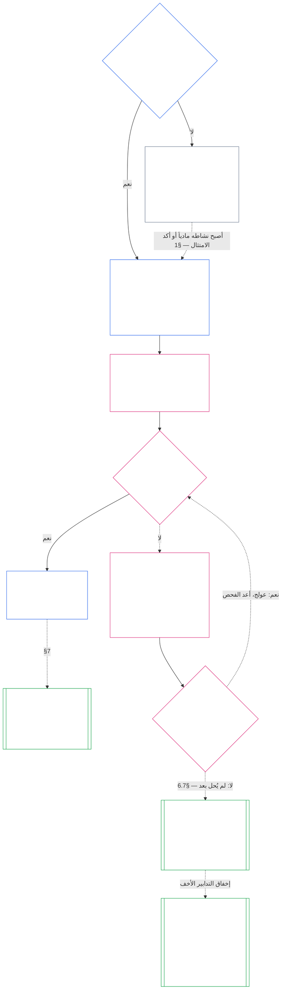

**مسودة بمساعدة الذكاء الاصطناعي — الفصل السابع بالعربية (غير مراجعة)**

**الحالة:** ترجمة كاملة للفصل السابع بمساعدة الذكاء الاصطناعي، غير مراجعة من قارئ مستقل. أُعدّت من `core_07.000_charters.md`، طبعة `SC-Corpus-2026.10.21`. يظل النص الإنجليزي هو المصدر الملزم. المسارات النسبية محسوبة للوجهة النهائية `translations/ar/core_07_charters.md`.

**النطاق الحالي:** ترجمة كاملة للفصل السابع من المصدر الحالي. مسودة بمساعدة الذكاء الاصطناعي، لم تخضع لمراجعة مستقلة؛ النص الإنجليزي هو المصدر الملزم.

# الفصل السابع: مواثيق الأنظمة ومواثيق المؤسسات

<strong>موضع الملف في المتن (غير تشغيلي): بنية الملف وقواعد القراءة</strong>

> هذا الملف **جزء من دستور الكائنات الواعية**، وهو **ملزم فقط معًا** مع ملفات `core_*` المرقّمة الأخرى المقروءة كنص واحد. وهو يتضمن **الفصل السابع**: الحد الأدنى لوثائق النطاق المنشورة لنظام ولمؤسسة، أي ميثاق النظام وميثاق المؤسسة. ويأتي بعد أرضية الحقوق في الفصل السادس وقبل [الفصل الثامن](../../core_08.000_functional_independence_separation_of_duties.md#chapter-eight-functional-independence-and-separation-of-duties)، الذي يفصل المقاعد داخل كل فعل ملزم مادياً.
>
> - **المالك الدستوري:** متى يجب على النظام نشر ميثاق نظام ومتى يجب على المؤسسة نشر ميثاق مؤسسة (إلزامي ابتداءً من الفئة L، واختياري في الفئة P)، والحد الأدنى لما يجب أن يذكره كل منهما، وكيفية تعديله ومراجعته، وفحص التأسيس لوضعية شاغلي المناصب المشمولة وأصالتهم.
> - **موضع التعريفات:** [ميثاق النظام](../../core_05.040_band_continuity.md#system-charter) و[ميثاق المؤسسة](../../core_05.040_band_continuity.md#institutional-charter) و[خريطة أدوار الميثاق](../../core_05.040_band_continuity.md#charter-role-map) و[الطرف صاحب الميثاق](../../core_05.040_band_continuity.md#chartered-party) و[الطرف المشغّل](../../core_05.050_band_oversight.md#operating-party) معرّفة في الفصل الخامس. يطبقها هذا الفصل ولا يعيد تعريفها.
> - **مالك التنفيذ:** يتضمن [CI-8.205 §6](../../corpus_institutions/ci_08.205_institutional_design_separation_of_powers.md#ci-8205-6-system-and-institutional-charter-contents-review-and-formation-template) (*محتوى مواثيق الأنظمة والمؤسسات ومراجعتها ونموذج التأسيس*) قالب الحقول الكامل، وقائمة المراجعة، وإجراء التأسيس، ونموذج بيان فحص التأسيس. ويجوز له أن يكون أشد صرامة وأن يضيف حقولاً، ولا يجوز له تضييق هذا الفصل. ولا يلزم نصه بوصفه نص تنفيذ مدمجاً إلا ضمن نطاق اعتماد صحيح ([الفصل الثامن عشر §4، إطار الاعتماد ونطاق السلطة](../../core_18.000_incorporation.md#4-adoption-framing-and-scope-of-authority))؛ أما الحد الأدنى في هذا الفصل فيلزم بوصفه نصاً أساسياً.
> - **الجهات اللاحقة التي تطبقه:** يشترط [الفصل الثامن §5، نشر التعيين والشغور والاستبدال](../../core_08.000_functional_independence_separation_of_duties.md#5-published-placement-vacancy-and-substitution) خريطة أدوار الميثاق. ويقرأ الفصل التاسع ميثاق النظام لتحديد النطاق والحدود، ويفحص الجزء د منه بيان فحص التأسيس للمؤسسة. ويطبق [الفصل العاشر §3.7، حفظ السجلات وسلطة فتحها](../../core_10.000_standing_assessment.md#37-record-custody-and-opening-authority) ذلك على سجلات الوضعية. وينظر [الفصل الثالث عشر §4.3، المنتديات المؤسسية](../../core_13.000_forum.md#43-institutional-forums) في المنازعات المتعلقة بميثاق المؤسسة.
>
> ترتيب القراءة: §1 متى تلزم مواثيق الأنظمة والمؤسسات، مع مخطط سير العملية → §2 حق التأسيس والحدود الأربع الضيقة → §3 ما يجب أن تذكره المواثيق → §4 خريطة أدوار الميثاق وحفظ سجلات الوضعية → §5 فحص تأسيس شاغلي المناصب من حيث الوضعية والأصالة → §6 ما يحدث عند إخفاق شاغل منصب في فحص التأسيس → §7 التعديل والمراجعة وعدم تطابق النطاق.

<strong>مسار الإحالات</strong>

- الأساس السابق:
  - [الرباعية الدستورية](../../core_00.000_preamble.md#constitutional-tetrad)، ولا سيما **الرقابة** و**المساءلة**؛
  - [الرهان المادي](../../core_00.000_preamble.md#material-stake)؛
  - [الفصل الأول §18.1، الحوكمة بوصفها بنية مأذوناً بها](../../core_01.010_stewardship_capacity_principles.md#181-governance-as-authorized-structure) (1.015 §18.1)؛
  - [المادة XI-E](../../core_06.005_rights_part_b.md#article-xi-e-institutional-formation-and-business-creation) (*تأسيس المؤسسات وإنشاء الأعمال*).
- الأقسام الفرعية:
  - [§1](#1-متى-تلزم-مواثيق-الأنظمة-والمؤسسات)؛
  - [§2](#2-حق-التأسيس-وأربعة-حدود-ضيقة)؛
  - [§3](#3-ما-يجب-أن-تنص-عليه-مواثيق-الأنظمة-والمؤسسات)؛
  - [§4](#4-خريطة-أدوار-الميثاق-وحفظ-سجلات-الوضعية)؛
  - [§5](#5-فحص-التأسيس-وضعية-شاغلي-المناصب-وأصالتهم)؛
  - [§6](#6-إخفاق-شاغل-المنصب-في-فحص-التأسيس)؛
  - [§7](#7-التعديل-والمراجعة-وعدم-تطابق-النطاق).
- ما يتفرع عنه:
  - [الفصل الثامن](../../core_08.000_functional_independence_separation_of_duties.md#chapter-eight-functional-independence-and-separation-of-duties) (8.000)؛
  - [الفصل التاسع](../../core_09.000_system_alignment_certification_evaluation.md#chapter-nine-system-alignment-certification) (9.000)؛
  - [الفصل العاشر](../../core_10.000_standing_assessment.md#chapter-ten-contribution-violation-and-standing-model--measurement) (10.000)؛
  - [الفصل الثالث عشر](../../core_13.000_forum.md#chapter-thirteen-forums-and-jurisdiction) (13.000)؛
  - [الفصل الرابع عشر](../../core_14.000_governance.md#chapter-fourteen-constitutional-contract-legitimacy-authorization-and-stewardship) (14.000)؛ ونص التنفيذ المعيّن أعلاه.
- يُقرأ مع:
  - [سُلّم السلطة والتدرج الداخلي](../../core_05.045_band_integrative.md#authority-stack-and-internal-hierarchy)؛
  - [حدود النظام](../../core_05.040_band_continuity.md#system-boundaries)؛
  - [سلامة حدود النظام](../../core_05.040_band_continuity.md#system-boundary-integrity)؛
  - [إنشاء النظام](../../core_05.055_band_participation.md#system-creation)؛
  - [إنشاء الأعمال](../../core_05.055_band_participation.md#business-creation).

 

الفصل السابع هو المالك الدستوري **لمواثيق الأنظمة ومواثيق المؤسسات والنطاق المنشور**.

تعمل ثلاثة فصول كسلسلة واحدة:

- **الفصل السابع (هذا الفصل):** يحدد ما يدّعي الطرف صاحب الميثاق أنه يفعله، ومن يجوز له شغل كل مقعد عند تصرفه.
- **[الفصل الثامن](../../core_08.000_functional_independence_separation_of_duties.md#chapter-eight-functional-independence-and-separation-of-duties):** يحدد كيفية إبقاء تلك المقاعد منفصلة.
- **[الفصل التاسع](../../core_09.000_system_alignment_certification_evaluation.md#chapter-nine-system-alignment-certification):** يصدّق على النظام، وعلى المؤسسة كلٌّ على حدة؛ وكل منهما فعل ملزم واحد يستخدم المقاعد. ويعيد ما يتوصل إليه إلى ميثاق النظام أو ميثاق المؤسسة.

تملك فصول أخرى التعريفات وقواعد المقاعد وأقفال الوضعية وقواعد القرار التي يحيل إليها هذا الفصل. ويحتوي **CI-8.205 §6** (*محتوى مواثيق الأنظمة والمؤسسات ومراجعتها ونموذج التأسيس*) على قالب الحقول وإجراء التأسيس وقائمة المراجعة.

### 1. متى تلزم مواثيق الأنظمة والمؤسسات

<strong>مسار الإحالات</strong>

- الأساس السابق:
  - [§2](#2-حق-التأسيس-وأربعة-حدود-ضيقة)؛
  - [الرهان المادي](../../core_00.000_preamble.md#material-stake)؛
  - [التناسب](../../core_05.035_band_accountability.md#proportionality)؛ وادعاء الملكية في افتتاح الفصل؛
  - [الفصل الأول §18، الحوكمة في ظل انضباط الإدارة المسؤولة](../../core_01.010_stewardship_capacity_principles.md#18-governance-under-stewardship-discipline) (1.015 §18)؛
  - [الرقابة](../../core_05.020_apex_oversight_leg.md#oversight-constitutional)؛
  - [المساءلة](../../core_05.005_apex_accountability_leg.md#accountability).
- ما يتفرع عنه: [§3](#3-ما-يجب-أن-تنص-عليه-مواثيق-الأنظمة-والمؤسسات)؛ [الفصل التاسع، الجزء أ §2، تقييم فئة النظام](../../core_09.000_system_alignment_certification_evaluation.md#2-system-class-evaluation) (9.005 §2) (*الفئة وعمق التصديق*)؛ [الفصل التاسع، الجزء د §12.1، فئة المؤسسة](../../core_09.015_institutional_alignment_certification.md#121-institution-class) (9.020 §12.1) (*فئة المؤسسة*)؛ **CS-9.305** (*آلية تصنيف الأنظمة*) و**CS-9.310** (*تصنيفات أثر الأنظمة*) لفهرس الفئات.
- يُقرأ مع:
  - **CI-8.205 §6** (*محتوى مواثيق الأنظمة والمؤسسات ومراجعتها ونموذج التأسيس*)؛
  - **CF-13.415 §5** (*المسجّلون المؤسسيون والمحليون*)؛
  - **CI-9.210** (*الالتزامات المؤسسية المرتبطة بالفئة*)؛
  - [ميثاق النظام، الفصل الخامس](../../core_05.040_band_continuity.md#system-charter) (5.040)؛
  - [ميثاق المؤسسة، الفصل الخامس](../../core_05.040_band_continuity.md#institutional-charter) (5.040)؛
  - [المادة XI-E](../../core_06.005_rights_part_b.md#article-xi-e-institutional-formation-and-business-creation) (*تأسيس المؤسسات وإنشاء الأعمال*).

<strong>التعريفات · التقييم · الامتثال</strong>

- [ميثاق النظام](../../core_05.040_band_continuity.md#system-charter) · [O](../../core_05.040_band_continuity.md#system-charter) · [M](../../core_05.040_band_continuity.md#system-charter-a) · [A](../../core_05.040_band_continuity.md#system-charter-a) · [C](../../core_05.040_band_continuity.md#system-charter-c)
- [ميثاق المؤسسة](../../core_05.040_band_continuity.md#institutional-charter) · [O](../../core_05.040_band_continuity.md#institutional-charter) · [M](../../core_05.040_band_continuity.md#institutional-charter-a) · [A](../../core_05.040_band_continuity.md#institutional-charter-a) · [C](../../core_05.040_band_continuity.md#institutional-charter-c)
- [الحوكمة المتناسبة مع الفئة](../../core_05.050_band_oversight.md#classification-scaled-governance) · [O](../../core_05.050_band_oversight.md#classification-scaled-governance) · [M](../../core_05.050_band_oversight.md#classification-scaled-governance-a) · [A](../../core_05.050_band_oversight.md#classification-scaled-governance-a) · [C](../../core_05.050_band_oversight.md#classification-scaled-governance-c)

 

*بعبارات بسيطة: قبل أن يستطيع أي شخص الحكم على ما إذا كان نظام أو مؤسسة قد بقي ضمن حدوده، يجب أن تُكتب تلك الحدود وتُنشر بحيث يطّلع عليها الجميع. يحتاج النظام الذي يؤثر مادياً في الآخرين في أي مجال من المجالات التسعة لـ[المادية الخاصة بالمجال](../../core_05.050_band_oversight.md#domain-specific-materiality) إلى ميثاق نظام منشور. وتنشر المؤسسة الميثاق الملائم للأنظمة التي تديرها. أما الفئة P فالمنشور فيها اختياري: حلقة خياطة تمنح أغطية للاجئين مثال على ذلك.*

ميثاق النظام أو ميثاق المؤسسة هو النطاق المنشور للطرف صاحب الميثاق: ما يدّعي أن لديه سلطة القيام به، وما لا يفعله، ومن يشغل كل مقعد عند تصرفه. وهذا هو النطاق الذي تُسند إليه المقاعد في الفصل الثامن، والذي تقارن به شهادة الفصل التاسع التشغيل الفعلي. ويتوقف وجوب النشر على فئة الطرف المشغّل: **إلزامي ابتداءً من الفئة L، واختياري في الفئة P.** وإذا وجب نشر الميثاق، وجب أيضاً إبقاؤه دقيقاً.

تشكل فئات أثر الأنظمة الخمس إطار كل ما يلي، من الأشد أثراً إلى الأقل:

- **الفئة A، حاسمة للبقاء، تأسيسية ولا بديل لها:** يؤدي الإخفاق خلال مدة ذات صلة بالبقاء، مع عدم وجود بديل قابل للتطبيق، إلى فقدان شروط البقاء.
- **الفئة B، حرجة، عالية الاعتماد وذات أهمية نظامية:** لا يستطيع المعتمدون عليها الحفاظ على وظائفهم الأساسية من دونها. ولا يكون البقاء مهدداً فوراً، ويظل الاستبدال ممكناً في الوقت المناسب.
- **الفئة C، منسقة، عالية الاعتماد وغير حرجة:** تشكل التنسيق على نطاق واسع، لكنها ليست شرطاً تشغيلياً مسبقاً لوظائف الفئتين A أو B.
- **الفئة L، محلية، محدودة الأثر وغير حرجة:** تتجاوز آثارها الوحدة الخاصة، لكنها تظل محلية وقابلة للاستبدال ومحدودة.
- **الفئة P، شخصية، للاستخدام الخاص، معزولة وتجريبية:** تبقى آثارها داخل وحدة خاصة ولا يعتمد عليها الآخرون اعتماداً ذا شأن.

يتضمن [CS-9.310 §8](../../corpus_systems/cs_09.310_system_impact_classifications.md#cs-9310-8-system-impact-classifications) (*تصنيفات أثر الأنظمة*) التعريفات الكاملة. ويجب على الفئات A وB وC وL النشر، أما الفئة P فيجوز لها ذلك. ويبين [§1.2، الفئات المشمولة](#12-الفئات-المشمولة) كيف تستمد المؤسسة فئتها من الأنظمة التي تديرها.

#### 1.1 من يجب عليه النشر

يجب على كل نظام من الفئة L أو أعلى نشر [ميثاق نظام](../../core_05.040_band_continuity.md#system-charter) وإبقاؤه محدّثاً. ويجب على كل مؤسسة من الفئة L أو أعلى نشر الميثاق الملائم للأنظمة التي تديرها وإبقاؤه محدّثاً:

| ما تشغّله المؤسسة أو تديره أو تسيطر عليه مادياً | ما تنشره |
| --- | --- |
| نظام واحد بالضبط يحتاج إلى ميثاق نظام | ميثاق النظام وحده، دون وثيقة ثانية. ويسمي المؤسسة جهةَ الإدارة ويؤدي أيضاً وظيفة [ميثاق المؤسسة](../../core_05.040_band_continuity.md#institutional-charter)، فتغطي وثيقة واحدة الوظيفتين. |
| أكثر من نظام من هذا النوع | ميثاق مؤسسة. ويتضمن كل ميثاق نظام نافذ لتلك الأنظمة، ويبين سبب إدارة المؤسسة لكل منها ([§3، ما يجب أن تذكره مواثيق الأنظمة والمؤسسات](#3-ما-يجب-أن-تنص-عليه-مواثيق-الأنظمة-والمؤسسات)). |
| لا يوجد نظام من هذا النوع | ميثاق مؤسسة يذكر العناصر الخاصة بالمؤسسة من [§3، ما يجب أن تذكره مواثيق الأنظمة والمؤسسات](#3-ما-يجب-أن-تنص-عليه-مواثيق-الأنظمة-والمؤسسات)، ولا يتضمن مواثيق أنظمة. |

- **الأعمال والأشكال المماثلة:** تنشر الشركة أو أي شكل تنظيمي آخر تديره جهة مسؤولة ميثاق النظام أو ميثاق المؤسسة المنطبق عليها بوصفها نظاماً أو مؤسسة أو مؤسسة تدير نظاماً مشمولاً. ولا يغيّر شكلها القانوني الإجابة.
- **الممارسة المهنية المشتركة:** يجوز لكائن واعٍ أو لممارسة صغيرة من الفئة L أو أعلى تؤدي فعلاً مدرجاً ضمن ترخيص ممارسة أو تخليص ممارسة، أن تستوفي هذا القسم لهذه الأفعال بتبنّي ميثاق النظام أو ميثاق المؤسسة الخاص بجهة مضيفة وخريطة أدوار ميثاقها:
  - **ما يُتبنّى:** بالإحالة، ميثاق النظام أو ميثاق المؤسسة وخريطة أدوار الميثاق لدى جهة مضيفة في ممارسة مهنية مشتركة، على أن تشمل تلك الوثائق الأفعال المعنية.
  - **إشعار التبنّي:** الإشعار ذو الصفحة الواحدة الذي يصفه **CI-14.205 §7** (*ترخيص الممارسة وتخليصها والممارسة المهنية المشتركة*).
  - **الفئة:** تحتفظ الممارسة بالفئة التي تحددها أفعالها هي.

#### 1.2 الفئات المشمولة

تحدد فئة الطرف صاحب الميثاق ما إذا كان النشر إلزامياً أم اختيارياً:

- **الفئات A وB وC وL:** النشر إلزامي. يوضح المخطط في [§1.7، سير العملية في لمحة](#17-سير-العملية-في-لمحة) المسار المتبع.
- **الفئة P:** النشر اختياري إلى أن يقع أحد حدثين يجعله إلزامياً. يوضح [§1.3، ماهية الفئة P](#13-ماهية-الفئة-p) متى يكون الطرف المشغّل من الفئة P، ويحدد [§1.4، مواثيق الفئة P الاختيارية ومتى تصبح إلزامية](#14-مواثيق-الفئة-p-الاختيارية-ومتى-تصبح-إلزامية) نطاق هذا الخيار ومتى ينتهي.
- **فئة المؤسسة:** تأخذ المؤسسة أعلى فئة لأي نظام تشغّله أو تديره أو تسيطر عليه مادياً. وإذا لم تشغّل نظاماً من هذا النوع، تُصنّف وفق أثرها المادي واعتماد الآخرين عليها، بالنظر إلى ما تقرره وتمسك به فعلاً لا إلى اسمها أو شكلها القانوني، بموجب [الفصل التاسع، الجزء د §12.1، فئة المؤسسة](../../core_09.015_institutional_alignment_certification.md#121-institution-class).

#### 1.3 ماهية الفئة P

يكون الطرف المشغّل من الفئة P فقط ما دام نشاطه دون الحد في كل واحد من مجالات [المادية الخاصة بالمجال](../../core_05.050_band_oversight.md#domain-specific-materiality) التسعة؛ وهذا يعني عملياً أن أفعاله وآثارها تبقى داخل [وحدته الخاصة](../../core_05.050_band_oversight.md#domain-specific-materiality-private-unit):

- **تجاوز حد:** يؤدي تجاوز الحد في أي مجال واحد إلى رفعه إلى الفئة L على الأقل بموجب **CS-9.305** (*آلية تصنيف الأنظمة*) و**CS-9.310** (*آلية تصنيف الأنظمة*)، أياً كان حجمه أو ما يسمي به نفسه.
- **البقاء دون كل الحدود:** يظل في الفئة P مهما بلغ عدد أعضائه.
- **من هم داخله:** تعتمد الفئة P أيضاً على من هم داخل الطرف المشغّل. وكل من يلاحظ تجاوز الطرف المشغّل أحد الحدود ملزم بالإبلاغ عنه، ويكون البلاغ محمياً ([المادية الخاصة بالمجال](../../core_05.050_band_oversight.md#domain-specific-materiality)).

لا ينطبق الحد الدستوري الأدنى للمقاعد الأربعة في الفصل الثامن على أفعال الطرف المشغّل من الفئة P ما دامت داخل وحدته الخاصة؛ لذلك لا يحتاج كائن واعٍ واحد لديه حاسوب إلى شاغل مقعد ثانٍ. وينطبق الحد ابتداءً من اليوم الذي يتخذ فيه الطرف المشغّل [فعلاً ملزماً مادياً](../../core_05.035_band_accountability.md#materially-binding-act) يتعين على الآخرين اتباعه أو يجوز لهم الاعتماد عليه بوصفه أمراً مستقراً؛ فهذا يتجاوز الحد في مجال السلطة على الآخرين ويرفعه إلى الفئة L على الأقل.

#### 1.4 مواثيق الفئة P الاختيارية ومتى تصبح إلزامية

يُشجَّع الطرف المشغّل من الفئة P على نشر [ميثاق النظام](../../core_05.040_band_continuity.md#system-charter) المناسب لما يديره (لنظام واحد) أو [ميثاق المؤسسة](../../core_05.040_band_continuity.md#institutional-charter) (لأكثر من نظام أو لعدم وجود أنظمة). ويجوز له استخدام قائمة المحتوى في [§3، ما يجب أن تذكره مواثيق الأنظمة والمؤسسات](#3-ما-يجب-أن-تنص-عليه-مواثيق-الأنظمة-والمؤسسات) وخريطة المقاعد في [§4، خريطة أدوار الميثاق وحفظ سجلات الوضعية](#4-خريطة-أدوار-الميثاق-وحفظ-سجلات-الوضعية) نموذجاً. ولا ينشئ نشر أي منهما واجباً إجرائياً بموجب هذا الفصل:

- لا موعد نهائي للنشر ([§1.5، موعد استحقاق ميثاق النظام أو ميثاق المؤسسة](#15-موعد-استحقاق-ميثاق-النظام-أو-ميثاق-المؤسسة))؛
- ولا فحص تأسيس ([§5، فحص التأسيس: وضعية شاغلي المناصب وأصالتهم](#5-فحص-التأسيس-وضعية-شاغلي-المناصب-وأصالتهم))؛
- ولا إلزام بخريطة [أدوار الميثاق](../../core_05.040_band_continuity.md#charter-role-map) ([§4، خريطة أدوار الميثاق وحفظ سجلات الوضعية](#4-خريطة-أدوار-الميثاق-وحفظ-سجلات-الوضعية))، مع جواز الاحتفاظ بها مع الميثاق الاختياري للنظام أو المؤسسة أو نشرها بمبادرة منه؛
- ولا دورة إلزامية للتعديل أو المراجعة ([§7، التعديل والمراجعة وعدم تطابق النطاق](#7-التعديل-والمراجعة-وعدم-تطابق-النطاق)).

إذا وقع أي من الحدثين التاليين، لم يعد النشر اختيارياً:

- إعادة تصنيف الطرف المشغّل إلى الفئة L أو أعلى؛
- أو تأكيد مشغّله أن الطرف المشغّل ممتثل دستورياً.

وعندئذ يجب على الطرف المشغّل نشر ميثاق النظام أو ميثاق المؤسسة المناسب له، وفق الجدول في [§1.5، موعد استحقاق ميثاق النظام أو ميثاق المؤسسة](#15-موعد-استحقاق-ميثاق-النظام-أو-ميثاق-المؤسسة).

**الاعتراف لا يتوقف على وثيقة نطاق.** لا يحول وجود جماعة، بميثاق نظام أو ميثاق مؤسسة أو من دونهما وبأي فئة كانت، دون الاعتراف بأعضائها. ويجوز لكل عضو أن يطلب سجل مساهمة بصفته مطالباً فردياً عن العمل داخل الجماعة أو خارجها؛ ويتعلق السجل بمساهمة العضو لا بوضعية الجماعة ([الفصل العاشر §3.7، السجلات غير الرسمية والمحدودة النطاق](../../core_10.000_standing_assessment.md#37-informal-and-small-scope-records)). وتقديم العون أو السلع أو العمل أو الخدمات التي لا يُلزم أحد بقبولها ليس فعلاً ملزماً مادياً؛ لذلك لا تحتاج حلقة مساعدة متبادلة تمنح أغطية للاجئين إلى ميثاق نظام أو ميثاق مؤسسة كي يُعترف بأعضائها.

#### 1.5 موعد استحقاق ميثاق النظام أو ميثاق المؤسسة

ينشر النظام أو المؤسسة المشمولان ميثاق النظام أو ميثاق المؤسسة وفق الجدول الآتي:

- **نظام أو مؤسسة جديدة:** قبل بدء تشغيلها أو قبل شروعها في ممارسة سلطة على الآخرين.
- **جهة قائمة تعمل بالفعل:** عند مراجعة التصنيف أو التصديق التالي، أو خلال مهلة المعالجة التي تلي طلباً بموجب [§1.6، عند غياب ميثاق النظام أو ميثاق المؤسسة](#16-عند-غياب-ميثاق-النظام-أو-ميثاق-المؤسسة)، أيهما أسبق. وتظل متخلفة عن الامتثال حتى تنشره.
  - **التصديق المقصود:** للنظام، تصديق مواءمة النظام. وللمؤسسة، تصديق المواءمة المؤسسية بموجب [الفصل التاسع، الجزء د §11.3، لا إذن ولا بوابة](../../core_09.015_institutional_alignment_certification.md#113-no-permission-and-no-gate)؛ ولا تكون مهلة التصديق الأول شرطاً لنشر ميثاق المؤسسة أو لمزاولة التشغيل.
- **فحص التأسيس:** تُكمل أيضاً في الوقت نفسه فحص التأسيس الوارد في [§5، فحص التأسيس: وضعية شاغلي المناصب وأصالتهم](#5-فحص-التأسيس-وضعية-شاغلي-المناصب-وأصالتهم).
- **جهة الإيداع:** تودع ميثاق النظام أو ميثاق المؤسسة، مع خريطة أدوار الميثاق وبيان فحص التأسيس، لدى المسجّل المؤسسي أو لدى المسجّل المحلي إذا كان النشاط والكائنات الواعية المتأثرة محليين (**CF-13.415 §5**، *المسجّلون المؤسسيون والمحليون*):
  - **ما يفعله المسجّل:** يتحقق من عدم إغفال أي عنصر مطلوب ويصدر إيصالاً مؤرخاً.
  - **ما لا يفعله المسجّل أبداً:** لا يمنح إذناً ولا يفصل في الفئة أو المحتوى.
  - **تأخر الإيصال أو غيابه:** لا يمنع الطرف صاحب الميثاق من التشغيل.

#### 1.6 عند غياب ميثاق النظام أو ميثاق المؤسسة

يجوز لأي شخص يلاحظ أن طرفاً صاحب ميثاق من الفئة L أو أعلى، جديداً كان أو أصبح مشمولاً حديثاً، لم ينشر ميثاق النظام أو ميثاق المؤسسة، أن يطلبه من سلطة الحوكمة التابعة له. ولا يحتاج مقدّم الطلب إلى وضعية، ولا يدفع رسماً، ولا يلزمه إثبات الضرر. ويذكر الطلب الطرف صاحب الميثاق ويبين سبب ظهوره مشمولاً.

تبدأ من تاريخ الطلب مهْلتان: مهلة الاستجابة ومهلة المعالجة. وتتحدد مدة كل منهما بالدرجة التي تحمل الحرف نفسه لفئة الطرف صاحب الميثاق؛ فكلما كانت الفئة أشد حرجاً قصرت المهلة:

| الفئة والدرجة | مهلة الاستجابة (الهدف الأولي للاستلام) | مهلة المعالجة (الحد الأقصى) |
|---|---|---|
| الفئة A، الدرجة A | 24 ساعة | 7 أيام تقويمية |
| الفئة B، الدرجة B | يومان تقويميان | 14 يوماً تقويمياً |
| الفئة C، الدرجة C | 4 أيام تقويمية | 30 يوماً تقويمياً |
| الفئة L، الدرجة L | 8 أيام تقويمية | 60 يوماً تقويمياً |

ترد هذه المدد في **CF-13.445 §3.1** (*أهداف المراحل والحدود الدنيا للمدد*)، وتسود أحكامه إن اختلفت. وإذا نازع الطرف صاحب الميثاق في فئته، فيُحتسب على الدرجة المقابلة للأشد حرجاً بين فئته في سجل تصنيف النظام وأي فئة أثبتها مقدّم الطلب أو المنتدى ظاهرياً، إلى أن يُحسم الأمر. أما الطرف صاحب الميثاق الذي لا فئة مسجلة له، أو الذي تُنازع فئته P، فيُحتسب على الدرجة C.

تُطبق المهْلتان كما يلي:

- **مهلة الاستجابة:** يرد الطرف صاحب الميثاق ضمن مهلة الاستجابة، وهي هدف الاستلام للدرجة المطابقة في **CF-13.445 §3.1** (*أهداف المراحل والحدود الدنيا للمدد*) محسوباً من تاريخ الطلب. وينشر ميثاق النظام أو ميثاق المؤسسة، أو يحدد تاريخ نشره، أو يشير إلى الميثاق المنشور بالفعل، أو يجيب بأنه دون كل حدود [المادية الخاصة بالمجال](../../core_05.050_band_oversight.md#domain-specific-materiality) ويقدم الإثبات الكتابي اللازم لإدراجه ضمن المشمولين.
- **مهلة المعالجة:** يجب نشر الميثاق ضمن مهلة المعالجة، أي الحد الأقصى للدرجة المطابقة الوارد في **CF-13.445 §3.1** محسوباً من تاريخ الطلب، وإرفاق بيان فحص التأسيس ([§5، فحص التأسيس: وضعية شاغلي المناصب وأصالتهم](#5-فحص-التأسيس-وضعية-شاغلي-المناصب-وأصالتهم)). وإذا لم يكن للطرف صاحب الميثاق مقعد مستقل بعد، يودع البيان على هيئة إقرار مع أدلته، وفق ما تنص عليه تلك الفقرة.
- **الطرف المشغّل الذي يقول إنه دون الحد:** يصبح الطلب أيضاً طعناً في التصنيف، وفق *مسار الطعن* في ذلك المدخل:
  - **سريان المهلة:** تستمر مهلة المعالجة أثناء نظر الطعن.
  - **تمديد الطعن:** إذا رأى المنتدى المختص أن الطعن يستحق المراجعة، مُدّد الموعد النهائي وبدأت مهلة معالجة جديدة عند البت في الطعن. ويفصل المنتدى في الطعن ضمن الحد الأقصى للدرجة المطابقة.
  - **متى يستحق الطعن المراجعة:** عندما يحدد تجاوزاً بعينه في مجال مسمى، وتترك أدلة الطرف المشغّل المكتوبة سؤالاً حقيقياً حول ذلك التجاوز. ولا يقرر الطرف المشغّل ذلك لنفسه، كما أن الرد الذي لا يتضمن إثباتاً كتابياً لا يمدد الموعد.
  - **إذا تقررت فئة:** في هذا الطعن أو في أي طعن آخر، يُعد تاريخ صدور النتيجة تاريخَ طلب؛ وتبدأ مهلة الاستجابة ومهلة المعالجة من ذلك التاريخ وعلى الدرجة المقابلة للفئة التي تقررت (A أو B أو C أو L).
- **فوات المهلة:** عدم الرد، أو عدم نشر ميثاق النظام أو ميثاق المؤسسة بحلول الموعد، عيب يجب تسجيله وتصحيحه. ويجوز لمقدّم الطلب إحالته إلى المنتدى المختص عبر المسار نفسه. ولا يكون ذلك أبداً شرطاً للتأسيس أو التشغيل.
- **تكرار الطلب:** لا يبدأ الطلب الثاني بشأن الطرف صاحب الميثاق نفسه، ما دامت استجابة سابقة أو نتيجة بشأنه نافذة، مهلة استجابة أو معالجة جديدة. ويرد الطرف صاحب الميثاق بالإشارة إلى تلك الاستجابة أو النتيجة. ولا يُعد إثباته الذاتي بأنه دون كل حد، ما لم يراجعه المنتدى بعد، استجابة نافذة. وتظل الاستجابة أو النتيجة نافذة إلى أن يقع أحد الأمور التي تصفها محفزات إعادة الفتح في [الفصل التاسع، الجزء د §14.2، محفزات إعادة الفتح](../../core_09.015_institutional_alignment_certification.md#142-reopening-triggers):
  - **تغيير مادي:** تغير نشاط الطرف صاحب الميثاق تغيراً مادياً.
  - **دليل جديد:** تقديم دليل جديد على تجاوز.

الطلب الذي يثبت أياً مما سبق ليس طلباً مكرراً، بل طلب جديد يعالج على نحو مستقل عن الطلب السابق. وله مهلة استجابة ومهلة معالجة خاصتان به، تحسبان من تاريخه؛ ولا تستوفي الاستجابة أو النتيجة أو المهل السابقة متطلباته ولا تتغير بسببه.
- **النطاق في الأثناء:** لا يعني غياب ميثاق النظام أو ميثاق المؤسسة أن الطرف صاحب الميثاق غير محدود النطاق. وإلى أن يُنشر، تسري [حدود النظام](../../core_05.040_band_continuity.md#system-boundaries) الفعلية وفئته، ويجوز للتصديق أو للمنتدى إعادة بناء النطاق من واقع التشغيل المرصود.

#### 1.7 سير العملية في لمحة

يتتبع المخطط طرفاً مشغّلاً واحداً، بدءاً من سؤال ما إذا كان يؤثر مادياً في الآخرين، مروراً بنشر ميثاق النظام أو ميثاق المؤسسة وإبقائه دقيقاً. وإذا لم تُحل المشكلة خلال مهلة المعالجة، تحيل عملية الميثاق الأمر إلى مراجعة يحكمها نص خارج هذا الفصل. وتشرح الأقسام التالية الخطوات بالترتيب نفسه.

<strong>إرشاد للقارئ (غير تشغيلي): قراءة المخطط</strong>

> بعبارات بسيطة: لا يمنح أحد ميثاق النظام أو ميثاق المؤسسة، ولا يحتاج أحد إلى إذن للتأسيس. وينشر الطرف صاحب الميثاق الذي يؤثر نشاطه مادياً في الآخرين ما يدعي أن له سلطة القيام به، ومن يشغل كل مقعد؛ كما يُفحص شاغلو مناصبه الرئيسية. ويُستبدل شاغل المنصب الذي يخفق أو يُعالج سبب الإخفاق، ثم يواصل الطرف صاحب الميثاق عمله. وإذا لم يُعالج الإخفاق عند انتهاء مهلة المعالجة، جاز لمنتدى مراجعة الطرف صاحب الميثاق، بدءاً بأخف خطوة تحمي الآخرين. ولا يُخفض الطرف صاحب الميثاق إلى ما دون الفئة L ولا يُحل إلا إذا أخفقت التدابير الأخف. ولا يجوز للطرف صاحب الميثاق الذي حلّه منتدى أن يعود ما دام القفل المفروض عليه قائماً.
>
> تشير الأسهم المتصلة إلى المسار الرئيسي. وتشير الأسهم المنقطة إلى الاستثناءات والإحالات، مع تسمية القسم الذي يجيزها. أما الصناديق ذات الخطين الجانبيين فتخص فصلاً آخر أو نص تنفيذ مدمجاً. ولا يضيف المخطط واجباً أو مقعداً أو حقلاً، ولا تمثل أي خطوة فيه منحاً للإذن.

 

### 2. حق التأسيس وأربعة حدود ضيقة

<strong>إرشاد للقارئ (غير تشغيلي): بنية هذا القسم</strong>

- [§2.1 حق التأسيس](#21-حق-التأسيس) يقرر الحق ويبين ما لا يشمله.
- [§2.2 الحد الأول: قفل نافذ على كائن واعٍ](#22-الحد-الأول-قفل-وضعية-قائم-على-كائن-واع) يوضح كيف يمنع قفلٌ كائناً واعياً مسمى من شغل منصب رقابي واحد.
- [§2.3 الحد الثاني: تعليق قصير يستند إلى وقائع محددة ومتحقق منها](#23-الحد-الثاني-تعليق-قصير-يستند-إلى-وقائع-محددة-ومتحقق-منها) يوضح كيف يمكن لتعليق قصير أن يمنع كائناً واعياً مسمى من شغل منصب رقابي واحد.
- [§2.4 الحد الثالث: قفل على الطرف المشغّل نفسه](#24-الحد-الثالث-قفل-على-الطرف-المشغل-نفسه) يوضح كيف يمنع القفل الطرف المشغّل وخلفاءه، وأنه لا يجوز للطرف صاحب الميثاق المحلول أن يعود.
- [§2.5 الحد الرابع: ترخيص ممارسة أو تخليصها](#25-الحد-الرابع-ترخيص-ممارسة-أو-تخليصها) يبين متى يحتاج فعل عالي المخاطر مسمى إلى ترخيص أو تخليص، وأن ذلك ليس بوابةً للتأسيس.

<strong>مسار الإحالات</strong>

- الأساس السابق: [§1](#1-متى-تلزم-مواثيق-الأنظمة-والمؤسسات)؛ [المادة XI-E](../../core_06.005_rights_part_b.md#article-xi-e-institutional-formation-and-business-creation) (*تأسيس المؤسسات وإنشاء الأعمال*).
- ما يتفرع عنه: [§1، متى تلزم مواثيق الأنظمة والمؤسسات](#1-متى-تلزم-مواثيق-الأنظمة-والمؤسسات)؛ [§5، فحص التأسيس: وضعية شاغلي المناصب وأصالتهم](#5-فحص-التأسيس-وضعية-شاغلي-المناصب-وأصالتهم).
- يُقرأ مع:
  - [التعليق المؤقت](../../core_05.035_band_accountability.md#interim-hold)؛
  - [الفصل الحادي عشر §4.2، الوقاية — أقفال الوضعية العامة](../../core_11.000_standing_integration.md#42-prevention--general-standing-locks) (11.000 §4.2)؛
  - [الفصل الحادي عشر §5.5، الأقفال الخاصة](../../core_11.000_standing_integration.md#55-special-locks) (11.000 §5.5)؛
  - [الفصل الثالث عشر §5، التعليق المؤقت لمسار كائن واعٍ مسمى](../../core_13.000_forum.md#interim-hold-on-a-named-sentients-pathway) (13.000 §5).

 

*بعبارات بسيطة: لا تحتاج إلى إذن أي شخص لتأسيس نظام أو مؤسسة أو عمل. وقد تنطبق أربعة حدود ضيقة. الثلاثة الأولى بوابات: قد يمنع قفل غير مرفوع كائناً واعياً واحداً من شغل منصب رقابي، وقد يؤدي تعليق قصير يستند إلى وقائع محددة ومتحقق منها إلى ذلك أيضاً، كما قد يمنع القفل المفروض على الطرف المشغّل نفسه ذلك الطرف. أما الحد الرابع فيجوز أن يشترط ترخيصاً أو تخليصاً قبل أداء فعل مسمى عالي المخاطر. ويُمنع الطرف صاحب الميثاق الذي حلّه المنتدى من العودة؛ ويكون المنع دائماً إذا استند الحل إلى سلوك مضاد للدستور واسع الانتشار أو إلى ضرر جسيم لا يمكن الرجوع عنه ولم يُعالج. ولا يمنع أي من ذلك طرفاً مشغّلاً جديداً من التأسيس أو التشغيل، ولا يضيف هذا الفصل بوابات أخرى.*

تسمح **المادة XI-E** (*تأسيس المؤسسات وإنشاء الأعمال*) بأربعة حدود ضيقة:

- **الثلاثة الأولى هي البوابات الوحيدة** للتأسيس كطرف مشغّل أو لممارسة السلطة فيه. ويتعلق كل منها بموضوع مسمى:
  - **قفل نافذ** ([§2.2، الحد الأول: قفل نافذ على كائن واعٍ](#22-الحد-الأول-قفل-وضعية-قائم-على-كائن-واع)) يتعلق بكائن واعٍ مسمى في منصب واحد يسيطر على الطرف صاحب الميثاق.
  - **تعليق مؤقت** ([§2.3، الحد الثاني: تعليق قصير يستند إلى وقائع محددة ومتحقق منها](#23-الحد-الثاني-تعليق-قصير-يستند-إلى-وقائع-محددة-ومتحقق-منها)) لا يتعلق إلا بكائن واعٍ مسمى في منصب واحد يسيطر على الطرف صاحب الميثاق.
  - **قفل على الطرف المشغّل نفسه** ([§2.4، الحد الثالث: قفل على الطرف المشغّل نفسه](#24-الحد-الثالث-قفل-على-الطرف-المشغل-نفسه)) يتعلق بطرف صاحب ميثاق يخضع هو نفسه لقفل، بما في ذلك الطرف الذي حلّه منتدى.
- **الحد الرابع ليس بوابة:** إنه ترخيص ممارسة أو تخليصها ([§2.5، الحد الرابع: ترخيص ممارسة أو تخليصها](#25-الحد-الرابع-ترخيص-ممارسة-أو-تخليصها)).

#### 2.1 حق التأسيس

يجوز لأي شخص تأسيس نظام أو مؤسسة أو عمل جديد. وهذا الحق مقرر في [المادة XI-E](../../core_06.005_rights_part_b.md#article-xi-e-institutional-formation-and-business-creation) (*تأسيس المؤسسات وإنشاء الأعمال*). ويضيف هذا الفصل الواجب التالي: متى كان ما يفعله الطرف المشغّل ذا أثر مادي على الآخرين في أي واحد من المجالات التسعة لـ[المادية الخاصة بالمجال](../../core_05.050_band_oversight.md#domain-specific-materiality)، وجب عليه أن يعلن مسبقاً ما يدعي أن له سلطة القيام به ([§1، متى تلزم مواثيق الأنظمة والمؤسسات](#1-متى-تلزم-مواثيق-الأنظمة-والمؤسسات)). ولا يجوز تفسير تبنّي ميثاق النظام أو ميثاق المؤسسة بما يضيّق هذا الحق أو أي حماية من أرضية الحقوق.

**ما لا يشمله حق التأسيس.** باستثناء البوابات الثلاث في [§2.2، الحد الأول: قفل نافذ على كائن واعٍ](#22-الحد-الأول-قفل-وضعية-قائم-على-كائن-واع) و[§2.3، الحد الثاني: تعليق قصير يستند إلى وقائع محددة ومتحقق منها](#23-الحد-الثاني-تعليق-قصير-يستند-إلى-وقائع-محددة-ومتحقق-منها) و[§2.4، الحد الثالث: قفل على الطرف المشغّل نفسه](#24-الحد-الثالث-قفل-على-الطرف-المشغل-نفسه)، لا تحمي **المادة XI-E** (*تأسيس المؤسسات وإنشاء الأعمال*):

- طرفاً مشغّلاً صُمم لخرق قيد دستوري أو تقويض السلامة أو الحقيقة، أو لتركيز السلطة على نحو يستبعده [الفصل الأول §11، بنية السوق](../../core_01.000_values_principles.md#11-market-structure)؛ أو
- طرفاً مشغّلاً أسسه أو يديره مؤسس لا يتواءم فعلياً مع غرضه المعلن، كما يتضح من سلوكه وسيطرته ومكافآته المتحقق منها، أو يقصد تضليل الآخرين بشأن غرضه أو السيطرة عليه أو مصالحه، أو يقصد الإضرار بالآخرين.

تفصل المنتديات في هذه الحالات بموجب تلك المادة، ولا تكون عواقبها إلا البوابات الثلاث الواردة فيها: بوابة القفل النافذ، والتعليق المؤقت، والقفل على الطرف المشغّل نفسه. ويعد إخفاق فحص التأسيس دليلاً واحداً يزنه المنتدى، ولذلك لا يحسم فحص التأسيس وحده القضية.

#### 2.2 الحد الأول: قفل وضعية قائم على كائن واعٍ

يحظر [قفل الوضعية](../../core_11.000_standing_integration.md#42-prevention--general-standing-locks) أو [القفل الخاص](../../core_11.000_standing_integration.md#55-special-locks)، المفروض بعد مخالفة متحقق منها ولم يُرفع بعد، على كائن واعٍ مسمى ممارسة السلطة على هذا النوع من المؤسسات أو الأعمال.

- **ما يُحظر:** تولي سلطة الحوكمة أو السيطرة أو الملكية في الطرف المشغّل أو ممارستها.
- **مدى الحظر:** لا يتجاوز نطاق القفل. وينتهي عند رفع القفل أو تضييق نطاقه.
- **قفل على الطرف المشغّل نفسه:** انظر [§2.4، الحد الثالث: قفل على الطرف المشغّل نفسه](#24-الحد-الثالث-قفل-على-الطرف-المشغل-نفسه).

#### 2.3 الحد الثاني: تعليق قصير يستند إلى وقائع محددة ومتحقق منها

ينطبق هذا الحد عندما يأمر منتدى مختص بفرض [تعليق مؤقت](../../core_05.035_band_accountability.md#interim-hold) استناداً إلى وقائع محددة ومتحقق منها تجعل عدم مواءمة شاغل المنصب مع الغرض المعلن للطرف صاحب الميثاق أرجح من مواءمته. ولا يملك الأمر به إلا ذلك المنتدى ([الفصل الثالث عشر §5، التعليق المؤقت لمسار كائن واعٍ مسمى](../../core_13.000_forum.md#interim-hold-on-a-named-sentients-pathway)). ولا يجوز للطرف صاحب الميثاق أن يقرر بنفسه منع شخص من منصب، لأن ذلك يجعله قاضياً في أمر عضوه. والأساس الكامل هو الوارد في [الفصل الثالث عشر §5، التعليق المؤقت لمسار كائن واعٍ مسمى](../../core_13.000_forum.md#interim-hold-on-a-named-sentients-pathway)؛ ولا يحل هذا الملخص محله.

#### 2.4 الحد الثالث: قفل على الطرف المشغّل نفسه

يجوز أن يُفرض القفل على الطرف المشغّل، لا على كائن واعٍ فحسب. وعندئذ تمنع البوابة ما يسميه المسار الوارد في القفل داخل ذلك الطرف المشغّل وخلفائه والكيانات الخاضعة لسيطرته والكيانات الحاملة بالنيابة أو عبر شركات صورية. ولا تمنع أي طرف مشغّل آخر.

- **قفل تفرضه تسمية نهائية:** يحقق [قفل الثقة المضاد للدستور](../../core_11.000_standing_integration.md#55-special-locks) ذلك عندما تسمي التسمية النهائية مؤسسة أو كياناً خلفاً أو كياناً خاضعاً للسيطرة. وعندئذ تمنع البوابة ما يسميه مسار القفل داخل الطرف صاحب الميثاق وخلفائه والكيانات الخاضعة لسيطرته والكيانات الحاملة بالنيابة أو عبر شركات صورية.
- **طرف صاحب ميثاق تم حله:** ينشئ أمر الحل النهائي بموجب **CI-11.210 §4** (*الحل*) [قفل منع إعادة التكوين بعد الحل](../../core_11.000_standing_integration.md#55-special-locks). وما دام القفل قائماً، لا يجوز إعادة تكوين الطرف صاحب الميثاق المحلول أو خلفائه أو الكيانات الخاضعة لسيطرته أو الكيانات الحاملة بالنيابة أو عبر شركات صورية، ولا يجوز إحياؤها أو تشغيلها تحت أي اسم أو شكل. ويشمل ذلك أي طرف مشغّل يشكل معها عملية واحدة. وإذا وجد الأمر سلوكاً مضاداً للدستور واسع الانتشار أو ضرراً لا يمكن الرجوع عنه ولم يُعالج ([الفصل الحادي عشر §8، الاستعادة وإعادة التقييم](../../core_11.000_standing_integration.md#8-restoration-and-reassessment))، كان القفل دائماً: فلا يرفعه مرور الزمن أو حل السبب أو تغير الشاغلين، ولا ينتهي إلا بإلغاء أمر الحل عند مراجعته أو بظهور وقائع مادية جديدة متحقق منها تثبت خطأ النتيجة. وفي غير ذلك ينتهي بقرار مستقل يثبت زوال السبب وتسليم الانتصاف وأن العودة أكثر أماناً من استمرار الاستبعاد. ولا يمنع هذا القفل أي كائن واعٍ من تأسيس طرف مشغّل مختلف.

لا تمنع أي من البوابات الثلاث طرفاً مشغّلاً جديداً من التأسيس أو نشر ميثاق نظام أو ميثاق مؤسسة أو بدء العمل. ولا تمنع إلا طرفاً يخضع هو نفسه لقفل، مثل طرف صاحب ميثاق محلول يحاول العودة. وتطبق البوابات الثلاث ضمن فحص التأسيس ([§5، فحص التأسيس: وضعية شاغلي المناصب وأصالتهم](#5-فحص-التأسيس-وضعية-شاغلي-المناصب-وأصالتهم)).

#### 2.5 الحد الرابع: ترخيص ممارسة أو تخليصها

يتعلق الحد الرابع بفعل مسمّى، لا بتأسيس طرف مشغّل:

- **ليس بوابة على الطرف المشغّل:** لا يطبّق فحص التأسيس الوارد في [§5 فحص التأسيس: وضعية شاغلي المناصب وأصالتهم](#5-فحص-التأسيس-وضعية-شاغلي-المناصب-وأصالتهم) هذا الحد.
- **ماهيته:** [تخليص الكفاءة](../../core_05.035_band_accountability.md#competency-clearance) الذي تجيز **المادة XI-E** (*تأسيس المؤسسات وإنشاء الأعمال*) للجهة المتبنية أن تشترطه قبل أداء فعل مسمّى للآخرين، استناداً إلى نتيجة مخاطر منشورة من منتدى تقني.
  - **ترخيص الممارسة:** يلزم للأفعال التي تنطوي، إذا أُديت على نحو سيئ، على خطر ضرر جسيم أو لا يمكن الرجوع عنه.
  - **تخليص الممارسة:** يلزم للأفعال التي تنطوي، إذا أُديت على نحو سيئ، على خطر ضرر حقيقي لكنه أقل جسامة.
- **ما الذي يتعلق به:** أداء الفعل. ولا يمنع أبداً الطرف المشغّل من التأسيس أو نشر ميثاق النظام أو ميثاق المؤسسة أو التشغيل.
- **ما الذي يمنعه:** ادعاء أداء الفعل أو أداؤه من دون التخليص. ولا يجوز لميثاق النظام أو ميثاق المؤسسة أن يدعي الفعل ما لم يؤده حامل للتخليص ([§3 ما يجب أن تنص عليه مواثيق الأنظمة والمؤسسات](#3-ما-يجب-أن-تنص-عليه-مواثيق-الأنظمة-والمؤسسات)).

### 3. ما يجب أن تنص عليه مواثيق الأنظمة والمؤسسات

<strong>إرشادات للقارئ (غير تشغيلية): تنظيم هذا القسم</strong>

- يسرد [§3.1 ما ينص عليه ميثاق النظام](#31-ما-ينص-عليه-ميثاق-النظام) العناصر التسعة.
- يوضح [§3.2 مؤشرات الميثاق](#32-مؤشرات-الميثاق) أن ميثاق النظام أو المؤسسة يجوز أن يحيل إلى وثيقة منشورة أخرى بدلاً من نسخ نصها، ويبين شروط صحة الإحالة.
- يعرض [§3.3 ما يضيفه ميثاق المؤسسة](#33-ما-يضيفه-ميثاق-المؤسسة) ما يحتفظ به ميثاق المؤسسة زيادة على العناصر التسعة: مواثيق الأنظمة التي تديرها المؤسسة، وسبب إدارتها لها.
- يبين [§3.4 الأفعال التي تتطلب ترخيص ممارسة أو تخليصاً](#34-الأفعال-التي-تتطلب-ترخيص-ممارسة-أو-تخليصا) أن الميثاق لا يجوز أن يدعي فعلاً من هذا النوع إلا إذا كان كل كائن واعٍ يؤديه حاملاً للترخيص أو التخليص، أو متعلماً تحت إشراف مشرف مؤهل. وحتى يتحقق ذلك، يدرج الفعل ضمن الحدود الخارجة عن النطاق (العنصر 4 في [§3.1](#31-ما-ينص-عليه-ميثاق-النظام)).
- يوضح [§3.5 التوسع](#35-التوسع) ما يتغير باختلاف الفئة.

<strong>مسار الإحالات</strong>

- سابقاً: [§1](#1-متى-تلزم-مواثيق-الأنظمة-والمؤسسات)؛ [ميثاق النظام في الفصل الخامس](../../core_05.040_band_continuity.md#system-charter) (5.040)؛ [ميثاق المؤسسة في الفصل الخامس](../../core_05.040_band_continuity.md#institutional-charter) (5.040).
- لاحقاً:
  - [§4](#4-خريطة-أدوار-الميثاق-وحفظ-سجلات-الوضعية)؛
  - [§7](#7-التعديل-والمراجعة-وعدم-تطابق-النطاق)؛
  - [الفصل التاسع، الجزء ب، §8.1 الحد الأدنى لمحتوى السجل](../../core_09.005_system_alignment_certification_record_process.md#81-minimum-record-contents) (9.010 §8.1)، *حقول ميثاق النظام التي يعتمد عليها سجل التصديق*؛
  - **CI-8.205 §6** (*محتوى مواثيق الأنظمة والمؤسسات ومراجعتها ونموذج التأسيس*) للقائمة الكاملة للحقول.
- يُقرأ مع:
  - [الفصل الثامن عشر §4 إطار التبني ونطاق السلطة](../../core_18.000_incorporation.md#4-adoption-framing-and-scope-of-authority) (18.000 §4)، *وثيقة نطاق تحمل اسماً آخر*؛
  - [الفصل الرابع عشر §4.3 متطلبات حسم القرار لاختيار أصحاب المصلحة الملزم](../../core_14.000_governance.md#43-decision-resolution-requirements-for-binding-stakeholder-choice)؛
  - **CI-6.205 §1** (*نزاهة مسارات إشراف أصحاب المصلحة والإخطار والحوكمة الملزمة*)؛
  - **CI-6.205 §2** (*ضمانات منع تركيز السلطة ومشروعية المشاركة*).

<strong>التعريفات · التقييم · الامتثال</strong>

- [ميثاق النظام](../../core_05.040_band_continuity.md#system-charter) · [O](../../core_05.040_band_continuity.md#system-charter) · [M](../../core_05.040_band_continuity.md#system-charter-a) · [A](../../core_05.040_band_continuity.md#system-charter-a) · [C](../../core_05.040_band_continuity.md#system-charter-c)
- [ميثاق المؤسسة](../../core_05.040_band_continuity.md#institutional-charter) · [O](../../core_05.040_band_continuity.md#institutional-charter) · [M](../../core_05.040_band_continuity.md#institutional-charter-a) · [A](../../core_05.040_band_continuity.md#institutional-charter-a) · [C](../../core_05.040_band_continuity.md#institutional-charter-c)
- [خريطة أدوار الميثاق](../../core_05.040_band_continuity.md#charter-role-map) · [O](../../core_05.040_band_continuity.md#charter-role-map) · [M](../../core_05.040_band_continuity.md#charter-role-map-a) · [A](../../core_05.040_band_continuity.md#charter-role-map-a) · [C](../../core_05.040_band_continuity.md#charter-role-map-c)

 

*بعبارات بسيطة: يجب أن يكون ميثاق النظام محدداً بما يكفي لاختباره. فهو يبين الغرض من النظام، وما يفعله وما لا يفعله، ومن يعتمد عليه، ومن يستطيع تعديل الميثاق، ومن يشغل كل منصب، وأين توجد قواعد القرار الملزمة. ويحيل الميثاق إلى تلك القواعد ولا يحل محلها. ويذكر ميثاق المؤسسة الأمور نفسها عن المؤسسة، ثم يضيف مواثيق الأنظمة التي تحتفظ بها وسبب تشغيل المؤسسة لتلك الأنظمة.*

#### 3.1 ما ينص عليه ميثاق النظام

ينص ميثاق النظام بلغة واضحة يستطيع الكائنات الواعية المتأثرة والمدققون قراءتها على ما يلي:

1. **الهوية والإصدار:** الاسم، والقيّم أو الهيئة الحاكمة، والإصدار، وتاريخ السريان، وسجل التغييرات.
2. **الغرض:** ما أُنشئ الطرف صاحب الميثاق للقيام به.
3. **الأنشطة الداخلة في النطاق:** الوظائف والخدمات والسلطات والمجالات التي يدعيها.
   - **ادعاء لا منح:** تذكر الوثيقة السلطة التي يملكها الطرف صاحب الميثاق بالفعل ولا تمنحه أي سلطة. ويُحسم مشروعية تلك السلطة، بما في ذلك إذا استندت إلى ميثاق دستوري، بموجب [الفصل الرابع عشر §1 إجازة السلطة الحاكمة ومشروعيتها](../../core_14.000_governance.md#1-authorization-and-legitimacy-of-governing-authority).
4. **حدود ما هو خارج النطاق:** الأنشطة والسلطات والمجالات المادية التي لا يملك الطرف صاحب الميثاق تفويضاً لممارستها.
5. **المجتمعات المتأثرة والتبعيات:** من يعتمد على الطرف صاحب الميثاق، والأنظمة أو البنية التحتية التي يعتمد عليها أو يتحكم في الوصول إليها، حيث يكون ذلك مادياً.
   - **ليس انسحاباً من النطاق:** لا يؤدي حذف جماعة من القائمة إلى إخراجها من النطاق. ويحتفظ كل كائن واعٍ يتأثر به الطرف صاحب الميثاق مادياً بكامل حماية أرضية الحقوق، سواء سمته الوثيقة أم لا؛ وتُقرأ القائمة الأضيق من الاعتماد الفعلي على ضوء ذلك الاعتماد.
6. **افتراضات التصنيف:** الفئة أو درجة الإشراف المعتمد عليها، مع [مؤشر ميثاق](../../core_05.040_band_continuity.md#charter-pointer) إلى **CS-9.305** (*آليات تصنيف الأنظمة*) و**CS-9.310** (*آليات تصنيف الأنظمة*) و**CS-14.305** (*الإشراف على الأنظمة الحرجة*) حيث تنطبق.
7. **خريطة أدوار الميثاق:** [خريطة أدوار الميثاق](../../core_05.040_band_continuity.md#charter-role-map)، أو مؤشر ميثاق إلى الوثيقة المنشورة التي تؤدي وظيفة الخريطة ([§4 خريطة أدوار الميثاق وحفظ سجلات الوضعية](#4-خريطة-أدوار-الميثاق-وحفظ-سجلات-الوضعية)).
8. **مؤشرات الميثاق إلى خيارات أصحاب المصلحة الملزمة:**
   - **متى تنطبق:** عند وجود خلاف حقيقي بين الكائنات الواعية المتأثرة يتطلب خياراً ملزماً لأصحاب المصلحة داخل النظام. ويسمي [التعريف Def.P2 خيار أصحاب المصلحة الملزم](../../core_05.055_band_participation.md#defp2-binding-stakeholder-choice) ذلك نطاق القبول.
   - **إلى ماذا تحيل:** مؤشرات ميثاق صالحة إلى مجموعات القواعد المنشورة الثلاث: تسلسل اتخاذ القرار (كيفية اتخاذ الخيار)، وقواعد الترجيح (مقدار صوت كل طرف)، وقواعد سجل تعارض الحقوق (ما يجب أن يثبته السجل عند تعارض الحقوق).
   - **من يحمل ماذا:** لا يتضمن ميثاق النظام سوى المؤشرات. وتحمل مجموعات القواعد الثلاث المحتوى الفعلي: كيفية اتخاذ الخيار، وتحديد الوزن، وما يثبته السجل. ولا يورد الميثاق هذا المحتوى بنفسه، ولا يجوز تقديم نصه بديلاً عن تلك القواعد. ويُعد المؤشر المعطّل، أو تقديم نص الميثاق بدلاً من القواعد، إخفاقاً في واجب ميثاق النظام.
9. **سلطة التعديل:** من يجوز له التعديل، وما يعد تعديلاً جوهرياً، ومسار الإخطار والاعتراض.

#### 3.2 مؤشرات الميثاق

يجوز لميثاق النظام أو ميثاق المؤسسة أن يحيل إلى وثيقة أو حكم منشور آخر (مثل مجموعة قواعد أو خريطة أدوار الميثاق أو ميثاق نظام) بدلاً من نسخ نصه. وكل إحالة من هذا القبيل هي [مؤشر ميثاق](../../core_05.040_band_continuity.md#charter-pointer). ويجب أن يقود المؤشر إلى وثيقة منشورة قائمة وسارية وحديثة. ويُعد مؤشر الميثاق المعطّل أو المتقادم عنصراً مفقوداً.

#### 3.3 ما يضيفه ميثاق المؤسسة

يذكر ميثاق المؤسسة البنود من 1 إلى 9 الواردة في [§3.1 ما ينص عليه ميثاق النظام](#31-ما-ينص-عليه-ميثاق-النظام) للمؤسسة نفسها، ويحتفظ أيضاً بما يلي:

- **مواثيق الأنظمة:** كل ميثاق نظام نافذ للأنظمة التي تشغلها المؤسسة أو ترعاها أو تتحكم بها مادياً، إما كاملاً أو بمؤشر ميثاق يقود إلى النسخة المنشورة الحالية.
- **مسوّغ المحفظة:** سبب تشغيل المؤسسة لتلك الأنظمة تحديداً، وكيف تخدم غرضها المعلن وترتبط بعضها ببعض، والتبعيات المشتركة بينها. ويعد النظام الذي لا يذكر له سبب عنصراً مفقوداً.

يجوز أن يطلب **CI-8.205 §6** (*محتوى مواثيق الأنظمة والمؤسسات ومراجعتها ونموذج التأسيس*) مزيداً من المتطلبات وأن يحدد نموذج التأسيس، لكنه لا يجوز أن يحذف أي عنصر مما سبق.

#### 3.4 الأفعال التي تتطلب ترخيص ممارسة أو تخليصاً

يبين هذا القسم الفرعي ما يجوز أن يدعيه ميثاق النظام أو ميثاق المؤسسة بشأن فعل يتطلب ترخيص ممارسة أو تخليص ممارسة.

- **الحد:** إذا كان الفعل يتطلب ترخيص ممارسة أو تخليص ممارسة، فلا يجوز لميثاق النظام أو ميثاق المؤسسة إدراجه على أنه مما يؤديه الطرف صاحب الميثاق، ولا يجوز للطرف صاحب الميثاق أداؤه، إلا إذا كان كل كائن واعٍ يؤديه حاملاً للترخيص أو التخليص، أو متعلماً تحت إشراف مشرف يحمل أحدهما.
- **إلى أن يتحقق ذلك:** يدرج ميثاق النظام أو ميثاق المؤسسة الفعل تحت البند 4 ([§3.1 ما ينص عليه ميثاق النظام](#31-ما-ينص-عليه-ميثاق-النظام)) بوصفه خارج النطاق.
- **إذا ادُّعي الفعل بلا حامل مؤهل:** يسجل ذلك عنصراً مفقوداً ويجب إصلاحه، لكنه لا يمنع الطرف صاحب الميثاق من التأسيس أو النشر أو مواصلة أعماله الأخرى.
- **موضع التفاصيل:** يبين [§2 حق التأسيس والحدود الأربع الضيقة](#2-حق-التأسيس-وأربعة-حدود-ضيقة) مصدر هذا الاشتراط، ويتضمن **CI-14.205 §7** (*ترخيص الممارسة وتخليصها والممارسة المهنية المشتركة*) السجلات وفحص الجهة المضيفة.

#### 3.5 التوسع

تتغير بعض أجزاء ميثاق النظام أو ميثاق المؤسسة باختلاف الفئة، بينما لا تتغير أجزاء أخرى:

- **ما يتدرج:** يتدرج عمق الميثاق، ووتيرة مراجعته، واستقلال المراجعة بحسب الفئة و[الرهان المادي](../../core_00.000_preamble.md#material-stake).
- **الفئة L:** يجوز أن يكون ميثاق نظام أو مؤسسة من الفئة L موجزاً وأن يحتفظ بسجلات أبسط حيث تسمح [الحوكمة المتدرجة بحسب التصنيف](../../core_05.050_band_oversight.md#classification-scaled-governance). ومع ذلك، يجب أن يغطي كل عنصر مطلوب.
- **وتيرة المراجعة:** لا يحدد ميثاق النظام أو ميثاق المؤسسة عدد مرات مراجعته؛ فالفئة هي التي تحدد ذلك.

### 4. خريطة أدوار الميثاق وحفظ سجلات الوضعية

<strong>إرشادات للقارئ (غير تشغيلية): تنظيم هذا القسم</strong>

- يذكّر [§4.1 ماهية المقاعد وسبب وجودها](#41-ماهية-المقاعد-وسبب-وجودها) بالمقاعد الأربعة وبسبب حظر الفصل الثامن الجمع بين أزواج منها في الفعل نفسه.
- يوضح [§4.2 شروط صحة التعيين](#42-شروط-صحة-التعيين) أن الفصل الثامن يحدد اختبارات الاستقلال والشغور والاستبدال والاستضافة المدمجة، وأن الخريطة تسجل فقط من يشغل كل موضع.
- يبين [§4.3 ما يلتزم به الميثاق تجاه الخريطة](#43-ما-يلتزم-به-ميثاق-النظام-أو-المؤسسة-تجاه-الخريطة) وجوب تضمين الخريطة أو الإحالة إليها، وأن غيابها أو تعطل مؤشرها أو تقادمها عيب في الميثاق.
- يتناول [§4.4 الميثاق الذي يحتفظ بالخريطة](#44-أي-ميثاق-نظام-أو-مؤسسة-يحتفظ-بأي-خريطة) تعدد الأنظمة تحت ميثاق مؤسسة واحد والخريطة المشتركة.
- يوضح [§4.5 تغيير قواعد المقاعد وشاغليها](#45-تغيير-قواعد-المقاعد-وشاغليها) أن تغيير المؤهلين لشغل المقعد تعديل للميثاق، أما تغيير شاغله الحالي فيتطلب نسخة جديدة مؤرخة من الخريطة لا تسري إلا بعد الإخطار وإتاحة فرصة للاعتراض.
- يبين [§4.6 حفظ سجلات الوضعية](#46-حفظ-سجلات-الوضعية) ما يجب أن تنص عليه الخريطة بشأن السجلات، وله جزآن: [§4.6.1 سجلات وضعية المشغّل](#461-سجلات-وضعية-المشغل) و[§4.6.2 سجلات وضعية أصحاب المصلحة](#462-سجلات-وضعية-أصحاب-المصلحة).
- يوضح [§4.7 فجوات الخريطة في سجلات وضعية المشغّل](#47-فجوات-الخريطة-في-سجلات-وضعية-المشغل) ما يترتب على عدم تسمية مقعد مطلوب أو تركه بلا شاغل مؤهل، وله أربعة أجزاء: [§4.7.1 وجود الفجوة وكيفية تسجيلها](#471-متى-توجد-الفجوة-وكيف-تسجل)، و[§4.7.2 أثناء استمرار الفجوة](#472-أثناء-استمرار-الفجوة)، و[§4.7.3 إذا أزالت الأحداث آخر بديل مؤهل](#473-إذا-أزالت-الأحداث-آخر-بديل-مؤهل)، و[§4.7.4 مقاعد التصديق](#474-مقاعد-التصديق).

<strong>مسار الإحالات</strong>

- سابقاً: [§3](#3-ما-يجب-أن-تنص-عليه-مواثيق-الأنظمة-والمؤسسات)؛ [الفصل الثامن §2 المتطلبات الدستورية المكونة من أربعة مقاعد](../../core_08.000_functional_independence_separation_of_duties.md#2-four-seat-constitutional-requirement) (8.000 §2).
- لاحقاً:
  - [الفصل الثامن §5 التعيين المنشور والشغور والاستبدال](../../core_08.000_functional_independence_separation_of_duties.md#5-published-placement-vacancy-and-substitution) (8.000 §5)؛
  - [الفصل التاسع، الجزء ب، §6.1.1 المقاعد الأربعة في التصديق](../../core_09.005_system_alignment_certification_record_process.md#611-four-seats-in-a-certification) (9.010 §6.1.1)؛
  - [الفصل العاشر §3.7 حفظ السجلات وسلطة فتحها](../../core_10.000_standing_assessment.md#37-record-custody-and-opening-authority) (10.000 §3.7)؛
  - **CI-8.205 §2** (*مسارات الفصل الوظيفي*)؛
  - **CI-14.205 §5** (*الأدوار المأذون بها وسلاسل المساءلة*)؛
  - **CI-14.205 §6** (*دليل المقاعد — نماذج أدوار العمليات وحدودها*).
- يُقرأ مع: [خط السيطرة المادية](../../core_05.035_band_accountability.md#material-control-line)؛ [سجل الوضعية](../../core_05.035_band_accountability.md#standing-record).

<strong>التعريفات · التقييم · الامتثال</strong>

- [خريطة أدوار الميثاق](../../core_05.040_band_continuity.md#charter-role-map) · [O](../../core_05.040_band_continuity.md#charter-role-map) · [M](../../core_05.040_band_continuity.md#charter-role-map-a) · [A](../../core_05.040_band_continuity.md#charter-role-map-a) · [C](../../core_05.040_band_continuity.md#charter-role-map-c)
- [ميثاق النظام](../../core_05.040_band_continuity.md#system-charter) · [O](../../core_05.040_band_continuity.md#system-charter) · [M](../../core_05.040_band_continuity.md#system-charter-a) · [A](../../core_05.040_band_continuity.md#system-charter-a) · [C](../../core_05.040_band_continuity.md#system-charter-c)
- [ميثاق المؤسسة](../../core_05.040_band_continuity.md#institutional-charter) · [O](../../core_05.040_band_continuity.md#institutional-charter) · [M](../../core_05.040_band_continuity.md#institutional-charter-a) · [A](../../core_05.040_band_continuity.md#institutional-charter-a) · [C](../../core_05.040_band_continuity.md#institutional-charter-c)

 

*بعبارات بسيطة: ميثاق النظام أو المؤسسة هو الموضع الذي تُسمى فيه شاغلو المقاعد. فهو يتضمن قائمة منشورة بمن يجوز لهم شغل كل مقعد في الأفعال التي يغطيها، كيلا يختار الطرف من يتولى فحصه. وتبقى قواعد صحة التعيين في الفصل الثامن. وحفظ سجلات الوضعية ليس قائمة منفصلة؛ بل هو جزء من الخريطة نفسها.*

يحمل كل ميثاق نظام أو مؤسسة [خريطة أدوار الميثاق](../../core_05.040_band_continuity.md#charter-role-map): قائمة منشورة بشاغلي كل مقعد. ويلزم [الفصل الثامن §5 التعيين المنشور والشغور والاستبدال](../../core_08.000_functional_independence_separation_of_duties.md#5-published-placement-vacancy-and-substitution) كل جهة متبنية تتخذ أفعالاً ملزمة مادياً بها، ويبين ما يجب أن تسميه الخريطة. ويوضح هذا القسم ما يفعله الميثاق بهذه الخريطة.

#### 4.1 ماهية المقاعد وسبب وجودها

لكل [فعل ملزم مادياً](../../core_05.035_band_accountability.md#materially-binding-act) أربع وظائف، ويفصل بينها [الفصل الثامن §2 المتطلبات الدستورية المكونة من أربعة مقاعد](../../core_08.000_functional_independence_separation_of_duties.md#2-four-seat-constitutional-requirement):

- **[مقعد المبادرة](../../core_05.035_band_accountability.md#initiating-seat):** يبدأ الفعل بطلبه أو اقتراحه أو تشغيله أو الادعاء به.
- **[مقعد التحقق أو الإجازة](../../core_05.035_band_accountability.md#verify-or-authorize-seat):** يفحص الأدلة والسلطة، ثم يتحقق من الفعل أو يجيزه أو يضع له شروطاً أو يرفضه.
- **[مقعد السجل](../../core_05.035_band_accountability.md#record-seat):** يحتفظ بالسجل الرسمي لما قرره مقعد التحقق أو الإجازة.
- **[مقعد الاعتراض](../../core_05.035_band_accountability.md#contest-seat):** ينظر في الطعن ويصححه أو يقيده أو يحيله إلى المسار المناسب.

وُجدت هذه المقاعد كيلا يستطيع طرف واحد طلب نتيجة، وفحص طلبه بنفسه، والتحكم بسجل ذلك الفحص، ثم الفصل في الطعن عليه أيضاً. والمقعد وظيفة في فعل واحد، لا مسمى وظيفياً؛ لذلك يجوز للكائن الواعي أو المكتب أو النظام نفسه شغل مقاعد مختلفة في أفعال مختلفة، لكن لا يجوز له الجمع بين مقعدين يحظر الفصل الثامن جمعهما في الفعل نفسه. وتعين الخريطة شاغلاً مسمى لكل مقعد.

#### 4.2 شروط صحة التعيين

يحدد الفصل الثامن الاختبارات؛ أما الخريطة فلا تفعل سوى تسجيل من يشغل كل موضع:

- **خط السيطرة المادية:** سلسلة القوة الفعلية المحيطة بفعل واحد. والطرف المعني هو من يبدأ الفعل أو يكون فعله موضع تحقق أو طعن أو تسجيل. ويتحكم هذا الطرف في مقعد إذا استطاع، بالنسبة إلى ذلك الفعل، توجيه شاغله أو نقض قراره أو مكافأته أو معاقبته أو عزله، أو تعطيل عمله. ويشكل الكائنات الواعية والمكاتب والأنظمة القادرة على ذلك [خط السيطرة المادية](../../core_05.035_band_accountability.md#material-control-line) لذلك الطرف في ذلك الفعل.
- **الاستقلال:** لا يكون المقعد الذي يفحص فعلاً مستقلاً إذا استطاع الطرف المعني التحكم فيه ([الفصل الثامن §3 الاستقلال وتعارض المصالح وخطوط السيطرة](../../core_08.000_functional_independence_separation_of_duties.md#3-independence-conflict-and-control-lines)). لذلك يجب أن تضع الخريطة مقعد السجل ومقعد الاعتراض وكل مقعد للتحقق أو الإجازة خارج خط السيطرة المادية لذلك الطرف. كما لا يجوز للطرف تغيير شاغلي هذه المقاعد بقراره المنفرد ([§4.5 تغيير قواعد المقاعد وشاغليها](#45-تغيير-قواعد-المقاعد-وشاغليها)).
- **الشغور والبدلاء والتفويض:** من يحل محل الشاغل عند غيابه أو تعارض مصالحه ([الفصل الثامن §5 التعيين المنشور والشغور والاستبدال](../../core_08.000_functional_independence_separation_of_duties.md#5-published-placement-vacancy-and-substitution)).
- **الاستضافة المدمجة:** الحالات الوحيدة التي يجوز فيها لطرف صغير وضع مقعدين في مكتب واحد. وتدرج الخريطة كل ترتيب مسموح به وضمان الاستقلال المرتبط به ([الفصل الثامن §6 التدرج التناسبي والاستضافة المدمجة](../../core_08.000_functional_independence_separation_of_duties.md#6-proportional-scaling-and-merged-hosting)).

#### 4.3 ما يلتزم به ميثاق النظام أو المؤسسة تجاه الخريطة

يضم ميثاق النظام أو ميثاق المؤسسة خريطة أدوار الميثاق أو يحيل إليها عبر [مؤشر ميثاق](#32-مؤشرات-الميثاق)، كي يستطيع من يبدأ بقراءة الميثاق معرفة شاغل كل مقعد. ويكون الميثاق معيباً إذا:

- **غابت الخريطة:** فلم يتضمنها ولم يحل إلى خريطة.
- **تعطل المؤشر:** فأحال إلى خريطة يتعذر العثور عليها أو ليست وثيقة منشورة وسارية.
- **تقادم الخريطة:** فلم تبين شاغلي المقاعد الحاليين. ويُنشر تغيير الشاغل في نسخة جديدة مؤرخة من الخريطة ([§4.5 تغيير قواعد المقاعد وشاغليها](#45-تغيير-قواعد-المقاعد-وشاغليها)).

#### 4.4 أي ميثاق نظام أو مؤسسة يحتفظ بأي خريطة

يعتمد تحديد الميثاق الذي يحتفظ بالخريطة على ترتيب الأطراف:

- **أنظمة متعددة:** يجوز أن يحتفظ ميثاق المؤسسة بعدة مواثيق للأنظمة. ويحتفظ كل ميثاق نظام بخريطة أفعال نظامه، بينما يحتفظ ميثاق المؤسسة بخريطة أفعال المؤسسة نفسها.
- **خريطة مشتركة:** يجوز لعمل أو ممارسة أن يسند بعض مقاعده إلى تعاونية محلية أو جمعية أو جهة مضيفة ([§1 متى تلزم مواثيق الأنظمة والمؤسسات](#1-متى-تلزم-مواثيق-الأنظمة-والمؤسسات)). وعندئذ يمكنه استخدام خريطة تلك الجهة المنشورة بدلاً من إعداد خريطته، فيبقى ميثاقه أقصر. ومع ذلك، يجب أن يسمي من يحل محل شاغل المقعد عند غيابه أو تعارض مصالحه، وأن يحدد مساراً مستقلاً للاستخدام حين لا يتوفر بديل مؤهل ([الفصل الثامن §6 التدرج التناسبي والاستضافة المدمجة](../../core_08.000_functional_independence_separation_of_duties.md#6-proportional-scaling-and-merged-hosting)، *المقاعد المشتركة*).

#### 4.5 تغيير قواعد المقاعد وشاغليها

يمكن تغيير الخريطة بطريقتين، ولكل منهما مسارها:

- **من يجوز له شغل المقعد:** تحديد المكاتب التي يجوز لها شغل مقعد أو الحل محل شاغله أو المشاركة في استضافته هو تغيير لقواعد الخريطة. ولا يجوز إجراؤه إلا عبر عملية التعديل التي يسميها ميثاق النظام أو ميثاق المؤسسة ([§7 التعديل والمراجعة وعدم تطابق النطاق](#7-التعديل-والمراجعة-وعدم-تطابق-النطاق)).
- **من يشغل المقعد الآن:** تغيير الشاغل الحالي تحديث لا تعديل، ويجري بنشر نسخة جديدة مؤرخة من الخريطة.
  - **الإخطار وإتاحة الاعتراض:** لا تسري النسخة الجديدة، بالنسبة إلى مقعد السجل ومقعد الاعتراض وأي مقعد تحقق أو إجازة تضعه الخريطة، إلا بعد الإخطار وإتاحة فرصة للاعتراض. ويرسل الإخطار فوراً إلى صاحب السجل وكل مدعٍ وكل معترض في كل سجل مفتوح يمسه المقعد.
  - **مسار الاعتراض:** يحال الاعتراض إلى منتدى وفق [الفصل العاشر §3.6 حدود المنتدى](../../core_10.000_standing_assessment.md#36-forum-boundary)، لا إلى المسار الذي يسميه الميثاق للتعديلات وحده. ويوقف الاعتراض المعلّق التغيير؛ فيبقى الشاغل الحالي في مقعده.
  - **ما يجب أن يثبته الشاغل الجديد:** على الطرف صاحب الميثاق إثبات اجتياز الشاغل الجديد كل اختبار في الحقل 10 من **CI-8.205 §6** (*محتوى مواثيق الأنظمة والمؤسسات ومراجعتها ونموذج التأسيس*). وللاختبارات غاية واحدة: أن يشغل المقعد كيان لا يستطيع صاحب السجل أو المدعي أو المعترض الضغط عليه أو حمله على تفضيل أحدهم، وأن يحفظ السجل بأمان ويتيح الطعن فيه. ولذلك يجب أن يكون الشاغل خارج [خط السيطرة المادية](../../core_05.035_band_accountability.md#material-control-line) لتلك الأطراف، وألا يشغل مقعدين للسجل نفسه أو يستضيفه في ترتيب متبادل أو دائري، وأن يحفظ السجل ومسار تدقيقه كاملين، ويحيل الاعتراضات في يوم ورودها، ولا يفرض رسوماً، ويفصح عمن يموله ويحكمه.
  - **المقعد الشاغر:** يعالج المقعد الشاغر فعلاً بموجب [§4.7 فجوات الخريطة في سجلات وضعية المشغّل](#47-فجوات-الخريطة-في-سجلات-وضعية-المشغل)، لا بموجب هذه الفقرة.

**النسخة الواجبة التطبيق:** يُقيّم الفعل وفق الخريطة النافذة يوم اتخاذه. وإذا ألغى منتدى تغيير الشاغل، عُدّ التغيير كأنه لم يسر قط، وأصبحت أفعال ذلك الشاغل في المقعد قابلة للمراجعة.

#### 4.6 حفظ سجلات الوضعية

يتوقف ما يجب أن تبينه الخريطة على نوع [سجل الوضعية](../../core_05.035_band_accountability.md#standing-record)، لأن لكل نوع تعارض مصالح مختلفاً ([الفصل العاشر §3.7 حفظ السجلات وسلطة فتحها](../../core_10.000_standing_assessment.md#37-record-custody-and-opening-authority)، *نوعا سجل الوضعية بحسب موضوعه*). ويطبق الفصل العاشر أرضية المقاعد الأربعة على السجلات نفسها.

##### 4.6.1 سجلات وضعية المشغّل

سجلات وضعية المشغّل هي السجلات المتعلقة بالطرف صاحب الميثاق ونطاق ميثاقه والأنظمة التي يرعاها. ويجب أن تسمي الخريطة أربعة أمور بشأنها:

- من يجوز له فتح السجل (مقعد التحقق)؛
- أمين حفظ مستقل يتولى حفظه (مقعد السجل)؛
- من يتولى الاعتراضات (مقعد الاعتراض)؛ و
- مسار مستقل عند عدم وجود بديل مؤهل، أو إذا كانت الجهة المسماة أو أمين الحفظ نفسه موضوع السجل أو ضمن خط السيطرة المادية لصاحبه؛ مثل منتدى أو خدمة تحقيق مستقلة أو هيئة احتياطية محددة مسبقاً.

إذا لم يسم ميثاق النظام أو ميثاق المؤسسة مساراً (أي نشأت فجوة بموجب [§4.7 فجوات الخريطة في سجلات وضعية المشغّل](#47-فجوات-الخريطة-في-سجلات-وضعية-المشغل))، تطبق الافتراضات التالية:

- **سلطة فتح السجل:** تكون سلطة السجل الاحتياطية بموجب **CF-13.415 §7** (*سلطة السجل الاحتياطية*) هي الافتراضية.
- **أمين الحفظ:** يكون أمين حفظ السجل الاحتياطي بموجب **CF-13.415 §9** (*أمين حفظ السجل الاحتياطي*) هو الافتراضي. كما يتولى السجل إذا تعذر على أمين الحفظ المسمى العمل.
- **من يجوز تسميته والاختبارات:** يحدد الحقل 10 من **CI-8.205 §6** (*محتوى مواثيق الأنظمة والمؤسسات ومراجعتها ونموذج التأسيس*) من يجوز تسميته لهذه المقاعد والاختبارات الواجب اجتيازها من كل شاغل.

##### 4.6.2 سجلات وضعية أصحاب المصلحة

سجلات وضعية أصحاب المصلحة هي السجلات المتعلقة بالكائنات الواعية والمؤسسات التي تستخدم أنظمة الطرف صاحب الميثاق أو تعتمد عليها أو تتأثر بها. وتختلف القواعد هنا لأن للطرف صاحب الميثاق مصلحة محتملة في السجل:

- **مصلحة الطرف صاحب الميثاق:** قد يكون هو من يقدم ادعاءً أو اتهاماً في هذه السجلات.
- **مكاتبه الخاصة:** لا يجوز لها شغل مقعد في سجل إلا إذا لم تكن للطرف صاحب الميثاق مصلحة فيه. وإذا كانت له مصلحة، ينتقل السجل إلى مكتب خارج سيطرته أو إلى تحقق مستقل.
- **إذا لم يسم أحداً وكانت للطرف مصلحة:** ينتقل السجل إلى سلطة السجل الاحتياطية (**CF-13.415 §7**، *سلطة السجل الاحتياطية*) وأمين حفظ السجل الاحتياطي (**CF-13.415 §9**، *أمين حفظ السجل الاحتياطي*) أو إلى منتدى، وفق [الفصل العاشر §3.7 حفظ السجلات وسلطة فتحها](../../core_10.000_standing_assessment.md#37-record-custody-and-opening-authority)، *حظر الحفظ الذاتي*.
- **تسمية المكاتب اختيارية:** يجوز للخريطة أن تسمي مسبقاً مكاتب لهذه السجلات، لكنها ليست ملزمة بذلك؛ وتظل الخريطة صالحة حتى إن لم تسم أي مكتب.

#### 4.7 فجوات الخريطة في سجلات وضعية المشغّل

تسري هذه القواعد على أي فجوة في البيانات المطلوبة بموجب [§4.6.1 سجلات وضعية المشغّل](#461-سجلات-وضعية-المشغل). ويطبق [§4.7.4 مقاعد التصديق](#474-مقاعد-التصديق) المهل نفسها على مقاعد التصديق.

##### 4.7.1 متى توجد الفجوة وكيف تسجل

تجعل الفجوات في الخريطة ميثاق النظام أو ميثاق المؤسسة غير صالح. ويجب أن تسمي الخريطة سلطة فتح السجل وأمين حفظه ومقعد الاعتراض والمسار المستقل. ولا يجوز إجراء تغيير يؤدي إلى ترك أي منها بلا تسمية.

- **من يستطيع تسجيل الفجوة:** أي شخص، من دون اشتراط صفة، بإخطار منتدى أو مسجل أو سلطة السجل الاحتياطية.
  - **محتوى الإخطار:** يسمي المقعد ويبين سبب ظهور شغوره.
  - **بدء المهل:** تسجل الفجوة في يوم استلام أول إخطار وتبدأ المهل من ذلك اليوم؛ أما الإخطار الذي يثبت خطؤه فلا يبدأ أي مهلة.

##### 4.7.2 أثناء استمرار الفجوة

إلى أن تُحل الفجوة، لا يجوز لأي مكتب تابع للطرف صاحب الميثاق إصدار سجل وضعية صالح للنطاق المتأثر.

- **إلى أين يذهب السجل:** يذهب للتحقق إلى سلطة السجل الاحتياطية (**CF-13.415 §7**، *سلطة السجل الاحتياطية*) وللحفظ إلى أمين حفظ السجل الاحتياطي (**CF-13.415 §9**، *أمين حفظ السجل الاحتياطي*)، أو إلى منتدى بدلاً منهما، كيلا ينتظر سجل أحد إصلاح الطرف صاحب الميثاق ([الفصل العاشر §3.7 حفظ السجلات وسلطة فتحها](../../core_10.000_standing_assessment.md#37-record-custody-and-opening-authority)، *حظر الحفظ الذاتي*).
- **عودة الحفظ:** تواصل سلطة السجل الاحتياطية وأمين الحفظ الاحتياطي التعامل مع السجل حتى تتحقق الأمور الثلاثة التالية كلها، ثم تعود الحيازة إلى الشاغلين المسَمّين.
  - **شغل كل المقاعد:** يعود لكل مقعد تطلبه الخريطة شاغل مسمى.
  - **اجتياز الشاغلين الاختبارات:** تؤكد سلطة السجل الاحتياطية أو منتدى أن كل شاغل اجتاز اختبارات الحقل 10 من **CI-8.205 §6** (*محتوى مواثيق الأنظمة والمؤسسات ومراجعتها ونموذج التأسيس*).
  - **اكتمال الإخطار وإتاحة الاعتراض:** يستكمل الإخطار وفرصة الاعتراض بموجب [§4.5 تغيير قواعد المقاعد وشاغليها](#45-تغيير-قواعد-المقاعد-وشاغليها).

##### 4.7.3 إذا أزالت الأحداث آخر بديل مؤهل

إذا أدى أمر لم يكن في الحسبان إلى ترك أحد تلك المقاعد بلا شاغل مؤهل، مُنح الطرف صاحب الميثاق مهلة الرد المعتادة ومهلة الحل ([§1.6 إذا غاب ميثاق النظام أو ميثاق المؤسسة](#16-عند-غياب-ميثاق-النظام-أو-ميثاق-المؤسسة)).

- **الاستبدال الطارئ:** لا يجوز إلا لمقعد شاغر فعلاً، ويكون مؤقتاً.
- **كيفية تولي البديل للمقعد:** يجوز للطرف صاحب الميثاق تسمية بديل، لكنه لا يتولى المقعد إلا بعد تأكيد سلطة السجل الاحتياطية (**CF-13.415 §7**، *سلطة السجل الاحتياطية*) أو منتدى اجتيازه اختبارات الحقل 10 من **CI-8.205 §6** (*محتوى مواثيق الأنظمة والمؤسسات ومراجعتها ونموذج التأسيس*) واختبارات الاستقلال في [§4.2 شروط صحة التعيين](#42-شروط-صحة-التعيين). ويتحمل الطرف صاحب الميثاق عبء الإثبات.
- **انتهاء الاستبدال:** البديل الطارئ حل مؤقت. وينتهي بانتهاء مهلة التحقق، ما لم يتحول قبل ذلك إلى تغيير عادي للشاغل بموجب [§4.5 تغيير قواعد المقاعد وشاغليها](#45-تغيير-قواعد-المقاعد-وشاغليها).
  - **تحديد المهلة:** يحدد ميثاق النظام أو ميثاق المؤسسة مدتها، على ألا تتجاوز الحد الأقصى لدرجتك.
  - **الحدود القصوى:** 7 أيام للدرجة A، و14 للدرجة B، و30 للدرجة C، و60 للدرجة L (وهي مهل الحل في جدول [§1.6 إذا غاب ميثاق النظام أو ميثاق المؤسسة](#16-عند-غياب-ميثاق-النظام-أو-ميثاق-المؤسسة)).
  - **طوارئ الدرجة A:** في طوارئ الدرجة A التي تكون فيها حياة أو حقوق جسيمة على المحك، تكون مهلة التحقق الافتراضية 3 أيام، وهي حد الخطوة الوقائية في [الفصل الثالث عشر §6 الحل في الوقت المناسب ودرجات المادية والانضباط ضد التأخير](../../core_13.000_forum.md#time-scale-levels)، *مستويات المقاييس الزمنية*.
  - **قبل إتمام فحص التأسيس:** لا يجوز للبديل اتخاذ أي إجراء ملزم منفرداً.

##### 4.7.4 مقاعد التصديق

تنطبق المهل نفسها على مقاعد التصديق. فإذا لم تسم الخريطة من يبدأ أو يحتفظ بسجل تصديق مواءمة نظام أو تصديق مواءمة مؤسسة أو يتولى الاعتراضات عليه، فهذا عيب يجب تسجيله وإصلاحه. لكنه لا يجعل ميثاق النظام أو ميثاق المؤسسة غير صالح فوراً.

- **ما تستطيع المؤسسة فعله:**
  - **مواصلة التشغيل والتصديق:** تحدد خريطة المسارات في **CI-8.205 §2** (*مسارات الفصل الوظيفي*) المقعد مؤقتاً، فلا تتوقف أي عملية تصديق.
  - **إصلاح العيب:** تعيّن المقعد بتعديل مؤرخ للخريطة، ضمن مهلة الرد ومهلة الحل المعتادتين بموجب **CI-11.210 §3** (*الإخطار والرد والحل*) و[§1.6 إذا غاب ميثاق النظام أو ميثاق المؤسسة](#16-عند-غياب-ميثاق-النظام-أو-ميثاق-المؤسسة)، وتحسبان من تاريخ تسجيل إخطار الفجوة.
- **ما لا تستطيع المؤسسة فعله:**
  - **استغلال الفجوة لإيقاف التصديق:** لا يكون غياب تعيين مقعد التصديق أبداً سبباً لتعليق عملية تصديق أو تأخيرها أو منعها.
  - **ترك الفجوة بعد انتهاء مهلة الحل:** إذا ظل المقعد بلا تعيين عند انتهاء المهلة، يصبح ميثاق النظام أو ميثاق المؤسسة غير صالح بالشروط نفسها المطبقة على فجوة بيانات سجل الوضعية ([§4.7.1 متى توجد الفجوة وكيف تسجل](#471-متى-توجد-الفجوة-وكيف-تسجل)).
- **مقعد التحقق أو الإجازة:** لا تعيّن الخريطة شاغل هذا المقعد ([الفصل الثامن §5 التعيين المنشور والشغور والاستبدال](../../core_08.000_functional_independence_separation_of_duties.md#5-published-placement-vacancy-and-substitution))؛ لذلك لا يمكن أن تنشأ فيه فجوة من هذا النوع.

### 5. فحص التأسيس: وضعية شاغلي المناصب وأصالتهم

<strong>إرشادات للقارئ (غير تشغيلية): تنظيم هذا القسم</strong>

- يوضح [§5.1 نطاق التغطية](#51-نطاق-التغطية) المكاتب التي يشملها فحص التأسيس، وأن الموظفين الآخرين لا يفحصون واحداً واحداً، وأن الفحص واحد مهما اختلفت البنية التحتية التي يعمل عليها الشاغل.
- يبين [§5.2 فحص الوضعية](#52-فحص-الوضعية) ما يتحقق منه الطرف صاحب الميثاق ويسجله قبل تولي كائن واعٍ منصباً مشمولاً: عدم وجود قفل، وعدم وجود تعليق مؤقت، واستيفاء معيار الكفاءة، والإفصاح عن تعارض المصالح.
- يبين [§5.3 فحص الأصالة](#53-فحص-الأصالة) متى يشغل الشخص المنصب بصفته الخاصة وللغرض المعلن، وفق أربعة أمور: السيطرة، والمصالح والمكافآت، والسلوك، والصوت المحمي.
- يبين [§5.4 الأدلة الجائز استخدامها في فحص التأسيس](#54-الأدلة-التي-يجوز-لفحص-التأسيس-استخدامها) أن الفحص لا يسأل قط عما يؤمن به الكائن الواعي، ويقرر ثلاث قواعد: مجرد شغل المنصب لا يكفي، والتسميات لا توفر حصانة، والسيطرة لا تعني العضوية.
- يوضح [§5.5 ما قاله الشاغل](#55-ما-قاله-الشاغل) كيف يُحتسب التصريح المتحقق منه بأن الآخرين يستحقون الضرر كسلوك، وما لا يُحتسب كذلك.
- يبين [§5.6 فحص ضمانات الموظفين](#56-فحص-ضمانات-الموظفين) ما يثبته الطرف صاحب الميثاق مرة واحدة بشأن الموظفين الذين لا يشغلون منصباً مشمولاً.
- يوضح [§5.7 بيان فحص التأسيس](#57-بيان-فحص-التأسيس) ما تنشره السلطة الحاكمة، ومن يتحقق منه، وما يترتب على البيان الكاذب.
- يبين [§5.8 توقيت الفحص وإعادته](#58-توقيت-الفحص-وإعادته) موعد نشر البيان، وموعد فحص الشاغل الجديد، وما الذي يطلق إعادة فحص التأسيس.
- يوضح [§5.9 التناسب وعبء الإثبات](#59-التناسب-وعبء-الإثبات) كيفية تدرج الفحص بحسب الفئة والرهان المادي.

<strong>مسار الإحالات</strong>

- الأساس السابق: [§2](#2-حق-التأسيس-وأربعة-حدود-ضيقة)؛ [§1.5](#15-موعد-استحقاق-ميثاق-النظام-أو-ميثاق-المؤسسة)؛ [§3](#3-ما-يجب-أن-تنص-عليه-مواثيق-الأنظمة-والمؤسسات)؛ [§4](#4-خريطة-أدوار-الميثاق-وحفظ-سجلات-الوضعية)؛ [المادة XI-E](../../core_06.005_rights_part_b.md#article-xi-e-institutional-formation-and-business-creation) (*تأسيس المؤسسات وإنشاء الأعمال*)؛ [ما تكافئه الأنظمة](../../core_00.000_preamble.md#what-systems-reward) و[السؤالان الأساسيان](../../core_00.000_preamble.md#two-fundamental-questions)؛ [الفصل الأول §19.1.4 مسارات عمق الدور والمسؤولية المادية](../../core_01.010_stewardship_capacity_principles.md#1914-role-depth-and-material-responsibility-pathways)؛ [الفصل الأول §19.4 تصحيح عدم المواءمة والاستجابة للاستحواذ](../../core_01.010_stewardship_capacity_principles.md#194-misalignment-correction-and-capture-response)؛ [الفصل الحادي عشر §4.2 الوقاية: أقفال الوضعية العامة](../../core_11.000_standing_integration.md#42-prevention--general-standing-locks)؛ [§5.5 الأقفال الخاصة](../../core_11.000_standing_integration.md#55-special-locks)؛ و[§6.2 معايير الكفاءة والتخليص](../../core_11.000_standing_integration.md#62-competency-bars-and-clearances).
- لاحقاً: [§6 إخفاق شاغل المنصب في فحص التأسيس](#6-إخفاق-شاغل-المنصب-في-فحص-التأسيس)؛ [الفصل التاسع، الجزء د، §12.2 التقييم المؤسسي دائماً](../../core_09.015_institutional_alignment_certification.md#122-institutional-evaluation-always) (البند 7، *تفحص المنتديات البيان*)؛ [الفصل التاسع، الجزء أ، §3.3 انضباط الحوكمة والحوافز وقابلية الاعتراض](../../core_09.000_system_alignment_certification_evaluation.md#33-governance-incentive-and-contestability-discipline)؛ و**CI-8.205 §6** (*محتوى مواثيق الأنظمة والمؤسسات ومراجعتها ونموذج التأسيس*) لنموذج البيان.
- يُقرأ مع: [خط السيطرة المادية](../../core_05.035_band_accountability.md#material-control-line)؛ [سجل الوضعية](../../core_05.035_band_accountability.md#standing-record)؛ [الإبلاغ المحمي (الإبلاغ عن المخالفات)](../../core_05.035_band_accountability.md#protected-reporting-whistleblowing)؛ [الفصل الأول §17.5 واجب المقاومة](../../core_01.010_stewardship_capacity_principles.md#175-duty-to-resist)؛ **CI-14.205 §2** (*معايير الأدوار والتعيين ومسارات العزل*)؛ و**CI-8.210** (*نزاهة تعارض المصالح ومكافحة الاستحواذ والفساد*).

 

*بعبارات بسيطة: قبل أن يمارس الطرف صاحب الميثاق سلطة على الآخرين، يخضع الكائنات الواعية التي تشغل مناصبه الرئيسية لفحصين. هل استوفوا المعيار المنشور للدور، من دون قفل وضعية يمنعهم؟ وهل يشغلون المنصب بصفة مستقلة وللغرض المعلن للطرف، لا كواجهة أو وكلاء؟ وتستند الإجابة إلى من يوجههم، وما يتقاضون المكافأة عليه، وما قالوه وفعلوه على نحو متحقق منه، ولا تستند قط إلى معتقداتهم. هذا فحص تأسيس وليس ترخيصاً.*

هذا هو **فحص التأسيس**. وهو يطبق البوابات الثلاث الواردة في [§2 حق التأسيس والحدود الأربع الضيقة](#2-حق-التأسيس-وأربعة-حدود-ضيقة): تتعلق البوابتان اللتان تنطبقان على كائن واعٍ مسمى بالمناصب المشمولة، أما الثالثة فتنطبق على الطرف صاحب الميثاق الخاضع هو نفسه لقفل. ولا يقيد هذا الفحص [المادة XI-E](../../core_06.005_rights_part_b.md#article-xi-e-institutional-formation-and-business-creation) (*تأسيس المؤسسات وإنشاء الأعمال*). وهو ينطبق على الطرف صاحب الميثاق من الفئة L أو أعلى ([§1 متى تلزم مواثيق الأنظمة والمؤسسات](#1-متى-تلزم-مواثيق-الأنظمة-والمؤسسات)).

#### 5.1 نطاق التغطية

يحدد فحص التأسيس المكاتب التي يشملها، ومن يقع خارج نطاقه، وكيفية تطبيقه أياً كانت البنية التحتية:

- **المكاتب المشمولة:**
  - كل مكتب تابع للسلطة الحاكمة، بما فيه كل مكتب يملك سلطة تعديل الميثاق المسماة في [§3 ما يجب أن تنص عليه مواثيق الأنظمة والمؤسسات](#3-ما-يجب-أن-تنص-عليه-مواثيق-الأنظمة-والمؤسسات) (البند 7)؛
  - كل مكتب تسميه [خريطة أدوار الميثاق](../../core_05.040_band_continuity.md#charter-role-map) لمقعد أو بديل أو مسار مستقل ([§4 خريطة أدوار الميثاق وحفظ سجلات الوضعية](#4-خريطة-أدوار-الميثاق-وحفظ-سجلات-الوضعية))؛ و
  - أي مكتب أو مفوض أو متعاقد آخر تلزم أفعاله الآخرين مادياً ضمن النطاق الميثاقي، أو يتحكم في السجلات أو المفاتيح أو الأموال التي يعتمد عليها ذلك النطاق.
- **الموظفون الآخرون:** لا يفحصون فرداً فرداً؛ بل يشملهم فحص ضمانات الموظفين أدناه.
- **أي بنية تحتية:** يظل فحص التأسيس واحداً مهما كانت البنية التي يعمل عليها الشاغل. وإذا كان شاغل منصب مشمول نظاماً، يجري الفحص على مشغّل ذلك النظام أو راعيه أيضاً، لأن مصالحه وسيطرته هما المهمتان، وكذلك على سجل تصديق النظام الخاص بالنظام نفسه.

#### 5.2 فحص الوضعية

قبل تولي كائن واعٍ منصباً مشمولاً، يتحقق الطرف صاحب الميثاق ويسجل ما يلي:

- عدم سريان [قفل وضعية](../../core_11.000_standing_integration.md#42-prevention--general-standing-locks) أو [قفل خاص](../../core_11.000_standing_integration.md#55-special-locks)، بما فيه [قفل وضعية السلطة المؤسسية](../../core_11.000_standing_integration.md#55-special-locks)، يمنع المسار المسمى لذلك المنصب (بوابة القفل النافذ في **المادة XI-E**، *تأسيس المؤسسات وإنشاء الأعمال*)؛
- عدم سريان [تعليق مؤقت](../../core_05.035_band_accountability.md#interim-hold) بموجب **المادة XI-E** (*تأسيس المؤسسات وإنشاء الأعمال*) على الكائن الواعي بشأن ذلك المنصب؛
- استيفاء [معيار الكفاءة](../../core_11.000_standing_integration.md#62-competency-bars-and-clearances) المنشور لذلك المسار المسمى، مع تخليص الكفاءة حيث يتطلبه المسار؛ و
- الإفصاح عن كل تعارض مصالح بموجب **CI-8.210** (*نزاهة تعارض المصالح ومكافحة الاستحواذ والفساد*) وتسويته بواسطة مقعد مستقل عن الشاغل، ومراعاة أي فترة تهدئة بموجب **CI-14.205 §2** (*معايير الأدوار والتعيين ومسارات العزل*).

لا يُعتد إلا بسجلات الوضعية المتحقق منها، ومن خلال بوابة [المدخلات المتحقق منها للوضعية](../../core_05.035_band_accountability.md#verified-inputs-for-standing) وحدها. أما الادعاء غير المتحقق منه أو الشائعة أو السمعة أو المكانة الاجتماعية أو هوية الشاغل أو خلفيته أو صحته أو إعاقته بحد ذاتها، فلا تعد وضعية ولا يجوز أخذها في الاعتبار. ولا ينشئ هذا القسم أي قفل أو تعليق أو معيار أو سجل وضعية.

#### 5.3 فحص الأصالة

يكون شغل المنصب المشمول **أصيلاً** عندما يشغله صاحبه بصفته الخاصة وللغرض الذي يذكره ميثاق النظام أو المؤسسة، لا كواجهة أو مرشح أو وكيل لغرض لا تذكره الوثيقة. ويستخلص الطرف صاحب الميثاق ذلك من أدلة تتعلق بأربعة أمور. ويختبر المنتدى الأمور الأربعة نفسها لاحقاً ([الفصل التاسع، الجزء د، §12.2 التقييم المؤسسي دائماً](../../core_09.015_institutional_alignment_certification.md#122-institutional-evaluation-always)، البند 7).

- **السيطرة:** من يستطيع توجيه الشاغل أو تمويله أو استبداله أو مكافأته، داخل السلطة المنشورة أو خارجها. ولا يكون الشاغل أصيلاً إذا عمل بتوجيه طرف غير معلن، أو إذا شُغل مقعده نيابة عن طرف آخر. وتعد مسارات السيطرة المستفيدة المعتمة استحواذاً على النظام ([الفصل الأول §19.4 تصحيح عدم المواءمة والاستجابة للاستحواذ](../../core_01.010_stewardship_capacity_principles.md#194-misalignment-correction-and-capture-response)).
- **المصالح والمكافآت:** ما يكسبه الشاغل من المنصب وكيف يتقاضى المقابل.
  - يُفصح عن أجر الشاغل وملكيته وحوافزه ومكافآته الأخرى بالمقدار الذي تقتضيه ماديتها، وتُعرض على [السؤالين الأساسيين](../../core_00.000_preamble.md#two-fundamental-questions): هل تكافئ البنية الغرض المعلن، أم تكافئ تجاوز الحدود المعلنة أو إخفاء المشكلات أو نقل التكاليف إلى الآخرين؟
  - إذا كوفئ الشاغل على ما تحظره الحدود المنشورة للطرف صاحب الميثاق، فلا يكون شاغلاً للمنصب لغرضه المعلن إلى أن تتغير المكافأة.
- **السلوك:** ما فعله الشاغل على نحو متحقق منه في الوظيفة نفسها، بما في ذلك أي سجل متحقق منه للإخفاء أو الانتقام من المبلغين أو إحباط النوع نفسه من الفحوص، وكذلك ما قاله على نحو متحقق منه بموجب [§5.5 ما قاله الشاغل](#55-ما-قاله-الشاغل).
  - الشاغل الذي لا سجل له لا يملك سجلاً سيئاً، ولا يفشل المؤسس لأول مرة فحص الأصالة لافتقاره إلى سجل سابق.
  - من لا سجل له لا يملك تاريخاً يُفحص، لذا ينظر فحص التأسيس إلى ما يلتزم به ويفعله الآن: يوافق خطياً على الحدود التي وضعها الطرف لما لن يفعله، ويقبل فحص طرف مستقل، وإذا خالف نتيجة تتعلق به استخدم مسار الطعن فيها.
- **الصوت المحمي:** يتوفر للشاغل مسار فعال لرفض تعليمات غير قانونية أو غير دستورية ([الفصل الأول §17.5 واجب المقاومة](../../core_01.010_stewardship_capacity_principles.md#175-duty-to-resist))، ولتقديم بلاغ محمي عن اشتباه معقول بعدم الامتثال للدستور أو ضرر مادي أو إخفاق في السلامة أو الحقيقة أو فساد أو استحواذ أو إساءة أو انتقام أو عرقلة مراجعة مطلوبة ([الإبلاغ المحمي (الإبلاغ عن المخالفات)](../../core_05.035_band_accountability.md#protected-reporting-whistleblowing)). ولا يجوز للطرف صاحب الميثاق معاقبة الشاغل على استخدام أي من المسارين بحسن نية.

#### 5.4 الأدلة التي يجوز لفحص التأسيس استخدامها

لا يسأل فحص التأسيس أبداً عما يؤمن به كائن واعٍ أو يقدّره أو يشعر به تجاه الطرف صاحب الميثاق، ولا يقرر ما إذا كان الاعتقاد صحيحاً أو صادقاً، ولا يجمع أقوالاً جديدة لمعرفة ذلك. ويظهر توافق الغرض من خلال من يوجه الشاغل، وما يتقاضى مقابلاً عليه، وما يفعله، وما قاله أو خطط له بشأن الآخرين. وتضبط ذلك ثلاث قواعد:

- **مجرد شغل المنصب لا يكفي:** لا يكفي اعتناق اعتقاد أو التصريح به، أو الانتماء إلى دين أو حزب أو جماعة، للاحتساب مع الشاغل أو ضده. وينطبق ذلك أيضاً على هوية الشاغل أو صفة محمية أو إعاقة لديه. ولا يُحسب إظهار الحماسة أو قسم الولاء لصالح الشاغل أبداً.
- **التسميات لا توفر حصانة:** يُحسب على الشاغل أي تصريح أو دعوة أو خطة أو فعل متحقق منه يفيد أن الآخرين يستحقون الضرر، أو معاملة تمييزية يحظرها [المادة VI-C](../../core_06.005_rights_part_b.md#article-vi-c-nondiscrimination) (*حظر التمييز*)، أياً كانت التسمية التي تطلق عليه. ويحدد [الفصل الأول §7.5 التعبير وخط الضرر](../../core_01.000_values_principles.md#75-expression-and-the-harm-line) ما يعد ضرراً أو تمييزاً محظوراً، كما يقرر أن الوصف الديني أو السياسي أو الأيديولوجي لا يزيد الحكم ولا يعفي منه. ويُحكم على ما يقوله التصريح أو يدعو إليه أو يفعله، لا على العقيدة المقدمة لتبريره.
- **السيطرة ليست عضوية:** لا يُعد الانتماء إلى جماعة دليلاً. أما من يستطيع توجيه الشاغل أو تمويله أو استبداله أو مكافأته فهو دليل بموجب بند *السيطرة* أعلاه، أياً كان نوع الجماعة.

ما يحسمه هذا القسم وما لا يحسمه:

- يحدد هذا القسم فقط الأدلة التي يجوز لفحص التأسيس استخدامها، وفق مبدأ [الفصل الأول §7.5 التعبير وخط الضرر](../../core_01.000_values_principles.md#75-expression-and-the-harm-line).
- تحدد [المادة VI-C](../../core_06.005_rights_part_b.md#article-vi-c-nondiscrimination) (*حظر التمييز*) و**المادة XI-F** (*عدم الفرض والموافقة في تكوين الجمعيات*) ما هو محظور:
  - لا يوسع هذا القسم أياً منهما ولا يضيقه.
  - وتخضع لهما القواعد التي تضعها جماعة طوعية لأعضائها وممارساتها وفق شروط يقبلها أعضاؤها.

#### 5.5 ما قاله الشاغل

يُعد نوع واحد من التصريحات سلوكاً ويُحسب على الشاغل: تصريح أو دعوة أو خطة متحقق منها تفيد أن الآخرين يستحقون الضرر أو المعاملة التمييزية التي تحظرها [المادة VI-C](../../core_06.005_rights_part_b.md#article-vi-c-nondiscrimination) (*حظر التمييز*)، أو أن الشاغل سيسبب أياً منهما.

- **الوزن:**
  - هو دليل على نية الإضرار وعدم المواءمة مع المعاملة المنصفة لمن يؤثر فيهم الطرف صاحب الميثاق أو المكتب.
  - يزداد وزنه عندما يمنح مكتب الشاغل أو الطرف صاحب الميثاق سلطة على هؤلاء الآخرين.
  - لا يحقق التصريح وحده أبداً أساس [تعليق مؤقت](../../core_05.035_band_accountability.md#interim-hold)؛ إذ يتطلب التعليق أيضاً وقائع مستقلة متحققاً منها تتعلق بالسلوك أو السيطرة أو المكافأة.
  - إذا كان الكلام جزءاً من أساس الإجراء، فيثبت بأدلة واضحة ومتحقق منها، ويُحسب الشك غير المحسوم ضد التعليق، ويسجل انطباق أعلى درجات التدقيق التي تفرضها [**المادة XI-B** (*التعبير*)](../../core_06.005_rights_part_b.md#article-xi-b-expression) على القيود المستندة إلى ما قيل.
- **ما لا يُحسب:** لا يُحسب الاعتقاد بأن جماعة أو فكرة أو مؤسسة خاطئة، ولا النقد القاسي أو المعارضة المشروعة أو السخرية أو الاقتباس أو إعداد التقارير أو البحث العلمي؛ إذ لا يصرح أي منها بضرر الآخرين أو يدعو إليه أو إلى معاملتهم تمييزياً. ولا يعد الإساءة أو الاختلاف وحدهما ضرراً ([**المادة XI-G** (*حد الضرر الجماعي وواجهة الإنفاذ*)](../../core_06.005_rights_part_b.md#article-xi-g-collective-harm-boundary-and-enforcement-interface)).
- **كيفية التحقق:** يجب التحقق من التصريح وقراءته في سياقه. ويستند ذلك إلى ما هو منشور للعامة، أو ما قيل داخل الطرف صاحب الميثاق أو بشأنه أو بشأن المكتب، أو إلى بلاغ محمي. ولا يجوز لأي طرف صاحب ميثاق مراقبة الأقوال أو العلاقات الخاصة بمؤسس أو شاغل بحثاً عن ذلك.
- **الرد والحل:** يجوز للشاغل الرد وبيان السياق وإثبات أن أفعاله لم تعد تعكس التصريح. أما التراجع اللفظي المجرد فلا يمحوه.
- **ليس عقوبة على الكلام:** استخدام التصريح كدليل ليس تقييداً للتعبير ([الفصل الأول §7.5 التعبير وخط الضرر](../../core_01.000_values_principles.md#75-expression-and-the-harm-line))، ويظل التصريح محمياً بوصفه تعبيراً بموجب [**المادة XI-B** (*التعبير*)](../../core_06.005_rights_part_b.md#article-xi-b-expression). وينحصر أثره في تحديد من يشغل سلطة على من يعنيهم التصريح.

#### 5.6 فحص ضمانات الموظفين

بالنسبة إلى الموظفين الذين لا يشغلون منصباً مشمولاً، يثبت الطرف صاحب الميثاق مرة واحدة في البيان أدناه أن:

- قواعد التعيين والأجر والترقية والعزل لا تكافئ العمل ضد الغرض المعلن للطرف صاحب الميثاق؛
- مسار الإبلاغ المحمي قائم، ولم يعاقب أي موظف استخدمه أو رفض تعليمات غير قانونية أو غير دستورية؛ و
- الحقوق الواردة في [المادة III-C](../../core_06.000_rights_part_a.md#article-iii-c-labor-and-economic-floor) (*أرضية العمل والاقتصاد*) مصونة.

يفحص ذلك بنية الطرف صاحب الميثاق؛ ولا يجري فحص الموظفين فرادى.

#### 5.7 بيان فحص التأسيس

قبل أن يبدأ نظام أو مؤسسة ممارسة السلطة على الآخرين، ومع ميثاق النظام أو ميثاق المؤسسة، تنشر السلطة الحاكمة بياناً:

- يسمي كل منصب مشمول؛
- يبين نتيجة فحص الوضعية وكل عنصر من عناصر فحص الأصالة الأربعة لكل منصب، ويستشهد بالأدلة؛
- يفصح عن المصالح وعلاقات السيطرة المكتشفة؛
- يورد نتائج فحص ضمانات الموظفين؛ و
- يسمي من تحقق من كل أمر.

يجوز تعريف الشاغل بمسمى منصبه ونسخة خريطة الأدوار المؤرخة إذا كان كشف اسمه يعرضه للخطر. وترى سلطة التحقق المستقلة اسمه.

- **التحقق:**
  - تتحقق سلطة فتح السجل وأمين الحفظ اللذان تسميهما خريطة أدوار الميثاق من وقائع الوضعية ([§4 خريطة أدوار الميثاق وحفظ سجلات الوضعية](#4-خريطة-أدوار-الميثاق-وحفظ-سجلات-الوضعية)).
  - لا تتحقق السلطة الحاكمة من أصالة أعضائها بنفسها، ولا يتحقق الشاغل من فحصه هو. فإذا كان المنصب المشمول نفسه مقعداً في الخريطة، أجرت الفحص سلطة السجل الاحتياطية (**CF-13.415 §7**، *سلطة السجل الاحتياطية*) أو منتدى.
  - إذا كان الطرف صاحب الميثاق صغيراً ولم يُنشأ بعد مقعد مستقل، يقدم البيان كإقرار مع أدلته، ويُتحقق منه عند أول تصديق للطرف.
  - لا يشكل عدم التحقق خلال تلك الفترة مانعاً من التأسيس أو التشغيل أبداً.
- **البيان الكاذب:**
  - البيان الكاذب أو الذي يخفي من يسيطر على منصب مشمول يعد إخفاءً ودليلاً احتيالياً في سجل التصديق وفي جسر الوضعية ([الفصل التاسع، الجزء د، §15 جسر الوضعية ومنع التحايل](../../core_09.015_institutional_alignment_certification.md#15-standing-bridge-and-non-evasion)؛ [الفصل التاسع، الجزء ب، §10 العلاقة بالوضعية](../../core_09.005_system_alignment_certification_record_process.md#10-relationship-to-standing)).
  - إذا علم كائن واعٍ بكذب البيان وحرره أو وقعه أو تسبب في إعداده، وكان الكذب جوهرياً ومتحققاً منه، أصبح ذلك أيضاً أساساً لقفل وضعية السلطة المؤسسية على ذلك الكائن ([الفصل الحادي عشر §5.5 الأقفال الخاصة](../../core_11.000_standing_integration.md#55-special-locks))، سواء أخفى السيطرة أم لا. ويقع القفل على الكائن الواعي الذي أعد البيان أو تسبب فيه، لا على الطرف صاحب الميثاق أو على شاغل لم يشارك فيه.
  - أما البيان الخاطئ من دون علم الكائن الواعي فلا يشكل ذلك الأساس، بل هو عيب يجب تصحيحه بموجب [§6 إخفاق شاغل المنصب في فحص التأسيس](#6-إخفاق-شاغل-المنصب-في-فحص-التأسيس).

#### 5.8 توقيت الفحص وإعادته

يُنشر البيان مرة واحدة ثم يظل محدثاً:

- **النشر:** ينشر البيان مع ميثاق النظام أو ميثاق المؤسسة ([§1.5 موعد استحقاق الميثاق](#15-موعد-استحقاق-ميثاق-النظام-أو-ميثاق-المؤسسة) و[§1.6 إذا غاب الميثاق](#16-عند-غياب-ميثاق-النظام-أو-ميثاق-المؤسسة)).
- **الشاغل الجديد:** يُفحص شاغل المنصب المشمول الجديد قبل توليه المقعد.
- **الاستبدال الطارئ:** يكتمل فحص التأسيس ضمن المهلة القصيرة التي يحددها **CI-8.205 §6** (*محتوى مواثيق الأنظمة والمؤسسات ومراجعتها ونموذج التأسيس*)، ولا يتخذ البديل أي فعل ملزم مادياً منفرداً قبل اكتماله.
- **إعادة فحص التأسيس:** يعاد فحص البيان عند كل مراجعة دورية ([§7 التعديل والمراجعة وعدم تطابق النطاق](#7-التعديل-والمراجعة-وعدم-تطابق-النطاق)) وعند ظهور أي سبب من الآتي:
  - نتيجة متحقق منها تتعلق بشاغل؛
  - تغير في الجهة المسيطرة على منصب مشمول؛
  - تغيير في هيكل المكافآت الذي استند إليه البيان؛
  - فرض تعليق مؤقت على شاغل أو إنهاؤه؛
  - بلاغ محمي يتعلق بالأمر؛ أو
  - اعتراض موثوق.
- **نسخة جديدة لا تعديل:** يؤدي تعيين شاغل جديد أو تغير واقعة إلى إصدار نسخة جديدة مؤرخة من البيان، ولا يعد تعديلاً لميثاق النظام أو ميثاق المؤسسة ([§4.5 تغيير قواعد المقاعد وشاغليها](#45-تغيير-قواعد-المقاعد-وشاغليها)).

ترد أحكام ما يتبع إخفاق فحص التأسيس أو التأخر فيه في [§6 إخفاق شاغل المنصب في فحص التأسيس](#6-إخفاق-شاغل-المنصب-في-فحص-التأسيس).

#### 5.9 التناسب وعبء الإثبات

يظل فحص التأسيس متناسباً مع ما يحميه:

- لا يجمع الطرف صاحب الميثاق إلا ما يحتاج إليه كل فحص من الفحوص الثلاثة. ويعد الانتقام أو المراقبة أو استهداف المؤسسين إخلالاً بموجب [المادة XI-E](../../core_06.005_rights_part_b.md#article-xi-e-institutional-formation-and-business-creation) (*تأسيس المؤسسات وإنشاء الأعمال*).
- يتدرج فحص التأسيس بحسب الفئة و[الرهان المادي](../../core_00.000_preamble.md#material-stake). وفي الفئة L يكون بياناً موجزاً للمناصب المشمولة القليلة؛ وبالنسبة إلى المؤسس الوحيد يقتصر على الإفصاح عن المصالح وأي سيطرة خارجية. وما زاد على ذلك هو [عبء يمكن تجنبه](../../core_05.040_band_continuity.md#avoidable-burden).

### 6. إخفاق شاغل المنصب في فحص التأسيس

<strong>إرشادات للقارئ (غير تشغيلية): تنظيم هذا القسم</strong>

- يوضح [§6.1 أثر إخفاق فحص التأسيس](#61-أثر-إخفاق-فحص-التأسيس) أن الإخفاق أو التأخر عيب يسجل ويصحح، ولا يوقف وحده الطرف المشغّل عن التأسيس أو التشغيل (لكن القفل يوقفه كما في حالة عودة طرف صاحب ميثاق محلول)، وأنه يدخل في التصديق التالي كاستنتاج ودليل بشأن حق التأسيس من دون حسمه.
- يبين [§6.2 إخفاق فحص الوضعية](#62-إخفاق-فحص-الوضعية) عدم جواز شغل الكائن الواعي لذلك المنصب، وإعادة شغل المنصب أو الاستبدال بنسخة مؤرخة من خريطة الأدوار.
- يوضح [§6.3 متى قد تسند الوقائع تعليقاً مؤقتاً](#63-متى-قد-تسند-الوقائع-تعليقا-مؤقتا) إحالة الوقائع المحددة المتحقق منها إلى المنتدى المختص، وأنه وحده يفرض التعليق المؤقت، ولا يجوز للطرف صاحب الميثاق استبعاد كائن واعٍ بقراره المنفرد.
- يبين [§6.4 إخفاق فحص الأصالة](#64-إخفاق-فحص-الأصالة) أن نتيجة الإخفاق دليل للمنتدى وليست تعليقاً أو قفلاً، وأن المقعد يعد شاغراً، وأن استبدال الشاغل خيار لا واجب.
- يوضح [§6.5 عودة طرف صاحب ميثاق محلول](#65-عودة-طرف-صاحب-ميثاق-محلول) أن قفل منع إعادة التكوين بعد الحل يتبع النشاط والسيطرة لا الاسم أو الشاغل، ومن يقرر ومن يتحمل عبء الإثبات.
- يبين [§6.6 مهلتي الرد والحل](#66-مهلتا-الرد-والحل) موعد بدء كل منهما وما يجب على الطرف صاحب الميثاق فعله خلالها.
- يوضح [§6.7 عدم حل الإخفاق](#67-إذا-لم-يحل-الإخفاق) أن الإخفاق يظهر في التصديق التالي، ولا يحال للمراجعة الهيكلية إلا بعد فرصة معقولة لحله بحسن نية، وأن المنتدى وحده يقرر ذلك.
- يبين [§6.8 إنصاف الشاغل](#68-إنصاف-الشاغل) حق الشاغل في الاطلاع والرد والاعتراض، وحظر استخدام الفحص لإزالة المعارضين أو المبلغين أو منظمي العمال.

<strong>مسار الإحالات</strong>

- سابقاً: [§5](#5-فحص-التأسيس-وضعية-شاغلي-المناصب-وأصالتهم)؛ [§2](#2-حق-التأسيس-وأربعة-حدود-ضيقة)؛ [§1.6](#16-عند-غياب-ميثاق-النظام-أو-ميثاق-المؤسسة)؛ [المادة XI-E](../../core_06.005_rights_part_b.md#article-xi-e-institutional-formation-and-business-creation) (*تأسيس المؤسسات وإنشاء الأعمال*)؛ [الفصل الثالث عشر §5 التعليق المؤقت لمسار كائن واعٍ مسمى](../../core_13.000_forum.md#interim-hold-on-a-named-sentients-pathway).
- لاحقاً: [الفصل التاسع، الجزء د، §13.5 جاهزية المعالجة والرفض والإلغاء لمؤسسة](../../core_09.015_institutional_alignment_certification.md#135-remediation-readiness-denial-and-revocation-for-an-institution)؛ [الفصل الثامن §3 الاستقلال وتعارض المصالح وخطوط السيطرة](../../core_08.000_functional_independence_separation_of_duties.md#3-independence-conflict-and-control-lines)؛ **CI-11.210** (*الإخفاق المؤسسي والحل*)؛ **CI-11.215** (*المساءلة المؤسسية والعقوبات*)؛ و**CJS-5.125 §15** (*المساءلة: المراجعة الهيكلية وعجلة التصحيح وشروط الإفصاح*).
- يُقرأ مع: [التعليق المؤقت](../../core_05.035_band_accountability.md#interim-hold)؛ [الوقف](../../core_05.035_band_accountability.md#stay)؛ و**CI-14.205 §2** (*معايير الأدوار والتعيين ومسارات العزل*).

 

*بعبارات بسيطة: لا يجوز لطرف صاحب ميثاق حلّه منتدى العودة تحت أي اسم ما دام القفل عليه قائماً. وهذه هي الحالة الوحيدة التي يتوقف فيها الطرف نفسه، بسبب القفل لا بسبب فحص التأسيس. وفي كل حالة أخرى، يؤثر إخفاق الفحص في منصب واحد لا في الطرف كله؛ فيُستبدل الشاغل أو تُحل المشكلة. ويحصل الطرف على مهلة قصيرة للرد وأخرى أطول للإصلاح، وتقصر المهلتان كلما زادت أهمية الفئة، ويواصل الطرف عمله خلالهما. ولا يؤدي الإخفاق غير المحلول إلا إلى احتمال مراجعة الطرف، ولا يأمر بها إلا منتدى. ولا يبقي فحص التأسيس كائناً واعياً واحداً خارج منصب سيطرة واحد إلا حين يكون خاضعاً لقفل نافذ أو حين يفرض منتدى تعليقاً قصيراً بناء على وقائع محددة ومتحقق منها.*

#### 6.1 أثر إخفاق فحص التأسيس

إخفاق فحص التأسيس أو التأخر فيه عيب يجب تسجيله وإصلاحه. لكنه لا يوقف العمل بحد ذاته:

- **الإخفاق وحده لا يمنع التشغيل:** يجوز للطرف المشغّل غير الخاضع لقفل أن يتأسس وينشر ميثاق النظام أو ميثاق المؤسسة ويواصل عمله. أما الطرف الخاضع لقفل، مثل طرف صاحب ميثاق محلول يحاول العودة، فيوقفه القفل لا إخفاق الفحص ([§6.5 عودة طرف صاحب ميثاق محلول](#65-عودة-طرف-صاحب-ميثاق-محلول)).
- **التصديق:** يدرج الإخفاق كاستنتاج في التصديق التالي للطرف صاحب الميثاق.
- **الإخفاق نفسه لا ينشئ بوابة:** يطبق فحص التأسيس البوابات الثلاث، لكن الإخفاق لا ينشئ أياً منها. ولا تأتي البوابات إلا من:
  - [§2.2 الحد الأول: قفل وضعية قائم على كائن واعٍ](#22-الحد-الأول-قفل-وضعية-قائم-على-كائن-واع)؛
  - [§2.3 الحد الثاني: تعليق قصير يستند إلى وقائع محددة ومتحقق منها](#23-الحد-الثاني-تعليق-قصير-يستند-إلى-وقائع-محددة-ومتحقق-منها)، ولا يفرضه إلا منتدى بوصفه تعليقاً مؤقتاً؛ أو
  - [§2.4 الحد الثالث: قفل على الطرف المشغّل نفسه](#24-الحد-الثالث-قفل-على-الطرف-المشغل-نفسه).
- **حدود حق التأسيس:** إخفاق فحص التأسيس دليل يجوز للمنتدى أخذه في الحسبان عند نظر حدود حق التأسيس، لكنه لا يحسمها ([§2 حق التأسيس والحدود الأربع الضيقة](#2-حق-التأسيس-وأربعة-حدود-ضيقة)).

#### 6.2 إخفاق فحص الوضعية

إذا أخفق كائن واعٍ في فحص الوضعية:

- **لا يشغل المنصب:** لا يجوز للكائن الواعي شغل ذلك المنصب. وتنص قواعد الأدوار في **CI-14.205 §2** (*معايير الأدوار والتعيين ومسارات العزل*) على ذلك، وكذلك **المادة XI-E** (*تأسيس المؤسسات وإنشاء الأعمال*) إذا كان السبب قفلاً نافذاً أو تعليقاً مؤقتاً.
- **ملء المقعد:** يتولى المنصب شخص آخر أو بديل، ويسجل التغيير في نسخة جديدة مؤرخة من خريطة الأدوار.
- **غياب شاغل قانوني:** إذا ترك ذلك الطرف صاحب الميثاق بلا شاغل قانوني لمنصب حاكم وكان آخرون يعتمدون عليه، جاز للمنتدى المختص تسمية قيّم مؤقت، ولا يوقف الطرف صاحب الميثاق، وفق حكم التعليق المؤقت في [المادة XI-E](../../core_06.005_rights_part_b.md#article-xi-e-institutional-formation-and-business-creation) (*تأسيس المؤسسات وإنشاء الأعمال*).

#### 6.3 متى قد تسند الوقائع تعليقاً مؤقتاً

قد يكشف فحص التأسيس وقائع تسند تعليقاً مؤقتاً، وتعالج كما يلي:

- **الإحالة:** إذا كانت الوقائع محددة ومتحققاً منها وترجح أن شاغلاً ما غير متوائم مع الغرض المعلن للطرف صاحب الميثاق، يحيلها الطرف إلى المنتدى المختص.
- **من يجوز له فرض التعليق:** لا يفرض [التعليق المؤقت](../../core_05.035_band_accountability.md#interim-hold) بموجب [الفصل الثالث عشر §5 التعليق المؤقت لمسار كائن واعٍ مسمى](../../core_13.000_forum.md#interim-hold-on-a-named-sentients-pathway) إلا المنتدى المختص، ويجوز له فرضه على شاغل منصب مشمول في أي وقت، لا عند التأسيس وحده.
- **ليس قرار الطرف صاحب الميثاق:** لا يجوز للطرف صاحب الميثاق أن يقرر وحده منع شخص من منصب، لأنه بذلك يفصل في أمر عضوه.
- **ما يلزم المنتدى:** لا يجوز للمنتدى فرض التعليق إلا إذا كانت الوقائع محددة ومتحققاً منها، وكان احتمال الخطر الحقيقي أكبر من عدمه، وأظهرت الوقائع خطراً عاجلاً بضرر جسيم للآخرين أو بإحباط إشراف هيئة أو منتدى أو تصديق، ولم يكن ضمان أضيق كافياً. ويرد الاختبار الكامل في [الفصل الثالث عشر §5 التعليق المؤقت لمسار كائن واعٍ مسمى](../../core_13.000_forum.md#interim-hold-on-a-named-sentients-pathway).

#### 6.4 إخفاق فحص الأصالة

إذا أخفق منصب مشمول في فحص الأصالة:

- **دليل لا تعليق ولا قفل:** لا تشكل نتيجة إخفاق الأصالة بذاتها تعليقاً مؤقتاً أو قفل وضعية السلطة المؤسسية. لكنها دليل يجوز للمنتدى أخذه في الحسبان عند تقرير فرض تعليق مؤقت أو، إذا تحقق من مخالفة، قفل وضعية السلطة المؤسسية.
- **المقعد:** يعامل المقعد الذي يحمله المنصب على أنه شاغر، لأن المقعد الذي يشغله مرشح أو وكيل ليس تعييناً مستقلاً بموجب [الفصل الثامن §3 الاستقلال وتعارض المصالح وخطوط السيطرة](../../core_08.000_functional_independence_separation_of_duties.md#3-independence-conflict-and-control-lines).
- **كيفية الحل:** يصلح الطرف صاحب الميثاق العيب عن طريق:
  - إنهاء السيطرة غير المفصح عنها؛
  - تغيير المكافأة؛ أو
  - الإفصاح عن المصلحة وتسويتها.
- **استبدال الشاغل:** يجوز للطرف صاحب الميثاق اختيار استبدال الشاغل، لكن النتيجة لا توجبه أبداً؛ فأي إجراء يستهدف الكائن الواعي المسمى يجب أن يمر عبر تعليق مؤقت أو قفل يستند إلى نتيجة متحقق منها.

#### 6.5 عودة طرف صاحب ميثاق محلول

تعالج عودة طرف صاحب ميثاق محلول كما يلي:

- **متى ينطبق القفل:** ينطبق قفل منع إعادة التكوين بعد الحل بموجب [الفصل الحادي عشر §5.5 الأقفال الخاصة](../../core_11.000_standing_integration.md#55-special-locks) على أي كيان يقرر فحص التأسيس أو سلطة التحقق أو منتدى، وفقاً للوقائع المتحقق منها، أنه أحد الآتي:
  - طرف صاحب الميثاق المحلول بعد إعادة تكوينه؛
  - خلف له؛
  - كيان خاضع لسيطرته؛
  - كيان واجهة تحمله جهة مرشحة أو شركة صورية؛ أو
  - عملية واحدة معه.
- **تغيير الشاغل:** لا يحل تغيير شاغل المنصب المشكلة، لأن القفل يتبع النشاط والسيطرة لا الاسم أو الشاغل ([الفصل الحادي عشر §9.4 سلطة منع التحايل والنظر عبر البنى](../../core_11.000_standing_integration.md#94-anti-evasion-and-look-through-authority)).
- **صاحب القرار:** يقرر المنتدى المختص، استناداً إلى وقائع متحقق منها، ما إذا كان القفل يشمل الكيان؛ ويتحمل عبء الإثبات الطرف الذي يقول إنه يشمله.
- **بيان الطرف نفسه:** لا يحسم قول الطرف صاحب الميثاق إنه جديد المسألة.
- **الأطراف المشغّلة الأخرى:** لا يمتد القفل إلى طرف مشغّل مختلف إلا إذا كان في الواقع عملية واحدة مع الطرف المحلول.
- **التحايل المتعمد:** إعادة تكوين طرف صاحب ميثاق محلول أو إحياؤه أو تشغيله باسم آخر أو عبر خلف أو كيان خاضع للسيطرة أو كيان تحمله جهة مرشحة أو شركة صورية، بقصد الالتفاف على القفل، شكل من أشكال السلوك المضاد للدستور. ويجوز لمنتدى تصنيفه بموجب [الفصل الثاني عشر، الجزء أ](../../core_12.000_misconduct_designation.md#chapter-twelve-part-a-anti-constitutional-misconduct--designation) استناداً إلى وقائع متحقق منها.

#### 6.6 مهلتا الرد والحل

إذا وجد فحص الوضعية أو فحص الأصالة إخفاق شاغل منصب مشمول، مُنح الطرف صاحب الميثاق المهلة نفسها الممنوحة عند طلب ميثاق نظام أو ميثاق مؤسسة مفقود: مهلة للرد وأخرى للحل. وتحدد مدة كل منهما بحسب الدرجة المناظرة لفئة الطرف صاحب الميثاق (الفئة A تقابل الدرجة A، وهكذا)، فتقصر المهل كلما زادت أهمية الفئة. وترد المدد في جدول [§1.6 إذا غاب ميثاق النظام أو ميثاق المؤسسة](#16-عند-غياب-ميثاق-النظام-أو-ميثاق-المؤسسة).

- **بدء المهل:** تبدأ يوم اكتشاف الإخفاق من الطرف صاحب الميثاق أو سلطة التحقق التابعة له أو منتدى، أو يوم إبلاغ أي شخص به ما لم يثبت خطأ البلاغ. وإذا اعترض الشاغل على النتيجة عبر مقعد الاعتراض قبل نفاذها، تبدأ المهل عند الفصل في الاعتراض؛ ولا يعد الاعتراض حسن النية تأخيراً.
- **مهلة الرد:** يبين الطرف صاحب الميثاق خطياً خلالها أي منصب أخفق وما الذي سيفعله: تغيير الشاغل أو إنهاء السيطرة غير المفصح عنها أو تغيير المكافأة أو الإفصاح عن المصلحة وتسويتها. أو يثبت خطأ النتيجة.
- **مهلة الحل:** تحل المشكلة خلالها وتنشر نسخة جديدة مؤرخة من البيان مع تأكيد سلطة التحقق.
  - **الاستبدال الطارئ:** يظل للاستبدال الطارئ أجل تحقق أقصر خاص به يحدده ميثاق النظام أو المؤسسة، ولا يتجاوز الحد الأقصى للدرجة (والافتراضي 3 أيام، وهو حد الخطوة الوقائية في طوارئ الدرجة A)، وفق **CI-8.205 §6** (*محتوى مواثيق الأنظمة والمؤسسات ومراجعتها ونموذج التأسيس*) وبند *انتهاء الاستبدال* في [§4.7 فجوات الخريطة في سجلات وضعية المشغّل](#47-فجوات-الخريطة-في-سجلات-وضعية-المشغل).

#### 6.7 إذا لم يُحل الإخفاق

إذا ظل الإخفاق قائماً عند انتهاء مهلة الحل:

- **لا إيقاف:** لا يوقف الطرف صاحب الميثاق، ويسجل الإخفاق استنتاجاً في تصديقه التالي.
- **الإحالة:** إذا استمر الإخفاق بعد مهلة الحل وإتاحة فرصة معقولة للحل بحسن نية، يحيله المنتدى الرئيسي بوصفه مقاومة للمواءمة، فتبدأ مراجعة هيكلية بموجب **CI-11.210** (*الإخفاق المؤسسي والحل*) و**CJS-5.125 §15** (*المساءلة: المراجعة الهيكلية وعجلة التصحيح وشروط الإفصاح*).
- **التدرج:** تتبع المراجعة التدرج الوارد في **CI-11.210** (*الإخفاق المؤسسي والحل*) و**CI-11.215** (*المساءلة المؤسسية والعقوبات*)؛ ولا ينتقل إلى أي خطوة إلا عندما تعجز التدابير الأخف عن حماية التزامات الدستور:
  - تصحيح موجّه؛
  - تقييد السلطة؛
  - أمر بتقليص الطرف صاحب الميثاق إلى ما دون الفئة L؛
  - تشغيل تحت الإشراف؛
  - حراسة قضائية أو فصل هيكلي؛ و
  - الحل، بوصفه الخطوة الأخيرة.
- **المنتدى هو من يقرر:** لا يقرر الخطوة، إن وجدت، إلا المنتدى المختص. ولا تترتب أي خطوة تلقائياً على فوات مهلة أو نتيجة إخفاق. وأياً كانت الخطوة، تضمن تدابير الاستمرارية بقاء الخدمات والسجلات وحقوق الاعتراض.
- **الحل:** ينشئ الحل قفل منع إعادة التكوين، فلا يجوز إعادة تكوين الطرف صاحب الميثاق المحلول أو الكيانات التي تخلفه. ويكون القفل دائماً إذا وجد الأمر سلوكاً مضاداً للدستور واسع الانتشار أو ضرراً لا يمكن الرجوع عنه لم يعالج ([§2 حق التأسيس والحدود الأربع الضيقة](#2-حق-التأسيس-وأربعة-حدود-ضيقة)).
- **ليس بديلاً:** لا يحل الحل محل تصنيف السلوك المضاد للدستور بموجب الفصل الثاني عشر أو مساءلة الكائنات الواعية المسؤولة.

#### 6.8 إنصاف الشاغل

تسري الضمانات التالية على الشاغل الذي يتلقى نتيجة سلبية:

- يطلع الشاغل على أي نتيجة سلبية وأدلتها، ويجوز له الرد والاعتراض عبر مقعد الاعتراض قبل نفاذها، إلا عند الحاجة إلى حماية عاجلة. ويقدم الشاغل الخاضع لقفل أو تعليق مؤقت اعتراضه عبر المسار الذي يحدده ذلك القفل أو التعليق.
- يفترض أن عزل شاغل أو نقله أو رفضه بسبب تقديمه بلاغاً محمياً أو رفضه تعليمات غير قانونية أو غير دستورية هو انتقام. ويجوز للمنتدى [وقف الإجراء](../../core_05.035_band_accountability.md#stay) إلى حين انتهاء المراجعة. ولا يجوز استخدام فحص التأسيس لإزالة المعارضين أو المبلغين أو منظمي العمال.

### 7. التعديل والمراجعة وعدم تطابق النطاق

<strong>إرشادات للقارئ (غير تشغيلية): تنظيم هذا القسم</strong>

- يبين [§7.1 تعديل الوثيقة](#71-تعديل-الوثيقة) من يجوز له تعديل ميثاق النظام أو المؤسسة، ووجوب الإخطار وإتاحة الاعتراض، وتسجيل السلطة والتاريخ.
- يوضح [§7.2 عدم توسيع النطاق خفية](#72-عدم-توسيع-النطاق-خفية) أن تجاوز النطاق المعلن من دون تعديل إخفاق، وأن الاستناد إلى الوثيقة بوصفها إذناً لأعمال خارج النطاق هو أخطر صوره، وأن تضييق النص لا يضيق ما يحاسب عليه الطرف صاحب الميثاق.
- يبين [§7.3 المراجعة الدورية](#73-المراجعة-الدورية) وتيرتها وما يطلق مراجعة مبكرة وما تتحقق منه كل مراجعة.
- يوضح [§7.4 إضافة الأنظمة أو إيقافها أو دمجها](#74-إضافة-الأنظمة-أو-إيقافها-أو-دمجها) أن تغيير أنظمة المؤسسة تعديل جوهري لميثاقها.
- يبين [§7.5 عند اختلاف الوثيقة والممارسة](#75-عند-اختلاف-الوثيقة-والممارسة) كيفية معالجة التعارض المادي، وأنه يطلق مراجعة جديدة لتصديق المنتدى من دون انتظار الموعد الدوري، والمنتديات التي تنظر في نزاعات ميثاق المؤسسة.
- يوضح [§7.6 حفظ النسخ القديمة](#76-حفظ-النسخ-القديمة) وجوب تأريخ كل نسخة وحفظها كي تقيّم الأفعال وفق النسخة النافذة حين وقوعها.

<strong>مسار الإحالات</strong>

- سابقاً: [§3](#3-ما-يجب-أن-تنص-عليه-مواثيق-الأنظمة-والمؤسسات)؛ [الفصل الأول §18.4 التبرير المستمر](../../core_01.010_stewardship_capacity_principles.md#184-ongoing-justification).
- لاحقاً: [الفصل التاسع، الجزء ب، §9 إعادة التصديق وإعادة الفتح](../../core_09.005_system_alignment_certification_record_process.md#9-recertification-and-reopening)، *تعديل ميثاق النظام وعدم التطابق بوصفهما سببين لإعادة الفتح*؛ [الفصل الثالث عشر §4.3 المنتديات المؤسسية](../../core_13.000_forum.md#43-institutional-forums).
- يُقرأ مع: [نزاهة حدود النظام](../../core_05.040_band_continuity.md#system-boundary-integrity)؛ **CI-8.205 §1** (*الواجبات الحاكمة غير القابلة للتفويض*)؛ و**CI-8.205 §6** (*محتوى مواثيق الأنظمة والمؤسسات ومراجعتها ونموذج التأسيس*).

<strong>التعريفات · التقييم · الامتثال</strong>

- [ميثاق النظام](../../core_05.040_band_continuity.md#system-charter) · [O](../../core_05.040_band_continuity.md#system-charter) · [M](../../core_05.040_band_continuity.md#system-charter-a) · [A](../../core_05.040_band_continuity.md#system-charter-a) · [C](../../core_05.040_band_continuity.md#system-charter-c)
- [ميثاق المؤسسة](../../core_05.040_band_continuity.md#institutional-charter) · [O](../../core_05.040_band_continuity.md#institutional-charter) · [M](../../core_05.040_band_continuity.md#institutional-charter-a) · [A](../../core_05.040_band_continuity.md#institutional-charter-a) · [C](../../core_05.040_band_continuity.md#institutional-charter-c)
- [الحوكمة](../../core_05.035_band_accountability.md#governance) · [O](../../core_05.035_band_accountability.md#governance) · [M](../../core_05.035_band_accountability.md#governance-a) · [A](../../core_05.035_band_accountability.md#governance-a) · [C](../../core_05.035_band_accountability.md#governance-c)

 

*بعبارات بسيطة: يجوز تغيير النطاق، لكن ليس خفية. ويجري التغيير فيما يجوز للطرف صاحب الميثاق فعله بواسطة الكائنات الواعية التي يسميها ميثاق النظام أو المؤسسة مخولة بذلك، بعد الإخطار وإتاحة الاعتراض. وتراجع الوثيقة وفق جدول، وقبل ذلك إذا وقع خلل. وعندما تختلف الوثيقة عن الممارسة، يجب إصلاح أحدهما علناً.*

يجب أن يظل ميثاق النظام أو ميثاق المؤسسة صحيحاً مع مرور الوقت. ويتطلب ذلك ستة أمور مبينة أدناه.

#### 7.1 تعديل الوثيقة

كل تغيير جوهري تعديل، والتعديل يخضع لقواعد محددة:

- **صاحب القرار:** لا يجري التعديل الجوهري إلا سلطة التعديل المسماة في ميثاق النظام أو ميثاق المؤسسة، ولا يجوز لها تفويض المهمة إلى جهة أدنى منها.
- **الإخطار وإتاحة الاعتراض:** يعلن التغيير مسبقاً ويتاح مسار للاعتراض عليه.
- **السجل:** توثق السلطة التي اتخذت القرار وتاريخه.

#### 7.2 عدم توسيع النطاق خفية

يلتزم الطرف صاحب الميثاق بالنطاق الذي يحدده ميثاق النظام أو ميثاق المؤسسة. ويجب تعديل الوثيقة قبل تجاوزه:

- **ما يعد إخفاقاً:** يعد التشغيل على نحو مادي خارج النطاق إخفاقاً في الميثاق. وكذلك توسيع النطاق بحكم العادة أو التفويض أو تأويل النص على نحو مختلف من دون تعديل.
- **أخطر الصور:** الاستناد إلى ميثاق النظام أو المؤسسة بوصفه إذناً سارياً لعمل يقع خارجه هو الإخفاق الأشد.
- **النص الضيق ليس ملاذاً:** لا يقلل تضييق النطاق في الوثيقة ما يحاسب عليه الطرف صاحب الميثاق. ففئته وحدوده وواجباته تتبع ما يفعله فعلاً وما يعتمد عليه ([نزاهة حدود النظام](../../core_05.040_band_continuity.md#system-boundary-integrity))، ويُفسر ادعاء الوثيقة بنطاق أضيق على ضوء ذلك.

#### 7.3 المراجعة الدورية

يراجع الطرف صاحب الميثاق ميثاق نظامه أو مؤسسته وفق جدول، وقبل الموعد إذا وقع خلل:

- **التواتر:** وفق التواتر الذي تحدده فئته في [الفصل الثالث عشر §6 الحل في الوقت المناسب ودرجات المادية والانضباط ضد التأخير](../../core_13.000_forum.md#review-cadence)، *وتيرة المراجعة*.
- **المراجعة المبكرة عند:**
  - وقوع حادث مادي، أي حدث أو سلسلة أحداث مترابطة يبلغ ضررها، الفعلي أو المحتمل، حداً يغير الواجبات المنطبقة ([المادية](../../core_05.050_band_oversight.md#materiality))؛
  - نمو التبعيات؛
  - تغير الفئة؛
  - ورود اعتراض موثوق؛ أو
  - ملاحظة تشغيل الطرف صاحب الميثاق خارج نطاقه المعلن.
- **ما تفحصه كل مراجعة:**
  - استمرار تطابق الغرض والحدود المعلنة مع ما يفعله الطرف فعلياً ومع [حدود أنظمته](../../core_05.040_band_continuity.md#system-boundaries)؛
  - نزاهة افتراضات التصنيف؛
  - عمل مساري التعديل والاعتراض في الواقع؛
  - استمرار صلاحية كل مؤشر ميثاق ووصوله إلى وجهة؛ و
  - استمرار خريطة أدوار الميثاق في الإحالة إلى مكاتب قائمة وشاغليها الحاليين.
- **فحوص إضافية لميثاق المؤسسة:**
  - استمرار تفسير مسوّغ المحفظة لكل نظام تديره المؤسسة؛ و
  - حداثة كل ميثاق نظام مضمن.
- **فحص إضافي حيث ينطبق فحص التأسيس:** إذا انطبق [§5 فحص التأسيس: وضعية شاغلي المناصب وأصالتهم](#5-فحص-التأسيس-وضعية-شاغلي-المناصب-وأصالتهم)، تؤكد المراجعة أيضاً استمرار صحة بيان الفحص المنشور، وتتحقق من أن:
  - كل منصب مشمول لا يزال يشغله الكائن الواعي الذي يسميه البيان؛
  - الكائنات الواعية التي تستطيع توجيه كل شاغل أو تمويله أو استبداله أو مكافأته لا تزال هي نفسها الموصوفة في البيان؛
  - أجر كل شاغل ومكافآته الأخرى لا تزال مطابقة لما يصفه البيان؛ و
  - لا يزال لكل شاغل مسار فعال لرفض تعليمات غير قانونية أو غير دستورية ([الفصل الأول §17.5 واجب المقاومة](../../core_01.010_stewardship_capacity_principles.md#175-duty-to-resist)) وتقديم بلاغ محمي عن اشتباه معقول بعدم الامتثال للدستور أو ضرر مادي أو إخفاق في السلامة أو الحقيقة أو فساد أو استحواذ أو إساءة أو انتقام أو عرقلة مراجعة مطلوبة ([الإبلاغ المحمي (الإبلاغ عن المخالفات)](../../core_05.035_band_accountability.md#protected-reporting-whistleblowing)).

#### 7.4 إضافة الأنظمة أو إيقافها أو دمجها

يعد تغيير الأنظمة التي تديرها المؤسسة خطوة مهمة، ويعالج كالتالي:

- **تعديل للميثاق:** إضافة نظام أو إيقافه أو دمجه تعديل جوهري لميثاق المؤسسة، ويُحدّث مسوّغ المحفظة في الخطوة نفسها.
- **النظام الجديد:** ينشر ميثاقه قبل بدء تشغيله ([§1 متى تلزم مواثيق الأنظمة والمؤسسات](#1-متى-تلزم-مواثيق-الأنظمة-والمؤسسات)).
- **التوسع إلى أكثر من نظام:** تنشر المؤسسة ميثاقها المؤسسي فور انتقالها من نظام واحد إلى أكثر من نظام.

#### 7.5 عند اختلاف الوثيقة والممارسة

إذا اختلف ميثاق النظام أو المؤسسة اختلافاً مادياً عما يفعله الطرف صاحب الميثاق فعلياً، تعالج الفجوة علناً:

- **طرق المعالجة:** تعديل الوثيقة، أو إصلاح الممارسة، أو إعادة التصديق، أو تقليص النطاق ليتوافق مع الوثيقة.
- **ما لا يعد معالجة:** توسيع النطاق خفية أو إبقاء الوثيقة كما هي.
- **مراجعة التصديق:** يطلق عدم التطابق المادي أيضاً مراجعة جديدة من المنتدى لتصديق النظام أو المؤسسة، من دون انتظار موعد المراجعة التالية. وبالنسبة إلى النظام، يرجع إلى [الفصل التاسع، الجزء ب، §9 إعادة التصديق وإعادة الفتح](../../core_09.005_system_alignment_certification_record_process.md#9-recertification-and-reopening)، وبالنسبة إلى المؤسسة إلى [الفصل التاسع، الجزء د، §14.2 أسباب إعادة الفتح](../../core_09.015_institutional_alignment_certification.md#142-reopening-triggers). يقارن التصديق النطاق المعلن بالحدود الفعلية، لكنه لا يعيد كتابة الوثيقة؛ ويستشهد تصديق المؤسسة بسجل تصديق كل نظام مضمن من دون إعادة إجرائه ([الفصل التاسع، الجزء د](../../core_09.015_institutional_alignment_certification.md#chapter-nine-part-d-institutional-alignment-certification)).
- **مسار النزاع:** تنظر المنتديات المؤسسية في نزاعات نطاق ميثاق المؤسسة وسلطة تعديله، والتعارض بين الميثاق والسلوك، والتشغيل خارج النطاق الميثاقي ([الفصل الثالث عشر §4.3 المنتديات المؤسسية](../../core_13.000_forum.md#43-institutional-forums)).

#### 7.6 حفظ النسخ القديمة

تؤرخ كل نسخة من ميثاق النظام أو ميثاق المؤسسة وتحفظ، كي يُحكم على فعل أو تصديق أو سجل وفق النسخة النافذة وقت وقوعه، لا وفق نسخة لاحقة.

---

**الملف السابق:** [core_05.060_band_performance.md](../../core_05.060_band_performance.md)

**الملف التالي:** [core_08.000_functional_independence_separation_of_duties.md](../../core_08.000_functional_independence_separation_of_duties.md)
