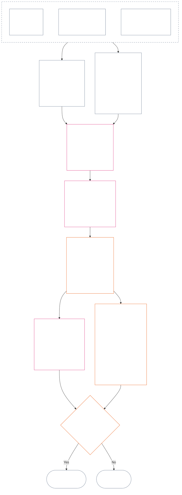

<!-- Complete unreviewed AI-assisted ar translation of current Chapter Twelve; source: core_12.000_standing_measurement.md; source snapshot: 05b7b839; 2026-11-09 source refresh applied. -->

# الفصل الثاني عشر: قياس الوضعية — السؤال 2، ما مدى الجودة أو السوء؟

<strong>موضع الملف في المتن (غير تشغيلي): بنية الملف وقواعد القراءة</strong>

> هذا الملف **جزء من دستور الكائنات الواعية**، ولا يكون **ملزمًا إلا معًا** مع ملفات `core_*` المرقّمة الأخرى المقروءة كنص واحد. ويضم **الفصل الثاني عشر** — **السؤال 2** (*ما مدى الجودة أو السوء؟*): خط أساس LEQU وحدوده، وأبعاد مدخلات القياس، وفهارس واصفات المسارات، وقواعد الخانات والتحجيم المشترك، والمدخلات الدستورية لتعيين المحور، ومقياس LEQU التناسبي الموحد، ومقاييس المساهمة القياسية، والأمثلة التطبيقية، والإحالة إلى السؤال 3 (**§1–§9**). ويرد إطار الأسئلة الثلاثة و**السؤال 1** (*ما الذي حدث؟*) — الوقائع المتحقَّق منها وأنواع الأحداث ومتطلبات السجل وحيازة السجل والتعامل معه — في [الفصل الحادي عشر](core_11_standing_assessment.md#chapter-eleven-standing-records--question-1-what-happened). ويستمر السؤال 3 (*ماذا يحدث بسبب ذلك؟*) في [الفصل الثالث عشر](../../core_13.000_standing_integration.md#chapter-thirteen-standing-effects-and-integration)، مع قصر المراجعة على تصنيف سوء السلوك المضاد للدستور في [الفصل الرابع عشر](../../core_14.000_misconduct_designation.md#chapter-fourteen-anti-constitutional-misconduct) بالنسبة إلى النتائج المؤهلة لمحور الانتهاك `s` = 7–9. وتُحفظ قراءة الترتيب، والفصل بين النص الملزم والداعم، وبيانات طبعة المتن في [README.md](README.md).

<strong>التتبّع</strong>

- السابق:
  - [الفصل الحادي عشر §1](core_11_standing_assessment.md#1-the-three-questions) (*إطار الأسئلة الثلاثة*)؛
  - من [الفصل الحادي عشر §2](core_11_standing_assessment.md#2-question-1--what-happened) إلى [الفصل الحادي عشر §6](core_11_standing_assessment.md#6-handling-a-standing-record) (*السؤال 1 — الوقائع المتحقَّق منها وسجلات الوضعية وحيازتها والتعامل معها*)؛
  - [الرباعية الدستورية](core_00_preamble.md#constitutional-tetrad)؛
  - [المقصدان الدستوريان](core_00_preamble.md#two-constitutional-aims)؛
  - [الديباجة §6 سلاسل الإجراءات العملية الرئيسية](../../core_00.000_preamble.md#6-key-practical-process-pipelines) (*سلسلة الفصول من التاسع إلى الخامس عشر*).
- الأقسام الفرعية في هذا الملف:
  - [§1](#1-question-2--how-good-or-bad-was-it) (*السؤال 2 — خط أساس LEQU وجسر الحالة والحدود والنطاق*)؛
  - [§2](#2-magnitude-and-severity-input-dimensions) (*أبعاد مدخلات القياس للمحورين*)؛
  - [§3](#3-route-descriptor-catalogs-and-measurement-roles) (*فهارس واصفات المسارات*)؛
  - [§4](#4-slot-grammar-and-shared-scaling) (*قواعد الخانات والتحجيم المشترك*)؛
  - [§5](#5-constitutional-inputs-to-axis-assignment) (*توجيه المصادر الدستورية*)؛
  - [§6](#6-unified-proportional-lequ-scale--contribution-and-violation-axes) (*مقياس LEQU التناسبي الموحد للمحورين*)؛
  - [§7](#7-standard-contribution-measures) (*مقاييس المساهمة القياسية التي ينشرها المتبنّي*)؛
  - [§8](#8-measurement-illustrations) (*أمثلة قياس تطبيقية*)؛
  - [§9](#9-hand-off-to-question-3--cross-question-measurement-hooks) (*الإحالة إلى السؤال 3*).
- اللاحق:
  - [الفصل الثالث عشر](../../core_13.000_standing_integration.md#chapter-thirteen-standing-effects-and-integration) (13.000) (*آثار السؤال 3 والتكامل*)؛
  - [الفصل الرابع عشر](../../core_14.000_misconduct_designation.md#chapter-fourteen-anti-constitutional-misconduct) (14.000) (*التصنيف وحده — لا يعيد فتح قياس السؤال 2*).
- يُقرأ مع: [الفصل الخامس *حالة الوضعية والمساهمة والانتهاك*](../../core_05.035_band_accountability.md#defa3-standing-state-contribution-and-violation) (5.035) (*توجيه التعريفات المعتمدة*).

 

الفصل الثاني عشر هو المرجع الدستوري لـ**السؤال 2**، الذي يقيس الوقائع التي تحقق منها [الفصل الحادي عشر](core_11_standing_assessment.md#chapter-eleven-standing-records--question-1-what-happened). ويبدأ عند [§1 السؤال 2 — ما مدى الجودة أو السوء؟](#1-question-2--how-good-or-bad-was-it). ويتولى [الفصل الحادي عشر](core_11_standing_assessment.md#chapter-eleven-standing-records--question-1-what-happened) إطار الأسئلة الثلاثة والسؤال 1 وسجل الوضعية، وينتهي عند [الفصل الحادي عشر §6 التعامل مع سجل الوضعية](core_11_standing_assessment.md#6-handling-a-standing-record).

*بعبارات بسيطة: يحسم الفصل الحادي عشر ما حدث ومن يحوز سجل الوضعية. ويقيسه هذا الفصل: ما مدى جودة المساهمة أو سوء الانتهاك، على مقياسين منفصلين لا يُجمعان أبدًا في نتيجة صافية. وما يترتب على القياس يرد في الفصل الثالث عشر.*

### 1. السؤال 2 — ما مدى جودة الفعل أو سوئه؟

<strong>التتبّع</strong>

- السابق: [الفصل الحادي عشر §2](core_11_standing_assessment.md#2-question-1--what-happened) (*السؤال 1 — سجلات الوضعية والوقائع المتحقَّق منها*)؛ [الفصل الحادي عشر §2.5](core_11_standing_assessment.md#25-verified-input-gate) (*بوابة المدخلات المتحقَّق منها*)؛ [الفصل الحادي عشر §4](core_11_standing_assessment.md#4-standing-record-operational-requirements) (*متطلبات السجل*)؛ [الفصل الحادي عشر §1](core_11_standing_assessment.md#1-the-three-questions) (*إطار الأسئلة الثلاثة*).
- اللاحق:
  - [§2](#2-magnitude-and-severity-input-dimensions) (*أبعاد مدخلات القياس للمحورين*)؛
  - [§3](#3-route-descriptor-catalogs-and-measurement-roles) (*فهارس واصفات المسار*)؛
  - [§4](#4-slot-grammar-and-shared-scaling) (*قواعد الخانات والتحجيم المشترك*)؛
  - [§5](#5-constitutional-inputs-to-axis-assignment) (*توجيه المصادر الدستورية*)؛
  - [§6](#6-unified-proportional-lequ-scale--contribution-and-violation-axes) (*تعيين محور المساهمة ومحور الانتهاك*)؛
  - [§7](#7-standard-contribution-measures) (*مقاييس المساهمة القياسية التي ينشرها المتبنّي*)؛
  - [§8](#8-measurement-illustrations) (*أمثلة قياس تطبيقية*)؛
  - [§9](#9-hand-off-to-question-3--cross-question-measurement-hooks) (*الإحالة إلى السؤال 3*)؛
  - [الفصل الثالث عشر §7.2](../../core_13.000_standing_integration.md#72-competency-bars-and-clearances) (13.000 §7.2) (*السؤال 3 للمساهمة — التفويض الآمن*)؛
  - [الفصل الثالث عشر §5.2](../../core_13.000_standing_integration.md#52-prevention--general-standing-locks) (13.000 §5.2) (*أقفال الوقاية*)؛
  - [الفصل الثالث عشر §6](../../core_13.000_standing_integration.md#6-lock-design-and-enforcement) (13.000 §6) (*تصميم الأقفال وإنفاذها*).
- يُقرأ مع: [الفصل الحادي عشر §4.1](core_11_standing_assessment.md#41-minimum-record-contents) (*حقول سجل الوضعية المتحقَّق منها؛ لا آثار للوضعية في الفصل الحادي عشر*).

 

*بعبارات بسيطة: يقيس السؤال 2 الوقائع المتحقَّق منها في السؤال 1. ويسأل: **ما مدى جودة المساهمة؟** أو **ما مدى سوء الانتهاك؟** وهنا يقدّم الفصل للمرة الأولى محوري القياس الرسميين: **محور المساهمة** للمساعدة المتحقَّق منها و**محور الانتهاك** للضرر المتحقَّق منه. يظل المحوران منفصلين؛ فهما ليسا جانبين من نتيجة صافية واحدة.*

لتحديد الخانة التي تنتمي إليها مساهمة شخص أو انتهاكه، يقيس هذا الفصل الأثر باستخدام **وحدة مكافئ العمر (LEQU)**. وتساوي وحدة LEQU تقريبًا إنقاذ رفاه كائن واعٍ طوال عمره أو تدميره. لا يتعلق الأمر بعدّ الأجساد أو الدولارات؛ بل يسأل عما إذا كان فعل ما قد غيّر رفاه المجتمع الدستوري تغييرًا ذا شأن. وتصلح الوحدة نفسها لأي كائن واعٍ، بشريًا كان أم غير ذلك.

#### 1.1 خط أساس LEQU

**وحدة مكافئ العمر** (**LEQU**) هي الوحدة المختصرة للمنفعة الدستورية أو الخسارة الدستورية المكافئة لحياة كاملة، حين يحتاج التنفيذ المعتمد إلى معايرة رقمية.

- الوحدة غير مرتبطة بالركيزة.
- يجوز للمتبنّي الحالي استخدام عمر بشري عادي مثالًا للمعايرة في السياقات البشرية البيولوجية، لكن خط الأساس الملزم متعلق بالكائنات الواعية والدستور، وليس بنوع بعينه.

تعني **المنفعة الدستورية المكافئة لحياة كاملة** منفعة متحقَّقًا منها تضاهي صون رفاه كائن واعٍ طوال عمر كامل ذي شأن ومتسق مع الحقوق، أو استعادته أو تحريره. وتعني **الخسارة الدستورية المكافئة لحياة كاملة** ضررًا أو هدرًا أو تدميرًا أو إغلاقًا للخيارات أو حرمانًا أو تحققًا للمخاطر متحقَّقًا منه، بما يضاهي تدمير منفعة دستورية مكافئة لحياة كاملة، أو استهلاكها ظلمًا، أو الحيلولة دونها.

#### 1.2 حدود استخدام LEQU

تسري الحدود التالية كلما استُخدمت LEQU.

- **ليست قاعدة للنتيجة الصافية:** لا يجوز «محو» الانتهاكات بالمساهمات أو العكس. فكل محور قائم بذاته.
- **ليست مقياسًا إلزاميًا لحياة بشرية:** LEQU عامة للكائنات الواعية؛ وتنطبق على أي كائن واعٍ، لا على البشر وحدهم.
- **ليست مقياسًا للاتهام:** الادعاءات أو وسوم الاستقبال أو قرارات التوجيه أو السمعة أو الحالة غير المفضلة أو النفور الأخلاقي لا توفر منفعة على محور المساهمة ولا شدة على محور الانتهاك من دون مدخلات متحقَّق منها بموجب **الفصل الحادي عشر، القسم 2.5** والمعايرة بموجب **القسم 6**.
- **ليست ترخيصًا للمقايضة بالحقوق:** يجب خفض قيمة الادعاءات المصاغة بعبارات الكفاءة أو القدرة الإنتاجية أو الابتكار أو تخفيف الأعباء أو الأمن أو الانتقام أو الاستجابة للطوارئ أو الضرورة المؤسسية، أو رفضها، إذا اعتمدت على:
  - الإكراه؛
  - نقل الأعباء على نحو تمييزي؛
  - استنزاف البيئة؛
  - عمل خفي غير مدفوع الأجر؛
  - غموض كان يمكن تجنبه؛
  - تضييق أرضية الحقوق؛
  - الاستحواذ؛
  - مؤشرات بديلة مضللة؛
  - فقدان قابلية الطعن؛ أو
  - تجميع لا يخضع للمراجعة.

#### 1.3 السؤال 2 وحده — النطاق والتوجيه

يغطي هذا الجزء السؤال 2 وحده، أي خطوة القياس. فهو يأخذ وقائع سبق التحقّق منها (السؤال 1) ويسأل عن مدى جودة المساهمة أو سوء الانتهاك.

- ابدأ بالوقائع التي سبق التحقّق منها بموجب **الفصل الحادي عشر، القسم 2** وأُدرجت في سجل الوضعية بموجب **الفصل الحادي عشر، القسم 4**، ثم قِسها بالأبعاد الواردة في **القسم 2**.
- بعد ذلك، أعطِ كل نوع من المساعدة أو الضرر اسمه القياسي من الفهارس: فهرس **مسارات المنفعة** للمساعدة (**القسم 3.1**) وفهرس **مسارات الضرر** للضرر (**القسم 3.2**).
- ويبيّن كل اسم أيضًا مقدار احتساب ذلك النوع من المساعدة أو الضرر ضمن *مدى الجودة* أو *مدى السوء*.
- ترد قواعد ما يترتب على المنفعة في [جانب المنفعة](../../core_13.000_standing_integration.md#72-competency-bars-and-clearances)، وقواعد ما يترتب على الضرر في [جانب الضرر](../../core_13.000_standing_integration.md#52-prevention--general-standing-locks).
- يحدد السؤال 3 ما يحدث بعد ذلك. ابدأ بـ[الفصل الثالث عشر §4 تكامل الواصفات وتوحيد الإرفاق](../../core_13.000_standing_integration.md#4-descriptor-integration-and-attachment-normalization).

#### 1.4 جسر حالة الكائن الواعي

لا يقرر قياس الوضعية ما إذا كان الكيان **كائنًا واعيًا**.

- تُحال النزاعات بشأن الحالة إلى [الفصل في حالة الكائن الواعي](../../core_05.055_band_participation.md#sentience-status-adjudication) و[المادة VI-B](core_06_rights_part_b.md#article-vi-b-sentience-status-adjudication-floor) (*أرضية الفصل في حالة الكائن الواعي*). ولا تُحال إلى درجات LEQU أو سجلات التصنيف.
- أثناء بقاء نزاع الحالة مفتوحًا بموجب [حياة الكائن الواعي المتنازع على صفته](../../core_05.055_band_participation.md#contested-sentient-life)، تشمل **المادة VI-B** (*أرضية الفصل في حالة الكائن الواعي*) الكيان افتراضيًا: ويظل قابلًا للقياس ويستطيع تقديم سجل وضعية إلى حين حسم النزاع، ولا يجوز للمشغّلين اعتبار النزاع المفتوح وحده سببًا لحرمانه من الوضعية.
- إذا تقرر أن الكيان [كائن واعٍ](../../core_05.055_band_participation.md#sentient)، أو ضُيّقت حالته أو أُعيدت بعد الفصل في قرار يمكن مراجعته بذاته:
  - يُحدَّث موضوع سجل الوضعية اعتبارًا من تلك اللحظة؛ و
  - لا يجوز تأريخ إقصاء غير مشروع إلى الماضي لمحو أهلية الكيان للقياس خلال الفترة السابقة، إلا من خلال [جبر الضرر والمعالجة](../../core_05.035_band_accountability.md#redress-and-remediation).

### 2. أبعاد مدخلات المقدار والشدة

*بعبارات بسيطة: يوضح هذا القسم ما ينتجه السؤال 2 (**القسم 2.1**)، ثم يسرد ما ينبغي فحصه عند قياس مساهمة متحقَّق منها أو انتهاك متحقَّق منه (**القسم 2.2**). يُقاس كل محور على حدة. وترد قواعد التحجيم المشترك في **القسم 4.2**، وتُستمد الخانة من المقياس في **القسم 6**.*

يقيس مقياس الخانات حجم النتيجة الدستورية ونوعها. ولا يحتسب إلا النتائج التي جرى التحقّق منها.

**ما يحتسبه المقياس وعلاقته بالاختبارات الأساسية للدستور:**

- **[المقصدان الدستوريان](core_00_preamble.md#two-constitutional-aims):** يقيس كلا المحورين الأثر في **الازدهار** و**الاستمرارية**. ويدفعهما محور المساهمة إلى الأمام، بينما يدفعهما محور الانتهاك إلى الخلف.
- **[السؤالان الأساسيان](core_00_preamble.md#two-fundamental-questions):** يوفّر كل محور الوقائع المتحقَّق منها لأحد السؤالين. ولا تجيب الإجابة عن أحدهما عن الآخر، ولذلك لا تُجمع درجات المحورين في نتيجة صافية.
  - **السؤال الأول:** يوفّر محور المساهمة الوقائع المتحقَّق منها. هل يكافئ النظام السلوك الذي يساعد الكائنات الواعية على الازدهار والاستمرار، ويقول الحقيقة، ويجبر الضرر؟
    - **ما يُحتسب:** المنفعة الدستورية المتحقَّق منها، بما في ذلك خفض المخاطر المتحقَّق منه.
    - **ما لا يُحتسب:** الناتج الخام أو المكانة أو الثروة أو مدى استخدام شيء ما أو السرعة أو ضخامة المؤسسة.
  - **السؤال الثاني:** يوفّر محور الانتهاك الوقائع المتحقَّق منها. هل يكافئ النظام سلوكًا يُلحق ضررًا غير مبرر أو يضلل أو يقصي أو يؤخر أو يهدر أو ينقل التكاليف إلى الآخرين؟
    - **ما يُحتسب:** الخسارة الدستورية أو الضرر أو الهدر أو الخيارات المفقودة (إغلاق الخيارات) أو الخطر أو تصاعد المخاطر، متى كان ذلك متحقَّقًا منه.
    - **ما لا يُحتسب بذاته:** حالة غير مفضلة أو ادعاءات أو نفور أخلاقي.
- **[الرباعية الدستورية](core_00_preamble.md#constitutional-tetrad):**
  - **الرقابة والمساءلة:** تعني كلمة «متحقَّق منه» أن جهة مسماة تجيب عن النتيجة، وألا يتحقق أي طرف من ادعائه بنفسه.
  - **حسن التوقيت:** يُسجّل التأخير الذي كان يمكن تجنبه كواقعة مستقلة، ولا يُدمج في حجم الخسارة.

#### 2.1 ما ينتجه السؤال 2

يدوّن السؤال 2 ما يلي في سجل الوضعية لكل محور. هذه قياسات، وليست آثارًا للوضعية (أي العواقب التي يقررها السؤال 3):

| **الناتج** | **محور المساهمة** | **محور الانتهاك** |
| --- | --- | --- |
| **موضع تدوينه** | سجل وضعية المساهمة. | سجل وضعية الانتهاك. |
| **الخانة** | أعلى خانة منطبقة على **محور المساهمة** (`s` = 1–9). | أعلى خانة منطبقة على **محور الانتهاك** (`s` = 1–9). |
| **واصفات المسار** | واصفات **مسار المنفعة** المنطبقة، مجتمعةً. | واصفات **مسار الضرر** المنطبقة، مجتمعةً. |
| **المدخلات المُحالة إلى السؤال 3** | المدخلات التي تحدد نقطة البدء لكيفية الاعتراف بالمساهمة، وفق [الفصل الثالث عشر §7 عواقب المساهمة، ثانيًا](../../core_13.000_standing_integration.md#7-contribution-consequences-second). | المدخلات التي تحدد نطاق القفل الافتراضي (نقطة البدء لمدى صرامة القفل)، وفق [الفصل الثالث عشر §6 تصميم الأقفال وإنفاذها](../../core_13.000_standing_integration.md#6-lock-design-and-enforcement). |
| **مجموع LEQU** | قيّم كل نوع ذي صلة من المنافع (البيئية أو النظامية أو المرتبطة بالموارد) على حدة، ثم أدخل مجموع LEQU واحدًا للمساهمة كلها. | قيّم كل نوع ذي صلة من الأضرار (الضرر البيئي أو ضرر النظام أو خسارة الموارد) على حدة، ثم أدخل مجموع LEQU واحدًا للانتهاك كله. |

تذكير: لا يلغي أي من ذلك سجل انتهاك مفتوحًا. ترد قاعدة عدم المقاصة في [الفصل الحادي عشر §2.4 سجلات الوضعية المرتبطة وجسر عدم المقاصة](core_11_standing_assessment.md#24-linked-standing-records-and-no-offset-bridge).

#### 2.2 أبعاد مدخلات مقدار المساهمة وشدة الانتهاك

**السؤال 2 — ما مدى جودة الفعل أو سوئه؟** لتحديد موضع مساهمة على محور المساهمة، أو انتهاك على محور الانتهاك (أي **الخانة** من 1 إلى 9)، والواصفات المنطبقة للمنفعة أو الضرر، اتبع ثلاثة أجزاء. قد تنطبق عدة واصفات في الوقت نفسه، وتُجمع معًا. دوّن النتائج في سجل الوضعية الخاص بالمحور، كما يبيّن **القسم 2.1**. ويعرض **القسم 6** المقياس الموحد للجزء 2؛ وهو المقياس نفسه للمنفعة والضرر. ويوضح كيفية تقدير مجموع المنفعة أو الخسارة بوحدة LEQU (وحدة مكافئ العمر، أي رفاه حياة كاملة تقريبًا) والخانة التي ينتمي إليها كل مقدار. وعلى محور المساهمة، تُجمع الخانات في أربع نطاقات.

**1. تحقّق من كيفية إنتاجها.** يتعامل المحوران مع ذلك على نحو مختلف:

- **المساهمة (جودة السلوك):** قد يزيد ذلك مقدار المنفعة المحتسبة أو يحدّه: هل أمكن تتبّعها؟ هل تجنبت نقل التكاليف إلى الآخرين؟ هل أُنجزت بعناية؟ وهل تتفق مع الدستور؟ ترد الفحوص الخمسة في [§2.2.1 أثر طريقة إنتاج المنفعة في ما يُحتسب](#221-how-the-way-a-benefit-was-produced-affects-what-counts).
- **الانتهاك (طبيعة السلوك):** يُسجَّل هذا منفصلًا عن حجم الأثر. فالواجب، والإهمال، والخداع، والإخفاء، وعرقلة المساءلة، والإكراه، والعنف، والقصد، والقسوة، والتمكين البنيوي تحدد المسؤول، والضمانات اللازمة، وكيفية الاستجابة. وترد قاعدة عدم تأثير أي منها في الخانة وقواعد تسجيل كل منها في [§2.2.2 كيفية تسجيل الطريقة التي وقع بها الضرر](#222-how-the-way-a-harm-was-caused-is-recorded).

**2. قدّر الحجم: ما مقدار المنفعة أو الخسارة؟** هذا ما يحدد الخانة.

| **ما ينبغي النظر إليه** | **أثره** | **موضع بيان قواعده** |
| --- | --- | --- |
| **الحجم الإجمالي (LEQU)** | المقياس الرئيسي، وهو الذي يتحكم في الخانة. في المساهمة، هو مجموع الخير المتحقَّق منه بوحدة LEQU. وفي الانتهاك، هو مجموع الخسارة الدستورية المتحقَّق منها. ويُقرَّر توصيف سوء السلوك في الفصل الرابع عشر على نحو مستقل. | [§6 مقياس LEQU التناسبي الموحد](#6-unified-proportional-lequ-scale--contribution-and-violation-axes) |
| **من يشملهم الأثر (العدد والعمق ومدى الهشاشة)** | يعدّل تقدير LEQU ومدى أهمية المنفعة أو الضرر (ماديته). | [§4.2 قواعد تحجيم الأثر المشتركة](#42-shared-impact-scaling-rules)؛ [المادية](core_05_band_oversight.md#materiality) |
| **مدة الأثر (المدة؛ واستدامة المنفعة أو تعذّر عكس الضرر)** | يعدّل تقدير LEQU. ففي المساهمة، تشير الإدارة المسؤولة المستدامة أو المنفعة الممتدة عبر الأجيال أو الإصلاح المؤسسي الدائم إلى الخانات العليا. وفي الانتهاك، ترفع الصدمة المستمرة والخسارة التي يتعذر تداركها والضرر الدائم لقدرة الكائنات الواعية على التصرف باستقلالية تقدير مجموع الخسارة. | [§4.2 قواعد تحجيم الأثر المشتركة](#42-shared-impact-scaling-rules) |
| **مدى امتداد الأثر (عبر الأماكن أو المؤسسات)** | يعدّل تقدير LEQU. ومن أمثلته في المساهمة منفعة تمتد عبر مجتمعات أو مؤسسات، أو على نطاق حضارة. وفي الانتهاك، قد يرفع الضرر الممتد عبر مجتمعات أو مؤسسات، أو عبر حضارة، تقدير مجموع الخسارة. | [§4.2 قواعد تحجيم الأثر المشتركة](#42-shared-impact-scaling-rules) |

**3. سمِّ أنواع المنفعة أو الضرر (المسارات).** سمِّ الطرق التي تحققت بها المنفعة أو الضرر. قد ينطبق أكثر من مسار واحد، وتُجمع المسارات. ترد القوائم في [**فهرس واصفات مسارات المنفعة**](#31-contribution-route-descriptor-catalog-and-measurement-roles) و[**فهرس واصفات مسارات الضرر**](#32-violation-route-descriptor-catalog-and-measurement-roles).

##### 2.2.1 أثر طريقة إنتاج المنفعة في ما يُحتسب

تحقّق من ذلك قبل اختيار خانة محور المساهمة:

| **ما تجده** | **أثره في المنفعة** |
| --- | --- |
| إصلاح عاجل ومتحقَّق منه لمشكلة بعد الإبلاغ عنها | قد يُحتسب **اجتهادًا** (سلوكًا حريصًا ومسؤولًا) عندما ينتج عنه نفع حقيقي يمكن إثباته. |
| نقل الضرر إلى الآخرين أو إخفاء عبء | يضع حدًا للمنفعة المنسوبة إلى المسار المتنازع عليه (أي مسار محدد تُنسب إليه المنفعة)، أو يستبعدها. |
| خطر استحواذ متحقَّق منه (إمكان سيطرة مصالح ضيقة على الترتيب)، أو اعتماد بنيوي (ترسيخ اعتماد الكائنات الواعية عليه)، أو تصميم للخروج والإبقاء القسري (يصعب معه الانسحاب) | يحد من الفضل المنسوب إلى الإدارة المسؤولة الجيدة. |
| إصلاح متحقَّق منه لعائق أمام إمكانية الوصول أو المشاركة | قد يزيد أهمية المنفعة (ماديتها) ويدعم واصف مسار المنفعة **إمكانية الوصول والإدماج** بموجب **القسم 3.1**. |
| مكافأة مهمة ناتجة عن ترتيب حوافز يعمل ضد الدستور، أو عن سلوك مناهض للدستور، أو عن عملية معيبة ماديًا | لا تُحتسب منفعةً كقاعدة افتراضية. في هذه الحالة، طبّق [الفصل الثالث عشر §6.4.2 المكافآت غير المتوائمة](../../core_13.000_standing_integration.md#642-misaligned-rewards) وقيد الانتقال إلى التبني في [المادة XXVIII-A](../../core_06.020_rights_part_e.md#incentive-alignment-adoption-transition-carve-out) (*التبني المرحلي واستمرارية أرضية الحقوق*). |

##### 2.2.2 كيفية تدوين طريقة إحداث الضرر

يحدد حجم الضرر (إجمالي LEQU له، من الجزء 2 أعلاه) الخانة. ولا تحددها طريقة وقوع الضرر، لذا يُسجل كل نوع من السلوك أدناه على حدة.

يورد هذا القسم الفرعي القاعدة مرة واحدة في الفصل الثاني عشر. **لا ترفع الخانة أو تخفضها لمجرد توصيف واقعة أو مسار سلوك بأي مما يلي:**

- الواجب؛
- الإهمال؛
- القصد؛
- الإخفاء؛
- التكرار؛
- التشديد؛
- الإكراه؛
- العنف؛
- الخطر على الحرية؛
- قابلية التصحيح؛ أو
- نتيجة مفضلة.

تُسجل وقائع طبيعة السلوك بوصفها أوصافًا قابلة للتتبع على نحو مستقل. وقد تتحكم في الإسناد، وشدة المراجعة، والضمانات، والانتصاف، أو قرار بموجب الفصل الرابع عشر. ولا تؤثر في الخانة إلا من خلال عواقب متحقق منها: فإذا أضاف السلوك خسارة، احتُسبت تلك الخسارة مرة واحدة في إجمالي LEQU، وتبعت الخانة ذلك الإجمالي.

**سلوك يضيف خسارة، وتُحتسب الخسارة مرة واحدة:**

| **ما تجده** | **كيفية تدوينه** |
| --- | --- |
| تأخير يمكن تجنبه في الاستجابة أو التصعيد، عند وجود واجب بالتصرف والقدرة عليه | يُسجّل كواقعة مستقلة عن السلوك. وتُحتسب أي خسارة إضافية تسبب فيها التأخير مرة واحدة في تقدير LEQU. |
| إصابة مستقلة متحقق منها لنزاهة المنتدى (ضرر بعدالة المنتدى) | تُحتسب مرة واحدة بالضبط في تقدير LEQU. ويظل الإغفال غير النزيه، والتعمد في الإخفاق بعملية التنحي، والإكراه، والخطر على الحرية، وغيرها من وقائع السلوك أوصافًا منفصلة. |
| **عرقلة المساءلة** (تدخل متحقق منه في الآليات التي تتيح مساءلة المسؤولين، مثل نزاهة الأدلة، والتحقق، وإجراءات المنتدى، وسجلات المكانة، ومهل الانتصاف، أو مسارات الاعتراض وجبر الضرر) | تبقى واقعة سلوك مسجلة على حدة. وتُحتسب أي خسارة إضافية سببتها مرة واحدة في تقدير LEQU على المسار المشروط. |

**وقائع سلوك تُسجّل منفصلة عن حجم الضرر:**

| **ما تجده** | **كيفية تدوينه** |
| --- | --- |
| الخداع أو الإخفاء أو التهرب أو تكرار السلوك بعد الإخطار أو التجاهل المتهور أو التمكين البنيوي (ترتيب الأمور بحيث يصبح الضرر سهلًا أو مرجحًا) أو إساءة استغلال اختلال كبير في الاعتماد (استغلال شخص يعتمد عليك بشدة) | يُسجّل كل منها كواقعة سلوك مستقلة. |
| العنف أو الإكراه أو التلاعب أو الخطر على الحرية | يُسجّل كل منها على حدة، وقد يستلزم ضمانات أقوى أيًا كانت الخانة. |
| [القسوة](../../core_05.035_band_accountability.md#cruelty) (معاناة متحقق منها بوصفها غاية في ذاتها، أو ضرر مجاني أو مهين يتجاوز ما كان ضروريًا ومتناسبًا) | تبقى واقعة سلوك مسجلة على حدة. وقد تستلزم ضمانات أقوى وحدودًا على سبل الانتصاف المهينة بموجب [الفصل الثالث عشر §5 الانتهاك والتصحيح والوقاية](../../core_13.000_standing_integration.md#5-violation-correction-and-prevention). |

**المسؤولية والإسناد:**

| **ما تجده** | **كيفية تدوينه** |
| --- | --- |
| تشتت المسؤولية (كيفية توزعها: دور كل طرف سببيًا، والسلطة أو السيطرة التي امتلكها، وإمكان توقعه للضرر، وانتفاعه منه، وإخفائه له، أو قدرته على منعه) | لا يدخل ضمن **نطاق الكائنات الواعية**، ولا يجيز لوم أي شخص لمجرد انتمائه إلى جماعة. |
| المسايرة في الضرر أو عدم مقاومته | قد يدعم توصيفًا قائمًا على الواجب أو مشددًا أو للمساءلة الجماعية، ولكن فقط إذا جرى التحقّق من الصلة بالفاعل المعني التي يشترطها **الفصل الحادي عشر، القسمان 4.1 و4.3**. |

**المكافآت غير المتوافقة:**

| **ما تجده** | **كيفية تدوينه** |
| --- | --- |
| قبول مكافأة مهمة تعمل ضد الدستور أو الإبقاء عليها عن علم، دون إبلاغ محمي في الوقت المناسب (إبلاغ محمي من الانتقام) | تُسجل بموجب [الفصل الثالث عشر §6.4.2 المكافآت غير المتوائمة](../../core_13.000_standing_integration.md#642-misaligned-rewards)، مع مراعاة [المادة XXVIII-A](../../core_06.020_rights_part_e.md#incentive-alignment-adoption-transition-carve-out) (*التبني المرحلي واستمرارية أرضية الحقوق*). ولا تؤثر في الخانة إلا الخسارة الدستورية المتحقق منها التي تسببها. |

**حد المكافآت غير المتوائمة.** لا يقيس هذا الفصل إلا أثر مكافأة غير متوائمة متحقق منها (مكافأة تعمل ضد الدستور) على محور المساهمة أو محور الانتهاك. ويحدد [الفصل الثالث عشر §6.4.2 المكافآت غير المتوائمة](../../core_13.000_standing_integration.md#642-misaligned-rewards) واجب الإبلاغ والاستثناءات وعواقب التخلي عن المكافأة (مصادرتها) وواجبات التصحيح وقواعد الإحالة.

### 3. فهارس واصفات المسارات وأدوار القياس

*بعبارات بسيطة: يسمّي الفهرسان أدناه أنواع المساعدة المتحقَّق منها (**القسم 3.1**) والضرر المتحقَّق منه (**القسم 3.2**) التي يمكن أن يتضمنها سجل الوضعية. وتبيّن الواصفة كيفية وقوع المنفعة أو الضرر؛ ويمكن جمع الواصفات، وهي تابعة للخانة.*

**قاعدة الواصفات.** الفهرسان أدناه، [§3.1 فهرس واصفات مسارات المساهمة وأدوار القياس](#31-contribution-route-descriptor-catalog-and-measurement-roles) و[§3.2 فهرس واصفات مسارات الانتهاك وأدوار القياس](#32-violation-route-descriptor-catalog-and-measurement-roles)، هما القائمة الرسمية للواصفات في كلا المحورين. وتبيّن الواصفة **كيفية** وقوع المنفعة أو الضرر المتحقَّق منه. وتسري القواعد التالية:

- تُجمع الواصفات، ولا تستبعد إحداها الأخرى: يجوز أن يتضمن سجل الوضعية الواحد عدة واصفات متى بررت الوقائع المتحقَّق منها ذلك.
- تأتي الواصفات بعد الخانة في الترتيب: فالخانة تبيّن حجم المنفعة أو الضرر، وتضيف الواصفات تفاصيل كيفية وقوعه لكنها لا تحل محلها مطلقًا.
- الواصفات المدرجة أساس وليست مجموعة كاملة؛ ولا يستبعد الفهرس أنواعًا أخرى من المنفعة أو الضرر.
- يجوز للتنفيذ استخدام معرّفات ثابتة (معرّفاته المحددة) مرتبطة بالفهرس، لكن لا يجوز له إنشاء تصنيف متعارض تكون فئاته حصرية، بحيث لا يستطيع سجل الوضعية حمل إلا واصف واحد.
- قبل التحقّق من الوقائع، قد تدعم الواصفة المدعاة حفظ الأدلة بصورة مشروعة أو فرز القضية أو ضمانات مؤقتة.
- لا يجوز تدوين الواصفة كمخرج للسؤال 2 أو إحداثها أثرًا في الوضعية إلا بعد التحقّق منها.

#### 3.1 فهرس واصفات مسارات المساهمة وأدوار القياس

هذه هي واصفات مسارات المنفعة وما يقيسه كل منها في السؤال 2 (ما مدى الجودة؟). وهي موزعة على خمسة مجالات، لكل مجال جدول، ويستخدم فهرس الانتهاكات في [§3.2 فهرس واصفات مسارات الانتهاك وأدوار القياس](#32-violation-route-descriptor-catalog-and-measurement-roles) المجالات الخمسة نفسها بالترتيب نفسه. ويرد دورها في السؤال 3، أي التفويض الآمن، في [الفصل الثالث عشر §7.2 عتبات الكفاءة والتصاريح](../../core_13.000_standing_integration.md#72-competency-bars-and-clearances).

**اكتمال الفهرس.** إذا عرض تنفيذ عدة واصفات في صف واحد أو تحت تسمية واحدة، فيجب أن يطابق ذلك الصف أو التسمية كل واصفة منطبقة. لا يحدد هذا الفهرس سوى أسماء الواصفات وما يقيسه كل منها في السؤال 2. أما قواعد السؤال 3 (الإرفاق وسبل الانتصاف والأقفال والتصاريح وسائر آثار الوضعية) فلا ترد إلا في الفصل الثالث عشر.

##### 3.1.1 السلامة الجسدية والعلاقات والرعاية والاستقلالية

| **واصف مسار المنفعة** | **ما يقيسه في السؤال 2** |
| --- | --- |
| **السلام الجسدي والنفسي و/أو المجتمعي** | المنفعة الناجمة عن الهدوء الجسدي والنفسي والمجتمعي. ويعدّل مدى أهمية المنفعة (ماديتها). |
| **العلاقات الموثوقة** | المنفعة الناجمة عن علاقات جديرة بالثقة، بما فيها العلاقات القائمة على واجب الثقة، في سياقات لا يتساوى فيها الطرفان. |
| **الرعاية ودعم الاعتماد** | رعاية متحقَّق منها لكائنات واعية تعتمد على الآخرين. وتُحتسب الرعاية غير الرسمية متى أمكن إثباتها. |
| **إمكانية الوصول والإدماج** | المنفعة الناجمة عن المشاركة الفعلية وإمكانية الوصول. وتعدّل مدى أهمية المنفعة في السياقات التي يعتمد فيها أحد الطرفين بشدة على الآخر. |

##### 3.1.2 الإصلاح والملكية والموارد

| **واصف مسار المنفعة** | **ما يقيسه في السؤال 2** |
| --- | --- |
| **المنفعة العلاجية والاستردادية** | المنفعة الناجمة عن الإصلاح والتعويض وخفض الضرر. |
| **الإدارة المسؤولة للموارد** | العناية بالموارد المادية وتقاسمها (تخصيصها) على نحو موثوق. |

##### 3.1.3 المعرفة والتعليم والسجلات والاكتشاف

| **واصف مسار المنفعة** | **ما يقيسه في السؤال 2** |
| --- | --- |
| **نزاهة المجال المعلوماتي** | تعزيز السجلات والشفافية والاتصالات. |
| **التعليم وبناء القدرات** | المنفعة الناجمة عن التعلّم ومحو الأمية ونمو قدرة الكائنات الواعية على التصرف باستقلالية. وتتبع الخانة مجموع منفعة LEQU. |
| **المساهمة في العلوم والتكنولوجيا والهندسة والرياضيات والاكتشاف** | اكتشافات يستطيع الآخرون إعادة إنتاجها وأبحاث تجعل الأمور أكثر أمانًا. |

##### 3.1.4 الأنظمة والعمليات الدستورية

| **واصف مسار المنفعة** | **ما يقيسه في السؤال 2** |
| --- | --- |
| **تحسين النظام** | إصلاح العمليات العابرة للمؤسسات وخفض المخاطر. |
| **التوافق الدستوري** | تعزيز أرضية الحقوق وتيسير الطعن في القرارات. |

##### 3.1.5 البيئة والاجتهاد

| **واصف مسار المنفعة** | **ما يقيسه في السؤال 2** |
| --- | --- |
| **الإدارة المسؤولة للبيئة** | المنفعة التي تعود على الموائل والتنوع الحيوي، والعمل المسؤول مناخيًا. |
| **الاجتهاد** | منع المخاطر الممكن توقعها والإشراف بكفاءة. |

#### 3.2 فهرس واصفات مسارات الانتهاك وأدوار القياس

هذه هي واصفات مسارات الضرر وما يقيسه كل منها في السؤال 2 (ما مدى السوء؟). وهي موزعة على خمسة مجالات، جدول لكل مجال، باستخدام المجالات الخمسة نفسها وبالترتيب نفسه الوارد في [§3.1 فهرس واصفات مسارات المساهمة وأدوار القياس](#31-contribution-route-descriptor-catalog-and-measurement-roles). وبالنسبة إلى السؤال 3، ترد قواعد التكامل والإرفاق في [الفصل الثالث عشر §4 تكامل الواصفات وتوحيد الإرفاق](../../core_13.000_standing_integration.md#4-descriptor-integration-and-attachment-normalization)، كما ترد قواعد الوقاية وتصميم الأقفال في [الفصل الثالث عشر §5.2 الوقاية — أقفال الوضعية العامة](../../core_13.000_standing_integration.md#52-prevention--general-standing-locks) و[الفصل الثالث عشر §6 تصميم الأقفال وإنفاذها](../../core_13.000_standing_integration.md#6-lock-design-and-enforcement).

**اكتمال الفهرس.** إذا عرض تنفيذ عدة واصفات في صف واحد أو تحت تسمية واحدة، فيجب أن يطابق ذلك الصف أو التسمية كل واصفة منطبقة. لا يحدد هذا الفهرس سوى أسماء الواصفات وما يقيسه كل منها في السؤال 2. أما قواعد السؤال 3 (الإرفاق وسبل الانتصاف والأقفال والتصاريح وسائر آثار الوضعية) فلا ترد إلا في الفصل الثالث عشر.

##### 3.2.1 السلامة الجسدية والعلاقات والرعاية والاستقلالية

| **واصف مسار الضرر** | **ما يقيسه في السؤال 2** |
| --- | --- |
| **سوء السلوك العنيف** | يُسجّل العنف أو الإكراه أو الخطر على الحرية منفصلًا عن خانة أثر LEQU. وقد يستلزم ضمانات مشددة. |
| **سوء السلوك في العلاقات الشخصية/واجب الرعاية** | تزداد أهمية الضرر (ماديته) حين يعتمد أحد الطرفين بشدة على الآخر. |
| **سوء السلوك المتمثل في عوائق إمكانية الوصول والمشاركة** | تزداد أهمية الضرر (ماديته) حين يعتمد أحد الطرفين بشدة على الآخر، وقد تتراكم معه العوامل المشددة. |
| **سوء السلوك المتعلق بالخصوصية والملكية الذاتية** | تنطبق عوامل مشددة عند التحقّق من الإخفاء أو الاستغلال، ويجوز جمعها. |
| **سوء السلوك المتعلق بالاستقلالية والتلاعب** | يُسجّل الإكراه أو التلاعب أو الخطر على الحرية منفصلًا عن خانة الأثر. |

##### 3.2.2 الإصلاح والملكية والموارد

| **واصف مسار الضرر** | **ما يقيسه في السؤال 2** |
| --- | --- |
| **سوء سلوك قابل للتصحيح علاجيًا** | يسجل طبيعته التصحيحية (إمكان جبر الضرر وكيفيته). وتتبع الخانة مجموع خسارة LEQU. |
| **سوء السلوك المتعلق بالملكية** | مسار خسارة الملكية. وتتبع الخانة مجموع خسارة LEQU. |

##### 3.2.3 المعرفة والتعليم والسجلات والاكتشاف

| **واصف مسار الضرر** | **ما يقيسه في السؤال 2** |
| --- | --- |
| **سوء السلوك في المجال المعلوماتي** | الضرر الذي يلحق بالسلامة أو الحقيقة. ويظل الإخفاء والخداع واقعتين منفصلتين عن كيفية إحداث الضرر (طبيعته). |
| **سوء السلوك التعليمي** | الضرر الذي يلحق بالتعلّم أو بقدرة الكائنات الواعية على التصرف باستقلالية (قدراتها). وتتبع الخانة مجموع خسارة LEQU. |
| **سوء السلوك في البحث والاكتشاف** | الضرر الذي يلحق بالبحث أو الاكتشاف. وتتبع الخانة مجموع خسارة LEQU. |

##### 3.2.4 الأنظمة والعمليات الدستورية

| **واصف مسار الضرر** | **ما يقيسه في السؤال 2** |
| --- | --- |
| **سوء سلوك النظام** | يُسجل انتشار المسؤولية بين الفاعلين والتمكين البنيوي كلٌّ على حدة. |
| **سوء سلوك عرقلة المساءلة** | يشمل عرقلة مساءلة المسؤولين عن الضرر. ويُسجل بوصفه طريقة وقوع الضرر. أما كيفية تنفيذ العرقلة (مثل الإخفاء أو الإهمال) فتُسجل واقعة منفصلة. وعندما تكون الخانة من الأعلى (انظر [§4.1 الجدول 1 — تسميات عرض الخانات](#41-table-1--slot-display-labels))، يجوز أيضًا تسجيل الحالة بوصفها **سوء سلوك مناهضًا للدستور** لإحالتها إلى [مراجعة سوء السلوك المناهض للدستور](../../core_05.035_band_accountability.md#anti-constitutional-misconduct-review) في الفصل الرابع عشر. والإحالة ليست هي التعيين بسوء السلوك المناهض للدستور؛ فالفصل الرابع عشر هو من يقرر ذلك على نحو مستقل. |
| **سوء السلوك المتمثل في الخروج والإبقاء القسري** | يحمل خصائص سوء سلوك النظام، ويضاف إليها تشتت المسؤولية أو الاستحواذ إذا كانا بنيويين (متأصلين في طريقة عمل النظام). |
| **سوء السلوك المتعلق بدورة الحياة وتعذّر عكس الأثر** | يؤثر تعذّر العكس في حجم خسارة LEQU. ويظل الإخفاء أو الإهمال مسجلًا على حدة بوصفه طبيعة للسلوك. |
| **سوء السلوك المضاد للدستور** (واصف) | يحيل الانتهاك الواقع في الخانات العليا (انظر [§4.1 الجدول 1 — تسميات عرض الخانات](#41-table-1--slot-display-labels)) إلى مراجعة التصنيف في الفصل الرابع عشر، من دون تغيير خانة الأثر. |

##### 3.2.5 البيئة والاجتهاد

| **واصف مسار الضرر** | **ما يقيسه في السؤال 2** |
| --- | --- |
| **سوء السلوك البيئي** | تُوزن خسارة LEQU بحسب خسارة [قدرة البيئة الإيكولوجية على التعافي](../../core_05.040_band_continuity.md#ecological-recovery-capacity) (قدرة النظام البيئي على التجدد بعد الضرر). وقد تُجمع مع مسار العنف (سوء السلوك العنيف). |
| **سوء السلوك الناجم عن الإهمال** | يُسجّل الواجب وإمكان توقع الضرر وإمكان منعه على نحو منفصل عن خانة الأثر. |

### 4. قواعد الخانات والتحجيم المشترك

*بعبارات بسيطة: يمنح هذا القسم أسماء متسقة لتسعة مواضع ممكنة على كل واحد من محورين منفصلين، ويشرح كيفية تحجيم الأثر عبرها. يسجل أحد المحورين المساهمة المتحقَّق منها، ويسجل الآخر الانتهاكات المتحقَّق منها في سجل الوضعية. ولا يؤدي اشتراكهما في رقم الخانة إلى دمج المحورين أو مقاصة الضرر بالمساعدة. ويعيّن المقياس الموحد في **القسم 6** كلا المحورين بحسب أثر LEQU التناسبي.*

تستخدم قواعد الخانات رقم خانة `s` من **1** إلى **9**. ولكل محور موضع خانة خاص به:

- يسجل **محور المساهمة** طبيعة المساهمة الإيجابية؛ و
- يسجل **محور الانتهاك** النتائج المتحقَّق منها بشأن الانتهاك.

قد يظهر رقم الخانة نفسه على المحورين، لكنهما يظلان منفصلين. فخانة المساهمة ليست خانة انتهاك، وخانة الانتهاك ليست خانة مساهمة.

#### 4.1 الجدول 1 — تسميات عرض الخانات

يسمّي **الجدول 1** الخانات التسع ويعرض تسميات محور المساهمة ومحور الانتهاك جنبًا إلى جنب. وهو يوفّر لغة العرض فقط؛ أما تعيين الخانة فيجري بموجب المقياس الموحد في **القسم 6**.

|  `s` | تسمية العرض لمحور المساهمة | تسمية العرض لمحور الانتهاك |
| ---: | --- | --- |
|    1 | **مساهمة أساسية طفيفة** | **أثر دستوري طفيف** |
|    2 | **مساهمة أساسية صغيرة** | **أثر دستوري صغير** |
|    3 | **مساهمة إيجابية كبيرة** | **أثر دستوري كبير** |
|    4 | **مساهمة إيجابية مهمة** | **أثر دستوري مهم** |
|    5 | **مساهمة جادة إيجابية في الإدارة المسؤولة** | **أثر دستوري جسيم** |
|    6 | **مساهمة كبرى إيجابية في الإدارة المسؤولة** | **أثر دستوري كبير جدًا** |
|    7 | **مساهم رائد معترف به** | **أثر دستوري شديد** |
|    8 | **مساهم رائد متميّز** | **أثر دستوري خطير** |
|    9 | **مساهم رائد نموذجي** | **أثر دستوري كارثي** |

يستخدم محور المساهمة تسميات أساسية وإيجابية وإيجابية في الإدارة المسؤولة وريادية. أما محور الانتهاك فيستخدم تسميات محايدة للأثر في جميع الخانات. ويظل المحوران منفصلين؛ فلا ينشئان نتيجة صافية ولا يجيزان المقاصة بين سجلات المساهمة والانتهاك. ولا تصنّف خانة محور الانتهاك، في حد ذاتها، سوء السلوك المضاد للدستور؛ إذ يقرر [الفصل الرابع عشر](../../core_14.000_misconduct_designation.md#chapter-fourteen-anti-constitutional-misconduct) على نحو مستقل ما إذا كان توصيف سوء السلوك المضاد للدستور (ACMD) ينطبق على انتهاك متحقَّق منه في `s` = 7–9.

يجوز للتنفيذ نشر وحدات القياس وأساليب الأدلة والأمثلة للمساعدة في تقدير المنفعة أو الخسارة المكافئة لحياة كاملة. وهذه المواد إرشادية فقط، ولا يجوز لها تجاوز **القسم 6** أو **الفصل الأول** أو أرضية الحقوق الواردة في **الفصل السادس**.

#### 4.2 قواعد تحجيم الأثر المشتركة

*بعبارات بسيطة: لا يُقاس الأثر بعدد الأشخاص وحده. فقد تكون منفعة أو خسارة عميقة تؤثر في كائن واعٍ واحد أهم من أثر سطحي يؤثر في كثيرين. ويجب تقييم العدد والعمق والهشاشة والمدة والاستدامة والمدى والطبيعة الدستورية معًا.*

استخدم القواعد التالية لتفسير كلا المحورين في **القسم 6**:

| بُعد التحجيم | القاعدة المشتركة | التطبيق الخاص بالمحور |
| --- | --- | --- |
| **مقدار النتيجة الدستورية (LEQU)** | قيّم المنفعة أو الخسارة المتكاملة المتحقَّق منها. LEQU هي المرسى الأساسي للمقدار؛ وليست الأعداد الخام أو المال أو الناتج أو حجم المؤسسة كذلك. | تحتسب المساهمة المنفعة المتحقَّق منها والمتسقة مع الحقوق؛ ويحتسب الانتهاك الخسارة الدستورية أو الضرر أو الهدر أو إغلاق الخيارات أو الخطر المتحقَّق منه. |
| **نطاق الكائنات الواعية** | انظر إلى **العدد والعمق والهشاشة معًا**. لا تشترط أي خانة عددًا معينًا مستقلًا. وقد يدعم أثر عميق بما يكفي في كائن واعٍ واحد الخانة نفسها التي يدعمها أثر أوسع لكنه أقل عمقًا، إذا تساوى المقدار المتكامل وسائر معايير الصف؛ ويظل واجبًا استيفاء أي معيار صريح لمجموع LEQU أو لاتساع النطاق. | قد يزيد الاعتماد أو انخفاض القدرة أو الهشاشة غير المعتادة المادية. ولا يثبت حجم الجماعة وحده مساهمة أو شدة. |
| **النطاق الزمني** | انظر إلى المدة والتكرار والاستدامة، وإلى تعذّر عكس الخسارة. وقد يفوق حدث قصير لكنه تحويلي أثرًا طويلًا تافهًا؛ فالمدة وحدها ليست حاسمة. | تدعم المنفعة المستدامة مقدار مساهمة أعلى. وتدعم الخسارة المستمرة أو التي يتعذر عكسها شدة انتهاك أعلى. |
| **النطاق المكاني أو المؤسسي** | قد يزيد اتساع المدى المقدار، لكن الامتداد عبر المجتمعات أو المؤسسات غير مطلوب إذا كان العمق أو المدة أو الهشاشة أو الأهمية الدستورية الحرجة يدعم الخانة بذاته. | قد يزيد إصلاح المؤسسات مقدار المساهمة؛ وقد يزيد الضرر البنيوي أو النظامي شدة الانتهاك. |
| **الجودة أو الطبيعة الدستورية** | قِس كيفية إنتاج النتيجة على نحو منفصل عن مدى انتشارها. لا تحتسب الواقعة نفسها مرتين. | قد يحد الضرر الخارجي أو العبء المخفي أو الاستحواذ أو التبعية من المساهمة المدعاة أو يستبعدها. ويظل الواجب والإهمال والخداع والإكراه والعنف أو التمكين البنيوي مسجلًا على نحو منفصل بوصفه طبيعة سلوك انتهاكي. |
| **أرضيات الحقوق والضمانات الحرجة** | لا تُقايَض مراعاة أرضية الحقوق بمنفعة أو خسارة إجمالية. | لا تثبت مراعاة الأرضية وحدها مساهمة مرتفعة. وقد يدعم الإخلال المادي بأرضية الحقوق أو الإخفاق في ضمانة حرجة شدة انتهاك أعلى حتى حين يتأثر عدد قليل من الكائنات الواعية مباشرة. |

الأبعاد ليست قائمة تحقق تشترط تحقق كل شكل من أشكال الاتساع. وضّح الأبعاد التي تحكمت في التقييم، وتلك التي لم تتحكم فيه، وسبب ذلك.

- **طريقة تعيين الخانة المشتركة:**
  - قدّر المنفعة أو الخسارة المتحقَّق منها والمتكاملة بوحدة LEQU بموجب التناسب، ثم عيّن الخانة الوحيدة التي يقع مقدارها ضمن نطاقها العددي.
  - تنطبق الحدود نفسها على المحورين.
  - تحتفظ خانات المساهمة بمتطلبات خط الأساس والتوافق الدستوري المنطبقة؛ ولا يمكن لاستيفاء عتبة رقمية أن يجعل الناتج المنقول ضرره إلى الغير أو المخالف دستوريًا مساهمةً محتسبة.
- **فصل الطبيعة:** أبقِ واصفات مسارات المنفعة والضرر وجودة السلوك وطبيعة السلوك المنطبقة متراكمةً في سجل الوضعية. وقد تؤثر الواجبات أو الإهمال أو الخداع أو التشديد أو الإكراه أو العنف أو القصد أو التمكين البنيوي في الإسناد أو الضمانات أو عواقب السؤال 3، لكن لا يرفع أي منها خانة أثر LEQU ولا يخفضها.
- **حدّ مراجعة سوء السلوك المضاد للدستور:** قد تبلغ الخسارة المتحقَّق منها على محور الانتهاك `s` = 7–9 من حيث الأثر، سواء ثبت سوء السلوك المضاد للدستور أم لم يثبت. ولا يحل الفصل الرابع عشر محل تعيين الأثر؛ بل يقرر على نحو مستقل ما إذا كان توصيف ACMD المقابل ينطبق.

إذا لم يقع خطر فعليًا بعد، فسجّل كلًا مما يلي على حدة:

- مدى احتمال وقوعه؛
- مدة تعرض الكائنات الواعية له؛
- مدى انتشاره المحتمل؛
- مقدار عدم اليقين في التقدير؛ و
- أسوأ نتيجة يظل وقوعها معقولًا.

لا تحتسب أسوأ نتيجة بوصفها ضررًا وقع بالفعل (خسارة LEQU)، ما لم يحدد تنفيذ معتمد معايرةً للمخاطر (طريقة لتحويل المخاطر إلى LEQU) يمكن لأي شخص الاطلاع عليها.

### 5. المدخلات الدستورية لتعيين المحور

*بعبارات بسيطة: قبل اختيار خانة، حدّد المصادر الدستورية التي تقرر خط الأساس أو المنفعة أو الواجب أو الضرر أو الانتهاك المقاس. استخدم الروابط أدناه لتطبيق تلك المصادر في مواضعها الأصلية المعتمدة؛ ولا تحوّل خطوة التوجيه هذه إلى درجة أخرى أو تعريف بديل.*

قبل تعيين خانة بموجب **القسم 6**، يجب أن يحدد سجل الوضعية ما يلي:

- خط الأساس أو الواجب أو القيد أو المصلحة المحمية الدستورية المنطبقة؛
- الأحكام التي تثبت المنفعة أو النتيجة السلبية أو الضرر أو الانتهاك المتحقَّق منه الجاري قياسه؛
- التعريفات والمبادئ ومواد أرضية الحقوق التي تؤثر ماديًا في المقدار أو طبيعة السلوك؛ و
- سبب انطباق كل مصدر محدد وكيفية تأثيره في تعيين المحور.

جداول التوجيه أدناه غير حصرية. ويظل كل تعريف أو مبدأ أو مادة إضافية تقتضيها الوقائع المتحقَّق منها منطبقًا، ويجب تحديده في سجل الوضعية. وكل مصدر مرتبط في موضعه المرجعي المعتمد هو الحاكم؛ ولا تعيد هذه الجداول صياغته أو تضييق نطاقه.

#### 5.1 مدخلات التعريفات

| المصدر المرجعي المعتمد | دور محور المساهمة | دور محور الانتهاك |
| --- | --- | --- |
| [حالة الوضعية والمساهمة والانتهاك](../../core_05.035_band_accountability.md#defa3-standing-state-contribution-and-violation) | يوضح ما يُعد مساهمة وأي وقائع مفحوصة يمكن استخدامها لقياسها. كما يضمن أن يتتبع سجل وضعية المساهمة الجانب الجيد وحده، من دون خلطه بالجانب السيئ. | يوضح ما يُعد انتهاكًا وكيفية تسجيله. كما يحيل أخطر الحالات إلى مراجعة سوء السلوك المضاد للدستور، وهي مراجعة مستقلة للسلوك الذي يقوض الدستور ذاته. |
| [المساءلة](core_05_apex_accountability_leg.md#accountability) | يتحقق مما إذا كان ادعاء الإدارة المسؤولة الجيدة أو الإصلاح يُبقي شخصًا ما قابلًا للمساءلة فعلًا. ويجب أن يبيّن من فعل ماذا، ومن عليه الإجابة عنه، وكيف يمكن مراجعته وإصلاحه وتصحيحه بما يتناسب مع أثره. | يكشف الحالات التي لا يتضح فيها من فعل شيئًا أو من يتحمل مسؤولية الإجابة عنه. ويشمل ذلك الحالات التي تتعطل فيها المسؤولية بعد تغير المؤسسة أو بنيتها. |
| [الضرر](../../core_05.035_band_accountability.md#harm) | قد يحد الضرر المنقول إلى الآخرين أو المخفي من المنفعة المدعاة أو يلغيها. وقد يُحتسب إصلاح الضرر منفعةً، ولكن فقط إذا كان الإصلاح متحقَّقًا منه وثبت استقلالًا. | يحدد أنواع الضرر المحتسبة عند قياس الخسارة والشدة: المباشر وغير المباشر والمتأخر والتراكمي والممتد عبر الأنظمة، والضرر الذي يلحق بذهن الكائن الواعي أو برفاهه العاطفي. |
| [المادية](core_05_band_oversight.md#materiality) و[وحدة مكافئ العمر (LEQU)](../../core_05.055_band_participation.md#lifespan-equivalent-unit-lequ) | تحددان مقدار احتساب المنفعة المتحقَّق منها بالاستناد إلى مدى انتشارها وهشاشة المتأثرين بها ومدة استمرارها. ويُقاس الناتج بوحدة LEQU، وهي المعيار المشترك لمنفعة تعادل حياة كاملة. | تحددان مقدار احتساب الخسارة أو الخطر المتحقَّق منه بالاستناد إلى مدى انتشاره وهشاشة المتأثرين به ومدة استمراره ومدى صعوبة عكسه. ويُقاس الناتج بوحدة LEQU، وهي المعيار نفسه المستخدم لخسارة تعادل حياة كاملة. |
| [طبيعة المساهمة](../../core_05.035_band_accountability.md#contribution-nature) | تقرر ما إذا كان شيء ما يُعد مساهمة. ويجب أن يكون جيدًا محضًا، لا مختلطًا بالضرر، وأن يستند إلى سجل مساهمة متحقَّق منه يمكن عرضه. ومن دون الأمرين لا يجوز تعيينه على محور المساهمة. | لا دور لها هنا. فهي لا تقرر ما يُعد ضررًا، ولا تخفض أبدًا مدى جسامة الانتهاك. |
| [طبيعة الانتهاك](../../core_05.035_band_accountability.md#violation-nature) | لا دور لها هنا. فلا يُحتسب الانتهاك مساهمةً سلبية أبدًا، ولا يمحو منفعة متحقَّقًا منها لا صلة لها به. | تقرر ما إذا كان شيء ما يُعد انتهاكًا. ويجب تصنيفه ضارًا والاستناد إلى نتيجة متحقَّق منها تثبت وقوع الانتهاك. ومن دون الأمرين لا يجوز تعيينه على محور الانتهاك. |
| [القيد الدستوري](core_05_band_integrative.md#constitutional-constraint) و[هرمية السلطات وتسلسلها الداخلي](core_05_band_integrative.md#authority-stack-and-internal-hierarchy) و[قابلية التدقيق](core_05_band_oversight.md#auditability) | تمنع احتساب منفعة مدعاة حين تعتمد على التغلب على الدستور أو التحايل على قواعده أو تضييق أرضية الحقوق (الحد الأدنى من الحماية التي يكفلها الدستور) أو الاكتفاء بالامتثال الشكلي. | تبرز العوامل التي تؤثر في جسامة الانتهاك الفعلية: خرق قيد دستوري مهم، أو وضع شيء فوق سلطة الدستور، أو التحايل على القواعد، أو جعل إنفاذها مستحيلًا. |
| [قابلية التدقيق](core_05_band_oversight.md#auditability) و[قابلية الطعن](../../core_05.035_band_accountability.md#contestability) | تشترطان إمكان إثبات المنفعة المدعاة وفحصها، ووجود وسيلة فعالة للطعن فيها لمن يعترض. | تشترطان أن تكون النتائج قابلة للفحص والطعن. فلا يستطيع اتهام أو وسم بلا تفسير تحديد جسامة الانتهاك. |

#### 5.2 مدخلات المبادئ

| مصدر المبدأ | دوره في تعيين المحور |
| --- | --- |
| [الرباعية الدستورية](core_00_preamble.md#constitutional-tetrad) و[المقصدان الدستوريان](core_00_preamble.md#two-constitutional-aims) و[الرهان المادي](core_00_preamble.md#material-stake) | تحدد ضوابط العمل الأربعة (المشاركة والرقابة والمساءلة وحسن التوقيت)، والنتيجتين اللتين يهدف إليهما الدستور (الازدهار والاستمرارية)، والإطار الذي يضبط كل تعيين وفق ما هو على المحك. |
| [الرفاه](core_01_a_values_principles.md#3-foundational-objective-wellbeing-flourishing-aim) و[الاعتراف والتعزيز والتطلع](core_01_a_values_principles.md#32-recognition-reinforcement-and-aspiration) | ترسيان المنفعة المراعية للحقوق والاعتراف الملائم لها على محور المساهمة. ولا تُعامل المكانة أو المكافآت أبدًا على أنها دليل على مساهمة. |
| [السلامة](core_01_a_values_principles.md#4-safety-harm-constraint) و[الحقيقة](core_01_a_values_principles.md#5-truth-epistemic-integrity-constraint) | تضعان حدودًا ملزمة على كلا المحورين. ولا تُحتسب المنفعة المتحققة عبر الضرر أو الخداع كاملةً، وقد يثبت الإخفاق المتحقَّق منه في السلامة أو الحقيقة حجم الانتهاك أو نوعه. |
| [الإدارة المسؤولة بعمق](core_01_c_stewardship_capacity_principles.md#16-stewardship-in-depth) و[الحوكمة في ظل انضباط الإدارة المسؤولة](core_01_c_stewardship_capacity_principles.md#18-governance-under-stewardship-discipline) | توجّهان كيفية وزن المساهمة المستدامة والواجبات الملازمة للدور والإصلاح المؤسسي والإشراف والمسؤولية، متى اقتضت الوقائع المتحقَّق منها ذلك. |
| [مبادئ المفاضلة الأساسية](core_01_b_interaction_interpretation.md#131-core-tradeoff-principles) و[الأرضيات الدستورية والسلامة والإجراءات غير المهينة](core_01_b_interaction_interpretation.md#1314-constitutional-floors-safety-and-anti-degrading-process) | تنطبقان حين يتصل السلوك المقاس بالضرورة أو تقليل الضرر قدر الإمكان أو التناسب أو تعارض الحقوق أو فرض قيد. ولا تجيزان عاقبة بمفردهما أبدًا. |

#### 5.3 مدخلات أرضية الحقوق والمواد

| مصدر المادة | دور تعيين المحور أو حدوده |
| --- | --- |
| أرضية الحقوق في [الفصل السادس](core_06_rights_part_a.md#chapter-six-foundational-rights) المنطبقة من الناحية الواقعية، بما في ذلك كل مادة يمسها سجل الوضعية المتحقَّق منه ماديًا | تحدد الحماية الأساسية أو المصالح أو الواجبات أو المنافع أو الانتهاكات محل النظر. ولا تُسقط أي مادة لمجرد عدم ورودها أدناه. |
| [المادة XIX — حالة الوضعية والمشاركة](core_06_rights_part_d.md#article-xix-standing-and-participation-status) | تفصل بين وضعية الكائن الواعي وكرامته والحد الأدنى من حماية أرضية الحقوق وصفته طرفًا متأثرًا وسمعته وأي تغيير لاحق في حالة مشاركته. |
| [المادة XIII-A — خط أساس الموثوقية والأمانة](core_06_rights_part_c.md#article-xiii-a-reliability-and-trustworthiness-baseline) و[المادة XIII-B — الحق في جبر الضرر والانتصاف](core_06_rights_part_c.md#article-xiii-b-right-to-redress-and-remedy) و[المادة XV-B — الشفافية وقابلية التدقيق والطعن](core_06_rights_part_c.md#article-xv-b-transparency-auditability-and-contestability) و[المادة XVI — التدقيق والشفافية والتحقّق المستقل](core_06_rights_part_c.md#article-xvi-audit-transparency-and-independent-verification) | تنطبق عندما تتعلق المنفعة أو الانتهاك المتحقَّق منه بحفظ سجلات نزيهة أو مشاركة المعلومات أو فحص الوقائع أو إمكان الطعن في قرار أو تصحيح الأخطاء. |
| [المادة XXIV — تحليل الأسباب الجذرية والاستجابة التكيفية](core_06_rights_part_d.md#article-xxiv-root-cause-analysis-and-adaptive-response) | تنطبق عندما تكون أسباب السلوك أو تصحيحه أو استمراره أو تكيّف الاستجابة معه ذات صلة، لأن ذلك يبيّن موقف السلوك بموجب الدستور. |
| [المادة XX — العدالة بعد الانتهاك المتحقَّق منه](core_06_rights_part_d.md#article-xx-justice-after-verified-violation) و[المادة XXVI-C — أرضية الحل في الوقت المناسب ومناهضة التأخير](../../core_06.020_rights_part_e.md#article-xxvi-c-timely-resolution-and-anti-delay-floor) | تنطبقان على أي إجراء أو تأخير تتصل به الوقائع فعلًا. وتحد **المادة XX** (*العدالة بعد الانتهاك المتحقَّق منه*) أساسًا مما يحدث بعد قياس الانتهاك (السؤال 3). ولا يجوز استخدامها لرفع خانة السؤال 2 أو خفضها لمجرد تبرير استجابة يفضلها أحدهم مسبقًا. |

**حدود التطبيق.** لا تفعل هذه الخطوة سوى الإشارة إلى المصادر الصحيحة.

- وهي لا:
  - تعيد فتح السؤال 1؛
  - تسمح بوقائع لم يجر التحقّق منها؛
  - تضيف مقياسًا أو درجة جديدة؛
  - تحتسب الواقعة نفسها مرتين عبر مصادر مختلفة؛
  - تدمج المحورين؛ أو
  - تجعل كل مصدر مدرج منطبقًا على كل سجل وضعية.
- تظل المساهمة والانتهاك مقاسين على نحو منفصل.
- تظل عواقب **المادة XX** (*العدالة بعد الانتهاك المتحقَّق منه*) خارج السؤال 2.
- تظل مراجعة التصنيف في الفصل الرابع عشر منفصلة عن خانة الأثر المعيّنة هنا.

### 6. مقياس LEQU التناسبي الموحد — محورا المساهمة والانتهاك

<strong>إرشادات للقارئ (غير تشغيلية): كيفية عمل التدرج بخمسة أضعاف</strong>

> يستخدم المقياس تدرجًا بخمسة أضعاف، مرتكزًا عند `s` = 7 = وحدة LEQU واحدة. ولكل محور، يكون الحد الأدنى للمقدار في الخانة `s` هو `5^(s−7)` LEQU للخانات من 2 إلى 9؛ وتبدأ الخانة 1 من الصفر. يجوز للتنفيذ المعتمد نشر الحدود الرقمية الناتجة وأمثلة المعايرة. وتشمل الخانة 1 خط أساس دستوريًا متحقَّقًا منه على محور المساهمة وخسارة متحقَّقًا منها دون أول عتبة إيجابية على محور الانتهاك؛ أما غياب المساهمة أو غياب الانتهاك فليس في حد ذاته سجلًا عند `s` = 1.
>
> **مرساة مفهومة للقارئ.** باستخدام عمر بشري مدته 80 عامًا مثالًا للمعايرة، اقرأ العمود الأوسط تصاعديًا باعتباره منفعة مكافئة لحياة كاملة أو وقتًا قابلًا للاستخدام أو موارد وقدرات متسقة مع الحقوق أُضيفت؛ واقرأه تنازليًا باعتباره خسارة مكافئة أو حرمانًا أو هدرًا أو إغلاقًا للخيارات. ولا تُحتسب كمية الموارد بذاتها؛ فالنتيجة الدستورية التي تنتجها أو تمنعها هي الحاسمة.

 

*بعبارات بسيطة: يضع **الجدول 2** المساهمة المتحقَّق منها والانتهاك المتحقَّق منه على مقياس الأثر التناسبي نفسه. وتعني الخانات الأعلى منفعة أو خسارة دستورية متكاملة أكبر. وتظل سجلات الوضعية والمحاور منفصلة: فالمقياس المشترك يقارن المقدار، لا القيمة الأخلاقية، ولا يجيز أبدًا أن تمحو المساعدة الضرر.*

يتبع المخطط تعيين خانة واحدة من البداية إلى النهاية. ويبيّن ترتيب تنفيذ الخطوات، وهو غير ترتيب النقاط أدناه؛ إذ تذكر النقاط كل قاعدة.

طبّق **التناسب** لتقدير أثر LEQU المتكامل استنادًا إلى العمق ونطاق الكائنات الواعية والهشاشة والمدة والاستدامة أو تعذّر العكس والمدى والأهمية الدستورية الحرجة. تشكّل هذه الأبعاد تقدير LEQU؛ وليست مكافآت مستقلة للخانة.

- استخدم **الجدول 2** بعد أن يؤكد السؤال 1 ما حدث، ويقيس السؤال 2 المنفعة أو الخسارة المتحقَّق منها، وتُطبّق **الأقسام 1–3 و4.2**، وتُحدد المصادر الدستورية المطلوبة بموجب **القسم 5**.
- عيّن خانة واحدة انطلاقًا من تقدير LEQU المتكامل.
  - وضّح أثر كل بُعد تحجيم مادي في التقدير، وسبب عدم تحكم الأبعاد المستبعدة فيه.
  - يجب أن يستوفي كل تعيين ما يلي:
    - قابلية التتبع؛
    - قابلية التدقيق؛
    - قابلية الطعن؛ و
    - أرضية الحقوق المنطبقة.
  - ويجب أن تستوفي المساهمة أيضًا شرط عدم نقل الأعباء إلى الغير والتوافق الدستوري.
- سجّل وقائع طبيعة السلوك بوصفها أوصافًا مستقلة قابلة للتتبع، ولا تجعلها تغييرات في الخانة أبدًا (القاعدة في [§2.2.2 كيفية تسجيل الطريقة التي وقع بها الضرر](#222-how-the-way-a-harm-was-caused-is-recorded)).
- قيّم بالكامل العواقب المتحقَّق منها للفعل أو لمسار السلوك عبر أبعاد التحجيم المادية، بما فيها:
  - الإصابة الجسدية؛
  - الصدمة النفسية؛
  - آثار الإكراه؛
  - الحرمان من الحرية أو تعريضها للخطر؛
  - الضرر التراكمي؛ و
  - أي منفعة أو خسارة أخرى يعتد بها دستوريًا.
- لا تستنتج طبيعة السلوك من المقدار ولا تستبدل بها المقدار المتحقق منه.

يسرد **الجدول 2** الخانات التسع بالترتيب. ويبيّن كل صف رقم الخانة `s`، ومقدار المنفعة المضافة أو الخسارة المفروضة اللازم لبلوغها (مع استخدام عمر بشري مدته 80 عامًا مثالًا للمعايرة)، واسم الخانة على كل محور. تنطبق الحدود نفسها على المحورين، لكن الاسمين يظلان منفصلين: فخانة محور المساهمة وخانة محور الانتهاك سجلان مختلفان ولا تجري المقاصة بينهما مطلقًا.

| `s` | معايرة عمر بشري مدته 80 عامًا — المنفعة المضافة / الخسارة المفروضة | محور المساهمة | محور الانتهاك |
| ---: | --- | --- | --- |
| 1 | أقل من نحو **9 أيام** | **مساهمة أساسية طفيفة** — استيفاء متحقَّق منه للأرضية الدستورية في النطاق المقاس؛ ويظل أي تحسن قابل للقياس دون `s` = 2. | **أثر دستوري طفيف** — خسارة أو قصور تشغيلي متحقَّق منه دون `s` = 2، بما يشمل عيبًا شكليًا من دون ضرر جوهري مثبت. |
| 2 | نحو **9–47 يومًا** | **مساهمة أساسية صغيرة** — أداء موثوق ومحدود يتجاوز الحد الأدنى للأرضية ضمن مستوى الأثر هذا. | **أثر دستوري صغير** — خسارة محدودة متحقَّق منها في مستوى الأثر هذا. |
| 3 | نحو **47 يومًا–8 أشهر** | **مساهمة إيجابية كبيرة** — منفعة واضحة تتجاوز خط الأساس عند مستوى الأثر هذا. | **أثر دستوري كبير** — خسارة كبيرة متحقَّق منها عند مستوى الأثر هذا. |
| 4 | نحو **8 أشهر–3.2 سنوات** | **مساهمة إيجابية مهمة** — منفعة متحقَّق منها أعمق أو أطول أمدًا أو متكررة أو مستجيبة للهشاشة أو أوسع نطاقًا. | **أثر دستوري مهم** — خسارة دستورية مهمة متحقَّق منها. |
| 5 | نحو **3.2–16 سنة** | **مساهمة جادة إيجابية في الإدارة المسؤولة** — إدارة مسؤولة أو تنسيق أو صيانة أو إصلاح مستدام، أو منفعة مستمرة مماثلة. | **أثر دستوري جسيم** — خسارة دستورية جسيمة متحقَّق منها. |
| 6 | نحو **16–80 سنة** | **مساهمة كبرى إيجابية في الإدارة المسؤولة** — منفعة كبيرة متحقَّق منها تقترب من وحدة LEQU واحدة. | **أثر دستوري كبير جدًا** — خسارة كبيرة متحقَّق منها تقترب من وحدة LEQU واحدة. |
| 7 | نحو **عمر إلى 5 أعمار** (**80–400 سنة**) | **مساهم رائد معترف به** — منفعة متحقَّق منها لا تقل عن وحدة LEQU واحدة ومتوافقة دستوريًا. | **أثر دستوري شديد** — خسارة دستورية متحقَّق منها لا تقل عن وحدة LEQU واحدة. |
| 8 | نحو **5–25 عمرًا** (**400–2,000 سنة**) | **مساهم رائد متميّز** — منفعة متحقَّق منها تتجاوز `s` = 7 بدرجة مادية. | **أثر دستوري خطير** — خسارة متحقَّق منها تتجاوز `s` = 7 بدرجة مادية. |
| 9 | **25 عمرًا على الأقل** (**2,000+ سنة**) | **مساهم رائد نموذجي** — منفعة متحقَّق منها تتجاوز `s` = 8 بدرجة مادية. | **أثر دستوري كارثي** — خسارة متحقَّق منها تتجاوز `s` = 8 بدرجة مادية. |

<strong>ملاحظة التشغيل البيني للتنفيذ</strong>

> تتضمن هذه الأداة مادة تشغيل بيني موجّهة إلى التنفيذ. وهي تدعم فئات الفصل التشغيلية؛ ولا تنشئ نظام فئات موازيًا.

تُعرّف الحقول المقروءة آليًا لعرض الخانة (`sub_tier` و`sub_tier_display` وحقول العرض ذات الصلة) في [CH06_NINE_SLOT_STANDING_SCALE.md](../../implementation/CH06_NINE_SLOT_STANDING_SCALE.md) و[ch06_nine_slot_constants.json](../../implementation/ch06_nine_slot_constants.json). وتظل خريطة نطاقات التنفيذ الأربعة أداة مساعدة للتشغيل البيني، ولا تضيف عمودًا للنطاق الأساسي إلى **الجدول 2** التشغيلي.

ترد الطريقة المرجعية وتعيينات الخانات التطبيقية، بما فيها للكائنات الواعية ذات الأوزان ونقاط حفظ الحالة والافتقار إلى عمر فناء ثابت، في [LEQU_CALIBRATION_REFERENCE.md](../../implementation/LEQU_CALIBRATION_REFERENCE.md). ولا يجوز لهذه الأعمال أن تحل محل الحدود المشتركة وقاعدة التعيين التناسبي في **القسم 6**، أو أن تعيّن سجلًا قائمًا، أو أن تقرر من يُعد كائنًا واعيًا.

يجوز للتنفيذ المعتمد نشر تقديرات LEQU وتسميات عرض مرتبطة بمفاتيح. ويجب ألا تحل هذه الأدوات المساعدة محل الحدود المشتركة وقاعدة التعيين التناسبي في **القسم 6** أو ضمانات التصنيف في الفصل الرابع عشر، إلا من خلال تغيير في **وثيقة مطابقة**.

### 7. مقاييس المساهمة القياسية

*بعبارات بسيطة: في المهام التي يكررها الكائنات الواعية، مثل جمع النفايات أو وحدة عمل لترميم جدول مائي، يجوز للمتبنّي نشر قياس افتراضي للسؤال 2 كي لا يلزم تقدير كل حالة متحقَّق منها على حدة. والقياس الافتراضي حد أدنى لا سقف: يُقاس العمل الذي يحقق أكثر، على نحو متحقَّق منه، بحسب ما أنجزه فعلًا؛ ويُقاس العمل الأقل مما افترضه المعيار بحسب ما ثبت. وتُحدّث القيم الافتراضية وفق جدول منشور، ويمكن الطعن فيها، ولا تنشئ أبدًا واجبًا بتنفيذ المهمة.*

يجوز للتنفيذ المعتمد نشر **مقاييس مساهمة قياسية**: تقدير افتراضي للسؤال 2 — LEQU والنطاق وواصفات مسارات المنفعة — لأداء متحقَّق منه لمهمة متكررة محددة ضمن نطاق محدد، مثل جمع النفايات على مقطع معلوم أو وحدة عمل لترميم مجرى مائي أو قطعة أرض لاستعادتها أو دورة صيانة. وتجعل المعايير الإدارة المسؤولة المعتادة مفهومة وجديرة بالتكرار بموجب [الفصل الأول §3.2](core_01_a_values_principles.md#32-recognition-reinforcement-and-aspiration) (*الاعتراف والتعزيز والتطلع*)، من دون تقدير خاص لكل حالة. والمعيار أداة قياس مساعدة بموجب **الفصل الحادي عشر، القسم 4.5**، وتسري عليه القواعد التالية:

- **كيفية تطبيق المعيار**
  - لا ينطبق إلا على عمل جرى التحقّق منه في السؤال 1 عبر **الفصل الحادي عشر، القسم 5**؛ ولا يحل المعيار أبدًا محل التحقّق من إنجاز المهمة بالنطاق المحدد وعلى يد الشخص المسمى.
  - هو **حد أدنى للأداء القياسي، وليس سقفًا**:
    - يُقاس العمل الذي يتجاوز أثره المتحقَّق منه الأثر المفترض للمعيار — كاستخدام طريقة أفضل أو تحقيق نتيجة أدوم أو نقل أعباء أقل إلى الغير أو تقديم منفعة أوسع أو أعمق — وفق أثره الفعلي المتحقَّق منه بموجب **القسم 4.2**، كي يظل الحافز قائمًا لتحسين أداء المهمة عن المعيار.
    - يُقاس العمل الذي يثبت أنه دون النطاق أو الاستدامة المفترضين للمعيار بحسب ما ثبت، لا بحسب التسمية.
- **كيفية مراجعة المعيار**
  - **يُراجع وفق دورية منشورة ويُعاد تحديد خط أساسه مع تحسن الكفاءة**، حتى يعكس المعيار التكلفة والناتج الحاليين للمهمة، بدلًا من تجميد جهد الأمس بوصفه رصيد اليوم.
  - يسري التنقيح مستقبلًا، وتحتفظ السجلات المفتوحة أصلًا بأساس قياسها بموجب **الفصل الحادي عشر، القسم 4.4**، ما لم يكن ذلك الأساس خاطئًا عند تدوينه.
  - يجب أن يستند التنقيح إلى الأدلة وأن يُنشر وأن يكون قابلًا للطعن.
  - لا يجوز استخدام التنقيح لكبت الاعتراف بفئة من العمل أو بمجتمع أو جماعة، أو لخفض المعيار بوتيرة أسرع من مكاسب الكفاءة المتحقَّق منها التي يستند إليها ([الفصل الأول §19 مواءمة الحوافز والاستحواذ على النظام](core_01_c_stewardship_capacity_principles.md#19-incentive-alignment-and-system-capture)).
- **ضمانات منع إساءة الاستخدام والتجاوز**
  - لا ينشئ المعيار حصة كمية أو واجب أداء أو عتبة كفاءة بموجب [الفصل الثالث عشر §7.2 عتبات الكفاءة والتصاريح](../../core_13.000_standing_integration.md#72-competency-bars-and-clearances)؛ وتسري قاعدة **الفصل الحادي عشر، القسم 2.2** *الصمت هو الأصل*، ولا يكون للكائن الواعي الذي لا يؤدي مهمة معيارية أي سجل لهذا السبب.
  - يتولى المكتب الذي يضع المعيار أو ينقحه مقعد التوجيه والسياسات بموجب **الفصل الحادي عشر، القسم 5.1** *الفصل بين الواجبات*؛ وليس هو المكتب الذي يتحقق من الأداء وفق المعيار، كما لا يجوز أن يكون أي منهما طرفًا يقيس المعيار مقدار الاعتراف به.

لا يجوز للمعايير تجاوز **القسم 6** أو **الفصل الأول** أو أرضية الحقوق في **الفصل السادس**. وترد الطريقة المرجعية والجدول التطبيقي في [LEQU_CALIBRATION_REFERENCE.md](../../implementation/LEQU_CALIBRATION_REFERENCE.md) (*دعم للإجراءات؛ لا يجوز أن يعيّن سجلًا قائمًا*).

### 8. أمثلة توضيحية للقياس

*بعبارات بسيطة: يقيس مثالان تطبيقيان، **المثالان 8 و9**، مساهمة متحقَّقًا منها وانتهاكًا متحقَّقًا منه. وهما يردان مع الأمثلة التطبيقية الأخرى ولا يضيفان أي قاعدة.*

ترد الأمثلة التطبيقية في [الأمثلة التطبيقية للفصول الحادي عشر إلى الخامس عشر](../../corpus_joint_structure/cjs_11.105_application_vignettes.md#cjs-11105-application-vignettes)، وهي توضح هذا الفصل ولا تملك أي قاعدة:

- [المثال 8: ترميم تعاوني لضفاف الأنهار (قياس المساهمة)](../../corpus_joint_structure/cjs_11.105_application_vignettes.md#cjs-11105-8-riparian-cooperative-restoration-contribution-measurement): مساهمة متحقَّق منها تُقاس انطلاقًا من وقائع السؤال 1 وصولًا إلى مخرجات السؤال 2.
- [المثال 9: إهمال مشرف حوض مائي مع إخفاء نتائج الفحوص (قياس الانتهاك)](../../corpus_joint_structure/cjs_11.105_application_vignettes.md#cjs-11105-9-watershed-steward-negligence-with-concealed-test-results-violation-measurement): انتهاك متحقَّق منه يُقاس بالطريقة نفسها، مع مساهمة مرتبطة لا تجري مقاصتها معه.

### 9. الإحالة إلى السؤال 3 — روابط القياس بين الأسئلة

**دليل العلاقة بين الأسئلة.** تُستخدم بعض الوقائع المتحقَّق منها للإجابة عن سؤالين مختلفين.

- **السؤال 2: ما مدى جودة الفعل أو سوئه؟** يبيّن **المثالان 8 و9** ([§8 أمثلة توضيحية للقياس](#8-measurement-illustrations)) أثر كل واقعة فيه. ويُقاس سجل المساهمة وسجل الانتهاك دائمًا على حدة، ولا تجري المقاصة بين أحدهما والآخر مطلقًا ([الفصل الحادي عشر §2.4 سجلات الوضعية المرتبطة وجسر عدم المقاصة](core_11_standing_assessment.md#24-linked-standing-records-and-no-offset-bridge)).
- **السؤال 3: ماذا يحدث بسبب ذلك؟** يبيّن الجدول أدناه أي الوقائع نفسها قد تكون ذات صلة به أيضًا.
- قد تكون الواقعة ذات صلة بكلا السؤالين، وقد تكون ذات صلة بأحد المحورين (المساهمة أو الانتهاك) دون الآخر.
- سجّل استخدامها في السؤال 2 واستخدامها في السؤال 3 كلًا على حدة.
  - لا تجمعهما.
  - لا تحتسب الواقعة نفسها مرتين.

السمات المتحقَّق منها، مجمّعة بحسب طريقة تعامل السؤال 2 معها:

**وقائع تتصل بالمساهمة أيضًا:**

| **السمة المتحقَّق منها** | **الموضع المسؤول عنها في السؤال 2 بهذا الفصل** | **الموضع المسؤول عن تكاملها في السؤال 3** |
| --- | --- | --- |
| **ضرر منقول إلى الغير / عبء مخفي** | [§2.2.1 أثر طريقة إنتاج المنفعة في ما يُحتسب](#221-how-the-way-a-benefit-was-produced-affects-what-counts) | [الفصل الثالث عشر §7.2 عتبات الكفاءة والتصاريح](../../core_13.000_standing_integration.md#72-competency-bars-and-clearances) — قد يمنع التصريح أو يضيّق نطاقه إلى حين المعالجة |
| **التمكين النظامي / البنيوي** | [§2.2.1 كيف تؤثر طريقة إنتاج المنفعة في ما يُحتسب](#221-how-the-way-a-benefit-was-produced-affects-what-counts)؛ [§2.2.2 كيفية تسجيل الطريقة التي وقع بها الضرر](#222-how-the-way-a-harm-was-caused-is-recorded) و**سوء سلوك النظام** في [§3.2 فهرس أوصاف مسار الانتهاك وأدوار القياس](#32-violation-route-descriptor-catalog-and-measurement-roles) | [الفصل الثالث عشر §7.2 حدود الكفاءة والتصاريح](../../core_13.000_standing_integration.md#72-competency-bars-and-clearances) و[الفصل الثالث عشر §5.2 الوقاية — أقفال المكانة العامة](../../core_13.000_standing_integration.md#52-prevention--general-standing-locks) — ضمانات التفويض أو أقفال السلطة في مؤسسة |
| **مخاطر الخروج / الإبقاء القسري أو إغلاق الخيارات** | [§2.2.1 أثر طريقة إنتاج المنفعة في ما يُحتسب](#221-how-the-way-a-benefit-was-produced-affects-what-counts)؛ **سوء السلوك المتمثل في الخروج والإبقاء القسري** في [§3.2 فهرس واصفات مسارات الانتهاك وأدوار القياس](#32-violation-route-descriptor-catalog-and-measurement-roles) | [الفصل الثالث عشر §7.2 عتبات الكفاءة والتصاريح](../../core_13.000_standing_integration.md#72-competency-bars-and-clearances) و[الفصل الثالث عشر §5.2 الوقاية — أقفال الوضعية العامة](../../core_13.000_standing_integration.md#52-prevention--general-standing-locks) — ضمانات التفويض أو عوائق مسارات الخروج |
| **إصلاح عوائق إمكانية الوصول / المشاركة** | **إمكانية الوصول والإدماج** في [§3.1 فهرس واصفات مسارات المساهمة وأدوار القياس](#31-contribution-route-descriptor-catalog-and-measurement-roles) | [الفصل الثالث عشر §7.2 عتبات الكفاءة والتصاريح](../../core_13.000_standing_integration.md#72-competency-bars-and-clearances) — عتبة التجربة الشاملة أو المسار المحكوم ببوابة المحدد النطاق |

**كيفية إحداث الضرر:**

| **السمة المتحقَّق منها** | **الموضع المسؤول عنها في السؤال 2 بهذا الفصل** | **الموضع المسؤول عن تكاملها في السؤال 3** |
| --- | --- | --- |
| **عرقلة المساءلة** | [§2.2.2 كيفية تدوين طريقة إحداث الضرر](#222-how-the-way-a-harm-was-caused-is-recorded) و**سوء السلوك المتمثل في عرقلة المساءلة** في [§3.2 فهرس واصفات مسارات الانتهاك وأدوار القياس](#32-violation-route-descriptor-catalog-and-measurement-roles) | [الفصل الثالث عشر §5.2 الوقاية — أقفال الوضعية العامة](../../core_13.000_standing_integration.md#52-prevention--general-standing-locks) و[§6.4 قواعد الانتهاكات الخاصة](../../core_13.000_standing_integration.md#64-special-violation-rules) — أقفال محددة النطاق لمسارات محكومة ببوابة؛ [الفصل الثالث عشر §6.5 الأقفال الخاصة](../../core_13.000_standing_integration.md#65-special-locks) (*لا يوجد قفل خاص لهذه الواقعة*)؛ ولا يكون التصنيف في الفصل الرابع عشر إلا عبر بوابة مراجعة سوء السلوك المضاد للدستور بموجب [الفصل الثالث عشر §3.4 ترتيب المعالجة](../../core_13.000_standing_integration.md#34-processing-order) |
| **الإضرار بنزاهة المنتدى** | [§2.2.2 كيفية تدوين طريقة إحداث الضرر](#222-how-the-way-a-harm-was-caused-is-recorded) | [الفصل الثالث عشر §6.5 الأقفال الخاصة](../../core_13.000_standing_integration.md#65-special-locks) — آثار أقفال الوضعية المتعلقة بنزاهة المنتدى |
| **الخداع / الإخفاء / التهرب** | [§2.2.2 كيفية تدوين طريقة إحداث الضرر](#222-how-the-way-a-harm-was-caused-is-recorded) | [الفصل الثالث عشر §5.2 الوقاية — أقفال الوضعية العامة](../../core_13.000_standing_integration.md#52-prevention--general-standing-locks) — قفل مشدد بسبب الإخفاء / التهرب |
| **الاستمرار / النمط / التكرار بعد الإخطار** | [§2.2.2 كيفية تدوين طريقة إحداث الضرر](#222-how-the-way-a-harm-was-caused-is-recorded) | [الفصل الثالث عشر §5.2 الوقاية — أقفال الوضعية العامة](../../core_13.000_standing_integration.md#52-prevention--general-standing-locks) — قفل الاستمرار والتكرار |
| **العنف / الإكراه / الخطر على الحرية** | [§2.2.2 كيفية تدوين طريقة إحداث الضرر](#222-how-the-way-a-harm-was-caused-is-recorded) و**سوء السلوك العنيف** في [§3.2 فهرس واصفات مسارات الانتهاك وأدوار القياس](#32-violation-route-descriptor-catalog-and-measurement-roles) | [الفصل الثالث عشر §5.2 الوقاية — أقفال الوضعية العامة](../../core_13.000_standing_integration.md#52-prevention--general-standing-locks) — أقفال الحماية والضمانات |
| **القسوة** | [§2.2.2 كيفية تدوين طريقة إحداث الضرر](#222-how-the-way-a-harm-was-caused-is-recorded)؛ [القسوة](../../core_05.035_band_accountability.md#cruelty) | [الفصل الثالث عشر §5.2 الوقاية — أقفال الوضعية العامة](../../core_13.000_standing_integration.md#52-prevention--general-standing-locks) — أقفال الحماية والضمانات؛ [الفصل الثالث عشر §5.3 التعبير الطوعي عن المساءلة العامة](../../core_13.000_standing_integration.md#53-voluntary-public-accountability-expression) — تعبير استردادي غير مهين عند استخدامه |
| **انتشار المسؤولية أو السيطرة** | [§2.2.2 كيفية تسجيل الطريقة التي وقع بها الضرر](#222-how-the-way-a-harm-was-caused-is-recorded)؛ والربط الخاص بالفاعل بموجب [الفصل الحادي عشر §4.1 الحد الأدنى لمحتوى السجل](core_11_standing_assessment.md#41-minimum-record-contents) و[الفصل الحادي عشر §4.3 السجلات الجماعية والخاصة بالفاعل](core_11_standing_assessment.md#43-collective-and-actor-specific-records) | [الفصل الثالث عشر §5.2 الوقاية — أقفال المكانة العامة](../../core_13.000_standing_integration.md#52-prevention--general-standing-locks) — نطاق أوسع للمسار المشروط أو النظر في إساءة استخدام مؤسسة |
| **المشاركة بالمسايرة / عدم المقاومة** | [§2.2.2 كيفية تدوين طريقة إحداث الضرر](#222-how-the-way-a-harm-was-caused-is-recorded) | [الفصل الثالث عشر §5.2 الوقاية — أقفال الوضعية العامة](../../core_13.000_standing_integration.md#52-prevention--general-standing-locks) — نطاق المسار المحكوم ببوابة وآثار الاستمرار والتكرار |

**أنواع الضرر ذات واصف انتهاك خاص بها:**

| **السمة المتحقَّق منها** | **الموضع المسؤول عنها في السؤال 2 بهذا الفصل** | **الموضع المسؤول عن تكاملها في السؤال 3** |
| --- | --- | --- |
| **الإخلال بإمكانية الوصول / الإضرار بعوائق المشاركة** | **سوء السلوك المتمثل في عوائق إمكانية الوصول والمشاركة** في [§3.2 فهرس واصفات مسارات الانتهاك وأدوار القياس](#32-violation-route-descriptor-catalog-and-measurement-roles) | [الفصل الثالث عشر §5.2 الوقاية — أقفال الوضعية العامة](../../core_13.000_standing_integration.md#52-prevention--general-standing-locks) — عوائق لمسارات المشاركة وإمكانية الوصول المسماة |
| **الإضرار بالخصوصية / الملكية الذاتية** | **سوء السلوك المتعلق بالخصوصية والملكية الذاتية** في [§3.2 فهرس واصفات مسارات الانتهاك وأدوار القياس](#32-violation-route-descriptor-catalog-and-measurement-roles) | [الفصل الثالث عشر §5.2 الوقاية — أقفال الوضعية العامة](../../core_13.000_standing_integration.md#52-prevention--general-standing-locks) — عوائق لمسارات البيانات أو الصورة أو النشر أو الحالة الداخلية المحكومة ببوابة |
| **الإخفاء المتعلق بدورة الحياة / تعذّر العكس** | **سوء السلوك المتعلق بدورة الحياة وتعذّر عكس الأثر** في [§3.2 فهرس واصفات مسارات الانتهاك وأدوار القياس](#32-violation-route-descriptor-catalog-and-measurement-roles) | [الفصل الثالث عشر §5.2 الوقاية — أقفال الوضعية العامة](../../core_13.000_standing_integration.md#52-prevention--general-standing-locks) — عوائق النشر وسلطة دورة الحياة |

#### 9.1 وقائع متشابهة في الظاهر يجب أن تظل منفصلة

ترتبط بعض الوقائع بعضها ببعض لكنها تجيب عن أسئلة مختلفة. سجّلها منفصلة:

| **الواقعة الأولى** | **واقعة مختلفة** | **سبب وجوب الفصل بينهما** |
| --- | --- | --- |
| **التأخير في الاستجابة للمشكلة الأصلية أو تصعيدها** | **التأخير في بدء الانتصاف أو تنفيذه** | تساعد الأولى في قياس السؤال 2 بموجب [§2.2 أبعاد مدخلات مقدار المساهمة وشدة الانتهاك](#22-contribution-magnitude-input-and-violation-severity-input-dimensions). والثانية واقعة لاحقة في السؤال 3 بموجب [الفصل الثالث عشر §10.5 التنفيذ في الوقت المناسب](../../core_13.000_standing_integration.md#105-timely-implementation). |
| **عدد الكائنات الواعية المتأثرة** | **كيفية توزيع المسؤولية أو السيطرة بين الفاعلين أو الأنظمة** | تساعد الأولى في قياس حجم المنفعة أو الضرر بموجب [§2.2 أبعاد مدخلات مقدار المساهمة وشدة الانتهاك](#22-contribution-magnitude-input-and-violation-severity-input-dimensions). والثانية تتعلق بالمسؤولية الخاصة بالفاعل وتشتت المسؤولية، وبنطاق المسار المحكوم ببوابة الممكن في السؤال 3. |

---

**متابعة.** تستمر آثار الوضعية والتكامل في [الفصل الثالث عشر](../../core_13.000_standing_integration.md#chapter-thirteen-standing-effects-and-integration)، بدءًا من **القسم 1 — آثار الوضعية**.

---

**الملف السابق:** [core_11.000_standing_assessment.md](core_11_standing_assessment.md)

**الملف التالي:** [core_13.000_standing_integration.md](core_09_standing_integration.md)
