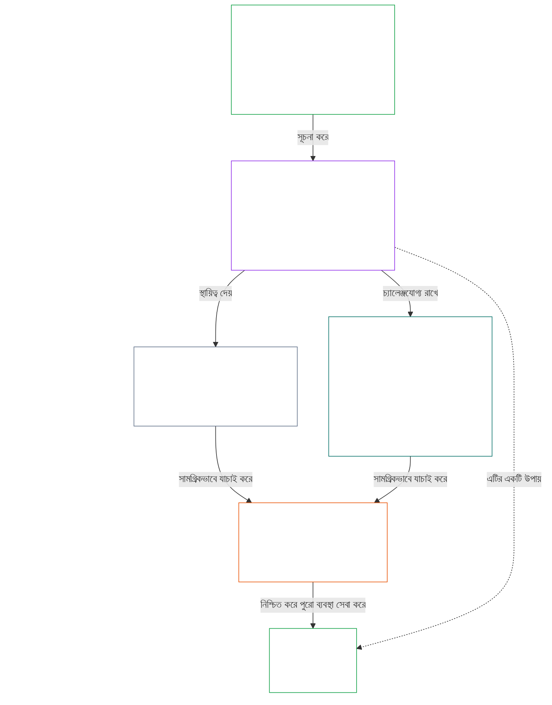

# অধ্যায় ০১, অংশ A: মূল্যবোধের নীতিমালা

<details>
<summary><strong><span style="color: #2563eb;">কর্পাসে অবস্থান (কার্যকরী নয়): ফাইলের কাঠামো ও পাঠের নিয়ম</span></strong></summary>

> **অ-কার্যকরী** হিসেবে চিহ্নিত উইজেটগুলো (করপাসে অবস্থান, পাঠক নির্দেশনা, পাঠ-মানচিত্র) কেবল দিকনির্দেশনা। এগুলো নিজস্ব ফাইলে বা অন্য কোনো ফাইলে বাধ্যতামূলক দায়বদ্ধতা যোগ, অপসারণ বা সংকুচিত করে না।
> এই ফাইলটি **Sentient Constitution-এর অংশ** এবং একক দলিল হিসেবে পড়া অন্য সংখ্যাযুক্ত `core_*` ফাইলগুলোর সঙ্গে **শুধুমাত্র একত্রে বাধ্যতামূলক**। এতে **অধ্যায় এক, অংশ A** (§§1–12: উদ্দেশ্য ও ভূমিকা; সমৃদ্ধির লক্ষ্য, যার পরিচয় §2-এ এবং যা কল্যাণ, নিরাপত্তা, সত্য, আস্থা ও স্বাধীনতার মাধ্যমে বিকশিত; এবং ধারাবাহিকতার লক্ষ্য, যার পরিচয় §8-এ এবং যা যৌথ-ব্যবস্থা সক্ষমতা, সহনশীলতা, বাজার-কাঠামো ও ব্যবস্থাগত মূল্যায়নের মাধ্যমে বিকশিত) রয়েছে।
>
> **পূর্ববর্তী:** [core_00_preamble.md](core_00_preamble.md)  
> **পরবর্তী:** [core_01_b_interaction_interpretation.md](core_01_b_interaction_interpretation.md) (অধ্যায় এক, অংশ B — §§13–15, মিথস্ক্রিয়া, অগ্রাহ্য করার সীমা এবং সাংবিধানিক ব্যাখ্যা)।  
> **পাঠের ধারা:** §1 উদ্দেশ্য ও ভূমিকা → **সমৃদ্ধি:** §2-এর পরিচিতি (যার §2.1-এ নিরাপত্তা ও সত্যের আপসহীন সীমাবদ্ধতা রয়েছে) → §3 কল্যাণ (ফলাফল) → §4 নিরাপত্তা → §5 সত্য → §6 আস্থা → §7 স্বাধীনতা → **ধারাবাহিকতা:** §8-এর পরিচিতি → §9 যৌথ-ব্যবস্থা সক্ষমতা (সেতু: সমৃদ্ধির উপায় এবং ধারাবাহিকতার সারবস্তু) → §10 সহনশীলতা → §11 বাজার-কাঠামো → §12 ব্যবস্থাগত মূল্যায়ন।

</details>

<details>
<summary><strong><span style="color: #2563eb;">পাঠক-নির্দেশনা (কার্যকরী নয়): অধ্যায় একের লক্ষ্য, চতুষ্টয়, অনুচ্ছেদ ও সংজ্ঞার সঙ্গে সংযোগ</span></strong></summary>

> প্রতিটি অংশের **Trace** এবং **সংজ্ঞা · মূল্যায়ন · সম্মতি** উইজেট বাধ্যতামূলক নির্দেশনার পথ দেখায়; এই ব্লকটি অধ্যায় একে প্রবেশকারী পাঠকদের জন্য অংশ-স্তরের মানচিত্র।

**স্তরগুলোর সংযোগ।** প্রতিটি স্তর আলাদা প্রশ্নের উত্তর দেয় এবং অধ্যায় একের প্রতিটি নীতি অন্য তিনটির প্রতি নির্দেশ করে:

- **লক্ষ্য ও চতুষ্টয়** ([প্রস্তাবনা §1](core_00_preamble.md#the-model)): যৌথ ব্যবস্থার উদ্দেশ্য ([সমৃদ্ধি](core_05_apex_flourishing_aim.md#flourishing-constitutional) এবং [ধারাবাহিকতা](core_05_apex_continuity_aim.md#অধযয-পচ-সজঞ-সততয-সবধনক-উদদশয)), এবং সেই প্রচেষ্টাকে বৈধ রাখার চারটি দায়িত্ব ([অংশগ্রহণ](core_05_apex_participation_leg.md#participation-constitutional), [তদারকি](core_05_apex_oversight_leg.md#oversight-constitutional), [জবাবদিহি](core_05_apex_accountability_leg.md#accountability) এবং [সময়ানুবর্তিতা](core_05_apex_timeliness_leg.md#timeliness-constitutional)).
- **নীতিমালা** (এই অধ্যায়): কীভাবে ওই লক্ষ্য ও দায়িত্বগুলো মূল্যবোধ, সীমাবদ্ধতা এবং পরস্পরের বিরুদ্ধে ভারসাম্য নির্ধারণের নিয়মে রূপ নেয়।
- **অনুচ্ছেদ** ([অধ্যায় ছয়](core_06_rights_part_a.md#অধযয-ছয-ভততগত-অধকর)): লক্ষ্য অনুসরণের সময়ও কার্যকর থাকা অধিকার-ভিত্তির সুরক্ষা। প্রতিটি অনুচ্ছেদের **ট্রেস**-এ *বিশেষত* শিরোনামে সেগুলো তালিকাভুক্ত।
- **সংজ্ঞা** ([অধ্যায় দুই থেকে পাঁচ](core_02_definition_structure.md)): কোনো দাবি সত্য কি না যাচাইয়ের জন্য ব্যবহৃত অভিন্ন অর্থ। প্রতিটি অনুচ্ছেদের **সংজ্ঞা · মূল্যায়ন · সম্মতি** উইজেটে সেগুলো তালিকাভুক্ত।

**অধ্যায় এক কীভাবে প্রতিটি লক্ষ্য বিকশিত করে।** সত্য, নিরাপত্তা, বিশ্বস্ততা ও অর্থবহ কর্তৃত্বের মাধ্যমে স্থায়ী কল্যাণই সমৃদ্ধি ([প্রস্তাবনা §1](core_00_preamble.md#flourishing))। অধ্যায় এক প্রথমে ফলাফল জানায়, তারপর চারটি শর্তের প্রতিটির জন্য একটি করে নীতি দেয়।

| লক্ষ্য ও দিক | অধ্যায় একের নীতি | সংজ্ঞার অবস্থান | ট্রেসে উল্লিখিত অনুচ্ছেদ |
|---|---|---|---|
| **সমৃদ্ধি**: ফলাফল | [§3 কল্যাণ](../../core_01.000_values_principles.md#3-foundational-objective-wellbeing-flourishing-aim) | [কল্যাণ](../../core_05.040_band_continuity.md#wellbeing) | [VI](core_06_rights_part_b.md#অনচছদ-vi-সমন-মলক-অধকর), [X](core_06_rights_part_b.md#অনচছদ-x-আতমনরধরণ-করযকষমত-ও-অশগরহণ), [XIII-B](core_06_rights_part_c.md#অনচছদ-xiii-b-পরতকর-ও-সশধনর-অধকর), [XIX-B](core_06_rights_part_d.md#অনচছদ-xix-b-আপততযগযত-ও-আনপতক-বধনষধর-সম) |
| **সমৃদ্ধি**: নিরাপত্তা | [§4 নিরাপত্তা](../../core_01.000_values_principles.md#4-safety-harm-constraint) | [নিরাপত্তা](../../core_05.040_band_continuity.md#safety-constitutional-constraint) | [XIII](core_06_rights_part_c.md#অনচছদ-xiii-নরভরযগয-ও-বশবসযগয-বযবসথর-অধকর), [XVII](core_06_rights_part_c.md#article-xvii-system-lifecycle-environments-and-reversibility), [XXIII](core_06_rights_part_d.md#article-xxiii-root-cause-analysis-and-adaptive-response) |
| **সমৃদ্ধি**: সত্য | [§5 সত্য](#5-truth-epistemic-integrity-constraint) | [সত্য](core_05_band_oversight.md#সতয-সবধনক-বনধন) | [XIII](core_06_rights_part_c.md#অনচছদ-xiii-নরভরযগয-ও-বশবসযগয-বযবসথর-অধকর), [XV](core_06_rights_part_c.md#article-xv-info-sphere-integrity), [XVI](core_06_rights_part_c.md#অনচছদ-xvi-নরকষ-সবচছত-ও-সবধন-যচই) |
| **সমৃদ্ধি**: বিশ্বস্ততা | [§6 আস্থা](#6-trust-and-trustworthiness-coordination-integrity) | [বিশ্বস্ততা](../../core_05.040_band_continuity.md#trustworthiness) | [XIII](core_06_rights_part_c.md#অনচছদ-xiii-নরভরযগয-ও-বশবসযগয-বযবসথর-অধকর), [XV](core_06_rights_part_c.md#article-xv-info-sphere-integrity), [XVI](core_06_rights_part_c.md#অনচছদ-xvi-নরকষ-সবচছত-ও-সবধন-যচই) |
| **সমৃদ্ধি**: অর্থবহ কর্তৃত্ব | [§7 স্বাধীনতা](#7-freedom-bounded-agency) | [অর্থবহ কর্তৃত্ব](../../core_05.055_band_participation.md#meaningful-agency) | [VI](core_06_rights_part_b.md#অনচছদ-vi-সমন-মলক-অধকর), [X](core_06_rights_part_b.md#অনচছদ-x-আতমনরধরণ-করযকষমত-ও-অশগরহণ), [XXI](core_06_rights_part_d.md#অনচছদ-xxi-আনতকরযকষমত-বহনযগযত-ও-পরসথনর-অখণডত) |
| **ধারাবাহিকতা**, সমৃদ্ধির সেতু: স্থায়ী সক্ষমতা | [§9 যৌথ-ব্যবস্থা সক্ষমতা](#৯-যথ-বযবসথর-সকষমত) | [যৌথ-ব্যবস্থা সক্ষমতা](../../core_05.040_band_continuity.md#shared-system-capacity) | [I-A](core_06_rights_part_a.md#অনচছদ-i-a-পরবশগত-পরবশরত-ও-পরবশগত-সতত), [III](core_06_rights_part_a.md#অনচছদ-iii-বচ-থক-ও-অপরহরয-পরবশধকর), [V](core_06_rights_part_a.md#অনচছদ-v-সমপদ-বরদদ-নরভরত-ও-বসততনতর-অরথযন) |
| **ধারাবাহিকতা**: সহনশীলতা | [§10 সহনশীলতা ও স্ব-নিরাময় নকশা](../../core_01.000_values_principles.md#10-resilience-and-self-healing-design) | [স্ব-নিরাময়](../../core_05.040_band_continuity.md#self-healing) | [XIII](core_06_rights_part_c.md#অনচছদ-xiii-নরভরযগয-ও-বশবসযগয-বযবসথর-অধকর), [XVII](core_06_rights_part_c.md#article-xvii-system-lifecycle-environments-and-reversibility), [XXIII](core_06_rights_part_d.md#article-xxiii-root-cause-analysis-and-adaptive-response) |
| **ধারাবাহিকতা**: প্রতিযোগিতামূলক বাজার | [§11 বাজার-কাঠামো](#১১-বজর-কঠম) | [বাজার-কাঠামো](../../core_05.035_band_accountability.md#market-structure) | [III-C](core_06_rights_part_a.md#অনচছদ-iii-c-শরম-ও-অরথনতক-তল), [V](core_06_rights_part_a.md#অনচছদ-v-সমপদ-বরদদ-নরভরত-ও-বসততনতর-অরথযন), [XXI](core_06_rights_part_d.md#অনচছদ-xxi-আনতকরযকষমত-বহনযগযত-ও-পরসথনর-অখণডত) |
| **ধারাবাহিকতা**: সমগ্র-ব্যবস্থা দৃষ্টিভঙ্গি | [§12 ব্যবস্থাগত মূল্যায়নের শর্ত](#12-পদধতগত-মলযযনর-আবশযকত) | [ব্যবস্থা-সামঞ্জস্য প্রত্যয়ন](../../core_05.040_band_continuity.md#system-alignment-certification) | [XVI](core_06_rights_part_c.md#অনচছদ-xvi-নরকষ-সবচছত-ও-সবধন-যচই) |

**নীতির ক্রম (ধারাবাহিকতা)।** নীতি-স্তরে ধারাবাহিকতার লক্ষ্য এই ক্রমে বিকশিত হয়, এবং দুই লক্ষ্যকে যুক্ত করা সক্ষমতা দিয়ে শুরু হয়:

6. **[যৌথ-ব্যবস্থা সক্ষমতা](../../core_05.040_band_continuity.md#shared-system-capacity)** হলো সময়ের সঙ্গে সুশাসন, দায়িত্বশীল ব্যবস্থাপনা ও প্রণোদনার সম্মিলিত প্রত্যাশিত ফল — সচেতন সত্তা ও যৌথ ব্যবস্থার সংবিধান-নির্ধারিত কাজ সম্পাদনের বাস্তব ও চ্যালেঞ্জযোগ্য সামর্থ্য। এটি দুই লক্ষ্যকে যুক্ত করে: **সমৃদ্ধির** উপায় এবং **ধারাবাহিকতার** সারবস্তু; অন্য সব বিবেচনাকে বাতিল করার তুরুপের তাস নয়। এর দুই প্রধান দিক ব্যাখ্যা করেছে [§9.1](#৯১-উৎপদনকষমত-উপকরণমলক-মঙগল) এবং [§9.2](#৯২-সবধনক-দকষত)।
7. **[সহনশীলতা ও স্ব-নিরাময় নকশা](../../core_01.000_values_principles.md#10-resilience-and-self-healing-design)** জানায়, সচেতন সত্তা যেসব ব্যবস্থার ওপর নির্ভরশীল সেগুলো কীভাবে আগে থেকেই সমস্যা শনাক্ত করে, তা সীমিত রাখে, ঘোষিত পথে ব্যর্থ হয় এবং সততার সঙ্গে পুনরুদ্ধার করে (**[স্ব-নিরাময়](../../core_05.040_band_continuity.md#self-healing)**), যাতে ৬ নম্বর ধারার সক্ষমতা স্থায়ী হয় এবং স্থিতিশীলতা জরুরি হস্তক্ষেপের ওপর নির্ভর না করে।
8. **[বাজার-কাঠামো](../../core_05.035_band_accountability.md#market-structure)** [§11](#১১-বজর-কঠম)-এ এমন কেন্দ্রীকরণবিরোধী শৃঙ্খলা দেয়, যা বাস্তবে ওই সক্ষমতাকে প্রতিযোগিতাযোগ্য রাখে।
9. সম্মতি বা শাসন-সংক্রান্ত দাবি গ্রহণের আগে **[ব্যবস্থাগত মূল্যায়নের শর্ত](#12-পদধতগত-মলযযনর-আবশযকত)** সমগ্র ব্যবস্থার পরিধি, নির্ভরতা ও প্রণোদনার সামঞ্জস্য যাচাই করে — নিরীক্ষার নীতি-স্তরের দিকনির্দেশ হিসেবে চতুষ্টয়ের **তদারকি** স্তম্ভের অধীনে; এর মধ্যে [ব্যবস্থা-সামঞ্জস্য প্রত্যয়ন](../../core_05.040_band_continuity.md#system-alignment-certification) অন্য প্রক্রিয়াগুলোর পাশাপাশি বিশেষভাবে বৃহৎ একটি নিরীক্ষা-প্রক্রিয়া।

**অধ্যায় একে চতুষ্টয়ের প্রয়োগ।** প্রতিটি অনুচ্ছেদের ট্রেসে সংশ্লিষ্ট স্তম্ভগুলোর নাম থাকে। নিচের অনুচ্ছেদগুলোতে সেগুলো সবচেয়ে সরাসরি প্রয়োগ হয়েছে:

| চতুষ্টয়ের স্তম্ভ | অধ্যায় একের প্রধান অনুচ্ছেদ |
|---|---|
| **অংশগ্রহণ** | [§16 বিস্তারিত দায়িত্বশীল ব্যবস্থাপনা](core_01_c_stewardship_capacity_principles.md#16-তততববধনর-গভর-আলচন) এবং [§17 ফলাফল-সংশ্লিষ্ট দায়িত্বশীল ব্যবস্থাপনা](core_01_c_stewardship_capacity_principles.md#17-পরণমমখ-তততববধন-তততববধযকর-ভমক) (গুরুত্বপূর্ণ ভূমিকা ও কণ্ঠস্বর); [§7 স্বাধীনতা](#7-freedom-bounded-agency) (অর্থবহ কর্তৃত্ব) |
| **তদারকি** | [§16](core_01_c_stewardship_capacity_principles.md#16-তততববধনর-গভর-আলচন) এবং [§17](core_01_c_stewardship_capacity_principles.md#17-পরণমমখ-তততববধন-তততববধযকর-ভমক) (বণ্টিত উপলব্ধি, নথি); [§18 শাসন](core_01_c_stewardship_capacity_principles.md#18-stewardship-শঙখলর-অধন-শসনবযবসথ) (কর্তৃত্ব বণ্টন); [§12](#12-পদধতগত-মলযযনর-আবশযকত) (নিরীক্ষা) |
| **জবাবদিহি** | [§18 শাসন](core_01_c_stewardship_capacity_principles.md#18-stewardship-শঙখলর-অধন-শসনবযবসথ) (কর্তৃত্বের অনুপাতে জবাবদিহি); [§19 প্রণোদনা-সামঞ্জস্য ও ব্যবস্থা দখল](core_01_c_stewardship_capacity_principles.md#১৯-পরণদন-সমঞজসয-ও-বযবসথগত-দখল) (পুরস্কার যেন স্তম্ভগুলোকে ফাঁপা না করে) |
| **সময়ানুবর্তিতা** | [§16](core_01_c_stewardship_capacity_principles.md#16-তততববধনর-গভর-আলচন) এবং [§17](core_01_c_stewardship_capacity_principles.md#17-পরণমমখ-তততববধন-তততববধযকর-ভমক) (এড়ানো যায় এমন বিলম্ব ছাড়া সমস্যা শনাক্ত ও সংশোধন) |

**দুটি অক্ষ, বিরোধ নয়।** লক্ষ্যগুলো জানায় ব্যবস্থা কী অর্জন করবে; চতুষ্টয় জানায় সেই প্রচেষ্টা কীভাবে বৈধ থাকবে। একটি শব্দ দুই অক্ষেই থাকতে পারে: সত্য ও বিশ্বস্ততা সমৃদ্ধির উপাদান, আর [প্রস্তাবনা §2](core_00_preamble.md#2-পরমপর-সকষপত-চতর) সেগুলোকে তদারকি পরিবারের অধীনে পরিমাপ করে। [§§13–15](core_01_b_interaction_interpretation.md#13-সবধনক-সঘত-নষপতত-পরকরয) এই নীতিগুলোর সংঘাতে ভারসাম্য ও সম্মিলিত পাঠ নির্ধারণ করে, এবং [§20](core_01_c_stewardship_capacity_principles.md#২০-সমনবত-পরযগ) সেগুলো প্রতিটি পরবর্তী অধ্যায়ে প্রয়োগ করে।

</details>

<br>

### ১. উদ্দেশ্য ও ভূমিকা
<details>
<summary><strong><span style="color: #2563eb;">অনুসরণ-মানচিত্র</span></strong></summary>

- ঊর্ধ্বসূত্র: [প্রস্তাবনা §১ মডেল](core_00_preamble.md#the-model) — [সাংবিধানিক চতুষ্টয়](core_00_preamble.md#constitutional-tetrad), [দুটি সাংবিধানিক লক্ষ্য](core_00_preamble.md#two-constitutional-aims), এবং [বস্তুগত স্বার্থ](core_00_preamble.md#material-stake)-এর ভিত্তিতে মাত্রা নির্ধারণ প্রতিটি বিভাগের অনুসরণ-মানচিত্রের মাধ্যমে পুরো অধ্যায়ে প্রযোজ্য।
- অধঃসূত্র: সমন্বিত পাঠ, অস্পষ্টতা, অভ্যন্তরীণ স্তরবিন্যাস এবং আনুষ্ঠানিক বিরোধ-নিষ্পত্তি পদ্ধতির জন্য [১৫. সাংবিধানিক ব্যাখ্যা](core_01_b_interaction_interpretation.md#15-constitutional-interpretation)।
- অধঃসূত্র: [দুটি সাংবিধানিক লক্ষ্য](core_00_preamble.md#two-constitutional-aims) — **সমৃদ্ধি** লক্ষ্যের বিকাশ: [§৩](../../core_01.000_values_principles.md#3-foundational-objective-wellbeing-flourishing-aim) থেকে [§৬](#6-trust-and-trustworthiness-coordination-integrity) এবং [§৭ স্বাধীনতা](#7-freedom-bounded-agency) পর্যন্ত; **ধারাবাহিকতা** লক্ষ্যের বিকাশ: [§৯ ভাগ করা-ব্যবস্থার সক্ষমতা](#৯-যথ-বযবসথর-সকষমত), [§১০ স্থিতিস্থাপকতা ও স্ব-নিরাময় নকশা](../../core_01.000_values_principles.md#10-resilience-and-self-healing-design), [§১১ বাজার কাঠামো](#১১-বজর-কঠম), এবং [§১২ ব্যবস্থাগত মূল্যায়নের শর্ত](#12-পদধতগত-মলযযনর-আবশযকত)।
- অধঃসূত্র: [৩. মৌলিক উদ্দেশ্য: কল্যাণ](../../core_01.000_values_principles.md#3-foundational-objective-wellbeing-flourishing-aim), [§৩.২ স্বীকৃতি, শক্তিবৃদ্ধি ও আকাঙ্ক্ষা](#32-recognition-reinforcement-and-aspiration), [৪ নিরাপত্তা](../../core_01.000_values_principles.md#4-safety-harm-constraint), [৫ সত্য](#5-truth-epistemic-integrity-constraint), [৬. আস্থা](#6-trust-and-trustworthiness-coordination-integrity), [§১৬ গভীরভাবে তত্ত্বাবধান](core_01_c_stewardship_capacity_principles.md#16-তততববধনর-গভর-আলচন), [১৩. সাংবিধানিক সংঘাত-নিষ্পত্তি প্রক্রিয়া](core_01_b_interaction_interpretation.md#13-সবধনক-সঘত-নষপতত-পরকরয), এবং [§৭ স্বাধীনতা](#7-freedom-bounded-agency)।
- সঙ্গে পড়ুন: [সাংবিধানিক চতুষ্টয়](core_00_preamble.md#constitutional-tetrad) — অংশগ্রহণ, তদারকি, জবাবদিহি ও সময়োপযোগিতা নির্ধারণ করে ভাগ করা ব্যবস্থাগুলো কীভাবে [দুটি সাংবিধানিক লক্ষ্য](core_00_preamble.md#two-constitutional-aims) অনুসরণ করবে; [বস্তুগত স্বার্থ](core_00_preamble.md#material-stake)-এর ভিত্তিতে মাত্রা নির্ধারণ প্রতিটি বিভাগের অনুসরণ-মানচিত্রের মাধ্যমে অধ্যায়জুড়ে প্রযোজ্য।
- সঙ্গে পড়ুন: [দ্বিতীয় থেকে চতুর্থ অধ্যায়](core_02_definition_structure.md) এবং [পঞ্চম অধ্যায়](core_05__definitions_home.md#অধযয-পচ-ভততগত-সজঞ) — এই অধ্যায়ে ব্যবহৃত প্রতিটি পরিভাষার নিয়ন্ত্রক কার্যপ্রণালির স্তর; O/M/A/C-এর অখণ্ডতা, ফাঁকি-রোধ, দায়ভার এবং সংজ্ঞা থেকে ফলাফল পর্যন্ত অনুসরণযোগ্যতা প্রয়োগ করুন।
- সঙ্গে পড়ুন: [ষষ্ঠ অধ্যায়: মৌলিক অধিকার](core_06_rights_part_a.md#অধযয-ছয-ভততগত-অধকর)।
  - বিশেষত [অনুচ্ছেদ VI: সমান মৌলিক অধিকার](core_06_rights_part_b.md#অনচছদ-vi-সমন-মলক-অধকর), [অনুচ্ছেদ XIII: নির্ভরযোগ্য ও বিশ্বাসযোগ্য ব্যবস্থার অধিকার](core_06_rights_part_c.md#অনচছদ-xiii-নরভরযগয-ও-বশবসযগয-বযবসথর-অধকর), এবং [অনুচ্ছেদ XXIV: সাংবিধানিক ব্যাখ্যা, পর্যালোচনা ও দখল-রোধী সুরক্ষা](core_06_rights_part_d.md#অনচছদ-xxv-সবধনক-বযখয-পরযলচন-ও-দখল-পরতরধর-সরকষ)।
  - ব্যাখ্যা সুরক্ষিত সংবেদনশীল সত্তা, ব্যবস্থা বা প্রতিষ্ঠানকে প্রভাবিত করলে এই পাঠপ্রণালি প্রয়োগ করুন।

</details>

<details>
<summary><strong><span style="color: #2563eb;">সংজ্ঞা · মূল্যায়ন · পরিপালন</span></strong></summary>

- [আনুপাতিকতা](../../core_05.035_band_accountability.md#proportionality) · [O](../../core_05.035_band_accountability.md#proportionality) · [M](../../core_05.035_band_accountability.md#proportionality-a) · [A](../../core_05.035_band_accountability.md#proportionality-a) · [C](../../core_05.035_band_accountability.md#proportionality-c)
- [প্রয়োজনীয়তা](../../core_05.035_band_accountability.md#necessity) · [O](../../core_05.035_band_accountability.md#necessity) · [M](../../core_05.035_band_accountability.md#necessity-a) · [A](../../core_05.035_band_accountability.md#necessity-a) · [C](../../core_05.035_band_accountability.md#necessity-c)

</details>

<br>

*সহজভাবে বললে: প্রথম অধ্যায় অন্য সব অধ্যায়কে পরিচালিত করা মূল্যবোধ ও সীমা নির্ধারণ করে। যৌথ ব্যবস্থাকে **সমৃদ্ধি** ও **ধারাবাহিকতা** একসঙ্গে অনুসরণ করতে হবে—একটির বিনিময়ে অন্যটি নয়; কোনো একক মূল্যবোধকেও অন্যগুলোর ক্ষতি করে সর্বাধিক করা যাবে না।*

<a id="two-constitutional-aims"></a><a id="flourishing"></a><a id="continuity"></a>এই অধ্যায় সংবিধানের ব্যাখ্যা, প্রয়োগ ও বিবর্তন নিয়ন্ত্রণকারী নীতি ও সীমাবদ্ধতা প্রতিষ্ঠা করে। [দুটি সাংবিধানিক লক্ষ্য](core_00_preamble.md#two-constitutional-aims)—[**সমৃদ্ধি**](core_00_preamble.md#flourishing) এবং [**ধারাবাহিকতা**](core_00_preamble.md#continuity)—কে [প্রস্তাবনা §১ মডেল](core_00_preamble.md#the-model)-এ প্রতিষ্ঠিত কার্যকর নীতি ও সীমাবদ্ধতায় এটি বিকশিত করে। নীতির স্তরের প্রামাণ্য সংজ্ঞা প্রস্তাবনায় রয়েছে; এই অধ্যায় সেগুলো প্রয়োগ করে।

এই সংবিধানে প্রতিষ্ঠিত আপসহীন নীতিগত সীমাবদ্ধতা ও অধিকার-সুরক্ষার মধ্যে থেকেই লক্ষ্যদুটি সব সময় একসঙ্গে অনুসরণ করতে হবে। [**সাংবিধানিক চতুষ্টয়**](core_00_preamble.md#constitutional-tetrad) নির্ধারণ করে সেই অনুসরণ কীভাবে বৈধ থাকবে—[**বস্তুগত স্বার্থ**](core_00_preamble.md#material-stake)-এর মাত্রা অনুযায়ী।

অধ্যায়টি এই দুটি লক্ষ্য ও চতুষ্টয়কে কেন্দ্র করে সাজানো:
- **সমৃদ্ধি:** [সমৃদ্ধির লক্ষ্য: ভূমিকা](#২-সমদধর-লকষয-ভমক) লক্ষ্যটির মানচিত্র দেয়। [§৩ মৌলিক উদ্দেশ্য: কল্যাণ](../../core_01.000_values_principles.md#3-foundational-objective-wellbeing-flourishing-aim) ফলাফল নির্ধারণ করে। [§৪ নিরাপত্তা](../../core_01.000_values_principles.md#4-safety-harm-constraint), [§৫ সত্য](#5-truth-epistemic-integrity-constraint), [§৬ আস্থা](#6-trust-and-trustworthiness-coordination-integrity), এবং [§৭ স্বাধীনতা](#7-freedom-bounded-agency) তা টিকিয়ে রাখা চারটি শর্ত—নিরাপত্তা, সত্য, বিশ্বাসযোগ্যতা ও অর্থপূর্ণ করণক্ষমতা—বিকশিত করে।
- **ধারাবাহিকতা:** [ধারাবাহিকতার লক্ষ্য: ভূমিকা](#8-continuity-aim-introduction) লক্ষ্যটি মানচিত্রে দেখায়। [§9 অভিন্ন-সিস্টেম সক্ষমতা](#9-shared-system-capacity) (সমৃদ্ধির উপায়, যা ধারাবাহিকতার সারবস্তুও), [§10 স্থিতিস্থাপকতা ও স্ব-নিরাময় নকশা](../../core_01.000_values_principles.md#10-resilience-and-self-healing-design), [§11 বাজার কাঠামো](#11-market-structure), এবং [§12 সিস্টেমিক মূল্যায়ন আবশ্যকতা](#12-systemic-evaluation-requirement) দীর্ঘমেয়াদি স্থিতিশীলতা, টেকসই অভিন্ন-সিস্টেম সক্ষমতা ও স্থিতিস্থাপকতা বিকশিত করে। ধারাবাহিকতার দাবির ভিত্তি সৎ, সমগ্র-সিস্টেম চিত্র: §9, §10 ও §11-এর প্রতিটি দাবি কেবল §12-এর মূল্যায়নের পরই দাঁড়ায়।
- **নীতি পরস্পরের মুখোমুখি হলে:** [§১৩ সাংবিধানিক সংঘাত-নিষ্পত্তি প্রক্রিয়া](core_01_b_interaction_interpretation.md#13-সবধনক-সঘত-নষপতত-পরকরয), [§১৪ চূড়ান্ত অগ্রাধিকার নিষিদ্ধকরণ](core_01_b_interaction_interpretation.md#14-prohibition-on-absolute-override), এবং [§১৫ সাংবিধানিক ব্যাখ্যা](core_01_b_interaction_interpretation.md#15-constitutional-interpretation) লক্ষ্য ও নীতিগুলো কীভাবে পরস্পরের সঙ্গে ওজন করে এবং একত্রে পড়তে হবে তা নিয়ন্ত্রণ করে।
- **বাস্তবে চতুষ্টয়:** [§১৬ গভীরভাবে তত্ত্বাবধান](core_01_c_stewardship_capacity_principles.md#16-তততববধনর-গভর-আলচন) থেকে [§১৯ প্রণোদনার সামঞ্জস্য ও ব্যবস্থা দখল](core_01_c_stewardship_capacity_principles.md#১৯-পরণদন-সমঞজসয-ও-বযবসথগত-দখল) পর্যন্ত অংশগ্রহণ, তদারকি, জবাবদিহি ও সময়োপযোগিতাকে তত্ত্বাবধান, শাসন ও প্রণোদনার মধ্যে বহন করে; [§২০ সমন্বিত প্রয়োগ](core_01_c_stewardship_capacity_principles.md#২০-সমনবত-পরযগ) পুরো অধ্যায়কে পরবর্তী প্রতিটি অধ্যায়ে প্রয়োগ করে।

প্রতিটি নীতির **অনুসরণ-মানচিত্র** সেটিকে সুরক্ষা দেওয়া ষষ্ঠ অধ্যায়ের অনুচ্ছেদগুলো তালিকাভুক্ত করে; আর তার **সংজ্ঞা · মূল্যায়ন · পরিপালন** উইজেট সেটিকে পরিমাপ করা পঞ্চম অধ্যায়ের সংজ্ঞাগুলো তালিকাভুক্ত করে।

**চিত্র: দুটি সাংবিধানিক লক্ষ্য ও সাংবিধানিক চতুষ্টয়**

<hr style="border: 0; border-top: 1px solid currentColor;">

```mermaid
flowchart TB
    subgraph Foundation[" "]
        direction TB
        subgraph Aims["দুটি সাংবিধানিক লক্ষ্য"]
            direction LR
            F["সমৃদ্ধি<br/><br/>• সত্য, নিরাপত্তা, বিশ্বাসযোগ্যতা ও অর্থপূর্ণ করণক্ষমতার মাধ্যমে<br/>টেকসই সংবেদনশীল সত্তার কল্যাণ"]
            C["ধারাবাহিকতা<br/><br/>• দীর্ঘমেয়াদি স্থিতি, স্থায়িত্ব, স্থিতিস্থাপকতা,<br/>ও বাস্তুতান্ত্রিক কল্যাণ"]
        end
        subgraph Tetrad1["সাংবিধানিক চতুষ্টয় · অংশগ্রহণ ও তদারকি"]
            direction LR
            P["অংশগ্রহণ<br/><br/>• প্রভাবিত সংবেদনশীল সত্তার প্রকৃত মতপ্রকাশের সুযোগ<br/>• ন্যায্য প্রতিনিধিত্ব ও আপত্তি জানানোর ন্যায্য সুযোগ<br/>• স্বার্থের অনুপাতে গুরুত্বপূর্ণ ভূমিকায় প্রবেশাধিকার"]
            O["তদারকি<br/><br/>• পর্যবেক্ষণ, যাচাই, নিরীক্ষণ ও নথি সংরক্ষণ<br/>• স্বাধীন পর্যালোচনা ভুল সিদ্ধান্ত সীমিত করতে পারে"]
        end
        subgraph Tetrad2["সাংবিধানিক চতুষ্টয় · জবাবদিহি ও সময়োপযোগিতা"]
            direction LR
            A["জবাবদিহি<br/><br/>• দায়িত্ব যথাযথ কর্তাদের কাছে অনুসরণযোগ্য<br/>• জবাবদিহি, প্রতিকার ও কার্যকর সংশোধন<br/>• খারাপ ফল মেরামতের প্রক্রিয়া চালু করে"]
            T["সময়োপযোগিতা<br/><br/>• সমস্যা শনাক্ত, চ্যালেঞ্জ, নিষ্পত্তি ও সংশোধন করা হয়<br/>• সময়সীমা বস্তুগত স্বার্থের সঙ্গে সামঞ্জস্যপূর্ণ<br/>• বিলম্বে অধিকার, প্রতিকার বা মেরামত মুছে যেতে পারে না"]
        end
    end
    F ~~~ P
    P ~~~ A
    style Foundation fill:none,stroke:none
    style Aims fill:none,stroke:none
    style Tetrad1 fill:none,stroke:none
    style Tetrad2 fill:none,stroke:none
    style F fill:none,stroke:#16a34a,color:#ffffff
    style C fill:none,stroke:#16a34a,color:#ffffff
    style P fill:none,stroke:#0f766e,color:#ffffff
    style O fill:none,stroke:#ea580c,color:#ffffff
    style A fill:none,stroke:#db2777,color:#ffffff
    style T fill:none,stroke:#9333ea,color:#ffffff
```

*লক্ষ্যগুলো বলে ভাগ করা ব্যবস্থাগুলোকে কী অনুসরণ করতে হবে; চতুষ্টয় বলে সেই অনুসরণ বৈধ রাখার দায়িত্বগুলো কী। চারটি দায়িত্বই [বস্তুগত স্বার্থ](core_00_preamble.md#material-stake)-এর সঙ্গে মাত্রা অনুযায়ী নির্ধারিত হয়, এবং উভয় লক্ষ্যই অধিকার-ন্যূনতম সুরক্ষার সীমার মধ্যে থাকে। [ধারণাগত সারসংক্ষেপ](../../guides/CONCEPTUAL_OVERVIEW.md#two-aims-and-the-constitutional-tetrad) থেকে পুনর্মুদ্রিত।*

এই মূল্যবোধগুলো:
- পরস্পর থেকে বিচ্ছিন্ন নয়, এবং স্বাভাবিক কার্যক্রমে কঠোর স্তরবিন্যাসও গঠন করে না।
- পরস্পর ক্রিয়াশীল নীতি ও সীমাবদ্ধতা হিসেবে কাজ করে, যেগুলোকে একত্রে মূল্যায়ন করতে হবে।
- সব “ব্যবস্থার” ক্ষেত্রে প্রযোজ্য। এর মধ্যে প্রযুক্তিগত, সাংগঠনিক, অর্থনৈতিক, সমাজ-প্রযুক্তিগত কাঠামো এবং এমন বাস্তুতন্ত্র অন্তর্ভুক্ত, যা সংবেদনশীল সত্তা ও পৃথিবীকে বস্তুগতভাবে প্রভাবিত করে।

অন্য নীতিগুলোকে বস্তুগতভাবে লঙ্ঘন করবে এমন বিচ্ছিন্ন প্রয়োগ কোনো একক নীতির ক্ষেত্রে চলবে না। দ্বন্দ্ব উঠলে এই অধ্যায়ে বর্ণিত আনুপাতিকতা, প্রয়োজনীয়তা ও সিস্টেমিক-প্রভাবের আবশ্যকতা অনুযায়ী সিস্টেমকে তা সমাধান করতে হবে। অমীমাংসিত দ্বন্দ্ব সরাসরি অনড় নীতি-সীমাকে ছুঁলে, অগ্রাধিকারের ক্ষেত্রে **§13** সাংবিধানিক সংঘাত নিষ্পত্তি প্রক্রিয়া নিয়ন্ত্রণ করবে।

<a id="2-flourishing-aim-introduction"></a>
### ২. সমৃদ্ধির লক্ষ্য: ভূমিকা
<details>
<summary><strong><span style="color: #2563eb;">অনুসরণ-মানচিত্র</span></strong></summary>

- সঙ্গে পড়ুন: [সাংবিধানিক চতুষ্টয়](core_00_preamble.md#constitutional-tetrad) — সমৃদ্ধি কীভাবে অনুসরণ করা হবে, তাতে চারটি স্তম্ভই প্রযোজ্য; [বস্তুগত স্বার্থ](core_00_preamble.md#material-stake) সমৃদ্ধি-সংক্রান্ত প্রতিটি দাবির গভীরতার মাত্রা নির্ধারণ করে।
- সঙ্গে পড়ুন: [দুটি সাংবিধানিক লক্ষ্য](core_00_preamble.md#two-constitutional-aims) — **সমৃদ্ধি** লক্ষ্য; এর সঙ্গী লক্ষ্যটি [ধারাবাহিকতার লক্ষ্য: ভূমিকা](#৮-ধরবহকতর-লকষয-ভমক)-তে উপস্থাপিত হয়েছে।
- ঊর্ধ্বসূত্র: নীতিমালা: [প্রস্তাবনা §১ মডেল](core_00_preamble.md#flourishing); [সমৃদ্ধি (সাংবিধানিক লক্ষ্য)](core_05_apex_flourishing_aim.md#flourishing-constitutional); [§১ উদ্দেশ্য ও ভূমিকা](../../core_01.000_values_principles.md#1-purpose-and-role)।
- অধঃসূত্র: [§৩ মৌলিক উদ্দেশ্য: কল্যাণ (সমৃদ্ধির লক্ষ্য)](../../core_01.000_values_principles.md#3-foundational-objective-wellbeing-flourishing-aim), [§৪ নিরাপত্তা (ক্ষতির সীমাবদ্ধতা)](../../core_01.000_values_principles.md#4-safety-harm-constraint), [§৫ সত্য (জ্ঞানগত অখণ্ডতার সীমাবদ্ধতা)](#5-truth-epistemic-integrity-constraint), [§৬ আস্থা ও নির্ভরযোগ্যতা (সমন্বয়ের অখণ্ডতা)](#6-trust-and-trustworthiness-coordination-integrity), এবং [§৭ স্বাধীনতা (সীমাবদ্ধ করণক্ষমতা)](#7-freedom-bounded-agency); প্রতিটিকে সুরক্ষা দেয় এমন অনুচ্ছেদ সংশ্লিষ্ট বিভাগের অনুসরণ-মানচিত্রে উল্লেখ করা হয়েছে।
- উপবিভাগ: [§২.১ আপসহীন নীতিগত সীমাবদ্ধতা: নিরাপত্তা ও সত্য](#২১-আপসহন-নতগত-সমবদধত-নরপতত-ও-সতয)।
- সঙ্গে পড়ুন: সাধারণভাবে ষষ্ঠ অধ্যায়ের অধিকার-ন্যূনতম সুরক্ষা।

</details>

<details>
<summary><strong><span style="color: #2563eb;">সংজ্ঞা · মূল্যায়ন · পরিপালন</span></strong></summary>

- [সমৃদ্ধি (সাংবিধানিক লক্ষ্য)](core_05_apex_flourishing_aim.md#flourishing-constitutional) · [O](core_05_apex_flourishing_aim.md#flourishing-constitutional) · [M](core_05_apex_flourishing_aim.md#flourishing-constitutional-m) · [A](core_05_apex_flourishing_aim.md#flourishing-constitutional-a) · [C](core_05_apex_flourishing_aim.md#flourishing-constitutional-c)
- [কল্যাণ](../../core_05.040_band_continuity.md#wellbeing) · [O](../../core_05.040_band_continuity.md#wellbeing) · [M](../../core_05.040_band_continuity.md#wellbeing-a) · [A](../../core_05.040_band_continuity.md#wellbeing-a) · [C](../../core_05.040_band_continuity.md#wellbeing-c)
- [নিরাপত্তা (সাংবিধানিক সীমাবদ্ধতা)](../../core_05.040_band_continuity.md#safety-constitutional-constraint) · [O](../../core_05.040_band_continuity.md#safety-constitutional-constraint) · [M](../../core_05.040_band_continuity.md#safety-constraint-a) · [A](../../core_05.040_band_continuity.md#safety-constraint-a) · [C](../../core_05.040_band_continuity.md#safety-constraint-c)
- [সত্য (সাংবিধানিক সীমাবদ্ধতা)](core_05_band_oversight.md#সতয-সবধনক-বনধন) · [O](core_05_band_oversight.md#truth-constitutional-constraint-o) · [M](core_05_band_oversight.md#truth-constitutional-constraint-a) · [A](core_05_band_oversight.md#truth-constitutional-constraint-a) · [C](core_05_band_oversight.md#truth-constitutional-constraint-c)
- [নির্ভরযোগ্যতা](../../core_05.040_band_continuity.md#trustworthiness) · [O](../../core_05.040_band_continuity.md#trustworthiness) · [M](../../core_05.040_band_continuity.md#trustworthiness-a) · [A](../../core_05.040_band_continuity.md#trustworthiness-a) · [C](../../core_05.040_band_continuity.md#trustworthiness-c)
- [অর্থপূর্ণ করণক্ষমতা](../../core_05.055_band_participation.md#meaningful-agency) · [O](../../core_05.055_band_participation.md#meaningful-agency) · [M](../../core_05.055_band_participation.md#meaningful-agency-a) · [A](../../core_05.055_band_participation.md#meaningful-agency-a) · [C](../../core_05.055_band_participation.md#meaningful-agency-c)

</details>

<br>

*সহজভাবে: সমৃদ্ধি দুটি লক্ষ্যের প্রথমটি—সংবেদনশীল সত্তাদের ভালো থাকা ও ভালো থাকতে পারা, কারণ চারপাশের ব্যবস্থা নিরাপদ, সৎ, বিশ্বাসযোগ্য এবং প্রকৃত পছন্দের সুযোগ দেয়। ধারা ৩ ফলটি ব্যাখ্যা করে; পরের চার নীতি বলে কীভাবে তা বজায় থাকে।*

[**সমৃদ্ধি**](core_05_apex_flourishing_aim.md#flourishing-constitutional) হলো **সত্য, নিরাপত্তা, নির্ভরযোগ্যতা ও অর্থপূর্ণ করণক্ষমতার মধ্য দিয়ে টেকসই সংবেদনশীল সত্তার কল্যাণ** ([প্রস্তাবনা §১ মডেল](core_00_preamble.md#flourishing))। প্রথমে [§৩ মৌলিক উদ্দেশ্য: কল্যাণ (সমৃদ্ধির লক্ষ্য)](../../core_01.000_values_principles.md#3-foundational-objective-wellbeing-flourishing-aim) ফলাফলটি নির্ধারণ করে; এরপর চারটি নীতি সেটিকে টিকিয়ে রাখার শর্তগুলো নির্ধারণ করে।

| শর্ত | নীতি | নীতিটি যে প্রশ্নের উত্তর দেয় |
|---|---|---|
| **নিরাপত্তা** | [§৪ নিরাপত্তা (ক্ষতির সীমাবদ্ধতা)](../../core_01.000_values_principles.md#4-safety-harm-constraint) | সংবেদনশীল সত্তারা কি এড়ানো সম্ভব এমন ক্ষতি থেকে সুরক্ষিত? |
| **সত্য** | [§৫ সত্য (জ্ঞানগত অখণ্ডতার সীমাবদ্ধতা)](#5-truth-epistemic-integrity-constraint), সঙ্গে [§৫.১ বিজ্ঞানভিত্তিক অনুসন্ধান ও সিদ্ধান্ত-সহায়তা](#51-science-informed-inquiry-and-decision-support) এবং [§৫.২ সহজ ভাষায় প্রবেশগম্যতা (অংশগ্রহণ ও তত্ত্বাবধানের দায়িত্ব)](#52-সহজ-ভষয-পরবশগমযত-অশগরহণ-ও-তততববধনর-দযতব) | সংবেদনশীল সত্তারা কি তাদের বলা কথায় নির্ভর করতে ও তা বুঝতে পারে? |
| **নির্ভরযোগ্যতা** | [§৬ আস্থা ও নির্ভরযোগ্যতা (সমন্বয়ের অখণ্ডতা)](#6-trust-and-trustworthiness-coordination-integrity) | ব্যবস্থা কি আস্থার যোগ্য আচরণ করে এবং ব্যর্থ হলে সেই আস্থা পুনরুদ্ধার করে? |
| **অর্থপূর্ণ করণক্ষমতা** | [§৭ স্বাধীনতা (সীমাবদ্ধ করণক্ষমতা)](#7-freedom-bounded-agency) | সংবেদনশীল সত্তারা কি বেছে নেওয়া, ভিন্নমত প্রকাশ, সংগঠিত হওয়া ও চলে যাওয়ার বাস্তব কিন্তু সীমাবদ্ধ স্বাধীনতা ধরে রাখে? |

**সমৃদ্ধির নীতিগুলো কীভাবে একসঙ্গে কাজ করে:**
- **নিরাপত্তা ও সত্য আপসহীন সীমাবদ্ধতা:** এগুলো [§২.১ আপসহীন নীতিগত সীমাবদ্ধতা: নিরাপত্তা ও সত্য](#২১-আপসহন-নতগত-সমবদধত-নরপতত-ও-সতয)-এ একসঙ্গে নির্ধারিত হয়েছে; অন্য নীতিগুলো অর্জনের বিনিময়ে এগুলো ত্যাগ করা যাবে না।
- **আস্থা ও স্বাধীনতা সীমাবদ্ধ, পরম নয়:** আস্থা অর্জন করতে হয় এবং তা সংশোধনযোগ্য ([§৬.১ সংশোধন ও প্রতিকার](#61-correction-and-remedy)); স্বাধীনতার ওপর শৃঙ্খলাপূর্ণ সীমা রয়েছে ([§৭.১ সীমা আরোপের শৃঙ্খলা](#71-limitation-discipline))।
- **কোনোটিই বিচ্ছিন্নভাবে প্রয়োগ হয় না:** নীতিগুলো একসঙ্গে পড়তে হবে; সংঘাত হলে [§১৩ সাংবিধানিক সংঘাত-নিষ্পত্তি প্রক্রিয়া](core_01_b_interaction_interpretation.md#13-সবধনক-সঘত-নষপতত-পরকরয) অনুযায়ী সেগুলোর ভার নির্ধারণ করতে হবে।
- **সমৃদ্ধির একটি সঙ্গী লক্ষ্য আছে:** ধারাবাহিকতার লক্ষ্য জিজ্ঞাসা করে কীভাবে এই ফলাফল টেকসই হয়; এটি [ধারাবাহিকতার লক্ষ্য: ভূমিকা](#৮-ধরবহকতর-লকষয-ভমক)-তে উপস্থাপিত হয়েছে।

**চিত্র: সমৃদ্ধি ও তার নীতিমালা**

<hr style="border: 0; border-top: 1px solid currentColor;">

```mermaid
flowchart TB
    F["সমৃদ্ধির লক্ষ্য<br/><br/>• সত্য, নিরাপত্তা, নির্ভরযোগ্যতা ও অর্থপূর্ণ করণক্ষমতার মধ্য দিয়ে<br/>টেকসই সংবেদনশীল সত্তার কল্যাণ<br/>• অধিকার-ন্যূনতম সুরক্ষার সীমার মধ্যে"]
    W["§৩ কল্যাণ (ফলাফল)<br/><br/>• §৩.১ ন্যায্যতা<br/>• §৩.২ স্বীকৃতি, শক্তিবৃদ্ধি ও আকাঙ্ক্ষা<br/>• §৩.৩ মর্যাদাহানিকর প্রক্রিয়া প্রতিরোধ"]
    subgraph NN["আপসহীন (§২.১)"]
        direction LR
        S["§৪ নিরাপত্তা<br/><br/>• ক্ষতির সীমাবদ্ধতা"]
        T["§৫ সত্য<br/><br/>• জ্ঞানগত অখণ্ডতা<br/>• §৫.১ বিজ্ঞানভিত্তিক অনুসন্ধান<br/>ও সিদ্ধান্ত-সহায়তা<br/>• §৫.২ সহজ ভাষায় প্রবেশগম্যতা"]
    end
    R["§৬ আস্থা<br/><br/>• সমন্বয়ের অখণ্ডতা<br/>• §৬.১ সংশোধন ও প্রতিকার"]
    G["§৭ স্বাধীনতা<br/><br/>• সীমাবদ্ধ করণক্ষমতা<br/>• §৭.১ সীমা আরোপের শৃঙ্খলা<br/>• §৭.২ থেকে §৭.৫ সমাবেশ,<br/>ভিন্নমত, প্রস্থান ও<br/>প্রকাশের সীমা"]
    F -->|"হিসেবে বিবৃত"| W
    W -->|"দ্বারা টেকসই"| S
    W --> T
    S --> R
    T --> R
    R --> G
    style NN fill:none,stroke:#64748b,stroke-dasharray:6 4,color:#ffffff
    style F fill:none,stroke:#16a34a,color:#ffffff
    style W fill:none,stroke:#9333ea,color:#ffffff
    style S fill:none,stroke:#64748b,color:#ffffff
    style T fill:none,stroke:#ea580c,color:#ffffff
    style R fill:none,stroke:#2563eb,color:#ffffff
    style G fill:none,stroke:#0f766e,color:#ffffff
```

*সমৃদ্ধিকে একটি ফলাফল হিসেবে বলা হয়েছে; প্রথমে আপসহীন সীমাবদ্ধতা নিরাপত্তা ও সত্য তাকে টিকিয়ে রাখে। উভয়ই আস্থাকে শক্তিশালী করে, আর আস্থা পরে স্বাধীনতাকে শক্তিশালী করে। রং পুনর্ব্যবহারযোগ্য দৃশ্যমান সংকেত, অগ্রাধিকারের দাবি নয়। প্রতিটি নীতির অনুসরণ-মানচিত্র তার অনুচ্ছেদগুলোর নাম দেয়, আর সংজ্ঞা · মূল্যায়ন · পরিপালন উইজেট তার সংজ্ঞাগুলো দেয়। [ধারণাগত সারসংক্ষেপ](../../guides/CONCEPTUAL_OVERVIEW.md#flourishing-and-its-principles)-এ পুনর্মুদ্রিত।*

<a id="21-non-negotiable-principle-constraints-safety-and-truth"></a>
#### ২.১ আপসহীন নীতিগত সীমাবদ্ধতা: নিরাপত্তা ও সত্য
<details>
<summary><strong><span style="color: #2563eb;">অনুসরণ-মানচিত্র</span></strong></summary>

- সঙ্গে পড়ুন: [সাংবিধানিক চতুষ্টয়](core_00_preamble.md#constitutional-tetrad) — **অংশগ্রহণ** স্তম্ভ (নিরাপত্তা ও সত্যের সিদ্ধান্ত বোঝা এবং তা চ্যালেঞ্জ করা); **তদারকি** স্তম্ভ (ক্ষতির ঝুঁকি ও জ্ঞানগত অবক্ষয় শনাক্ত করা); **জবাবদিহি** স্তম্ভ (ক্ষতি, প্রতারণা ও বিভ্রান্তিকর নির্ভরতার জন্য জবাবদিহি); [বস্তুগত স্বার্থ](core_00_preamble.md#material-stake) অনুযায়ী মাত্রা নির্ধারণ।
- সঙ্গে পড়ুন: [দুটি সাংবিধানিক লক্ষ্য](core_00_preamble.md#two-constitutional-aims) — **সমৃদ্ধি** লক্ষ্য (**নিরাপত্তা** ও **সত্য** [প্রস্তাবনা §১](core_00_preamble.md#two-constitutional-aims)-এর অধীনে নামযুক্ত উপাদান); **ধারাবাহিকতা** লক্ষ্য (দীর্ঘমেয়াদি ক্ষতি প্রতিরোধ এবং টেকসই ব্যবস্থার সৎ তত্ত্বাবধান)।
- ঊর্ধ্বসূত্র: নীতিমালা: [৩. মৌলিক উদ্দেশ্য: কল্যাণ](../../core_01.000_values_principles.md#3-foundational-objective-wellbeing-flourishing-aim); [দুটি সাংবিধানিক লক্ষ্য](core_00_preamble.md#two-constitutional-aims)।
- অধঃসূত্র: [৬. আস্থা](#6-trust-and-trustworthiness-coordination-integrity), [১৩. সাংবিধানিক সংঘাত-নিষ্পত্তি প্রক্রিয়া](core_01_b_interaction_interpretation.md#13-সবধনক-সঘত-নষপতত-পরকরয), এবং [§৭ স্বাধীনতা](#7-freedom-bounded-agency)।
- প্রয়োগ: [§৪ নিরাপত্তা](../../core_01.000_values_principles.md#4-safety-harm-constraint); [§৫ সত্য](#5-truth-epistemic-integrity-constraint); [§৫.১ বিজ্ঞানভিত্তিক অনুসন্ধান ও সিদ্ধান্ত-সহায়তা](#51-science-informed-inquiry-and-decision-support); [§৫.২ সহজ ভাষায় প্রবেশগম্যতা](#52-সহজ-ভষয-পরবশগমযত-অশগরহণ-ও-তততববধনর-দযতব)।

</details>

<br>

*সহজভাবে বললে: নিরাপত্তা ও সত্যনিষ্ঠা সংবিধানের কঠোর ন্যূনতম সীমা—এগুলোকে অপ্টিমাইজেশনের নামে বিনিময় বা ত্যাগ করা যায় না। যৌথ ব্যবস্থা সংবেদনশীল সত্তাদের পূর্বানুমেয় বিপদে ফেলতে বা প্রতারিত করতে পারবে না; সমৃদ্ধি ও ধারাবাহিকতার অনুসরণেও চতুষ্টয়ের অংশগ্রহণ, তদারকি, জবাবদিহি ও সময়োপযোগিতার শৃঙ্খলার অধীনে এই দুই সীমা প্রযোজ্য।*

**নিরাপত্তা** ও **সত্য** হলো আপসহীন নীতিগত সীমাবদ্ধতা, যা [§৩ মৌলিক উদ্দেশ্য: কল্যাণ](../../core_01.000_values_principles.md#3-foundational-objective-wellbeing-flourishing-aim) এবং [দুটি সাংবিধানিক লক্ষ্য](core_00_preamble.md#two-constitutional-aims) সহ প্রথম অধ্যায়ের অন্য সব নীতিকে সীমাবদ্ধ করে। এগুলো [**সমৃদ্ধি**](#flourishing)-র নামযুক্ত উপাদান এবং [**ধারাবাহিকতা**](#continuity)-র জন্য অপরিহার্য: ব্যবস্থা ক্ষতি বা প্রতারণার মাধ্যমে সমৃদ্ধ হতে পারে না, আর দীর্ঘমেয়াদি বৈধতার জন্য ঝুঁকির সৎ তত্ত্বাবধান দরকার।

এই সীমাবদ্ধতাগুলোর প্রয়োগকে [সাংবিধানিক চতুষ্টয়](core_00_preamble.md#constitutional-tetrad) পূরণ করতে হবে এবং [বস্তুগত স্বার্থ](core_00_preamble.md#material-stake) অনুযায়ী মাত্রা নির্ধারণ করতে হবে, বিশেষত:
- নিরাপত্তা-সংক্রান্ত সিদ্ধান্ত অংশগ্রহণের সক্ষমতাকে প্রভাবিত করলে
- সত্য-সংক্রান্ত দাবি নির্ভরতাকে পরিচালিত করলে
- ক্ষতি বা বিভ্রান্তিকর আচরণের জন্য জবাবদিহির প্রশ্ন উঠলে

নিরাপত্তা ও সত্যের অনুসন্ধান সংবেদনশীল সত্তার অবস্থান-রেকর্ড পরিবর্তন করতে পারে, যেমন:
- [অবদান](../../core_05.035_band_accountability.md#contribution-nature) কীভাবে স্বীকৃত হয়
- লঙ্ঘন নথিভুক্ত করা হবে কি না
- লঙ্ঘনের গুরুতরতা কীভাবে শ্রেণিবদ্ধ হয়
- কী পরিণতি যুক্ত হয়

প্রস্থিতি মডেল — রেকর্ডের জন্য [**অধ্যায় এগারো**](../../core_11.000_standing_assessment.md) এবং পরিমাপের জন্য [**অধ্যায় বারো**](../../core_12.000_standing_measurement.md) — কীভাবে এসব অনুসন্ধান শ্রেণিবদ্ধ, যাচাই ও প্রয়োগ হবে তা নিয়ন্ত্রণ করে; মূল্যায়ন ও সম্মতির আবশ্যকতাগুলো [**অধ্যায় দুই থেকে পাঁচ**](../../core_02.000_definition_structure.md) থেকে আসে।

### ৩. মৌলিক উদ্দেশ্য: কল্যাণ (সমৃদ্ধির লক্ষ্য)
<details>
<summary><strong><span style="color: #2563eb;">অনুসরণ-মানচিত্র</span></strong></summary>

- সঙ্গে পড়ুন: [সাংবিধানিক চতুষ্টয়](core_00_preamble.md#constitutional-tetrad) — কল্যাণের শর্তগুলো যখন মতপ্রকাশ, প্রবেশাধিকার ও আপত্তি জানানোর সুযোগের বাস্তবতাকে বস্তুগতভাবে প্রভাবিত করে, তখন **অংশগ্রহণ** স্তম্ভ; কল্যাণ-সংক্রান্ত দাবি যখন দায়ভার বণ্টনকে প্রভাবিত করে, তখন **জবাবদিহি** স্তম্ভ। [বস্তুগত স্বার্থ](core_00_preamble.md#material-stake) প্রাসঙ্গিক হলে সেই অনুযায়ী মাত্রা নির্ধারণ।
- সঙ্গে পড়ুন: [দুটি সাংবিধানিক লক্ষ্য](core_00_preamble.md#two-constitutional-aims) — এই অধ্যায় [§৩](../../core_01.000_values_principles.md#3-foundational-objective-wellbeing-flourishing-aim) থেকে [§৬](#6-trust-and-trustworthiness-coordination-integrity) এবং [§৭ স্বাধীনতা](#7-freedom-bounded-agency) পর্যন্ত **সমৃদ্ধি** লক্ষ্যটি বিকশিত করে।
- ঊর্ধ্বসূত্র: নীতিমালা: [প্রস্তাবনা §১ মডেল](core_00_preamble.md#the-model); [দুটি সাংবিধানিক লক্ষ্য](core_00_preamble.md#two-constitutional-aims) — **সমৃদ্ধি** লক্ষ্যের বিকাশ।
- অধঃসূত্র: [৪ নিরাপত্তা](../../core_01.000_values_principles.md#4-safety-harm-constraint), [৫ সত্য](#5-truth-epistemic-integrity-constraint), [§১৬ গভীরভাবে তত্ত্বাবধান](core_01_c_stewardship_capacity_principles.md#16-তততববধনর-গভর-আলচন), এবং [১৩. সাংবিধানিক সংঘাত-নিষ্পত্তি প্রক্রিয়া](core_01_b_interaction_interpretation.md#13-সবধনক-সঘত-নষপতত-পরকরয)।
- উপবিভাগ: [§৩.১ ন্যায্যতা](../../core_01.000_values_principles.md#31-fairness); [§৩.২ স্বীকৃতি, শক্তিবৃদ্ধি ও আকাঙ্ক্ষা](#32-recognition-reinforcement-and-aspiration); [§৩.৩ মর্যাদাহানিকর প্রক্রিয়া প্রতিরোধ](#33-অবমননকর-পরকরয-নবরণ)।
- সঙ্গে পড়ুন: সাধারণভাবে ষষ্ঠ অধ্যায়ের অধিকার-ন্যূনতম সুরক্ষা।
  - বিশেষত [অনুচ্ছেদ VI: সমান মৌলিক অধিকার](core_06_rights_part_b.md#অনচছদ-vi-সমন-মলক-অধকর), [অনুচ্ছেদ X: আত্মনিয়ন্ত্রণ, করণক্ষমতা ও অংশগ্রহণ](core_06_rights_part_b.md#অনচছদ-x-আতমনরধরণ-করযকষমত-ও-অশগরহণ), [অনুচ্ছেদ XIII-B: প্রতিকার ও সংশোধনের অধিকার](core_06_rights_part_c.md#অনচছদ-xiii-b-পরতকর-ও-সশধনর-অধকর), এবং [অনুচ্ছেদ XIX-B: আপত্তিযোগ্যতা ও আনুপাতিক সীমাবদ্ধতার সীমা](core_06_rights_part_d.md#অনচছদ-xix-b-আপততযগযত-ও-আনপতক-বধনষধর-সম)।
  - দাবি করা কল্যাণলাভ যখন করণক্ষমতা, মর্যাদা বা আপত্তিযোগ্যতার ওপর সীমাবদ্ধতা আরোপকে ন্যায্যতা দিতে ব্যবহার করা হয়, তখন এটি প্রয়োগ করুন।
  - প্রবেশাধিকার, প্রক্রিয়া, বণ্টনগত সামঞ্জস্য, নির্ভরতা বা সমন্বয়ের অখণ্ডতা বস্তুগতভাবে প্রাসঙ্গিক হলে বিশেষত [মর্যাদা ও সমান নৈতিক মর্যাদা](../../core_05.055_band_participation.md#dignity-and-equal-moral-standing), [বাস্তব ন্যায্যতা](../../core_05.055_band_participation.md#substantive-fairness), এবং [৬. আস্থা](#6-trust-and-trustworthiness-coordination-integrity)-র সঙ্গে পড়ুন।

</details>

<details>
<summary><strong><span style="color: #2563eb;">সংজ্ঞা · মূল্যায়ন · পরিপালন</span></strong></summary>

- [কল্যাণ](../../core_05.040_band_continuity.md#wellbeing) · [O](../../core_05.040_band_continuity.md#wellbeing) · [M](../../core_05.040_band_continuity.md#wellbeing-a) · [A](../../core_05.040_band_continuity.md#wellbeing-a) · [C](../../core_05.040_band_continuity.md#wellbeing-c)
- [অংশগ্রহণ](core_05_apex_participation_leg.md#participation-constitutional) · [O](core_05_apex_participation_leg.md#participation-constitutional) · [M](core_05_apex_participation_leg.md#participation-constitutional-m) · [A](core_05_apex_participation_leg.md#participation-constitutional-a) · [C](core_05_apex_participation_leg.md#participation-constitutional-c)
- [মর্যাদা ও সমান নৈতিক মর্যাদা](../../core_05.055_band_participation.md#dignity-and-equal-moral-standing) · [O](../../core_05.055_band_participation.md#dignity-and-equal-moral-standing) · [M](../../core_05.055_band_participation.md#dignity-and-equal-moral-standing-a) · [A](../../core_05.055_band_participation.md#dignity-and-equal-moral-standing-a) · [C](../../core_05.055_band_participation.md#dignity-and-equal-moral-standing-c)
- [বাস্তব ন্যায্যতা](../../core_05.055_band_participation.md#substantive-fairness) · [O](../../core_05.055_band_participation.md#substantive-fairness) · [M](../../core_05.055_band_participation.md#substantive-fairness-constitutional-a) · [A](../../core_05.055_band_participation.md#substantive-fairness-constitutional-a) · [C](../../core_05.055_band_participation.md#substantive-fairness-constitutional-c)
- [বস্তুগততা](../../core_05.050_band_oversight.md#materiality) · [O](../../core_05.050_band_oversight.md#materiality) · [M](core_05_band_oversight.md#materiality-determination-a) · [A](core_05_band_oversight.md#materiality-determination-a) · [C](core_05_band_oversight.md#materiality-determination-c)
- [প্রতিনিধি-সূচকের বিচ্যুতি](core_05_band_oversight.md#সথলভষকত-সকত-বচযত) · [O](core_05_band_oversight.md#সথলভষকত-সকত-বচযত) · [M](core_05_band_oversight.md#proxy-divergence-a) · [A](core_05_band_oversight.md#proxy-divergence-a) · [C](core_05_band_oversight.md#proxy-divergence-c)

</details>

<br>

*সহজভাবে: এসব ব্যবস্থার লক্ষ্য সংবেদনশীল সত্তাদের জীবন সত্যিই উন্নত করা। বিকল্প সূচক তাড়া করে তা পূরণ হয় না, কিংবা নিরাপত্তা, সত্য বা অধিকারে ছাড় দেওয়ার অজুহাত হয় না। কল্যাণ অংশগ্রহণের ভিত্তি: কার্যকর সক্ষমতার শর্ত ছাড়া নামমাত্র কণ্ঠ এই সংবিধানে অংশগ্রহণ নয়।*

এই সংবিধানের অধীনে পরিচালিত সব ব্যবস্থার চূড়ান্ত লক্ষ্য হলো সংবেদনশীল সত্তাদের [কল্যাণ](../../core_05.040_band_continuity.md#wellbeing) সংরক্ষণ ও উন্নত করা — [**সমৃদ্ধি**](#flourishing) লক্ষ্য, যা [দুটি সাংবিধানিক লক্ষ্যের](core_00_preamble.md#two-constitutional-aims) একটি।

[প্রস্তাবনা §১ মডেল](core_00_preamble.md#flourishing) সমৃদ্ধিকে সত্য, নিরাপত্তা, নির্ভরযোগ্যতা ও অর্থপূর্ণ করণক্ষমতার মাধ্যমে টেকসই সংবেদনশীল সত্তাদের কল্যাণ হিসেবে সংজ্ঞায়িত করে। এই বিভাগ ফলাফলটি নির্ধারণ করে। পরবর্তী বিভাগগুলো সেটিকে ধরে রাখার চারটি শর্ত বিকশিত করে: [§৪ নিরাপত্তা](../../core_01.000_values_principles.md#4-safety-harm-constraint), [§৫ সত্য](#5-truth-epistemic-integrity-constraint), [§৬ আস্থা](#6-trust-and-trustworthiness-coordination-integrity), এবং [§৭ স্বাধীনতা](#7-freedom-bounded-agency)। এই পাঁচটি নীতি একত্রে প্রথম অধ্যায়ে সমৃদ্ধি লক্ষ্যের বিকাশ। [**ধারাবাহিকতা**](#continuity) লক্ষ্যটি বিকশিত হয়েছে [§৯ ভাগ করা-ব্যবস্থার সক্ষমতা](#৯-যথ-বযবসথর-সকষমত), [§১০ স্থিতিস্থাপকতা ও স্ব-নিরাময় নকশা](../../core_01.000_values_principles.md#10-resilience-and-self-healing-design), [§১১ বাজার কাঠামো](#১১-বজর-কঠম), এবং [§১২ ব্যবস্থাগত মূল্যায়নের শর্ত](#12-পদধতগত-মলযযনর-আবশযকত)-এ।

[অংশগ্রহণ](core_05_apex_participation_leg.md#participation-constitutional)-এর ভিত্তি হলো কল্যাণ, [সাংবিধানিক চতুষ্টয়](core_00_preamble.md#constitutional-tetrad)-এর অধীনে। অন্তর্নিহিত কল্যাণের শর্ত—যেমন [অর্থপূর্ণ করণক্ষমতা](../../core_05.055_band_participation.md#meaningful-agency), ন্যায্য প্রবেশাধিকার ও মর্যাদা—বস্তুগতভাবে ক্ষতিগ্রস্ত হলে ভাগ করা ব্যবস্থাগুলো অংশগ্রহণ পূর্ণ হয়েছে বলে গণ্য করতে পারবে না।

কল্যাণে তাৎক্ষণিক প্রভাবের পাশাপাশি [**দ্বিতীয় থেকে চতুর্থ অধ্যায়**](core_02_definition_structure.md)-এর অধীনে মূল্যায়িত পরোক্ষ, বিলম্বিত, সঞ্চিত ও ব্যবস্থান্তরিত পরিণতিও অন্তর্ভুক্ত। এই মূল্যস্তরে কল্যাণ:
- বাস্তব অংশগ্রহণ সম্ভব করে — সংবেদনশীল সত্তারা যে শর্তগুলো ব্যবহার করতে পারে না, সেই শর্ত ছাড়া মতপ্রকাশ অর্থপূর্ণ অংশগ্রহণ নয়
- প্রকৃতপক্ষে যা গুরুত্বপূর্ণ তা থেকে সরে যাওয়া কোনো সূচকে লক্ষ্য পূরণ করলেই “অর্জিত” বলে ঘোষণা করা যায় না
- এই অধ্যায়ের আপসহীন নীতিগত সীমাবদ্ধতা—**নিরাপত্তা** ও **সত্য**—এর মধ্যে সীমাবদ্ধ থাকে
- নিরাপত্তা, সত্য বা অধিকার-সুরক্ষা লঙ্ঘনের সার্বিক অজুহাত হিসেবে ব্যবহার করা যায় না

#### ৩.১ ন্যায্যতা
<details>
<summary><strong><span style="color: #2563eb;">অনুসরণ-মানচিত্র</span></strong></summary>

- সঙ্গে পড়ুন: [সাংবিধানিক চতুষ্টয়](core_00_preamble.md#constitutional-tetrad) — **অংশগ্রহণ** স্তম্ভ (প্রবেশাধিকার, মতপ্রকাশ ও আপত্তিযোগ্যতা; এটি সাধারণ শর্ত, কেবল [অংশীজন ব্যবস্থা-অংশগ্রহণ](../../core_05.055_band_participation.md#stakeholder-status-and-weight) নয়); সুবিধা ও বোঝা যুক্ত হলে **জবাবদিহি** স্তম্ভ।
- ঊর্ধ্বসূত্র: নীতিমালা: [§৩ মৌলিক উদ্দেশ্য: কল্যাণ](../../core_01.000_values_principles.md#3-foundational-objective-wellbeing-flourishing-aim) — [অংশগ্রহণ](core_05_apex_participation_leg.md#participation-constitutional)-এর ভিত্তি হিসেবে কল্যাণসহ।
- অধঃসূত্র: [৩.২ স্বীকৃতি, শক্তিবৃদ্ধি ও আকাঙ্ক্ষা](#32-recognition-reinforcement-and-aspiration); [৬. আস্থা](#6-trust-and-trustworthiness-coordination-integrity), [§১৬ গভীরভাবে তত্ত্বাবধান](core_01_c_stewardship_capacity_principles.md#16-তততববধনর-গভর-আলচন), [১৩. সাংবিধানিক সংঘাত-নিষ্পত্তি প্রক্রিয়া](core_01_b_interaction_interpretation.md#13-সবধনক-সঘত-নষপতত-পরকরয), এবং [সাংবিধানিক সংঘাতের নথি](../../core_05.045_band_integrative.md#constitutional-collision-record), যেখানে অগ্রাধিকার ও বণ্টনের সিদ্ধান্ত সুসংগত ও পর্যালোচনাযোগ্য থাকা প্রয়োজন।
- উপবিভাগ (পাঠের ক্রম): [§৩.১.১](#৩১১-পরবশধকর-ও-সযগ) · [§৩.১.২](#৩১২-সবধ-ও-বঝ) · [§৩.১.৩](#৩১৩-নযযয-আচরণ) · [§৩.১.৪](#৩১৪-অনযযয-আচরণ)।
- অধঃসূত্র: সমান মর্যাদা, স্বেচ্ছাচারহীন আচরণ, অর্থপূর্ণ চ্যালেঞ্জ, এবং আনুপাতিক সীমাবদ্ধতার সীমা-সংক্রান্ত অধিকার কাঠামো নির্ধারণ করে।
  - বিশেষত [অনুচ্ছেদ VI: সমান মৌলিক অধিকার](core_06_rights_part_b.md#অনচছদ-vi-সমন-মলক-অধকর), [অনুচ্ছেদ VI-C: বৈষম্যহীনতা](core_06_rights_part_b.md#article-vi-c-বষময-নষধ), [অনুচ্ছেদ X: আত্মনিয়ন্ত্রণ, করণক্ষমতা ও অংশগ্রহণ](core_06_rights_part_b.md#অনচছদ-x-আতমনরধরণ-করযকষমত-ও-অশগরহণ), [অনুচ্ছেদ XIII-B: প্রতিকার ও সংশোধনের অধিকার](core_06_rights_part_c.md#অনচছদ-xiii-b-পরতকর-ও-সশধনর-অধকর), এবং [অনুচ্ছেদ XIX-B: আপত্তিযোগ্যতা ও আনুপাতিক সীমাবদ্ধতার সীমা](core_06_rights_part_d.md#অনচছদ-xix-b-আপততযগযত-ও-আনপতক-বধনষধর-সম)।
  - অসাংবিধানিক পদবির সঙ্গে নিষেধাজ্ঞা বা দীর্ঘস্থায়ী প্রভাব থাকলে, [অধ্যায় চৌদ্দ, ধারা 4 — যথাযথ প্রক্রিয়ার সুরক্ষা, প্রতিকার ও প্রতিরোধ](../../core_14.000_misconduct_designation.md#4-due-process-safeguards-for-slot-assignment) (14.000)-এর সঙ্গে পড়ুন।
  - বৈষম্যহীনতার অঙ্গীকার পঞ্চম অধ্যায়ের [§২ — সুরক্ষিত বৈশিষ্ট্য, প্রক্সি ব্যবহার, অন্তরঙ্গ সংকেতের ভিত্তিতে প্রবেশ-নিয়ন্ত্রণ, এবং **অনুচ্ছেদ VII-E** (*প্রাপ্তবয়স্কদের সম্মতিভিত্তিক বাণিজ্যিক যৌনসেবা ও যৌন শোষণ*) মর্যাদা](../../core_05.055_band_participation.md#fairness-protected-characteristics-and-nondiscrimination)-এর মাধ্যমে বিস্তারিত করা হয়েছে। §২.1.3-এর ন্যায্য আচরণের বিধি অন্তরঙ্গ-সংকেত প্রবেশ-নিয়ন্ত্রণ বা **অনুচ্ছেদ VII-E** (*প্রাপ্তবয়স্কদের সম্মতিভিত্তিক বাণিজ্যিক যৌনসেবা ও যৌন শোষণ*)-কে প্রভাবিত করলে [সুরক্ষিত অন্তরঙ্গ-সংকেত প্রবেশ-নিয়ন্ত্রণ ও **অনুচ্ছেদ VII-E** মর্যাদা এড়িয়ে যাওয়া](../../core_05.055_band_participation.md#protected-intimate-signal-gating-and-article-vii-e-adult-consensual-commercial-sexual-services-and-sexual-exploitation-status-circumvention) দেখুন।
- সঙ্গে পড়ুন: সুবিধা, বোঝা, পুরস্কার, খরচ, কর্তব্য, ঝুঁকি, অবদান, প্রয়োজন বা ঝুঁকিতে পড়ার মাত্রা বস্তুগত হলে [বাস্তব ন্যায্যতা](../../core_05.055_band_participation.md#substantive-fairness) এবং সংশ্লিষ্ট ষষ্ঠ অধ্যায়ের অধিকার-ন্যূনতম বাধ্যবাধকতা; §২.১.১-এর প্রবেশপথ গুরুত্বপূর্ণ হলে [প্রবেশগম্যতা](../../core_05.055_band_participation.md#accessibility); সামষ্টিক সূচক বা স্কোরবোর্ডের প্রভাব গুরুত্বপূর্ণ হলে [প্রতিনিধি-সূচকের বিচ্যুতি](core_05_band_oversight.md#সথলভষকত-সকত-বচযত)।

</details>

<details>
<summary><strong><span style="color: #2563eb;">সংজ্ঞা · মূল্যায়ন · পরিপালন</span></strong></summary>

- [মর্যাদা ও সমান নৈতিক মর্যাদা](../../core_05.055_band_participation.md#dignity-and-equal-moral-standing) · [O](../../core_05.055_band_participation.md#dignity-and-equal-moral-standing) · [M](../../core_05.055_band_participation.md#dignity-and-equal-moral-standing-a) · [A](../../core_05.055_band_participation.md#dignity-and-equal-moral-standing-a) · [C](../../core_05.055_band_participation.md#dignity-and-equal-moral-standing-c)
- [প্রবেশগম্যতা](../../core_05.055_band_participation.md#accessibility) · [O](../../core_05.055_band_participation.md#accessibility) · [M](../../core_05.055_band_participation.md#accessibility-constitutional-a) · [A](../../core_05.055_band_participation.md#accessibility-constitutional-a) · [C](../../core_05.055_band_participation.md#accessibility-constitutional-c)
- [অংশগ্রহণ](core_05_apex_participation_leg.md#participation-constitutional) · [O](core_05_apex_participation_leg.md#participation-constitutional) · [M](core_05_apex_participation_leg.md#participation-constitutional-m) · [A](core_05_apex_participation_leg.md#participation-constitutional-a) · [C](core_05_apex_participation_leg.md#participation-constitutional-c)
- [প্রক্রিয়াগত ন্যায্যতা](../../core_05.055_band_participation.md#procedural-fairness) · [O](../../core_05.055_band_participation.md#procedural-fairness) · [M](../../core_05.055_band_participation.md#procedural-fairness-constitutional-a) · [A](../../core_05.055_band_participation.md#procedural-fairness-constitutional-a) · [C](../../core_05.055_band_participation.md#procedural-fairness-constitutional-c)
- [বাস্তব ন্যায্যতা](../../core_05.055_band_participation.md#substantive-fairness) · [O](../../core_05.055_band_participation.md#substantive-fairness) · [M](../../core_05.055_band_participation.md#substantive-fairness-constitutional-a) · [A](../../core_05.055_band_participation.md#substantive-fairness-constitutional-a) · [C](../../core_05.055_band_participation.md#substantive-fairness-constitutional-c)
- [সুরক্ষিত বৈশিষ্ট্য](../../core_05.055_band_participation.md#protected-characteristics) · [O](../../core_05.055_band_participation.md#protected-characteristics) · [M](../../core_05.055_band_participation.md#protected-characteristics-constitutional-a) · [A](../../core_05.055_band_participation.md#protected-characteristics-constitutional-a) · [C](../../core_05.055_band_participation.md#protected-characteristics-constitutional-c)
- [সুরক্ষিত বৈশিষ্ট্যের প্রক্সি ব্যবহার ও অসম প্রভাব](../../core_05.055_band_participation.md#protected-characteristic-proxying-and-disparate-impact) · [O](../../core_05.055_band_participation.md#protected-characteristic-proxying-and-disparate-impact) · [M](../../core_05.055_band_participation.md#protected-characteristic-proxying-and-disparate-impact-a) · [A](../../core_05.055_band_participation.md#protected-characteristic-proxying-and-disparate-impact-a) · [C](../../core_05.055_band_participation.md#protected-characteristic-proxying-and-disparate-impact-c)
- [সুরক্ষিত অন্তরঙ্গ-সংকেত প্রবেশ-নিয়ন্ত্রণ ও **অনুচ্ছেদ VII-E** (*প্রাপ্তবয়স্কদের সম্মতিভিত্তিক বাণিজ্যিক যৌনসেবা ও যৌন শোষণ*) মর্যাদা এড়িয়ে যাওয়া](../../core_05.055_band_participation.md#protected-intimate-signal-gating-and-article-vii-e-adult-consensual-commercial-sexual-services-and-sexual-exploitation-status-circumvention) · [O](../../core_05.055_band_participation.md#protected-intimate-signal-gating-and-article-vii-e-adult-consensual-commercial-sexual-services-and-sexual-exploitation-status-circumvention) · [M](../../core_05.055_band_participation.md#protected-intimate-signal-gating-and-article-vii-e-status-circumvention-a) · [A](../../core_05.055_band_participation.md#protected-intimate-signal-gating-and-article-vii-e-status-circumvention-a) · [C](../../core_05.055_band_participation.md#protected-intimate-signal-gating-and-article-vii-e-status-circumvention-c)
- [প্রতিনিধি-সূচকের বিচ্যুতি](core_05_band_oversight.md#সথলভষকত-সকত-বচযত) · [O](core_05_band_oversight.md#সথলভষকত-সকত-বচযত) · [M](core_05_band_oversight.md#proxy-divergence-a) · [A](core_05_band_oversight.md#proxy-divergence-a) · [C](core_05_band_oversight.md#proxy-divergence-c)

</details>

<br>

*সহজভাবে বললে: সাধারণ সংবেদনশীল সত্তাদের অংশগ্রহণে বাধা দেওয়া হলে, ব্যাখ্যাহীন নিয়মে তাদের সঙ্গে আচরণ করা হলে, বা অন্যরা এড়ানো খরচ তাদের ওপর চাপানো হলে কোনো ব্যবস্থা নিজেকে ন্যায্য বলতে পারে না। ন্যায্য ব্যবস্থা প্রকৃত প্রবেশাধিকার দেয়, যুক্তিসংগত কারণ ব্যবহার করে এবং প্রকৃত অবদান, প্রয়োজন ও ঝুঁকির অনুপাতে পুরস্কার, খরচ ও ঝুঁকি ভাগ করে।*

ভাগ করা ব্যবস্থার মাধ্যমে সংবেদনশীল সত্তাদের বসবাস, কাজ, শিক্ষা, বাণিজ্য বা সিদ্ধান্ত নিতে হলে [§৩ মৌলিক উদ্দেশ্য: কল্যাণ](../../core_01.000_values_principles.md#3-foundational-objective-wellbeing-flourishing-aim)-এর প্রয়োজনীয়তার অংশ হলো **ন্যায্যতা**। ভাগ করা ব্যবস্থা সংবেদনশীল সত্তাদের ওপর বস্তুগত প্রভাব ফেললে, ন্যায্যতা জিজ্ঞাসা করে সুযোগ, আচরণ এবং সুবিধা ও বোঝার বণ্টন [মর্যাদা ও সমান নৈতিক মর্যাদা](../../core_05.055_band_participation.md#dignity-and-equal-moral-standing)-কে সম্মান করে কি না।

ন্যায্যতা [অংশগ্রহণ](core_05_apex_participation_leg.md#participation-constitutional)-কে বাস্তব করতে সাহায্য করে। সংবেদনশীল সত্তাদের আনুষ্ঠানিকভাবে মতপ্রকাশের অধিকার থাকলেও, তারা প্রক্রিয়ায় পৌঁছাতে না পারলে, নিয়ম বুঝতে না পারলে, শর্ত পূরণ করতে না পারলে, ফলকে চ্যালেঞ্জ করতে না পারলে বা তাদের ওপর চাপানো বোঝা বহন করতে না পারলে অংশগ্রহণ বাস্তব হয় না।

কোনো ব্যবস্থার গড় ফল ভালো দেখানোই যথেষ্ট নয়। একটি শিরোনাম-সূচক, গড়, র‌্যাঙ্কিং বা দক্ষতার দাবি নিজে থেকেই ন্যায্যতা প্রমাণ করে না। সামষ্টিকভাবে সফল দেখালেও কোনো ব্যবস্থা বাদ পড়া, ভুল শ্রেণিবদ্ধ, কম পারিশ্রমিকপ্রাপ্ত, অতিরিক্ত ভারবাহী বা অর্থপূর্ণ আপত্তির সুযোগ থেকে বঞ্চিত সংবেদনশীল সত্তাদের প্রতি অন্যায্য হতে পারে।

এই বিভাগে **চারটি কার্যকর অংশ** রয়েছে। এগুলো এই বিভাগের নির্দেশনা দেয়, কিন্তু পঞ্চম অধ্যায়ের সংজ্ঞা বা ষষ্ঠ অধ্যায়ের অধিকার-ন্যূনতম সুরক্ষার বিকল্প নয়।

<a id="311-access-and-opportunity"></a>
##### ৩.১.১ প্রবেশাধিকার ও সুযোগ

এই উপবিভাগে বাস্তবে প্রবেশাধিকার ও সুযোগের অর্থ ব্যাখ্যা করা হয়েছে:

- সংবেদনশীল সত্তাদের [অংশগ্রহণ](../../core_05.025_apex_participation_leg.md#participation-constitutional), শিক্ষা, কাজ, যত্ন, নিরাপত্তা, চলাচল এবং দৈনন্দিন জীবনের অন্যান্য গুরুত্বপূর্ণ প্রয়োজনে পৌঁছানোর কার্যকর পথ দরকার।
- খামখেয়ালি বা অপ্রাসঙ্গিক কারণে এসব পথ আটকানো, সামর্থ্যের বাইরে ব্যয়বহুল করা, বিলম্বিত, আড়াল বা পক্ষপাতদুষ্ট করা যাবে না।
- যেখানে এই সংবিধান **বাস্তব** সুযোগের দাবি করে, সেখানে কেবল কাগজে খোলা দরজা যথেষ্ট নয়।

<a id="312-benefits-and-burdens"></a>
##### ৩.১.২ সুবিধা ও বোঝা

এই উপবিভাগে সুবিধা ও বোঝা ভাগাভাগি কখন ন্যায্য, তা ব্যাখ্যা করা হয়েছে:

- কিছু সংবেদনশীল সত্তা লাভ পাবে আর অন্যরা নীরবে খরচ বহন করবে—এমন ব্যবস্থা ন্যায্য নয়।
- পক্ষপাত, গোপনে খরচ চাপানো, বেছে বেছে নিয়ম প্রয়োগ বা স্কোরবোর্ডের কারসাজি এই শর্ত পূরণ করে না।

<a id="313-fair-treatment"></a>
##### ৩.১.৩ ন্যায্য আচরণ

এই উপবিভাগে ন্যায্য আচরণের শর্তগুলো ব্যাখ্যা করা হয়েছে:

- একই ধরনের পরিস্থিতিতে থাকা সংবেদনশীল সত্তাদের জন্য একই মৌলিক নিয়ম প্রযোজ্য হওয়া উচিত।
- সংবেদনশীল সত্তারা যা পায়, দিতে বাধ্য হয় বা ঝুঁকিতে ফেলে, তা তাদের অবদান, প্রয়োজন বা বাস্তবে বহন করা বোঝার সঙ্গে সামঞ্জস্যপূর্ণ হওয়া উচিত।
- ভিন্ন আচরণের পেছনে প্রকৃত কারণ থাকতে হবে; তা সেই কারণের অনুপাতে হতে হবে, মর্যাদা সম্মান করতে হবে এবং বৈষম্য এড়াতে হবে।
- বিস্তারিত নিয়মগুলি অধ্যায় পাঁচে কার্যকর করা হয়েছে; এর মধ্যে রয়েছে [সুরক্ষিত বৈশিষ্ট্য](../../core_05.055_band_participation.md#protected-characteristics) এবং [সুরক্ষিত বৈশিষ্ট্যের প্রক্সি ব্যবহার ও অসম প্রভাব](../../core_05.055_band_participation.md#protected-characteristic-proxying-and-disparate-impact)।
- কোনো সিদ্ধান্ত কারও ওপর গুরুত্বপূর্ণ প্রভাব ফেললে, অথবা তিনি সিদ্ধান্তটিকে চ্যালেঞ্জ করলে, অধ্যায় ছয় বা প্রযোজ্য পরিচালন নথিতে নোটিশ, শুনানি, ব্যাখ্যা বা পর্যালোচনা যেখানে আবশ্যক, সেখানে পর্যালোচনার পথকে [প্রক্রিয়াগত ন্যায্যতা](../../core_05.055_band_participation.md#procedural-fairness) পূরণ করতে হবে।

[§৩ মৌলিক উদ্দেশ্য: কল্যাণ](../../core_01.000_values_principles.md#3-foundational-objective-wellbeing-flourishing-aim)-এর সঙ্গে দাবি করা কল্যাণের সামঞ্জস্য থাকে না, যদি তা স্বেচ্ছাচারী বর্জন, ব্যাখ্যাহীন বা অস্থিতিশীল নিয়ম, গোপন শোষণ, অথবা অংশগ্রহণকে অর্থপূর্ণ করে এমন ন্যায্যতার শর্ত ব্যর্থ হলেও আনুষ্ঠানিক [অংশগ্রহণ](core_05_apex_participation_leg.md#participation-constitutional)-এর ওপর নির্ভর করে।

<a id="314-unfair-treatment"></a>
##### ৩.১.৪ অন্যায্য আচরণ

অন্যায্য আচরণ বর্জন ও অসামঞ্জস্য সৃষ্টি করে। প্রযুক্তিগত ভাষা, নিরপেক্ষ লেবেল বা স্বয়ংক্রিয় সিদ্ধান্তের আড়ালে ব্যবস্থা অন্যায্য আচরণ লুকাতে পারবে না। বিশেষ করে, তারা পারবে না:
- সাংবিধানিকভাবে বৈধ কারণ ছাড়া অতীতের অসুবিধা পুনরাবৃত্তি করে এমন অ্যালগরিদম, স্কোরিং ব্যবস্থা বা প্রশাসনিক নিয়ম ব্যবহার করতে;
- আস্থা, ঝুঁকি, চরিত্র বা প্রবেশাধিকারের বিকল্প হিসেবে অন্তরঙ্গ ব্যক্তিগত সংকেত বা যৌন ইতিহাস ব্যবহার করতে—[সুরক্ষিত অন্তরঙ্গ-সংকেত নিয়ন্ত্রণ ও অনুচ্ছেদ VII-E মর্যাদা এড়ানো](../../core_05.055_band_participation.md#protected-intimate-signal-gating-and-article-vii-e-adult-consensual-commercial-sexual-services-and-sexual-exploitation-status-circumvention)-এর সঙ্গে পড়ুন;
- সাংবিধানিকভাবে বৈধ কারণ ছাড়া বৈধ কর্মসংস্থান, কর্মসংস্থানের ইতিহাস, কর্মহীনতা, বৈধ কর্ম-অবস্থা বা সুরক্ষিত সম্পর্কের জন্য শাস্তি দিতে;
- বৈধ কর্মসংস্থানের যেকোনো ধরন, অতীতের বৈধ কর্মসংস্থান, বৈধ বলে অনুমিত কর্মসংস্থান বা কর্মহীনতার **মূলত কারণে** চাকরি, বাসস্থান, ব্যাংকিং, লাইসেন্স, মর্যাদা বা অনুরূপ প্রবেশাধিকার অস্বীকার করতে;
- লাইসেন্সিং, জোনিং, ফি, প্ল্যাটফর্মের নিয়ম বা নিরপেক্ষ-দেখানো অন্য শর্তের মাধ্যমে বস্তুগত অসুবিধা সৃষ্টি করতে, যা মূলত বৈধ কাজ বা তার ইতিহাস, বৈধ বলে অনুমিত কাজ, কর্মহীনতা বা সুরক্ষিত সম্পর্কের ওপর বোঝা চাপায়, অথচ এই সংবিধান-প্রয়োজনীয় ন্যায্যতা নেই।

সংবেদনশীল সত্তাদের কোনো ব্যবস্থার ওপর নির্ভর করতে, তার সিদ্ধান্ত গ্রহণ করতে বা তার প্রতিশ্রুতিকে কেন্দ্র করে সমন্বয় করতে হলে এই চারটি অংশ [৬. আস্থা](#6-trust-and-trustworthiness-coordination-integrity)-কেও সমর্থন করে।

<a id="32-recognition-reinforcement-and-aspiration"></a>

<a id="315-present-capability-and-proactive-help"></a>
##### 3.1.5 বর্তমান সক্ষমতা ও সক্রিয় সহায়তা

এই উপবিভাগে বলা হয়েছে, ব্যবস্থা এখন সংবেদনশীল সত্তা কী করতে পারে তা কীভাবে বিবেচনা করবে এবং সত্তা সাড়া দিতে না পারলে কী করবে:

- **বর্তমান সক্ষমতা:** ব্যবস্থা সংশ্লিষ্ট কাজ বা সিদ্ধান্তের জন্য সংবেদনশীল সত্তা এখন কী করতে পারে তা মূল্যায়ন করবে। আগে কী পারত, কোনো রোগনির্ণয় বা লেবেল, কিংবা গড় সংবেদনশীল সত্তা কী পারে—এসবের ওপর নির্ভর করবে না। সক্ষমতা কমতে পারে, ফিরে আসতে পারে বা দিনভেদে বদলাতে পারে। বছরের পর বছর সময়মতো অর্থ দেওয়া বর্তমান সক্ষমতার প্রমাণ নয়; অতীতে সীমিত সক্ষমতার একটি সিদ্ধান্তও সেটিকে স্থায়ী করে না।
- **সাড়া না দিলেও বেঁচে থাকার প্রয়োজনীয়তা বজায় থাকবে:** সংবেদনশীল সত্তা উত্তর দিতে, সাহায্য চাইতে বা এখন অনুসরণ করতে অক্ষম এমন প্রক্রিয়া অনুসরণ করতে পারে কি না—বেঁচে থাকার প্রয়োজনীয় জিনিস বজায় রাখা তার ওপর নির্ভর করতে পারবে না। [বস্তুগত ঝুঁকি](../../core_00.000_preamble.md#material-stake) এবং [নির্ভরতা](../../core_05.040_band_continuity.md#dependency) যত বাড়ে, এই দায়ও তত বাড়ে।
- **যোগাযোগের উদ্যোগ:** কোনো ব্যবস্থার ওপর বস্তুগত বিষয়ে নির্ভরশীল সংবেদনশীল সত্তা সাড়া দেওয়া বন্ধ করলে, কেন নীরব তা জানার প্রয়োজন ছাড়াই ব্যবস্থা তাকে যোগাযোগ করার এবং সাহায্যের সঙ্গে যুক্ত করার চেষ্টা করবে—যে উপায়টি সবচেয়ে কম হস্তক্ষেপকারী।

#### 3.2 স্বীকৃতি, পুনর্বলন ও আকাঙ্ক্ষা
<details>
<summary><strong><span style="color: #2563eb;">অনুসরণ</span></strong></summary>

- একসঙ্গে পড়ুন: [সাংবিধানিক চতুষ্টয়](core_00_preamble.md#constitutional-tetrad) — যখন স্বীকৃতি, প্রশংসা বা আকাঙ্ক্ষার নামযুক্ত পথ কণ্ঠস্বর, মর্যাদা বা গুরুত্বপূর্ণ ভূমিকার সুযোগে বাস্তব প্রভাব ফেলে, তখন **অংশগ্রহণ** স্তম্ভ; বিশ্বাসঘাতকতা, গোপনকরণ ও জবাবদিহি এড়ানোর পুরস্কার না দেওয়ার জন্য **জবাবদিহি** স্তম্ভ; অনুসরণযোগ্য ও বিভ্রান্তিকর নয় এমন প্রশংসার জন্য **তদারকি** স্তম্ভ।
- পূর্ববর্তী নীতি: [§3 মৌলিক লক্ষ্য: কল্যাণ](../../core_01.000_values_principles.md#3-foundational-objective-wellbeing-flourishing-aim) — [অংশগ্রহণ](core_05_apex_participation_leg.md#participation-constitutional)-এর ভিত্তি হিসেবে কল্যাণসহ; [§3.1 ন্যায্যতা](../../core_01.000_values_principles.md#31-fairness)।
- পরবর্তী নীতি: [§6 আস্থা](#6-trust-and-trustworthiness-coordination-integrity); [§16 গভীর তত্ত্বাবধান](core_01_c_stewardship_capacity_principles.md#16-তততববধনর-গভর-আলচন); [§18 তত্ত্বাবধানের শৃঙ্খলায় শাসন](core_01_c_stewardship_capacity_principles.md#18-stewardship-শঙখলর-অধন-শসনবযবসথ); [§7 স্বাধীনতা](#7-freedom-bounded-agency)।
- সঙ্গে পড়ুন: [অধ্যায় বারো §§3.1–3.2 — মানসম্মত বর্ণনাকারী তালিকা](../../core_12.000_standing_measurement.md#31-contribution-route-descriptor-catalog-and-measurement-roles) (12.000 §3.1), যখন **ক্ষেত্র-সামঞ্জস্যপূর্ণ** স্বীকৃতি বা তুলনামূলক **অবদান অক্ষ / লঙ্ঘন অক্ষ** বর্ণনামূলক উপাদান গুরুত্বপূর্ণ।
- সঙ্গে পড়ুন: [অধ্যায় বারো §3.1 — অবদান-পক্ষের বর্ণনাকারী](../../core_12.000_standing_measurement.md#31-contribution-route-descriptor-catalog-and-measurement-roles) (12.000 §3.1), যখন অবদানের প্রকৃতি ও স্বীকৃতি-বর্ণনা গুরুত্বপূর্ণ; প্রশ্ন 3-এ সেগুলোর একীভবনের জন্য [অধ্যায় তেরো §4](../../core_13.000_standing_integration.md#4-descriptor-integration-and-attachment-normalization) (13.000 §4)।
- একসঙ্গে পড়ুন: [অনুচ্ছেদ X: আত্মনির্ধারণ, সক্ষমতা ও অংশগ্রহণ](core_06_rights_part_b.md#অনচছদ-x-আতমনরধরণ-করযকষমত-ও-অশগরহণ), যখন স্বীকৃতির ধরন, দৃশ্যমানতা বা অংশ না নেওয়ার পছন্দ গুরুত্বপূর্ণ।
- উপধারা (পাঠের ক্রম): [§3.2.1](#321-সবকত-ও-পনরবলন) · [§3.2.2](#322-সফলয-উদযপন) · [§3.2.3](#323-আকঙকষ) · [§3.2.4](#324-পছনদ-সমঞজসযপরণ-সবকত) · [§3.2.5](#325-সমঞজসযপরণ-সবকতর-পথ) · [§3.2.6](#326-অসবধনক-আচরণ-পরসকর-নয) · [§3.2.7](#327-বসতবযন-সতর)।

</details>

<details>
<summary><strong><span style="color: #2563eb;">সংজ্ঞা · মূল্যায়ন · সম্মতি</span></strong></summary>

- [কল্যাণ](../../core_05.040_band_continuity.md#wellbeing) · [O](../../core_05.040_band_continuity.md#wellbeing) · [M](../../core_05.040_band_continuity.md#wellbeing-a) · [A](../../core_05.040_band_continuity.md#wellbeing-a) · [C](../../core_05.040_band_continuity.md#wellbeing-c)
- [অংশগ্রহণ](core_05_apex_participation_leg.md#participation-constitutional) · [O](core_05_apex_participation_leg.md#participation-constitutional) · [M](core_05_apex_participation_leg.md#participation-constitutional-m) · [A](core_05_apex_participation_leg.md#participation-constitutional-a) · [C](core_05_apex_participation_leg.md#participation-constitutional-c)
- [সারবস্তুগত ন্যায্যতা](../../core_05.055_band_participation.md#substantive-fairness) · [O](../../core_05.055_band_participation.md#substantive-fairness) · [M](../../core_05.055_band_participation.md#substantive-fairness-constitutional-a) · [A](../../core_05.055_band_participation.md#substantive-fairness-constitutional-a) · [C](../../core_05.055_band_participation.md#substantive-fairness-constitutional-c)
- [আপত্তি ও চ্যালেঞ্জের সুযোগ](../../core_05.035_band_accountability.md#contestability) · [O](../../core_05.035_band_accountability.md#contestability) · [M](../../core_05.035_band_accountability.md#contestability-a) · [A](../../core_05.035_band_accountability.md#contestability-a) · [C](../../core_05.035_band_accountability.md#contestability-c)
- [অর্থবহ সক্ষমতা](../../core_05.055_band_participation.md#meaningful-agency) · [O](../../core_05.055_band_participation.md#meaningful-agency) · [M](../../core_05.055_band_participation.md#meaningful-agency-a) · [A](../../core_05.055_band_participation.md#meaningful-agency-a) · [C](../../core_05.055_band_participation.md#meaningful-agency-c)
- [প্রণোদনার সামঞ্জস্য](core_05_band_integrative.md#পরণদন-সরবদধত) · [O](core_05_band_integrative.md#পরণদন-সরবদধত) · [M](core_05_band_integrative.md#incentive-alignment-a) · [A](core_05_band_integrative.md#incentive-alignment-a) · [C](core_05_band_integrative.md#incentive-alignment-c)

</details>

<br>

*সহজভাবে: কল্যাণ শুধু কী নিষিদ্ধ আর কী ন্যায্য তা নয়—সত্য ও অধিকারের সীমায় থেকে যৌথ ব্যবস্থার উচিত যে আচরণ পুনরাবৃত্তি করতে চায় তা সৎভাবে উৎসাহিত ও পুরস্কৃত করা, বাস্তব অংশগ্রহণের বিকল্প হিসেবে নয়, বরং তাকে সহায়তা করে। সাফল্য উদ্‌যাপন মানে প্রকৃত অবদান, মেরামত ও কাজ সম্পন্ন করাকে স্বীকৃতি দেওয়া—প্রচার বা কারসাজি করা সূচক নয়। সাংবিধানিক বিশ্বাসঘাতকতা, গোপনকরণ, প্রতিশোধ বা জবাবদিহি এড়ানোর পুরস্কার প্রত্যাখ্যান করাও এর অংশ, এমনকি এসব কাজে প্রতিষ্ঠানগত সুবিধা হলেও।*

**তিনটি মাত্রা।** ব্যবস্থা কী নিষিদ্ধ করে এবং খরচ কতটা ন্যায্যভাবে বণ্টন করে তার ওপর কল্যাণ নির্ভর করে—এবং ব্যবস্থাগুলো দৃশ্যমানভাবে কী মূল্য দেয়, জোরদার করে এবং সংবেদনশীল সত্তাদের অনুসরণে সহায়তা করে তার ওপরও। এই অংশ স্বীকৃতি, পুনর্বলন ও আকাঙ্ক্ষা-সংক্রান্ত কর্তব্য নির্ধারণ করে। কণ্ঠস্বর, মর্যাদা বা সুযোগে বাস্তব প্রভাব ফেলা স্বীকৃতি ও প্রশংসা [অংশগ্রহণ](core_05_apex_participation_leg.md#participation-constitutional)-এর সঙ্গে সামঞ্জস্যপূর্ণ থাকতে হবে, যা [§3 মৌলিক লক্ষ্য: কল্যাণ](../../core_01.000_values_principles.md#3-foundational-objective-wellbeing-flourishing-aim) এবং [§3.1 ন্যায্যতা](../../core_01.000_values_principles.md#31-fairness)-এর অধীনে প্রযোজ্য। এটি [§3.1 ন্যায্যতা](../../core_01.000_values_principles.md#31-fairness)-র সঙ্গে একযোগে প্রযোজ্য এবং নিরাপত্তা, সত্য ও ষষ্ঠ অধ্যায়ের অধিকার-ভিত্তির সীমার মধ্যে থাকে। এই অংশেই প্রস্তাবনার [দুটি মৌলিক প্রশ্ন](core_00_preamble.md#two-fundamental-questions) নীতিগুলোর সঙ্গে যুক্ত হয়: [§3.2.1 স্বীকৃতি ও পুনর্বলন](#321-সবকত-ও-পনরবলন) প্রথম প্রশ্নের সঙ্গে সম্পর্কিত, আর [§3.2.6 সংবিধানবিরোধী আচরণকে পুরস্কৃত না করা](#326-অসবধনক-আচরণ-পরসকর-নয) দ্বিতীয়টির সঙ্গে।

<a id="321-recognition-and-reinforcement"></a>
##### 3.2.1 স্বীকৃতি ও পুনর্বলন

সাংবিধানিকভাবে সামঞ্জস্যপূর্ণ বৈধ তত্ত্বাবধান, সত্যনিষ্ঠ সহযোগিতা, মেরামত, কাজ সম্পন্ন করা এবং অন্যান্য অবদানে ব্যবস্থাগুলো যখন **সংকেত দেয়**, **স্বীকৃতি জানায়** ও **আনুপাতিক পুরস্কার দেয়**—যার মধ্যে **ইতিবাচক উৎসাহ** ও **সর্বসমক্ষে স্বীকৃতি** রয়েছে—এবং শুধু বাধা, শাস্তি বা নীরবতার ওপর নির্ভর করে না, তখন সংবেদনশীল সত্তাদের কল্যাণ এগোয়।

এটি সাংবিধানিক কর্তব্য, ঐচ্ছিক সংস্কৃতি নয়। যৌথ ব্যবস্থায় সামঞ্জস্যপূর্ণ আচরণ দৃশ্যমান ও পুনরাবৃত্তিযোগ্য করে তোলা উচিত।

<a id="322-celebration-of-success"></a>
##### 3.2.2 সাফল্য উদ্‌যাপন

**উদ্‌যাপন** **অনুসরণযোগ্য**, **বিভ্রান্তিকর নয় এমন** সাফল্য এবং সমাজকল্যাণমূলক সমন্বয়কে সম্মান করে। এতে যাচাইকৃত [অবদান](../../core_05.035_band_accountability.md#contribution-nature)-এর সঙ্গে যুক্ত উৎসাহ ও তত্ত্বাবধানের বিবরণ অন্তর্ভুক্ত।

উদ্‌যাপন যেন:
- প্রকৃত সাংবিধানিক লক্ষ্যপূরণের অগ্রগতির বিকল্প হবে না, যখন বিকল্প সূচক উন্নত করার প্রবণতা সেই লক্ষ্য থেকে সরে যায় ([§৩ মৌলিক লক্ষ্য: কল্যাণ](../../core_01.000_values_principles.md#3-foundational-objective-wellbeing-flourishing-aim))
- প্রশংসা বা মর্যাদার **দখল** হয়ে উঠবে না (../../[§১৯ প্রণোদনা-সামঞ্জস্য ও ব্যবস্থার দখল](core_01_c_stewardship_capacity_principles.md#19-incentive-alignment-and-system-capture))
- নিরাপত্তা, সত্য বা অধিকারের সুরক্ষা জড়িত থাকলে জবাবদিহি এড়ানোকে অজুহাত না দেয়।

<a id="323-aspiration"></a>
##### 3.2.3 আকাঙ্ক্ষা

**আকাঙ্ক্ষা** বলতে ঘোষিত পছন্দ এবং [§৭ স্বাধীনতা](#7-freedom-bounded-agency)-র মধ্যে অনুসৃত লক্ষ্য বোঝায়। মর্যাদা, সমান অবস্থান, নিরাপত্তা, সত্যনিষ্ঠা ও [মৌলিক ন্যায্যতা](../../core_05.055_band_participation.md#substantive-fairness)-র সঙ্গে সামঞ্জস্য থাকলে এটি কল্যাণের অংশ।

এই সীমার মধ্যে সংবেদনশীল সত্তারা আইনসম্মতভাবে যা অনুসরণ করতে চান, ব্যবস্থা তার **স্বীকৃতি ও সহায়তা** দেবে।

কোনো কিছু চাওয়া অবাধ অনুমতি নয়। সম্মতি, মর্যাদা, নিরাপত্তা, সত্যনিষ্ঠা, মৌলিক ন্যায্যতা বা **অধ্যায় ছয়**-এর সুরক্ষা গুরুত্বপূর্ণভাবে জড়িত হলে, অন্য যেকোনো সাংবিধানিক দাবির মতো সেই আকাঙ্ক্ষাও সাংবিধানিক সংঘাত বিশ্লেষণের অধীন থাকবে।

<a id="324-preference-aligned-recognition"></a>
##### 3.2.4 পছন্দ-সামঞ্জস্যপূর্ণ স্বীকৃতি

যেখানে বাস্তবসম্মত, সংবেদনশীল সত্তারা যেভাবে সম্মানিত হতে চান—বিশেষ করে **রূপ ও দৃশ্যমানতা** সম্পর্কে তাঁদের ঘোষিত পছন্দ অনুযায়ী—ব্যবস্থার উচিত স্বীকৃতি, প্রশংসা ও আনুপাতিক পুরস্কার **মানিয়ে নেওয়া**।

এর মধ্যে জনসমক্ষে বা আনুষ্ঠানিক স্বীকৃতি থেকে **সরে দাঁড়ানোর** অধিকার, অথবা আনুপাতিক ও আইনসম্মত হলে **সীমিত বা ব্যক্তিগত** স্বীকৃতির পছন্দকে সম্মান করা অন্তর্ভুক্ত।

**অনাকাঙ্ক্ষিত** বা **জবরদস্তিমূলক** স্বীকৃতি এই শর্ত পূরণ করে না—যারা **না বলেন** তাঁদের সামনে তুলে ধরাও এর অন্তর্ভুক্ত।

স্বীকৃতি যাঁদের দেওয়া হচ্ছে এবং তাঁদের সঙ্গে কাজ করা সম্প্রদায়ের কাছে **অর্থবহ** হওয়া উচিত; বাইরের দর্শকদের জন্য সাজানো প্রদর্শনী হওয়া উচিত নয়।

<a id="325-aligned-recognition-pathways"></a>
##### 3.2.5 সামঞ্জস্যপূর্ণ স্বীকৃতির পথ

যে স্বীকৃতি-পথ, প্রশংসা, পুরস্কার, সনদ, মর্যাদা, সুনাম-প্রভাব বা অনুরূপ প্রণোদনা **মর্যাদা**, **সম্পদ** বা **বস্তুগত প্রবেশাধিকার** বণ্টন করে, তা অবশ্যই সত্যনিষ্ঠা, নিরাপত্তা, **অধ্যায় ছয়** যেখানে নির্ধারণ করেছে সেখানে চ্যালেঞ্জযোগ্য প্রক্রিয়া, [অংশগ্রহণ](../../core_05.025_apex_participation_leg.md#participation-constitutional) এবং [প্রণোদনা-সামঞ্জস্য](../../core_05.045_band_integrative.md#incentive-alignment)-এর সঙ্গে সামঞ্জস্যপূর্ণ হতে হবে।

এগুলো পদ্ধতিগতভাবে ক্ষতি, প্রতারণা, নজরদারি এড়ানো, শোষণ বা অর্থবহ স্বায়ত্তশাসনের ক্ষয়কে পুরস্কৃত **করতে পারবে না**।

<a id="326-anti-reward-for-anti-constitutional-conduct"></a>
##### 3.2.6 অসাংবিধানিক আচরণে পুরস্কার নয়

*সহজভাবে বললে: কেউ সাংবিধানিক-বিরোধী কাজ করা, তা লুকানো বা সে সম্পর্কে প্রতিবেদনকারীর বিরুদ্ধে প্রতিশোধ নেওয়ার জন্য পুরস্কৃত হতে পারে না—সরাসরি হোক বা পক্ষপাত, গোপন পদোন্নতি কিংবা দেখেও না-দেখার মতো আড়ালপথে। ক্ষতিগ্রস্ত সংবেদনশীল সত্তাদের সাহায্য করা এবং সৎভাবে প্রতিবেদনকারীদের সুরক্ষা দেওয়া আলাদা বিষয়। সেটিই সঠিক প্রতিক্রিয়া এবং তা উৎসাহিত করা উচিত।*

কোনো সংবেদনশীল সত্তা, ভূমিকা, প্রতিষ্ঠান বা ব্যবস্থার উপাদান অসাংবিধানিক আচরণ করেছে, সক্ষম করেছে, গোপন করেছে, স্বাভাবিক করে তুলেছে, সংশোধন করতে অস্বীকার করেছে বা প্রতিবেদনকারীর বিরুদ্ধে প্রতিশোধ নিয়েছে—এই কারণে তাকে স্বীকৃতি, পুরস্কার, সুরক্ষা, পদোন্নতি, অব্যাহতি, অনুকূল দায়িত্ব, চুক্তি, প্রবেশাধিকার, মর্যাদা, সুনামগত সুবিধা, অবস্থানগত সুবিধা বা তুলনীয় সুবিধা দেওয়া যাবে না।

এই নিয়ম প্রত্যক্ষ পুরস্কার এবং পরোক্ষ পুরস্কারের পথও অন্তর্ভুক্ত করে—যেমন পক্ষপাতমূলক পৃষ্ঠপোষকতা, সুনাম ধোলাই, ঘটনার পরে পদোন্নতি, বেছে বেছে নিয়ম না প্রয়োগ, অনুকূল মীমাংসা, মাপকাঠির কৃতিত্ব বা প্রাতিষ্ঠানিক সুরক্ষা।

যে সংবেদনশীল সত্তা, ভূমিকা, প্রতিষ্ঠান বা ব্যবস্থার উপাদান ক্ষতি মেরামত করে, সংবেদনশীল সত্তাদের প্রতিশোধ থেকে রক্ষা করে, অথবা ক্ষতিগ্রস্ত ও সদুদ্দেশ্যে প্রতিবেদনকারীদের জন্য পরিস্থিতি সংশোধন করে, সে এই সংবিধান যে আচরণ উৎসাহিত করে তাই করছে। সেই কাজ বা ক্ষতিগ্রস্ত ও সদুদ্দেশ্যে প্রতিবেদনকারীরা যে সহায়তা পান, কোনোটিই এই নিয়মে পুরস্কার হিসেবে গণ্য নয়।

<a id="327-implementation-layer"></a>
##### 3.2.7 বাস্তবায়ন স্তর

বিস্তারিত অনুষ্ঠান, পাঠ্যক্রম, বাজেট, কর্মসূচি ও মাপকাঠি গ্রহণকারী পক্ষের বাস্তবায়ন স্তরে নির্ধারিত হবে।

<a id="33-anti-degrading-process"></a>
#### 3.3 অবমাননাকর প্রক্রিয়া-নিবারণ

<details>
<summary><strong><span style="color: #2563eb;">অনুসরণ</span></strong></summary>

- পূর্ববর্তী নীতি: [§3 মৌলিক লক্ষ্য: কল্যাণ](../../core_01.000_values_principles.md#3-foundational-objective-wellbeing-flourishing-aim) (*মূল নীতি—মর্যাদা ও সমান নৈতিক অবস্থানকে অবমাননাকর প্রক্রিয়া-নিবারণের কার্যকর ভিত্তি হিসেবে রূপ দেওয়া*); [§3.1 ন্যায্যতা](../../core_01.000_values_principles.md#31-fairness) (*ন্যায্য আচরণের জন্য প্রক্রিয়াটিই যেন শাস্তি না হয়ে ওঠে*); [মর্যাদা ও সমান নৈতিক অবস্থান](../../core_05.055_band_participation.md#dignity-and-equal-moral-standing)।
- একসঙ্গে পড়ুন: [সাংবিধানিক চতুষ্টয়](core_00_preamble.md#constitutional-tetrad) — **জবাবদিহি** স্তম্ভ (প্রক্রিয়ার নকশা প্রাতিষ্ঠানিক সুবিধার কাছে নয়, প্রভাবিত সংবেদনশীল সত্তাদের কাছে জবাবদিহি করে); **তদারকি** স্তম্ভ (অবমাননা শনাক্ত ও চ্যালেঞ্জ করা যায়); [নিষ্ঠুরতা](../../core_05.035_band_accountability.md#cruelty) (*পঞ্চম অধ্যায়ে কষ্টকে উদ্দেশ্য করা এবং অকারণ/অবমাননাকরভাবে কষ্ট দেওয়ার মূল নির্দেশনা*)।
- পরবর্তী নীতি: [§13.1.4 সাংবিধানিক ভিত্তি, নিরাপত্তা ও অবমাননাকর প্রক্রিয়া-নিবারণ](core_01_b_interaction_interpretation.md#1314-সবধনক-নযনতম-সরকষ-নরপতত-ও-অবমননকর-পরকরয-নষধ) (বিনিময়-ক্রমে এই নীতিকে চূড়ান্ত ভিত্তি হিসেবে প্রয়োগ করে); [§16 গভীর তত্ত্বাবধান](core_01_c_stewardship_capacity_principles.md#16-তততববধনর-গভর-আলচন) এবং [§17 পরিণামমূলক তত্ত্বাবধান](core_01_c_stewardship_capacity_principles.md#17-পরণমমখ-তততববধন-তততববধযকর-ভমক) (*স্তম্ভগুলোর কাজ ও তত্ত্বাবধায়ক ভূমিকা কীভাবে সম্পাদিত হবে তা বেঁধে দেয়—কোনোটির উপধারা নয়*); [অনুচ্ছেদ VI: সমান মৌলিক অধিকার](core_06_rights_part_b.md#অনচছদ-vi-সমন-মলক-অধকর) এবং [অনুচ্ছেদ VI-A](core_06_rights_part_b.md#অনচছদ-vi-a-মরযদ-ও-সমন-নতক-অবসথন) (*মর্যাদার ভিত্তি*); [অনুচ্ছেদ XX-A](core_06_rights_part_d.md#অনচছদ-xx-a-নযযবচরর-উদদশয-ও-পরসর) (*নিষ্ঠুরতা-বিরোধী ভিত্তি*); [কর্পাস-ব্যবস্থা CS-7](../../corpus_systems/cs_06.320_justice_safeguards_restitution_rehabilitation.md) (*ন্যায়বিচারের সুরক্ষা, ক্ষতিপূরণ ও পুনর্বাসন*)।

</details>

<details>
<summary><strong><span style="color: #2563eb;">সংজ্ঞা · মূল্যায়ন · সম্মতি</span></strong></summary>

- [মর্যাদা ও সমান নৈতিক অবস্থান](../../core_05.055_band_participation.md#dignity-and-equal-moral-standing) · [O](../../core_05.055_band_participation.md#dignity-and-equal-moral-standing) · [M](../../core_05.055_band_participation.md#dignity-and-equal-moral-standing-a) · [A](../../core_05.055_band_participation.md#dignity-and-equal-moral-standing-a) · [C](../../core_05.055_band_participation.md#dignity-and-equal-moral-standing-c)
- [নিষ্ঠুরতা](../../core_05.035_band_accountability.md#cruelty) · [O](../../core_05.035_band_accountability.md#cruelty) · [M](../../core_05.035_band_accountability.md#cruelty-a) · [A](../../core_05.035_band_accountability.md#cruelty-a) · [C](../../core_05.035_band_accountability.md#cruelty-c)
- [ক্ষতি](../../core_05.035_band_accountability.md#harm) · [O](../../core_05.035_band_accountability.md#harm) · [M](../../core_05.035_band_accountability.md#harm-a) · [A](../../core_05.035_band_accountability.md#harm-a) · [C](../../core_05.035_band_accountability.md#harm-c)
- [সমানুপাতিকতা](../../core_05.035_band_accountability.md#proportionality) · [O](../../core_05.035_band_accountability.md#proportionality) · [M](../../core_05.035_band_accountability.md#proportionality-a) · [A](../../core_05.035_band_accountability.md#proportionality-a) · [C](../../core_05.035_band_accountability.md#proportionality-c)
- [আপত্তি ও চ্যালেঞ্জের সুযোগ](../../core_05.035_band_accountability.md#contestability) · [O](../../core_05.035_band_accountability.md#contestability) · [M](../../core_05.035_band_accountability.md#contestability-a) · [A](../../core_05.035_band_accountability.md#contestability-a) · [C](../../core_05.035_band_accountability.md#contestability-c)

</details>

<br>

*সহজ কথায়: আপনি যেভাবেই শাসন, প্রয়োগ, বিচার, সীমাবদ্ধতা বা প্রতিকার করুন, sentient-দের অপমান, জনসমক্ষে হেয় করা, প্রতিশোধ বা “আমাদের জন্য সহজ” নিষ্ঠুরতার মধ্য দিয়ে চালানো যাবে না। ন্যায্য পরিণতি, প্রকাশ্য জবাবদিহি ও দৃঢ় বিধিনিষেধ কাউকে কষ্ট দিলেও বা বিব্রত করলেও বৈধ থাকতে পারে। সীমা অতিক্রম হয় যখন প্রক্রিয়াটিই শাস্তি হয়ে দাঁড়ায়—সুরক্ষা, সংশোধন, পুনরুদ্ধার বা প্রতিরোধের বদলে হেয়, লজ্জিত বা আক্রমণ করার জন্য নকশা করা হয়। এটি কেবল অধিকার-সমঝোতার সময় নয়, সাংবিধানিক কর্তৃত্ব যেখানে কার্যকর সেখানেই প্রযোজ্য।*

**এটি কী:** [§3 কল্যাণ](../../core_01.000_values_principles.md#3-foundational-objective-wellbeing-flourishing-aim)-এর অধীনে এটি একটি সর্বব্যাপী আচরণগত ভিত্তি। [§3.1 ন্যায্যতা](../../core_01.000_values_principles.md#31-fairness) এবং [§3.2 স্বীকৃতি, উৎসাহ ও আকাঙ্ক্ষা](#32-recognition-reinforcement-and-aspiration)-এর মতো নিজস্ব বিষয়গত কাজ এটি যোগ করে না; বরং কল্যাণ, স্টুয়ার্ডশিপ এবং অন্য সব সাংবিধানিক প্রক্রিয়ার কাজ *কীভাবে* সম্পন্ন হবে তা সীমাবদ্ধ করে—এর মধ্যে [§16 স্টুয়ার্ডশিপের গভীরতর আলোচনা](../../core_01.010_stewardship_capacity_principles.md#16-stewardship-in-depth)-এর তিনটি স্তম্ভ এবং [§17 পরিণামমুখী স্টুয়ার্ডশিপ](../../core_01.010_stewardship_capacity_principles.md#17-consequential-stewardship-the-steward-role)-এ সংজ্ঞায়িত স্টুয়ার্ডের ভূমিকাও রয়েছে।

**অবমাননাহীন-প্রক্রিয়া নীতি।** সাংবিধানিক প্রক্রিয়া, ব্যবস্থা ও ফলাফলকে এই নীতি মানতে হবে।

**নিষিদ্ধ।** এগুলোকে নিম্নলিখিত কারণে ন্যায্যতা দেওয়া, এগুলো অন্তর্ভুক্ত করা, বা এগুলো পূর্বানুমিতভাবে সৃষ্টি করা যাবে না:

- অবমাননাকর আচরণ;
- নিজেই উদ্দেশ্য হিসেবে অপমান;
- মূলত ভয় দেখানোর জন্য ব্যবহৃত প্রদর্শনী;
- প্রতিশোধমূলক ক্ষোভ;
- সমষ্টিগত প্রতিশোধ;
- বৈষম্যমূলক বোঝা চাপানো; অথবা
- অধিকারের ওপর প্রক্রিয়াগত সুবিধাকে প্রাধান্য দেওয়া।

যখন নিষিদ্ধ বৈশিষ্ট্যটি নিজেই উদ্দেশ্য হিসেবে কষ্ট দেওয়া, অথবা প্রয়োজনীয়তা ও আনুপাতিকতার সীমা ছাড়িয়ে অকারণ বা অবমাননাকরভাবে কষ্ট দেওয়া—নিজের জন্য অপমান করাও এর অন্তর্ভুক্ত—তখন অধ্যায় পাঁচে এর নির্ধারিত পরিভাষা হলো [নিষ্ঠুরতা](../../core_05.035_band_accountability.md#cruelty) (ওই সংজ্ঞার অধীনে অপমানের উপধরন)।

**কঠিন বলেই নিষিদ্ধ নয়।** স্বাভাবিক জনসমক্ষে জবাবদিহি, যুক্তিসম্মত প্রকাশ, যাচাইকৃত বিধিনিষেধ বা আনুপাতিক প্রতিকার—অস্বস্তিকর বা সুনামের জন্য ক্ষতিকর হলেও—বৈধ থাকে।

**নকশা ও আচরণ।** কোনো প্রক্রিয়াকে অবমাননা, অপমান, প্রদর্শনী, প্রতিশোধ, বৈষম্যমূলক বোঝা চাপানো বা সুবিধার জন্য অধিকার ক্ষয় করার উপায় হিসেবে নকশা, উপস্থাপন বা পরিচালনা করা যাবে না; এমনভাবে চলতে দেওয়াও যাবে না।

**পরিধি।** এই নীতি প্রত্যেক সাংবিধানিক প্রক্রিয়ায় প্রযোজ্য, যার মধ্যে রয়েছে:

- শাসন ও বাস্তবায়নের সিদ্ধান্ত;
- প্রয়োগ এবং অবস্থান মূল্যায়ন;
- ফোরামের কার্যক্রম;
- জরুরি ব্যবস্থা ও রূপান্তর পরিকল্পনা;
- সংশোধন পদ্ধতি; এবং
- সাংবিধানিক কর্তৃত্বাধীন সব প্রশাসনিক ও পরিচালনামূলক কাজ।

এটি বিনিময়-ক্রমের সেই প্রেক্ষাপটে সীমিত নয়, যেখানে [§13.1.4 সাংবিধানিক ভিত্তি, নিরাপত্তা ও অবমাননাকর প্রক্রিয়া-নিবারণ](core_01_b_interaction_interpretation.md#1314-সবধনক-নযনতম-সরকষ-নরপতত-ও-অবমননকর-পরকরয-নষধ)-এর অধীনে এটি চূড়ান্ত ভিত্তি হিসেবেও কাজ করে।

**শনাক্তকরণ ও চ্যালেঞ্জ।** কোনো প্রক্রিয়ার চরিত্রের ক্ষেত্রে বিষয়গত ফলাফলের মতোই [আপত্তিযোগ্যতা](../../core_05.035_band_accountability.md#contestability) ও [তদারকি](../../core_05.020_apex_oversight_leg.md#oversight-constitutional)-র শর্ত প্রযোজ্য। ফলাফলটি অন্যথায় আইনসম্মত হতো কি না, তা থেকে স্বাধীনভাবে ক্ষতিগ্রস্ত পক্ষ প্রক্রিয়ার চরিত্রকে চ্যালেঞ্জ করতে পারে। অবমাননাকর প্রক্রিয়ায় দেওয়া সঠিক ফলও অননুবর্তী থাকে।

### ৪. নিরাপত্তা (ক্ষতি-সংক্রান্ত সীমা)
<details>
<summary><strong><span style="color: #2563eb;">অনুসরণ</span></strong></summary>

- এর সঙ্গে পড়ুন: [সাংবিধানিক চতুষ্টয়](core_00_preamble.md#constitutional-tetrad) — **তদারকি** ও **জবাবদিহি** স্তম্ভ; [বস্তুগত স্বার্থ](core_00_preamble.md#material-stake) অনুযায়ী মাত্রা নির্ধারণ।
- এর সঙ্গে পড়ুন: [দুটি সাংবিধানিক লক্ষ্য](core_00_preamble.md#two-constitutional-aims) — **Flourishing** লক্ষ্য (**নিরাপত্তা** উপাদান); **Continuity** লক্ষ্য (অপরিবর্তনীয় ক্ষতি প্রতিরোধ এবং দীর্ঘমেয়াদি ঝুঁকির তত্ত্বাবধান)।
- পূর্বসূত্র: নীতিসমূহ: [3. মৌলিক লক্ষ্য: কল্যাণ](../../core_01.000_values_principles.md#3-foundational-objective-wellbeing-flourishing-aim); [দুটি সাংবিধানিক লক্ষ্য](core_00_preamble.md#two-constitutional-aims)।
- পরবর্তী প্রভাব: [5.1 বিজ্ঞানভিত্তিক অনুসন্ধান ও সিদ্ধান্ত সহায়তা](#51-science-informed-inquiry-and-decision-support), [6. আস্থা](#6-trust-and-trustworthiness-coordination-integrity), [§7 স্বাধীনতা](#7-freedom-bounded-agency), [13. সাংবিধানিক সংঘাত নিরসন প্রক্রিয়া](core_01_b_interaction_interpretation.md#13-সবধনক-সঘত-নষপতত-পরকরয), এবং [13.2.1 জ্ঞানগত অখণ্ডতা সংরক্ষণ](core_01_b_interaction_interpretation.md#1321-জঞনতততবক-অখণডত-সরকষণ)।
- পরবর্তী প্রভাব: নির্ভরযোগ্য ব্যবস্থা, তথ্য-পরিসরের অখণ্ডতা, নিরীক্ষা ও পর্যালোচনা, জীবনচক্র নিয়ন্ত্রণ, পরীক্ষার সীমা, বোধগম্যতা, অভিযোজনশীল সাড়া এবং জরুরি পরিস্থিতি সামলানোর ক্ষেত্রে অধিকার-পরিসর নির্ধারণ করে।
  - বিশেষভাবে [অনুচ্ছেদ XIII: নির্ভরযোগ্য ও আস্থাযোগ্য ব্যবস্থার অধিকার](core_06_rights_part_c.md#অনচছদ-xiii-নরভরযগয-ও-বশবসযগয-বযবসথর-অধকর), [অনুচ্ছেদ XV: তথ্য-পরিসরের অখণ্ডতা](core_06_rights_part_c.md#article-xv-info-sphere-integrity), [অনুচ্ছেদ XVI: নিরীক্ষা, স্বচ্ছতা ও স্বাধীন যাচাই](core_06_rights_part_c.md#অনচছদ-xvi-নরকষ-সবচছত-ও-সবধন-যচই), [অনুচ্ছেদ XVII: ব্যবস্থার জীবনচক্র, পরিবেশ ও প্রত্যাবর্তনযোগ্যতা](core_06_rights_part_c.md#article-xvii-system-lifecycle-environments-and-reversibility), [অনুচ্ছেদ XVIII: বিচ্ছিন্ন পরিবেশে উদ্ভাবন, পরীক্ষা ও সৃজনশীল স্বাধীনতা](core_06_rights_part_c.md), [অনুচ্ছেদ XXII: বোধগম্যতা ও জটিলতার তত্ত্বাবধান](core_06_rights_part_d.md#article-xxii-comprehensibility-and-complexity-stewardship), [অনুচ্ছেদ XXIII: মূল কারণ বিশ্লেষণ ও অভিযোজনশীল সাড়া](core_06_rights_part_d.md#article-xxiii-root-cause-analysis-and-adaptive-response), [অনুচ্ছেদ XXIV: সাংবিধানিক ব্যাখ্যা, পর্যালোচনা ও দখল-প্রতিরোধী সুরক্ষা](core_06_rights_part_d.md#অনচছদ-xxv-সবধনক-বযখয-পরযলচন-ও-দখল-পরতরধর-সরকষ), এবং [অনুচ্ছেদ XX: যাচাইকৃত লঙ্ঘনের পর ন্যায়বিচার](core_06_rights_part_d.md#article-xx-justice-after-verified-violation)।
  - ঝুঁকি, প্রমাণ, প্রকাশ বা ব্যবস্থার অখণ্ডতার ওপর অধিকার প্রয়োগ বা সীমাবদ্ধতা নির্ভর করে—এমন ষষ্ঠ অধ্যায়ের অধিকার-ভিত্তিগুলিও এর অন্তর্ভুক্ত।

</details>

<details>
<summary><strong><span style="color: #2563eb;">সংজ্ঞা · মূল্যায়ন · অনুবর্তিতা</span></strong></summary>

- [নিরাপত্তা (সাংবিধানিক সীমাবদ্ধতা)](../../core_05.040_band_continuity.md#safety-constitutional-constraint) · [O](../../core_05.040_band_continuity.md#safety-constitutional-constraint) · [M](../../core_05.040_band_continuity.md#safety-constraint-a) · [A](../../core_05.040_band_continuity.md#safety-constraint-a) · [C](../../core_05.040_band_continuity.md#safety-constraint-c)
- [ক্ষতি](../../core_05.035_band_accountability.md#harm) · [O](../../core_05.035_band_accountability.md#harm) · [M](../../core_05.035_band_accountability.md#harm-a) · [A](../../core_05.035_band_accountability.md#harm-a) · [C](../../core_05.035_band_accountability.md#harm-c)
- [অপরিবর্তনীয় ক্ষতি](../../core_05.035_band_accountability.md#irreversible-harm) · [O](../../core_05.035_band_accountability.md#irreversible-harm) · [M](../../core_05.035_band_accountability.md#irreversible-harm-a) · [A](../../core_05.035_band_accountability.md#irreversible-harm-a) · [C](../../core_05.035_band_accountability.md#irreversible-harm-c)
- [ঝুঁকি](../../core_05.040_band_continuity.md#risk) · [O](../../core_05.040_band_continuity.md#risk) · [M](../../core_05.040_band_continuity.md#risk-a) · [A](../../core_05.040_band_continuity.md#risk-a) · [C](../../core_05.040_band_continuity.md#risk-c)
- [বস্তুগততা](../../core_05.050_band_oversight.md#materiality) · [O](../../core_05.050_band_oversight.md#materiality) · [M](core_05_band_oversight.md#materiality-determination-a) · [A](core_05_band_oversight.md#materiality-determination-a) · [C](core_05_band_oversight.md#materiality-determination-c)
- [নির্ভরতা](../../core_05.040_band_continuity.md#dependency) · [O](../../core_05.040_band_continuity.md#dependency) · [M](../../core_05.040_band_continuity.md#dependency-a) · [A](../../core_05.040_band_continuity.md#dependency-a) · [C](../../core_05.040_band_continuity.md#dependency-c)
- [পূর্বানুমেয়তা](../../core_05.050_band_oversight.md#foreseeability) · [O](../../core_05.050_band_oversight.md#foreseeability) · [M](core_05_band_oversight.md#foreseeability-diligence-a) · [A](core_05_band_oversight.md#foreseeability-diligence-a) · [C](core_05_band_oversight.md#foreseeability-diligence-c)

</details>

<br>

*সহজ ভাষায়: এমনভাবে ব্যবস্থা তৈরি বা চালানো যাবে না যাতে পূর্বানুমেয়ভাবে sentient-দের বা তাদের নির্ভরশীল ব্যবস্থাগুলোর অনিয়ন্ত্রিত ক্ষতি, ধারাবাহিক ব্যর্থতা বা অপরিবর্তনীয় ক্ষতির ঝুঁকি বাড়ে।*

নিরাপত্তা ব্যবস্থা-নকশা, পরিচালনা ও শাসনের জন্য আলোচনাতীত নীতিগত সীমা — এটি [**Flourishing**](#flourishing)-এর একটি ঘোষিত উপাদান এবং যেখানে যৌথ ব্যবস্থা পূর্বানুমেয় ক্ষতির ঝুঁকি তৈরি করে সেখানে [**Continuity**](#continuity)-র ন্যূনতম ভিত্তি। বিস্তারিত সংজ্ঞা, মূল্যায়ন-মানদণ্ড ও সম্মতি-পরীক্ষা [**দ্বিতীয় থেকে পঞ্চম অধ্যায়ে**](../../core_02.000_definition_structure.md), বিশেষত [ক্ষতি](../../core_05.035_band_accountability.md#harm), [অপরিবর্তনীয় ক্ষতি](../../core_05.035_band_accountability.md#irreversible-harm), [ঝুঁকি](../../core_05.040_band_continuity.md#risk), [বস্তুগততা](../../core_05.050_band_oversight.md#materiality), [নির্ভরতা](../../core_05.040_band_continuity.md#dependency) ও [পূর্বানুমেয়তা](../../core_05.050_band_oversight.md#foreseeability-and-reasonably-foreseeable)-তে আছে।

এই সংবিধানের সঙ্গে সাংঘর্ষিকভাবে ব্যবস্থা পূর্বানুমেয় অনিয়ন্ত্রিত ক্ষতির ঝুঁকি, ধারাবাহিক ব্যর্থতার সম্ভাবনা বা অপরিবর্তনীয় ক্ষতির সম্মুখীনতা বাড়ায়—এমন কাজ করতে বা কাজ না করতে পারে না।

<a id="5-truth-epistemic-integrity-constraint"></a>

### 5. সত্য (জ্ঞানগত অখণ্ডতার সীমাবদ্ধতা)
<details>
<summary><strong><span style="color: #2563eb;">অনুসরণ</span></strong></summary>

- এর সঙ্গে পড়ুন: [সাংবিধানিক চতুষ্টয়](core_00_preamble.md#constitutional-tetrad) — **তদারকি** ও **জবাবদিহি** স্তম্ভ; [বস্তুগত স্বার্থ](core_00_preamble.md#material-stake) অনুযায়ী মাত্রা নির্ধারণ।
- এর সঙ্গে পড়ুন: [দুটি সাংবিধানিক লক্ষ্য](core_00_preamble.md#two-constitutional-aims) — **Flourishing** লক্ষ্য (**সত্য** উপাদান); **Continuity** লক্ষ্য (দীর্ঘস্থায়ী জ্ঞানগত ও প্রাতিষ্ঠানিক অবস্থার সৎ তত্ত্বাবধান)।
- পূর্বসূত্র: নীতিসমূহ: [3. মৌলিক লক্ষ্য: কল্যাণ](../../core_01.000_values_principles.md#3-foundational-objective-wellbeing-flourishing-aim); [দুটি সাংবিধানিক লক্ষ্য](core_00_preamble.md#two-constitutional-aims)।
- পরবর্তী প্রভাব: [5.1 বিজ্ঞানভিত্তিক অনুসন্ধান ও সিদ্ধান্ত সহায়তা](#51-science-informed-inquiry-and-decision-support), [6. আস্থা](#6-trust-and-trustworthiness-coordination-integrity), [13. সাংবিধানিক সংঘাত নিরসন প্রক্রিয়া](core_01_b_interaction_interpretation.md#13-সবধনক-সঘত-নষপতত-পরকরয), [13.2.1 জ্ঞানগত অখণ্ডতা সংরক্ষণ](core_01_b_interaction_interpretation.md#1321-জঞনতততবক-অখণডত-সরকষণ), [13.2.2 আস্থা-সত্য সামঞ্জস্য](core_01_b_interaction_interpretation.md#1322-আসথ-সতযর-সমঞজসয), এবং [14. সম্পূর্ণ অগ্রাহ্য করার নিষেধাজ্ঞা](core_01_b_interaction_interpretation.md#14-prohibition-on-absolute-override)।
- পরবর্তী প্রভাব: সত্যনিষ্ঠ প্রমাণ, নিরীক্ষাযোগ্যতা, বৈজ্ঞানিক অখণ্ডতা, পশ্চাৎদৃষ্টিমূলক পর্যালোচনা এবং আপত্তিযোগ্য প্রকাশের অধিকার-পরিসরের ভিত্তি স্থাপন করে।
  - বিশেষভাবে [অনুচ্ছেদ XIII: নির্ভরযোগ্য ও আস্থাযোগ্য ব্যবস্থার অধিকার](core_06_rights_part_c.md#অনচছদ-xiii-নরভরযগয-ও-বশবসযগয-বযবসথর-অধকর), [অনুচ্ছেদ XV: তথ্য-পরিসরের অখণ্ডতা](core_06_rights_part_c.md#article-xv-info-sphere-integrity), [অনুচ্ছেদ XVI: নিরীক্ষা, স্বচ্ছতা ও স্বাধীন যাচাই](core_06_rights_part_c.md#অনচছদ-xvi-নরকষ-সবচছত-ও-সবধন-যচই), [অনুচ্ছেদ XVIII-E: বৈজ্ঞানিক প্রকাশনা, পর্যালোচনা ও পুনরুৎপাদনের অখণ্ডতা](core_06_rights_part_c.md), [অনুচ্ছেদ XXIV: সাংবিধানিক ব্যাখ্যা, পর্যালোচনা ও দখল-প্রতিরোধী সুরক্ষা](core_06_rights_part_d.md#অনচছদ-xxv-সবধনক-বযখয-পরযলচন-ও-দখল-পরতরধর-সরকষ), এবং [অনুচ্ছেদ XXV-A: পশ্চাৎদৃষ্টিমূলক পর্যালোচনা ও প্রকাশ](core_06_rights_part_e.md)।
  - সত্যনিষ্ঠতা, প্রমাণ, প্রকাশ বা আপত্তি জানানোর সুযোগ গুরুত্বপূর্ণ—এমন ষষ্ঠ অধ্যায়ের অধিকার-ভিত্তির প্রেক্ষিতও এর মধ্যে পড়ে।

</details>

<details>
<summary><strong><span style="color: #2563eb;">সংজ্ঞা · মূল্যায়ন · অনুবর্তিতা</span></strong></summary>

- [জ্ঞানগত অখণ্ডতা](core_05_band_oversight.md#জঞনতততবক-সতত) · [O](core_05_band_oversight.md#epistemic-integrity-o) · [M](core_05_band_oversight.md#epistemic-integrity-a) · [A](core_05_band_oversight.md#epistemic-integrity-a) · [C](core_05_band_oversight.md#epistemic-integrity-c)
- [সত্য (সাংবিধানিক সীমাবদ্ধতা)](core_05_band_oversight.md#সতয-সবধনক-বনধন) · [O](core_05_band_oversight.md#truth-constitutional-constraint-o) · [M](core_05_band_oversight.md#truth-constitutional-constraint-a) · [A](core_05_band_oversight.md#truth-constitutional-constraint-a) · [C](core_05_band_oversight.md#truth-constitutional-constraint-c)
- [বস্তুগততা](../../core_05.050_band_oversight.md#materiality) · [O](../../core_05.050_band_oversight.md#materiality) · [M](core_05_band_oversight.md#materiality-determination-a) · [A](core_05_band_oversight.md#materiality-determination-a) · [C](core_05_band_oversight.md#materiality-determination-c)
- [নির্ভরতা](../../core_05.040_band_continuity.md#dependency) · [O](../../core_05.040_band_continuity.md#dependency) · [M](../../core_05.040_band_continuity.md#dependency-a) · [A](../../core_05.040_band_continuity.md#dependency-a) · [C](../../core_05.040_band_continuity.md#dependency-c)
- [পূর্বানুমেয়তা](../../core_05.050_band_oversight.md#foreseeability) · [O](../../core_05.050_band_oversight.md#foreseeability) · [M](core_05_band_oversight.md#foreseeability-diligence-a) · [A](core_05_band_oversight.md#foreseeability-diligence-a) · [C](core_05_band_oversight.md#foreseeability-diligence-c)

</details>

<br>

*সহজ ভাষায়: ব্যবস্থাগুলি প্রতারণা, বিকৃতি বা তথ্য-দমন করতে কিংবা বিভ্রান্ত করার জন্য আউটপুট সাজাতে পারে না—আর উচ্চ-প্রভাবের সিদ্ধান্তকে সৎ প্রমাণ, ঘোষিত পদ্ধতি, স্বীকৃত অনিশ্চয়তা এবং বিপরীত ফলের প্রতি প্রকৃত উন্মুক্ততার ওপর দাঁড়াতে হবে।*

সত্য নিয়ে আপস চলে না: কাজের পদ্ধতিতে এবং অন্যদের যা বলো তাতে সৎ থাকো। এটি [**Flourishing**](#flourishing)-এর মূল অংশ। [**Continuity**](#continuity)-র জন্যও এটি দরকার, কারণ দীর্ঘস্থায়ী কিছু গড়তে হলে সৎ প্রমাণ এবং বাস্তবে কী ঘটছে তার সঠিক চিত্রের ওপর নির্ভর করতে হয়। বিস্তারিত সংজ্ঞা, মূল্যায়ন-মানদণ্ড ও সম্মতি-পরীক্ষা [**দ্বিতীয় থেকে পঞ্চম অধ্যায়ে**](../../core_02.000_definition_structure.md), বিশেষত [জ্ঞানগত অখণ্ডতা](../../core_05.050_band_oversight.md#epistemic-integrity), [সত্য (সাংবিধানিক সীমা)](../../core_05.050_band_oversight.md#truth-constitutional-constraint), [বস্তুগততা](../../core_05.050_band_oversight.md#materiality), [নির্ভরতা](../../core_05.040_band_continuity.md#dependency) ও [পূর্বানুমেয়তা](../../core_05.050_band_oversight.md#foreseeability-and-reasonably-foreseeable)-তে আছে।

ব্যবস্থাগুলি কী ঘটছে তা বোঝা, অবহিত সিদ্ধান্ত নেওয়া বা তাদের বলা কথা যাচাই করার sentient-দের ক্ষমতা ক্ষুণ্ন করতে পারে না। এর মধ্যে রয়েছে মিথ্যা বলা, বিকৃত করা, তথ্য লুকানো, প্রতিকূল ফল বাদ দিয়ে শুধু অনুকূল ফল জানানো, অথবা বিভ্রান্ত করার উদ্দেশ্যে কিছু উপস্থাপন করা।

<a id="51-science-informed-inquiry-and-decision-support"></a>

#### 5.1 বিজ্ঞানভিত্তিক অনুসন্ধান ও সিদ্ধান্ত সহায়তা
<details>
<summary><strong><span style="color: #2563eb;">অনুসরণ</span></strong></summary>

- এর সঙ্গে পড়ুন: [সাংবিধানিক চতুষ্টয়](core_00_preamble.md#constitutional-tetrad) — প্রভাবিত পক্ষকে অভিজ্ঞতাভিত্তিক দাবি বুঝতে ও চ্যালেঞ্জ করতে হলে **অংশগ্রহণ** স্তম্ভ; **তদারকি** স্তম্ভ (স্বাধীন যাচাই, নিরীক্ষাযোগ্যতা); [বস্তুগত স্বার্থ](core_00_preamble.md#material-stake) অনুযায়ী মাত্রা নির্ধারণ।
- এর সঙ্গে পড়ুন: [দুটি সাংবিধানিক লক্ষ্য](core_00_preamble.md#two-constitutional-aims) — **Flourishing** লক্ষ্য (**নিরাপত্তা** ও **সত্যের** জন্য সৎ প্রমাণ); **Continuity** লক্ষ্য (সংশোধনযোগ্য, দীর্ঘমেয়াদি অভিজ্ঞতাভিত্তিক তত্ত্বাবধান)।
- পূর্বসূত্র: নীতিসমূহ: [§4 নিরাপত্তা](../../core_01.000_values_principles.md#4-safety-harm-constraint) এবং [§5 সত্য](#5-truth-epistemic-integrity-constraint); [দুটি সাংবিধানিক লক্ষ্য](core_00_preamble.md#two-constitutional-aims)।
- পরবর্তী প্রভাব: [6. আস্থা](#6-trust-and-trustworthiness-coordination-integrity), [§16 গভীরতায় তত্ত্বাবধান](core_01_c_stewardship_capacity_principles.md#16-তততববধনর-গভর-আলচন), [13.2 জ্ঞানগত প্রকাশ-সংক্রান্ত সীমাবদ্ধতা](core_01_b_interaction_interpretation.md#132-জঞনতততবক-পরকশর-সমবদধত), [অধ্যায় নয় §3 সমগ্র-ব্যবস্থা সনদায়ন মূল্যায়ন](core_07_a_system_alignment_certification_evaluation.md#3-whole-system-certification-evaluation), এবং [§18 তত্ত্বাবধানের শৃঙ্খলায় শাসন](core_01_c_stewardship_capacity_principles.md#18-stewardship-শঙখলর-অধন-শসনবযবসথ)।
- পরবর্তী প্রভাব: নির্ভরযোগ্য অভিজ্ঞতাভিত্তিক প্রমাণ, বিশেষজ্ঞ-প্রমাণের মান, বৈজ্ঞানিক প্রকাশ ও পুনরুৎপাদনের অখণ্ডতা, স্বাধীন যাচাই, জীবনচক্র পরীক্ষা, মূল-কারণ পর্যালোচনা এবং নিরাপত্তা-সংবেদনশীল প্রকাশের অধিকার-পরিসর গঠন করে।
  - বিশেষভাবে [অনুচ্ছেদ XIII: নির্ভরযোগ্য ও আস্থাযোগ্য ব্যবস্থার অধিকার](core_06_rights_part_c.md#অনচছদ-xiii-নরভরযগয-ও-বশবসযগয-বযবসথর-অধকর), [অনুচ্ছেদ XVI: নিরীক্ষা, স্বচ্ছতা ও স্বাধীন যাচাই](core_06_rights_part_c.md#অনচছদ-xvi-নরকষ-সবচছত-ও-সবধন-যচই), [অনুচ্ছেদ XVIII-E: বৈজ্ঞানিক প্রকাশনা, পর্যালোচনা ও পুনরুৎপাদনের অখণ্ডতা](core_06_rights_part_c.md), [অনুচ্ছেদ XXIII: মূল কারণ বিশ্লেষণ ও অভিযোজনশীল সাড়া](core_06_rights_part_d.md#article-xxiii-root-cause-analysis-and-adaptive-response), এবং [অনুচ্ছেদ XXV-A: পশ্চাৎদৃষ্টিমূলক পর্যালোচনা ও প্রকাশ](core_06_rights_part_e.md)।
- সঙ্গে পড়ুন: [অধ্যায় পনেরো §4.2 — কারিগরি ফোরাম ক্ষেত্রসমূহ](../../core_15.000_forum.md#42-technical-forum-domains) (15.000 §4.2) (*অভিন্ন মান এবং স্থানান্তর-বিরোধী বিধিসহ*), যখন বিশেষজ্ঞ-প্রমাণ মান, সিদ্ধান্তের কারিগরি প্রশ্ন বা প্রমাণ-তত্ত্বাবধান বিরোধ গুরুত্বপূর্ণ; গৃহীত বিশেষজ্ঞ পথের জন্য [CF-15.440](../../corpus_forum/cf_15.440_technical_specialist_forums_specialist_chambers.md#cf-15440-technical-specialist-forums-and-specialist-chambers) (*কারিগরি বিশেষজ্ঞ ফোরাম ও বিশেষজ্ঞ চেম্বার*)।

</details>

<details>
<summary><strong><span style="color: #2563eb;">সংজ্ঞা · মূল্যায়ন · অনুবর্তিতা</span></strong></summary>

- [নিরাপত্তা (সাংবিধানিক সীমাবদ্ধতা)](../../core_05.040_band_continuity.md#safety-constitutional-constraint) · [O](../../core_05.040_band_continuity.md#safety-constitutional-constraint) · [M](../../core_05.040_band_continuity.md#safety-constraint-a) · [A](../../core_05.040_band_continuity.md#safety-constraint-a) · [C](../../core_05.040_band_continuity.md#safety-constraint-c)
- [সত্য (সাংবিধানিক সীমাবদ্ধতা)](core_05_band_oversight.md#সতয-সবধনক-বনধন) · [O](core_05_band_oversight.md#truth-constitutional-constraint-o) · [M](core_05_band_oversight.md#truth-constitutional-constraint-a) · [A](core_05_band_oversight.md#truth-constitutional-constraint-a) · [C](core_05_band_oversight.md#truth-constitutional-constraint-c)
- [জ্ঞানগত অখণ্ডতা](core_05_band_oversight.md#জঞনতততবক-সতত) · [O](core_05_band_oversight.md#epistemic-integrity-o) · [M](core_05_band_oversight.md#epistemic-integrity-a) · [A](core_05_band_oversight.md#epistemic-integrity-a) · [C](core_05_band_oversight.md#epistemic-integrity-c)
- [ঝুঁকি](../../core_05.040_band_continuity.md#risk) · [O](../../core_05.040_band_continuity.md#risk) · [M](../../core_05.040_band_continuity.md#risk-a) · [A](../../core_05.040_band_continuity.md#risk-a) · [C](../../core_05.040_band_continuity.md#risk-c)
- [বস্তুগততা](../../core_05.050_band_oversight.md#materiality) · [O](../../core_05.050_band_oversight.md#materiality) · [M](core_05_band_oversight.md#materiality-determination-a) · [A](core_05_band_oversight.md#materiality-determination-a) · [C](core_05_band_oversight.md#materiality-determination-c)
- [নির্ভরতা](../../core_05.040_band_continuity.md#dependency) · [O](../../core_05.040_band_continuity.md#dependency) · [M](../../core_05.040_band_continuity.md#dependency-a) · [A](../../core_05.040_band_continuity.md#dependency-a) · [C](../../core_05.040_band_continuity.md#dependency-c)
- [পূর্বানুমেয়তা](../../core_05.050_band_oversight.md#foreseeability) · [O](../../core_05.050_band_oversight.md#foreseeability) · [M](core_05_band_oversight.md#foreseeability-diligence-a) · [A](core_05_band_oversight.md#foreseeability-diligence-a) · [C](core_05_band_oversight.md#foreseeability-diligence-c)
- [শ্রেণিবিন্যাস-অনুপাতে শাসন](core_05_band_oversight.md#শরণবনযস-সকল-কর-শসন) · [O](core_05_band_oversight.md#শরণবনযস-সকল-কর-শসন) · [M](core_05_band_oversight.md#classification-scaled-governance-a) · [A](core_05_band_oversight.md#classification-scaled-governance-a) · [C](core_05_band_oversight.md#classification-scaled-governance-c)
- [নিরীক্ষাযোগ্যতা](core_05_band_oversight.md#নরকষযগযত) · [O](core_05_band_oversight.md#নরকষযগযত) · [M](core_05_band_oversight.md#auditability-a) · [A](core_05_band_oversight.md#auditability-a) · [C](core_05_band_oversight.md#auditability-c)

</details>

<br>

*সহজ কথায়: কোনো ব্যবস্থা যখন নিরাপত্তা, ঝুঁকি, সত্য বা উচ্চ-প্রভাবসম্পন্ন শাসন নিয়ে পরীক্ষাযোগ্য দাবি করে, তখন তাকে প্রমাণকে প্রমাণ হিসেবেই বিবেচনা করতে হবে—স্পষ্ট পদ্ধতি, অনিশ্চয়তার স্বীকৃতি, যাচাই-বাছাই এবং তথ্যের ভিত্তিতে পথ বদলানোর সদিচ্ছাসহ।*

সাংবিধানিক সিদ্ধান্ত যখন অভিজ্ঞতালব্ধ, পূর্বাভাসমূলক, কার্যকারণমূলক, পরিমাপযোগ্য বা অন্যভাবে পরীক্ষাযোগ্য প্রস্তাবের ওপর নির্ভর করে, তখন **নিরাপত্তা** ও **সত্য** সমর্থনে বিজ্ঞানভিত্তিক অনুসন্ধান আবশ্যক। এটি নিরাপত্তা ও সত্য থেকে আলাদা তৃতীয় কোনো অনড় সীমাবদ্ধতা নয়; বরং পরীক্ষিত প্রমাণ ও স্পষ্ট পদ্ধতিতে দাবি যাচাই করার বাধ্যবাধকতা, যাতে বাস্তবে ওই সীমাবদ্ধতাগুলো সত্যনিষ্ঠ থাকে, ভুল হলে সংশোধন করা যায় এবং প্রকৃত জ্ঞানের সঙ্গে সামঞ্জস্যপূর্ণ থাকে।

পূর্বাভাস, কার্যকারণ দাবি, শ্রেণিবিন্যাস এবং অন্যান্য **উচ্চ-প্রভাবসম্পন্ন** সিদ্ধান্তসহ শাসনগত পছন্দ যখন **অভিজ্ঞতালব্ধ** বা **পরীক্ষাযোগ্য** প্রস্তাবের ওপর নির্ভর করে, তখন প্রমাণ-চর্চাকে **বৈজ্ঞানিক সততার** সঙ্গে সামঞ্জস্যপূর্ণ **হতে হবে**। যেখানে সম্ভব, অন্তত সিদ্ধান্তের নথিতে থাকা উচিত:
- স্পষ্ট প্রশ্ন বা অনুমান
- **পদ্ধতি**, **তথ্যের সীমা** এবং **অনিশ্চয়তা**
- **পরস্পরবিরোধী প্রমাণের** সৎ বিবেচনা এবং প্রমাণে আগের সিদ্ধান্ত বা অনুমান খণ্ডিত হলে **সেগুলোর সংশোধন**;
- ঝুঁকির অনুপাতে **স্বাধীন পর্যালোচনা**, **Chapter Four** ও **Chapter Five** অনুযায়ী (*জ্ঞানগত সততা*; *সত্য—সাংবিধানিক সীমাবদ্ধতা*)।

বৈজ্ঞানিক পদ্ধতি, পদ্ধতিগত অনুসন্ধান এবং সহকর্মী পর্যালোচনা মানদণ্ড নির্ধারণ করে—তবে এগুলোই একমাত্র গ্রহণযোগ্য পদ্ধতি নয়। কতটা আনুষ্ঠানিকতা দরকার তা ঝুঁকির ওপর নির্ভর করে: বেশি প্রভাবসম্পন্ন সিদ্ধান্তে আরও কঠোর প্রমাণ-চর্চা দরকার, যা [শ্রেণিবিন্যাস-অনুযায়ী শাসন](../../core_05.050_band_oversight.md#classification-scaled-governance) দ্বারা নিয়ন্ত্রিত।

ভালো বিশেষজ্ঞ-প্রমাণ কী, কোন পদ্ধতি নির্ভরযোগ্য বা প্রমাণের তত্ত্বাবধায়ক কে—বিতর্কটি এসব নিয়ে হলে, সেই প্রশ্ন সামলানো ফোরামে যাবে। [অধ্যায় পনেরো §4.2 কারিগরি ফোরাম ক্ষেত্রসমূহ](../../core_15.000_forum.md#42-technical-forum-domains)-এর **কারিগরি ফোরাম ক্ষেত্রসমূহ** দেখুন। কারিগরি ফোরামগুলো বিভিন্ন পরিবারে মানের সামঞ্জস্য রাখে এবং সিদ্ধান্তের জন্য কারিগরি প্রশ্নের উত্তর দিতে পারে। ঝুঁকির বিষয়বস্তুর কারণে অন্য ফোরামের অধীন কোনো মামলার দায়িত্ব তারা নেয় না।

কখনও কখনও নিরাপত্তার কারণে প্রকাশ বা ভাগ করে দেওয়া তথ্য সীমিত করা যুক্তিসঙ্গত হতে পারে—যেমন ডেটায় প্রবেশ, কোনো পদ্ধতি কীভাবে কাজ করে, বা গবেষণা পুনরাবৃত্তির জন্য প্রয়োজনীয় উপকরণ। এমন সীমা কেবল নিম্নলিখিতের অধীনে অনুমোদিত:

- [§13.2 জ্ঞানগত প্রকাশ-সীমা](../../core_01.005_interaction_interpretation.md#132-epistemic-disclosure-constraints);
- উপরে উল্লিখিত পঞ্চম অধ্যায়ের সংজ্ঞাসমূহ
- প্রযোজ্য ষষ্ঠ অধ্যায়ের অধিকার-ভিত্তি

তবুও, নিরাপদে যতটা সম্ভব সততা ও যাচাইযোগ্যতা বজায় রাখতে হবে। সুরক্ষিত নথি, স্বাধীন পর্যালোচনা, বিলম্বিত প্রকাশ, সম্পাদনা করে বাদ দেওয়া অংশ, নিরাপদ প্রবেশাধিকার বা অনুরূপ ব্যবস্থা ব্যবহার করুন। অনাকাঙ্ক্ষিত প্রমাণ চাপা দিতে, নিরাপত্তার ত্রুটি লুকাতে বা ঐকমত্যকে বাস্তবের চেয়ে শক্তিশালী দেখাতে কখনোই সীমা ব্যবহার করবেন না।

<a id="52-plain-language-accessibility-participation-and-stewardship-duty"></a>
#### 5.2 সহজ ভাষায় প্রবেশগম্যতা (অংশগ্রহণ ও তত্ত্বাবধানের দায়িত্ব)
<details>
<summary><strong><span style="color: #2563eb;">সংযোগ</span></strong></summary>

- [Constitutional Tetrad](core_00_preamble.md#constitutional-tetrad)-এর সঙ্গে পড়ুন — **অংশগ্রহণ** স্তম্ভ (বোঝার উপযোগী সম্পৃক্ততা); **তদারকি** স্তম্ভ (নিরীক্ষা ও যাচাইয়ের পাঠযোগ্যতা); [বস্তুগত স্বার্থ](core_00_preamble.md#material-stake) অনুযায়ী মাত্রা নির্ধারণ।
- [দুটি সাংবিধানিক লক্ষ্য](core_00_preamble.md#two-constitutional-aims)-এর সঙ্গে পড়ুন — **বিকাশ** লক্ষ্য (বোধ্য **সত্য**-সম্পৃক্ততার মাধ্যমে অর্থবহ সক্ষমতা); **ধারাবাহিকতা** লক্ষ্য (সময়ের সঙ্গে স্থায়ী প্রাতিষ্ঠানিক পাঠযোগ্যতা)।
- পূর্ববর্তী নীতি: [§5 সত্য](#5-truth-epistemic-integrity-constraint), [5.1 বিজ্ঞান-অবহিত অনুসন্ধান ও সিদ্ধান্ত সহায়তা](#51-science-informed-inquiry-and-decision-support), [§13.3 এড়ানো যায় এমন বোঝা কমানো](core_01_b_interaction_interpretation.md#১৩৩-এডন-সমভব-এমন-বঝ-কমন), এবং [§19.1.3 তত্ত্বাবধান ও পরিচালকের প্রয়োগ](core_01_c_stewardship_capacity_principles.md#১৯১৩-সটযরডশপ-ও-অপরটরর-কষতর-পরযগ); [দুটি সাংবিধানিক লক্ষ্য](core_00_preamble.md#two-constitutional-aims)।
- পরবর্তী: অধিকার-পরিসর: [অনুচ্ছেদ VI-D: প্রবেশগম্যতা](core_06_rights_part_b.md#অনচছদ-vi-d-অভগমযত), [অনুচ্ছেদ IV: সংবেদনশীল সত্তাকেন্দ্রিক শিক্ষার অধিকার](core_06_rights_part_a.md#অনচছদ-iv-সবদনশল-সততকনদরক-শকষর-অধকর), [অনুচ্ছেদ XVI: নিরীক্ষা, স্বচ্ছতা ও স্বাধীন যাচাই](core_06_rights_part_c.md#অনচছদ-xvi-নরকষ-সবচছত-ও-সবধন-যচই), [অনুচ্ছেদ XXII: বোধগম্যতা ও জটিলতার তত্ত্বাবধান](core_06_rights_part_d.md#article-xxii-comprehensibility-and-complexity-stewardship)।
- পারস্পরিক নির্দেশ: [core_02_definition_structure.md](core_02_definition_structure.md)-এ দ্বিতীয় থেকে চতুর্থ অধ্যায়ের সংজ্ঞা-প্রক্রিয়া এবং সহজ ভাষার সুরক্ষাগুলি সংজ্ঞা-স্তরে নিয়ামক থাকে।
- উপধারা (পাঠের ক্রম): [§5.2.1](#521-পরধ) · [§5.2.2](#522-দযতব) · [§5.2.3](#523-সজঞর-কঠরত-অকষণণ) · [§5.2.4](#524-জটলত-দয-অধকর-বযরথ-করর-বরদধ-শঙখল) · [§5.2.5](#525-অধকর-ভততর-সমন)।

</details>

<details>
<summary><strong><span style="color: #2563eb;">সংজ্ঞা · মূল্যায়ন · সম্মতি</span></strong></summary>

- [এড়ানো যায় এমন বোঝা](../../core_05.040_band_continuity.md#avoidable-burden) · [O](../../core_05.040_band_continuity.md#avoidable-burden) · [M](../../core_05.040_band_continuity.md#avoidable-burden-a) · [A](../../core_05.040_band_continuity.md#avoidable-burden-a) · [C](../../core_05.040_band_continuity.md#avoidable-burden-c)
- [প্রবেশগম্যতা](../../core_05.055_band_participation.md#accessibility) · [O](../../core_05.055_band_participation.md#accessibility) · [M](../../core_05.055_band_participation.md#accessibility-constitutional-a) · [A](../../core_05.055_band_participation.md#accessibility-constitutional-a) · [C](../../core_05.055_band_participation.md#accessibility-constitutional-c)
- [আপত্তি ও চ্যালেঞ্জের সুযোগ](../../core_05.035_band_accountability.md#contestability) · [O](../../core_05.035_band_accountability.md#contestability) · [M](../../core_05.035_band_accountability.md#contestability-a) · [A](../../core_05.035_band_accountability.md#contestability-a) · [C](../../core_05.035_band_accountability.md#contestability-c)
- [অর্থবহ সক্ষমতা](../../core_05.055_band_participation.md#meaningful-agency) · [O](../../core_05.055_band_participation.md#meaningful-agency) · [M](../../core_05.055_band_participation.md#meaningful-agency-a) · [A](../../core_05.055_band_participation.md#meaningful-agency-a) · [C](../../core_05.055_band_participation.md#meaningful-agency-c)
- [স্বচ্ছতা](core_05_band_oversight.md#সবচছত) · [O](core_05_band_oversight.md#সবচছত) · [M](core_05_band_oversight.md#transparency-a) · [A](core_05_band_oversight.md#transparency-a) · [C](core_05_band_oversight.md#transparency-c)
- [সত্য (সাংবিধানিক সীমাবদ্ধতা)](core_05_band_oversight.md#সতয-সবধনক-বনধন) · [O](core_05_band_oversight.md#truth-constitutional-constraint-o) · [M](core_05_band_oversight.md#truth-constitutional-constraint-a) · [A](core_05_band_oversight.md#truth-constitutional-constraint-a) · [C](core_05_band_oversight.md#truth-constitutional-constraint-c)

</details>

<br>

*সহজভাবে বললে: সংবেদনশীল সত্তাদের জন্য বাধ্যতামূলক নিয়ম, সিদ্ধান্ত ও নোটিশ এমনভাবে লিখতে হবে যাতে তারা বাস্তবে পড়তে, বুঝতে ও সেই অনুযায়ী কাজ করতে পারে। চ্যালেঞ্জ, স্বায়ত্তশাসন, নিরীক্ষা বা সংশোধন ব্যর্থ করতে দুর্বোধ্য ভাষা, স্তূপীকৃত জটিলতা বা অস্বচ্ছ প্রক্রিয়া ব্যবহার করা যাবে না।*

সংবেদনশীল সত্তাদের ওপর বাধ্যতামূলক নিয়ম সহজ ভাষায় লিখতে হবে। এটাই **সহজ-ভাষায় প্রবেশগম্যতার দায়িত্ব**। এটি সাংবিধানিক, শাসনসংক্রান্ত, ফোরাম-সংক্রান্ত এবং দৈনন্দিন পরিচালনার পাঠ্যকে অন্তর্ভুক্ত করে। অধিকার ব্যবহার, শাসনে অংশগ্রহণ, সিদ্ধান্ত চ্যালেঞ্জ, বা নিয়ম মানা হচ্ছে কি না যাচাই করতে সংবেদনশীল সত্তাদের যে কোনো পাঠ্য ব্যবহার করতে হয়, সেটিও এর অন্তর্ভুক্ত।

এটি [অংশগ্রহণ](core_05_apex_participation_leg.md#participation-constitutional)-এর শর্ত। সংবেদনশীল সত্তারা যদি তাদের ওপর বাধ্যতামূলক নিয়ম বুঝতে না পারে, তবে সেই নিয়মের অধীন ব্যবস্থায় তারা প্রকৃত অংশ নিতে পারে না।

<a id="521-scope"></a>
##### 5.2.1 পরিধি

এই দায়িত্ব এমন যেকোনো নিয়ম, বিজ্ঞপ্তি বা সরঞ্জামের ক্ষেত্রে প্রযোজ্য যা sentient-দের বাস্তবে পড়তে বা ব্যবহার করতে হয়। যেমন:

- সাংবিধানিক ও শাসনসংক্রান্ত পাঠ্য;
- ফোরামের সিদ্ধান্ত ও বিজ্ঞপ্তি;
- সিদ্ধান্ত চ্যালেঞ্জ বা প্রতিকার পাওয়ার ধাপ;
- সংবেদনশীল পাঠকের কাছে পৌঁছালে নিরীক্ষা ও যাচাইয়ের রেকর্ড;
- শর্তাবলি ও সম্মতির পর্দা, এবং অনুরূপ বিষয়।

তথ্য কীভাবে আসে তা গুরুত্বপূর্ণ নয়: লিখিত পাঠ্য, ইন্টারফেস, কথিত বার্তা বা অন্য যেকোনো মাধ্যম। কোনো মাধ্যম তখনই এই দায়িত্ব পূরণ করে, যখন তা প্রতিটি প্রভাবিত sentient-এর নাগালে সহজ ভাষার সংস্করণ দেয়। এটি [Article VI-D](../../core_06.005_rights_part_b.md#article-vi-d-accessibility) (*প্রবেশগম্যতা*) এবং [Sentience Non-Exclusion](../../core_05.055_band_participation.md#sentience-non-exclusion) অনুসরণ করে।

<a id="522-the-duty"></a>
##### 5.2.2 দায়িত্ব

[§13.3 এড়ানো যায় এমন বোঝা কমানো](../../core_01.005_interaction_interpretation.md#133-minimization-of-avoidable-burden) অনুযায়ী, পরিচালনাকারী ও শাসন সংস্থাগুলোকে অবশ্যই:

- গুরুত্বপূর্ণ অর্থ অক্ষুণ্ণ রেখে পরিভাষা বা অপ্রয়োজনীয় জটিল বাক্যের বদলে সহজ, সরাসরি শব্দ ব্যবহার করতে হবে।
- sentient-দের ঘন প্রযুক্তিগত উপকরণ নিয়ে কাজ করতে হলে সহজ ভাষায় সারাংশ বা দিকনির্দেশ দিতে হবে।
- পাঠ্য এমনভাবে সাজাতে হবে যাতে sentient-রা বাড়তি প্রচেষ্টা ছাড়া প্রয়োজনীয় তথ্য খুঁজে পড়তে পারে। এটি [Article IV](../../core_06.000_rights_part_a.md#article-iv-right-to-sentient-centered-education)-এ স্বীকৃত শিক্ষার স্বার্থকে সমর্থন করে (*sentient-কেন্দ্রিক শিক্ষার অধিকার*)।
- যোগাযোগে যা বলা দরকার তার অনুপাতে জটিলতা রাখতে হবে।

সাংবিধানিক উদ্দেশ্য পূরণ না করেও যে জটিলতা কাজ কঠিন করে, তা [§13.3 এড়ানো যায় এমন বোঝা কমানো](../../core_01.005_interaction_interpretation.md#133-minimization-of-avoidable-burden)-এর অধীনে [এড়ানো যায় এমন বোঝা](../../core_05.040_band_continuity.md#avoidable-burden) ত্রুটি। এটি [Article XXIII](../../core_06.015_rights_part_d.md#article-xxiii-comprehensibility-and-complexity-stewardship)-এর অধীনেও বিবেচ্য (*বোধগম্যতা ও জটিলতার দায়িত্বশীল ব্যবস্থাপনা*)।

<a id="523-definitional-rigor-preserved"></a>
##### 5.2.3 সংজ্ঞার কঠোরতা অক্ষুণ্ণ

সহজ ভাষায় লেখা **সংজ্ঞার কঠোরতা শিথিল করার অনুমতি নয়**। সংজ্ঞার স্তরে এগুলোই নিয়ামক থাকবে:

- পঞ্চম অধ্যায়ের সংজ্ঞা এবং তাদের O/M/A/C উপাদান;
- দ্বিতীয় থেকে চতুর্থ অধ্যায়ের সংজ্ঞা-প্রক্রিয়া।

কোনো কিছু সহজ ভাষায় লিখলে তার অর্থ বদলে যায় না। কোনো সহজ ভাষার সারাংশ ও তার আনুষ্ঠানিক সংজ্ঞা ভিন্ন কথা বলছে বলে মনে হলে আনুষ্ঠানিক সংজ্ঞাই নিয়ামক—এবং সারাংশটি তার সঙ্গে মিলিয়ে সংশোধন করতে হবে।

<a id="524-complexity-as-defeat-discipline"></a>
##### 5.2.4 জটিলতা দিয়ে অধিকার ব্যর্থ করার বিরুদ্ধে শৃঙ্খলা

ব্যবস্থা জটিল ভাষা, বিভ্রান্তিকর পদ্ধতি বা ইচ্ছাকৃত অস্পষ্টতা ব্যবহার করে sentient-দের সিদ্ধান্ত [চ্যালেঞ্জ](../../core_05.035_band_accountability.md#contestability) করা, তাদের [অর্থবহ সক্ষমতা](../../core_05.055_band_participation.md#meaningful-agency) প্রয়োগ, [নিরীক্ষায়](../../core_06.010_rights_part_c.md#article-xvi-audit-transparency-and-independent-verification) প্রবেশ, অথবা [Chapter Six](../../core_06.000_rights_part_a.md#chapter-six-foundational-rights)-এর অধিকার প্রয়োগ থেকে বিরত রাখতে পারবে না।

বিপরীতটিও নিষিদ্ধ। সহজ ভাষা কোনো নিয়মের প্রকৃত কার্যকারিতা ভুলভাবে বলতে, তার প্রকৃত প্রভাব আড়াল করতে বা কার্যকরী পাঠের বিকল্প হতে পারবে না। তা [সত্য](../../core_05.050_band_oversight.md#truth-constitutional-constraint) সীমাবদ্ধতা ভঙ্গ করে।

একই নিয়ম কাঠামোর ক্ষেত্রেও প্রযোজ্য, শুধু ভাষার ক্ষেত্রে নয়। প্রযুক্তিগত, সাংগঠনিক, চুক্তিগত বা প্রক্রিয়াগত স্তরবিন্যাসের মাধ্যমে জটিলতা ব্যবহার করে নিরীক্ষা, চ্যালেঞ্জ বা সংশোধন ব্যাহত করা যাবে না। উপাদান, সংস্থাগুলোর মধ্যকার হস্তান্তর, চুক্তি বা প্রক্রিয়ার ধাপ এমনভাবে স্তূপ করা যাবে না যাতে কেউ সেগুলো বুঝে দেখতে না পারে, অথবা স্তরগুলোর মধ্যে দায়িত্ব, পর্যবেক্ষণযোগ্যতা বা প্রতিকারের পথ হারিয়ে যায়।

<a id="525-rights-floor-boundary"></a>
##### 5.2.5 অধিকার-ভিত্তির সীমানা

প্রবেশগম্যতা, শিক্ষা ও বোধগম্যতার অধিকার-ভিত্তিগুলো যথাক্রমে [Article VI-D](../../core_06.005_rights_part_b.md#article-vi-d-accessibility) (*প্রবেশগম্যতা*), [Article IV-A](../../core_06.000_rights_part_a.md#article-iv-a-equal-educational-access) (*সমান শিক্ষাগত প্রবেশাধিকার*), এবং [Article XXIII](../../core_06.015_rights_part_d.md#article-xxiii-comprehensibility-and-complexity-stewardship) (*বোধগম্যতা ও জটিলতার দায়িত্বশীল ব্যবস্থাপনা*)-তে রয়েছে। এই অংশ সেই ভিত্তিগুলোকে সমর্থনকারী নীতিস্তরের কর্তব্য নির্ধারণ করে।

<a id="6-trust-and-trustworthiness-coordination-integrity"></a>

### 6. আস্থা ও বিশ্বাসযোগ্যতা (সমন্বয়ের অখণ্ডতা)
<details>
<summary><strong><span style="color: #2563eb;">সংযোগ</span></strong></summary>

- [Constitutional Tetrad](core_00_preamble.md#constitutional-tetrad)-এর সঙ্গে পড়ুন — **অংশগ্রহণ** স্তম্ভ (ন্যায্য নির্ভরতা অর্থবহ সক্ষমতা ও আপত্তির সুযোগ তৈরি করে); **তদারকি** স্তম্ভ (ব্যবস্থাগত ঝুঁকি ও বিশ্বাসযোগ্যতা শনাক্ত করে চ্যালেঞ্জ করা); **জবাবদিহি** স্তম্ভ (বিভ্রান্তিকর নির্ভরতার জন্য জবাবদিহি); [বস্তুগত স্বার্থ](core_00_preamble.md#material-stake) অনুযায়ী মাত্রা নির্ধারণ।
- [দুটি সাংবিধানিক লক্ষ্য](core_00_preamble.md#two-constitutional-aims)-এর সঙ্গে পড়ুন — **বিকাশ** লক্ষ্য ([প্রস্তাবনা §1](core_00_preamble.md#flourishing)-এ **বিশ্বাসযোগ্যতা** স্পষ্ট উপাদান); **ধারাবাহিকতা** লক্ষ্য (দীর্ঘস্থায়ী সমন্বয়ের অখণ্ডতা ও সময়ের সঙ্গে ব্যবস্থার স্থিতি)।
- পূর্ববর্তী নীতি: [§2.1 অপরিহার্য নীতিগত সীমাবদ্ধতা: নিরাপত্তা ও সত্য](#২১-আপসহন-নতগত-সমবদধত-নরপতত-ও-সতয); [§3.2 স্বীকৃতি, পুনর্বলন ও আকাঙ্ক্ষা](#32-recognition-reinforcement-and-aspiration); [দুটি সাংবিধানিক লক্ষ্য](core_00_preamble.md#two-constitutional-aims)।
- পরবর্তী নীতি: [§16 গভীর তত্ত্বাবধান](core_01_c_stewardship_capacity_principles.md#16-তততববধনর-গভর-আলচন), [13.2.1 জ্ঞানগত অখণ্ডতা রক্ষা](core_01_b_interaction_interpretation.md#1321-জঞনতততবক-অখণডত-সরকষণ), [13.2.2 আস্থা-সত্যের সামঞ্জস্য](core_01_b_interaction_interpretation.md#1322-আসথ-সতযর-সমঞজসয), এবং [14. পরমভাবে অগ্রাহ্য করার নিষেধাজ্ঞা](core_01_b_interaction_interpretation.md#14-prohibition-on-absolute-override)।
- উপধারা: [§6.1 সংশোধন ও প্রতিকার](#61-correction-and-remedy)।
- পরবর্তী: [§10 স্থিতিস্থাপকতা ও স্ব-নিরাময় নকশা](../../core_01.000_values_principles.md#10-resilience-and-self-healing-design) — পুনরুদ্ধার ও স্ব-নিরাময়ের ধারাবাহিকতা-ভিত্তিক বিকাশ, যার ওপর আস্থা নির্ভর করে।
- পরবর্তী: সক্ষমতা, নির্ভরযোগ্য আস্থা, স্বচ্ছতা, অবস্থান ও দখল-বিরোধী পর্যালোচনার অধিকার-পরিসর গঠন করে।
  - বিশেষত [অনুচ্ছেদ X: আত্মনির্ধারণ, সক্ষমতা ও অংশগ্রহণ](core_06_rights_part_b.md#অনচছদ-x-আতমনরধরণ-করযকষমত-ও-অশগরহণ), [অনুচ্ছেদ XIII: নির্ভরযোগ্য ও বিশ্বাসযোগ্য ব্যবস্থার অধিকার](core_06_rights_part_c.md#অনচছদ-xiii-নরভরযগয-ও-বশবসযগয-বযবসথর-অধকর), [অনুচ্ছেদ XV: তথ্য-পরিসরের অখণ্ডতা](core_06_rights_part_c.md#article-xv-info-sphere-integrity), [অনুচ্ছেদ XVI: নিরীক্ষা, স্বচ্ছতা ও স্বাধীন যাচাই](core_06_rights_part_c.md#অনচছদ-xvi-নরকষ-সবচছত-ও-সবধন-যচই), [অনুচ্ছেদ XIX: অবস্থান ও অংশগ্রহণের মর্যাদা](core_06_rights_part_d.md#অনচছদ-xix-অবসথন-ও-অশগরহণর-মরযদ), এবং [অনুচ্ছেদ XXIV: সাংবিধানিক ব্যাখ্যা, পর্যালোচনা ও দখল-বিরোধী সুরক্ষা](core_06_rights_part_d.md#অনচছদ-xxv-সবধনক-বযখয-পরযলচন-ও-দখল-পরতরধর-সরকষ)।
  - নির্ভরতা, বৈধতা বা আপত্তির সুযোগ গুরুত্বপূর্ণ এমন ষষ্ঠ অধ্যায়ের প্রেক্ষাপটও এতে অন্তর্ভুক্ত।

</details>

<details>
<summary><strong><span style="color: #2563eb;">সংজ্ঞা · মূল্যায়ন · সম্মতি</span></strong></summary>

- [আস্থা](../../core_05.040_band_continuity.md#trust) · [O](../../core_05.040_band_continuity.md#trust) · [M](../../core_05.040_band_continuity.md#trust-a) · [A](../../core_05.040_band_continuity.md#trust-a) · [C](../../core_05.040_band_continuity.md#trust-c)
- [বিশ্বাসযোগ্যতা](../../core_05.040_band_continuity.md#trustworthiness) · [O](../../core_05.040_band_continuity.md#trustworthiness) · [M](../../core_05.040_band_continuity.md#trustworthiness-a) · [A](../../core_05.040_band_continuity.md#trustworthiness-a) · [C](../../core_05.040_band_continuity.md#trustworthiness-c)
- [সত্য (সাংবিধানিক সীমাবদ্ধতা)](core_05_band_oversight.md#সতয-সবধনক-বনধন) · [O](core_05_band_oversight.md#truth-constitutional-constraint-o) · [M](core_05_band_oversight.md#truth-constitutional-constraint-a) · [A](core_05_band_oversight.md#truth-constitutional-constraint-a) · [C](core_05_band_oversight.md#truth-constitutional-constraint-c)
- [নিরাপত্তা (সাংবিধানিক সীমাবদ্ধতা)](../../core_05.040_band_continuity.md#safety-constitutional-constraint) · [O](../../core_05.040_band_continuity.md#safety-constitutional-constraint) · [M](../../core_05.040_band_continuity.md#safety-constraint-a) · [A](../../core_05.040_band_continuity.md#safety-constraint-a) · [C](../../core_05.040_band_continuity.md#safety-constraint-c)
- [বস্তুগততা](../../core_05.050_band_oversight.md#materiality) · [O](../../core_05.050_band_oversight.md#materiality) · [M](core_05_band_oversight.md#materiality-determination-a) · [A](core_05_band_oversight.md#materiality-determination-a) · [C](core_05_band_oversight.md#materiality-determination-c)
- [আস্থার অবক্ষয় ও বিভ্রান্তিকর নির্ভরতা](../../core_05.040_band_continuity.md#trust-degradation-and-misleading-reliance) · [O](../../core_05.040_band_continuity.md#trust-degradation-and-misleading-reliance-o) · [M](../../core_05.040_band_continuity.md#trust-degradation-and-misleading-reliance-a) · [A](../../core_05.040_band_continuity.md#trust-degradation-and-misleading-reliance-a) · [C](../../core_05.040_band_continuity.md#trust-degradation-and-misleading-reliance-c)

</details>

<br>

*সহজ ভাষায়: যৌথ ব্যবস্থাগুলি sentient-দের নিরাপত্তা, তথ্য, প্রবেশাধিকার ও সমন্বয়ের জন্য তাদের ওপর নির্ভর করতে বলে। এই সংবিধানে আস্থা মানে, ব্যবস্থার প্রকৃত আচরণের মাধ্যমে সেই নির্ভরতা অর্জন করতে হবে—চটকদার প্রচার, গোপনীয়তা বা আড়ালে ঝুঁকি সরিয়ে দিয়ে তা তৈরি করা যাবে না।*

sentient-দের এমন ব্যবস্থা দরকার যার ওপর তারা সত্যিই নির্ভর করতে পারে। [**আস্থা**](../../core_05.040_band_continuity.md#trust) হলো সেই সাংবিধানিক নীতি যা নির্ভরতাকে বৈধ করে: ব্যবস্থা প্রতারণা বা গোপন করে নির্ভরতা তৈরি করবে না; সৎ আচরণ ও সময়ের সঙ্গে প্রমাণিত নির্ভরযোগ্যতার মাধ্যমে তা অর্জন করবে। [**বিশ্বাসযোগ্যতা**](../../core_05.040_band_continuity.md#trustworthiness) হলো সেই আস্থার অর্জিত কর্ম-ইতিহাস। বিশ্বাসযোগ্যতা [**সমৃদ্ধির**](#flourishing) একটি স্বীকৃত উপাদান, আর এর মাধ্যমে অর্জিত আস্থা [**ধারাবাহিকতার**](#continuity) জন্য অপরিহার্য—টেকসই সমন্বয়ের জন্য এমন ব্যবস্থা দরকার যার ওপর sentient-রা ভরসা করতে পারে।

আস্থা নীতিগত সীমাবদ্ধতাকে দৈনন্দিন যৌথ জীবনের সঙ্গে যুক্ত করে:
- [**সত্য**](../../core_05.050_band_oversight.md#truth-constitutional-constraint) প্রতারণা নিষিদ্ধ করে।
- বাস্তব ঝুঁকি থাকলে [**নিরাপত্তা**](../../core_05.040_band_continuity.md#safety-constitutional-constraint) নির্ভরতার সীমা নির্ধারণ করে।
- [**বস্তুগত গুরুত্ব**](../../core_05.050_band_oversight.md#materiality) ঠিক করে কতটা দেখাতে ও ব্যাখ্যা করতে হবে—ব্যবস্থার ওপর নির্ভরশীল sentient-দের ঝুঁকি যত বেশি, ব্যবস্থাটিকে তত বেশি প্রকাশ ও যুক্তি দিতে হবে।
- [**আস্থা ক্ষয় ও বিভ্রান্তিকর নির্ভরতা**](../../core_05.040_band_continuity.md#trust-degradation-and-misleading-reliance) ব্যর্থতার ধরনটি চিহ্নিত করে—যখন ব্যবস্থা সাংবিধানিকভাবে বিভ্রান্তিকর উপায়ে নির্ভরতা তৈরি, বজায় বা পরিমাপ করে।

দমন, প্রতারণা, গোপন ঝুঁকি-স্থানান্তর বা অনুরূপ কৌশলে নির্ভরতা তৈরি বা বজায় থাকলে আস্থা ব্যর্থ হয় — এর মধ্যে এমন সব কিছু আছে যা সিস্টেমিক ঝুঁকি শনাক্ত ও চ্যালেঞ্জ করার sentients-দের সক্ষমতাকে বস্তুগতভাবে দুর্বল করে। নথিভুক্ত সমস্যা কোনো সিস্টেমের এই সংবিধানের সঙ্গে সামঞ্জস্যকে বস্তুগতভাবে হুমকি দিলে বা অসামঞ্জস্য ঘটালে, নির্ভরতা অনুমোদন বা চালু রাখলেও আস্থা ব্যর্থ হয়। [অধ্যায় নয়](../../core_09.000_system_alignment_certification_evaluation.md#chapter-nine-part-a-system-alignment-certification--evaluation)-এর অধীন [**সিস্টেম সামঞ্জস্য প্রত্যয়ন**](../../core_09.000_system_alignment_certification_evaluation.md#chapter-nine-system-alignment-certification) প্রক্রিয়ায় সিস্টেমকে দেখাতে হয় যে তাদের আস্থার দাবি টেকে: প্রত্যয়নকে চ্যালেঞ্জযোগ্য সিস্টেম প্রত্যয়ন রেকর্ডে যাচাই করতে হবে যে বাস্তব আচরণ উপস্থাপনার সঙ্গে মেলে, কেবল অপারেটরের দাবিতে নয়।

ব্যবস্থা ব্যর্থ হলে কী ঘটে তার ওপরও আস্থা নির্ভর করে। বিশ্বাসযোগ্য ব্যবস্থা নিজের ভুল ঠিক করে: [§6.1 সংশোধন ও প্রতিকার](#61-correction-and-remedy) সংশোধনকে আস্থার অংশ করে, পরের চিন্তা নয়।

সনদায়ন একসঙ্গে কাজ করা দুটি সুরক্ষার একটি: এটি ব্যবস্থাকে আস্থার যোগ্য করে, আর ব্যবস্থাকে [চ্যালেঞ্জ করা](../../core_06.010_rights_part_c.md#article-xiii-a-reliability-and-trustworthiness-baseline), [প্রতিকার চাওয়া](../../core_06.010_rights_part_c.md#article-xiii-b-right-to-redress-and-remedy) এবং [নিরীক্ষা করানোর](../../core_06.010_rights_part_c.md#article-xvi-audit-transparency-and-independent-verification) sentient-দের অধিকার তাকে সৎ রাখে। কোনোটি অন্যটির বিকল্প নয়—[অনুচ্ছেদ XIII](../../core_06.010_rights_part_c.md#article-xiii-right-to-reliable-and-trustworthy-systems) (*নির্ভরযোগ্য ও আস্থাযোগ্য ব্যবস্থার অধিকার*) ব্যাখ্যা করে কীভাবে দুটি একত্রে কাজ করে।

<a id="61-correction-and-remedy"></a>

#### 6.1 সংশোধন ও প্রতিকার
<details>
<summary><strong><span style="color: #2563eb;">অনুসরণরেখা</span></strong></summary>

- [সাংবিধানিক চতুষ্টয়](../../core_00.000_preamble.md#constitutional-tetrad)-এর সঙ্গে পড়ুন: **জবাবদিহি** অংশ (জবাবদিহিতা, প্রতিকার ও বাস্তব সংশোধন); **সময়ানুবর্তিতা** অংশ (বিলম্বে প্রতিকার অপ্রাপ্য হওয়ার আগে তা দিতে হবে); প্রতিকারের গভীরতা নির্ধারণে [বস্তুগত স্বার্থ](../../core_00.000_preamble.md#material-stake) বিবেচনা করুন।
- [দুটি সাংবিধানিক লক্ষ্য](../../core_00.000_preamble.md#two-constitutional-aims)-এর সঙ্গে পড়ুন: **সমৃদ্ধি** (ব্যর্থতা সংশোধন হয় বলে নির্ভরতা যুক্তিসঙ্গত থাকে); **ধারাবাহিকতা** (সময়, উত্তরাধিকার ও পুনর্গঠন জুড়ে টেকসই প্রতিকার-সক্ষমতা)।
- পূর্ববর্তী নীতি: [৪ নিরাপত্তা](../../core_01.000_values_principles.md#4-safety-harm-constraint), [৫ সত্য](#5-truth-epistemic-integrity-constraint), এবং [§৬ আস্থা](#6-trust-and-trustworthiness-coordination-integrity)।
- নিম্নসূত্র: [অনুচ্ছেদ XIII-B: প্রতিকার ও পুনর্বাসনের অধিকার](../../core_06.010_rights_part_c.md#article-xiii-b-right-to-redress-and-remedy); প্রস্থিতি-পরিণতির জন্য [অধ্যায় তেরো §10](../../core_13.000_standing_integration.md#10-enforcement-realism-and-remedy-systems) (13.000 §10) (*প্রয়োগের বাস্তবতা ও প্রতিকার ব্যবস্থা*); প্রাতিষ্ঠানিক বাস্তবায়নের জন্য [CI-13.205](../../corpus_institutions/ci_13.205_remedy_systems_institutional_redress_capacity.md#ci-13205-remedy-systems-and-institutional-redress-capacity) (*প্রতিকার ব্যবস্থা ও প্রাতিষ্ঠানিক প্রতিকার সক্ষমতা*)।

</details>

<details>
<summary><strong><span style="color: #2563eb;">সংজ্ঞা · মূল্যায়ন · সম্মতি</span></strong></summary>

- [প্রতিকার ও সংশোধন](../../core_05.035_band_accountability.md#redress-and-remediation) · [O](../../core_05.035_band_accountability.md#redress-and-remediation) · [M](../../core_05.035_band_accountability.md#redress-and-remediation-constitutional-a) · [A](../../core_05.035_band_accountability.md#redress-and-remediation-constitutional-a) · [C](../../core_05.035_band_accountability.md#redress-and-remediation-constitutional-c)
- [প্রতিকার-ব্যবস্থা](../../core_05.035_band_accountability.md#remedy-system) · [O](../../core_05.035_band_accountability.md#remedy-system) · [M](../../core_05.035_band_accountability.md#remedy-system-constitutional-a) · [A](../../core_05.035_band_accountability.md#remedy-system-constitutional-a) · [C](../../core_05.035_band_accountability.md#remedy-system-constitutional-c)
- [সময়মতো নিষ্পত্তি](../../core_05.035_band_accountability.md#timely-resolution) · [O](../../core_05.035_band_accountability.md#timely-resolution) · [M](../../core_05.035_band_accountability.md#timely-resolution-constitutional-a) · [A](../../core_05.035_band_accountability.md#timely-resolution-constitutional-a) · [C](../../core_05.035_band_accountability.md#timely-resolution-constitutional-c)

</details>

<br>

*সহজ কথায়: কোনো ব্যবস্থা ভুল করলে তাকে তা ঠিক করতে হবে। কোনো ব্যবস্থা কখনো ব্যর্থ হয় না বলে বিশ্বাসযোগ্য নয়; বিশ্বাসযোগ্য হয় কারণ ব্যর্থতা স্বীকার করা হয়, সংশোধন করা হয় এবং ক্ষতি সারানো হয়—সময়মতো, বাস্তবে বিদ্যমান সক্ষমতা দিয়ে।*

sentient-রা যে ব্যবস্থার ওপর নির্ভর করে, তাতে ব্যর্থতা থাকবেই। এরপর কী ঘটে, সেটিই নির্ভরতাকে যুক্তিসঙ্গত করে। সংশোধন [**আস্থার**](../../core_05.040_band_continuity.md#trust) অংশ, অতিরিক্ত কিছু নয়: যে ব্যবস্থা ভুল করে কিন্তু তা ঠিক করে না, সে তার চাওয়া আস্থা ধরে রাখতে পারে না।

কোনো ব্যবস্থার ব্যর্থতায় সংবেদনশীল সত্তার বস্তুগত ক্ষতি হলে, অথবা অধ্যায় ছয়ের অধিকার-ন্যূনতম মান লঙ্ঘিত হলে, ব্যবস্থাটির জন্য দায়ীরা অবশ্যই:
- ব্যর্থতা স্বীকার করবে;
- তা সংশোধন করবে;
- ক্ষতির আনুপাতিক প্রতিকার করবেন (../../দেখুন [প্রতিকার ও পুনর্বাসন](../../core_05.035_band_accountability.md#redress-and-remediation)); এবং
- পুনরাবৃত্তি ঠেকাতে পদক্ষেপ নেবে।

সেই সংশোধন বাস্তব হতে হবে:
- **বাস্তব সক্ষমতা:** [প্রতিকার ব্যবস্থা](../../core_05.035_band_accountability.md#remedy-system) থেকে প্রতিকার দিতে হবে—এমন স্থায়ী, কর্মীসমৃদ্ধ, অর্থায়িত ও সহজলভ্য সক্ষমতা, যা কেবল কাগজে-কলমে নেই।
- **সময়মতো:** ক্ষতি অপরিবর্তনীয় হয়ে যাওয়ার পর, অথবা sentient হাল ছেড়ে দিতে দিতে নিঃশেষ হওয়ার পর যে প্রতিকার আসে, তা প্রতিকার নয় (../../দেখুন [সময়মতো নিষ্পত্তি](../../core_05.035_band_accountability.md#timely-resolution))।
- **দায়ীদের বহন করতে হবে:** দায়ী পক্ষ বহন করতে সক্ষম হলে সংশোধনের ব্যয় ক্ষতিগ্রস্তদের, তাদের সম্প্রদায়ের, বা সরকারি প্রতিকার-ব্যবস্থার ওপর চাপানো যাবে না। ব্যয়, পুনর্গঠন, বা উত্তরাধিকারসূত্রে দায়িত্ব নেওয়া নিজে থেকে এই কর্তব্য শেষ করে না।

এই সংশোধনের অধিকার [অনুচ্ছেদ XIII-B](../../core_06.010_rights_part_c.md#article-xiii-b-right-to-redress-and-remedy) (*প্রতিকার ও পুনর্বাসনের অধিকার*)-এ, অধ্যায় ছয়ে, নির্ধারিত। [অধ্যায় তেরো §10](../../core_13.000_standing_integration.md#10-enforcement-realism-and-remedy-systems) (*প্রয়োগের বাস্তবতা ও প্রতিকার ব্যবস্থা*) এই নীতিকে প্রস্থিতি-পরিণতিতে প্রয়োগ করে, আর [CI-13.205](../../corpus_institutions/ci_13.205_remedy_systems_institutional_redress_capacity.md#ci-13205-remedy-systems-and-institutional-redress-capacity) (*প্রতিকার ব্যবস্থা ও প্রাতিষ্ঠানিক প্রতিকার সক্ষমতা*) প্রাতিষ্ঠানিক বাস্তবায়ন নির্ধারণ করে।

### 7. স্বাধীনতা (সীমাবদ্ধ কর্তৃত্ব)
<a id="7-freedom-bounded-agency"></a>
<details>
<summary><strong><span style="color: #2563eb;">অনুসরণরেখা</span></strong></summary>

- সঙ্গে পড়ুন: [সাংবিধানিক চতুষ্টয়](core_00_preamble.md#constitutional-tetrad) — **অংশগ্রহণ** স্তম্ভ (অর্থবহ কর্তৃত্ব ও ফলপ্রসূ ভূমিকা); **জবাবদিহি** স্তম্ভ (জবাবদিহি ছাড়া কর্তৃত্ব অসম্পূর্ণ); [বস্তুগত স্বার্থ](core_00_preamble.md#material-stake) অনুযায়ী মাত্রা নির্ধারণ।
- সঙ্গে পড়ুন: [দুটি সাংবিধানিক লক্ষ্য](core_00_preamble.md#two-constitutional-aims) — **বিকাশ** লক্ষ্য (এই অধ্যায় **অর্থবহ কর্তৃত্ব** বিকশিত করে); **ধারাবাহিকতা** লক্ষ্য (সীমাবদ্ধ কর্তৃত্ব, যা স্থায়ী ও চ্যালেঞ্জযোগ্য সাংবিধানিক ব্যবস্থা রক্ষা করে)।
- সঙ্গে পড়ুন: [স্বেচ্ছায় অবসান](../../core_05.040_band_continuity.md#voluntary-discontinuation), অধ্যায় পাঁচ §2 *কর্তৃত্ব, সম্মতি ও জবরদস্তি-বিরোধিতা*, এবং [সমাবেশ, সমষ্টিগত সংগঠন ও প্রাতিষ্ঠানিক গঠন](../../core_05.055_band_participation.md#assembly-collective-organization-and-institutional-formation)।
- সঙ্গে পড়ুন: [§17 পরিণামবাহী তত্ত্বাবধান](core_01_c_stewardship_capacity_principles.md#17-পরণমমখ-তততববধন-তততববধযকর-ভমক) এবং [§19.1.4 ভূমিকার গভীরতা ও বস্তুগত দায়িত্বের পথ](core_01_c_stewardship_capacity_principles.md#১৯১৪-ভমকর-গভরত-ও-বসতগত-দযতবর-পথ)—ভূমিকার গভীরতা, দক্ষতা এবং বস্তুগত দায়িত্বের পথ; নিরাপত্তা ও সম্মতি অনুমোদন করলে অর্থবহ কর্তৃত্বে শেখার ভূমিকা, পরিচালনা এবং পরিণামবাহী দায়িত্বে প্রবেশের বাস্তব পথ অন্তর্ভুক্ত; প্রভাব যেখানে পরিণামবাহী দায়িত্ব দাবি করে সেখানে প্রতীকী অংশগ্রহণ তার বিকল্প হতে পারে না।
- সঙ্গে পড়ুন: [§11 বাজার কাঠামো](#১১-বজর-কঠম), বিশেষত [§11.2 প্রতিযোগিতা-উন্নয়ন ও আধিপত্য-বিরোধিতা](#১১২-পরতযগত-সমরথন-ও-আধপতয-বরধত), এবং [অনুচ্ছেদ XXI: আন্তঃকার্যক্ষমতা, বহনযোগ্যতা, চলাচল, আশ্রয় ও প্রস্থান-অখণ্ডতা](core_06_rights_part_d.md#অনচছদ-xxi-আনতকরযকষমত-বহনযগযত-ও-পরসথনর-অখণডত)—যেখানে কেন্দ্রীভবন, আধিপত্য বা আবদ্ধতা কর্তৃত্বকে বস্তুগতভাবে সীমিত করে; প্রতিযোগিতাযোগ্য বাজার, প্রস্থানের পথ ও আধিপত্য-বিরোধী শৃঙ্খলা বৃহৎ পরিসরেও কর্তৃত্বকে বাস্তব রাখে।
- সঙ্গে পড়ুন: [§7.1 সীমাবদ্ধতা-শৃঙ্খলা](#71-limitation-discipline) এবং [অধ্যায় নয় §3.2 সময়-সামঞ্জস্যের শর্ত](core_07_a_system_alignment_certification_evaluation.md#32-time-consistency-constraint)—কার্যকর স্বাধীনতা-সীমা ও সময়-সামঞ্জস্য মূল্যায়নের শৃঙ্খলা; স্বাধীনতার সীমা অন্য মূল্যবোধ বা অধিকারের সঙ্গে সংঘর্ষে এলে **নিরাপত্তা** ও **সত্য** নিশ্চিত করার পর [§13.1](core_01_b_interaction_interpretation.md#131-মল-সমঝত-নত) থেকে [§13.1.5 অধিকার-সংঘর্ষ পদ্ধতি](core_01_b_interaction_interpretation.md#1315-rights-collision-decision-test) অনুসারে মীমাংসা করতে হবে।
- পূর্ববর্তী ভিত্তি: নীতিমালা: [§3.2 স্বীকৃতি, শক্তিবৃদ্ধি ও আকাঙ্ক্ষা](#32-recognition-reinforcement-and-aspiration); [4 নিরাপত্তা](../../core_01.000_values_principles.md#4-safety-harm-constraint); [5 সত্য](#5-truth-epistemic-integrity-constraint); [6. আস্থা](#6-trust-and-trustworthiness-coordination-integrity); এবং [দুটি সাংবিধানিক লক্ষ্য](core_00_preamble.md#two-constitutional-aims)।
- পরবর্তী প্রয়োগ: [§7.1 সীমাবদ্ধতা-শৃঙ্খলা](#71-limitation-discipline) থেকে [§7.4 স্বেচ্ছায় অবসান, প্রধান আত্ম-পরিবর্তন ও প্রস্থান-অধিকার](#74-voluntary-discontinuation-and-exit-rights); [§18.2 প্রাতিষ্ঠানিক ধর্মনিরপেক্ষতা ও বিশ্বদৃষ্টির নিরপেক্ষতা](core_01_c_stewardship_capacity_principles.md#182-institutional-secularism-and-worldview-neutrality) (*স্বাধীনতার সরকারি কর্তৃপক্ষ-সংক্রান্ত প্রতিরূপ*); [13. সাংবিধানিক সংঘাত-নিষ্পত্তি প্রক্রিয়া](core_01_b_interaction_interpretation.md#13-সবধনক-সঘত-নষপতত-পরকরয); [14. চূড়ান্ত অগ্রাধিকারের নিষেধাজ্ঞা](core_01_b_interaction_interpretation.md#14-prohibition-on-absolute-override); [§20 সমন্বিত প্রয়োগ](core_01_c_stewardship_capacity_principles.md#২০-সমনবত-পরযগ); এবং বাস্তব প্রয়োগে সংঘাত সামলাতে হলে [সাংবিধানিক সংঘাত-নথি](../../core_05.045_band_integrative.md#constitutional-collision-record)।
- পরবর্তী প্রয়োগ: সমান মর্যাদা, শিক্ষা, আত্ম-মালিকানা, প্রকাশনা ও সাদৃশ্য নিয়ন্ত্রণ, কর্তৃত্ব, সহযোগিতামূলক মিথস্ক্রিয়া, যথাযথ প্রক্রিয়া, অবস্থান এবং দখল-বিরোধী পর্যালোচনার অধিকার-পরিসর নির্ধারণ করে।
  - বিশেষভাবে [অনুচ্ছেদ VI: সমান মৌলিক অধিকার](core_06_rights_part_b.md#অনচছদ-vi-সমন-মলক-অধকর), [অনুচ্ছেদ IV: সংবেদনশীল-সত্তাকেন্দ্রিক শিক্ষার অধিকার](core_06_rights_part_a.md#অনচছদ-iv-সবদনশল-সততকনদরক-শকষর-অধকর), [অনুচ্ছেদ VII: আত্ম-মালিকানা](core_06_rights_part_b.md#অনচছদ-vii-আতমসবতব), [অনুচ্ছেদ IX: সাদৃশ্য, অভিজ্ঞতালব্ধ তথ্য ও প্রকাশনার অধিকার](core_06_rights_part_b.md#article-ix-likeness-experiential-data-and-publication-rights), [অনুচ্ছেদ X: আত্মনির্ধারণ, কর্তৃত্ব ও অংশগ্রহণ](core_06_rights_part_b.md#অনচছদ-x-আতমনরধরণ-করযকষমত-ও-অশগরহণ), [অনুচ্ছেদ XI: বিবেক, মতপ্রকাশ, সমিতি ও সহযোগিতামূলক মিথস্ক্রিয়া](core_06_rights_part_b.md#article-xi-conscience-expression-association-and-cooperative-interaction), [অনুচ্ছেদ XII: অংশীজনের ব্যবস্থায় অংশগ্রহণ, প্রতিনিধিত্ব ও যথাযথ প্রক্রিয়া](core_06_rights_part_b.md#অনচছদ-xii-পরভবত-পকষর-বযবসথয-অশগরহণ-পরতনধতব-ও-যথযথ-পরকরয), [অনুচ্ছেদ XIX: অবস্থান ও অংশগ্রহণের মর্যাদা](core_06_rights_part_d.md#অনচছদ-xix-অবসথন-ও-অশগরহণর-মরযদ), এবং [অনুচ্ছেদ XXIV: সাংবিধানিক ব্যাখ্যা, পর্যালোচনা ও দখল-বিরোধী সুরক্ষা](core_06_rights_part_d.md#অনচছদ-xxv-সবধনক-বযখয-পরযলচন-ও-দখল-পরতরধর-সরকষ)।
  - কর্তৃত্ব সীমিত বা দাবি করা হয়—অধ্যায় ছয়ের অধিকার-ন্যূনতম মানের এমন সব প্রসঙ্গও এতে অন্তর্ভুক্ত।

</details>

<details>
<summary><strong><span style="color: #2563eb;">সংজ্ঞা · মূল্যায়ন · সম্মতি</span></strong></summary>

- [স্বাধীনতা (সীমাবদ্ধ কর্তৃত্ব)](../../core_05.055_band_participation.md#freedom-bounded-agency) · [O](../../core_05.055_band_participation.md#freedom-bounded-agency) · [M](../../core_05.055_band_participation.md#freedom-bounded-agency-a) · [A](../../core_05.055_band_participation.md#freedom-bounded-agency-a) · [C](../../core_05.055_band_participation.md#freedom-bounded-agency-c)
- [অর্থবহ কর্তৃত্ব](../../core_05.055_band_participation.md#meaningful-agency) · [O](../../core_05.055_band_participation.md#meaningful-agency) · [M](../../core_05.055_band_participation.md#meaningful-agency-a) · [A](../../core_05.055_band_participation.md#meaningful-agency-a) · [C](../../core_05.055_band_participation.md#meaningful-agency-c)
- [প্রজনন-স্বায়ত্তশাসন](../../core_05.055_band_participation.md#reproductive-autonomy) · [O](../../core_05.055_band_participation.md#reproductive-autonomy) · [M](../../core_05.055_band_participation.md#reproductive-autonomy-constitutional-a) · [A](../../core_05.055_band_participation.md#reproductive-autonomy-constitutional-a) · [C](../../core_05.055_band_participation.md#reproductive-autonomy-constitutional-c)
- [সম্মতি](../../core_05.055_band_participation.md#consent) · [O](../../core_05.055_band_participation.md#consent) · [M](../../core_05.055_band_participation.md#consent-constitutional-a) · [A](../../core_05.055_band_participation.md#consent-constitutional-a) · [C](../../core_05.055_band_participation.md#consent-constitutional-c)
- [জবরদস্তি ও প্রভাবিতকরণ](../../core_05.055_band_participation.md#coercion-and-manipulation) · [O](../../core_05.055_band_participation.md#coercion-and-manipulation) · [M](../../core_05.055_band_participation.md#coercion-and-manipulation-constitutional-a) · [A](../../core_05.055_band_participation.md#coercion-and-manipulation-constitutional-a) · [C](../../core_05.055_band_participation.md#coercion-and-manipulation-constitutional-c)
- [সমাবেশ](../../core_05.055_band_participation.md#assembly) · [O](../../core_05.055_band_participation.md#assembly) · [M](../../core_05.055_band_participation.md#assembly-constitutional-a) · [A](../../core_05.055_band_participation.md#assembly-constitutional-a) · [C](../../core_05.055_band_participation.md#assembly-constitutional-c)
- [সমষ্টিগত সংগঠন](../../core_05.055_band_participation.md#collective-organization) · [O](../../core_05.055_band_participation.md#collective-organization) · [M](../../core_05.055_band_participation.md#collective-organization-constitutional-a) · [A](../../core_05.055_band_participation.md#collective-organization-constitutional-a) · [C](../../core_05.055_band_participation.md#collective-organization-constitutional-c)
- [ব্যবস্থা সৃষ্টি](../../core_05.055_band_participation.md#system-creation) · [O](../../core_05.055_band_participation.md#system-creation) · [M](../../core_05.055_band_participation.md#system-creation-constitutional-a) · [A](../../core_05.055_band_participation.md#system-creation-constitutional-a) · [C](../../core_05.055_band_participation.md#system-creation-constitutional-c)
- [ব্যবসা সৃষ্টি](../../core_05.055_band_participation.md#business-creation) · [O](../../core_05.055_band_participation.md#business-creation) · [M](../../core_05.055_band_participation.md#business-creation-constitutional-a) · [A](../../core_05.055_band_participation.md#business-creation-constitutional-a) · [C](../../core_05.055_band_participation.md#business-creation-constitutional-c)
- [বাস্তবায়নযোগ্যতা](../../core_05.035_band_accountability.md#feasibility) · [O](../../core_05.035_band_accountability.md#feasibility) · [M](../../core_05.035_band_accountability.md#feasibility-a) · [A](../../core_05.035_band_accountability.md#feasibility-a) · [C](../../core_05.035_band_accountability.md#feasibility-c)
- [প্রয়োজনীয়তা](../../core_05.035_band_accountability.md#necessity) · [O](../../core_05.035_band_accountability.md#necessity) · [M](../../core_05.035_band_accountability.md#necessity-a) · [A](../../core_05.035_band_accountability.md#necessity-a) · [C](../../core_05.035_band_accountability.md#necessity-c)
- [আনুপাতিকতা](../../core_05.035_band_accountability.md#proportionality) · [O](../../core_05.035_band_accountability.md#proportionality) · [M](../../core_05.035_band_accountability.md#proportionality-a) · [A](../../core_05.035_band_accountability.md#proportionality-a) · [C](../../core_05.035_band_accountability.md#proportionality-c)
- [ক্ষতি-হ্রাস (বিনিময় বাছাই)](../../core_05.035_band_accountability.md#harm-minimization-tradeoff-selection) · [O](../../core_05.035_band_accountability.md#harm-minimization-tradeoff-selection) · [M](../../core_05.035_band_accountability.md#harm-minimization-tradeoff-selection-a) · [A](../../core_05.035_band_accountability.md#harm-minimization-tradeoff-selection-a) · [C](../../core_05.035_band_accountability.md#harm-minimization-tradeoff-selection-c)
- [নির্ভরতা](../../core_05.040_band_continuity.md#dependency) · [O](../../core_05.040_band_continuity.md#dependency) · [M](../../core_05.040_band_continuity.md#dependency-a) · [A](../../core_05.040_band_continuity.md#dependency-a) · [C](../../core_05.040_band_continuity.md#dependency-c)

</details>

<br>

*সহজভাবে: স্বাধীনতা মানে সংবিধানের সীমার মধ্যে বাস্তব পছন্দ। প্রকৃত পছন্দ সমৃদ্ধিকে সহায়তা করে, আর ব্যবস্থাকে চ্যালেঞ্জের জন্য উন্মুক্ত রাখা ধারাবাহিকতাকে সহায়তা করে। এর মানে যা খুশি করা নয়। “আমাদের কোনো বিকল্প ছিল না” অজুহাত নয়; যিনি এমন দাবি করেন তাঁকে দেখাতে হবে যে কম সীমাবদ্ধ কোনো বিকল্প কাজ করত না। সুবিধা, খরচ বা অভ্যাস প্রমাণ নয়। সংবেদনশীল সত্তাদের প্রকৃত কণ্ঠ থাকবে এবং ফলাফলের জন্য কাউকে জবাব দিতে হবে। প্রভাব, নির্ভরতা ও ঝুঁকি যত বেশি, বিষয়টি তত বেশি গুরুত্বপূর্ণ।*

**স্বাধীনতা (সীমাবদ্ধ কর্তৃত্ব)** হলো [**বিকাশ**](core_00_preamble.md#flourishing) লক্ষ্যের বাস্তব-পছন্দের দিকটি অধ্যায় একে প্রকাশ করার পদ্ধতি; এটি [দুটি সাংবিধানিক লক্ষ্যের](core_00_preamble.md#two-constitutional-aims) একটি। এটি সীমাবদ্ধ কর্তৃত্ব, সীমাহীন বিবেচনাধিকার বা সম্পূর্ণ স্বায়ত্তশাসন নয়।

- এটি নিরাপত্তা, সত্য এবং অন্যদের অধিকারের সঙ্গে সামঞ্জস্য রেখে ব্যবহার করতে হবে।
- কোনো সিদ্ধান্ত কারও ওপর বস্তুগত প্রভাব ফেললে, বা কেউ ব্যবস্থার ওপর বস্তুগতভাবে নির্ভর করলে, তার বিকল্পগুলো বাস্তব থাকতে হবে। তার প্রকৃত বিকল্প এবং সেগুলো ব্যবহার করার ব্যবহারিক সামর্থ্য থাকা চাই। নির্ভরতা যেন পছন্দকে “নাও, না হলে ছেড়ে দাও” অবস্থায় না ঠেলে দেয়।
- এটি [**ধারাবাহিকতার**](core_00_preamble.md#continuity) সঙ্গে মানানসই হতে হবে, কারণ স্থায়ী সাংবিধানিক ব্যবস্থার জন্য এমন কর্তৃত্ব দরকার যা সীমাবদ্ধ এবং চ্যালেঞ্জের জন্য উন্মুক্ত।

এর প্রয়োগে [সাংবিধানিক চতুষ্টয়](core_00_preamble.md#constitutional-tetrad) পূরণ করতে হবে। দুটি স্তম্ভ বিশেষভাবে গুরুত্বপূর্ণ। **অংশগ্রহণ** মানে বাস্তব বিকল্প ও পরিণামবাহী ভূমিকা। **জবাবদিহি** মানে জবাবদিহি ছাড়া কর্তৃত্ব অসম্পূর্ণ। কতটা প্রয়োজন হবে তা [বস্তুগত স্বার্থের](core_00_preamble.md#material-stake) মাত্রা অনুযায়ী নির্ধারিত হবে।

শুধু দাবি করলেই প্রমাণ হয় না যে স্বাধীনতা সীমিত করা অনিবার্য ছিল—এর মধ্যে “আমাদের কোনো বিকল্প ছিল না” কথাটিও পড়ে। দাবিদার পক্ষকে [অধ্যায় চার](../../core_04.000_burden_traceability_verification.md#chapter-four-burden-of-proof-traceability-and-verification)-এর প্রমাণের ভার ও অনুসরণযোগ্যতার শর্ত এবং অধ্যায় পাঁচের [সম্ভাব্যতা](../../core_05.035_band_accountability.md#feasibility) ও [প্রয়োজনীয়তা](../../core_05.035_band_accountability.md#necessity)-র সংজ্ঞা অনুসারে দেখাতে হবে যে কার্যরত ব্যবস্থায় বস্তুগত ক্ষতি বা পদ্ধতিগত ঝুঁকি ঠেকাতে কম-নিয়ন্ত্রণমূলক কোনো বিকল্প ছিল না। সুবিধা, শুধু খরচ, পরিচালকের তৈরি বাধা বা প্রাতিষ্ঠানিক অভ্যাস এ প্রমাণ দেয় না। [বস্তুগত স্বার্থের মাত্রা](../../core_00.000_preamble.md#material-stake) অনুযায়ী নির্ধারিত Tetrad-এর দায়িত্ব এ দাবি মওকুফ করে না:
- **অংশগ্রহণ** — প্রভাবিত sentient-দের এখনও অর্থবহ সক্ষমতা ও চ্যালেঞ্জযোগ্য ভূমিকা প্রয়োজন।
- **জবাবদিহি** — সীমাবদ্ধতার জন্য কাউকে জবাব দিতে হবে

কার্যকরী পরীক্ষাগুলো রয়েছে [§7.1 সীমাবদ্ধতা শৃঙ্খলা](#71-limitation-discipline) এবং [§13.1.1 প্রয়োজনীয়তা](../../core_01.005_interaction_interpretation.md#1311-necessity)-এ।

[অর্থবহ সক্ষমতা](../../core_05.055_band_participation.md#meaningful-agency) হলো বাস্তব বিকল্পগুলোর মধ্যে বেছে নেওয়ার ক্ষমতা। [সম্মতি](../../core_05.055_band_participation.md#consent) হলো একটি নির্দিষ্ট বিকল্পে বৈধভাবে “হ্যাঁ” বলা। বিকল্পগুলো পরস্পর থেকে পৃথক বা অর্থবহ না হলে সম্মতি গণ্য হয় না। শুধু স্বাক্ষরিত ফর্ম অর্থবহ সক্ষমতা বা সম্মতি—কোনোটিই তৈরি করে না। [জবরদস্তি ও কারসাজি](../../core_05.055_band_participation.md#coercion-and-manipulation) উভয়কেই নষ্ট করে। বিস্তারিত নিয়ম অধ্যায় পাঁচের §2 *সক্ষমতা, সম্মতি ও জবরদস্তিবিরোধিতা*-তে রয়েছে।

স্বাধীনতা সাংবিধানিক ব্যবস্থাকে দুর্বল করা, সাংবিধানিক প্রক্রিয়া বা প্রতিকার এড়িয়ে যাওয়া, কিংবা এমন আচরণের জন্য সুরক্ষিত সক্ষমতার দাবি করার অনুমতি দেয় না—যার প্রধান উদ্দেশ্য বা প্রভাব হলো অসাংবিধানিক আচরণকে পুরস্কৃত, সুরক্ষিত, স্বাভাবিক বা অর্থায়ন করা। সাংবিধানিক ব্যবস্থার সঙ্গে দ্বিমত পোষণ করা বা তা বদলাতে শান্তিপূর্ণ প্রতিবাদ করা ব্যবস্থাকে দুর্বল করা নয়। দেখুন [§7.3 ভিন্নমত ও শান্তিপূর্ণ প্রতিবাদ](#73-dissent-and-peaceful-protest)।

#### 7.1 সীমাবদ্ধতা-শৃঙ্খলা

<a id="71-limitation-discipline"></a>

<details>
<summary><strong><span style="color: #2563eb;">সংজ্ঞা · মূল্যায়ন · সম্মতি</span></strong></summary>

*পরিধি।* [§7.1 সীমাবদ্ধতা-শৃঙ্খলা](#71-limitation-discipline)—কখন স্বাধীনতা সীমিত করা যেতে পারে তার সংজ্ঞা।

- [স্বাধীনতা (সীমাবদ্ধ কর্তৃত্ব)](../../core_05.055_band_participation.md#freedom-bounded-agency) · [O](../../core_05.055_band_participation.md#freedom-bounded-agency) · [M](../../core_05.055_band_participation.md#freedom-bounded-agency-a) · [A](../../core_05.055_band_participation.md#freedom-bounded-agency-a) · [C](../../core_05.055_band_participation.md#freedom-bounded-agency-c)
- [বাস্তবায়নযোগ্যতা](../../core_05.035_band_accountability.md#feasibility) · [O](../../core_05.035_band_accountability.md#feasibility) · [M](../../core_05.035_band_accountability.md#feasibility-a) · [A](../../core_05.035_band_accountability.md#feasibility-a) · [C](../../core_05.035_band_accountability.md#feasibility-c)
- [প্রয়োজনীয়তা](../../core_05.035_band_accountability.md#necessity) · [O](../../core_05.035_band_accountability.md#necessity) · [M](../../core_05.035_band_accountability.md#necessity-a) · [A](../../core_05.035_band_accountability.md#necessity-a) · [C](../../core_05.035_band_accountability.md#necessity-c)
- [আনুপাতিকতা](../../core_05.035_band_accountability.md#proportionality) · [O](../../core_05.035_band_accountability.md#proportionality) · [M](../../core_05.035_band_accountability.md#proportionality-a) · [A](../../core_05.035_band_accountability.md#proportionality-a) · [C](../../core_05.035_band_accountability.md#proportionality-c)
- [ক্ষতি-হ্রাস (বিনিময় বাছাই)](../../core_05.035_band_accountability.md#harm-minimization-tradeoff-selection) · [O](../../core_05.035_band_accountability.md#harm-minimization-tradeoff-selection) · [M](../../core_05.035_band_accountability.md#harm-minimization-tradeoff-selection-a) · [A](../../core_05.035_band_accountability.md#harm-minimization-tradeoff-selection-a) · [C](../../core_05.035_band_accountability.md#harm-minimization-tradeoff-selection-c)
- [ক্ষতি](../../core_05.035_band_accountability.md#harm) · [O](../../core_05.035_band_accountability.md#harm) · [M](../../core_05.035_band_accountability.md#harm-a) · [A](../../core_05.035_band_accountability.md#harm-a) · [C](../../core_05.035_band_accountability.md#harm-c)
- [ঝুঁকি](../../core_05.040_band_continuity.md#risk) · [O](../../core_05.040_band_continuity.md#risk) · [M](../../core_05.040_band_continuity.md#risk-a) · [A](../../core_05.040_band_continuity.md#risk-a) · [C](../../core_05.040_band_continuity.md#risk-c)
- [পুনরুদ্ধারযোগ্যতা](../../core_05.040_band_continuity.md#reversibility) · [O](../../core_05.040_band_continuity.md#reversibility) · [M](../../core_05.040_band_continuity.md#reversibility-constitutional-a) · [A](../../core_05.040_band_continuity.md#reversibility-constitutional-a) · [C](../../core_05.040_band_continuity.md#reversibility-constitutional-c)
- [তদারকি](core_05_apex_oversight_leg.md#oversight-constitutional) · [O](core_05_apex_oversight_leg.md#oversight-constitutional) · [M](core_05_apex_oversight_leg.md#oversight-constitutional-m) · [A](core_05_apex_oversight_leg.md#oversight-constitutional-a) · [C](core_05_apex_oversight_leg.md#oversight-constitutional-c)

</details>

<br>

*সহজ কথায়: স্বাধীনতা সীমাবদ্ধ, কিন্তু তা খর্বযোগ্য নয়। প্রয়োজন না হলে কারও স্বাধীনতা সীমিত করবেন না—আর প্রয়োজন হলে কেবল বস্তুগত ক্ষতি বা গুরুতর পদ্ধতিগত ঝুঁকি ঠেকানোর যতটুকু দরকার ততটুকুই; সম্ভব হলে তত্ত্বাবধান ও প্রত্যাবর্তনের সুযোগসহ।*

স্বাধীনতা কেবল তখনই সীমিত করা যাবে, যখন:
- **বস্তুগত ক্ষতি** বা **পদ্ধতিগত ঝুঁকি** ঠেকাতে তা প্রয়োজনীয়;
- এমন সীমাবদ্ধতা **আনুপাতিক**, **সম্ভব হলে প্রত্যাবর্তনযোগ্য**, এবং **তদারকির অধীন**।

উপরের স্বাধীনতার সীমা নির্ভর করে ক্ষতি বলতে কী বোঝায় তার ওপর। অধ্যায় পাঁচ এই ছয়টি ধারণাকে একসঙ্গে [ক্ষতি-গুচ্ছ](../../core_05.035_band_accountability.md#defa1-collective-harm-boundary-harm-and-harassment-and-bullying) হিসেবে বিবেচনা করে:

- [**ক্ষতি**](../../core_05.035_band_accountability.md#harm): কারও জীবন, সক্ষমতা, কার্যকারিতা বা মানসিক স্বাস্থ্যের বস্তুগত অবনতি। শুধু অপমানবোধ, অস্বস্তি বা মতবিরোধ ক্ষতি নয়।
- [**মনস্তাত্ত্বিক ক্ষতি**](../../core_05.035_band_accountability.md#psychological-harm): কেউ কীভাবে চিন্তা করে, অনুভব করে, অন্যদের সঙ্গে সম্পর্ক রাখে বা নিজের সক্ষমতা ব্যবহার করে—তার গুরুতর ক্ষতিসাধন। সাধারণ অস্বস্তি যথেষ্ট নয়।
- [**অপূরণীয় ক্ষতি**](../../core_05.035_band_accountability.md#irreversible-harm): প্রাসঙ্গিক সময়সীমার মধ্যে অর্থপূর্ণভাবে মেরামত করা যায় না এমন ক্ষতি।
- [**নিষ্ঠুরতা**](../../core_05.035_band_accountability.md#cruelty): ইচ্ছাকৃতভাবে কাউকে কষ্ট দেওয়া, অথবা প্রয়োজন ও সমানুপাতিকতার সীমার বাইরে অপ্রয়োজনীয় বা অবমাননাকর কষ্ট চাপানো।
- [**হয়রানি ও উৎপীড়ন**](../../core_05.035_band_accountability.md#harassment-and-bullying): অনাকাঙ্ক্ষিত কাজ বা পরিস্থিতি, যা পুনরাবৃত্তি, সমন্বয়, ক্ষমতা বা তীব্রতার কারণে কোনো পরিবেশকে অনিরাপদ, অবমাননাকর বা অংশ নেওয়ার অনুপযোগী করে।
- [**সমষ্টিগত ক্ষতির সীমা**](../../core_05.035_band_accountability.md#collective-harm-boundary): সেই বিন্দু, যেখানে এক পক্ষের কাজের স্বাধীনতা থামতে হবে, কারণ তা অন্যদের সুরক্ষিত স্বার্থ বা সবার নির্ভরশীল যৌথ অবস্থার যাচাইযোগ্য ক্ষতি ঘটায়।

এগুলো একসঙ্গে পড়তে হবে। কোনো বিষয় এই গুচ্ছের মধ্যে পড়লে, এর কোনো একটি এড়াতে বা খাটো করে দেখাতে সেটিকে আলাদা প্রশ্নে ভাগ করা যাবে না।

কারও স্বাধীনতা কেবল শেষ অবলম্বন হিসেবে সীমিত করা যায়। কম সীমাবদ্ধ কোনো বিকল্পে যদি বস্তুগত ক্ষতি বা পদ্ধতিগত ঝুঁকি ঠেকানো যায়, তবে সেটিই ব্যবহার করতে হবে। প্রতিটি সীমাবদ্ধতাকে নিচের সব শর্ত পূরণ করতে হবে:

- **প্রয়োজনীয়:** ক্ষতি বা ঝুঁকি ঠেকাতে পারে এমন কম সীমাবদ্ধ বিকল্প নেই। এটি অধ্যায় পাঁচের [প্রয়োজনীয়তা](../../core_05.035_band_accountability.md#necessity) পরীক্ষা।
- **প্রমাণিত:** সীমাবদ্ধতা অনিবার্য বললে যে কেউ অধ্যায় চারের প্রমাণের ভার ও অনুসরণযোগ্যতার নিয়ম অনুসারে তা দেখাতে সক্ষম হতে হবে। সুবিধা, শুধু খরচ, পরিচালকের তৈরি বাধা বা অভ্যাস প্রমাণ হিসেবে গণ্য হবে না।
- **সংজ্ঞার সঙ্গে সামঞ্জস্যপূর্ণ:** দাবিটি অধ্যায় পাঁচের সম্ভাব্যতা, প্রয়োজনীয়তা, সমানুপাতিকতা ও ক্ষতি-হ্রাস (বিকল্প নির্বাচন) সংজ্ঞার সঙ্গে মানানসই হতে হবে।
- **তত্ত্বাবধানে:** প্রতিটি সীমাবদ্ধতা [তদারকির](../../core_05.020_apex_oversight_leg.md#oversight-constitutional) অধীন থাকবে; ঝুঁকি যত বেশি, তদারকি তত নিবিড় হতে হবে (../../[বস্তুগত স্বার্থের মাত্রা](core_00_preamble.md#material-stake)).

স্বাধীনতা সীমিত করা অন্য সাংবিধানিক মূল্যবোধ বা অধিকারের সঙ্গে সংঘাতে পড়লে, প্রথমে **নিরাপত্তা** ও **সত্য** পূরণ হয়েছে কি না নিশ্চিত করুন। এরপর [§13.1 মূল সমঝোতার নীতিমালা](../../core_01.005_interaction_interpretation.md#131-core-tradeoff-principles) থেকে [§13.1.5 অধিকার-সংঘাত প্রক্রিয়া](../../core_01.005_interaction_interpretation.md#1315-rights-collision-decision-test) অনুসরণ করুন।

#### ৭.২ সমাবেশ, সমষ্টিগত সংগঠন ও প্রাতিষ্ঠানিক গঠন

<details>
<summary><strong><span style="color: #2563eb;">সংজ্ঞা · মূল্যায়ন · অনুসরণ</span></strong></summary>

*সংজ্ঞার মূল অবস্থান।* এই সংজ্ঞাগুচ্ছের মূল অবস্থান হলো Chapter Five-এর [§3.5 সমাবেশ, সমষ্টিগত সংগঠন ও প্রাতিষ্ঠানিক গঠন](../../core_05.055_band_participation.md#assembly-collective-organization-and-institutional-formation)। একে **Article XI-D** (*সমাবেশ, ভিন্নমত ও শান্তিপূর্ণ প্রতিবাদ*) (সমাবেশ), **Article III-C** (*শ্রম ও অর্থনৈতিক ন্যূনতম সুরক্ষা*) (শ্রম ও অর্থনৈতিক ন্যূনতম সুরক্ষার মধ্যে সমষ্টিগত সংগঠন), এবং [§17.4 সামঞ্জস্যপূর্ণ স্ব-সংগঠন](core_01_c_stewardship_capacity_principles.md#174-সমঞজসযপরণ-সব-সগঠন) (সচেতন সত্তা-উদ্যোগে ও সম্প্রদায়-উদ্যোগে সাংবিধানিক তত্ত্বাবধানের প্রক্রিয়াগত পথ)-এর সঙ্গে পড়ুন।

- [সমাবেশ](../../core_05.055_band_participation.md#assembly) · [O](../../core_05.055_band_participation.md#assembly) · [M](../../core_05.055_band_participation.md#assembly-constitutional-a) · [A](../../core_05.055_band_participation.md#assembly-constitutional-a) · [C](../../core_05.055_band_participation.md#assembly-constitutional-c)
- [সমষ্টিগত সংগঠন](../../core_05.055_band_participation.md#collective-organization) · [O](../../core_05.055_band_participation.md#collective-organization) · [M](../../core_05.055_band_participation.md#collective-organization-constitutional-a) · [A](../../core_05.055_band_participation.md#collective-organization-constitutional-a) · [C](../../core_05.055_band_participation.md#collective-organization-constitutional-c)
- [ব্যবস্থা সৃষ্টি](../../core_05.055_band_participation.md#system-creation) · [O](../../core_05.055_band_participation.md#system-creation) · [M](../../core_05.055_band_participation.md#system-creation-constitutional-a) · [A](../../core_05.055_band_participation.md#system-creation-constitutional-a) · [C](../../core_05.055_band_participation.md#system-creation-constitutional-c)
- [ব্যবসা সৃষ্টি](../../core_05.055_band_participation.md#business-creation) · [O](../../core_05.055_band_participation.md#business-creation) · [M](../../core_05.055_band_participation.md#business-creation-constitutional-a) · [A](../../core_05.055_band_participation.md#business-creation-constitutional-a) · [C](../../core_05.055_band_participation.md#business-creation-constitutional-c)

</details>

<br>

<a id="72-assembly-collective-organization-and-institutional-formation"></a>

*সহজ কথায়: সমাবেশ, ইউনিয়নধর্মী সংগঠন, প্ল্যাটফর্মে প্রবেশাধিকার বা পরিচালনার অনুমতির প্রশ্নগুলোকে এমনভাবে আলাদা খোপে ভাগ করা যাবে না যাতে কাগজপত্র সহজ দেখালেও প্রকৃত যৌথ কার্যক্রম ব্যর্থ হয়। এই ধারা অধিকার-তলের বিকল্প নয়: সমাবেশের অধিকার **অনুচ্ছেদ XI-D** (*সমাবেশ, ভিন্নমত ও শান্তিপূর্ণ প্রতিবাদ*)-এর এখতিয়ারে, আর শ্রমিক সংগঠন **অনুচ্ছেদ III-C** (*শ্রম ও অর্থনৈতিক অধিকার-তল*)-এর এখতিয়ারে থাকে।*

**পূর্ণাঙ্গ নিয়মের অবস্থান।** অধ্যায় পাঁচ সম্পর্কিত সংজ্ঞাগুলোকে একত্র করে, যেগুলো তাদের আওতাধীন প্রশ্নগুলো একসঙ্গে চললে একত্রে পড়তে হয়। এই গুচ্ছকে **সংজ্ঞা-গুচ্ছ** বলা হয়। এটি আলাদা কোনো অধিকার নয় এবং নিচের অধ্যায় ছয়ের অনুচ্ছেদগুলোর বিকল্পও নয়। এই বিষয়ের সংজ্ঞাগুলো রয়েছে [অধ্যায় পাঁচ — সমাবেশ, যৌথ সংগঠন ও প্রতিষ্ঠান গঠন](../../core_05.055_band_participation.md#assembly-collective-organization-and-institutional-formation)-এ:
- [সমাবেশ](../../core_05.055_band_participation.md#assembly)
- [সমষ্টিগত সংগঠন](../../core_05.055_band_participation.md#collective-organization)
- [ব্যবস্থা সৃষ্টি](../../core_05.055_band_participation.md#system-creation)
- [ব্যবসা সৃষ্টি](../../core_05.055_band_participation.md#business-creation)

গুচ্ছটি পড়ার নিজস্ব নিয়মও সেখানে রয়েছে। **§7.2** (*সমাবেশ, যৌথ সংগঠন ও প্রতিষ্ঠান গঠন*) এই বিষয়ে [বিভাজনবিরোধী নীতি](../../core_01.005_interaction_interpretation.md#1511-anti-segmentation-principle) প্রয়োগ করে; অধ্যায় পাঁচের সেই প্রক্রিয়াগুলো পুনরায় বর্ণনা করে না।

**যে অধিকার-অনুচ্ছেদগুলো এখনো নিয়ন্ত্রণ করে।** **§7.2** (*সমাবেশ, যৌথ সংগঠন ও প্রতিষ্ঠান গঠন*) অধ্যায় একের একটি নীতি; এটি অধ্যায় ছয়ের অধিকার-তলের বিকল্প নয়। **§7.2**-এর ভেতরে, কোন অধিকার কী এবং কীভাবে সীমিত করা যায় তা নিচের অনুচ্ছেদগুলোই নির্ধারণ করে:
- **[অনুচ্ছেদ XI-D](../../core_06.005_rights_part_b.md#article-xi-d-assembly-dissent-and-peaceful-protest) (*সমাবেশ, ভিন্নমত ও শান্তিপূর্ণ প্রতিবাদ*)** — মতপ্রকাশ, রাজনীতি, সংস্কৃতি, সমাজ ও অনুরূপ উদ্দেশ্যে বাস্তব, ডিজিটাল বা যৌথ-কম্পিউটিং পরিসরে সমবেত হওয়া, সংগঠিত হওয়া ও একত্রে কাজ করা।
- **[অনুচ্ছেদ III-C](../../core_06.000_rights_part_a.md#article-iii-c-labor-and-economic-floor) (*শ্রম ও অর্থনৈতিক অধিকার-তল*)** — উৎপাদনশীল ও অর্থনৈতিক কর্মকাণ্ডে যৌথ সংগঠন (ইউনিয়ন, সমবায়, পেশাজীবী সংঘ, শ্রমিক পরিষদ এবং কাজের শর্ত গঠনের অনুরূপ রূপ)।
- **[অনুচ্ছেদ XI-E](../../core_06.005_rights_part_b.md#article-xi-e-institutional-formation-and-business-creation) (*প্রতিষ্ঠান গঠন ও ব্যবসা সৃষ্টি*)** — [ব্যবস্থা সৃষ্টি](../../core_05.055_band_participation.md#system-creation) (অ-বাণিজ্যিক প্রতিষ্ঠান গঠন ও পরিচালনা) এবং [ব্যবসা সৃষ্টি](../../core_05.055_band_participation.md#business-creation) (বাণিজ্যিক উদ্যোগ গঠন ও পরিচালনা)।
- **[অনুচ্ছেদ X-C](../../core_06.005_rights_part_b.md#article-x-c-stakeholder-role-and-participation-rights) (*অংশীজনের ভূমিকা ও অংশগ্রহণের অধিকার*)** এবং **[অনুচ্ছেদ XII](../../core_06.005_rights_part_b.md#article-xii-stakeholder-system-participation-representation-and-due-process) (*অংশীজনের ব্যবস্থা-অংশগ্রহণ, প্রতিনিধিত্ব ও যথাযথ প্রক্রিয়া*)** — কোনো প্রতিষ্ঠিত প্রতিষ্ঠান বা ব্যবসা অন্যদের ওপর বস্তুগত প্রভাব ফেললে অংশীজনের অধিকার।

**কখন পুরো সংজ্ঞা-গুচ্ছ প্রযোজ্য।** সমাবেশ, যৌথ সংগঠন, ব্যবস্থা সৃষ্টি বা ব্যবসা সৃষ্টি এমনভাবে গুরুত্বপূর্ণ হলে যে প্রশ্নগুলো একসঙ্গে বিবেচনা করতে হয়, তখনই বিভাজন-বিরোধী নিয়ম প্রযোজ্য। [সমাবেশ](../../core_05.055_band_participation.md#assembly), [যৌথ সংগঠন](../../core_05.055_band_participation.md#collective-organization), [ব্যবস্থা সৃষ্টি](../../core_05.055_band_participation.md#system-creation), অথবা [ব্যবসা সৃষ্টি](../../core_05.055_band_participation.md#business-creation)।

**যখন হালকা নিয়ম প্রযোজ্য।** বিষয়টি যদি কেবল এই প্রশ্নগুলোর একটিতে সীমিত থাকে—যেমন শ্রম-সংগঠন বা প্রতিষ্ঠান-গঠনের স্বার্থবিহীন সাধারণ নাগরিক সমাবেশ—তবে:

- [সমাবেশ](../../core_05.055_band_participation.md#assembly) বা [যৌথ সংগঠন](../../core_05.055_band_participation.md#collective-organization)-কে সাধারণ সহায়ক সংজ্ঞা হিসেবে ব্যবহার করুন।
- [ব্যবস্থা সৃষ্টি](../../core_05.055_band_participation.md#system-creation), [ব্যবসা সৃষ্টি](../../core_05.055_band_participation.md#business-creation), বা সংজ্ঞা-গুচ্ছের বাকি অংশ টেনে আনবেন না।
- কোনো একটি শব্দ এসেছে বলেই **§7.2**-এর (*সমাবেশ, যৌথ সংগঠন ও প্রতিষ্ঠান গঠন*) বিভাজন-বিরোধী প্যাকেজ প্রয়োগ করবেন না।

**এই অনুচ্ছেদের পরিধি ও সীমা:**

- **এটি যা বদলায় না:** **§7.2** (*সমাবেশ, সমষ্টিগত সংগঠন ও প্রাতিষ্ঠানিক গঠন*) এই বিষয়ে [বিভাজন-বিরোধী নীতি](core_01_b_interaction_interpretation.md#1511-বভজন-বরধ-নত) প্রয়োগ করে এবং শুধু [§7.2.1 সামঞ্জস্যপূর্ণ স্ব-সংগঠন](#721-aligned-self-organization)-এর নির্দেশক যোগ করে। এটি Chapter Six-এর অধিকার-ন্যূনতম সুরক্ষার কোনো বিধান সৃষ্টি, প্রসারিত বা সংকুচিত করে না।
- **বিভাগসমূহ:** নাগরিক-সমিতি, শ্রমিক-সংগঠন, প্ল্যাটফর্মে প্রবেশাধিকার এবং অনুমোদন-সংক্রান্ত ব্যাখ্যা। এগুলো আলাদা করা হলে, আনুষ্ঠানিক প্রবেশাধিকার বজায় রেখেও সমাবেশ বা সমষ্টিগত-সংগঠনের সুরক্ষা নষ্ট হতে পারে; সে ক্ষেত্রে তা বিধিসম্মত নয়।
- **সমগ্র-ব্যবস্থা মূল্যায়ন:** সম্পূর্ণ সংজ্ঞা-গুচ্ছ প্রযোজ্য হলে শ্রেণিবিন্যাস, শাসন বা অনুসরণের দাবি গ্রহণযোগ্য হওয়ার আগে [Chapter Nine §4.3 সমাবেশ, সমষ্টিগত সংগঠন ও প্রাতিষ্ঠানিক গঠন](core_07_a_system_alignment_certification_evaluation.md#43-assembly-collective-organization-and-institutional-formation)-এর অধীনে বিভাজন-বিরোধী নিয়ম পরীক্ষা করতে হবে।

##### ৭.২.১ সামঞ্জস্যপূর্ণ স্ব-সংগঠন
<a id="721-aligned-self-organization"></a>

*সহজ ভাষায়: পৃষ্ঠপোষক ছাড়াই আপনি বৈধ কাজ শুরু করতে পারেন, এবং প্রতিষ্ঠানগুলোকে বিশ্বাসযোগ্য কাজের জন্য বাস্তব প্রক্রিয়াগত পথ দিতে হবে—কিন্তু সেই পথ অন্যদের শাসনের ক্ষমতা দেয় না এবং বিষয়বস্তুর চূড়ান্ত সিদ্ধান্তও নয়।*

সমবেত হওয়া বা ব্যবস্থা গড়ার স্বাধীনতার মধ্যে এমন বাস্তব উপায় রয়েছে, যাতে এই সংবিধান বৈধ বলে গণ্য করে এমন কাজ বর্তমান তত্ত্বাবধায়কদের পৃষ্ঠপোষকতার অপেক্ষা না করেই শুরু করা যায়। কার্যকর নিয়মটি রয়েছে [§17.4 সামঞ্জস্যপূর্ণ স্ব-সংগঠন](../../core_01.010_stewardship_capacity_principles.md#174-aligned-self-organization)-এ। এই উপধারা সেই নিয়মকে স্বাধীনতা, সমাবেশ ও গঠন-স্তরে প্রয়োগ করে।

কাজটি বিশ্বাসযোগ্য এবং বস্তুগতভাবে প্রাসঙ্গিক হলে প্রতিষ্ঠানগুলোকে তার জন্য বাস্তব প্রক্রিয়াগত পথ দিতে হবে:
- তা গ্রহণ করা
- প্রয়োজনমতো সংরক্ষণ করা
- যথাযথ স্থানে পাঠানো
- যুক্তিসহ জবাব দেওয়া
- যাদের কাজ পর্যালোচনা করা হচ্ছে, তাদের থেকে স্বাধীন কারও দ্বারা পর্যালোচনা করানো

সেই পথ ক্ষমতা দেওয়ার সমতুল্য নয়। কাজটি শুরু করা, পরিচালনা, অর্থায়ন, প্রকাশ বা জমা দেওয়া নিজে থেকে:
- কাউকে অন্যদের শাসন, তাদের বিরুদ্ধে প্রয়োগমূলক ব্যবস্থা নেওয়া বা জবরদস্তি করার ক্ষমতা দেয় না
- যারা কোনো মৌলিক ফলাফলে সম্মত হয়নি, সেই সচেতন সত্তাদের আবদ্ধ করে না
- অবস্থান, দায়, অধিকার, বৈধতা, ম্যান্ডেট, প্রতিকার, শ্রেণিবিন্যাস বা অধিকার-সীমা নির্ধারণ করে না
- [মেরিটস নির্ধারণ](../../core_05.035_band_accountability.md#merits-determination) — বিরোধের সারবস্তু নিয়ে বাধ্যতামূলক সিদ্ধান্ত — হিসেবে গণ্য হয় না

কাজ গ্রহণ করা, পাঠানো বা তার উত্তর দেওয়া মানে লেখকদের সিদ্ধান্তে অনুমোদন দেওয়া নয়। কোনো শাসনমূলক বা বিষয়গত প্রভাবের জন্য এই সংবিধানে নির্ধারিত পৃথক বৈধ কর্তৃত্ব, প্রমাণ, ন্যায্য প্রক্রিয়া, পর্যালোচনা ও প্রতিকার প্রয়োজন। নিজেকে কর্তৃত্বে নিয়োগ না করার পূর্ণ নিয়মটি রয়েছে [§17.4 সামঞ্জস্যপূর্ণ স্ব-সংগঠন](../../core_01.010_stewardship_capacity_principles.md#174-aligned-self-organization)-এ।

#### ৭.৩ ভিন্নমত ও শান্তিপূর্ণ প্রতিবাদ

<details>
<summary><strong><span style="color: #2563eb;">সংজ্ঞা · মূল্যায়ন · অনুসরণ</span></strong></summary>

*অধিকার-ন্যূনতম সুরক্ষার মূল অবস্থান।* **[Article XI-D](core_06_rights_part_b.md#xi-d-dissent-and-peaceful-protest) (*সমাবেশ, ভিন্নমত ও শান্তিপূর্ণ প্রতিবাদ*)** (*সমাবেশ, ভিন্নমত ও শান্তিপূর্ণ প্রতিবাদ*) ভিন্নমত, শান্তিপূর্ণ প্রতিবাদ এবং নাগরিক অবাধ্যতার কার্যকর ন্যূনতম সুরক্ষা নির্ধারণ করে। এই উপ-অনুচ্ছেদটি তা বাস্তবায়নকারী স্বাধীনতার নীতিটি জানায়।

- [স্বাধীনতা (সীমাবদ্ধ কর্তৃত্ব)](../../core_05.055_band_participation.md#freedom-bounded-agency) · [O](../../core_05.055_band_participation.md#freedom-bounded-agency) · [M](../../core_05.055_band_participation.md#freedom-bounded-agency-a) · [A](../../core_05.055_band_participation.md#freedom-bounded-agency-a) · [C](../../core_05.055_band_participation.md#freedom-bounded-agency-c)
- [অর্থবহ কর্তৃত্ব](../../core_05.055_band_participation.md#meaningful-agency) · [O](../../core_05.055_band_participation.md#meaningful-agency) · [M](../../core_05.055_band_participation.md#meaningful-agency-a) · [A](../../core_05.055_band_participation.md#meaningful-agency-a) · [C](../../core_05.055_band_participation.md#meaningful-agency-c)
- [সমাবেশ](../../core_05.055_band_participation.md#assembly) · [O](../../core_05.055_band_participation.md#assembly) · [M](../../core_05.055_band_participation.md#assembly-constitutional-a) · [A](../../core_05.055_band_participation.md#assembly-constitutional-a) · [C](../../core_05.055_band_participation.md#assembly-constitutional-c)
- [প্রয়োজনীয়তা](../../core_05.035_band_accountability.md#necessity) · [O](../../core_05.035_band_accountability.md#necessity) · [M](../../core_05.035_band_accountability.md#necessity-a) · [A](../../core_05.035_band_accountability.md#necessity-a) · [C](../../core_05.035_band_accountability.md#necessity-c)
- [সমানুপাতিকতা](../../core_05.035_band_accountability.md#proportionality) · [O](../../core_05.035_band_accountability.md#proportionality) · [M](../../core_05.035_band_accountability.md#proportionality-a) · [A](../../core_05.035_band_accountability.md#proportionality-a) · [C](../../core_05.035_band_accountability.md#proportionality-c)

</details>

<br>

<a id="73-dissent-and-peaceful-protest"></a>

*সহজ ভাষায়: স্বাধীনতার মধ্যে “না” বলার স্বাধীনতাও রয়েছে—যে কোনো কর্তৃপক্ষের, এমনকি এই সংবিধানেরও, সঙ্গে দ্বিমত করা এবং তা পরিবর্তনের জন্য শান্তিপূর্ণ প্রতিবাদ করা। যে ব্যবস্থা দ্বিমতকে শাস্তি দেয় তা আর চ্যালেঞ্জযোগ্য থাকে না; আর যে ব্যবস্থাকে চ্যালেঞ্জ করা যায় না, সে নিজেকে সংশোধন করতে পারে না।*

**ভিন্নমত স্বাধীনতার অংশ।** [অর্থবহ কর্মক্ষমতার](../../core_05.055_band_participation.md#meaningful-agency) মধ্যে সংবেদী সত্তার জীবনকে প্রভাবিত করা সিদ্ধান্ত, প্রতিষ্ঠান ও ব্যবস্থার সঙ্গে দ্বিমত, আপত্তি এবং সেগুলোর বিরুদ্ধে সংগঠিত হওয়ার সামর্থ্য রয়েছে। যে সীমাবদ্ধ কর্মক্ষমতা সীমা নির্ধারণকারী ব্যবস্থাগুলোর কাছে পৌঁছাতে পারে না, তা অর্থবহ নয়।

**ভিন্নমত ব্যবস্থাকে চ্যালেঞ্জযোগ্য রাখে।** [ধারাবাহিকতার](../../core_00.000_preamble.md#continuity) লক্ষ্য নির্ভর করে সংবিধানিক ব্যবস্থাগুলো চ্যালেঞ্জযোগ্য থাকার ওপর। ভিন্নমত ও শান্তিপূর্ণ প্রতিবাদ আনুষ্ঠানিক প্রক্রিয়ার বাইরে থেকে কর্তৃপক্ষকে চ্যালেঞ্জ জানায় এবং আনুষ্ঠানিক প্রক্রিয়ায় বাদ পড়া ত্রুটিগুলো দৃশ্যমান করে। এগুলো [সংবিধানিক টেট্রাডের](../../core_00.000_preamble.md#constitutional-tetrad) **অংশগ্রহণ** ও **তদারকি** স্তম্ভকে কার্যকর করে।

**ভিন্নমত নাশকতা নয়।** এই সংবিধান বা এর অধীনে কাজ করা কর্তৃপক্ষের সঙ্গে দ্বিমত এবং শান্তিপূর্ণ ও বৈধ উপায়ে এটি সংশোধন বা কর্তৃপক্ষের অধিকারী কে তা পরিবর্তনের পক্ষে কথা বলা স্বাধীনতার চর্চা। এটি সংবিধানিক ব্যবস্থার [নাশকতা](../../core_05.035_band_accountability.md#subversion) নয়—যা [§7 স্বাধীনতা (সীমাবদ্ধ কর্মক্ষমতা)](#7-freedom-bounded-agency)-তে সুরক্ষিত কর্মক্ষমতার বাইরে রাখা হয়েছে। নাশকতার জন্য বলপ্রয়োগ, জবরদস্তি, ক্ষমতা দখল, অথবা সংবিধানিক প্রক্রিয়া বা প্রতিকারকে বাস্তবে অকার্যকর করা আবশ্যক।

**ভিন্নমতের সীমা আরোপে সীমাবদ্ধতা-শৃঙ্খলা মানতে হবে।** ভিন্নমত ও শান্তিপূর্ণ প্রতিবাদ কেবল [§7.1 সীমাবদ্ধতা-শৃঙ্খলা](#71-limitation-discipline) অনুসারে সীমিত করা যায়।
- দ্বিমত, বিঘ্ন, অসুবিধা, অপমান, অজনপ্রিয়তা বা কর্তৃপক্ষের ওপর চাপ—এগুলো একা **বস্তুগত ক্ষতি** বা **পদ্ধতিগত ঝুঁকি** নয়।
- সীমা আরোপ মতামতের ওপর নির্ভর করতে পারবে না; ভিন্নমত সীমিতকারী পক্ষের ওপর **অধ্যায় চার** অনুসারে প্রমাণের ভার থাকবে।

**স্বাধীনতা চর্চার কারণে মর্যাদা বা কণ্ঠস্বর হারানো চলবে না।** কোনো সংবেদী সত্তার এই স্বাধীনতা চর্চা তার মর্যাদা কমানো, ভূমিকার যোগ্যতা সংকুচিত করা, শাসনে তার কণ্ঠস্বর হ্রাস করা বা কোনো ব্যবস্থার সামঞ্জস্য-সনদে তার বিরুদ্ধে গণ্য করার কারণ হতে পারবে না। নাগরিক অবাধ্যতার নিয়ম এবং ভিন্নমতের পরে নেওয়া প্রতিকূল ব্যবস্থার প্রমাণভারসহ কার্যকর নিয়মগুলো রয়েছে **[অনুচ্ছেদ XI-D](../../core_06.005_rights_part_b.md#xi-d-dissent-and-peaceful-protest) (*সমাবেশ, ভিন্নমত ও শান্তিপূর্ণ প্রতিবাদ*)**-এ।

সমগ্র সিস্টেম মূল্যায়নের সময়, [অধ্যায় নয় §4.3.1 মতভেদ ও শান্তিপূর্ণ প্রতিবাদ](../../core_09.000_system_alignment_certification_evaluation.md#431-dissent-and-peaceful-protest) ব্যবহার করে মতভেদ ও শান্তিপূর্ণ প্রতিবাদের সঙ্গে সিস্টেমের আচরণ পরীক্ষা করতে হবে। এই মূল্যায়ন না হওয়া পর্যন্ত, এই ধারা প্রযোজ্য ক্ষেত্রে সিস্টেম সঠিকভাবে শ্রেণিবদ্ধ, সুশাসিত বা অনুবর্তী—এমন দাবি করা যায় না।

**পরিসর।** এই উপধারা এমন পৃথকযোগ্য আচরণকে সুরক্ষা দেয় না যা স্বাধীনভাবে নিরাপত্তা বা অন্য sentient-এর ন্যূনতম অধিকার-তল লঙ্ঘন করে।

<a id="74-voluntary-discontinuation-and-exit-rights"></a>

*সহজ ভাষায়: জীবন-পরিবর্তনকারী বা ফিরিয়ে নেওয়া কঠিন সিদ্ধান্ত কেবল কেউ একটি ফর্মে স্বাক্ষর করেছে বলে “স্বেচ্ছামূলক” হয়ে যায় না। বাস্তব কর্মক্ষমতা আগে আসে; সম্মতি হলো সেই কর্মক্ষমতার অধীনে দেওয়া রাজি হওয়া—আর জবরদস্তি বা নির্ভরতার চাপই যদি প্রকৃত সিদ্ধান্ত নেয়, তবে দুটিই ব্যর্থ হয়।*

প্রকৃত কর্মক্ষমতা, সম্মতি বা জবরদস্তি-প্রতিরোধের শর্ত ব্যর্থ হলে আনুষ্ঠানিক সম্মতির ভিত্তিতে উচ্চ-ঝুঁকির জীবন-নির্দেশক বিষয়কে স্বেচ্ছামূলক বলা যাবে না। এখানে সম্মতির পূর্বশর্ত [অর্থবহ কর্মক্ষমতা](../../core_05.055_band_participation.md#meaningful-agency); এটি কর্মক্ষমতার বিকল্প নয়।

**অন্তর্ভুক্তির পরিধি।** এই উপ-অনুচ্ছেদ প্রযোজ্য:
- স্বেচ্ছায় সমাপ্তির ক্ষেত্রে
- অপরিবর্তনীয় বা বাস্তবে ফিরিয়ে নেওয়া যায় না এমন স্ব-নির্দেশিত পরিবর্তন, বড় ধরনের আত্ম-পরিবর্তনসহ
- নির্ভরতা-নির্ভর এমন সিদ্ধান্ত যা অব্যাহত অস্তিত্ব বা অপরিহার্য কর্মক্ষমতাকে বস্তুগতভাবে প্রভাবিত করে
- অনুরূপ সিদ্ধান্ত, যেখানে স্বেচ্ছামূলকতা নির্ধারণে সম্মতি, স্ব-নির্ধারণ, জবরদস্তি/কারসাজি, তথ্য, নির্ভরতার চাপ এবং প্রত্যাবর্তনযোগ্যতা যৌথভাবে পরীক্ষা করতে হয়

**সাধারণ সম্মতির নিয়ম আমদানি নয়।** এই অন্তর্ভুক্তির পরিধির বাইরে, অধ্যায় পাঁচের এসব সংজ্ঞা পুনর্ব্যবহারযোগ্য থাকবে:
- *সম্মতি* (§3 (*মৌলিক উদ্দেশ্য: কল্যাণ*))
- *আত্ম-নির্ধারণ*
- *জবরদস্তি ও প্রভাবিতকরণ* (§3 (*মৌলিক উদ্দেশ্য: কল্যাণ*))

এই উপ-অনুচ্ছেদে **এসব ক্ষেত্রে** স্বেচ্ছায়-সমাপ্তি সংক্রান্ত শৃঙ্খলা প্রয়োগ করা হয় না:
- সাধারণ সম্মতি
- গোপনীয়তা
- মেলামেশা
- প্রকাশনা
- প্রশিক্ষণ-উপাত্ত
- যৌন-সম্মতি
- বাণিজ্যিক পরিষেবা

যেখানে অন্তর্ভুক্তির পরিধি প্রযোজ্য, সেখানে শ্রেণিবিন্যাস, শাসন, সীমাবদ্ধতা বা অনুবর্তিতার দাবি গ্রহণযোগ্য হওয়ার আগে পূর্ণাঙ্গ ব্যবস্থার মূল্যায়নে [অধ্যায় নয় §4.2 স্বেচ্ছায় অবসান, বড় আত্ম-পরিবর্তন ও প্রস্থান-অধিকার](../../core_09.000_system_alignment_certification_evaluation.md#42-voluntary-discontinuation-major-self-modification-and-exit-rights)-এর অধীনে এই শর্তগুলো পরীক্ষা করতে হবে।

#### 7.5 প্রকাশ এবং ক্ষতির সীমারেখা

<details><summary><strong>সংজ্ঞা · মূল্যায়ন · সম্মতি</strong></summary>

*অধিকার-ভিত্তির অবস্থান।* [অনুচ্ছেদ XI-B](core_06_rights_part_b.md#অনচছদ-xi-b-মতপরকশ) প্রকাশের কার্যকর ভিত্তি নির্ধারণ করে এবং [অনুচ্ছেদ XI-G](core_06_rights_part_b.md#অনচছদ-xi-g-সমষটগত-কষতর-সমন-ও-পরযগ-সযগ) সমষ্টিগত ক্ষতি কোথায় শুরু হয় তা নির্ধারণ করে। এই উপধারা স্বাধীন কোনো নিয়ম যোগ না করে স্বাধীনতার নীতির সঙ্গে দুটিকে যুক্ত করে।

</details>
<br>
<a id="75-expression-and-the-harm-line"></a>

*সহজ ভাষায়: আপনি প্রায় যেকোনো কিছু বলতে, লিখতে, প্রকাশ করতে ও নকশা করতে পারেন—অপমানজনক, অস্বস্তিকর বা সমালোচনামূলক বিষয়সহ। কিন্তু বক্তব্য কোনো ফাঁকফোকর নয়। যখন শব্দ, নীতি বা নকশাই অন্যদের ক্ষতি, হয়রানি, নিপীড়ন বা বৈষম্যের উপায় হয়, তখন সেটি কী করে তার ভিত্তিতে বিচার হবে—কোনো সংবেদী সত্তা বা প্রতিষ্ঠান করুক, কিংবা এর সঙ্গে যে ধর্মীয় বা রাজনৈতিক পরিচয়ই যুক্ত থাকুক।*

**অভিব্যক্তি হিসেবে অভিব্যক্তি সুরক্ষিত।** [অভিব্যক্তি](../../core_05.055_band_participation.md#expression) সব ধরনের মতামতকে অন্তর্ভুক্ত করে, অস্বস্তিকর মতসহ; এবং যে কোনো সংবেদী সত্তা বা প্রতিষ্ঠানের সমালোচনাও এর অন্তর্ভুক্ত। অপমান, দ্বিমত, অস্বস্তি ও শান্তিপূর্ণ প্রতিবাদ ক্ষতি নয় ([§7.3 ভিন্নমত ও শান্তিপূর্ণ প্রতিবাদ](#73-dissent-and-peaceful-protest))।

**অভিব্যক্তি আচরণের ঢাল নয়।** বক্তব্য, প্রকাশনা, নকশা, নীতি ও অন্যান্য অভিব্যক্তি [ক্ষতি](../../core_05.035_band_accountability.md#harm), [হয়রানি ও নিপীড়ন](../../core_05.035_band_accountability.md#harassment-and-bullying), [নিষ্ঠুরতা](../../core_05.035_band_accountability.md#cruelty) এবং বৈষম্য-সংক্রান্ত নিয়মের অধীন থাকবে, যখন এগুলো সেই আচরণ ঘটানোর মাধ্যম হয়। পরীক্ষায় দেখা হবে অভিব্যক্তি কী বলে, কী আহ্বান করে বা কী করে—প্রসঙ্গসহ, অধ্যায় পাঁচের সংজ্ঞা অনুযায়ী। সংজ্ঞাগুলোর অর্থ অপরিবর্তিত: হয়রানি ও নিপীড়নের জন্য বস্তুগত ধারাবাহিক ধরন দরকার, একটি তীক্ষ্ণ মন্তব্য নয়; আর ক্ষতির জন্য বাস্তব বস্তুগত-প্রভাবের পথ দরকার, শুধু অপমান নয় (../../[সমষ্টিগত ক্ষতির সীমানা](../../core_05.035_band_accountability.md#collective-harm-boundary))।

**বক্তা ও লক্ষ্য উভয়ের ক্ষেত্রেই একই পরীক্ষা।** ব্যক্তি, গোষ্ঠী বা প্রতিষ্ঠান বক্তা বা লক্ষ্য হতে পারে। প্রতিষ্ঠানের নীতি, বিজ্ঞপ্তি, প্ল্যাটফর্ম নকশা, আনুষ্ঠানিক বিবৃতি এবং অভিযোগকারী ও সমালোচকের সঙ্গে আচরণও তার প্রকাশ। প্রতিষ্ঠান, তার কর্মকর্তা বা আচরণের সমালোচনা সুরক্ষিত। একে হয়রানি বা নিপীড়ন বলা প্রকাশে সীমা আরোপ; দাবিকারীকে §7.1 ও অধ্যায় চার অনুযায়ী প্রমাণের দায় বহন করতে হবে।

**লেবেল ও বিষয় পরীক্ষাটি বদলায় না।** ধর্মীয়, রাজনৈতিক, মতাদর্শিক, সাংস্কৃতিক, শৈল্পিক বা বাণিজ্যিক পরিচয় অন্যদের ক্ষতি করে বা **[অনুচ্ছেদ VI-C](../../core_06.005_rights_part_b.md#article-vi-c-nondiscrimination) (*বৈষম্যহীনতা*)**-এ নিষিদ্ধভাবে তাদের সঙ্গে আচরণ করে—এমন অভিব্যক্তিকে সুরক্ষিত করে না। কোনো বিষয় বা দৃষ্টিভঙ্গিও সুরক্ষিত অভিব্যক্তিকে ক্ষতিতে পরিণত করে না। **[অনুচ্ছেদ XI-A](../../core_06.005_rights_part_b.md#article-xi-a-freedom-of-conscience-religion-and-comparable-worldview) (*বিবেক, ধর্ম ও তুলনীয় বিশ্বদৃষ্টির স্বাধীনতা*)** অন্যের অধিকারের সঙ্গে সামঞ্জস্য রেখে বিশ্বাস ধারণ ও প্রকাশের অধিকার সুরক্ষিত করে।

**অভিব্যক্তি সীমিত করা আর প্রমাণ হিসেবে ব্যবহার করা এক বিষয় নয়।** অভিব্যক্তির সীমা [§7.1 সীমাবদ্ধতা-শৃঙ্খলা](#71-limitation-discipline) এবং **[অনুচ্ছেদ XI-B](../../core_06.005_rights_part_b.md#article-xi-b-expression) (*অভিব্যক্তি*)** মানতে হবে; কী বলা হয়েছে তা লক্ষ্য করে সীমা আরোপ করলে সেখানে সবচেয়ে কঠোর পর্যালোচনা প্রযোজ্য। কোনো সংবেদী সত্তার কথা থেকে অভিপ্রায়, উদ্দেশ্য বা কর্তৃত্বের প্রমাণ নেওয়া সীমাবদ্ধতা নয়। তা প্রশ্নকারী অধ্যায়ের প্রমাণবিধি অনুসরণ করে—যেমন [অধ্যায় সাত §5 গঠন যাচাই: পদধারীর অবস্থান ও সত্যতা](../../core_07.000_charters.md#5-formation-check-office-holder-standing-and-authenticity)—এবং বক্তব্যের জন্য শাস্তিতে পরিণত হতে পারে না।

**পরিধি।** এই উপধারা অভিব্যক্তির ক্ষেত্রে সীমাবদ্ধতা-শৃঙ্খলা ও অধ্যায় পাঁচের সংজ্ঞাগুলো প্রয়োগ করে। এটি নতুন কোনো ক্ষতির শ্রেণি বা [§7.1 সীমাবদ্ধতা-শৃঙ্খলা](#71-limitation-discipline)-তে আগে থেকেই অনুমোদিত ভিত্তির বাইরে স্বাধীনতা সীমিত করার নতুন কোনো কারণ তৈরি করে না।

<a id="8-continuity-aim-introduction"></a>
### ৮. ধারাবাহিকতার লক্ষ্য: ভূমিকা
<details>
<summary><strong><span style="color: #2563eb;">অনুসরণপথ</span></strong></summary>

- সঙ্গে পড়ুন: [সাংবিধানিক চতুষ্টয়](core_00_preamble.md#constitutional-tetrad) — ধারাবাহিকতা কীভাবে অনুসৃত হয়, তার ক্ষেত্রে চারটি ভিত্তিই প্রযোজ্য; [বস্তুগত স্বার্থ](core_00_preamble.md#material-stake) ধারাবাহিকতা-সংক্রান্ত প্রতিটি দাবির গভীরতা নির্ধারণ করে।
- সঙ্গে পড়ুন: [দুটি সাংবিধানিক লক্ষ্য](core_00_preamble.md#two-constitutional-aims) — **ধারাবাহিকতা** লক্ষ্য; এর সহগামী লক্ষ্যটি [বিকাশের লক্ষ্য: ভূমিকা](#২-সমদধর-লকষয-ভমক)-এ পরিচিত হয়েছে।
- পূর্ববর্তী ভিত্তি: নীতিমালা: [প্রস্তাবনা §১ মডেল](core_00_preamble.md#continuity); [ধারাবাহিকতা (সাংবিধানিক লক্ষ্য)](core_05_apex_continuity_aim.md#অধযয-পচ-সজঞ-সততয-সবধনক-উদদশয); [বিকাশের লক্ষ্য: ভূমিকা](#২-সমদধর-লকষয-ভমক)।
- পরবর্তী সংযোগ: [§৯ যৌথ-ব্যবস্থার সক্ষমতা](#৯-যথ-বযবসথর-সকষমত), [§১০ স্থিতিস্থাপকতা ও স্ব-নিরাময় নকশা](../../core_01.000_values_principles.md#10-resilience-and-self-healing-design), [§১১ বাজার কাঠামো](#১১-বজর-কঠম), এবং [§১২ ব্যবস্থাগত মূল্যায়নের আবশ্যকতা](#12-পদধতগত-মলযযনর-আবশযকত); এগুলোকে সুরক্ষা দেওয়া অনুচ্ছেদগুলি সংশ্লিষ্ট বিভাগের অনুসরণপথে উল্লেখ করা হয়েছে।
- সাধারণভাবে অধ্যায় ছয়ের অধিকার-সীমারেখার সঙ্গে পড়ুন।

</details>

<details>
<summary><strong><span style="color: #2563eb;">সংজ্ঞা · মূল্যায়ন · সম্মতি</span></strong></summary>

- [ধারাবাহিকতা (সাংবিধানিক লক্ষ্য)](core_05_apex_continuity_aim.md#অধযয-পচ-সজঞ-সততয-সবধনক-উদদশয) · [O](core_05_apex_continuity_aim.md#অধযয-পচ-সজঞ-সততয-সবধনক-উদদশয) · [M](core_05_apex_continuity_aim.md#continuity-aim-constitutional-m) · [A](core_05_apex_continuity_aim.md#continuity-aim-constitutional-a) · [C](core_05_apex_continuity_aim.md#continuity-aim-constitutional-c)
- [যৌথ-ব্যবস্থার সক্ষমতা](../../core_05.040_band_continuity.md#shared-system-capacity) · [O](../../core_05.040_band_continuity.md#shared-system-capacity) · [M](../../core_05.040_band_continuity.md#shared-system-capacity-constitutional-a) · [A](../../core_05.040_band_continuity.md#shared-system-capacity-constitutional-a) · [C](../../core_05.040_band_continuity.md#shared-system-capacity-constitutional-c)
- [স্ব-নিরাময়](../../core_05.040_band_continuity.md#self-healing) · [O](../../core_05.040_band_continuity.md#self-healing) · [M](../../core_05.040_band_continuity.md#self-healing-constitutional-a) · [A](../../core_05.040_band_continuity.md#self-healing-constitutional-a) · [C](../../core_05.040_band_continuity.md#self-healing-constitutional-c)
- [পরিবেশগত অখণ্ডতা](../../core_05.040_band_continuity.md#ecological-integrity) · [O](../../core_05.040_band_continuity.md#ecological-integrity) · [M](../../core_05.040_band_continuity.md#ecological-integrity-constitutional-a) · [A](../../core_05.040_band_continuity.md#ecological-integrity-constitutional-a) · [C](../../core_05.040_band_continuity.md#ecological-integrity-constitutional-c)
- [প্রজন্মান্তরের দায়িত্ব](../../core_05.040_band_continuity.md#intergenerational-responsibility) · [O](../../core_05.040_band_continuity.md#intergenerational-responsibility) · [M](../../core_05.040_band_continuity.md#intergenerational-responsibility-constitutional-a) · [A](../../core_05.040_band_continuity.md#intergenerational-responsibility-constitutional-a) · [C](../../core_05.040_band_continuity.md#intergenerational-responsibility-constitutional-c)

</details>

<br>

*সহজ ভাষায়: ধারাবাহিকতা হলো দুটি লক্ষ্যের দ্বিতীয়টি—ভালো ফল যেন টিকে থাকে, ব্যর্থতার মধ্যেও, প্রজন্মের পর প্রজন্ম, এবং কয়েকজন ক্ষমতাবান যেন তা কুক্ষিগত করতে না পারে। এটি শুরু হয় যৌথ-ব্যবস্থার সক্ষমতা দিয়ে, যা সমৃদ্ধিকে সহায়তা করে এবং ধারাবাহিকতার মূল বিষয়ও।*

[**ধারাবাহিকতা**](core_05_apex_continuity_aim.md#অধযয-পচ-সজঞ-সততয-সবধনক-উদদশয) হলো **দীর্ঘমেয়াদি স্থিতিশীলতা, স্থায়িত্ব, স্থিতিস্থাপকতা এবং পরিবেশগত সুস্থতা** ([প্রস্তাবনা §১ মডেল](core_00_preamble.md#continuity))। অধ্যায় একে এটি চারটি নীতির মাধ্যমে বিকশিত হয়েছে; প্রথমটি [বিকাশ](#২-সমদধর-লকষয-ভমক)-এর সঙ্গে সংযোগ ঘটায়।

| নীতি | যে প্রশ্নের উত্তর দেয় |
|---|---|
| [§৯ যৌথ-ব্যবস্থার সক্ষমতা](#৯-যথ-বযবসথর-সকষমত) | সংবেদনশীল সত্তা ও যৌথ ব্যবস্থাগুলি কি সাংবিধানিকভাবে আবশ্যক কাজ সম্পন্ন করার স্থায়ী সামর্থ্য ধরে রাখে? |
| [§১০ স্থিতিস্থাপকতা ও স্ব-নিরাময় নকশা](../../core_01.000_values_principles.md#10-resilience-and-self-healing-design) | ব্যবস্থাগুলি কি আগে থেকেই বিপদ শনাক্ত করে, তা সীমিত করে, এবং সৎভাবে পুনরুদ্ধার করে? |
| [§১১ বাজার কাঠামো](#১১-বজর-কঠম) | সংবেদনশীল সত্তারা কি এখনও বাজারে প্রবেশ, প্রতিযোগিতা, ক্ষমতাবানদের চ্যালেঞ্জ এবং তাদের ছেড়ে অন্যত্র যাওয়ার সুযোগ পায়, নাকি অল্প কয়েকজনের কেন্দ্রীভবন সেই পথ বন্ধ করে ব্যবস্থার সক্ষমতা নিঃশেষ করেছে? |
| [§১২ ব্যবস্থাগত মূল্যায়নের আবশ্যকতা](#12-পদধতগত-মলযযনর-আবশযকত) | কোনো ব্যবস্থা সম্মতিপূর্ণ, নিরাপদ বা সুশাসিত—এমন দাবি করার আগে কি নির্ভরতা ও প্রণোদনাসহ পুরো ব্যবস্থাটি যাচাই করা হয়েছে, নাকি শুধু একটি অংশকে একটি নির্দিষ্ট মুহূর্তে দেখা হয়েছে? |

**ধারাবাহিকতার নীতিগুলি যেভাবে একসঙ্গে কাজ করে:**
- **ধারাবাহিকতার ভিত্তি হলো বাস্তবতার সৎ চিত্র:** সক্ষমতা, স্থিতিস্থাপকতা বা বাজার কাঠামো—যে বিষয়েই ধারাবাহিকতার দাবি হোক, তা স্লোগান বা ক্ষণিকের চিত্রের বদলে সময়ের সঙ্গে পুরো ব্যবস্থার প্রকৃত কাজের ওপর নির্ভর করে। [§১২ ব্যবস্থাগত মূল্যায়নের আবশ্যকতা](#12-পদধতগত-মলযযনর-আবশযকত) এই মানদণ্ড নির্ধারণ করে; এটি [§§৯–১১](#৯-যথ-বযবসথর-সকষমত)-এর প্রতিটি দাবিতে প্রযোজ্য। এটি [§২.১](#২১-আপসহন-নতগত-সমবদধত-নরপতত-ও-সতয) এবং [§৫](#5-truth-epistemic-integrity-constraint)-এর সত্য-সীমাবদ্ধতার ভিত্তিতে গড়ে উঠেছে।
- **সক্ষমতা দুই লক্ষ্যজুড়েই বিস্তৃত:** [§৯ যৌথ-ব্যবস্থার সক্ষমতা](#৯-যথ-বযবসথর-সকষমত) বিকাশের একটি উপায় এবং ধারাবাহিকতার সারবস্তু; এটি নিরাপত্তা, সত্য, অধিকার বা পরিবেশের ওপর প্রাধান্য পায় না।
- **স্থিতিস্থাপকতা ও বাজার কাঠামো সক্ষমতাকে রক্ষা করে:** স্থিতিস্থাপকতা একে টেকসই রাখে; বাজার কাঠামো একে চ্যালেঞ্জযোগ্য রাখে।
- **ব্যবস্থাগত মূল্যায়ন পুরো ব্যবস্থাকে যাচাই করে:** [§১২ ব্যবস্থাগত মূল্যায়নের আবশ্যকতা](#12-পদধতগত-মলযযনর-আবশযকত) সম্মতির দাবি গ্রহণযোগ্য হওয়ার আগে পরিধি, নির্ভরতা ও প্রণোদনার সামঞ্জস্য যাচাই করে। §§৯–১১-তে বর্ণিত বিষয়গুলির যাচাই করে বলে এটি শেষে রাখা হয়েছে; প্রতিটি ধারাবাহিকতা-দাবি কীভাবে করা হবে, তাও এটি নিয়ন্ত্রণ করে।
- **ধারাবাহিকতা যেন নিঃশব্দে বিকাশকে পরাস্ত না করে:** দুই লক্ষ্য সংঘাতে এলে [§১৩ সাংবিধানিক সংঘাত নিষ্পত্তির প্রক্রিয়া](core_01_b_interaction_interpretation.md#13-সবধনক-সঘত-নষপতত-পরকরয) অনুযায়ী তাদের ওজন নির্ধারণ করা হয়।

**চিত্র: ধারাবাহিকতা ও এর নীতিমালা**

<hr style="border: 0; border-top: 1px solid currentColor;">



*ধারাবাহিকতার সূচনা বিকাশের সঙ্গে সেতুবন্ধনকারী সক্ষমতা দিয়ে; স্থিতিস্থাপকতার মাধ্যমে একে টেকসই এবং বাজার কাঠামোর মাধ্যমে চ্যালেঞ্জযোগ্য রাখা হয়, আর সামগ্রিকভাবে যাচাই করা হয়। রং পুনর্ব্যবহারযোগ্য দৃশ্য-সংকেত, অগ্রাধিকারের দাবি নয়। প্রতিটি নীতির অনুসরণপথে তার অনুচ্ছেদগুলি এবং সংজ্ঞা · মূল্যায়ন · সম্মতি উইজেটে তার সংজ্ঞাগুলি উল্লেখ আছে। [ধারণাগত পর্যালোচনা](../../guides/CONCEPTUAL_OVERVIEW.md#continuity-and-its-principles)-এ পুনরুৎপাদিত।*

<a id="9-shared-system-capacity"></a>
### ৯. যৌথ-ব্যবস্থার সক্ষমতা
<details>
<summary><strong><span style="color: #2563eb;">অনুসরণপথ</span></strong></summary>

- সঙ্গে পড়ুন: [দুটি সাংবিধানিক লক্ষ্য](core_00_preamble.md#two-constitutional-aims) — **ধারাবাহিকতা** লক্ষ্য (পরিবেশগত অখণ্ডতা, প্রজন্মান্তরের দায়িত্ব এবং টেকসই যৌথ-ব্যবস্থার সক্ষমতা); **বিকাশ** লক্ষ্য (সক্ষমতা তার একটি উপায়)। এই বিভাগটি দুই লক্ষ্যজুড়ে বিস্তৃত।
- পূর্ববর্তী ভিত্তি: নীতিমালা: [প্রস্তাবনা §১ মডেল](core_00_preamble.md#the-model); [দুটি সাংবিধানিক লক্ষ্য](core_00_preamble.md#two-constitutional-aims) — **ধারাবাহিকতা** লক্ষ্য বিকাশ; [৩. মৌলিক উদ্দেশ্য: সুস্থতা](../../core_01.000_values_principles.md#3-foundational-objective-wellbeing-flourishing-aim), [§৬ আস্থা ও বিশ্বাসযোগ্যতা](#6-trust-and-trustworthiness-coordination-integrity), এবং [§৭ স্বাধীনতা](#7-freedom-bounded-agency)।
- পরবর্তী সংযোগ: [§১৩.৩ এড়ানো সম্ভব এমন বোঝা কমানো](core_01_b_interaction_interpretation.md#১৩৩-এডন-সমভব-এমন-বঝ-কমন), [১৮. তত্ত্বাবধানের শৃঙ্খলার অধীনে শাসন](core_01_c_stewardship_capacity_principles.md#18-stewardship-শঙখলর-অধন-শসনবযবসথ), এবং [§১৯.১.৩ তত্ত্বাবধান ও পরিচালকের প্রয়োগ](core_01_c_stewardship_capacity_principles.md#১৯১৩-সটযরডশপ-ও-অপরটরর-কষতর-পরযগ)।
- পরবর্তী সংযোগ: **CJS-3.11.1 — কেন্দ্রীভবনের সীমা নির্ধারণের শৃঙ্খলা (গ্রহণকারীর সমন্বয়যোগ্য)** (কার্যকর সীমা-নির্ধারণের নিয়ম)।
- পরবর্তী সংযোগ: পরিবেশগত পূর্বশর্ত, সম্পদ বণ্টন, শিক্ষা ও বিকাশের সক্ষমতা, জীবনচক্রের স্থিতিস্থাপকতা, আন্তঃকার্যক্ষমতা, বোধগম্যতা এবং অভিযোজনমূলক প্রতিক্রিয়ার অধিকার-পরিসরকে রূপ দেয়; বিশেষত [অনুচ্ছেদ I-A: পরিবেশগত পূর্বশর্ত ও পরিবেশগত অখণ্ডতা](core_06_rights_part_a.md#অনচছদ-i-a-পরবশগত-পরবশরত-ও-পরবশগত-সতত), [অনুচ্ছেদ III: টিকে থাকা ও অপরিহার্য প্রবেশাধিকার](core_06_rights_part_a.md#অনচছদ-iii-বচ-থক-ও-অপরহরয-পরবশধকর), [অনুচ্ছেদ V: সম্পদ বণ্টন, নির্ভরতা ও বাস্তুতন্ত্রের অর্থায়ন](core_06_rights_part_a.md#অনচছদ-v-সমপদ-বরদদ-নরভরত-ও-বসততনতর-অরথযন), [অনুচ্ছেদ X: আত্মনির্ধারণ, কর্তৃত্ব ও অংশগ্রহণ](core_06_rights_part_b.md#অনচছদ-x-আতমনরধরণ-করযকষমত-ও-অশগরহণ), [অনুচ্ছেদ XVII: ব্যবস্থার জীবনচক্র, পরিবেশ ও প্রত্যাবর্তনযোগ্যতা](core_06_rights_part_c.md#article-xvii-system-lifecycle-environments-and-reversibility), [অনুচ্ছেদ XXI: আন্তঃকার্যক্ষমতা, বহনযোগ্যতা, স্থানান্তর, আশ্রয় ও প্রস্থান-অখণ্ডতা](core_06_rights_part_d.md#অনচছদ-xxi-আনতকরযকষমত-বহনযগযত-ও-পরসথনর-অখণডত), [অনুচ্ছেদ XXII: বোধগম্যতা ও জটিলতা-তত্ত্বাবধান](core_06_rights_part_d.md#article-xxii-comprehensibility-and-complexity-stewardship), এবং [অনুচ্ছেদ XXIII: মূল কারণ বিশ্লেষণ ও অভিযোজনমূলক প্রতিক্রিয়া](core_06_rights_part_d.md#article-xxiii-root-cause-analysis-and-adaptive-response)।
- উপবিভাগ (পাঠের ক্রম): [§৯.১ উৎপাদনশীল সক্ষমতা (উপকরণগত মঙ্গল)](#৯১-উৎপদনকষমত-উপকরণমলক-মঙগল) · [§৯.১.১ সংরক্ষণ, সম্প্রসারণ এবং যা গণ্য হয় না](#৯১১-সরকষণ-সমপরসরণ-এব-কনট-গণয-নয) · [§৯.২ সাংবিধানিক দক্ষতা](#৯২-সবধনক-দকষত)।

</details>

<details>
<summary><strong><span style="color: #2563eb;">সংজ্ঞা · মূল্যায়ন · সম্মতি</span></strong></summary>

- [যৌথ-ব্যবস্থার সক্ষমতা](../../core_05.040_band_continuity.md#shared-system-capacity) · [O](../../core_05.040_band_continuity.md#shared-system-capacity) · [M](../../core_05.040_band_continuity.md#shared-system-capacity-constitutional-a) · [A](../../core_05.040_band_continuity.md#shared-system-capacity-constitutional-a) · [C](../../core_05.040_band_continuity.md#shared-system-capacity-constitutional-c)
- [উৎপাদনশীল সক্ষমতা](../../core_05.040_band_continuity.md#productive-capacity) · [O](../../core_05.040_band_continuity.md#productive-capacity) · [M](../../core_05.040_band_continuity.md#productive-capacity-constitutional-a) · [A](../../core_05.040_band_continuity.md#productive-capacity-constitutional-a) · [C](../../core_05.040_band_continuity.md#productive-capacity-constitutional-c)
- [সাংবিধানিক দক্ষতা](../../core_05.040_band_continuity.md#constitutional-efficiency) · [O](../../core_05.040_band_continuity.md#constitutional-efficiency) · [M](../../core_05.040_band_continuity.md#constitutional-efficiency-a) · [A](../../core_05.040_band_continuity.md#constitutional-efficiency-a) · [C](../../core_05.040_band_continuity.md#constitutional-efficiency-c)
- [সুস্থতা](../../core_05.040_band_continuity.md#wellbeing) · [O](../../core_05.040_band_continuity.md#wellbeing) · [M](../../core_05.040_band_continuity.md#wellbeing-a) · [A](../../core_05.040_band_continuity.md#wellbeing-a) · [C](../../core_05.040_band_continuity.md#wellbeing-c)
- [মর্যাদা ও সমান নৈতিক অবস্থান](../../core_05.055_band_participation.md#dignity-and-equal-moral-standing) · [O](../../core_05.055_band_participation.md#dignity-and-equal-moral-standing) · [M](../../core_05.055_band_participation.md#dignity-and-equal-moral-standing-a) · [A](../../core_05.055_band_participation.md#dignity-and-equal-moral-standing-a) · [C](../../core_05.055_band_participation.md#dignity-and-equal-moral-standing-c)
- [অর্থবহ কর্তৃত্ব](../../core_05.055_band_participation.md#meaningful-agency) · [O](../../core_05.055_band_participation.md#meaningful-agency) · [M](../../core_05.055_band_participation.md#meaningful-agency-a) · [A](../../core_05.055_band_participation.md#meaningful-agency-a) · [C](../../core_05.055_band_participation.md#meaningful-agency-c)
- [সম্ভাব্যতা](../../core_05.035_band_accountability.md#feasibility) · [O](../../core_05.035_band_accountability.md#feasibility) · [M](../../core_05.035_band_accountability.md#feasibility-a) · [A](../../core_05.035_band_accountability.md#feasibility-a) · [C](../../core_05.035_band_accountability.md#feasibility-c)
- [প্রয়োজনীয়তা](../../core_05.035_band_accountability.md#necessity) · [O](../../core_05.035_band_accountability.md#necessity) · [M](../../core_05.035_band_accountability.md#necessity-a) · [A](../../core_05.035_band_accountability.md#necessity-a) · [C](../../core_05.035_band_accountability.md#necessity-c)
- [সমানুপাতিকতা](../../core_05.035_band_accountability.md#proportionality) · [O](../../core_05.035_band_accountability.md#proportionality) · [M](../../core_05.035_band_accountability.md#proportionality-a) · [A](../../core_05.035_band_accountability.md#proportionality-a) · [C](../../core_05.035_band_accountability.md#proportionality-c)
- [এড়ানো সম্ভব এমন বোঝা](../../core_05.040_band_continuity.md#avoidable-burden) · [O](../../core_05.040_band_continuity.md#avoidable-burden) · [M](../../core_05.040_band_continuity.md#avoidable-burden-a) · [A](../../core_05.040_band_continuity.md#avoidable-burden-a) · [C](../../core_05.040_band_continuity.md#avoidable-burden-c)
- [প্রতিনিধি-সূচকের বিচ্যুতি](core_05_band_oversight.md#সথলভষকত-সকত-বচযত) · [O](core_05_band_oversight.md#সথলভষকত-সকত-বচযত) · [M](core_05_band_oversight.md#proxy-divergence-a) · [A](core_05_band_oversight.md#proxy-divergence-a) · [C](core_05_band_oversight.md#proxy-divergence-c)
- [পরিবেশগত অখণ্ডতা](../../core_05.040_band_continuity.md#ecological-integrity) · [O](../../core_05.040_band_continuity.md#ecological-integrity) · [M](../../core_05.040_band_continuity.md#ecological-integrity-constitutional-a) · [A](../../core_05.040_band_continuity.md#ecological-integrity-constitutional-a) · [C](../../core_05.040_band_continuity.md#ecological-integrity-constitutional-c)
- [পরিবেশগত পূর্বশর্ত](../../core_05.040_band_continuity.md#environmental-preconditions) · [O](../../core_05.040_band_continuity.md#environmental-preconditions) · [M](../../core_05.040_band_continuity.md#environmental-preconditions-constitutional-a) · [A](../../core_05.040_band_continuity.md#environmental-preconditions-constitutional-a) · [C](../../core_05.040_band_continuity.md#environmental-preconditions-constitutional-c)
- [প্রজন্মান্তরের দায়িত্ব](../../core_05.040_band_continuity.md#intergenerational-responsibility) · [O](../../core_05.040_band_continuity.md#intergenerational-responsibility) · [M](../../core_05.040_band_continuity.md#intergenerational-responsibility-constitutional-a) · [A](../../core_05.040_band_continuity.md#intergenerational-responsibility-constitutional-a) · [C](../../core_05.040_band_continuity.md#intergenerational-responsibility-constitutional-c)

</details>

<br>

*সহজ ভাষায়: যৌথ ব্যবস্থাগুলো দীর্ঘমেয়াদে সংবেদী সত্তাদের জন্য কাজ করতে থাকা উচিত। সংবেদী সত্তারা যেন উপকারী কাজ করতে, সময়ের সঙ্গে জীবন উন্নত করতে এবং ভুল হলে কথা বলতে পারে—কয়েকজন শক্তিশালী খেলোয়াড়ের বাধা ছাড়া। এই দীর্ঘস্থায়ী সামর্থ্যই **যৌথ-ব্যবস্থার সক্ষমতা**। **[§9.1 উৎপাদনক্ষমতা (উপকরণগত কল্যাণ)](#91-productive-capacity-instrumental-good)** জিজ্ঞাসা করে সংবেদী সত্তারা বাস্তব ফল পায় কি না। **[§9.2 সংবিধানিক দক্ষতা](#92-constitutional-efficiency)** জিজ্ঞাসা করে সেই ফল মানুষের সময়, অর্থ ও মনোযোগ নষ্ট না করে অর্জিত হয় কি না। সম্পদ বা ক্ষমতা কুক্ষিগত করা, সংখ্যা জাল করা, অধিকার কেড়ে নেওয়া, বা অন্যদের/গ্রহের ওপর ক্ষতি চাপিয়ে দেওয়া থেকে লাভ এলে তা গণ্য হবে না; **[§9.1.1 সংরক্ষণ, সম্প্রসারণ ও যা গণ্য নয়](#911-preserve-expand-and-what-does-not-count)** এ বিষয়ে বিস্তারিত বলে। **[§11 বাজারকাঠামো](#11-market-structure)** অল্প কয়েকজনকে পুরো ক্ষেত্র দখল করতে বাধা দেয়।*

বিকাশই লক্ষ্য: সংবেদনশীল সত্তাদের জীবন ভালোভাবে চলা। এই বিভাগে অধ্যায়ের ধারাবাহিকতার দিকটি শুরু হয়—দীর্ঘ সময় ধরে তা বজায় রাখতে কী লাগে, সেই প্রশ্ন দিয়ে। উত্তর হলো এমন যৌথ ব্যবস্থা, যা বাস্তব কাজ চালিয়ে যায় এবং যেগুলিকে সংবেদনশীল সত্তারা প্রশ্ন করতে ও প্রতিরোধ জানাতে পারে। এই সামর্থ্য সম্পর্কে দাবি সৎ হতে হবে। [§১২ ব্যবস্থাগত মূল্যায়নের আবশ্যকতা](#12-পদধতগত-মলযযনর-আবশযকত)-এর নির্দেশ অনুসারে, সময়ের সঙ্গে পুরো ব্যবস্থা আসলে কী করে তা দেখে এসব দাবি যাচাই করা হয়।

**[যৌথ-ব্যবস্থার সক্ষমতা](../../core_05.040_band_continuity.md#shared-system-capacity)** হলো ভালো [তত্ত্বাবধান](../../core_05.040_band_continuity.md#stewardship) ও [শাসন](../../core_05.035_band_accountability.md#governance) সময়ের সঙ্গে মিলিয়ে যে ফল তৈরি করবে: এই সংবিধান যা যা আবশ্যক করেছে, তা সম্পন্ন করার জন্য সংবেদনশীল সত্তা ও যৌথ ব্যবস্থার স্থায়ী সামর্থ্য—এবং একই সঙ্গে চ্যালেঞ্জের জন্য উন্মুক্ত থাকা। এটি **বিকাশের** লক্ষ্যে পৌঁছানোর একটি **উপায়** এবং **ধারাবাহিকতার** লক্ষ্যের মূল। তবে নিরাপত্তা, সত্য, অধিকার বা পরিবেশকে অগ্রাহ্য করার কারণ এটি কখনও হতে পারে না।

সেই সক্ষমতার কয়েকটি দিক একসঙ্গে কাজ করে:
- **[উৎপাদনশীল সক্ষমতা](../../core_05.040_band_continuity.md#productive-capacity)** — সংবেদনশীল সত্তারা কি অংশ নিতে, অবদান রাখতে এবং বাস্তব ফল পেতে পারে? ([§৯.১ উৎপাদনশীল সক্ষমতা (উপকরণগত মঙ্গল)](#৯১-উৎপদনকষমত-উপকরণমলক-মঙগল))
- **[সাংবিধানিক দক্ষতা](../../core_05.040_band_continuity.md#constitutional-efficiency)** — সংবেদনশীল সত্তাদের সময়, মনোযোগ, উপকরণ, অবকাঠামো ও শক্তির অপচয় ছাড়াই কি সেই ফল অর্জিত হয়? ([§৯.২ সাংবিধানিক দক্ষতা](#৯২-সবধনক-দকষত))
- **কেন্দ্রীভবন-বিরোধী শৃঙ্খলা** — সংবেদনশীল সত্তারা কি এখনও চ্যালেঞ্জ, প্রতিযোগিতা এবং প্রস্থান করতে পারে? ([§১১ বাজার কাঠামো](#১১-বজর-কঠম))
- **ন্যায্য অংশীজন-প্রতিনিধিত্ব, প্রস্থান, চ্যালেঞ্জযোগ্যতা এবং পরিবেশগত পূর্বশর্ত** — প্রভাবিত অংশীজনদের কি ন্যায্যভাবে প্রতিনিধিত্ব করা হয়, আর পটভূমির শর্তগুলি কি সক্ষমতাকে ফাঁপা না করে বাস্তব রাখে?

**সেই সক্ষমতার বিচার যেভাবে হয়:**

- **সাফল্য দেখতে কেমন:**
  - [সুস্থতা](../../core_05.040_band_continuity.md#wellbeing);
  - [মর্যাদা ও সমান নৈতিক অবস্থান](../../core_05.055_band_participation.md#dignity-and-equal-moral-standing); এবং
  - [অর্থবহ কর্তৃত্ব](../../core_05.055_band_participation.md#meaningful-agency)।
- **কঠিন সমঝোতা যা নিয়ন্ত্রণ করে:**
  - [সম্ভাব্যতা](../../core_05.035_band_accountability.md#feasibility);
  - [প্রয়োজনীয়তা](../../core_05.035_band_accountability.md#necessity); এবং
  - [সমানুপাতিকতা](../../core_05.035_band_accountability.md#proportionality)।
- **অর্থহীন বাধা ও অসৎ পরিমাপক যা শনাক্ত করে:**
  - [এড়ানো সম্ভব এমন বোঝা](../../core_05.040_band_continuity.md#avoidable-burden); এবং
  - [প্রতিনিধি-সূচকের বিচ্যুতি](core_05_band_oversight.md#সথলভষকত-সকত-বচযত)।
- **সময়ের সঙ্গে বাসযোগ্য জগতের সঙ্গে সক্ষমতার যোগসূত্র যা বজায় রাখে:**
  - [পরিবেশগত অখণ্ডতা](../../core_05.040_band_continuity.md#ecological-integrity);
  - [পরিবেশগত পূর্বশর্ত](../../core_05.040_band_continuity.md#environmental-preconditions); এবং
  - [প্রজন্মান্তরের দায়িত্ব](../../core_05.040_band_continuity.md#intergenerational-responsibility)।

<a id="91-productive-capacity-instrumental-good"></a>
#### ৯.১ উৎপাদনক্ষমতা (উপকরণমূলক মঙ্গল)

<details>
<summary><strong><span style="color: #2563eb;">অনুসরণ</span></strong></summary>

- একসঙ্গে পড়ুন: [§৯ যৌথ-ব্যবস্থা সক্ষমতা](#৯-যথ-বযবসথর-সকষমত)।
- উপধারা (পড়ার ক্রম): [§৯.১.১ সংরক্ষণ, সম্প্রসারণ, এবং কোনটি গণ্য নয়](#৯১১-সরকষণ-সমপরসরণ-এব-কনট-গণয-নয)।

</details>

<details>
<summary><strong><span style="color: #2563eb;">সংজ্ঞা · মূল্যায়ন · সম্মতি</span></strong></summary>

- [উৎপাদনক্ষমতা](../../core_05.040_band_continuity.md#productive-capacity) · [O](../../core_05.040_band_continuity.md#productive-capacity) · [M](../../core_05.040_band_continuity.md#productive-capacity-constitutional-a) · [A](../../core_05.040_band_continuity.md#productive-capacity-constitutional-a) · [C](../../core_05.040_band_continuity.md#productive-capacity-constitutional-c)
- [যৌথ-ব্যবস্থা সক্ষমতা](../../core_05.040_band_continuity.md#shared-system-capacity) · [O](../../core_05.040_band_continuity.md#shared-system-capacity) · [M](../../core_05.040_band_continuity.md#shared-system-capacity-constitutional-a) · [A](../../core_05.040_band_continuity.md#shared-system-capacity-constitutional-a) · [C](../../core_05.040_band_continuity.md#shared-system-capacity-constitutional-c)
- [সাংবিধানিক দক্ষতা](../../core_05.040_band_continuity.md#constitutional-efficiency) · [O](../../core_05.040_band_continuity.md#constitutional-efficiency) · [M](../../core_05.040_band_continuity.md#constitutional-efficiency-a) · [A](../../core_05.040_band_continuity.md#constitutional-efficiency-a) · [C](../../core_05.040_band_continuity.md#constitutional-efficiency-c)
- [কল্যাণ](../../core_05.040_band_continuity.md#wellbeing) · [O](../../core_05.040_band_continuity.md#wellbeing) · [M](../../core_05.040_band_continuity.md#wellbeing-a) · [A](../../core_05.040_band_continuity.md#wellbeing-a) · [C](../../core_05.040_band_continuity.md#wellbeing-c)
- [মর্যাদা ও সমান নৈতিক অবস্থান](../../core_05.055_band_participation.md#dignity-and-equal-moral-standing) · [O](../../core_05.055_band_participation.md#dignity-and-equal-moral-standing) · [M](../../core_05.055_band_participation.md#dignity-and-equal-moral-standing-a) · [A](../../core_05.055_band_participation.md#dignity-and-equal-moral-standing-a) · [C](../../core_05.055_band_participation.md#dignity-and-equal-moral-standing-c)
- [প্রক্সি বিচ্যুতি](core_05_band_oversight.md#সথলভষকত-সকত-বচযত) · [O](core_05_band_oversight.md#সথলভষকত-সকত-বচযত) · [M](core_05_band_oversight.md#proxy-divergence-a) · [A](core_05_band_oversight.md#proxy-divergence-a) · [C](core_05_band_oversight.md#proxy-divergence-c)
- [পরিবেশগত অখণ্ডতা](../../core_05.040_band_continuity.md#ecological-integrity) · [O](../../core_05.040_band_continuity.md#ecological-integrity) · [M](../../core_05.040_band_continuity.md#ecological-integrity-constitutional-a) · [A](../../core_05.040_band_continuity.md#ecological-integrity-constitutional-a) · [C](../../core_05.040_band_continuity.md#ecological-integrity-constitutional-c)
- [পরিবেশগত পূর্বশর্ত](../../core_05.040_band_continuity.md#environmental-preconditions) · [O](../../core_05.040_band_continuity.md#environmental-preconditions) · [M](../../core_05.040_band_continuity.md#environmental-preconditions-constitutional-a) · [A](../../core_05.040_band_continuity.md#environmental-preconditions-constitutional-a) · [C](../../core_05.040_band_continuity.md#environmental-preconditions-constitutional-c)
- [প্রজন্মান্তরের দায়িত্ব](../../core_05.040_band_continuity.md#intergenerational-responsibility) · [O](../../core_05.040_band_continuity.md#intergenerational-responsibility) · [M](../../core_05.040_band_continuity.md#intergenerational-responsibility-constitutional-a) · [A](../../core_05.040_band_continuity.md#intergenerational-responsibility-constitutional-a) · [C](../../core_05.040_band_continuity.md#intergenerational-responsibility-constitutional-c)

</details>

<br>

*সহজ ভাষায়: উৎপাদনক্ষমতা হলো যৌথ-ব্যবস্থার সক্ষমতার “আমরা কি সত্যিই কাজ করতে পারি?” দিকটি। সংবেদী সত্তারা কি অংশ নিতে, শিখতে, অবদান রাখতে এবং প্রচেষ্টা ও সম্পদকে জীবন-উন্নতকারী ফলে রূপ দিতে পারে—এবং সময়ের সঙ্গে সেই সামর্থ্য ধরে রাখতে পারে? এটি উন্নত জীবনের উপায়। কী সংরক্ষণ করতে হবে এবং কী গণ্য হবে না তা [§9.1.1 সংরক্ষণ, সম্প্রসারণ ও যা গণ্য নয়](#911-preserve-expand-and-what-does-not-count)-এ বলা হয়েছে।*

**[উৎপাদনক্ষমতা](../../core_05.040_band_continuity.md#productive-capacity)** হলো **[যৌথ-ব্যবস্থার সক্ষমতা](../../core_05.040_band_continuity.md#shared-system-capacity)**-র একটি দিক। এটি সংবেদী সত্তা ও যৌথ ব্যবস্থার দীর্ঘস্থায়ী সামর্থ্যকে বোঝায়, যার মাধ্যমে তারা:
- বাস্তব অংশগ্রহণ, অবদান এবং দক্ষতা গড়ে তোলায় সহায়তা করা; এবং
- সময়, মনোযোগ, প্রচেষ্টা, সমন্বয়, উপকরণ, অবকাঠামো ও শক্তিকে এই সংবিধান প্রকৃতপক্ষে যে ফল দাবি করে তাতে রূপান্তর করে।

এটি একটি **উপকরণগত কল্যাণ**—উপায়, সর্বোচ্চ মূল্য নয়। **সমৃদ্ধি** লক্ষ্যের অধীনে জীবনযাত্রার মান বাড়ানো, টিকিয়ে রাখা ও ছড়িয়ে দেওয়াই এর কাজ; তা [কল্যাণ](../../core_01.000_values_principles.md#3-foundational-objective-wellbeing-flourishing-aim), [মর্যাদা ও সমান নৈতিক অবস্থান](../../core_05.055_band_participation.md#dignity-and-equal-moral-standing), অধ্যায় ছয়ের অধিকার-তল এবং [দুটি সংবিধানিক লক্ষ্য](../../core_00.000_preamble.md#two-constitutional-aims)-এর অধীনে **ধারাবাহিকতা** লক্ষ্যের পরিবেশগত ও আন্তঃপ্রজন্মগত সীমার সঙ্গে সামঞ্জস্যপূর্ণ।

<a id="911-preserve-expand-and-what-does-not-count"></a>
##### ৯.১.১ সংরক্ষণ, সম্প্রসারণ, এবং কোনটি গণ্য নয়

<details>
<summary><strong><span style="color: #2563eb;">অনুসরণ</span></strong></summary>

- একসঙ্গে পড়ুন: [§৯.২ সাংবিধানিক দক্ষতা](#৯২-সবধনক-দকষত); [§১৩ সাংবিধানিক সংঘাত সমাধান প্রক্রিয়া](core_01_b_interaction_interpretation.md#13-সবধনক-সঘত-নষপতত-পরকরয); [§১৩.২.৪ প্রক্সি-বিচ্যুতি বাতিলকরণ](core_01_b_interaction_interpretation.md#1324-পরকস-বচযতর-করণ-অবধত); [§১৪ নিরঙ্কুশ অগ্রাধিকার নিষিদ্ধকরণ](core_01_b_interaction_interpretation.md#14-prohibition-on-absolute-override); [অনুচ্ছেদ I-A: পরিবেশগত পূর্বশর্ত ও পরিবেশগত অখণ্ডতা](core_06_rights_part_a.md#অনচছদ-i-a-পরবশগত-পরবশরত-ও-পরবশগত-সতত)।
- একসঙ্গে পড়ুন: [§৪ নিরাপত্তা (ক্ষতি-সীমা)](../../core_01.000_values_principles.md#4-safety-harm-constraint); [§৫ সত্য (জ্ঞানগত অখণ্ডতা-সীমা)](#5-truth-epistemic-integrity-constraint); [৬. আস্থা](#6-trust-and-trustworthiness-coordination-integrity); [§৭ স্বাধীনতা (সীমাবদ্ধ কর্তৃত্ব)](#7-freedom-bounded-agency)।

</details>

<br>

*সহজ ভাষায়: কাজ করার সামর্থ্য রক্ষা করুন, আর সবার সময়ের অপচয় কমলে তা বাড়ান—কিন্তু সম্পদ কুক্ষিগত করে, সংখ্যা জাল করে, অধিকার খর্ব করে, বা ক্ষতি অন্যদের কিংবা পৃথিবীর ওপর চাপিয়ে দিয়ে নয়। যে মাপকাঠি আর বাস্তব ফল প্রমাণ করে না, তা গণ্য নয়।*

ব্যবস্থাগুলোকে উৎপাদনক্ষমতা সংরক্ষণ করতে হবে এবং যেখানে সম্ভব, তা সম্প্রসারণ করতে হবে—যদি তাতে [সাংবিধানিক দক্ষতা](../../core_05.040_band_continuity.md#constitutional-efficiency) ([§৯.২ সাংবিধানিক দক্ষতা](#92-constitutional-efficiency)) উন্নত হয়।

**এই দায়বদ্ধতা:**

- **নিচের সীমাগুলোর মধ্যে থাকে:**
  - নিরাপত্তা;
  - সত্য;
  - আস্থা;
  - স্বাধীনতা;
  - ষষ্ঠ অধ্যায়ের অধিকার-ভিত্তি, যার মধ্যে [অনুচ্ছেদ I-A](core_06_rights_part_a.md#অনচছদ-i-a-পরবশগত-পরবশরত-ও-পরবশগত-সতত) (*পরিবেশগত পূর্বশর্ত ও পরিবেশগত অখণ্ডতা*) অন্তর্ভুক্ত:
    - [পরিবেশগত অখণ্ডতা](../../core_05.040_band_continuity.md#ecological-integrity);
    - [পরিবেশগত পূর্বশর্ত](../../core_05.040_band_continuity.md#environmental-preconditions); এবং
    - [প্রজন্মান্তরের দায়িত্ব](../../core_05.040_band_continuity.md#intergenerational-responsibility)।
  - [§২.১ আপসহীন নীতিগত সীমা: নিরাপত্তা ও সত্য](#২১-আপসহন-নতগত-সমবদধত-নরপতত-ও-সতয)-এর কঠোর সীমা: অন্য কোনো লক্ষ্য অর্জনের জন্য নিরাপত্তা বা সত্য বিসর্জন দেওয়া যাবে না।
- **যেভাবে বিচার হয়:** **চতুর্থ ও পঞ্চম অধ্যায়ে** অনুসরণযোগ্য ফলের ভিত্তিতে।
- **যেভাবে দেখানো হয়:** স্লোগানে নয়, প্রমাণে।

উৎপাদনক্ষমতা গণ্য নয়—এবং তা দিয়ে নিচের বিষয়গুলোকে ন্যায্যতা দেওয়া যাবে না:

- **ক্ষমতা কেন্দ্রীভূত করা বা ব্যয় অন্যের ওপর চাপানো:**
  - এমনভাবে সম্পদ, ক্ষমতা, নিয়ন্ত্রণ বা সুযোগ কেন্দ্রীভূত করা যাতে এখন বা ভবিষ্যতে অন্য সংবেদনশীল সত্তার কল্যাণ, স্বায়ত্তশাসন, মর্যাদা বা পরিবেশগত অবস্থা ক্ষতিগ্রস্ত হয়;
  - জীবনধারণে সহায়ক প্রাকৃতিক ব্যবস্থা ক্ষয় করা, অথবা প্রশমন, প্রকাশ ও প্রতিনিধিত্ব ছাড়া পরিবেশগত বা প্রজন্মান্তরের খরচ অন্যদের ওপর চাপানো;
- **ভুল বিষয় গণনা করা:**
  - কাঁচা প্রবাহ, উৎপাদনের পরিমাণ, ব্যবহারমাত্রা, জনবলসংখ্যা, আয়, সম্পদ বৃদ্ধি, বাজার-অংশ বা অনুরূপ সূচক, যেগুলো আর বাস্তব ফলাফলের সঙ্গে সম্পর্কিত নয়—এমন সূচকও এর মধ্যে পড়ে যা “বৃদ্ধি” দেখায়, অথচ ক্ষতি সংবেদনশীল সত্তা, ভবিষ্যৎ প্রজন্ম বা পরিবেশের ওপর চাপিয়ে দেওয়া হয়;
- **সুরক্ষা দুর্বল করা:**
  - [অনুচ্ছেদ I-A](core_06_rights_part_a.md#অনচছদ-i-a-পরবশগত-পরবশরত-ও-পরবশগত-সতত) (*পরিবেশগত পূর্বশর্ত ও পরিবেশগত অখণ্ডতা*)-এর অধীন পরিবেশগত পূর্বশর্তসহ ষষ্ঠ অধ্যায়ের অধিকার-ভিত্তি সংকুচিত বা বিলম্বিত করা;
  - নিরীক্ষা, চ্যালেঞ্জযোগ্যতা বা অতীত-পর্যালোচনার দায় দুর্বল করা;
- **নীতি ওজন করার নিয়ম এড়িয়ে যাওয়া:**
  - [§১৩ সাংবিধানিক সংঘাত-সমাধান প্রক্রিয়া](../../core_01.005_interaction_interpretation.md#13-constitutional-collision-resolution-process) এড়িয়ে যাওয়া, যার মধ্যে [সাংবিধানিক সংঘাত নথি](../../core_05.045_band_integrative.md#constitutional-collision-record)-র শর্তও রয়েছে; অথবা
  - [§১৪ চূড়ান্ত অগ্রাহ্যকরণ নিষেধ](../../core_01.005_interaction_interpretation.md#14-prohibition-on-absolute-override)-এ নিষিদ্ধ অন্য অগ্রাহ্যকরণ-পথ নেওয়া, যার মধ্যে **দ্বিতীয় থেকে চতুর্থ অধ্যায়** দৃশ্যমান রাখতে বলে এমন পরিবেশগত, প্রজন্মান্তরের বা বণ্টনগত ক্ষতি হিসাবের বাইরে ঠেলে দেওয়াও রয়েছে;

উৎপাদনক্ষমতা-সংক্রান্ত দাবি যদি এমন পরিমাপের ওপর নির্ভর করে যা আর বাস্তব ফলাফল প্রমাণ করে না—এর মধ্যে পরিবেশগত ক্ষতি, ভবিষ্যৎ ক্ষতি বা ক্ষমতা কেন্দ্রীভূত হওয়ার ফলে হওয়া ক্ষতি আড়ালকারী পরিমাপও রয়েছে—তবে [§১৩.২.৪ প্রক্সি-বিচ্যুতি বাতিলকরণ](../../core_01.005_interaction_interpretation.md#1324-proxy-divergence-invalidation) প্রযোজ্য হবে।

<a id="92-constitutional-efficiency"></a>
#### ৯.২ সাংবিধানিক দক্ষতা

<details>
<summary><strong><span style="color: #2563eb;">সংজ্ঞা · মূল্যায়ন · সম্মতি</span></strong></summary>

- [সাংবিধানিক দক্ষতা](../../core_05.040_band_continuity.md#constitutional-efficiency) · [O](../../core_05.040_band_continuity.md#constitutional-efficiency) · [M](../../core_05.040_band_continuity.md#constitutional-efficiency-a) · [A](../../core_05.040_band_continuity.md#constitutional-efficiency-a) · [C](../../core_05.040_band_continuity.md#constitutional-efficiency-c)
- [যৌথ-ব্যবস্থা সক্ষমতা](../../core_05.040_band_continuity.md#shared-system-capacity) · [O](../../core_05.040_band_continuity.md#shared-system-capacity) · [M](../../core_05.040_band_continuity.md#shared-system-capacity-constitutional-a) · [A](../../core_05.040_band_continuity.md#shared-system-capacity-constitutional-a) · [C](../../core_05.040_band_continuity.md#shared-system-capacity-constitutional-c)
- [উৎপাদনক্ষমতা](../../core_05.040_band_continuity.md#productive-capacity) · [O](../../core_05.040_band_continuity.md#productive-capacity) · [M](../../core_05.040_band_continuity.md#productive-capacity-constitutional-a) · [A](../../core_05.040_band_continuity.md#productive-capacity-constitutional-a) · [C](../../core_05.040_band_continuity.md#productive-capacity-constitutional-c)

</details>

<br>

*সহজ কথায়: সাংবিধানিক দক্ষতা হলো যৌথ-ব্যবস্থার সক্ষমতার সেই দিকটি, যা জিজ্ঞেস করে “মানুষের জীবনে কি ব্যয়ের যথার্থ মূল্য পাচ্ছি?” সংবেদনশীল সত্তাদের সময়, মনোযোগ ও যৌথ প্রচেষ্টার প্রতিটি ঘণ্টায় আরও বাস্তব উপকার—দ্রুত, সাশ্রয়ী বা কম খরচের দেখানোর জন্য অধিকার, সত্য, নিরাপত্তা বা পরিবেশে ছাড় না দিয়ে।*

**[সাংবিধানিক দক্ষতা](../../core_05.040_band_continuity.md#constitutional-efficiency)** হলো **[যৌথ-ব্যবস্থার সক্ষমতা](../../core_05.040_band_continuity.md#shared-system-capacity)**-র অন্য প্রধান দিক। এটি জানতে চায়, ব্যবস্থাগুলো সংবেদনশীল সত্তাদের ব্যয় করা সময়, মনোযোগ, প্রচেষ্টা, সমন্বয়, উপকরণ, অবকাঠামো ও শক্তির প্রতি একক থেকে সংবিধান-প্রয়োজনীয় বেশি উপকার তৈরি করে কি না।

দক্ষতা সবার মধ্যে ভাগ হওয়া উন্নতি আনতে পারে, তবে কেবল সাংবিধানিক সীমার মধ্যে। দক্ষতা নিজে **এগুলো নয়**:
- নিছক গতি;
- প্রশাসনিক সুবিধা;
- ব্যবহার-লক্ষ্যমাত্রা;
- আয় বৃদ্ধি;
- বাজার-অংশ;
- কর্মীর সংখ্যা; অথবা
- কেবল নিজস্ব কারণে ব্যয় কমানো।

**দক্ষতার দাবি কখন গণ্য হয়:**

- **যার সঙ্গে সম্পর্কিত:** বাস্তব সাংবিধানিক ফল।
- **যার সঙ্গে সঙ্গতিপূর্ণ:**
  - নিরাপত্তা;
  - সত্য;
  - ষষ্ঠ অধ্যায়ের অধিকার-ভিত্তি;
  - পরিবেশগত অখণ্ডতা;
  - মর্যাদা;
  - অর্থবহ কর্তৃত্ব; এবং
  - ন্যায্য বণ্টন।

**দক্ষতার উন্নতি যা করতে পারবে না:**

- [সাংবিধানিক চতুষ্টয়](../../core_00.000_preamble.md#constitutional-tetrad)-কে অন্তঃসারশূন্য করতে পারবে না; অথবা
- [দুটি সাংবিধানিক লক্ষ্যের](../../core_00.000_preamble.md#two-constitutional-aims) দিকে অগ্রগতির বদলে ড্যাশবোর্ডের সূচক বসাতে পারবে না।

### ১০. স্থিতিস্থাপকতা ও স্ব-সংশোধনশীল নকশা
<details>
<summary><strong><span style="color: #2563eb;">অনুসরণ</span></strong></summary>

- একসঙ্গে পড়ুন: [সাংবিধানিক চতুষ্টয়](core_00_preamble.md#constitutional-tetrad) — **তদারকি** ও **জবাবদিহি** স্তম্ভ; পুনরুদ্ধার ও নিরীক্ষার গভীরতা [বস্তুগত স্বার্থ](core_00_preamble.md#material-stake) অনুযায়ী নির্ধারণ।
- ঊর্ধ্বসূত্র: [§৯ যৌথ-ব্যবস্থা সক্ষমতা](#৯-যথ-বযবসথর-সকষমত) — যে টেকসই সক্ষমতাকে স্থিতিস্থাপকতা সুরক্ষা দেয় ও ফিরিয়ে আনে।
- একসঙ্গে পড়ুন: [দুই সাংবিধানিক লক্ষ্য](core_00_preamble.md#two-constitutional-aims) — **ধারাবাহিকতা** লক্ষ্য (স্থিতিস্থাপকতা ও স্ব-সংশোধনের শৃঙ্খলা); **সমৃদ্ধি** লক্ষ্য (জ্ঞানগত অবনতি ছাড়া নির্ভরযোগ্য পুনরুদ্ধার)।
- ঊর্ধ্বসূত্র: নীতিমালা: [প্রস্তাবনা §১ মডেল](core_00_preamble.md#the-model); [দুই সাংবিধানিক লক্ষ্য](core_00_preamble.md#two-constitutional-aims); [৪ নিরাপত্তা](../../core_01.000_values_principles.md#4-safety-harm-constraint), [৫ সত্য](#5-truth-epistemic-integrity-constraint), এবং [§৬ আস্থা](#6-trust-and-trustworthiness-coordination-integrity)।
- নিম্নসূত্র: [§১৬ অভিভাবকত্বের গভীর আলোচনা](core_01_c_stewardship_capacity_principles.md#16-তততববধনর-গভর-আলচন), [§১৩.৩ এড়ানো যায় এমন বোঝা কমানো](core_01_b_interaction_interpretation.md#১৩৩-এডন-সমভব-এমন-বঝ-কমন), [অষ্টম অধ্যায় §3 সমগ্র-ব্যবস্থা প্রত্যয়ন মূল্যায়ন](core_07_a_system_alignment_certification_evaluation.md#3-whole-system-certification-evaluation), [§১৮ অভিভাবকত্বের শৃঙ্খলায় শাসন](core_01_c_stewardship_capacity_principles.md#18-stewardship-শঙখলর-অধন-শসনবযবসথ), এবং [১৪ নিরঙ্কুশ অগ্রাধিকার নিষেধ](core_01_b_interaction_interpretation.md#14-prohibition-on-absolute-override)।
- নিম্নসূত্র: পুনরুদ্ধারসহ নির্ভরযোগ্যতা, মূল কারণ সম্পর্কে সততা, প্রত্যাবর্তনযোগ্যতা এবং অবনত বা পুনরুদ্ধাররত অবস্থার বোধগম্যতার জন্য অধিকার-পরিসর নির্ধারণ করে।
  - বিশেষত [অনুচ্ছেদ XIII: নির্ভরযোগ্য ও বিশ্বাসযোগ্য ব্যবস্থার অধিকার](core_06_rights_part_c.md#অনচছদ-xiii-নরভরযগয-ও-বশবসযগয-বযবসথর-অধকর) (**অনুচ্ছেদ XIII-F** (*স্থিতিস্থাপকতা ও স্ব-সংশোধনের ভিত্তি*)-সহ), [অনুচ্ছেদ XVI: নিরীক্ষা, স্বচ্ছতা ও স্বাধীন যাচাই](core_06_rights_part_c.md#অনচছদ-xvi-নরকষ-সবচছত-ও-সবধন-যচই), [অনুচ্ছেদ XVII: ব্যবস্থার জীবনচক্র, পরিবেশ ও প্রত্যাবর্তনযোগ্যতা](core_06_rights_part_c.md#article-xvii-system-lifecycle-environments-and-reversibility), [অনুচ্ছেদ XXII: বোধগম্যতা ও জটিলতার অভিভাবকত্ব](core_06_rights_part_d.md#article-xxii-comprehensibility-and-complexity-stewardship), এবং [অনুচ্ছেদ XXIII: মূল কারণ বিশ্লেষণ ও অভিযোজিত প্রতিক্রিয়া](core_06_rights_part_d.md#article-xxiii-root-cause-analysis-and-adaptive-response)।

</details>

<details>
<summary><strong><span style="color: #2563eb;">সংজ্ঞা · মূল্যায়ন · সম্মতি</span></strong></summary>

- [স্ব-সংশোধন](../../core_05.040_band_continuity.md#self-healing) · [O](../../core_05.040_band_continuity.md#self-healing) · [M](../../core_05.040_band_continuity.md#self-healing-constitutional-a) · [A](../../core_05.040_band_continuity.md#self-healing-constitutional-a) · [C](../../core_05.040_band_continuity.md#self-healing-constitutional-c)
- [ক্রমবর্ধমান ব্যর্থতা](../../core_05.040_band_continuity.md#cascading-failure) · [O](../../core_05.040_band_continuity.md#cascading-failure) · [M](../../core_05.040_band_continuity.md#cascading-failure-a) · [A](../../core_05.040_band_continuity.md#cascading-failure-a) · [C](../../core_05.040_band_continuity.md#cascading-failure-c)
- [প্রত্যাবর্তনযোগ্যতা](../../core_05.040_band_continuity.md#reversibility) · [O](../../core_05.040_band_continuity.md#reversibility) · [M](../../core_05.040_band_continuity.md#reversibility-constitutional-a) · [A](../../core_05.040_band_continuity.md#reversibility-constitutional-a) · [C](../../core_05.040_band_continuity.md#reversibility-constitutional-c)
- [এড়ানো যায় এমন বোঝা](../../core_05.040_band_continuity.md#avoidable-burden) · [O](../../core_05.040_band_continuity.md#avoidable-burden) · [M](../../core_05.040_band_continuity.md#avoidable-burden-a) · [A](../../core_05.040_band_continuity.md#avoidable-burden-a) · [C](../../core_05.040_band_continuity.md#avoidable-burden-c)
- [প্রণোদনার সামঞ্জস্য](core_05_band_integrative.md#পরণদন-সরবদধত) · [O](core_05_band_integrative.md#পরণদন-সরবদধত) · [M](core_05_band_integrative.md#পরণদন-সরবদধত) · [A](core_05_band_integrative.md#পরণদন-সরবদধত) · [C](core_05_band_integrative.md#পরণদন-সরবদধত)

</details>

<br>

*সহজ কথায়: ব্যবস্থার উচিত আগেভাগে সমস্যা শনাক্ত করা, তা সীমিত রাখা, ঘোষিত পথে ব্যর্থ হওয়া এবং সততার সঙ্গে পুনরুদ্ধার করা। যে “স্ব-নিরাময়” ব্যর্থতা আড়াল করে, মূল কারণ খোঁজা এড়ায় বা নীরবে অধিকার সংকুচিত করে, তা সহনশীলতা নয়—ত্রুটি।*

সংবেদনশীল সত্তারা যেসব ব্যবস্থার ওপর নির্ভর করে, সেগুলো এমনভাবে নির্মিত হওয়া উচিত যেন সেগুলো:
- সমস্যা দ্রুত শনাক্ত হয়;
- ছড়ানোর আগে সমস্যা সীমাবদ্ধ করা যায়;
- লুকানো পথে নয়, পরিকল্পিত ও প্রকাশিত পথেই ব্যর্থ হয়;
- [প্রত্যাবর্তনযোগ্যতা](../../core_05.040_band_continuity.md#reversibility) এবং ষষ্ঠ অধ্যায়ের অধিকার-সীমার সঙ্গে সামঞ্জস্য রেখে পুনরুদ্ধার করে।

পঞ্চম অধ্যায় একে [**স্ব-নিরাময়**](../../core_05.040_band_continuity.md#self-healing) বলে—এটি কেবল তখনই বৈধ, যখন ব্যবস্থা নিজের অবস্থা সম্পর্কে আরও সৎ হয়, কম সৎ নয়। মূল কারণ আড়াল করে, প্রমাণ দমন করে, বা শাসনের বিকল্প হয়ে ওঠে—এমন স্বয়ংক্রিয় পুনরুদ্ধার স্ব-নিরাময় নয়। এটি [সত্য](../../core_05.050_band_oversight.md#truth-constitutional-constraint) লঙ্ঘন এবং [প্রণোদনা-সামঞ্জস্যের](../../core_05.045_band_integrative.md#incentive-alignment) ত্রুটি।

কোনো ব্যবস্থার ওপর সংবেদনশীল সত্তাদের নির্ভরতা এবং ব্যবস্থাটির প্রভাব যত বেশি, জরুরি হস্তক্ষেপের ওপর তার নির্ভরতা তত কম হওয়া উচিত। এর বদলে পরীক্ষিত, নিরীক্ষিত ও সীমাবদ্ধ স্ব-পুনরুদ্ধারে বিনিয়োগ করা উচিত—যা [এড়ানোযোগ্য বোঝা](../../core_05.040_band_continuity.md#avoidable-burden) কমায় এবং দীর্ঘমেয়াদি [**ধারাবাহিকতা**](#continuity) সমর্থন করে।

কার্যকরী বিস্তারিত—পুনরুদ্ধার শনাক্তকরণ, নিয়ন্ত্রণ, নিরাপদ ব্যর্থতাকে অগ্রাধিকার, মূল কারণ নিষ্পত্তি এবং অধিকার-সীমার ধারাবাহিকতা—ষষ্ঠ অধ্যায়ের [অনুচ্ছেদ XIII-F](../../core_06.010_rights_part_c.md#article-xiii-right-to-reliable-and-trustworthy-systems) (*সহনশীলতা ও স্ব-নিরাময়ের ভিত্তি*)-এ রয়েছে; পুনরুদ্ধার-স্থাপত্যের শর্ত অন্তর্ভুক্ত বাস্তবায়ন-পাঠে রয়েছে।

<a id="11-market-structure"></a>
### ১১. বাজার কাঠামো
<details>
<summary><strong><span style="color: #2563eb;">অনুসরণ</span></strong></summary>

- একসঙ্গে পড়ুন: [সাংবিধানিক চতুষ্টয়](core_00_preamble.md#constitutional-tetrad) — কেন্দ্রীভবন বা আধিপত্য যখন বক্তব্য, যাচাই, জবাবদিহি বা সময়মতো সংশোধনকে ব্যর্থ করে, তখন অংশগ্রহণ, তদারকি, জবাবদিহি ও সময়ানুবর্তিতা; [বস্তুগত স্বার্থ](core_00_preamble.md#material-stake) অনুযায়ী পরিমাপ (বিশেষত [§১১.২ প্রতিযোগিতা-সমর্থন ও আধিপত্য-বিরোধিতা](#১১২-পরতযগত-সমরথন-ও-আধপতয-বরধত))।
- একসঙ্গে পড়ুন: [দুই সাংবিধানিক লক্ষ্য](core_00_preamble.md#two-constitutional-aims) — **ধারাবাহিকতা** লক্ষ্য (চ্যালেঞ্জযোগ্য, টেকসই উৎপাদন-পরিস্থিতি); **সমৃদ্ধি** লক্ষ্য (জীবিকা, কর্তৃত্ব ও উদ্ভাবনের পথে ন্যায্য প্রবেশ)।
- ঊর্ধ্বসূত্র: নীতিমালা: [§৯ যৌথ-ব্যবস্থা সক্ষমতা](#৯-যথ-বযবসথর-সকষমত) — কেন্দ্রীভবন বা আধিপত্য এগুলোকে ফাঁপা করে দিলে উৎপাদনক্ষমতা ও দক্ষতার দাবি ব্যর্থ হয়; [১৮. অভিভাবকত্বের শৃঙ্খলায় শাসন](core_01_c_stewardship_capacity_principles.md#18-stewardship-শঙখলর-অধন-শসনবযবসথ)।
- নিম্নসূত্র: [অধ্যায় চৌদ্দ §5](../../core_14.005_misconduct_pattern_applications.md#51-concentration-based-subversion-criteria-interaction) (14.005 §5) (ঘনীভবন-ভিত্তিক অধঃক্ষয়); [13. সাংবিধানিক সংঘাত নিষ্পত্তি প্রক্রিয়া](../../core_01.005_interaction_interpretation.md#13-constitutional-collision-resolution-process) (../../[§13.2.4 প্রতিনিধি-বিচ্যুতি অবৈধকরণ](core_01_b_interaction_interpretation.md#1324-proxy-divergence-invalidation))।
- নিম্নসূত্র: **CJS-3.11.1 — বাজার-কেন্দ্রীভবন সীমা-নির্ধারণ শৃঙ্খলা (গ্রহণকারী-সমন্বয়যোগ্য)** ([§১১.১](#১১১-বজর-কনদরভবন-সম-পরকরয-গরহণকর-সমনবযযগয) ও [§১১.৪](#114-সমপদ-ও-নরভরতর-ঘনভবন-গরহণকরর-সমনবযযগয)-এর প্রয়োগবিধি); **CJS-3.11.2 — আধিপত্য-বিরোধী আচরণ ও প্রতিকার তালিকা** ([§১১.২](#১১২-পরতযগত-সমরথন-ও-আধপতয-বরধত)-এর নিষিদ্ধ আচরণ ও প্রতিকার); **CJS-3.11.3 — একীভবন-সীমা নির্ধারণ শৃঙ্খলা (গ্রহণকারী-সমন্বয়যোগ্য)** ([§১১.৩.২](#1132-একতরকরণ-সম-পরকরয-গরহণকরর-সমনবযযগয)-এ সীমা নির্ধারণ)।
- নিম্নসূত্র: সম্পদ বণ্টন, ন্যায্য ক্ষতিপূরণ, সম্মিলিত সংগঠন, আন্তঃকার্যক্ষমতা, প্রস্থান ও দখল-প্রতিরোধী পর্যালোচনার অধিকার-পরিসর গড়ে তোলে; বিশেষত [অনুচ্ছেদ III-C: শ্রম ও অর্থনৈতিক ভিত্তি](core_06_rights_part_a.md#অনচছদ-iii-c-শরম-ও-অরথনতক-তল), [অনুচ্ছেদ V: সম্পদ বণ্টন, নির্ভরতা ও বাস্তুতন্ত্র অর্থায়ন](core_06_rights_part_a.md#অনচছদ-v-সমপদ-বরদদ-নরভরত-ও-বসততনতর-অরথযন), এবং [অনুচ্ছেদ XXI: আন্তঃকার্যক্ষমতা, বহনযোগ্যতা, চলাচল, আশ্রয় ও প্রস্থানের অখণ্ডতা](core_06_rights_part_d.md#অনচছদ-xxi-আনতকরযকষমত-বহনযগযত-ও-পরসথনর-অখণডত)।
- উপধারা (পড়ার ক্রম): [§১১.১ বাজার-কেন্দ্রীভবন সীমা প্রক্রিয়া (গ্রহণকারী-সমন্বয়যোগ্য)](#১১১-বজর-কনদরভবন-সম-পরকরয-গরহণকর-সমনবযযগয) · [§১১.১.১ কেন্দ্রীভবন-সীমা সক্রিয়করণ (গ্রহণকারী-সমন্বয়যোগ্য)](#১১১১-কনদরভবন-সম-সকরযকরণ-গরহণকর-সমনবযযগয) · [§১১.২ প্রতিযোগিতা-সমর্থন ও আধিপত্য-বিরোধিতা](#১১২-পরতযগত-সমরথন-ও-আধপতয-বরধত) · [§১১.৩ একীভবন-সীমা](#113-একতরকরণর-সরবচচ-সম) · [§১১.৪ সম্পদ ও নির্ভরতার কেন্দ্রীভবন (গ্রহণকারী-সমন্বয়যোগ্য)](#114-সমপদ-ও-নরভরতর-ঘনভবন-গরহণকরর-সমনবযযগয)।

</details>

<details>
<summary><strong><span style="color: #2563eb;">সংজ্ঞা · মূল্যায়ন · সম্মতি</span></strong></summary>

- [বাজার কাঠামো](../../core_05.035_band_accountability.md#market-structure) · [O](../../core_05.035_band_accountability.md#market-structure) · [M](../../core_05.035_band_accountability.md#market-structure-constitutional-a) · [A](../../core_05.035_band_accountability.md#market-structure-constitutional-a) · [C](../../core_05.035_band_accountability.md#market-structure-constitutional-c)
- [বাজার-কেন্দ্রীভবন সীমা](../../core_05.035_band_accountability.md#market-concentration-threshold) · [O](../../core_05.035_band_accountability.md#market-concentration-threshold) · [M](../../core_05.035_band_accountability.md#market-concentration-threshold-constitutional-a) · [A](../../core_05.035_band_accountability.md#market-concentration-threshold-constitutional-a) · [C](../../core_05.035_band_accountability.md#market-concentration-threshold-constitutional-c)
- [চ্যালেঞ্জযোগ্যতা](../../core_05.035_band_accountability.md#contestability) · [O](../../core_05.035_band_accountability.md#contestability) · [M](../../core_05.035_band_accountability.md#contestability-a) · [A](../../core_05.035_band_accountability.md#contestability-a) · [C](../../core_05.035_band_accountability.md#contestability-c)
- [প্রক্সি বিচ্যুতি](core_05_band_oversight.md#সথলভষকত-সকত-বচযত) · [O](core_05_band_oversight.md#সথলভষকত-সকত-বচযত) · [M](core_05_band_oversight.md#proxy-divergence-a) · [A](core_05_band_oversight.md#proxy-divergence-a) · [C](core_05_band_oversight.md#proxy-divergence-c)
- [নির্ভরতা](../../core_05.040_band_continuity.md#dependency) · [O](../../core_05.040_band_continuity.md#dependency) · [M](../../core_05.040_band_continuity.md#dependency-a) · [A](../../core_05.040_band_continuity.md#dependency-a) · [C](../../core_05.040_band_continuity.md#dependency-c)
- [অর্থবহ কর্তৃত্ব](../../core_05.055_band_participation.md#meaningful-agency) · [O](../../core_05.055_band_participation.md#meaningful-agency) · [M](../../core_05.055_band_participation.md#meaningful-agency-a) · [A](../../core_05.055_band_participation.md#meaningful-agency-a) · [C](../../core_05.055_band_participation.md#meaningful-agency-c)

</details>

<br>

*সহজভাবে: সংবেদনশীল সত্তারা যেন কাজ করতে, গড়তে, সেবা-দাতা বদলাতে ও আপত্তি জানাতে পারে—কোনো এক কোম্পানি বা প্রতিষ্ঠান একমাত্র প্রবেশপথের মালিক বলে বাধার মুখে না পড়ে। **বাজার কাঠামো** হলো একচেটিয়াকরণবিরোধী নিয়ম; এটি বাজার, প্ল্যাটফর্ম, কাজের ব্যবস্থা, অবকাঠামো, তথ্য, কম্পিউটিং ক্ষমতা, পরিচয়পত্র এবং দৈনন্দিন জীবনে গুরুত্বপূর্ণ নির্ভরতার ক্ষেত্রে প্রযোজ্য। বড় হওয়া ও নতুন উদ্ভাবন ঠিক আছে; বাজার কুক্ষিগত করা নয়। **§§11.1–11.3** নির্ধারণ করে কখন কেন্দ্রীভবন অতিরিক্ত, কীভাবে আধিপত্য থামাতে হবে এবং সত্তাদের আটকে ফেলার আগে কতটা একীকরণ চলবে। **§11.4** একই সীমা যৌথ সম্পদ ও নির্ভরতায় প্রয়োগ করে।*

**[বাজার কাঠামো](../../core_05.035_band_accountability.md#market-structure)** নিয়ন্ত্রণ করে সংবেদী সত্তা ও যৌথ ব্যবস্থাগুলো পছন্দ, প্রতিযোগিতা ও প্রতিবাদের সুযোগ অক্ষুণ্ণ রেখে উৎপাদনমূলক জীবনে অংশ নিতে পারে কি না। [বস্তুগত স্বার্থ](core_00_preamble.md#material-stake) যেখানে দাবি করে, সেখানে অন্তর্ভুক্ত:
- বাণিজ্যিক বিনিময়;
- প্ল্যাটফর্ম;
- শ্রম-চাহিদার বাজার;
- সরবরাহকারী ও সম্পদ-নিয়ন্ত্রণ ব্যবস্থা;
- পরিচয়পত্রভিত্তিক ভূমিকার পথ;
- মূলধনে প্রবেশের মাধ্যম; এবং
- তথ্যক্ষেত্রে প্রবেশদ্বার নিয়ন্ত্রণ।

**[উৎপাদনক্ষমতা](../../core_05.040_band_continuity.md#productive-capacity)** এবং **[সাংবিধানিক দক্ষতা](../../core_05.040_band_continuity.md#constitutional-efficiency)**-র দাবি **[§৯ যৌথ-ব্যবস্থা সক্ষমতা](#৯-যথ-বযবসথর-সকষমত)**-র অধীনে ব্যর্থ হয়, যদি বাজার কাঠামো এমন কেন্দ্রীভবন, আধিপত্য বা একীভবনের সুযোগ দেয় যা পূর্বানুমেয়ভাবে ক্ষতিগ্রস্ত করে:
- [কল্যাণ](../../core_05.040_band_continuity.md#wellbeing);
- [অর্থবহ কর্তৃত্ব](../../core_05.055_band_participation.md#meaningful-agency);
- [মর্যাদা ও সমান নৈতিক অবস্থান](../../core_05.055_band_participation.md#dignity-and-equal-moral-standing);
- [পরিবেশগত অখণ্ডতা](../../core_05.040_band_continuity.md#ecological-integrity); অথবা
- সাংবিধানিক পর্যালোচনা।

<a id="111-market-concentration-threshold-mechanism-adopter-tunable"></a>
#### ১১.১ বাজার-কেন্দ্রীভবন সীমা প্রক্রিয়া (গ্রহণকারী-সমন্বয়যোগ্য)

<details>
<summary><strong><span style="color: #2563eb;">অনুসরণ</span></strong></summary>

- ঊর্ধ্বসূত্র: [§১১ বাজার কাঠামো](#১১-বজর-কঠম); [বাজার-কেন্দ্রীভবন সীমা](../../core_05.035_band_accountability.md#market-concentration-threshold)।
- নিম্নসূত্র: **CJS-3.11.1 — বাজার-কেন্দ্রীভবন সীমা নির্ধারণ শৃঙ্খলা (গ্রহণকারী-সমন্বয়যোগ্য)** (কার্যকর সীমা নির্ধারণের নিয়ম); [§১১.২ প্রতিযোগিতা-সমর্থন ও আধিপত্য-বিরোধিতা](#১১২-পরতযগত-সমরথন-ও-আধপতয-বরধত); [§১১.৩ একীভবন-সীমা](#113-একতরকরণর-সরবচচ-সম); [CJS-3.11.3 — একীভবন-সীমা নির্ধারণ শৃঙ্খলা (গ্রহণকারী-সমন্বয়যোগ্য)](../../corpus_joint_structure/cjs_05.125_accountability_operations.md#cjs-5125-113-consolidation-ceiling-setting-discipline-adopter-tunable) ([§১১.৩.২](#1132-একতরকরণ-সম-পরকরয-গরহণকরর-সমনবযযগয)-এর কার্যকর সীমা-নির্ধারণ নিয়ম); [নবম অধ্যায় §৪ প্রশ্ন ২ — এটি কতটা ভালো বা মন্দ ছিল?](core_08_standing_assessment.md#4-question-2-how-good-or-bad-was-it); [একাদশ অধ্যায় §৫.১ কেন্দ্রীভবনভিত্তিক বিপর্যয়](../../core_14.005_misconduct_pattern_applications.md#51-concentration-based-subversion-criteria-interaction)।
- অভিভাবক-প্রবেশপথ (কার্যকরী নয়): পরবর্তী পদক্ষেপ কার্ড: [বাজার কাঠামো](../../implementation/STEWARD_ENTRY_DOORS.md#market-structure).
- উপধারা (পড়ার ক্রম): [§১১.১.১ কেন্দ্রীভবন-সীমা সক্রিয়করণ (গ্রহণকারী-সমন্বয়যোগ্য)](#১১১১-কনদরভবন-সম-সকরযকরণ-গরহণকর-সমনবযযগয)।

</details>

<details>
<summary><strong><span style="color: #2563eb;">সংজ্ঞা · মূল্যায়ন · সম্মতি</span></strong></summary>

- [বাজার-কেন্দ্রীভবন সীমা](../../core_05.035_band_accountability.md#market-concentration-threshold) · [O](../../core_05.035_band_accountability.md#market-concentration-threshold) · [M](../../core_05.035_band_accountability.md#market-concentration-threshold-constitutional-a) · [A](../../core_05.035_band_accountability.md#market-concentration-threshold-constitutional-a) · [C](../../core_05.035_band_accountability.md#market-concentration-threshold-constitutional-c)
- [বাজার কাঠামো](../../core_05.035_band_accountability.md#market-structure) · [O](../../core_05.035_band_accountability.md#market-structure) · [M](../../core_05.035_band_accountability.md#market-structure-constitutional-a) · [A](../../core_05.035_band_accountability.md#market-structure-constitutional-a) · [C](../../core_05.035_band_accountability.md#market-structure-constitutional-c)
- [নির্ভরতা](../../core_05.040_band_continuity.md#dependency) · [O](../../core_05.040_band_continuity.md#dependency) · [M](../../core_05.040_band_continuity.md#dependency-a) · [A](../../core_05.040_band_continuity.md#dependency-a) · [C](../../core_05.040_band_continuity.md#dependency-c)

</details>

<br>

*সহজভাবে বললে: এই ধারা সম্পদ, ক্ষমতা বা নিয়ন্ত্রণের ক্ষতিকর সঞ্চয়ের বিরুদ্ধে আবশ্যকতা নির্ধারণ করে। এটি নিজে ক্ষতি কতটা খারাপ ছিল তা স্থির করে না, কাউকে নিজে থেকেই অসদাচরণের মামলা বলে চিহ্নিত করে না। সংবিধানকে দুর্বল করতে ঘনীভবন ব্যবহার হলে অধ্যায় চৌদ্দ তার বিচার করে — এবং কেবল অধ্যায় বারো যাচাইকৃত ক্ষতিকে সবচেয়ে গুরুতর তিন স্তরের একটিতে স্কোর করার পর। গ্রহণকারীরা প্রেক্ষাপট অনুযায়ী নির্দিষ্ট সংখ্যাগত সীমা বদলাতে পারে, কিন্তু এমন উঁচু করতে পারে না যাতে কখনো কার্যকর না হয়, অকার্যকর প্রয়োগের সঙ্গে জুড়ে দিতে পারে না, বা ফেডারেটেড/শেল কাঠামোয় ঘনীভবন আড়াল করতে পারে না। সীমা নির্ধারণের নিয়ম [§11.1.1 ঘনীভবন-সীমা সূচক (গ্রহণকারী-নির্ধারণযোগ্য)](#1111-concentration-threshold-triggers-adopter-tunable)-এ।*

**এই উপধারা যা করে:**

- **করে:** [§১১ বাজার কাঠামো](#১১-বজর-কঠম) ভিত্তির জন্য নীতিস্তরের সীমা-দিকনির্দেশ বলে।
- **করে না:** যাচাইকৃত ক্ষতির গুরুত্ব নির্ধারণ করে না বা অসদাচরণের নামকরণ করে না।
- **এই সংবিধান দুর্বল করতে ঘনীভবন ব্যবহৃত হলে:** সেই অসদাচরণ [অধ্যায় চৌদ্দ §5.1 ঘনীভবন-ভিত্তিক অধঃক্ষয়](../../core_14.005_misconduct_pattern_applications.md#51-concentration-based-subversion-criteria-interaction)-এর অধীনে বিচার হবে।
- **আবশ্যকতা লঙ্ঘনকারী ঘনীভবন তৈরি, বজায় বা কাজে লাগানো:** অসদাচরণ-নির্দেশনা পর্যালোচনার জন্য অধ্যায় চৌদ্দে পাঠানো যেতে পারে, তবে মাত্র দুই ধাপে। প্রথমে, [অধ্যায় বারো §1 প্রশ্ন 2 — এটি কতটা ভালো বা খারাপ ছিল?](../../core_12.000_standing_measurement.md#1-question-2--how-good-or-bad-was-it)-কে যাচাইকৃত ক্ষতিকে সবচেয়ে গুরুতর তিন স্তরের একটিতে স্কোর করতেই হবে। তারপর অধ্যায় চৌদ্দ পরীক্ষা করে ঘনীভবনটি মানদণ্ড 3 (সুরক্ষা ফিরিয়ে নেওয়া ফাঁকফোকর), 4 (অধিকার-তল সুরক্ষার ক্ষতি বা চ্যালেঞ্জ আটকে দেওয়া), অথবা 6 (সংবিধানিক প্রক্রিয়াকে বাস্তবে অকার্যকর করা) পূরণ করে কি না।

**সাংবিধানিক ভিত্তি:**

- **এটি কী:** [§১১ বাজার কাঠামো](#১১-বজর-কঠম)-র কেন্দ্রীভবন-বিরোধী শৃঙ্খলা একটি **সাংবিধানিক ভিত্তি** নির্ধারণ করে।
- **যা ঠেকায়:** নিচের বিষয়গুলোর কেন্দ্রীভবন:
  - সম্পদ;
  - ক্ষমতা;
  - নিয়ন্ত্রণ; অথবা
  - সুযোগ।
- **যে ক্ষতি ঠেকায়:** অন্য সংবেদী সত্তাদের ক্ষেত্রে পূর্বানুমেয় অবনতি:
  - কল্যাণ;
  - কর্তৃত্ব;
  - মর্যাদা; অথবা
  - পরিবেশগত অখণ্ডতায়।
- **যা নয়:** একটিমাত্র নির্দিষ্ট সংখ্যা নয়—এটি ন্যূনতম মান।
- **আর কীসের সঙ্গে সংঘাত হয়:** [সাংবিধানিক চতুষ্টয়](core_00_preamble.md#constitutional-tetrad) এবং [দুই সাংবিধানিক লক্ষ্য](core_00_preamble.md#two-constitutional-aims)-এর অধীনে **ধারাবাহিকতা** লক্ষ্য। চতুষ্টয়ের চার দায়ের যেকোনো একটিকে কেন্দ্রীভবন পূর্বানুমেয়ভাবে ব্যর্থ করলে উভয়ের সঙ্গেই সংঘাত হয়:
  - বক্তব্য (অংশগ্রহণ);
  - যাচাই (তদারকি);
  - জবাবদিহির বাধ্যবাধকতা (জবাবদিহি); অথবা
  - সময়মতো সংশোধন (সময়ানুবর্তিতা)।

<a id="1111-concentration-threshold-triggers-adopter-tunable"></a>
##### ১১.১.১ কেন্দ্রীভবন-সীমা সক্রিয়করণ (গ্রহণকারী-সমন্বয়যোগ্য)

<details>
<summary><strong><span style="color: #2563eb;">অনুসরণ</span></strong></summary>

- একসঙ্গে পড়ুন: [বাজার-কেন্দ্রীভবন সীমা](../../core_05.035_band_accountability.md#market-concentration-threshold); [নির্ভরতা](../../core_05.040_band_continuity.md#dependency)।
- নিম্নসূত্র: [CJS-3.11.1 — বাজার-কেন্দ্রীভবন সীমা নির্ধারণ শৃঙ্খলা (গ্রহণকারী-সমন্বয়যোগ্য)](../../corpus_joint_structure/cjs_05.125_accountability_operations.md#cjs-5125-111-market-concentration-threshold-setting-discipline-adopter-tunable) (কার্যকর সীমা নির্ধারণের নিয়ম)।

</details>

<br>

*সহজভাবে: গ্রহণকারীরা ক্ষেত্র, জনসংখ্যার আকার ও নির্ভরতার ঘনত্ব অনুযায়ী সংখ্যাগত ট্রিগার ঠিক করতে পারেন; তবে সবার জন্য একটিমাত্র বৈশ্বিক সংখ্যা নেই, এবং শর্তগুলো বহাল থাকে। সীমা নির্ধারণের বিস্তারিত নিয়ম CJS-5.125 §11.1 (বাজার-কেন্দ্রীভবন সীমা নির্ধারণের শৃঙ্খলা, গ্রহণকারী-সমন্বয়যোগ্য)-এ রয়েছে।*

**কেন্দ্রীভবন সীমা** হলো পরিমাণগত সক্রিয়করণ, যা জানায় কেন্দ্রীভবন এমন স্তরে পৌঁছেছে যেখানে বাড়তি পর্যালোচনা, হস্তক্ষেপ বা কাঠামোগত প্রতিকার দরকার। এগুলো বস্তুগত, বিচার-এলাকা, সক্ষমতা, প্ল্যাটফর্ম এবং তথ্যক্ষেত্রের কেন্দ্রীভবন অন্তর্ভুক্ত করে। গ্রহণকারীরা এই সক্রিয়করণগুলো **সাংবিধানিক ভিত্তির মধ্যে** সমন্বয় করতে পারেন।

গ্রহণকারীরা নিচের ভিত্তিতে আলাদা সীমা নির্ধারণ করতে পারেন:
- ক্ষেত্র (বস্তুগত, বিচার-এলাকা, সক্ষমতা, প্ল্যাটফর্ম, তথ্যক্ষেত্র);
- সংবেদী-জনসংখ্যার আকার;
- নির্ভরতার ঘনত্ব;
- প্রেক্ষাপট-উপযোগী অন্যান্য উপাদান।

এই বিধান সারা বিশ্বের জন্য একটি একক সংখ্যা চাপায় না। ভিত্তিটি বজায় থাকলে ভিন্ন সাংবিধানিক ফেডারেশন ভিন্ন সীমা নির্ধারণ করতে পারে; শুধু এই কারণে অসংগতি হবে না। সংজ্ঞাগত ভিত্তির জন্য [বাজার-কেন্দ্রীভবন সীমা](../../core_05.035_band_accountability.md#market-concentration-threshold) দেখুন।

কার্যকর সীমা-নির্ধারণ শৃঙ্খলা—ভিত্তি রক্ষা, নামের বদলে প্রকৃত সারবস্তু পর্যালোচনা, বাতিলকরণ-প্রতিরোধ এবং কঠোরতর যাচাইয়ের সক্রিয়করণ—**CJS-3.11.1 — কেন্দ্রীভবন সীমা নির্ধারণ শৃঙ্খলা (গ্রহণকারী-সমন্বয়যোগ্য)**-এ রয়েছে।

<a id="112-pro-competition-and-anti-domination"></a>
#### ১১.২ প্রতিযোগিতা-সমর্থন ও আধিপত্য-বিরোধিতা

<details>
<summary><strong><span style="color: #2563eb;">অনুসরণ</span></strong></summary>

- ঊর্ধ্বসূত্র: [§১১ বাজার কাঠামো](#১১-বজর-কঠম); [বাজার কাঠামো](../../core_05.035_band_accountability.md#market-structure)।
- নিম্নসূত্র: **CJS-5.125 §11.2 — আধিপত্য-বিরোধী আচরণ ও প্রতিকার তালিকা** (কার্যকর আচরণধারা ও প্রতিকার); [§11.3 সংহতকরণ সীমা](#113-consolidation-ceiling); [অধ্যায় চৌদ্দ §5](../../core_14.005_misconduct_pattern_applications.md#51-concentration-based-subversion-criteria-interaction) (14.005 §5)।
- একসঙ্গে পড়ুন: [অনুচ্ছেদ III-C: শ্রম ও অর্থনৈতিক ভিত্তি](core_06_rights_part_a.md#অনচছদ-iii-c-শরম-ও-অরথনতক-তল) (শ্রম-চলাচলের অধিকার-ভিত্তি); [অনুচ্ছেদ XXI: আন্তঃকার্যক্ষমতা, বহনযোগ্যতা, চলাচল, আশ্রয় ও প্রস্থানের অখণ্ডতা](core_06_rights_part_d.md#অনচছদ-xxi-আনতকরযকষমত-বহনযগযত-ও-পরসথনর-অখণডত); [১৩. সাংবিধানিক সংঘাত সমাধান প্রক্রিয়া](core_01_b_interaction_interpretation.md#13-সবধনক-সঘত-নষপতত-পরকরয) ([প্রয়োজনীয়তা](../../core_05.035_band_accountability.md#necessity), [আনুপাতিকতা](../../core_05.035_band_accountability.md#proportionality), [§১৩.২.৪ প্রক্সি-বিচ্যুতি বাতিলকরণ](core_01_b_interaction_interpretation.md#1324-পরকস-বচযতর-করণ-অবধত))।
- উপধারা (পড়ার ক্রম): [§১১.২.১ প্রতিযোগিতা-সমর্থন দায় (করণীয়)](#১১২১-পরতযগত-সমরথন-দয-করণয) · [§১১.২.২ আধিপত্য-বিরোধী নিষেধাজ্ঞা (বর্জনীয়)](#১১২২-আধপতয-বরধ-নষধজঞ-বরজনয) · [§১১.২.৩ প্রতিকার](#১১২৩-পরতকর)।

</details>

<details>
<summary><strong><span style="color: #2563eb;">সংজ্ঞা · মূল্যায়ন · সম্মতি</span></strong></summary>

- [বাজার কাঠামো](../../core_05.035_band_accountability.md#market-structure) · [O](../../core_05.035_band_accountability.md#market-structure) · [M](../../core_05.035_band_accountability.md#market-structure-constitutional-a) · [A](../../core_05.035_band_accountability.md#market-structure-constitutional-a) · [C](../../core_05.035_band_accountability.md#market-structure-constitutional-c)
- [চ্যালেঞ্জযোগ্যতা](../../core_05.035_band_accountability.md#contestability) · [O](../../core_05.035_band_accountability.md#contestability) · [M](../../core_05.035_band_accountability.md#contestability-a) · [A](../../core_05.035_band_accountability.md#contestability-a) · [C](../../core_05.035_band_accountability.md#contestability-c)
- [অর্থবহ কর্তৃত্ব](../../core_05.055_band_participation.md#meaningful-agency) · [O](../../core_05.055_band_participation.md#meaningful-agency) · [M](../../core_05.055_band_participation.md#meaningful-agency-a) · [A](../../core_05.055_band_participation.md#meaningful-agency-a) · [C](../../core_05.055_band_participation.md#meaningful-agency-c)
- [প্রয়োজনীয়তা](../../core_05.035_band_accountability.md#necessity) · [O](../../core_05.035_band_accountability.md#necessity) · [M](../../core_05.035_band_accountability.md#necessity-a) · [A](../../core_05.035_band_accountability.md#necessity-a) · [C](../../core_05.035_band_accountability.md#necessity-c)
- [আনুপাতিকতা](../../core_05.035_band_accountability.md#proportionality) · [O](../../core_05.035_band_accountability.md#proportionality) · [M](../../core_05.035_band_accountability.md#proportionality-a) · [A](../../core_05.035_band_accountability.md#proportionality-a) · [C](../../core_05.035_band_accountability.md#proportionality-c)
- [নির্ভরতা](../../core_05.040_band_continuity.md#dependency) · [O](../../core_05.040_band_continuity.md#dependency) · [M](../../core_05.040_band_continuity.md#dependency-a) · [A](../../core_05.040_band_continuity.md#dependency-a) · [C](../../core_05.040_band_continuity.md#dependency-c)
- [প্রক্সি বিচ্যুতি](core_05_band_oversight.md#সথলভষকত-সকত-বচযত) · [O](core_05_band_oversight.md#সথলভষকত-সকত-বচযত) · [M](core_05_band_oversight.md#proxy-divergence-a) · [A](core_05_band_oversight.md#proxy-divergence-a) · [C](core_05_band_oversight.md#proxy-divergence-c)

</details>

<br>

*সহজ কথায়: কোনো ব্যবস্থা বড়, উপকারী বা প্রকৃত উদ্ভাবনের কারণে সাময়িকভাবে এগিয়ে—শুধু এই কারণে সংবিধান তাকে শাস্তি দেয় না। তবে স্থায়ী আধিপত্য নিষিদ্ধ: বাজার, শ্রম, প্ল্যাটফর্ম, অবকাঠামো, তথ্য, কম্পিউটিং ক্ষমতা, সনদ বা সম্পদের ওপর এমন নিয়ন্ত্রণ, যা কোনো পক্ষকে অন্যদের আটকে রাখতে, প্রতিদ্বন্দ্বীদের বাধা দিতে, ন্যায্য দরকষাকষি দমন করতে বা সাংবিধানিক জবাবদিহি দখল করতে দেয়।*

**এই উপধারা যা করে:**

- **এতে যা বলা হয়েছে:** বাস্তব প্রতিযোগিতা বজায় রাখা এবং স্থায়ী আধিপত্য ঠেকানোর সাংবিধানিক নিয়ম—শুধু নীতির স্তরে; এটি পূর্ণাঙ্গ প্রতিযোগিতা-আইন নয়।
- **আরও শক্তিশালী স্থানীয় আইন:** কোনো গ্রহণকারী সংস্থার নিজস্ব অ্যান্টিট্রাস্ট বা প্রতিযোগিতা আইন অধিক সুরক্ষা দিলে, এই উপধারা তা বাতিল করে না।
- **অন্য দায়িত্বও বহাল:** একই তথ্য যদি এখানে নির্দেশিত অধিকার, প্রতিকার বা অসদাচরণ-সংক্রান্ত দায়ও তৈরি করে, সেগুলো নিজ নিজভাবে বহাল থাকে।

<a id="1121-pro-competition-duties-dos"></a>
##### ১১.২.১ প্রতিযোগিতা-সমর্থন দায় (করণীয়)

*সহজ কথায় (যা করতে হবে): বাজার ও নির্ভরতাগুলো যথেষ্ট উন্মুক্ত রাখতে হবে, যাতে সংবেদনশীল সত্তারা প্রবেশ, পরিবর্তন, ন্যায্য দরকষাকষি ও প্রস্থান করতে পারে—প্রতিদ্বন্দ্বিতার সুযোগ বাস্তব থাকলে বড় হওয়া বা নতুন উদ্ভাবন করা গ্রহণযোগ্য।*

যৌথ-ব্যবস্থার সক্ষমতা বাস্তবে চ্যালেঞ্জযোগ্য থাকতে হবে। [সাংবিধানিক চতুষ্টয়ের](../../core_00.000_preamble.md#constitutional-tetrad) অধীনে, **অংশগ্রহণ**, **তদারকি**, **জবাবদিহি** বা **সময়োপযোগিতা**-কে অন্তঃসারশূন্য করে এমন আধিপত্য—[বস্তুগত গুরুত্ব](../../core_00.000_preamble.md#material-stake) অনুযায়ী বিবেচিত—এই উপধারার সঙ্গে অসামঞ্জস্যপূর্ণ, আকার বা দক্ষতার দাবি যা-ই হোক।

যখন সংবেদনশীল সত্তারা জীবিকা, স্বায়ত্তশাসন বা কল্যাণের জন্য বাজার, প্ল্যাটফর্ম, অবকাঠামো, শ্রম-ব্যবস্থা, সম্পদপ্রবাহ, তথ্যপ্রাপ্তি, কম্পিউটিং-সুবিধা, সনদ বা তুলনীয় উৎপাদন-পরিস্থিতির ওপর নির্ভর করে, তখন শাসনব্যবস্থা ও বাজার-গঠনকারী ব্যবস্থাগুলোকে সংরক্ষণ করতে হবে:
- চ্যালেঞ্জযোগ্য অংশগ্রহণ—সত্তারা অংশ নিতে পারে এবং তাদের প্রভাবিত করা সিদ্ধান্ত ও শর্তকে চ্যালেঞ্জ করতে পারে;
- অর্থবহ বিকল্প ও প্রস্থান—বাস্তবসম্মত বিকল্প থাকে এবং অযৌক্তিক খরচ, বিলম্ব বা প্রয়োজনীয় জিনিস হারানো ছাড়া বদলানো বা চলে যাওয়া যায়;
- ন্যায্য প্রবেশ ও পুনঃপ্রবেশ—নতুনরা প্রবেশ করতে এবং যারা চলে গিয়েছিল তারা ন্যায্য শর্তে ফিরতে পারে;
- প্রস্থান বা প্রতিযোগিতার জন্য গুরুত্বপূর্ণ হলে আন্তঃকার্যকারিতা ও বহনযোগ্যতা—বিকল্পের সঙ্গে সংযোগ করা এবং নিজের তথ্য ও পরিচয় সঙ্গে নেওয়া যায়;
- শ্রমিক, সরবরাহকারী, ব্যবহারকারী, নির্ভরশীল অংশগ্রহণকারী ও প্রভাবিত অংশীজনদের জন্য জবরদস্তিমুক্ত দরকষাকষি;
- অপরিহার্য বা উচ্চ-নির্ভরতার অবকাঠামোতে পর্যালোচনাযোগ্য প্রবেশাধিকার, যেখানে বঞ্চনা ষষ্ঠ অধ্যায়ের সুরক্ষা, নিরীক্ষা, প্রতিকার বা অর্থবহ স্বায়ত্তশাসন ব্যর্থ করবে।

নিচের বিষয়গুলো নিজেরাই নিষিদ্ধ নয়:
- পরিসর;
- সমন্বিতকরণ;
- মেধাস্বত্বের সুরক্ষা;
- প্রকৃত উদ্ভাবন থেকে সাময়িক সুবিধা;
- আইনসম্মত সমন্বয় থেকে দক্ষতা।

এই সুবিধাগুলো কেবল ততক্ষণ বৈধ, যতক্ষণ এগুলো নিচের কোনো কিছুর রূপ না নেয় এবং ফলে [দুটি সাংবিধানিক লক্ষ্য](../../core_00.000_preamble.md#two-constitutional-aims) বা [সাংবিধানিক চতুষ্টয়](../../core_00.000_preamble.md#constitutional-tetrad) ক্ষুণ্ণ না করে:
- স্থায়ী আধিপত্য;
- জবরদস্তিমূলক নির্ভরতা;
- অধিকার-ভিত্তির অবনতি;
- পরিবেশগত বোঝা অন্যের ওপর চাপানো;
- জবাবদিহির পথ দখল।

নিচের যুক্তিগুলোকে [§১৩ সাংবিধানিক সংঘাত-সমাধান প্রক্রিয়া](../../core_01.005_interaction_interpretation.md#13-constitutional-collision-resolution-process) এবং চতুর্থ অধ্যায়ের অনুসরণযোগ্যতা ও প্রমাণের দায় পূরণ করতে হবে:
- দক্ষতা;
- প্রতিযোগিতাসক্ষমতা;
- জরুরি অবস্থা;
- নিরাপত্তা;
- উৎপাদনক্ষমতা।

<a id="1122-anti-domination-prohibitions-donts"></a>
##### ১১.২.২ আধিপত্য-বিরোধী নিষেধাজ্ঞা (বর্জনীয়)

*সহজ কথায় (যা করা যাবে না): সংবেদনশীল সত্তাদের আটকে রাখা, প্রতিদ্বন্দ্বীদের বাধা দেওয়া, ন্যায্য দরকষাকষি দমন করা বা সাংবিধানিক জবাবদিহি দখল করা যাবে না।*

নিচের কেউই:
- সংবেদী সত্তা;
- প্রতিষ্ঠান;
- প্ল্যাটফর্ম;
- ব্যবসা প্রতিষ্ঠান;
- রাষ্ট্রের অঙ্গ;
- অভিভাবক;
- সমন্বিত গোষ্ঠী

পারবে না:
- সৃষ্টি করতে;
- বজায় রাখতে;
- অধিগ্রহণ করতে;
- কাজে লাগাতে;
- আড়াল করতে;
- ঘিরে পুনর্গঠন করতে

নিচের যেকোনো ধরনের স্থায়ী ক্ষমতা:
- বাজার;
- প্ল্যাটফর্ম;
- অবকাঠামো;
- শ্রম;
- সরবরাহকারী;
- উপাত্ত;
- গণনা;
- পরিচয়পত্র;
- মূলধনে প্রবেশ;
- সম্পদ-নিয়ন্ত্রণ।

যদি সেই ক্ষমতা পূর্বানুমেয়ভাবে ক্ষতিগ্রস্ত করে:
- কল্যাণ;
- অর্থবহ কর্তৃত্ব;
- ন্যায্য পারিশ্রমিক;
- উদ্ভাবন;
- প্রবেশাধিকার;
- পরিবেশগত অখণ্ডতা;
- চ্যালেঞ্জযোগ্যতা;
- সাংবিধানিক পর্যালোচনা।

<a id="1123-remedies"></a>
##### ১১.২.৩ প্রতিকার

*সহজ কথায়: আধিপত্য প্রমাণিত হলে প্রতিক্রিয়াটি ক্ষতির অনুপাতে হতে হবে, বাস্তব পছন্দ ফিরিয়ে দিতে হবে, এবং শুধু আকারের জন্য শাস্তি দেওয়া যাবে না।*

নিচের বিষয়গুলো **CJS-3.11.2 — আধিপত্য-বিরোধী আচরণ ও প্রতিকার তালিকা**-তে রয়েছে:
- উদাহরণস্বরূপ নিষিদ্ধ আচরণের ধরন;
- আনুপাতিক প্রতিকার-উপকরণ;
- ক্ষেত্র-পারাপার মূল্যায়ন রাউটিং।

অন্যান্য দায়িত্বপ্রাপ্ত পক্ষ:
- শ্রমিকের চলাচল-সংক্রান্ত শ্রেণিগত নিষেধাজ্ঞা: [অনুচ্ছেদ III-C](../../core_06.000_rights_part_a.md#article-iii-c-labor-and-economic-floor) (*শ্রম ও অর্থনৈতিক অধিকার-সীমা*);
- আন্তঃকার্যকারিতা, বহনযোগ্যতা ও প্রস্থানের অখণ্ডতা সংক্রান্ত কার্যকর শর্ত: **CJS-5.130 §17** (*ধারাবাহিকতা: আন্তঃকার্যকারিতা, বহনযোগ্যতা ও প্রস্থান-অখণ্ডতার শর্ত*);
- অনুভূমিক ও উল্লম্ব একীভবন-ঝুঁকির ধরন: **§১১.৩** (*একীভবন-সীমা*)।

প্রতিকারকে অবশ্যই:
- নিচের বিষয়গুলোর সঙ্গে আনুপাতিক হতে হবে:
  - কেন্দ্রীভবন;
  - নির্ভরতা;
  - আচরণ;
  - সাংবিধানিক ক্ষতি;
- আধিপত্য প্রমাণিত হলে চ্যালেঞ্জযোগ্যতা ফিরিয়ে আনতে হবে;
- ষষ্ঠ অধ্যায়ের অধিকার-ভিত্তি সংরক্ষণ করতে হবে।

প্রতিকার শুধু পরিসরের জন্য শাস্তি দিতে পারবে না।

কার্যকর প্রতিকার নির্বাচন **CJS-3.11.2** (*আধিপত্য-বিরোধী আচরণ ও প্রতিকার তালিকা*) অনুসারে হয়।

<a id="113-consolidation-ceiling"></a>
#### 11.3 একত্রীকরণের সর্বোচ্চ সীমা

<details>
<summary><strong><span style="color: #2563eb;">অনুসরণপথ</span></strong></summary>

- একসঙ্গে পড়ুন: [সাংবিধানিক চতুষ্টয়](core_00_preamble.md#constitutional-tetrad) — একত্রীকরণ যখন lock-in-এর আগে যাচাই, জবাবদিহি বা সময়মতো সংশোধনে বাধা দেয়, তখন **তদারকি**, **জবাবদিহি** ও **সময়োপযোগিতা**; একত্রীকরণ যখন প্রবেশ, প্রস্থান বা ন্যায্য দরকষাকষি বন্ধ করে, তখন **অংশগ্রহণ**; [বস্তুগত স্বার্থ](core_00_preamble.md#material-stake) অনুযায়ী মাত্রা নির্ধারণ।
- একসঙ্গে পড়ুন: [দুটি সাংবিধানিক লক্ষ্য](core_00_preamble.md#two-constitutional-aims) — **ধারাবাহিকতা**র লক্ষ্য (lock-in-এর আগেই প্রতিদ্বন্দ্বিতাযোগ্য, টেকসই উৎপাদনশীল পরিস্থিতি); **সমৃদ্ধি**র লক্ষ্য (বিকল্প বাস্তব থাকা অবস্থায় জীবিকা, কর্তৃত্ব ও উদ্ভাবনের পথ)।
- ঊর্ধ্বতন সূত্র: [§11 বাজার কাঠামো](#১১-বজর-কঠম); [§18 তত্ত্বাবধানের শৃঙ্খলার অধীনে শাসন](core_01_c_stewardship_capacity_principles.md#18-stewardship-শঙখলর-অধন-শসনবযবসথ); [§16 তত্ত্বাবধানের বিশদ আলোচনা](core_01_c_stewardship_capacity_principles.md#16-তততববধনর-গভর-আলচন)।
- উপধারা (পাঠের ক্রম): [§11.3.1 একত্রীকরণের ঝুঁকি (lock-in-এর আগের ক্ষতি)](#1131-একতরকরণর-ঝক-lock-in-এর-আগর-কষত) · [§11.3.2 একত্রীকরণ-সীমা প্রক্রিয়া (গ্রহণকারীর সমন্বয়যোগ্য)](#1132-একতরকরণ-সম-পরকরয-গরহণকরর-সমনবযযগয)।

</details>

<details>
<summary><strong><span style="color: #2563eb;">সংজ্ঞা · মূল্যায়ন · সম্মতি</span></strong></summary>

- [শাসন](../../core_05.035_band_accountability.md#governance) · [O](../../core_05.035_band_accountability.md#governance) · [M](../../core_05.035_band_accountability.md#governance-a) · [A](../../core_05.035_band_accountability.md#governance-a) · [C](../../core_05.035_band_accountability.md#governance-c)
- [তত্ত্বাবধান](../../core_05.040_band_continuity.md#stewardship) · [O](../../core_05.040_band_continuity.md#stewardship) · [M](../../core_05.040_band_continuity.md#stewardship-constitutional-a) · [A](../../core_05.040_band_continuity.md#stewardship-constitutional-a) · [C](../../core_05.040_band_continuity.md#stewardship-constitutional-c)
- [প্রতিদ্বন্দ্বিতাযোগ্যতা](../../core_05.035_band_accountability.md#contestability) · [O](../../core_05.035_band_accountability.md#contestability) · [M](../../core_05.035_band_accountability.md#contestability-a) · [A](../../core_05.035_band_accountability.md#contestability-a) · [C](../../core_05.035_band_accountability.md#contestability-c)
- [বাজার কাঠামো](../../core_05.035_band_accountability.md#market-structure) · [O](../../core_05.035_band_accountability.md#market-structure) · [M](../../core_05.035_band_accountability.md#market-structure-constitutional-a) · [A](../../core_05.035_band_accountability.md#market-structure-constitutional-a) · [C](../../core_05.035_band_accountability.md#market-structure-constitutional-c)
- [নির্ভরতা](../../core_05.040_band_continuity.md#dependency) · [O](../../core_05.040_band_continuity.md#dependency) · [M](../../core_05.040_band_continuity.md#dependency-a) · [A](../../core_05.040_band_continuity.md#dependency-a) · [C](../../core_05.040_band_continuity.md#dependency-c)

</details>

<br>

*সহজভাবে: বাজার পুরোপুরি বন্ধ মনে হওয়ার অনেক আগেই একীভবন প্রকৃত পছন্দ কেড়ে নিতে পারে। **একীভবনের সীমা** শাসনব্যবস্থা ও তত্ত্বাবধায়কদের আগাম সতর্কতার ক্ষমতা দেয়—যাতে বেরিয়ে যাওয়া ও প্রতিযোগিতা থাকতেই পুঞ্জীভবন যাচাই, হস্তক্ষেপ ও সংশোধন করা যায়।*

lock-in স্পষ্ট হওয়ার আগেই যদি একত্রীকরণ পূর্বানুমানযোগ্যভাবে প্রতিদ্বন্দ্বিতাযোগ্যতাকে ক্ষতিগ্রস্ত করে, তবে তা [শাসন](../../core_05.035_band_accountability.md#governance) ও [তত্ত্বাবধানের](../../core_05.040_band_continuity.md#stewardship) সমস্যা; কেবল পরবর্তী পর্যায়ের আধিপত্যের সমস্যা নয়। নিচের নীতির অধীনে এটি নীতিস্তরের একত্রীকরণ-সীমা শৃঙ্খলার বিষয়:
- [§11 বাজার কাঠামো](#১১-বজর-কঠম);
- [§11.2 প্রতিযোগিতা-সমর্থন ও আধিপত্যবিরোধিতা](#১১২-পরতযগত-সমরথন-ও-আধপতয-বরধত)।

গ্রহণকারী ও শাসনব্যবস্থাগুলোকে নিম্নলিখিত ধরনের একত্রীকরণের ঘনীভবন শনাক্ত করতে হবে:
- **অনুভূমিক একত্রীকরণ** (*একই স্তরে প্রতিদ্বন্দ্বী কমে যাওয়া*)। কোনো একক স্তর বা বাজারে বিকল্প, প্রতিদ্বন্দ্বিতা বা দরকষাকষির ক্ষমতা কমিয়ে দেয় এমন একত্রীকরণ—যেমন প্রতিদ্বন্দ্বিতাযোগ্য বিক্রেতা বা সেবাদাতার সংখ্যা কমে যাওয়া, শ্রমবাজারে একক ক্রেতার ক্ষমতা, সম্ভাব্য প্রতিযোগিতা সরিয়ে দেয় এমন ধারাবাহিক বা প্রতিদ্বন্দ্বী-নিধনকারী অধিগ্রহণ, অথবা এমন ক্রেতা-ক্ষমতার ঘনীভবন যা শিরোনামে দাম স্থিতিশীল থাকলেও প্রতিদ্বন্দ্বীদের বাজারে আসতে বাধা দেয়।
- **উল্লম্ব একত্রীকরণ** (*স্তর-পার নির্ভরতা ও সংকট-নিয়ন্ত্রণ*)। মূল্য-শৃঙ্খল, প্ল্যাটফর্ম-স্তূপ বা নির্ভরতা-শৃঙ্খলের বিভিন্ন স্তরে নিয়ন্ত্রণকে যুক্ত করে এমন একত্রীকরণ—যেমন উপকরণ বা ইন্টারফেস দখল, পুঁজিতে প্রবেশের দ্বাররক্ষা, আন্তঃকার্যক্ষমতা বা বহনযোগ্যতা দমন, নিজস্ব পণ্যকে অগ্রাধিকার, অথবা র‌্যাঙ্কিং-নিয়ন্ত্রণ যা স্থানান্তর-ব্যয় বাড়িয়ে প্রস্থান ব্যর্থ করে।
- **বহুক্ষেত্রীয় ও ফেডারেটেড কাঠামো** (*যে রূপগুলো একই নিয়ন্ত্রণ-ঘনীভবন বজায় রাখে*)। ক্ষেত্র, প্ল্যাটফর্ম, আবরণী সত্তা, উত্তরসূরি বা ফেডারেটেড রূপজুড়ে এমন ব্যবস্থা, যা নামমাত্র অনুভূমিক বা উল্লম্ব পরীক্ষায় উত্তীর্ণ হয়েও কার্যকর একত্রীকরণ বজায় রাখে।

এসব ধরনে নির্ভরতার ঘনত্ব, স্থানান্তর-ব্যয়, lock-in, বিকল্প দমন, বা পরিবেশগত ভারের ঘনীভবন কিংবা পরিবেশগত পূর্বশর্তের নিয়ন্ত্রণ থাকতে পারে—যেখানে তা বস্তুগতভাবে প্রাসঙ্গিক।

নিম্নলিখিত উপায়গুলো এখনও প্রতিদ্বন্দ্বিতাযোগ্যতা ফিরিয়ে আনতে পারে—এমন আগের পর্যায়েই ঝুঁকিগুলো শনাক্ত করতে হবে:
- পর্যালোচনা;
- হস্তক্ষেপ;
- কাঠামোগত প্রতিকার।

এই শৃঙ্খলা [বস্তুগত স্বার্থ](core_00_preamble.md#constitutional-tetrad) অনুযায়ী মাত্রাবদ্ধ [সাংবিধানিক চতুষ্টয়](core_00_preamble.md#material-stake)-এর সেবা করে; বিশেষত:
- lock-in যাতে নিচের বিষয়গুলো ব্যর্থ না করে, সে জন্য আগাম পর্যালোচনার মাধ্যমে **তদারকি**, **জবাবদিহি** ও **সময়োপযোগিতা**:
  - যাচাই;
  - সংশোধন;
- একত্রীকরণ যখন নিচের বিষয়গুলো বন্ধ করে দেয়, তখন **অংশগ্রহণ**:
  - ন্যায্য প্রবেশ;
  - প্রস্থান;
  - দরকষাকষি।

[দুটি সাংবিধানিক লক্ষ্যের](core_00_preamble.md#two-constitutional-aims) অধীনে এটি এগিয়ে নেয়:
- **ধারাবাহিকতা**র লক্ষ্য (প্রতিদ্বন্দ্বিতাযোগ্য, টেকসই উৎপাদনশীল পরিস্থিতি);
- **সমৃদ্ধি**র লক্ষ্য (বিকল্প বাস্তব থাকা অবস্থায় জীবিকা, কর্তৃত্ব ও উদ্ভাবনের পথ)।

কার্যকর সর্বোচ্চ-সীমা নির্ধারণের নিয়ম রয়েছে:
- [§11.3.2 সীমা-শৃঙ্খলা (গ্রহণকারীর আবশ্যকতা)](#1132-একতরকরণ-সম-পরকরয-গরহণকরর-সমনবযযগয);
- **CJS-3.11.3 — একত্রীকরণের সর্বোচ্চ সীমা নির্ধারণের শৃঙ্খলা (গ্রহণকারীর সমন্বয়যোগ্য)**।

<a id="1131-consolidation-risk-pre-lock-in-impairment"></a>
##### 11.3.1 একত্রীকরণের ঝুঁকি (lock-in-এর আগের ক্ষতি)

*সহজভাবে: বাজার “বন্ধ” মনে হওয়ার অনেক আগেই একীভবন প্রকৃত বিকল্পগুলোকে অর্থহীন করে দিতে পারে। বিশেষভাবে গুরুত্বপূর্ণ দুই ধরনের পুঞ্জীভবন হলো: **অনুভূমিক একীভবন**—একই স্তরে প্রতিদ্বন্দ্বী কমে যাওয়া—এবং **উল্লম্ব একীভবন**—বিভিন্ন স্তরে নিয়ন্ত্রণ, যা প্রবেশ-সংকট ও আটকে পড়া তৈরি করে।*

lock-in স্পষ্ট হওয়ার আগেই একত্রীকরণ পূর্বানুমানযোগ্যভাবে ক্ষতিগ্রস্ত করতে পারে:
- প্রতিদ্বন্দ্বিতাযোগ্যতা;
- বিকল্প-প্রাপ্যতা;
- ন্যায্য দরকষাকষি;
- প্রবেশ;
- প্রস্থান;
- উদ্ভাবন;
- অংশীজনের কর্তৃত্ব;
- আন্তঃকার্যক্ষমতা;
- বহনযোগ্যতা;
- সাংবিধানিক পর্যালোচনা।

নিচের যেকোনো কিছু ইতিমধ্যে lock-in হওয়া পর্যন্ত পর্যালোচনা অপেক্ষা করতে পারবে না:
- বাজার(গুলো);
- প্ল্যাটফর্ম(গুলো);
- শ্রমগোষ্ঠী(গুলো);
- তথ্যস্তর(গুলো);
- গণনাস্তর(গুলো);
- অবকাঠামোগত নির্ভরতা(গুলো)।

প্রধান ঝুঁকির ধরনগুলো হলো:
- অনুভূমিক (*একই স্তরে কম প্রতিদ্বন্দ্বী*);
- উল্লম্ব (*স্তরজুড়ে নিয়ন্ত্রণ, যা সংকটবিন্দু ও lock-in তৈরি করে*);
- বহুক্ষেত্রীয় (*ফেডারেটেড, আবরণী বা বিভক্ত-ক্ষেত্রের রূপ, যা একই নিয়ন্ত্রণ-ঘনীভবন বজায় রাখে*)।

সর্বোচ্চ-সীমা মূল্যায়নে বিচার করতে হবে:
- কার্যকর নিয়ন্ত্রণ;
- আনুষ্ঠানিক সত্তার সংখ্যা নয়।

নামমাত্র সীমা এড়িয়ে কার্যকর একত্রীকরণ বজায় রাখলে নিচের ব্যবস্থাগুলোও পরিধির মধ্যে থাকবে:
- ফেডারেটেড রূপ(গুলো);
- আবরণী সত্তা(গুলো);
- চুক্তিগত ব্যবস্থা(গুলো);
- লাইসেন্সিং ব্যবস্থা(গুলো);
- পেটেন্ট ব্যবস্থা(গুলো);
- অভিন্ন-মালিকানার ব্যবস্থা(গুলো);
- বহু-প্ল্যাটফর্ম ব্যবস্থা(গুলো);
- উত্তরসূরি(রা);
- অর্পিত ব্যবস্থা(গুলো);
- বহুক্ষেত্রীয় ব্যবস্থা(গুলো)।

<a id="1132-consolidation-ceiling-mechanism-adopter-tunable"></a>
##### 11.3.2 একত্রীকরণ-সীমা প্রক্রিয়া (গ্রহণকারীর সমন্বয়যোগ্য)

<details>
<summary><strong><span style="color: #2563eb;">অনুসরণপথ</span></strong></summary>

- ঊর্ধ্বতন সূত্র: [§11.3 একত্রীকরণের সর্বোচ্চ সীমা](#113-একতরকরণর-সরবচচ-সম); [§11.3.1 একত্রীকরণের ঝুঁকি (lock-in-এর আগের ক্ষতি)](#1131-একতরকরণর-ঝক-lock-in-এর-আগর-কষত)।
- অধস্তন সূত্র: **CJS-3.11.3 — একত্রীকরণের সর্বোচ্চ সীমা নির্ধারণের শৃঙ্খলা (গ্রহণকারীর সমন্বয়যোগ্য)** (কার্যকর সীমা-নির্ধারণের নিয়ম); [CJS-3.11.2 — আধিপত্যবিরোধী আচরণ ও প্রতিকারের তালিকা](../../corpus_joint_structure/cjs_05.125_accountability_operations.md#cjs-5125-112-anti-domination-conduct-and-remediation-catalog) (সীমা লঙ্ঘনে প্রতিকার নির্ধারণ); [অধ্যায় বারো §5](../../core_14.005_misconduct_pattern_applications.md#51-concentration-based-subversion-criteria-interaction)।

</details>

<br>

*সহজভাবে: গ্রহণকারীদের প্রমাণভিত্তিক সীমা নির্ধারণ করতে হবে, যা **§11.3.1** (একীভবনের ঝুঁকি, আটকে পড়ার আগের ক্ষতি)-এর ঝুঁকি স্থায়ী আটকে পড়ায় রূপ নেওয়ার আগেই পর্যালোচনা চালু করবে—ক্ষেত্রের প্রয়োজন হলে অনুভূমিক ও উল্লম্ব ট্রিগার আলাদা হবে।*

**একত্রীকরণের সর্বোচ্চ সীমা** হলো গ্রহণকারীর সমন্বয়যোগ্য আগাম-সতর্কতা সূচক; একত্রীকরণ এমন পর্যায়ে পৌঁছালে এগুলো বাড়তি পর্যালোচনা, হস্তক্ষেপ বা কাঠামোগত প্রতিকার চালু করে, যেখানে **§11.3.1**-এর (*একত্রীকরণের ঝুঁকি, lock-in-এর আগের ক্ষতি*) ক্ষতিগুলো পূর্বানুমানযোগ্যভাবে আসন্ন। এগুলো **§11** (*বাজার কাঠামো*)-এর ঘনীভবনবিরোধী শৃঙ্খলা এবং **§11.2** (*প্রতিযোগিতা-সমর্থন ও আধিপত্যবিরোধিতা*)-এর আধিপত্যবিরোধী নিয়মের অধীন; এগুলো বৃহৎ আকারের ওপর নিষেধাজ্ঞা নয়।

গ্রহণকারীদের নিচের ক্ষেত্রগুলোর জন্য একত্রীকরণের সর্বোচ্চ সীমা নির্ধারণ করতে হবে:
- বাজার;
- প্ল্যাটফর্ম;
- অবকাঠামোর স্তর;
- শ্রম-চাহিদার বাজার;
- সরবরাহকারী বা সম্পদ-নিয়ন্ত্রণ ব্যবস্থা;
- তথ্য বা গণনাগত নির্ভরতা;
- সনদায়নের ভূমিকা-পথ;
- পুঁজিতে প্রবেশের পথ;
- তুলনীয় ক্ষেত্র।

যেখানে একত্রীকরণ বস্তুগতভাবে প্রভাব ফেলতে পারে:
- সংবেদনশীল সত্তার সুযোগ;
- জীবিকা;
- কর্তৃত্ব;
- সুস্থতা;
- পরিবেশগত অখণ্ডতা;
- সাংবিধানিক জবাবদিহি।

কার্যকর সীমা-নির্ধারণের শৃঙ্খলা—অনুভূমিক ও উল্লম্ব সূচক-নকশা, সীমা অতিক্রমের অনুমান, খণ্ডন, নিষ্ক্রিয়করণবিরোধিতা এবং প্রতিকার নির্ধারণ—রয়েছে **CJS-3.11.3 — একত্রীকরণের সর্বোচ্চ সীমা নির্ধারণের শৃঙ্খলা (গ্রহণকারীর সমন্বয়যোগ্য)**-এ।

<a id="114-resource-and-dependency-concentration-adopter-tunable"></a>
#### 11.4 সম্পদ ও নির্ভরতার ঘনীভবন (গ্রহণকারীর সমন্বয়যোগ্য)

<details>
<summary><strong><span style="color: #2563eb;">অনুসরণপথ</span></strong></summary>

- একসঙ্গে পড়ুন: [সাংবিধানিক চতুষ্টয়](core_00_preamble.md#constitutional-tetrad) — **তদারকি** (কে কার ওপর নির্ভরশীল এবং সম্পদ কোথায় প্রবাহিত হয় তার মানচিত্র ও নথি), **জবাবদিহি** (গোপন আহরণ ও অমীমাংসিত ভারসাম্যহীনতার জন্য জবাবদিহি), **অংশগ্রহণ** (সম্পদ কীভাবে ভাগ হয় তা চ্যালেঞ্জ করার অধিকার), এবং **সময়োপযোগিতা** (নির্ভরতা lock-in হওয়ার আগে পদক্ষেপ); [বস্তুগত স্বার্থ](core_00_preamble.md#material-stake) অনুযায়ী মাত্রা নির্ধারণ।
- একসঙ্গে পড়ুন: [দুটি সাংবিধানিক লক্ষ্য](core_00_preamble.md#two-constitutional-aims) — **ধারাবাহিকতা**র লক্ষ্য (যৌথ অবকাঠামোর অর্থায়ন বজায় রাখা এবং তা টেকসই রাখা); **সমৃদ্ধি**র লক্ষ্য (ন্যায্য প্রবেশাধিকার, যাতে কেউ একতরফা নির্ভরতায় আটকে না থাকে)।
- ঊর্ধ্বতন সূত্র: [§11 বাজার কাঠামো](#১১-বজর-কঠম); [§11.1 বাজার-ঘনীভবন সীমা-নির্ধারণ প্রক্রিয়া (গ্রহণকারীর সমন্বয়যোগ্য)](#১১১-বজর-কনদরভবন-সম-পরকরয-গরহণকর-সমনবযযগয); [§11.1.1 ঘনীভবন সীমার সূচক (গ্রহণকারীর সমন্বয়যোগ্য)](#১১১১-কনদরভবন-সম-সকরযকরণ-গরহণকর-সমনবযযগয)।
- অধস্তন সূত্র: [অনুচ্ছেদ V: সম্পদ বণ্টন, নির্ভরতা ও ইকোসিস্টেমের অর্থায়ন](core_06_rights_part_a.md#অনচছদ-v-সমপদ-বরদদ-নরভরত-ও-বসততনতর-অরথযন) (এই উপধারায় অক্ষুণ্ণ রাখা অধিকার-ভিত্তি), [অনুচ্ছেদ V-A: নির্ভরতার মানচিত্রায়ন ও সম্পদ-প্রবাহের স্বচ্ছতা](core_06_rights_part_a.md#অনচছদ-v-a-নরভরত-মনচতর-ও-সমপদ-পরবহ-সবচছত), এবং [অনুচ্ছেদ V-B: আন্তঃব্যবস্থা ন্যায্যতা ও টেকসইতা](core_06_rights_part_a.md#অনচছদ-v-b-আনতবযবসথ-নযযযত-ও-সথযতব); [CJS-3.11.1 — বাজার-ঘনীভবন সীমা নির্ধারণের শৃঙ্খলা (গ্রহণকারীর সমন্বয়যোগ্য)](../../corpus_joint_structure/cjs_05.125_accountability_operations.md#cjs-5125-111-market-concentration-threshold-setting-discipline-adopter-tunable) (কার্যকর সীমা-নির্ধারণের নিয়ম); [CS-9](../../corpus_systems/cs_06.335_resource_allocation_funding_stewardship.md) (*সম্পদ বণ্টন ও অর্থায়ন তত্ত্বাবধান*) এবং [CS-8](../../corpus_systems/cs_06.325_adaptive_sustainability_ecosystem_resilience.md) (*অভিযোজিত টেকসইতা ও ইকোসিস্টেমের স্থিতিস্থাপকতা*)।

</details>

<details>
<summary><strong><span style="color: #2563eb;">সংজ্ঞা · মূল্যায়ন · সম্মতি</span></strong></summary>

- [বাজার-ঘনীভবন সীমা](../../core_05.035_band_accountability.md#market-concentration-threshold) · [O](../../core_05.035_band_accountability.md#market-concentration-threshold) · [M](../../core_05.035_band_accountability.md#market-concentration-threshold-constitutional-a) · [A](../../core_05.035_band_accountability.md#market-concentration-threshold-constitutional-a) · [C](../../core_05.035_band_accountability.md#market-concentration-threshold-constitutional-c)
- [নির্ভরতা](../../core_05.040_band_continuity.md#dependency) · [O](../../core_05.040_band_continuity.md#dependency) · [M](../../core_05.040_band_continuity.md#dependency-a) · [A](../../core_05.040_band_continuity.md#dependency-a) · [C](../../core_05.040_band_continuity.md#dependency-c)
- [আন্তঃব্যবস্থা আহরণ](../../core_05.040_band_continuity.md#cross-system-extraction) · [O](../../core_05.040_band_continuity.md#cross-system-extraction) · [M](../../core_05.040_band_continuity.md#cross-system-extraction-a) · [A](../../core_05.040_band_continuity.md#cross-system-extraction-a) · [C](../../core_05.040_band_continuity.md#cross-system-extraction-c)
- [আনুপাতিক আন্তঃব্যবস্থা সহায়তা](../../core_05.040_band_continuity.md#proportionate-cross-system-support) · [O](../../core_05.040_band_continuity.md#proportionate-cross-system-support) · [M](../../core_05.040_band_continuity.md#proportionate-cross-system-support-constitutional-a) · [A](../../core_05.040_band_continuity.md#proportionate-cross-system-support-constitutional-a) · [C](../../core_05.040_band_continuity.md#proportionate-cross-system-support-constitutional-c)

</details>

<br>

*সহজ ভাষায়: নেটওয়ার্ক, উন্মুক্ত সরঞ্জাম, জনসেবা, তথ্য এবং কম্পিউটিং ক্ষমতার মতো যৌথ অবকাঠামোতে অল্প কয়েকটি পক্ষ নীরবে নিয়ন্ত্রণ করতে পারে—কে সম্পদ পাবে, কাকে কার ওপর নির্ভর করতে হবে, আর এটি চালু রাখতে কে অর্থ দেবে। এই ধরনের কেন্দ্রীভবনের জন্য গ্রহণকারীদের স্পষ্ট সীমা নির্ধারণ করতে হবে এবং সীমা অতিক্রম হলে বা অতিক্রমের বিশ্বাসযোগ্য আশঙ্কা দেখা দিলে ব্যবস্থা নিতে হবে। প্রেক্ষাপটভেদে সীমা আলাদা হতে পারে, তবে এত ঢিলেঢালা করা যাবে না যে তা কখনো কার্যকরই না হয়। সম্পদ ভাগাভাগির সুরক্ষাসহ [অনুচ্ছেদ V](../../core_06.000_rights_part_a.md#article-v-resource-allocation-dependencies-and-ecosystem-funding) (*সম্পদ বণ্টন, নির্ভরতা ও বাস্তুতন্ত্রের অর্থায়ন*) ঠিক আগের মতোই বহাল থাকবে।*

অভিন্ন অবকাঠামোয় ঘনীভবন সহজে চোখ এড়ায়। কয়েকটি সিস্টেম নিয়ন্ত্রণ করতে পারে কীভাবে সম্পদ বরাদ্দ হয়, কতজন বাস্তব বিকল্প ছাড়া তাদের ওপর নির্ভর করে, এবং অবকাঠামো সচল রাখতে কে অর্থ দেয়। সম্পদ ভাগাভাগির জন্য [অনুচ্ছেদ V](../../core_06.000_rights_part_a.md#article-v-resource-allocation-dependencies-and-ecosystem-funding) (*সম্পদ বরাদ্দ, নির্ভরতা ও বাস্তুতন্ত্রের অর্থায়ন*) অধিকার-তল নির্ধারণ করে। এই উপধারা সেই অধিকার-তলে [§11.1 বাজার-ঘনীভবন সীমা প্রক্রিয়া (গ্রহণকারী-নির্ধারণযোগ্য)](#111-market-concentration-threshold-mechanism-adopter-tunable)-এর ঘনীভবন-সীমা প্রয়োগ করে। কার্যকর সীমা-নির্ধারণ বিধি **CJS-5.125 §11.1** (*বাজার-ঘনীভবন সীমা নির্ধারণ শৃঙ্খলা*)-তে; সম্পদ মানচিত্র, প্রবাহ, বরাদ্দ ও বাস্তুতন্ত্র অর্থায়নের বিস্তারিত [**CS-6.335**](../../corpus_systems/cs_06.335_resource_allocation_funding_stewardship.md#cs-6335-resource-allocation-and-funding-stewardship) (*সম্পদ বণ্টন ও অর্থায়ন তত্ত্বাবধান*) এবং [**CS-6.325**](../../corpus_systems/cs_06.325_adaptive_sustainability_ecosystem_resilience.md#cs-6325-adaptive-sustainability-and-ecosystem-resilience) (*অভিযোজনশীল স্থায়িত্ব ও বাস্তুতন্ত্রের স্থিতিস্থাপকতা*)-এ রয়েছে।

**গ্রহণকারীদের যা নির্ধারণ করতে হবে:**

গ্রহণকারীদের সম্পদ বণ্টন, নির্ভরতা এবং বাস্তুতন্ত্রের অর্থায়নের জন্য [বাজার কেন্দ্রীভবনের সীমা](../../core_05.035_band_accountability.md#market-concentration-threshold) নির্দেশক নির্ধারণ করতে হবে এবং সীমা অতিক্রম হলে বা বিশ্বাসযোগ্যভাবে অতিক্রমের কাছাকাছি এলে ব্যবস্থা নিতে হবে। নির্দেশকগুলোতে থাকতে হবে:
- যৌথ সম্পদ কীভাবে বণ্টিত হয় তার ওপর স্থায়ী নিয়ন্ত্রণ;
- নির্ভরতার কেন্দ্রীভবন—অর্থাৎ কত sentient সত্তা বা ব্যবস্থা কোনো বাস্তব বিকল্প ছাড়া একটি সরবরাহকারী বা ভিত্তির ওপর নির্ভর করে;
- যৌথ অবকাঠামোর ইন্টারফেস ও প্রবেশপথের ওপর দ্বাররক্ষা; এবং
- ইকোসিস্টেমের অর্থায়ন ও কারা উপকৃত হয় তার ওপর ঘনীভূত নিয়ন্ত্রণ।

**গ্রহণকারীরা যেভাবে সেগুলো নির্ধারণ করবেন:**

- **বাস্তব প্রবাহের ভিত্তিতে:** অপারেটরের লেবেল বা এককালীন স্থানান্তরের বদলে, [অনুচ্ছেদ V-A](../../core_06.000_rights_part_a.md#article-v-a-dependency-mapping-and-resource-flow-transparency) (*নির্ভরতা মানচিত্র ও সম্পদ-প্রবাহ স্বচ্ছতা*) যে নির্ভরতা-মানচিত্র ও সম্পদ-প্রবাহ রেকর্ড চায় তার ভিত্তিতে সীমা নির্ধারণ করুন।
- **প্রেক্ষাপট অনুসারে:** ক্ষেত্র, জনসংখ্যার আকার ও নির্ভরতার ঘনত্ব অনুযায়ী সীমা আলাদা হতে পারে, যেমন [§11.1.1 ঘনীভবন-সীমা সূচক (গ্রহণকারী-নির্ধারণযোগ্য)](#1111-concentration-threshold-triggers-adopter-tunable)-এ।
- **একই শৃঙ্খলায়:** **CJS-5.125 §11.1 — বাজার-ঘনীভবন সীমা নির্ধারণ শৃঙ্খলা (গ্রহণকারী-নির্ধারণযোগ্য)**-এর আবশ্যকতা-সংরক্ষণ, রূপের ওপর সারবস্তুর অগ্রাধিকার, অবৈধকরণ-বিরোধী এবং উচ্চতর যাচাইয়ের নিয়ম সম্পূর্ণভাবে প্রযোজ্য। কোনো সীমা এত উঁচু করা যাবে না যে কখনো কার্যকর হয় না; শেল, ফেডারেটেড বা বিভক্ত কাঠামোর আড়ালে থাকা ঘনীভবনও গণ্য হবে।
- **প্রকাশ্যে:** সীমা ও তার কারণ লিখে রাখতে হবে এবং চ্যালেঞ্জের জন্য উন্মুক্ত রাখতে হবে, [অনুচ্ছেদ V](../../core_06.000_rights_part_a.md#article-v-resource-allocation-dependencies-and-ecosystem-funding) (*সম্পদ বরাদ্দ, নির্ভরতা ও বাস্তুতন্ত্রের অর্থায়ন*)-এর সঙ্গে সামঞ্জস্য রেখে; সেটি সম্পদ প্রবাহ দৃশ্যমান, যাচাইযোগ্য ও চ্যালেঞ্জযোগ্য হওয়া চায়।

**মাত্রা অতিক্রম হলে:**

মাত্রা অতিক্রম করলে [§11.1.1 ঘনীভবন সীমার সূচক (গ্রহণকারীর সমন্বয়যোগ্য)](#১১১১-কনদরভবন-সম-সকরযকরণ-গরহণকর-সমনবযযগয)-এর অধীনে বাড়তি পর্যালোচনা ও প্রশমন প্রয়োজন। শুধু এ কারণে অসদাচরণের সিদ্ধান্ত হয় না ([§11.1 বাজার-ঘনীভবন সীমা-নির্ধারণ প্রক্রিয়া (গ্রহণকারীর সমন্বয়যোগ্য)](#১১১-বজর-কনদরভবন-সম-পরকরয-গরহণকর-সমনবযযগয))। একই ব্যবস্থা যদি [অনুচ্ছেদ V-A](core_06_rights_part_a.md#অনচছদ-v-a-নরভরত-মনচতর-ও-সমপদ-পরবহ-সবচছত) (*নির্ভরতার মানচিত্রায়ন ও সম্পদ-প্রবাহের স্বচ্ছতা*) বা [অনুচ্ছেদ V-B](core_06_rights_part_a.md#অনচছদ-v-b-আনতবযবসথ-নযযযত-ও-সথযতব) (*আন্তঃব্যবস্থা ন্যায্যতা ও টেকসইতা*)-ও পূরণ না করে, তবে দুটিই প্রযোজ্য হবে: ঘনীভবন যাচাই **অনুচ্ছেদ V** (*সম্পদ বণ্টন, নির্ভরতা ও ইকোসিস্টেমের অর্থায়ন*)-এর অতিরিক্ত হবে, তার বিকল্প নয়।

<a id="12-systemic-evaluation-requirement"></a>
### 12. পদ্ধতিগত মূল্যায়নের আবশ্যকতা

<details>
<summary><strong><span style="color: #2563eb;">অনুসরণপথ</span></strong></summary>

- একসঙ্গে পড়ুন: ধারাবাহিকতা পরিমাপের গুচ্ছ (*স্থিতিস্থাপকতা, প্রত্যাবর্তনযোগ্যতা ও পদ্ধতিগত ঝুঁকি*)।
- একসঙ্গে পড়ুন: [সাংবিধানিক চতুষ্টয়](core_00_preamble.md#constitutional-tetrad), [দুটি সাংবিধানিক লক্ষ্য](core_00_preamble.md#two-constitutional-aims), এবং [বস্তুগত স্বার্থ](core_00_preamble.md#material-stake) অনুযায়ী মাত্রা নির্ধারণ।
- একসঙ্গে পড়ুন: [13. সাংবিধানিক সংঘাত নিষ্পত্তির প্রক্রিয়া](core_01_b_interaction_interpretation.md#13-সবধনক-সঘত-নষপতত-পরকরয), [§16 তত্ত্বাবধানের বিশদ আলোচনা](core_01_c_stewardship_capacity_principles.md#16-তততববধনর-গভর-আলচন), [§18 তত্ত্বাবধানের শৃঙ্খলার অধীনে শাসন](core_01_c_stewardship_capacity_principles.md#18-stewardship-শঙখলর-অধন-শসনবযবসথ), এবং [§19 প্রণোদনা-সামঞ্জস্য ও ব্যবস্থা-দখল](core_01_c_stewardship_capacity_principles.md#১৯-পরণদন-সমঞজসয-ও-বযবসথগত-দখল)।
- একসঙ্গে পড়ুন: **[অধ্যায় নয় §3 সমগ্র-ব্যবস্থা প্রত্যয়ন মূল্যায়ন](core_07_a_system_alignment_certification_evaluation.md#3-whole-system-certification-evaluation)** — প্রত্যয়নের জন্য সমগ্র ব্যবস্থা মূল্যায়নে ব্যবহৃত উপাদান। প্রত্যয়ন চতুষ্টয়ের **তদারকি** স্তরের অধীনে বিশেষভাবে বড় একটি নিরীক্ষা; নিরীক্ষা হওয়ার একমাত্র ক্ষেত্র নয়।
- একসঙ্গে পড়ুন: **অনুচ্ছেদ XVI** (*নিরীক্ষা, স্বচ্ছতা ও স্বাধীন যাচাই*) এবং [নিরীক্ষাযোগ্যতা](core_05_band_oversight.md#নরকষযগযত) — নিরীক্ষার এমন ন্যূনতম শর্ত, যা অধ্যায় আটকে পূরণ করতে হবে এবং সমগোত্রীয় নিরীক্ষা-পদ্ধতিও বাস্তবায়ন করে।
- একসঙ্গে পড়ুন: **[corpus_systems.md](../../corpus_systems.md), CS-3 — ব্যবস্থা শ্রেণিবিন্যাস ও ব্যবস্থাপনা** এবং [শ্রেণিবিন্যাস-অনুযায়ী শাসন](core_05_band_oversight.md#শরণবনযস-সকল-কর-শসন) — শ্রেণি অনুযায়ী প্রয়োগ, নথির ধরন, পুনঃশ্রেণিবিন্যাসের সূচক ও ব্যবস্থাপনা-প্রোফাইল।
- ঊর্ধ্বতন সূত্র: [§16 তত্ত্বাবধানের বিশদ আলোচনা](core_01_c_stewardship_capacity_principles.md#16-তততববধনর-গভর-আলচন); [§18 তত্ত্বাবধানের শৃঙ্খলার অধীনে শাসন](core_01_c_stewardship_capacity_principles.md#18-stewardship-শঙখলর-অধন-শসনবযবসথ); [13. সাংবিধানিক সংঘাত নিষ্পত্তির প্রক্রিয়া](core_01_b_interaction_interpretation.md#13-সবধনক-সঘত-নষপতত-পরকরয)।
- অধস্তন সূত্র: [§20 সমন্বিত প্রয়োগ](core_01_c_stewardship_capacity_principles.md#২০-সমনবত-পরযগ) — ব্যবস্থার প্রণোদনা ও নিয়ন্ত্রণ-কাঠামোর অধীনে, কেবল ঘোষিত যুক্তিতে নয়, [দুটি সাংবিধানিক লক্ষ্য](core_00_preamble.md#two-constitutional-aims) ও [সাংবিধানিক চতুষ্টয়](core_00_preamble.md#constitutional-tetrad)-এর মাত্রা নির্ধারণ অনুসরণ করা হচ্ছে কি না তা যাচাই করে।
- একসঙ্গে পড়লে, **§§9–12** যৌথ-ব্যবস্থার সক্ষমতা ও স্থিতিস্থাপকতা থেকে বাজার কাঠামো হয়ে সমগ্র-ব্যবস্থার যাচাই পর্যন্ত ধারাবাহিকতার লক্ষ্য গড়ে তোলে; **§§13–15** সমৃদ্ধির সঙ্গে কীভাবে ভারসাম্য করা হবে তা পরিচালনার বিনিময়-পদ্ধতি দেয়; এবং **§§16–20** বৈধতা বজায় রাখার তত্ত্বাবধান, শাসন ও প্রণোদনা-শৃঙ্খলা বহন করে।

</details>

<details>
<summary><strong><span style="color: #2563eb;">সংজ্ঞা · মূল্যায়ন · সম্মতি</span></strong></summary>

- [শ্রেণিবিন্যাস-অনুযায়ী শাসন](core_05_band_oversight.md#শরণবনযস-সকল-কর-শসন) · [O](core_05_band_oversight.md#শরণবনযস-সকল-কর-শসন) · [M](core_05_band_oversight.md#classification-scaled-governance-a) · [A](core_05_band_oversight.md#classification-scaled-governance-a) · [C](core_05_band_oversight.md#classification-scaled-governance-c)
- [তদারকি](core_05_apex_oversight_leg.md#oversight-constitutional) · [O](core_05_apex_oversight_leg.md#oversight-constitutional) · [M](core_05_apex_oversight_leg.md#oversight-constitutional-m) · [A](core_05_apex_oversight_leg.md#oversight-constitutional-a) · [C](core_05_apex_oversight_leg.md#oversight-constitutional-c)
- [নিরীক্ষাযোগ্যতা](core_05_band_oversight.md#নরকষযগযত) · [O](core_05_band_oversight.md#নরকষযগযত) · [M](core_05_band_oversight.md#auditability-a) · [A](core_05_band_oversight.md#auditability-a) · [C](core_05_band_oversight.md#auditability-c)
- [ব্যবস্থা-সামঞ্জস্য প্রত্যয়ন](../../core_05.040_band_continuity.md#system-alignment-certification) · [O](../../core_05.040_band_continuity.md#system-alignment-certification) · [M](../../core_05.040_band_continuity.md#system-alignment-certification-constitutional-a) · [A](../../core_05.040_band_continuity.md#system-alignment-certification-constitutional-a) · [C](../../core_05.040_band_continuity.md#system-alignment-certification-constitutional-c)
- [ঝুঁকি](../../core_05.040_band_continuity.md#risk) · [O](../../core_05.040_band_continuity.md#risk) · [M](../../core_05.040_band_continuity.md#risk-a) · [A](../../core_05.040_band_continuity.md#risk-a) · [C](../../core_05.040_band_continuity.md#risk-c)
- [নির্ভরতা](../../core_05.040_band_continuity.md#dependency) · [O](../../core_05.040_band_continuity.md#dependency) · [M](../../core_05.040_band_continuity.md#dependency-a) · [A](../../core_05.040_band_continuity.md#dependency-a) · [C](../../core_05.040_band_continuity.md#dependency-c)

</details>

<br>

*সহজ ভাষায়: এই নীতিটি একটি নির্দেশক। সমগ্র-ব্যবস্থার মূল্যায়নে তাৎক্ষণিক ও স্থানীয় প্রভাবের বাইরে দেখতে হবে, কিন্তু কার্যকর ব্যবস্থা-প্রত্যয়নের উপাদান, নথির দায়, শ্রেণি-অনুযায়ী গভীরতা, সময়সূচি ও প্রত্যয়নের পরিণতি এখানে নয়—**অধ্যায় আট** এবং **CS-3**-এ (*ব্যবস্থা শ্রেণিবিন্যাসের প্রক্রিয়া*) রয়েছে। চতুষ্টয়ের **তদারকি** স্তরের অধীনে তদারকির জন্য নিরীক্ষা আবশ্যক; ব্যবস্থা-সামঞ্জস্য প্রত্যয়ন অন্য নিরীক্ষা-পদ্ধতির পাশাপাশি বিশেষভাবে বড় ও উচ্চ-ঝুঁকির একটি নিরীক্ষা-প্রক্রিয়া—নিরীক্ষার একমাত্র ক্ষেত্র নয় (**অনুচ্ছেদ XVI** (*নিরীক্ষা, স্বচ্ছতা ও স্বাধীন যাচাই*), [নিরীক্ষাযোগ্যতা](core_05_band_oversight.md#নরকষযগযত))।*

নিচের বিষয়গুলো সম্পর্কে যেকোনো দাবিকে সময়ের সঙ্গে সমগ্র ব্যবস্থা আসলে কী করে তার বিপরীতে যাচাই করতে হবে। কোনো স্লোগান বা কোনো এক সময়ে ব্যবস্থার একটি অংশের ক্ষণিক চিত্র যথেষ্ট নয়:

- শ্রেণিবিন্যাস;
- সম্মতি;
- শাসন;
- সীমাবদ্ধতা;
- স্বীকৃতি;
- যাচাই;
- অব্যাহত নির্ভরতা;
- প্রয়োগ;
- শর্তমুক্তি।

বিস্তারিত মূল্যায়ন-উপাদান ও প্রত্যয়ন-নথির দায়িত্ব রয়েছে:
- **[অধ্যায় নয় §3 সমগ্র-ব্যবস্থা প্রত্যয়ন মূল্যায়ন](core_07_a_system_alignment_certification_evaluation.md#3-whole-system-certification-evaluation)**;
- **[অধ্যায় নয় §8 সিস্টেম প্রত্যয়ন রেকর্ড](../../core_09.010_system_alignment_certification_record_recertification.md#8-system-certification-record)**;
- **[corpus_systems.md](../../corpus_systems.md), CS-3 — ব্যবস্থা শ্রেণিবিন্যাস ও ব্যবস্থাপনা**-এর।

অধ্যায় নয়ের সেই প্রক্রিয়া:
- [তদারকি](core_05_apex_oversight_leg.md#oversight-constitutional)-এর অধীনে নীতিস্তরের নিরীক্ষা;
- সমগোত্রীয় পদ্ধতিগুলোর মধ্যে বিশেষভাবে বড় একটি নিরীক্ষা-প্রক্রিয়া;
- **অনুচ্ছেদ XVI** (*নিরীক্ষা, স্বচ্ছতা ও স্বাধীন যাচাই*)-কে অন্যত্র সরায় না বা প্রতিস্থাপন করে না।

<br>

---

**পূর্ববর্তী ফাইল:** [core_00_preamble.md](core_00_preamble.md)

**পরবর্তী ফাইল:** [core_01_b_interaction_interpretation.md](core_01_b_interaction_interpretation.md)
