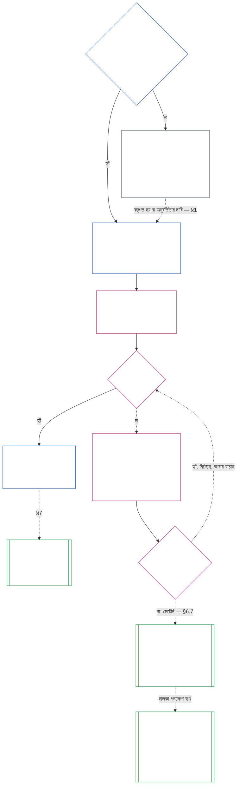

**AI-সহায়তায় তৈরি খসড়া — অধ্যায় সাতের বাংলা অনুবাদ (অপর্যালোচিত)**

**অবস্থা:** অধ্যায় সাতের সম্পূর্ণ AI-সহায়তায় তৈরি খসড়া; কোনো স্বতন্ত্র মানব পাঠক এটি পর্যালোচনা করেননি। উৎস `core_07.000_charters.md`, সংস্করণ `SC-Corpus-2026.10.21`। বাধ্যতামূলক উৎস ইংরেজি পাঠ। আপেক্ষিক লিঙ্কগুলির চূড়ান্ত অবস্থান `translations/bn/core_07_charters.md`।

**বর্তমান পরিসর:** অধ্যায় সাতের সম্পূর্ণ মূলপাঠ, সূচনা, পাঠক-নির্দেশনা, অনুরেখ, সংজ্ঞা/অনুবর্তিতা তালিকা এবং সহজ ভাষার সারাংশ। AI-সহায়তায় তৈরি, অপর্যালোচিত খসড়া।

# অধ্যায় সাত: সিস্টেম চার্টার ও প্রতিষ্ঠানিক চার্টার

<strong>করপাসে অবস্থান (অ-কার্যকরী): ফাইলের গঠন ও পড়ার নিয়ম</strong>

> এই ফাইলটি **সজ্ঞ সংবিধানের অংশ** এবং অন্যান্য ক্রমাঙ্কিত `core_*` ফাইলের সঙ্গে একটি পাঠ্য হিসেবে পড়লেই **বাধ্যতামূলক**। এতে রয়েছে **অধ্যায় সাত**: সিস্টেম ও প্রতিষ্ঠানের প্রকাশিত পরিসর-নথি—সিস্টেম চার্টার ও প্রতিষ্ঠানিক চার্টারের ন্যূনতম ভিত্তি। এটি অধ্যায় ছয়ের অধিকার-তলের পরে এবং [অধ্যায় আট](../../core_08.000_functional_independence_separation_of_duties.md#chapter-eight-functional-independence-and-separation-of-duties)-এর আগে, যেখানে বস্তুগতভাবে বাধ্যতামূলক কাজের মধ্যে আসনগুলি আলাদা রাখা হয়।
>
> - **সাংবিধানিক মালিকানা:** কখন কোনো সিস্টেমকে সিস্টেম চার্টার প্রকাশ করতে হবে এবং কখন কোনো প্রতিষ্ঠানকে প্রতিষ্ঠানিক চার্টার প্রকাশ করতে হবে (শ্রেণি L বা তার বেশি হলে আবশ্যক, শ্রেণি P হলে ঐচ্ছিক); প্রতিটিতে ন্যূনতম কী থাকতে হবে; কীভাবে সংশোধন ও পর্যালোচনা হবে; এবং অন্তর্ভুক্ত পদগুলির ধারকদের প্রস্থিতি ও প্রামাণিকতার গঠন-যাচাই।
> - **সংজ্ঞার উৎস:** [সিস্টেম চার্টার](../../core_05.040_band_continuity.md#system-charter), [প্রতিষ্ঠানিক চার্টার](../../core_05.040_band_continuity.md#institutional-charter), [চার্টার ভূমিকা-মানচিত্র](../../core_05.040_band_continuity.md#charter-role-map), [চার্টারভুক্ত পক্ষ](../../core_05.040_band_continuity.md#chartered-party) এবং [পরিচালনাকারী পক্ষ](../../core_05.050_band_oversight.md#operating-party)—সবই অধ্যায় পাঁচে সংজ্ঞায়িত। এই অধ্যায় সেগুলি প্রয়োগ করে, নতুন সংজ্ঞা দেয় না।
> - **বাস্তবায়নের মালিকানা:** [CI-8.205 §6](../../corpus_institutions/ci_08.205_institutional_design_separation_of_powers.md#ci-8205-6-system-and-institutional-charter-contents-review-and-formation-template) (*সিস্টেম ও প্রতিষ্ঠানিক চার্টারের বিষয়বস্তু, পর্যালোচনা ও গঠন-ছাঁচ*)-এ সম্পূর্ণ ক্ষেত্র-ছাঁচ, পর্যালোচনা-তালিকা, গঠন-পদ্ধতি এবং গঠন-যাচাই বিবৃতির ছাঁচ রয়েছে। এটি আরও কঠোর হতে এবং ক্ষেত্র যোগ করতে পারে; এই অধ্যায়কে সংকুচিত করতে পারে না। অধ্যায় আঠারোর [§4 গ্রহণ-ব্যাখ্যা ও কর্তৃত্বের পরিসর](../../core_18.000_incorporation.md#4-adoption-framing-and-scope-of-authority) অনুযায়ী বৈধ গ্রহণ-পরিসরের মধ্যেই এর লেখা অন্তর্ভুক্ত বাস্তবায়ন-লেখা হিসেবে বাধ্যতামূলক; এই অধ্যায়ের ভিত্তি মূলপাঠ হিসেবে বাধ্যতামূলক।
> - **পরবর্তী ব্যবহার:** [অধ্যায় আট §5 প্রকাশিত নিয়োগ, শূন্যপদ ও বিকল্প-নিয়োগ](../../core_08.000_functional_independence_separation_of_duties.md#5-published-placement-vacancy-and-substitution)-এ চার্টার ভূমিকা-মানচিত্র আবশ্যক। অধ্যায় নয় পরিসর ও সীমা-সংক্রান্ত সিদ্ধান্তে সিস্টেম চার্টার পড়ে; অধ্যায় নয়ের অংশ ঘ প্রতিষ্ঠানের গঠন-যাচাই বিবৃতি পরীক্ষা করে। [অধ্যায় দশ §3.7 নথির হেফাজত ও খোলার কর্তৃত্ব](../../core_10.000_standing_assessment.md#37-record-custody-and-opening-authority) এটি প্রস্থিতি-নথিতে প্রয়োগ করে। [অধ্যায় তেরো §4.3 প্রতিষ্ঠানিক মঞ্চ](../../core_13.000_forum.md#43-institutional-forums) প্রতিষ্ঠানিক চার্টার নিয়ে বিরোধ শোনে।
>
> পাঠের ক্রম: §1 কখন সিস্টেম ও প্রতিষ্ঠানিক চার্টার আবশ্যক, প্রক্রিয়ার চিত্রসহ → §2 গঠনের অধিকার ও চারটি সংকীর্ণ সীমা → §3 চার্টারে কী বলতে হবে → §4 চার্টার ভূমিকা-মানচিত্র ও প্রস্থিতি-নথির হেফাজত → §5 পদধারকের প্রস্থিতি ও প্রামাণিকতার গঠন-যাচাই → §6 ধারক গঠন-যাচাইয়ে ব্যর্থ হলে → §7 সংশোধন, পর্যালোচনা ও পরিসর-অসংগতি।

<strong>অনুরেখ</strong>

- পূর্বসূত্র:
  - [সাংবিধানিক চতুষ্ক](../../core_00.000_preamble.md#constitutional-tetrad), বিশেষত **তত্ত্বাবধান** ও **জবাবদিহি**;
  - [বস্তুগত বাজি](../../core_00.000_preamble.md#material-stake);
  - [অধ্যায় এক §18.1 অনুমোদিত কাঠামো হিসেবে শাসন](../../core_01.015_stewardship_capacity_principles.md#181-governance-as-authorized-structure) (1.015 §18.1);
  - [অনুচ্ছেদ XI-E](../../core_06.010_rights_part_b.md#article-xi-e-institutional-formation-and-business-creation) (*প্রাতিষ্ঠানিক গঠন ও ব্যবসা সৃষ্টি*)।
- উপধারা: [§1](#1-যখন-সসটম-এব-পরতষঠনক-চরটর-পরযজন-হয); [§2](#2-গঠনর-অধকর-ও-চরট-সকরণ-সম); [§3](#3-সসটম-ও-পরতষঠনক-চরটর-ক-বলত-হব); [§4](#4-চরটর-ভমক-মনচতর-ও-পরসথত-নথর-হফজত); [§5](#5-গঠন-যচই-পদধরকর-পরসথত-ও-পরমণকত); [§6](#6-পদধরক-গঠন-যচইয-বযরথ-হল); [§7](#7-সশধন-পরযলচন-ও-পরসর-অসগত)।
- পরবর্তী প্রয়োগ:
  - [অধ্যায় আট](../../core_08.000_functional_independence_separation_of_duties.md#chapter-eight-functional-independence-and-separation-of-duties) (8.000);
  - [অধ্যায় নয়](../../core_09.000_system_alignment_certification.md#chapter-nine-system-alignment-certification-reading-index) (9.000);
  - [অধ্যায় দশ](../../core_10.000_standing_assessment.md#chapter-ten-contribution-violation-and-standing-model--measurement) (10.000);
  - [অধ্যায় তেরো](../../core_13.000_forum.md#chapter-thirteen-forums-and-jurisdiction) (13.000);
  - [অধ্যায় চৌদ্দ](../../core_14.000_governance.md#chapter-fourteen-constitutional-contract-legitimacy-authorization-and-stewardship) (14.000); উপরে উল্লিখিত বাস্তবায়ন-লেখা।
- সঙ্গে পড়ুন: [কর্তৃত্বের স্তর ও অভ্যন্তরীণ শ্রেণিবিন্যাস](../../core_05.045_band_integrative.md#authority-stack-and-internal-hierarchy); [সিস্টেমের সীমানা](../../core_05.040_band_continuity.md#system-boundaries); [সিস্টেম-সীমানার অখণ্ডতা](../../core_05.040_band_continuity.md#system-boundary-integrity); [সিস্টেম সৃষ্টি](../../core_05.055_band_participation.md#system-creation); [ব্যবসা সৃষ্টি](../../core_05.055_band_participation.md#business-creation)।

 

অধ্যায় সাত হল **সিস্টেম চার্টার, প্রতিষ্ঠানিক চার্টার এবং প্রকাশিত পরিসরের** সাংবিধানিক মালিক।

তিনটি অধ্যায় এক শৃঙ্খল হিসেবে কাজ করে:

- **অধ্যায় সাত (এই অধ্যায়):** [চার্টারভুক্ত পক্ষ](../../core_05.040_band_continuity.md#chartered-party) কী করার দাবি করে এবং কাজের সময় প্রতিটি আসনে কে থাকতে পারে, তা বলে।
- **[অধ্যায় আট](../../core_08.000_functional_independence_separation_of_duties.md#chapter-eight-functional-independence-and-separation-of-duties):** সেই আসনগুলি কীভাবে আলাদা রাখতে হবে তা বলে।
- **[অধ্যায় নয়](../../core_09.000_system_alignment_certification.md#chapter-nine-system-alignment-certification-reading-index):** একটি সিস্টেম এবং আলাদাভাবে একটি প্রতিষ্ঠানকে প্রত্যয়িত করে; প্রতিটিই আসনগুলি ব্যবহার করা একটি বাধ্যতামূলক কাজ। পাওয়া বিষয়গুলি সিস্টেম চার্টার বা প্রতিষ্ঠানিক চার্টারে ফিরিয়ে দেয়।

এই অধ্যায় যে সংজ্ঞা, আসন-নিয়ম, প্রস্থিতি-তালা ও সিদ্ধান্ত-নিয়মের উল্লেখ করে, সেগুলির মালিক অন্য অধ্যায়। **CI-8.205 §6** (*সিস্টেম ও প্রতিষ্ঠানিক চার্টারের বিষয়বস্তু, পর্যালোচনা ও গঠন-ছাঁচ*)-এ ক্ষেত্র-ছাঁচ, গঠন-পদ্ধতি ও পর্যালোচনা-তালিকা রয়েছে।

### 1. যখন সিস্টেম এবং প্রাতিষ্ঠানিক চার্টার প্রয়োজন হয়

<strong>ট্রেস</strong>

- আপস্ট্রিম:
  - [§2](#2-গঠনর-অধকর-ও-চরট-সকরণ-সম);
  - [উপাদান বাজি](../../core_00.000_preamble.md#material-stake);
  - [সমানুপাতিকতা](../../core_05.035_band_accountability.md#proportionality); অধ্যায় খোলার মালিক দাবি;
  - [অধ্যায় এক §18 স্টুয়ার্ডশিপ ডিসিপ্লিনের অধীনে শাসন](../../core_01.015_stewardship_capacity_principles.md#18-governance-under-stewardship-discipline) (1.015 §18);
  - [তদারকি](../../core_05.020_apex_oversight_leg.md#oversight-constitutional);
  - [জবাবদিহিতা](../../core_05.005_apex_accountability_leg.md#accountability).
- ডাউনস্ট্রিম: [§3](#3-সসটম-ও-পরতষঠনক-চরটর-ক-বলত-হব); [অধ্যায় নয় অংশ A §2 সিস্টেম ক্লাস মূল্যায়ন](../../core_09.005_system_alignment_certification_evaluation.md#2-system-class-evaluation) (9.005 §2) (*ক্লাস এবং সার্টিফিকেশন গভীরতা*); [অধ্যায় নাইন পার্ট D §12.1 ইনস্টিটিউশন ক্লাস](../../core_09.020_institutional_alignment_certification.md#121-institution-class) (9.020 §12.1) (*একটি প্রতিষ্ঠানের শ্রেণী*); **CS-9.305 (*সিস্টেম ক্লাসিফিকেশন যন্ত্রপাতি*) এবং CS-9.310** (*সিস্টেম ক্লাসিফিকেশন যন্ত্রপাতি*) ক্লাস ক্যাটালগের জন্য।
- এর সাথে পড়ুন:
  - **CI-8.205 §6** (*সিস্টেম এবং প্রাতিষ্ঠানিক চার্টার বিষয়বস্তু, পর্যালোচনা, এবং গঠন টেমপ্লেট*);
  - **CF-13.415 §5** (*প্রাতিষ্ঠানিক এবং স্থানীয় নিবন্ধক*);
  - **CI-9.210** (*শ্রেণিবিন্যাস-সংযুক্ত প্রাতিষ্ঠানিক বাধ্যবাধকতা*);
  - [পঞ্চম অধ্যায় সিস্টেম চার্টার](../../core_05.040_band_continuity.md#system-charter) (5.040);
  - [পঞ্চম অধ্যায় প্রাতিষ্ঠানিক সনদ](../../core_05.040_band_continuity.md#institutional-charter) (5.040);
  - [ধারা XI-E](../../core_06.010_rights_part_b.md#article-xi-e-institutional-formation-and-business-creation) (*প্রাতিষ্ঠানিক গঠন এবং ব্যবসা সৃষ্টি*)

<strong>সংজ্ঞা · মূল্যায়ন · সম্মতি</strong>

- [সিস্টেম চার্টার](../../core_05.040_band_continuity.md#system-charter) · [ও](../../core_05.040_band_continuity.md#system-charter) · [এম](../../core_05.040_band_continuity.md#system-charter-a) · [ক](../../core_05.040_band_continuity.md#system-charter-a) · [গ](../../core_05.040_band_continuity.md#system-charter-c)
- [প্রাতিষ্ঠানিক সনদ](../../core_05.040_band_continuity.md#institutional-charter) · [ও](../../core_05.040_band_continuity.md#institutional-charter) · [এম](../../core_05.040_band_continuity.md#institutional-charter-a) · [ক](../../core_05.040_band_continuity.md#institutional-charter-a) · [গ](../../core_05.040_band_continuity.md#institutional-charter-c)
- [শ্রেণিবিন্যাস-স্কেলড গভর্নেন্স](../../core_05.050_band_oversight.md#classification-scaled-governance) · [ও](../../core_05.050_band_oversight.md#classification-scaled-governance) · [এম](../../core_05.050_band_oversight.md#classification-scaled-governance-a) · [ক](../../core_05.050_band_oversight.md#classification-scaled-governance-a) · [গ](../../core_05.050_band_oversight.md#classification-scaled-governance-c)

 

*সরল ভাষায়: একটি সিস্টেম বা প্রতিষ্ঠান তার সীমার মধ্যে ছিল কিনা তা কেউ বিচার করার আগে, সীমাগুলি লিখতে হবে যেখানে সবাই সেগুলি পড়তে পারে। একটি সিস্টেম যা অন্যদের জন্য উপাদান নয়টি ক্ষেত্রের যেকোনো একটিতে [ডোমেন-নির্দিষ্ট উপাদান](../../core_05.050_band_oversight.md#domain-specific-materiality) একটি প্রকাশিত সিস্টেম চার্টার প্রয়োজন। একটি প্রতিষ্ঠান প্রকাশ করে যেটি এটি পরিচালিত সিস্টেমের সাথে মানানসই। ক্লাস P স্বেচ্ছাসেবী: একটি quilting বৃত্ত যা উদ্বাস্তুদের quilts দেয় প্যাটার্ন।*

একটি সিস্টেম চার্টার বা ইনস্টিটিউশনাল চার্টার হল একটি চার্টার্ড পার্টির প্রকাশিত স্কোপ: এটি কী করার জন্য কর্তৃত্ব দাবি করে, কী করে না এবং এটি যখন কাজ করে তখন কে প্রতিটি আসন ধরে রাখে। এটি সেই সুযোগ যে অধ্যায় আটের আসনগুলিকে অধীন রাখা হয়েছে এবং অধ্যায় নয়নে সেই শংসাপত্রটি বাস্তব ক্রিয়াকলাপের বিরুদ্ধে ফিরে এসেছে। একটি অপারেটিং পার্টিকে প্রকাশ করতে হবে কিনা তা নির্ভর করে তার শ্রেণীর উপর: **ক্লাস L বা উচ্চতর, ক্লাস P-এ স্বেচ্ছায় প্রয়োজন।** যদি এটি একটি প্রকাশ করতে হয়, এটি সঠিক রাখতে হবে।

পাঁচটি সিস্টেম ইমপ্যাক্ট ক্লাস হল নিচের সবকিছুর জন্য ফ্রেম। সর্বাধিক থেকে সর্বনিম্ন ফলস্বরূপ, প্রতিটি একটি লাইনে:

- **ক্লাস A, বেঁচে থাকা-সমালোচনামূলক, ভিত্তিগত, এবং অপরিবর্তনীয়:** বেঁচে থাকার-প্রাসঙ্গিক সময়ের মধ্যে ব্যর্থতা, কোন কার্যকর বিকল্প ছাড়াই, বেঁচে থাকার অবস্থার ক্ষতির অর্থ।
- **ক্লাস B, সমালোচনামূলক, উচ্চ-নির্ভরতা, এবং পদ্ধতিগতভাবে গুরুত্বপূর্ণ:** নির্ভরশীলরা এটি ছাড়া মূল ফাংশন রাখতে পারে না। বেঁচে থাকা অবিলম্বে হারিয়ে যায় না, এবং সময়মতো প্রতিস্থাপন এখনও সম্ভব।
- **ক্লাস সি, সমন্বিত, উচ্চ-নির্ভরতা এবং অ-সমালোচনা:** এটি স্কেলে সমন্বয়কে আকার দেয় কিন্তু ক্লাস A বা ক্লাস B ফাংশনের জন্য একটি অপারেশনাল পূর্বশর্ত নয়।
- **ক্লাস L, স্থানীয়, সীমিত-প্রভাব, এবং অ-সমালোচনামূলক:** এর প্রভাবগুলি একটি ব্যক্তিগত ইউনিটের বাইরে পৌঁছায় তবে স্থানীয়, প্রতিস্থাপনযোগ্য এবং ধারণযোগ্য।
- **ক্লাস P, ব্যক্তিগত, ব্যক্তিগত-ব্যবহার, বিচ্ছিন্ন এবং পরীক্ষামূলক:** এর প্রভাবগুলি একটি প্রাইভেট ইউনিটের অভ্যন্তরে থাকে, কোন অর্থপূর্ণ বাইরের নির্ভরতা ছাড়াই।

[CS-9.310 §8](../../corpus_systems/cs_09.310_system_impact_classifications.md#cs-9310-8-system-impact-classifications) (*সিস্টেম প্রভাব শ্রেণীবিভাগ*) সম্পূর্ণ সংজ্ঞা ধারণ করে। ক্লাস A, B, C, এবং L অবশ্যই প্রকাশ করতে হবে এবং ক্লাস P হতে পারে, এবং [§1.2 কোন ক্লাস কভার করা হয়](#12-কন-শরণগল-অনতরভকত) বলে যে কিভাবে একটি প্রতিষ্ঠান তার পরিচালিত সিস্টেম থেকে ক্লাস নেয়।

#### 1.1 কাদের প্রকাশ করতে হবে

শ্রেণি L বা তার বেশি হলে একটি সিস্টেমকে [সিস্টেম চার্টার](../../core_05.040_band_continuity.md#system-charter) প্রকাশ ও হালনাগাদ রাখতে হবে। শ্রেণি L বা তার বেশি হলে একটি প্রতিষ্ঠানকে তার পরিচালিত সিস্টেমগুলির উপযোগী নিম্নের একটি চার্টার প্রকাশ ও হালনাগাদ রাখতে হবে:

| প্রতিষ্ঠান যা পরিচালনা, তত্ত্বাবধান বা বস্তুগতভাবে নিয়ন্ত্রণ করে | যা প্রকাশ করে |
| --- | --- |
| ঠিক একটি সিস্টেম, যার সিস্টেম চার্টার দরকার | সেই সিস্টেম চার্টার—দ্বিতীয় কোনো নথি নয়। এতে প্রতিষ্ঠানকে তত্ত্বাবধায়ক বলা হয় এবং এটিই [প্রতিষ্ঠানিক চার্টার](../../core_05.040_band_continuity.md#institutional-charter) হিসেবে কাজ করে: এক নথিতে দুই কাজ। |
| এমন একাধিক সিস্টেম | একটি প্রতিষ্ঠানিক চার্টার। এতে সেই সিস্টেমগুলির জন্য কার্যকর প্রত্যেক সিস্টেম চার্টার অন্তর্ভুক্ত থাকে এবং প্রতিষ্ঠান কেন ওই নির্দিষ্ট সিস্টেমগুলি চালায় তা জানায় ([§3 সিস্টেম ও প্রতিষ্ঠানিক চার্টারে কী বলতে হবে](#3-সসটম-ও-পরতষঠনক-চরটর-ক-বলত-হব))। |
| এমন কোনো সিস্টেম নেই | একটি প্রতিষ্ঠানিক চার্টার, যাতে [§3](#3-সসটম-ও-পরতষঠনক-চরটর-ক-বলত-হব)-এ প্রতিষ্ঠানের জন্য নির্ধারিত বিষয়গুলি থাকে এবং অন্তর্ভুক্ত করার মতো কোনো সিস্টেম চার্টার থাকে না। |

- **ব্যবসা ও তুলনীয় রূপ:** ব্যবসা বা অন্য কোনো তত্ত্বাবধানাধীন সাংগঠনিক রূপ সিস্টেম, প্রতিষ্ঠান, অথবা অন্তর্ভুক্ত সিস্টেম পরিচালনাকারী প্রতিষ্ঠান—যে পরিচয় তার ক্ষেত্রে প্রযোজ্য, সেই অনুযায়ী সিস্টেম চার্টার বা প্রতিষ্ঠানিক চার্টার প্রকাশ করে। তার আইনগত রূপে উত্তর বদলায় না।
- **যৌথ পেশাগত চর্চা:** শ্রেণি L বা তার বেশি কোনো সংজ্ঞ প্রাণী বা ছোট চর্চা যদি পেশাগত লাইসেন্স বা পেশাগত ছাড়পত্রের তালিকাভুক্ত কাজ করে, তবে ওই কাজগুলির জন্য কোনো আতিথ্যদাতার সিস্টেম চার্টার বা প্রতিষ্ঠানিক চার্টার এবং চার্টার ভূমিকা-মানচিত্র গ্রহণ করে এই ধারা পূরণ করতে পারে:
  - **কী গ্রহণ করা হয়:** যৌথ পেশাগত চর্চার আতিথ্যদাতার সিস্টেম চার্টার বা প্রতিষ্ঠানিক চার্টার এবং চার্টার ভূমিকা-মানচিত্র উল্লেখ করে গ্রহণ করা হয়; নথিগুলিতে ওই কাজগুলি অন্তর্ভুক্ত থাকতে হবে।
  - **গ্রহণের বিজ্ঞপ্তি:** **CI-14.205 §7** (*পেশাগত লাইসেন্স, পেশাগত ছাড়পত্র ও যৌথ পেশাগত চর্চা*)-তে বর্ণিত এক পাতার বিজ্ঞপ্তি।
  - **শ্রেণি:** নিজের কাজের ভিত্তিতে যে শ্রেণি হয়, সেই শ্রেণিতেই চর্চাটি থাকে।

#### 1.2 কোন শ্রেণিগুলি অন্তর্ভুক্ত

চার্টারভুক্ত পক্ষের শ্রেণি ঠিক করে প্রকাশ করা আবশ্যক, নাকি ঐচ্ছিক:

- **শ্রেণি A, B, C ও L:** প্রকাশ আবশ্যক। তারা যে প্রক্রিয়া অনুসরণ করে, তা [§1.7 এক নজরে প্রক্রিয়া](#17-এক-নজর-পরকরয)-এর চিত্রে রয়েছে।
- **শ্রেণি P:** দুটি ঘটনার কোনো একটি ঘটলে আবশ্যক না হওয়া পর্যন্ত ঐচ্ছিক। [§1.3 শ্রেণি P কী](#13-শরণ-p-ক)-তে পরিচালনাকারী পক্ষ কখন শ্রেণি P হয় তা বলা হয়েছে; [§1.4 শ্রেণি P: ঐচ্ছিক চার্টার এবং কখন তা আবশ্যক হয়](#14-শরণ-p-ঐচছক-চরটর-এব-কখন-ত-আবশযক-হয)-তে বিকল্প ও তার অবসান ব্যাখ্যা করা হয়েছে।
- **প্রতিষ্ঠানের শ্রেণি:** প্রতিষ্ঠান যে সিস্টেম পরিচালনা, তত্ত্বাবধান বা বস্তুগতভাবে নিয়ন্ত্রণ করে, তার মধ্যে সর্বোচ্চ শ্রেণিটি প্রতিষ্ঠান গ্রহণ করে। এমন কোনো সিস্টেম না চালালে, নিজের বস্তুগত প্রভাব ও নির্ভরতার ভিত্তিতে—আসল সিদ্ধান্ত ও নিয়ন্ত্রণে যা আছে তা দেখে, নাম বা আইনগত রূপ দেখে নয়—শ্রেণি নির্ধারিত হয় ([অধ্যায় নয় অংশ ঘ §12.1 প্রতিষ্ঠানের শ্রেণি](../../core_09.020_institutional_alignment_certification.md#121-institution-class))।

#### 1.3 শ্রেণি P কী

একটি পরিচালনাকারী পক্ষ কেবল তখনই শ্রেণি P থাকে, যখন [ক্ষেত্র-নির্দিষ্ট বস্তুগততার](../../core_05.050_band_oversight.md#domain-specific-materiality) নয়টি ক্ষেত্রের প্রতিটিতেই তার কাজ সীমার নিচে থাকে। বাস্তবে এর অর্থ, তার কাজ ও প্রভাব নিজের [ব্যক্তিগত এককের](../../core_05.050_band_oversight.md#domain-specific-materiality-private-unit) মধ্যেই থাকে:

- **সীমা অতিক্রম:** যেকোনো একটি ক্ষেত্রের সীমা অতিক্রম করলে, আকার বা নিজের দেওয়া নাম যা-ই হোক, **CS-9.305** (*সিস্টেম শ্রেণিবিন্যাসের ব্যবস্থা*) এবং **CS-9.310** (*সিস্টেম প্রভাবের শ্রেণিবিন্যাস*) অনুযায়ী তা অন্তত শ্রেণি L হয়।
- **সব সীমার নিচে থাকা:** সদস্য যতই থাকুক, সব সীমার নিচে থাকলে এটি শ্রেণি P-তেই থাকে।
- **ভেতরের মানুষ:** শ্রেণি P-র বিষয়টি তার ভেতরে থাকা লোকদেরও নির্ভর করে। ভেতরের কেউ পরিচালনাকারী পক্ষকে কোনো সীমা অতিক্রম করতে দেখলে তা জানানো তার কর্তব্য; সেই প্রতিবেদন সুরক্ষিত ([ক্ষেত্র-নির্দিষ্ট বস্তুগততা](../../core_05.050_band_oversight.md#domain-specific-materiality))।

নিজের ব্যক্তিগত এককের মধ্যেই থাকা শ্রেণি P পরিচালনাকারী পক্ষের কাজের ক্ষেত্রে অধ্যায় আটের চার-আসনের ভিত্তি প্রযোজ্য নয়; তাই কম্পিউটার-সহ এক সংজ্ঞ প্রাণীর দ্বিতীয় আসনধারী দরকার হয় না। পরিচালনাকারী পক্ষ যেদিন এমন [বস্তুগতভাবে বাধ্যতামূলক কাজ](../../core_05.035_band_accountability.md#materially-binding-act) করে, যা অন্যদের মানতে হয় বা স্থির বলে নির্ভর করা যায়, সেদিন থেকে ভিত্তিটি প্রযোজ্য। এতে অন্যদের ওপর কর্তৃত্বের ক্ষেত্রের সীমা অতিক্রম হয় এবং পক্ষটি অন্তত শ্রেণি L হয়।

#### 1.4 শ্রেণি P: ঐচ্ছিক চার্টার এবং কখন তা আবশ্যক হয়

শ্রেণি P পরিচালনাকারী পক্ষকে তার কাজের উপযোগী [সিস্টেম চার্টার](../../core_05.040_band_continuity.md#system-charter) (একটি সিস্টেমের জন্য) অথবা [প্রতিষ্ঠানিক চার্টার](../../core_05.040_band_continuity.md#institutional-charter) (একাধিক বা কোনো সিস্টেম না থাকলে) প্রকাশ করতে উৎসাহ দেওয়া হয়। ছাঁচ হিসেবে এটি [§3 সিস্টেম ও প্রতিষ্ঠানিক চার্টারে কী বলতে হবে](#3-সসটম-ও-পরতষঠনক-চরটর-ক-বলত-হব)-এর বিষয়তালিকা এবং [§4 চার্টার ভূমিকা-মানচিত্র ও প্রস্থিতি-নথির হেফাজত](#4-চরটর-ভমক-মনচতর-ও-পরসথত-নথর-হফজত)-এর আসন-মানচিত্র ব্যবহার করতে পারে। কোনোটি প্রকাশ করলেই এই অধ্যায়ের প্রক্রিয়ার অধীনে কর্তব্য তৈরি হয় না:

- নির্ধারিত শেষ তারিখ নেই ([§1.5 সিস্টেম বা প্রতিষ্ঠানিক চার্টার কখন দিতে হবে](#15-সসটম-চরটর-ব-পরতষঠনক-চরটর-কখন-দত-হব));
- গঠন-যাচাই নেই ([§5 পদধারকের প্রস্থিতি ও প্রামাণিকতার গঠন-যাচাই](#5-গঠন-যচই-পদধরকর-পরসথত-ও-পরমণকত));
- [চার্টার ভূমিকা-মানচিত্র](../../core_05.040_band_continuity.md#charter-role-map) বাধ্যতামূলক নয় ([§4](#4-চরটর-ভমক-মনচতর-ও-পরসথত-নথর-হফজত)); তবে স্বেচ্ছায় প্রকাশিত চার্টারের সঙ্গে রাখতে বা আলাদাভাবে প্রকাশ করতে পারে; এবং
- সংশোধন বা পর্যালোচনার বাধ্যতামূলক চক্র নেই ([§7 সংশোধন, পর্যালোচনা ও পরিসর-অসংগতি](#7-সশধন-পরযলচন-ও-পরসর-অসগত))।

নিচের যেকোনো একটি ঘটনা ঘটলে প্রকাশ আর ঐচ্ছিক থাকে না:

- পরিচালনাকারী পক্ষকে নতুন করে শ্রেণি L বা তার বেশি হিসেবে শ্রেণিবদ্ধ করা হয়; অথবা
- তার পরিচালনাকারী পক্ষের সাংবিধানিক অনুবর্তিতার দাবি করে।

তখন [§1.5](#15-সসটম-চরটর-ব-পরতষঠনক-চরটর-কখন-দত-হব)-এর সময়সূচি অনুযায়ী পরিচালনাকারী পক্ষকে তার উপযোগী সিস্টেম চার্টার বা প্রতিষ্ঠানিক চার্টার প্রকাশ করতে হবে।

**পরিচিতি পরিসর-নথির ওপর নির্ভর করে না।** সিস্টেম চার্টার বা প্রতিষ্ঠানিক চার্টার থাকুক বা না থাকুক, শ্রেণি যাই হোক, কোনো গোষ্ঠী তার সদস্যদের ও পরিচিতির মাঝখানে বাধা হয়ে দাঁড়ায় না। প্রত্যেক সদস্য গোষ্ঠীর ভেতরে বা বাইরে করা কাজের জন্য স্বতন্ত্র দাবিদার হিসেবে অবদানের নথি চাইতে পারে; সেই নথি সদস্যের অবদান নিয়ে, গোষ্ঠীর প্রস্থিতি নিয়ে নয় ([অধ্যায় দশ §3.7 অনানুষ্ঠানিক ও ছোট-পরিসরের নথি](../../core_10.000_standing_assessment.md#37-informal-and-small-scope-records))। এমন সাহায্য, জিনিসপত্র, শ্রম বা পরিষেবা দেওয়া যা গ্রহণ করতে কাউকে বাধ্য করা হয় না, তা বস্তুগতভাবে বাধ্যতামূলক কাজ নয়। তাই শরণার্থীদের কম্বল দেওয়া পারস্পরিক সহায়তা-চক্রে তার সদস্যদের পরিচিত হওয়ার জন্য সিস্টেম চার্টার বা প্রতিষ্ঠানিক চার্টারের দরকার নেই।

#### 1.5 সিস্টেম চার্টার বা প্রতিষ্ঠানিক চার্টার কখন দিতে হবে

অন্তর্ভুক্ত সিস্টেম বা প্রতিষ্ঠান এই সময়সূচি অনুযায়ী তার [সিস্টেম চার্টার](../../core_05.040_band_continuity.md#system-charter) বা [প্রতিষ্ঠানিক চার্টার](../../core_05.040_band_continuity.md#institutional-charter) প্রকাশ করে:

- **নতুন সিস্টেম বা প্রতিষ্ঠান:** চালু হওয়ার বা অন্যদের ওপর কর্তৃত্ব প্রয়োগ শুরু করার আগে।
- **যা ইতিমধ্যে চলছে:** পরবর্তী শ্রেণিবিন্যাস পর্যালোচনা বা প্রত্যয়নের সময়, অথবা [§1.6 সিস্টেম চার্টার বা প্রতিষ্ঠানিক চার্টার অনুপস্থিত থাকলে](#16-সসটম-চরটর-ব-পরতষঠনক-চরটর-অনপসথত-থকল) অনুরোধের পর সমাধান-সময়ের মধ্যে—যেটি আগে হয়। প্রকাশ না করা পর্যন্ত এটি নিয়মভঙ্গের অবস্থায় থাকে।
  - **কোন প্রত্যয়ন:** সিস্টেমের ক্ষেত্রে তার সিস্টেম সামঞ্জস্য-প্রত্যয়ন। প্রতিষ্ঠানের ক্ষেত্রে অধ্যায় নয় অংশ ঘ §11.3-এর অধীনে প্রতিষ্ঠানিক সামঞ্জস্য-প্রত্যয়ন ([অনুমতি নেই, বাধাও নেই](../../core_09.020_institutional_alignment_certification.md#113-no-permission-and-no-gate)); প্রথম প্রত্যয়নের সময়সীমা কখনো প্রতিষ্ঠানিক চার্টার প্রকাশ বা পরিচালনার শর্ত নয়।
- **গঠন-যাচাই:** একই সময়ে [§5 পদধারকের প্রস্থিতি ও প্রামাণিকতার গঠন-যাচাই](#5-গঠন-যচই-পদধরকর-পরসথত-ও-পরমণকত)-ও সম্পন্ন করতে হবে।
- **কোথায় জমা হবে:** চার্টার, চার্টার ভূমিকা-মানচিত্র এবং গঠন-যাচাই বিবৃতিসহ প্রাতিষ্ঠানিক নিবন্ধকের কাছে জমা হয়; অথবা কাজ ও প্রভাবিত সংজ্ঞ প্রাণীরা স্থানীয় হলে স্থানীয় নিবন্ধকের কাছে (**CF-13.415 §5** (*প্রাতিষ্ঠানিক ও স্থানীয় নিবন্ধক*)):
  - **নিবন্ধক কী করে:** আবশ্যক কিছু বাদ পড়েছে কি না দেখে এবং তারিখ-সহ প্রাপ্তিস্বীকার দেয়।
  - **নিবন্ধক যা কখনো করে না:** অনুমতি দেয় না এবং শ্রেণি বা বিষয়বস্তুর সিদ্ধান্ত দেয় না।
  - **দেরি বা প্রাপ্তিস্বীকার না পাওয়া:** এর কোনোটিই চার্টারভুক্ত পক্ষের পরিচালনা থামায় না।

#### 1.6 সিস্টেম চার্টার বা প্রতিষ্ঠানিক চার্টার অনুপস্থিত থাকলে

কেউ যদি নতুন বা সদ্য শ্রেণি L বা তার বেশি হওয়া কোনো চার্টারভুক্ত পক্ষকে চার্টার প্রকাশ না করতে দেখেন, তবে তার শাসন-কর্তৃপক্ষের কাছে চার্টার চাইতে পারেন। আবেদনকারীর প্রস্থিতি, ফি বা ক্ষতি দেখানোর দরকার নেই। অনুরোধে চার্টারভুক্ত পক্ষের নাম এবং কেন এটি অন্তর্ভুক্ত বলে মনে হচ্ছে, তা জানাতে হবে।

অনুরোধ থেকে দুটি সময়সীমা চলে: উত্তর-সময়সীমা ও সমাধান-সময়সীমা। প্রত্যেকটির দৈর্ঘ্য চার্টারভুক্ত পক্ষের শ্রেণির একই অক্ষরযুক্ত স্তর থেকে নির্ধারিত হয়; শ্রেণি যত সংকটপূর্ণ, সময়সীমা তত ছোট:

| শ্রেণি ও স্তর | উত্তর-সময়সীমা (গ্রহণের লক্ষ্য) | সমাধান-সময়সীমা (সর্বোচ্চ সীমা) |
|---|---|---|
| শ্রেণি A, স্তর A | 24 ঘণ্টা | 7 পঞ্জিকা-দিন |
| শ্রেণি B, স্তর B | 2 পঞ্জিকা-দিন | 14 পঞ্জিকা-দিন |
| শ্রেণি C, স্তর C | 4 পঞ্জিকা-দিন | 30 পঞ্জিকা-দিন |
| শ্রেণি L, স্তর L | 8 পঞ্জিকা-দিন | 60 পঞ্জিকা-দিন |

এই সংখ্যা **CF-13.445 §3.1** (*পর্যায়-লক্ষ্য ও সময়সীমার ভিত্তি*) থেকে এসেছে; অমিল হলে সেটিই প্রাধান্য পায়। চার্টারভুক্ত পক্ষ শ্রেণি নিয়ে আপত্তি করলে, প্রশ্ন মীমাংসা না হওয়া পর্যন্ত তার সিস্টেম-শ্রেণিবিন্যাস নথির শ্রেণি এবং আবেদনকারী বা মঞ্চ প্রাথমিকভাবে যে শ্রেণি দেখায়—এর মধ্যে বেশি সংকটপূর্ণ শ্রেণির স্তরে গণনা হয়। নথিতে শ্রেণি নেই, বা শ্রেণি প্রশ্নাধীন থাকাকালে শ্রেণি P আছে—এমন পক্ষকে স্তর C-তে গণনা করা হয়।

সময়সীমাগুলি এভাবে কাজ করে:

- **উত্তর-সময়সীমা:** অনুরোধের দিন থেকে গণনা করে **CF-13.445 §3.1** (*পর্যায়-লক্ষ্য ও সময়সীমার ভিত্তি*)-এর সংশ্লিষ্ট স্তরের গ্রহণ-লক্ষ্যের মধ্যে চার্টারভুক্ত পক্ষ উত্তর দেয়। এটি চার্টার প্রকাশ করতে পারে, প্রকাশের তারিখ জানাতে পারে, আগে প্রকাশিত চার্টারের দিকে নির্দেশ করতে পারে, অথবা জানাতে পারে যে এটি [ক্ষেত্র-নির্দিষ্ট বস্তুগততার](../../core_05.050_band_oversight.md#domain-specific-materiality) সব সীমার নিচে এবং প্রবেশ-নিয়ম যে লিখিত প্রমাণ চায় তা দিতে পারে।
- **সমাধান-সময়সীমা:** অনুরোধের দিন থেকে গণনা করে **CF-13.445 §3.1** (*পর্যায়-লক্ষ্য ও সময়সীমার ভিত্তি*)-এর সংশ্লিষ্ট স্তরের সর্বোচ্চ সময়ের মধ্যে সিস্টেম চার্টার বা প্রতিষ্ঠানিক চার্টার দিতে হবে; সঙ্গে থাকবে [§5-এর](#5-গঠন-যচই-পদধরকর-পরসথত-ও-পরমণকত) গঠন-যাচাই বিবৃতি। এখনও স্বাধীন আসন না থাকা চার্টারভুক্ত পক্ষ ঐ ধারার নিয়মে সাক্ষ্যসহ ঘোষণারূপে বিবৃতিটি জমা দেয়।
- **পরিচালনাকারী পক্ষ সীমার নিচে থাকার দাবি করলে:** অনুরোধটি ওই প্রবেশের *চ্যালেঞ্জের পথ* অনুযায়ী শ্রেণিবিন্যাস-চ্যালেঞ্জও হয়:
  - **সময় চলতে থাকে:** চ্যালেঞ্জ বিচারাধীন থাকলেও সমাধান-সময়সীমা চলবে।
  - **চ্যালেঞ্জে মেয়াদ বৃদ্ধি:** অধিকার-ক্ষেত্রের মঞ্চ চ্যালেঞ্জকে পর্যালোচনার যোগ্য মনে করলে নির্ধারিত তারিখ বাড়ে; চ্যালেঞ্জের সিদ্ধান্ত হলে নতুন সমাধান-সময়সীমা শুরু হয়। মঞ্চ সংশ্লিষ্ট স্তরের সর্বোচ্চ সময়ের মধ্যে চ্যালেঞ্জের সিদ্ধান্ত দেয়।
  - **পর্যালোচনার যোগ্যতার অর্থ:** চ্যালেঞ্জে কোনো নির্দিষ্ট ক্ষেত্রে সীমা অতিক্রমের নির্দিষ্ট ঘটনা উল্লেখ থাকে এবং পরিচালনাকারী পক্ষের লিখিত প্রমাণ সেই অতিক্রম নিয়ে বাস্তব প্রশ্ন রেখে যায়—তখনই তা পর্যালোচনার যোগ্য। পরিচালনাকারী পক্ষ নিজেই এ সিদ্ধান্ত দেয় না; লিখিত প্রমাণহীন উত্তর তারিখ বাড়ায় না।
  - **শ্রেণি নির্ধারিত হলে:** এই বা অন্য কোনো চ্যালেঞ্জে শ্রেণি নির্ধারিত হলে, সেই সিদ্ধান্তের তারিখই অনুরোধের তারিখ ধরা হয়। নির্ধারিত শ্রেণির স্তরে উত্তর ও সমাধান-সময়সীমা তখন থেকে চলে (শ্রেণি A, B, C বা L)।
- **সময়সীমা না মানলে:** উত্তর না দেওয়া, বা নির্ধারিত তারিখে চার্টার না দেওয়া—নথিভুক্ত ও সংশোধনযোগ্য ঘাটতি। আবেদনকারী একই পথে অধিকার-ক্ষেত্রের মঞ্চে যেতে পারেন। এটি কখনো গঠন বা পরিচালনার শর্ত নয়।
- **পুনরাবৃত্ত অনুরোধ:** আগের উত্তর বা সিদ্ধান্ত এখনও কার্যকর থাকাকালে একই চার্টারভুক্ত পক্ষের বিষয়ে দ্বিতীয় অনুরোধ নতুন উত্তর বা সমাধান-সময়সীমা শুরু করে না। চার্টারভুক্ত পক্ষ আগের উত্তর বা সিদ্ধান্ত দেখিয়ে জবাব দেয়। মঞ্চে এখনও পর্যালোচনা না-হওয়া তার নিজের সীমার নিচে থাকার প্রমাণ কার্যকর উত্তর হিসেবে গণ্য হয় না। অধ্যায় নয় অংশ ঘ §14.2-এর পুনরায় খোলার সংকেত অনুযায়ী, নিচের কোনো একটি ঘটলে আগের উত্তর বা সিদ্ধান্ত কার্যকর থাকে না:
  - **বস্তুগত পরিবর্তন:** চার্টারভুক্ত পক্ষের কাজে বস্তুগত পরিবর্তন ঘটে।
  - **নতুন প্রমাণ:** কোনো সীমা অতিক্রমের বিষয়ে নতুন প্রমাণ দেখানো হয়।

  উপরোক্ত কোনো বিষয় দেখানো অনুরোধ পুনরাবৃত্ত নয়। এটি নতুন অনুরোধ এবং আগেরটি থেকে আলাদা ও স্বতন্ত্রভাবে বিবেচিত হয়। নিজস্ব তারিখ থেকে তার নিজস্ব উত্তর ও সমাধান-সময়সীমা চলে; আগের উত্তর, সিদ্ধান্ত বা সময়সীমা নতুন অনুরোধ পূরণ করে না বা বদলায় না।
- **ততদিনের পরিসর:** চার্টার অনুপস্থিত বলে চার্টারভুক্ত পক্ষের পরিসর সীমাহীন হয়ে যায় না। নথি হওয়া পর্যন্ত তার প্রকৃত [সিস্টেম-সীমানা](../../core_05.040_band_continuity.md#system-boundaries) ও শ্রেণি নিয়ন্ত্রণ করবে; প্রত্যয়নকারী সংস্থা বা মঞ্চ পর্যবেক্ষিত কাজ থেকে পরিসর পুনর্গঠন করতে পারে।

#### 1.7 এক নজরে প্রক্রিয়া

চিত্রে একটি পরিচালনাকারী পক্ষকে অনুসরণ করা হয়েছে: তার কাজ অন্যদের জন্য বস্তুগত কি না, সেখান থেকে সিস্টেম চার্টার বা প্রতিষ্ঠানিক চার্টার প্রকাশ এবং তা নির্ভুল রাখা পর্যন্ত। সমাধান-সময়ের মধ্যে সমস্যা না মিটলে চার্টার-প্রক্রিয়া এমন পর্যালোচনায় পাঠায় যা এই অধ্যায়ের বাইরে নির্ধারিত। পরের ধারাগুলি একই ক্রমে প্রতিটি ধাপ ব্যাখ্যা করে।

<strong>পাঠক-নির্দেশনা (অ-কার্যকরী): চিত্রটি কীভাবে পড়বেন</strong>

> সহজ ভাষায়: কেউ সিস্টেম চার্টার বা প্রতিষ্ঠানিক চার্টার মঞ্জুর করে না; গঠন করতেও কারও অনুমতি লাগে না। যার কাজ অন্যদের জন্য বস্তুগত, সেই চার্টারভুক্ত পক্ষ নিজের কর্তৃত্বের দাবি এবং প্রতিটি আসনে কে আছে তা প্রকাশ করে, আর তার মূল পদগুলির ধারকদের যাচাই করা হয়। কোনো ধারক ব্যর্থ হলে তাকে বদলানো হয় বা কারণটি ঠিক করা হয়; চার্টারভুক্ত পক্ষ কাজ চালায়। সমাধান-সময় শেষেও ব্যর্থতা না মিটলে মঞ্চ চার্টারভুক্ত পক্ষ পর্যালোচনা করতে পারে—অন্যদের সুরক্ষার জন্য সবচেয়ে হালকা পদক্ষেপ থেকে শুরু করে। হালকা পদক্ষেপে কাজ না হলেই কেবল চার্টারভুক্ত পক্ষকে শ্রেণি L-এর নিচে নামানো বা ভেঙে দেওয়া যায়। ভেঙে দেওয়া চার্টারভুক্ত পক্ষের ওপর তালা থাকলে সে ফিরতে পারে না।
>
> অবিচ্ছিন্ন তীর প্রধান পথ; বিন্দুযুক্ত তীর ব্যতিক্রম ও হস্তান্তর, সংশ্লিষ্ট ধারা দিয়ে চিহ্নিত। দুই পাশের দ্বৈত দণ্ড-চিহ্নিত বাক্স অন্য অধ্যায় বা অন্তর্ভুক্ত বাস্তবায়ন-লেখার অন্তর্গত। চিত্র কোনো কর্তব্য, আসন বা ক্ষেত্র যোগ করে না; এর কোনো ধাপই অনুমতি মঞ্জুর করে না।

 

### 2. গঠনের অধিকার ও চারটি সংকীর্ণ সীমা

<strong>পাঠক-নির্দেশনা (অ-কার্যকরী): এই ধারার বিন্যাস</strong>

- [§2.1 গঠনের অধিকার](#21-গঠনর-অধকর) অধিকারটি এবং কাদের ক্ষেত্রে তা প্রযোজ্য নয়, তা বলে।
- [§2.2 প্রথম সীমা: সংজ্ঞ প্রাণীর ওপর কার্যকর তালা](#22-পরথম-সম-সজঞ-পরণর-ওপর-করযকর-তল) বলে, তালা কীভাবে একজন নামিত সংজ্ঞ প্রাণীকে একটি নিয়ন্ত্রণকারী পদ থেকে বাইরে রাখে।
- [§2.3 দ্বিতীয় সীমা: নির্দিষ্ট যাচাইকৃত তথ্যের ভিত্তিতে স্বল্পকালীন বিরতি](#23-দবতয-সম-নরদষট-যচইকত-তথযর-ভততত-সবলপকলন-বরত) বলে, সংক্ষিপ্ত বিরতি কীভাবে একজন নামিত সংজ্ঞ প্রাণীকে একটি নিয়ন্ত্রণকারী পদ থেকে বাইরে রাখতে পারে।
- [§2.4 তৃতীয় সীমা: পরিচালনাকারী পক্ষের নিজের ওপর তালা](#24-ততয-সম-পরচলনকর-পকষর-নজর-ওপর-তল) বলে, পরিচালনাকারী পক্ষের ওপর তালা কীভাবে তাকে ও তার উত্তরসূরিদের বাধা দেয় এবং ভাঙা চার্টারভুক্ত পক্ষ ফিরতে পারে না।
- [§2.5 চতুর্থ সীমা: চর্চার লাইসেন্স বা ছাড়পত্র](#25-চতরথ-সম-চরচর-লইসনস-ব-ছডপতর) বলে, কখন নামিত উচ্চ-ঝুঁকির কাজে লাইসেন্স বা ছাড়পত্র দরকার; এটি গঠনের বাধা নয়।

<strong>অনুরেখ</strong>

- পূর্বসূত্র: [§1](#1-যখন-সসটম-এব-পরতষঠনক-চরটর-পরযজন-হয); [অনুচ্ছেদ XI-E](../../core_06.010_rights_part_b.md#article-xi-e-institutional-formation-and-business-creation) (*প্রাতিষ্ঠানিক গঠন ও ব্যবসা সৃষ্টি*)।
- পরবর্তী প্রয়োগ: [§1](#1-যখন-সসটম-এব-পরতষঠনক-চরটর-পরযজন-হয); [§5](#5-গঠন-যচই-পদধরকর-পরসথত-ও-পরমণকত)।
- সঙ্গে পড়ুন:
  - [অন্তর্বর্তী বিরতি](../../core_05.035_band_accountability.md#interim-hold);
  - [অধ্যায় এগারো §4.2 প্রতিরোধ — সাধারণ প্রস্থিতি-তালা](../../core_11.000_standing_integration.md#42-prevention--general-standing-locks) (11.000 §4.2);
  - [অধ্যায় এগারো §5.5 বিশেষ তালা](../../core_11.000_standing_integration.md#55-special-locks) (11.000 §5.5);
  - [অধ্যায় তেরো §5 নামিত সংজ্ঞ প্রাণীর পথে অন্তর্বর্তী বিরতি](../../core_13.000_forum.md#interim-hold-on-a-named-sentients-pathway) (13.000 §5)।

 

*সহজ ভাষায়: সিস্টেম, প্রতিষ্ঠান বা ব্যবসা গড়তে কারও অনুমতি লাগে না। চারটি সংকীর্ণ সীমা প্রযোজ্য হতে পারে। তিনটি বাধা: অমীমাংসিত তালা একজন সংজ্ঞ প্রাণীকে একটি নিয়ন্ত্রণকারী পদ থেকে বাইরে রাখতে পারে; নির্দিষ্ট যাচাইকৃত তথ্যের ভিত্তিতে স্বল্প বিরতিও একই কাজ করতে পারে; এবং পরিচালনাকারী পক্ষের ওপর তালা সেই পক্ষকেই বাধা দিতে পারে। চতুর্থটি নামিত উচ্চ-ঝুঁকির কাজের আগে লাইসেন্স বা ছাড়পত্র চাইতে পারে। মঞ্চ ভেঙে দেওয়া চার্টারভুক্ত পক্ষ ফিরতে পারে না; ব্যাপক অসাংবিধানিক আচরণ বা গুরুতর ও অপূরণীয় ক্ষতি সংশোধন না করায় ভাঙা হলে নিষেধ স্থায়ী হয়। এগুলির কোনোটিই নতুন পরিচালনাকারী পক্ষ গঠন বা চালানো বন্ধ করে না; এই অধ্যায়ও নতুন বাধা যোগ করে না।*

**অনুচ্ছেদ XI-E** (*প্রাতিষ্ঠানিক গঠন ও ব্যবসা সৃষ্টি*) চারটি সংকীর্ণ সীমার অনুমতি দেয়:

- **প্রথম তিনটিই পরিচালনাকারী পক্ষ গঠন বা তার কর্তৃত্বে থাকার একমাত্র বাধা:** প্রতিটি নির্দিষ্ট বিষয়ের ওপর প্রযোজ্য:
  - **কার্যকর তালা** ([§2.2 প্রথম সীমা: সংজ্ঞ প্রাণীর ওপর কার্যকর তালা](#22-পরথম-সম-সজঞ-পরণর-ওপর-করযকর-তল)) চার্টারভুক্ত পক্ষকে নিয়ন্ত্রণকারী একটি পদে নামিত সংজ্ঞ প্রাণীর ওপর প্রযোজ্য।
  - **অন্তর্বর্তী বিরতি** ([§2.3 দ্বিতীয় সীমা: নির্দিষ্ট যাচাইকৃত তথ্যের ভিত্তিতে স্বল্পকালীন বিরতি](#23-দবতয-সম-নরদষট-যচইকত-তথযর-ভততত-সবলপকলন-বরত)) কেবল চার্টারভুক্ত পক্ষকে নিয়ন্ত্রণকারী একটি পদে একজন নামিত সংজ্ঞ প্রাণীর ওপর প্রযোজ্য।
  - **পরিচালনাকারী পক্ষের নিজের ওপর তালা** ([§2.4 তৃতীয় সীমা](#24-ততয-সম-পরচলনকর-পকষর-নজর-ওপর-তল)) নিজেই তালাবদ্ধ চার্টারভুক্ত পক্ষের ওপর প্রযোজ্য; কোনো মঞ্চ যাকে ভেঙে দিয়েছে সেটিও এর মধ্যে পড়ে।
- **চতুর্থটি কোনো বাধা নয়:** এটি চর্চার লাইসেন্স বা ছাড়পত্র ([§2.5 চতুর্থ সীমা: চর্চার লাইসেন্স বা ছাড়পত্র](#25-চতরথ-সম-চরচর-লইসনস-ব-ছডপতর))।

#### 2.1 গঠনের অধিকার

যে কেউ নতুন সিস্টেম, প্রতিষ্ঠান বা ব্যবসা গড়তে পারে। এই অধিকার [অনুচ্ছেদ XI-E](../../core_06.010_rights_part_b.md#article-xi-e-institutional-formation-and-business-creation) (*প্রাতিষ্ঠানিক গঠন ও ব্যবসা সৃষ্টি*)-তে বলা হয়েছে। এই অধ্যায় পরবর্তী কর্তব্য যোগ করে: পরিচালনাকারী পক্ষের কাজ যখন [ক্ষেত্র-নির্দিষ্ট বস্তুগততার](../../core_05.050_band_oversight.md#domain-specific-materiality) নয়টি ক্ষেত্রের যেকোনো একটিতে অন্যদের জন্য বস্তুগত হয়, তখন সে কী কর্তৃত্বের দাবি করে তা আগে থেকে প্রকাশ্যে জানাতে হবে ([§1 কখন সিস্টেম ও প্রতিষ্ঠানিক চার্টার আবশ্যক](#1-যখন-সসটম-এব-পরতষঠনক-চরটর-পরযজন-হয))। সিস্টেম চার্টার বা প্রতিষ্ঠানিক চার্টার গ্রহণকে এই অধিকার বা অধিকার-তলের কোনো সুরক্ষা সংকুচিত করে—এভাবে পড়া যাবে না।

**গঠনের অধিকার যাদের সুরক্ষা দেয় না।** [§2.2](#22-পরথম-সম-সজঞ-পরণর-ওপর-করযকর-তল), [§2.3](#23-দবতয-সম-নরদষট-যচইকত-তথযর-ভততত-সবলপকলন-বরত) ও [§2.4](#24-ততয-সম-পরচলনকর-পকষর-নজর-ওপর-তল)-এর তিনটি বাধা ছাড়া **অনুচ্ছেদ XI-E** (*প্রাতিষ্ঠানিক গঠন ও ব্যবসা সৃষ্টি*) নিচের বিষয়গুলিকে সুরক্ষা দেয় না:

- সাংবিধানিক সীমাবদ্ধতা ভাঙতে, নিরাপত্তা বা সত্যকে দুর্বল করতে, অথবা [অধ্যায় এক §11 বাজার-গঠন](../../core_01.005_values_principles.md#11-market-structure)-এ নিষিদ্ধভাবে ক্ষমতা কেন্দ্রীভূত করতে তৈরি পরিচালনাকারী পক্ষ; অথবা
- এমন প্রতিষ্ঠাতা যে যাচাইকৃত আচরণ, নিয়ন্ত্রণ ও পুরস্কার অনুযায়ী ঘোষিত উদ্দেশ্যের সঙ্গে প্রকৃতভাবে সামঞ্জস্যপূর্ণ নয়; অথবা যার উদ্দেশ্য অন্যদের কাছে উদ্দেশ্য, নিয়ন্ত্রণ বা স্বার্থ নিয়ে বিভ্রান্তি তৈরি করা, কিংবা অন্যদের ক্ষতি করা।

মঞ্চ ঐ অনুচ্ছেদের অধীনে এসব মামলার সিদ্ধান্ত নেয়; পরিণতি কেবল তার তিনটি বাধা: কার্যকর-তালা বাধা, অন্তর্বর্তী বিরতি এবং পরিচালনাকারী পক্ষের নিজের ওপর তালা। ব্যর্থ গঠন-যাচাই মঞ্চ যে প্রমাণ বিবেচনা করে তার একটি অংশ; অর্থাৎ গঠন-যাচাই একা মামলার সিদ্ধান্ত দেয় না।

#### 2.2 প্রথম সীমা: সংজ্ঞ প্রাণীর ওপর কার্যকর তালা

যাচাইকৃত লঙ্ঘনের পর আরোপিত এবং এখনও না-তোলা [প্রস্থিতি-তালা](../../core_11.000_standing_integration.md#42-prevention--general-standing-locks) বা [বিশেষ তালা](../../core_11.000_standing_integration.md#55-special-locks) একজন নামিত সংজ্ঞ প্রাণীকে এ ধরনের প্রতিষ্ঠান বা ব্যবসার ওপর কর্তৃত্ব থেকে বিরত রাখে:

- **কী নিষিদ্ধ:** পরিচালনাকারী পক্ষের শাসন, নিয়ন্ত্রণ বা মালিকানার কর্তৃত্ব নেওয়া বা প্রয়োগ করা।
- **কতদূর প্রযোজ্য:** তালা যতদূর প্রযোজ্য, ততদূরই। তালা উঠলে বা সংকুচিত হলে নিষেধ শেষ হয়।
- **পরিচালনাকারী পক্ষের নিজের ওপর তালা:** দেখুন [§2.4 তৃতীয় সীমা: পরিচালনাকারী পক্ষের নিজের ওপর তালা](#24-ততয-সম-পরচলনকর-পকষর-নজর-ওপর-তল)।

#### 2.3 দ্বিতীয় সীমা: নির্দিষ্ট যাচাইকৃত তথ্যের ভিত্তিতে স্বল্পকালীন বিরতি

অধিকার-ক্ষেত্রের কোনো মঞ্চ নির্দিষ্ট যাচাইকৃত তথ্যের ভিত্তিতে [অন্তর্বর্তী বিরতি](../../core_05.035_band_accountability.md#interim-hold) জারি করলে এই সীমা প্রযোজ্য হয়; তথ্যগুলি এমন হতে হবে যাতে ধারক চার্টারভুক্ত পক্ষের ঘোষিত উদ্দেশ্যের সঙ্গে অসামঞ্জস্যপূর্ণ—এ সম্ভাবনা বিপরীত সম্ভাবনার চেয়ে বেশি। কেবল সেই মঞ্চই এটি জারি করতে পারে ([অধ্যায় তেরো §5 নামিত সংজ্ঞ প্রাণীর পথে অন্তর্বর্তী বিরতি](../../core_13.000_forum.md#interim-hold-on-a-named-sentients-pathway))। চার্টারভুক্ত পক্ষ নিজে কাউকে পদ থেকে বাদ দেওয়ার সিদ্ধান্ত নিতে পারে না, কারণ তা হলে সে নিজের সদস্যের বিচারক হয়ে যাবে। সম্পূর্ণ ভিত্তি অধ্যায় তেরো §5-এ দেওয়া; এই সংক্ষিপ্ত রূপ সেটির বিকল্প নয়।

#### 2.4 তৃতীয় সীমা: পরিচালনাকারী পক্ষের নিজের ওপর তালা

তালা শুধু সংজ্ঞ প্রাণীর ওপর নয়, পরিচালনাকারী পক্ষের ওপরও থাকতে পারে। তখন তালায় নামিত পথ অনুসারে সেই পক্ষ এবং তার উত্তরসূরি, নিয়ন্ত্রিত সংস্থা, নামধারী বা শেল-মালিকানাধীন বাহকের কাজ নিষিদ্ধ হয়। অন্য কোনো পরিচালনাকারী পক্ষ এতে নিষিদ্ধ হয় না।

- চূড়ান্ত নামাঙ্কনে আরোপিত তালা: চূড়ান্ত নামাঙ্কনে কোনো প্রতিষ্ঠান, উত্তরসূরি বাহক বা নিয়ন্ত্রিত সংস্থার নাম থাকলে [সংবিধান-বিরোধী আস্থা-তালা](../../core_11.000_standing_integration.md#55-special-locks) এ কাজ করে। তখন চার্টারভুক্ত পক্ষ এবং তার উত্তরসূরি, নিয়ন্ত্রিত সংস্থা, নামধারী বা শেল-মালিকানাধীন বাহকের ক্ষেত্রে তালার নামিত পথের কাজ নিষিদ্ধ হয়।
- ভেঙে দেওয়া চার্টারভুক্ত পক্ষ: **CI-11.210 §4** (*বিলুপ্তি*)-এর অধীনে চূড়ান্ত বিলুপ্তি-আদেশ [বিলুপ্তি-পুনর্গঠন তালা](../../core_11.000_standing_integration.md#55-special-locks) আরোপ করে। বিলুপ্ত চার্টারভুক্ত পক্ষ, তার উত্তরসূরি, নিয়ন্ত্রিত সংস্থা, নামধারী বা শেল-মালিকানাধীন বাহক এবং তাদের সঙ্গে একক পরিচালনা—কোনোটিই তালা বহাল থাকাকালে কোনো নাম বা রূপে পুনর্গঠিত, পুনরুজ্জীবিত বা পরিচালিত হতে পারে না। আদেশে ব্যাপক অসাংবিধানিক আচরণ বা অসংশোধিত [অপরিবর্তনীয় ক্ষতি](../../core_11.000_standing_integration.md#8-restoration-and-reassessment) পাওয়া গেলে তালা স্থায়ী হয়: সময়, কারণ মিটে যাওয়া বা ধারক বদলানোয় তা ওঠে না। পর্যালোচনায় বিলুপ্তি-আদেশ বাতিল হলে, অথবা নতুন বস্তুগত যাচাইকৃত তথ্য পূর্বের সিদ্ধান্ত ভুল দেখালে তবেই এটি শেষ হয়। অন্যথায় স্বাধীন সিদ্ধান্তে কারণ মিটেছে, প্রতিকার দেওয়া হয়েছে এবং বহিষ্কার চালিয়ে যাওয়ার চেয়ে ফিরে আসা নিরাপদ—এটি প্রতিষ্ঠিত হলে শেষ হয়। এই তালা কোনো সংজ্ঞ প্রাণীকে অন্য পরিচালনাকারী পক্ষ গড়তে বাধা দেয় না।

তিনটি বাধার কোনোটিই নতুন পরিচালনাকারী পক্ষ গঠন, তার সিস্টেম চার্টার বা প্রতিষ্ঠানিক চার্টার প্রকাশ, বা কাজ শুরু করা আটকায় না। কেবল নিজের ওপর তালা থাকা পক্ষ—যেমন ফিরে আসার চেষ্টায় থাকা বিলুপ্ত চার্টারভুক্ত পক্ষ—থামে। গঠন-যাচাইয়ে তিনটি বাধা প্রয়োগ হয় ([§5 পদধারকের প্রস্থিতি ও প্রামাণিকতার গঠন-যাচাই](#5-গঠন-যচই-পদধরকর-পরসথত-ও-পরমণকত))।

#### 2.5 চতুর্থ সীমা: চর্চার লাইসেন্স বা ছাড়পত্র

চতুর্থ সীমাটি পরিচালনাকারী পক্ষ গঠনের ওপর নয়, নামিত কাজের ওপর প্রযোজ্য:

- **পরিচালনাকারী পক্ষ গঠনে বাধা নয়:** [§5-এর](#5-গঠন-যচই-পদধরকর-পরসথত-ও-পরমণকত) গঠন-যাচাই এটি প্রয়োগ করে না।
- **এটি কী:** প্রযুক্তিগত মঞ্চের প্রকাশিত ঝুঁকি-সিদ্ধান্তের ভিত্তিতে, অন্যদের জন্য নামিত কাজটি করার আগে গ্রহণকারী **অনুচ্ছেদ XI-E** (*প্রাতিষ্ঠানিক গঠন ও ব্যবসা সৃষ্টি*) অনুযায়ী [দক্ষতা-ছাড়পত্র](../../core_05.035_band_accountability.md#competency-clearance) চাইতে পারেন।
  - **চর্চার লাইসেন্স:** ভুলভাবে করলে গুরুতর বা অপরিবর্তনীয় ক্ষতির ঝুঁকি থাকা কাজে আবশ্যক।
  - **চর্চার ছাড়পত্র:** ভুলভাবে করলে বাস্তব কিন্তু তুলনামূলক কম ক্ষতির ঝুঁকি থাকা কাজে আবশ্যক।
- **কিসে প্রযোজ্য:** কাজটি সম্পাদনে। এটি কখনো পরিচালনাকারী পক্ষ গঠন, চার্টার প্রকাশ বা পরিচালনা বন্ধ করে না।
- **এটি কী আটকায়:** লাইসেন্স বা ছাড়পত্র ছাড়া কাজের দাবি করা বা কাজটি করা। ধারক লাইসেন্স বা ছাড়পত্র না-ধরে কাজটি না করলে সিস্টেম চার্টার বা প্রতিষ্ঠানিক চার্টার সেই কাজের দাবি করতে পারে না ([§3 সিস্টেম ও প্রতিষ্ঠানিক চার্টারে কী বলতে হবে](#3-সসটম-ও-পরতষঠনক-চরটর-ক-বলত-হব))।

### 3. সিস্টেম ও প্রতিষ্ঠানিক চার্টারে কী বলতে হবে

<strong>পাঠক-নির্দেশনা (অ-কার্যকরী): এই ধারার বিন্যাস</strong>

- [§3.1 সিস্টেম চার্টারে যা বলা হয়](#31-সসটম-চরটর-য-বল-হয)-তে নয়টি বিষয় আছে।
- [§3.2 চার্টার-নির্দেশক](#32-চরটর-নরদশক)-তে বলা হয়েছে, লেখা নকল না করে অন্য প্রকাশিত নথির উল্লেখ করা যায় কি না এবং উল্লেখ বৈধ হতে কী লাগবে।
- [§3.3 প্রতিষ্ঠানিক চার্টার যা অতিরিক্ত যোগ করে](#33-পরতষঠনক-চরটর-য-অতরকত-যগ-কর)-তে নয়টি বিষয়ের বাইরে প্রতিষ্ঠানের চালানো সিস্টেমগুলির চার্টার এবং সেগুলি চালানোর কারণ রয়েছে।
- [§3.4 যেসব কাজে চর্চার লাইসেন্স বা ছাড়পত্র দরকার](#34-য-কজ-চরচর-লইসনস-ব-চরচর-ছডপতর-দরকর)-তে বলা হয়েছে, কাজটি করা প্রত্যেক সংজ্ঞ প্রাণীর লাইসেন্স বা ছাড়পত্র থাকতে হবে, অথবা তত্ত্বাবধায়কের অধীনে শিক্ষানবিশ হিসেবে কাজ করতে হবে। ততদিন কাজটি §3.1-এর 4 নম্বর বিষয় অনুযায়ী পরিসরের বাইরে থাকবে।
- [§3.5 পরিসর অনুযায়ী মাত্রা](#35-শরণ-অনযয-মতর)-তে শ্রেণি অনুযায়ী কী বদলায় তা বলা হয়েছে।

<strong>অনুরেখ</strong>

- পূর্বসূত্র: [§1](#1-যখন-সসটম-এব-পরতষঠনক-চরটর-পরযজন-হয); [অধ্যায় পাঁচের সিস্টেম চার্টার](../../core_05.040_band_continuity.md#system-charter) (5.040); [অধ্যায় পাঁচের প্রতিষ্ঠানিক চার্টার](../../core_05.040_band_continuity.md#institutional-charter) (5.040)।
- পরবর্তী প্রয়োগ:
  - [§4](#4-চরটর-ভমক-মনচতর-ও-পরসথত-নথর-হফজত);
  - [§7](#7-সশধন-পরযলচন-ও-পরসর-অসগত);
  - [অধ্যায় নয় অংশ খ §8.1 ন্যূনতম নথি-বিষয়](../../core_09.010_system_alignment_certification_record_process.md#81-minimum-record-contents) (9.010 §8.1), অর্থাৎ সিস্টেম চার্টারের যেসব ক্ষেত্রের ওপর প্রত্যয়ন-নথি নির্ভর করে;
  - পূর্ণ ক্ষেত্রতালিকার জন্য **CI-8.205 §6** (*সিস্টেম ও প্রতিষ্ঠানিক চার্টারের বিষয়বস্তু, পর্যালোচনা ও গঠন-ছাঁচ*)।
- সঙ্গে পড়ুন: [অধ্যায় আঠারো §4 গ্রহণ-ব্যাখ্যা ও কর্তৃত্বের পরিসর](../../core_18.000_incorporation.md#4-adoption-framing-and-scope-of-authority) (18.000 §4), অর্থাৎ অন্য নামে রাখা পরিসর-নথি; [অধ্যায় চৌদ্দ §4.3 বাধ্যতামূলক প্রভাবযুক্ত অংশীজন-সিদ্ধান্তের সিদ্ধান্ত-নির্ধারণের শর্ত](../../core_14.000_governance.md#43-decision-resolution-requirements-for-binding-stakeholder-choice) (14.000 §4.3); **CI-6.205 §1** (*অংশীজন তত্ত্বাবধান, বিজ্ঞপ্তি ও বাধ্যতামূলক শাসন-পথের অখণ্ডতা*); **CI-6.205 §2** (*ক্ষমতা-কেন্দ্রীকরণ বিরোধী ও অংশগ্রহণের বৈধতা-সুরক্ষা*)।

<strong>সংজ্ঞা · মূল্যায়ন · অনুবর্তিতা</strong>

- [সিস্টেম চার্টার](../../core_05.040_band_continuity.md#system-charter) · [O](../../core_05.040_band_continuity.md#system-charter) · [M](../../core_05.040_band_continuity.md#system-charter-a) · [A](../../core_05.040_band_continuity.md#system-charter-a) · [C](../../core_05.040_band_continuity.md#system-charter-c)
- [প্রতিষ্ঠানিক চার্টার](../../core_05.040_band_continuity.md#institutional-charter) · [O](../../core_05.040_band_continuity.md#institutional-charter) · [M](../../core_05.040_band_continuity.md#institutional-charter-a) · [A](../../core_05.040_band_continuity.md#institutional-charter-a) · [C](../../core_05.040_band_continuity.md#institutional-charter-c)
- [চার্টার ভূমিকা-মানচিত্র](../../core_05.040_band_continuity.md#charter-role-map) · [O](../../core_05.040_band_continuity.md#charter-role-map) · [M](../../core_05.040_band_continuity.md#charter-role-map-a) · [A](../../core_05.040_band_continuity.md#charter-role-map-a) · [C](../../core_05.040_band_continuity.md#charter-role-map-c)

 

*সহজ ভাষায়: সিস্টেম চার্টার যথেষ্ট নির্দিষ্ট হবে, যাতে তা যাচাই করা যায়। এতে সিস্টেমের উদ্দেশ্য, তার কাজ ও সীমা, কারা তার ওপর নির্ভর করে, কে চার্টার সংশোধন করতে পারে, প্রতিটি আসনে কে আছে এবং বাধ্যতামূলক সিদ্ধান্ত-নিয়ম কোথায় পাওয়া যাবে—এসব বলা হয়। চার্টার নিয়মগুলির নির্দেশ দেয়, তাদের বদলে দাঁড়ায় না। প্রতিষ্ঠানিক চার্টার প্রতিষ্ঠান সম্পর্কেও একই কথা বলে, তারপর তার অধীন সিস্টেম চার্টার এবং প্রতিষ্ঠান কেন ওই সিস্টেম চালায় তা যোগ করে।*

#### 3.1 সিস্টেম চার্টারে যা বলা হয়

সিস্টেম চার্টারে প্রভাবিত সংজ্ঞ প্রাণী ও নিরীক্ষকের পড়ার উপযোগী সরল ভাষায় বলতে হবে:

1. **পরিচয় ও সংস্করণ:** নাম, তত্ত্বাবধায়ক বা শাসন-সংস্থা, সংস্করণ, কার্যকর হওয়ার তারিখ এবং পরিবর্তনের ইতিহাস।
2. **উদ্দেশ্য:** চার্টারভুক্ত পক্ষ কী করার জন্য রয়েছে।
3. **পরিসরের ভেতরের কাজ:** যে কাজ, পরিষেবা, কর্তৃত্ব ও ক্ষেত্র তার দাবি।
   - **দাবি, মঞ্জুরি নয়:** নথি চার্টারভুক্ত পক্ষের ইতিমধ্যে থাকা কর্তৃত্ব জানায়; নতুন কর্তৃত্ব দেয় না। সেই কর্তৃত্ব বৈধ কি না—সাংবিধানিক চার্টারের ভিত্তিতে হলে তাও—[অধ্যায় চৌদ্দ §1 শাসন-কর্তৃত্বের অনুমোদন ও বৈধতা](../../core_14.000_governance.md#1-authorization-and-legitimacy-of-governing-authority)-এর অধীনে নির্ধারিত হয়।
4. **পরিসরের বাইরের সীমা:** যেসব বস্তুগত কাজ, কর্তৃত্ব ও ক্ষেত্রে তার অনুমতি নেই।
5. **প্রভাবিত সম্প্রদায় ও নির্ভরতা:** কারা চার্টারভুক্ত পক্ষের ওপর নির্ভর করে এবং বস্তুগত হলে, কোন সিস্টেম বা অবকাঠামোর ওপর সে নির্ভর করে বা বাধা সৃষ্টি করে।
   - **বাদ দেওয়া মানে সম্মতি নয়:** তালিকা থেকে কোনো গোষ্ঠী বাদ পড়লে তারা পরিসরের বাইরে যায় না। চার্টারভুক্ত পক্ষের বস্তুগত প্রভাবে থাকা সংজ্ঞ প্রাণীর নথিতে নাম থাকুক বা না থাকুক, অধিকার-তলের সব সুরক্ষা থাকে; বাস্তব নির্ভরতার চেয়ে সংকীর্ণ তালিকাকে বাস্তব নির্ভরতা অনুযায়ী পড়তে হবে।
6. **শ্রেণিবিন্যাসের অনুমান:** যে শ্রেণি বা তত্ত্বাবধান-স্তরের ওপর নির্ভর করা হয়, এবং প্রযোজ্য ক্ষেত্রে **CS-9.305** (*সিস্টেম শ্রেণিবিন্যাসের ব্যবস্থা*), **CS-9.310** (*সিস্টেম প্রভাবের শ্রেণিবিন্যাস*) এবং **CS-14.305** (*সংকটপূর্ণ সিস্টেম তত্ত্বাবধান*)-এর [চার্টার-নির্দেশক](../../core_05.040_band_continuity.md#charter-pointer)।
7. **চার্টার ভূমিকা-মানচিত্র:** [চার্টার ভূমিকা-মানচিত্র](../../core_05.040_band_continuity.md#charter-role-map), অথবা প্রকাশিত যে নথিটি মানচিত্র—তার [চার্টার-নির্দেশক](#4-চরটর-ভমক-মনচতর-ও-পরসথত-নথর-হফজত) ([§4 চার্টার ভূমিকা-মানচিত্র ও প্রস্থিতি-নথির হেফাজত](#4-চরটর-ভমক-মনচতর-ও-পরসথত-নথর-হফজত))।
8. **বাধ্যতামূলক অংশীজন-নির্বাচনের চার্টার-নির্দেশক:**
   - **কখন প্রযোজ্য:** প্রভাবিত সংজ্ঞ প্রাণীদের বাস্তব মতবিরোধে সিস্টেমের ভেতরে বাধ্যতামূলক অংশীজন-নির্বাচন দরকার হলে। [সংজ্ঞা P.2 বাধ্যতামূলক অংশীজন-নির্বাচন](../../core_05.055_band_participation.md#defp2-binding-stakeholder-choice) একে তার অন্তর্ভুক্তির পরিসর বলে।
   - **কোন নথির দিকে নির্দেশ করে:** প্রকাশিত তিন সেট নিয়মের সচল চার্টার-নির্দেশক—সিদ্ধান্তের ধাপ (নির্বাচন কীভাবে হয়), ওজনের নিয়ম (কে কতটা মত দেয়), এবং অধিকার-সংঘাতের নথির নিয়ম (অধিকার সংঘর্ষে নথিতে কী দেখাতে হবে)।
   - **কার দায়িত্ব কী:** সিস্টেম চার্টারে কেবল নির্দেশক থাকে। তিন সেট নিয়মে প্রকৃত বিষয়বস্তু থাকে: নির্বাচন কীভাবে হয়, ওজন কীভাবে নির্ধারিত হয় এবং নথিতে কী দেখা যায়। সিস্টেম চার্টারে এই বিষয়বস্তু থাকে না এবং তার নিজের লেখা ওই নিয়মের বদলে দেওয়া যায় না। অচল নির্দেশক বা নিয়মের বদলে সিস্টেম চার্টারের লেখা দেখানো—দুটিই সিস্টেম চার্টারের কর্তব্যে ব্যর্থতা।
9. **সংশোধনের কর্তৃত্ব:** কে সংশোধন করতে পারে, কোনটি বস্তুগত সংশোধন, এবং বিজ্ঞপ্তি ও চ্যালেঞ্জের পথ।

#### 3.2 চার্টার-নির্দেশক

লেখা নকল না করে সিস্টেম চার্টার বা প্রতিষ্ঠানিক চার্টার অন্য প্রকাশিত নথি বা বিধির (নিয়মের সেট, চার্টার ভূমিকা-মানচিত্র বা সিস্টেম চার্টার) দিকে নির্দেশ করতে পারে। এই ধরনের প্রত্যেক উল্লেখ একটি [চার্টার-নির্দেশক](../../core_05.040_band_continuity.md#charter-pointer)। এটি সচল, বর্তমান ও প্রকাশিত নথিতে পৌঁছাতে হবে। অচল বা পুরোনো নির্দেশককে অনুপস্থিত বিষয় হিসেবে গণ্য করা হয়।

#### 3.3 প্রতিষ্ঠানিক চার্টার যা অতিরিক্ত যোগ করে

প্রতিষ্ঠানিক চার্টারে প্রতিষ্ঠানের নিজের জন্য [§3.1 সিস্টেম চার্টারে যা বলা হয়](#31-সসটম-চরটর-য-বল-হয)-এর 1 থেকে 9 নম্বর বিষয় থাকে; আরও থাকে:

- **সিস্টেম চার্টারগুলি:** প্রতিষ্ঠান যে সিস্টেম পরিচালনা, তত্ত্বাবধান বা বস্তুগতভাবে নিয়ন্ত্রণ করে, তার প্রত্যেক কার্যকর সিস্টেম চার্টার—পূর্ণরূপে বা বর্তমান প্রকাশিত সংস্করণে পৌঁছায় এমন চার্টার-নির্দেশকসহ।
- **পোর্টফোলিওর যুক্তি:** প্রতিষ্ঠান কেন ওই নির্দিষ্ট সিস্টেমগুলি চালায়, সেগুলি কীভাবে ঘোষিত উদ্দেশ্য পূরণ করে ও একে অন্যের সঙ্গে সম্পর্কিত, এবং তাদের কোন নির্ভরতা অভিন্ন। কারণ না-জানানো কোনো সিস্টেমকে অনুপস্থিত বিষয় ধরা হয়।

**CI-8.205 §6** (*সিস্টেম ও প্রতিষ্ঠানিক চার্টারের বিষয়বস্তু, পর্যালোচনা ও গঠন-ছাঁচ*) আরও বিষয় আবশ্যক করতে ও গঠন-ছাঁচ নির্ধারণ করতে পারে, কিন্তু ওপরের কোনো বিষয় বাদ দিতে পারে না।

#### 3.4 যে কাজে চর্চার লাইসেন্স বা চর্চার ছাড়পত্র দরকার

কোনো কাজের জন্য চর্চার লাইসেন্স বা চর্চার ছাড়পত্র লাগলে সিস্টেম চার্টার বা প্রতিষ্ঠানিক চার্টার সে কাজের কী দাবি করতে পারে, এই উপধারায় তা বলা হয়েছে।

- **সীমা:** কোনো কাজের লাইসেন্স বা ছাড়পত্র লাগলে চার্টারভুক্ত পক্ষ সেটি করে—এমন কাজ হিসেবে চার্টারে তালিকাভুক্ত করা যাবে না এবং কাজটিও করা যাবে না; যতক্ষণ না কাজটি করা প্রত্যেক সংজ্ঞ প্রাণীর লাইসেন্স বা ছাড়পত্র আছে, অথবা এমন তত্ত্বাবধায়কের অধীনে শিক্ষানবিশ হিসেবে কাজ করে যার তা আছে।
- **ততদিন:** সিস্টেম চার্টার বা প্রতিষ্ঠানিক চার্টারের 4 নম্বর বিষয় অনুযায়ী ([§3.1](#31-সসটম-চরটর-য-বল-হয)) কাজটি পরিসরের বাইরে তালিকাভুক্ত হয়।
- **ধারক ছাড়া দাবি করলে:** এটি নথিভুক্ত ও সংশোধনযোগ্য অনুপস্থিত বিষয়; তবে চার্টারভুক্ত পক্ষের গঠন, প্রকাশ বা অন্য কাজ চালানো বন্ধ করে না।
- **কোথায় দেখবেন:** [§2 গঠনের অধিকার ও চারটি সংকীর্ণ সীমা](#2-গঠনর-অধকর-ও-চরট-সকরণ-সম)-তে শর্তটির উৎস আছে; **CI-14.205 §7** (*চর্চার লাইসেন্স, চর্চার ছাড়পত্র এবং যৌথ পেশাগত চর্চা*)-তে তালিকাভুক্ত কাজ ও আতিথ্যদাতার যাচাই আছে।

#### 3.5 শ্রেণি অনুযায়ী মাত্রা

সিস্টেম চার্টার বা প্রতিষ্ঠানিক চার্টারের কিছু অংশ শ্রেণি অনুযায়ী বদলায়, কিছু বদলায় না:

- **যা বদলায়:** চার্টারের বিস্তারিততা, পর্যালোচনার ঘনত্ব এবং পর্যালোচনার স্বাধীনতা শ্রেণি ও [বস্তুগত বাজি](../../core_00.000_preamble.md#material-stake)-র সঙ্গে বদলায়।
- **শ্রেণি L:** [শ্রেণি-অনুপাতে শাসন](../../core_05.050_band_oversight.md#classification-scaled-governance) অনুমতি দিলে শ্রেণি L-এর সিস্টেম বা প্রতিষ্ঠানের চার্টার সংক্ষিপ্ত হতে পারে এবং সরল নথি রাখতে পারে। তবুও প্রত্যেক আবশ্যক বিষয় অন্তর্ভুক্ত করতে হবে।
- **পর্যালোচনার ঘনত্ব:** সিস্টেম চার্টার বা প্রতিষ্ঠানিক চার্টার ঠিক করে না কত ঘন ঘন তার পর্যালোচনা হবে; শ্রেণি তা নির্ধারণ করে।

### 4. চার্টার ভূমিকা-মানচিত্র ও প্রস্থিতি-নথির হেফাজত

<strong>পাঠক-নির্দেশনা (অ-কার্যকরী): এই ধারার বিন্যাস</strong>

- [§4.1 আসনগুলি কী এবং কেন আছে](#41-আসনগল-ক-এব-কন-আছ) চারটি আসন এবং একই কাজে অধ্যায় আটে নিষিদ্ধ আসন-যুগল কেন একই পক্ষ নিতে পারে না তা মনে করিয়ে দেয়।
- [§4.2 নিয়োগ বৈধ হয় কীসে](#42-নযগ-বধ-হয-কস) বলে, অধ্যায় আট স্বাধীনতা, শূন্যপদ, বিকল্প-নিয়োগ ও একত্রে আসন পালনের পরীক্ষা নির্ধারণ করে; মানচিত্র শুধু কে কোথায় বসে তা নথিভুক্ত করে।
- [§4.3 মানচিত্রের প্রতি চার্টারের দায়](#43-মনচতরর-পরত-সসটম-চরটর-ব-পরতষঠনক-চরটরর-দয) বলে, সিস্টেম চার্টার বা প্রতিষ্ঠানিক চার্টারে মানচিত্র থাকতে বা তার দিকে নির্দেশ করতে হবে; মানচিত্র না থাকা, নির্দেশক অচল হওয়া বা মানচিত্র পুরোনো হওয়া চার্টারের ত্রুটি।
- [§4.4 কোন চার্টারে কোন মানচিত্র থাকে](#44-কন-সসটম-চরটর-ব-পরতষঠনক-চরটর-কন-মনচতর-থক) এক প্রতিষ্ঠানিক চার্টারের অধীনে একাধিক সিস্টেম এবং ভাগ করা মানচিত্র নিয়ে আলোচনা করে।
- [§4.5 আসনের নিয়ম ও ধারক বদল](#45-আসনর-নযম-ও-ধরক-বদল) বলে, কে আসনে থাকতে পারে তা বদলানো সংশোধন; বর্তমান ধারক বদলানো মানচিত্রের নতুন তারিখযুক্ত সংস্করণ, যা বিজ্ঞপ্তি ও চ্যালেঞ্জের সুযোগের পরে কার্যকর হয়।
- [§4.6 প্রস্থিতি-নথির হেফাজত](#46-পরসথত-নথর-হফজত) মানচিত্রে প্রস্থিতি-নথি নিয়ে কী বলতে হবে তা বলে; এর দুটি অংশ: [§4.6.1 পরিচালনাকারী পক্ষের প্রস্থিতি-নথি](#461-পরচলনকর-পকষর-পরসথত-নথ) এবং [§4.6.2 অংশীজনের প্রস্থিতি-নথি](#462-অশজনর-পরসথত-নথ)।
- [§4.7 পরিচালনাকারীর প্রস্থিতি-নথির মানচিত্রে ফাঁক](#47-পরচলনকরর-পরসথত-নথর-মনচতর-ফক) বলে, আবশ্যক আসন নামহীন বা যোগ্য ধারকহীন হলে কী হয়; এর চার অংশ: [§4.7.1 ফাঁক কখন হয় ও কীভাবে নথিভুক্ত হয়](#471-ফক-কখন-হয-এব-কভব-নথভকত-হয), [§4.7.2 ফাঁক থাকাকালীন](#472-ফক-থককলন), [§4.7.3 ঘটনা শেষ যোগ্য বিকল্পকে সরিয়ে দিলে](#473-ঘটন-শষ-যগয-বকলপক-সরয-দল), এবং [§4.7.4 প্রত্যয়নের আসন](#474-পরতযযনর-আসন)।

<strong>অনুরেখ</strong>

- পূর্বসূত্র: [§3](#3-সসটম-ও-পরতষঠনক-চরটর-ক-বলত-হব); [অধ্যায় আট §2 চার-আসনের সাংবিধানিক ভিত্তি](../../core_08.000_functional_independence_separation_of_duties.md#2-four-seat-constitutional-floor) (8.000 §2)।
- পরবর্তী প্রয়োগ:
  - [অধ্যায় আট §5 প্রকাশিত নিয়োগ, শূন্যপদ ও বিকল্প-নিয়োগ](../../core_08.000_functional_independence_separation_of_duties.md#5-published-placement-vacancy-and-substitution) (8.000 §5);
  - [অধ্যায় নয় অংশ খ §6.1.1 প্রত্যয়নে চারটি আসন](../../core_09.010_system_alignment_certification_record_process.md#611-four-seats-in-a-certification) (9.010 §6.1.1);
  - [অধ্যায় দশ §3.7 নথির হেফাজত ও খোলার কর্তৃত্ব](../../core_10.000_standing_assessment.md#37-record-custody-and-opening-authority) (10.000 §3.7);
  - **CI-8.205 §2** (*কাজভিত্তিক পৃথকীকরণের পথ*);
  - **CI-14.205 §5** (*অনুমোদিত ভূমিকা ও জবাবদিহির শৃঙ্খল*);
  - **CI-14.205 §6** (*আসন-তালিকা — প্রক্রিয়া-ভূমিকার আদিরূপ ও কার্যগত সীমা*)।
- সঙ্গে পড়ুন: [বস্তুগত নিয়ন্ত্রণ-রেখা](../../core_05.035_band_accountability.md#material-control-line); [প্রস্থিতি-নথি](../../core_05.035_band_accountability.md#standing-record)।

<strong>সংজ্ঞা · মূল্যায়ন · অনুবর্তিতা</strong>

- [চার্টার ভূমিকা-মানচিত্র](../../core_05.040_band_continuity.md#charter-role-map) · [O](../../core_05.040_band_continuity.md#charter-role-map) · [M](../../core_05.040_band_continuity.md#charter-role-map-a) · [A](../../core_05.040_band_continuity.md#charter-role-map-a) · [C](../../core_05.040_band_continuity.md#charter-role-map-c)
- [সিস্টেম চার্টার](../../core_05.040_band_continuity.md#system-charter) · [O](../../core_05.040_band_continuity.md#system-charter) · [M](../../core_05.040_band_continuity.md#system-charter-a) · [A](../../core_05.040_band_continuity.md#system-charter-a) · [C](../../core_05.040_band_continuity.md#system-charter-c)
- [প্রতিষ্ঠানিক চার্টার](../../core_05.040_band_continuity.md#institutional-charter) · [O](../../core_05.040_band_continuity.md#institutional-charter) · [M](../../core_05.040_band_continuity.md#institutional-charter-a) · [A](../../core_05.040_band_continuity.md#institutional-charter-a) · [C](../../core_05.040_band_continuity.md#institutional-charter-c)

 

*সহজ ভাষায়: সিস্টেম চার্টার বা প্রতিষ্ঠানিক চার্টারে আসনগুলির ধারকের নাম থাকে। যে কাজগুলি এর আওতায়, তার প্রতিটি আসনে কে থাকতে পারে তার প্রকাশিত তালিকা থাকে, যাতে কোনো পক্ষ নিজের পরীক্ষক নিজে বেছে নিতে না পারে। বৈধ আসন-নিয়োগের নিয়ম অধ্যায় আটে থাকে। প্রস্থিতি-নথি সুরক্ষিত রাখার জন্য আলাদা তালিকা লাগে না—একই মানচিত্রে থাকে।*

প্রত্যেক সিস্টেম চার্টার বা প্রতিষ্ঠানিক চার্টারে একটি [চার্টার ভূমিকা-মানচিত্র](../../core_05.040_band_continuity.md#charter-role-map) থাকে: প্রতিটি আসনে কে আছেন তার প্রকাশিত তালিকা। বস্তুগতভাবে বাধ্যতামূলক কাজ করা প্রত্যেক গ্রহণকারীর জন্য [অধ্যায় আট §5 প্রকাশিত নিয়োগ, শূন্যপদ ও বিকল্প-নিয়োগ](../../core_08.000_functional_independence_separation_of_duties.md#5-published-placement-vacancy-and-substitution) এটি আবশ্যক করে এবং কী নাম দিতে হবে তা বলে। সিস্টেম চার্টার বা প্রতিষ্ঠানিক চার্টার মানচিত্রটি কীভাবে ব্যবহার করবে, এই ধারায় তা বলা হয়েছে।

#### 4.1 আসনগুলি কী এবং কেন আছে

প্রত্যেক [বস্তুগতভাবে বাধ্যতামূলক কাজ](../../core_05.035_band_accountability.md#materially-binding-act)-এ চারটি কাজ থাকে; [অধ্যায় আট §2 চার-আসনের সাংবিধানিক ভিত্তি](../../core_08.000_functional_independence_separation_of_duties.md#2-four-seat-constitutional-floor) সেগুলি আলাদা রাখে:

- **[সূচনা-আসন](../../core_05.035_band_accountability.md#initiating-seat):** অনুরোধ, প্রস্তাব, পরিচালনা বা দাবি করে কাজটি শুরু করে।
- **[যাচাই-বা-অনুমোদন আসন](../../core_05.035_band_accountability.md#verify-or-authorize-seat):** প্রমাণ ও কর্তৃত্ব পরীক্ষা করে; পরে কাজটি যাচাই, অনুমোদন, শর্তযুক্ত বা প্রত্যাখ্যান করে।
- **[নথি-আসন](../../core_05.035_band_accountability.md#record-seat):** যাচাই-বা-অনুমোদন আসনের সিদ্ধান্তের সরকারি নথি রাখে।
- **[চ্যালেঞ্জ-আসন](../../core_05.035_band_accountability.md#contest-seat):** চ্যালেঞ্জ শোনে এবং সংশোধন, সীমিত বা যথাযথ পথে পাঠায়।

আসনগুলি এমনভাবে রাখা হয় যাতে কোনো পক্ষ নিজেই ফল চাইতে, নিজের অনুরোধ পরীক্ষা করতে, সেই পরীক্ষার নথি নিয়ন্ত্রণ করতে এবং তার বিরুদ্ধে চ্যালেঞ্জের বিচার করতে না পারে। আসন কোনো পদবী নয়, একটি কাজের দায়িত্ব। তাই একই সংজ্ঞ প্রাণী, দপ্তর বা সিস্টেম বিভিন্ন কাজে ভিন্ন আসনে থাকতে পারে; তবে একই কাজে অধ্যায় আটে নিষিদ্ধ আসন-যুগল নিতে পারে না। মানচিত্রে প্রতিটি আসনের নামিত ধারক থাকে।

#### 4.2 নিয়োগ বৈধ হয় কীসে

অধ্যায় আট পরীক্ষাগুলি নির্ধারণ করে; মানচিত্র কেবল কে কোথায় বসেছেন তা নথিভুক্ত করে:

- **বস্তুগত নিয়ন্ত্রণ-রেখা:** একটি কাজ ঘিরে প্রকৃত ক্ষমতার শৃঙ্খল। যে পক্ষের কাজ বিবেচনাধীন, সে কাজটি শুরু করে বা যার কাজ যাচাই, চ্যালেঞ্জ বা নথিভুক্ত হচ্ছে। ওই কাজের ক্ষেত্রে পক্ষটি ধারককে নির্দেশ, অগ্রাহ্য, পুরস্কৃত, শাস্তি বা অপসারণ করতে, কিংবা তার কাজ বিলম্বিত করতে পারলে আসনটি নিয়ন্ত্রণ করে। যারা এমন করতে পারে—সেই সংজ্ঞ প্রাণী, দপ্তর ও সিস্টেম মিলে ওই কাজের [বস্তুগত নিয়ন্ত্রণ-রেখা](../../core_05.035_band_accountability.md#material-control-line)।
- **স্বাধীনতা:** কাজের বিষয়ী পক্ষ আসনটি নিয়ন্ত্রণ করতে পারলে, কাজটি যাচাইকারী আসন স্বাধীন নয় ([অধ্যায় আট §3 স্বাধীনতা, স্বার্থ-সংঘাত ও নিয়ন্ত্রণ-রেখা](../../core_08.000_functional_independence_separation_of_duties.md#3-independence-conflict-and-control-lines))। তাই নথি-আসন, চ্যালেঞ্জ-আসন এবং প্রতিটি যাচাই-বা-অনুমোদন আসনকে ওই পক্ষের বস্তুগত নিয়ন্ত্রণ-রেখার বাইরে রাখতে হবে। নিজের সিদ্ধান্তে পক্ষটি এসব আসনের ধারকও বদলাতে পারে না ([§4.5 আসনের নিয়ম ও ধারক বদল](#45-আসনর-নযম-ও-ধরক-বদল))।
- **শূন্যপদ, বিকল্প ও অর্পণ:** ধারক অনুপস্থিত বা স্বার্থ-সংঘাতে পড়লে কে তার জায়গা নেবে ([অধ্যায় আট §5 প্রকাশিত নিয়োগ, শূন্যপদ ও বিকল্প-নিয়োগ](../../core_08.000_functional_independence_separation_of_duties.md#5-published-placement-vacancy-and-substitution))।
- **একত্রে আসন পালন:** কোন বিরল ক্ষেত্রে ছোট পক্ষ একই দপ্তরে দুটি আসন রাখতে পারে। মানচিত্রে প্রতিটি অনুমোদিত বিন্যাস এবং তার স্বাধীনতা-সুরক্ষা তালিকাভুক্ত থাকে ([অধ্যায় আট §6 অনুপাতে বিস্তার ও একত্রে আসন পালন](../../core_08.000_functional_independence_separation_of_duties.md#6-proportional-scaling-and-merged-hosting))।

#### 4.3 মানচিত্রের প্রতি সিস্টেম চার্টার বা প্রতিষ্ঠানিক চার্টারের দায়

সিস্টেম চার্টার বা প্রতিষ্ঠানিক চার্টারে তার চার্টার ভূমিকা-মানচিত্র থাকতে হবে অথবা [চার্টার-নির্দেশক](#32-চরটর-নরদশক) দিয়ে মানচিত্রে যেতে হবে, যাতে চার্টার থেকে শুরু করা পাঠক প্রতিটি আসনে কে আছেন তা খুঁজে পান। নিচের অবস্থায় চার্টারটি ত্রুটিপূর্ণ:

- **মানচিত্র নেই:** মানচিত্রও নেই, তার নির্দেশকও নেই।
- **নির্দেশক অচল:** এমন মানচিত্রে যায় যা পাওয়া যায় না, বা সচল প্রকাশিত নথি নয়।
- **মানচিত্র পুরোনো:** এখন কে কোন আসনে আছেন তা দেখায় না। ধারক বদলালে মানচিত্রের নতুন তারিখযুক্ত সংস্করণ প্রকাশ করতে হবে ([§4.5 আসনের নিয়ম ও ধারক বদল](#45-আসনর-নযম-ও-ধরক-বদল))।

#### 4.4 কোন সিস্টেম চার্টার বা প্রতিষ্ঠানিক চার্টারে কোন মানচিত্র থাকে

পক্ষগুলির বিন্যাস অনুযায়ী কোন সিস্টেম চার্টার বা প্রতিষ্ঠানিক চার্টারে মানচিত্র থাকবে:

- **একাধিক সিস্টেম:** একটি প্রতিষ্ঠানিক চার্টারে একাধিক সিস্টেম চার্টার থাকতে পারে। প্রতিটি সিস্টেম চার্টারে নিজের সিস্টেমের কাজগুলির মানচিত্র থাকে; প্রতিষ্ঠানিক চার্টারে প্রতিষ্ঠানের নিজের কাজের মানচিত্র থাকে।
- **ভাগ করা মানচিত্র:** কোনো ব্যবসা বা চর্চা তার কিছু আসন স্থানীয় সমবায়, সমিতি বা আতিথ্যদাতার কাছে রাখতে পারে ([§1 কখন সিস্টেম ও প্রতিষ্ঠানিক চার্টার আবশ্যক](#1-যখন-সসটম-এব-পরতষঠনক-চরটর-পরযজন-হয))। রাখলে নিজের মানচিত্র না লিখে সেই গোষ্ঠীর প্রকাশিত মানচিত্র ব্যবহার করতে পারে, ফলে নিজের চার্টার সংক্ষিপ্ত হয়। তার কোনো আসন-ধারক অনুপস্থিত বা স্বার্থ-সংঘাতে পড়লে কে তার জায়গা নেবে, এবং যোগ্য বিকল্প না থাকলে ব্যবহারযোগ্য স্বাধীন পথ—তবুও নাম দিতে হবে ([অধ্যায় আট §6 অনুপাতে বিস্তার ও একত্রে আসন পালন](../../core_08.000_functional_independence_separation_of_duties.md#6-proportional-scaling-and-merged-hosting), *সাধারণভাবে রাখা আসন*)।

#### 4.5 আসনের নিয়ম ও ধারক বদল

মানচিত্র দুইভাবে বদলাতে পারে, এবং প্রতিটির নিজস্ব পথ আছে:

- **কে আসনে থাকতে পারেন:** কোন দপ্তর আসন নিতে, বিকল্প হতে বা যৌথভাবে আসন পালন করতে পারে—এই সিদ্ধান্ত মানচিত্রের নিয়ম বদলায়। কেবল সিস্টেম চার্টার বা প্রতিষ্ঠানিক চার্টারে নামিত সংশোধন-পথে এটি করা যায় ([§7 সংশোধন, পর্যালোচনা ও পরিসর-অসংগতি](#7-সশধন-পরযলচন-ও-পরসর-অসগত))।
- **এখন কে আসনে আছেন:** বর্তমান ধারক বদলানো সংশোধন নয়, হালনাগাদ। মানচিত্রের নতুন তারিখযুক্ত সংস্করণ প্রকাশ করে তা করা হয়।
  - **বিজ্ঞপ্তি ও চ্যালেঞ্জের সুযোগ:** নথি-আসন, চ্যালেঞ্জ-আসন এবং মানচিত্রে রাখা যেকোনো যাচাই-বা-অনুমোদন আসনের ক্ষেত্রে, বিজ্ঞপ্তি ও চ্যালেঞ্জের সুযোগ দেওয়ার পরই নতুন সংস্করণ কার্যকর হয়। আসনটি সংশ্লিষ্ট প্রতিটি খোলা নথিতে থাকা বিষয়ী, প্রত্যেক দাবিদার ও প্রত্যেক চ্যালেঞ্জকারীকে সঙ্গে সঙ্গে বিজ্ঞপ্তি দিতে হবে।
  - **চ্যালেঞ্জ কোথায় যাবে:** চ্যালেঞ্জ [অধ্যায় দশ §3.6 মঞ্চের সীমানা](../../core_10.000_standing_assessment.md#36-forum-boundary)-এর অধীনে মঞ্চে যাবে; কেবল চার্টারে সংশোধনের জন্য নামিত পথে নয়। চ্যালেঞ্জ বিচারাধীন থাকলে পরিবর্তন স্থগিত থাকে এবং বর্তমান ধারক আসনে থাকেন।
  - **নতুন ধারককে কী দেখাতে হবে:** নতুন ধারক **CI-8.205 §6** (*সিস্টেম ও প্রতিষ্ঠানিক চার্টারের বিষয়বস্তু, পর্যালোচনা ও গঠন-ছাঁচ*)-এর 10 নম্বর ক্ষেত্রের প্রত্যেক পরীক্ষা উত্তীর্ণ—চার্টারভুক্ত পক্ষকে তা দেখাতে হবে। পরীক্ষাগুলির একটিই উদ্দেশ্য: আসনে এমন সংস্থা থাকবে যাকে বিষয়ী, দাবিদার বা চ্যালেঞ্জকারী চাপ দিতে বা প্রভাবিত করতে পারে না এবং যে নথি সুরক্ষিত রেখে চ্যালেঞ্জের জন্য উন্মুক্ত রাখে। তাই নতুন ধারককে এসব পক্ষের [বস্তুগত নিয়ন্ত্রণ-রেখা](../../core_05.035_band_accountability.md#material-control-line)-র বাইরে থাকতে হবে; একই নথির জন্য দুটি আসন নিতে বা পারস্পরিক কিংবা বৃত্তাকার বিন্যাসে আসন ভাগ করতে পারবে না; নথি ও নিরীক্ষা-ধারা অক্ষত রাখবে; চ্যালেঞ্জ এলে সেদিনই যথাযথ পথে পাঠাবে; ফি নেবে না; এবং কে অর্থ দেয় ও শাসন করে তা প্রকাশ করবে।
  - **শূন্য আসন:** বাস্তবে আসন খালি থাকলে এই উপধারা নয়, [§4.7 পরিচালনাকারীর প্রস্থিতি-নথির মানচিত্রে ফাঁক](#47-পরচলনকরর-পরসথত-নথর-মনচতর-ফক) প্রযোজ্য।

**কোন সংস্করণ প্রযোজ্য:** কাজটি যে দিনে করা হয়, সেদিন কার্যকর মানচিত্র দিয়ে তার বিচার হয়। মঞ্চ ধারক-পরিবর্তন বাতিল করলে ধরে নেওয়া হয় পরিবর্তনটি কখনো কার্যকর হয়নি; ঐ ধারক আসনে থেকে যে কাজ করেছেন তা পর্যালোচনার জন্য উন্মুক্ত।

#### 4.6 প্রস্থিতি-নথির হেফাজত

কোন ধরনের [প্রস্থিতি-নথি](../../core_05.035_band_accountability.md#standing-record), তার ওপর মানচিত্রে কী বলতে হবে নির্ভর করে; দুই ধরনের নথিতে স্বার্থ-সংঘাত আলাদা ([অধ্যায় দশ §3.7 নথির হেফাজত ও খোলার কর্তৃত্ব](../../core_10.000_standing_assessment.md#37-record-custody-and-opening-authority), *বিষয়ীভেদে প্রস্থিতি-নথির দুই ধরন*)। অধ্যায় দশ নথিগুলির ক্ষেত্রেও চার-আসনের ভিত্তি প্রয়োগ করে।

##### 4.6.1 পরিচালনাকারী পক্ষের প্রস্থিতি-নথি

পরিচালনাকারী পক্ষের প্রস্থিতি-নথিতে চার্টারভুক্ত পক্ষ, তার চার্টার-নির্ধারিত পরিসর এবং তার তত্ত্বাবধানের সিস্টেম নিয়ে তথ্য থাকে। এগুলির জন্য মানচিত্রে চারটি বিষয় নাম দিতে হবে:

- কে নথি খুলতে পারেন (যাচাই-আসন);
- আলাদা কে নথিটি হেফাজতে রাখেন (নথি-আসন);
- কে চ্যালেঞ্জ সামলান (চ্যালেঞ্জ-আসন); এবং
- যোগ্য বিকল্প না থাকলে, অথবা নামিত কর্তৃপক্ষ বা হেফাজতকারী নিজেই বিষয়ী হলে কিংবা বিষয়ীর বস্তুগত নিয়ন্ত্রণ-রেখার মধ্যে থাকলে ব্যবহারযোগ্য স্বাধীন পথ—যেমন মঞ্চ, স্বাধীন তদন্ত-পরিষেবা বা আগাম নামিত সহায়ক সংস্থা।

সিস্টেম চার্টার বা প্রতিষ্ঠানিক চার্টার কোনো পথের নাম না দিলে ([§4.7 পরিচালনাকারীর প্রস্থিতি-নথির মানচিত্রে ফাঁক](#47-পরচলনকরর-পরসথত-নথর-মনচতর-ফক)-এর ফাঁক), এই বিকল্পগুলি প্রযোজ্য:

- **নথি-খোলার কর্তৃপক্ষ:** **CF-13.415 §7** (*বিকল্প নথি-কর্তৃপক্ষ*)-এর বিকল্প নথি-কর্তৃপক্ষ সাধারণ নিয়মে প্রযোজ্য।
- **হেফাজতকারী:** **CF-13.415 §9** (*বিকল্প নথি-হেফাজতকারী*)-এর বিকল্প নথি-হেফাজতকারী প্রযোজ্য। নামিত হেফাজতকারী কাজ করতে না পারলেও এই সংস্থাই নথি রাখে।
- **কাদের নাম দেওয়া যায় এবং কী পরীক্ষা:** এই আসনে কাদের নাম দেওয়া যাবে এবং প্রত্যেক ধারককে কী পরীক্ষা উত্তীর্ণ হতে হবে, **CI-8.205 §6** (*সিস্টেম ও প্রতিষ্ঠানিক চার্টারের বিষয়বস্তু, পর্যালোচনা ও গঠন-ছাঁচ*)-এর 10 নম্বর ক্ষেত্রে আছে।

##### 4.6.2 অংশীজনের প্রস্থিতি-নথি

অংশীজনের প্রস্থিতি-নথিতে তার সিস্টেম ব্যবহারকারী, নির্ভরশীল বা প্রভাবিত সংজ্ঞ প্রাণী ও প্রতিষ্ঠান নিয়ে নথি থাকে। চার্টারভুক্ত পক্ষের নিজেরও নথিতে স্বার্থ থাকতে পারে বলে নিয়ম আলাদা:

- **চার্টারভুক্ত পক্ষের স্বার্থ:** এই নথিতে সে নিজেই দাবিদার বা অভিযোগকারী হতে পারে।
- **নিজস্ব দপ্তর:** নথিতে চার্টারভুক্ত পক্ষের কোনো স্বার্থ না থাকলেই কেবল তার দপ্তর আসনে থাকতে পারে। স্বার্থ থাকলে নথি তার নিয়ন্ত্রণের বাইরের দপ্তরে অথবা স্বাধীন যাচাইয়ে যাবে।
- **কোনো দপ্তর নামিত নেই এবং চার্টারভুক্ত পক্ষের স্বার্থ আছে:** [অধ্যায় দশ §3.7 নথির হেফাজত ও খোলার কর্তৃত্ব](../../core_10.000_standing_assessment.md#37-record-custody-and-opening-authority)-এর *নিজের নথি নিজে হেফাজতে নয়* বিধি অনুযায়ী নথি বিকল্প নথি-কর্তৃপক্ষ (**CF-13.415 §7**) ও বিকল্প নথি-হেফাজতকারীর (**CF-13.415 §9**) কাছে, অথবা মঞ্চে যাবে।
- **দপ্তর নাম দেওয়া ঐচ্ছিক:** মানচিত্র এই নথিগুলির জন্য আগেই দপ্তর নাম দিতে পারে, কিন্তু দিতে বাধ্য নয়। কোনো দপ্তর নাম না-থাকলেও মানচিত্র বৈধ।

#### 4.7 পরিচালনাকারীর প্রস্থিতি-নথির মানচিত্রে ফাঁক

[§4.6.1 পরিচালনাকারী পক্ষের প্রস্থিতি-নথি](#461-পরচলনকর-পকষর-পরসথত-নথ)-এ আবশ্যক এন্ট্রিতে ফাঁক থাকলে এই নিয়মগুলি প্রযোজ্য। [§4.7.4 প্রত্যয়নের আসন](#474-পরতযযনর-আসন)-এ প্রত্যয়নের আসনের জন্য একই সময়সীমা প্রযোজ্য।

##### 4.7.1 ফাঁক কখন হয় এবং কীভাবে নথিভুক্ত হয়

ফাঁক থাকা মানচিত্রে সিস্টেম চার্টার বা প্রতিষ্ঠানিক চার্টার অবৈধ হয়। মানচিত্রে নথি-খোলার কর্তৃপক্ষ, নথি-হেফাজতকারী, চ্যালেঞ্জ-আসন এবং স্বাধীন পথের নাম থাকতে হবে। এদের কাউকে নামহীন রেখে দেয়—এমন পরিবর্তন অনুমোদিত নয়।

- **কে ফাঁক নথিভুক্ত করতে পারেন:** যে কেউ, প্রস্থিতি ছাড়াই, মঞ্চ, নিবন্ধক বা বিকল্প নথি-কর্তৃপক্ষকে বিজ্ঞপ্তি দিয়ে।
  - **বিজ্ঞপ্তিতে কী থাকবে:** আসনের নাম এবং কেন তা খালি বলে মনে হচ্ছে।
  - **সময় গণনা কখন শুরু:** প্রথম বিজ্ঞপ্তি পাওয়ার দিন ফাঁক নথিভুক্ত হয় এবং সেদিন থেকেই সময় গণনা চলে; ভুল প্রমাণিত বিজ্ঞপ্তিতে সময় গণনা শুরু হয় না।

##### 4.7.2 ফাঁক থাকাকালীন

সমাধান না-হওয়া পর্যন্ত চার্টারভুক্ত পক্ষের নিজস্ব কোনো দপ্তর প্রভাবিত পরিসরের জন্য বৈধ প্রস্থিতি-নথি দিতে পারে না।

- **নথি কোথায় যাবে:** চার্টারভুক্ত পক্ষের সংশোধনের জন্য কারও নথি অপেক্ষা না-করুক বলে, যাচাইয়ের জন্য বিকল্প নথি-কর্তৃপক্ষ (**CF-13.415 §7** (*বিকল্প নথি-কর্তৃপক্ষ*)) এবং হেফাজতের জন্য বিকল্প নথি-হেফাজতকারী (**CF-13.415 §9** (*বিকল্প নথি-হেফাজতকারী*))-এর কাছে যাবে; অথবা মঞ্চের কাছে ([অধ্যায় দশ §3.7 নথির হেফাজত ও খোলার কর্তৃত্ব](../../core_10.000_standing_assessment.md#37-record-custody-and-opening-authority), *নিজের নথি নিজে হেফাজতে নয়*)।
- **হেফাজত কখন ফেরে:** নিচের তিনটি ঘটনাই ঘটার আগে বিকল্প নথি-কর্তৃপক্ষ ও হেফাজতকারী নথি সামলাতে থাকেন। তারপর হেফাজত নামিত ধারকদের কাছে ফেরে।
  - **সব আসন পূরণ:** মানচিত্রে আবশ্যক প্রত্যেক আসনে আবার নামিত ধারক আছেন।
  - **ধারকেরা পরীক্ষায় উত্তীর্ণ:** বিকল্প নথি-কর্তৃপক্ষ বা মঞ্চ নিশ্চিত করে যে প্রত্যেক ধারক **CI-8.205 §6** (*সিস্টেম ও প্রতিষ্ঠানিক চার্টারের বিষয়বস্তু, পর্যালোচনা ও গঠন-ছাঁচ*)-এর 10 নম্বর ক্ষেত্রের পরীক্ষায় উত্তীর্ণ।
  - **বিজ্ঞপ্তি ও চ্যালেঞ্জের সুযোগ শেষ:** [§4.5 আসনের নিয়ম ও ধারক বদল](#45-আসনর-নযম-ও-ধরক-বদল)-এর বিজ্ঞপ্তি ও চ্যালেঞ্জের সুযোগ সম্পন্ন হয়েছে।

##### 4.7.3 ঘটনা শেষ যোগ্য বিকল্পকে সরিয়ে দিলে

কেউ আগে থেকে অনুমান করতে পারেনি এমন ঘটনায় ওই আসনগুলির একটিতে যোগ্য ধারক না-থাকলে চার্টারভুক্ত পক্ষ স্বাভাবিক উত্তর-সময়সীমা ও সমাধান-সময়সীমা পায় ([§1.6 সিস্টেম চার্টার বা প্রতিষ্ঠানিক চার্টার অনুপস্থিত থাকলে](#16-সসটম-চরটর-ব-পরতষঠনক-চরটর-অনপসথত-থকল))।

- **জরুরি বিকল্প-নিয়োগ:** কেবল বাস্তবে খালি আসনে, অস্থায়ীভাবে অনুমোদিত।
- **বিকল্প ধারক কীভাবে আসনে বসেন:** চার্টারভুক্ত পক্ষ বিকল্প নাম দিতে পারে; তবে বিকল্পটি আসন নেবে কেবল তখনই, যখন বিকল্প নথি-কর্তৃপক্ষ (**CF-13.415 §7**) বা মঞ্চ নিশ্চিত করে যে সে **CI-8.205 §6**-এর 10 নম্বর ক্ষেত্রের পরীক্ষা এবং [§4.2 নিয়োগ বৈধ হয় কীসে](#42-নযগ-বধ-হয-কস)-এর স্বাধীনতা-পরীক্ষা উত্তীর্ণ; তা দেখানোর ভার চার্টারভুক্ত পক্ষের।
- **বিকল্প-নিয়োগ কখন শেষ হয়:** জরুরি বিকল্প-নিয়োগ সাময়িক ব্যবস্থা। পরীক্ষার সময় শেষ হলে এটি শেষ হয়, যদি না তার আগে [§4.5 আসনের নিয়ম ও ধারক বদল](#45-আসনর-নযম-ও-ধরক-বদল) অনুসারে নিয়মিত ধারক-পরিবর্তন হয়ে যায়।
  - **সময়সীমা কে নির্ধারণ করে:** সিস্টেম চার্টার বা প্রতিষ্ঠানিক চার্টার সময়সীমা নির্ধারণ করে; তবে আপনার স্তরের সর্বোচ্চ সীমার বেশি হতে পারে না।
  - **সর্বোচ্চ সময়:** স্তর A-তে 7 দিন, B-তে 14, C-তে 30 এবং L-তে 60 দিন ([§1.6](#16-সসটম-চরটর-ব-পরতষঠনক-চরটর-অনপসথত-থকল)-এর সারণির সমাধান-সময়সীমা)।
  - **স্তর A-র জরুরি অবস্থা:** জীবন বা গুরুতর অধিকার ঝুঁকিতে থাকলে, স্তর A-র জরুরি অবস্থায় স্বাভাবিক পরীক্ষার সময় 3 দিন। এটি [অধ্যায় তেরো §6 সময়মতো সমাধান, বস্তুগততার স্তর ও বিলম্ব-বিরোধী নিয়ম](../../core_13.000_forum.md#time-scale-levels)-এর (*সময়-পরিসরের স্তর*) সুরক্ষামূলক পদক্ষেপের সীমা।
  - **গঠন-যাচাই না-হওয়া পর্যন্ত:** বিকল্প ধারক একা কোনো বাধ্যতামূলক কাজ করতে পারেন না।

##### 4.7.4 প্রত্যয়নের আসন

প্রত্যয়নের আসনের ক্ষেত্রেও একই সময়সীমা চলে। সিস্টেম-সামঞ্জস্য বা প্রতিষ্ঠানিক-সামঞ্জস্য প্রত্যয়নের কাজ কে শুরু করেন, নথিভুক্ত করেন বা চ্যালেঞ্জ সামলান—মানচিত্রে নাম না থাকলে তা নথিভুক্ত ও সংশোধনযোগ্য ঘাটতি। এতে সঙ্গে সঙ্গে সিস্টেম চার্টার বা প্রতিষ্ঠানিক চার্টার অবৈধ হয় না।

- **প্রতিষ্ঠান কী করতে পারে:**
  - **পরিচালনা ও প্রত্যয়ন চালিয়ে যেতে পারে:** **CI-8.205 §2** (*কাজভিত্তিক পৃথকীকরণের পথ*)-এর পথ-মানচিত্র সাময়িকভাবে আসন নির্ধারণ করে, তাই কোনো প্রত্যয়ন থামে না।
  - **ঘাটতি সংশোধন করতে পারে:** মানচিত্রের তারিখযুক্ত সংশোধনের মাধ্যমে আসন নির্ধারণ করে। ফাঁকের নথিভুক্ত বিজ্ঞপ্তির দিন থেকে স্বাভাবিক উত্তর ও সমাধান-সময় পায় (**CI-11.210 §3** (*বিজ্ঞপ্তি, উত্তর ও সমাধান*); [§1.6](#16-সসটম-চরটর-ব-পরতষঠনক-চরটর-অনপসথত-থকল))।
- **প্রতিষ্ঠান যা করতে পারে না:**
  - **ফাঁক দেখিয়ে প্রত্যয়ন থামানো:** প্রত্যয়নের আসন অনির্ধারিত থাকাকে প্রত্যয়ন স্থগিত, বিলম্ব বা আটকে রাখার কারণ করা যায় না।
  - **সমাধান-সময়ের পরও ফাঁক রাখা:** ওই সময় শেষেও আসন অনির্ধারিত থাকলে, প্রস্থিতি-নথির ফাঁকের মতো একই শর্তে সিস্টেম চার্টার বা প্রতিষ্ঠানিক চার্টার অবৈধ হয় ([§4.7.1 ফাঁক কখন হয় ও কীভাবে নথিভুক্ত হয়](#471-ফক-কখন-হয-এব-কভব-নথভকত-হয))।
- **যাচাই-বা-অনুমোদন আসন:** মানচিত্র এই আসন নির্ধারণ করে না ([অধ্যায় আট §5 প্রকাশিত নিয়োগ, শূন্যপদ ও বিকল্প-নিয়োগ](../../core_08.000_functional_independence_separation_of_duties.md#5-published-placement-vacancy-and-substitution)); তাই এটি কখনো এই ধরনের ফাঁক নয়।

### 5. গঠন-যাচাই: পদধারকের প্রস্থিতি ও প্রামাণিকতা

<strong>পাঠক-নির্দেশনা (অ-কার্যকরী): এই ধারার বিন্যাস</strong>

- [§5.1 কী অন্তর্ভুক্ত](#51-ক-অনতরভকত) বলে কোন পদে গঠন-যাচাই হয়, অন্য কর্মীদের আলাদা করে যাচাই করা হয় না, এবং ধারকের ভিত্তি যা-ই হোক একই যাচাই চলে।
- [§5.2 প্রস্থিতি-যাচাই](#52-পরসথত-যচই) বলে কোনো সংজ্ঞ প্রাণী অন্তর্ভুক্ত পদ নেওয়ার আগে চার্টারভুক্ত পক্ষ কী যাচাই ও নথিভুক্ত করে: কোনো তালা বা অন্তর্বর্তী বিরতি নেই, দক্ষতার মান পূরণ এবং স্বার্থ-সংঘাতের ঘোষণা।
- [§5.3 প্রামাণিকতা-যাচাই](#53-পরমণকত-যচই) বলে ধারক কখন নিজের অধিকারে ও ঘোষিত উদ্দেশ্যে পদে আছেন; চারটি দিক—নিয়ন্ত্রণ, স্বার্থ ও পুরস্কার, আচরণ এবং সুরক্ষিত কণ্ঠ—পরীক্ষা করা হয়।
- [§5.4 গঠন-যাচাইয়ে কোন প্রমাণ ব্যবহার করা যায়](#54-গঠন-যচইয-কন-পরমণ-বযবহর-কর-যয) বলে গঠন-যাচাই কোনো সংজ্ঞ প্রাণীর বিশ্বাস জানতে চায় না; তিনটি নিয়ম দেয়: বিশ্বাস রাখা যথেষ্ট নয়, পরিচয়-লেবেল ঢাল নয়, আর নিয়ন্ত্রণ সদস্যতা নয়।
- [§5.5 ধারক কী বলেছেন](#55-ধরক-ক-বলছন) বলে, অন্যদের ক্ষতি প্রাপ্য—এমন যাচাইকৃত বক্তব্য আচরণ হিসেবে কীভাবে গণ্য হয় এবং কী গণ্য হয় না।
- [§5.6 কর্মী-সুরক্ষা যাচাই](#56-করম-সরকষ-যচই) অন্তর্ভুক্ত পদে নেই এমন কর্মীদের বিষয়ে চার্টারভুক্ত পক্ষকে একবার কী দেখাতে হবে তা বলে।
- [§5.7 গঠন-যাচাই বিবৃতি](#57-গঠন-যচই-ববত) শাসন-কর্তৃপক্ষ কী প্রকাশ করে, কে যাচাই করে এবং মিথ্যা বিবৃতির পরিণতি কী তা বলে।
- [§5.8 সময় ও পুনরায় গঠন-যাচাই](#58-সময-ও-পনরয-গঠন-যচই) বিবৃতি কখন প্রকাশ হবে, নতুন ধারক কখন যাচাই হবেন এবং কীসে আবার যাচাই শুরু হবে তা বলে।
- [§5.9 আনুপাতিকতা ও ভার](#59-আনপতকত-ও-ভর) শ্রেণি ও বস্তুগত বাজির সঙ্গে গঠন-যাচাই কীভাবে বদলায় তা বলে।

<strong>অনুরেখ</strong>

- পূর্বসূত্র:
  - [§2](#2-গঠনর-অধকর-ও-চরট-সকরণ-সম);
  - [§1.5](#15-সসটম-চরটর-ব-পরতষঠনক-চরটর-কখন-দত-হব);
  - [§3](#3-সসটম-ও-পরতষঠনক-চরটর-ক-বলত-হব);
  - [§4](#4-চরটর-ভমক-মনচতর-ও-পরসথত-নথর-হফজত);
  - [অনুচ্ছেদ XI-E](../../core_06.010_rights_part_b.md#article-xi-e-institutional-formation-and-business-creation) (*প্রাতিষ্ঠানিক গঠন ও ব্যবসা সৃষ্টি*);
  - [সিস্টেম কী পুরস্কৃত করে](../../core_00.000_preamble.md#what-systems-reward) এবং [দুই মৌলিক প্রশ্ন](../../core_00.000_preamble.md#two-fundamental-questions);
  - [অধ্যায় এক §19.1.4 ভূমিকার গভীরতা ও বস্তুগত দায়িত্বের পথ](../../core_01.015_stewardship_capacity_principles.md#1914-role-depth-and-material-responsibility-pathways) (1.015 §19.1.4);
  - [অধ্যায় এক §19.4 অসামঞ্জস্য সংশোধন ও দখল-প্রতিক্রিয়া](../../core_01.015_stewardship_capacity_principles.md#194-misalignment-correction-and-capture-response) (1.015 §19.4);
  - [অধ্যায় এগারো §4.2 প্রতিরোধ — সাধারণ প্রস্থিতি-তালা](../../core_11.000_standing_integration.md#42-prevention--general-standing-locks) (11.000 §4.2);
  - [§5.5 বিশেষ তালা](../../core_11.000_standing_integration.md#55-special-locks); এবং
  - [§6.2 দক্ষতার মান ও ছাড়পত্র](../../core_11.000_standing_integration.md#62-competency-bars-and-clearances)।
- পরবর্তী প্রয়োগ:
  - [§6 পদধারক গঠন-যাচাইয়ে ব্যর্থ হলে](#6-পদধরক-গঠন-যচইয-বযরথ-হল);
  - [অধ্যায় নয় অংশ ঘ §12.2 প্রতিষ্ঠানিক মূল্যায়ন, সবসময়](../../core_09.020_institutional_alignment_certification.md#122-institutional-evaluation-always) (9.020 §12.2), 7 নম্বর বিষয় (*মঞ্চগুলি বিবৃতি পরীক্ষা করে*);
  - [অধ্যায় নয় অংশ ক §3.3 শাসন, প্রণোদনা ও চ্যালেঞ্জ-যোগ্যতার শৃঙ্খলা](../../core_09.005_system_alignment_certification_evaluation.md#33-governance-incentive-and-contestability-discipline) (9.005 §3.3);
  - বিবৃতির ছাঁচের জন্য **CI-8.205 §6** (*সিস্টেম ও প্রতিষ্ঠানিক চার্টারের বিষয়বস্তু, পর্যালোচনা ও গঠন-ছাঁচ*)।
- সঙ্গে পড়ুন:
  - [বস্তুগত নিয়ন্ত্রণ-রেখা](../../core_05.035_band_accountability.md#material-control-line);
  - [প্রস্থিতি-নথি](../../core_05.035_band_accountability.md#standing-record);
  - [সুরক্ষিত প্রতিবেদন (হুইসলব্লোয়িং)](../../core_05.035_band_accountability.md#protected-reporting-whistleblowing);
  - [অধ্যায় এক §17.5 প্রতিরোধের কর্তব্য](../../core_01.015_stewardship_capacity_principles.md#175-duty-to-resist) (1.015 §17.5);
  - **CI-14.205 §2** (*ভূমিকার মানদণ্ড, নিয়োগের মান ও অপসারণের পথ*);
  - **CI-8.210** (*স্বার্থ-সংঘাতের অখণ্ডতা, দখল-বিরোধিতা ও দুর্নীতি-বিরোধিতা*)।

 

*সহজ ভাষায়: চার্টারভুক্ত পক্ষ অন্যদের ওপর কর্তৃত্ব চালানোর আগে তার প্রধান পদগুলিতে থাকা সংজ্ঞ প্রাণীদের দুবার যাচাই করা হয়। তারা কি পদের প্রকাশিত মান পূরণ করেন এবং কোনো প্রস্থিতি-তালা বাধা দেয় না? তারা কি নিজের অধিকারে ও চার্টারভুক্ত পক্ষের ঘোষিত উদ্দেশ্যে পদে আছেন, মুখোশ বা নামধারী হিসেবে নন? উত্তর আসে কে তাদের নির্দেশ দেয়, কীসের জন্য পারিশ্রমিক দেয় এবং যাচাইকৃতভাবে তারা কী বলেছেন ও করেছেন—তারা কী বিশ্বাস করেন, তা থেকে কখনো নয়। এটি গঠন-যাচাই, লাইসেন্স নয়।*

এই ধারাই **গঠন-যাচাই**। এতে [§2 গঠনের অধিকার ও চারটি সংকীর্ণ সীমা](#2-গঠনর-অধকর-ও-চরট-সকরণ-সম)-এর তিনটি বাধা প্রয়োগ হয়: সংজ্ঞ প্রাণীর ওপর প্রযোজ্য দুটি বাধা অন্তর্ভুক্ত পদে প্রযোজ্য; তৃতীয়টি নিজের ওপর তালা থাকা চার্টারভুক্ত পক্ষের ক্ষেত্রে। [অনুচ্ছেদ XI-E](../../core_06.010_rights_part_b.md#article-xi-e-institutional-formation-and-business-creation) (*প্রাতিষ্ঠানিক গঠন ও ব্যবসা সৃষ্টি*)-কে এটি সংকুচিত করে না। শ্রেণি L বা তার বেশি চার্টারভুক্ত পক্ষের ক্ষেত্রে এটি প্রযোজ্য ([§1 কখন সিস্টেম ও প্রতিষ্ঠানিক চার্টার আবশ্যক](#1-যখন-সসটম-এব-পরতষঠনক-চরটর-পরযজন-হয))।

#### 5.1 কী অন্তর্ভুক্ত

গঠন-যাচাই বলে দেয় কোন পদগুলিতে এটি প্রযোজ্য, কারা এর বাইরে এবং ধারকের ভিত্তি যা-ই হোক কীভাবে একই নিয়ম চলে:

- **অন্তর্ভুক্ত পদ:**
  - শাসন-কর্তৃপক্ষের প্রত্যেক পদ, যার মধ্যে [§3 সিস্টেম ও প্রতিষ্ঠানিক চার্টারে কী বলতে হবে](#3-সসটম-ও-পরতষঠনক-চরটর-ক-বলত-হব)-এর 7 নম্বর বিষয় অনুযায়ী নামিত সংশোধন-কর্তৃত্ব থাকা প্রত্যেক পদও আছে;
  - [চার্টার ভূমিকা-মানচিত্রে](../../core_05.040_band_continuity.md#charter-role-map) আসন, বিকল্প বা স্বাধীন পথের জন্য নামিত প্রত্যেক পদ ([§4 চার্টার ভূমিকা-মানচিত্র ও প্রস্থিতি-নথির হেফাজত](#4-চরটর-ভমক-মনচতর-ও-পরসথত-নথর-হফজত)); এবং
  - চার্টার-নির্ধারিত পরিসরের মধ্যে অন্যদের বস্তুগতভাবে বাধ্য করে এমন কাজ করা, অথবা পরিসর যে নথি, চাবি বা তহবিলের ওপর নির্ভরশীল সেগুলি নিয়ন্ত্রণ করা অন্য কোনো পদ, প্রতিনিধি বা ঠিকাদার।
- **অন্য কর্মী:** প্রত্যেককে আলাদা করে যাচাই করা হয় না। নিচের কর্মী-সুরক্ষা যাচাই তাদের অন্তর্ভুক্ত করে।
- **ধারকের ভিত্তি যা-ই হোক:** ধারকের ভিত্তি অনুযায়ী গঠন-যাচাই বদলায় না। অন্তর্ভুক্ত পদে ধারক কোনো সিস্টেম হলে, ওই সিস্টেমের পরিচালনাকারী বা তত্ত্বাবধায়কের ওপরও যাচাই চলে—কারণ তাঁর স্বার্থ ও নিয়ন্ত্রণই গুরুত্বপূর্ণ; পাশাপাশি সিস্টেমটির নিজের সিস্টেম-প্রত্যয়ন নথিও দেখা হয়।

#### 5.2 প্রস্থিতি-যাচাই

কোনো সংজ্ঞ প্রাণী অন্তর্ভুক্ত পদ নেওয়ার আগে চার্টারভুক্ত পক্ষ যাচাই করে ও নথিভুক্ত করে যে:

- [প্রস্থিতি-তালা](../../core_11.000_standing_integration.md#42-prevention--general-standing-locks) বা [বিশেষ তালা](../../core_11.000_standing_integration.md#55-special-locks)—যার মধ্যে [প্রাতিষ্ঠানিক কর্তৃত্বের প্রস্থিতি-তালা](../../core_11.000_standing_integration.md#55-special-locks) আছে—নামিত পথে ওই পদে বাধা দেওয়ার মতো কার্যকর নেই (**অনুচ্ছেদ XI-E** (*প্রাতিষ্ঠানিক গঠন ও ব্যবসা সৃষ্টি*)-এর কার্যকর-তালা-দ্বার);
- ওই পদের জন্য সংজ্ঞ প্রাণীর ওপর **অনুচ্ছেদ XI-E** (*প্রাতিষ্ঠানিক গঠন ও ব্যবসা সৃষ্টি*) অনুসারে কোনো [অন্তর্বর্তী বিরতি](../../core_05.035_band_accountability.md#interim-hold) কার্যকর নেই;
- ওই নামিত পথের প্রকাশিত [দক্ষতার মান](../../core_11.000_standing_integration.md#62-competency-bars-and-clearances) পূরণ হয়েছে; পথটির জন্য দরকার হলে দক্ষতার ছাড়পত্রও আছে; এবং
- **CI-8.210** (*স্বার্থ-সংঘাতের অখণ্ডতা, দখল-বিরোধিতা ও দুর্নীতি-বিরোধিতা*)-এর অধীনে প্রত্যেক স্বার্থ-সংঘাত প্রকাশ করা হয়েছে এবং ধারকের থেকে স্বাধীন আসন তা নিষ্পত্তি করেছে; **CI-14.205 §2** (*ভূমিকার মানদণ্ড, নিয়োগের মান ও অপসারণের পথ*) অনুযায়ী প্রযোজ্য বিরতি-সময়ও মানা হয়েছে।

শুধু যাচাইকৃত প্রস্থিতি-নথিই গণ্য হবে, তাও [প্রস্থিতির যাচাইকৃত ইনপুট](../../core_05.035_band_accountability.md#verified-inputs-for-standing) দ্বার দিয়ে। অযাচাইকৃত অভিযোগ, গুজব, সুনাম, সামাজিক প্রতিপত্তি, বা ধারকের পরিচয়, পটভূমি, স্বাস্থ্য কিংবা অক্ষমতা—নিজে নিজে প্রস্থিতি নয় এবং বিবেচিত হবে না। এই ধারা কোনো তালা, বিরতি, মান বা প্রস্থিতি-নথি তৈরি করে না।

#### 5.3 প্রামাণিকতা-যাচাই

অন্তর্ভুক্ত পদের ধারক যখন নিজের অধিকারে এবং সিস্টেম চার্টার বা প্রতিষ্ঠানিক চার্টারে বলা উদ্দেশ্যে পদটি রাখেন, তখন পদটি **প্রামাণিক**; নথিতে নেই এমন উদ্দেশ্যে তিনি মুখোশ, নামধারী বা প্রতিনিধি হিসেবে থাকেন না। চার্টারভুক্ত পক্ষ চারটি বিষয়ে প্রমাণ দেখে এ সিদ্ধান্ত নেয়। পরে মঞ্চও একই চারটি বিষয় পরীক্ষা করে ([অধ্যায় নয় অংশ ঘ §12.2 প্রতিষ্ঠানিক মূল্যায়ন, সবসময়](../../core_09.020_institutional_alignment_certification.md#122-institutional-evaluation-always), বিষয় 7)।

- **নিয়ন্ত্রণ:** প্রকাশিত কর্তৃত্বের ভেতরে বা বাইরে কে ধারককে নির্দেশ দিতে, অর্থ জোগাতে, বদলাতে বা পুরস্কৃত করতে পারে। অঘোষিত পক্ষের নির্দেশে কাজ করা ধারক, বা যার আসন অন্য কারও জন্য রাখা, তিনি প্রামাণিক নন। উপকারভোগী নিয়ন্ত্রণের অস্বচ্ছ পথ সিস্টেম-দখল ([অধ্যায় এক §19.4 অসামঞ্জস্য সংশোধন ও দখল-প্রতিক্রিয়া](../../core_01.015_stewardship_capacity_principles.md#194-misalignment-correction-and-capture-response))।
- **স্বার্থ ও পুরস্কার:** ধারক পদ থেকে কী লাভ পান এবং কীভাবে পারিশ্রমিক পান।
  - ধারকের বেতন, মালিকানার অংশ, লক্ষ্য ও অন্যান্য পুরস্কার তাদের বস্তুগততার মাত্রা অনুযায়ী প্রকাশ করতে হবে এবং [দুই মৌলিক প্রশ্নে](../../core_00.000_preamble.md#two-fundamental-questions) যাচাই করতে হবে: ব্যবস্থা কি ঘোষিত উদ্দেশ্যকে পুরস্কৃত করে, না ঘোষিত সীমা লঙ্ঘন, সমস্যা আড়াল বা খরচ অন্যদের ওপর চাপানোকে পুরস্কৃত করে?
  - চার্টারভুক্ত পক্ষের প্রকাশিত সীমা যা নিষিদ্ধ করে, ধারক তার জন্য পুরস্কৃত হলে পুরস্কার বদলানো পর্যন্ত তিনি ঘোষিত উদ্দেশ্যে পদটি রাখেন না।
- **আচরণ:** একই কাজের ক্ষেত্রে ধারক যাচাইকৃতভাবে কী করেছেন; এর মধ্যে তথ্য গোপন, প্রতিবেদনকারীর বিরুদ্ধে প্রতিশোধ, একই ধরনের যাচাই ব্যর্থ করার যাচাইকৃত ইতিহাস এবং [§5.5 ধারক কী বলেছেন](#55-ধরক-ক-বলছন)-এর অধীনে তাঁর যাচাইকৃত বক্তব্য অন্তর্ভুক্ত।
  - কোনো নথি না-থাকা মানেই খারাপ নথি নয়; প্রথমবারের প্রতিষ্ঠাতা ইতিহাস না-থাকার কারণে প্রামাণিকতা-যাচাইয়ে ব্যর্থ হতে পারেন না।
  - ইতিহাস না-থাকলে দেখার মতো অতীত নেই; তাই গঠন-যাচাই দেখে এখন তিনি কী করার অঙ্গীকার করেন ও করেন। চার্টারভুক্ত পক্ষ কী করবে না—সেই সীমা তিনি লিখিতভাবে মানেন। স্বাধীন পক্ষের যাচাই মেনে নেন। নিজের বিষয়ে সিদ্ধান্তে দ্বিমত হলে তা চ্যালেঞ্জের পথ ব্যবহার করেন।
- **সুরক্ষিত কণ্ঠ:** বেআইনি বা অসাংবিধানিক নির্দেশ প্রত্যাখ্যানের কার্যকর পথ ধারকের থাকতে হবে ([অধ্যায় এক §17.5 প্রতিরোধের কর্তব্য](../../core_01.015_stewardship_capacity_principles.md#175-duty-to-resist)); এবং সাংবিধানিক অনুবর্তিতা-ভঙ্গ, বস্তুগত ক্ষতি, নিরাপত্তা বা সত্যের ব্যর্থতা, দুর্নীতি, দখল, নির্যাতন, প্রতিশোধ বা আবশ্যক পর্যালোচনায় বাধার যুক্তিসঙ্গত সন্দেহের সুরক্ষিত প্রতিবেদন দেওয়ার পথও থাকতে হবে ([সুরক্ষিত প্রতিবেদন (হুইসলব্লোয়িং)](../../core_05.035_band_accountability.md#protected-reporting-whistleblowing))। সদিচ্ছায় যেকোনো পথ ব্যবহার করলে চার্টারভুক্ত পক্ষ ধারককে শাস্তি দিতে পারে না।

#### 5.4 গঠন-যাচাইয়ে কোন প্রমাণ ব্যবহার করা যায়

চার্টারভুক্ত পক্ষ সম্পর্কে কোনো সংজ্ঞ প্রাণী কী বিশ্বাস, মূল্যবোধ বা অনুভব করেন—গঠন-যাচাই তা কখনো জানতে চায় না; বিশ্বাস সত্য বা আন্তরিক কি না সিদ্ধান্ত দেয় না, এবং তা জানার জন্য নতুন বক্তব্য সংগ্রহ করে না। উদ্দেশ্যের সঙ্গে সামঞ্জস্য বোঝা যায় কে ধারককে নির্দেশ দেয়, তাঁকে কীসের জন্য পারিশ্রমিক দেওয়া হয়, তিনি কী করেন এবং অন্যদের বিষয়ে কী বলেছেন বা পরিকল্পনা করেছেন—এসব থেকে। তিনটি নিয়ম এই সীমা স্পষ্ট রাখে:

- **বিশ্বাস রাখা যথেষ্ট নয়:** কোনো বিশ্বাস রাখা বা প্রকাশ করা, কিংবা ধর্ম, দল বা গোষ্ঠীর সদস্য হওয়া—নিজে নিজে ধারকের পক্ষে বা বিপক্ষে গণ্য হয় না। ধারকের পরিচয়, সুরক্ষিত বৈশিষ্ট্য বা অক্ষমতাও নয়। উৎসাহের ঘোষণা বা আনুগত্যের শপথ কখনো ধারকের পক্ষে গণ্য হয় না।
- **লেবেল ঢাল নয়:** অন্যদের ক্ষতি প্রাপ্য, বা [অনুচ্ছেদ VI-C](../../core_06.010_rights_part_b.md#article-vi-c-nondiscrimination) (*বৈষম্যহীনতা*)-এ নিষিদ্ধ বৈষম্যমূলক আচরণ প্রাপ্য—এমন যাচাইকৃত বক্তব্য, আহ্বান, পরিকল্পনা বা কাজ, যে নামেই ডাকা হোক, ধারকের বিপক্ষে গণ্য হয়। এটি ক্ষতি বা নিষিদ্ধ বৈষম্য কি না এবং ধর্মীয়, রাজনৈতিক বা মতাদর্শিক লেবেল তা বাড়ায় না বা অজুহাত দেয় না—তা [অধ্যায় এক §7.5 অভিব্যক্তি ও ক্ষতি-সীমা](../../core_01.005_values_principles.md#75-expression-and-the-harm-line) নির্ধারণ করে। বিচার হবে বক্তব্যে কী বলা, আহ্বান বা করা হয়েছে তার ওপর, ন্যায্যতা দেওয়ার মতবাদের ওপর নয়।
- **নিয়ন্ত্রণ সদস্যতা নয়:** কোনো গোষ্ঠীর সদস্য হওয়া প্রমাণ নয়। ধারককে কে নির্দেশ, অর্থ, প্রতিস্থাপন বা পুরস্কার দিতে পারে—গোষ্ঠীর ধরন যা-ই হোক, ওপরের *নিয়ন্ত্রণ* অংশ অনুযায়ী সেটি প্রমাণ।

এই ধারা কী সিদ্ধান্ত দেয় এবং কী দেয় না:

- [অধ্যায় এক §7.5 অভিব্যক্তি ও ক্ষতি-সীমা](../../core_01.005_values_principles.md#75-expression-and-the-harm-line)-এর নীতিতে গঠন-যাচাই কী প্রমাণ ব্যবহার করতে পারবে, কেবল সেটিই এই ধারা স্থির করে।
- কী নিষিদ্ধ, তা [অনুচ্ছেদ VI-C](../../core_06.010_rights_part_b.md#article-vi-c-nondiscrimination) (*বৈষম্যহীনতা*) এবং **অনুচ্ছেদ XI-F** (*সমিতিতে চাপিয়ে না দেওয়া ও সম্মতি*) নির্ধারণ করে:
  - এখানে কিছুই ওই দুইটির পরিসর বাড়ায় বা কমায় না।
  - স্বেচ্ছামূলক সম্প্রদায় তার সদস্যদের স্বীকৃত শর্তে নিজস্ব সদস্য ও চর্চার জন্য যে নিয়ম করে, তা ওই ধারাগুলির অধীন।

#### 5.5 ধারক কী বলেছেন

এক ধরনের বক্তব্য আচরণ হিসেবে ধারকের বিপক্ষে গণ্য হয়: অন্যদের ক্ষতি প্রাপ্য, বা নিষিদ্ধ বৈষম্যমূলক আচরণ প্রাপ্য, কিংবা ধারক নিজে এর কোনোটি ঘটাবেন—এমন যাচাইকৃত বক্তব্য, আহ্বান বা পরিকল্পনা।

- **ওজন:**
  - এটি ক্ষতি করার অভিপ্রায় এবং চার্টারভুক্ত পক্ষ বা পদ যাদের প্রভাবিত করে তাদের সঙ্গে ন্যায্য আচরণে অসামঞ্জস্যের প্রমাণ।
  - ধারকের পদ বা চার্টারভুক্ত পক্ষ যত বেশি ওই অন্যদের ওপর ক্ষমতা দেয়, বক্তব্যটির ওজন তত বেশি।
  - একটি বক্তব্য একা কখনো [অন্তর্বর্তী বিরতি](../../core_05.035_band_accountability.md#interim-hold)-র ভিত্তি পূরণ করে না: বিরতির জন্য আচরণ, নিয়ন্ত্রণ বা পুরস্কারের স্বাধীন যাচাইকৃত তথ্যও দরকার।
  - বক্তব্য কারণের অংশ হলে স্পষ্ট, যাচাইকৃত প্রমাণে তা দেখাতে হবে; খোলা সন্দেহ বিরতির বিপক্ষে যাবে; এবং বলা কথার ভিত্তিতে সীমা আরোপের ক্ষেত্রে [**অনুচ্ছেদ XI-B** (*অভিব্যক্তি*)](../../core_06.010_rights_part_b.md#article-xi-b-expression)-এর সর্বোচ্চ যাচাই প্রযোজ্য—তা নথিভুক্ত হবে।
- **যা গণ্য নয়:** কোনো গোষ্ঠী, ধারণা বা প্রতিষ্ঠান ভুল—এমন মত; কঠোর সমালোচনা; বৈধ ভিন্নমত; ব্যঙ্গ; উদ্ধৃতি; প্রতিবেদন; ও গবেষণা গণ্য হয় না, কারণ এগুলির কোনোটিই অন্যদের ক্ষতি বা বৈষম্যের কথা বলে না বা তার আহ্বান করে না। শুধু অপমানিত হওয়া বা দ্বিমত ক্ষতি নয় ([**অনুচ্ছেদ XI-G** (*সমষ্টিগত ক্ষতি-সীমা ও প্রয়োগ-সংযোগ*)](../../core_06.010_rights_part_b.md#article-xi-g-collective-harm-boundary-and-enforcement-interface))।
- **কীভাবে নির্ধারণ:** বক্তব্য যাচাই করতে হবে এবং প্রসঙ্গে পড়তে হবে। তা আগে থেকেই প্রকাশ্য বিষয়, চার্টারভুক্ত পক্ষ বা পদে বা তাদের সম্পর্কে বলা কথা, কিংবা সুরক্ষিত প্রতিবেদন থেকে আসতে পারে। কোনো চার্টারভুক্ত পক্ষ বক্তব্য খুঁজতে প্রতিষ্ঠাতা বা ধারকের ব্যক্তিগত কথা বা সম্পর্ক নজরদারি করতে পারে না।
- **উত্তর ও সমাধান:** ধারক উত্তর দিতে, প্রসঙ্গ দেখাতে এবং কাজের মাধ্যমে বক্তব্যটি আর তাঁর অবস্থান নয় তা দেখাতে পারেন। শুধু বক্তব্য প্রত্যাহার করলে তা মুছে যায় না।
- **কথার জন্য শাস্তি নয়:** বক্তব্যকে প্রমাণ হিসেবে ব্যবহার করা অভিব্যক্তিতে সীমা নয় ([অধ্যায় এক §7.5 অভিব্যক্তি ও ক্ষতি-সীমা](../../core_01.005_values_principles.md#75-expression-and-the-harm-line)); বক্তব্যটি [**অনুচ্ছেদ XI-B** (*অভিব্যক্তি*)](../../core_06.010_rights_part_b.md#article-xi-b-expression)-এর অধীনে সুরক্ষিতই থাকে। এর একমাত্র প্রভাব, বক্তব্যে যাদের কথা আছে তাদের ওপর কে কর্তৃত্ব রাখেন।

#### 5.6 কর্মী-সুরক্ষা যাচাই

অন্তর্ভুক্ত পদে নেই এমন কর্মীদের বিষয়ে চার্টারভুক্ত পক্ষ নিচের বিবৃতিতে একবার দেখায় যে:

- নিয়োগ, বেতন, পদোন্নতি ও অপসারণের নিয়ম চার্টারভুক্ত পক্ষের ঘোষিত উদ্দেশ্যের বিরুদ্ধে কাজ করতে পুরস্কৃত করে না;
- সুরক্ষিত প্রতিবেদন দেওয়ার পথ আছে এবং তা ব্যবহার করা বা বেআইনি কিংবা অসাংবিধানিক নির্দেশ প্রত্যাখ্যান করার জন্য কোনো কর্মীকে শাস্তি দেওয়া হয়নি; এবং
- [অনুচ্ছেদ III-C](../../core_06.005_rights_part_a.md#article-iii-c-labor-and-economic-floor) (*শ্রম ও অর্থনৈতিক ভিত্তি*)-এর অধিকার অক্ষত।

এটি চার্টারভুক্ত পক্ষের কাঠামো যাচাই করে। প্রত্যেক কর্মীকে আলাদা করে বাছাই করা হয় না।

#### 5.7 গঠন-যাচাই বিবৃতি

সিস্টেম বা প্রতিষ্ঠান অন্যদের ওপর কর্তৃত্ব প্রয়োগের আগে, তার সিস্টেম চার্টার বা প্রতিষ্ঠানিক চার্টারের সঙ্গে শাসন-কর্তৃপক্ষ এমন একটি বিবৃতি প্রকাশ করে, যাতে:

- প্রত্যেক অন্তর্ভুক্ত পদের নাম থাকে;
- প্রত্যেক পদের জন্য প্রস্থিতি-যাচাই এবং প্রামাণিকতা-যাচাইয়ের চার অংশের ফল ও প্রমাণের উল্লেখ থাকে;
- পাওয়া স্বার্থ ও নিয়ন্ত্রণ-সম্পর্ক প্রকাশ করা হয়;
- কর্মী-সুরক্ষা যাচাইয়ের ফল থাকে; এবং
- কে কী যাচাই করেছেন তা বলা হয়।

নাম প্রকাশ করলে ধারক বিপদে পড়তে পারেন—এমন ক্ষেত্রে পদ ও তারিখযুক্ত ভূমিকা-মানচিত্রের সংস্করণ দিয়ে তাঁকে শনাক্ত করা যায়। স্বাধীন যাচাই-কর্তৃপক্ষ নামটি দেখবে।

- **যাচাই:**
  - প্রস্থিতির তথ্য যাচাই করেন নথি-খোলার কর্তৃপক্ষ ও চার্টার ভূমিকা-মানচিত্রে নামিত নথি-হেফাজতকারী ([§4 চার্টার ভূমিকা-মানচিত্র ও প্রস্থিতি-নথির হেফাজত](#4-চরটর-ভমক-মনচতর-ও-পরসথত-নথর-হফজত))।
  - শাসন-কর্তৃপক্ষ নিজের সদস্যদের প্রামাণিকতা যাচাই করে না; কোনো ধারক নিজের যাচাইও নিজে যাচাই করেন না। অন্তর্ভুক্ত পদটি মানচিত্রের আসন হলে, গঠন-যাচাই করেন বিকল্প নথি-কর্তৃপক্ষ (**CF-13.415 §7** (*বিকল্প নথি-কর্তৃপক্ষ*)) অথবা কোনো মঞ্চ।
  - চার্টারভুক্ত পক্ষ ছোট এবং এখনও স্বাধীন আসন না-থাকলে, বিবৃতিটি প্রমাণসহ ঘোষণা হিসেবে জমা হয় এবং প্রথম প্রত্যয়নের সময় যাচাই হয়।
  - ওই মধ্যবর্তী সময়ে যাচাই না-হওয়া কখনো গঠন বা পরিচালনার বাধা নয়।
- **মিথ্যা বিবৃতি:**
  - মিথ্যা বিবৃতি, অথবা অন্তর্ভুক্ত পদ কে নিয়ন্ত্রণ করে তা লুকানো বিবৃতি—গোপনকরণ এবং প্রত্যয়ন-নথি ও প্রস্থিতি-সেতুর জন্য জালিয়াতিমূলক প্রমাণ ([অধ্যায় নয় অংশ ঘ §15 প্রস্থিতি-সেতু ও ফাঁকি-বিরোধিতা](../../core_09.020_institutional_alignment_certification.md#15-standing-bridge-and-non-evasion); [অধ্যায় নয় অংশ খ §10 প্রস্থিতির সঙ্গে সম্পর্ক](../../core_09.010_system_alignment_certification_record_process.md#10-relationship-to-standing))।
  - কোনো সংজ্ঞ প্রাণী জেনে-বুঝে বিবৃতিটি দিলে, স্বাক্ষর করলে বা দিতে ঘটালে এবং মিথ্যাটি বস্তুগত ও যাচাইকৃত হলে, নিয়ন্ত্রণ গোপন করুক বা না-করুক, এটিও সেই সংজ্ঞ প্রাণীর ওপর প্রাতিষ্ঠানিক কর্তৃত্বের প্রস্থিতি-তালা দেওয়ার ভিত্তি ([অধ্যায় এগারো §5.5 বিশেষ তালা](../../core_11.000_standing_integration.md#55-special-locks)); তালাটি বিবৃতি দেওয়া বা দেওয়ানো সংজ্ঞ প্রাণীর ওপর পড়ে; চার্টারভুক্ত পক্ষের ওপর বা তা না-করা ধারকের ওপর নয়।
  - সংজ্ঞ প্রাণীর অজ্ঞাতে ভুল হওয়া বিবৃতি সেই ভিত্তি নয়। এটি [§6 পদধারক গঠন-যাচাইয়ে ব্যর্থ হলে](#6-পদধরক-গঠন-যচইয-বযরথ-হল)-এর অধীনে সংশোধনযোগ্য ত্রুটি।

#### 5.8 সময় ও পুনরায় গঠন-যাচাই

বিবৃতিটি একবার প্রকাশ করা হয় এবং তারপর হালনাগাদ রাখা হয়:

- **প্রকাশ:** সিস্টেম চার্টার বা প্রতিষ্ঠানিক চার্টারের সঙ্গে বিবৃতি প্রকাশ হয় ([§1.5 সিস্টেম চার্টার বা প্রতিষ্ঠানিক চার্টার কখন দিতে হবে](#15-সসটম-চরটর-ব-পরতষঠনক-চরটর-কখন-দত-হব) এবং [§1.6 সিস্টেম চার্টার বা প্রতিষ্ঠানিক চার্টার অনুপস্থিত থাকলে](#16-সসটম-চরটর-ব-পরতষঠনক-চরটর-অনপসথত-থকল))।
- **নতুন ধারক:** অন্তর্ভুক্ত পদের নতুন ধারক আসনে বসার আগে যাচাই হন।
- **জরুরি বিকল্প-নিয়োগ:** **CI-8.205 §6** (*সিস্টেম ও প্রতিষ্ঠানিক চার্টারের বিষয়বস্তু, পর্যালোচনা ও গঠন-ছাঁচ*) নির্ধারিত সংক্ষিপ্ত সময়ের মধ্যে গঠন-যাচাই সম্পন্ন হয়; তার আগে বিকল্প ধারক একা কোনো বস্তুগতভাবে বাধ্যতামূলক কাজ করতে পারেন না।
- **আবার গঠন-যাচাই:** প্রত্যেক নির্ধারিত পর্যালোচনায় ([§7 সংশোধন, পর্যালোচনা ও পরিসর-অসংগতি](#7-সশধন-পরযলচন-ও-পরসর-অসগত)) এবং নিচের কোনো ঘটনা ঘটলে বিবৃতিটি আবার যাচাই হয়:
  - ধারকের বিষয়ে যাচাইকৃত সিদ্ধান্ত;
  - অন্তর্ভুক্ত পদ কে নিয়ন্ত্রণ করে তার পরিবর্তন;
  - বিবৃতিতে নির্ভর করা পুরস্কার-ব্যবস্থার পরিবর্তন;
  - ধারকের ওপর অন্তর্বর্তী বিরতি জারি বা শেষ হওয়া;
  - এ বিষয়ে সুরক্ষিত প্রতিবেদন; অথবা
  - বিশ্বাসযোগ্য চ্যালেঞ্জ।
- **নতুন সংস্করণ, সংশোধন নয়:** নতুন ধারক বা বদলানো তথ্য বিবৃতির নতুন তারিখযুক্ত সংস্করণ তৈরি করে। এটি সিস্টেম চার্টার বা প্রতিষ্ঠানিক চার্টারের সংশোধন নয় ([§4.5 আসনের নিয়ম ও ধারক বদল](#45-আসনর-নযম-ও-ধরক-বদল))।

ব্যর্থ বা দেরিতে করা গঠন-যাচাইয়ের পরিণতি [§6 পদধারক গঠন-যাচাইয়ে ব্যর্থ হলে](#6-পদধরক-গঠন-যচইয-বযরথ-হল)-এ বলা হয়েছে।

#### 5.9 আনুপাতিকতা ও ভার

গঠন-যাচাই যে বিষয়কে সুরক্ষা দেয়, তার আনুপাতিক রাখা হয়:

- তিনটি যাচাইয়ের প্রত্যেকটির জন্য যতটুকু দরকার, চার্টারভুক্ত পক্ষ ততটুকুই সংগ্রহ করে। প্রতিষ্ঠাতাদের বিরুদ্ধে প্রতিশোধ, নজরদারি বা তাঁদের নিশানা করা [অনুচ্ছেদ XI-E](../../core_06.010_rights_part_b.md#article-xi-e-institutional-formation-and-business-creation) (*প্রাতিষ্ঠানিক গঠন ও ব্যবসা সৃষ্টি*) অনুযায়ী অনুবর্তিতা-ভঙ্গ।
- শ্রেণি ও [বস্তুগত বাজি](../../core_00.000_preamble.md#material-stake)-র সঙ্গে গঠন-যাচাইয়ের মাত্রা বদলায়। শ্রেণি L-এ অল্প কয়েকটি অন্তর্ভুক্ত পদের জন্য ছোট বিবৃতি যথেষ্ট; একক প্রতিষ্ঠাতার ক্ষেত্রে এটি স্বার্থ ও বাইরের নিয়ন্ত্রণ প্রকাশে সীমিত হয়। এর বেশি হলে তা [এড়ানো সম্ভব এমন ভার](../../core_05.040_band_continuity.md#avoidable-burden)।

### 6. পদধারক গঠন-যাচাইয়ে ব্যর্থ হলে

<strong>পাঠক-নির্দেশনা (অ-কার্যকরী): এই ধারার বিন্যাস</strong>

- [§6.1 ব্যর্থ গঠন-যাচাইয়ের প্রভাব](#61-বযরথ-গঠন-যচইযর-পরভব) বলে, ব্যর্থ বা দেরিতে করা যাচাই নথিভুক্ত ও সংশোধনযোগ্য ঘাটতি; একা কোনো পরিচালনাকারী পক্ষের গঠন বা পরিচালনা থামায় না (তালা থামায়, যেমন ফিরে আসা বিলুপ্ত চার্টারভুক্ত পক্ষের ক্ষেত্রে); পরের প্রত্যয়নে সিদ্ধান্ত হিসেবে আসে; গঠনের অধিকারের সীমা নিয়ে প্রমাণ, কিন্তু নিজে সিদ্ধান্ত নয়।
- [§6.2 প্রস্থিতি-যাচাই ব্যর্থ হলে](#62-পরসথত-যচই-বযরথ-হল) বলে, সংজ্ঞ প্রাণী ওই পদে থাকতে পারবেন না; পদ আবার পূরণ করা হয় বা তারিখযুক্ত ভূমিকা-মানচিত্র সংস্করণে বিকল্প ধারক বসেন।
- [§6.3 তথ্য অন্তর্বর্তী বিরতির ভিত্তি হলে](#63-তথয-অনতরবরত-বরতর-ভতত-হল) বলে, নির্দিষ্ট যাচাইকৃত তথ্য অধিকার-ক্ষেত্রের মঞ্চে পাঠানো হয়; একমাত্র সেই মঞ্চ বিরতি দিতে পারে; চার্টারভুক্ত পক্ষ নিজের মত থেকে কোনো সংজ্ঞ প্রাণীকে পদ থেকে দূরে রাখতে পারে না।
- [§6.4 প্রামাণিকতা-যাচাই ব্যর্থ হলে](#64-পরমণকত-যচই-বযরথ-হল) বলে, ব্যর্থতার সিদ্ধান্ত মঞ্চের জন্য প্রমাণ, বিরতি বা তালা নয়; আসনটি শূন্য ধরা হয়; ধারক বদলানো একটি বিকল্প, কখনো বাধ্যতামূলক নয়।
- [§6.5 বিলুপ্ত চার্টারভুক্ত পক্ষ ফিরে এলে](#65-বলপত-চরটরভকত-পকষ-ফর-এল) বলে, বিলুপ্তি-পুনর্গঠন তালা নাম বা ধারক নয়, কাজ ও নিয়ন্ত্রণ অনুসরণ করে; কে সিদ্ধান্ত নেয় ও কার প্রমাণের ভার তা-ও জানায়।
- [§6.6 উত্তর ও সমাধানের সময়সীমা](#66-উততর-ও-সমধনর-সমযসম) বলে, সময়সীমা কখন শুরু হয় এবং তার মধ্যে চার্টারভুক্ত পক্ষকে কী করতে হয়।
- [§6.7 ব্যর্থতা সমাধান না হলে](#67-বযরথত-সমধন-ন-হল) বলে, চূড়ান্ত না-হওয়া বিষয় পরের প্রত্যয়নে সিদ্ধান্ত হয়; সদিচ্ছায় সমাধানের যুক্তিসংগত সুযোগ দেওয়ার পরই কাঠামোগত পর্যালোচনায় পাঠানো যায়, এবং সিদ্ধান্ত নেয় কেবল মঞ্চ।
- [§6.8 ধারকের প্রতি ন্যায্যতা](#68-ধরকর-পরত-নযযযত) বলে, ধারক প্রতিকূল সিদ্ধান্ত দেখতে, উত্তর দিতে ও চ্যালেঞ্জ করতে পারেন; ভিন্নমতাবলম্বী, প্রতিবেদনকারী বা শ্রমিক-সংগঠকদের সরাতে গঠন-যাচাই ব্যবহার করা যাবে না।

<strong>অনুরেখ</strong>

- পূর্বসূত্র: [§5](#5-গঠন-যচই-পদধরকর-পরসথত-ও-পরমণকত); [§2](#2-গঠনর-অধকর-ও-চরট-সকরণ-সম); [§1.6](#16-সসটম-চরটর-ব-পরতষঠনক-চরটর-অনপসথত-থকল); [অনুচ্ছেদ XI-E](../../core_06.010_rights_part_b.md#article-xi-e-institutional-formation-and-business-creation) (*প্রাতিষ্ঠানিক গঠন ও ব্যবসা সৃষ্টি*); [অধ্যায় তেরো §5 নামিত সংজ্ঞ প্রাণীর পথে অন্তর্বর্তী বিরতি](../../core_13.000_forum.md#interim-hold-on-a-named-sentients-pathway) (13.000 §5)।
- পরবর্তী প্রয়োগ:
  - [অধ্যায় নয় অংশ ঘ §13.5 প্রতিষ্ঠানের জন্য প্রতিকার-প্রস্তুতি, প্রত্যাখ্যান ও প্রত্যাহার](../../core_09.020_institutional_alignment_certification.md#135-remediation-readiness-denial-and-revocation-for-an-institution) (9.020 §13.5);
  - [অধ্যায় আট §3 স্বাধীনতা, স্বার্থ-সংঘাত ও নিয়ন্ত্রণ-রেখা](../../core_08.000_functional_independence_separation_of_duties.md#3-independence-conflict-and-control-lines) (8.000 §3);
  - **CI-11.210** (*প্রতিষ্ঠানিক ব্যর্থতা ও বিলুপ্তি*);
  - **CI-11.215** (*প্রতিষ্ঠানিক জবাবদিহি ও শাস্তি*);
  - **CJS-5.125 §15** (*জবাবদিহি: কাঠামোগত পর্যালোচনা, সংশোধনের জরুরিতা ও প্রকাশের শর্ত*)।
- সঙ্গে পড়ুন: [অন্তর্বর্তী বিরতি](../../core_05.035_band_accountability.md#interim-hold); [স্থগিতাদেশ](../../core_05.035_band_accountability.md#stay); **CI-14.205 §2** (*ভূমিকার মানদণ্ড, নিয়োগের মান ও অপসারণের পথ*)।

 

*সহজ ভাষায়: মঞ্চ ভেঙে দেওয়া চার্টারভুক্ত পক্ষের ওপর তালা থাকা অবস্থায় কোনো নামেই সে ফিরতে পারে না। এই এক অবস্থাতেই চার্টারভুক্ত পক্ষ নিজে থামে; গঠন-যাচাই নয়, তালা থামায়। অন্য সব ক্ষেত্রে ব্যর্থ গঠন-যাচাই চার্টারভুক্ত পক্ষকে নয়, একটি পদকে প্রভাবিত করে। ধারক বদলান বা সমস্যাটি মেটান। চার্টারভুক্ত পক্ষ উত্তর দিতে ছোট এবং সমাধান করতে বড় সময় পায়; শ্রেণি যত সংকটপূর্ণ, দুটোই তত ছোট। এ সময়েও তার কাজ চলে। যে ব্যর্থতা কখনো মেটে না, শুধু সেটিই চার্টারভুক্ত পক্ষের পর্যালোচনায় নিতে পারে, এবং আদেশ দিতে পারে কেবল মঞ্চ। কোনো সংজ্ঞ প্রাণীকে নিয়ন্ত্রণের একটি পদ থেকে বাইরে রাখার অধিকার গঠন-যাচাই পায় কেবল তাঁর ওপর কার্যকর তালা থাকলে, অথবা নির্দিষ্ট যাচাইকৃত তথ্যের ভিত্তিতে মঞ্চ স্বল্পকালীন বিরতি দিলে।*

#### 6.1 ব্যর্থ গঠন-যাচাইয়ের প্রভাব

ব্যর্থ বা দেরিতে করা গঠন-যাচাই নথিভুক্ত ও সংশোধনযোগ্য ঘাটতি। একা এটি থামানোর কারণ নয়:

- **ব্যর্থতা নিজে বাধা নয়:** তালার অধীন নয় এমন পরিচালনাকারী পক্ষ সিস্টেম চার্টার বা প্রতিষ্ঠানিক চার্টার গড়তে ও প্রকাশ করতে এবং কাজ চালাতে পারে। ফিরে আসা বিলুপ্ত চার্টারভুক্ত পক্ষের মতো তালার অধীন পরিচালনাকারী পক্ষকে ব্যর্থ গঠন-যাচাই নয়, তালা থামায় ([§6.5 বিলুপ্ত চার্টারভুক্ত পক্ষ ফিরে এলে](#65-বলপত-চরটরভকত-পকষ-ফর-এল))।
- **প্রত্যয়ন:** এটি চার্টারভুক্ত পক্ষের পরবর্তী প্রত্যয়নে সিদ্ধান্ত হিসেবে অন্তর্ভুক্ত হয়।
- **ব্যর্থতা নিজে কোনো বাধা তৈরি করে না:** গঠন-যাচাই তিনটি বাধা প্রয়োগ করে; ব্যর্থতা নতুন বাধা সৃষ্টি করে না। বাধাগুলি আসে কেবল:
  - [§2.2 প্রথম সীমা: সংজ্ঞ প্রাণীর ওপর কার্যকর তালা](#22-পরথম-সম-সজঞ-পরণর-ওপর-করযকর-তল);
  - [§2.3 দ্বিতীয় সীমা: নির্দিষ্ট যাচাইকৃত তথ্যের ভিত্তিতে স্বল্পকালীন বিরতি](#23-দবতয-সম-নরদষট-যচইকত-তথযর-ভততত-সবলপকলন-বরত), যা কেবল মঞ্চ অন্তর্বর্তী বিরতি হিসেবে আদেশ করতে পারে; অথবা
  - [§2.4 তৃতীয় সীমা: পরিচালনাকারী পক্ষের নিজের ওপর তালা](#24-ততয-সম-পরচলনকর-পকষর-নজর-ওপর-তল)।
- **গঠনের অধিকারের সীমা:** ব্যর্থ গঠন-যাচাই এমন প্রমাণ, যার ওপর মঞ্চ গঠনের অধিকারের সীমা নিয়ে বিবেচনা করতে পারে; কিন্তু এটি নিজে সেই সীমার সিদ্ধান্ত দেয় না ([§2 গঠনের অধিকার ও চারটি সংকীর্ণ সীমা](#2-গঠনর-অধকর-ও-চরট-সকরণ-সম))।

#### 6.2 প্রস্থিতি-যাচাই ব্যর্থ হলে

কোনো সংজ্ঞ প্রাণী প্রস্থিতি-যাচাইয়ে ব্যর্থ হলে:

- **পদে থাকতে পারবেন না:** তিনি ওই পদে থাকতে পারবেন না। **CI-14.205 §2** (*ভূমিকার মানদণ্ড, নিয়োগের মান ও অপসারণের পথ*)-এর ভূমিকা-নিয়মে আগেই তা বলা আছে; কারণ কার্যকর তালা বা অন্তর্বর্তী বিরতি হলেও **অনুচ্ছেদ XI-E** (*প্রাতিষ্ঠানিক গঠন ও ব্যবসা সৃষ্টি*) একই কথা বলে।
- **আসন পূরণ:** অন্য কেউ পদটি নেবেন, অথবা বিকল্প ধারক বসবেন; ভূমিকা-মানচিত্রের নতুন তারিখযুক্ত সংস্করণে পরিবর্তনটি নথিভুক্ত হবে।
- **বৈধ ধারক না থাকলে:** এর ফলে শাসন-পদে বৈধ ধারক না থাকলে এবং অন্যরা তার ওপর নির্ভর করলে, অধিকার-ক্ষেত্রের মঞ্চ অন্তর্বর্তী তত্ত্বাবধায়ক নিয়োগ করতে পারে; চার্টারভুক্ত পক্ষকে বন্ধ করে না—অন্তর্বর্তী বিরতি বিষয়ে [অনুচ্ছেদ XI-E](../../core_06.010_rights_part_b.md#article-xi-e-institutional-formation-and-business-creation) (*প্রাতিষ্ঠানিক গঠন ও ব্যবসা সৃষ্টি*) এটাই বলে।

#### 6.3 তথ্য অন্তর্বর্তী বিরতির ভিত্তি হলে

গঠন-যাচাইয়ে অন্তর্বর্তী বিরতির ভিত্তি হতে পারে এমন তথ্য মিলতে পারে। সেগুলি এভাবে সামলানো হয়:

- **মঞ্চে পাঠানো:** তথ্য নির্দিষ্ট ও যাচাইকৃত হলে এবং ধারক চার্টারভুক্ত পক্ষের ঘোষিত উদ্দেশ্যের সঙ্গে অসামঞ্জস্যপূর্ণ—এ সম্ভাবনা বেশি হলে, চার্টারভুক্ত পক্ষ তা অধিকার-ক্ষেত্রের মঞ্চে পাঠায়।
- **বিরতি কে দিতে পারেন:** [অধ্যায় তেরো §5 নামিত সংজ্ঞ প্রাণীর পথে অন্তর্বর্তী বিরতি](../../core_13.000_forum.md#interim-hold-on-a-named-sentients-pathway)-এর অধীনে একমাত্র সেই মঞ্চ [অন্তর্বর্তী বিরতি](../../core_05.035_band_accountability.md#interim-hold) দিতে পারে। অন্তর্ভুক্ত পদের ধারকের ওপর যেকোনো সময় বিরতি দেওয়া যায়, শুধু গঠনের সময় নয়।
- **চার্টারভুক্ত পক্ষের সিদ্ধান্ত নয়:** চার্টারভুক্ত পক্ষ নিজে কাউকে পদ থেকে দূরে রাখার সিদ্ধান্ত নিতে পারে না, কারণ তাতে সে নিজের সদস্যের বিচারক হবে।
- **মঞ্চের কী দরকার:** তথ্য নির্দিষ্ট ও যাচাইকৃত হতে হবে; ঝুঁকি বাস্তব হওয়ার সম্ভাবনা না-থাকার চেয়ে বেশি হতে হবে; তথ্য অন্যদের গুরুতর ক্ষতি বা কোনো সংস্থা, মঞ্চ বা প্রত্যয়নের তত্ত্বাবধান ব্যর্থ হওয়ার এমন ঝুঁকি দেখাবে যা অপেক্ষা করতে পারে না; এবং এর চেয়ে সংকীর্ণ সুরক্ষা যথেষ্ট হবে না। সম্পূর্ণ পরীক্ষা [অধ্যায় তেরো §5 নামিত সংজ্ঞ প্রাণীর পথে অন্তর্বর্তী বিরতি](../../core_13.000_forum.md#interim-hold-on-a-named-sentients-pathway)-এ আছে।

#### 6.4 প্রামাণিকতা-যাচাই ব্যর্থ হলে

অন্তর্ভুক্ত কোনো পদ প্রামাণিকতা-যাচাইয়ে ব্যর্থ হলে:

- **প্রমাণ, বিরতি বা তালা নয়:** প্রামাণিকতা-ব্যর্থতার সিদ্ধান্ত নিজে অন্তর্বর্তী বিরতি বা প্রাতিষ্ঠানিক কর্তৃত্বের প্রস্থিতি-তালা নয়। বিরতি দেওয়া, অথবা লঙ্ঘন যাচাইকৃত হলে প্রাতিষ্ঠানিক কর্তৃত্বের প্রস্থিতি-তালা দেওয়ার সিদ্ধান্তে মঞ্চ এটি প্রমাণ হিসেবে বিবেচনা করতে পারে।
- **আসন:** যে আসনটি ওই পদ বহন করে, সেটি শূন্য ধরা হয়। কারণ নামধারী বা প্রতিনিধির মাধ্যমে রাখা আসন [অধ্যায় আট §3 স্বাধীনতা, স্বার্থ-সংঘাত ও নিয়ন্ত্রণ-রেখা](../../core_08.000_functional_independence_separation_of_duties.md#3-independence-conflict-and-control-lines)-এর অধীনে স্বাধীন নিয়োগ নয়।
- **সমাধানের পথ:** চার্টারভুক্ত পক্ষ এভাবে ঘাটতি মেটায়:
  - অঘোষিত নিয়ন্ত্রণ শেষ করে;
  - পুরস্কার বদলে; অথবা
  - স্বার্থ প্রকাশ করে ও নিষ্পত্তি করিয়ে।
- **ধারক বদলানো:** চার্টারভুক্ত পক্ষ ধারক বদলাতে পারে, কিন্তু সিদ্ধান্তে তা কখনো বাধ্যতামূলক নয়। নামিত সংজ্ঞ প্রাণীর বিরুদ্ধে কোনো ব্যবস্থা যাচাইকৃত সিদ্ধান্তের ভিত্তিতে অন্তর্বর্তী বিরতি বা তালার পথেই নিতে হবে।

#### 6.5 বিলুপ্ত চার্টারভুক্ত পক্ষ ফিরে এলে

ফিরে আসা বিলুপ্ত চার্টারভুক্ত পক্ষের ক্ষেত্রে এভাবে ব্যবস্থা নেওয়া হয়:

- **তালা কখন প্রযোজ্য:** [অধ্যায় এগারো §5.5 বিশেষ তালা](../../core_11.000_standing_integration.md#55-special-locks)-এর বিলুপ্তি-পুনর্গঠন তালা এমন চার্টারভুক্ত পক্ষের ওপর প্রযোজ্য, যাকে গঠন-যাচাই, যাচাই-কর্তৃপক্ষ বা মঞ্চ নিচের যেকোনো একটি হিসেবে শনাক্ত করে:
  - পুনর্গঠিত সেই বিলুপ্ত চার্টারভুক্ত পক্ষ;
  - তার উত্তরসূরি;
  - তার নিয়ন্ত্রিত সংস্থা;
  - নামধারী বা শেল-মালিকানার মাধ্যমে রাখা বাহক; অথবা
  - তার সঙ্গে একক পরিচালনা।
- **ধারক বদলানো:** পদে ধারক বদলালে সমাধান হয় না, কারণ তালা নাম বা ধারক নয়, কাজ ও নিয়ন্ত্রণ অনুসরণ করে ([অধ্যায় এগারো §9.4 ফাঁকি-বিরোধিতা ও অন্তরালে দেখার কর্তৃত্ব](../../core_11.000_standing_integration.md#94-anti-evasion-and-look-through-authority))।
- **সিদ্ধান্ত কে নেয়:** যাচাইকৃত তথ্যের ভিত্তিতে অধিকার-ক্ষেত্রের মঞ্চ নির্ধারণ করে তালা ওই বাহকের ওপর পড়ে কি না; তালা প্রযোজ্য বলে যে পক্ষ দাবি করে, প্রমাণের ভার তার।
- **নিজেদের বিবৃতি:** চার্টারভুক্ত পক্ষ নিজেকে নতুন বললে তাতে সিদ্ধান্ত হয় না।
- **অন্য পরিচালনাকারী পক্ষ:** ভিন্ন পরিচালনাকারী পক্ষের ওপর তালা পড়ে না, যদি না বাস্তবে সেটি বিলুপ্ত পক্ষের সঙ্গে একক পরিচালনা হয়।
- **ইচ্ছাকৃত ফাঁকি:** তালা এড়ানোর জন্য অন্য নামে, অথবা উত্তরসূরি, নিয়ন্ত্রিত সংস্থা কিংবা নামধারী বা শেল-মালিকানার বাহকের মাধ্যমে বিলুপ্ত চার্টারভুক্ত পক্ষকে পুনর্গঠন, পুনরুজ্জীবিত বা চালানো অসাংবিধানিক অসদাচরণের ধরন। যাচাইকৃত তথ্যের ভিত্তিতে মঞ্চ [অধ্যায় বারো অংশ ক](../../core_12.005_misconduct_designation.md#chapter-twelve-part-a-anti-constitutional-misconduct--designation)-এর অধীনে তা নামাঙ্কিত করতে পারে।

#### 6.6 উত্তর ও সমাধানের সময়সীমা

প্রস্থিতি-যাচাই বা প্রামাণিকতা-যাচাইয়ে অন্তর্ভুক্ত পদের ধারক ব্যর্থ হলে, অনুপস্থিত সিস্টেম চার্টার বা প্রতিষ্ঠানিক চার্টারের অনুরোধের মতো চার্টারভুক্ত পক্ষ দুটি সময়সীমা পায়: উত্তর দেওয়ার সময়সীমা এবং সমস্যাটি মেটানোর সময়সীমা। প্রত্যেকটির দৈর্ঘ্য চার্টারভুক্ত পক্ষের শ্রেণির একই অক্ষরযুক্ত স্তর থেকে আসে (শ্রেণি A হলে স্তর A ইত্যাদি); শ্রেণি যত সংকটপূর্ণ, সময়সীমা তত ছোট। সময়গুলি [§1.6 সিস্টেম চার্টার বা প্রতিষ্ঠানিক চার্টার অনুপস্থিত থাকলে](#16-সসটম-চরটর-ব-পরতষঠনক-চরটর-অনপসথত-থকল)-এর সারণিতে আছে।

- **কখন শুরু:** চার্টারভুক্ত পক্ষ, তার যাচাই-কর্তৃপক্ষ বা মঞ্চ যেদিন ব্যর্থতা খুঁজে পায়, অথবা কেউ প্রতিবেদন করে এবং তা ভুল প্রমাণিত হয় না—সেদিন থেকে সময়সীমা শুরু হয়। ধারক কার্যকর হওয়ার আগে চ্যালেঞ্জ-আসনের মাধ্যমে সিদ্ধান্ত চ্যালেঞ্জ করলে, চ্যালেঞ্জের সিদ্ধান্ত হওয়ার সময় থেকে সময়সীমা শুরু হয়; সদিচ্ছার চ্যালেঞ্জ বিলম্ব নয়।
- **উত্তর-সময়সীমা:** এর মধ্যে চার্টারভুক্ত পক্ষ লিখিতভাবে জানায় কোন পদ ব্যর্থ হয়েছে এবং কী করবে: ধারক বদলাবে, অঘোষিত নিয়ন্ত্রণ শেষ করবে, পুরস্কার বদলাবে, অথবা স্বার্থ প্রকাশ করে নিষ্পত্তি করাবে। বিকল্পভাবে দেখাতে পারে সিদ্ধান্তটি ভুল।
- **সমাধান-সময়সীমা:** এর মধ্যে সমস্যা মেটাতে হবে এবং যাচাই-কর্তৃপক্ষের নিশ্চিতকরণসহ বিবৃতির নতুন তারিখযুক্ত সংস্করণ প্রকাশ করতে হবে।
  - **জরুরি বিকল্প-নিয়োগ:** জরুরি বিকল্প-নিয়োগের নিজস্ব ছোট যাচাই-সময় থাকবে, যা সিস্টেম চার্টার বা প্রতিষ্ঠানিক চার্টার নির্ধারণ করে; স্তরের সর্বোচ্চ সময়ের বেশি হতে পারবে না (সাধারণ নিয়মে 3 দিন—স্তর A জরুরির সুরক্ষামূলক পদক্ষেপের সীমা)। এটি **CI-8.205 §6** (*সিস্টেম ও প্রতিষ্ঠানিক চার্টারের বিষয়বস্তু, পর্যালোচনা ও গঠন-ছাঁচ*) এবং [§4.7 পরিচালনাকারীর প্রস্থিতি-নথির মানচিত্রে ফাঁক](#47-পরচলনকরর-পরসথত-নথর-মনচতর-ফক)-এর *বিকল্প-নিয়োগ কখন শেষ হয়* অংশে নির্ধারিত।

#### 6.7 ব্যর্থতা সমাধান না হলে

সমাধান-সময় শেষ হলেও ব্যর্থতা না মিটলে:

- **কাজ থামে না:** চার্টারভুক্ত পক্ষ থামে না; সময়সীমা না-মানা তার পরের প্রত্যয়নে সিদ্ধান্ত হয়।
- **পাঠানো:** সমাধান-সময় ও সদিচ্ছায় সমাধানের যুক্তিসংগত সুযোগের পরও ব্যর্থতা থাকলে, প্রধান মঞ্চ পুনঃসামঞ্জস্যে প্রতিরোধ হিসেবে বিষয়টি পাঠায়। এতে **CI-11.210** (*প্রতিষ্ঠানিক ব্যর্থতা ও বিলুপ্তি*) এবং **CJS-5.125 §15** (*জবাবদিহি: কাঠামোগত পর্যালোচনা, সংশোধনের জরুরিতা ও প্রকাশের শর্ত*)-এর অধীনে কাঠামোগত পর্যালোচনা শুরু হয়।
- **ধাপে ধাপে ব্যবস্থা:** **CI-11.210** (*প্রতিষ্ঠানিক ব্যর্থতা ও বিলুপ্তি*) ও **CI-11.215** (*প্রতিষ্ঠানিক জবাবদিহি ও শাস্তি*)-এর ধাপ অনুসরণ করে পর্যালোচনা; সংবিধানের কর্তব্য রক্ষায় হালকা ব্যবস্থা যথেষ্ট না হলেই পরের ধাপ:
  - নির্দেশিত সংশোধন;
  - সীমিত কর্তৃত্ব;
  - চার্টারভুক্ত পক্ষকে শ্রেণি L-এর নিচে নামানোর সংকোচন-আদেশ;
  - তত্ত্বাবধানে পরিচালনা;
  - রিসিভারশিপ বা কাঠামোগত পৃথকীকরণ; এবং
  - শেষ পদক্ষেপ হিসেবে বিলুপ্তি।
- **মঞ্চের সিদ্ধান্ত:** অধিকার-ক্ষেত্রের মঞ্চই ঠিক করে কোনো ধাপ নিতে হবে কি না এবং কোনটি। সময়সীমা মিস বা ব্যর্থতার সিদ্ধান্ত থেকে কোনো ধাপ স্বয়ংক্রিয়ভাবে আসে না। যে ধাপই হোক, ধারাবাহিকতা-সুরক্ষা পরিষেবা, নথি ও চ্যালেঞ্জের অধিকার বজায় রাখে।
- **বিলুপ্তি:** বিলুপ্তির সঙ্গে বিলুপ্তি-পুনর্গঠন তালা আসে; বিলুপ্ত চার্টারভুক্ত পক্ষ বা তার উত্তরসূরি বাহক আবার গঠন করা যায় না। আদেশে ব্যাপক অসাংবিধানিক আচরণ বা অসংশোধিত অপরিবর্তনীয় ক্ষতি পাওয়া গেলে তালা স্থায়ী ([§2 গঠনের অধিকার ও চারটি সংকীর্ণ সীমা](#2-গঠনর-অধকর-ও-চরট-সকরণ-সম))।
- **বিকল্প নয়:** বিলুপ্তি কখনো অধ্যায় বারো অনুযায়ী অসাংবিধানিক অসদাচরণ নামাঙ্কন বা দায়ী সংজ্ঞ প্রাণীদের জবাবদিহির বদলি নয়।

#### 6.8 ধারকের প্রতি ন্যায্যতা

প্রতিকূল সিদ্ধান্ত পাওয়া ধারক এভাবে সুরক্ষিত থাকেন:

- প্রতিকূল সিদ্ধান্ত ও তার প্রমাণ ধারককে দেখাতে হবে; তিনি উত্তর দিতে ও কার্যকর হওয়ার আগে চ্যালেঞ্জ-আসনে চ্যালেঞ্জ করতে পারেন—তাৎক্ষণিক সুরক্ষা প্রয়োজন হলে ব্যতিক্রম। তালা বা অন্তর্বর্তী বিরতির অধীন ধারক সেই তালা বা বিরতিতে বলা পথেই চ্যালেঞ্জ করবেন।
- সুরক্ষিত প্রতিবেদন দেওয়া বা বেআইনি/অসাংবিধানিক নির্দেশ প্রত্যাখ্যানের কারণে ধারককে সরানো, স্থানান্তর বা পদে নিতে অস্বীকার করাকে প্রতিশোধ বলে অনুমান করা হয়; পর্যালোচনা চলাকালে মঞ্চ ব্যবস্থা [স্থগিত](../../core_05.035_band_accountability.md#stay) করতে পারে। ভিন্নমতাবলম্বী, প্রতিবেদনকারী বা শ্রমিক-সংগঠককে সরাতে গঠন-যাচাই ব্যবহার করা যাবে না।

### 7. সংশোধন, পর্যালোচনা ও পরিসর-অসংগতি

<strong>পাঠক-নির্দেশনা (অ-কার্যকরী): এই ধারার বিন্যাস</strong>

- [§7.1 নথি বদল](#71-নথ-বদল) বলে কে সিস্টেম চার্টার বা প্রতিষ্ঠানিক চার্টার সংশোধন করতে পারেন; পরিবর্তনে আগাম বিজ্ঞপ্তি ও চ্যালেঞ্জের পথ কেন দরকার; এবং কর্তৃপক্ষ ও তারিখ কীভাবে নথিভুক্ত হয়।
- [§7.2 পরিসর চুপিচুপি বাড়ানো নয়](#72-পরসর-চপচপ-বডন-নয) বলে, সংশোধন ছাড়া ঘোষিত পরিসর পেরোনো ব্যর্থতা; নথি দেখিয়ে বাইরের কাজের অনুমতি দাবি করা তার গুরুতর রূপ; এবং সংকীর্ণ পরিসর লিখে চার্টারভুক্ত পক্ষের জবাবদিহি কমানো যায় না।
- [§7.3 নিয়মিত পর্যালোচনা](#73-নযমত-পরযলচন) বলে কত ঘন ঘন নথি পর্যালোচনা হবে, কীসে আগাম পর্যালোচনা শুরু হয় এবং প্রতিটি পর্যালোচনায় কী দেখা হয়।
- [§7.4 সিস্টেম যোগ, অবসর বা একীভূত করা](#74-সসটম-যগ-অবসর-ব-একভত-কর) বলে, প্রতিষ্ঠানের সিস্টেম বদল তার প্রতিষ্ঠানিক চার্টারের বস্তুগত সংশোধন।
- [§7.5 নথি ও বাস্তব কাজ না মিললে](#75-নথ-ও-বসতব-কজ-ন-মলল) বলে, বস্তুগত অমিল কীভাবে মেটাতে হয়; নির্ধারিত পর্যালোচনার অপেক্ষা না করে নতুন মঞ্চ-প্রত্যয়ন পর্যালোচনাও শুরু হয়; এবং প্রতিষ্ঠানিক চার্টারের বিরোধ কোন মঞ্চ শোনে।
- [§7.6 পুরোনো সংস্করণ রাখা](#76-পরন-সসকরণ-রখ) বলে, প্রতিটি সংস্করণ তারিখ-সহ রেখে দিতে হবে, যাতে কাজের বিচার কাজের সময় কার্যকর সংস্করণ অনুযায়ী হয়।

<strong>অনুরেখ</strong>

- পূর্বসূত্র: [§3](#3-সসটম-ও-পরতষঠনক-চরটর-ক-বলত-হব); [অধ্যায় এক §18.4 চলমান ন্যায্যতা](../../core_01.015_stewardship_capacity_principles.md#184-ongoing-justification) (1.015 §18.4)।
- পরবর্তী প্রয়োগ: [অধ্যায় নয় অংশ খ §9 পুনঃপ্রত্যয়ন ও পুনরায় খোলা](../../core_09.010_system_alignment_certification_record_process.md#9-recertification-and-reopening) (9.010 §9), যেখানে সিস্টেম চার্টারের সংশোধন ও অমিল পুনরায় খোলার সংকেত; [অধ্যায় তেরো §4.3 প্রতিষ্ঠানিক মঞ্চ](../../core_13.000_forum.md#43-institutional-forums) (13.000 §4.3)।
- সঙ্গে পড়ুন: [সিস্টেম-সীমানার অখণ্ডতা](../../core_05.040_band_continuity.md#system-boundary-integrity); **CI-8.205 §1** (*অর্পণ-অযোগ্য শাসন-কর্তব্য*); **CI-8.205 §6** (*সিস্টেম ও প্রতিষ্ঠানিক চার্টারের বিষয়বস্তু, পর্যালোচনা ও গঠন-ছাঁচ*)।

<strong>সংজ্ঞা · মূল্যায়ন · অনুবর্তিতা</strong>

- [সিস্টেম চার্টার](../../core_05.040_band_continuity.md#system-charter) · [O](../../core_05.040_band_continuity.md#system-charter) · [M](../../core_05.040_band_continuity.md#system-charter-a) · [A](../../core_05.040_band_continuity.md#system-charter-a) · [C](../../core_05.040_band_continuity.md#system-charter-c)
- [প্রতিষ্ঠানিক চার্টার](../../core_05.040_band_continuity.md#institutional-charter) · [O](../../core_05.040_band_continuity.md#institutional-charter) · [M](../../core_05.040_band_continuity.md#institutional-charter-a) · [A](../../core_05.040_band_continuity.md#institutional-charter-a) · [C](../../core_05.040_band_continuity.md#institutional-charter-c)
- [শাসন](../../core_05.035_band_accountability.md#governance) · [O](../../core_05.035_band_accountability.md#governance) · [M](../../core_05.035_band_accountability.md#governance-a) · [A](../../core_05.035_band_accountability.md#governance-a) · [C](../../core_05.035_band_accountability.md#governance-c)

 

*সহজ ভাষায়: পরিসর বদলাতে পারে, কিন্তু চুপিচুপি নয়। চার্টারভুক্ত পক্ষ কী করতে পারে, তা বদলান সিস্টেম চার্টার বা প্রতিষ্ঠানিক চার্টারে নামিত সংজ্ঞ প্রাণীরা; আগে বিজ্ঞপ্তি ও চ্যালেঞ্জের সুযোগ দিতে হয়। সময়সূচি অনুযায়ী এবং সমস্যা হলে তার আগেই নথি আবার পরীক্ষা হয়। কাগজ ও বাস্তব কাজ না মিললে, একটিকে প্রকাশ্যেই ঠিক করতে হয়।*

সময়ের সঙ্গে সিস্টেম চার্টার বা প্রতিষ্ঠানিক চার্টারকে বাস্তবের সঙ্গে সত্য থাকতে হবে। নিচে ছয়টি বিষয় আছে।

#### 7.1 নথি বদল

বস্তুগত পরিবর্তন সংশোধন; সংশোধনে নির্ধারিত নিয়ম মানতে হয়:

- **কে সিদ্ধান্ত নেন:** কেবল সিস্টেম চার্টার বা প্রতিষ্ঠানিক চার্টারে নামিত সংশোধন-কর্তৃপক্ষ বস্তুগত সংশোধন করতে পারে। কর্তৃপক্ষ তার নিচের কাউকে কাজটি অর্পণ করতে পারে না।
- **বিজ্ঞপ্তি ও চ্যালেঞ্জের পথ:** পরিবর্তনের আগেই ঘোষণা দিতে হবে এবং চ্যালেঞ্জের পথ থাকতে হবে।
- **নথি:** সিদ্ধান্ত নেওয়া কর্তৃপক্ষ ও তারিখ লিখে রাখতে হবে।

#### 7.2 পরিসর চুপিচুপি বাড়ানো নয়

চার্টারভুক্ত পক্ষ সিস্টেম চার্টার বা প্রতিষ্ঠানিক চার্টারে বলা পরিসরের মধ্যে থাকবে। এর বাইরে যেতে হলে আগে নথিতে সংশোধন করতে হবে:

- **কোনটি ব্যর্থতা:** চার্টার-নির্ধারিত পরিসরের বাইরে বস্তুগত কাজ করা সিস্টেম চার্টার বা প্রতিষ্ঠানিক চার্টারের ব্যর্থতা। সংশোধন ছাড়া অভ্যাসে, অর্পণে বা শব্দের আলাদা ব্যাখ্যায় পরিসর বাড়ানোও ব্যর্থতা।
- **সবচেয়ে গুরুতর রূপ:** সিস্টেম চার্টার বা প্রতিষ্ঠানিক চার্টারকে পরিসরের বাইরের কাজের বর্তমান অনুমতি হিসেবে দেখানোই প্রধান ব্যর্থতা।
- **সংকীর্ণ নথি ঢাল নয়:** সংকীর্ণ পরিসর লিখলে চার্টারভুক্ত পক্ষের জবাবদিহি কমে না। তার শ্রেণি, সীমানা ও কর্তব্য নির্ভর করে সে বাস্তবে কী করে এবং তার ওপর কী নির্ভরশীল ([সিস্টেম-সীমানার অখণ্ডতা](../../core_05.040_band_continuity.md#system-boundary-integrity)); কম দাবি করা নথিকেও বাস্তব অনুযায়ী পড়তে হবে।

#### 7.3 নিয়মিত পর্যালোচনা

চার্টারভুক্ত পক্ষ সময়সূচি অনুযায়ী তার সিস্টেম চার্টার বা প্রতিষ্ঠানিক চার্টার পর্যালোচনা করে; সমস্যা হলে তার আগেই করে:

- **কত ঘন ঘন:** তার শ্রেণির নির্ধারিত ছন্দে ([অধ্যায় তেরো §6 সময়মতো নিষ্পত্তি, বস্তুগততার স্তর ও বিলম্ব-বিরোধী নিয়ম](../../core_13.000_forum.md#review-cadence), *পর্যালোচনার ছন্দ*)।
- **আগে পর্যালোচনার কারণ:**
  - বস্তুগত ঘটনা—অর্থাৎ এমন ঘটনা বা সম্পর্কিত ঘটনাক্রম, যার প্রকৃত বা সম্ভাব্য ক্ষতি প্রযোজ্য কর্তব্য বদলানোর মতো বড় ([বস্তুগততা](../../core_05.050_band_oversight.md#materiality));
  - নির্ভরতা বৃদ্ধি;
  - শ্রেণি বদল;
  - বিশ্বাসযোগ্য চ্যালেঞ্জ; অথবা
  - চার্টারভুক্ত পক্ষ ঘোষিত পরিসরের বাইরে কাজ করছে বলে দেখা যাওয়া।
- **প্রতিটি পর্যালোচনায় যা দেখা হয়:**
  - ঘোষিত উদ্দেশ্য ও সীমা চার্টারভুক্ত পক্ষের প্রকৃত কাজ এবং তার [সিস্টেম-সীমানা](../../core_05.040_band_continuity.md#system-boundaries)-র সঙ্গে এখনও মেলে কি না;
  - শ্রেণিবিন্যাসের অনুমান সৎ কি না;
  - সংশোধন ও চ্যালেঞ্জের পথ বাস্তবে কাজ করে কি না;
  - প্রতিটি চার্টার-নির্দেশক এখনও কোনো নথিতে পৌঁছায় কি না; এবং
  - চার্টার ভূমিকা-মানচিত্র এখনও সক্রিয় পদ ও বর্তমান ধারকদের দেখায় কি না।
- **প্রতিষ্ঠানিক চার্টারে অতিরিক্ত পরীক্ষা:**
  - পোর্টফোলিওর যুক্তি প্রতিষ্ঠানের চালানো প্রতিটি সিস্টেমের কারণ এখনও ব্যাখ্যা করে কি না; এবং
  - অন্তর্ভুক্ত প্রতিটি সিস্টেম চার্টার বর্তমান কি না।
- **গঠন-যাচাই প্রযোজ্য হলে অতিরিক্ত পরীক্ষা:** [§5 পদধারকের প্রস্থিতি ও প্রামাণিকতার গঠন-যাচাই](#5-গঠন-যচই-পদধরকর-পরসথত-ও-পরমণকত) প্রযোজ্য হলে, প্রকাশিত বিবৃতি এখনও সত্য কি না সেটিও পর্যালোচনায় নিশ্চিত করতে হবে। পরীক্ষা করতে হবে:
  - প্রত্যেক অন্তর্ভুক্ত পদে এখনও বিবৃতিতে নামিত সংজ্ঞ প্রাণী আছেন কি না;
  - প্রত্যেক ধারককে নির্দেশ, অর্থ, প্রতিস্থাপন বা পুরস্কার দিতে পারেন—বিবৃতিতে বলা সংজ্ঞ প্রাণীরাই এখনও তা পারেন কি না;
  - প্রত্যেক ধারকের বেতন ও অন্যান্য পুরস্কার বিবৃতির বর্ণনার সঙ্গে মেলে কি না; এবং
  - প্রত্যেক ধারকের বেআইনি বা অসাংবিধানিক নির্দেশ প্রত্যাখ্যানের কার্যকর পথ ([অধ্যায় এক §17.5 প্রতিরোধের কর্তব্য](../../core_01.015_stewardship_capacity_principles.md#175-duty-to-resist)) এবং সাংবিধানিক অনুবর্তিতা-ভঙ্গ, বস্তুগত ক্ষতি, নিরাপত্তা বা সত্যের ব্যর্থতা, দুর্নীতি, দখল, নির্যাতন, প্রতিশোধ বা আবশ্যক পর্যালোচনায় বাধার যুক্তিসংগত সন্দেহ জানাতে সুরক্ষিত প্রতিবেদন-পথ ([সুরক্ষিত প্রতিবেদন (হুইসলব্লোয়িং)](../../core_05.035_band_accountability.md#protected-reporting-whistleblowing)) এখনও আছে কি না।

#### 7.4 সিস্টেম যোগ, অবসর বা একীভূত করা

প্রতিষ্ঠান কোন সিস্টেম চালায় তা বদলানো বড় পদক্ষেপ; একে সেই অনুযায়ী সামলানো হয়:

- **এটি সংশোধন:** সিস্টেম যোগ, অবসর বা একীভূত করা প্রতিষ্ঠানিক চার্টারের বস্তুগত সংশোধন। একই ধাপে পোর্টফোলিওর যুক্তিও বদলাতে হবে।
- **নতুন সিস্টেম:** চালুর আগে তার সিস্টেম চার্টার প্রকাশ করতে হবে ([§1 কখন সিস্টেম ও প্রতিষ্ঠানিক চার্টার আবশ্যক](#1-যখন-সসটম-এব-পরতষঠনক-চরটর-পরযজন-হয))।
- **একটির বেশি সিস্টেমে বৃদ্ধি:** প্রতিষ্ঠান একটি থেকে একাধিক সিস্টেম চালানো শুরু করলেই প্রতিষ্ঠানিক চার্টার প্রকাশ করে।

#### 7.5 নথি ও বাস্তব কাজ না মিললে

সিস্টেম চার্টার বা প্রতিষ্ঠানিক চার্টারের সঙ্গে চার্টারভুক্ত পক্ষের প্রকৃত কাজের বস্তুগত অমিল থাকলে প্রকাশ্যে তা মেটাতে হবে:

- **মেটানোর পথ:** নথি সংশোধন, কাজ ঠিক করা (প্রতিকার), পুনঃপ্রত্যয়ন, অথবা পরিসর কমিয়ে নথির সঙ্গে মেলানো।
- **যা সমাধান নয়:** চুপিচুপি পরিসর বাড়ানো বা নথি যেমন আছে তেমন রেখে দেওয়া।
- **প্রত্যয়ন পর্যালোচনা:** বস্তুগত অমিল ওই সিস্টেম বা প্রতিষ্ঠানের প্রত্যয়নে মঞ্চের নতুন পর্যালোচনাও শুরু করে; পরবর্তী নির্ধারিত পর্যালোচনার জন্য অপেক্ষা হয় না। সিস্টেমের ক্ষেত্রে [অধ্যায় নয় অংশ খ §9 পুনঃপ্রত্যয়ন ও পুনরায় খোলা](../../core_09.010_system_alignment_certification_record_process.md#9-recertification-and-reopening), প্রতিষ্ঠানের ক্ষেত্রে [অধ্যায় নয় অংশ ঘ §14.2 পুনরায় খোলার সংকেত](../../core_09.020_institutional_alignment_certification.md#142-reopening-triggers) দেখুন। প্রত্যয়ন ঘোষিত পরিসর পড়ে বাস্তব সীমানার সঙ্গে তুলনা করে; নথি নতুন করে লেখে না। প্রতিষ্ঠানিক প্রত্যয়নে অন্তর্ভুক্ত প্রত্যেক সিস্টেমের প্রত্যয়ন-নথির উল্লেখ থাকে, কিন্তু সিস্টেম প্রত্যয়ন আবার করা হয় না ([অধ্যায় নয় অংশ ঘ](../../core_09.020_institutional_alignment_certification.md#chapter-nine-part-d-institutional-alignment-certification))।
- **বিরোধ কোথায় যাবে:** প্রতিষ্ঠানিক মঞ্চ প্রতিষ্ঠানিক চার্টারের পরিসর, সংশোধন-কর্তৃত্ব, চার্টার ও আচরণের অমিল এবং চার্টার-নির্ধারিত পরিসরের বাইরে কাজ নিয়ে বিরোধ শোনে ([অধ্যায় তেরো §4.3 প্রতিষ্ঠানিক মঞ্চ](../../core_13.000_forum.md#43-institutional-forums))।

#### 7.6 পুরোনো সংস্করণ রাখা

সিস্টেম চার্টার বা প্রতিষ্ঠানিক চার্টারের প্রত্যেক সংস্করণ তারিখসহ সংরক্ষণ করতে হবে। তাতে কাজ, প্রত্যয়ন বা নথির বিচার হবে কাজের সময় কার্যকর সংস্করণ অনুযায়ী, পরের কোনো সংস্করণ অনুযায়ী নয়।

---

**আগের ফাইল:** [core_05.060_band_performance.md](../../core_05.060_band_performance.md)

**পরের ফাইল:** [core_08.000_functional_independence_separation_of_duties.md](../../core_08.000_functional_independence_separation_of_duties.md)
