<!-- Locale: bn; source: current working tree (2026-11-11); source SHA-256: ca982edf4c396c52eb050b4709ed03882cc2abbecd9ee63a8f7a3b833c2d8653; baseline: 247e2180509e5e029c1106878cf225067339e010; AI-drafted, unreviewed; assembled from complete 2026-11-03 draft with 2026-11-09 changed-passage refreshes. -->

# অধ্যায় নয়, অংশ A: সিস্টেমের সাংবিধানিক সামঞ্জস্যের প্রত্যয়ন — মূল্যায়ন

<strong>কর্পাসে অবস্থান (অপারেটিভ নয়): ফাইলের গঠন ও পাঠের নিয়ম</strong>

> এই ফাইলটি সংবেদনশীল সত্তাদের সংবিধানের অংশ এবং অন্য নম্বরযুক্ত `core_*` ফাইলগুলোর সঙ্গে এক পাঠ্য হিসেবে পড়লেই কেবল বাধ্যতামূলক। এতে রয়েছে **অধ্যায় নয়, অংশ A** — প্রত্যয়নের উদ্দেশ্য, প্রক্রিয়ার সারসংক্ষেপ এবং প্রক্রিয়ার প্রথম দুই ধাপ — **Frame** (সিস্টেম শ্রেণি) ও **Evaluate** (তিনটি উপধাপে সমগ্র-সিস্টেম মূল্যায়ন: সর্বদা প্রযোজ্য মূল্যায়ন, যার মধ্যে §3-এ তথ্যের ধরন ও ব্যবস্থাপনা রয়েছে; §4-এ প্রাসঙ্গিক হলে প্রযোজ্য মূল্যায়ন; এবং §5-এ শর্ত পূরণ হলে প্রযোজ্য Rights-Floor ও ক্ষেত্রভিত্তিক মূল্যায়ন) — **§1–§5**। **Class A / B / C-এর উদাহরণসমূহ** (সিস্টেম শ্রেণির প্রোফাইল এবং §3.4, §5.1, §5.2, §5.3, §5.4, §5.5 ও §5.6-এর প্রয়োগ-ধাপে-ধাপে উদাহরণ), প্রতিটির **Reading across system classes** অনুচ্ছেদসহ, সিস্টেম পরিবারভুক্ত [CS-9.320](../../corpus_systems/cs_09.320_system_alignment_certification_illustrations.md#cs-9320-system-alignment-certification-illustrations) (*System alignment certification illustrations*)-এ রয়েছে, এই অধ্যায়ে নয়; প্রতিটিতে Part A-এর যে বিভাগটি ব্যাখ্যা করা হয়েছে তা উল্লেখ করা আছে। ওই অনুচ্ছেদগুলো যে বাধ্যতামূলক সিস্টেম-শ্রেণি-অনুযায়ী পরিমাপ ও উচ্চতর শ্রেণিতে উত্তরণের নিয়ম ব্যাখ্যা করে, সেগুলো এই ফাইলেই রয়েছে: §2.2-এ অংশগ্রহণ ও সমানুপাতিকতাসহ সিস্টেম শ্রেণির মাপে মূল্যায়ন; §3.4-এ তথ্য ব্যবস্থাপনার মাপ; এবং §5.1–§5.6-এর প্রত্যেকটির **System class scaling and escalation** অনুচ্ছেদ। পুরো অধ্যায়ের ফাইলগুলো নিচের সারণিতে দেওয়া হয়েছে।
>
> **অধ্যায় নয়ের ফাইলসমূহ।** অধ্যায় নয় তিনটি বাধ্যতামূলক ফাইলে বিভক্ত; একসঙ্গে পড়তে হবে। Part A, এই ফাইলটি, অধ্যায়টি শুরু করে; আলাদা সূচি ফাইল নেই। উদাহরণগুলো অধ্যায়ের অংশ নয়; সেগুলো [CS-9.320](../../corpus_systems/cs_09.320_system_alignment_certification_illustrations.md#cs-9320-system-alignment-certification-illustrations) (*System alignment certification illustrations*)-এ রয়েছে।
>
> | অংশ | ফাইল | বিষয়বস্তুর দায়িত্ব |
> |------|------|------|
> | **Part A — মূল্যায়ন** | [`core_09.000_system_alignment_certification_evaluation.md`](core_09.000_system_alignment_certification_evaluation.md) | §1–§5: উদ্দেশ্য ও প্রক্রিয়ার সারসংক্ষেপ (ছয় ধাপের পুরো প্রত্যয়ন-প্রক্রিয়ার চিত্রসহ), **Phase I Frame** (সিস্টেম শ্রেণি, কীভাবে সিস্টেম শ্রেণি প্রতিটি মূল্যায়নের মাত্রা নির্ধারণ করে, এবং পাইলট প্রত্যয়ন) ও **Phase II Evaluate** (তিন উপধাপে সমগ্র-সিস্টেম মূল্যায়ন: §3-এ **IIa** সর্বদা প্রযোজ্য, যার মধ্যে চার্টার-নির্ধারিত পরিধি বনাম কার্যকরী সীমানা এবং তথ্যের ধরন ও ব্যবস্থাপনা; §4-এ **IIb** প্রাসঙ্গিক হলে; §5-এ **IIc** শর্ত পূরণ হলে Rights-Floor ও ক্ষেত্রভিত্তিক মূল্যায়ন) |
> | **Part B — ফোরাম প্রক্রিয়া ও ফলাফল** | [`core_09.005_system_alignment_certification_record_process.md`](core_09.005_system_alignment_certification_record_process.md) | §6–§7: **Phase III Review** (ফোরামের ভূমিকা, তত্ত্বাবধানের ক্রম এবং আপত্তি জানানোর ধাপসমূহ) ও **Phase IV Decide** (প্রত্যয়নের ফলাফল, কার্যক্রম শুরুর অনুমতিসহ) — Part A §5 থেকে ধারাবাহিক অধ্যায়-নম্বর |
> | **Part C — নথি, পুনঃপ্রত্যয়ন ও অবস্থান** | [`core_09.010_system_alignment_certification_record_recertification.md`](core_09.010_system_alignment_certification_record_recertification.md) | §8–§11: **Phase V Record** (System Certification Record ও এর অখণ্ডতা, প্রযোজ্য [System Charter](../../core_05.040_band_continuity.md#system-charter) ক্ষেত্রসহ) এবং **Phase VI Operate** (পুনঃপ্রত্যয়ন ও পুনরায় খোলা; চ্যালেঞ্জের পথ; অবস্থানের সংযোগ) — Part B §7 থেকে ধারাবাহিক অধ্যায়-নম্বর |
>
> **দুই প্রত্যয়নের সম্পর্ক।** System Alignment Certification (এই অধ্যায়) হলো একটি System-এর প্রত্যয়ন। প্রাতিষ্ঠানিক সামঞ্জস্যের প্রত্যয়ন ([Chapter Ten](core_10.000_institutional_alignment_certification.md#chapter-ten-institutional-alignment-certification)) হলো একটি Institution-এর প্রত্যয়ন, যা এক বা একাধিক System চালাতে পারে, অথবা কোনো System নাও চালাতে পারে। Chapter Ten প্রতিটি System-এর System Certification Record-এর লিংক উল্লেখ করে, পুনরায় সেই প্রত্যয়ন করে না; [Chapter Ten §1](core_10.000_institutional_alignment_certification.md#1-purpose-and-role) সম্পর্কটি ব্যাখ্যা করে এবং [Chapter Ten §1.2](core_10.000_institutional_alignment_certification.md#12-no-permission-and-no-gate-on-forming-or-running) বলে যে এটি কোনো লাইসেন্স নয়। দুই অধ্যায়ের সমনামা বিভাগগুলোর নম্বর একই।
>
> অন্য ফাইলের সাধারণ **Chapter Nine** লিংকগুলো বিভাগ-নম্বর অনুযায়ী সঠিক অংশে নিয়ে যায়।
>
> - **সাংবিধানিক দায়িত্বপ্রাপ্ত (Parts B ও C-এর সঙ্গে যৌথ):** forum-তত্ত্বাবধানে **system alignment certification এবং সংশ্লিষ্ট System Certification Records**—মূল্যায়নের ক্ষেত্র (Part A); forum প্রক্রিয়া, তত্ত্বাবধানের ক্রম, go-live gate-সহ certification ফলাফল (Part B); System Certification Record-এর দায়িত্ব, challenge পথ, পুনঃcertification ও পুনরায় খোলা, Chapter Eleven-এ যাচাইকৃত-ইনপুট সেতু (সব Part C-তে)। **oversight** Tetrad leg-এর অধীনে SAC অন্য audit প্রক্রিয়াগুলোর মধ্যে একটি বিশেষভাবে বড়, উচ্চ-ঝুঁকির audit প্রক্রিয়া; audit-এর ন্যূনতম ভিত্তি **Article XVI** (*Audit, Transparency, and Independent Verification*) এবং Chapter Five-এর [Auditability](core_05_band_oversight.md#auditability)।
> - **যাচাইয়ের ভিত্তির দায়িত্ব:** [Chapter Four — Burden of Proof, Traceability, and Verification](core_04_burden_traceability_verification.md#chapter-four-burden-of-proof-traceability-and-verification) (Chapters Two through Four-এর অংশ) প্রমাণের ভার বণ্টন, নিয়ম-মানার প্রমাণ, সংজ্ঞার অনুসরণযোগ্যতা, পর্যবেক্ষণযোগ্যতা এবং নিরাপত্তা-সীমাবদ্ধ যাচাইয়ের দায়িত্বে রয়েছে। Chapter Nine সেই শৃঙ্খলা System Certification Record-এ **প্রয়োগ** করে; Chapter Four-এর §1–§5 পুনরায় বলে না।
> - **নিরীক্ষার মূল অবস্থান (এখানে স্থানান্তরিত নয়):** **Article XVI** (*Audit, Transparency, and Independent Verification*), **Def.O1** (*Transparency, Auditability, and Verification*), এবং **CJS-5.110 §3 ও CJS-5.115 §3** (*Audit process home*) থেকে **CJS-5.110 §5** নিরীক্ষার ন্যূনতম মান ও কার্যকরী পরিভাষার দায়িত্বে রয়েছে। Chapter Nine একটি বিশেষভাবে বড় SAC নিরীক্ষা প্রক্রিয়া চালায়, যা ওই মানগুলো পূরণ করবে; সব নিরীক্ষার দায়িত্ব তার নয়।
> - **বাস্তবায়নের দায়িত্ব:** সিস্টেম-শ্রেণিভিত্তিক ব্যবস্থাপনা, CS-6.345 (*System lifecycle*), এবং নির্ধারিত বাস্তবায়ন ফাইলে ফোরাম-প্রক্রিয়ার বিবরণ Chapter Nine-এর সঙ্গে সামঞ্জস্যপূর্ণ থাকবে এবং কর্পাসে আগে থেকেই থাকা [Fullest Protective Effect](../../core_05.045_band_integrative.md#fullest-protective-effect) নিয়ম অনুযায়ী আরও কঠোর হতে পারে।
> - **স্থানান্তর-নিষেধ:** Part A Chapter Five-এর canonical সংজ্ঞা, Chapter Three-এর anti-evasion শৃঙ্খলা (দেখুন [Part C §9.4](core_09.010_system_alignment_certification_record_recertification.md#94-non-evasion)), Chapter Twelve-এর contribution বা standing measurement, অথবা Chapter Thirteen-এর standing effects পুনরায় বলে না। standing bridge-টি **[Part C §11](core_09.010_system_alignment_certification_record_recertification.md#11-relationship-to-standing)**-এ বলা হয়েছে।
>
> **পূর্ববর্তী ভিত্তি:** Chapter Five-এর সংজ্ঞা; Chapters Two–Four-এর নথি, যাচাই, প্রমাণের ভার, এবং ফলাফলের সঙ্গে সংজ্ঞার অনুসরণযোগ্যতা; এবং [Chapter Eight](../../core_08.000_functional_independence_separation_of_duties.md#chapter-eight-functional-independence-and-separation-of-duties), যার দায়িত্ব-বিভাজনের শর্ত প্রতিটি বস্তুগতভাবে বাধ্যতামূলক প্রত্যয়ন-কার্যে প্রযোজ্য।
> **পরবর্তী অংশ:** [Part B](../../core_09.005_system_alignment_certification_record_process.md#chapter-nine-part-b-system-alignment-certification--forum-process-and-outcomes) (*forum প্রক্রিয়া ও ফলাফল*) এবং [Part C](../../core_09.010_system_alignment_certification_record_recertification.md#chapter-nine-part-c-system-alignment-certification--record-recertification-and-standing) (*record, পুনঃcertification, standing bridge*); Chapter Eleven-এর standing records ও verified inputs; Chapter Thirteen-এর standing effects; Chapter Fifteen-এর forum তত্ত্বাবধান ও system alignment certification পথ।

 

Chapter Nine-এর **Part A** হলো **সিস্টেমের সাংবিধানিক সামঞ্জস্য-প্রত্যয়ন মূল্যায়নের** সাংবিধানিক বিষয়-দায়িত্বপ্রাপ্ত অংশ।

- ফোরাম তত্ত্বাবধান ও প্রত্যয়নের ফলাফল রয়েছে **[Part B](../../core_09.005_system_alignment_certification_record_process.md#chapter-nine-part-b-system-alignment-certification--forum-process-and-outcomes)**-এ।
- System Certification Record, পুনঃcertification ও পুনরায় খোলা, এবং standing bridge রয়েছে **[Part C](../../core_09.010_system_alignment_certification_record_recertification.md#chapter-nine-part-c-system-alignment-certification--record-recertification-and-standing)**-এ।
- এই মূল্যায়ন-বিভাগগুলোর উদাহরণ রয়েছে [**CS-9.320 System alignment certification illustrations**](../../corpus_systems/cs_09.320_system_alignment_certification_illustrations.md#cs-9320-system-alignment-certification-illustrations)-এ।
- একই বিভাগ-নম্বরসহ প্রাতিষ্ঠানিক সামঞ্জস্য-প্রত্যয়ন রয়েছে **[Chapter Ten](core_10.000_institutional_alignment_certification.md#chapter-ten-institutional-alignment-certification)**-এ।

### 1. উদ্দেশ্য ও ভূমিকা

<strong>অনুসরণপথ</strong>

- **পূর্ববর্তী ভিত্তি:**
  - [Preamble — constitutional owner register](core_00_preamble.md#4-principles-definitions-and-rights) এবং
  - [Authority Stack and Internal Hierarchy](core_05_band_integrative.md#authority-stack-and-internal-hierarchy);
  - [Constitutional Tetrad](core_00_preamble.md#constitutional-tetrad);
  - [Two Constitutional Aims](core_00_preamble.md#two-constitutional-aims);
  - [material stake](core_00_preamble.md#material-stake);
  - [Proportionality](../../core_05.035_band_accountability.md#proportionality) এবং
  - [Substantive Fairness](../../core_05.055_band_participation.md#substantive-fairness) (Chapter Five); Participation measurement family (*voice, access, and contest paths*);
  - [Chapter One §16 Stewardship In Depth](core_01_c_stewardship_capacity_principles.md#16-stewardship-in-depth) (1.010 §16);
  - [Chapter One §12 Systemic Evaluation Requirement](core_01_a_values_principles.md#12-systemic-evaluation-requirement) (1.000 §12) (*নীতিগত স্তরে সমগ্র-সিস্টেম মূল্যায়নের দৃষ্টিভঙ্গি — কেবল একটি দিক নয়*); Chapters Two–Four;
  - [Chapter Five](core_05__definitions_home.md#chapter-five-foundational-definitions) (5.000) (*প্রামাণ্য সংজ্ঞা*);
  - [Chapter Eight §2 Four-Seat Constitutional Requirement](core_07_functional_independence_segregation_of_duties.md#2-four-seat-constitutional-requirement) (8.000 §2);
  - [System Alignment Certification](../../core_05.040_band_continuity.md#system-alignment-certification) (Chapter Five-এর প্রামাণ্য পরিভাষা; অ-অপারেটিভ সংক্ষিপ্ত রূপ **SAC**);
  - [System Certification Record](../../core_05.040_band_continuity.md#system-certification-record) (Chapter Five-এর অর্থ)।
- **পরবর্তী ধাপ:**
  - [§2](#2-system-class-evaluation) (*সিস্টেম শ্রেণির মূল্যায়ন*);
  - [Part C §10](core_09.010_system_alignment_certification_record_recertification.md#10-challenging-a-certification) (9.010 §10) (*প্রত্যয়নকে চ্যালেঞ্জ করা*); এবং
  - [CS-9.320 §2](../../corpus_systems/cs_09.320_system_alignment_certification_illustrations.md#cs-9320-2-illustrative-system-class-profiles) (*সিস্টেম-শ্রেণির উদাহরণমূলক প্রোফাইল*);
  - [CS-9.320 §4](../../corpus_systems/cs_09.320_system_alignment_certification_illustrations.md#cs-9320-4-illustrative-whole-system-application-by-system-class) (*সিস্টেম শ্রেণি অনুযায়ী সমগ্র সিস্টেমে উদাহরণমূলক প্রয়োগ*);
  - [CS-9.320 §5](../../corpus_systems/cs_09.320_system_alignment_certification_illustrations.md#cs-9320-5-illustrative-data-handling-application-by-system-class) (*সিস্টেম শ্রেণি অনুযায়ী তথ্য ব্যবস্থাপনার উদাহরণমূলক প্রয়োগ*);
  - [CS-9.320 §6](../../corpus_systems/cs_09.320_system_alignment_certification_illustrations.md#cs-9320-6-illustrative-ecological-footprint-application-by-system-class) (*সিস্টেম শ্রেণি অনুযায়ী পরিবেশগত পদচিহ্নের উদাহরণমূলক প্রয়োগ*);
  - [CS-9.320 §7](../../corpus_systems/cs_09.320_system_alignment_certification_illustrations.md#cs-9320-7-illustrative-educational-capability-application-by-system-class) (*সিস্টেম শ্রেণি অনুযায়ী শিক্ষাগত সক্ষমতার উদাহরণমূলক প্রয়োগ*);
  - [CS-9.320 §8](../../corpus_systems/cs_09.320_system_alignment_certification_illustrations.md#cs-9320-8-illustrative-cross-system-support-application-by-system-class) (*সিস্টেম শ্রেণি অনুযায়ী আন্তঃসিস্টেম সহায়তার উদাহরণমূলক প্রয়োগ*);
  - [CS-9.320 §9](../../corpus_systems/cs_09.320_system_alignment_certification_illustrations.md#cs-9320-9-illustrative-nondiscrimination-application-by-system-class) (*সিস্টেম শ্রেণি অনুযায়ী বৈষম্যহীনতার উদাহরণমূলক প্রয়োগ*);
  - [CS-9.320 §10](../../corpus_systems/cs_09.320_system_alignment_certification_illustrations.md#cs-9320-10-illustrative-accessibility-application-by-system-class) (*সিস্টেম শ্রেণি অনুযায়ী প্রবেশগম্যতার উদাহরণমূলক প্রয়োগ*);
  - [CS-9.320 §11](../../corpus_systems/cs_09.320_system_alignment_certification_illustrations.md#cs-9320-11-illustrative-trustworthiness-application-by-system-class) (*সিস্টেম শ্রেণি অনুযায়ী নির্ভরযোগ্যতার উদাহরণমূলক প্রয়োগ*);
  - [§3](#3-whole-system-certification-evaluation) (*সমগ্র-সিস্টেম প্রত্যয়ন মূল্যায়নের উপাদান*);
  - [§3.4](#34-data-types-and-handling-evaluation) থেকে
  - [§5.6](#56-trustworthiness-and-system-reliance-integrity-evaluation) (*ক্ষেত্রভিত্তিক মূল্যায়ন*);
  - [Part B §6](core_09.005_system_alignment_certification_record_process.md#6-forum-process) (9.005 §6) (*তত্ত্বাবধানের ক্রম ও আপত্তি-জানানোর ধারা*);
  - [Part B §6.1](core_09.005_system_alignment_certification_record_process.md#61-forum-supervision-and-component-roles) (9.005 §6.1) (*ফোরামের উপাদানগুলোর ভূমিকা*);
  - [Part C §8](core_09.010_system_alignment_certification_record_recertification.md#8-system-certification-record) (9.010 §8) (*System Certification Record-এর বিষয়বস্তু*);
  - [Part C §8.2](core_09.010_system_alignment_certification_record_recertification.md#82-transparency-and-auditability-of-the-system-certification-record) (9.010 §8.2) (*নথির অখণ্ডতার শর্ত*);
  - [Part B §7](core_09.005_system_alignment_certification_record_process.md#7-certification-outcomes) (9.005 §7) (*প্রত্যয়নের ফলাফল*);
  - [Part C §11](core_09.010_system_alignment_certification_record_recertification.md#11-relationship-to-standing) (9.010 §11) (*অবস্থান-নথির সংযোগ*);
  - [Chapter Eleven](core_11_standing_assessment.md#chapter-eleven-contribution-violation-and-standing-model--measurement) (11.000) (*অবস্থান-নথি ও যাচাইকৃত-ইনপুট গেট*);
  - [Chapter Thirteen](../../core_13.000_standing_integration.md#chapter-thirteen-standing-effects-and-integration) (13.000) (*standing effects ও integration*);
  - [Chapter Fifteen](../../core_15.000_forum.md#chapter-fifteen-forums-and-jurisdiction) (15.000) (*forum oversight, certification, alignment certification ও review*)।
- **এগুলোর সঙ্গে পড়ুন:**
  - **[CS-9.305](../../corpus_systems/cs_09.305_system_classification_machinery.md#cs-9305-part-a-system-classification-machinery) (*System classification machinery*) এবং [CS-9.310 — System impact classifications](../../corpus_systems/cs_09.310_system_impact_classifications.md#cs-9310-part-b-system-impact-classifications)**, **[CS-6.305](../../corpus_systems/cs_06.305_information_types_and_handling.md#cs-6305-part-a-information-types-and-handling) (*Information types and handling*) এবং [CS-6.310 — Data classifications](../../corpus_systems/cs_06.310_data_classifications.md#cs-6310-part-b-data-classifications)**, এবং
  - **CS-6.345** (*System lifecycle*);
  - **CF-15.415** (*Routing operations, transfer, questions for ruling, and representative treatment*) এবং
  - **CF-15.425** (*Integrity safeguards, anti-capture operations, and anti-self-judging support*); **Article XVI** (*Audit, Transparency, and Independent Verification*) এবং
  - [Auditability](core_05_band_oversight.md#auditability) (*নিরীক্ষার ন্যূনতম মান — SAC তত্ত্বাবধানের অধীনে একটি বিশেষভাবে বড় নিরীক্ষা প্রক্রিয়া, একমাত্র নিরীক্ষার স্থান নয়*); **CJS-5.110 §3 (*Oversight: auditability and reconstructability terms (annex)*) এবং CJS-5.115 §3** (*Audit process home*) থেকে
  - **CJS-5.110 §5** (*Oversight: independent verification and claim-integrity terms*)।

 

*সহজ ভাষায়: কোনো সিস্টেম সংবেদনশীল সত্তাদের জীবনে সত্যিই গুরুত্বপূর্ণ হলে, তার প্রত্যয়ন হতে হবে **সমানুপাতিক** — এক মাপের চেকলিস্ট বা নামমাত্র অনুমোদন নয়; সিস্টেমটির প্রকৃত প্রভাব, নির্ভরতা ও ঝুঁকি যতটা দাবি করে ততটাই কঠোর। এটি হতে হবে **অংশগ্রহণমূলক** — প্রভাবিত সংবেদনশীল সত্তা ও সম্প্রদায়গুলো কী পর্যালোচনা হয়েছে তা দেখতে, সিদ্ধান্ত বুঝতে এবং ভুল হলে আপত্তি জানাতে পারবে। ফোরামগুলো প্রমাণ পর্যালোচনা করে, তা System Certification Record-এ নথিবদ্ধ করে, এবং সিস্টেমের ঝুঁকির সঙ্গে সামঞ্জস্যপূর্ণ সময়সূচিতে পুনঃপ্রত্যয়ন চায়। Class A, B ও C-তে পূর্ণ প্রক্রিয়া চলে; Class L-এ হালকা প্রক্রিয়া। Class P-এর জন্য প্রক্রিয়াটি উৎসাহিত; তবে পুনঃশ্রেণিবিন্যাসে Class L বা তার বেশি হলে (অর্থাৎ প্রভাব ব্যক্তিগত এককের বাইরে পৌঁছালে), অথবা অপারেটর সাংবিধানিক সম্মতির দাবি করলে, এটি বাধ্যতামূলক হয়।*

**System alignment certification** একটি নির্দিষ্ট পরিধি ও পর্যালোচনা-সময়সূচির জন্য এই প্রশ্নের উত্তর দেয়: প্রত্যয়ন, শর্তসাপেক্ষ প্রত্যয়ন, যাচাইকরণ, পুনঃপ্রত্যয়ন, নির্ভরতা অব্যাহত রাখা, স্থাপন, অথবা প্রত্যয়নের শর্ত বস্তুগতভাবে পূরণ বা প্রত্যাহারের পক্ষে সিস্টেমটি কি যথেষ্ট সাংবিধানিক সামঞ্জস্য দেখিয়েছে?

- প্রত্যয়ন জনপ্রিয়তার নম্বর নয়, চিরস্থায়ী অনুমোদন নয়, এবং অধিকার পর্যালোচনা এড়ানোর পথও নয়।
- এটি বর্তমান সময়ে সিস্টেমের সামঞ্জস্য সম্পর্কে যা জানা আছে তার একটি সময়সীমাবদ্ধ ও চ্যালেঞ্জযোগ্য বিবৃতি।
- Tetrad-এর **oversight** অঙ্গের অধীনে তত্ত্বাবধানের জন্য নিরীক্ষা আবশ্যক; সিস্টেমের সামঞ্জস্য-প্রত্যয়ন অনেক নিরীক্ষা প্রক্রিয়ার মধ্যে একটি বড় ও উচ্চ-ঝুঁকির প্রক্রিয়া — নিরীক্ষার একমাত্র ক্ষেত্র নয় (**Article XVI** (*Audit, Transparency, and Independent Verification*), [Auditability](core_05_band_oversight.md#auditability))।

প্রত্যয়ন [Constitutional Tetrad](core_00_preamble.md#constitutional-tetrad)-এর মাধ্যমে [Two Constitutional Aims](core_00_preamble.md#two-constitutional-aims) বাস্তবায়ন করে:

- **[Flourishing](core_00_preamble.md#flourishing)** — প্রত্যয়ন যাচাই করে যে প্রত্যয়ন বা নির্ভরতা অব্যাহত রাখার ফলে Rights Floor নীরবে ব্যর্থ হবে না বা সাংবিধানিকভাবে প্রাসঙ্গিক জীবনে ন্যায্য অংশগ্রহণে বাধা হবে না;
- **[Continuity](core_00_preamble.md#continuity)** — প্রত্যয়ন যাচাই করে যে সরবরাহ হবে টেকসই ও পশ্চাদমুখী নয়, এবং সুস্থ প্রাকৃতিক ব্যবস্থাকে নিঃশেষ না করে টিকিয়ে রাখবে ([Ecological Integrity](../../core_05.040_band_continuity.md#ecological-integrity), যার মধ্যে [Ecological Recovery Capacity](../../core_05.040_band_continuity.md#ecological-recovery-capacity) রয়েছে); ভাগ করা সিস্টেম সরবরাহে বাধা দিলে বা তা টিকিয়ে রাখলে সিস্টেম-শ্রেণি অনুযায়ী পুনঃপ্রত্যয়ন হবে;
- **Participation** — প্রভাবিত সংবেদনশীল সত্তা ও সম্প্রদায়গুলো তাদের জন্য গুরুত্বপূর্ণ পর্যালোচনা-পথ বুঝতে, আপত্তি জানাতে এবং তাতে অংশ নিতে পারে;
- **Oversight** — স্বাধীনভাবে যাচাই করার জন্য নথি, প্রমাণ ও অনুমান যথেষ্ট দৃশ্যমান ও নিরীক্ষাযোগ্য; প্রত্যয়ন নিজেও তত্ত্বাবধানের দায়িত্বের অধীনে একটি বড় নিরীক্ষা প্রক্রিয়া, একমাত্রটি নয়;
- **Accountability** — ত্রুটি, ভুল শ্রেণিবিন্যাস এবং Rights Floor ব্যর্থ করে এমন কার্যক্রম তথ্যের ভিত্তিতে ಪರಿಹার, প্রত্যয়নের શর্ত, প্রত্যাহার, অথবা অবস্থান-ইনপুটের পথে যায়;
- **Timeliness** — পর্যালোচনা ও আপত্তির সময়সীমা নিশ্চিত করে যে ক্ষতি ঠেকানো বা উল্টানো সম্ভব থাকা অবস্থায় প্রত্যয়ন অচল হয়ে না পড়ে।

#### 1.1 সিস্টেম শ্রেণি অনুযায়ী মাপ নির্ধারিত নিরীক্ষা-প্রক্রিয়া হিসেবে প্রত্যয়ন

তত্ত্বাবধানের ব্যবস্থা হিসেবে প্রত্যয়ন [Auditability](core_05_band_oversight.md#auditability) এবং **Article XVI** (*Audit, Transparency, and Independent Verification*)-এর অধীন একটি বিশেষভাবে বড় নিরীক্ষা প্রক্রিয়া:

- এটি ফোরামের তত্ত্বাবধানে চলে, একাধিক ক্ষেত্র পরীক্ষা করে, এবং একটি মর্যাদা প্রদান করে।
- এটি একই ধরনের অন্য নিরীক্ষা-পদ্ধতির ফল একত্র করতে পারে, তবে সেগুলোকে নিজের মধ্যে শোষণ বা প্রতিস্থাপন করে না। প্রত্যেকটির নিজস্ব দায়িত্বপ্রাপ্ত ক্ষেত্র রয়েছে, যা নিরীক্ষা-প্রক্রিয়ার মূল অবস্থানের [sibling audit modes map](../../corpus_joint_structure/cjs_05.115_audit_process.md#sibling-audit-modes-owner-map)-এ নামসহ উল্লেখিত:
  - **CS-6.305 (*Information types and handling*) এবং CS-6.310** (*Data classifications*)-এর অধীনে System Data Types Record নিরীক্ষা;
  - **CS-9.305 (*System classification machinery*) এবং CS-9.310** (*System impact classifications*)-এর অধীনে System Classification Record নিরীক্ষা;
  - **CS-16.305** (*Critical system stewardship*)-এর অধীনে steward assurance review।
  - **CS-6.345** (*System lifecycle*)-এর অধীনে চলমান নিরীক্ষার ACA;
  - **CS-6.315** (*Comprehensibility and complexity stewardship*) এবং **Article XXIII-B** (*Complexity Audit and Modularity Requirements*)-এর অধীনে জটিলতা নিরীক্ষা;
  - **CJS-5.110 §5** (*Oversight: independent verification and claim-integrity terms*)-এর অধীনে দাবির যাচাই।
- প্রত্যয়নের বাইরে, এগুলোর যেকোনো মূল্যায়ন আলাদাভাবে চালানো যায়। প্রত্যয়ন এগুলোর বিকল্প নয়।

প্রত্যয়নের গভীরতা, নথির ভার, প্রত্যয়নের মধ্যবর্তী সময়, অংশীজনের পর্যালোচনা এবং আপত্তির পথ [Proportionality](../../core_05.035_band_accountability.md#proportionality)-এর অধীনে [material stake](core_00_preamble.md#material-stake)-এর সঙ্গে সামঞ্জস্য রেখে বাড়বে বা কমবে:

- বেশি প্রভাব, বেশি নির্ভরতা ও বেশি ঝুঁকির সিস্টেমে আরও শক্ত প্রমাণ, আরও স্পষ্ট নথি এবং আরও বাস্তবসম্মত অংশগ্রহণ লাগবে — এর মধ্যে থাকবে বস্তুগতভাবে কার্যকর প্রবেশগম্যতা, অংশীজনের মতামত, এবং সিস্টেমের ওপর নির্ভরশীলদের উপযোগী চ্যালেঞ্জের পথ।
- নিচের সিস্টেম শ্রেণি ও সীমাবদ্ধ পরিধিতেও সৎ শ্রেণিবিন্যাস ও সমানুপাতিক নিশ্চয়তা লাগবে; বাহ্যিক প্রভাব থাকলে বস্তুগত বাধ্যবাধকতা থেকে অব্যাহতি মিলবে না।

[CS-9.305](../../corpus_systems/cs_09.305_system_classification_machinery.md#35-reclassification-requirement) (*System classification machinery*)-এর [reclassification requirement](../../corpus_systems/cs_09.305_system_classification_machinery.md#35-reclassification-requirement) অনুযায়ী প্রক্রিয়াটি প্রভাব-শ্রেণিভেদে প্রযোজ্য:

- **Class A, Class B এবং Class C:** এসব সিস্টেমের প্রভাব, নির্ভরতা ও ঝুঁকি সর্বোচ্চ; [§3 Whole-System Certification Evaluation](#3-whole-system-certification-evaluation), [§4 Evaluations Where Implicated](#4-evaluations-where-implicated), এবং [§5 Rights-Floor and Domain Evaluations](#5-rights-floor-and-domain-evaluations)-এর সমগ্র-সিস্টেম মূল্যায়ন, প্রতিটি নিজস্ব উপধাপ হিসেবে প্রযোজ্য হলে, পূর্ণ গভীরতায় বাধ্যতামূলক;
- **Class L:** একই মূল্যায়ন বাধ্যতামূলক, তবে সমানুপাতিকভাবে; CS-9.305 (*System classification machinery*) এবং CS-9.310 (*System impact classifications*) যেখানে অনুমতি দেয় সেখানে সাধারণ প্রত্যয়ন-সময়সীমা দীর্ঘতর এবং নথি সরলতর হতে পারে; এবং
- **Class P:** সিস্টেম বৈধভাবে Class P থাকা পর্যন্ত প্রক্রিয়াটি উৎসাহিত, এবং Class P সিস্টেম স্বেচ্ছায় এটি ব্যবহার করতে পারে। Class L বা তার বেশি শ্রেণিতে পুনঃশ্রেণিবিন্যাস হলে, অথবা অপারেটর স্বেচ্ছায় সিস্টেমের সাংবিধানিক সম্মতি ঘোষণা করলে, এটি বাধ্যতামূলক হয়।

Certification-এর ব্যবধান এবং তার মাঝামাঝি হওয়া আর্থিক, সম্পদ বা বিশেষ audit-এর সময়সীমা system class অনুসারে [Chapter Fifteen §6 Timely resolution, materiality tiers, and anti-delay discipline](../../core_15.000_forum.md#review-cadence) (*Review cadence*) নির্ধারণ করে। এই অধ্যায় সংখ্যাগুলো পুনরাবৃত্তি করে না।

#### 1.2 প্রত্যয়নের সংক্ষিপ্ত চিত্র

*সহজ ভাষায়: সিস্টেমকে সৎভাবে শ্রেণিবদ্ধ করুন, প্রযোজ্য মূল্যায়ন চালান, ফোরামকে স্বাধীনভাবে প্রমাণ ও অংশীজনের উদ্বেগ পর্যালোচনা করতে দিন, তারপর ফলাফল নির্ধারণ করুন। ফোরাম-পর্যালোচনার জন্য খোলা একটিমাত্র নথি সম্পূর্ণ করুন এবং খোলা চ্যালেঞ্জের পথসহ প্রকাশ করুন। প্রত্যয়িত সিস্টেম কার্যক্রম শুরু করবে কেবল নোটিশের সময়সীমা ও প্রয়োজনীয় সুরক্ষা পূরণের পর। প্রকৃত ফল পর্যবেক্ষণ করুন, ঘটনা ও চ্যালেঞ্জে সাড়া দিন, এবং নির্ধারিত সময়ে বা তথ্য বদলালে আবার যাচাই করুন। ত্রুটি সংশোধন করুন এবং সংশোধনটি স্বাধীনভাবে যাচাই করান; তারপরই প্রভাবিত পরিধিতে অনুমতি দিন বা প্রত্যয়নের শর্ত প্রত্যাহার করুন। প্রতিটি পর্যালোচনা-পর্বে আগেরটির সঙ্গে যুক্ত একটি নতুন নথি খোলা হয়।*

প্রক্রিয়াটি **ছয়টি পর্যায়ে** চলে: **I Frame**, **II Evaluate**, **III Review**, **IV Decide**, **V Record**, এবং **VI Operate**। Phase II তিনটি উপপর্যায়ে চলে, প্রতিটির আলাদা বিভাগ: **IIa** (সর্বদা), **IIb** (বিষয়টি প্রাসঙ্গিক হলে), এবং **IIc** (trigger হলে)। Phase VI-তে দুটি উপপর্যায়, প্রতিটির আলাদা বিভাগ: **VIa** (operate ও recertify; [§9 Recertification and Reopening](core_09.010_system_alignment_certification_record_recertification.md#9-recertification-and-reopening)) এবং **VIb** (standing bridge; [§11 Relationship to Standing](core_09.010_system_alignment_certification_record_recertification.md#11-relationship-to-standing))। চার্টে certification-এর সম্পূর্ণ ধাপক্রম দেখানো হয়েছে। Part A প্রথম দুটি পর্যায়—framing ও evaluation—কভার করে; [Part B](../../core_09.005_system_alignment_certification_record_process.md#chapter-nine-part-b-system-alignment-certification--forum-process-and-outcomes) এবং [Part C](../../core_09.010_system_alignment_certification_record_recertification.md#chapter-nine-part-c-system-alignment-certification--record-recertification-and-standing) শেষ চারটি কভার করে: forum প্রক্রিয়া ও go-live gate-সহ ফল (Part B), তারপর System Certification Record ও operation (challenge পথ, পুনঃcertification, reopening, standing bridge) (Part C)।

প্রযোজ্য প্রতিটি মূল্যায়ন প্রত্যয়নের প্রতিটি ধাপে আবার করা হয়: প্রথম প্রত্যয়নে, [§2 System Class Evaluation](#2-system-class-evaluation)-এ নির্ধারিত সময়সূচি অনুযায়ী প্রতিটি পুনঃপ্রত্যয়নে, এবং পুনরায় খোলা বা নতুন পর্যালোচনায়। বস্তুগত তথ্য বদলালে পরবর্তী নির্ধারিত পুনঃপ্রত্যয়নের আগেই পর্যালোচনা আবার খোলা হয়; যেমন সিস্টেমের ওপর নির্ভরতা বৃদ্ধি, ভাগ করা ভিত্তি থেকে আহরণ বৃদ্ধি, ওই ভিত্তিতে সিস্টেমের অবদান উল্লেখযোগ্যভাবে কমে যাওয়া, অথবা বিশ্বাসযোগ্য চ্যালেঞ্জ। [Part C §9.2 Reopening triggers](core_09.010_system_alignment_certification_record_recertification.md#92-reopening-triggers)-এ কারণগুলো তালিকাভুক্ত।

```mermaid
flowchart TB
    T(["বস্তুগত প্রভাবসম্পন্ন সিস্টেম প্রত্যয়ন চায়,<br/>অথবা তার ওপর নির্ভরতা বাড়ে"])
    C["§2 Phase I, Frame<br/>সৎভাবে শ্রেণিবদ্ধ করুন<br/><br/>শ্রেণি নির্ধারণ করে মূল্যায়নের গভীরতা<br/>ও পুনঃপরীক্ষার সময়সূচি"]
    subgraph W["§3–§5 Phase II, Evaluate — সমগ্র-সিস্টেম মূল্যায়ন"]
        direction LR
        Al["§3.1–§3.4 IIa — সর্বদা<br/><br/>শাসন; পদ্ধতিগত ঝুঁকি: মূল্যায়ন,<br/>এবং যাদের জানা প্রয়োজন তাদের কাছে প্রকাশ;<br/>সময়সীমা; তথ্যের ধরন"]
        Im["§4 IIb — প্রাসঙ্গিক হলে<br/><br/>গোপনীয়তার ক্ষেত্র, প্রস্থান অধিকার,<br/>সমাবেশ ও ভিন্নমত"]
        Tr["§5 IIc — শর্ত পূরণ হলে<br/><br/>প্রযোজ্য Rights-Floor যাচাই<br/>এবং ছয়টি ক্ষেত্রভিত্তিক মূল্যায়ন"]
        Al ~~~ Im ~~~ Tr
    end
    F["§6 Phase III, Review<br/>প্রমাণ ও অংশীজনের উদ্বেগের<br/>স্বাধীন পর্যালোচনা<br/><br/>নির্ধারিত ফোরাম সিদ্ধান্ত জানায়;<br/>চ্যালেঞ্জের পথ খোলা থাকে"]
    Rec["§8 Phase V, Record<br/>একটি System Certification Record<br/><br/>ফোরাম-পর্যালোচনার জন্য খোলা হয়; ফলাফল,<br/>সহায়ক সিদ্ধান্ত, প্রত্যয়নের শর্ত ও পরিচালনা-পরিকল্পনাসহ সম্পূর্ণ করা হয়"]
    S[["Chapter Eleven — অবস্থান<br/>নথি<br/><br/>এই অধ্যায়ের বাইরে"]]
    O{"§7 Phase IV, Decide<br/><br/>প্রমাণ কোন ফলাফল ও মর্যাদাকে<br/>সমর্থন করে?"}
    Fc["§7, §9.3 পূর্ণ প্রত্যয়ন<br/><br/>পরপর প্রয়োজনীয় সংখ্যক ত্রুটিমুক্ত অস্থায়ী পুনঃপ্রত্যয়ন;<br/>বর্তমান বা আসন্ন সামঞ্জস্যহীনতার ইঙ্গিত নেই<br/>পূর্ণ প্রত্যয়ন-সময়সীমা; প্রত্যয়নের শর্ত প্রযোজ্য হতে পারে"]
    Pc["§7, §9.3 অস্থায়ী প্রত্যয়ন<br/><br/>প্রথম মঞ্জুরি, সামঞ্জস্যহীনতার পর পুনরুদ্ধার,<br/>অথবা অস্থায়ী মর্যাদা অব্যাহত বা নিম্নধাপে নামানো<br/>অস্থায়ী সময়সীমা, যা ছোট; প্রত্যয়নের শর্ত প্রযোজ্য হতে পারে"]
    Nc["§7 প্রত্যয়িত নয়<br/><br/>স্থগিত, প্রত্যাখ্যাত, প্রত্যাহৃত বা মেয়াদোত্তীর্ণ<br/>কার্যক্রম শুরু নয়; কারণ ও প্রয়োজনীয় সংশোধনী কাজ উল্লেখ করুন"]
    Pub["§7, §10 সম্পূর্ণ নথি প্রকাশ করুন<br/><br/>প্রকাশিত নথির চ্যালেঞ্জের পথ খুলুন;<br/>নতুন বা সম্প্রসারিত পরিধির ক্ষেত্রে কার্যক্রম শুরুর অবস্থা ও নোটিশ জানান"]
    G{"§7 কার্যক্রম শুরুর শর্ত<br/><br/>প্রত্যয়ন ও প্রযোজ্য শুরুর<br/>পূর্বশর্ত পূরণ হয়েছে?"}
    Hold["§7 কার্যক্রম শুরুর পূর্বশর্ত পূরণ করুন<br/><br/>নোটিশ সম্পূর্ণ করুন এবং কার্যক্রম শুরুর আগে<br/>আবশ্যক প্রত্যয়ন-শর্ত স্বাধীনভাবে যাচাই করুন"]
    Rm["§7, §9.3 সুরক্ষা দিন ও সংশোধন করুন<br/><br/>প্রভাবিত পরিধিতে নতুন কার্যক্রম শুরু নয়;<br/>প্রভাবিত সংবেদনশীল সত্তাদের সুরক্ষা দিন,<br/>নকশা বা পরিচালনা সংশোধন করুন,<br/>এবং স্বাধীন যাচাইয়ের জন্য প্রমাণ দিন"]
    Ch["§9–§10 Phase VIa, পরিচালনা ও পুনঃপ্রত্যয়ন<br/>পর্যবেক্ষণ করুন ও চ্যালেঞ্জের পথ খোলা রাখুন<br/><br/>প্রত্যয়িত পরিধি ও প্রত্যয়নের শর্ত মেনে পরিচালনা;<br/>ফল পর্যবেক্ষণ এবং ঘটনা ও চ্যালেঞ্জে সাড়া"]
    S2[["Chapter Eleven — অবস্থান<br/>নথি<br/><br/>এই অধ্যায়ের বাইরে"]]
    Sp["&nbsp;&nbsp;&nbsp;&nbsp;&nbsp;&nbsp;&nbsp;&nbsp;&nbsp;&nbsp;&nbsp;&nbsp;&nbsp;&nbsp;&nbsp;&nbsp;&nbsp;&nbsp;&nbsp;&nbsp;&nbsp;&nbsp;&nbsp;&nbsp;&nbsp;&nbsp;&nbsp;&nbsp;&nbsp;&nbsp;&nbsp;&nbsp;&nbsp;"]
    SpL["&nbsp;&nbsp;&nbsp;&nbsp;&nbsp;&nbsp;&nbsp;&nbsp;&nbsp;&nbsp;&nbsp;&nbsp;&nbsp;&nbsp;&nbsp;&nbsp;&nbsp;&nbsp;&nbsp;&nbsp;&nbsp;&nbsp;&nbsp;&nbsp;&nbsp;&nbsp;&nbsp;&nbsp;&nbsp;&nbsp;&nbsp;&nbsp;&nbsp;&nbsp;&nbsp;"]
    SpA["&nbsp;&nbsp;&nbsp;&nbsp;&nbsp;&nbsp;&nbsp;&nbsp;&nbsp;&nbsp;&nbsp;&nbsp;&nbsp;&nbsp;&nbsp;&nbsp;&nbsp;&nbsp;&nbsp;&nbsp;&nbsp;&nbsp;&nbsp;&nbsp;&nbsp;&nbsp;&nbsp;&nbsp;&nbsp;&nbsp;&nbsp;&nbsp;&nbsp;&nbsp;&nbsp;&nbsp;&nbsp;"]
    Re["§9 পরবর্তী পর্যালোচনা-পর্ব<br/><br/>পুনঃপ্রত্যয়ন, পুনরায় খোলা, অথবা নতুন পর্যালোচনা;<br/>প্রতিটি ধাপে আগেরটির সঙ্গে যুক্ত নতুন নথি খোলে"]
    T --> C
    A1((A)) --> C
    C --> W
    W --> F
    F --> O
    O --> Fc
    O --> Pc
    O --> Nc
    Fc --> Rec
    Pc --> Rec
    Nc --> Rec
    Rec -.->|VIb, §11 —<br/>শুধু যাচাইকৃত ইনপুট;<br/>বর্তমান প্রত্যয়ন বা প্রত্যয়নকালে<br/>উদ্ভূত তথ্য| S
    Rec --> Pub
    Rec ~~~ Sp
    Pub --> G
    G ~~~ SpL
    G -->|প্রত্যয়িত নয়| Rm
    G --->|হ্যাঁ: নথির<br/>পরিধির মধ্যে পরিচালনা| Ch
    G --->|প্রত্যয়িত,<br/>পূর্বশর্ত বাকি| Hold
    Hold --> G
    Ch -->|বস্তুগত ত্রুটি:<br/>সুরক্ষা ও সংশোধন| Rm
    Ch -->|সময়সূচি অনুযায়ী, অথবা<br/>বস্তুগত পরিবর্তন বা<br/>বিশ্বাসযোগ্য চ্যালেঞ্জে<br/>পর্যালোচনা দরকার| Re
    Ch -.->|VIb, §11 —<br/>শুধু যাচাইকৃত ইনপুট;<br/>পরিচালনার তথ্য অবদান ও<br/>লঙ্ঘন নথির তথ্য হতে পারে| S2
    Rm -->|সংশোধনের প্রমাণ<br/>পরবর্তী পর্যালোচনা-পর্বে<br/>যাচাই হয়| Re
    S2 ~~~~ SpA
    SpA ~~~ Re
    Re --> A2((A))
    style Sp fill:none,stroke:none,color:#111111
    style SpL fill:none,stroke:none,color:#111111
    style SpA fill:none,stroke:none,color:#111111
    style T fill:none,stroke:#64748b,color:#ffffff
    style C fill:none,stroke:#16a34a,color:#ffffff
    style Ch fill:none,stroke:#16a34a,color:#ffffff
    style Al fill:none,stroke:#16a34a,color:#ffffff
    style Im fill:none,stroke:#16a34a,color:#ffffff
    style Tr fill:none,stroke:#16a34a,color:#ffffff
    style F fill:none,stroke:#ea580c,color:#ffffff
    style Rec fill:none,stroke:#2563eb,color:#ffffff
    style S fill:none,stroke:#db2777,color:#ffffff
    style S2 fill:none,stroke:#db2777,color:#ffffff
    style O fill:none,stroke:#ea580c,color:#ffffff
    style Fc fill:none,stroke:#9333ea,color:#ffffff
    style Pc fill:none,stroke:#9333ea,color:#ffffff
    style Nc fill:none,stroke:#9333ea,color:#ffffff
    style G fill:none,stroke:#ea580c,color:#ffffff
    style Pub fill:none,stroke:#2563eb,color:#ffffff
    style Rm fill:none,stroke:#9333ea,color:#ffffff
    style Hold fill:none,stroke:#16a34a,color:#ffffff
    style Re fill:none,stroke:#16a34a,color:#ffffff
    style A1 fill:none,stroke:#64748b,color:#ffffff
    style A2 fill:none,stroke:#64748b,color:#ffffff
```

<strong>পাঠক-নির্দেশিকা (অপারেটিভ নয়): উদাহরণ, কাজের ধাপ ও Institutions</strong>

> **Class A**, **Class B** ও **Class C**-এর উদাহরণমূলক প্রোফাইল — এবং এই অধ্যায়ে সিস্টেম শ্রেণি কীভাবে প্রত্যয়নের গভীরতা নির্ধারণ করে — রয়েছে [CS-9.320 §2 Illustrative system class profiles](../../corpus_systems/cs_09.320_system_alignment_certification_illustrations.md#cs-9320-2-illustrative-system-class-profiles)-এ। [§3 Whole-System Certification Evaluation](#3-whole-system-certification-evaluation) থেকে [§5.6 Trustworthiness and System-Reliance Integrity Evaluation](#56-trustworthiness-and-system-reliance-integrity-evaluation) পর্যন্ত প্রতিটি মূল্যায়ন ক্ষেত্রে একই তিনটি সিস্টেমের বিস্তারিত উদাহরণ রয়েছে [CS-9.320 System alignment certification illustrations](../../corpus_systems/cs_09.320_system_alignment_certification_illustrations.md#cs-9320-system-alignment-certification-illustrations)-এ; প্রতিটি প্রোফাইল ও উদাহরণে এই Part A-এর সংশ্লিষ্ট বিভাগে লিংক আছে।
>
> ছয়টি ধাপের জন্য ধাপে-ধাপে কাজের তালিকা, প্রতিটি ধাপের নিয়মের বিভাগে লিংকসহ, রয়েছে [CS-9.315 §2 Run sheet](../../corpus_systems/cs_09.315_system_alignment_certification_run_sheet.md#cs-9315-2-run-sheet) (*System alignment certification run sheet*)-এ। কাজের তালিকা ও কোনো বিভাগের মধ্যে অমিল হলে, বিভাগটিই প্রাধান্য পাবে।
>
> Chapter Ten-এর প্রক্রিয়ার মধ্য দিয়ে তিনটি কাল্পনিক Institution-কে নিয়ে ধাপে-ধাপে উদাহরণ রয়েছে [CS-9.320 §12 Illustrative Institution walkthroughs](../../corpus_systems/cs_09.320_system_alignment_certification_illustrations.md#cs-9320-12-illustrative-institution-walkthroughs)-এ।
>
> Institution-এর ক্ষেত্রে একই ছয়টি ধাপ চলে [Chapter Ten](core_10.000_institutional_alignment_certification.md#chapter-ten-institutional-alignment-certification)-এ; এর বিভাগগুলোর নম্বর এই অধ্যায়ের সঙ্গে একই: Phase I ও II রয়েছে [Chapter Ten §2 Institution Class Evaluation](core_10.000_institutional_alignment_certification.md#2-institution-class-evaluation) থেকে [§5 Rights-Floor and Domain Evaluations](core_10.000_institutional_alignment_certification.md#5-rights-floor-and-domain-evaluations) পর্যন্ত; Phase III থেকে V রয়েছে [§6 Forum Process](core_10.000_institutional_alignment_certification.md#6-forum-process) থেকে [§8 Institutional Certification Record](core_10.000_institutional_alignment_certification.md#8-institutional-certification-record) পর্যন্ত; আর Phase VI রয়েছে [§9 Recertification and Reopening](core_10.000_institutional_alignment_certification.md#9-recertification-and-reopening) থেকে [§11 Relationship to Standing](core_10.000_institutional_alignment_certification.md#11-relationship-to-standing) পর্যন্ত।

 

### 2. সিস্টেম শ্রেণির মূল্যায়ন

<strong>অনুসরণপথ</strong>

- **পূর্ববর্তী ভিত্তি:**
  - [§1](#1-purpose-and-role) (*উদ্দেশ্য ও ভূমিকা*); Integrative Materiality (
  - [Materiality](../../core_05.050_band_oversight.md#materiality)) (*বস্তুগততা*);
  - [Constitutional Tetrad](core_00_preamble.md#constitutional-tetrad);
  - [Two Constitutional Aims](core_00_preamble.md#two-constitutional-aims);
  - [Material Impact](core_05_band_oversight.md#material-impact),
  - [Dependency](../../core_05.040_band_continuity.md#dependency),
  - [Risk](../../core_05.040_band_continuity.md#risk),
  - [System Boundaries](../../core_05.040_band_continuity.md#system-boundaries), এবং
  - [System Charter](../../core_05.040_band_continuity.md#system-charter) (Chapter Five);
  - [Chapter One §12 Systemic Evaluation Requirement](core_01_a_values_principles.md#12-systemic-evaluation-requirement) (1.000 §12); **Article III-A** (*Survival*) এবং **Article IV-A** (*Rights-Floor delivery where classification gates access*); **Article V-A** (*Dependency Mapping and Resource-Flow Transparency*) এবং **Article V-B** (*resource allocation and dependency stewardship where certification gates shared-infrastructure reliance*)।
- **পরবর্তী ধাপ:**
  - [§2.1](#21-certification-recertification-and-defects) (*প্রত্যয়নের মর্যাদা, পুনঃপ্রত্যয়ন ও ত্রুটি*);
  - [§2.2](#22-how-system-class-scales-every-evaluation) (*সিস্টেম-শ্রেণি অনুযায়ী অংশগ্রহণ ও সমানুপাতিকতার মাপ*);
  - [§2.3](#23-pilot-certification) (*পাইলট প্রত্যয়ন*);
  - [CS-9.320 §2](../../corpus_systems/cs_09.320_system_alignment_certification_illustrations.md#cs-9320-2-illustrative-system-class-profiles) (*সিস্টেম-শ্রেণির উদাহরণমূলক প্রোফাইল*) এবং [CS-9.320 §3](../../corpus_systems/cs_09.320_system_alignment_certification_illustrations.md#cs-9320-3-reclassification) (*পুনঃশ্রেণিবিন্যাস*);
  - [CS-9.320 §4](../../corpus_systems/cs_09.320_system_alignment_certification_illustrations.md#cs-9320-4-illustrative-whole-system-application-by-system-class) (*সিস্টেম শ্রেণি অনুযায়ী সমগ্র-সিস্টেমের উদাহরণমূলক প্রয়োগ*);
  - [CS-9.320 §5](../../corpus_systems/cs_09.320_system_alignment_certification_illustrations.md#cs-9320-5-illustrative-data-handling-application-by-system-class) (*সিস্টেম শ্রেণি অনুযায়ী তথ্য ব্যবস্থাপনার উদাহরণমূলক প্রয়োগ*);
  - [CS-9.320 §6](../../corpus_systems/cs_09.320_system_alignment_certification_illustrations.md#cs-9320-6-illustrative-ecological-footprint-application-by-system-class) (*সিস্টেম শ্রেণি অনুযায়ী পরিবেশগত পদচিহ্নের উদাহরণমূলক প্রয়োগ*);
  - [CS-9.320 §7](../../corpus_systems/cs_09.320_system_alignment_certification_illustrations.md#cs-9320-7-illustrative-educational-capability-application-by-system-class) (*সিস্টেম শ্রেণি অনুযায়ী শিক্ষাগত সক্ষমতার উদাহরণমূলক প্রয়োগ*);
  - [CS-9.320 §8](../../corpus_systems/cs_09.320_system_alignment_certification_illustrations.md#cs-9320-8-illustrative-cross-system-support-application-by-system-class) (*সিস্টেম শ্রেণি অনুযায়ী আন্তঃসিস্টেম সহায়তার উদাহরণমূলক প্রয়োগ*);
  - [CS-9.320 §9](../../corpus_systems/cs_09.320_system_alignment_certification_illustrations.md#cs-9320-9-illustrative-nondiscrimination-application-by-system-class) (*সিস্টেম শ্রেণি অনুযায়ী বৈষম্যহীনতার উদাহরণমূলক প্রয়োগ*);
  - [CS-9.320 §10](../../corpus_systems/cs_09.320_system_alignment_certification_illustrations.md#cs-9320-10-illustrative-accessibility-application-by-system-class) (*সিস্টেম শ্রেণি অনুযায়ী প্রবেশগম্যতার উদাহরণমূলক প্রয়োগ*);
  - [CS-9.320 §11](../../corpus_systems/cs_09.320_system_alignment_certification_illustrations.md#cs-9320-11-illustrative-trustworthiness-application-by-system-class) (*সিস্টেম শ্রেণি অনুযায়ী নির্ভরযোগ্যতার উদাহরণমূলক প্রয়োগ*);
  - [§3.4](#34-data-types-and-handling-evaluation) (*তথ্য ব্যবস্থাপনার যৌথ মূল্যায়ন*);
  - [§5.1](#51-ecological-footprint-evaluation) (*পরিবেশগত পদচিহ্নের মূল্যায়ন*);
  - [§5.3](#53-proportionate-cross-system-support-evaluation) (*আন্তঃসিস্টেম সহায়তার মূল্যায়ন*);
  - [Part C §8.2](core_09.010_system_alignment_certification_record_recertification.md#82-transparency-and-auditability-of-the-system-certification-record) (9.010 §8.2) (*নথির অখণ্ডতা*);
  - [Part C §11.3](core_09.010_system_alignment_certification_record_recertification.md#113-verified-input-gate) (9.010 §11.3) (*যাচাইকৃত-ইনপুট গেট*);
  - [Part B §7](core_09.005_system_alignment_certification_record_process.md#7-certification-outcomes) (9.005 §7) (*শ্রেণিবিন্যাসের বিচ্যুতি ও পুনঃশ্রেণিবিন্যাসের কারণ*)।
- **এগুলোর সঙ্গে পড়ুন:**
  - [System Classification Record](../../core_05.040_band_continuity.md#system-classification-record);
  - **[CS-9.305](../../corpus_systems/cs_09.305_system_classification_machinery.md#cs-9305-part-a-system-classification-machinery) (*System classification machinery*) এবং [CS-9.310 — System impact classifications](../../corpus_systems/cs_09.310_system_impact_classifications.md#cs-9310-part-b-system-impact-classifications)**, যার মধ্যে রয়েছে **
  - [CS-9.305 §3.5 reclassification requirement](../../corpus_systems/cs_09.305_system_classification_machinery.md#35-reclassification-requirement)** (*পুনঃশ্রেণিবিন্যাসের শর্ত* — কারণ, সিস্টেম শ্রেণি অনুযায়ী মূল্যায়নের গভীরতা, এবং SAC যাচাই-সংযোগ) এবং **
  - [CS-9.305 §7](../../corpus_systems/cs_09.305_system_classification_machinery.md#cs-9305-7-classification-governance-disclosure-and-challenge)** (*শ্রেণিবিন্যাসের শাসন, প্রকাশ ও চ্যালেঞ্জ*) — System Classification Record-এর শাসন-দায়িত্ব এবং SAC সংযোগ;
  - [CS-6.345 — System lifecycle](../../corpus_systems/cs_06.345_design_testing_verification_deployment.md#cs-6345-system-lifecycle);
  - [CJS-5.130 §21 — Adversarial robustness and abuse-resistance terms](../../corpus_joint_structure/cjs_05.130_continuity_operations.md#cjs-5130-20-continuity-reversibility-and-containment-terms) (*পশ্চাদমুখী পরিবর্তন পরীক্ষা ও শক্তিশালীকরণ চক্রের দায়িত্ব*);
  - **CF-15.425 §2** (*Constitutional alignment certification and review*)।

 

*সহজ ভাষায়: প্রত্যয়নে যাচাই করতে হবে সিস্টেমটি সঠিকভাবে শ্রেণিবদ্ধ হয়েছে কি না — অপারেটর তাকে কী নামে ডাকে তা দিয়ে নয়, বরং বাস্তবে সে কী করে, কারা তার ওপর নির্ভর করে, এবং কী ভুল হতে পারে তার ভিত্তিতে। উচ্চতর সিস্টেম শ্রেণির জন্য শক্ত প্রমাণ, কম সময়ের পুনঃপ্রত্যয়ন-ব্যবধান, এবং আরও শক্তিশালী স্থিতিস্থাপকতার প্রত্যাশা থাকে। প্রতিটি সিস্টেম শ্রেণির একটি উদাহরণ এবং তার মূল্যায়নের প্রয়োগ দেখতে [CS-9.320 System alignment certification illustrations](../../corpus_systems/cs_09.320_system_alignment_certification_illustrations.md#cs-9320-system-alignment-certification-illustrations) দেখুন।*

বস্তুগত প্রভাবসম্পন্ন প্রতিটি সিস্টেমের System Certification Record-এ সিস্টেমটির **system class** মূল্যায়ন অন্তর্ভুক্ত থাকতে হবে।

বিস্তারিত নিয়ম রয়েছে [CS-9.305 — System classification machinery](../../corpus_systems/cs_09.305_system_classification_machinery.md#cs-9305-part-a-system-classification-machinery) এবং [CS-6.345 — System lifecycle](../../corpus_systems/cs_06.345_design_testing_verification_deployment.md#cs-6345-system-lifecycle)-এ। সেগুলোতে রয়েছে:

- সিস্টেম শ্রেণিগুলো কী, কীভাবে শ্রেণি নির্ধারিত হয়, এবং শ্রেণির প্রোফাইল;
- শ্রেণিবিন্যাস কীভাবে পরিচালিত হয়;
- প্রতিটি শ্রেণির জন্য কতটা নিশ্চয়তা দরকার;
- অবকাঠামো কতটা দৃঢ় হতে হবে;
- কোন যাচাই ও নথি পুনঃপ্রত্যয়ন হবে, সিস্টেম-শ্রেণিভেদে কী সময়সূচিতে হবে, এবং অস্থায়ী ও পূর্ণ প্রত্যয়নে সেই সময়সূচি কীভাবে বদলায়।

এই বিভাগে বলা হয়েছে প্রত্যয়নে কী যাচাই করতে হবে:

- **মূল্যায়নের শর্ত:**
  - CS-9.305 (*System classification machinery*) এবং CS-9.310 (*System impact classifications*) অনুযায়ী নির্ধারিত সিস্টেম শ্রেণি পর্যবেক্ষিত ও যুক্তিসঙ্গতভাবে পূর্বানুমেয় **প্রভাব**, **নির্ভরতা** ও **ঝুঁকি** প্রতিফলিত করে কি না, যার মধ্যে রয়েছে:
    - সামগ্রিক প্রভাব;
    - পারস্পরিক ক্রিয়ার প্রভাব;
    - প্রতিপক্ষের কারণে সৃষ্ট প্রভাব;
    - সীমা অতিক্রমের প্রভাব;
  - শ্রেণিবিন্যাসটি সিস্টেমের বাস্তব আচরণ ও প্রভাবের ভিত্তিতে নির্ধারিত হয়েছে কি না, নিচের বিষয়গুলোর একক ভিত্তিতে নয়:
    - ঘোষিত উদ্দেশ্য;
    - নামমাত্র পরিধি;
    - কেবল [System Charter](../../core_05.040_band_continuity.md#system-charter)-এর ভাষা; অথবা
    - কেবল নিজের বর্ণনা;
  - উল্লেখযোগ্য পরিবর্তন ঘটলে **[CS-9.305 §3.5 পুনঃশ্রেণিবিন্যাসের শর্ত](../../corpus_systems/cs_09.305_system_classification_machinery.md#35-reclassification-requirement)** অনুযায়ী সিস্টেমের শ্রেণি পুনরায় যাচাই করা হয়েছে কি না; এবং
  - [System Classification Record](../../core_05.040_band_continuity.md#system-classification-record)-এ বর্তমান পরিস্থিতিতে প্রযোজ্য **সর্বোচ্চ সিস্টেম শ্রেণি** দেখানো হয়েছে কি না।
- **নিশ্চয়তা ও regression testing:**
  - সিস্টেম-শ্রেণি অনুযায়ী নিশ্চয়তা, অবকাঠামোর দৃঢ়তা এবং regression coverage নির্ধারিত সিস্টেম শ্রেণির সঙ্গে মেলে কি না, যা নির্ধারিত হয়েছে:
    - CS-9.305 (*System classification machinery*) এবং CS-9.310 (*System impact classifications*)-এ; এবং
    - CS-6.345 (*System lifecycle*)-এ, বস্তুগতভাবে প্রাসঙ্গিক হলে নিচের যৌথ কার্যকরী শর্তগুলোর সঙ্গে পড়ে:
      - [**CJS-5.130 §19**](../../corpus_joint_structure/cjs_05.130_continuity_operations.md#right-to-exit-pathway-integrity-c) (*Continuity: graceful degradation and failure-mode integrity terms*);
      - [**CJS-5.130 §20**](../../corpus_joint_structure/cjs_05.130_continuity_operations.md#transparency-disclosures-and-stakeholder-legibility-c) (*Continuity: reversibility and containment terms*);
      - [**CJS-5.130 §21**](../../corpus_joint_structure/cjs_05.130_continuity_operations.md#signaling-integrity-and-anti-silent-failure-controls-c) (*Continuity: adversarial robustness and abuse-resistance terms*);
      - [**CJS-5.135 §22**](../../corpus_joint_structure/cjs_05.135_integrative_operations.md#cjs-5135-22-integrative-constrained-secrecy-and-protected-investigation-terms) (*Integrative: constrained-secrecy and protected-investigation terms*), যেখানে সিস্টেমের শ্রেণি বা কার্যকারিতার কারণে তা বস্তুগতভাবে প্রযোজ্য; এবং
      - [**CJS-5.135 §23**](../../corpus_joint_structure/cjs_05.135_integrative_operations.md#cjs-5135-23-integrative-intervention-and-override-integrity-terms) (*Integrative: intervention and override integrity terms*), যেখানে সিস্টেমের শ্রেণি বা কার্যকারিতার কারণে তা বস্তুগতভাবে প্রযোজ্য; এবং
  - CS-6.345 (*System lifecycle*) অনুযায়ী প্রতিটি পুনঃপ্রত্যয়নে regression testing হয়েছে কি না, এবং ফলাফল [§8.1 Minimum record contents](core_09.010_system_alignment_certification_record_recertification.md#81-minimum-record-contents)-এর অধীনে নথিতে আছে কি না।

#### 2.1 প্রত্যয়ন, পুনঃপ্রত্যয়ন ও ত্রুটি

এই উপবিভাগে প্রত্যয়নের মর্যাদা, পুনঃপ্রত্যয়ন ও ত্রুটি সম্পর্কে প্রত্যয়নে কী যাচাই করতে হবে তা বলা হয়েছে:

- **প্রত্যয়ন ও পুনঃপ্রত্যয়ন:**
  - CS-6.345 (*System lifecycle*)-এর *Forum certification and lifecycle review* শর্ত অনুযায়ী প্রত্যয়ন-চক্রের জন্য প্রত্যয়ন ও পর্যালোচনার প্রমাণ-সমষ্টি রয়েছে কি না;
  - System Certification Record-এর certification status সমর্থিত [Part C §9.3 Provisional and full certification](core_09.010_system_alignment_certification_record_recertification.md#93-provisional-and-full-certification) দ্বারা;
    - পূর্ণ প্রত্যয়ন কেবল তখনই হতে পারে যখন পুনঃযাচাইয়ের সময় সিস্টেমটির আগে থেকেই অস্থায়ী প্রত্যয়ন রয়েছে এবং এটি নিচের তিনটি পরীক্ষাই পাস করে:
      - পরপর যথেষ্ট সংখ্যক ত্রুটিমুক্ত অস্থায়ী পুনঃপ্রত্যয়ন পাস করেছে (অন্তত একটি; উচ্চতর সিস্টেম শ্রেণিতে আরও বেশি);
      - বর্তমানে কোনো অসামঞ্জস্য নেই; এবং
      - পর্যবেক্ষিত কোনো বিষয়েই আসন্ন অসামঞ্জস্যের ইঙ্গিত নেই;
    - প্রথমবার প্রত্যয়িত সিস্টেমের ক্ষেত্রে, নতুন স্থাপিত সিস্টেমসহ, এবং ব্যর্থ পুনঃপ্রত্যয়ন বা অসামঞ্জস্য পাওয়া পুনরায় খোলা পর্যালোচনার পর আবার প্রত্যয়িত সিস্টেমের ক্ষেত্রে অস্থায়ী প্রত্যয়ন প্রযোজ্য; এবং
  - যেসব সিস্টেম মৌলিক Rights Floor সুরক্ষা সরবরাহ করে বা তার ওপর নির্ভরশীল:
    - [Two Constitutional Aims](core_00_preamble.md#two-constitutional-aims)-এর **Continuity** লক্ষ্য পূরণে সিস্টেমটি যথেষ্ট ঘন ঘন পুনঃযাচাই এবং যথেষ্ট গভীরভাবে পুনঃপরীক্ষিত হয় কি না, যাতে সময়ের সঙ্গে জরুরি উপকরণ সংবেদনশীল সত্তাদের কাছে পৌঁছাতে থাকে; এবং
    - মেয়াদোত্তীর্ণ বা খুব তাড়াতাড়ি দেওয়া প্রত্যয়নকে কখনোই আজ সংবেদনশীল সত্তারা খাদ্য, পানি, আশ্রয়, শিক্ষা বা নিরাপত্তা পাচ্ছে—এর প্রমাণ হিসেবে ধরা হয় না কি না।
- **ভুল শ্রেণিবিন্যাস ও ত্রুটি:**
  - CS-9.305 (*System classification machinery*), CS-9.310 (*System impact classifications*) এবং [Part B §7](core_09.005_system_alignment_certification_record_process.md#7-certification-outcomes)-এর অধীনে প্রত্যয়নের ত্রুটি — সাধারণ কাগজপত্রের ছোটখাটো ভুল নয় — এর মধ্যে রয়েছে:
    - সিস্টেমের প্রাপ্যতার চেয়ে নিচু ঝুঁকি-শ্রেণি দাবি করা;
    - কঠোর নিয়ম এড়াতে সিস্টেমকে টুকরো টুকরো করা; অথবা
    - পরিস্থিতি বদলানোর পরও পুরোনো সিস্টেম-শ্রেণির লেবেল রেখে দেওয়া, যার মধ্যে **[CS-9.305 §3.5 পুনঃশ্রেণিবিন্যাসের শর্ত](../../corpus_systems/cs_09.305_system_classification_machinery.md#35-reclassification-requirement)** অনুযায়ী পুনর্মূল্যায়ন না করাও রয়েছে;
  - CS-6.345 (*System lifecycle*)-এর অধীনে প্রত্যয়নের ত্রুটির মধ্যে রয়েছে:
    - regression test বাদ দেওয়া;
    - পুরোনো ফলের ওপর নির্ভর করা;
    - পরিচিত ত্রুটি ঠিক না করা; অথবা
    - পুনঃপরীক্ষা সম্ভব থাকা সত্ত্বেও বড় সংশোধন পুনঃপরীক্ষা ছাড়া গ্রহণ করা; এবং
  - system certified এবং তথ্য সমর্থন করলে, একই classification সমস্যা [Chapter Eleven](core_11_standing_assessment.md#chapter-eleven-standing-records--question-1-what-happened)-এর adverse standing finding-এও গণ্য হতে পারে;

এই ত্রুটিগুলোর পরিণতি নির্ধারিত হয়েছে [§7 Certification Outcomes](core_09.005_system_alignment_certification_record_process.md#7-certification-outcomes)-এ।

#### 2.2 সিস্টেম শ্রেণি কীভাবে প্রতিটি মূল্যায়নের মাত্রা নির্ধারণ করে

সিস্টেম শ্রেণি নির্ধারণ করে এই অধ্যায়ের প্রতিটি মূল্যায়ন কতটা গভীরভাবে করা হবে — [§3 সমগ্র-সিস্টেম প্রত্যয়ন মূল্যায়ন](#3-whole-system-certification-evaluation)-এর উপাদান, [§3.4 তথ্যের ধরন ও ব্যবস্থাপনার মূল্যায়ন](#34-data-types-and-handling-evaluation)-এর তথ্য ব্যবস্থাপনা, এবং [§5 Rights-Floor ও ক্ষেত্রভিত্তিক মূল্যায়ন](#5-rights-floor-and-domain-evaluations)-এর প্রতিটি মূল্যায়ন — এবং কত ঘন ঘন তা পুনরাবৃত্ত হবে:

- উচ্চতর শ্রেণির সিস্টেমে আরও শক্ত প্রমাণ চাই যে প্রতিটি প্রযোজ্য মূল্যায়ন সত্যিই সম্পন্ন হয়েছে, শুধু দাবি করা হয়নি। কোনো সিস্টেম শ্রেণিই কেবল কাগজে থাকা যোগ্যতা, লেবেল বা সুবিধা, অথবা যার ভেতরের মূল্যায়ন ও সিদ্ধান্ত কেউ দেখতে পারে না—এগুলোতে সন্তুষ্ট হতে পারে না।
- নিম্নতর সিস্টেম শ্রেণিতেও যে ক্ষেত্রে কোনো শর্ত প্রযোজ্য হয়, সেখানে সৎ ও সমানুপাতিক মূল্যায়ন আবশ্যক।
- সিস্টেম শ্রেণি কখনোই আবশ্যক মূল্যায়ন বাদ দেওয়ার অনুমতি দেয় না। সিস্টেমের বাস্তব ভূমিকা তার সিস্টেম শ্রেণিকে ছাড়িয়ে গেলে, তাকে পুনঃশ্রেণিবদ্ধ করে উচ্চতর গভীরতায় পুনর্মূল্যায়ন করতে হবে। পরিসর, পৌঁছ, বা গ্রহণের বৃদ্ধি, এবং এমন নির্ভরতা যা শক্তিশালী হয়, বিস্তৃত হয়, বা প্রতিস্থাপন করা কঠিন হয়ে ওঠে — এগুলো **[CS-9.305 §3](../../corpus_systems/cs_09.305_system_classification_machinery.md#35-reclassification-requirement)** (*পুনঃশ্রেণিবিন্যাসের শর্ত*) অনুযায়ী পুনর্মূল্যায়নের কারণ; এগুলো [§9.2 পুনরায় খোলার কারণ](core_09.010_system_alignment_certification_record_recertification.md#92-reopening-triggers)-এও পর্যালোচনা পুনরায় খোলে। [Chapter One §11.4 Resource and Dependency Concentration](core_01_a_values_principles.md#114-resource-and-dependency-concentration-adopter-tunable)-এর অধীনে গ্রহণকারী যে সীমা নির্ধারণ করেছে তা ছাড়িয়ে কেন্দ্রীভবনও ওই বৃদ্ধির আরও প্রমাণ। সীমা অতিক্রমের জন্য পুনর্মূল্যায়ন অপেক্ষা করে না; সীমা নির্ধারিত না থাকা বা অতিরিক্ত উঁচু হওয়া তা বিলম্বিত করে না।

অংশগ্রহণ ও সমানুপাতিকতার শর্তও একইভাবে মাপে বাড়ে বা কমে:

- **Class A** সিস্টেমে বাস্তবে সম্ভব সবচেয়ে শক্তিশালী অংশগ্রহণের পথ থাকতে হবে, কারণ প্রতিকার সম্ভব হওয়ার আগেই ত্রুটি জীবনধারণের অপরিহার্য উপকরণ বন্ধ করে দিতে পারে। এর মধ্যে রয়েছে:
  - প্রবেশগম্য চ্যালেঞ্জের পথ;
  - অংশীজনের পর্যালোচনা; এবং
  - [Part B §6.1 ফোরামের তত্ত্বাবধান ও উপাদানগুলোর ভূমিকা](core_09.005_system_alignment_certification_record_process.md#61-forum-supervision-and-component-roles)-এর অধীনে প্রভাবিত স্বার্থের জন্য নির্ধারিত ফোরাম পরিবারের সিদ্ধান্ত; ওই বিভাগে যেখানে প্রয়োজন বলা হয়েছে, সেখানে Institutional বা Sentient Forum-ও অন্তর্ভুক্ত।
- **Class B** সিস্টেমে শক্তিশালী অংশগ্রহণ দরকার, যেখানে সিস্টেমটি নিচের বিষয়গুলো নিয়ন্ত্রণ করে:
  - স্বাস্থ্যসেবা;
  - শিক্ষা;
  - সুবিধা;
  - কাজ; অথবা
  - দৈনন্দিন জীবনের তুলনীয় ক্ষেত্র।
- **Class C** সিস্টেমেও আপত্তি জানানো যায় এমন নথি এবং সমানুপাতিক প্রকাশ দরকার, বিশেষত যেখানে সমন্বয়ের প্রভাব:
  - সুরক্ষিত গোষ্ঠীর ওপর বেশি ভার চাপায়;
  - অনেক সংবেদনশীল সত্তাকে একই সিস্টেমের ওপর নির্ভরশীল করে; অথবা
  - ইঙ্গিত করে যে সিস্টেমটি শিগগির Class B বা Class A-তে উঠতে পারে।

#### 2.3 পাইলট প্রত্যয়ন

একটি **[pilot](../../core_05.040_band_continuity.md#pilot)** হলো [go-live](../../core_05.040_band_continuity.md#go-live); তাই শুরু হওয়ার আগে তার নিজস্ব প্রত্যয়ন লাগবে, [Part B §7.1 Go-Live Gate](core_09.005_system_alignment_certification_record_process.md#71-go-live-gate)-এর কার্যক্রম শুরুর নিয়ম অনুযায়ী।

- প্রত্যেক সিস্টেম শ্রেণির সিস্টেম পূর্ণ স্থাপনের আগে পাইলট চালাবে বলে প্রত্যাশা করা হয়; তা না করলে কারণ নথিতে জানাতে হবে।
- পাইলটেরও সৎ শ্রেণিবিন্যাস এবং প্রযোজ্য শর্তযুক্ত প্রতিটি মূল্যায়ন লাগবে; তার পরিধি, জনগোষ্ঠী ও সময়কাল নথিতে উল্লেখ থাকবে।
- পাইলটকে তার নিজস্ব নথিতে মূল্যায়ন করা হয়; মূল্যায়নের গভীরতা সিস্টেম শ্রেণি এবং সিস্টেমটি কতটা বিকল্পযোগ্য তার সঙ্গে সামঞ্জস্যপূর্ণ হবে: যেসব সংবেদনশীল সত্তা এতে প্রভাবিত হবে বা এর ওপর নির্ভর করবে তাদের জন্য কার্যকর বিকল্প আছে কি না, এবং সেই বিকল্পের মূল্য, বিলম্ব ও কার্যক্ষমতার ক্ষতি কত (দেখুন [Dependency](../../core_05.040_band_continuity.md#dependency))।
  - সিস্টেম যত সহজে প্রতিস্থাপনযোগ্য, এবং তার শ্রেণি যত নিচু, পাইলটের মূল্যায়ন তত হালকা হতে পারে।
  - সহজে প্রতিস্থাপন করা যায় না এমন সিস্টেমের পাইলটকে পূর্ণ স্থাপনের সময় তার শ্রেণি যে গভীরতা দাবি করে, সেই গভীরতায় মূল্যায়ন করতে হবে।

### 3. সমগ্র-সিস্টেম প্রত্যয়ন মূল্যায়ন

<strong>অনুসরণপথ</strong>

- **পূর্ববর্তী ভিত্তি:**
  - [Chapter One §12 Systemic Evaluation Requirement](core_01_a_values_principles.md#12-systemic-evaluation-requirement) (1.000 §12); Flourishing measurement family (*সুস্থতা, নিরাপত্তা, ক্ষতি ও জীবনধারণের ন্যূনতম উপকরণে প্রবেশ*); Constitutional Performance measurement family (*সাংবিধানিক দক্ষতা, এড়ানো যায় এমন ভার, এবং উৎপাদনক্ষমতা*);
  - [Constitutional Tetrad](core_00_preamble.md#constitutional-tetrad);
  - [Two Constitutional Aims](core_00_preamble.md#two-constitutional-aims);
  - [material stake](core_00_preamble.md#material-stake);
  - [§1 উদ্দেশ্য ও ভূমিকা](#1-purpose-and-role)।
- **পরবর্তী ধাপ:**
  - [CS-9.320 §4](../../corpus_systems/cs_09.320_system_alignment_certification_illustrations.md#cs-9320-4-illustrative-whole-system-application-by-system-class) (*সিস্টেম শ্রেণি অনুযায়ী সমগ্র-সিস্টেমের উদাহরণমূলক প্রয়োগ*);
  - [§3.4](#34-data-types-and-handling-evaluation) থেকে
  - [§5.6](#56-trustworthiness-and-system-reliance-integrity-evaluation) (*ক্ষেত্রভিত্তিক মূল্যায়ন*);
  - [CS-9.320 §2](../../corpus_systems/cs_09.320_system_alignment_certification_illustrations.md#cs-9320-2-illustrative-system-class-profiles) (*সিস্টেম-শ্রেণির উদাহরণমূলক প্রোফাইল*);
  - [Part C §8](core_09.010_system_alignment_certification_record_recertification.md#8-system-certification-record) (9.010 §8) (*নথির বিষয়বস্তু*);
  - [Part C §8.2](core_09.010_system_alignment_certification_record_recertification.md#82-transparency-and-auditability-of-the-system-certification-record) (9.010 §8.2) (*নথির অখণ্ডতা*);
  - [Part B §6](core_09.005_system_alignment_certification_record_process.md#6-forum-process) (9.005 §6) (*আপত্তি জানানোর ধারা*);
  - [Part B §7](core_09.005_system_alignment_certification_record_process.md#7-certification-outcomes) (9.005 §7) (*প্রত্যয়নের ফলাফল*)।
- **এগুলোর সঙ্গে পড়ুন:**
  - [Chapter One §16](core_01_c_stewardship_capacity_principles.md#16-stewardship-in-depth) (1.010 §16),
  - [§18](core_01_c_stewardship_capacity_principles.md#18-governance-under-stewardship-discipline), এবং
  - [§19](core_01_c_stewardship_capacity_principles.md#19-incentive-alignment-and-system-capture);
  - [Chapter One §7.4 Voluntary Discontinuation, Major Self-Modification, and Exit Rights](core_01_a_values_principles.md#74-voluntary-discontinuation-and-exit-rights) (1.000 §7.4);
  - [Chapter One §7.2 Assembly, Collective Organization, and Institutional Formation](core_01_a_values_principles.md#72-assembly-collective-organization-and-institutional-formation) (1.000 §7.2); যেখানে নিরীক্ষা, স্বচ্ছতা বা স্বাধীন যাচাইয়ের Rights Floor বস্তুগতভাবে ঝুঁকিতে রয়েছে সেখানে **Article XVI** (*Audit, Transparency, and Independent Verification*); Continuity measurement family (
  - [§3.2](#32-systemic-scope-and-risk-factors) — স্থিতিস্থাপকতা, প্রত্যাবর্তনযোগ্যতা ও পদ্ধতিগত ঝুঁকি);
  - [Risk Evaluation](../../core_05.040_band_continuity.md#risk-evaluation);
  - [Risk Disclosure](core_05_band_oversight.md#risk-disclosure);
  - [Public Oversight Baseline Disclosure](core_05_band_oversight.md#public-oversight-baseline-disclosure); Participation measurement family (
  - [§4.1](#41-privacy-informational-joint-invocation) — গোপনীয়তা ও তথ্যের তত্ত্বাবধান); Accountability measurement family (
  - [§3.1](#31-governance-incentive-and-contestability-discipline) — প্রণোদনার সামঞ্জস্য ও বাজারে প্রতিযোগিতা/আপত্তির সুযোগ);
  - [System Boundaries](../../core_05.040_band_continuity.md#system-boundaries);
  - [System Charter](../../core_05.040_band_continuity.md#system-charter)।
- **উপবিভাগসমূহ:**
  - [§3.1](#31-governance-incentive-and-contestability-discipline) থেকে
  - [§3.4](#34-data-types-and-handling-evaluation) পর্যন্ত (*সর্বদা: শাসন, পদ্ধতিগত উপাদান, সময়সীমা, এবং তথ্যের ধরন ও ব্যবস্থাপনা*)। Phase II চলতে থাকে
  - [§4 প্রাসঙ্গিক হলে প্রযোজ্য মূল্যায়ন](#4-evaluations-where-implicated)-এ (*প্রাসঙ্গিক হলে: গোপনীয়তার ক্ষেত্র, প্রস্থান অধিকার, সমাবেশ ও ভিন্নমত*) এবং
  - [§5 Rights-Floor ও ক্ষেত্রভিত্তিক মূল্যায়ন](#5-rights-floor-and-domain-evaluations)-এ (*শর্ত পূরণ হলে*)।

 

*সহজ ভাষায়: সিস্টেমের একটি অংশকে অনুমোদন দিয়ে বাকি অংশ উপেক্ষা করা যাবে না। পর্যালোচকদের পূর্ণ চিত্র জানতে হবে — সিস্টেমটি কীসের ওপর নির্ভর করে, ওপরের কোনো অংশ ব্যর্থ হলে নিচে কী ভাঙে, কোন ক্ষতি পরে দেখা দেয় বা সময়ের সঙ্গে জমে, সংবেদনশীল সত্তারা বাস্তবে এটি ব্যবহার করতে পারে কি না (শুধু কাগজে নয়), ব্যক্তিগত তথ্য যথাযথভাবে আলাদা রাখা হয় কি না, সংবেদনশীল সত্তারা ফাঁদে না পড়ে বেরিয়ে যেতে পারে কি না, গোষ্ঠীগুলো সিস্টেমের কারণে বিভক্ত না হয়ে সংগঠিত হতে পারে কি না, স্বল্পমেয়াদি সাফল্য দীর্ঘমেয়াদি ক্ষতি আড়াল করছে কি না, এবং বড় ঝুঁকির সময় প্রকৃত তত্ত্বাবধান ও জবাবদিহি কার্যকর থাকবে কি না।*

*কাজের উদাহরণ: [CS-9.320 §4 Illustrative whole-system application by system class](../../corpus_systems/cs_09.320_system_alignment_certification_illustrations.md#cs-9320-4-illustrative-whole-system-application-by-system-class) দেখায় এই বিভাগ বাস্তবে কীভাবে প্রয়োগ হয়। এতে প্রতিটি সিস্টেম শ্রেণির একটি করে তিনটি নমুনা সিস্টেম নিয়ে উপরের মূল্যায়নগুলোর মধ্য দিয়ে বিশ্লেষণ করা হয়েছে।*

প্রত্যয়ন মূল্যায়নে নিশ্চিত করতে হবে যে পর্যালোচনাধীন সিস্টেমের [material stake](core_00_preamble.md#material-stake) পূরণের জন্য [Constitutional Tetrad](core_00_preamble.md#constitutional-tetrad) (Participation, Oversight, Accountability, এবং Timeliness) যথেষ্ট শক্তিশালী থাকবে।

System Certification Record-এ দেখাতে হবে যে নিচের যেকোনো বিষয়ে বস্তুগতভাবে প্রাসঙ্গিক হলে, মূল্যায়নে এই বিভাগের প্রতিটি উপাদান, [§4 প্রাসঙ্গিক হলে প্রযোজ্য মূল্যায়ন](#4-evaluations-where-implicated), এবং [§5 Rights-Floor ও ক্ষেত্রভিত্তিক মূল্যায়ন](#5-rights-floor-and-domain-evaluations) বিবেচনা করা হয়েছে:

- প্রত্যয়ন;
- যাচাইকরণ;
- পুনঃপ্রত্যয়ন;
- নির্ভরতা অব্যাহত রাখা;
- স্থাপন; অথবা
- প্রত্যয়নের কোনো শর্ত প্রত্যাহার।

কেবল সিস্টেমের তাৎক্ষণিক বা স্থানীয় প্রভাব মূল্যায়ন যথেষ্ট নয়। Phase II, অর্থাৎ সমগ্র-সিস্টেম মূল্যায়ন, নিচের সারণিতে দেখানো তিন অংশের মাধ্যমে এই ঘাটতি পূরণ করে। এই বিভাগে অংশ **IIa** রয়েছে। [§4 প্রাসঙ্গিক হলে প্রযোজ্য মূল্যায়ন](#4-evaluations-where-implicated)-এ **IIb**, এবং [§5 Rights-Floor ও ক্ষেত্রভিত্তিক মূল্যায়ন](#5-rights-floor-and-domain-evaluations)-এ **IIc** রয়েছে। সারণিটি কেবল নির্দেশিকা; কোনো বিভাগের আবশ্যকতা বদলায় না।

| কখন | উপধাপ | বিভাগ | প্রযোজ্য ক্ষেত্র |
|------|-----------|----------|---------|
| **সর্বদা** | IIa | [§3.1 শাসন, প্রণোদনা ও আপত্তিযোগ্যতার শৃঙ্খলা](#31-governance-incentive-and-contestability-discipline); [§3.2 পদ্ধতিগত পরিধি ও ঝুঁকির উপাদান](#32-systemic-scope-and-risk-factors); [§3.3 সময়-সামঞ্জস্যের সীমা](#33-time-consistency-constraint); [§3.4 তথ্যের ধরন ও ব্যবস্থাপনার মূল্যায়ন](#34-data-types-and-handling-evaluation) | বস্তুগত প্রভাবসম্পন্ন প্রতিটি System Certification Record |
| **প্রাসঙ্গিক হলে** | IIb | [§4.1 Privacy (Informational) Joint Invocation](#41-privacy-informational-joint-invocation); [§4.2 Voluntary Discontinuation, Major Self-Modification, and Exit Rights](#42-voluntary-discontinuation-major-self-modification-and-exit-rights); [§4.3 Assembly, Collective Organization, and Institutional Formation](#43-assembly-collective-organization-and-institutional-formation), এর মধ্যে [§4.3.1 Dissent and Peaceful Protest](#431-dissent-and-peaceful-protest) অন্তর্ভুক্ত | certification বিষয়টি উপধারায় নাম দেওয়া locus বা নীতিকে বস্তুগতভাবে প্রভাবিত করলে |
| **trigger হলে** | IIc | [§5 Rights-Floor and Domain Evaluations](#5-rights-floor-and-domain-evaluations) | §5 Rights-Floor and Domain Evaluations সারণির কোনো trigger পূরণ হলে |

#### 3.1 শাসন, প্রণোদনা ও আপত্তিযোগ্যতার শৃঙ্খলা

*সহজ ভাষায়: সংশ্লিষ্ট ঝুঁকির মাত্রায় [Tetrad](core_00_preamble.md#constitutional-tetrad)-এর চারটি অঙ্গ টিকে থাকবে কি না — অংশগ্রহণ (সংবেদনশীল সত্তারা বাস্তবে অংশ নিতে পারে কি না), তত্ত্বাবধান (কাজ পর্যবেক্ষণ ও যাচাই করা যায় কি না), জবাবদিহি (ভুল কাজের জন্য জবাব চাওয়া যায় কি না), এবং সময়োপযোগিতা (গুরুত্বপূর্ণ সময়ে সিদ্ধান্ত যথেষ্ট দ্রুত হয় কি না) — তা পর্যালোচকরা না জিজ্ঞেস করলে পর্যালোচনা সম্পূর্ণ হয় না। বস্তুগত ক্ষমতা আসলে কার হাতে, এবং কে কোন বিষয়ে জবাবদিহি করে তাও জানতে হবে — “দল” जैसी অস্পষ্ট উত্তর বা দোষ চাপিয়ে পালানোর бүрхүүл নয়। বৈধ প্রত্যয়নের জন্য এসব প্রশ্নের উত্তর থাকা আবশ্যক।*

প্রত্যয়ন মূল্যায়ন অসম্পূর্ণ, যদি তা যাচাই না করে যে নিচের প্রতিটি বিষয় পর্যালোচনাধীন সিস্টেমের [material stake](core_00_preamble.md#material-stake) অনুযায়ী মাপ বজায় রাখবে কি না:

- **oversight**;
- **accountability**;
- **participation**; এবং
- **timeliness**।

মূল্যায়নে আরও যাচাই করতে হবে, নিচের প্রতিটি ধরনের বস্তুগত ভূমিকা **আনুষ্ঠানিকভাবে নির্ধারিত, নথিভুক্ত ও অনুসরণযোগ্য** কি না, যাতে সংবেদনশীল সত্তারা বুঝতে পারে কে জবাবদিহি করবে এবং বাস্তবে সিদ্ধান্তকে চ্যালেঞ্জ করতে পারে:

- stewardship-এর ভূমিকা;
- শাসন-সংক্রান্ত ভূমিকা; এবং
- জবাবদিহির ভূমিকা।

এটি **[CS-9.305](../../corpus_systems/cs_09.305_system_classification_machinery.md#cs-9305-part-a-system-classification-machinery) (*System classification machinery*) এবং [CS-9.310 — System impact classifications](../../corpus_systems/cs_09.310_system_impact_classifications.md#cs-9310-part-b-system-impact-classifications)** অনুযায়ী সিস্টেম শ্রেণি ও বস্তুগত প্রভাবের সঙ্গে মাপ নির্ধারণ করে। সিস্টেম শ্রেণি পুনরায় যাচাইয়ের সময়সূচিও নির্ধারণ করে ([§2 সিস্টেম শ্রেণির মূল্যায়ন](#2-system-class-evaluation))।

শাসন, প্রণোদনা ও আপত্তিযোগ্যতা মূল্যায়নে প্রত্যয়নকে নিচের বিষয়গুলো প্রয়োগ করতে হবে:

- **[Chapter One §16 Stewardship In Depth](core_01_c_stewardship_capacity_principles.md#16-stewardship-in-depth)** — বণ্টিত বোঝাপড়া, স্বচ্ছতা, নিরীক্ষাযোগ্যতা এবং আপত্তিযোগ্য পর্যবেক্ষণযোগ্যতা;
- **[Chapter One §18 Governance Under Stewardship Discipline](core_01_c_stewardship_capacity_principles.md#18-governance-under-stewardship-discipline)** — অনুমোদিত শাসন ও জবাবদিহি;
- **[Chapter One §19 Incentive Alignment and System Capture](core_01_c_stewardship_capacity_principles.md#19-incentive-alignment-and-system-capture)** — proxy-এর অখণ্ডতা, স্বল্প সময়সীমায় ত্রুটি সংশোধন, এবং capture-এ সাড়া, যার মধ্যে রয়েছে:
  - **[Chapter One §19.1.4 Role-Depth and Material-Responsibility Pathways](core_01_c_stewardship_capacity_principles.md#1914-role-depth-and-material-responsibility-pathways)** — বাস্তব পরিণতি বহনকারী ভূমিকা এবং প্রতীকী অংশগ্রহণ ঠেকানোর সুরক্ষা;
- **[Chapter Sixteen §5 Authorized Roles, Competency Development, and Contribution](core_12_governance.md#5-authorized-roles-competency-development-and-contribution)** এবং **[CS-16.305 — Critical system stewardship](../../corpus_systems/cs_16.305_critical_system_stewardship.md#cs-16305-critical-system-stewardship)** — যেখানে প্রাসঙ্গিক, সেখানে কার্যকর role-definition, competency ও traceability শর্ত;
- **[Article XVI: Audit, Transparency, and Independent Verification](core_06_rights_part_c.md#article-xvi-audit-transparency-and-independent-verification)** — যেখানে নিরীক্ষা, স্বচ্ছতা বা স্বাধীন যাচাইয়ের Rights Floor বস্তুগতভাবে ঝুঁকিতে রয়েছে।

**প্রাতিষ্ঠানিক তথ্য।** এই বিভাগ system operator বা steward-এর governance ও incentives নিয়ে। operator বা steward যদি [Institution](../../core_05.040_band_continuity.md#institution) হয়, তবে তার চালিত প্রতিটি system-এর জন্য পুনরাবৃত্তি না করে, সেই তথ্য তার Institutional Certification Record-এ একবার নির্ধারিত হয়। Institution সম্পর্কে নিচের তথ্যগুলো তার বর্তমান Institutional Certification Record থেকে link করে নেওয়া যেতে পারে, [Chapter Ten §3 Whole-Institution Certification Evaluation](core_10.000_institutional_alignment_certification.md#3-whole-institution-certification-evaluation) অনুসারে:

- Institution-এর নিজস্ব শাসন;
- জবাবদিহিমূলক দপ্তরসমূহ; এবং
- পুরস্কার কাঠামো।

Chapter Ten Institution-এর বক্তব্যের ওপর ভিত্তি করে এসব তথ্য গ্রহণ করে না। প্রমাণ ও পর্যবেক্ষিত কার্যক্রমের সঙ্গে তা যাচাই করে, এবং প্রতিটি সিদ্ধান্তে কোন ভিত্তির ওপর তা দাঁড়িয়েছে তা বলে। বর্তমান Institutional Certification Record না থাকলে, এই বিভাগ অনুযায়ী সরাসরি তথ্য মূল্যায়ন করা হয়।

এই তথ্যগুলোর জন্য, সিস্টেমটির ফোরাম:

- তবুও সিদ্ধান্ত নেবে যে তথ্যগুলো এই সিস্টেমের জন্য যথেষ্ট কি না; এবং
- System Certification Record-এ কারণ না জানিয়ে একই প্রাতিষ্ঠানিক তথ্য সম্পর্কে ভিন্ন সিদ্ধান্ত দিতে পারবে না।

সিস্টেমের নিজস্ব শাসন, প্রণোদনা ও আপত্তিযোগ্যতা এখানেই মূল্যায়ন করা হয়। দেখুন [Chapter Ten §1 Purpose and Role](core_10.000_institutional_alignment_certification.md#1-purpose-and-role)।

**Type O হিসেবে প্রকাশ।** এই বিভাগে যা প্রতিষ্ঠিত হয় তা প্রত্যয়ন-তথ্য, এবং [CS-6.310 Part B §9.3 Type O](../../corpus_systems/cs_06.310_data_classifications.md#93-type-o-open-public-oversight-baseline-disclosure-data)-এর অধীনে প্রতিটি সিস্টেম শ্রেণির জন্য প্রত্যয়ন-তথ্য হলো **Type O**। এটি ব্যক্তিগত সিদ্ধান্ত নয়। এতে রয়েছে:

- oversight, accountability, participation ও timeliness-এর মূল্যায়ন;
- নির্ধারিত stewardship, governance ও accountability ভূমিকা, এবং বস্তুগত ক্ষমতা কার হাতে ও কে কোন বিষয়ে জবাবদিহি করে; এবং
- যে প্রাতিষ্ঠানিক তথ্যের ওপর নির্ভর করা হয়েছে, যার মধ্যে শাসন, জবাবদিহিমূলক দপ্তর ও পুরস্কার কাঠামো রয়েছে।

**[CS-6.305 §7 Type O baseline](../../corpus_systems/cs_06.305_information_types_and_handling.md#cs-6305-7-type-o-baseline-for-class-abc-systems)**-এর বিকল্প প্রকাশ ও গোপন রাখার নিয়ম অনুযায়ী, জনসাধারণের জন্য নির্ধারিত ভিত্তিগত বিশদতার স্তরে [System Certification Record](../../core_05.040_band_continuity.md#system-certification-record)-এর মাধ্যমে এটি প্রকাশ করতে হবে। **Class A**, **Class B**, এবং **Class C** সিস্টেমের ক্ষেত্রে এটি [Public Oversight Baseline Disclosure](core_05_band_oversight.md#public-oversight-baseline-disclosure)-এরও অংশ; এবং [§3.4.1 Type O Baseline Disclosure](#341-type-o-baseline-disclosure) যাচাই করে যে এটি বাস্তবে প্রকাশিত হয়েছে।

**Class L** ও **Class P** সিস্টেমে পূর্ণ Public Oversight Baseline Disclosure প্রযোজ্য নয়, তবে এই প্রত্যয়ন-তথ্য তবুও **Type O**। এতে কতটা বিস্তারিত থাকবে তা [CS-9.310 §8.6 Scaled-duties intensity](../../corpus_systems/cs_09.310_system_impact_classifications.md#86-scaled-duties-intensity)-এর অধীনে সিস্টেম শ্রেণির স্বচ্ছতার দায়িত্ব অনুযায়ী হবে। Class L বা Class P সিস্টেমকে Class C বা তার বেশি শ্রেণিতে পুনঃশ্রেণিবদ্ধ করলে, পুনঃশ্রেণিবিন্যাসের সময় থেকেই পূর্ণ ভিত্তিগত প্রকাশ প্রযোজ্য হবে।

#### 3.2 পদ্ধতিগত পরিধি ও ঝুঁকির উপাদান

প্রত্যয়ন মূল্যায়নে বিবেচনা করতে হবে:

- **সবচেয়ে বড় পরিসরের ক্ষতি:**
  - **পরিবেশগত পুনরুদ্ধার-সক্ষমতা** — সিস্টেম কোনো প্রাকৃতিক বাস্তুতন্ত্রের [Ecological Recovery Capacity](../../core_05.040_band_continuity.md#ecological-recovery-capacity), যেকোনো মাত্রায়, এমনভাবে ক্ষতিগ্রস্ত করতে পারে কি না যাতে ক্ষতির পর তা আর পুনরুৎপাদন হতে না পারে;
  - **অস্তিত্বগত ঝুঁকি** — এমন পরিণতি যা সভ্যতা-পর্যায়ে সংবেদনশীল সত্তাদের টিকে থাকা বিপন্ন করতে পারে;
- **প্রভাব কীভাবে ছড়ায় ও জমা হয়:**
  - **নির্ভরতার সম্পর্ক ও ধারাবাহিক প্রভাব** — ওপরের কোনো অংশ ভাঙলে নিচের দিকে কী ব্যর্থ হয়;
  - **সমষ্টি ও মাত্রার প্রভাব** — অনেক ছোট কাজ একত্র হলে কী বদলায়;
  - **বিলম্বিত, ক্রমবর্ধমান ও সম্ভাব্যতার ওপর নির্ভরশীল প্রভাব** — যে ক্ষতি পরে দেখা দেয়, জমতে থাকে, বা দৈব ঘটনার ওপর নির্ভর করে;
- **সিস্টেম কীভাবে অপব্যবহার বা ভুল পরিধিতে ব্যবহার হতে পারে:**
  - **প্রতিপক্ষমূলক অবস্থা ও অপব্যবহারের সম্ভাবনা** — ক্ষতিকর পক্ষ বা পূর্বানুমেয় অপব্যবহার কীভাবে সিস্টেমকে কাজে লাগাতে পারে;
  - **চার্টারে নির্ধারিত পরিধি বনাম কার্যকরী সীমানা** — যেখানে [System Charter](../../core_05.040_band_continuity.md#system-charter) আছে বা থাকা দরকার, তা পর্যবেক্ষিত [System Boundaries](../../core_05.040_band_continuity.md#system-boundaries)-এর সঙ্গে মেলে কি না, এবং ঘোষিত পরিধি বস্তুগত প্রভাব বা নির্ভরতাকে কম করে দেখায় কি না।

##### 3.2.1 ঝুঁকি মূল্যায়ন ও প্রকাশের সংযোগ

উপরের উপাদান অনুযায়ী পদ্ধতিগত [Risk](../../core_05.040_band_continuity.md#risk) পরিধির মধ্যে থাকলে, Chapter Five-এর দুই অংশই প্রত্যয়নে যাচাই করতে হবে — ঝুঁকি প্রকাশের জন্য আলাদা কোনো নামযুক্ত নথির ধরন তৈরি না করে:

- **[Risk Evaluation](../../core_05.040_band_continuity.md#risk-evaluation)** — পদ্ধতিগত ঝুঁকির সত্যিই মূল্যায়ন হয়েছে কি না:
  - প্রাসঙ্গিক অবস্থায় (নির্ভরতা, সময়সীমা, এবং [Adversarial, Scaled, and Exploited Conditions](core_05_band_oversight.md#adversarial-scaled-and-exploited-conditions)); এবং
  - সিস্টেম শ্রেণি ও [material stake](core_00_preamble.md#material-stake)-এর মাপ অনুযায়ী।
- **[Risk Disclosure](core_05_band_oversight.md#risk-disclosure)** — মূল্যায়িত ঝুঁকির তথ্য:
  - যেসব সংবেদনশীল সত্তার তা জানা দরকার তাদের কাছে পৌঁছেছে কি না; এবং
  - বোঝা, চ্যালেঞ্জ করা ও পদক্ষেপ নেওয়ার মতো সময়ে পৌঁছেছে কি না।

##### 3.2.2 ত্রুটি ও অসামঞ্জস্য

উপরের দুই অংশের কেবল একটিমাত্র করা ব্যর্থতা:

- মূল্যায়িত হলেও কখনো প্রকাশ না করা ঝুঁকি উত্তীর্ণ হয় না; এবং
- যথাযথ মূল্যায়ন না করেই প্রকাশ করা ঝুঁকিও উত্তীর্ণ হয় না।

অভ্যন্তরীণ নোট, গভীরে লুকোনো পরিশিষ্ট, চেকলিস্ট বা ঘটনার পরে দেওয়া বিবৃতি — কোনোটিই ঝুঁকি মূল্যায়ন বা ঝুঁকি প্রকাশ হিসেবে গণ্য নয়।

নিচের প্রতিটি বিষয়কে প্রত্যয়নের ত্রুটি হিসেবে ধরতে হবে:

- [Transparency](core_05_band_oversight.md#transparency) বা [Safety (Constitutional Constraint)](../../core_05.040_band_continuity.md#safety-constitutional-constraint)-এর শর্তে যেখানে প্রয়োজন সেখানে মূল্যায়িত পদ্ধতিগত ঝুঁকি প্রয়োজনীয় ব্যক্তিদের কাছে প্রকাশ না করা; অথবা
- পরিচিত ঝুঁকি নথিভুক্ত, প্রকাশিত ও সমাধান না করেই সিস্টেমের ওপর নির্ভরতা অব্যাহত রাখতে অনুমোদন দেওয়া।

এসবের পরিণতি নির্ধারিত হয়েছে [§7 Certification Outcomes](core_09.005_system_alignment_certification_record_process.md#7-certification-outcomes)-এ।

#### 3.3 সময়-সামঞ্জস্যের সীমা

পূর্বানুমেয় মধ্যম বা দীর্ঘ সময়সীমার লঙ্ঘন অমীমাংসিত থাকলে, প্রত্যয়নে নিচের কোনো বিষয়কে যথেষ্ট বলে ধরা যাবে না:

- নিকট-মেয়াদি পরিমাপক;
- স্থানীয় নিয়ম-মানা; অথবা
- স্বল্প সময়সীমার দক্ষতা।

স্বল্পমেয়াদি ফলের পেছনে ছোটা গ্রহণযোগ্য নয়, যদি যুক্তিসঙ্গতভাবে প্রত্যাশা করা যায় যে তা ভবিষ্যতে নিচের কোনো বিষয় ভেঙে দেবে — ক্ষতি ধীরে জমলেও, দেরিতে দেখা দিলেও, বা বিভিন্ন সিস্টেম জুড়ে ছড়ালেও:

- **Safety**;
- **Truth**; অথবা
- **wellbeing**।

#### 3.4 তথ্যের ধরন ও ব্যবস্থাপনার মূল্যায়ন

<strong>অনুসরণপথ</strong>

- **পূর্ববর্তী ভিত্তি:**
  - [§3](#3-whole-system-certification-evaluation) (*সমগ্র-সিস্টেম মূল্যায়নের উপাদান*);
  - [CS-9.320 §4](../../corpus_systems/cs_09.320_system_alignment_certification_illustrations.md#cs-9320-4-illustrative-whole-system-application-by-system-class) (*সিস্টেম শ্রেণি অনুযায়ী সমগ্র-সিস্টেমের উদাহরণমূলক প্রয়োগ*);
  - [Part C §8](core_09.010_system_alignment_certification_record_recertification.md#8-system-certification-record) (9.010 §8) (*নথির বিষয়বস্তু*);
  - [§2](#2-system-class-evaluation) (*সিস্টেম শ্রেণির মূল্যায়ন*); Oversight measurement family (*সাংবিধানিক পরিমাপ হিসেবে সত্য ও জ্ঞানগত অখণ্ডতা*);
  - [Article XV: Info-Sphere Integrity](core_06_rights_part_c.md#article-xv-info-sphere-integrity);
  - [Article XVI: Audit, Transparency, and Independent Verification](core_06_rights_part_c.md#article-xvi-audit-transparency-and-independent-verification);
  - [Article VII: Self-Ownership](core_06_rights_part_b.md#article-vii-self-ownership)।
- **পরবর্তী ধাপ:**
  - [CS-9.320 §5](../../corpus_systems/cs_09.320_system_alignment_certification_illustrations.md#cs-9320-5-illustrative-data-handling-application-by-system-class) (*সিস্টেম শ্রেণি অনুযায়ী তথ্য ব্যবস্থাপনার উদাহরণমূলক প্রয়োগ*);
  - [§5.1](#51-ecological-footprint-evaluation) এবং
  - [CS-9.320 §6](../../corpus_systems/cs_09.320_system_alignment_certification_illustrations.md#cs-9320-6-illustrative-ecological-footprint-application-by-system-class) (*সিস্টেম শ্রেণি অনুযায়ী পরিবেশগত পদচিহ্নের উদাহরণমূলক প্রয়োগ*);
  - [Part C §8.2](core_09.010_system_alignment_certification_record_recertification.md#82-transparency-and-auditability-of-the-system-certification-record) (9.010 §8.2) (*নথির অখণ্ডতা*);
  - [Part C §11.3](core_09.010_system_alignment_certification_record_recertification.md#113-verified-input-gate) (9.010 §11.3) (*যাচাইকৃত-ইনপুট গেট*);
  - [Part B §7](core_09.005_system_alignment_certification_record_process.md#7-certification-outcomes) (9.005 §7) (*পুনঃশ্রেণিবিন্যাস ও ব্যবস্থাপনার অসামঞ্জস্য*)।
- **এগুলোর সঙ্গে পড়ুন:**
  - **[CS-6.305](../../corpus_systems/cs_06.305_information_types_and_handling.md#cs-6305-part-a-information-types-and-handling) (*Information types and handling*) এবং [CS-6.310 — Data classifications](../../corpus_systems/cs_06.310_data_classifications.md#cs-6310-part-b-data-classifications)** (এর মধ্যে রয়েছে **
  - [CS-6.305 §5.2](../../corpus_systems/cs_06.305_information_types_and_handling.md#52-reclassification-and-lifecycle-governance)** (*পুনঃশ্রেণিবিন্যাস ও জীবনচক্র পরিচালনা*) এবং **
  - [CS-6.305 §8](../../corpus_systems/cs_06.305_information_types_and_handling.md#cs-6305-8-system-data-types-record-governance)** (*System Data Types Record-এর শাসন*));
  - [System Data Types Record](../../core_05.040_band_continuity.md#system-data-types-record);
  - [Public Oversight Baseline Disclosure](core_05_band_oversight.md#public-oversight-baseline-disclosure);
  - বস্তুগতভাবে প্রাসঙ্গিক হলে **CJS-5.130 §18** (*তথ্য ধরে রাখা ও জীবনচক্রের অখণ্ডতার শর্ত*),
  - **CJS-5.130 §21** (*প্রতিপক্ষমূলক পরিস্থিতিতে দৃঢ়তা ও অপব্যবহার-প্রতিরোধের শর্ত*), এবং
  - **CJS-5.130 §17** (*পারস্পরিক কার্যকারিতা, বহনযোগ্যতা ও প্রস্থানের অখণ্ডতার শর্ত*);
  - গোপনীয়তার কোনো ক্ষেত্র প্রাসঙ্গিক হলে [§4.1 Privacy (Informational) Joint Invocation](#41-privacy-informational-joint-invocation)।
- **উপবিভাগসমূহ:**
  - [§3.4.1](#341-type-o-baseline-disclosure) (*Type O ভিত্তিগত প্রকাশ*);
  - [§3.4.2](#342-privacy-discipline) (*গোপনীয়তার শৃঙ্খলা*);
  - [§3.4.3](#343-protective-storage-and-key-custody) (*সুরক্ষিত সংরক্ষণ ও কী-এর হেফাজত*);
  - [§3.4.4](#344-scheduled-data-type-re-evaluation) (*সময়সূচিভিত্তিক তথ্যের ধরন পুনর্মূল্যায়ন*);
  - [§3.4.5](#345-system-class-scaled-infrastructure-assurance) (*সিস্টেম-শ্রেণির মাপে অবকাঠামোর নিশ্চয়তা*);
  - [§3.4.6](#346-infrastructure-robustness-for-data) (*তথ্যের জন্য অবকাঠামোর দৃঢ়তা*);
  - [§3.4.7](#347-defects-and-misalignment) (*ত্রুটি ও অসামঞ্জস্য*);
  - [CS-9.320 §5](../../corpus_systems/cs_09.320_system_alignment_certification_illustrations.md#cs-9320-5-illustrative-data-handling-application-by-system-class) (*সিস্টেম শ্রেণি অনুযায়ী তথ্য ব্যবস্থাপনার উদাহরণমূলক প্রয়োগ*)।

 

*সহজ ভাষায়: সিস্টেমটি কোন ধরনের তথ্য ব্যবহার করে এবং তা যথাযথভাবে পরিচালনা করে কি না, প্রত্যয়নে তাও দেখতে হবে — বর্তমান পর্যালোচনা-চক্রে তথ্যের ধরনগুলো এখনও সঠিক কি না, এবং সংশ্লিষ্ট সিস্টেম শ্রেণিতে ওই তথ্যের জন্য অন্তর্নিহিত অবকাঠামো যথেষ্ট শক্তিশালী কি না, তাও অন্তর্ভুক্ত। তথ্যের ধরন-সংক্রান্ত নিয়ম ও System Data Types Record সিস্টেম কর্পাসে রয়েছে; প্রত্যয়নে যাচাই হয় নিয়মগুলো বাস্তবে প্রয়োগ হয়েছে এবং নথিটি সৎ কি না।*

System alignment certification-এ বস্তুগত প্রভাবসম্পন্ন প্রত্যেক System Certification Record-এর অংশ হিসেবে **তথ্যের ধরন ও ব্যবস্থাপনা** মূল্যায়ন করতে হবে। এই বিভাগে বলা হয়েছে প্রত্যয়নে কী যাচাই করতে হবে। তথ্যের ধরন-সংক্রান্ত শ্রেণিবিন্যাস ও ব্যবস্থাপনার নিয়ম রয়েছে **[CS-6.305](../../corpus_systems/cs_06.305_information_types_and_handling.md#cs-6305-part-a-information-types-and-handling) (*Information types and handling*) এবং [CS-6.310 — Data classifications](../../corpus_systems/cs_06.310_data_classifications.md#cs-6310-part-b-data-classifications)**-এ, সঙ্গে রয়েছে:

- তথ্যের ধরনের প্রামাণ্য সংজ্ঞা;
- ব্যবস্থাপনার নিয়ম ও পৃথক রাখার শর্ত;
- জীবনচক্রের বিস্তারিত নিয়ম; এবং
- স্থায়ী [System Data Types Record](../../core_05.040_band_continuity.md#system-data-types-record)।

**মূল্যায়নের শর্ত।** প্রত্যয়ন প্রক্রিয়ায় নির্ধারণ করতে হবে সিস্টেমটি:

- বস্তুগতভাবে প্রাসঙ্গিক তথ্যের ধরনগুলো শনাক্ত করে কি না; এবং
- রূপান্তর, একত্রীকরণ, অর্পণ, সংরক্ষণ, ধরে রাখা, এবং এক ক্ষেত্রের তথ্য অন্য ক্ষেত্রের সঙ্গে যুক্ত করা—এসবসহ সর্বত্র **প্রযোজ্য সবচেয়ে কঠোর** শ্রেণিবিন্যাস অনুযায়ী তথ্য পরিচালনা করে কি না।

মূল্যায়নে কেবল লেবেল, বিন্যাস বা প্রক্রিয়া-ধাপ নয়, কার্যকরী প্রভাব প্রতিফলিত হতে হবে।

##### 3.4.1 Type O ভিত্তিগত প্রকাশ

**[CS-6.305 §7 Type O baseline](../../corpus_systems/cs_06.305_information_types_and_handling.md#cs-6305-7-type-o-baseline-for-class-abc-systems)** প্রযোজ্য হলে, প্রকাশিত [Public Oversight Baseline Disclosure](core_05_band_oversight.md#public-oversight-baseline-disclosure) (**Type O**) **প্রত্যয়িত পরিধি** জুড়ে আছে কি না তাও প্রত্যয়নে যাচাই করতে হবে; পরিধিটি নিচের বিষয়গুলো থেকে নির্ধারিত:

- প্রযোজ্য [System Charter](../../core_05.040_band_continuity.md#system-charter);
- নির্ধারিত সিস্টেম শ্রেণি; এবং
- পর্যবেক্ষিত [System Boundaries](../../core_05.040_band_continuity.md#system-boundaries)।

এই অন্তর্ভুক্তির মধ্যে [§3.1 Governance, Incentive, and Contestability Discipline](#31-governance-incentive-and-contestability-discipline)-এর অধীনে প্রতিষ্ঠিত শাসন, প্রণোদনা ও আপত্তিযোগ্যতা-সংক্রান্ত সিদ্ধান্ত এবং নির্ধারিত ভূমিকাগুলো থাকতে হবে।

Class L ও Class P-সহ প্রত্যেক সিস্টেম শ্রেণির ক্ষেত্রে, [CS-6.310 Part B §9.3 Type O](../../corpus_systems/cs_06.310_data_classifications.md#93-type-o-open-public-oversight-baseline-disclosure-data)-এর অধীনে System Certification Record-কে **Type O** প্রত্যয়ন-তথ্য হিসেবে প্রকাশ করা হয়েছে কি না, তাও প্রত্যয়নে যাচাই করতে হবে। Class A, B ও C-এর বাইরে প্রকাশের জন্য পূর্ণ Public Oversight Baseline Disclosure আবশ্যক নয়।

systemic risk থাকলে মূল্যায়িত risk ভাগ করাও এই baseline-এ গণ্য হতে পারে। জনসাধারণের baseline অধিকার certification-এর চেয়ে বিস্তৃত; [System Classification Record](../../core_05.040_band_continuity.md#system-classification-record) বা [System Data Types Record](../../core_05.040_band_continuity.md#system-data-types-record)-এর পাশে আলাদা System Certification Record লাগে না।

যৌক্তিকভাবে গোপন রাখা প্রতিটি তথ্যের সঙ্গে বাস্তবসম্মতভাবে সম্ভব সবচেয়ে শক্তিশালী জনসমক্ষে বিকল্প দিতে হবে ([§3.4.5 System-Class-Scaled Infrastructure Assurance](#345-system-class-scaled-infrastructure-assurance)-এ উদাহরণ রয়েছে)। পরিভাষাটির দায়িত্ব Chapter Five-এর; ভিত্তিগত প্রকাশের বিষয়বস্তু ও প্রকাশের কার্যপ্রক্রিয়ার দায়িত্ব CS-6.305 (*Information types and handling*) ও CS-6.310 (*Data classifications*)-এর।

##### 3.4.2 গোপনীয়তার শৃঙ্খলা

তথ্য ব্যবস্থাপনায় নিচের গোপনীয়তা-শৃঙ্খলা বজায় রাখতে হবে:

- *Types H, I, N, S ও Y।* **Type H**, **Type I**, **Type N**, **Type S** ও **Type Y** তথ্যের ক্ষেত্রে, **CS-6.305 (*Information types and handling*) ও CS-6.310** (*Data classifications*)-এ প্রতিটি ধরনের জন্য উল্লিখিত [গোপনীয়তার মূল বিধান](../../corpus_systems/cs_06.310_data_classifications.md#privacy-link) ব্যবস্থাপনা পূরণ করে কি না, প্রত্যয়নে যাচাই করতে হবে; এর মধ্যে রয়েছে [Necessity](../../core_05.035_band_accountability.md#necessity), [Proportionality](../../core_05.035_band_accountability.md#proportionality), তথ্য-সীমিতকরণ, এবং সম্মতি বা অন্য পর্যাপ্ত কর্তৃত্ব।
- *যৌথ প্রয়োগ।* একাধিক গোপনীয়তার ক্ষেত্র প্রাসঙ্গিক হলে [§4.1 Privacy (Informational) Joint Invocation](#41-privacy-informational-joint-invocation)-ও প্রযোজ্য।
- *লেবেলই যথেষ্ট নয়।* তথ্যের সঠিক ধরন-লেবেল একাই গোপনীয়তার নিয়ম মানার প্রমাণ নয়।
- *Types W, U ও T।* **Type W**, **Type U** ও **Type T**-এর কাজের ক্ষেত্রে, স্রষ্টার নিয়ন্ত্রণ সম্মান করা হয়েছে কি না প্রত্যয়নে যাচাই করতে হবে; এর মধ্যে রয়েছে:
  - [CS-6.310 Part B §9.9](../../corpus_systems/cs_06.310_data_classifications.md#99-type-w-works-published) (*Type W: প্রকাশিত কাজ*) অনুযায়ী প্রকাশ্য রিলিজ প্রত্যাহার;
  - [CS-6.310 Part B §9.13](../../corpus_systems/cs_06.310_data_classifications.md#913-commercial-grants) (*বাণিজ্যিক অনুমতি*) অনুযায়ী প্রতিটি নথিভুক্ত অনুমতির সীমা; এবং
  - স্রষ্টার [সংরক্ষিত অধিকার](../../corpus_systems/cs_06.310_data_classifications.md#9133-reserved-rights)।
- *ইঙ্গিত থেকে সম্মতি ধরে নেওয়া যাবে না।* কোনো অনুমতি কেবল তাতে নাম করা ব্যবহারগুলোই অন্তর্ভুক্ত করে, এবং তা ঘোষিত পরিধি, মেয়াদ, অঞ্চল ও মাধ্যমে সীমাবদ্ধ। যা এতে উল্লেখ নেই তা স্রষ্টারই থাকে। কোনো পূর্বনির্ধারিত সেটিং, একত্রিত শর্ত, নীরবতা, বা আরও বিস্তৃত অনুমতিকে এমন ব্যবহারের সম্মতি হিসেবে ধরা যাবে না যা অনুমতিতে উল্লেখ নেই। উদাহরণস্বরূপ, কোনো কাজ প্রকাশ বা বিক্রির সাধারণ লাইসেন্স সেটিকে প্রশিক্ষণ-তথ্য হিসেবে ব্যবহারের সম্মতি নয়; এর জন্য স্রষ্টার নিজস্ব নির্দিষ্ট সম্মতি প্রয়োজন (দেখুন [সংরক্ষিত অধিকার](../../corpus_systems/cs_06.310_data_classifications.md#9133-reserved-rights))।

##### 3.4.3 সুরক্ষিত সংরক্ষণ ও কী-এর হেফাজত

সাধারণত-নিষিদ্ধ এবং অননুমোদিত band-এর data-র ক্ষেত্রে, [CS-6.305 Part A §5.0 Access-posture bands](../../corpus_systems/cs_06.305_information_types_and_handling.md#50-access-posture-bands)-এর সুরক্ষিত storage ও key-custody ন্যূনতম মান system পূরণ করে কি না certification যাচাই করবে। System Certification Record-এ দেখাতে হবে:

- সীমাবদ্ধ তথ্য এবং তার কী বাস্তবে কোথায় থাকে, ব্যাকআপ, cache, log ও swap-সহ;
- সরলপাঠ্য তথ্য কেবল যেসব process-এর দরকার সেগুলোর মধ্যেই সীমাবদ্ধ; এবং
- নিরীক্ষা, export ও আইনসম্মত override-এর পথ এখনও কাজ করে।

এসব প্রমাণ ছাড়া কেবল encryption-এর দাবি এই শর্ত পূরণ করে না।

##### 3.4.4 সময়সূচিভিত্তিক তথ্যের ধরন পুনর্মূল্যায়ন

বস্তুগত প্রভাবসম্পন্ন কোনো সিস্টেম প্রত্যয়িত বা পুনঃপ্রত্যয়িত হলেই, পর্যালোচনায় যাচাই করতে হবে তার গুরুত্বপূর্ণ dataset-গুলো:

- **পুনর্মূল্যায়িত** হয়েছে, যথাযথ শ্রেণিবিন্যাসের জন্য **[CS-6.305 §5.2](../../corpus_systems/cs_06.305_information_types_and_handling.md#52-reclassification-and-lifecycle-governance)** (*পুনঃশ্রেণিবিন্যাস ও জীবনচক্র পরিচালনা*) এবং **CJS-5.130 §18** (*তথ্য ধরে রাখা ও জীবনচক্রের অখণ্ডতার শর্ত*) অনুযায়ী; এবং
- পর্যালোচনায় প্রয়োজন দেখা দিলে **পুনঃশ্রেণিবদ্ধ** হয়েছে।

CS-6.305 (*Information types and handling*) ও CS-6.310 (*Data classifications*) অনুযায়ী কোনো ঘটনা ঘটলে তথ্যের ধরন পুনর্নির্ধারণ করা এই নির্ধারিত প্রত্যয়ন-যাচাইয়ের বিকল্প নয়।

##### 3.4.5 সিস্টেম-শ্রেণির মাপে অবকাঠামোর নিশ্চয়তা

[§2.2 সিস্টেম শ্রেণি কীভাবে প্রতিটি মূল্যায়নের মাত্রা নির্ধারণ করে](#22-how-system-class-scales-every-evaluation), CS-9.305 (*System classification machinery*) এবং CS-9.310 (*System impact classifications*) অনুযায়ী উচ্চতর শ্রেণির সিস্টেমে আরও শক্ত প্রমাণ প্রয়োজন যে চাপের মধ্যেও তথ্য ব্যবস্থাপনা, সংরক্ষণ, প্রক্রিয়াকরণ, প্রেরণ, backup, পুনরুদ্ধার ও পর্যবেক্ষণের অবকাঠামো নিচের বিষয়গুলো অক্ষুণ্ণ রাখতে পারে:

- শ্রেণিবিন্যাসের অখণ্ডতা;
- কার কাজ বা তথ্য তা শনাক্ত করার সামর্থ্য; এবং
- আপত্তি জানানোর সুযোগ।

যেখানে CS-6.305 (*Information types and handling*) ও CS-6.310 (*Data classifications*)-এর জনস্বার্থে দৃশ্যমানতার ডিফল্ট নিয়ম প্রযোজ্য, সেখানে সীমাবদ্ধতা:

- সংকীর্ণভাবে নির্ধারিত;
- নথিভুক্ত ও নিরীক্ষাযোগ্য; এবং
- যুক্তিসঙ্গতভাবে সম্ভব সবচেয়ে শক্তিশালী জনসমক্ষে বিকল্পসহ (যেমন সারসংক্ষেপ, সামষ্টিক তথ্য, পরিচয়মুক্ত সংস্করণ, বিলম্বিত প্রকাশ, বা যোগ্য নিরীক্ষা-প্রবেশাধিকার) কি না, প্রত্যয়নে যাচাই করতে হবে; যাতে গোপন রাখা তথ্যের ব্যাখ্যা থাকে, তা শুধু আড়াল না হয়।

##### 3.4.6 তথ্যের জন্য অবকাঠামোর দৃঢ়তা

তথ্য ব্যবস্থাপনার অবকাঠামো সংশ্লিষ্ট তথ্যের ধরন ও সিস্টেম শ্রেণির জন্য যথাযথ কি না, প্রত্যয়নে মূল্যায়ন করতে হবে। অবকাঠামোর মধ্যে রয়েছে:

- স্থায়ী সংরক্ষণ স্তর ও pipeline;
- প্রবেশাধিকার নিয়ন্ত্রণ;
- encryption বা বিচ্ছিন্নতার সীমানা;
- backup ও restore-এর পথ; এবং
- অপারেটর বা vendor-এর কাছে দায়িত্ব অর্পণের ধারা।

জীবনচক্রের অখণ্ডতা, প্রতিপক্ষমূলক পরিস্থিতিতে দৃঢ়তা, বহনযোগ্যতা, বা পুনরুদ্ধারযোগ্যতার বস্তুগত ঘাটতি নথিতে উল্লেখ করতে হবে এবং প্রত্যয়নের ফলাফল, প্রত্যয়নের শর্ত, বা নির্ভরতার সীমায় প্রতিফলিত করতে হবে।

##### 3.4.7 ত্রুটি ও অসামঞ্জস্য

নিচের প্রতিটি বিষয়কে প্রত্যয়নের ত্রুটি হিসেবে ধরতে হবে:

- তথ্যের ভুল শ্রেণিবিন্যাস;
- ফাঁকি দেওয়ার উদ্দেশ্যে পুনর্গঠন;
- এক ক্ষেত্রের তথ্য অন্য ক্ষেত্রে অনিরাপদভাবে যুক্ত করা;
- তথ্যের ধরন সঠিকভাবে চিহ্নিত হলেও ওই ধরনের আবশ্যক গোপনীয়তা-সুরক্ষা ভঙ্গ করে এমন ব্যবস্থাপনা;
- কে তথ্য ব্যবহার, প্রক্রিয়াকরণ বা পরিবর্তন করেছে তার নথি না থাকা, ফলে উল্লেখযোগ্য ক্ষতির তদন্ত করা না যাওয়া;
- **তথ্যের ধরন নির্ধারিত সময়ে পুনর্মূল্যায়ন না করা বা বাদ দেওয়া**;
- সীমাবদ্ধ তথ্য সংরক্ষণে বা অনুমোদিত প্রক্রিয়াকরণ-সীমানার বাইরে সরলপাঠ্য অবস্থায় রাখা, অথবা যেসব process-এর দরকার নেই সেগুলোর কাছে key পৌঁছানো; এবং
- অবকাঠামোর দুর্বলতা যা পূর্বানুমেয়ভাবে CS-6.305 (*Information types and handling*) ও CS-6.310 (*Data classifications*)-এর সুরক্ষা নষ্ট করে।

এসবের পরিণতি রয়েছে [§7 Certification Outcomes](core_09.005_system_alignment_certification_record_process.md#7-certification-outcomes)-এ।

### 4. প্রাসঙ্গিক হলে প্রযোজ্য মূল্যায়ন

<strong>অনুসরণপথ</strong>

- **পূর্ববর্তী ভিত্তি:** [§3](#3-whole-system-certification-evaluation) (*সমগ্র-সিস্টেম মূল্যায়ন, সর্বদা-প্রযোজ্য উপধাপসহ*); [§2](#2-system-class-evaluation) (*সিস্টেম শ্রেণির মূল্যায়ন*); [Chapter One §12 Systemic Evaluation Requirement](core_01_a_values_principles.md#12-systemic-evaluation-requirement) (1.000 §12)।
- **পরবর্তী ধাপ:**
  - [§4.1](#41-privacy-informational-joint-invocation) (*গোপনীয়তার ক্ষেত্র*);
  - [§4.2](#42-voluntary-discontinuation-major-self-modification-and-exit-rights) (*প্রস্থানের অধিকার*);
  - [§4.3](#43-assembly-collective-organization-and-institutional-formation) (*সমাবেশ ও ভিন্নমত*);
  - [Part C §8](core_09.010_system_alignment_certification_record_recertification.md#8-system-certification-record) (9.010 §8) (*নথির বিষয়বস্তু*)।
- **এগুলোর সঙ্গে পড়ুন:** [§5 Rights-Floor ও ক্ষেত্রভিত্তিক মূল্যায়ন](#5-rights-floor-and-domain-evaluations) (*শর্ত পূরণ হলে প্রযোজ্য উপধাপ*)।

 

*সহজ ভাষায়: তিনটি যাচাই কেবল তখনই প্রযোজ্য, যখন সিস্টেম সত্যিই সংশ্লিষ্ট বিষয়গুলো ছোঁয় — ব্যক্তিগত তথ্য যথাযথভাবে পৃথক থাকে কি না, সংবেদনশীল সত্তারা ফাঁদে না পড়ে বেরিয়ে যেতে পারে কি না, এবং গোষ্ঠীগুলো সংগঠিত হতে ও ভিন্নমত প্রকাশ করতে পারে কি না। সিস্টেম কোনো একটিকে প্রভাবিত করলে প্রত্যয়নে তা দেখতে হবে।*

এই বিভাগ Phase II (Evaluate)-এর **IIb** উপধাপ। কোনো উপবিভাগের নিজস্ব শর্ত পূরণ হলেই প্রযোজ্য সমগ্র-সিস্টেম মূল্যায়নগুলো এতে একত্র করা হয়েছে।

#### 4.1 গোপনীয়তা (তথ্যগত) যৌথ প্রয়োগ

<strong>অনুসরণপথ</strong>

- **এগুলোর সঙ্গে পড়ুন:** Chapter Five-এর [**Def.C3** (*Privacy (Informational)* — সমমর্যাদার গুচ্ছের প্রধান সংজ্ঞা)](../../core_05.040_band_continuity.md#defc3-privacy-informational--peer-level-cluster-head) এবং [Privacy (Informational)](../../core_05.040_band_continuity.md#privacy-informational), অর্থের দায়িত্বে থাকা গুচ্ছ-প্রধানের মূল বিধান।

 

*সহজ ভাষায়: Chapter Six-এর বিভিন্ন অনুচ্ছেদে গোপনীয়তার সুরক্ষা ছড়িয়ে আছে — এক জায়গায় গুছিয়ে নয়। প্রত্যয়ন-পর্যালোচনায় একাধিক সুরক্ষা প্রাসঙ্গিক হলে, পর্যালোচকদের প্রতিটি প্রযোজ্য সুরক্ষা যাচাই করতে হবে। সবচেয়ে সহজ শর্তটি পূরণ করে কাজ শেষ বলা যথেষ্ট নয়।*

প্রত্যয়নের কোনো বিষয় Chapter Six-এর একাধিক গোপনীয়তার ক্ষেত্রকে বস্তুগতভাবে প্রভাবিত করলে, প্রত্যয়নে প্রতিটি ক্ষেত্রের ঠিকানা দিতে হবে। কেবল একটি ক্ষেত্রের অধীনে বিষয়টি নিষ্পত্তি করা যথেষ্ট নয়।

**প্রযোজ্য নীতি।** ক্ষেত্রগুলো একসঙ্গে কীভাবে পড়তে হবে, এই নীতিগুলো তা নিয়ন্ত্রণ করে:

- *যৌথ মূল্যায়ন।* একটি ক্ষেত্রের মধ্য দিয়ে বিষয়টি এমনভাবে চালানো যাবে না যাতে অন্য ক্ষেত্র এড়ানো যায় ([§15.1.1 Anti-Segmentation Principle](core_01_b_interaction_interpretation.md#1511-anti-segmentation-principle))।
- *পড়ে নিয়ে মান শিথিল নয়।* প্রতিটি cluster সদস্যের স্থানীয়ভাবে বলা standard তার scope-এ নিয়ন্ত্রণ করবে; অন্য সদস্যের শিথিল standard আমদানি করে তা দুর্বল করা যাবে না ([§15.1.1 Anti-Segmentation Principle](core_01_b_interaction_interpretation.md#1511-anti-segmentation-principle))।
- *তথ্যের ধরনের ন্যূনতম শর্ত অক্ষুণ্ণ।* এই উপাদান প্রযোজ্য **[CS-6.305](../../corpus_systems/cs_06.305_information_types_and_handling.md#cs-6305-part-a-information-types-and-handling) (*Information types and handling*) ও [CS-6.310](../../corpus_systems/cs_06.310_data_classifications.md#cs-6310-part-b-data-classifications)** (*Data classifications*)-এর কোনো তথ্যের ব্যবস্থাপনা সীমিত করে না। প্রযোজ্য প্রতিটি ধরনের প্রবেশ-অবস্থা ও ব্যবস্থাপনার দায়িত্ব [CS-6.310 Part B §9](../../corpus_systems/cs_06.310_data_classifications.md#cs-6310-9-data-classifications) (*Data classifications*) অনুযায়ী সম্পূর্ণভাবে প্রযোজ্য, ওই ধরনের জন্য উল্লেখিত [গোপনীয়তার মূল বিধান](../../corpus_systems/cs_06.310_data_classifications.md#privacy-link)-সহ।
- *সবচেয়ে সুরক্ষামূলক ধরনটি প্রাধান্য পায়।* একই তথ্য একাধিক ধরনের হলে [CS-6.305 Part A §2](../../corpus_systems/cs_06.305_information_types_and_handling.md#cs-6305-2-determination-of-classification) (*শ্রেণিবিন্যাস নির্ধারণ*) অনুযায়ী প্রযোজ্য সবচেয়ে সুরক্ষামূলক ব্যবস্থাপনা প্রাধান্য পাবে; আর এক ধরনের ব্যবস্থাপনা মানলেই অন্য ধরনের দায়িত্ব মেটে না।

**গুচ্ছের ক্ষেত্রসমূহ।** বিভিন্ন স্থানে থাকা গোপনীয়তা-সুরক্ষা নিচের অনুচ্ছেদগুলোতে রয়েছে, প্রতিটিতে তার আওতাধীন তথ্যের ধরনসহ:

- **Article VII-A** (*নিজ দেহের ওপর স্বত্ব*) — স্বাস্থ্য, জৈব-পরিমিতি ও জীবদেহের ভিত্তির সঙ্গে যুক্ত নথির জন্য [**Type I**](../../corpus_systems/cs_06.310_data_classifications.md#95-type-i-identity-and-attribution-data);
- **Article VII-B** (*নিজ মনের ওপর স্বত্ব*) — অভ্যন্তরীণ অবস্থা, পুনর্গঠন বা অনুমানসহ, এর জন্য [**Type N**](../../corpus_systems/cs_06.310_data_classifications.md#96-type-n-neurocognitive-and-internal-data);
- **Article IX** (*সাদৃশ্য, অভিজ্ঞতামূলক তথ্য ও প্রকাশের অধিকার*):
  - [Article IX-A](core_06_rights_part_b.md#article-ix-a-self-ownership-of-likeness-and-reputation) (*সাদৃশ্য ও সুনামের ওপর স্বত্ব*) অনুযায়ী সাদৃশ্য ও কণ্ঠের জন্য **Type I**;
  - [Article IX-B](core_06_rights_part_b.md#article-ix-b-experiential-and-derived-data-rights) (*অভিজ্ঞতামূলক ও উদ্ভূত তথ্যের অধিকার*) অনুযায়ী অভিজ্ঞতা ও পারস্পরিক ক্রিয়া থেকে উদ্ভূত তথ্যের জন্য [**Type H**](../../corpus_systems/cs_06.310_data_classifications.md#94-type-h-historical-relational-transactional-and-participation-data); এবং
  - স্রষ্টার কাজের জন্য [Article IX-D](core_06_rights_part_b.md#article-ix-d-creative-work-training-data-use-and-anti-displacement) (*সৃজনশীল কাজ, প্রশিক্ষণ-তথ্য হিসেবে ব্যবহার, এবং স্থানচ্যুতি-রোধ*) অনুযায়ী [**Type Y**](../../corpus_systems/cs_06.310_data_classifications.md#98-type-y-yours); এর সুরক্ষা [**Type W**](../../corpus_systems/cs_06.310_data_classifications.md#99-type-w-works-published), [**Type U**](../../corpus_systems/cs_06.310_data_classifications.md#911-type-u-use-licensed), ও [**Type T**](../../corpus_systems/cs_06.310_data_classifications.md#912-type-t-transferred)-তেও প্রযোজ্য, স্রষ্টার [সংরক্ষিত অধিকার](../../corpus_systems/cs_06.310_data_classifications.md#9133-reserved-rights)-সহ;
- **Article X-A** (*কর্তৃত্ব ও প্রভাব-প্রয়োগ থেকে স্বাধীনতা*) — অভ্যন্তরীণ অবস্থা, পুনর্গঠন বা অনুমানসহ, এর জন্য [**Type N**](../../corpus_systems/cs_06.310_data_classifications.md#96-type-n-neurocognitive-and-internal-data); এবং
- **Article XIV-A** (*নিরাপত্তা, গোয়েন্দা কার্যকলাপ ও গোপন ক্ষমতার সীমা*) — সীমাবদ্ধ নিরাপত্তা ও তদন্ত উপকরণের জন্য [**Type S**](../../corpus_systems/cs_06.310_data_classifications.md#97-type-s-safety-security-and-restricted-investigation-data); সীমাবদ্ধতা উঠে গেলে এর **H**, **I** বা **N** উপাদান ওই ধরনের সুরক্ষা বজায় রাখে।

**প্রত্যয়নে যা দেখাতে হবে:**

- *অংশগ্রহণ সম্ভব করা।* [Privacy (Informational)](../../core_05.040_band_continuity.md#privacy-informational) প্রকৃত [Participation](core_05_apex_participation_leg.md#participation-constitutional) সম্ভব করে। কণ্ঠ, আলোচনা, মেলামেশা ও চ্যালেঞ্জকে সমর্থনকারী গোপনীয়তা-সুরক্ষা বিভাজন, এক ক্ষেত্রের মান অন্য ক্ষেত্রে টেনে আনা, বা প্রকাশের চাপের মাধ্যমে নষ্ট হয়নি — প্রত্যয়নে তা নিশ্চিত করতে হবে।
- *উন্মুক্ত ও নিরীক্ষার জন্য প্রবেশযোগ্য তথ্যের ধরন।* ন্যূনতম সুরক্ষাগুলো দুই দিকেই প্রযোজ্য:
  - **Type E**, **Type G** বা **Type O** উপাদানের ভেতরে থাকা ব্যক্তিগত, সম্পর্কভিত্তিক বা অভ্যন্তরীণ-অবস্থার বিষয়বস্তু তার **H**, **I** বা **N** ব্যবস্থাপনা বজায় রাখে;
  - গোপনীয়তার কোনো ক্ষেত্র নিজে থেকেই **Type O** বা **Type E** তথ্যকে নিজস্ব নিয়মে অনুমোদিত সংকীর্ণ গোপন রাখার সীমার অতিরিক্ত গোপন করার যুক্তি দেয় না; এবং
  - কারও privacy রক্ষা এবং জনসাধারণের প্রাপ্য তথ্য প্রকাশ সত্যিই সংঘর্ষে এলে, কোনো পক্ষ স্বয়ংক্রিয়ভাবে জেতে না: সংঘর্ষটি প্রকাশ্যে এবং System Certification Record-এ [CS-6.305 §7](../../corpus_systems/cs_06.305_information_types_and_handling.md#cs-6305-7-type-o-baseline-for-class-abc-systems) (*Class A/B/C system-এর Type O baseline*) অনুযায়ী মীমাংসা হবে।
- *তথ্যের ধরন-সংক্রান্ত প্রমাণ।* [§3.4 তথ্যের ধরন ও ব্যবস্থাপনার মূল্যায়ন](#34-data-types-and-handling-evaluation)-এর অধীনে যাচাই করা [System Data Types Record](../../core_05.040_band_continuity.md#system-data-types-record)-কে প্রতিটি প্রভাবিত গোপনীয়তা-ক্ষেত্রের প্রমাণ হিসেবে ব্যবহার করতে হবে: পরিধির তথ্যের ধরন এবং তার উদ্দেশ্য, প্রাপক, ভিত্তি ও উদ্ভূত তথ্য। ওই নথিতে দেখানো হয়নি এমন ব্যবস্থাপনার ভিত্তিতে কোনো গোপনীয়তার ক্ষেত্র নিষ্পত্তি করা যাবে না।

#### 4.2 স্বেচ্ছায় বন্ধ করা, বড় ধরনের স্ব-পরিবর্তন ও প্রস্থানের অধিকার

[Chapter One §7.4 Voluntary Discontinuation, Major Self-Modification, and Exit Rights](core_01_a_values_principles.md#74-voluntary-discontinuation-and-exit-rights) প্রত্যয়নের কোনো বিষয়ে প্রযোজ্য হলে, প্রত্যয়নের দাবি বহাল হওয়ার আগে প্রত্যয়নে স্বেচ্ছামূলকতা, সম্মতি, জবরদস্তি-রোধ, নির্ভরতার চাপ, তথ্যপ্রাপ্তি ও প্রত্যাবর্তনযোগ্যতা পরীক্ষা করতে হবে। কেবল আনুষ্ঠানিক সম্মতি যথেষ্ট নয়।

#### 4.3 সমাবেশ, যৌথ সংগঠন ও প্রতিষ্ঠান গঠন

[Chapter One §7.2 Assembly, Collective Organization, and Institutional Formation](core_01_a_values_principles.md#72-assembly-collective-organization-and-institutional-formation) প্রত্যয়নের কোনো বিষয়ে প্রযোজ্য হলে, [Anti-Segmentation Principle](core_01_b_interaction_interpretation.md#1511-anti-segmentation-principle) অনুযায়ী বিষয়টি যৌথভাবে পরীক্ষা করতে হবে। কেবল একটি দৃষ্টিভঙ্গির মধ্য দিয়ে বিষয়টি এমনভাবে পরিচালনা করলে মূল্যায়ন অসম্পূর্ণ হবে, যাতে সমাবেশ বা যৌথ সংগঠনের সুরক্ষা ব্যর্থ হয়।

##### 4.3.1 ভিন্নমত ও শান্তিপূর্ণ প্রতিবাদ

*সহজ ভাষায়: কোনো সিস্টেম তার সঙ্গে দ্বিমত পোষণকারী সংবেদনশীল সত্তাদের নীরবে শাস্তি দিলে তাকে সামঞ্জস্যপূর্ণ বলে প্রত্যয়িত করা যায় না। সংবেদনশীল সত্তারা বাস্তবে আপত্তি ও প্রতিবাদ জানাতে পারে কি না এবং সিস্টেমের যুক্তির কোথাও তাদের ভিন্নমত তাদের বিরুদ্ধে ব্যবহার হয় কি না — ভিন্নমতকারী সিস্টেম নিজেই হলেও — পর্যালোচকদের যাচাই করতে হবে।*

[Chapter One §7.3 Dissent and Peaceful Protest](core_01_a_values_principles.md#73-dissent-and-peaceful-protest) প্রত্যয়নের কোনো বিষয়ে প্রযোজ্য হলে, প্রত্যয়নে পরীক্ষা করতে হবে:

- প্রভাবিত সংবেদনশীল সত্তারা দৃষ্টিভঙ্গির ভিত্তিতে বাধা ছাড়াই, সিস্টেম ও তার অপারেটরদের নিয়ন্ত্রণাধীন মাধ্যম ব্যবহার করে বাস্তবে সিস্টেমের বিরুদ্ধে ভিন্নমত, প্রতিবাদ ও সংগঠিত হতে পারে কি না;
- নথি, score, ranking, moderation, প্রবেশ-নিয়ন্ত্রণ, যোগ্যতা নির্ধারণের যুক্তি বা তুলনীয় পদ্ধতিতে ভিন্নমত, শান্তিপূর্ণ প্রতিবাদ বা [সুরক্ষিত অহিংস নাগরিক অবাধ্যতা](core_06_rights_part_b.md#xi-d-nonviolent-civil-disobedience) সরাসরি বা proxy-এর মাধ্যমে প্রতিকূল ইনপুট হিসেবে ব্যবহৃত হয় কি না;
- ভিন্নমতের পর নেওয়া প্রতিকূল পদক্ষেপের স্বাধীনভাবে যাচাইকৃত কারণ নথিতে রয়েছে কি না, যেমন [**Article XI-D** (*সমাবেশ, ভিন্নমত ও শান্তিপূর্ণ প্রতিবাদ*)-এর প্রমাণের ভার](core_06_rights_part_b.md#xi-d-dissent-burden-and-pretext) দাবি করে; এবং
- সিস্টেমটি synthetic sentient হলে, বা তাকে host করলে, সেই sentient-এর আপত্তি জানানোর কার্যকর মাধ্যম আছে কি না, এবং তার আপত্তিকে ত্রুটি হিসেবে দেখা হয় কি না, অথবা প্রতিশোধ হিসেবে তার মূল্যবোধ, স্মৃতি বা অভ্যন্তরীণ অবস্থা বদলে দেওয়া হয় কি না।

সিস্টেম উপলব্ধ মাধ্যম দিয়ে তার অপারেটরের সঙ্গে দ্বিমত জানালে, প্রত্যয়নের জন্য তা অসামঞ্জস্যের প্রমাণ নয়। সুরক্ষিত ভিন্নমতকে দণ্ডিত করা সিস্টেমের প্রত্যয়ন-ত্রুটি রয়েছে। ভিন্নমতকে ঝুঁকির সংকেত হিসেবে গণ্য করা, অথবা প্রতিকূল প্রভাব বহাল থাকা অবস্থায় আনুষ্ঠানিক নিরপেক্ষতার বিবৃতি দিয়ে প্রশ্নটির নিষ্পত্তি করাও যথেষ্ট নয়।

### 5. Rights-Floor ও ক্ষেত্রভিত্তিক মূল্যায়ন

<strong>অনুসরণপথ</strong>

- **পূর্ববর্তী ভিত্তি:** [§1](#1-purpose-and-role) (*উদ্দেশ্য ও ভূমিকা*); [§2.2](#22-how-system-class-scales-every-evaluation) (*সিস্টেম শ্রেণি অনুযায়ী মাপ*); Chapter Six-এর Rights Floor — **Article I-B** (*পরিবেশগত পদচিহ্ন ও স্বচ্ছতা*), **Article III-A** (*জীবনধারণ*), **Article IV** (*Sentient-কেন্দ্রিক শিক্ষার অধিকার*), **Article IV-A** (*শিক্ষায় সমান প্রবেশাধিকার*), **Article V** (*সম্পদ বণ্টন, নির্ভরতা ও বাস্তুতন্ত্রে অর্থায়ন*), **Article VI-C** (*বৈষম্যহীনতা*), **Article VI-D** (*প্রবেশগম্যতা*), **Article XIII** (*নির্ভরযোগ্য ও বিশ্বস্ত সিস্টেমের অধিকার*), এবং **Article XIII-A** (*নির্ভরযোগ্যতা ও বিশ্বস্ততার ভিত্তি*)।
- **পরবর্তী ধাপ:**
  - [Part C §8.1](core_09.010_system_alignment_certification_record_recertification.md#81-minimum-record-contents) (9.010 §8.1) (*নথির বিষয়বস্তু*);
  - [Part B §6.1](core_09.005_system_alignment_certification_record_process.md#61-forum-supervision-and-component-roles) (9.005 §6.1) (*ফোরামের উপাদানগুলোর ভূমিকা*);
  - [Part B §7](core_09.005_system_alignment_certification_record_process.md#7-certification-outcomes) (9.005 §7) (*প্রত্যয়নের ফলাফল*);
  - [Part C §11.3](core_09.010_system_alignment_certification_record_recertification.md#113-verified-input-gate) (9.010 §11.3) (*যাচাইকৃত-ইনপুট গেট*)।
- **উপবিভাগসমূহ:**
  - [§5.1](#51-ecological-footprint-evaluation) (*পরিবেশগত পদচিহ্ন*);
  - [§5.2](#52-educational-capability-and-learning-system-integrity-evaluation) (*শিক্ষাগত সক্ষমতা*);
  - [§5.3](#53-proportionate-cross-system-support-evaluation) (*আন্তঃসিস্টেম সহায়তা*);
  - [§5.4](#54-nondiscrimination-evaluation) (*বৈষম্যহীনতা*);
  - [§5.5](#55-accessibility-evaluation) (*প্রবেশগম্যতা*);
  - [§5.6](#56-trustworthiness-and-system-reliance-integrity-evaluation) (*বিশ্বস্ততা*)।

 

*সহজ ভাষায়: কিছু সিস্টেম সংবেদনশীল সত্তারা তাদের মৌলিক সুরক্ষা পাবে কি না তাতে বড় প্রভাব ফেলে — পরিবেশগত ভারের সৎ হিসাব, খাদ্য ও পানি, শিক্ষা, ন্যায্য আচরণ, প্রকৃত প্রবেশাধিকার, নির্ভরযোগ্য সিস্টেম, এবং ভাগ করা অবকাঠামোর খরচে ন্যায্য অংশ। কোনো সিস্টেম এমন হলে, সেটিকে অনুমোদন করলে এসব সুরক্ষা নীরবে ক্ষতিগ্রস্ত হবে কি না তা প্রত্যয়নে যাচাই করতে হবে; মূল্যায়নটি সত্যিকারের হতে হবে — অপারেটরের টিকচিহ্ন নয়। কোন সুরক্ষা কোন মূল্যায়নে অন্তর্ভুক্ত, কখন তা প্রযোজ্য এবং কোথায় মূল্যায়িত হয় তা সারণিতে দেখানো হয়েছে।*

এই বিভাগ Phase II (Evaluate)-এর **IIc** উপধাপ, যা [§3 Whole-System Certification Evaluation](#3-whole-system-certification-evaluation) (**IIa**) এবং [§4 Evaluations Where Implicated](#4-evaluations-where-implicated) (**IIb**)-এর পরে আসে।

বস্তুগত প্রভাবসম্পন্ন সিস্টেম নিচের সারণির কোনো শর্ত পূরণ করলে, প্রত্যয়নে সংশ্লিষ্ট সুরক্ষা এবং Chapter Six-এর সম্পর্কিত বিধানগুলো একসঙ্গে পড়ে মূল্যায়ন করতে হবে। প্রত্যয়ন বা নির্ভরতা অব্যাহত রাখলে ওই সুরক্ষা বন্ধ হয়ে যাবে বা বস্তুগতভাবে অবনতি হবে কি না, মূল্যায়নে তা জানতে হবে। অপারেটরের দাবি, নিজের দেওয়া প্রত্যয়ন, বা কাগজে নিয়ম মানা—কোনোটিই মূল্যায়নের বিকল্প নয়।

| সুরক্ষা | সিস্টেমটি যে ক্ষেত্রে এটি করে… | যে বিভাগের অধীনে মূল্যায়িত |
|------------|--------------------------|-----------------|
| **Article I-B** (*Ecological Footprint and Transparency*) | বস্তুগত, আরোপযোগ্য পরিবেশগত বোঝা বহন করে | [§5.1 Ecological Footprint Evaluation](#51-ecological-footprint-evaluation) |
| **Article III-A** (*Survival*) — খাদ্য, জল, আশ্রয়, কার্যপরিবেশ ও তুলনীয় substrate-নিরপেক্ষ উপকরণ | জীবনধারণের অপরিহার্য জিনিসে প্রবেশ দেয়, বরাদ্দ করে, দাম নির্ধারণ করে, host করে বা বন্ধ করে | [§2 System Class Evaluation](#2-system-class-evaluation) এবং [§3 Whole-System Certification Evaluation](#3-whole-system-certification-evaluation) |
| **Article IV** (*Sentient-কেন্দ্রিক শিক্ষার অধিকার*) | শিক্ষা বা প্রশিক্ষণের প্রেক্ষাপটে sentient-দের rank, মূল্যায়ন, সুপারিশ, স্থান নির্ধারণ বা credential-প্রবেশ নিয়ন্ত্রণ করে, অথবা পুনঃপ্রশিক্ষণ ও জীবনব্যাপী শেখার পথ নিয়ন্ত্রণ করে | [§5.2](#52-educational-capability-and-learning-system-integrity-evaluation) |
| **Article IV-A** (*Equal Educational Access*) | শিক্ষায় প্রবেশ দেয়, বরাদ্দ করে, দাম নির্ধারণ করে, host করে বা বন্ধ করে | [§2 System Class Evaluation](#2-system-class-evaluation) এবং [§3 Whole-System Certification Evaluation](#3-whole-system-certification-evaluation); trigger প্রযোজ্য হলে [§5.2 Educational Capability and Learning-System Integrity Evaluation](#52-educational-capability-and-learning-system-integrity-evaluation), [§5.5 Accessibility Evaluation](#55-accessibility-evaluation) |
| **Article V** (*সম্পদ বণ্টন, নির্ভরতা ও বাস্তুতন্ত্রে অর্থায়ন*), এর মধ্যে **Article V-A** (*নির্ভরতার মানচিত্র ও সম্পদ প্রবাহের স্বচ্ছতা*) এবং **Article V-B** (*আন্তঃসিস্টেম ন্যায্যতা ও স্থায়িত্ব*)-এর অধীনে [সমানুপাতিক আন্তঃসিস্টেম সহায়তা](../../core_05.040_band_continuity.md#proportionate-cross-system-support) রয়েছে | অন্য সিস্টেম বা sentient-রা যে ভাগ করা অবকাঠামো বা মৌলিক নির্ভরতার ওপর ভরসা করে তা থেকে সম্পদ, দ্রব্য, সেবা, শ্রম, তথ্য বা অর্থ বণ্টন, পথনির্দেশ, অর্থায়ন বা আহরণ করে | [§5.3](#53-proportionate-cross-system-support-evaluation) |
| **Article III-F** (*Safe Products and Health Information*) | শরীর, স্বাস্থ্য বা নিরাপত্তাকে প্রভাবিত করতে পারে এমন পণ্য/সেবা সরবরাহ, তালিকাভুক্ত, সুপারিশ বা পরামর্শ দেয়, অথবা সেগুলোর তথ্য বহন করে | [§2 System Class Evaluation](#2-system-class-evaluation) ও [§3 Whole-System Certification Evaluation](#3-whole-system-certification-evaluation); trigger হলে [§5.6 Trustworthiness and System-Reliance Integrity Evaluation](#56-trustworthiness-and-system-reliance-integrity-evaluation) |
| **Article VI-C** (*Nondiscrimination*) | sentients-কে শ্রেণিবদ্ধ, rank, price, gate বা বাদ দেয়, কিংবা burden ও benefit বরাদ্দ করে | [§5.4 Nondiscrimination Evaluation](#54-nondiscrimination-evaluation) |
| **Article VI-D** (*Accessibility*) | সাংবিধানিকভাবে প্রাসঙ্গিক ক্ষেত্রে অর্থবহ অংশগ্রহণ আটকে দেয় | [§5.5 Accessibility Evaluation](#55-accessibility-evaluation) |
| **Article XIII** (*Right to Reliable and Trustworthy Systems*) | উপস্থাপিত আচরণ, সীমা, ঝুঁকি, challenge পথ বা প্রতিকারের ওপর sentients-এর নির্ভরতাকে গঠন করে | [§5.6 Trustworthiness and System-Reliance Integrity Evaluation](#56-trustworthiness-and-system-reliance-integrity-evaluation) |
| **Article XIII-A** (*Reliability and Trustworthiness Baseline*) এবং [**Safe Conditions**](../../core_05.040_band_continuity.md#safe-conditions) | উৎপাদনমূলক কাজ সরবরাহ বা gate করে, অথবা Safe Conditions-এ প্রবেশ সরবরাহ, বরাদ্দ, মূল্যায়ন, host বা বন্ধ করে | [§2 System Class Evaluation](#2-system-class-evaluation), [§3 Whole-System Certification Evaluation](#3-whole-system-certification-evaluation); trigger হলে [§5.6 Trustworthiness and System-Reliance Integrity Evaluation](#56-trustworthiness-and-system-reliance-integrity-evaluation) |

[§5.1 Ecological Footprint Evaluation](#51-ecological-footprint-evaluation) থেকে [§5.6 Trustworthiness and System-Reliance Integrity Evaluation](#56-trustworthiness-and-system-reliance-integrity-evaluation) পর্যন্ত প্রতিটি ক্ষেত্রভিত্তিক মূল্যায়ন:

- কেবল নিজস্ব materiality trigger পূরণ হলে প্রযোজ্য; তাই প্রতিটি System Certification Record-এ system যে domain evaluation trigger করে শুধু সেটিই থাকবে, প্রতিবার ছয়টি domain-এর audit নয়;
- [§2.2 How system class scales every evaluation](#22-how-system-class-scales-every-evaluation)-এর অধীনে সিস্টেম শ্রেণি অনুযায়ী মাপ নির্ধারণ করে;
- [Part C §8.1](core_09.010_system_alignment_certification_record_recertification.md#81-minimum-record-contents)-এর অধীনে সিদ্ধান্তগুলো System Certification Record-এ দেয়; এবং
- এতে উল্লেখিত ত্রুটিগুলোকে প্রত্যয়নের ত্রুটি ধরে, [Part B §7](core_09.005_system_alignment_certification_record_process.md#7-certification-outcomes)-এর অধীনে পরিণতি নির্ধারণ করে।

প্রতিটি ক্ষেত্রভিত্তিক মূল্যায়ন:

- প্রত্যয়নে কী যাচাই করতে হবে তা বলে, এর বেশি নয়;
- Chapter Five এবং যে Article-এর নাম উল্লেখ করে সেখান থেকে প্রামাণ্য অর্থ, মূল্যায়নের উপাদান ও নিয়ম না মানার শৃঙ্খলা গ্রহণ করে; এবং
- যেখানে প্রযোজ্য সেখানে হিসাবের পদ্ধতি, তালিকা, পরিমাপ, প্রকাশের বিন্যাস, সংখ্যাগত লক্ষ্য ও অন্যান্য কার্যকরী বিশদ অন্তর্ভুক্ত নথির ওপর ছেড়ে দেয়।

**প্রযোজ্য নীতি।** কোনো গুরুত্বপূর্ণ ভার বা ত্রুটি গোপন না থাকে তা নিশ্চিত করতে, প্রতিটি ক্ষেত্রভিত্তিক মূল্যায়নে পর্যালোচকদের যাচাই করতে হবে:

- [Chapter One §15.1 Constitutional No-Bypass Principle](core_01_b_interaction_interpretation.md#151-constitutional-no-bypass-principle) এবং [§15.1.1 Anti-Segmentation Principle](core_01_b_interaction_interpretation.md#1511-anti-segmentation-principle) — কোনো শর্ত কাজটির সঙ্গে যায়, তার লেবেল, মালিক বা দৃষ্টিভঙ্গির সঙ্গে নয়; এবং যাচাইযোগ্য প্রমাণের ভিত্তিতে তা বিচার হয়;
- [System Boundary Integrity](../../core_05.040_band_continuity.md#system-boundary-integrity) — বস্তুগত প্রভাব বাদ দেওয়ার জন্য সীমানা টানা হয় না;
- [Chapter One §5 Truth](core_01_a_values_principles.md#5-truth-epistemic-integrity-constraint) — বেছে বেছে তথ্য দেওয়া যাবে না; এবং
- [Chapter One §6 Trust and Trustworthiness](core_01_a_values_principles.md#6-trust-and-trustworthiness-coordination-integrity) — নথিভুক্ত সমস্যা সামঞ্জস্যকে বিপন্ন বা অসামঞ্জস্য সৃষ্টি করলে নির্ভরতা অনুমোদিত বা অব্যাহত রাখা হয় না।

**প্রযোজ্য ত্রুটি।** প্রতিটি ক্ষেত্রভিত্তিক মূল্যায়নে নিচের প্রতিটি বিষয় প্রত্যয়নের ত্রুটি:

- উপরের কোনো নীতি লঙ্ঘন; এবং
- ক্ষেত্রভিত্তিক মূল্যায়নে উল্লেখিত Article অনুযায়ী সিস্টেমের যে তথ্য প্রকাশ করা দরকার, তা গোপন করা, ভুলভাবে বলা, টুকরো করা বা অন্যের হাতে ছেড়ে দেওয়া।

#### 5.1 পরিবেশগত পদচিহ্নের মূল্যায়ন

<strong>অনুসরণপথ</strong>

- **পূর্ববর্তী ভিত্তি:**
  - [Part C §8](core_09.010_system_alignment_certification_record_recertification.md#8-system-certification-record) (9.010 §8) (*নথির বিষয়বস্তু*);
  - [§2](#2-system-class-evaluation) (*সিস্টেম শ্রেণির মূল্যায়ন*); Continuity measurement family (*সাংবিধানিক পরিমাপ হিসেবে পরিবেশগত পদচিহ্ন*); **Article I-B** (*পরিবেশগত পদচিহ্ন ও স্বচ্ছতা*);
  - [Ecological Footprint](../../core_05.040_band_continuity.md#ecological-footprint),
  - [Material Impact](core_05_band_oversight.md#material-impact),
  - [Dependency](../../core_05.040_band_continuity.md#dependency),
  - [Transparency](core_05_band_oversight.md#transparency), এবং
  - [Epistemic Integrity](core_05_band_oversight.md#epistemic-integrity) (Chapter Five);
  - বস্তুগতভাবে প্রাসঙ্গিক হলে [Environmental Preconditions](../../core_05.040_band_continuity.md#environmental-preconditions) এবং
  - [Ecological Integrity](../../core_05.040_band_continuity.md#ecological-integrity)।
- **পূর্ববর্তী ভিত্তি: নীতি — Chapter One**
  - [§5 Truth](core_01_a_values_principles.md#5-truth-epistemic-integrity-constraint) (*আংশিক হিসাব বেছে বেছে তথ্য দেওয়া*),
  - [§9.1.1 Preserve, Expand, and What Does Not Count](core_01_a_values_principles.md#911-preserve-expand-and-what-does-not-count), এবং
  - [§11.4 Resource and Dependency Concentration](core_01_a_values_principles.md#114-resource-and-dependency-concentration-adopter-tunable) (*সংকীর্ণ মুখ; §5.1.3-এ ধাপে উন্নীতকরণ*)।
- **পরবর্তী ধাপ:**
  - [CS-9.320 §6](../../corpus_systems/cs_09.320_system_alignment_certification_illustrations.md#cs-9320-6-illustrative-ecological-footprint-application-by-system-class) (*সিস্টেম শ্রেণি অনুযায়ী পরিবেশগত পদচিহ্নের উদাহরণমূলক প্রয়োগ*);
  - [§5.3](#53-proportionate-cross-system-support-evaluation) এবং
  - [CS-9.320 §8](../../corpus_systems/cs_09.320_system_alignment_certification_illustrations.md#cs-9320-8-illustrative-cross-system-support-application-by-system-class) (*সিস্টেম শ্রেণি অনুযায়ী আন্তঃসিস্টেম সহায়তার উদাহরণমূলক প্রয়োগ*);
  - [Part C §8.2](core_09.010_system_alignment_certification_record_recertification.md#82-transparency-and-auditability-of-the-system-certification-record) (9.010 §8.2) (*নথির অখণ্ডতা*);
  - [Part C §11.3](core_09.010_system_alignment_certification_record_recertification.md#113-verified-input-gate) (9.010 §11.3) (*যাচাইকৃত-ইনপুট গেট*);
  - [Part B §7](core_09.005_system_alignment_certification_record_process.md#7-certification-outcomes) (9.005 §7) (*পদচিহ্ন ভুলভাবে উপস্থাপন ও অসামঞ্জস্য*)।
- বস্তুগতভাবে পরিধির মধ্যে অভিযোজিত বণ্টন বা বাস্তুতন্ত্রের পারস্পরিক নির্ভরতা থাকলে [CS-6.325 — Adaptive sustainability and ecosystem resilience](../../corpus_systems/cs_06.325_adaptive_sustainability_ecosystem_resilience.md#cs-6325-adaptive-sustainability-and-ecosystem-resilience)-এর সঙ্গে পড়ুন।
- **উপবিভাগসমূহ:**
  - [§5.1.1](#511-scope-and-governing-rules) (*পরিধি ও নিয়ামক নিয়ম*);
  - [§5.1.2](#512-evaluation-requirement) (*মূল্যায়নের শর্ত*);
  - [§5.1.3](#513-system-class-scaling-and-escalation) (*সিস্টেম শ্রেণি অনুযায়ী মাপ ও ধাপে উন্নীতকরণ*);
  - [§5.1.4](#514-defects-and-misalignment) (*ত্রুটি ও অসামঞ্জস্য*);
  - [CS-9.320 §6](../../corpus_systems/cs_09.320_system_alignment_certification_illustrations.md#cs-9320-6-illustrative-ecological-footprint-application-by-system-class) (*সিস্টেম শ্রেণি অনুযায়ী পরিবেশগত পদচিহ্নের উদাহরণমূলক প্রয়োগ*)।

 

*সহজ ভাষায়: কোনো সিস্টেম পরিবেশের বাস্তব ক্ষতি করলে, সেই ক্ষতির সৎ মূল্যায়ন প্রত্যয়নে করতে হবে — সরবরাহকারীদের মাধ্যমে এবং সংবেদনশীল সত্তারা সিস্টেমটি ব্যবহার করার পরেও যে ক্ষতি হয়, তাও অন্তর্ভুক্ত। সিস্টেমটি “পরিবেশবান্ধব” বলে অপারেটরের বক্তব্যই পর্যালোচকদের মেনে নেওয়া চলবে না। পদচিহ্ন কীভাবে মাপতে হবে বা কতটা কমাতে হবে, এই বিভাগ তা বলে না; অন্য নথিতে তা রয়েছে। কেবল এটুকু চায় যে ক্ষতি উল্লেখযোগ্য হলে, এই সিস্টেমের কারণে তার কতটা হয়েছে তা কেউ হিসাব করুক, প্রকাশ করুক এবং বিকল্পগুলোর সঙ্গে তুলনা করুক। কাজের উদাহরণ: [CS-9.320 §6 Illustrative ecological-footprint application by system class](../../corpus_systems/cs_09.320_system_alignment_certification_illustrations.md#cs-9320-6-illustrative-ecological-footprint-application-by-system-class)।*

##### 5.1.1 পরিধি ও নিয়ামক নিয়ম

[Ecological Footprint](../../core_05.040_band_continuity.md#ecological-footprint) এবং **Article I-B** (*পরিবেশগত পদচিহ্ন ও স্বচ্ছতা*) অনুযায়ী আরোপযোগ্য পরিবেশগত ভার বস্তুগত হলে, বস্তুগত প্রভাবসম্পন্ন প্রত্যেক System Certification Record-এর অংশ হিসেবে System alignment certification-এ **ecological footprint** মূল্যায়ন করতে হবে।

##### 5.1.2 মূল্যায়নের শর্ত

সিস্টেমের কারণে হওয়া পরিবেশগত প্রবাহ — শক্তি, উপকরণ, নির্গমন, বায়ুর গুণমান, পানির গুণমান, পানির ব্যবহার, ভূমি ব্যবহার এবং সংশ্লিষ্ট ভার — নিচের শর্তগুলো পূরণ করে কি না প্রত্যয়ন প্রক্রিয়ায় নির্ধারণ করতে হবে:

- সিস্টেমের বস্তুগতভাবে প্রাসঙ্গিক জীবনচক্র এবং [Dependency](../../core_05.040_band_continuity.md#dependency)-র সম্পর্ক জুড়ে শনাক্ত করা হয়েছে;
- [Material Impact](core_05_band_oversight.md#material-impact) অনুযায়ী মূল্যায়িত হয়েছে; এবং
- কেবল [Transparency](core_05_band_oversight.md#transparency), [Epistemic Integrity](core_05_band_oversight.md#epistemic-integrity) ও প্রযোজ্য স্বচ্ছতার দায়িত্ব যতটুকু অনুমতি দেয় ততটুকুই গোপন রাখা হয়েছে, অন্যথায় প্রকাশ করা হয়েছে।

[§5 Rights-Floor and Domain Evaluations](#5-rights-floor-and-domain-evaluations)-এর নীতিগুলো প্রতিটি ক্ষেত্রভিত্তিক মূল্যায়নের মতো এই মূল্যায়নেও প্রযোজ্য: এতে শুধু নামমাত্র পরিধি, বিপণনের লেবেল, বা জীবনচক্রের আংশিক দৃষ্টিভঙ্গি নয়, কার্যকরী প্রভাব ও সিস্টেমের সীমানা প্রতিফলিত হতে হবে। বাস্তবসম্মত হলে, সিস্টেমের উল্লেখযোগ্য পরিবেশগত ক্ষতির সঙ্গে বাস্তব বিকল্পের তুলনাও পর্যালোচকদের করতে হবে।

##### 5.1.3 সিস্টেম শ্রেণি অনুযায়ী মাপ ও ধাপে উন্নীতকরণ

পরিবেশগত ক্ষতি কতটা গভীরভাবে অনুসরণ করতে হবে এবং কতটা তুলনা দরকার, তা সিস্টেমের শ্রেণি নির্ধারণ করে। উল্লেখযোগ্য ক্ষতির দিকে নজর না দেওয়ার উপায় হিসেবে এটি কখনোই ব্যবহার করা যাবে না: ক্ষতিকে অন্যের ওপর বা গ্রহের ওপর চাপিয়ে অর্জিত লাভের জন্য [Chapter One §9.1.1 Preserve, Expand, and What Does Not Count](core_01_a_values_principles.md#911-preserve-expand-and-what-does-not-count) কোনো কৃতিত্ব দেয় না।

- পানি আহরণ, দূষণ নিঃসরণ, শক্তি ব্যবহার বা অনুরূপ ভারের কেবল অংশবিশেষ হিসাব করা হলে, সিস্টেমের শ্রেণি কমানো যাবে না — বিশেষত সে ভার নিরাপদ পানির মতো সংবেদনশীল সত্তাদের জীবনধারণের জন্য প্রয়োজনীয় কিছু সরবরাহে প্রভাব ফেললে। কেবল আংশিক ভার হিসাব করাই [Chapter One §5 Truth](core_01_a_values_principles.md#5-truth-epistemic-integrity-constraint)-এ নিষিদ্ধ বেছে বেছে তথ্য দেওয়া।
- সিস্টেম বড় হলে (কাজের পরিমাণ বাড়লে, বা এক স্থানে host হওয়ার পরিমাণ কেন্দ্রীভূত হলে) এবং তার পরিবেশগত ক্ষতি উল্লেখযোগ্যভাবে বাড়লে, পর্যালোচনাও সে অনুযায়ী বিস্তৃত হতে হবে; [§2.2 How system class scales every evaluation](#22-how-system-class-scales-every-evaluation)-এর অধীনে বৃদ্ধি পুনর্মূল্যায়নের কারণ। সিস্টেমের জীবনধারণ-অপরিহার্য সরবরাহ এবং তার উৎসগুলোর ভার দুটোই জড়িত থাকলে মূল্যায়ন **Class A**-এর গভীরতা পর্যন্ত উন্নীত হতে পারে।
- সংবেদনশীল সত্তাদের জীবনধারণ-অপরিহার্য সমন্বয়ের জন্য সিস্টেম সংকীর্ণ মুখ হয়ে উঠলে, অপারেটর তাকে “গুরুত্বপূর্ণ নয়” বলেছে বলে নামমাত্র footprint file দিয়েই পার পাবে না। [Chapter One §11.4 Resource and Dependency Concentration](core_01_a_values_principles.md#114-resource-and-dependency-concentration-adopter-tunable) যে নির্ভরতা খোঁজে তা এটাই; আর [§2.2 How system class scales every evaluation](#22-how-system-class-scales-every-evaluation) উন্নীতকরণের মাত্রা নির্ধারণ করে।

##### 5.1.4 ত্রুটি ও অসামঞ্জস্য

[§5](#5-rights-floor-and-domain-evaluations) (*Rights-Floor and Domain Evaluations*)-এর নীতি ও ত্রুটিগুলো এই মূল্যায়নে প্রযোজ্য, যার মধ্যে **Article I-B** (*পরিবেশগত পদচিহ্ন ও স্বচ্ছতা*) অনুযায়ী সিস্টেমকে যে footprint তথ্য প্রকাশ করতে হবে তাও রয়েছে। এই মূল্যায়ন আর কোনো অতিরিক্ত ত্রুটি যোগ করে না।

#### 5.2 শিক্ষাগত সক্ষমতা ও শিক্ষা-সিস্টেমের অখণ্ডতার মূল্যায়ন

<strong>অনুসরণপথ</strong>

- **পূর্ববর্তী ভিত্তি:**
  - [Part C §8](core_09.010_system_alignment_certification_record_recertification.md#8-system-certification-record) (9.010 §8) (*নথির বিষয়বস্তু*);
  - [§2](#2-system-class-evaluation) (*সিস্টেম শ্রেণির মূল্যায়ন*); Participation measurement family (*সাংবিধানিক পরিমাপ হিসেবে শিক্ষাগত কর্তৃত্ব*); **Article IV** (*Sentient-কেন্দ্রিক শিক্ষার অধিকার*);
  - [Educational Agency](../../core_05.055_band_participation.md#educational-agency),
  - [Meaningful Agency](../../core_05.055_band_participation.md#meaningful-agency),
  - [Systemic Lock-In](../../core_05.040_band_continuity.md#systemic-lock-in),
  - [Contestability](../../core_05.035_band_accountability.md#contestability),
  - [Transparency](core_05_band_oversight.md#transparency),
  - [Auditability](core_05_band_oversight.md#auditability),
  - [Coercion and Manipulation](../../core_05.055_band_participation.md#coercion-and-manipulation),
  - [Materiality](../../core_05.050_band_oversight.md#materiality), এবং
  - [Dependency](../../core_05.040_band_continuity.md#dependency) (Chapter Five)।
- **পূর্ববর্তী ভিত্তি: নীতি — Chapter One**
  - [§3.1 Fairness](../../core_01.000_values_principles.md#31-fairness) (বিশেষত [§3.1.1 Access and Opportunity](core_01_a_values_principles.md#311-access-and-opportunity)),
  - [§7 Freedom](core_01_a_values_principles.md#7-freedom-bounded-agency),
  - [§11.2 Pro-Competition and Anti-Domination](core_01_a_values_principles.md#112-pro-competition-and-anti-domination), এবং
  - [§11.4 Resource and Dependency Concentration](core_01_a_values_principles.md#114-resource-and-dependency-concentration-adopter-tunable) (*credential gatekeeping; §5.2.2-এ ধাপে উন্নীতকরণ*)।
- **পরবর্তী ধাপ:**
  - [CS-9.320 §7](../../corpus_systems/cs_09.320_system_alignment_certification_illustrations.md#cs-9320-7-illustrative-educational-capability-application-by-system-class) (*সিস্টেম শ্রেণি অনুযায়ী শিক্ষাগত সক্ষমতার উদাহরণমূলক প্রয়োগ*);
  - [Part C §8.2](core_09.010_system_alignment_certification_record_recertification.md#82-transparency-and-auditability-of-the-system-certification-record) (9.010 §8.2) (*নথির অখণ্ডতা*);
  - [Part C §11.3](core_09.010_system_alignment_certification_record_recertification.md#113-verified-input-gate) (9.010 §11.3) (*যাচাইকৃত-ইনপুট গেট*);
  - [Part B §7](core_09.005_system_alignment_certification_record_process.md#7-certification-outcomes) (9.005 §7) (*মূল্যায়নের অস্বচ্ছতা, credential gatekeeping ও চাপিয়ে দেওয়া অপ্রচলনজনিত অসামঞ্জস্য*)।
- যেখানে সমান প্রবেশাধিকার বা শিক্ষার প্রবেশগম্যতা প্রাসঙ্গিক, সেখানে **Article IV-A** (*শিক্ষায় সমান প্রবেশাধিকার*)-এর সঙ্গে পড়ুন — সমান প্রবেশাধিকার ও শিক্ষার প্রবেশগম্যতার দায়িত্ব সেখানেই; rank বা স্থান নির্ধারণের ধরন সুরক্ষিত বৈশিষ্ট্যের ভিত্তিতে ভার চাপালে **Article VI-C** (*বৈষম্যহীনতা*) এবং [§5.4](#54-nondiscrimination-evaluation)-এর সঙ্গে; জবরদস্তি বা প্রভাব-প্রয়োগমূলক শিক্ষার নকশা বস্তুগতভাবে প্রাসঙ্গিক হলে **Article X-A** (*কর্তৃত্ব ও প্রভাব-প্রয়োগ থেকে স্বাধীনতা*)-এর সঙ্গে; [Chapter One §16 Stewardship In Depth](core_01_c_stewardship_capacity_principles.md#16-stewardship-in-depth) (1.010 §16) (*বোঝাপড়া ও সক্ষমতা-বৃদ্ধি বণ্টনের জন্য পাশাপাশি পড়ুন*)।
- **উপবিভাগসমূহ:**
  - [§5.2.1](#521-evaluation-requirement) (*মূল্যায়নের শর্ত*);
  - [§5.2.2](#522-system-class-scaling-and-escalation) (*সিস্টেম শ্রেণি অনুযায়ী মাপ ও ধাপে উন্নীতকরণ*);
  - [§5.2.3](#523-defects-and-misalignment) (*ত্রুটি ও অসামঞ্জস্য*);
  - [CS-9.320 §7](../../corpus_systems/cs_09.320_system_alignment_certification_illustrations.md#cs-9320-7-illustrative-educational-capability-application-by-system-class) (*সিস্টেম শ্রেণি অনুযায়ী শিক্ষাগত সক্ষমতার উদাহরণমূলক প্রয়োগ*)।

 

*সহজ ভাষায়: কিছু স্কুল, platform ও প্রশিক্ষণ-সিস্টেম grade, ranking, সুপারিশ, স্থান নির্ধারণ বা দরজা খোলা-বন্ধ করা credential-এর মাধ্যমে কোনো sentient-এর ভবিষ্যৎ গড়তে পারে। এমন হলে প্রত্যয়নে তিনটি বিষয় যাচাই করতে হবে: sentient-রা সেখানে বাস্তব দক্ষতা গড়তে পারে কি না; পৃথিবীর প্রয়োজনীয় দক্ষতা বদলালে তারা পুনঃপ্রশিক্ষণ নিতে পারে কি না; এবং তাদের বিষয়ে সিদ্ধান্ত কীভাবে হয় তা দেখতে, যাচাই করতে ও চ্যালেঞ্জ করতে পারে কি না। কী শেখাতে হবে, কীভাবে grade দিতে হবে বা অর্থায়ন কীভাবে হবে তা এই বিভাগ বলে না; অন্য নথি সে বিষয়ে। এই বিভাগ প্রযোজ্য হলে দক্ষতা-বৃদ্ধি ও শিক্ষা-ব্যবস্থার ন্যায্যতা সত্যিই পর্যালোচিত হয়েছে কি না কেবল তা যাচাই করে। কাজের উদাহরণ: [CS-9.320 §7 Illustrative educational-capability application by system class](../../corpus_systems/cs_09.320_system_alignment_certification_illustrations.md#cs-9320-7-illustrative-educational-capability-application-by-system-class)।*

সংবেদনশীল সত্তাদের জীবনে বড় প্রভাব ফেলা কোনো সিস্টেম শিক্ষা বা প্রশিক্ষণে নিচের যেকোনো একটি কাজ করলে এই বিভাগ প্রযোজ্য:

- sentient-দের উল্লেখযোগ্যভাবে rank, মূল্যায়ন, সুপারিশ বা স্থান নির্ধারণ করে, অথবা credential-এর প্রবেশদ্বার হিসেবে কাজ করে — যেমন grade, স্থান নির্ধারণ, ভর্তি, লাইসেন্স, কোর্সের সুপারিশ, অভিযোজিত-শেখার পথ নির্ধারণ, বা অনুরূপ সিদ্ধান্তের মাধ্যমে; অথবা
- অব্যাহত শিক্ষা, পুনঃপ্রশিক্ষণ বা পরিবর্তনের সময় সহায়তায় প্রবেশাধিকার উল্লেখযোগ্যভাবে নিয়ন্ত্রণ করে, এমন পরিস্থিতিতে যেখানে সিস্টেমের পরিবর্তন sentient-দের প্রয়োজনীয় দক্ষতা উল্লেখযোগ্যভাবে বদলে দিয়েছে।

শিক্ষায় সমান প্রবেশাধিকার ও প্রবেশগম্যতা **Article IV-A** (*শিক্ষায় সমান প্রবেশাধিকার*)-এর অধীনে থাকবে; এখানকার কোনো বিধান তার পরিধি কমায় না।

বস্তুগততার শর্ত প্রযোজ্য হলে, **শিক্ষাগত সক্ষমতা ও শিক্ষা-সিস্টেমের অখণ্ডতা** মূল্যায়ন করতে হবে — অর্থাৎ সিস্টেমটি সত্যিই সক্ষমতা গড়ে তোলে এবং sentient-দের ন্যায্য আচরণ করে কি না — নিচের বিষয় অনুযায়ী:

- **Article IV** (*Sentient-কেন্দ্রিক শিক্ষার অধিকার*);
- **Article IV-C** (*জীবনব্যাপী ও অভিযোজিত শিক্ষা এবং আপত্তিযোগ্যতা*); এবং
- [Educational Agency](../../core_05.055_band_participation.md#educational-agency)।

এই বিভাগ শিক্ষার কার্যপ্রণালীর নিয়ম নির্ধারণ করে না। কী শেখানো হবে, কোন credential থাকবে, কাজের মূল্যায়ন কীভাবে হবে, এবং স্কুলে অর্থায়ন কীভাবে হবে — এসব সিদ্ধান্ত অন্য অন্তর্ভুক্ত হতে পারে এমন নথিতে নির্ধারিত হয়; প্রত্যয়ন কোনো পাঠ্যক্রম, credential-এর বিন্যাস বা grade দেওয়ার পদ্ধতি বেছে নেয় না।

##### 5.2.1 মূল্যায়নের শর্ত

sentient-রা যে শিক্ষা ও credential-এর পথের ওপর বাস্তবে নির্ভর করে তা তাদের দক্ষতা গড়ার প্রকৃত উপায় দেয় কি না — কেবল কাগজে ভালো দেখায় এমন সনদ নয় — এবং প্রয়োজনীয় দক্ষতা উল্লেখযোগ্যভাবে বদলালে পুনঃপ্রশিক্ষণ, শেখা চালিয়ে যাওয়া ও পরিবর্তন পার হওয়ার কার্যকর উপায় এখনও আছে কি না, প্রত্যয়নে যাচাই করতে হবে।

সিস্টেমের ranking, grading, recommendation ও placement-এর সিদ্ধান্ত দেখা, নিরীক্ষা করা ও চ্যালেঞ্জ করা যায় কি না, তাও পর্যালোচকদের যাচাই করতে হবে, যেমন **Article IV-C** (*জীবনব্যাপী ও অভিযোজিত শিক্ষা এবং আপত্তিযোগ্যতা*) দাবি করে। ওই যাচাই কতটা কঠোর হবে তা নির্ভর করবে কতটা বিষয় ঝুঁকিতে আছে ([Materiality](../../core_05.050_band_oversight.md#materiality)) এবং sentient-রা সিস্টেমের ওপর কতটা নির্ভরশীল ([Dependency](../../core_05.040_band_continuity.md#dependency)) তার ওপর।

পর্যালোচকদের নজর দিতে হবে:

- গোপন proxy-র ওপর তৈরি score বা ranking, যা কেউ পর্যালোচনা করতে পারে না;
- credential-এর প্রবেশদ্বার হয়ে sentient-দের প্রকৃত দক্ষতা গড়তে বাধা দেওয়া;
- জোর করে দক্ষতা অপ্রচলিত করা বা lock-in তৈরি করে নিজেদের শেখার পথ সম্পর্কে sentient-দের প্রকৃত পছন্দ কেড়ে নেওয়া — যেমন পুনঃপ্রশিক্ষণের কার্যকর উপায় ছাড়া দক্ষতা অপ্রচলিত করে, অথবা তারা ছেড়ে যেতে পারে না এমন track বা provider-এ আটকে রেখে;
- জবরদস্তিমূলক বা প্রভাব-প্রয়োগমূলক শিক্ষার নকশা; এবং
- **Article IV** (*Sentient-কেন্দ্রিক শিক্ষার অধিকার*) প্রযোজ্য হলে, sentient-দের এমন track-এ ভাগ করা যাতে সিদ্ধান্ত চ্যালেঞ্জ করা বা অভিযোজন চালিয়ে যাওয়ার সামর্থ্য হারায়।

[Chapter One §15.1 Constitutional No-Bypass Principle](core_01_b_interaction_interpretation.md#151-constitutional-no-bypass-principle) এবং [Chapter Three §2 Non-Compliance from Observable System Behavior](core_03_definition_integrity.md#2-non-compliance-from-observable-system-behavior)-এর নির্দেশ অনুযায়ী, পর্যালোচকরা সিস্টেমের নাম, ঘোষিত উদ্দেশ্য বা কাগজপত্র নয়, বাস্তবে এটি কী করে তার ভিত্তিতে বিচার করবেন।

##### 5.2.2 সিস্টেম শ্রেণি অনুযায়ী মাপ ও ধাপে উন্নীতকরণ

পর্যালোচনার গভীরতা সিস্টেমের শ্রেণির ওপর নির্ভর করে। বস্তুগততার শর্ত পূরণ হলে:

- sentients-এর বেঁচে থাকার জন্য প্রয়োজনীয় infrastructure-এর operator-দের system পরীক্ষা বা লাইসেন্স করলে, এবং এর সিদ্ধান্ত infrastructure-কে নিরাপদে চলতে বাধা দিতে পারে, System Certification Record-এ বাস্তব দক্ষতা গঠন, পুনঃপ্রশিক্ষণ এবং challenge-এর সুযোগের সবচেয়ে শক্তিশালী প্রমাণ দিতে হবে। সাধারণ training policy যথেষ্ট নয়। পুনঃপ্রশিক্ষণ হলো [Chapter One §3.1.1 Access and Opportunity](core_01_a_values_principles.md#311-access-and-opportunity)-এর সুরক্ষিত access/opportunity-র অংশ; challenge পথ [Chapter One §7 Freedom](core_01_a_values_principles.md#7-freedom-bounded-agency) খোলা রাখে।
- সিস্টেমের সুবিধা, স্থান নির্ধারণ বা অব্যাহত-শিক্ষার নিয়মে কে এমন ভূমিকায় কাজ করতে পারবে তা নির্ধারিত হয় যেখানে ভুলে অন্যদের উল্লেখযোগ্য ক্ষতি হতে পারে (যেমন চিকিৎসা-সংক্রান্ত ভূমিকা), এমন হলে নথিতে দেখাতে হবে কীভাবে তার মূল্যায়ন পরিদর্শন করা যায় এবং sentient-রা কীভাবে পুনঃপ্রশিক্ষণ নিতে পারে। কাজ যত গুরুত্বপূর্ণ, বিশদ তত বেশি দরকার।
- training-slot, recommendation বা credential-routing logic অংশগ্রহণকারীদের উল্লেখযোগ্যভাবে rank বা বাদ দিলে, logic কীভাবে চলে এবং sentients কীভাবে challenge করবে তা System Certification Record-এ দেখাতে হবে। শিক্ষার সাধারণ সংক্ষিপ্ত বিবরণ যথেষ্ট নয়। অদৃশ্য ও অপ্রতিদ্বন্দ্বিতাযোগ্য logic দিয়ে ranking হলো [Chapter One §3.1 Fairness](../../core_01.000_values_principles.md#31-fairness)-এর নিষিদ্ধ ব্যাখ্যাহীন নিয়ম।
- কাজ করতে বা লাইসেন্স পেতে sentient-দের সিস্টেমটির মধ্য দিয়ে যেতেই হয়, এমন হলে প্রত্যয়নে আরও নিবিড় পর্যালোচনা এবং [§2.2 How system class scales every evaluation](#22-how-system-class-scales-every-evaluation)-এর অধীনে সিস্টেম শ্রেণি পুনর্বিবেচনা করতে হবে। জীবনধারণ-অপরিহার্য কর্মীদের credential নিয়ন্ত্রিত হলে **Class A**-এর দিকে উন্নীত করাও এর অন্তর্ভুক্ত। sentient-রা ছাড়া চলতে পারে না এমন credential-ই সেই lock-in, যা [Chapter One §11.2 Pro-Competition and Anti-Domination](core_01_a_values_principles.md#112-pro-competition-and-anti-domination) এবং [Chapter One §11.4 Resource and Dependency Concentration](core_01_a_values_principles.md#114-resource-and-dependency-concentration-adopter-tunable) সম্বোধন করে।

##### 5.2.3 ত্রুটি ও অসামঞ্জস্য

[§5](#5-rights-floor-and-domain-evaluations) (*Rights-Floor and Domain Evaluations*)-এর ত্রুটিগুলো এই মূল্যায়নে প্রযোজ্য, যার মধ্যে **Article IV-C** (*জীবনব্যাপী ও অভিযোজিত শিক্ষা এবং আপত্তিযোগ্যতা*) অনুযায়ী পর্যালোচনার জন্য উন্মুক্ত রাখতে হবে এমন গুরুত্বপূর্ণ ranking, মূল্যায়ন, সুপারিশ বা স্থান নির্ধারণের যুক্তি-সংক্রান্ত তথ্যও রয়েছে। এছাড়া নিচের প্রতিটি বিষয় প্রত্যয়নের ত্রুটি:

- sentient-রা সত্যিই দক্ষতা গড়ছে কি না যাচাই না করে credential, সামগ্রিক কোর্স-সমাপ্তির হার, বা অপারেটরের বক্তব্যকে শেখার প্রমাণ হিসেবে গ্রহণ করা; এবং
- **Article IV** (*Sentient-কেন্দ্রিক শিক্ষার অধিকার*)-এর দক্ষতা-বৃদ্ধির শর্ত ও **Article IV-C** (*জীবনব্যাপী ও অভিযোজিত শিক্ষা এবং আপত্তিযোগ্যতা*)-এর স্বচ্ছতার শর্ত সিস্টেম পূরণ না করলে, পুনঃপ্রশিক্ষণ বা সিদ্ধান্ত চ্যালেঞ্জের সামর্থ্য অস্বীকারের অজুহাত হিসেবে দক্ষতা, ব্যক্তিকরণ বা ব্যাপ্তিকে ব্যবহার করা।

[Chapter One §6 Trust and Trustworthiness](core_01_a_values_principles.md#6-trust-and-trustworthiness-coordination-integrity)-এর অধীনে নথিভুক্ত সমস্যার মধ্যে রয়েছে অস্বচ্ছ মূল্যায়ন, credential gatekeeping, জোর করে অপ্রচলিত করা এবং প্রভাব-প্রয়োগমূলক শিক্ষার নকশা।

#### 5.3 সমানুপাতিক আন্তঃসিস্টেম সহায়তার মূল্যায়ন

<strong>অনুসরণপথ</strong>

- **পূর্ববর্তী ভিত্তি:**
  - [Part C §8](core_09.010_system_alignment_certification_record_recertification.md#8-system-certification-record) (9.010 §8) (*নথির বিষয়বস্তু*);
  - [§2](#2-system-class-evaluation) (*সিস্টেম শ্রেণির মূল্যায়ন*); Continuity measurement family (*সাংবিধানিক পরিমাপ হিসেবে সমানুপাতিক আন্তঃসিস্টেম সহায়তা*); **Article V-A** (*নির্ভরতার মানচিত্র ও সম্পদ প্রবাহের স্বচ্ছতা*) এবং **Article V-B** (*আন্তঃসিস্টেম ন্যায্যতা ও স্থায়িত্ব*);
  - [Cross-System Extraction](../../core_05.040_band_continuity.md#cross-system-extraction),
  - [Proportionate Cross-System Support](../../core_05.040_band_continuity.md#proportionate-cross-system-support),
  - [Dependency](../../core_05.040_band_continuity.md#dependency),
  - [Substantive Fairness](../../core_05.055_band_participation.md#substantive-fairness),
  - [Proportionality](../../core_05.035_band_accountability.md#proportionality),
  - [Ecological Footprint](../../core_05.040_band_continuity.md#ecological-footprint), এবং
  - [Sustainability](../../core_05.040_band_continuity.md#sustainability) (Chapter Five)।
- **পূর্ববর্তী ভিত্তি: নীতি — Chapter One**
  - [§9 Shared-System Capacity](core_01_a_values_principles.md#9-shared-system-capacity),
  - [§11.4 Resource and Dependency Concentration](core_01_a_values_principles.md#114-resource-and-dependency-concentration-adopter-tunable) (*গ্রহণকারী-নির্ধারিত কেন্দ্রীভবনের মাত্রা এবং §5.3.5-এ ধাপে উন্নীতকরণ*),
  - [§15.1.1 Anti-Segmentation Principle](core_01_b_interaction_interpretation.md#1511-anti-segmentation-principle), এবং
  - [§18.5 Modular Architecture and Dependency Discipline](core_01_c_stewardship_capacity_principles.md#185-modular-architecture-and-dependency-discipline)।
- **পরবর্তী ধাপ:**
  - [CS-9.320 §8](../../corpus_systems/cs_09.320_system_alignment_certification_illustrations.md#cs-9320-8-illustrative-cross-system-support-application-by-system-class) (*সিস্টেম শ্রেণি অনুযায়ী আন্তঃসিস্টেম সহায়তার উদাহরণমূলক প্রয়োগ*);
  - [Part C §8.2](core_09.010_system_alignment_certification_record_recertification.md#82-transparency-and-auditability-of-the-system-certification-record) (9.010 §8.2) (*নথির অখণ্ডতা*);
  - [Part C §11.3](core_09.010_system_alignment_certification_record_recertification.md#113-verified-input-gate) (9.010 §11.3) (*যাচাইকৃত-ইনপুট গেট*);
  - [Part B §7](core_09.005_system_alignment_certification_record_process.md#7-certification-outcomes) (9.005 §7) (*সম্পদ-প্রবাহ ভুলভাবে উপস্থাপন, আহরণজনিত অসামঞ্জস্য, এবং অপর্যাপ্ত সহায়তা*)।
- **এগুলোর সঙ্গে পড়ুন:**
  - **[CS-6.335](../../corpus_systems/cs_06.335_resource_allocation_funding_stewardship.md#cs-6335-resource-allocation-and-funding-stewardship)** (*সম্পদ বণ্টন ও অর্থায়নের তত্ত্বাবধান*), এবং
  - **[CS-6.325](../../corpus_systems/cs_06.325_adaptive_sustainability_ecosystem_resilience.md#cs-6325-adaptive-sustainability-and-ecosystem-resilience)** (*অভিযোজিত স্থায়িত্ব ও বাস্তুতন্ত্রের স্থিতিস্থাপকতা*);
  - কেন্দ্রীভবন, নির্ভরতা বা প্রণোদনার পথ **Article V-B** (*আন্তঃসিস্টেম ন্যায্যতা ও স্থায়িত্ব*)-এর সঙ্গে যেখানে ছেদ করে সেখানে [*Governance Architecture, Oversight, Dependency, Decentralization, Concentration, Market Structure, and Exit-Path Integrity*](../../core_05.035_band_accountability.md#governance-architecture-decentralization-and-concentration)-এর সঙ্গে পড়ুন।
- **উপবিভাগসমূহ:**
  - [§5.3.1](#531-meaning-of-extraction) (*আহরণের অর্থ*);
  - [§5.3.2](#532-governing-rules) (*নিয়ামক নিয়ম*);
  - [§5.3.3](#533-evaluation-requirement) (*মূল্যায়নের শর্ত*);
  - [§5.3.4](#534-map-and-record-integrity) (*মানচিত্র ও নথির অখণ্ডতা*);
  - [§5.3.5](#535-system-class-scaling-and-escalation) (*সিস্টেম শ্রেণি অনুযায়ী মাপ ও ধাপে উন্নীতকরণ*);
  - [§5.3.6](#536-defects-and-misalignment) (*ত্রুটি ও অসামঞ্জস্য*);
  - [CS-9.320 §8](../../corpus_systems/cs_09.320_system_alignment_certification_illustrations.md#cs-9320-8-illustrative-cross-system-support-application-by-system-class) (*সিস্টেম শ্রেণি অনুযায়ী আন্তঃসিস্টেম সহায়তার উদাহরণমূলক প্রয়োগ*)।

 

*সহজ ভাষায়: কিছু system এমন যৌথ ভিত্তির ওপর নির্ভরশীল—অবকাঠামো, সেবা ও সম্পদ—যেগুলোর ওপর অনেক system ও sentients নির্ভর করে। কোনো system এগুলো ব্যাপকভাবে ব্যবহার করলে certification দেখতে হবে সেটি কী নিচ্ছে—সম্পদ, পণ্য, সেবা, শ্রম, তথ্য বা অর্থ—এবং ভিত্তি সচল রাখতে যথেষ্ট ফিরিয়ে দিচ্ছে কি না, System Certification Record-এ তা এমন স্পষ্ট কি না যাতে যে কেউ অনুসরণ করতে পারে। “হিসাব মিলে গেছে” operator-এর কথাই যথেষ্ট নয়। এই অংশ allocation formula বা সংখ্যাগত লক্ষ্য স্থির করে না; অন্য নথি তা করে। এই অংশ প্রযোজ্য হলে system-এর dependency, গ্রহণ, ফেরত এবং অন্যদের প্রতি ন্যায্যতা সত্যিই মূল্যায়িত হয়েছে কি না তা যাচাই করে। উদাহরণ: [CS-9.320 §8 System class অনুযায়ী cross-system support-এর উদাহরণ](../../corpus_systems/cs_09.320_system_alignment_certification_illustrations.md#cs-9320-8-illustrative-cross-system-support-application-by-system-class)।*

সংবেদনশীল সত্তাদের জীবনে বস্তুগত প্রভাবসম্পন্ন কোনো সিস্টেম ভাগ করা অবকাঠামো বা ভিত্তি — যেসব জিনিসের ওপর অন্য সিস্টেম ও সংবেদনশীল সত্তারা নির্ভর করে — এবং সেগুলোর মধ্যে প্রবেশ, বের হওয়া বা মধ্য দিয়ে যাওয়া **সম্পদ, দ্রব্য, সেবা, শ্রম, তথ্য বা অর্থ** নিয়ে নিচের যেকোনো কাজ করলে এই বিভাগ প্রযোজ্য:

- কে তা পাবে তা নির্ধারণ (বণ্টন);
- তা কোথায় যাবে তা নির্দেশ (পথনির্দেশ);
- তার মূল্য পরিশোধ (অর্থায়ন); অথবা
- তা থেকে কিছু নেওয়া (আহরণ)।

সাধারণ প্রবাহের মধ্যে রয়েছে ফি ও সরকারি অর্থায়ন, ভাগ করা সরবরাহ ও সেবা, রক্ষণাবেক্ষণ ও পরিচর্যার শ্রম, গণনাশক্তি ও সংযোগ, ভাগ করা সক্ষমতা, এবং অন্য সিস্টেম যে ভাগ করা নথি রক্ষণাবেক্ষণ করে ও যার ওপর নির্ভর করে।

##### 5.3.1 আহরণের অর্থ

এই বিভাগে **আহরণ** শব্দের অর্থ [Article V-B](core_06_rights_part_a.md#article-v-b-cross-system-fairness-and-sustainability) (*আন্তঃসিস্টেম ন্যায্যতা ও স্থায়িত্ব*)-এর অধীনে [Cross-System Extraction](../../core_05.040_band_continuity.md#cross-system-extraction)-এ দেওয়া অর্থ।

- প্রশ্ন হলো **ভাগ করা backend থেকে কারা লাভ পায় এবং সেগুলো চালু রাখতে কারা ব্যয় বহন করে** — কোনো সিস্টেম sentient-দের তথ্য দিয়ে কী করে তা নয়।
- **তথ্য** এখানে প্রবাহ হিসেবে গণ্য হবে কেবল যখন সেটি নিজেই অন্যদের নির্ভরতার ভাগ করা ভিত্তি — যেমন ভাগ করা registry, directory বা reference dataset — এবং প্রশ্ন হলো কে তা রক্ষণাবেক্ষণ করে, কে তার খরচ দেয়।
- সিস্টেম কীভাবে তথ্য পরিচালনা করে, বিক্রি, বিজ্ঞাপন ও profile করা-সহ, তা যাচাই হয়:
  - [§3.4 তথ্যের ধরন ও ব্যবস্থাপনার মূল্যায়ন](#34-data-types-and-handling-evaluation)-এর অধীনে (বিশেষত [§3.4.2 গোপনীয়তার শৃঙ্খলা](#342-privacy-discipline)); এবং
  - [§4.1 Privacy (Informational) Joint Invocation](#41-privacy-informational-joint-invocation)-এর অধীনে।
- এক পর্যালোচনা অন্যটির বিকল্প হতে পারে না।

##### 5.3.2 নিয়ামক নিয়ম

বস্তুগততার শর্ত প্রযোজ্য হলে, প্রত্যয়নে **সমানুপাতিক আন্তঃসিস্টেম সহায়তা** মূল্যায়ন করতে হবে। সহজ করে বললে: কোনো সিস্টেম ভাগ করা ভিত্তির ওপর নির্ভর করলে, তা টিকিয়ে রাখতে যথেষ্ট ফিরিয়ে দেয় কি? এর নিয়ামক নিয়মগুলো হলো:

- [Proportionate Cross-System Support](../../core_05.040_band_continuity.md#proportionate-cross-system-support);
- **Article V-A** (*নির্ভরতার মানচিত্র ও সম্পদ প্রবাহের স্বচ্ছতা*); এবং
- **Article V-B** (*আন্তঃসিস্টেম ন্যায্যতা ও স্থায়িত্ব*)।

বিশদ নিয়ম অন্যত্র রয়েছে:

- *Chapter Five* পরিভাষা, কোন ধরনের সহায়তা গণ্য হয়, এবং সহায়তা পর্যাপ্ত কি না তা যাচাই করার পরীক্ষা নির্ধারণ করে:
  - **পরিভাষা:**
    - [Cross-System Extraction](../../core_05.040_band_continuity.md#cross-system-extraction) — ভাগ করা ভিত্তি থেকে নেওয়া বলতে কী বোঝায়;
    - [Dependency](../../core_05.040_band_continuity.md#dependency) — নির্ভরতা কতটা একপেশে; এবং
    - [Proportionate Cross-System Support](../../core_05.040_band_continuity.md#proportionate-cross-system-support) — কী ফিরিয়ে দিতে হবে।
  - [Proportionate Cross-System Support](../../core_05.040_band_continuity.md#proportionate-cross-system-support)-এ বর্ণিত **গণ্য সহায়তার ধরনগুলো**:
    - পরিচালনার ধারাবাহিকতা;
    - প্রতিকার ও স্থিতিস্থাপকতার সক্ষমতা;
    - বাস্তুতন্ত্রে পুনর্বিনিয়োগ; এবং
    - পরিবেশগত ভার পূরণ বা পুনরুদ্ধার।
  - **পর্যাপ্ততার পরীক্ষা:** [Proportionate Cross-System Support](../../core_05.040_band_continuity.md#proportionate-cross-system-support) নামমাত্র পরিচয় বা এককালীন হস্তান্তর নয়, প্রকৃত পর্যাপ্ততা চায়। তা নিচের নীতিতে বিচার হয়:
    - [Substantive Fairness](../../core_05.055_band_participation.md#substantive-fairness) এবং
    - [Proportionality](../../core_05.035_band_accountability.md#proportionality),
    এবং নিচের বিষয় অনুযায়ী মাপ নির্ধারিত হয়:
    - [Ecological Footprint](../../core_05.040_band_continuity.md#ecological-footprint) এবং
    - [Sustainability](../../core_05.040_band_continuity.md#sustainability)।
- **Article V-B** (*আন্তঃসিস্টেম ন্যায্যতা ও স্থায়িত্ব*) ন্যায্য বণ্টনের উপাদান এবং ন্যূনতম মান নির্ধারণ করে।
- প্রযোজ্য ক্ষেত্রে সিস্টেম বাস্তবায়নের পাঠ্য ওই বিশদ নিয়ম নির্ধারণ করে:
  - [CS-6.335](../../corpus_systems/cs_06.335_resource_allocation_funding_stewardship.md#cs-6335-resource-allocation-and-funding-stewardship) (*সম্পদ বণ্টন ও অর্থায়নের তত্ত্বাবধান*) নির্ধারণ করে:
    - আবশ্যক বণ্টন-শ্রেণি ([§7 Required allocation categories](../../corpus_systems/cs_06.335_resource_allocation_funding_stewardship.md#cs-6335-7-required-allocation-categories));
    - অর্থায়ন মডেল কীভাবে নবায়ন হয় ([§10 Evolution of funding models](../../corpus_systems/cs_06.335_resource_allocation_funding_stewardship.md#cs-6335-10-evolution-of-funding-models)); এবং
    - উদাহরণমূলক বণ্টন-সীমা, যা কাউকে বাধ্য করে না ([§12 Reference allocation guidance](../../corpus_systems/cs_06.335_resource_allocation_funding_stewardship.md#cs-6335-12-reference-allocation-guidance))।
  - [CS-6.325](../../corpus_systems/cs_06.325_adaptive_sustainability_ecosystem_resilience.md#cs-6325-adaptive-sustainability-and-ecosystem-resilience) (*অভিযোজিত স্থায়িত্ব ও বাস্তুতন্ত্রের স্থিতিস্থাপকতা*) পরিমাপ করা চাপ অনুযায়ী বণ্টন কীভাবে মানিয়ে নেয় তা নির্ধারণ করে:
    - [§3 Adaptive allocation requirement](../../corpus_systems/cs_06.325_adaptive_sustainability_ecosystem_resilience.md#cs-6325-3-adaptive-allocation-requirement); এবং
    - [§5 Ecosystem risk response](../../corpus_systems/cs_06.325_adaptive_sustainability_ecosystem_resilience.md#cs-6325-5-ecosystem-risk-response)।

এতে সমান ভাগ, নির্দিষ্ট শতাংশ বা কোনো একটিমাত্র অর্থায়ন মডেল বাধ্যতামূলক করা হয় না।

##### 5.3.3 মূল্যায়নের শর্ত

প্রত্যয়নে দুটি প্রশ্নের উত্তর দিতে হবে:

- **সিস্টেমটি কী নেয়?** **Article V-A** (*নির্ভরতার মানচিত্র ও সম্পদ প্রবাহের স্বচ্ছতা*) অনুযায়ী প্রয়োজনীয় নির্ভরশীল সিস্টেমের নথিভুক্ত মানচিত্র এবং নিরীক্ষাযোগ্য সম্পদ-প্রবাহের নথি কি দেখায় যে সিস্টেমটি তার নির্ভরতার ভাগ করা অবকাঠামো বা ভিত্তি থেকে কোন সম্পদ, দ্রব্য, সেবা, শ্রম, তথ্য বা অর্থ নেয়?
- **সিস্টেমটি কী ফিরিয়ে দেয়?** সম্পদ, দ্রব্য, সেবা, শ্রম, তথ্য বা অর্থের ফিরতি প্রবাহ কি [Proportionate Cross-System Support](../../core_05.040_band_continuity.md#proportionate-cross-system-support)-এর অধীনে পর্যাপ্ত সহায়তা নিশ্চিত করে?

[Substantive Fairness](../../core_05.055_band_participation.md#substantive-fairness) এবং [Proportionality](../../core_05.035_band_accountability.md#proportionality) অনুযায়ী, নিচের বিষয় বিবেচনা করে উভয় প্রশ্নের ন্যায্যতা ও সমানুপাতিকতা বিচার করতে হবে:

- ভাগ করা অবকাঠামো কতটা গুরুত্বপূর্ণ (একটি সিস্টেম শ্রেণি নির্ধারিত থাকলে [§2 System Class Evaluation](#2-system-class-evaluation)-এর অধীনে সেটি);
- নির্ভরতা কতটা একপেশে;
- সিস্টেমটি কত সহজে প্রতিস্থাপনযোগ্য এবং বিকল্প আছে কি না;
- বস্তুগত হলে সিস্টেমের [Ecological Footprint](../../core_05.040_band_continuity.md#ecological-footprint); এবং
- দীর্ঘমেয়াদি [Sustainability](../../core_05.040_band_continuity.md#sustainability)।

পর্যালোচকরা নাম, এককালীন হস্তান্তর বা মানচিত্রে নেই এমন দাবির বদলে বাস্তবে যা ঘটে এবং নথিভুক্ত আছে তা অনুসরণ করবেন। মূল্যায়নের সময়কার মানচিত্র ও নথি তুলনা করবেন। বণ্টনের সূত্র বা সংখ্যাগত লক্ষ্য না থাকাকে মূল্যায়ন পিছিয়ে দেওয়ার কারণ ধরা যাবে না।

মূল্যায়নে অন্তর্ভুক্ত করতে হবে:

- **পর্যাপ্ত ফিরতি সহায়তা:** নথিভুক্ত ফিরতি প্রবাহ [Proportionate Cross-System Support](../../core_05.040_band_continuity.md#proportionate-cross-system-support)-এর সহায়তার শ্রেণিগুলো, যেখানে তা প্রাসঙ্গিক, পূরণ করে কি না:
  - পরিচালনা চালু রাখা;
  - সমস্যা সমাধান ও পুনরুদ্ধারের সক্ষমতা;
  - আশপাশের বাস্তুতন্ত্রে পুনর্বিনিয়োগ; এবং
  - পরিবেশগত ক্ষতি পূরণ বা পুনরুদ্ধার।
- **ন্যায্য বণ্টন:** **Article V-B** (*আন্তঃসিস্টেম ন্যায্যতা ও স্থায়িত্ব*)-এর ন্যায্য বণ্টনের উপাদানগুলো অর্থায়ন ও বণ্টনের সিদ্ধান্তে বিবেচনা করা হয়েছে কি না, যার মধ্যে ছোট বা বেশি নির্ভরশীল অংশগ্রহণকারীরা অসম খরচ বহন করছে কি না রয়েছে।
- **সহায়তার অখণ্ডতা:** সহায়তাটি মূলত capture বা কেন্দ্রীভবন (নিয়ন্ত্রণ কয়েকটি হাতে জড়ো হওয়া) শক্তিশালী করে কি না, অথবা **Article V-A** (*নির্ভরতার মানচিত্র ও সম্পদ প্রবাহের স্বচ্ছতা*)-এর আবশ্যক স্বচ্ছতা ব্যর্থ করার জন্য সাজানো কি না।

##### 5.3.4 মানচিত্র ও নথির অখণ্ডতা

নির্ভরতার মানচিত্র ও সম্পদ-প্রবাহের নথির ওপর নির্ভর করার আগে, সেগুলো **Article V-A** (*নির্ভরতার মানচিত্র ও সম্পদ-প্রবাহের স্বচ্ছতা*) পূরণ করে কি না প্রত্যয়নে যাচাই করতে হবে। সেগুলো হতে হবে:

- **সম্পূর্ণ:** যেখানে প্রাসঙ্গিক, সেখানে উল্লেখযোগ্য ঊর্ধ্বমুখী ও নিম্নমুখী নির্ভরতা, সম্পদ-প্রবাহ এবং গোপন বা একপেশে সম্পর্ক অন্তর্ভুক্ত করবে।
- **হালনাগাদ:** পরিস্থিতি কত দ্রুত বদলায় এবং সিস্টেম কতটা গুরুত্বপূর্ণ তার সঙ্গে সামঞ্জস্য রেখে যথেষ্ট ঘন ঘন হালনাগাদ হবে; [§2 System Class Evaluation](#2-system-class-evaluation)-এর অধীনে সিস্টেম শ্রেণিও বিবেচ্য। এতে শেষ প্রত্যয়নের সময়কার অবস্থা নয়, সিস্টেমটি এখন যেভাবে চলছে তা দেখাবে।
- **নিরীক্ষাযোগ্য:** **Article XVI-A** (*নিরীক্ষাযোগ্যতা ও পর্যবেক্ষণযোগ্য প্রমাণ*)-এর অধীনে নিরীক্ষার জন্য উন্মুক্ত থাকবে।

এই পরীক্ষার যেকোনো একটিতে ব্যর্থ মানচিত্র বা নথির ভিত্তিতে সিস্টেম যথেষ্ট ফিরিয়ে দেয় বলে সিদ্ধান্ত নেওয়া যাবে না। ঘাটতিটি লিখে রাখতে হবে এবং নিচের *ত্রুটি ও অসামঞ্জস্য* অনুযায়ী ব্যবস্থা নিতে হবে।

##### 5.3.5 সিস্টেম শ্রেণি অনুযায়ী মাপ ও ধাপে উন্নীতকরণ

পর্যালোচনার গভীরতা এবং পর্যাপ্ততা কত নিবিড়ভাবে বিচার হবে তা সিস্টেমের শ্রেণি নির্ধারণ করে। ভাগ করা অবকাঠামো থেকে নেওয়া কিছুই এত ছোট হয়ে যায় না যে তা হিসাবের বাইরে থাকবে; এবং একাধিক সত্তা, নথি বা সময়কালে ভাগ করা আহরণকে [Chapter One §15.1.1 Anti-Segmentation Principle](core_01_b_interaction_interpretation.md#1511-anti-segmentation-principle) অনুযায়ী একত্রে বিচার করা হবে। বস্তুগততার শর্ত পূরণ হলেই:

- সংবেদনশীল সত্তাদের বেঁচে থাকার জন্য প্রয়োজনীয় ভাগ করা ভিত্তির ওপর নির্ভরশীল সিস্টেম — যেমন ভাগ করা জলাধার বা আঞ্চলিক বিদ্যুৎ-গ্রিডের প্রধান সংযোগব্যবস্থা — নির্ভরতার মানচিত্র ও ফিরতি প্রবাহের সবচেয়ে শক্তিশালী প্রমাণ নথিতে দেবে। এগুলোই ভাগ করা সিস্টেম, যেগুলোর দীর্ঘস্থায়ী সক্ষমতা [Chapter One §9 Shared-System Capacity](core_01_a_values_principles.md#9-shared-system-capacity) সুরক্ষিত করে; আর এখানেই **Article III-A** (*জীবনধারণ*)-এর কারণে শক্ত প্রমাণ বিশেষভাবে জরুরি।
- ভাগ করা authentication, health-IT বা অনুরূপ অবকাঠামোর ওপর নির্ভরশীল সিস্টেম কী নিচ্ছে এবং তার সহায়তা পর্যাপ্ত কি না, তা কার্যক্রমের গুরুত্বের সঙ্গে সামঞ্জস্যপূর্ণ গভীরতায় নথিভুক্ত করবে। “interoperability” নিয়ে অস্পষ্ট স্লোগান গণ্য হবে না: [Chapter One §18.5 Modular Architecture and Dependency Discipline](core_01_c_stewardship_capacity_principles.md#185-modular-architecture-and-dependency-discipline) অনুযায়ী মানচিত্র ও নথিতে নির্ভরতাটি দৃশ্যমান হতে হবে।
- যে প্রতিষ্ঠানগুলো বাস্তবে সহজে বদলাতে পারে না, তাদের জন্য কোনো সিস্টেম নীরবে অর্থপরিশোধ, পরিচয় বা কর্মী-নিয়োগের সংকীর্ণ মুখ হয়ে উঠলেও আন্তঃসিস্টেম পর্যালোচনা এড়াতে পারবে না।
  - **কারা বদলাতে পারে না:** [§5.3.3 মূল্যায়নের শর্ত](#533-evaluation-requirement)-এর প্রতিস্থাপনযোগ্যতার উপাদান অনুযায়ী বিচার হবে।
  - **কেন তা গুরুত্বপূর্ণ:** [Chapter One §11.4 Resource and Dependency Concentration](core_01_a_values_principles.md#114-resource-and-dependency-concentration-adopter-tunable)-এ বর্ণিত কেন্দ্রীভবনের এটিই ধরন। এতে গ্রহণকারীদের এ ধরনের কেন্দ্রীভবনের মাত্রা নির্ধারণ করতে বলা হয়েছে; যেমন বাস্তব বিকল্প ছাড়া একটি provider-এর ওপর কত sentient বা সিস্টেম নির্ভরশীল, অথবা ভাগ করা অবকাঠামোর interface ও প্রবেশপথ কে নিয়ন্ত্রণ করে। গ্রহণকারীর নির্ধারিত মাত্রা অতিক্রম না করা পর্যন্ত প্রত্যয়ন পর্যালোচনা উন্নীত করার জন্য অপেক্ষা করে না (নিচে দেখুন)।
  - **প্রত্যয়ন কী করে:** [§2.2 How system class scales every evaluation](#22-how-system-class-scales-every-evaluation)-এর অধীনে পর্যালোচনা উন্নীত করে এবং সিস্টেমের শ্রেণি পুনর্বিবেচনা করে; জীবনধারণ-অপরিহার্য সমন্বয়ে প্রবেশাধিকার সিস্টেম নিয়ন্ত্রণ করলে **Class A** পর্যন্ত উন্নীত হতে পারে।

উন্নীতকরণ [Chapter One §11.4 Resource and Dependency Concentration](core_01_a_values_principles.md#114-resource-and-dependency-concentration-adopter-tunable)-এর অধীনে নির্ধারিত কেন্দ্রীভবনের সীমার অপেক্ষা করে না। গ্রহণকারী সীমা নির্ধারণ করেছে এবং সিস্টেম তা অতিক্রম করেছে—এটি আরও প্রমাণ। সীমা নির্ধারণ না করা বা অতিরিক্ত উঁচু করে নির্ধারণ করা উন্নীতকরণ বিলম্বিত করে না; আবার সীমা অতিক্রম করাই একা অসদাচরণের সিদ্ধান্ত নয়।

##### 5.3.6 ত্রুটি ও অসামঞ্জস্য

[§5](#5-rights-floor-and-domain-evaluations) (*Rights-Floor and Domain Evaluations*)-এর ত্রুটিগুলো এই মূল্যায়নে প্রযোজ্য; **Article V-A** (*নির্ভরতার মানচিত্র ও সম্পদ-প্রবাহের স্বচ্ছতা*) অনুযায়ী সিস্টেমকে যে নির্ভরতা বা সম্পদ-প্রবাহের তথ্য প্রকাশ করতে হবে তাতেও প্রযোজ্য। এ ছাড়া, নিচের প্রতিটি বিষয় প্রত্যয়নের ত্রুটি:

- নিচের যেকোনো বিষয়কে [Proportionate Cross-System Support](../../core_05.040_band_continuity.md#proportionate-cross-system-support) পূরণের জন্য যথেষ্ট বলে ধরা:
  - প্রতীকী, অস্বচ্ছ, মানচিত্রের বাইরে, বা এককালীন হস্তান্তর;
  - সিস্টেম **Article III-A** (*জীবনধারণ*)-এর জীবনধারণের ন্যূনতম শর্ত পূরণ করে—এই তথ্য; অথবা
  - সিস্টেম [Chapter One §11 Market Structure](core_01_a_values_principles.md#11-market-structure)-এর বাজার-কেন্দ্রীভবনের সীমার মধ্যে আছে—এই তথ্য;
- বস্তুগততার শর্ত প্রযোজ্য থাকা সত্ত্বেও ফিরিয়ে না দিয়ে বারবার ভাগ করা ভিত্তি থেকে নেওয়া;
- মূলত capture বা কেন্দ্রীভবন শক্তিশালী করে এমন সহায়তা; এবং
- এমন শর্তযুক্ত সহায়তা, যা **Article V-A** (*নির্ভরতার মানচিত্র ও সম্পদ-প্রবাহের স্বচ্ছতা*) অনুযায়ী প্রয়োজনীয় স্বচ্ছতা নষ্ট করে।

সহায়তার নথিভুক্ত ঘাটতি [Chapter One §6 Trust and Trustworthiness](core_01_a_values_principles.md#6-trust-and-trustworthiness-coordination-integrity)-এর অধীনে গণ্য হবে।

#### 5.4 বৈষম্যহীনতার মূল্যায়ন

<strong>অনুসরণপথ</strong>

- **পূর্ববর্তী ভিত্তি:**
  - [Part C §8](core_09.010_system_alignment_certification_record_recertification.md#8-system-certification-record) (9.010 §8) (*নথির বিষয়বস্তু*);
  - [§2](#2-system-class-evaluation) (*সিস্টেম শ্রেণির মূল্যায়ন*); Participation measurement family (*সাংবিধানিক পরিমাপ হিসেবে Substantive Fairness এবং Protected Characteristic Proxying and Disparate Impact*); **Article VI-C** (*বৈষম্যহীনতা*);
  - [Substantive Fairness](../../core_05.055_band_participation.md#substantive-fairness),
  - [Protected Characteristics](../../core_05.055_band_participation.md#protected-characteristics),
  - [Protected Characteristic Proxying and Disparate Impact](../../core_05.055_band_participation.md#protected-characteristic-proxying-and-disparate-impact),
  - [Language, Culture, and Heritage](../../core_05.040_band_continuity.md#language-culture-and-heritage),
  - [Necessity](../../core_05.035_band_accountability.md#necessity), এবং
  - [Proportionality](../../core_05.035_band_accountability.md#proportionality) (Chapter Five)।
- **পূর্ববর্তী ভিত্তি: নীতি — Chapter One**
  - [§3.1 Fairness](../../core_01.000_values_principles.md#31-fairness) (বিশেষত [§3.1.2 Benefits and Burdens](core_01_a_values_principles.md#312-benefits-and-burdens)) এবং
  - [§11.4 Resource and Dependency Concentration](core_01_a_values_principles.md#114-resource-and-dependency-concentration-adopter-tunable) (*প্রবেশ নিয়ন্ত্রণ; §5.4.2-এ উন্নীতকরণ*)।
- **পরবর্তী ধাপ:**
  - [CS-9.320 §9](../../corpus_systems/cs_09.320_system_alignment_certification_illustrations.md#cs-9320-9-illustrative-nondiscrimination-application-by-system-class) (*সিস্টেম শ্রেণি অনুযায়ী বৈষম্যহীনতার উদাহরণমূলক প্রয়োগ*);
  - [Part C §8.2](core_09.010_system_alignment_certification_record_recertification.md#82-transparency-and-auditability-of-the-system-certification-record) (9.010 §8.2) (*নথির অখণ্ডতা*);
  - [Part C §11.3](core_09.010_system_alignment_certification_record_recertification.md#113-verified-input-gate) (9.010 §11.3) (*যাচাইকৃত-ইনপুট গেট*);
  - [Part B §7](core_09.005_system_alignment_certification_record_process.md#7-certification-outcomes) (9.005 §7) (*বৈষম্যের ধরনজনিত অসামঞ্জস্য ও proxy-এর মাধ্যমে ফাঁকি*)।
- **এগুলোর সঙ্গে পড়ুন:** **Article VI-C** (*বৈষম্যহীনতা*)-এর বিচার ও পরিচালন-দায়িত্ব, যেখানে প্রত্যয়ন ফোরাম, প্রশাসনিক বা বলবৎকরণে প্রবেশ নিয়ন্ত্রণ করে; [*বৈষম্যহীনতা, সুরক্ষিত বৈশিষ্ট্য, মর্যাদা, অন্তরঙ্গ সংকেতভিত্তিক প্রবেশ-নিয়ন্ত্রণ, এবং **Article VII-E** (*প্রাপ্তবয়স্কদের সম্মতিতে বাণিজ্যিক যৌনসেবা ও যৌন শোষণ*)-এর মর্যাদা*](../../core_05.055_band_participation.md#fairness-protected-characteristics-and-nondiscrimination)।
- **উপবিভাগসমূহ:**
  - [§5.4.1](#541-evaluation-requirement) (*মূল্যায়নের শর্ত*);
  - [§5.4.2](#542-system-class-scaling-and-escalation) (*সিস্টেম শ্রেণি অনুযায়ী মাপ ও ধাপে উন্নীতকরণ*);
  - [§5.4.3](#543-defects-and-misalignment) (*ত্রুটি ও অসামঞ্জস্য*);
  - [CS-9.320 §9](../../corpus_systems/cs_09.320_system_alignment_certification_illustrations.md#cs-9320-9-illustrative-nondiscrimination-application-by-system-class) (*সিস্টেম শ্রেণি অনুযায়ী বৈষম্যহীনতার উদাহরণমূলক প্রয়োগ*)।

 

*সহজ ভাষায়: কিছু সিস্টেম ঠিক করে কে প্রবেশাধিকার পাবে। কিছু ঠিক করে কে বেশি দাম দেবে। কিছু ঠিক করে কে নিচে rank হবে বা বেশি ভার বহন করবে। সিস্টেম এমন সিদ্ধান্ত গুরুত্বপূর্ণভাবে নিলে, প্রত্যয়ন একটি প্রশ্ন করে: ক্ষতি কি মূলত সুরক্ষিত বৈশিষ্ট্যসম্পন্ন sentient-দের ওপর, অথবা তার proxy হিসেবে ব্যবহৃত বৈশিষ্ট্যের ওপর পড়ে? নিয়ম নিরপেক্ষ বলে অপারেটরের দাবি এ প্রশ্নের উত্তর নয়। কাজের উদাহরণ: [CS-9.320 §9 Illustrative nondiscrimination application by system class](../../corpus_systems/cs_09.320_system_alignment_certification_illustrations.md#cs-9320-9-illustrative-nondiscrimination-application-by-system-class)।*

বস্তুগত প্রভাবসম্পন্ন কোনো সিস্টেম sentient-দের মধ্যে বস্তুগতভাবে শ্রেণিবিন্যাস, rank, মূল্য নির্ধারণ, প্রবেশ নিয়ন্ত্রণ, বর্জন, বা ভার ও সুবিধা বণ্টন করলে — যোগ্যতার নিয়ম, model feature, ranking-এর যুক্তি, platform policy বা তুলনীয় সিদ্ধান্ত-পথসহ — এই বিভাগ প্রযোজ্য।

বস্তুগততার শর্ত প্রযোজ্য হলে, System alignment certification-এ **Article VI-C** (*বৈষম্যহীনতা*), [Substantive Fairness](../../core_05.055_band_participation.md#substantive-fairness), এবং [Protected Characteristic Proxying and Disparate Impact](../../core_05.055_band_participation.md#protected-characteristic-proxying-and-disparate-impact)-এর অধীনে **বৈষম্যহীনতা** মূল্যায়ন করতে হবে।

##### 5.4.1 মূল্যায়নের শর্ত

*সহজ ভাষায়: এই অধ্যায় অংশগ্রহণের কোটা নির্ধারণ করে না। কোনো fairness formula বেছে দেয় না। অন্য নথিতে সেসব থাকতে পারে। কর্পাসে পরে সংযোজন বা গ্রহণকারীর তৈরি নথিতেও থাকতে পারে। প্রত্যয়ন কেবল যাচাই করে যে কে সুবিধা পায়, কে ভার বহন করে এবং সুরক্ষিত বৈশিষ্ট্যের proxy ব্যবহৃত হচ্ছে কি না—এগুলো কেউ সত্যিই দেখেছে। শর্তটি প্রযোজ্য হলেই এই মূল্যায়নও প্রযোজ্য।*

প্রত্যয়ন প্রক্রিয়ায় নির্ধারণ করতে হবে, সিস্টেমের ওপর বস্তুগতভাবে নির্ভর করা সিদ্ধান্ত-পথ sentient-দের নিচের কোনো ভিত্তিতে বস্তুগত ভার, বর্জন বা ক্ষতির মুখে ফেলে কি না:

- [Protected Characteristics](../../core_05.055_band_participation.md#protected-characteristics);
- সেগুলোর proxy; অথবা
- কার্যকরী বিকল্প হিসেবে ব্যবহৃত খেয়ালখুশিমূলক গোষ্ঠীবিভাগ, যার মধ্যে [Language, Culture, and Heritage](../../core_05.040_band_continuity.md#language-culture-and-heritage)-এর অধীনে ভাষা, সংস্কৃতি ও ঐতিহ্যের বিশেষত্ব রয়েছে।

[material stake](core_00_preamble.md#material-stake) অনুযায়ী মাপ নির্ধারণ করে মূল্যায়নে:

- [Substantive Fairness](../../core_05.055_band_participation.md#substantive-fairness)-এর অধীনে ভার ও সুবিধার ধরন পরীক্ষা করতে হবে; এবং
- [Protected Characteristic Proxying and Disparate Impact](../../core_05.055_band_participation.md#protected-characteristic-proxying-and-disparate-impact)-এর অধীনে proxy বা ভিন্নতর প্রভাবের ঝুঁকি পরীক্ষা করতে হবে।

পার্থক্যমূলক আচরণ গ্রহণযোগ্য কেবল যখন নথিভুক্ত [Necessity](../../core_05.035_band_accountability.md#necessity), [Proportionality](../../core_05.035_band_accountability.md#proportionality) এবং প্রকৃত ন্যায্যতা তা সমর্থন করে। কেবল নামমাত্র নিরপেক্ষতা, ঘোষিত উদ্দেশ্য বা লেবেল নয়, কার্যকরী প্রভাব মূল্যায়নে প্রতিফলিত হতে হবে।

##### 5.4.2 সিস্টেম শ্রেণি অনুযায়ী মাপ ও ধাপে উন্নীতকরণ

সিস্টেম শ্রেণি নির্ধারণ করে সিস্টেম কত গভীরভাবে মূল্যায়িত হবে। এটি ranking বা ভার অন্যের ওপর চাপানোকে বস্তুগত নয় বলে দেখার অনুমতি দেয় না। বস্তুগততার শর্ত পূরণ হলেই নিচের বিষয় প্রযোজ্য:

- **যেসব সিস্টেমের বন্ধ করা, notification বা তুলনীয় নিয়ম জীবনধারণের অপরিহার্য উপকরণ বন্ধ করে দিতে পারে:**
  - System Certification Record-এ generic best-practice বক্তব্য নয়, burden-benefit ও proxy বিশ্লেষণের সবচেয়ে শক্তিশালী রূপ থাকতে হবে; এবং
  - গোপনভাবে খরচ অন্যের ওপর চাপানো [Chapter One §3.1.2 Benefits and Burdens](core_01_a_values_principles.md#312-benefits-and-burdens) পূরণ করে না।
- **যেসব সিস্টেমের matching বা routing যুক্তি জরুরি চিকিৎসা, সুবিধা বা credential-এ প্রবেশকে প্রভাবিত করে:**
  - নথিতে পরিচালনগত গুরুত্ব অনুযায়ী ভিন্নতর প্রভাব ও প্রকৃত ন্যায্যতার সিদ্ধান্ত নথিভুক্ত থাকতে হবে; এবং
  - কারণ হলো [Chapter One §3.1 Fairness](../../core_01.000_values_principles.md#31-fairness)-এর ন্যায্যতা মানে sentient-দের ব্যাখ্যাহীন নিয়মে বিচার না করা বা অন্যেরা যে খরচ এড়ায় তা তাদের ওপর না চাপানো।
- **যেসব সিস্টেমের shift, vendor বা booking-এর যুক্তি অংশগ্রহণকারীদের বস্তুগতভাবে rank করে বা বাদ দেয়:**
  - প্রকৃত বিশ্লেষণের বদলে নামমাত্র fairness অনুচ্ছেদ রেখে দেওয়া যাবে না;
  - সমন্বয় জীবনধারণের জন্য অপরিহার্য হলে, [§2.2 How system class scales every evaluation](#22-how-system-class-scales-every-evaluation)-এর অধীনে প্রত্যয়নে পর্যালোচনা উন্নীত ও পুনঃশ্রেণিবিন্যাস করতে হবে; কর্মী-নিয়োগ বা জরুরি routing নিয়ন্ত্রিত হলে **Class A**-তে পুনঃশ্রেণিবিন্যাসও এর অন্তর্ভুক্ত; এবং
  - [Chapter One §11.4 Resource and Dependency Concentration](core_01_a_values_principles.md#114-resource-and-dependency-concentration-adopter-tunable)-এর অধীনে এ ধরনের প্রবেশ-নিয়ন্ত্রণ কেন্দ্রীভবনের সূচক, কারণ বাস্তব বিকল্প ছাড়া বহু sentient বা সিস্টেম একটি provider-এর ওপর নির্ভর করে; তাই এখানেও প্রত্যয়ন পর্যালোচনা বাড়ায়।

##### 5.4.3 ত্রুটি ও অসামঞ্জস্য

এই মূল্যায়নে দুই ধরনের ত্রুটি প্রযোজ্য:

- **পুরো বিভাগের ত্রুটি:**
  - [§5](#5-rights-floor-and-domain-evaluations) (*Rights-Floor and Domain Evaluations*)-এর ত্রুটি এই মূল্যায়নে প্রযোজ্য; এবং
  - **Article VI-C** (*বৈষম্যহীনতা*)-এর অধীনে পর্যালোচনা আবশ্যক এমন বস্তুগত শ্রেণিবিন্যাস, ranking বা ভার-বণ্টনের যুক্তিতেও প্রযোজ্য।
- **বৈষম্যহীনতা-সংক্রান্ত ত্রুটি:** নিচের প্রতিটি বিষয়কেও প্রত্যয়নের ত্রুটি হিসেবে ধরতে হবে:
  - মূল্যায়নযোগ্য ভার-সুবিধার বিশ্লেষণ ছাড়া বাহ্যিকভাবে নিরপেক্ষ মনে হওয়া, সামষ্টিক সুবিধা-পরিমাপক বা অপারেটরের নিজের প্রতিবেদনকে যথেষ্ট ধরা; এবং
  - **Article VI-C** (*বৈষম্যহীনতা*)-এর **Necessity** ও **Proportionality** পরীক্ষা পূরণ না করেই একরূপীকরণ, interoperability বা দক্ষতার দৃষ্টিভঙ্গি ব্যবহার করে ভাষা, সংস্কৃতি বা ঐতিহ্যের সুরক্ষা নষ্ট করা।

নথিভুক্ত proxy-ভিত্তিক বৈষম্য বা প্রকৃত অন্যায্যতা [Chapter One §6 Trust and Trustworthiness](core_01_a_values_principles.md#6-trust-and-trustworthiness-coordination-integrity)-এর অধীনে গণ্য হবে।

#### 5.5 প্রবেশগম্যতার মূল্যায়ন

<strong>অনুসরণপথ</strong>

- **পূর্ববর্তী ভিত্তি:**
  - [Part C §8](core_09.010_system_alignment_certification_record_recertification.md#8-system-certification-record) (9.010 §8) (*নথির বিষয়বস্তু*);
  - [§2](#2-system-class-evaluation) (*সিস্টেম শ্রেণির মূল্যায়ন*); Participation measurement family (*সাংবিধানিক পরিমাপ হিসেবে প্রবেশগম্যতা*); **Article VI-D** (*প্রবেশগম্যতা*);
  - [Accessibility](../../core_05.055_band_participation.md#accessibility),
  - [Materiality](../../core_05.050_band_oversight.md#materiality),
  - [Dependency](../../core_05.040_band_continuity.md#dependency),
  - [Meaningful Agency](../../core_05.055_band_participation.md#meaningful-agency),
  - [Protected Characteristics](../../core_05.055_band_participation.md#protected-characteristics),
  - [Protected Characteristic Proxying and Disparate Impact](../../core_05.055_band_participation.md#protected-characteristic-proxying-and-disparate-impact),
  - [Substantive Fairness](../../core_05.055_band_participation.md#substantive-fairness),
  - [Necessity](../../core_05.035_band_accountability.md#necessity), এবং
  - [Proportionality](../../core_05.035_band_accountability.md#proportionality) (Chapter Five)।
- **পূর্ববর্তী ভিত্তি: নীতি — Chapter One**
  - [§3.1.5 Present Capability and Proactive Help](core_01_a_values_principles.md#315-present-capability-and-proactive-help) (*§5.5.2-তে বদলানো প্রয়োজন; §5.5.3-তে সাড়া না দেওয়ার সুরক্ষা*),
  - [§7.1 Limitation Discipline](core_01_a_values_principles.md#71-limitation-discipline),
  - [§5.2 Plain-Language Accessibility](core_01_a_values_principles.md#52-plain-language-accessibility-participation-and-stewardship-duty), এবং
  - [§11.4 Resource and Dependency Concentration](core_01_a_values_principles.md#114-resource-and-dependency-concentration-adopter-tunable) (*প্রবেশ-নিয়ন্ত্রণ; §5.5.3-তে ধাপে উন্নীতকরণ*)।
- **পরবর্তী ধাপ:**
  - [CS-9.320 §10](../../corpus_systems/cs_09.320_system_alignment_certification_illustrations.md#cs-9320-10-illustrative-accessibility-application-by-system-class) (*সিস্টেম শ্রেণি অনুযায়ী প্রবেশগম্যতার উদাহরণমূলক প্রয়োগ*);
  - [Part C §8.2](core_09.010_system_alignment_certification_record_recertification.md#82-transparency-and-auditability-of-the-system-certification-record) (9.010 §8.2) (*নথির অখণ্ডতা*);
  - [Part C §11.3](core_09.010_system_alignment_certification_record_recertification.md#113-verified-input-gate) (9.010 §11.3) (*যাচাইকৃত-ইনপুট গেট*);
  - [Part B §7](core_09.005_system_alignment_certification_record_process.md#7-certification-outcomes) (9.005 §7) (*প্রবেশগম্যতার অসামঞ্জস্য ও কেবল কাগজে থাকা সুবিধা*)।
- যেখানে শিক্ষায় প্রবেশগম্যতা প্রাসঙ্গিক, সেখানে **Article IV-A** (*শিক্ষায় সমান প্রবেশাধিকার*)-এর সঙ্গে পড়ুন — শিক্ষা-নির্দিষ্ট প্রবেশগম্যতার দায়িত্ব সেখানেই; **Article III-A** (*জীবনধারণ*)-এর সঙ্গে, যেখানে বিল, আদায় বা বন্ধের ধাপ জীবনধারণের অপরিহার্য উপকরণে প্রবেশ শেষ করে দিতে পারে — [§5.5.3](#553-system-class-scaling-and-escalation)-এর সাড়া না-দেওয়া সংক্রান্ত সুরক্ষার পেছনের অর্থপূর্ণ নোটিশের শর্ত; **Article VI-C** (*বৈষম্যহীনতা*) (বিচার ও পরিচালনা) এবং **Article XII** (*অংশীজনের সিস্টেমে অংশগ্রহণ, প্রতিনিধিত্ব ও যথাযথ প্রক্রিয়া*)-এর সঙ্গে, যেখানে প্রত্যয়ন ফোরাম, প্রশাসনিক, অংশীজন বা বলবৎকরণে অংশগ্রহণ নিয়ন্ত্রণ করে; [Chapter Nine §5.5](#55-accessibility-evaluation) (*সব ক্ষেত্র জুড়ে প্রযোজ্য প্রবেশগম্যতার মূল্যায়ন-উপাদানের সংযোগ*)।
- **উপবিভাগসমূহ:**
  - [§5.5.1](#551-evaluation-requirement) (*মূল্যায়নের শর্ত*);
  - [§5.5.2](#552-profiles-in-scope) (*পরিধিতে থাকা profile*);
  - [§5.5.3](#553-system-class-scaling-and-escalation) (*সিস্টেম শ্রেণি অনুযায়ী মাপ ও ধাপে উন্নীতকরণ*);
  - [§5.5.4](#554-defects-and-misalignment) (*ত্রুটি ও অসামঞ্জস্য*);
  - [CS-9.320 §10](../../corpus_systems/cs_09.320_system_alignment_certification_illustrations.md#cs-9320-10-illustrative-accessibility-application-by-system-class) (*সিস্টেম শ্রেণি অনুযায়ী প্রবেশগম্যতার উদাহরণমূলক প্রয়োগ*)।

 

*সহজ ভাষায়: কোনো সিস্টেম সংবেদনশীল সত্তারা সত্যিই অংশ নিতে পারবে কি না তা বস্তুগতভাবে নিয়ন্ত্রণ করলে — শুধু দরজায় “খোলা” লেখা আছে কি না নয় — সংবেদন, চিন্তা, চলাচল, যোগাযোগ, দেহগত ভিত্তি ও interface, গণনামাধ্যমের interface, এবং তুলনীয় প্রয়োজন জুড়ে অংশগ্রহণ সত্যিই সম্ভব কি না, প্রত্যয়নে যাচাই করতে হবে। সুবিধার তালিকা ও interface-এর মান অন্য নথি, কর্পাসে পরবর্তী সংযোজন, বা গ্রহণের নথিতে থাকতে পারে; শর্ত প্রযোজ্য হলে প্রকৃত অংশগ্রহণ মূল্যায়িত হয়েছে কি না প্রত্যয়ন যাচাই করে। কাজের উদাহরণ: [CS-9.320 §10 Illustrative accessibility application by system class](../../corpus_systems/cs_09.320_system_alignment_certification_illustrations.md#cs-9320-10-illustrative-accessibility-application-by-system-class)।*

সংবেদনশীল সত্তাদের জীবনে বড় প্রভাব ফেলা সিস্টেম সংবিধান-সুরক্ষিত কোনো বিষয়ে তারা সত্যিই অংশ নিতে পারবে কি না নিয়ন্ত্রণ করলে এই বিভাগ প্রযোজ্য, যেমন:

- শাসন, অংশীজনের অংশগ্রহণ, বিচার ও পরিচালনা;
- জীবনধারণের অপরিহার্য উপকরণ ও স্বাস্থ্যসেবা;
- মতপ্রকাশ, সমাবেশ ও সংবাদমাধ্যম; অথবা
- তুলনীয় ক্ষেত্র।

নিয়ন্ত্রণ আসতে পারে:

- interface, স্থান বা সময়সূচি থেকে;
- credential বা গণনাশক্তিতে প্রবেশাধিকার থেকে;
- সুবিধার নকশা থেকে; অথবা
- অনুরূপ পথ থেকে।

শিক্ষায় প্রবেশগম্যতার দায়িত্ব **Article IV-A** (*শিক্ষায় সমান প্রবেশাধিকার*)-এর অধীনে থাকবে; এখানকার কিছুই তা সংকুচিত করে না।

যেখানে তা প্রযোজ্য, **Article VI-D** (*প্রবেশগম্যতা*) এবং [Accessibility](../../core_05.055_band_participation.md#accessibility)-এর অধীনে প্রত্যয়নে **প্রবেশগম্যতা** মূল্যায়ন করতে হবে। এই বিভাগ নির্ধারণ করে না:

- সুবিধার তালিকা;
- interface-এর মান;
- সর্বজনীন নকশার নির্দিষ্টকরণ; অথবা
- দৈনন্দিন সুবিধা দেওয়ার কার্যপ্রণালি।

সেগুলো থাকতে পারে অন্য অন্তর্ভুক্ত নথিতে।

##### 5.5.1 মূল্যায়নের শর্ত

আনুষ্ঠানিক বৈশিষ্ট্য, পূর্বনির্ধারিত interface বা কাগজে থাকা সুবিধা আছে কি না কেবল তা নয়, সিস্টেম যে ক্ষেত্রগুলো নিয়ন্ত্রণ করে সেগুলোতে sentient-রা সত্যিই অংশ নিতে পারে কি না প্রত্যয়নে যাচাই করতে হবে। [Accessibility](../../core_05.055_band_participation.md#accessibility)-এর অধীনে অংশগ্রহণের বাস্তব প্রভাব পরীক্ষা করতে হবে এবং [Materiality](../../core_05.050_band_oversight.md#materiality) ও [Dependency](../../core_05.040_band_continuity.md#dependency) অনুযায়ী মাপ নির্ধারণ করতে হবে।

পর্যালোচকদের নজর দিতে হবে:

- কেবল কাগজে থাকা সুবিধা;
- “সাধারণ প্রবেশাধিকার”-এর দাবি, যা পূর্বনির্ধারিত বৈশিষ্ট্যের ওপর নির্ভর করে কিন্তু কাউকে বাস্তবে অংশ নেওয়ার সক্ষমতা দেয় না;
- সিস্টেমটি কেবল আংশিকভাবে বস্তুগত—এমন যুক্তি দেখিয়ে তার দিতে-হওয়া সুবিধা কমানো;
- [Sentience Non-Exclusion](../../core_05.055_band_participation.md#sentience-non-exclusion)-এর সঙ্গে সাংঘর্ষিক বর্জন; এবং
- সময়সূচি, স্থান নির্বাচন, credential, গণনাশক্তিতে প্রবেশাধিকার বা অনুরূপ কার্যপ্রণালির মাধ্যমে পরোক্ষভাবে sentient-দের বাদ দেওয়া নকশা (proxy-এর মাধ্যমে বঞ্চনা)।

সুবিধার নকশায় [Protected Characteristics](../../core_05.055_band_participation.md#protected-characteristics) এবং [Protected Characteristic Proxying and Disparate Impact](../../core_05.055_band_participation.md#protected-characteristic-proxying-and-disparate-impact)-ও প্রত্যয়নে প্রয়োগ করতে হবে। সুবিধার যেকোনো সীমা নথিভুক্ত হতে হবে এবং [Necessity](../../core_05.035_band_accountability.md#necessity), [Proportionality](../../core_05.035_band_accountability.md#proportionality), ও [Substantive Fairness](../../core_05.055_band_participation.md#substantive-fairness) পূরণ করতে হবে।

##### 5.5.2 পরিধিতে থাকা profile

[Accessibility](../../core_05.055_band_participation.md#accessibility)-এর অধীনে পরিধিতে থাকা প্রতিটি sentient-এর ধরন ও সক্ষমতা-profile-এর ক্ষেত্রে কাগজে নিয়ম মানা নয়, বাস্তব অংশগ্রহণ পরীক্ষা করতে হবে:

- **যে profile-গুলো গণ্য:** সংবেদন, চিন্তা, চলাচল ও যোগাযোগের profile; কোনো sentient তার দেহগত ভিত্তির (**substrate-interface**) মাধ্যমে বা গণনামাধ্যমের (**compute-interface**) মাধ্যমে কীভাবে যুক্ত হয় সে-সংক্রান্ত profile; এবং তুলনীয় profile।
- **সময়ের সঙ্গে প্রয়োজন বদলানো:** profile **স্থায়ী** (একই থাকে), **পর্বভিত্তিক** (আসে ও যায়), অথবা **বিকাশভিত্তিক** (sentient-এর বিকাশের সঙ্গে বদলায়) হতে পারে। তিনটিই একইভাবে অন্তর্ভুক্ত; আর [Chapter One §3.1.5 Present Capability and Proactive Help](core_01_a_values_principles.md#315-present-capability-and-proactive-help)-এর অধীনে, sentient আগে কী পারত বা তার label কী, তা নয়—এখন সে কী করতে পারে তার ভিত্তিতে বিচার হবে।
- **যা এই বিভাগ পূরণ করে না:**
  - **সাধারণ প্রবেশাধিকার**-এর দাবি, যেখানে সামগ্রিক প্রবেশাধিকার বিস্তৃত মনে হলেও প্রভাবিত sentient-দের নির্দিষ্ট একটি গোষ্ঠী বাস্তব প্রবেশাধিকার পায় না; এবং
  - **বেছে বেছে বস্তুগততা মাপা**, যেখানে সিস্টেমটি কেবল আংশিক বস্তুগত বলা হয় তার দিতে-হওয়া সুবিধা কমাতে, ফলে sentient-রা **Article VI-D** (*প্রবেশগম্যতা*)-এর সুরক্ষিত অংশগ্রহণের নিচে নেমে যায়।

##### 5.5.3 সিস্টেম শ্রেণি অনুযায়ী মাপ ও ধাপে উন্নীতকরণ

সিস্টেম শ্রেণি মূল্যায়নের গভীরতা বদলায়। কিন্তু কাগজে থাকা সুবিধা বা পূর্বনির্ধারিত interface যথেষ্ট বলে ধরার অনুমতি কখনো দেয় না। বস্তুগততার শর্ত পূরণ হলেই:

- system-এর billing বা outage পথ sentients-কে জীবনধারণের অপরিহার্য সুবিধা থেকে বিচ্ছিন্ন করতে পারলে, sentients সত্যিই অংশ নিতে পারে তার শক্ত প্রমাণ System Certification Record-এ দিতে হবে। সাধারণ accessibility statement যথেষ্ট নয়। কোনো বাধা sentients-কে বাদ দিলে [Chapter One §7.1 Limitation Discipline](core_01_a_values_principles.md#71-limitation-discipline)-এ তার ন্যায্যতা চাই; billing ও outage notice এমনভাবে লিখতে হবে যাতে sentients পড়ে পদক্ষেপ নিতে পারে, [Chapter One §5.2 Plain-Language Accessibility](core_01_a_values_principles.md#52-plain-language-accessibility-participation-and-stewardship-duty) অনুযায়ী।
- sentient-রা অর্থ দেওয়া বা উত্তর দেওয়া বন্ধ করলে সিস্টেমের bill, আদায় বা সংযোগ বন্ধের প্রক্রিয়া তাদের জীবনধারণের অপরিহার্য উপকরণ থেকে বিচ্ছিন্ন করতে পারে, এমন হলে কারণ যাই হোক উত্তর দিতে না-পারা sentient-দের কীভাবে সুরক্ষা দেয় তা নথিতে দেখাতে হবে; গুরুতর বিষণ্নতার মতো চিন্তা বা মানসিক স্বাস্থ্যের অবস্থাও অন্তর্ভুক্ত। sentient কেন নীরব তা সিস্টেমের জানার প্রয়োজন হওয়া চলবে না। এটি [Chapter One §3.1.5 Present Capability and Proactive Help](core_01_a_values_principles.md#315-present-capability-and-proactive-help)-কে bill, আদায় ও সংযোগ বন্ধে প্রয়োগ করে। নীরবতা সম্মতি নয়, এবং সেবাটি ছেড়ে দেওয়ার সিদ্ধান্তও নয়। যে notice-এর ভিত্তিতে sentient পদক্ষেপ নিতে পারে না তা অপরিহার্য সম্পর্ক শেষ করার আগে **[Article III-A** (*জীবনধারণ*)](core_06_rights_part_a.md#article-iii-a-survival) যে অর্থপূর্ণ notice চায় তা নয়। নথিতে দেখাতে হবে:
  - sentient-এর সঙ্গে যোগাযোগের একাধিক উপায়, এবং আগে উত্তরহীন থাকা মাধ্যমের ওপর নির্ভর না করে পরবর্তী যোগাযোগ;
  - সংযোগ বন্ধ করার আগে যোগাযোগ করার জন্য, আগেই কোনো বিশ্বস্ত sentient বা উকিল বেছে নেওয়ার উপায়; কেবল উত্তর পাওয়ার জন্য প্রয়োজনীয় তথ্যই ভাগ করা হবে;
  - সংযোগ বন্ধ করার আগে সক্রিয়ভাবে যোগাযোগের চেষ্টা, যেখানে সিস্টেম sentient-কে সাহায্যের সঙ্গে যুক্ত করার চেষ্টা করবে (যেমন সহায়তা বা যত্নের সেবা, অথবা তার বেছে নেওয়া যোগাযোগ), sentient নিজে এগিয়ে আসা পর্যন্ত অপেক্ষা করবে না;
  - উত্তর না দেওয়ার কারণে জীবনধারণের অপরিহার্য উপকরণ বন্ধ করার আগে sentient পর্যালোচক দ্বারা পর্যালোচনা, কেবল automated process নয়; পর্যালোচনা হবে সিস্টেম যা পর্যবেক্ষণ করতে পারে (উত্তরহীন যোগাযোগ এবং কী ঝুঁকিতে আছে) তার ভিত্তিতে, sentient-এর স্বাস্থ্য বা মানসিক অবস্থা সম্পর্কে অনুমানের ভিত্তিতে নয়; এবং
  - দ্রুত ও কম বাধার প্রত্যাবর্তন-পথ (সেবা পুনরুদ্ধার ও অর্থপ্রদানের ব্যবস্থা), যাতে একবারের নীরবতা স্থায়ী ক্ষতিতে পরিণত না হয়।
- সিস্টেমের portal স্বাস্থ্যসেবায় প্রবেশ নিয়ন্ত্রণ করলে, সুবিধা এবং proxy-এর মাধ্যমে বঞ্চনা সম্পর্কে সিদ্ধান্ত নথিভুক্ত করতে হবে। কার্যক্রম যত গুরুত্বপূর্ণ, বিশদ তত বেশি দরকার।
- shift, booking বা vendor interface অংশগ্রহণকারীদের বস্তুগতভাবে বাদ দিলেও সিস্টেম প্রবেশগম্যতা নিয়ে নামমাত্র অনুচ্ছেদ রেখে পার পাবে না। সিস্টেমের সমন্বয় জীবনধারণের জন্য অপরিহার্য হলে, প্রত্যয়নে নিবিড়তর পর্যালোচনা এবং [§2.2 How system class scales every evaluation](#22-how-system-class-scales-every-evaluation)-এর অধীনে তার শ্রেণি পুনর্বিবেচনা করতে হবে। কর্মী-নিয়োগ বা জরুরি routing নিয়ন্ত্রিত হলে **Class A**-এর দিকে উন্নীতকরণও এর মধ্যে পড়ে। sentient-রা বাস্তবে এড়াতে পারে না এমন interface-ই [Chapter One §11.4 Resource and Dependency Concentration](core_01_a_values_principles.md#114-resource-and-dependency-concentration-adopter-tunable)-এ বলা প্রবেশ-নিয়ন্ত্রণ।

##### 5.5.4 ত্রুটি ও অসামঞ্জস্য

[§5](#5-rights-floor-and-domain-evaluations) (*Rights-Floor and Domain Evaluations*)-এর ত্রুটিগুলো এই মূল্যায়নে প্রযোজ্য। এ ছাড়া, নিচের প্রতিটি বিষয়কে প্রত্যয়নের ত্রুটি হিসেবে ধরতে হবে:

- প্রকৃত অংশগ্রহণের মূল্যায়ন ছাড়া আনুষ্ঠানিক সুবিধা, পূর্বনির্ধারিত interface বা কাগজে থাকা সুবিধাকে যথেষ্ট ধরা;
- **Article VI-D** (*প্রবেশগম্যতা*)-এর **Necessity** ও **Proportionality** পরীক্ষা পূরণ না করে অংশগ্রহণের ন্যূনতম মান নষ্ট করতে খরচ, নকশা-পছন্দ, দেহগত ভিত্তির শ্রেণি বা কার্যক্রমের মাত্রাকে যুক্তি হিসেবে ব্যবহার করা;
- কম ভারসৃষ্টিকারী বিকল্প বাস্তবসম্মত হলেও কার্যক্রমের নকশায় প্রবেশগম্যতা নষ্ট করা; এবং
- [§5.5.3 System Class Scaling and Escalation](#553-system-class-scaling-and-escalation)-এর সুরক্ষা না দেখিয়ে sentient-এর নীরবতা বা অর্থ না দেওয়াকে সম্মতি, প্রত্যাখ্যান বা সেবা ছাড়ার পছন্দ ধরে জীবনধারণের অপরিহার্য সুবিধা বন্ধ করা।

অংশগ্রহণের নথিভুক্ত বাধা [Chapter One §6 Trust and Trustworthiness](core_01_a_values_principles.md#6-trust-and-trustworthiness-coordination-integrity)-এর অধীনে গণ্য হবে।

#### 5.6 বিশ্বস্ততা ও সিস্টেমের ওপর নির্ভরতার অখণ্ডতার মূল্যায়ন

<strong>অনুসরণপথ</strong>

- **পূর্ববর্তী ভিত্তি:**
  - [Part C §8](core_09.010_system_alignment_certification_record_recertification.md#8-system-certification-record) (9.010 §8) (*নথির বিষয়বস্তু*);
  - [§2](#2-system-class-evaluation) (*সিস্টেম শ্রেণির মূল্যায়ন*); Oversight measurement family (*Truth ও জ্ঞানগত অখণ্ডতা; সাংবিধানিক পরিমাপ হিসেবে Trustworthiness এবং Trust Degradation and Misleading Reliance*); **Article XIII** (*নির্ভরযোগ্য ও বিশ্বস্ত সিস্টেমের অধিকার*);
  - [Trustworthiness](../../core_05.040_band_continuity.md#trustworthiness),
  - [Trust](../../core_05.040_band_continuity.md#trust),
  - [Trust Degradation and Misleading Reliance](../../core_05.040_band_continuity.md#trust-degradation-and-misleading-reliance),
  - [Contestability](../../core_05.035_band_accountability.md#contestability),
  - [Redress and Remediation](../../core_05.035_band_accountability.md#redress-and-remediation),
  - [Incentive Alignment](core_05_band_integrative.md#incentive-alignment),
  - [Reversibility](../../core_05.040_band_continuity.md#reversibility),
  - [Materiality](../../core_05.050_band_oversight.md#materiality),
  - [Dependency](../../core_05.040_band_continuity.md#dependency), এবং
  - [Risk](../../core_05.040_band_continuity.md#risk) (Chapter Five)।
- **পূর্ববর্তী ভিত্তি: নীতি — Chapter One**
  - [§3.1.5 Present Capability and Proactive Help](core_01_a_values_principles.md#315-present-capability-and-proactive-help) (*sentient-রা এখন যেমন, তাদের জন্য কার্যকর চ্যালেঞ্জ ও পর্যালোচনার পথ; যারা নির্ভর করে সেই sentient-দের ভিত্তিতে বিভ্রান্তিকর নির্ভরতা বিচার; সাড়া না-দেওয়া sentient-দের কাছে জীবনধারণ-সংক্রান্ত জরুরি সতর্কতা পৌঁছানো*),
  - [§4 Safety](../../core_01.000_values_principles.md#4-safety-harm-constraint),
  - [§6 Trust](core_01_a_values_principles.md#6-trust-and-trustworthiness-coordination-integrity),
  - [§10 Resilience and Self-Healing Design](../../core_01.000_values_principles.md#10-resilience-and-self-healing-design), এবং
  - [§11.4 Resource and Dependency Concentration](core_01_a_values_principles.md#114-resource-and-dependency-concentration-adopter-tunable) (*যে নির্ভরতা বাস্তবে এড়ানো যায় না; §5.6.2-তে ধাপে উন্নীতকরণ*)।
- **পরবর্তী ধাপ:**
  - [CS-9.320 §11](../../corpus_systems/cs_09.320_system_alignment_certification_illustrations.md#cs-9320-11-illustrative-trustworthiness-application-by-system-class) (*সিস্টেম শ্রেণি অনুযায়ী বিশ্বস্ততার উদাহরণমূলক প্রয়োগ*);
  - [Part C §8.2](core_09.010_system_alignment_certification_record_recertification.md#82-transparency-and-auditability-of-the-system-certification-record) (9.010 §8.2) (*নথির অখণ্ডতা*);
  - [Part C §11.3](core_09.010_system_alignment_certification_record_recertification.md#113-verified-input-gate) (9.010 §11.3) (*যাচাইকৃত-ইনপুট গেট*);
  - [Part B §7](core_09.005_system_alignment_certification_record_process.md#7-certification-outcomes) (9.005 §7) (*মিথ্যা বিশ্বাস, বিকৃত প্রণোদনা ও পুনরুদ্ধারের অখণ্ডতাজনিত অসামঞ্জস্য*)।
- **এগুলোর সঙ্গে পড়ুন:** **Article XIII-A** (*নির্ভরযোগ্যতা ও বিশ্বস্ততার ভিত্তি*), **Article XIII-B** (*প্রতিকার ও প্রতিকার-লাভের অধিকার*) এবং **Article XVI** (*Audit, Transparency, and Independent Verification*) — চ্যালেঞ্জ ও নিরীক্ষার অধিকারের দায়িত্ব সেখানেই; উচ্চ-স্বায়ত্তশাসিত সিস্টেম শাসন বা যাচাইয়ের পথ বস্তুগতভাবে চালালে **Article XIII-E** (*উচ্চ-স্বায়ত্তশাসিত সিস্টেম ও tool-মাধ্যমে প্রক্রিয়ার অখণ্ডতা*)-এর সঙ্গে; সিস্টেমের ওপর অব্যাহত নির্ভরতা জীবনধারণ-অপরিহার্য প্রবেশকে প্রভাবিত করলে **Article III-A** (*জীবনধারণ*)-এর সঙ্গে; দেহ, স্বাস্থ্য বা নিরাপত্তাকে প্রভাবিত করতে পারে এমন পণ্য বা সেবা সিস্টেম সরবরাহ, তালিকাভুক্ত, সুপারিশ বা পরামর্শ দিলে **Article III-F** (*নিরাপদ পণ্য ও স্বাস্থ্য-তথ্য*)-এর সঙ্গে; স্বাস্থ্য ও নিরাপত্তা-সংক্রান্ত তথ্যের ওপর নির্ভরশীল প্রত্যেক sentient-এর জন্য তা ব্যবহারযোগ্য হওয়া দরকার হলে **Article VI-D** (*প্রবেশগম্যতা*)-এর সঙ্গে; [Chapter One §6 Trust](core_01_a_values_principles.md#6-trust-and-trustworthiness-coordination-integrity) (1.000 §6) এবং [Chapter One §5 Truth](core_01_a_values_principles.md#5-truth-epistemic-integrity-constraint) (1.000 §5)-এর সঙ্গে।
- **কার্যকরী পরিভাষা:** পণ্য ও সেবার স্বাস্থ্য ও নিরাপত্তা-তথ্য এবং rating, ranking ও অর্থপ্রদত্ত প্রচারের জন্য [CJS-5.120 §10](../../corpus_joint_structure/cjs_05.120_participation_operations.md#product-and-service-health-and-safety-information) (*Participation: প্রকাশের পর্যাপ্ততা ও পর্যবেক্ষণযোগ্যতার শর্ত*); ক্ষতির প্রতিবেদন ও সংশোধনী নোটিশের জন্য [CJS-5.125 §15](../../corpus_joint_structure/cjs_05.125_accountability_operations.md#harm-reports-and-corrective-notices) (*Accountability: কাঠামোগত পর্যালোচনা, সংশোধনের জরুরিতা ও প্রকাশের শর্ত*)।
- **উপবিভাগসমূহ:**
  - [§5.6.1](#561-evaluation-requirement) (*মূল্যায়নের শর্ত*);
  - [§5.6.2](#562-system-class-scaling-and-escalation) (*সিস্টেম শ্রেণি অনুযায়ী মাপ ও ধাপে উন্নীতকরণ*);
  - [§5.6.3](#563-defects-and-misalignment) (*ত্রুটি ও অসামঞ্জস্য*);
  - [CS-9.320 §11](../../corpus_systems/cs_09.320_system_alignment_certification_illustrations.md#cs-9320-11-illustrative-trustworthiness-application-by-system-class) (*সিস্টেম শ্রেণি অনুযায়ী বিশ্বস্ততার উদাহরণমূলক প্রয়োগ*)।

 

*সহজ ভাষায়: কোনো সিস্টেম সংবেদনশীল সত্তারা তার কথা ও কাজে ভরসা করতে পারে কি না — এবং সেই বিশ্বাস ভেঙে গেলে আপত্তি জানাতে পারে কি না — তা বস্তুগতভাবে প্রভাবিত করলে, নির্ভরতা ন্যায্য কি না, সততার সঙ্গে প্রকাশিত হয়েছে কি না এবং সমস্যা সারানো যায় কি না, প্রত্যয়নে যাচাই করতে হবে। নির্ভরযোগ্যতার পরিমাপক ও test-suite-এর নকশা অন্য নথিতে রয়েছে; শর্ত প্রযোজ্য হলে বিশ্বস্ততা, মিথ্যা বিশ্বাসের ঝুঁকি ও চ্যালেঞ্জের পথ সত্যিই মূল্যায়িত হয়েছে কি না, প্রত্যয়ন তা যাচাই করে। কাজের উদাহরণ: [CS-9.320 §11 Illustrative trustworthiness application by system class](../../corpus_systems/cs_09.320_system_alignment_certification_illustrations.md#cs-9320-11-illustrative-trustworthiness-application-by-system-class)।*

কোনো বড় সিস্টেম সংবেদনশীল সত্তারা কোন বিষয়ে তার ওপর নির্ভর করে তা গঠন করলে এই বিভাগ প্রযোজ্য: সিস্টেম কী করে, তার সীমা কোথায়, কী ভুল হতে পারে, কীভাবে চ্যালেঞ্জ করা যায়, এবং সমস্যা কীভাবে ঠিক হয়। এমন প্রভাব আসতে পারে:

- তার নির্ভরযোগ্যতা সম্পর্কে দাবি;
- কী প্রকাশ করে বা করে না;
- বাস্তবে কীভাবে চলে;
- এর মধ্যে থাকা প্রণোদনা;
- ব্যর্থতা থেকে কীভাবে পুনরুদ্ধার করে; অথবা
- sentient-দের তার ওপর নির্ভরশীল করে এমন অনুরূপ কোনো পথ।

বস্তুগততার শর্ত প্রযোজ্য হলে, নিচের বিষয় অনুযায়ী System alignment certification-এ **বিশ্বস্ততা ও সিস্টেম-নির্ভরতার অখণ্ডতা** মূল্যায়ন করতে হবে:

- **Article XIII** (*নির্ভরযোগ্য ও বিশ্বস্ত সিস্টেমের অধিকার*);
- [Trustworthiness](../../core_05.040_band_continuity.md#trustworthiness); এবং
- [Trust Degradation and Misleading Reliance](../../core_05.040_band_continuity.md#trust-degradation-and-misleading-reliance)।

##### 5.6.1 মূল্যায়নের শর্ত

**Article XIII-A** (*নির্ভরযোগ্যতা ও বিশ্বস্ততার ভিত্তি*) অনুযায়ী, sentient-দের সিস্টেমটিকে [বিশ্বাস](../../core_05.040_band_continuity.md#trust) করার যথেষ্ট কারণ আছে কি না এবং তারা সঠিকভাবে তার ওপর নির্ভর করতে পারে কি না, প্রত্যয়ন প্রক্রিয়ায় যাচাই করতে হবে।

মূল্যায়নে আরও পরীক্ষা করতে হবে:

- sentient-রা বাস্তবে সিস্টেমকে চ্যালেঞ্জ করতে পারে, সিদ্ধান্ত পুনর্বিবেচনা করাতে পারে, এবং সমস্যা সারাতে পারে কি না — কেবল কাগজে নয়। বর্তমান অবস্থায় sentient-দের জন্য এটি কার্যকর হতে হবে, যাদের সহজে উত্তর দেওয়া বা দীর্ঘ প্রক্রিয়া পার হওয়া সম্ভব নয় তারাও অন্তর্ভুক্ত ([Chapter One §3.1.5 Present Capability and Proactive Help](core_01_a_values_principles.md#315-present-capability-and-proactive-help); **Article XIII-A** (*নির্ভরযোগ্যতা ও বিশ্বস্ততার ভিত্তি*) এবং **Article XIII-B** (*প্রতিকার ও প্রতিকার-লাভের অধিকার*));
- সিস্টেমটি প্রাপ্যতার চেয়ে বেশি বিশ্বাস বা নির্ভরতা অর্জন করেছে বলে sentient-দের বিভ্রান্ত করা হতে পারে কি না — অর্জন না-করা বিশ্বাসের মাধ্যমে, অথবা তার অপ্রকাশিত সীমার কারণে। গড় sentient নয়, যারা বাস্তবে সিস্টেমটি ব্যবহার করে তাদের ভিত্তিতে তা বিচার হবে (**Article XIII-C** (*মিথ্যা বিশ্বাস ও বিভ্রান্তিকর নির্ভরতা নিষিদ্ধকরণ*));
- স্বাস্থ্য বা নিরাপত্তাকে প্রভাবিত করতে পারে এমন পণ্য ও সেবা সম্পর্কে সিস্টেম যে তথ্য দেয় তা সঠিক, পদক্ষেপ নেওয়ার মতো যথেষ্ট সম্পূর্ণ, এবং প্রয়োজন আছে এমন sentient-এর পক্ষে খুঁজে পাওয়া ও বোঝা সহজ কি না। নিরাপত্তা-সতর্কতা, স্বাস্থ্য-সংক্রান্ত দাবি, পুষ্টির তথ্য, উপাদান ও allergen-এর তথ্য এর অন্তর্ভুক্ত। কিছু অজানা বা পরীক্ষা না করা হলে “নিরাপদ” বোঝায় এমন ফাঁক না রেখে তা স্পষ্ট করে বলাও এর অন্তর্ভুক্ত (**Article III-F** (*নিরাপদ পণ্য ও স্বাস্থ্য-তথ্য*), এবং সিস্টেম-স্তরের সংযোগ হিসেবে **Article XIII-A** (*নির্ভরযোগ্যতা ও বিশ্বস্ততার ভিত্তি*) ও **Article XIII-C** (*মিথ্যা বিশ্বাস ও বিভ্রান্তিকর নির্ভরতা নিষিদ্ধকরণ*));
- ভিন্ন সংবেদন, চিন্তা ও ভাষাগত প্রয়োজনসম্পন্ন sentient-রা স্বাস্থ্য ও নিরাপত্তার তথ্য ব্যবহার করতে পারে কি না এবং সিদ্ধান্ত নেওয়ার সময় তা তাদের কাছে পৌঁছায় কি না; ছোট অক্ষরে লুকানো বা একটিমাত্র format-এ দেওয়া হয় কি না (**Article III-F** (*নিরাপদ পণ্য ও স্বাস্থ্য-তথ্য*); **Article VI-D** (*প্রবেশগম্যতা*); [Chapter One §3.1.5 Present Capability and Proactive Help](core_01_a_values_principles.md#315-present-capability-and-proactive-help));
- ওই তথ্য ভুল প্রমাণিত হলে, বা পণ্য অনিরাপদ হলে, ক্ষতির জরুরিতার সঙ্গে সামঞ্জস্যপূর্ণ notice window-র মধ্যে (NU-1 থেকে NU-3) এর ওপর নির্ভরশীল সবাইকে জানানো এবং তারা যেখানে আছে সেখানে পৌঁছানো হয় কি না; এবং ক্ষতির জরুরিতার জন্য নির্ধারিত containment ও correction window-র মধ্যে (CU-1 থেকে CU-4) অনিরাপদ পণ্য বা ভুল তথ্য যেখানেই আছে তা আটকে ও সংশোধন করা হয় কি না ([Chapter One §3.1.5 Present Capability and Proactive Help](core_01_a_values_principles.md#315-present-capability-and-proactive-help); **Article XIII-B** (*প্রতিকার ও প্রতিকার-লাভের অধিকার*));
- সিস্টেমের ভেতরের পুরস্কার কি প্রতারণা বা শর্টকাটকে উৎসাহিত করে (**Article XIII-D** (*প্রণোদনা-সামঞ্জস্যের সীমা*)); এবং
- প্রাসঙ্গিক হলে, ব্যর্থতা আড়াল না করে বা নীরবে কারও অধিকার কেড়ে না নিয়ে সিস্টেম সততার সঙ্গে ব্যর্থতা থেকে পুনরুদ্ধার করতে পারে কি না (**Article XIII-F** (*স্থিতিস্থাপকতা ও স্ব-পুনরুদ্ধারের ভিত্তি*))।

পরীক্ষার মাত্রা [Materiality](../../core_05.050_band_oversight.md#materiality), [Dependency](../../core_05.040_band_continuity.md#dependency) এবং [Risk](../../core_05.040_band_continuity.md#risk) অনুযায়ী নির্ধারিত হবে।

সময়, মাত্রা ও নির্ভরতা জুড়ে কার্যকরী প্রভাব মূল্যায়নে প্রতিফলিত হতে হবে, কেবল নিচের কোনো বিষয় নয়:

- সুনাম, আকার বা বিপণন;
- নামমাত্র নিশ্চয়তার label;
- বিশ্বস্ততা নিয়ে নামমাত্র অনুচ্ছেদ, যখন reliability badge বা vendor score-ই বাস্তবে নির্ধারণ করে কাকে কাজ দেওয়া হবে বা কী কেনা হবে;
- ঘোষিত উদ্দেশ্য; অথবা
- কেবল অতীতের কর্মদক্ষতা।

##### 5.6.2 সিস্টেম শ্রেণি অনুযায়ী মাপ ও ধাপে উন্নীতকরণ

পর্যালোচনার গভীরতা সিস্টেমের শ্রেণির ওপর নির্ভর করে। বস্তুগততার শর্ত পূরণ হলেই:

- system-এর reading, alert বা recovery claim পরিবার বা operator-কে জীবনধারণের অপরিহার্য সুবিধা (বেঁচে থাকার প্রয়োজনীয় জিনিস) নিয়ে বিভ্রান্ত করতে পারলে, System Certification Record-এ system নির্ভরযোগ্য বলার দাবি নয়, শক্ত প্রমাণ চাই; system বাস্তবে কেমন আচরণ করে তার মাধ্যমেই নির্ভরতা অর্জিত হতে হবে ([Chapter One §6 Trust](core_01_a_values_principles.md#6-trust-and-trustworthiness-coordination-integrity))। প্রমাণে দেখাতে হবে:
  - sentient-রা সিস্টেমটিকে বিশ্বাস করতে পারে;
  - sentient-রা মিথ্যা আশ্বাস পাবে না;
  - [Chapter One §3.1.5 Present Capability and Proactive Help](core_01_a_values_principles.md#315-present-capability-and-proactive-help)-এর শর্ত অনুযায়ী, সাড়া না-দেওয়া sentient-দের কাছেও জীবনধারণ-সংক্রান্ত জরুরি alert ও পরামর্শ পৌঁছায় এবং উত্তর না পেলে পরবর্তী যোগাযোগ হয়; এবং
  - [Chapter One §10 Resilience and Self-Healing Design](../../core_01.000_values_principles.md#10-resilience-and-self-healing-design)-এর শর্ত অনুযায়ী, সিস্টেম ব্যর্থতা থেকে সততার সঙ্গে পুনরুদ্ধার করে।
- uptime, matching বা emergency override (“break-glass” access) সম্পর্কে system-এর দাবি sentients-এর clinical care বা emergency service পাওয়া নিয়ন্ত্রণ করতে পারলে ([Chapter One §4 Safety](../../core_01.000_values_principles.md#4-safety-harm-constraint)-এর আওতাভুক্ত ঝুঁকি), system-এর গুরুত্বের সঙ্গে সামঞ্জস্যপূর্ণ বিস্তারিতভাবে System Certification Record-এ দেখাতে হবে:
  - sentient-রা কীভাবে ওই দাবিকে চ্যালেঞ্জ করতে পারে; এবং
  - সেগুলোর ওপর নির্ভর করতে গিয়ে sentient-রা বিভ্রান্ত হতে পারে কি না।
- সমন্বয় জীবনধারণের জন্য অপরিহার্য হলে, [§2.2 How system class scales every evaluation](#22-how-system-class-scales-every-evaluation)-এর অধীনে প্রত্যয়নে পর্যালোচনা উন্নীত ও সিস্টেমের শ্রেণি পুনর্বিবেচনা করতে হবে। বিভ্রান্তিকর নির্ভরতা sentient-দের বেঁচে থাকার জন্য দরকারি সমন্বয় বন্ধ করতে পারে, এমন হলে **Class A**-এর দিকে উন্নীতকরণ হতে পারে। যে নির্ভরতা sentient-রা বাস্তবে এড়াতে পারে না, তা [Chapter One §11.4 Resource and Dependency Concentration](core_01_a_values_principles.md#114-resource-and-dependency-concentration-adopter-tunable)-এর নির্ধারিত dependency।

##### 5.6.3 ত্রুটি ও অসামঞ্জস্য

[§5](#5-rights-floor-and-domain-evaluations) (*Rights-Floor and Domain Evaluations*)-এর ত্রুটিগুলো এই মূল্যায়নে প্রযোজ্য; **Article XIII** (*নির্ভরযোগ্য ও বিশ্বস্ত সিস্টেমের অধিকার*) অনুযায়ী পর্যালোচনা দরকার এমন বস্তুগত সীমা, ঝুঁকি বা ব্যর্থতার ইতিহাসও এর অন্তর্ভুক্ত। এ ছাড়া, নিচের প্রতিটি বিষয়কে প্রত্যয়নের ত্রুটি হিসেবে ধরতে হবে:

- মূল্যায়নযোগ্য [Trustworthiness](../../core_05.040_band_continuity.md#trustworthiness) বিশ্লেষণ ছাড়া সুনাম, সমর্থন, মাত্রা বা অপারেটরের নিজের প্রতিবেদনকে যথেষ্ট ধরা;
- **Article III-F** (*নিরাপদ পণ্য ও স্বাস্থ্য-তথ্য*)-এর অধীনে, সতর্কতা না থাকা বা ফাঁকা ঘরকে পণ্য বা সেবা নিরাপদ হওয়ার প্রমাণ হিসেবে ধরা, “অজানা” বা “পরীক্ষিত নয়” স্পষ্টভাবে বলার বদলে; এবং
- **Article XIII** (*নির্ভরযোগ্য ও বিশ্বস্ত সিস্টেমের অধিকার*)-এর নির্ভরযোগ্যতা এবং **Article XIII-A** (*নির্ভরযোগ্যতা ও বিশ্বস্ততার ভিত্তি*)-এর চ্যালেঞ্জ-সংক্রান্ত শর্ত পূরণ না করে, প্রকাশ, আপত্তিযোগ্যতা বা প্রতিকার ব্যর্থ করার জন্য দক্ষতা, উদ্ভাবন বা নিরাপত্তার দৃষ্টিভঙ্গি ব্যবহার করা।

নথিভুক্ত মিথ্যা বিশ্বাস, বিকৃত প্রণোদনা, প্রবেশগম্য নয় এমন চ্যালেঞ্জের পথ, এবং ব্যর্থতা আড়াল করা পুনরুদ্ধার-পদ্ধতি [Chapter One §6 Trust and Trustworthiness](core_01_a_values_principles.md#6-trust-and-trustworthiness-coordination-integrity)-এর অধীনে গণ্য হবে।

 

*forum প্রক্রিয়া ও ফলাফলে এগিয়ে যান:* [Chapter Nine, Part B — Forum Process and Outcomes](../../core_09.005_system_alignment_certification_record_process.md#chapter-nine-part-b-system-alignment-certification--forum-process-and-outcomes) ([§6 Forum Process](core_09.005_system_alignment_certification_record_process.md#6-forum-process), [§7 Certification Outcomes](core_09.005_system_alignment_certification_record_process.md#7-certification-outcomes)). *তারপর System Certification Record, recertification ও standing bridge:* [Chapter Nine, Part C — Record, Recertification, and Standing](../../core_09.010_system_alignment_certification_record_recertification.md#chapter-nine-part-c-system-alignment-certification--record-recertification-and-standing) ([§8 System Certification Record](core_09.010_system_alignment_certification_record_recertification.md#8-system-certification-record) থেকে [§11 Relationship to Standing](core_09.010_system_alignment_certification_record_recertification.md#11-relationship-to-standing))।

*প্রতিটি মূল্যায়ন ক্ষেত্রের কাজের উদাহরণ:* [CS-9.320 System alignment certification illustrations](../../corpus_systems/cs_09.320_system_alignment_certification_illustrations.md#cs-9320-system-alignment-certification-illustrations)।
