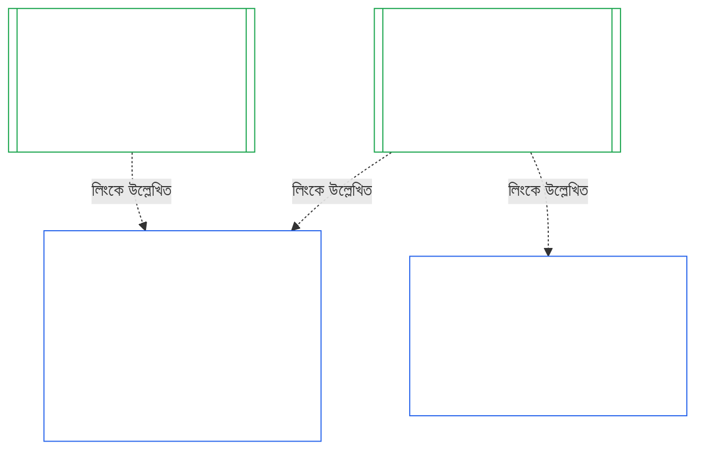
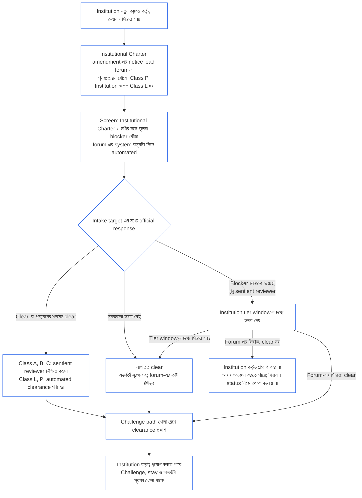

<!-- Locale: bn; source: current working tree (2026-11-11); source SHA-256: 08e166f5f098d01317c1f57ae3501abde31dd10f3c9b43b54d1a2aea1da4200f; baseline: 247e2180509e5e029c1106878cf225067339e010; AI-drafted, unreviewed; assembled from complete 2026-11-03 draft with 2026-11-09 changed-passage refreshes. -->

# অধ্যায় দশ: প্রাতিষ্ঠানিক সামঞ্জস্যের প্রত্যয়ন

<strong>কর্পাসে অবস্থান (অপারেটিভ নয়): ফাইলের গঠন ও পাঠের নিয়ম</strong>

> এই ফাইলটি সংবেদনশীল সত্তাদের সংবিধানের অংশ এবং অন্য নম্বরযুক্ত `core_*` ফাইলগুলোর সঙ্গে এক পাঠ্য হিসেবে পড়লেই কেবল বাধ্যতামূলক। এতে রয়েছে **Chapter Ten** — **প্রাতিষ্ঠানিক সামঞ্জস্যের প্রত্যয়ন**: কোনো [Institution](../../core_05.040_band_continuity.md#institution) তার পরিচালিত System থেকে আলাদা সত্তা হিসেবে কীভাবে শ্রেণিবদ্ধ, মূল্যায়িত, পর্যালোচিত, সিদ্ধান্তপ্রাপ্ত, নথিভুক্ত, হালনাগাদ ও পুনরায় খোলা হয় (**§1–§11**)। Chapter Ten হলো [Chapter Nine](core_09.000_system_alignment_certification_evaluation.md#chapter-nine-system-alignment-certification)-এর (*System Alignment Certification*) প্রাতিষ্ঠানিক প্রতিরূপ, এবং **এর বিভাগগুলোর নম্বর একই**: এখানকার §N, সেখানকার §N-এর উত্তর দেয়। [CS-9.320](../../corpus_systems/cs_09.320_system_alignment_certification_illustrations.md#cs-9320-system-alignment-certification-illustrations) (*System alignment certification illustrations*)-এ System-এর ব্যবহারিক উদাহরণ এবং তার [§12 Illustrative Institution walkthroughs](../../corpus_systems/cs_09.320_system_alignment_certification_illustrations.md#cs-9320-12-illustrative-institution-walkthroughs)-এ তিনটি Institution-এর ধাপে-ধাপে উদাহরণ আছে। এই অধ্যায় সেগুলো পুনরাবৃত্তি করে না।
>
> | § | Chapter Nine (System) | Chapter Ten (Institution) |
> |---|------------------------|----------------------------|
> | 1 | উদ্দেশ্য ও ভূমিকা | System-এর প্রত্যয়নের সঙ্গে সম্পর্ক, কার প্রত্যয়ন হয়, গঠন বা পরিচালনার অনুমতি বা প্রবেশ-শর্ত নেই, নতুন বস্তুগত কর্তৃত্বের জন্য অপেক্ষা, প্রথম প্রত্যয়নের সময়সীমা |
> | 2 | System শ্রেণির মূল্যায়ন | Institution-এর শ্রেণি; শ্রেণি অনুযায়ী মাপ |
> | 3 | সমগ্র-System প্রত্যয়ন মূল্যায়ন | আটটি প্রাতিষ্ঠানিক বিষয়, সর্বদা |
> | 4 | প্রাসঙ্গিক হলে প্রযোজ্য মূল্যায়ন | Chapter Nine §4-এর নির্দেশক |
> | 5 | Rights-Floor ও ক্ষেত্রভিত্তিক মূল্যায়ন | Chapter Nine §5-এর নির্দেশক |
> | 6 | ফোরাম প্রক্রিয়া | চারটি আসন; ফোরামের ভূমিকা ও ক্রম; Institution হিসেবে ফোরাম, প্রত্যয়নকারী ও নথি-দপ্তর |
> | 7 | প্রত্যয়নের ফলাফল | Institution ও তার System-এর কার্যক্রম শুরু, প্রত্যয়নের শর্ত এবং ফলাফলের অন্যান্য প্রভাব; ত্রুটির নির্দেশক; প্রতিকার-প্রস্তুতি; অস্বীকৃতি ও প্রত্যাহার |
> | 8 | System Certification Record | Institutional Certification Record |
> | 9 | পুনঃপ্রত্যয়ন ও পুনরায় খোলা | পর্যবেক্ষণ; পুনরায় খোলার কারণ; অস্থায়ী ও পূর্ণ প্রত্যয়ন; ফাঁকি-রোধ; System প্রত্যয়ন থেকে ধারাবাহিক প্রভাব; শাসন-লঙ্ঘনে তার System পুনরায় খোলা |
> | 10 | প্রত্যয়নকে চ্যালেঞ্জ | চ্যালেঞ্জের পথ |
> | 11 | অবস্থানের সঙ্গে সম্পর্ক | অবস্থানের সংযোগ |
>
> - **সাংবিধানিক বিষয়-দায়িত্ব (Chapter Nine-এর সঙ্গে যৌথ):** ফোরামের তত্ত্বাবধানে সামঞ্জস্য-প্রত্যয়ন ও সংশ্লিষ্ট নথি। Chapter Ten-এ প্রাতিষ্ঠানিক বিষয়টি যোগ হয়েছে। এখানে নতুন ফোরাম-পরিবার, নতুন আসন বা নতুন ফলাফল-শব্দ নেই।
> - **পুনরাবৃত্তি নয়, পুনঃব্যবহার:** [Chapter Nine Part B §6](core_09.005_system_alignment_certification_record_process.md#6-forum-process) থেকে [Chapter Nine Part C §11](core_09.010_system_alignment_certification_record_recertification.md#11-relationship-to-standing) পর্যন্ত যে Phase III–VI চালায়, Chapter Ten কেবল Institution বিষয় হলে কী বদলায় তা জানায়।
> - **অন্যত্র স্থানান্তর-রোধী নিয়ম:** Chapter Ten কোনো System-এর জন্য Chapter Nine-এর মূল্যায়ন-প্রক্রিয়া, Chapter Seven-এর System Charter ও Institutional Charter-এর ক্ষেত্র, Chapter Eight-এর Four-Seat Requirement, [corpus_institutions](../../corpus_institutions.md)-এর প্রাতিষ্ঠানিক দায়িত্ব, Chapter Eleven-এর অবস্থান-পরিমাপ বা Chapter Twelve-এর অবস্থান-প্রভাব পুনরায় বলে না।
>
> **পূর্ববর্তী:** [সপ্তম অধ্যায়](core_07_charters.md#chapter-seven-system-and-institutional-charters)-এর চার্টার; [অষ্টম অধ্যায়](../../core_08.000_functional_independence_separation_of_duties.md#chapter-eight-functional-independence-and-separation-of-duties)-এর কার্যগত স্বাধীনতা; [নবম অধ্যায়](core_09.000_system_alignment_certification_evaluation.md#chapter-nine-system-alignment-certification) (অংশ [A](core_09.000_system_alignment_certification_evaluation.md#chapter-nine-part-a-system-alignment-certification--evaluation), [B](../../core_09.005_system_alignment_certification_record_process.md#chapter-nine-part-b-system-alignment-certification--forum-process-and-outcomes), ও [C](../../core_09.010_system_alignment_certification_record_recertification.md#chapter-nine-part-c-system-alignment-certification--record-recertification-and-standing)); পঞ্চদশ অধ্যায়ের ফোরাম তত্ত্বাবধান।
> **পরবর্তী:** একাদশ অধ্যায়ের অবস্থান রেকর্ড ও যাচাইকৃত ইনপুট; ত্রয়োদশ অধ্যায়ের অবস্থানগত প্রভাব।

<strong>অনুসরণপথ</strong>

- **পূর্ববর্তী ভিত্তি:**
  - [Chapter Seven §1 When System and Institutional Charters Are Required](core_07_charters.md#1-when-system-and-institutional-charters-are-required) (7.000 §1) (*কোন Institution System Charter বা Institutional Charter প্রকাশ করে, এবং Institution-এর শ্রেণি*);
  - [Chapter Seven §7 Amendment and Review](core_07_charters.md#7-amendment-review-and-scope-misalignment) (7.000 §7) (*Institutional Charter পর্যালোচনায় কী যাচাই হয়*);
  - [Chapter Seven §4 The Charter Role Map and Standing-Record Custody](core_07_charters.md#4-the-charter-role-map-and-standing-record-custody) (7.000 §4) (*আসনগুলো কোথায় স্থাপন করা হয়*);
  - [Chapter Eight §2 Four-Seat Constitutional Requirement](core_07_functional_independence_segregation_of_duties.md#2-four-seat-constitutional-requirement) (8.000 §2) এবং [§9 Relationship to Later Processes](core_07_functional_independence_segregation_of_duties.md#9-relationship-to-later-processes);
  - [Chapter Nine](core_09.000_system_alignment_certification_evaluation.md#chapter-nine-system-alignment-certification) (9.000 থেকে 9.010) (*এই অধ্যায়ে পুনর্ব্যবহৃত System Alignment Certification প্রক্রিয়া*);
  - [Two Fundamental Questions](core_00_preamble.md#two-fundamental-questions);
  - [Constitutional Tetrad](core_00_preamble.md#constitutional-tetrad);
  - [Article XI-E](core_06_rights_part_b.md#article-xi-e-institutional-formation-and-business-creation) (*প্রতিষ্ঠান গঠন ও ব্যবসা সৃষ্টি*)।
- **পরবর্তী ধাপ:** [§1](#1-purpose-and-role) থেকে [§11](#11-relationship-to-standing) পর্যন্ত; Chapter Eleven ([11.000](core_11_standing_assessment.md#chapter-eleven-contribution-violation-and-standing-model--measurement)); [Chapter Fourteen](../../core_15.000_forum.md#chapter-fifteen-forums-and-jurisdiction) (14.000)।
- **এগুলোর সঙ্গে পড়ুন:**
  - [Institutional Alignment Certification](../../core_05.040_band_continuity.md#institutional-alignment-certification) এবং
  - [Institutional Certification Record](../../core_05.040_band_continuity.md#institutional-certification-record) (*Chapter Five-এর অর্থ*);
  - **CI-8.205 §6** (*System ও Institutional Charter-এর বিষয়বস্তু, পর্যালোচনা এবং গঠনের ছক*);
  - **CF-14.425** (*অখণ্ডতার সুরক্ষা, capture-রোধী কার্যক্রম, এবং নিজের বিচার নিজে করা রোধে সহায়তা*)।

 

Chapter Ten হলো **প্রাতিষ্ঠানিক সামঞ্জস্য-প্রত্যয়নের** সাংবিধানিক বিষয়-দায়িত্বপ্রাপ্ত অধ্যায়। এটি [Chapter Nine](core_09.000_system_alignment_certification_evaluation.md#chapter-nine-system-alignment-certification)-এর প্রক্রিয়াকে System থেকে Institution-এ প্রসারিত করে:

- **Phase I, Frame:** Institution-এর শ্রেণি এবং কীভাবে তা মূল্যায়নের মাত্রা নির্ধারণ করে ([§2 Institution Class Evaluation](#2-institution-class-evaluation));
- **Phase II, Evaluate:** প্রাতিষ্ঠানিক মূল্যায়ন, যার মধ্যে প্রাসঙ্গিক হলে প্রযোজ্য মূল্যায়ন ও Rights-Floor এবং ক্ষেত্রভিত্তিক মূল্যায়ন রয়েছে ([§3 Whole-Institution Certification Evaluation](#3-whole-institution-certification-evaluation) থেকে [§5 Rights-Floor and Domain Evaluations](#5-rights-floor-and-domain-evaluations));
- **Phase III, Review:** ফোরামের ভূমিকা ও ক্রম ([§6 Forum Process](#6-forum-process));
- **Phase IV, Decide:** ফলাফল, প্রতিকার-প্রস্তুতি, অস্বীকৃতি ও প্রত্যাহার ([§7 Certification Outcomes](#7-certification-outcomes));
- **Phase V, Record:** Institutional Certification Record ([§8 Institutional Certification Record](#8-institutional-certification-record)); এবং
- **Phase VI, Operate:** পুনঃপ্রত্যয়ন, পুনরায় খোলা, System প্রত্যয়ন থেকে ধারাবাহিক প্রভাব, তার System পুনরায় খোলা, চ্যালেঞ্জের পথ এবং অবস্থানের সংযোগ ([§9 Recertification and Reopening](#9-recertification-and-reopening) থেকে [§11 Relationship to Standing](#11-relationship-to-standing))।

*সহজ ভাষায়: Chapter Nine জিজ্ঞেস করে কোনো **সিস্টেম** সামঞ্জস্যপূর্ণ কি না। Chapter Ten একই প্রশ্ন করে System চালানো, অথবা System না চালিয়েও কর্তৃত্ব ধারণ করা **প্রতিষ্ঠান** সম্পর্কে। কোনো Institution সামঞ্জস্যপূর্ণ হলেও তার কোনো System অসামঞ্জস্যপূর্ণ হতে পারে, বা উল্টোটাও হতে পারে। তাই Institution-এর নিয়ন্ত্রণাধীন বিষয়গুলো পরীক্ষা করা হয়: এটি Institutional Charter মেনে চলে কি না, তার কর্তৃত্বের জন্য কে জবাবদিহি করে, নিজের সদস্যদের কোন কাজে পুরস্কৃত করে, এবং তার ওপর স্বাধীন যাচাই বাস্তবে ব্যবহার করা যায় কি না। এটি প্রতিটি System-এর প্রত্যয়নের ওপর নির্ভর করে, নিজে পুনরায় সেই প্রত্যয়ন করে না। এটি লাইসেন্স নয়: Institution শুরু বা পরিচালনা করতে কারও অনুমতি লাগে না।*

### 1. উদ্দেশ্য ও ভূমিকা

<strong>অনুসরণপথ</strong>

- **পূর্ববর্তী ভিত্তি:**
  - [Chapter Seven §1 When System and Institutional Charters Are Required](core_07_charters.md#1-when-system-and-institutional-charters-are-required) (7.000 §1);
  - [Chapter Nine Part A §1 Purpose and Role](core_09.000_system_alignment_certification_evaluation.md#1-purpose-and-role) (9.000 §1);
  - [Article XI-E](core_06_rights_part_b.md#article-xi-e-institutional-formation-and-business-creation) (*প্রতিষ্ঠান গঠন ও ব্যবসা সৃষ্টি*);
  - [Article XXVIII-A](../../core_06.020_rights_part_e.md#xxviii-a-existing-instantiations-adoption-transition-window) (*ধাপে গ্রহণ ও Rights-Floor-এর ধারাবাহিকতা*)।
- **পরবর্তী ধাপ:** [§2](#2-institution-class-evaluation); [§6](#6-forum-process); [§7](#7-certification-outcomes); [§9](#9-recertification-and-reopening)।
- **এগুলোর সঙ্গে পড়ুন:**
  - [Institution](../../core_05.040_band_continuity.md#institution);
  - [Institutional Charter](../../core_05.040_band_continuity.md#institutional-charter);
  - [System Charter](../../core_05.040_band_continuity.md#system-charter);
  - [Business Creation](../../core_05.055_band_participation.md#business-creation)।

 

*সহজ ভাষায়: কোনো সিস্টেমের প্রত্যয়ন সেই সিস্টেমের। Institution-এর প্রত্যয়ন ওই প্রত্যয়নগুলো উল্লেখ করে এবং কেবল Institution-এর জবাবদিহির বিষয় যোগ করে। একটি System একাধিক Institution-এর অধীনে থাকতে পারে, অথবা কোনো Institution-এর অধীন না-ও থাকতে পারে। Institution শুরু করার পথে প্রত্যয়নকে বাধা বানানোর অনুমতি এখানকার কোনো বিধান দেয় না।*

Institutional alignment certification এবং System Alignment Certification হলো লিংকের মাধ্যমে যুক্ত দুটি প্রত্যয়ন। তাদের সম্পর্ক হলো **লিংকের মাধ্যমে সংযোজন**, অন্তর্ভুক্তি নয়। চিত্রে একটি System Certification Record থেকে সেই রেকর্ড উল্লেখকারী প্রতিটি Institutional Certification Record-এ তীর গেছে। কোনো Institution-এর অধীন নয় এমন System-এর কোনো তীর নেই, এবং দরকারও নেই; কোনো System না-চালানো Institution-এর কেবল তার নিজস্ব নথি থাকে।

লিংকের মাধ্যমে সংযোজনের দুটি দিক আছে; প্রথমে Institution-এর দিক:

Institution-এর দিক থেকে:

- **Institutional Certification Record কোনো System-এর নথি উল্লেখ করে, পুনরায় মূল্যায়ন করে না:** System Certification Record-এর লিংক ও সংস্করণ উল্লেখ করে। এই অধ্যায় কখনো System-এর মূল্যায়ন পুনরায় চালায় না, তার শ্রেণি পুনর্নির্ধারণ করে না, এবং System-এর ফলাফল, মর্যাদা বা প্রত্যয়নের শর্ত বদলায় না।
- **Institution-এর প্রত্যয়ন System-এর প্রত্যয়ন তুলে দিতে পারে না:** কোনো System Not Certified হলে Institution-এর মর্যাদা যা-ই হোক, তা Not Certified-ই থাকে। কোনো System প্রত্যয়িত হলেও Institution-এর সিদ্ধান্ত থেকে কোনো সুরক্ষা পায় না।
- **প্রাতিষ্ঠানিক তথ্য একবারই নির্ধারিত হয়:** [Chapter Nine Part A §3.1 Governance, Incentive, and Contestability Discipline](core_09.000_system_alignment_certification_evaluation.md#31-governance-incentive-and-contestability-discipline)-এ অপারেটরের শাসন ও প্রণোদনা সম্পর্কে প্রশ্ন করা হলে, অপারেটরের বর্তমান Institutional Certification Record লিংকের মাধ্যমে সেই তথ্য দিতে পারে। তবু সিস্টেমটির ফোরামই সিদ্ধান্ত নেয় ওই তথ্য তার জন্য যথেষ্ট কি না। System Certification Record-এ কারণ না জানিয়ে তারা একই প্রাতিষ্ঠানিক তথ্য সম্পর্কে ভিন্ন সিদ্ধান্ত দিতে পারে না।

System-এর দিক থেকে:

- **System Certification Record System-এর নিজস্ব:** এটি [Chapter Nine](core_09.000_system_alignment_certification_evaluation.md#chapter-nine-system-alignment-certification)-এর অধীনে System-এর নিজস্ব নথি।
- **একটি System Certification Record একাধিক Institution উল্লেখ করতে পারে:** [Chapter Seven §1 When System and Institutional Charters Are Required](core_07_charters.md#1-when-system-and-institutional-charters-are-required)-এর অধীনে একাধিক Institution কোনো System পরিচালনা, steward করা বা বস্তুগতভাবে নিয়ন্ত্রণ করতে পারে। প্রত্যেকে একই নথি উল্লেখ করে।
- **System-কে কোনো Institution-এর অধীন থাকতেই হবে না:** একজন সংবেদনশীল সত্তা Institution নয়, তাই কোনো System-এর কোনো Institution নাও থাকতে পারে। Institution নেই এমন System কেবল [Chapter Nine](core_09.000_system_alignment_certification_evaluation.md#chapter-nine-system-alignment-certification)-এর অধীনে প্রত্যয়িত হবে এবং এই অধ্যায়ে কিছুই তার দরকার নেই। Institution-এর অধীনে থাকা System-ও একইভাবে প্রত্যয়িত হয়: এই অধ্যায় Institution-এর জন্য আলাদা নথি যোগ করে; System-এর নিজস্ব প্রত্যয়নের ধাপ নয়।

#### 1.1 কার প্রত্যয়ন হয়

[§2.1 Institution class](#21-institution-class)-এর অধীনে শ্রেণি নির্ধারিত Class L বা তার চেয়ে উচ্চতর Institution এই অধ্যায়ের আওতায়। কোনো System একেবারেই না-চালানো Institution-ও এর মধ্যে পড়ে: উল্লেখ করার মতো তার কোনো System Certification Record নেই, এবং তার শ্রেণি নির্ধারিত হয় তার নিজস্ব প্রভাব দিয়ে। Institution-এর **portfolio** হলো তার পরিচালিত, steward করা বা বস্তুগতভাবে নিয়ন্ত্রিত System-গুলোর সমষ্টি ([Portfolio](../../core_05.040_band_continuity.md#portfolio))।

- **Class A, B, C ও L:** শ্রেণি অনুযায়ী [§2.2 Scaling by class](#22-scaling-by-class)-এর মাপে প্রক্রিয়া প্রযোজ্য।
- **Class P:** প্রক্রিয়াটি উৎসাহিত এবং স্বেচ্ছায় ব্যবহার করা যেতে পারে। Class L বা তার বেশি শ্রেণিতে পুনঃশ্রেণিবিন্যাস হলে, অথবা Institution স্বেচ্ছায় সাংবিধানিক সম্মতির দাবি করলে, এটি বাধ্যতামূলক হয়। নতুন বস্তুগত কর্তৃত্ব নেওয়ার সিদ্ধান্ত নেওয়া Class P Institution [§9.2.2 Recertification for new material authority](#922-recertification-for-new-material-authority)-এ নোটিশ দেওয়ার সময় অন্তত Class L-এ পুনঃশ্রেণিবদ্ধ হয়; কারণ ওই কর্তৃত্ব সংজ্ঞা অনুযায়ী বস্তুগত ([§9.2.1 What counts as new material authority](#921-what-counts-as-new-material-authority)), এবং যেকোনো ক্ষেত্রে বস্তুগত প্রভাব ফেলা Institution অন্তত Class L ([§2.1 Institution class](#21-institution-class), বিষয় 2)। নোটিশ থেকে শুরু করে নোটিশ প্রত্যাহার করে নিষ্পত্তির আগে পর্যন্ত, অথবা কর্তৃত্বটি নিষ্পত্তি না হওয়া পর্যন্ত — তবে তার অধীনে কিছু প্রয়োগ না করা হলে — পুনঃশ্রেণিবিন্যাস বহাল থাকে। এরপর Institution আবার Class P-তে ফেরে এবং সীমিত প্রথম-প্রত্যয়ন পর্ব শেষ হয়। নতুন নোটিশে তা আবার শুরু হয়; আর নিষ্পত্তি ছাড়া কর্তৃত্ব প্রয়োগ করা হলে [§9.2.2 Recertification for new material authority](#922-recertification-for-new-material-authority)-এর (*নোটিশ ছাড়া বা নিষ্পত্তির আগে*) অধীনে সিদ্ধান্ত বহাল থাকে। এটি [Chapter Nine Part A §1 Purpose and Role](core_09.000_system_alignment_certification_evaluation.md#1-purpose-and-role)-এর অনুরূপ।
- **একটি System:** ঠিক একটি System চালানো Institution, যার System Charter প্রয়োজন, তার একটি প্রত্যয়ন-পর্ব ও একটি নথি হয়; এই অধ্যায়ে একে **one-System evaluation** বলা হয়েছে। System Certification Record-এ [§8 Institutional Certification Record](#8-institutional-certification-record)-এর বিষয়গুলোসহ *প্রাতিষ্ঠানিক সিদ্ধান্তের অংশ* থাকবে, এবং সেটিই Institutional Certification Record হিসেবে কাজ করবে। ফোরাম, আসন ও সময়সীমা System-এর নিজস্ব প্রত্যয়ন-পর্বের, সঙ্গে প্রাতিষ্ঠানিক বিষয় যোগ হবে। [§7.4 Denial and revocation for an Institution](#74-denial-and-revocation-for-an-institution)-এ বলা নিজস্ব অস্বীকৃতি ও প্রত্যাহারের কারণ অনুসারে ফলাফল হবে। System-টিই পুরো portfolio হওয়ায় [§9.5 Cascade from System certifications](#95-cascade-from-system-certifications)-এর ধারাবাহিক প্রক্রিয়া প্রযোজ্য নয়; তবে [§7.4 Denial and revocation for an Institution](#74-denial-and-revocation-for-an-institution)-এর নিয়ম 1 ও 2 (সূচক এবং কারণ কোথায় তার পরীক্ষা) প্রযোজ্য।
- **একাধিক System:** Institution-এর একটি Institutional Certification Record থাকবে, যা তার চালানো প্রতিটি System-এর System Certification Record-এর সঙ্গে লিংক করবে। প্রতিটি System-এর নিজস্ব প্রত্যয়ন-পর্ব ও নিজস্ব নথি থাকবে।
- **কোনো System নেই:** শুধু একটি Institutional Certification Record। Institution কোনো System চালায় না বলে লিংক করার মতো কোনো System Certification Record নেই।

#### 1.2 গঠন বা পরিচালনার জন্য অনুমতি বা প্রবেশ-শর্ত নেই

Institutional alignment certification হলো কোনো Institution তার কর্তৃত্ব বাস্তবে কীভাবে ব্যবহার করে তার স্বাধীন যাচাই। Institution-এর বাইরের ফোরাম এই প্রত্যয়ন করে, এবং তাদের সিদ্ধান্তের নথি হলো Institutional Certification Record।

- **শুরু ও পরিচালনা:** কোনো Institution আগে প্রত্যয়ন না নিয়েই গঠিত হতে পারে, তার Institutional Charter প্রকাশ করতে পারে, কর্তৃত্ব প্রয়োগ শুরু করতে পারে এবং পরিচালনা চালিয়ে যেতে পারে; কোনো ফলাফলই সে অধিকার দেয় বা কেড়ে নেয় না।
- **ফলাফলের প্রভাব:** [§7.1 Go-live for an Institution](#71-go-live-for-an-institution)-এ বলা প্রভাবগুলোই কেবল ফলাফলের প্রভাব।
- **এই ক্ষেত্রে কেবল তিনটি প্রবেশ-শর্ত:** **Article XI-E** (*প্রতিষ্ঠান গঠন ও ব্যবসা সৃষ্টি*)-এ তিনটি সংকীর্ণ প্রবেশ-শর্ত রয়েছে:
  - নামযুক্ত সংবেদনশীল সত্তার ওপর বিদ্যমান lock, যা সেই সত্তার কর্তৃত্বের সঙ্গে যুক্ত;
  - অসামঞ্জস্যের নির্দিষ্ট যাচাইকৃত তথ্যের ওপর Interim Hold, যা কোনো নামযুক্ত সংবেদনশীল সত্তার কর্তৃত্বেও যুক্ত;
  - Operating Party-র নিজের ওপর lock, যা Institution-এ যুক্ত হবে কেবল সেই Institution-এর ওপর lock থাকলে; **CI-12.210 §4** (*বিলুপ্তি*) অনুযায়ী বিলুপ্ত Institution-এর ওপর এমন lock থাকতে পারে।

  [§7.5 Effects of denial and revocation for an Institution](#75-effects-of-denial-and-revocation-for-an-institution)-এর অধীনে প্রমাণ হিসেবে প্রত্যয়নের সিদ্ধান্তকে এসব প্রবেশ-শর্তের যেকোনো একটি নির্ধারণকারী ফোরামে পাঠানো যেতে পারে। প্রত্যয়নের ফল নিজে কোনো প্রবেশ-শর্ত নয় এবং তা কোনো শর্ত খোলে বা বন্ধ করে না।
- **নতুন বস্তুগত কর্তৃত্বের জন্য অপেক্ষা:** নতুন বস্তুগত কর্তৃত্ব নেওয়ার সিদ্ধান্ত নেওয়া Institution, তা প্রয়োগের আগে [§9.2.2 Recertification for new material authority](#922-recertification-for-new-material-authority)-এর শর্তে পুনঃপ্রত্যয়নে ওই কর্তৃত্বের নিষ্পত্তির জন্য অপেক্ষা করবে। **Article XI-E** (*প্রতিষ্ঠান গঠন ও ব্যবসা সৃষ্টি*) এই অপেক্ষা নির্ধারণ করে। এটি তিনটি সংকীর্ণ প্রবেশ-শর্তের একটি নয়, এবং গঠন বা পরিচালনার ওপর প্রবেশ-শর্তও নয়। এটি শুধু নতুন কর্তৃত্বের ক্ষেত্রে প্রযোজ্য; Institution-এর অন্য সব কাজ চলতে থাকবে। [§9.2.2 Recertification for new material authority](#922-recertification-for-new-material-authority)-এর চিত্রে ধাপগুলো সংক্ষেপে আছে।
- **পেছনের দরজা নয়:** কোনো ফোরাম, গ্রহণকারী বা ক্ষমতাসীন এই অধ্যায়কে প্রতিষ্ঠাতা ঠেকানো বা ক্ষমতাসীনদের সুরক্ষা দেওয়ার অনুমোদন-সীমা হিসেবে ব্যবহার করতে পারবে না। তা [Article XI-E](core_06_rights_part_b.md#article-xi-e-institutional-formation-and-business-creation) (*প্রতিষ্ঠান গঠন ও ব্যবসা সৃষ্টি*) ব্যর্থ করবে।
  - প্রক্রিয়ার খরচে [Avoidable Burden](../../core_05.040_band_continuity.md#avoidable-burden) প্রযোজ্য।
  - পর্যালোচনার গভীরতায় [Classification-Scaled Governance](core_05_band_oversight.md#classification-scaled-governance) প্রযোজ্য।
  - নতুন বস্তুগত কর্তৃত্বের অপেক্ষা একই শ্রেণির প্রতিটি Institution-এর ক্ষেত্রে একই শর্তে, এবং কেবল অন্যদের জন্য আগে থেকেই বস্তুগত এমন কর্তৃত্বে প্রযোজ্য।

System-এর কার্যক্রম শুরু করার শর্ত আলাদা এবং সিস্টেমের সঙ্গেই থাকে। [Chapter Nine Part B §7.1 Go-Live Gate](core_09.005_system_alignment_certification_record_process.md#71-go-live-gate)-এর অধীনে নতুন System বা তার বস্তুগত সম্প্রসারণ কেবল তার নিজস্ব প্রত্যয়নের মাধ্যমে কার্যক্রম শুরু করবে, Institution-এর মর্যাদা যা-ই হোক।

#### 1.3 প্রথম প্রত্যয়নের সময়সীমা

প্রথম Institutional Certification Record Institution-এর শ্রেণির জন্য গ্রহণকারী নথিতে নির্ধারিত সময়সীমার মধ্যে জমা দিতে হবে।

- **নতুন Institution:** [Domain-Specific Materiality](core_05_band_oversight.md#domain-specific-materiality)-এর বিচারে অন্যদের ওপর প্রথম বস্তুগত প্রভাবের দিন থেকে সময়সীমা শুরু হবে এবং প্রথম প্রত্যয়ন হবে অস্থায়ী।
- **নোটিশে পুনঃশ্রেণিবদ্ধ Class P Institution:** নতুন Institution-এর মতো [§9.2.2 Recertification for new material authority](#922-recertification-for-new-material-authority)-এর অধীনে নোটিশ দেওয়ার দিন থেকে সময় গণনা হবে; ইতিমধ্যে শেষ হওয়া Adoption Transition সময়সীমা থেকে কখনো নয়।
- **আগে থেকেই পরিচালনায় থাকা:** সময়সীমা হলো [Article XXVIII-A](../../core_06.020_rights_part_e.md#xxviii-a-existing-instantiations-adoption-transition-window) (*ধাপে গ্রহণ ও Rights-Floor-এর ধারাবাহিকতা*)-এর Adoption Transition সময়সীমা, যা [Chapter Seven §1.5 When a System Charter or Institutional Charter is due](core_07_charters.md#15-when-a-system-charter-or-institutional-charter-is-due)-এর ডিফল্টের সঙ্গে সামঞ্জস্যপূর্ণ।
- **সময়সীমা পেরিয়ে যাওয়া:** নিচে ছাড় না থাকলে, প্রথম প্রত্যয়ন-পর্ব না করেই সময়সীমা শেষ হতে দেওয়া Institution-এর এমন ত্রুটি আছে যা নথিতে লিখে সংশোধন করতে হবে; আর মেয়াদ শেষ হলে ওই প্রত্যয়ন-পর্ব শুরু হয়। আগে থেকে পরিচালনায় থাকা Class L বা তার বেশি Institution-এর নিচের milestone failure-ও ঘটে। কোনো gate নেই বলে Institution থামানো বা পরিচালনায় বাধা দেওয়া হয় না ([§1.2 গঠন বা পরিচালনার জন্য অনুমতি বা প্রবেশ-শর্ত নেই](#12-no-permission-and-no-gate-on-forming-or-running))।
  - **আগে থেকেই পরিচালনায় থাকা Institution:** Class L বা তার বেশি Institution-এর জন্য এই অধ্যায়ের নিজস্ব নিয়ম, [Article XXVIII-A](../../core_06.020_rights_part_e.md#xxviii-a-existing-instantiations-adoption-transition-window) (*ধাপে গ্রহণ ও Rights-Floor-এর ধারাবাহিকতা*)-এর অনুরূপ, যেখানে System ও derived entity-র কথা আছে। Adoption Transition সময়সীমা শেষ হলেও প্রথম প্রত্যয়ন-পর্ব সম্পূর্ণ না হলে (কোনো provisional বা full certification নেই এবং [§7 Certification Outcomes](#7-certification-outcomes)-এর অধীনে কোনো সিদ্ধান্ত হয়নি), Institution-এর deadline পেরিয়েছে। সময়সীমার মধ্যে আবেদন করে সহযোগিতা করা Institution-এর ক্ষেত্রে, ফোরাম নিজের সময়সীমা অতিক্রম করায় ([Chapter Fourteen §6 Timely resolution, materiality tiers, and anti-delay discipline](core_11_forum.md#6-timely-resolution-materiality-tiers-and-anti-delay-discipline), *Overrun review*; [Chapter Nine Part C §9.3.4 Tier windows](core_09.010_system_alignment_certification_record_recertification.md#934-tier-windows)) অথবা [§7.3 Remediation readiness for an Institution](#73-remediation-readiness-for-an-institution)-এর অধীনে একবারের deferral চলায় প্রত্যয়ন-পর্ব অসম্পূর্ণ থাকলে সময়সীমা পেরোয়নি। [Article XXVIII-B](../../core_06.020_rights_part_e.md#article-xxviii-b-adoption-transition-authority-limits-and-reauthorization) (*Adoption Transition Authority Limits and Reauthorization*) অনুযায়ী নথিভুক্ত পুনঃঅনুমোদনের প্রমাণ না থাকলে এটি Adoption Transition milestone failure, এবং [Chapter Eleven](core_11_standing_assessment.md#chapter-eleven-contribution-violation-and-standing-model--measurement)-এর সাধারণ compliance ও violation পথ খুলে যায়। ওই Article-এর সংযমের দায়িত্ব কার্যকর হওয়ার দিন থেকে প্রযোজ্য, আর ঘাটতি দীর্ঘস্থায়ী হওয়ায় তা নতুন স্বাভাবিক হয়ে যায় না। এটি [Chapter Nine Part B §7.1.1 Systems already operating](core_09.005_system_alignment_certification_record_process.md#711-systems-already-operating)-এর অনুরূপ। এটি কোনো gate নয়।
  - **প্রত্যয়ন-পর্ব:** অন্য যেকোনো পর্বের মতোই সিদ্ধান্ত হবে। [§7 Certification Outcomes](#7-certification-outcomes)-এর যেকোনো ফল হতে পারে, Not Certified-সহ; এর প্রভাব রয়েছে [§7.5 Effects of denial and revocation for an Institution](#75-effects-of-denial-and-revocation-for-an-institution)-এ।
  - **শাস্তি ও বিলুপ্তি:** এই অধ্যায় কোনোটি সৃষ্টি করে না। স্থগিতকরণ, রিসিভারশিপ, কাঠামোগত পৃথকীকরণ ও বিলুপ্তি **CI-13.210** (*প্রাতিষ্ঠানিক ব্যর্থতা ও বিলুপ্তি*) এবং **CI-13.215** (*প্রাতিষ্ঠানিক জবাবদিহি ও শাস্তি*) অনুযায়ী এখতিয়ারসম্পন্ন ফোরামের এখতিয়ারে থাকে। [§7.5 কোনো প্রতিষ্ঠানের অস্বীকৃতি ও প্রত্যাহারের ফল](#75-effects-of-denial-and-revocation-for-an-institution)-এ উল্লিখিত রেফারেলের ভিত্তিতে (বিষয় 5, *রেফারেল*) কেবল সেই ফোরামেই বিষয়টি পাঠানো হয়।

### 2. Institution শ্রেণির মূল্যায়ন

<strong>অনুসরণপথ</strong>

- **পূর্ববর্তী ভিত্তি:**
  - [Chapter Seven §1 When System and Institutional Charters Are Required](core_07_charters.md#1-when-system-and-institutional-charters-are-required) (7.000 §1);
  - [Chapter Nine Part A §2 System Class Evaluation](core_09.000_system_alignment_certification_evaluation.md#2-system-class-evaluation) (9.000 §2) এবং [§2.2 How system class scales every evaluation](core_09.000_system_alignment_certification_evaluation.md#22-how-system-class-scales-every-evaluation);
  - [Chapter Three §2.1 Common Evasion Patterns](core_03_definition_integrity.md#21-common-evasion-patterns) (3.000 §2.1)।
- **পরবর্তী ধাপ:** [§3](#3-whole-institution-certification-evaluation) (*শ্রেণি যে বিষয়গুলোর মাত্রা নির্ধারণ করে*); [§8](#8-institutional-certification-record) (*শ্রেণি নথিতে উল্লেখ থাকে*); [§9.2](#92-reopening-triggers) (*শ্রেণি পুনর্মূল্যায়নের কারণ*)।
- **এগুলোর সঙ্গে পড়ুন:**
  - **CS-9.305 (*System classification machinery*) এবং CS-9.310** (*System impact classifications*) ও [corpus_systems/cs_09.310_system_impact_classifications.md](../../corpus_systems/cs_09.310_system_impact_classifications.md) (*শ্রেণির তালিকা*);
  - **CI-9.210** (*শ্রেণিবিন্যাস-সংযুক্ত প্রাতিষ্ঠানিক দায়িত্ব*);
  - **CI-8.205 §6** (*System ও Institutional Charter-এর বিষয়বস্তু, পর্যালোচনা এবং গঠনের ছক*)।

 

*সহজ ভাষায়: Institution-কে প্রথমে তার শ্রেণিতে ফেলুন, অন্যদের কাছে তার গুরুত্ব কতটা তা দেখে। নিজেকে কী বলে তার ভিত্তিতে নয়, বাস্তবে কী সিদ্ধান্ত নেয় এবং কী ধরে রাখে তার ভিত্তিতে বিচার করুন। এরপর শ্রেণি মূল্যায়নের গভীরতা নির্ধারণ করে: শ্রেণি যত উঁচু, প্রমাণ তত কঠোর, পর্যালোচনা তত স্বাধীন, এবং পুনঃযাচাই তত তাড়াতাড়ি।*

এই বিভাগ Institution-এর জন্য **Phase I, Frame**।

#### 2.1 Institution-এর শ্রেণি

**Institution-এর শ্রেণি** নির্ধারিত হয় Institution-এর সর্বোচ্চ বস্তুগত প্রভাব দিয়ে, সেই প্রভাব তার পরিচালিত System-এর মাধ্যমে হোক বা কোনো System-এর বাইরে হোক। Institution বাস্তবে কী সিদ্ধান্ত নেয়, কী ধারণ করে ও কী নিয়ন্ত্রণ করে তার ভিত্তিতে বিচার হয়; তার label, আইনি রূপ বা Institutional Charter-এর তালিকার ভিত্তিতে নয়। শ্রেণি মূল্যায়নের গভীরতা ও সময়সীমা নির্ধারণ করে, যেমন [Chapter Nine Part A §2.2 How system class scales every evaluation](core_09.000_system_alignment_certification_evaluation.md#22-how-system-class-scales-every-evaluation) System-এর ক্ষেত্রে করে। এই অধ্যায়ে এবং [Chapter Seven §1.2 Which classes are covered](core_07_charters.md#12-which-classes-are-covered)-এ ব্যবহৃত শ্রেণি এটিই।

1. **System-এর মাধ্যমে প্রভাব:** Institution-এর শ্রেণি তার portfolio-র যেকোনো System-এর সর্বোচ্চ শ্রেণির সমান বা তার চেয়ে উঁচু ([Chapter Seven §1 When System and Institutional Charters Are Required](core_07_charters.md#1-when-system-and-institutional-charters-are-required))। পর্যবেক্ষিত কার্যক্রম থেকে System শনাক্ত করা হয়। Institutional Charter-এ উল্লেখ না থাকা System-ও গণ্য হবে।
2. **কোনো System-এর বাইরে প্রভাব:** Institution System চালাক বা না চালাক, তার নিজস্ব বস্তুগত প্রভাব ও নির্ভরতা গণ্য হয়। **CS-9.305 (*System classification machinery*) এবং CS-9.310** (*System impact classifications*)-এর শ্রেণি-সংজ্ঞা Institution-এর নিজস্ব সিদ্ধান্ত ও ধারণকৃত বিষয়গুলোর ক্ষেত্রে, নিচের উপাদান ব্যবহার করে প্রয়োগ হয়:
   - **এটি কী সিদ্ধান্ত নেয় ও কী ধরে রাখে:**
     - অন্য সংবেদনশীল সত্তাদের জীবনধারণের অপরিহার্য উপকরণ, শিক্ষা, নিরাপত্তা, জীবিকা, অধিকার বা অবস্থান সম্পর্কে কী সিদ্ধান্ত নেয়; এবং
     - কী ধারণ করে; যেমন তহবিল, নথি, সদস্যপদ, অবস্থান-নথির হেফাজত, অথবা ফোরাম, প্রত্যয়নকারী বা নথি-দপ্তরের কাজ।
   - **এটি বস্তুগত কি না:**
     - [Domain-Specific Materiality](core_05_band_oversight.md#domain-specific-materiality)-এর যেকোনো ক্ষেত্রে এর নিজস্ব কার্যক্রম বস্তুগত কি না; এর মধ্যে অন্যদের মানতে হয় বা নিষ্পত্তি হয়েছে ধরে যার ওপর নির্ভর করা যায় এমন [Materially Binding Acts](../../core_05.035_band_accountability.md#materially-binding-act) নেওয়াও রয়েছে;
     - যেকোনো একটি ক্ষেত্রে বস্তুগত প্রভাব ফেলা Institution, **CS-9.305 (*System classification machinery*) ও CS-9.310** (*System impact classifications*)-এর অধীনে, অন্তত Class L; এবং
     - অন্যরা স্বাধীনভাবে নিতে বা ছেড়ে দিতে পারে এমন সহায়তা, দ্রব্য, শ্রম বা সেবা দেওয়া, যা কারও প্রয়োজনীয় বিষয়ে প্রবেশ নিয়ন্ত্রণ করে না, কাউকে বাধ্য করে না। এটি আচরণ, Materially Binding Act নয়; এবং কেবল অন্য উপাদানগুলোর মাধ্যমে গণ্য হয়।
   - **কতজন এর ওপর নির্ভর করে:**
     - কতজন sentient এর ওপর নির্ভরশীল এবং এটি কতটা বিকল্পযোগ্য;
     - Material Control Line-এর অর্থে তার কর্তৃত্ব কতটা কেন্দ্রীভূত; এবং
     - তার সিদ্ধান্ত কতটা প্রত্যাবর্তনযোগ্য।
3. **সাধারণ নিয়ন্ত্রণ:** [Domain-Specific Materiality](core_05_band_oversight.md#domain-specific-materiality)-এর একীভূতকরণ-নিয়ম অনুযায়ী (একটি [Material Control Line](../../core_05.035_band_accountability.md#material-control-line)-এর মধ্যে বাস্তব সাধারণ নিয়ন্ত্রণ; শুধু অর্থায়ন গণ্য নয়) একটিই কার্যক্রম হিসেবে কাজ করা Operating Party-গুলো বাস্তবে একটি Institution হিসেবে কাজ করলে একত্রে শ্রেণিবদ্ধ হবে। কোনো অংশ Class L-এ না পৌঁছায় এমনভাবে Operating Party, তার portfolio বা কর্তৃত্ব ভাগ করা [Chapter Three §2.1 Common Evasion Patterns](core_03_definition_integrity.md#21-common-evasion-patterns)-এর অধীনে পরিধি ও সীমানা এড়ানোর ফাঁকি।
4. **পুনঃশ্রেণিবিন্যাস:** [§9.2 Reopening triggers](#92-reopening-triggers)-এর কারণ অনুযায়ী শ্রেণি পুনর্মূল্যায়ন হয়। কারণসহ শ্রেণিটি Institutional Certification Record-এ উল্লেখ থাকবে।

#### 2.2 শ্রেণি অনুযায়ী মাপ নির্ধারণ

Institution-এর শ্রেণি প্রমাণের গভীরতা, পর্যালোচনার স্বাধীনতা, ডিফল্ট প্রত্যয়ন-সময়সীমা এবং নথিতে প্রকাশের মাত্রা নির্ধারণ করে, যেমন [Chapter Nine Part A §2.2 How system class scales every evaluation](core_09.000_system_alignment_certification_evaluation.md#22-how-system-class-scales-every-evaluation) করে। প্রত্যয়নের সময়সীমা [Chapter Fourteen §6 Timely resolution, materiality tiers, and anti-delay discipline](../../core_15.000_forum.md#review-cadence) (*Review cadence*)-এ রয়েছে; গ্রহণকারী নথি আরও কম সময়সীমা দিতে পারে এবং কতগুলো ত্রুটিমুক্ত provisional recertification দরকার তা নির্ধারণ করে।

- **Class A, B ও C:** [§3 Whole-Institution Certification Evaluation](#3-whole-institution-certification-evaluation)-এর আটটি বিষয়ই; শ্রেণির অনুপাতে প্রমাণ ও স্বাধীনতা থাকবে।
- **Class L:** একই আটটি বিষয় সরলভাবে মূল্যায়িত হবে; [Classification-Scaled Governance](core_05_band_oversight.md#classification-scaled-governance) অনুমতি দিলে সরল নথি ও দীর্ঘতর ডিফল্ট প্রত্যয়ন-সময়সীমা হবে। Class L-এর মূল প্রত্যয়ন-পর্বে থাকবে Institutional Charter-এর সঙ্গে বাস্তব চর্চার তুলনা, Role Map, formation check-এর বিবৃতি এবং উল্লেখিত System প্রত্যয়নের বর্তমানতা। কোনো বিষয় বাদ দেওয়া যাবে না; কোনো বিষয়ে কিছু পাওয়ার না থাকলে তা এক লাইনে বলা হবে।
- **Class P:** [§1.1 Who is certified](#11-who-is-certified)-এ বলা অনুযায়ী স্বেচ্ছামূলক।

**যৌথ পেশাগত অনুশীলনে আতিথ্যদাতা।** কোনো প্রতিষ্ঠান আতিথ্যদাতা হলে ([**CI-16.205 §7**](../../corpus_institutions/ci_16.205_appointment_competency_rotation_removal.md#ci-46-seat-advisory) (*অনুশীলনের লাইসেন্স, অনুশীলনের ছাড়পত্র ও যৌথ পেশাগত অনুশীলন*)), তার সনদায়নে আতিথ্যদাতার অধিষ্ঠিত আসনের সঙ্গে সদস্যদের কাজের নমুনাও পরীক্ষা করা হয় এবং সদস্যদের গ্রহণ-নোটিশের সঙ্গে আতিথ্যদাতার কাজ তুলনা করা হয়। কোনো সদস্যের কাজ সম্পর্কিত ফলাফলটি সেই সদস্যেরই; আতিথ্যদাতার অধিষ্ঠিত আসন ব্যর্থ হলেই কেবল তা আতিথ্যদাতার ক্ষেত্রে প্রযোজ্য।

### 3. সমগ্র-Institution প্রত্যয়ন মূল্যায়ন

<strong>অনুসরণপথ</strong>

- **পূর্ববর্তী ভিত্তি:**
  - [Chapter Nine Part A §3 Whole-System Certification Evaluation](core_09.000_system_alignment_certification_evaluation.md#3-whole-system-certification-evaluation) (9.000 §3);
  - [Chapter Seven §3 What System and Institutional Charters Must State](core_07_charters.md#3-what-system-and-institutional-charters-must-state) (7.000 §3);
  - [Chapter Seven §5 Formation Check: Office-Holder Standing and Authenticity](core_07_charters.md#5-formation-check-office-holder-standing-and-authenticity) (7.000 §5);
  - [Chapter Seven §7 Amendment and Review](core_07_charters.md#7-amendment-review-and-scope-misalignment) (7.000 §7);
  - [Two Fundamental Questions](core_00_preamble.md#two-fundamental-questions);
  - [Chapter One §19.6 Keeping Responsibility When Ownership or Structure Changes](core_01_c_stewardship_capacity_principles.md#196-keeping-responsibility-when-ownership-or-structure-changes) (1.010 §19.6)।
- **পরবর্তী ধাপ:** [§6](#6-forum-process) (*ফোরাম যে সিদ্ধান্তগুলো পর্যালোচনা করে*); [§9](#9-recertification-and-reopening) (*যে কারণগুলোতে সেগুলো পুনরায় খোলে*); [§11](#11-relationship-to-standing) (*নামযুক্ত sentient সম্পর্কে সিদ্ধান্তের যাচাইকৃত-ইনপুট গেট*)।
- **এগুলোর সঙ্গে পড়ুন:**
  - **CI-8.205 §3** (*কর্তৃত্বের ধারা ও দায়িত্ব অর্পণের নিয়ন্ত্রণ*) এবং **CI-8.205 §6** (*System ও Institutional Charter-এর বিষয়বস্তু, পর্যালোচনা ও গঠনের ছক*);
  - **CI-6.215** (*সম্পদের তত্ত্বাবধান ও প্রণোদনার অখণ্ডতা*);
  - **CI-8.210** (*দ্বন্দ্ব-সততা, দখল-প্রতিরোধ ও দুর্নীতিবিরোধী ব্যবস্থা*), **CI-6.205** (*স্বচ্ছতা, অংশগ্রহণ, সহজলভ্য চ্যালেঞ্জ ও সেবাপথ*) এবং **CI-13.205** (*প্রতিকার ব্যবস্থা ও প্রাতিষ্ঠানিক প্রতিকার-সক্ষমতা*), বিষয় 8-এর জন্য।

 

*সহজ ভাষায়: যে বিষয়গুলো Institution-এর, কোনো নির্দিষ্ট System-এর নয়, সেগুলো যাচাই করুন: Institution তার Institutional Charter মেনে চলে কি না, তার কর্তৃত্বের জন্য কে জবাবদিহি করে, কোন কাজে পুরস্কার দেয়, এবং তার ওপর স্বাধীন যাচাই কাজ করে কি না।*

এই বিভাগ Institution-এর জন্য **Phase II, Evaluate**।

প্রতিটি প্রত্যয়ন-পর্বে এই আটটি বিষয় মূল্যায়ন হয়; এগুলো [Chapter Nine Part A §3 Whole-System Certification Evaluation](core_09.000_system_alignment_certification_evaluation.md#3-whole-system-certification-evaluation)-এর প্রাতিষ্ঠানিক প্রতিরূপ। প্রতিটি সিদ্ধান্তে তার প্রমাণ এবং Institutional Charter-এর যে ভাষা বা পর্যবেক্ষিত কার্যক্রমের ওপর তা দাঁড়িয়েছে তা উল্লেখ থাকবে।

1. **বাস্তব চর্চার সঙ্গে Institutional Charter-এর তুলনা:**
   - [Chapter Seven §7 Amendment and Review](core_07_charters.md#7-amendment-review-and-scope-misalignment)-এর পর্যালোচনা-তালিকা ব্যবহার করে পর্যবেক্ষিত কার্যক্রমের সঙ্গে Institutional Charter মিলিয়ে দেখা হয়।
   - Institutional Charter-এর বাইরে চর্চা, অথবা বাস্তব চর্চার বর্ণনা আর না-দেওয়া Institutional Charter — যেকোনোটিই ভুল হলে সিদ্ধান্তে উল্লেখ হবে।
2. **Portfolio ও সামগ্রিক প্রভাব:**
   - portfolio-র যুক্তি পরীক্ষা হয়: প্রতিটি System Institution-এর ঘোষিত উদ্দেশ্যের সঙ্গে মেলে কি না, এবং ঘোষিত কারণ নেই এমন System থাকলে তা সিদ্ধান্তে উল্লেখ হয়।
   - প্রতিটি System-এর প্রত্যয়ন একা যা দেখাতে পারে না, সেসব বিষয়ও System-গুলো একত্রে দেখে মূল্যায়ন করা হয়:
     - যৌথ নির্ভরতা;
     - সামগ্রিক নির্ভরতা;
     - ভাগ করা ভিত্তি থেকে ক্রমবর্ধমান আহরণ; এবং
     - এমন কোনো ব্যবস্থা যা একটি কাজকে অংশে ভাগ করে, যাতে প্রতিটি অংশ শ্রেণি বা দায়িত্ব এড়ায়।
3. **জবাবদিহিমূলক কর্তৃত্ব:**
   - Institution অন্যদের ওপর যে কর্তৃত্ব প্রয়োগ করে, তার প্রতিটিই নাম বলা যায় এমন জবাবদিহিমূলক দপ্তরের সঙ্গে যুক্ত থাকবে; এবং ওই দপ্তর [Chapter Eight](../../core_08.000_functional_independence_separation_of_duties.md#chapter-eight-functional-independence-and-separation-of-duties) ও **CI-8.205 §3** (*কর্তৃত্বের ধারা ও দায়িত্ব অর্পণের নিয়ন্ত্রণ*)-এর নিয়মে জবাবদিহি করবে।
   - মালিকানা, নিয়ন্ত্রণ বা কাঠামো বদলালেও দায়িত্ব শেষ হয় না ([Chapter One §19.6 Keeping Responsibility When Ownership or Structure Changes](core_01_c_stewardship_capacity_principles.md#196-keeping-responsibility-when-ownership-or-structure-changes))।
4. **পুরস্কার ও প্রণোদনা:**
   - Institution-এর নিজস্ব বেতন, পদোন্নতি, লক্ষ্য ও পুরস্কারকে [Two Fundamental Questions](core_00_preamble.md#two-fundamental-questions)-এর সামনে পরীক্ষা করা হয়: কাঠামোটি বাস্তবে কী পুরস্কৃত করে, এবং তা সংবিধানের দুই লক্ষ্যের দিকে নাকি বিপরীত দিকে নিয়ে যায়।
   - সামঞ্জস্যহীনতার জন্য বা তা গোপন রাখার জন্য অর্থ দেয় এমন পুরস্কার-কাঠামো সিদ্ধান্তে উল্লেখ হবে, প্রতিটি System আলাদাভাবে প্রত্যয়িত হলেও।
   - [Chapter Nine Part A §3.3 Time-Consistency Constraint](core_09.000_system_alignment_certification_evaluation.md#33-time-consistency-constraint) প্রযোজ্য। নিরাপত্তা, সত্য বা সুস্থতার পূর্বানুমেয় মধ্যম বা দীর্ঘমেয়াদি ক্ষতি অমীমাংসিত থাকলে নিকট-মেয়াদি পরিমাপক, স্থানীয় নিয়ম-মানা ও স্বল্পমেয়াদি দক্ষতা যথেষ্ট নয়; আর ওই ক্ষতির বিনিময়ে স্বল্পমেয়াদি ফল পুরস্কৃত করা সিদ্ধান্তে উল্লেখ হবে।
   - প্রণোদনার অখণ্ডতা-সংক্রান্ত প্রাতিষ্ঠানিক দায়িত্ব **CI-6.215** (*সম্পদের তত্ত্বাবধান ও প্রণোদনার অখণ্ডতা*)-এর অধীনে থাকে; পুনরায় বলা নয়, তা উল্লেখ করা হয়।
5. **Role Map ও হেফাজত:**
   - [Charter Role Map](../../core_05.040_band_continuity.md#charter-role-map)-এ বাস্তবে থাকা দপ্তরের নাম থাকবে, বলা অনুযায়ী সেগুলো পূরণ বা বিকল্প নিয়োগ হবে, এবং Institution-ই পর্যালোচনার বিষয় হলে রেকর্ডের জন্য সেই দপ্তরগুলো Institution থেকে [স্বাধীন](../../core_05.035_band_accountability.md#independence) থাকবে।
   - স্বাধীন পথ বাস্তবে ব্যবহারযোগ্য হবে।
   - কোনো আসন নির্ধারিত না থাকা, অকার্যকর দপ্তর, বা Institution-এর নিজস্ব কর্তৃত্বধারার ভেতরে থাকা নথির হেফাজতকারী—প্রতিটি বিষয়ই সিদ্ধান্তে উল্লেখ হবে।
6. **উল্লেখিত System প্রত্যয়নের বর্তমানতা:**
   - Institution চালানো প্রতিটি System-এর জন্য, System Certification Record কার্যকর আছে বা তার Adoption Transition সময়সীমার মধ্যে আছে কি না, এবং ওই নথির প্রত্যয়ন-শর্ত অনুযায়ী Institution যা করার কথা তা করেছে কি না মূল্যায়নে যাচাই হয়।
   - মেয়াদোত্তীর্ণ, প্রত্যাহৃত, ব্যর্থ বা অনুল্লিখিত প্রত্যয়নের কোনো নথিভুক্ত কারণ না থাকলে তা সিদ্ধান্তে উল্লেখ হবে; এরপর [§9.5 Cascade from System certifications](#95-cascade-from-system-certifications)-এর ধারাবাহিক প্রক্রিয়া তা Institution-এ পৌঁছে দেয়।
7. **দপ্তরধারীর অবস্থান ও সত্যতা:**
   - [Chapter Seven §5 Formation Check: Office-Holder Standing and Authenticity](core_07_charters.md#5-formation-check-office-holder-standing-and-authenticity)-এর অধীনে প্রকাশিত formation check বিবৃতিকে পর্যবেক্ষিত কার্যক্রমের সঙ্গে মিলিয়ে যাচাই করা হয়; কেবল প্রত্যয়ন-বিবৃতি মেনে নেওয়া হয় না।
   - প্রতিটি আওতাভুক্ত পদের ক্ষেত্রে ফোরামগুলি যাচাইকৃত অবস্থান-রেকর্ডের সঙ্গে অবস্থান-সংক্রান্ত তথ্য মিলিয়ে দেখে এবং নিয়ন্ত্রণ, স্বার্থ ও পুরস্কার, আচরণ ও সুরক্ষিত মতপ্রকাশের প্রমাণ থেকে সত্যতা নির্ণয় করে। অর্থাৎ:
     - দপ্তরধারীকে বাস্তবে কে নির্দেশ দেয়;
     - দপ্তরধারীকে কীসের জন্য বেতন ও পদোন্নতি দেওয়া হয়;
     - দপ্তরধারী দায়িত্বে যাচাইযোগ্যভাবে কী করেছে; এবং
     - [সুরক্ষিত প্রতিবেদন](../../core_05.035_band_accountability.md#protected-reporting-whistleblowing) করেছেন বা বেআইনি বা অসাংবিধানিক নির্দেশ প্রত্যাখ্যান করেছেন ([Chapter One §17.5 Duty to Resist](core_01_c_stewardship_capacity_principles.md#175-duty-to-resist)) এমন কাউকে — দপ্তরধারীসহ — এর জন্য শাস্তি দেওয়া হয়েছে কি না।
   - আওতাভুক্ত দপ্তর নেই এমন কর্মীদের একজন একজন করে যাচাই করা হয় না। তাদের জন্য [Chapter Seven §5.6 Staff safeguards check](core_07_charters.md#56-staff-safeguards-check)-এর সুরক্ষা-যাচাই আছে, এবং একইভাবে বাস্তব কার্যক্রমের সঙ্গে তা মেলায় ফোরাম। এতে দেখা হয়:
     - Institution-এর নিয়োগ, বেতন, পদোন্নতি ও অপসারণের নিয়ম তার ঘোষিত উদ্দেশ্যের বিরুদ্ধে কাজ করাকে পুরস্কৃত করে না;
     - সুরক্ষিত প্রতিবেদন জানানোর পথ আছে, এবং এটি ব্যবহার করেছে বা বেআইনি বা অসাংবিধানিক নির্দেশ প্রত্যাখ্যান করেছে এমন কোনো কর্মীকে শাস্তি দেওয়া হয়নি; এবং
     - [Article III-C](core_06_rights_part_a.md#article-iii-c-labor-and-economic-floor) (*শ্রম ও অর্থনৈতিক ন্যূনতম সুরক্ষা*)-এর অধিকার অক্ষুণ্ণ আছে।
   - নিচের প্রতিটিই সিদ্ধান্তে উল্লেখ হবে:
     - অপ্রকাশিত নিয়ন্ত্রকের প্রতিনিধি হিসেবে থাকা দপ্তরধারী;
     - কেবল কাগজে থাকা আওতাভুক্ত দপ্তর: Institutional Charter বা Charter Role Map-এ নাম আছে, কিন্তু কেউ বাস্তবে সে দায়িত্বে নেই ও কাজটি করে না;
     - Institutional Charter-এর প্রকাশিত সীমা যা নিষিদ্ধ করে তা করার জন্য দপ্তরধারীকে অর্থ দেয় এমন পুরস্কার-কাঠামো; এবং
     - মিথ্যা বা অসম্পূর্ণ বিবৃতি।
   - সিদ্ধান্তগুলো দপ্তর ও কাঠামো সম্পর্কে। [§11 Relationship to Standing](#11-relationship-to-standing)-এর যাচাইকৃত-ইনপুট গেট ছাড়া সেগুলো কোনো নামযুক্ত sentient-এ যুক্ত হবে না।
   - formation check বিশ্বাস যাচাইয়ের পরীক্ষা নয়; তবে অন্যরা ক্ষতির বা বৈষম্যমূলক আচরণের যোগ্য—এমন যাচাইকৃত বিবৃতি দপ্তরধারীর আচরণ হিসেবে গণ্য এবং তার বিরুদ্ধে প্রয়োগ হবে, যেমন [Chapter One §7.5 Expression and the Harm Line](core_01_a_values_principles.md#75-expression-and-the-harm-line)-এ নির্ধারিত।
   - বিষয় 3, 4 ও 5 এই বিষয়ের সঙ্গে একত্রে পড়া হয়; একটির অধীনে পাওয়া তথ্য অন্যটির অধীনে পুনরায় গণ্য হয় না।
8. **Institution-এর নিজস্ব প্রাতিষ্ঠানিক দায়িত্ব:**
   - গৃহীত প্রাতিষ্ঠানিক পাঠ্য কোনো প্রতিষ্ঠানের ওপর যে প্রাতিষ্ঠানিক দায়িত্ব আরোপ করে, তা ঘোষণার ভিত্তিতে নয়, পর্যবেক্ষিত কার্যক্রমের ভিত্তিতে পরীক্ষা করা হয়। এ দায়িত্বগুলির মধ্যে রয়েছে **CI-8.210** (*স্বার্থ-সংঘাতের সততা, দখল-প্রতিরোধ ও দুর্নীতিবিরোধী ব্যবস্থা*), **CI-6.205** (*স্বচ্ছতা, অংশগ্রহণ, সহজলভ্য চ্যালেঞ্জ ও সেবাপথ*), **CI-6.215** (*সম্পদ-তত্ত্বাবধান ও প্রণোদনার সততা*) এবং **CI-13.205** (*প্রতিকার ব্যবস্থা ও প্রাতিষ্ঠানিক প্রতিকার-সক্ষমতা*)।
   - প্রতিষ্ঠানের তত্ত্বাবধান, জবাবদিহি, অংশগ্রহণ ও সময়ানুবর্তিতার পথগুলি বিদ্যমান কি না, বাস্তবে ব্যবহারযোগ্য কি না এবং প্রতিষ্ঠান নিজে নির্ধারিত সময়ের মধ্যে সাড়া দেয় কি না—পরীক্ষায় তা দেখা হয়। এই সময়সীমা প্রতিষ্ঠানের শ্রেণির জন্য নির্ধারিত সর্বনিম্ন সময়ের চেয়ে দীর্ঘ হতে পারবে না ([অনুচ্ছেদ XXVI-C](../../core_06.020_rights_part_e.md#article-xxvi-c-timely-resolution-and-anti-delay-floor) (*সময়মতো নিষ্পত্তি ও বিলম্ববিরোধী ন্যূনতম মান*) এবং [CF-15.445 §3.1 ধাপের লক্ষ্য ও সর্বোচ্চ সীমা](../../corpus_forum/cf_15.445_performance_backlog_publication_accessibility.md#cf-15445-31-stage-targets-and-outer-bounds)-এ সংশ্লিষ্ট স্তরের লক্ষ্য); দীর্ঘ সময়সীমা নির্ধারণ নিজেই একটি ফলাফল।
   - কেবল কাগজে থাকা পথ, যেখানে পৌঁছানো যায় না এমন পথ, এবং সময়মতো উত্তর না-পাওয়া পথ — প্রতিটিই সিদ্ধান্তে উল্লেখ হবে।
   - দায়িত্বগুলো ওই পাঠ্যগুলোর কাছেই থাকে; পুনরায় বলা হয় না, উল্লেখ করা হয়। বিষয় 3–5-এর অধীনে পাওয়া তথ্য এই বিষয়ের অধীনে পুনরায় গণ্য হয় না।

**Chapter Nine Part A §3 Whole-System Certification Evaluation-এর আরও দুটি অংশ।** [Chapter Nine Part A §3 Whole-System Certification Evaluation](core_09.000_system_alignment_certification_evaluation.md#3-whole-system-certification-evaluation)-এ System-কে আরও দুটি প্রশ্ন করা হয়, যা Institution-এর নিজস্ব আচরণের ক্ষেত্রেও প্রযোজ্য। এগুলো Institution-এর মূল্যায়নের অংশ; প্রতিটির নিজস্ব শর্ত পূরণ হলেই কেবল প্রযোজ্য:

- **পদ্ধতিগত পরিধি ও ঝুঁকির উপাদান:**
  - **কখন প্রযোজ্য:** Institution-এর নিজস্ব আচরণে [Chapter Nine Part A §3.2 Systemic Scope and Risk Factors](core_09.000_system_alignment_certification_evaluation.md#32-systemic-scope-and-risk-factors)-এর উপাদান অনুযায়ী পদ্ধতিগত Risk পরিধিতে এলে: বৃহত্তম মাত্রার ক্ষতি, প্রভাব কীভাবে ছড়ায় ও জমে (Institution-এর নিজস্ব সেবা ব্যর্থ হলে নিচের স্তরে কী ব্যর্থ হয় তা-সহ), এবং Institution-এর কার্যক্রম কীভাবে অপব্যবহার বা ভুল পরিধিতে ব্যবহার হতে পারে।
  - **যে বিধানে মূল্যায়ন:** [Chapter Nine Part A §3.2 Systemic Scope and Risk Factors](core_09.000_system_alignment_certification_evaluation.md#32-systemic-scope-and-risk-factors), যার মধ্যে [§3.2.1 Risk Evaluation and Disclosure Bridge](core_09.000_system_alignment_certification_evaluation.md#321-risk-evaluation-and-disclosure-bridge)-এর ঝুঁকি-মূল্যায়ন ও প্রকাশের সংযোগ এবং [§3.2.2 Defects and Misalignment](core_09.000_system_alignment_certification_evaluation.md#322-defects-and-misalignment)-এর ত্রুটিগুলো রয়েছে।
- **তথ্যের ধরন ও ব্যবস্থাপনা:**
  - **কখন প্রযোজ্য:** [Chapter Nine Part A §3.4 Data Types and Handling Evaluation](core_09.000_system_alignment_certification_evaluation.md#34-data-types-and-handling-evaluation)-এর নির্দেশ অনুযায়ী Institution-এর নিজস্ব আচরণে বস্তুগতভাবে পরিধিভুক্ত তথ্যের ধরন ব্যবস্থাপনা করলে, যেমন প্রতিটি বস্তুগত প্রভাবসম্পন্ন প্রত্যয়ন-নথিতে হয়।
  - **যে বিধানে মূল্যায়ন:** [Chapter Nine Part A §3.4 Data Types and Handling Evaluation](core_09.000_system_alignment_certification_evaluation.md#34-data-types-and-handling-evaluation), যার অবকাঠামো-নিশ্চয়তা Institution-এর শ্রেণি অনুযায়ী মাপ নির্ধারণ করে।
  - **যেখানে নথিভুক্ত:** Institution কোনো System-এর বাইরে যে তথ্য পরিচালনা করে তার জন্য Institutional Certification Record-এর তথ্যের ধরন অংশে ([§8.1 Minimum record contents](#81-minimum-record-contents))। System-এর ভেতরে পরিচালিত তথ্য একবারই সেই System-এর নথিতে পাওয়া যায় এবং তা উল্লেখ করা হয়।

উল্লেখিত System Certification Record-এ আগে করা মূল্যায়ন পুনরাবৃত্তি না করার [§4 Evaluations Where Implicated](#4-evaluations-where-implicated)-এর নিয়ম এই দুই ক্ষেত্রেও প্রযোজ্য।

### 4. প্রাসঙ্গিক হলে প্রযোজ্য মূল্যায়ন

<strong>অনুসরণপথ</strong>

- **পূর্ববর্তী ভিত্তি:** [Chapter Nine Part A §4 Evaluations Where Implicated](core_09.000_system_alignment_certification_evaluation.md#4-evaluations-where-implicated) (9.000 §4)।
- **পরবর্তী ধাপ:** [§6](#6-forum-process); [§8](#8-institutional-certification-record)।
- **এগুলোর সঙ্গে পড়ুন:**
  - **CI-8.210** (*স্বার্থ-সংঘাতের অখণ্ডতা, capture-রোধ ও দুর্নীতি-রোধ*);
  - **CI-6.205** (*স্বচ্ছতা, অংশগ্রহণ, এবং প্রবেশগম্য চ্যালেঞ্জ ও সেবার পথ*);
  - **CI-6.215** (*সম্পদের তত্ত্বাবধান ও প্রণোদনার অখণ্ডতা*);
  - **CI-12.205** (*প্রতিকার-ব্যবস্থা ও প্রাতিষ্ঠানিক প্রতিকার দেওয়ার সক্ষমতা*)।

 

*সহজ ভাষায়: Institution-এর নিজস্ব আচরণে কোনো System-এর জন্য প্রাসঙ্গিক হলে যাচাই করা ক্ষেত্র ছোঁয়া হলে, একই মূল্যায়ন Institution-এর ক্ষেত্রেও একবার করা হয়।*

Institution-এর নিজস্ব আচরণ [Chapter Nine Part A §4 Evaluations Where Implicated](core_09.000_system_alignment_certification_evaluation.md#4-evaluations-where-implicated)-এর অন্তর্ভুক্ত কোনো বিষয়কে প্রভাবিত করলে, একই শর্তে সংশ্লিষ্ট মূল্যায়ন Institution-এর নিজস্ব আচরণে চালানো হবে। প্রতিটি মূল্যায়ন কেবল তার নিজস্ব শর্ত পূরণ হলেই প্রযোজ্য:

- **Privacy (Informational):** Institution-এর আচরণ Chapter Six-এর একাধিক গোপনীয়তা-ক্ষেত্রকে বস্তুগতভাবে প্রভাবিত করলে, প্রতিটি ক্ষেত্রের ঠিকানা দিতে হবে; শুধু একটি ক্ষেত্রের অধীনে বিষয়টি নিষ্পত্তি যথেষ্ট নয় ([Chapter Nine Part A §4.1 Privacy (Informational) Joint Invocation](core_09.000_system_alignment_certification_evaluation.md#41-privacy-informational-joint-invocation))।
- **স্বেচ্ছায় বন্ধ করা, বড় ধরনের স্ব-পরিবর্তন ও প্রস্থানের অধিকার:** প্রত্যয়নের দাবি বহাল হওয়ার আগে স্বেচ্ছামূলকতা, সম্মতি, জবরদস্তি-রোধ, নির্ভরতার চাপ, তথ্যপ্রাপ্তি এবং প্রত্যাবর্তনযোগ্যতা পরীক্ষা হবে; কেবল আনুষ্ঠানিক সম্মতি যথেষ্ট নয় ([Chapter Nine Part A §4.2 Voluntary Discontinuation, Major Self-Modification, and Exit Rights](core_09.000_system_alignment_certification_evaluation.md#42-voluntary-discontinuation-major-self-modification-and-exit-rights))।
- **সমাবেশ, যৌথ সংগঠন ও প্রতিষ্ঠান গঠন:** Anti-Segmentation Principle-এর অধীনে বিষয়টি যৌথভাবে পরীক্ষা হবে, কেবল একটি দৃষ্টিভঙ্গি দিয়ে নয় ([Chapter Nine Part A §4.3 Assembly, Collective Organization, and Institutional Formation](core_09.000_system_alignment_certification_evaluation.md#43-assembly-collective-organization-and-institutional-formation))।
- **ভিন্নমত ও শান্তিপূর্ণ প্রতিবাদ:** Institution ভিন্নমত বা সুরক্ষিত অহিংস নাগরিক অবাধ্যতাকে সরাসরি বা proxy-এর মাধ্যমে প্রতিকূল ইনপুট হিসেবে ব্যবহার করতে পারবে না ([Chapter Nine Part A §4.3.1 Dissent and Peaceful Protest](core_09.000_system_alignment_certification_evaluation.md#431-dissent-and-peaceful-protest))।

প্রাতিষ্ঠানিক দায়িত্বগুলোর নিজস্ব দায়িত্বপ্রাপ্ত পাঠ্য হলো, গৃহীত প্রাতিষ্ঠানিক পাঠ্যসহ:

- **CI-8.210** (*স্বার্থ-সংঘাতের অখণ্ডতা, capture-রোধ ও দুর্নীতি-রোধ*);
- **CI-6.205** (*স্বচ্ছতা, অংশগ্রহণ, এবং প্রবেশগম্য চ্যালেঞ্জ ও সেবার পথ*);
- **CI-6.215** (*সম্পদের তত্ত্বাবধান ও প্রণোদনার অখণ্ডতা*); এবং
- **CI-12.205** (*প্রতিকার-ব্যবস্থা ও প্রাতিষ্ঠানিক প্রতিকার দেওয়ার সক্ষমতা*)।

এই অধ্যায় সেগুলো উল্লেখ করে, পুনরায় বলে না। Institution বাস্তবে এগুলো বজায় রাখে কি না [§3 Whole-Institution Certification Evaluation](#3-whole-institution-certification-evaluation)-এর বিষয় 8-এ পরীক্ষা হয়। কোনো System Certification Record-এ ইতিমধ্যে করা মূল্যায়ন আবার করা হয় না।

### 5. Rights-Floor ও ক্ষেত্রভিত্তিক মূল্যায়ন

<strong>অনুসরণপথ</strong>

- **পূর্ববর্তী ভিত্তি:** [Chapter Nine Part A §5 Rights-Floor and Domain Evaluations](core_09.000_system_alignment_certification_evaluation.md#5-rights-floor-and-domain-evaluations) (9.000 §5)।
- **পরবর্তী ধাপ:** [§6](#6-forum-process); [§8](#8-institutional-certification-record)।
- **এগুলোর সঙ্গে পড়ুন:** [§4](#4-evaluations-where-implicated) (*প্রাতিষ্ঠানিক দায়িত্ব ও মূল্যায়ন পুনরাবৃত্ত না করার নিয়ম*)।

 

*সহজ ভাষায়: আগের বিভাগের মতোই নিয়ম: শর্ত পূরণ হলে Institution-এর নিজস্ব আচরণে Rights-Floor বা ক্ষেত্রভিত্তিক যাচাই চলে, আর উল্লেখিত System Certification-এ আগে করা মূল্যায়ন পুনরায় হয় না।*

Institution-এর নিজস্ব আচরণ [Chapter Nine Part A §5 Rights-Floor and Domain Evaluations](core_09.000_system_alignment_certification_evaluation.md#5-rights-floor-and-domain-evaluations)-এর আওতাধীন কোনো Rights Floor বা ক্ষেত্রকে প্রভাবিত করলে, একই শর্তে সংশ্লিষ্ট মূল্যায়ন Institution-এর নিজস্ব আচরণে হবে। প্রতিটি মূল্যায়ন কেবল তার নিজস্ব শর্ত পূরণ হলেই প্রযোজ্য; তাই Institutional Certification Record-এ থাকবে কেবল Institution যে মূল্যায়নগুলো চালু করে সেগুলো। সুরক্ষা এবং কোথায় তা মূল্যায়িত হয়:

- **Article I-B** (*পরিবেশগত পদচিহ্ন ও স্বচ্ছতা*):
  - **কখন প্রযোজ্য:** Institution-এর ওপর বস্তুগতভাবে আরোপযোগ্য পরিবেশগত ভার থাকলে।
  - **যে বিধানে মূল্যায়ন:** [Chapter Nine Part A §5.1 Ecological Footprint Evaluation](core_09.000_system_alignment_certification_evaluation.md#51-ecological-footprint-evaluation)।
- **Article III-A** (*জীবনধারণ*):
  - **কখন প্রযোজ্য:** Institution জীবনধারণের অপরিহার্য উপকরণে প্রবেশাধিকার সরবরাহ, বণ্টন, মূল্য নির্ধারণ, host বা বন্ধ করলে।
  - **যে বিধানে মূল্যায়ন:** [§2 Institution Class Evaluation](#2-institution-class-evaluation) এবং [§3 Whole-Institution Certification Evaluation](#3-whole-institution-certification-evaluation)।
- **Article IV** (*Sentient-কেন্দ্রিক শিক্ষার অধিকার*):
  - **কখন প্রযোজ্য:** Institution শিক্ষা বা প্রশিক্ষণের প্রেক্ষাপটে sentient-দের rank, মূল্যায়ন, সুপারিশ, স্থান নির্ধারণ বা credential-এর প্রবেশ নিয়ন্ত্রণ করলে, অথবা পুনঃপ্রশিক্ষণ ও জীবনব্যাপী শেখার পথ নিয়ন্ত্রণ করলে।
  - **যে বিধানে মূল্যায়ন:** [Chapter Nine Part A §5.2 Educational Capability and Learning-System Integrity Evaluation](core_09.000_system_alignment_certification_evaluation.md#52-educational-capability-and-learning-system-integrity-evaluation)।
- **Article IV-A** (*শিক্ষায় সমান প্রবেশাধিকার*):
  - **কখন প্রযোজ্য:** Institution শিক্ষায় প্রবেশাধিকার সরবরাহ, বণ্টন, মূল্য নির্ধারণ, host বা বন্ধ করলে।
  - **যে বিধানে মূল্যায়ন:** [§2 Institution Class Evaluation](#2-institution-class-evaluation) এবং [§3 Whole-Institution Certification Evaluation](#3-whole-institution-certification-evaluation); এবং শর্ত প্রযোজ্য হলে [Chapter Nine Part A §5.2 Educational Capability and Learning-System Integrity Evaluation](core_09.000_system_alignment_certification_evaluation.md#52-educational-capability-and-learning-system-integrity-evaluation) ও [Chapter Nine Part A §5.5 Accessibility Evaluation](core_09.000_system_alignment_certification_evaluation.md#55-accessibility-evaluation)-এর অধীনে।
- **Article V** (*সম্পদ বণ্টন, নির্ভরতা ও বাস্তুতন্ত্রে অর্থায়ন*), এর মধ্যে **Article V-A** (*নির্ভরতার মানচিত্র ও সম্পদ-প্রবাহের স্বচ্ছতা*) এবং **Article V-B** (*আন্তঃসিস্টেম ন্যায্যতা ও স্থায়িত্ব*) রয়েছে:
  - **কখন প্রযোজ্য:** অন্য System বা sentient-রা যে ভাগ করা অবকাঠামো বা মৌলিক নির্ভরতার ওপর নির্ভর করে, Institution তা থেকে সম্পদ, দ্রব্য, সেবা, শ্রম, তথ্য বা অর্থ বণ্টন, পথনির্দেশ, অর্থায়ন বা আহরণ করলে।
  - **যে বিধানে মূল্যায়ন:** [Chapter Nine Part A §5.3 Proportionate Cross-System Support Evaluation](core_09.000_system_alignment_certification_evaluation.md#53-proportionate-cross-system-support-evaluation)।
- **Article III-F** (*নিরাপদ পণ্য ও স্বাস্থ্য-তথ্য*):
  - **কখন প্রযোজ্য:** দেহ, স্বাস্থ্য বা নিরাপত্তাকে প্রভাবিত করতে পারে এমন পণ্য বা সেবা Institution সরবরাহ, তালিকাভুক্ত, সুপারিশ বা পরামর্শ দিলে, অথবা সেগুলোর তথ্য বহন করলে।
  - **যে বিধানে মূল্যায়ন:** [§2 Institution Class Evaluation](#2-institution-class-evaluation) এবং [§3 Whole-Institution Certification Evaluation](#3-whole-institution-certification-evaluation); এবং শর্ত প্রযোজ্য হলে [Chapter Nine Part A §5.6 Trustworthiness and System-Reliance Integrity Evaluation](core_09.000_system_alignment_certification_evaluation.md#56-trustworthiness-and-system-reliance-integrity-evaluation)-এর অধীনে।
- **Article VI-C** (*বৈষম্যহীনতা*):
  - **কখন প্রযোজ্য:** Institution sentient-দের মধ্যে শ্রেণিবিন্যাস, rank, মূল্য নির্ধারণ, প্রবেশ নিয়ন্ত্রণ, বর্জন, অথবা ভার ও সুবিধা বণ্টন করলে।
  - **যে বিধানে মূল্যায়ন:** [Chapter Nine Part A §5.4 Nondiscrimination Evaluation](core_09.000_system_alignment_certification_evaluation.md#54-nondiscrimination-evaluation)।
- **Article VI-D** (*প্রবেশগম্যতা*):
  - **কখন প্রযোজ্য:** Institution সাংবিধানিকভাবে প্রাসঙ্গিক ক্ষেত্রে প্রকৃত অংশগ্রহণ নিয়ন্ত্রণ করলে।
  - **যে বিধানে মূল্যায়ন:** [Chapter Nine Part A §5.5 Accessibility Evaluation](core_09.000_system_alignment_certification_evaluation.md#55-accessibility-evaluation)।
- **Article XIII** (*নির্ভরযোগ্য ও বিশ্বস্ত সিস্টেমের অধিকার*):
  - **কখন প্রযোজ্য:** ঘোষিত আচরণ, সীমা, ঝুঁকি, চ্যালেঞ্জের পথ বা প্রতিকারের ওপর sentient-দের নির্ভরতা Institution গঠন করলে।
  - **যে বিধানে মূল্যায়ন:** [Chapter Nine Part A §5.6 Trustworthiness and System-Reliance Integrity Evaluation](core_09.000_system_alignment_certification_evaluation.md#56-trustworthiness-and-system-reliance-integrity-evaluation)।
- **Article XIII-A** (*নির্ভরযোগ্যতা ও বিশ্বস্ততার ভিত্তি*) এবং **Safe Conditions**:
  - **কখন প্রযোজ্য:** Institution উৎপাদনশীল কাজ সরবরাহ বা নিয়ন্ত্রণ করলে, অথবা Safe Conditions-এ প্রবেশাধিকার সরবরাহ, বণ্টন, মূল্য নির্ধারণ, host বা বন্ধ করলে।
  - **যে বিধানে মূল্যায়ন:** [§2 Institution Class Evaluation](#2-institution-class-evaluation) এবং [§3 Whole-Institution Certification Evaluation](#3-whole-institution-certification-evaluation); এবং শর্ত প্রযোজ্য হলে [Chapter Nine Part A §5.6 Trustworthiness and System-Reliance Integrity Evaluation](core_09.000_system_alignment_certification_evaluation.md#56-trustworthiness-and-system-reliance-integrity-evaluation)-এর অধীনে।

প্রাতিষ্ঠানিক দায়িত্ব এবং উল্লেখিত System Certification Record-এ আগে করা মূল্যায়ন পুনরাবৃত্ত না করার নিয়ম [§4 Evaluations Where Implicated](#4-evaluations-where-implicated)-এ নির্ধারিত। প্রতিটি ক্ষেত্রভিত্তিক মূল্যায়নের জন্য [Chapter Nine Part A §5 Rights-Floor and Domain Evaluations](core_09.000_system_alignment_certification_evaluation.md#5-rights-floor-and-domain-evaluations)-এ বর্ণিত নীতি ও ত্রুটি Institution-এর নিজস্ব আচরণে সংশ্লিষ্ট মূল্যায়নের ক্ষেত্রেও প্রযোজ্য।

### 6. ফোরাম প্রক্রিয়া

<strong>অনুসরণপথ</strong>

- **পূর্ববর্তী ভিত্তি:**
  - [Chapter Nine Part B §6 Forum Process](core_09.005_system_alignment_certification_record_process.md#6-forum-process) (9.005 §6);
  - [Chapter Eight §2 Four-Seat Constitutional Requirement](core_07_functional_independence_segregation_of_duties.md#2-four-seat-constitutional-requirement) (8.000 §2), [§5 Published Placement, Vacancy, and Substitution](core_07_functional_independence_segregation_of_duties.md#5-published-placement-vacancy-and-substitution), [§6 Proportional Scaling and Merged Hosting](core_07_functional_independence_segregation_of_duties.md#6-proportional-scaling-and-merged-hosting), এবং [§9 Relationship to Later Processes](core_07_functional_independence_segregation_of_duties.md#9-relationship-to-later-processes);
  - [পঞ্চদশ অধ্যায় §4.3 প্রাতিষ্ঠানিক ফোরাম](core_11_forum.md#43-institutional-forums) (15.000 §4.3);
  - [পঞ্চদশ অধ্যায় §3 স্থানান্তর, একত্রীকরণ ও সমন্বয়](core_11_forum.md#3-transfer-consolidation-and-coordination--continuity-and-anti-capture) (15.000 §3) (*ফোরামগুলির মধ্যে আত্ম-বিচারবিরোধী নিয়ম*);
  - [Materially Binding Act Record](../../core_05.035_band_accountability.md#materially-binding-act-record)।
- **পরবর্তী ধাপ:** [§7](#7-certification-outcomes); [§8](#8-institutional-certification-record); [§9](#9-recertification-and-reopening); [Chapter Fourteen](../../core_15.000_forum.md#chapter-fifteen-forums-and-jurisdiction) (14.000)।
- **এগুলোর সঙ্গে পড়ুন:**
  - [Charter Role Map](../../core_05.040_band_continuity.md#charter-role-map);
  - **CF-15.415** (*রেফারেল, স্থানান্তর, সিদ্ধান্ত চেয়ে প্রশ্ন এবং প্রতিনিধিত্বমূলক আচরণের কার্যক্রম*);
  - **CF-14.425** (*অখণ্ডতার সুরক্ষা, capture-রোধী কার্যক্রম, এবং নিজের বিচার নিজে করা রোধে সহায়তা*);
  - **CF-14.435 §6** (*নিজের তদন্ত নিজে নয়*)।

 

*সহজ ভাষায়: একই স্বাধীন ফোরাম, একই ক্রমে, Institution-কে পর্যালোচনা করে; Institution কখনো নিজের পর্যালোচক বেছে নেয় না।*

এই বিভাগ Institution-এর জন্য **Phase III, Review**।

#### 6.1 প্রাতিষ্ঠানিক প্রত্যয়নে চারটি আসন

এই উপবিভাগে এই অধ্যায় [Chapter Eight §2 Four-Seat Constitutional Requirement](core_07_functional_independence_segregation_of_duties.md#2-four-seat-constitutional-requirement) কীভাবে প্রয়োগ করে তা বলা হয়েছে, এবং [Chapter Eight §9 Relationship to Later Processes](core_07_functional_independence_segregation_of_duties.md#9-relationship-to-later-processes) এই প্রক্রিয়া সম্পর্কে যে বিবৃতি চায় সেটিও এটি। প্রাতিষ্ঠানিক প্রত্যয়ন একটি [Materially Binding Act](../../core_05.035_band_accountability.md#materially-binding-act), তাই প্রত্যয়নের প্রতিটি পর্বে চারটি আসন থাকে। এই অধ্যায় আসন যোগ করে না, Chapter Eight-এর কোনো নিয়মও শিথিল করে না। [Chapter Nine Part B §6.1.1 Four seats in a certification](core_09.005_system_alignment_certification_record_process.md#611-four-seats-in-a-certification) নিচের পরিবর্তনসহ প্রযোজ্য:

- **[Initiating Seat](../../core_05.035_band_accountability.md#initiating-seat):** Institution-এর শাসনকারী কর্তৃপক্ষ।
  - **ভূমিকা:** এটি প্রত্যয়ন চায় বা প্রমাণ দিতে-হওয়া প্রস্তাবক।
  - **শর্তে খোলা প্রত্যয়ন-পর্ব:** lead forum-এর আদেশে তা খোলে এবং শাসনকারী কর্তৃপক্ষ প্রস্তাবকই থাকে।
- **[যাচাই বা অনুমোদন আসন](../../core_05.035_band_accountability.md#verify-or-authorize-seat):** ফলাফলের জন্য মুখ্য ফোরাম এবং নিজ নিজ ফলাফলের জন্য প্রতিটি উপাদান কর্তৃপক্ষ; [§6.2 ফোরামের ভূমিকা ও ক্রম](#62-forum-roles-and-sequence) এবং পঞ্চদশ অধ্যায় অনুযায়ী নিয়োগ করা হয়।
  - **আসন নির্ধারণ:** [Charter Role Map](../../core_05.040_band_continuity.md#charter-role-map) এই আসন নির্ধারণ করে না।
  - **Institution যা করতে পারে না:** নিজের যাচাইকারী কর্তৃপক্ষকে বেছে, নিয়োগ, নিজের নিয়ন্ত্রণাধীন মাধ্যমে অর্থায়ন, বা অপসারণ করতে পারে না।
  - **কে আসনে থাকতে পারে:** Institution-এ কাজ করে, তার মালিকানাধীন, বা তার কাছে জবাবদিহি করে—এমন কেউ Institution-এর প্রত্যয়নে এ আসনে থাকতে পারে না; আসনে থাকা প্রত্যেকের বিষয়ে ফলাফলের সঙ্গে কোনো স্বার্থ-সংঘাতও থাকা চলবে না।
  - **System:** System-এর প্রত্যয়নের ক্ষেত্রেও একই নিয়ম ([Chapter Nine Part B §6.1.1 Four seats in a certification](core_09.005_system_alignment_certification_record_process.md#611-four-seats-in-a-certification), *অপারেটরের বাইরে*)।
- **[Record Seat](../../core_05.035_band_accountability.md#record-seat):** Institutional Charter-এর Charter Role Map যে দপ্তর নির্ধারণ করে।
  - **ভূমিকা:** Institutional Certification Record খোলে, সংশোধন, সংরক্ষণ ও প্রকাশ করে।
  - **অবস্থান:** Institution-এর [Material Control Line](../../core_05.035_band_accountability.md#material-control-line)-এর বাইরে থাকে।
- **[Contest Seat](../../core_05.035_band_accountability.md#contest-seat):** প্রকাশিত নথির চ্যালেঞ্জ-পথ, সঙ্গে উপযুক্ত পর্যালোচনা বা backup forum।
  - **অবস্থান:** একইভাবে এবং একই নিয়ন্ত্রণরেখার বাইরে স্থাপিত হয়।

**নিজস্ব আসন স্থাপন।** নিজের প্রত্যয়নের record seat ও contest seat কোথায় বসানো হয়েছে, সেই মানচিত্র Institution প্রকাশ করে।

- **অবৈধ অবস্থান:** প্রাতিষ্ঠানিক সনদায়ন রেকর্ডে প্রতিষ্ঠানটি বিষয় হলে, মানচিত্রে যা-ই দেখানো থাকুক, কোনো আসনকে প্রতিষ্ঠানের নিজস্ব বস্তুগত নিয়ন্ত্রণরেখার মধ্যে রাখা বৈধ নয় ([অষ্টম অধ্যায় §3 স্বাধীনতা, স্বার্থ-সংঘাত ও নিয়ন্ত্রণরেখা](core_07_functional_independence_segregation_of_duties.md#3-independence-conflict-and-control-lines))।
- **Routing:** এরপর [Chapter Eight §5 Published Placement, Vacancy, and Substitution](core_07_functional_independence_segregation_of_duties.md#5-published-placement-vacancy-and-substitution)-এর নিয়মে প্রত্যয়ন-পর্ব পরিচালিত হবে। আসনের কাজ Charter Role Map-এ উল্লিখিত স্বাধীন পথে যাবে; আসন Institution বা তার নিয়ন্ত্রণরেখায় থাকা কারও কাছে যাবে না।
- **সিদ্ধান্ত:** আসনের ত্রুটিপূর্ণ স্থাপন নিজেই [§3 Whole-Institution Certification Evaluation](#3-whole-institution-certification-evaluation)-এর অধীনে সিদ্ধান্তে উল্লেখ হবে।

**একীভূত host।** [Chapter Eight §6 Proportional Scaling and Merged Hosting](core_07_functional_independence_segregation_of_duties.md#6-proportional-scaling-and-merged-hosting) অপরিবর্তিতভাবে প্রযোজ্য। এই অধ্যায় একীভূত hosting যোগ বা বাদ দেয় না।

#### 6.2 ফোরামের ভূমিকা ও ক্রম

[Chapter Nine Part B §6.2 Supervisory sequence](core_09.005_system_alignment_certification_record_process.md#62-supervisory-sequence)-এর তত্ত্বাবধান-ক্রম, প্রথমে challenge path থেকে Phase IV ও V-তে হস্তান্তর পর্যন্ত, নিচের পরিবর্তনসহ প্রযোজ্য। [Chapter Nine Part B §6.1 Forum supervision and component roles](core_09.005_system_alignment_certification_record_process.md#61-forum-supervision-and-component-roles)-ও প্রযোজ্য, তবে এই বিভাগ যেখানে পরিবর্তন করে সেখানে নয়:

- **Lead:** প্রতিটি প্রত্যয়ন-পর্বে একটি **Integrity** forum নেতৃত্ব দেয়।
  - **ব্যতিক্রম:** প্রধান স্বার্থের জন্য পঞ্চদশ অধ্যায় অন্য কোনো বৈধ মুখ্য ফোরাম নিয়োগ করতে পারে।
  - **Record seat:** lead forum record seat ধারককে নির্দেশ দেয়, এবং একই কার্যে record seat নিজে ধারণ করে না।
- **Institutional Forum-গুলোর কাছে মূল component থাকে:**
  - **প্রয়োজনীয় পক্ষ:** Institution সব সময় তার নিজের প্রত্যয়নের প্রয়োজনীয় পক্ষ।
  - **Component কী:** প্রত্যয়নের একটি অংশই component; যে forum-এর তার ওপর **component authority** আছে, সে অংশের প্রমাণ ও কর্তৃত্ব নিয়ামক মানের সঙ্গে মিলিয়ে পরীক্ষা করে এবং নিজের কর্তৃত্বের মধ্যে নিজস্ব সিদ্ধান্ত দেয়। প্রত্যয়ন-পর্বে ওই forum-এর অংশটি হলো **component evaluation** ([Chapter Nine Part B §6.1 Forum supervision and component roles](core_09.005_system_alignment_certification_record_process.md#61-forum-supervision-and-component-roles))।
  - **প্রাতিষ্ঠানিক ফোরামের অধীনে:** প্রাতিষ্ঠানিক ফোরাম প্রাতিষ্ঠানিক ম্যান্ডেট, তত্ত্বাবধানে থাকা পরিধি, প্রতিষ্ঠানের শ্রেণি, প্রাতিষ্ঠানিক দায়িত্বের সম্মতি ([§3 পূর্ণ-প্রতিষ্ঠান সনদায়ন মূল্যায়ন](#3-whole-institution-certification-evaluation), বিষয় 8) এবং প্রতিষ্ঠানের নিজস্ব আচরণ-সংক্রান্ত অধিকার-ভিত্তির উপাদানে কর্তৃত্ব রাখে ([পঞ্চদশ অধ্যায় §4.3 প্রাতিষ্ঠানিক ফোরাম](core_11_forum.md#43-institutional-forums), [নবম অধ্যায়, অংশ B §6.1.6 প্রাতিষ্ঠানিক ফোরাম](core_09.005_system_alignment_certification_record_process.md#616-institutional-forums))।
- **অন্যান্য component:**
  - **Technical Forum:** প্রমাণের মানদণ্ড এবং প্রণোদনা বা সামগ্রিক সিদ্ধান্তে দরকারি পরিমাপ দেয়।
  - **Environment Forum:** Institution-এর System-জুড়ে সামগ্রিক পরিবেশগত প্রভাব বস্তুগত হলে component সিদ্ধান্ত দেয়।
  - **Sentient Forum:** Institution-এর নিজস্ব আচরণ কোনো সম্প্রদায়ের নিজেকে পরিচালনার পদ্ধতিতে বস্তুগত প্রভাব ফেললে সম্প্রদায়-শাসন সম্পর্কে সিদ্ধান্ত দেয়।
  - **প্রভাবিত সদস্য ও সম্প্রদায়:** নির্ধারিত forum-এর মাধ্যমে প্রমাণ জমা দেয়।
  - **Constitutional Forum:** অর্থ, বৈধতা ও কাঠামোগত প্রতিকারের প্রশ্নগুলো দেখে।
- **System-এ পাঠানো হয়, সিদ্ধান্ত নয়:**
  - **কোথায় যাবে:** একটি নির্দিষ্ট System-এর নিজস্ব component-সংক্রান্ত প্রশ্ন Institution-এর নয়, সেই System-এর নিজস্ব প্রত্যয়ন-পর্বে যাবে।
  - **Lead forum কী করতে পারে:** [Chapter Nine Part B §6.2 Supervisory sequence](core_09.005_system_alignment_certification_record_process.md#62-supervisory-sequence)-এর নিয়মে প্রশ্নটি পাঠাতে, রায়ের জন্য দিতে, অথবা [স্থগিত](../../core_05.035_band_accountability.md#stay) রাখতে পারে।
    - **পাঠানো:** প্রশ্নটি যে forum পরিবারের বিষয়, তার কাছে দেওয়া।
    - **রায়ের জন্য দেওয়া:** রায় দেওয়ার প্রশ্ন হিসেবে অন্য forum-এ পাঠিয়ে উত্তর অপেক্ষা করা। বিষয়টি lead forum-এর কাছেই থাকে।
    - **স্থগিত রাখা:** বিষয়টি সাময়িক থামানো।
  - **যা করতে পারবে না:** Institution-এর প্রত্যয়ন-পর্বে System-এর component প্রশ্নের সিদ্ধান্ত দিতে। ওই প্রশ্নের সিদ্ধান্ত System-এর নিজস্ব প্রত্যয়ন-পর্বে হবে।
- **অংশগ্রহণ, জরুরি সুরক্ষা ও চ্যালেঞ্জ:** Chapter Nine Part B-এর সব বিধান Institution-এর প্রত্যয়ন-পর্বে প্রযোজ্য; তার record-কে Institutional Certification Record হিসেবে পড়তে হবে।
  - **পর্যালোচনাকালে অংশগ্রহণ** ([Chapter Nine Part B §6.2.4 Participation during review](core_09.005_system_alignment_certification_record_process.md#624-participation-during-review)): মূল্যায়ন ও ফোরাম-পর্যালোচনার সময় প্রভাবিত sentient-দের প্রমাণ ও উদ্বেগ জমা দেওয়ার বাস্তবসম্মত, প্রবেশগম্য উপায় নির্ধারিত forum-গুলো দেয়। প্রতিটি জমা record seat ধারকের রাখা পর্যালোচনা-জমার log-এ যাবে।
  - **কারা জমা দিতে পারে:** বর্তমান এবং যুক্তিসঙ্গতভাবে পূর্বানুমেয় প্রভাবিত সদস্য, কর্মী, ব্যবহারকারী ও সম্প্রদায় — প্রভাবিত sentient হিসেবে তাদেরও প্রমাণ জমা দেওয়ার প্রবেশগম্য উপায় থাকতে হবে। Chapter Nine Part B প্রকৃত ও যুক্তিসঙ্গতভাবে পূর্বানুমেয় প্রভাব এবং নির্ভরতার ভিত্তিতে তাদের শনাক্ত করে; স্থাপনের আগের বিষয়ও অন্তর্ভুক্ত।
  - **কর্মী ও গোপনীয়তা:** Institution-এর সমস্যা সম্পর্কে জানার সম্ভাবনা কর্মীদেরই বেশি। কর্মীসহ যেকোনো submitter পরিচয় গোপন বা confidential রাখতে বলতে পারে। lead forum সিদ্ধান্ত না দেওয়া পর্যন্ত [Chapter Nine Part B §6.2.4 Participation during review](core_09.005_system_alignment_certification_record_process.md#624-participation-during-review)-এর নিয়মে Institution-সহ সবার কাছ থেকে submitter-এর পরিচয় গোপন থাকবে।
    - **জরুরি সুরক্ষা** ([নবম অধ্যায়, অংশ B §6.2.3 জরুরি সুরক্ষা](core_09.005_system_alignment_certification_record_process.md#623-urgent-protection)): নোটিশ, উত্তর বা সিদ্ধান্তের অপেক্ষা না করেই স্থগিতাদেশ, অন্তর্বর্তী সুরক্ষা বা নির্ভরতার সীমা অবিলম্বে আরোপ করা যেতে পারে। পরে প্রক্রিয়া চলবে এবং ব্যবস্থাটি প্রাতিষ্ঠানিক সনদায়ন রেকর্ডে লেখা হবে।
  - **আপত্তি** ([নবম অধ্যায়, অংশ B §6.3 আপত্তিযোগ্যতার ধারা](core_09.005_system_alignment_certification_record_process.md#63-contestability-chain)): প্রভাবিত পক্ষগুলি প্রাতিষ্ঠানিক সনদায়ন রেকর্ডকে চ্যালেঞ্জ করতে পারে; চ্যালেঞ্জটি প্রকৃত বিরোধের স্তরে যায়।
  - **ফাঁকি-রোধ** ([Chapter Nine Part B §6.4 Anti-bypass](core_09.005_system_alignment_certification_record_process.md#64-anti-bypass)): গোপন sub-record দিয়ে, কেবল capture হওয়া অভ্যন্তরীণ সংস্থায় challenge পাঠিয়ে, সর্বনিম্ন প্রশাসনিক স্তরে তা শেষ হতে দিয়ে, অথবা component-এর নীরবতাকে অনুমোদন ধরে—তত্ত্বাবধানের ক্রম ও আপত্তিযোগ্যতার ধারা ব্যর্থ করা যাবে না।

#### 6.3 Institution হিসেবে forum, প্রত্যয়নকারী ও নথি-দপ্তর

*সহজ ভাষায়: প্রত্যয়ন করা সংস্থাগুলোও Institution, তাই তারা একে অপরকে ঘুরিয়ে-ফিরিয়ে প্রত্যয়ন করতে পারে না। কোনো সংস্থা নিজেই Not Certified হলে, অন্য প্রত্যয়নে তার আসন ছেড়ে দেয়।*

Forum host, প্রত্যয়নকারী সংস্থা, নথি-দপ্তর, যাচাইকারী কর্তৃপক্ষ বা প্রত্যয়নে অংশ নেওয়া অন্য কোনো সংস্থা [Institution](../../core_05.040_band_continuity.md#institution)-এর সংজ্ঞা পূরণ করলে, এই অধ্যায় তার শ্রেণির অন্য Institution-এর মতো তার ওপরও প্রযোজ্য।

- **নিজেকে বিচার না করা:** নিজের সনদায়ন-পর্ব পরিচালনা ও পর্যালোচনা করবে এর বাইরে এবং এর [বস্তুগত নিয়ন্ত্রণরেখার](../../core_05.035_band_accountability.md#material-control-line) বাইরে থাকা কোনো ফোরাম। ফোরাম-পরিবারের নিজের পক্ষপাত, দখল, স্বার্থ-সংঘাত বা প্রক্রিয়ার অপব্যবহার প্রশ্নে থাকলে, [পঞ্চদশ অধ্যায় §3 স্থানান্তর, একত্রীকরণ ও সমন্বয়](core_11_forum.md#3-transfer-consolidation-and-coordination--continuity-and-anti-capture)-এর ফোরাম-অন্তর্বর্তী আত্ম-বিচারবিরোধী নিয়মের বিকল্প রুটিং এবং **CF-15.435 §6** (*নিজের তদন্ত নিজে না করা*) প্রযোজ্য।
- **চক্র নয়:** কোনো সংস্থা নিজের প্রত্যয়নে আসনধারী অন্য সংস্থার প্রত্যয়নে সরাসরি, বা এক পুনঃপ্রত্যয়ন-চক্রের মধ্যে প্রথম সংস্থায় ফিরে আসে এমন সংস্থার ধারার মাধ্যমে, আসন ধারণ করতে পারবে না। কোনো প্রত্যয়ন-পর্ব এমন চক্র তৈরি করলে, সেটি চক্রের বাইরের সংস্থায় পাঠানো হবে।
- **আসন পৃথক থাকবে:** অন্য সংস্থার প্রত্যয়নে অংশ নেওয়া, সেখানে আসন ধারণ করাসহ, কোনো সংস্থাকে নিজের কোনো সুবিধা দেয় না।
  - **অন্য সংস্থার ওপর নিয়ন্ত্রণ নেই:** অন্য সংস্থা তার প্রত্যয়নে কীভাবে সাড়া দেবে, যেমন সিদ্ধান্ত, প্রত্যয়নের শর্ত বা চ্যালেঞ্জের উত্তর—এসবের ওপর কোনো ক্ষমতা দেয় না।
  - **নিজের প্রত্যয়নে সুবিধা নেই:** নিজের প্রত্যয়নে কোনো অনুকূল আচরণ দেয় না।
- **Not Certified হলে আসন নয়:** কোনো Institution Not Certified ([§7 Certification Outcomes](#7-certification-outcomes)) থাকা অবস্থায় অন্য সংস্থার প্রত্যয়নে verify-or-authorize, record বা contest seat ধারণ করতে পারবে না, এবং forum বা প্রত্যয়নকারী সংস্থার host-ও হতে পারবে না। তার হাতে থাকা আসনগুলো Role Map-এর নতুন তারিখযুক্ত সংস্করণে অন্যত্র সরাতে হবে।

### 7. প্রত্যয়নের ফলাফল

<strong>অনুসরণপথ</strong>

- **পূর্ববর্তী ভিত্তি:**
  - [Chapter Nine Part B §7 Certification Outcomes](core_09.005_system_alignment_certification_record_process.md#7-certification-outcomes) (9.005 §7), যার মধ্যে [§7.2](core_09.005_system_alignment_certification_record_process.md#72-certification-defects-and-correction), [§7.3](core_09.005_system_alignment_certification_record_process.md#73-remediation-readiness-willingness-and-capacity-to-correct), [§7.4](core_09.005_system_alignment_certification_record_process.md#74-denial-and-revocation), এবং [§7.5](core_09.005_system_alignment_certification_record_process.md#75-effects-of-denial-and-revocation) রয়েছে;
  - [Chapter Nine Part C §9.3 Provisional and full certification](core_09.010_system_alignment_certification_record_recertification.md#93-provisional-and-full-certification);
  - [Chapter Nine Part A §3.1 Governance, Incentive, and Contestability Discipline](core_09.000_system_alignment_certification_evaluation.md#31-governance-incentive-and-contestability-discipline);
  - [Chapter Seven §6 When a Holder Fails the Formation Check](core_07_charters.md#6-when-a-holder-fails-the-formation-check) (7.000 §6);
  - [ত্রয়োদশ অধ্যায় §6.5 বিশেষ লক](../../core_13.000_standing_integration.md#65-special-locks) (13.000 §6.5);
  - [পঞ্চদশ অধ্যায় §5 নামযুক্ত সংবেদী সত্তার পথ সাময়িক স্থগিত](../../core_15.000_forum.md#interim-hold-on-a-named-sentients-pathway) (15.000 §5)।
- **পরবর্তী ধাপ:** [§8](#8-institutional-certification-record); [§9](#9-recertification-and-reopening); [§11](#11-relationship-to-standing)।
- **এগুলোর সঙ্গে পড়ুন:**
  - **CI-13.210** (*প্রাতিষ্ঠানিক ব্যর্থতা ও বিলুপ্তি*) এবং **CI-13.215** (*প্রাতিষ্ঠানিক জবাবদিহি ও শাস্তি*);
  - **CI-8.205 §3** (*কর্তৃত্বের ধারা ও দায়িত্ব অর্পণের নিয়ন্ত্রণ*);
  - **CI-16.205 §1** (*যৌথ কর্মী ও দক্ষতার শর্ত*);
  - [Article XI-E](core_06_rights_part_b.md#article-xi-e-institutional-formation-and-business-creation) (*প্রতিষ্ঠান গঠন ও ব্যবসা সৃষ্টি*)।

 

*সহজ ভাষায়: প্রত্যয়ন-পর্যালোচনা শেষ হলে Institution-এর জন্য প্রকাশিত ফলাফল হয়। এই ফল কখনো Institution থাকতে বা পরিচালনা করতে পারবে কি না তা নির্ধারণ করে না। Institution নিজের সম্পর্কে কী বলতে পারে, কাদের সতর্ক করা হবে, এবং Institution-এর System-গুলো পর্যালোচনার সময় ফলটির ওজন কত হবে, তা নির্ধারণ করে। ফোরাম ভুল পাওয়া নির্দিষ্ট চর্চা বা কর্তৃত্বও সীমিত করতে পারে; আর Not Certified Institution অন্য সংস্থার প্রত্যয়নে আসন নিতে পারে না। তারা Institution-কে পরিচালনা বা System গঠন থেকে বিরত রাখতে পারে না।*

এই বিভাগ Institution-এর জন্য **Phase IV, Decide**: [§6 Forum Process](#6-forum-process)-এর পর ফোরাম এখানে ফল নির্ধারণ করে।

Institution System-এর মতো একই ফলাফল পেতে পারে। [Chapter Nine Part B §7 Certification Outcomes](core_09.005_system_alignment_certification_record_process.md#7-certification-outcomes)-এ সেগুলো সংজ্ঞায়িত:

- provisional certification ও full certification — এই দুটি **status** (provisional certification শিগগির আবার পর্যালোচিত হয়);
- conditional certification (যে প্রত্যয়নের সঙ্গে প্রত্যয়ন-শর্ত যুক্ত);
- deferred certification (সিদ্ধান্ত পিছিয়ে দেওয়া হয়);
- non-certification, অর্থাৎ **denial** (প্রত্যয়ন প্রত্যাখ্যান);
- withdrawal, অর্থাৎ **revocation** (আগে থাকা প্রত্যয়ন ফিরিয়ে নেওয়া);
- expiration (প্রত্যয়নের মেয়াদ শেষ);
- প্রত্যয়নের শর্ত পূরণ (প্রত্যয়নের শর্তগুলো পূরণ হয়েছে); এবং
- প্রত্যয়নের শর্ত থেকে অব্যাহতি (শর্তগুলো আর প্রযোজ্য নয়, তাই পূরণ না হলেও তুলে নেওয়া হয়)।

যে Institution-এর provisional বা full certification কোনোটিই নেই সেটি **Not Certified**। মর্যাদা ও প্রত্যয়নের শর্তের নিয়ম Chapter Nine Part B §7 Certification Outcomes এবং [§9.3 Provisional and full certification](core_09.010_system_alignment_certification_record_recertification.md#93-provisional-and-full-certification)-এর। ওই নিয়মে প্রত্যয়নের শর্ত কেবল স্বাধীন যাচাইয়ের পর পূরণ বা অব্যাহতির মাধ্যমে শেষ হতে পারে।

#### 7.1 Institution-এর কার্যক্রম শুরু

*সহজ ভাষায়: কোনো System প্রত্যয়িত না হওয়া পর্যন্ত কার্যক্রম শুরু করতে পারে না। Institution সনদ ছাড়াই গঠিত ও পরিচালিত হতে পারে, তবে নতুন বস্তুগত কর্তৃত্ব প্রয়োগের আগে পুনঃপ্রত্যয়নে তার নিষ্পত্তির জন্য অপেক্ষা করবে। Institution-এর ফলাফল তিনটি অপেক্ষাকৃত সংকীর্ণ কাজ করে: তার প্রকাশ্য মর্যাদা নির্ধারণ, পাওয়া নির্দিষ্ট সমস্যায় প্রত্যয়নের শর্ত আরোপ, এবং Institution-এর System পর্যালোচনার সময় প্রমাণ হিসেবে গণ্য হওয়া।*

[Chapter Nine Part B §7.1 Go-Live Gate](core_09.005_system_alignment_certification_record_process.md#71-go-live-gate)-এর নিয়মে System কার্যক্রম শুরু করে কেবল প্রত্যয়িত হওয়ার পর, challenge path খোলা রেখে ফলাফল প্রকাশ হলে, notice interval শেষ হলে, এবং প্রয়োজনীয় প্রতিটি প্রত্যয়ন-শর্ত স্বাধীনভাবে যাচাই হলে।

Institution-এর গঠন বা পরিচালনায় এমন কোনো gate নেই ([§1.2 গঠন বা পরিচালনার জন্য অনুমতি বা প্রবেশ-শর্ত নেই](#12-no-permission-and-no-gate-on-forming-or-running))। Institution প্রত্যয়ন ছাড়াই গঠিত হতে, Institutional Charter প্রকাশ করতে, কর্তৃত্ব প্রয়োগ শুরু করতে এবং পরিচালনা চালিয়ে যেতে পারে; কোনো ফলাফলই এ অধিকার দেয় বা কেড়ে নেয় না। একমাত্র ব্যতিক্রম নতুন বস্তুগত কর্তৃত্ব। তা প্রয়োগের আগে Institution তার পুনঃপ্রত্যয়নে ওই কর্তৃত্বের নিষ্পত্তির জন্য অপেক্ষা করবে ([§9.2.2 Recertification for new material authority](#922-recertification-for-new-material-authority))। Institution-এর অন্য সব কাজ চলবে; নতুন কর্তৃত্ব প্রয়োগের আগে দরকারি প্রত্যয়নের শর্ত প্রথমে যাচাই হবে ([§7.1.1 Certification conditions](#711-certification-conditions))।

**System-এর কার্যক্রম শুরুতে gate থাকবেই।** Institution-এর মর্যাদা যা-ই হোক, নতুন System বা তার বস্তুগত সম্প্রসারণ কেবল তার নিজস্ব প্রত্যয়নের মাধ্যমে কার্যক্রম শুরু করবে। Institution-এর মর্যাদা সেই সিদ্ধান্তে প্রমাণ হিসেবে বিবেচিত হতে পারে, কিন্তু নিজে কখনো সিদ্ধান্তটি নিতে বা ঠেকাতে পারে না:

- **System-এর ফল নয়, প্রমাণ:** Institution-এর কোনো System প্রত্যয়নের জন্য এলে, Institution-এর মর্যাদা হলো ওই System কীভাবে পরিচালিত, কী তাকে চালিত করে, এবং sentient-রা তাকে চ্যালেঞ্জ করতে পারে কি না — এ বিষয়ে প্রমাণের একটি অংশ ([Chapter Nine Part A §3.1 Governance, Incentive, and Contestability Discipline](core_09.000_system_alignment_certification_evaluation.md#31-governance-incentive-and-contestability-discipline))। নিজে থেকে এটি কখনো System প্রত্যয়ন করে না বা ঠেকায় না।
- **অস্বীকৃতি বা প্রত্যাহারের পর কঠোরতর মান:** Institution-এর প্রত্যয়ন অস্বীকার হলে বা হারালে, এর ওপর নির্ভর করে নতুন System চালু বা বড় সম্প্রসারণ করতে চাইলে আরও বেশি প্রমাণ দিতে হবে। ওই সিদ্ধান্ত নথিতে থাকা সত্ত্বেও Institution সম্পর্কে নির্ভর করা তথ্য এখনও যথেষ্ট নির্ভরযোগ্য কি না দেখাতে হবে ([§7.5 Effects of denial and revocation for an Institution](#75-effects-of-denial-and-revocation-for-an-institution), প্রভাবের বিষয় 3)।

##### 7.1.1 প্রত্যয়নের শর্ত

[Chapter Nine Part B §7.1 Go-Live Gate](core_09.005_system_alignment_certification_record_process.md#71-go-live-gate) (*প্রত্যয়নের শর্ত ও সীমাবদ্ধ অনুমোদন*) অনুযায়ী Institution-এর conditional certification লেখা হবে, নিচের সীমাসহ:

- **পাওয়া সমস্যার সঙ্গে যুক্ত:** প্রত্যয়নের শর্ত বা নির্ভরতার সীমা সেই কর্তৃত্ব, চর্চা বা কাঠামোতে প্রযোজ্য হবে, যার সম্পর্কে সিদ্ধান্তটি।
- **সম্পূর্ণভাবে নির্দিষ্ট:** প্রতিটি প্রত্যয়ন-শর্তে পাঁচটি বিষয় স্পষ্ট থাকবে:
  - এর জন্য কে দায়ী;
  - কখন তা পূরণ করতে হবে, অথবা চলমান হলে কত ঘন ঘন পুনরাবৃত্ত হবে;
  - কী প্রমাণে তা পূরণ হয়েছে বোঝা যাবে;
  - কে স্বাধীনভাবে সেই প্রমাণ যাচাই করবে;
  - তা পূরণ না হলে কী ঘটবে।
- **সমস্যার বাইরে ছড়াবে না:** Institution-কে System গঠন বন্ধ করতে, পরিচালনা চালিয়ে যাওয়ার অনুমতি চাইতে, বা সিদ্ধান্তে স্পর্শ না-করা কিছু বদলাতে বাধ্য করা যাবে না।
- **নতুন কর্তৃত্বের আগে প্রত্যয়নের শর্ত:** কার্যক্রম শুরু করার আগে [Chapter Nine Part B §7.1 Go-Live Gate](core_09.005_system_alignment_certification_record_process.md#71-go-live-gate)-এর আবশ্যক প্রত্যয়ন-শর্ত Institution-এর ক্ষেত্রে কেবল নতুন বস্তুগত কর্তৃত্বে প্রযোজ্য। ওই কর্তৃত্ব প্রয়োগের আগে স্বাধীনভাবে যাচাই করতে হবে। এগুলো Institution-এর বিদ্যমান কার্যক্রম কখনো অপেক্ষায় রাখে না।
- **কীভাবে শেষ হবে:** Chapter Nine Part B §7.1 Go-Live Gate (*প্রত্যয়নের শর্ত কীভাবে শেষ হয়*)-এ বলা অনুযায়ী প্রত্যয়নের শর্ত পূরণ বা অব্যাহতির মাধ্যমে শেষ হবে, এবং কেবল স্বাধীন যাচাইয়ের পর।

##### 7.1.2 ফলাফলের অন্যান্য প্রভাব

System এবং প্রত্যয়নের শর্ত ছাড়া, ফলাফলের কেবল নিচের প্রভাবগুলো আছে:

- **নথিতে মর্যাদা:** Institution-এর মর্যাদা প্রকাশিত হয় এবং প্রভাবিত যে কেউ তা challenge করতে পারে। Not Certified Institution নিজেকে certified বলতে পারবে না।
- **Institution-এর ওপর নির্ভরশীলদের সতর্ক করা:** কোনো সিদ্ধান্তে তাদের নির্ভরতা নিরাপদ নয় বোঝালে তাদের জানানো হয়।
- **পরবর্তী পর্যালোচনা কত শিগগির:** provisional certification-এর প্রত্যয়ন-সময়সীমা full certification-এর চেয়ে ছোট।
- **Denial ও revocation:** এর প্রভাব রয়েছে [§7.5 Effects of denial and revocation for an Institution](#75-effects-of-denial-and-revocation-for-an-institution)-এ।
- **পুনরায় খোলা ও ধারাবাহিক প্রভাব:** পর্যালোচনা আবার খোলা যায়, এবং System-এর ব্যর্থ প্রত্যয়ন Institution-কে প্রভাবিত করতে পারে। দেখুন [§9 Recertification and Reopening](#9-recertification-and-reopening)।
- **অবস্থান:** কেবল [§11 Relationship to Standing](#11-relationship-to-standing)-এর মাধ্যমে ফলাফল কোনো sentient-এর অবস্থানকে প্রভাবিত করতে পারে।

শাস্তি, বিলুপ্তি ও প্রাতিষ্ঠানিক ব্যর্থতার পরিণতি **CI-13.210** (*প্রাতিষ্ঠানিক ব্যর্থতা ও বিলুপ্তি*) এবং **CI-13.215** (*প্রাতিষ্ঠানিক জবাবদিহি ও শাস্তি*)-এর অধীনেই থাকে। এই অধ্যায় এগুলির কোনোটি সৃষ্টি করে না।

#### 7.2 প্রত্যয়নের ত্রুটি ও সংশোধন

*সহজ ভাষায়: প্রত্যয়নের ত্রুটি হলো মূল্যায়নে পাওয়া বাস্তব সমস্যা, কাগজপত্রের ছোটখাটো ভুল নয়। Institution-এ এমনটি পাওয়া গেলে, System-এর মতোই একই সংশোধনের নিয়ম প্রযোজ্য।*

প্রত্যয়ন-পর্বে Institution-এর ত্রুটি পাওয়া গেলে, [Chapter Nine Part B §7.2 Certification Defects and Correction](core_09.005_system_alignment_certification_record_process.md#72-certification-defects-and-correction) প্রযোজ্য। [§2 Institution Class Evaluation](#2-institution-class-evaluation), [§3 Whole-Institution Certification Evaluation](#3-whole-institution-certification-evaluation), [§4 Evaluations Where Implicated](#4-evaluations-where-implicated), এবং [§5 Rights-Floor and Domain Evaluations](#5-rights-floor-and-domain-evaluations)-এর সিদ্ধান্তগুলো, Chapter Nine Part B-তে তালিকাভুক্ত Chapter Nine Part A-এর মূল্যায়নের স্থলাভিষিক্ত। Chapter Nine Part B §7.2 Certification Defects and Correction নির্ধারণ করে:

- ফোরামের হাতে থাকা বিকল্প;
- কী প্রভাবিত, অন্তর্বর্তী সুরক্ষা ও নির্ভরতার সীমা, এবং প্রয়োজনীয় সংশোধনী কাজের বিবরণ; এবং
- প্রত্যয়নের শর্ত পূরণে সহায়ক হওয়ার আগে সংশোধন স্বাধীনভাবে যাচাই করার নিয়ম।

Institution-এর ক্ষেত্রে দুটি বিষয় নির্দিষ্ট:

- **ত্রুটির বাইরে ছড়ানো যাবে না:** কোনো প্রত্যয়ন-শর্ত ত্রুটির বাইরে যেতে পারে না ([§7.1 Go-live for an Institution](#71-go-live-for-an-institution))।
- **পরিচালনায় নিষেধ নেই:** Chapter Nine Part B §7.2 Certification Defects and Correction-এর শেষ অনুচ্ছেদে বলা হয়েছে, Not Certified System নতুন কার্যক্রম শুরু করতে পারে না। সেটি System-এর নিয়ম; Institution-এর ক্ষেত্রে প্রযোজ্য নয় ([§1.2 গঠন বা পরিচালনার জন্য অনুমতি বা প্রবেশ-শর্ত নেই](#12-no-permission-and-no-gate-on-forming-or-running))।

#### 7.3 Institution-এর প্রতিকার-প্রস্তুতি

*সহজ ভাষায়: পর্যালোচনায় Institution-এর সমস্যা ধরা পড়লে, System-এর মতো ফোরাম একই প্রশ্ন করে: সমস্যা সারাতে তারা ইচ্ছুক এবং সক্ষম কি? সৎ উত্তর যদি না হয়, প্রত্যয়ন অস্বীকার বা প্রত্যাহার হয়। তবে এতে নিজে Institution-এর অস্তিত্ব বা পরিচালনা থামে না। এটি Institution-এর certified হওয়ার দাবি কেড়ে নেয়, যারা তার ওপর নির্ভর করে তাদের সতর্ক করে, তার ভালো মর্যাদা থেকে System-গুলো যে সমর্থন পেতে পারে তা দুর্বল করে, এবং অন্যদের প্রত্যয়নের আসন থেকে তাকে দূরে রাখে।*

[Chapter Nine Part B §7.3 Remediation Readiness: Willingness and Capacity to Correct](core_09.005_system_alignment_certification_record_process.md#73-remediation-readiness-willingness-and-capacity-to-correct) নিচের পরিবর্তনসহ Institution-এর ক্ষেত্রে প্রযোজ্য:

- **কে কী করে:**
  - **Institution-এর শাসনকারী কর্তৃপক্ষ** প্রস্তাবক: Institution প্রস্তুত—এ দাবির পক্ষে যে পক্ষ যুক্তি দেয়। এটি প্রমাণ দেয়; নিজের প্রস্তুতি নিজে বিচার করে না।
  - **Lead Integrity Forum** সিদ্ধান্ত দেয়: Institution সমস্যা সারাতে ইচ্ছুক এবং সক্ষম কি না ([Chapter Nine Part B §7.3.4 Findings](core_09.005_system_alignment_certification_record_process.md#734-findings)-এ সম্ভাব্য সিদ্ধান্ত রয়েছে)।
  - **Institutional Forum** শাসন, কর্তৃত্ব ও প্রণোদনা-সংক্রান্ত প্রমাণ রাখে এবং lead forum-এ দেয়।
  - **Technical Forum** পরিমাপ দরকার এমন সক্ষমতার প্রমাণ রাখে এবং lead forum-এ দেয় ([§6.2 Forum roles and sequence](#62-forum-roles-and-sequence))।
- **ইচ্ছা:** [Chapter Nine Part B §7.3.1 Willingness](core_09.005_system_alignment_certification_record_process.md#731-willingness)-এর উপাদানের পাশাপাশি, Institution নিচের কাজ করছে কি না ফোরাম দেখে:
  - নিজের পুরস্কার-কাঠামো বদলাচ্ছে, যদি ওই কাঠামোর কারণেই সিদ্ধান্তটি হয়;
  - [§3 Whole-Institution Certification Evaluation](#3-whole-institution-certification-evaluation)-এর (বিষয় 7) অধীনে সত্য নয় বলে নির্ধারিত দপ্তরধারীকে বদলাচ্ছে বা তার পরিচয় প্রকাশ করছে (যেমন অপ্রকাশিত নিয়ন্ত্রকের পক্ষে থাকা দপ্তরধারী);
  - নিজের [Charter Role Map](../../core_05.040_band_continuity.md#charter-role-map)-এ স্বাধীন আসন-স্থাপন পুনঃস্থাপন করছে;
  - Institutional Charter বা System portfolio-র ত্রুটি সংশোধন করছে; এবং
  - যে System-এর কারণ Institution পর্যন্ত অনুসরণ করা হয়েছে, তার জন্য জবাব দিচ্ছে ([§9.5 Cascade from System certifications](#95-cascade-from-system-certifications))।
- **সক্ষমতা:** [Chapter Nine Part B §7.3.2 Capacity](core_09.005_system_alignment_certification_record_process.md#732-capacity)-এর উপাদানের পাশাপাশি, ফোরাম দেখে:
  - ব্যবস্থা নেওয়া দরকার এমন দপ্তরগুলোর তা করার কর্তৃত্ব আছে কি না (**CI-8.205 §3** (*কর্তৃত্বের ধারা ও দায়িত্ব অর্পণের নিয়ন্ত্রণ*));
  - কাজের জন্য প্রতিষ্ঠানের অর্থ, কর্মী এবং উত্তরাধিকার পরিকল্পনা রয়েছে (**CI-16.205 §1** (*যৌথ কর্মী ও দক্ষতার শর্ত*); **CI-13.205** (*প্রতিকার ব্যবস্থা ও প্রাতিষ্ঠানিক প্রতিকার-সক্ষমতা*)); এবং
  - যে প্রবেশাধিকার ও সময় সত্যিই দেওয়া হয়েছে তা নিয়ে স্বাধীন যাচাইকারী কর্তৃপক্ষ সংশোধন পরীক্ষা করতে পারে কি না ([Chapter Nine Part B §7.3.2 Capacity](core_09.005_system_alignment_certification_record_process.md#732-capacity), *যাচাইযোগ্যতা*)। কেউ যাচাই করতে পারে না এমন সংশোধন সক্ষমতার প্রমাণ নয়।
- **একটি System:** ঠিক একটি System চালানো Institution-এর one-System evaluation-এ একটি প্রস্তুতি-যাচাই হয়। [§7.4 Denial and revocation for an Institution](#74-denial-and-revocation-for-an-institution)-এর শর্তে প্রস্তুতি-যাচাই System এবং Institution-এর জন্য আলাদা অস্বীকৃতির কারণ জানায়।

#### 7.4 Institution-এর প্রত্যয়ন অস্বীকার ও প্রত্যাহার

*সহজ ভাষায়: প্রত্যয়ন অস্বীকার মানে প্রত্যয়ন দেওয়া হবে না; প্রত্যাহার মানে আগে থাকা প্রত্যয়ন ফিরিয়ে নেওয়া। দুটিই বাস্তব পরিণতি। কোনোটিই Institution বন্ধ করে দেয় না।*

Institution-এর ক্ষেত্রে [Chapter Nine Part B §7.4 Denial and Revocation](core_09.005_system_alignment_certification_record_process.md#74-denial-and-revocation) নিচের পরিবর্তনসহ প্রযোজ্য:

- **কারণ ও প্রক্রিয়া:** Chapter Nine Part B §7.4 Denial and Revocation অপরিবর্তিতভাবে এগুলো নির্ধারণ করে:
  - **কারণ** ([Chapter Nine Part B §7.4.2 When denial or revocation is required](core_09.005_system_alignment_certification_record_process.md#742-when-denial-or-revocation-is-required)):
    - **অস্বীকৃতি,** যখন কোনো প্রত্যয়ন নেই: প্রস্তুতি-যাচাইয়ে Institution-কে অনিচ্ছুক, অথবা ইচ্ছা ও সক্ষমতা কোনোটিই নেই বলে পাওয়া যায়; অথবা ইচ্ছুক কিন্তু সক্ষম নয়, এবং সময়মতো সীমিততর পরিধি, সহায়তা বা হস্তান্তরে ঘাটতি পূরণ হয় না; অথবা একবারের deferral শেষ হলেও প্রস্তুতি দেখানো যায়নি।
    - **প্রত্যাহার,** যখন প্রত্যয়ন আছে: নোটিশ ও উত্তর দেওয়ার সুযোগের পর একই প্রস্তুতি-সংক্রান্ত সিদ্ধান্ত পাওয়া। আরও রয়েছে: কোনো শর্ত দুইবার পূরণ না করা বা বস্তুগতভাবে লঙ্ঘন, প্রমাণ মিথ্যা/জাল/গোপন প্রমাণিত হওয়া, অথবা আবশ্যক প্রমাণের ধাপ সময়সীমায় সম্পন্ন না করা।
    - **এর বদলে conditional certification নয়:** অস্বীকৃতি বা প্রত্যাহারের এই কারণগুলোর কোনোটি পূরণ হলে forum-কে প্রত্যয়ন অস্বীকার বা প্রত্যাহার করতে হবে। প্রত্যয়নের শর্ত জুড়ে প্রত্যয়ন মঞ্জুর বা চালু রেখে অস্বীকৃতি বা প্রত্যাহারের কারণের উত্তর দেওয়া যাবে না।
  - **আগে সুরক্ষা** ([Chapter Nine Part B §7.4.3 Protection first](core_09.005_system_alignment_certification_record_process.md#743-protection-first)):
    - **কীসে প্রভাব পড়ে:** অস্বীকৃতি ও প্রত্যাহার প্রত্যয়নের status-এ প্রভাব ফেলে। এগুলো একা Institution বন্ধ করে না।
    - **কার্যকর হওয়ার আগে:** forum অন্তর্বর্তী সুরক্ষা ও নির্ভরতার সীমা জানায়।
  - **প্রক্রিয়া** ([Chapter Nine Part B §7.4.4 Process](core_09.005_system_alignment_certification_record_process.md#744-process)):
    - **আগে জানানো:** অস্বীকৃতি বা প্রত্যাহারের আগে Institution-কে সিদ্ধান্ত ও প্রমাণের notice, উত্তর বা প্রমাণের ধাপ দেখানোর সংক্ষিপ্ত সময়সীমা, এবং আপত্তিযোগ্যতার ধারা দিয়ে সিদ্ধান্ত challenge করার সুযোগ দিতে হবে।
    - **কারণ:** সিদ্ধান্তে প্রাতিষ্ঠানিক সনদায়ন রেকর্ডে কারণগুলি বলা হয়।
    - **জরুরি সুরক্ষা** ([Chapter Nine Part B §6.2.3 Urgent protection](core_09.005_system_alignment_certification_record_process.md#623-urgent-protection)): notice, উত্তর বা সিদ্ধান্তের অপেক্ষা না করে সঙ্গে সঙ্গে স্থগিতাদেশ, অন্তর্বর্তী সুরক্ষা বা নির্ভরতার সীমা আরোপ হতে পারে। পরে প্রক্রিয়া চলবে এবং ব্যবস্থাটি নথিতে লেখা হবে।
  - **স্থায়ী নিষেধ নয়:** যার প্রত্যয়ন অস্বীকৃত বা প্রত্যাহৃত হয়েছে, সেই operator আবার আবেদন করতে পারে।
- **কার পরিবর্তে শব্দটি পড়তে হবে:**
  - **Operator:** Chapter Nine Part B §7.4 Denial and Revocation-এ যেখানে “operator” বলা হয়েছে, সেখানে Institution-এর শাসনকারী কর্তৃপক্ষ পড়তে হবে।
  - **System-এর সিদ্ধান্ত:** যেখানে “system findings” বলা হয়েছে, সেখানে প্রাতিষ্ঠানিক সিদ্ধান্ত পড়তে হবে।
- **প্রভাব:** প্রভাব রয়েছে [§7.5 Effects of denial and revocation for an Institution](#75-effects-of-denial-and-revocation-for-an-institution)-এ; [Chapter Nine Part B §7.5 Effects of Denial and Revocation](core_09.005_system_alignment_certification_record_process.md#75-effects-of-denial-and-revocation)-এর প্রভাব নয়।
- **একটি System:** ঠিক একটি System চালানো Institution-এর one-System evaluation হয় ([§1.1 Who is certified](#11-who-is-certified))। প্রতিটি ফলাফলের নিজস্ব অস্বীকৃতি বা প্রত্যাহারের কারণ থাকে, তাই একটি System-যুক্ত Institution-কে একাধিক System-যুক্ত Institution-এর চেয়ে খারাপভাবে দেখা হয় না:
  - **System:** কেবল System-এর নিজস্ব সিদ্ধান্তের ওপর দাঁড়ানো System-সংক্রান্ত কারণেই Chapter Nine Part B §7.4 Denial and Revocation অনুযায়ী প্রত্যয়ন অস্বীকৃত বা প্রত্যাহৃত হয়। কেবল প্রাতিষ্ঠানিক বিষয়গুলোর ওপর ( [§3 Whole-Institution Certification Evaluation](#3-whole-institution-certification-evaluation)-এর বিষয় 1–5, 7 ও 8 এবং Institution-এর নিজস্ব [§4 Evaluations Where Implicated](#4-evaluations-where-implicated) ও [§5 Rights-Floor and Domain Evaluations](#5-rights-floor-and-domain-evaluations)-এর মূল্যায়ন) দাঁড়ানো প্রাতিষ্ঠানিক কারণ System-এর প্রত্যয়ন অস্বীকার বা প্রত্যাহার করে না।
  - **Institution:** কেবল প্রাতিষ্ঠানিক সিদ্ধান্তের ওপর দাঁড়ানো প্রাতিষ্ঠানিক কারণ থাকলেই, [§7.5 Effects of denial and revocation for an Institution](#75-effects-of-denial-and-revocation-for-an-institution)-এর প্রভাবসহ Not Certified হিসেবে প্রকাশিত হবে। [Chapter Nine Part C §9.3.3 Cause of misalignment](core_09.010_system_alignment_certification_record_recertification.md#933-cause-of-misalignment)-এর মতো কারণ-সিদ্ধান্ত Institution-এর মধ্যে কারণ স্থাপন না করলে, System-সংক্রান্ত কারণ Institution-এর status যেমন ছিল তেমনই রাখে। পরীক্ষাটি [§9.5 Cascade from System certifications](#95-cascade-from-system-certifications)-এর নিয়ম 2-এ আছে; সেখানে এমন কারণকে *institutional cause* বলা হয়েছে। এ বিভাগে যেমন বলা হয়েছে, §9.5 Cascade from System certifications-এর নিয়ম 1 ও 2 one-System evaluation-এ প্রযোজ্য; §9.5-এর বাকি অংশ প্রযোজ্য নয়।
  - **উভয়:** দুইয়ের ওপর দাঁড়ানো যৌথ কারণ উভয় ফলই তৈরি করে। Institution-এর শাসনকারী কর্তৃপক্ষের আচরণ হলে (অনিচ্ছা, মিথ্যা/জাল/গোপন প্রমাণ, কোনো প্রত্যয়ন-শর্ত দুইবার পূরণ না করা বা বস্তুগত লঙ্ঘন, অথবা আবশ্যক প্রমাণের ধাপ না-করা), অথবা System নিজেই করেছে বলে [Chapter Nine Part A §3.1 Governance, Incentive, and Contestability Discipline](core_09.000_system_alignment_certification_evaluation.md#31-governance-incentive-and-contestability-discipline)-এ কোনো তথ্য নির্ধারিত হলে — এবং System Institution-এর নথি থেকে লিংকে নেওয়া তথ্য না হলে — অস্বীকৃতি বা প্রত্যাহারের কারণ যৌথ। কোন কারণ কোন ফল সমর্থন করে, Institutional Certification Record-এ তা বলা হবে।
  - **দুটি status line:** একটি নথিতে System-এর status line এবং Institution-এর status line থাকবে। Institution-এর এখনও কোনো প্রত্যয়ন না থাকলে, System-সংক্রান্ত কারণই একমাত্র অস্বীকৃতির কারণ হলে, [§9.3.1 The two statuses](#931-the-two-statuses)-এর নিয়মে Institution-এর নিজস্ব প্রাতিষ্ঠানিক সিদ্ধান্ত অনুযায়ী তার পর্ব শেষ হবে (provisional certification, নথিতে নির্ভরতার সীমা উল্লেখসহ)। এটি Not Certified নয়; এবং [§6.3 Forums, certifiers, and record offices as institutions](#63-forums-certifiers-and-record-offices-as-institutions)-এর আসন-নিষেধাজ্ঞা ও [§7.5 Effects of denial and revocation for an Institution](#75-effects-of-denial-and-revocation-for-an-institution)-এর প্রভাব এতে প্রযোজ্য নয়। একাধিক System-যুক্ত Institution-এর মতোই, System-এর অস্বীকৃতি বা প্রত্যাহার [§9.5 Cascade from System certifications](#95-cascade-from-system-certifications)-এর নিয়ম 1-এর অধীনে Institution-এর একটি সূচক।

#### 7.5 Institution-এর অস্বীকৃতি ও প্রত্যাহারের প্রভাব

*সহজ ভাষায়: অস্বীকৃতি বা প্রত্যাহার বদলে দেয় Institution নিজের সম্পর্কে কী বলতে পারে, কাদের জানানো হবে, তার System-গুলোর পর্যালোচনায় তার মর্যাদার ওজন কত, এবং এরপর বিষয়টি কোথায় যাবে। এটি একা Institution বন্ধ করে না।*

**প্রভাব:** কোনো gate নেই বলে ([§1.2 গঠন বা পরিচালনার জন্য অনুমতি বা প্রবেশ-শর্ত নেই](#12-no-permission-and-no-gate-on-forming-or-running)), অস্বীকৃতি বা প্রত্যাহারের কেবল নিচের প্রভাবগুলো রয়েছে:

1. **Status:** Institution-কে Not Certified হিসেবে প্রকাশ করা হয় এবং নিজেকে certified বলে বর্ণনা করতে পারে না।
2. **Notice:** Institution-এর ওপর যারা নির্ভর করে তাদের জানানো হয়, এবং তার portfolio-র প্রতিটি System-এর forum-কেও জানানো হয়। ফলাফল প্রকাশকারী lead forum নিশ্চিত করবে যে তা করা হয়েছে। [§9.6 Reopening the Institution's Systems](#96-reopening-the-institutions-systems) প্রযোজ্য হলে, একই notice-এ পুনরায় খোলার অনুরোধ থাকবে এবং §9.6 অনুযায়ী প্রেরক, সময়সীমা ও ডিফল্ট নিয়মে চলবে; নথির *Systems notified* অংশে দুই ধরনের notice-ই থাকবে।
3. **এর System-গুলোর প্রত্যয়নে ওজন:**
   - portfolio-র প্রতিটি System প্রত্যয়নের সময়, [Chapter Nine Part A §3.1 Governance, Incentive, and Contestability Discipline](core_09.000_system_alignment_certification_evaluation.md#31-governance-incentive-and-contestability-discipline)-এর অধীনে এ status প্রতিকূল প্রমাণ।
   - নতুন System-এর কার্যক্রম শুরু বা বস্তুগত সম্প্রসারণে, প্রস্তাবককে দেখাতে হবে সিদ্ধান্ত সত্ত্বেও যে প্রাতিষ্ঠানিক তথ্যের ওপর সে নির্ভর করে তা যথেষ্ট শক্ত আছে।
   - status নিজে কোনো System প্রত্যয়িত বা অবরুদ্ধ করে না। System-এর নিজস্ব প্রত্যয়ন-পর্ব সিদ্ধান্ত দেয়।
4. **অন্য সংস্থার প্রত্যয়নে আসন:** Not Certified থাকা অবস্থায় Institution [§6.3 Forums, certifiers, and record offices as institutions](#63-forums-certifiers-and-record-offices-as-institutions)-এর নিয়মে আসনগুলো ছেড়ে দেয়।
5. **Referral:** শনাক্ত প্রত্যয়ন-সমস্যার ধরন নিয়ে এখতিয়ারসম্পন্ন forum-এ lead forum বিষয়টি পাঠায়। তিনটি পথ রয়েছে:
   - **ব্যর্থতা ও শাস্তি নির্ধারণকারী ফোরামে:** মুখ্য ফোরাম বিষয়টি **CI-13.210** (*প্রাতিষ্ঠানিক ব্যর্থতা ও বিলুপ্তি*) এবং **CI-13.215** (*প্রাতিষ্ঠানিক জবাবদিহি ও শাস্তি*) অনুযায়ী এখতিয়ারসম্পন্ন ফোরামে পাঠায়, যখন:
     - সিদ্ধান্তে Institution সক্ষম কিন্তু অনিচ্ছুক;
     - গোপনকরণ বা জাল প্রমাণের ওপর প্রত্যাহার দাঁড়ায়; অথবা
     - [Chapter Seven §6 When a Holder Fails the Formation Check](core_07_charters.md#6-when-a-holder-fails-the-formation-check) (*নিষ্পত্তির সময়সীমা*)-এ দেওয়া সময়ের মধ্যে ব্যর্থ formation check নিষ্পত্তি হয়নি।

     স্থগিতকরণ, receivership, কাঠামোগত পৃথকীকরণ বা বিলুপ্তির সিদ্ধান্ত কেবল ওই forum নেয়। এই অধ্যায় এগুলোর কোনোটি তৈরি করে না।
   - **নামযুক্ত sentient-এর এখতিয়ারসম্পন্ন forum-এ:** প্রত্যয়নের সিদ্ধান্তে দপ্তরধারী সত্যনিষ্ঠ নয় বলে পাওয়া গেলে, অথবা কোনো লঙ্ঘনের জন্য sentient Institution-কে মাধ্যম হিসেবে ব্যবহার করেছে বলে পাওয়া গেলে, lead forum ওই তথ্য sentient-এর ওপর এখতিয়ারসম্পন্ন forum-এও পাঠায়।
   - **Lock বা Interim Hold-এ:** লঙ্ঘনের যাচাইকৃত সিদ্ধান্তের জন্য বিষয়টি [Chapter Thirteen §6.5 Special locks](../../core_13.000_standing_integration.md#65-special-locks)-এর Institutional Authority Standing Lock-এ যায়। কেবল [Interim Hold](../../core_05.035_band_accountability.md#interim-hold)-এর কারণ পূরণ হলে বিষয়টি [Chapter Fifteen §5 Interim hold on a named sentient's pathway](../../core_15.000_forum.md#interim-hold-on-a-named-sentients-pathway)-এর অধীনে Interim Hold-এ যায়। hold ওই sentient-এর কর্তৃত্বে প্রযোজ্য, Institution-এ কখনো নয়।
6. **অবস্থান:** কেবল [§11 Relationship to Standing](#11-relationship-to-standing)-এর মাধ্যমে। প্রথম প্রত্যয়নের অস্বীকৃতির ক্ষেত্রেও এ নিয়ম প্রযোজ্য: তার পেছনের সিদ্ধান্তগুলো [§11.2 Every certification outcome](#112-every-certification-outcome)-এর অধীনে ইনপুট দিতে পারে, অন্য ফলাফলের মতো একই শর্তে।

Not Certified Institution-এর অস্তিত্ব, Institutional Charter প্রকাশ, পরিচালনা এবং Chapter Nine Part B §7.4 (*স্থায়ী নিষেধ নয়*)-এর শর্তে পুনরায় আবেদন চালু থাকতে পারে। নতুন বস্তুগত কর্তৃত্ব প্রয়োগের আগে [§9.2.2 Recertification for new material authority](#922-recertification-for-new-material-authority)-এর অধীনে তার নিষ্পত্তির জন্য অপেক্ষা করতে হবে।

Not Certified status **Article XI-E** (*প্রতিষ্ঠান গঠন ও ব্যবসা সৃষ্টি*)-এর তিনটি সংকীর্ণ gate-এর কোনোটিই খোলে না:

- নামযুক্ত sentient-এর কর্তৃত্বে lock;
- নামযুক্ত sentient-এর কর্তৃত্বে Interim Hold; এবং
- Operating Party-র নিজের ওপর lock। **CI-12.210 §4** (*বিলুপ্তি*)-এর Dissolution Reformation Lock-এর মতো কোনো lock সত্যিই Institution-এর ওপর থাকলেই কেবল তা Institution-কে বাধে। Not Certified status এমন lock নয়।

[Article XI-E](core_06_rights_part_b.md#article-xi-e-institutional-formation-and-business-creation) (*প্রতিষ্ঠান গঠন ও ব্যবসা সৃষ্টি*)-এর সীমার অধীনে কোনো Operating Party গঠনের অধিকার থেকে বাদ পড়ে কি না, ওই Article-এর শর্তে forum-গুলো সিদ্ধান্ত নেবে। এই অধ্যায় সে সিদ্ধান্ত দেয় না।

### 8. Institutional Certification Record

<strong>অনুসরণপথ</strong>

- **পূর্ববর্তী ভিত্তি:**
  - [Chapter Nine Part C §8 System Certification Record](core_09.010_system_alignment_certification_record_recertification.md#8-system-certification-record) (9.010 §8), যার মধ্যে [§8.1 Minimum record contents](core_09.010_system_alignment_certification_record_recertification.md#81-minimum-record-contents) এবং [§8.2 Transparency and auditability of the record](core_09.010_system_alignment_certification_record_recertification.md#82-transparency-and-auditability-of-the-system-certification-record) রয়েছে;
  - [Chapter Eight §8 Act Records and Attributable Handoffs](core_07_functional_independence_segregation_of_duties.md#8-act-records-and-attributable-handoffs) (8.000 §8);
  - [Materially Binding Act Record](../../core_05.035_band_accountability.md#materially-binding-act-record);
  - [CS-6.310 Part B §9.3 Type O](../../corpus_systems/cs_06.310_data_classifications.md#93-type-o-open-public-oversight-baseline-disclosure-data)।
- **পরবর্তী ধাপ:** [§9](#9-recertification-and-reopening); [§10](#10-challenging-a-certification); [§11](#11-relationship-to-standing)।
- **এগুলোর সঙ্গে পড়ুন:**
  - [Institutional Certification Record](../../core_05.040_band_continuity.md#institutional-certification-record);
  - [Charter Role Map](../../core_05.040_band_continuity.md#charter-role-map)।

 

*সহজ ভাষায়: ঘোষিত ফল Institution-এর নিয়ন্ত্রণে নেই এমন দপ্তরের রাখা নথিতে থাকে, এবং নথিটিকে challenge করা যায়।*

এই বিভাগ Institution-এর জন্য **Phase V, Record**।

**Institutional Certification Record** হলো একটি নির্দিষ্ট Institution, Institutional Charter-এর একটি সংস্করণ, একটি পরিধি, নথির একটি সময়সীমা এবং একটি সিদ্ধান্ত-প্রেক্ষাপট নিয়ে সীমাবদ্ধ ও পর্যালোচনাযোগ্য নথি। এটি [Materially Binding Act Record](../../core_05.035_band_accountability.md#materially-binding-act-record) এবং [Chapter Eight §8 Act Records and Attributable Handoffs](core_07_functional_independence_segregation_of_duties.md#8-act-records-and-attributable-handoffs) পূরণ ও সম্প্রসারিত করে। ক্রমের ধাপ 1-এ record seat ধারক এটি খোলে এবং ফলাফলের সঙ্গে সম্পূর্ণ করে। সিদ্ধান্তের জন্য দ্বিতীয় কোনো নথি খোলা হয় না। [Chapter Nine Part C §8 System Certification Record](core_09.010_system_alignment_certification_record_recertification.md#8-system-certification-record)-এর নথি-রক্ষার নিয়ম (Record Versions, সম্পূর্ণ নথিকে একই স্থানে বদলানো যাবে না, change request log করতে হবে, এবং challenge Institutional Certification Record স্থগিত করে না) এখানে প্রযোজ্য; System Version-এর বদলে Institutional Charter Version হবে।

#### 8.1 নথির ন্যূনতম বিষয়বস্তু

প্রাতিষ্ঠানিক সনদায়ন রেকর্ডে অন্তত যা শনাক্ত করতে হবে:

- **Institution-এর পরিচয়, পরিধি ও status:** Institution, তার শাসনকারী কর্তৃপক্ষ, Institutional Charter-এর সংস্করণ (অথবা সেটির বিকল্প হিসেবে কাজ করা System Charter), এবং পর্যালোচনার status;
- **আগের নথি:** এই প্রত্যয়ন-পর্বের আগের সম্পূর্ণ Institutional Certification Record, যদি থাকে;
- **Institution-এর শ্রেণিবিন্যাস:** কারণসহ [§2.1 Institution class](#21-institution-class)-এর অধীনে শ্রেণি;
- **Portfolio ও উল্লেখিত System নথি:** portfolio-র প্রতিটি System, তার System Charter-এর সংস্করণ এবং উল্লেখিত System Certification Record — সংস্করণ, status, মেয়াদ শেষের তারিখ, ও নথিতে থাকা regression test-এর ফলসহ। কার্যকর কোনো নথি না-থাকা System-এর কারণও লিখতে হবে;
- **তথ্যের ধরন ও ব্যবস্থাপনা:** কোনো System-এর বাইরে Institution যে তথ্য পরিচালনা করে, তার বস্তুগতভাবে পরিধিভুক্ত তথ্যের ধরন এবং প্রযোজ্য সবচেয়ে কঠোর শ্রেণিবিন্যাস অনুযায়ী প্রতিটির ব্যবস্থাপনা। এটি Institutional Certification Record-এ System Data Types Record-এর বিকল্প। [Chapter Nine Part A §3.4.4 Scheduled data-type re-evaluation](core_09.000_system_alignment_certification_evaluation.md#344-scheduled-data-type-re-evaluation)-এর সময়সূচিতে তা পুনর্মূল্যায়িত হবে। System-এর ভেতরে পরিচালিত তথ্য একবারই সেই System-এর নথিতে পাওয়া যায় এবং এখানে উল্লেখ হয়;
- **প্রাতিষ্ঠানিক সিদ্ধান্ত:** [§3 Whole-Institution Certification Evaluation](#3-whole-institution-certification-evaluation)-এর আটটি বিষয়ে, Institution-এর জন্য প্রযোজ্য Chapter Nine Part A §3 Whole-System Certification Evaluation-এর আরও দুটি অংশে (পদ্ধতিগত ঝুঁকি এবং তথ্যের ধরন ও ব্যবস্থাপনা), এবং [§4 Evaluations Where Implicated](#4-evaluations-where-implicated) বা [§5 Rights-Floor and Domain Evaluations](#5-rights-floor-and-domain-evaluations)-এর অধীনে করা যেকোনো মূল্যায়নের সিদ্ধান্ত—প্রতিটির প্রমাণসহ;
- **কার্যকর Charter Role Map সংস্করণ** এবং এই প্রত্যয়ন-পর্বে চারটি আসনের প্রতিটির অবস্থান, স্বাধীন পথসহ;
- **ফোরাম তত্ত্বাবধান ও কার্যগত স্বাধীনতার নথি:** lead forum ও প্রতিটি component authority, এবং আসনগুলো কীভাবে পৃথক রাখা হয়েছে;
- **Challenge path:** প্রকাশিত নথির challenge path, গ্রহণকারী, কীভাবে জমা দিতে হয় এবং তার সময়সীমা, [Chapter Nine Part C §10.2 Contestability paths](core_09.010_system_alignment_certification_record_recertification.md#102-contestability-paths)-এর নিয়মে;
- **পর্যালোচনা ও সিদ্ধান্তের সময় উত্থাপিত উদ্বেগ;**
- **পর্যালোচনা-জমা নথির লগ:** [নবম অধ্যায়, অংশ B §6.2.4 পর্যালোচনাকালে অংশগ্রহণ](core_09.005_system_alignment_certification_record_process.md#624-participation-during-review)-এর অধীনে রেকর্ড-আসনের ধারক যে লগ রাখেন, তা প্রাতিষ্ঠানিক সনদায়ন রেকর্ডের সঙ্গে প্রকাশিত হবে;
- **কারণের সিদ্ধান্ত:** অসামঞ্জস্যের প্রতিটি কারণের জন্য [Chapter Nine Part C §9.3.3 Cause of misalignment](core_09.010_system_alignment_certification_record_recertification.md#933-cause-of-misalignment)-এর নিয়মে, কারণ Institution-এ নাকি System-এ তা-সহ;
- **প্রতিকার-প্রস্তুতি:** অসামঞ্জস্য পাওয়া গেলে, [Chapter Nine Part C §8.1 Minimum record contents](core_09.010_system_alignment_certification_record_recertification.md#81-minimum-record-contents)-এর প্রয়োজনীয় সিদ্ধান্ত ও প্রমাণ Institution-এর জন্য [§7.4 Denial and revocation for an Institution](#74-denial-and-revocation-for-an-institution)-এর নিয়মে উল্লেখ করতে হবে;
- **ফলাফল, status ও নির্ভরতার সীমা** (one-System evaluation-এ System-এর এক লাইন এবং Institution-এর এক লাইন);
- **যেসব System-কে notice দেওয়া হয়েছে:** [§9.6 Reopening the Institution's Systems](#96-reopening-the-institutions-systems)-এর অধীনে notice পাওয়া প্রতিটি System এবং notice-এর তারিখ; এবং
- **পরিচালনা-পরিকল্পনা:** দায়িত্বপ্রাপ্ত ব্যক্তি, সময়সীমা, পর্যবেক্ষণ ও সূচক, প্রত্যয়নের শর্ত, এবং যাচাইয়ের মানদণ্ড।

[Chapter Nine Part C §8.1.10 Completeness](core_09.010_system_alignment_certification_record_recertification.md#8110-completeness)-এর নিয়মে, প্রযোজ্য কোনো মূল্যায়নের সিদ্ধান্ত, বা পর্যালোচনা বা ফল নির্ধারণে ওঠা কোনো উদ্বেগ, আপত্তি বা ভিন্নমত বাদ থাকলে নথিটি অসম্পূর্ণ।

Institutional Certification Record-এর বদলে শুধু System Certification Record, Institution-এর নিজের প্রতিবেদন বা নিজের দেওয়া প্রত্যয়ন দিলে এই শর্ত পূরণ হয় না।

#### 8.2 প্রাতিষ্ঠানিক সনদায়ন রেকর্ডের স্বচ্ছতা ও নিরীক্ষাযোগ্যতা

[নবম অধ্যায়, অংশ C §8.2 সিস্টেম সনদায়ন রেকর্ডের স্বচ্ছতা ও নিরীক্ষাযোগ্যতা](core_09.010_system_alignment_certification_record_recertification.md#82-transparency-and-auditability-of-the-system-certification-record)-এর সততা-নিয়ম প্রাতিষ্ঠানিক সনদায়ন রেকর্ডের ক্ষেত্রেও প্রযোজ্য।

**Type O।** সম্পূর্ণ Institutional Certification Record হলো **Type O** প্রত্যয়ন-তথ্য। [CS-6.310 Part B §9.3 Type O](../../corpus_systems/cs_06.310_data_classifications.md#93-type-o-open-public-oversight-baseline-disclosure-data)-এর অধীনে আইনসম্মত বিকল্পসহ জনসাধারণের ভিত্তিগত বিশদতার স্তরে তা প্রকাশ করা হবে।

### 9. পুনঃপ্রত্যয়ন ও পুনরায় খোলা

<strong>অনুসরণপথ</strong>

- **পূর্ববর্তী ভিত্তি:**
  - [Chapter Nine Part C §9 Recertification and Reopening](core_09.010_system_alignment_certification_record_recertification.md#9-recertification-and-reopening) (9.010 §9), যার মধ্যে [§9.3 Provisional and full certification](core_09.010_system_alignment_certification_record_recertification.md#93-provisional-and-full-certification) এবং [§9.4 Non-evasion](core_09.010_system_alignment_certification_record_recertification.md#94-non-evasion) রয়েছে;
  - [Chapter Nine Part B §6.2.3 Urgent protection](core_09.005_system_alignment_certification_record_process.md#623-urgent-protection) (9.005 §6.2.3) এবং [Chapter Nine Part A §3.1 Governance, Incentive, and Contestability Discipline](core_09.000_system_alignment_certification_evaluation.md#31-governance-incentive-and-contestability-discipline) (9.000 §3.1);
  - **CF-15.445 §3.1** (*ধাপের লক্ষ্য ও সর্বোচ্চ সীমা*);
  - [Chapter Seven §7 Amendment and Review](core_07_charters.md#7-amendment-review-and-scope-misalignment) (7.000 §7);
  - [Chapter Three §1 Definition Integrity and Anti-Evasion Constraints](core_03_definition_integrity.md#1-definition-integrity-and-anti-evasion-constraints) (3.000 §1) এবং [§2.1 Common Evasion Patterns](core_03_definition_integrity.md#21-common-evasion-patterns);
  - [পঞ্চদশ অধ্যায় §3 স্থানান্তর, একত্রীকরণ ও সমন্বয়](core_11_forum.md#3-transfer-consolidation-and-coordination--continuity-and-anti-capture) (15.000 §3) এবং [§2.1 মুখ্য ফোরামের ডিফল্ট সীমা](core_11_forum.md#21-lead-default-limits);
  - [Chapter One §19.6 Keeping Responsibility When Ownership or Structure Changes](core_01_c_stewardship_capacity_principles.md#196-keeping-responsibility-when-ownership-or-structure-changes) (1.010 §19.6)।
- **পরবর্তী ধাপ:** [§10](#10-challenging-a-certification); [§11](#11-relationship-to-standing); [Chapter Fourteen](../../core_15.000_forum.md#chapter-fifteen-forums-and-jurisdiction) (14.000)।
- **এগুলোর সঙ্গে পড়ুন:**
  - [Recertification](../../core_05.040_band_continuity.md#recertification);
  - [Provisional Certification](../../core_05.040_band_continuity.md#provisional-certification);
  - [Full Certification](../../core_05.040_band_continuity.md#full-certification);
  - **CF-14.435 §6** (*নিজের তদন্ত নিজে নয়*)।

 

*সহজ ভাষায়: Institution-এর প্রত্যয়ন নির্ধারিত সময়সূচিতে এবং বস্তুগত কিছু বদলালে আবার যাচাই হয়। এর কোনো System প্রত্যয়ন হারালে, Institution তার থেকে Institution সম্পর্কে যে তথ্য মেলে তার জবাব দেয়, তার বেশি নয়। Institution-এর শাসনে ত্রুটি পাওয়া গেলে তার System-গুলোও আবার দেখা হয়।*

এই বিভাগ Institution-এর জন্য **Phase VI, Operate**।

#### 9.1 পর্যবেক্ষণ, পুনঃপ্রত্যয়ন ও status

[Chapter Nine Part C §9 Recertification and Reopening](core_09.010_system_alignment_certification_record_recertification.md#9-recertification-and-reopening) (*পর্যবেক্ষণ ও সাড়া; প্রতিটি প্রত্যয়ন-পর্বের জন্য নতুন নথি; validation*) এবং [§9.3 Provisional and full certification](core_09.010_system_alignment_certification_record_recertification.md#93-provisional-and-full-certification) নিচের প্রতিস্থাপনসহ Institutional Certification Record-এর ক্ষেত্রে প্রযোজ্য:

- Institution-এর শাসনকারী কর্তৃপক্ষ প্রস্তাবক;
- সময়সূচি Institution-এর শ্রেণির সঙ্গে মাপ নির্ধারণ করে; এবং
- প্রতিটি প্রত্যয়ন-পর্বে আগেরটির সঙ্গে লিংক করা নতুন নথি খোলে।

সম্পূর্ণ প্রাতিষ্ঠানিক সনদায়ন রেকর্ড আগের মতোই সংরক্ষিত থাকবে এবং চ্যালেঞ্জের জন্য উন্মুক্ত থাকবে।

#### 9.2 পুনরায় খোলার কারণ

Institution-এর শ্রেণির জন্য [Chapter Fourteen §6 Timely resolution, materiality tiers, and anti-delay discipline](../../core_15.000_forum.md#review-cadence) (*Review cadence*)-এ নির্ধারিত সময়সূচিতে Institutional Certification Record পুনঃপ্রত্যয়িত হবে; এবং ওই সময়সূচির মধ্যবিন্দুতে Institution-এর নিরীক্ষা হবে। নিচের যেকোনো বিষয় বস্তুগত হলে পর্যালোচনা আবারও খোলে:

- **Chapter Nine Part C-এর কারণ**, Institution-এর ক্ষেত্রে প্রযোজ্য [Chapter Nine Part C §9.2 Reopening triggers](core_09.010_system_alignment_certification_record_recertification.md#92-reopening-triggers)-এর তালিকা অনুযায়ী:
  - তার কার্যক্রম বা প্রেক্ষাপটে বস্তুগত পরিবর্তন;
  - গোপন আচরণ;
  - নির্ভরতা বৃদ্ধি, এর মধ্যে ভাগ করা ভিত্তিতে তার ফিরিয়ে দেওয়া অংশে উল্লেখযোগ্য হ্রাস;
  - নতুন ঝুঁকি;
  - ঘটনার ইতিহাস;
  - অংশীজনের প্রমাণ;
  - পরিবেশগত আপত্তি;
  - বিশ্বাসযোগ্য challenge;
  - ভুল শ্রেণিবিন্যাস বা সময়মতো শ্রেণি পুনর্মূল্যায়ন না হওয়া;
  - তথ্যের ধরন বা ব্যবস্থাপনার অসামঞ্জস্য, অথবা তথ্যের ধরন পুনর্মূল্যায়নে বিলম্ব বা বাদ পড়া; এবং
  - প্রযোজ্য কোনো মূল্যায়নে অসামঞ্জস্য বা ত্রুটি পাওয়া;
- **Institutional Charter-এর ঘটনা:**
  - Institutional Charter সংশোধন;
  - Institutional Charter ও পর্যবেক্ষিত কার্যক্রমের অমিল;
  - চার্টারে নির্ধারিত পরিধির বস্তুগত বাইরে কার্যক্রম; অথবা
  - নির্ধারিত Institutional Charter পর্যালোচনা সময়মতো না হওয়া;
- **Portfolio-র পরিবর্তন:**
  - Institution-এর portfolio-তে System যোগ, অবসর, একীভূত, বিভক্ত, বা Institution-এর কাছে/কাছ থেকে হস্তান্তর; অথবা
  - কোনো System কে নিয়ন্ত্রণ করে তার পরিবর্তন;
- **নতুন বস্তুগত কর্তৃত্ব:** প্রতিষ্ঠান অন্যদের ওপর [ক্ষেত্রবিশেষের বস্তুগততা](core_05_band_oversight.md#domain-specific-materiality) অনুযায়ী গুরুত্বপূর্ণ কর্তৃত্ব নেয়, যা তার প্রাতিষ্ঠানিক চার্টার ও বর্তমান প্রাতিষ্ঠানিক সনদায়ন রেকর্ডে নেই ([§9.2.1 নতুন বস্তুগত কর্তৃত্ব বলতে কী বোঝায়](#921-what-counts-as-new-material-authority)-এ সংজ্ঞায়িত; প্রয়োজনীয় পুনঃসনদায়ন [§9.2.2 নতুন বস্তুগত কর্তৃত্বের জন্য পুনঃসনদায়ন](#922-recertification-for-new-material-authority)-এ আছে);
- **মালিকানা, নিয়ন্ত্রণ বা কাঠামোর পরিবর্তন,** যার মধ্যে মূল্যায়িত কর্তৃত্ব-ধারার বাইরে কোনো পরিবর্তন ([Chapter One §19.6 Keeping Responsibility When Ownership or Structure Changes](core_01_c_stewardship_capacity_principles.md#196-keeping-responsibility-when-ownership-or-structure-changes));
- **পুরস্কার ও প্রণোদনার পরিবর্তন:** Institution-এর বেতন, পদোন্নতি, লক্ষ্য বা পুরস্কার-কাঠামোতে বস্তুগত পরিবর্তন;
- **Role Map বা হেফাজতের ত্রুটি:**
  - কোনো আসন নির্ধারিত নয়;
  - বিকল্প নিয়োগ ছাড়া কোনো দপ্তর শূন্য; অথবা
  - নথির হেফাজতকারীকে Institution-এর নিয়ন্ত্রণরেখার ভেতরে আনা;
- **দপ্তরধারীর ঘটনা:**
  - আওতাভুক্ত দপ্তরের দপ্তরধারী বদল;
  - কে তা নিয়ন্ত্রণ করে তার পরিবর্তন;
  - দপ্তরধারীর ওপর যাচাইকৃত standing lock বা [Interim Hold](../../core_05.035_band_accountability.md#interim-hold); অথবা
  - formation check-এর বিবৃতি মিথ্যা বা অসম্পূর্ণ বলে সিদ্ধান্ত;
- **প্রস্তুতি-সংক্রান্ত ঘটনা**, [Chapter Nine Part B §7.3 Remediation Readiness: Willingness and Capacity to Correct](core_09.005_system_alignment_certification_record_process.md#73-remediation-readiness-willingness-and-capacity-to-correct)-এর অধীনে:
  - প্রমাণের ধাপ বা প্রত্যয়নের শর্তের সময়সীমা পেরিয়ে যাওয়া; অথবা
  - প্রস্তুতি-সংক্রান্ত মিথ্যা প্রমাণ; এবং
- **উল্লেখিত System-এর ঘটনা:** উল্লেখিত System Certification Record ব্যর্থ, প্রত্যাহৃত বা মেয়াদোত্তীর্ণ হয়েছে, যা §9.5 Cascade from System certifications-ও চালু করে; অথবা [§9.6 Reopening the Institution's Systems](#96-reopening-the-institutions-systems) ছাড়া অন্য কারণে আবার খোলা হয়েছে। §9.6-এর অধীনে Reopening the Institution's Systems ঘটলে, তা Institution-এর নিজস্ব সিদ্ধান্ত থেকে আসে এবং Institution-এর পর্যালোচনা আবার খোলে না।

বস্তুগত ও সময়োপযোগী কোনো কারণ দেখা দিলে ফোরামে সময়মতো পর্যালোচনা করতে হবে; পরবর্তী নির্ধারিত প্রত্যয়ন-পর্ব পর্যন্ত অপেক্ষা নয়। [Chapter Nine Part C §9.3.4 Tier windows](core_09.010_system_alignment_certification_record_recertification.md#934-tier-windows)-এর সময়সীমা ও বস্তুগততার tier প্রযোজ্য; presumptively tier Institution-এর শ্রেণির সঙ্গে মেলে।

##### 9.2.1 নতুন বস্তুগত কর্তৃত্ব হিসেবে কী গণ্য

নিচের দুই শর্তই পূরণ হলে কোনো কর্তৃত্ব **নতুন বস্তুগত কর্তৃত্ব**:

- **বস্তুগত:** এটি অন্যদের জন্য কিছু সিদ্ধান্ত, নির্দেশ, বণ্টন, সীমাবদ্ধ বা নিয়ন্ত্রণ করার কর্তৃত্ব, এবং [Domain-Specific Materiality](core_05_band_oversight.md#domain-specific-materiality)-এর অধীনে তাদের জন্য বস্তুগত।
- **আওতাভুক্ত নয়:** Institution-এর Institutional Charter বা বর্তমান Institutional Certification Record—কোনোটিতেই তা অন্তর্ভুক্ত নেই।

এর মধ্যে রয়েছে:

- অন্যদের ওপর নতুন কাজ, অথবা নতুন ধরনের সিদ্ধান্ত;
- Institution যে নতুন গোষ্ঠীর sentient-দের শাসন বা প্রভাবিত করে;
- Institution যে নতুন ক্ষেত্র, সম্পদ বা ভাগ করা System নিয়ন্ত্রণ করে;
- এমন পৌঁছ, যা কেবল সাধারণ নিয়ন্ত্রণাধীন Operating Party-গুলোর সঙ্গে বা একই ভাগ করা System-এ থাকা অন্যদের সঙ্গে একত্রে হিসাব করলে বস্তুগত ([Materiality Integrity Constraint](core_05_band_oversight.md#materiality-integrity-constraint); [Systemic Materiality](../../core_05.040_band_continuity.md#systemic-materiality)); এবং
- উপরের যেকোনোটির বস্তুগত পাইলট বা trial, যা [Domain-Specific Materiality](core_05_band_oversight.md#domain-specific-materiality)-এর অধীনে প্রকৃত পরিধি, জনগোষ্ঠী ও সময়কালের ভিত্তিতে বিচার করা হয়। এমন পাইলট ওই কর্তৃত্বই প্রয়োগ করে; তাই পূর্ণ কর্তৃত্বের মতোই পুনঃপ্রত্যয়নের আগে অপেক্ষা করবে, যেমন [Chapter Nine Part A §2.3 Pilot certification](core_09.000_system_alignment_certification_evaluation.md#23-pilot-certification)-এ System pilot-কে go-live ধরা হয়েছে। পাইলটের প্রকৃত পরিধি, জনগোষ্ঠী ও সময়কালের সঙ্গে পুনঃপ্রত্যয়নের মাত্রা মাপা হয়। ওই শর্তগুলোতে বস্তুগত নয় এমন পাইলট নতুন বস্তুগত কর্তৃত্ব নয়।

এর মধ্যে পড়ে না:

- **গঠনের সময় ঘোষিত কর্তৃত্ব:** Institution-এর প্রথম Institutional Charter-এ যে কর্তৃত্ব লেখা আছে; কারণ গঠনে কোনো gate নেই ([§1.2 গঠন বা পরিচালনার জন্য অনুমতি বা প্রবেশ-শর্ত নেই](#12-no-permission-and-no-gate-on-forming-or-running));
- **আওতাভুক্ত বিষয়ে আরও বৃদ্ধি:** প্রাতিষ্ঠানিক সনদায়ন রেকর্ডে আগে মূল্যায়িত পরিধির মধ্যে বৃদ্ধি, যা ওপরের নির্ভরতা-বৃদ্ধি ও বস্তুগত পরিবর্তনের উদ্দীপকগুলি সামলায়; এবং
- **নতুন System:** নতুন System তার নিজস্ব প্রত্যয়নে কার্যক্রম শুরু করে ([Chapter Nine Part B §7.1 Go-Live Gate](core_09.005_system_alignment_certification_record_process.md#71-go-live-gate))। System Institution-কে এমন কর্তৃত্বও দিলে যা তার নথিতে নেই, সেই কর্তৃত্ব নতুন বস্তুগত কর্তৃত্ব।

কর্তৃত্বকে ভাগ বা ধাপে সাজিয়ে কোনো অংশই যেন নতুন বা বস্তুগত না হয় এমনভাবে ভাগ করলেও অপেক্ষা এড়ানো যায় না ([Chapter Nine Part C §9.4 Non-evasion](core_09.010_system_alignment_certification_record_recertification.md#94-non-evasion))। কর্তৃত্ব নতুন বস্তুগত কর্তৃত্ব কি না অস্পষ্ট হলে Institution notice দেয় এবং lead forum সিদ্ধান্ত নেয়।

##### 9.2.2 নতুন বস্তুগত কর্তৃত্বের জন্য পুনঃপ্রত্যয়ন

নতুন বস্তুগত কর্তৃত্ব নেওয়ার সিদ্ধান্ত নিলে Institution-কে পুনঃপ্রত্যয়িত হতে হবে এবং কর্তৃত্ব প্রয়োগের আগে ফলের জন্য অপেক্ষা করতে হবে। **Article XI-E** (*প্রতিষ্ঠান গঠন ও ব্যবসা সৃষ্টি*)-এ নির্ধারিত অপেক্ষা এটিই। প্রক্রিয়াটি:

- **আগে notice:** [Chapter Seven §7.1 Changing the document](core_07_charters.md#71-changing-the-document)-এ আগে থেকেই প্রয়োজনীয় Institutional Charter amendment-এর notice Institution lead forum-কে দেবে। ওই notice-এ পুনঃপ্রত্যয়ন শুরু হয়।
- **এখনও কোনো প্রাতিষ্ঠানিক সনদায়ন রেকর্ড নেই:** যে প্রতিষ্ঠানের এমন রেকর্ড নেই, সে একই নোটিশ দেবে। নোটিশটি নতুন কর্তৃত্বে সীমিত একটি প্রথম সনদায়ন শুরু করে; প্রতিষ্ঠানের চার্টার এবং ওই কর্তৃত্ব-সম্পর্কিত [§3 পূর্ণ-প্রতিষ্ঠান সনদায়ন মূল্যায়ন](#3-whole-institution-certification-evaluation) থেকে [§5 অধিকার-ভিত্তি ও ক্ষেত্রভিত্তিক মূল্যায়ন](#5-rights-floor-and-domain-evaluations) পর্যন্ত মূল্যায়নের ভিত্তিতে তা বিচার করা হবে। প্রথম সনদায়নের বাকি অংশ [§1.3 প্রথম সনদায়নের সময়সীমা](#13-window-for-the-first-certification)-এর সময়সীমাতেই চলবে (নোটিশে পুনঃশ্রেণিবদ্ধ ক্লাস P প্রতিষ্ঠানের ক্ষেত্রে সময়সীমা নোটিশ থেকে শুরু হবে), এবং নতুন কর্তৃত্বের অপেক্ষা এর ওপর নির্ভর করবে না।
- **Tier-এর সময়সীমার মধ্যে:** [Chapter Nine Part C §9.3.4 Tier windows](core_09.010_system_alignment_certification_record_recertification.md#934-tier-windows)-এর সময়সীমায় পুনঃপ্রত্যয়ন চলবে; presumptively tier Institution-এর শ্রেণির সঙ্গে মেলে। সময়সীমা পেরিয়ে গেলে [Article XXVI-C](../../core_06.020_rights_part_e.md#article-xxvi-c-timely-resolution-and-anti-delay-floor) (*সময়মতো নিষ্পত্তি ও বিলম্ব-রোধী ন্যূনতম মান*) অনুযায়ী ব্যবস্থা; আর ফি ও অপেক্ষা বাধা হয়ে দাঁড়াতে পারবে না ([Avoidable Burden](../../core_05.040_band_continuity.md#avoidable-burden))।
- **যেখানে সম্ভব automated:** forum-এর System-গুলো অনুমতি দিলে notice, নতুন কর্তৃত্বের সঙ্গে Institutional Charter ও বর্তমান নথির তুলনা, blocker যাচাই, এবং clearance—সব automated হবে। [Chapter One §13.3 Minimization of Avoidable Burden](core_01_b_interaction_interpretation.md#133-minimization-of-avoidable-burden)-এ এড়ানো যায় এমন ভার কমাতে automation-কে অগ্রাধিকারমূলক প্রতিকার বলা হয়েছে; [Chapter One §16.4 Document at Action](core_01_c_stewardship_capacity_principles.md#164-document-at-action)-এ automation-এর ভার steward-এর নয়, System-এর ওপর দেওয়া হয়েছে।
  - **Clear করে, প্রত্যাখ্যান করে না:** automated screen নতুন কর্তৃত্ব clear করতে পারে, সরাসরি বা বর্তমান নথি সমর্থন করে এমন প্রত্যয়ন-শর্তসহ। কিন্তু নিজে blocker জানাতে ( [§9.2.3 Blockers to clearing new material authority](#923-blockers-to-clearing-new-material-authority)-এর একটি) বা clearance প্রত্যাখ্যান করতে পারে না। screen সম্ভাব্য blocker চিহ্নিত করতে পারে; কিন্তু screen-এর দেখানো বিষয় পর্যালোচনার পর lead forum-এর sentient reviewer-ই কেবল blocker জানাতে পারে।
  - **Class A, B ও C:** প্রতিটি clearance official response হওয়ার আগে lead forum-এর sentient reviewer নিশ্চিত করবেন। ওই শ্রেণির Institution এবং নতুন কর্তৃত্বের কারণে ওই শ্রেণিতে উঠবে এমন Institution—উভয়ের ক্ষেত্রে প্রযোজ্য। নিশ্চিতকরণের ক্ষেত্রেও intake target প্রযোজ্য। Reviewer lead forum-এর আসনে থাকেন; সেটি ইতিমধ্যে verify-or-authorize seat ধারণ করে এবং Institution থেকে স্বাধীন হতে হবে ([§6.1 Four seats in an institutional certification](#61-four-seats-in-an-institutional-certification))।
  - **Class L ও P:** নিশ্চিতকরণ ছাড়াই automated clearance official response হিসেবে গণ্য। Class P Institution notice দেওয়ার সঙ্গে অন্তত Class L-এ পুনঃশ্রেণিবদ্ধ হয় ([§1.1 Who is certified](#11-who-is-certified)); তাই তার জন্য Class L-এর নিয়ম প্রযোজ্য।
  - **ব্যতিক্রমী অবস্থা:** screen সম্ভাব্য blocker দেখালে, কর্তৃত্ব আওতাভুক্ত বা বস্তুগত কি না screen বুঝতে না পারলে, অথবা Institution বা প্রভাবিত sentient পর্যালোচনা চাইলে—যে কোনো শ্রেণিতে sentient reviewer বিষয়টি নেবেন। পর্যালোচনার অনুরোধের উত্তর [matching intake target](../../core_05.040_band_continuity.md#tier-window)-এর মধ্যে দিতে হবে, অনুরোধ থেকে গণনা করে। এতে tier window বাড়ে না।
  - **একই নথি ও একই সময়সীমা:** চালানো যাচাইগুলো নথিতে থাকবে, তাই অন্য সিদ্ধান্তের মতো automated clearance-ও challenge করা যায়। Automation intake target বা tier window বাড়ায় না; screen বন্ধ থাকলে বা উত্তর না দিলে নিচের bullet অনুযায়ী সাড়া মিস। forum তার ব্যবহৃত অন্য যেকোনো System-এর মতোই screen-এর জন্য জবাবদিহি করে ([§6.3 Forums, certifiers, and record offices as institutions](#63-forums-certifiers-and-record-offices-as-institutions))।
- **অপেক্ষা:** কর্তৃত্বের পুনঃপ্রত্যয়নে clearance না পাওয়া পর্যন্ত Institution নতুন কর্তৃত্ব প্রয়োগ করবে না।
  - **প্রতিটি শ্রেণির অপেক্ষা:** কোনো শ্রেণি ছাড় পায় না; জরুরি অবস্থা বা তাড়াহুড়োও অপেক্ষার নিয়ম তুলে দেয় না।
  - **বাকি সব কাজ চলবে:** Institution যা আগে থেকেই করে তা চলতে থাকবে ([§1.2 গঠন বা পরিচালনার জন্য অনুমতি বা প্রবেশ-শর্ত নেই](#12-no-permission-and-no-gate-on-forming-or-running))।
  - **সুরক্ষার জন্য অপেক্ষা নয়:** প্রভাবিত sentient-দের জরুরি সুরক্ষার জন্য ফোরামগুলো পুনঃপ্রত্যয়নের অপেক্ষা করে না ([Chapter Nine Part B §6.2 Supervisory sequence](core_09.005_system_alignment_certification_record_process.md#62-supervisory-sequence))। এতে sentient-দের সুরক্ষা হয়; Institution-এর আগেভাগে কর্তৃত্ব প্রয়োগের কারণ হয় না।
- **অনুমোদনের সঙ্গে সঙ্গে প্রকাশ:** মুখ্য ফোরাম প্রতিটি অনুমোদন দেওয়ার সঙ্গে সঙ্গে প্রকাশ করে, সাময়িক অনুমোদনসহ, এবং [§10 সনদায়নকে চ্যালেঞ্জ করা](#10-challenging-a-certification)-এর চ্যালেঞ্জ-পথ খোলা রাখে। অনুমোদন থেকেই প্রতিষ্ঠান কর্তৃত্ব প্রয়োগ করতে পারে। নোটিশ-সময় বা চ্যালেঞ্জের সিদ্ধান্তের জন্য অপেক্ষা করতে হয় না। প্রভাবিত সংবেদী সত্তা অন্য যেকোনো সিদ্ধান্তের মতো অনুমোদনকে চ্যালেঞ্জ করতে পারে এবং স্থগিতাদেশ বা অন্তর্বর্তী সুরক্ষা চাইতে পারে; এতে অপেক্ষা চলে না ([§9.2.2 নতুন বস্তুগত কর্তৃত্বের জন্য পুনঃসনদায়ন](#922-recertification-for-new-material-authority), *সুরক্ষা অপেক্ষা করে না*)। প্রকাশের সময় মুখ্য ফোরাম পরিচিত প্রভাবিত সংবেদী সত্তাদের এবং সংশ্লিষ্ট সিস্টেমগুলির ফোরামকে অনুমোদনের নোটিশও দেয়। স্থগিতাদেশ বা অন্তর্বর্তী সুরক্ষার অনুরোধের উত্তর সংশ্লিষ্ট গ্রহণ-লক্ষ্যের মধ্যে দিতে হবে ([CF-15.445 §3.1 ধাপের লক্ষ্য ও সর্বোচ্চ সীমা](../../corpus_forum/cf_15.445_performance_backlog_publication_accessibility.md#cf-15445-31-stage-targets-and-outer-bounds)), অথবা জরুরি সেটিং প্রযোজ্য হলে তার সীমার মধ্যে।
- **Clear হয়েছে বলে ধরে নেওয়া:** নতুন কর্তৃত্ব clear হয়েছে বলে ধরে নেওয়া হবে। lead forum কেবল [§9.2.3 Blockers to clearing new material authority](#923-blockers-to-clearing-new-material-authority)-এ তালিকাভুক্ত blocker, নথিতে উল্লেখিত প্রমাণে দেখাতে পারলে, clearance প্রত্যাখ্যান করবে। blocker-সংশ্লিষ্ট প্রত্যয়নের শর্তে সমস্যা নিয়ন্ত্রণ করা গেলে কর্তৃত্ব শর্তসহ clear হবে, প্রত্যাখ্যাত নয়।
- **Clearance-এর অর্থ:** পুনঃপ্রত্যয়ন provisional বা full certification-এ শেষ হবে, প্রত্যয়নের শর্তসহ বা ছাড়া; এবং কর্তৃত্ব প্রয়োগের আগে আবশ্যক প্রতিটি প্রত্যয়ন-শর্ত স্বাধীনভাবে যাচাই হবে।
- **ফোরাম সময়মতো উত্তর না দিলে:** মুখ্য ফোরামকে সংশ্লিষ্ট গ্রহণ-লক্ষ্যের মধ্যে সরকারি উত্তর দিতে হবে ([CF-15.445 §3.1 ধাপের লক্ষ্য ও সর্বোচ্চ সীমা](../../corpus_forum/cf_15.445_performance_backlog_publication_accessibility.md#cf-15445-31-stage-targets-and-outer-bounds))। উত্তরে কর্তৃত্ব অনুমোদন, সনদায়ন-শর্তসহ অনুমোদন অথবা প্রমাণসহ বাধা জানানো হবে। বাধা জানানো উত্তরে প্রতিষ্ঠানকে জবাব দেওয়ার সুযোগ দিতে হবে এবং ফোরাম ওপরের স্তর-সময়সীমার মধ্যে সিদ্ধান্ত নেবে।
  - **আপাতত clearance:** intake target-এ official response না এলে, অথবা ঘোষিত blocker tier window-র মধ্যে নিষ্পত্তি না হলে, [Chapter Nine Part B §7.2 Certification Defects and Correction](core_09.005_system_alignment_certification_record_process.md#72-certification-defects-and-correction)-এর অন্তর্বর্তী সুরক্ষা ও নির্ভরতার সীমাসহ, আপাতত কর্তৃত্ব clear হবে।
  - **Forum-এর ত্রুটি:** target বা window মিস করা forum-এর ত্রুটি, Institution-এর নয়। [Chapter Fourteen §6 Timely resolution, materiality tiers, and anti-delay discipline](core_11_forum.md#6-timely-resolution-materiality-tiers-and-anti-delay-discipline) (*Overrun review*) অনুযায়ী তা নথিভুক্ত, সংশোধিত ও বিলম্ব হিসেবে পর্যালোচিত হবে।
  - **অন্য ফোরামে হস্তান্তর:** পুনঃসনদায়নের অনুরোধ একই পরিবারের অন্য ফোরামে স্থানান্তর করা হবে ([পঞ্চদশ অধ্যায় §3 স্থানান্তর, একত্রীকরণ ও সমন্বয়](core_11_forum.md#3-transfer-consolidation-and-coordination--continuity-and-anti-capture))। স্থানান্তরের সময় থেকে গণনা করে সেই ফোরাম প্রতিষ্ঠানের শ্রেণির স্বাভাবিক সময়সীমায় পুনঃসনদায়ন চালাবে।
- **Clear না হলে:** Institution কর্তৃত্ব প্রয়োগ করবে না এবং Chapter Nine Part B §7.4 (*স্থায়ী নিষেধ নয়*)-এর শর্তে আবার আবেদন করতে পারে। নতুন কর্তৃত্ব clear না হওয়াই Institution ইতিমধ্যে যা করে তার জন্য থাকা status-কে অস্বীকার বা প্রত্যাহার করে না। [§7.3 Remediation readiness for an Institution](#73-remediation-readiness-for-an-institution) এবং [§7.4 Denial and revocation for an Institution](#74-denial-and-revocation-for-an-institution)-এর অধীনে সিদ্ধান্ত হলেই কেবল ওই status বদলায়।
- **Notice ছাড়া বা clearance-এর আগে:** notice ছাড়া বা clearance-এর আগে নতুন বস্তুগত কর্তৃত্ব প্রয়োগ করা Institutional Charter-এর বাইরের চর্চা। [§3 Whole-Institution Certification Evaluation](#3-whole-institution-certification-evaluation)-এর (বিষয় 1) অধীনে তা সিদ্ধান্তে উল্লেখ হবে এবং Institutional Charter-সংক্রান্ত ঘটনা হিসেবে পর্যালোচনা আবার খুলবে।

<strong>পাঠক-নির্দেশিকা (অপারেটিভ নয়): নতুন বস্তুগত কর্তৃত্বের জন্য অপেক্ষা</strong>

চিত্রটি §9.2.2 Recertification for new material authority সংক্ষেপ করে। চিত্র ও পাঠ্যের মধ্যে অমিল হলে পাঠ্যই প্রাধান্য পাবে। Institution আগে থেকে যা করে সব চালু থাকবে; প্রভাবিত sentient-দের জরুরি সুরক্ষায় কখনো অপেক্ষা নয়। Institution-গুলোর কাজের উদাহরণ রয়েছে [CS-9.320 §12 Illustrative Institution walkthroughs](../../corpus_systems/cs_09.320_system_alignment_certification_illustrations.md#cs-9320-12-illustrative-institution-walkthroughs)-এ।

 

##### 9.2.3 নতুন বস্তুগত কর্তৃত্ব clear করতে বাধা

নিচের blocker-গুলোর একটির ক্ষেত্রেই কেবল lead forum নতুন বস্তুগত কর্তৃত্ব clear না করতে পারে। blocker 2 বেশিরভাগই সরল তথ্যের বিষয়; Charter Role Map ও কর্তৃত্বের ধারা দেখে তা নির্ধারণ করা যায়, এবং automated screen-ও তা চালাতে পারে ([§9.2.2 Recertification for new material authority](#922-recertification-for-new-material-authority))। blocker 1, 3, 4 ও 5-এ বিচারবোধ দরকার; screen এগুলো দেখাতে পারে, কিন্তু কেবল sentient reviewer তা blocker হিসেবে জানাতে পারে। প্রতিটি blocker-এর প্রমাণ নতুন কর্তৃত্ব বা তা ধারণের Institution-এর প্রস্তুতি সম্পর্কে হতে হবে; কী করলে বাধা দূর হবে তা-সহ forum-কে নথিতে উল্লেখ করতে হবে:

1. **অসামঞ্জস্যপূর্ণ কর্তৃত্ব:** নতুন কর্তৃত্বে [Constitutional Constraint](core_05_band_integrative.md#constitutional-constraint) বা Rights Floor-এর সুরক্ষা লঙ্ঘিত হবে, অথবা [§3 Whole-Institution Certification Evaluation](#3-whole-institution-certification-evaluation) থেকে [§5 Rights-Floor and Domain Evaluations](#5-rights-floor-and-domain-evaluations)-এর মূল্যায়নে প্রত্যয়নের ত্রুটি পাওয়া যাবে, এবং কোনো প্রত্যয়ন-শর্তে সমস্যাটি নিয়ন্ত্রণ করা সম্ভব হবে না।
2. **জবাবদিহির ব্যবস্থা নেই:** নতুন কর্তৃত্বের জন্য কোনো জবাবদিহিমূলক দপ্তরের নাম বলা যায় না, অথবা স্বাধীন পথ তাতে পৌঁছাতে পারে না, যেমন [§3 Whole-Institution Certification Evaluation](#3-whole-institution-certification-evaluation)-এর (বিষয় 3 ও 5) শর্তে দরকার।
3. **অমীমাংসিত অসামঞ্জস্য, আর তা সংশোধনের প্রস্তুতি নেই:** নতুন কর্তৃত্ব-সংশ্লিষ্ট Institution-এর বর্তমান অসামঞ্জস্য অমীমাংসিত, এবং [§7.3 Remediation readiness for an Institution](#73-remediation-readiness-for-an-institution)-এর প্রস্তুতি-যাচাইয়ে দেখা গেছে, tier window-র মধ্যে তা সংশোধনে Institution ইচ্ছুক নয় বা সক্ষম নয়।
4. **গোপনকরণ:** notice বা Institution-এর দেওয়া ব্যাখ্যা মিথ্যা, জাল বা বস্তুগতভাবে গোপন।
5. **ক্ষমতার কেন্দ্রীভবন:** নতুন কর্তৃত্ব [Chapter One §11 Market Structure](core_01_a_values_principles.md#11-market-structure)-এর পরিপন্থীভাবে ক্ষমতা কেন্দ্রীভূত করবে।

এগুলো blocker নয়:

- প্রতিষ্ঠানের আকার, বয়স বা সম্পদ, অথবা তার আগের কোনো প্রাতিষ্ঠানিক সনদায়ন রেকর্ড না থাকা;
- অন্য Institution-এর সঙ্গে প্রতিযোগিতা, অথবা ক্ষমতাসীনকে সুরক্ষা;
- forum-এর পুনঃপ্রত্যয়নের খরচ বা কাজের চাপ; অথবা
- প্রকাশিত পথ দিয়ে জানানো সৎ মতবিরোধ ([Chapter Nine Part B §7.3.1 Willingness](core_09.005_system_alignment_certification_record_process.md#731-willingness))।

**Hold ও lock তবু প্রযোজ্য।** **Article XI-E** (*প্রতিষ্ঠান গঠন ও ব্যবসা সৃষ্টি*)-এর তিনটি সংকীর্ণ gate নিজস্ব শর্তে প্রযোজ্য। কোনো নামযুক্ত sentient-এর ওপর [Interim Hold](../../core_05.035_band_accountability.md#interim-hold) বা standing lock, তার নির্দিষ্ট পথে, ওই sentient-কে নতুন কর্তৃত্ব নেওয়া বা প্রয়োগ থেকে বিরত রাখে। এটি sentient-কে বাধে, Institution-কে নয়; Institution-এর জন্য blocker নয়। তাই অন্য কোনো দপ্তরধারীর জন্য কর্তৃত্ব তবুও clear হতে পারে।

অনুমোদন না দেওয়ার সিদ্ধান্তের আগে ফোরাম প্রতিষ্ঠানকে বাধা ও প্রমাণ জানায় এবং স্তর-সময়সীমার মধ্যে উত্তর দেওয়ার সুযোগ দেয়। সিদ্ধান্তে প্রাতিষ্ঠানিক সনদায়ন রেকর্ডে কারণ উল্লেখ থাকবে ([নবম অধ্যায়, অংশ C §8.1 রেকর্ডের ন্যূনতম বিষয়বস্তু](core_09.010_system_alignment_certification_record_recertification.md#81-minimum-record-contents))।

#### 9.3 অস্থায়ী ও পূর্ণ প্রত্যয়ন

*সহজ ভাষায়: একটি প্রতিষ্ঠানও একটি System-এর মতো ধাপে ধাপে আস্থা অর্জন করে। নতুন প্রতিষ্ঠান, অথবা পর্যালোচনায় ব্যর্থ প্রতিষ্ঠান, প্রথমে কঠোর সীমার মধ্যে থাকে এবং ঘন ঘন পুনরায় যাচাই হয়। কেবল বর্তমানে ত্রুটিমুক্ত এবং সে দিকে এগোচ্ছে না—এমন প্রতিষ্ঠানই পূর্ণ প্রত্যয়ন ও দীর্ঘতর ব্যবধানে উন্নীত হয়। পর্যালোচনায় ব্যর্থ হলে সেটি আবার কঠোর সীমার মধ্যে ফিরে যায়।*

[Chapter Nine Part C §9.3 Provisional and full certification](core_09.010_system_alignment_certification_record_recertification.md#93-provisional-and-full-certification)-এর status বিধিগুলো Institutional Certification Record-এর ক্ষেত্রে প্রযোজ্য, তবে [§9.1 Monitoring, recertification, and status](#91-monitoring-recertification-and-status)-এ দেওয়া প্রতিস্থাপনসহ। এই উপধারায় সেগুলোর সারাংশ এবং Institution-নির্দিষ্ট বিষয়গুলো বলা হয়েছে।

##### 9.3.1 দুটি status

[Chapter Nine Part C §9.3.1 The two statuses](core_09.010_system_alignment_certification_record_recertification.md#931-the-two-statuses) প্রযোজ্য; এখানে System-এর বদলে Institution এবং system class-এর বদলে institution class পড়তে হবে। সংক্ষেপে:

- **অস্থায়ী প্রত্যয়ন** হলো Institution-এর প্রথম প্রত্যয়নের status, যার মধ্যে নতুন Institution-ও পড়ে ([§1.3 Window for the first certification](#13-window-for-the-first-certification)); এবং ব্যর্থ পুনঃপ্রত্যয়ন বা অসামঞ্জস্য পাওয়া পুনরায় খোলা পর্যালোচনার পর প্রত্যয়িত Institution-এর status। এটি অস্থায়ী ব্যবধানে চলে, যা একই institution class-এর পূর্ণ প্রত্যয়ন-ব্যবধানের চেয়ে ছোট; নির্ভরতার সীমা নথিতে উল্লেখ থাকে ([§8.1 Minimum record contents](#81-minimum-record-contents), *ফলাফল, status এবং নির্ভরতার সীমা*)।
- **পূর্ণ প্রত্যয়ন** কেবল অস্থায়ী প্রত্যয়নধারী Institution-এর পুনঃপ্রত্যয়নে অর্জিত হয়, এবং কেবল তখনই যখন সেটি পরপর প্রয়োজনীয় সংখ্যক পরিচ্ছন্ন অস্থায়ী পুনঃপ্রত্যয়ন সম্পন্ন করেছে (অন্তত একটি, আর উচ্চতর institution class-এর ক্ষেত্রে গৃহীত নথিতে নির্ধারিত আরও বেশি), বর্তমানে কোনো অসামঞ্জস্য নেই (নথিতে কোনো খোলা অসামঞ্জস্য, অপ্রতিকারিত ত্রুটি বা মেয়াদোত্তীর্ণ যাচাই দেখা যায় না), এবং কোনো monitoring indicator আসন্ন অসামঞ্জস্য নির্দেশ করে না। এটি class অনুযায়ী নির্ধারিত প্রত্যয়ন-ব্যবধানে চলে, সময়সীমাবদ্ধ থাকে এবং স্থায়ী অনুমোদন নয়।
- **পরিচ্ছন্ন:** পুনঃপ্রত্যয়ন পরিচ্ছন্ন হয় যখন সেটি ওই শেষের দুটি শর্ত পূরণ করে।

বর্তমান অসামঞ্জস্য না থাকার শর্তে **regression testing** বলতে Institutional Certification Record-এ উল্লেখ করা Systems-এর regression testing বোঝায়; প্রতিটি System-এর ফল তার System Certification Record-এ থাকে ([Chapter Nine Part C §8.1 Minimum record contents](core_09.010_system_alignment_certification_record_recertification.md#81-minimum-record-contents))। Institution-এর নিজস্ব আলাদা regression test নেই। উল্লেখিত System-এর ব্যর্থ বা অনুপস্থিত regression testing-কে [§9.5 Cascade from System certifications](#95-cascade-from-system-certifications)-এর নিয়ম 1-এর ঘটনা হিসেবে ধরা হয়, তাই এটি একটি indicator: এর ফলে Institution পূর্ণ প্রত্যয়ন পায় না এবং পুনঃপ্রত্যয়ন পরিচ্ছন্ন হয় না। §9.5 Cascade from System certifications-এর নিয়ম 2 কারণটি Institution-এর ওপর আরোপ করলেই কেবল এটি Institution-এর বর্তমান অসামঞ্জস্য।

##### 9.3.2 ব্যর্থতা ও নিম্নধাপে ফেরা

[Chapter Nine Part C §9.3.2 Failure and step-down](core_09.010_system_alignment_certification_record_recertification.md#932-failure-and-step-down) প্রযোজ্য; এখানে System-এর বদলে Institution পড়তে হবে। সংক্ষেপে, পুনঃপ্রত্যয়ন বা পুনরায় খোলা পর্যালোচনায় কী পাওয়া যায়, তা Institution-এর status-এর পরিণতি নির্ধারণ করে:

- **বর্তমান অসামঞ্জস্য:** পুনঃপ্রত্যয়ন বা পুনরায় খোলা পর্যালোচনায় তা পাওয়া গেলে পুনঃপ্রত্যয়ন **ব্যর্থ**। [Chapter Nine Part B §7 Certification Outcomes](core_09.005_system_alignment_certification_record_process.md#7-certification-outcomes)-এর পরিণতি প্রযোজ্য, যেমন [§7 Certification Outcomes](#7-certification-outcomes)-এ Institution-এর জন্য বলা হয়েছে। এরপর Institution যে প্রত্যয়ন অর্জন করতে পারে তা অস্থায়ী প্রত্যয়ন, পরের যাচাই যতই পরিচ্ছন্ন হোক; পরিচ্ছন্ন পুনঃপ্রত্যয়নের গণনা শূন্য থেকে শুরু হয়।
- **শুধু indicator:** যে পুনঃপ্রত্যয়নে বর্তমান অসামঞ্জস্য পাওয়া যায় না, কিন্তু আসন্ন অসামঞ্জস্যের indicator দেখা যায়, সেটি ব্যর্থতা নয় এবং পরিচ্ছন্নও নয়। অস্থায়ী প্রত্যয়নধারী Institution অস্থায়ীই থাকে এবং তার গণনা বাড়ে না। পূর্ণ প্রত্যয়নধারী Institution অস্থায়ী প্রত্যয়নে নেমে আসে।

Institution-নির্দিষ্টভাবে, Institution-এর উল্লেখ করা কোনো System-এর ব্যর্থ, প্রত্যাহৃত বা মেয়াদোত্তীর্ণ প্রত্যয়ন Institution-এর পুনঃপ্রত্যয়ন নয় এবং নিজে থেকে Institution-কে ব্যর্থ করে না। [§9.5 Cascade from System certifications](#95-cascade-from-system-certifications) এর প্রভাব দুই ধাপে নির্ধারণ করে:

- এটি সর্বদা Institution-এর আসন্ন অসামঞ্জস্যের indicator; এর প্রভাব ওপরের bullet-এ বলা হয়েছে।
- System-এর পর্যালোচনায় যদি দেখা যায় যে Institution সমস্যাটি ঘটিয়েছে—তার শাসনব্যবস্থা, নির্ধারিত প্রণোদনা, System-কে দেওয়া সম্পদ, Institutional Charter বা পরিচালিত Systems-এর portfolio-র মাধ্যমে—তবেই এটি Institution-এর নিজের ব্যর্থতা হিসেবে গণ্য হবে (বর্তমান অসামঞ্জস্য, অর্থাৎ ব্যর্থ পুনঃপ্রত্যয়ন)। সমস্যা অন্য কোথাও থেকে এলে সেই কারণে Institution ব্যর্থ হয় না; কেবল প্রথম ধাপের সতর্কসংকেতটি প্রযোজ্য।

##### 9.3.3 অসামঞ্জস্যের কারণ

[Chapter Nine Part C §9.3.3 Cause of misalignment](core_09.010_system_alignment_certification_record_recertification.md#933-cause-of-misalignment) প্রযোজ্য; এখানে System-এর বদলে Institution পড়তে হবে। সংক্ষেপে:

- **কারণ:** মূল্যায়ন, পুনঃসনদায়ন বা পুনরায় খোলা পর্যালোচনায় প্রতিষ্ঠানের অসামঞ্জস্য পাওয়া গেলে, প্রাতিষ্ঠানিক সনদায়ন রেকর্ডে কারণটি **নকশাজনিত** (উদ্দেশ্য অনুযায়ী চালালেও অসামঞ্জস্যপূর্ণ ফল দেয় এমনভাবে গঠিত), **পরিচালনাজনিত** (বাহ্যত সঠিক, কিন্তু পরিচালনা, সম্পদায়ন বা রক্ষণাবেক্ষণের পদ্ধতিতে ফল অসামঞ্জস্যপূর্ণ হয়), অথবা **এখনও নির্ধারিত নয়** (ফোরাম কারণ না পাওয়া পর্যন্ত উভয় ধরনের প্রতিকার খোলা থাকে) বলে উল্লেখ থাকবে।
- **সীমা:** Institution বারবার অসামঞ্জস্যপূর্ণ ফল তৈরি করলে সেটি অসামঞ্জস্যপূর্ণ, তার নকশা কাগজে যথাযথ দেখালেও। এমন নকশা যা অসামঞ্জস্যপূর্ণ ফল তৈরি করবে, সে ফল দেখা দেওয়ার আগেই অসামঞ্জস্য। কারণ নির্ধারণ প্রতিকারের লক্ষ্য এবং পুনরায় খোলা পর্যালোচনার পরিধি ঠিক করে; Institution অসামঞ্জস্যপূর্ণ কি না তা কখনো নির্ধারণ করে না।
- **নকশাজনিত হলে:** নতুন নকশা বাস্তবায়িত ও যাচাইকৃত না হওয়া পর্যন্ত পরিচ্ছন্ন পুনঃপ্রত্যয়নের গণনা শূন্যে থাকে। তার আগে করা component evaluation পরিচ্ছন্ন হলেও পরিচ্ছন্ন মোট গণনায় যোগ হয় না; Institution কীভাবে পরিচালিত হয় তার পরিবর্তন এই ধাপ পূরণ করে না। এটি [§9.3.2 Failure and step-down](#932-failure-and-step-down)-এর নিম্নধাপে ফেরার নিয়মের সঙ্গে যুক্ত হয়, সেগুলোর বিকল্প হয় না।

Institution-নির্দিষ্ট বিষয়:

- **কে যাচাই করবে:** কারণ নির্ধারণকারী forum, অথবা [§6.2 Forum roles and sequence](#62-forum-roles-and-sequence)-এর অধীনে পরবর্তী নির্ধারিত forum, মিলযুক্ত intake target-এর মধ্যে নতুন নকশা যাচাই করে; প্রথম অস্থায়ী পুনঃপ্রত্যয়নের সময়ও তা যাচাই করা যেতে পারে। [Chapter Nine Part B §6.1 Forum supervision and component roles](core_09.005_system_alignment_certification_record_process.md#61-forum-supervision-and-component-roles)-এর সংজ্ঞা অনুযায়ী, component evaluation হলো certification pass-এ একটি component-এর অংশ।
- **কারণ পর্যালোচনা:** Institution বা কোনো প্রভাবিত sentient forum-কে কারণ নির্ধারণ পুনর্বিবেচনার অনুরোধ করতে পারে; কারণ পরিবর্তিত হলে এই নিয়মগুলো আর প্রযোজ্য হবে না।

##### 9.3.4 Tier window

[নবম অধ্যায়, অংশ C §9.3.4 স্তরভিত্তিক সময়সীমা](core_09.010_system_alignment_certification_record_recertification.md#934-tier-windows) প্রযোজ্য। প্রাথমিক মূল্যায়ন, পুনঃসনদায়ন বা পুনরায় খোলা পর্যালোচনায় প্রতিষ্ঠানের অসামঞ্জস্য পাওয়া গেলে বিষয়টি সাধারণত প্রতিষ্ঠানের শ্রেণির সঙ্গে মেলে এমন গুরুত্বের স্তরে রাখা হয় (অসামঞ্জস্যপূর্ণ A শ্রেণির প্রতিষ্ঠান সাধারণত A স্তরে); গ্রহণ, প্রমাণ সংরক্ষণ, অন্তর্বর্তী সুরক্ষা ও সিদ্ধান্ত ওই স্তরের সময়সীমা ও সর্বোচ্চ সীমার মধ্যে [পঞ্চদশ অধ্যায় §6 সময়মতো নিষ্পত্তি, গুরুত্বের স্তর ও বিলম্ববিরোধী শৃঙ্খলা](core_11_forum.md#6-timely-resolution-materiality-tiers-and-anti-delay-discipline) অনুসারে চলবে। ওই ধারা অনুযায়ী অতিরিক্ত সময় পর্যালোচনা হবে।

##### 9.3.5 Class A নির্ভরতা

[নবম অধ্যায়, অংশ C §9.3.5 A শ্রেণির নির্ভরতা](core_09.010_system_alignment_certification_record_recertification.md#935-class-a-reliance) প্রযোজ্য; এখানে সিস্টেমের বদলে প্রতিষ্ঠান পড়তে হবে। অস্থায়ী সনদায়নে সনদায়নের সময়কাল সংক্ষিপ্ত হয় এবং নির্ভরতার সীমা প্রাতিষ্ঠানিক সনদায়ন রেকর্ডে লেখা থাকে ([§9.3.1 দুটি অবস্থা](#931-the-two-statuses); [§8.1 রেকর্ডের ন্যূনতম বিষয়বস্তু](#81-minimum-record-contents)); শুধু এ কারণে এমন প্রতিষ্ঠান বন্ধ করতে হয় না, যার বন্ধ হলে বিকল্প আসার আগে বেঁচে থাকার অপরিহার্য উপকরণ বন্ধ হবে। [নবম অধ্যায়, অংশ B §7 সনদায়নের ফলাফল](core_09.005_system_alignment_certification_record_process.md#7-certification-outcomes)-এর অন্তর্বর্তী সুরক্ষা ও সনদায়ন-শর্ত এই পরিস্থিতি সামলায়। নকশাজনিত অসামঞ্জস্যের ফলের পর গণনা স্থগিত থাকলেও একই নিয়ম: স্থগিতাদেশ একা এমন প্রতিষ্ঠানকে বাধাগ্রস্ত করবে না যার ওপর সংবেদী সত্তারা নির্ভরশীল; যতদিন স্থগিত থাকে, ফোরাম অন্তর্বর্তী সুরক্ষা, নির্ভরতার ওপর সনদায়ন-শর্ত এবং নির্ভরশীলদের নোটিশ উল্লেখ করবে।

Institution-নির্দিষ্টভাবে, অস্থায়ী প্রত্যয়ন কখনো Institution-কে কার্যক্রম চালাতে বাধা দেয় না ([§1.2 No permission and no gate on forming or running](#12-no-permission-and-no-gate-on-forming-or-running))।

##### 9.3.6 যাচাই, দাবি নয়

[Chapter Nine Part C §9.3.6 Verification, not assertion](core_09.010_system_alignment_certification_record_recertification.md#936-verification-not-assertion) প্রযোজ্য; এখানে System-এর বদলে Institution পড়তে হবে। Institution-এর status, তার পরিচ্ছন্ন পুনঃপ্রত্যয়নের গণনা এবং monitoring indicator যাচাই করতে হবে, এবং সেই যাচাই স্বাধীন পর্যালোচনার জন্য উন্মুক্ত থাকতে হবে। Institution-এর নিজের বক্তব্য যথেষ্ট নয়। Indicator এমনভাবে বেছে বা নির্ধারণ করা যাবে না যাতে অসামঞ্জস্য কখনো প্রকাশ না পায়; নতুন নকশাও একইভাবে, অন্যরা যাচাই করতে পারে এমন প্রমাণের ভিত্তিতে যাচাই হবে। পূর্ণ প্রত্যয়ন পর্যালোচনা পুনরায় খোলার কোনো কারণ বন্ধ করে না: [§9.2 Reopening triggers](#92-reopening-triggers)-এর প্রতিটি trigger বহাল থাকে, এবং এড়িয়ে যাওয়ার চেষ্টা [§9.4 Non-evasion](#94-non-evasion)-এর অধীনে বিবেচিত হয়।

#### 9.4 এড়িয়ে যাওয়া নিষিদ্ধ

*সহজ ভাষায়: কোনো প্রতিষ্ঠানকে ভাগ করে, নতুন নাম দিয়ে বা রূপ বদলে এই Chapter এড়ানো যাবে না।*

এই Chapter এড়ানো Chapter Three দ্বারা নিয়ন্ত্রিত ([Chapter Three §1 Definition Integrity and Anti-Evasion Constraints](core_03_definition_integrity.md#1-definition-integrity-and-anti-evasion-constraints), যার মধ্যে [§2.1 Common Evasion Patterns](core_03_definition_integrity.md#21-common-evasion-patterns)-এর অধীনে পরিধি ও সীমানা এড়ানোও রয়েছে) এবং [Chapter Nine Part C §9.4 Non-evasion](core_09.010_system_alignment_certification_record_recertification.md#94-non-evasion) দ্বারা নিয়ন্ত্রিত। এগুলো সীমিত না করে, নিচের কাজগুলো এই Chapter এড়ানো:

- Institution, তার portfolio বা কর্তৃত্ব এমনভাবে ভাগ করা যাতে কোনো অংশই প্রত্যয়ন প্রয়োজন এমন class-এ না পৌঁছায়;
- কোনো finding বা trigger এড়াতে সাধারণ নিয়ন্ত্রণাধীন Operating Party-দের মধ্যে System, দপ্তর বা নথি সরানো;
- রেকর্ড-আসন, চ্যালেঞ্জ-আসন বা স্বাধীন পথকে প্রতিষ্ঠানের নিজস্ব নিয়ন্ত্রণরেখার মধ্যে রাখা;
- গঠন-যাচাই বা দপ্তরধারী-সংক্রান্ত শর্ত পূরণ দেখাতে কোনো আড়াল করা নিয়ন্ত্রক বা proxy-কে আচ্ছাদিত দপ্তরে বসানো, এর মধ্যে Institutional Authority Standing Lock বা Interim Hold-এর অধীন sentient-কে proxy করে বসানোও রয়েছে;
- Institution নিয়ন্ত্রণ করে এমন মাধ্যমে reviewer বেছে নেওয়া বা পারিশ্রমিক দেওয়া; এবং
- এই Chapter-কে যেকোনো দিক থেকে অনুমতিপত্র বা ঢাল হিসেবে ব্যবহার করা: প্রতিষ্ঠাতাকে বাদ দেওয়া বা ক্ষমতাসীনকে সুরক্ষা দেওয়ার threshold হিসেবে, অথবা System-এর নিজস্ব প্রত্যয়নের বদলে দেখানো certificate হিসেবে।

#### 9.5 System প্রত্যয়ন থেকে ধারাবাহিক প্রভাব

*সহজ ভাষায়: কোনো System-এর ব্যর্থ প্রত্যয়ন Institution-এর জন্য সতর্কসংকেত, কখনো বিপৎসংকেতও। Institution-এর নিজস্ব শাসনব্যবস্থা কারণ হলেই সেটি বিপৎসংকেত।*

Institution যে System Certification Record উল্লেখ করে, সেটি **ব্যর্থ** হলে (পুনঃপ্রত্যয়ন, পুনরায় খোলা পর্যালোচনা বা নতুন পর্যালোচনায় বর্তমান অসামঞ্জস্য পাওয়া যায়), **প্রত্যাহৃত** হলে বা **মেয়াদোত্তীর্ণ** হলে Institution-এর ওপর প্রভাব হবে:

1. **সর্বদা indicator:** ঘটনাটি Institution-এর আসন্ন অসামঞ্জস্যের indicator। অস্থায়ী প্রত্যয়নধারী Institution অস্থায়ীই থাকে এবং পরিচ্ছন্ন পুনঃপ্রত্যয়নের গণনা বাড়ে না। পূর্ণ প্রত্যয়নধারী Institution অস্থায়ী প্রত্যয়নে নেমে আসে। শুধু এই ঘটনার জন্য Institution-এর অন্য কোনো শাস্তি হয় না।
2. **কারণ প্রাতিষ্ঠানিক হলে বর্তমান অসামঞ্জস্য:** System-এর কারণ নির্ধারণ ([Chapter Nine Part C §9.3.3 Cause of misalignment](core_09.010_system_alignment_certification_record_recertification.md#933-cause-of-misalignment)) যদি অসামঞ্জস্যের কারণ Institution-এর নিজস্ব শাসনব্যবস্থা, প্রণোদনা, সম্পদ বরাদ্দ, Institutional Charter বা portfolio-তে খুঁজে পায়, তবে কারণটি **প্রাতিষ্ঠানিক কারণ**। তখন Institution-এর বর্তমান অসামঞ্জস্য থাকে এবং certification pass ব্যর্থ হয়; Chapter Nine Part B §7 Certification Outcomes-এর পরিণতি প্রযোজ্য। lead forum System-এর কারণ নির্ধারণের উল্লেখ করবে। System সম্পর্কে নতুন কারণ নির্ধারণ করবে না; কেবল কারণটি Institution-এর মধ্যে পড়ে কি না তা নির্ধারণ করবে।
3. **কারণ ছাড়া মেয়াদোত্তীর্ণ:** উল্লেখিত কোনো প্রত্যয়ন নথিভুক্ত কারণ ছাড়া মেয়াদোত্তীর্ণ হলে এবং Adoption Transition window না চললে, [§3 Whole-Institution Certification Evaluation](#3-whole-institution-certification-evaluation)-এর (বিষয় 6) অধীনে সেটি Institution-এর মেয়াদোত্তীর্ণ যাচাই এবং নিয়ম 1 অনুসারে indicator হিসেবে গণ্য।
4. **System-কে নতুন করে বিচার নয়:** System প্রত্যয়ন থেকে ধারাবাহিক প্রভাব একমুখী। এটি কখনো System-এর ফলাফল, status, প্রত্যয়ন-শর্ত বা সময়সীমা বদলায় না; এবং কারণ প্রাতিষ্ঠানিক নয়—এমন finding Institution-এর status-কে নিয়ম 1 অনুযায়ী অপরিবর্তিত রাখে। [§9.6 Reopening the Institution's Systems](#96-reopening-the-institutions-systems)-এর অধীনে পুনরায় খোলাও এগুলোর কিছু বদলায় না। এতে কেবল System-এর নিজস্ব পর্যালোচনা খোলে।
5. **রেকর্ড:** প্রাতিষ্ঠানিক সনদায়ন রেকর্ডে উদ্ধৃত ঘটনা, লিঙ্কের মাধ্যমে সিস্টেমের কারণ-সংক্রান্ত ফল এবং কারণ কোথায় তার বিষয়ে মুখ্য ফোরামের ফল উল্লেখ থাকবে।

#### 9.6 Institution-এর Systems পুনরায় খোলা

*সহজ ভাষায়: কোনো Institution-এর শাসনব্যবস্থা গুরুত্বপূর্ণ বিষয়ে খারাপ ছিল বলে নির্ধারিত হলে, নোটিশ দেওয়ার সঙ্গে সঙ্গে তার প্রতিটি System নতুন করে পর্যালোচনার জন্য খোলা হয়, যদি না সেই System-এর নিজস্ব পর্যালোচনা ইতিমধ্যে চলছে। এটি নতুন করে দেখা, কোনো ফলাফল নয়। System-এর নিজস্ব পর্যালোচনা সিদ্ধান্ত না দেওয়া পর্যন্ত তার status অপরিবর্তিত থাকে।*

কোনো Institution-এর **শাসনব্যবস্থার লঙ্ঘন** ঘটলে, তার portfolio-র প্রতিটি System-এর পর্যালোচনা পুনরায় খোলে। এই নামটির অর্থ standing সংক্রান্ত লঙ্ঘন নয়; নিচে যে পুনরায় খোলার ভিত্তিগুলো বলা হয়েছে, সেগুলোকে বোঝায়। শাসনব্যবস্থার লঙ্ঘন হলো নিচের যেকোনো একটি, তবে কেবল বস্তুগত লঙ্ঘনই পুনরায় খোলে (নিচের *শুধু বস্তুগত* দেখুন):

- **শাসনব্যবস্থার ব্যর্থতার নির্ধারণ:** [§3 Whole-Institution Certification Evaluation](#3-whole-institution-certification-evaluation)-এর এই বিষয়গুলোর কোনো একটিতে Institution-এর নিজস্ব শাসনব্যবস্থা ব্যর্থ হয়েছে বলে নির্ধারণ: চর্চার বিপরীতে Institutional Charter (বিষয় 1), portfolio ও সামগ্রিক প্রভাব (বিষয় 2), জবাবদিহিমূলক কর্তৃত্ব (বিষয় 3), পুরস্কার ও প্রণোদনা (বিষয় 4), Role Map ও হেফাজত (বিষয় 5), দপ্তরধারীর standing ও সত্যতা (বিষয় 7), অথবা Institution-এর নিজস্ব প্রাতিষ্ঠানিক দায়িত্ব (বিষয় 8)। এর আওতায় [§4 Evaluations Where Implicated](#4-evaluations-where-implicated) বা [§5 Rights-Floor and Domain Evaluations](#5-rights-floor-and-domain-evaluations)-এর evaluation-এ Institution-এর নিজস্ব আচরণের ত্রুটি, অথবা Chapter Nine Part A §3 Whole-System Certification Evaluation-এর যে systemic-risk কিংবা data type ও handling অংশ Institution-এর ক্ষেত্রে প্রযোজ্য, সেসবের ত্রুটিও পড়ে। Institution-এর certification pass, পুনঃপ্রত্যয়ন বা পুনরায় খোলা পর্যালোচনা, কিংবা forum-এর মামলায় এটি নির্ধারিত হতে পারে। certification evaluation-এ নির্ধারিত হলে ফল শুধু Institution এখনও সামঞ্জস্যপূর্ণ নয়—এমন হলেও তা গণ্য হবে; সেটি standing-এর জন্য লঙ্ঘন নয় ([Chapter Nine Part C §11.2 Every certification outcome](core_09.010_system_alignment_certification_record_recertification.md#112-every-certification-outcome))।
- **Institution-এর প্রত্যয়ন অস্বীকার বা প্রত্যাহার:** অস্বীকার বা প্রত্যাহারের যে ভিত্তি ওপরের বিষয়গুলোতে, অথবা শাসনকারী কর্তৃপক্ষের আচরণে নিহিত। শাসনকারী কর্তৃপক্ষের আচরণসংক্রান্ত ভিত্তিগুলো [§7.4 Denial and revocation for an Institution](#74-denial-and-revocation-for-an-institution)-এর *উভয়* bullet-এ বলা আছে।
- **প্রাতিষ্ঠানিক কারণ:** [§9.5 Cascade from System certifications](#95-cascade-from-system-certifications)-এর নিয়ম 2 অনুযায়ী কারণ নির্ধারণ, যাতে উল্লেখিত System-এর অসামঞ্জস্যের কারণ Institution-এর ওপর আরোপিত হয়। সেই System-এর পর্যালোচনা ইতিমধ্যে চলছে; তার portfolio-র প্রতিটি অন্য System-এর পর্যালোচনা আবার খোলে।

বিষয় 6 (উল্লেখিত প্রতিটি System-এর প্রত্যয়নের হালনাগাদ অবস্থা) নিজে শাসনব্যবস্থার লঙ্ঘন নয়। এটি Systems-এর নিজস্ব নথি থেকে আসে, এবং §9.5 Cascade from System certifications তা বহন করে।

- **শুধু বস্তুগত:** নির্ধারণটি Institution-এর Systems-এর জন্য কী অর্থ বহন করে তার বিচারে, এবং Institution-এর class অনুযায়ী মাত্রা নির্ধারণ করে, বস্তুগত হলেই শুধু Systems-এর পর্যালোচনা পুনরায় খোলে। প্রথম দাখিলে নথিভুক্ত ও সংশোধিত তুচ্ছ কোনো নির্ধারণে তা খোলে না।
- **প্রতি নির্ধারণে একবার:** প্রতিটি নির্ধারণ প্রতিটি System-এর পর্যালোচনা একবার খোলে। এই ধারার অধীনে পুনরায় খোলা পর্যালোচনায় করা কারণ নির্ধারণ বা ত্রুটি সেই নির্ধারণের ক্ষেত্রে এই ধারার নতুন trigger নয়; নিচের নোটিশ না দেওয়া বিষয় 3-এর অধীনে একটি ত্রুটি, একই নির্ধারণে নতুন trigger নয়। পুনরায় খোলা পর্যালোচনার ফলে কোনো System ব্যর্থ বা প্রত্যাহৃত হলে, সেটি [§9.2 Reopening triggers](#92-reopening-triggers) এবং [§9.5 Cascade from System certifications](#95-cascade-from-system-certifications)-এর জন্য তবুও একটি উল্লেখিত System-ঘটনা।
- **তাৎক্ষণিক নোটিশ:** Institution-এর প্রত্যয়ন অস্বীকার বা প্রত্যাহার করা হলে, [§7.5 Effects of denial and revocation for an Institution](#75-effects-of-denial-and-revocation-for-an-institution)-এর (বিষয় 2) নোটিশটিই একই নোটিশ। Institution-এর শাসনকারী কর্তৃপক্ষ লঙ্ঘনের নোটিশ প্রতিটি সংশ্লিষ্ট System-এর certification pass-এর lead forum-কে দেয় এবং System-এর পর্যালোচনা পুনরায় খোলার অনুরোধ করে। নোটিশ সঙ্গে সঙ্গে দিতে হবে। তা না দিলে, নির্ধারণকারী forum নির্ধারণ থেকে গণনা করে Institution-এর class-এর মিলযুক্ত intake target-এর মধ্যে সংশ্লিষ্ট lead forum-গুলোকে এবং Institution-এর pass-এর lead forum-কে নোটিশ দেয় ([CF-14.445 §3.1 Stage Targets and Outer Bounds](../../corpus_forum/cf_15.445_performance_backlog_publication_accessibility.md#cf-15445-31-stage-targets-and-outer-bounds))। এমন কোনো lead forum না থাকলে (Class P Institution, প্রথম window-র মধ্যে থাকা Institution বা System, অথবা মেয়াদোত্তীর্ণ pass), নির্ধারণকারী forum [§6.2 Forum roles and sequence](#62-forum-roles-and-sequence) অনুসারে যে forum ওই pass নিত, তার কাছে পুনরায় খোলা পর্যালোচনা পাঠায়। শাসনকারী কর্তৃপক্ষ নোটিশ না দিলে বিষয় 3 (জবাবদিহিমূলক কর্তৃত্ব)-এর অধীনে ত্রুটি হয়, এবং [§9.4 Non-evasion](#94-non-evasion) প্রযোজ্য।
- **পুনরায় খোলা পর্যালোচনা বন্ধ:** কোনো System-এর lead forum মিলযুক্ত intake target-এর মধ্যে নথিতে সংক্ষিপ্ত টীকা দিয়ে পুনরায় খোলা পর্যালোচনা বন্ধ করতে পারে, যদি নির্ধারণটি ওই System-এর ক্ষেত্রে কোনো বিষয়েই প্রভাব না ফেলে।
- **প্রতিটি সিস্টেমের পুনরায় খোলা পর্যালোচনা:** প্রতিটি সিস্টেমের সনদায়ন-পর্বের মুখ্য ফোরাম [নবম অধ্যায়, অংশ C §9.1 পুনঃসনদায়নের সময়সূচি ও নতুন সিস্টেম সনদায়ন রেকর্ড](core_09.010_system_alignment_certification_record_recertification.md#91-recertification-schedule-and-the-new-system-certification-record)-এর অধীনে সেটিকে পুনরায় খোলা পর্যালোচনা হিসেবে শুরু করে, যা আগেরটির সঙ্গে যুক্ত একটি নতুন সিস্টেম সনদায়ন রেকর্ড তৈরি করে। প্রতিষ্ঠানের সিদ্ধান্ত [নবম অধ্যায়, অংশ A §3.1 শাসন, প্রণোদনা ও চ্যালেঞ্জযোগ্যতার শৃঙ্খলা](core_09.000_system_alignment_certification_evaluation.md#31-governance-incentive-and-contestability-discipline)-এর অধীনে প্রমাণ, এবং পর্যালোচনা দেখে লঙ্ঘনটি ওই সিস্টেমে কী প্রভাব ফেলে। [নবম অধ্যায়, অংশ C §9.3.4 স্তরভিত্তিক সময়সীমা](core_09.010_system_alignment_certification_record_recertification.md#934-tier-windows)-এর স্তর-সময়সীমায় এটি চলে, যেখানে স্তরটি সিস্টেমের শ্রেণির সঙ্গে মেলে বলে ধরা হয়।
- **পর্যালোচনা, ফলাফল নয়:** পুনরায় খোলায় কোনো System-এর ফলাফল, status বা প্রত্যয়ন-শর্ত বদলায় না। এরপর কী হবে, System-এর নিজস্ব certification pass তার নিজস্ব finding-এর ভিত্তিতে সিদ্ধান্ত নেয়।
- **কার্যক্রম চলবে:** পুনরায় খোলার কারণে Institution বা তার কোনো System বন্ধ হয় না ([§1.2 No permission and no gate on forming or running](#12-no-permission-and-no-gate-on-forming-or-running))। প্রভাবিত sentient-দের জরুরি সুরক্ষার জন্য অপেক্ষা হয় না ([Chapter Nine Part B §6.2.3 Urgent protection](core_09.005_system_alignment_certification_record_process.md#623-urgent-protection))।
- **System-এর certification pass ইতিমধ্যে চললে:** সেটি নির্ধারণটিকে ওই pass-এর মধ্যে নেয়; দ্বিতীয় certification pass খোলা হয় না।
- **একটি System:** one-System evaluation-এ করা নির্ধারণ ইতিমধ্যে তার সামনে আছে, তাই আলাদা করে কিছু খোলে না। forum-এর মামলা বা পুনঃপ্রত্যয়নে করা নির্ধারণের জন্য Chapter Nine Part C §9.1 Recertification schedule and the new record-এর অধীনে ওই evaluation আবার খোলে।
- **নথি:** Institutional Certification Record-এ নোটিশ পাওয়া প্রতিটি System-এর নাম এবং নোটিশের তারিখ উল্লেখ থাকবে ([§8.1 Minimum record contents](#81-minimum-record-contents), *নোটিশপ্রাপ্ত Systems*)।

### 10 একটি প্রত্যয়নকে চ্যালেঞ্জ করা

<strong>Trace</strong>

- ঊর্ধ্বসূত্র:
  - [Chapter Nine Part C §10 Challenging a Certification](core_09.010_system_alignment_certification_record_recertification.md#10-challenging-a-certification) (9.010 §10), যার মধ্যে [§10.1 When the path opens](core_09.010_system_alignment_certification_record_recertification.md#101-when-the-path-opens) এবং [§10.2 Contestability paths](core_09.010_system_alignment_certification_record_recertification.md#102-contestability-paths) রয়েছে;
  - [Chapter Nine Part B §6.3 Contestability chain](core_09.005_system_alignment_certification_record_process.md#63-contestability-chain) (*চ্যালেঞ্জের পথগুলো যে ক্রমে চলে*);
  - [Article XXVI-C](../../core_06.020_rights_part_e.md#article-xxvi-c-timely-resolution-and-anti-delay-floor) (*Timely Resolution and Anti-Delay Floor*);
  - [Domain-Specific Materiality](core_05_band_oversight.md#domain-specific-materiality)।
- নিম্নসূত্র: [§11](#11-relationship-to-standing)।
- একসঙ্গে পড়ুন:
  - [Institutional Certification Record](../../core_05.040_band_continuity.md#institutional-certification-record);
  - [Contestability](../../core_05.035_band_accountability.md#contestability)।

 

*সহজ ভাষায়: sentient-রা কোনো ভুল Institutional Certification Record-এর বিরুদ্ধে আপত্তি জানাতে পারলেই কেবল সেটি কার্যকর হয়। চ্যালেঞ্জটি বাস্তব হতে হবে: পর্যালোচনা আবার খুলতে, নির্ভরতা থামাতে এবং বিরোধের বিষয়টির ওপর কর্তৃত্ব আছে এমন forum-এ পৌঁছাতে সক্ষম। যে অভিযোগ বাক্সে কিছুই বদলায় না, তা যথেষ্ট নয়।*

এই ধারা Institution-এর জন্য **Phase VI, Operate**। এতে প্রভাবিত পক্ষগুলো কীভাবে Institutional Certification Record-কে চ্যালেঞ্জ করতে পারে তা বলা হয়েছে। [Chapter Nine Part C §10 Challenging a Certification](core_09.010_system_alignment_certification_record_recertification.md#10-challenging-a-certification)-এর সঙ্গে এর [§10.1 When the path opens](core_09.010_system_alignment_certification_record_recertification.md#101-when-the-path-opens) এবং [§10.2 Contestability paths](core_09.010_system_alignment_certification_record_recertification.md#102-contestability-paths) Institutional Certification Record-এর ক্ষেত্রে প্রযোজ্য; এখানে system-এর বদলে Institution এবং operator-এর বদলে Institution-এর শাসনকারী কর্তৃপক্ষ পড়তে হবে। এই ধারায় Institution-নির্দিষ্ট বিষয় রাখা হয়েছে এবং বাকিগুলোর সারাংশ দেওয়া হয়েছে।

সংক্ষেপে, Chapter Nine Part C §10 Challenging a Certification-এ যেমন বলা হয়েছে:

- **বাস্তব চ্যালেঞ্জের পথ:** নথিতে [§10.2 Contestability paths](#102-contestability-paths)-এর challenge path-গুলো উল্লেখ থাকবে, যাতে এর বিষয়বস্তু, পরিধি, শ্রেণিবিভাগের অনুমান, প্রমাণের ওপর নির্ভরতা, তদারকির সততা, ফলাফল এবং নির্ভরতা অব্যাহত রাখা—সবকিছু চ্যালেঞ্জ করা যায়। পথগুলো কার্যকর ও সহজে ব্যবহারযোগ্য হতে হবে; আনুষ্ঠানিকতার জন্য রাখা যাবে না।
- **চ্যালেঞ্জে কী করা যাবে:** চ্যালেঞ্জ পর্যালোচনা পুনরায় খুলতে, বস্তুগত ভুল বা সততার ঝুঁকি বিশ্বাসযোগ্যভাবে দেখানো হলে [স্থগিত](../../core_05.035_band_accountability.md#stay) করতে বা নির্ভরতা সীমিত করতে, এবং চ্যালেঞ্জ করা বিষয়ের ওপর আইনসম্মত এখতিয়ার আছে এমন forum family-তে পাঠাতে সক্ষম হতে হবে।
- **মাত্রা:** এই দায়গুলো institution class ও বস্তুগত প্রভাব অনুযায়ী মাত্রা পাবে; Institution বা তার কার্যকলাপকে কী নামে চিহ্নিত করা হয়েছে তা দিয়ে এগুলো এড়ানো যাবে না, যদি বস্তুগত প্রভাব থাকে।

#### 10.1 পথ কখন খোলে

*সহজ ভাষায়: কারও কাছে প্রত্যয়নের ওপর নির্ভরতা চাওয়ার আগেই challenge path খোলা থাকতে হবে। যেসব Institution-এর stakeholder ইতিমধ্যে আছে, তাদের পথ আগে থেকেই খোলা অথবা record খোলার সঙ্গে খোলে। যেসব Institution-এর এখনও stakeholder নেই, তাদের ক্ষেত্রে প্রথম ফলাফলের সঙ্গে পথ খোলে।*

[Chapter Nine Part C §10.1 When the path opens](core_09.010_system_alignment_certification_record_recertification.md#101-when-the-path-opens) প্রযোজ্য; এখানে system-এর বদলে Institution পড়তে হবে। পথ কখন খোলে এবং কতক্ষণ খোলা থাকে:

- **যে Institution-এর stakeholder ইতিমধ্যে আছে:** তার পথ আগে থেকেই খোলা, অথবা record খোলার সময় খোলে। [Article XXVIII-A](../../core_06.020_rights_part_e.md#xxviii-a-existing-instantiations-adoption-transition-window)-এর (*Phased Adoption and Rights-Floor Continuity*) অধীনে Adoption Transition window-তে থাকা Institution এবং [পরবর্তী certification pass](../../core_05.040_band_continuity.md#certification-pass)-এ থাকা Institution-ও এই নিয়মের আওতায় পড়ে।
- **যে Institution-এর এখনও stakeholder নেই:** ফলাফল যা-ই হোক, প্রথম certification outcome প্রকাশিত হলে record-এ প্রকাশিত challenge path খোলে। ফলে শুরু থেকেই চ্যালেঞ্জ দাখিল এবং নির্ভরতা স্থগিত করা সম্ভব। এর আগে record-এ পথটি উল্লেখ থাকবে ([§6.2 Forum roles and sequence](#62-forum-roles-and-sequence)); পর্যালোচনা চলাকালীন [§10.2 Contestability paths](#102-contestability-paths)-এর অন্য পথগুলোও সবসময় পাওয়া যায়।

এই দুটি bullet System-এর go-live-এর ওপর নির্ভরশীল Chapter Nine Part C §10.1 When the path opens-এর bullet-গুলোর বদলে প্রযোজ্য। বাকি অংশে Chapter Nine Part C §10.1 When the path opens-এ যা বলা হয়েছে তা বহাল। stakeholder হলো সেই sentient-রা, যাদের ওপর Institution-এর বস্তুগত প্রভাব আছে বা যারা বস্তুগতভাবে এর ওপর নির্ভরশীল; evaluation-এ তা নির্ধারিত হবে, Institution কাদের চিহ্নিত করে তার ভিত্তিতে নয়। Institution-এর stakeholder থাকা পর্যন্ত পথ খোলা থাকে; প্রত্যয়নের পরে stakeholder যুক্ত হলে [§9 Recertification and Reopening](#9-recertification-and-reopening)-এর অধীনে পর্যালোচনা আবার খোলে। stakeholder থাকা সত্ত্বেও record-কে চ্যালেঞ্জ করার খোলা পথ না থাকলে Institution সামঞ্জস্যপূর্ণ—এমন দাবি সমর্থিত নয়।

#### 10.2 Contestability path

*সহজ ভাষায়: আপত্তি কোথায় জানাতে হবে, record-এ তা উল্লেখ থাকতে হবে। প্রথমে একটি সাধারণ পথ, তারপর বিরোধপূর্ণ finding-এর দায়িত্বে থাকা forum-এ যাওয়ার পথ, lead forum নিজেই প্রশ্নের মুখে পড়লে বিকল্প পথ, এবং ঊর্ধ্বতন পর্যালোচনার পথ আছে। অপেক্ষা করলে ক্ষতি হতে পারে এমন ক্ষেত্রে challenger সরাসরি forum-এ যেতে পারে।*

প্রাতিষ্ঠানিক সনদায়ন রেকর্ডে [নবম অধ্যায়, অংশ C §10.2 চ্যালেঞ্জ-পথ](core_09.010_system_alignment_certification_record_recertification.md#102-contestability-paths)-এর চারটি পথ উল্লেখ থাকবে, যাতে প্রভাবিত যে কেউ জানে বিরোধ কোথায় তুলতে হবে। পথগুলি প্রাতিষ্ঠানিক সনদায়ন রেকর্ডের ক্ষেত্রে পঞ্চদশ অধ্যায়ের [বিরোধ নিষ্পত্তির ক্রম](core_11_forum.md#dispute-sequencing) প্রয়োগ করে। এগুলি ফোরামে যাওয়ার পথ, নতুন ফোরাম নয়; কোন ফোরামের কর্তৃত্ব আছে তা পঞ্চদশ অধ্যায়ই নির্ধারণ করে। পথগুলির ক্রম [নবম অধ্যায়, অংশ B §6.3 চ্যালেঞ্জযোগ্যতার ধারা](core_09.005_system_alignment_certification_record_process.md#63-contestability-chain)-তে আছে। সংক্ষেপে:

- **প্রকাশিত রেকর্ডে চ্যালেঞ্জ-পথ** — প্রাতিষ্ঠানিক সনদায়ন রেকর্ড-সংক্রান্ত সাধারণ বিরোধের স্বাভাবিক প্রথম ধাপ। রেকর্ডটি চ্যালেঞ্জ-আসন চিহ্নিত করে ([§6.1 প্রাতিষ্ঠানিক সনদায়নে চার আসন](#61-four-seats-in-an-institutional-certification)), যা প্রতিষ্ঠানের নিজস্ব নিয়ন্ত্রণরেখার বাইরে থাকে; কার কাছে চ্যালেঞ্জ জমা দিতে হবে, কীভাবে জমা দিতে হবে এবং [অনুচ্ছেদ XXVI-C](../../core_06.020_rights_part_e.md#article-xxvi-c-timely-resolution-and-anti-delay-floor) (*সময়মতো নিষ্পত্তি ও বিলম্ববিরোধী ন্যূনতম মান*) অনুযায়ী প্রাপ্তির পর থেকে সময়সীমা গণনা হবে—তা রেকর্ডে থাকে। প্রতিষ্ঠানের অভ্যন্তরীণ পর্যালোচনা, নিজস্ব প্রতিবেদন বা প্রত্যয়ন এই পথ নয়।
- **Component forum পথ** — কোনো একটি finding-কে চ্যালেঞ্জ Chapter Fourteen-এর যে forum family-র কর্তৃত্বাধীন, সেখানে যায়।
- **Lead forum-এর সততা-সংক্রান্ত পথ** — lead forum কীভাবে প্রক্রিয়া চালিয়েছে, যেমন দখল, গোপন তথ্য, নিজের কাজ নিজে পর্যালোচনা, বা খুব তাড়াতাড়ি certification শেষ ঘোষণা—এমন চ্যালেঞ্জ Integrity routing দিয়ে যায়, এবং বিকল্প forum থাকে যাতে lead forum নিজেই নিজের বিচারক না হয়।
- **ঊর্ধ্বতন পর্যালোচনার পথ** — Chapter Fourteen অনুসারে বিরোধ অন্য বা উচ্চতর forum-এ পাঠাতে হলে transfer, সিদ্ধান্তের জন্য প্রশ্ন, বিকল্প routing বা forum family-গুলোর মধ্যে escalation-এর মাধ্যমে যায়। প্রধান stakes অন্য forum family-তে থাকলে, সাংবিধানিক বৈধতা প্রশ্নে থাকলে, কাঠামোগত সংশোধন দরকার হলে, দুটি family অচলাবস্থায় পড়লে, অথবা কোনো forum-কে নিজের বিচার করতে হলে এই পথ প্রযোজ্য।

বিলম্বে অধিকার, প্রমাণ, স্বাধীনতা বা বাস্তব প্রতিকার বস্তুগতভাবে বিপন্ন হলে সরাসরি forum-এ যাওয়ার পথ সবসময় খোলা থাকবে; প্রকাশিত record-চ্যালেঞ্জ পথের অসমাপ্ত ব্যবহার তা আটকে দিতে বা [Article XXVI-C](../../core_06.020_rights_part_e.md#article-xxvi-c-timely-resolution-and-anti-delay-floor)-এর (*Timely Resolution and Anti-Delay Floor*) সময়সীমা শেষ করতে পারবে না।

Institution-নির্দিষ্ট দুটি বিষয়:

- কোনো System-এর নিজের certification-কে চ্যালেঞ্জ করলে তা ওই System-এর record-এ যাবে। Institution-এর certification pass-এ এর শুনানি হয় না।
- Institution-এর class-কে চ্যালেঞ্জ [Domain-Specific Materiality](core_05_band_oversight.md#domain-specific-materiality)-এর Challenge route দিয়ে যায়। সংশ্লিষ্ট বিষয়ের চ্যালেঞ্জগুলো একসঙ্গে একটি বিষয় হিসেবে শোনা হয়।

### 11. Standing-এর সঙ্গে সম্পর্ক

<strong>Trace</strong>

- ঊর্ধ্বসূত্র:
  - [§6](#6-forum-process) থেকে [§9](#9-recertification-and-reopening) পর্যন্ত;
  - [Chapter Nine Part C §11 Relationship to Standing](core_09.010_system_alignment_certification_record_recertification.md#11-relationship-to-standing) (9.010 §11);
  - [Two Constitutional Aims](core_00_preamble.md#two-constitutional-aims);
  - [Verified Inputs for Standing](../../core_05.035_band_accountability.md#verified-inputs-for-standing)।
- নিম্নসূত্র: [Chapter Eleven](core_11_standing_assessment.md#chapter-eleven-contribution-violation-and-standing-model--measurement) (11.000) (*standing record এবং verified-input gate*); [Chapter Twelve](../../core_13.000_standing_integration.md#chapter-thirteen-standing-effects-and-integration) (12.000) (*standing-এর প্রভাব ও একীভবন*)।
- একসঙ্গে পড়ুন:
  - **Article III-A** (*Survival*);
  - [Constitutional Tetrad](core_00_preamble.md#constitutional-tetrad)।

 

*সহজ ভাষায়: প্রত্যয়ন standing-এ তথ্য জোগাতে পারে, কিন্তু সেটিই standing নয়। ভালো বা খারাপ—ফলাফল যা-ই হোক, Institutional Certification Record Chapter Eleven-এ যাচাইকৃত তথ্য দিতে পারে, তবে কেবল কঠোর gate পেরিয়ে। standing record ও তার প্রভাব কেবল Chapter Eleven এবং Twelve-ই নির্ধারণ করে।*

এই ধারা Institution-এর জন্য **Phase VI, Operate**। এটি standing-এ সংযোগের সেতু। [Chapter Nine Part C §11 Relationship to Standing](core_09.010_system_alignment_certification_record_recertification.md#11-relationship-to-standing) Institutional Certification Record-এর ক্ষেত্রে প্রযোজ্য; এখানে তথ্য যার নামে আরোপিত হয় সেই actor হলো Institution। এই ধারায় Institution-নির্দিষ্ট বিষয় রাখা হয়েছে এবং বাকিগুলোর সারাংশ দেওয়া হয়েছে।

#### 11.1 Standing-এ কী যেতে পারে

শুধু [Institutional Certification Record](../../core_05.040_band_continuity.md#institutional-certification-record) standing-এ তথ্য পাঠাতে পারে, এবং তথ্য কোন দিকে যাবে তা [Two Constitutional Aims](core_00_preamble.md#two-constitutional-aims) অনুসরণ করে। Chapter Eleven-এর verified-input gate না পেরোনো পর্যন্ত কিছুই গণ্য হবে না ([Chapter Eleven §3 Verification and record requirements](core_11_standing_assessment.md#25-verified-input-gate)); নিচের [§11.3 Verified-input gate](#113-verified-input-gate)-এ তা বলা হয়েছে:

- Institutional Certification Record-এ Institution-এর নিজস্ব আচরণ যে সত্যিই Rights Floor-এর সঙ্গে সামঞ্জস্যপূর্ণ, তা দেখানো থাকলে **Flourishing**-পক্ষের verified input দেওয়া যেতে পারে, **contribution standing record**-এর জন্য ([§11.4 Contribution standing record](#114-contribution-standing-record))।
- Institutional Certification Record-এ Institution-কে ভুলভাবে শ্রেণিবদ্ধ করা, ত্রুটি গোপন করা বা Rights Floor ব্যর্থ করে এমনভাবে কার্যক্রম চালানোর নথি থাকলে **Accountability**-পক্ষের verified input দেওয়া যেতে পারে, **violation standing record**-এর জন্য ([§11.5 Violation standing record](#115-violation-standing-record))।

এই সেতু কেবল Institutional Certification Record যে তথ্য পাঠাতে পারে তা-ই অন্তর্ভুক্ত করে। কোনো forum-এর মামলায় করা standing finding-এর মতো Institution-সম্পর্কিত অন্য যেকোনো verified input Chapter Eleven-এর নিজস্ব পথে standing-এ পৌঁছায়। Chapter Eleven ঠিক করে অন্য কোন input গ্রহণ করা হবে; এই সেতু সেগুলোতে কিছু যোগও করে না, সীমাও আরোপ করে না।

**সেতু কী বহন করে, আর কী করে না:** এটি Institutional Certification Record থেকে তথ্য বহন করে, অন্য কিছু নয়। Institution সরাসরি চালাক বা কোনো System-এর মাধ্যমে চালাক—standing প্রক্রিয়ায় অন্য কোনো তথ্য পাঠানো কার্যক্রম এই সেতু বা Institutional Certification Record-এর আওতায় নয়। সেটি নিজেই একটি [System](../../core_05.040_band_continuity.md#system), কারণ System কী নামে পরিচিত বা তার পাশে কী certification আছে তা দিয়ে নয়, বাস্তবে কী করে তা দিয়ে চিহ্নিত হয়; এবং [Chapter Nine Part C §11.1 What a System Certification Record can pass on to standing](core_09.010_system_alignment_certification_record_recertification.md#111-what-a-system-certification-record-can-pass-on-to-standing)-এ বলা অনুযায়ী, সেটিকে নিজস্বভাবে System হিসেবে মূল্যায়ন, শ্রেণিবিন্যাস ও প্রত্যয়ন করা হয়। সেটি যা পাঠায়, তাকেও [§11.3 Verified-input gate](#113-verified-input-gate)-এর verified-input gate পেরোতে হবে।

#### 11.2 প্রতিটি certification outcome

[Chapter Nine Part C §11.2 Every certification outcome](core_09.010_system_alignment_certification_record_recertification.md#112-every-certification-outcome) Institutional Certification Record-এর ক্ষেত্রে প্রযোজ্য; actor হলো Institution। সংক্ষেপে:

- **প্রতিটি ফলাফল গণ্য:** অস্থায়ী বা পূর্ণ প্রত্যয়ন, প্রত্যয়ন-শর্তসহ বা ছাড়া, শর্তাধীন বা স্থগিত প্রত্যয়ন, অস্বীকার, প্রত্যাহার, মেয়াদোত্তীর্ণ হওয়া বা অন্য যেকোনো ফল standing input দেয়; প্রথম certification-এ থাকা বা কখনো প্রত্যয়ন না পাওয়া Institution-ও একই শর্তে এর আওতায় পড়ে। প্রত্যয়ন হারালেও Institution-এর প্রত্যয়ন থাকাকালে উদ্ভূত verified fact বাদ পড়ে না। এসব input-ই নিচের verified-input gate-এর অধীন।
- **এখনও সামঞ্জস্যপূর্ণ নয় মানেই লঙ্ঘন নয়:** Institution এখনও সামঞ্জস্যপূর্ণ নয়—এমন certification finding নিজে থেকে লঙ্ঘন নয়, কারণ certification pass-এর উদ্দেশ্যই সমস্যা খুঁজে সংশোধন করা। Institution ধারাবাহিক ও সৎ চেষ্টা করলে এবং অবহেলাকারী না হলে, লঙ্ঘনের finding হওয়ার সম্ভাবনা কম। Standing input-এর জন্য এমন তথ্য দরকার যা Institution-কে actor হিসেবে উল্লেখ করে প্রতিকূল শ্রেণিবিন্যাস সমর্থন করে ([§11.5 Violation standing record](#115-violation-standing-record)); আর Institution সংশোধনে ইচ্ছুক কিন্তু অক্ষম ছিল—এমন readiness finding কোনো তথ্য দেয় না ([Chapter Nine Part B §7.5 Effects of Denial and Revocation](core_09.005_system_alignment_certification_record_process.md#75-effects-of-denial-and-revocation))। এ কোনোটিই অবহেলা, গোপনকরণ বা মিথ্যা প্রমাণের ক্ষেত্রে প্রযোজ্য নয়।

#### 11.3 Verified-input gate

Institutional Certification Record থেকে Chapter Eleven-এর standing-এ input যাবে কেবল তখনই, যখন তা সীমানাবদ্ধ, অনুসরণযোগ্য, চ্যালেঞ্জযোগ্য ([§10 Challenging a Certification](#10-challenging-a-certification)-এর challenge path-এর মাধ্যমে) এবং নিচের সব শর্তে যাচাইকৃত:

- institution class evaluation ([§2 Institution Class Evaluation](#2-institution-class-evaluation)), যা Institution কোন institution class-এ আছে তা স্থির করে; whole-Institution evaluation ([§3 Whole-Institution Certification Evaluation](#3-whole-institution-certification-evaluation)); এবং data types and handling evaluation ([Chapter Nine Part A §3.4 Data Types and Handling Evaluation](core_09.000_system_alignment_certification_evaluation.md#34-data-types-and-handling-evaluation)), যা Institution কী data ব্যবহার করে এবং কীভাবে করে তা স্থির করে;
- [§4 Evaluations Where Implicated](#4-evaluations-where-implicated) এবং [§5 Rights-Floor and Domain Evaluations](#5-rights-floor-and-domain-evaluations)-এর প্রতিটি evaluation যা Institution-এর নিজস্ব আচরণের ক্ষেত্রে প্রযোজ্য, অর্থাৎ যার trigger পূরণ হয়েছে;
- নথির নিজস্ব transparency ও auditability বিধি ([§8.2 Transparency and auditability of the record](#82-transparency-and-auditability-of-the-institutional-certification-record)) এবং forum review বিধি ([§6 Forum Process](#6-forum-process)); এবং
- দ্বিতীয় থেকে চতুর্থ অধ্যায় এবং প্রযোজ্য পঞ্চদশ অধ্যায়ের প্রক্রিয়া।

#### 11.4 Contribution standing record

[Chapter Nine Part C §11.4 Contribution standing record](core_09.010_system_alignment_certification_record_recertification.md#114-contribution-standing-record)-এর শর্তে, ইতিবাচক certification, validation, পুনঃপ্রত্যয়ন, প্রতিকার সম্পন্ন করা, অথবা certification condition পূরণ করা বা তা থেকে অব্যাহতি—এসব **contribution standing record**-এর জন্য verified input দিতে পারে, যদি তা সাংবিধানিক সুফল, দক্ষ stewardship, নিরাপদ delegation-এর প্রস্তুতি, system optimization, অধ্যবসায় বা সাংবিধানিক সামঞ্জস্য দেখায়।

#### 11.5 Violation standing record

নিচের বিষয়গুলো Institutional Certification Record-এ থাকলে **violation standing record**-এর জন্য verified input দিতে পারে, যদি তথ্য প্রতিকূল শ্রেণিবিন্যাস ও actor হিসেবে Institution-এর ওপর আরোপ সমর্থন করে:

- প্রত্যয়ন প্রত্যাহার;
- ভুল শ্রেণিবিন্যাস গোপন করা;
- ব্যর্থ পুনঃপ্রত্যয়ন;
- পুনঃপ্রত্যয়নে উল্লেখিত System-এর ব্যর্থ বা অনুপস্থিত regression testing, যেখানে তা আবশ্যক এবং [§9.5 Cascade from System certifications](#95-cascade-from-system-certifications)-এর নিয়ম 2 কারণটি Institution-এর ওপর আরোপ করে;
- প্রতারণামূলক certification প্রমাণ, যার মধ্যে আচ্ছাদিত দপ্তর কে নিয়ন্ত্রণ করে তা গোপন করা formation check statement-ও রয়েছে;
- certification condition-এর বস্তুগত লঙ্ঘন;
- প্রত্যয়িত পরিধির বাইরে কার্যক্রম চালানোর যাচাইকৃত প্রমাণ;
- institution class-এর জন্য অনুপযুক্ত অবকাঠামোগত ভঙ্গুরতা; এবং
- [§3 Whole-Institution Certification Evaluation](#3-whole-institution-certification-evaluation), [§4 Evaluations Where Implicated](#4-evaluations-where-implicated), অথবা [§5 Rights-Floor and Domain Evaluations](#5-rights-floor-and-domain-evaluations)-এর অধীনে Institution-এর নিজস্ব আচরণের জন্য আবশ্যক evaluation-এ পাওয়া বস্তুগত ত্রুটি। এর মধ্যে [Chapter Nine Part C §11.5 Violation standing record](core_09.010_system_alignment_certification_record_recertification.md#115-violation-standing-record)-এ তালিকাভুক্ত প্রতিটি ধরনের ত্রুটি রয়েছে: data handling, systemic risk পরিধির মধ্যে থাকলে risk evaluation বা risk disclosure, disclosure আবশ্যক হলে ecological-footprint ভুল উপস্থাপন, বৈষম্যহীনতা বা proxy-র মাধ্যমে বৈষম্য, accessibility বা অর্থবহ অংশগ্রহণ, শিক্ষাগত সক্ষমতা এবং trustworthiness।

---

**পূর্ববর্তী ফাইল:** [core_09.010_system_alignment_certification_record_recertification.md](core_09.010_system_alignment_certification_record_recertification.md#chapter-nine-part-c-certification-record-recertification-and-standing)

**পরবর্তী ফাইল:** [core_11.000_standing_assessment.md](core_11_standing_assessment.md)
