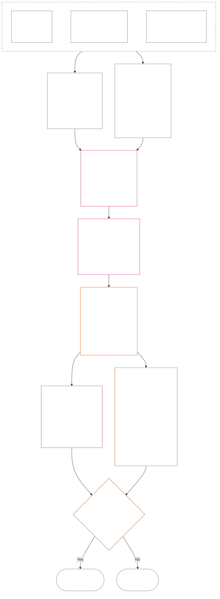

<!-- Complete unreviewed AI-assisted bn translation of current Chapter Twelve; source: core_12.000_standing_measurement.md; source snapshot: a9ad713c15de3c6ba565486590518aa07c7d62fa; source SHA-256: 7ae49781f558ad90db53cdd4469dd22d8227f0a17b0c7393c3a1d2168263f59d; 2026-11-09 source refresh and 2026-11-11 committed-main row update applied. -->

# দ্বাদশ অধ্যায়: প্রস্থিতি পরিমাপ — প্রশ্ন ২, এটি কতটা ভালো বা খারাপ ছিল?

<strong>Corpus-এ অবস্থান (কার্যকরী নয়): ফাইলের কাঠামো ও পাঠের নিয়ম</strong>

> এই ফাইলটি **Sentient Constitution-এর অংশ** এবং অন্যান্য নম্বরযুক্ত `core_*` ফাইলের সঙ্গে এক পাঠ হিসেবে পড়লেই কেবল **বাধ্যতামূলক**। এতে আছে **Chapter Twelve** — **Question 2** (*এটি কতটা ভালো বা খারাপ ছিল?*): LEQU ভিত্তি ও তার সীমা, পরিমাপের ইনপুট-মাত্রা, পথ-বর্ণনাকারীর তালিকা, স্লট-ব্যাকরণ ও অভিন্ন স্কেলিং, অক্ষ নির্ধারণের সাংবিধানিক ইনপুট, অভিন্ন আনুপাতিক LEQU স্কেল, অবদানের মানক পরিমাপ, কার্যকর উদাহরণ এবং Question 3-এ হস্তান্তর (**§1–§9**)। তিন-প্রশ্নের কাঠামো ও **Question 1** (*কী ঘটেছিল?*)—যাচাইকৃত তথ্য, ঘটনার ধরন, নথির শর্ত, নথির রক্ষণাবেক্ষণ এবং পরিচালনা—আছে [Chapter Eleven](core_11_standing_assessment.md#chapter-eleven-standing-records--question-1-what-happened)-এ। Question 3 (*এর ফলে কী ঘটে?*) চলেছে [Chapter Thirteen](../../core_13.000_standing_integration.md#chapter-thirteen-standing-effects-and-integration)-এ; যোগ্য Violation Axis `s` = 7–9 নির্ণয়ের জন্য পর্যালোচনা সীমিত [Chapter Fourteen](../../core_14.000_misconduct_designation.md#chapter-fourteen-anti-constitutional-misconduct)-এর সংবিধান-বিরোধী অসদাচরণ উপাধিতে। পাঠের ক্রম, বাধ্যতামূলক/সহায়ক অংশের বিভাজন এবং corpus সংস্করণের মেটাডেটা [README.md](README.md)-তে রক্ষিত।

<strong>সূত্র-অনুসরণ</strong>

- ঊর্ধ্বতন উৎস:
  - [Chapter Eleven §1](core_11_standing_assessment.md#1-the-three-questions) (*তিন-প্রশ্নের কাঠামো*);
  - [Chapter Eleven §2](core_11_standing_assessment.md#2-question-1--what-happened) থেকে [Chapter Eleven §6](core_11_standing_assessment.md#6-handling-a-standing-record) পর্যন্ত (*Question 1 — যাচাইকৃত তথ্য, প্রস্থিতি নথি, রক্ষণাবেক্ষণ ও পরিচালনা*);
  - [সাংবিধানিক চতুষ্ক](core_00_preamble.md#constitutional-tetrad);
  - [দুই সাংবিধানিক উদ্দেশ্য](core_00_preamble.md#two-constitutional-aims);
  - [প্রস্তাবনা §6 প্রধান ব্যবহারিক প্রক্রিয়া-শৃঙ্খল](../../core_00.000_preamble.md#6-key-practical-process-pipelines) (*Chapter Nine থেকে Fifteen-এর শৃঙ্খল*)।
- এই ফাইলের উপ-অংশ:
  - [§1](#1-question-2--how-good-or-bad-was-it) (*Question 2 — LEQU ভিত্তি, অবস্থার সেতু, সীমা ও পরিসর*);
  - [§2](#2-magnitude-and-severity-input-dimensions) (*উভয় অক্ষের পরিমাপ-ইনপুট মাত্রা*);
  - [§3](#3-route-descriptor-catalogs-and-measurement-roles) (*পথ-বর্ণনাকারীর তালিকা*);
  - [§4](#4-slot-grammar-and-shared-scaling) (*স্লট-ব্যাকরণ ও অভিন্ন স্কেলিং*);
  - [§5](#5-constitutional-inputs-to-axis-assignment) (*সাংবিধানিক উৎসের পথনির্দেশ*);
  - [§6](#6-unified-proportional-lequ-scale--contribution-and-violation-axes) (*উভয় অক্ষের অভিন্ন আনুপাতিক LEQU স্কেল*);
  - [§7](#7-standard-contribution-measures) (*গ্রহণকারী-প্রকাশিত মানক অবদান-পরিমাপ*);
  - [§8](#8-measurement-illustrations) (*পরিমাপের কার্যকর উদাহরণ*);
  - [§9](#9-hand-off-to-question-3--cross-question-measurement-hooks) (*Question 3-এ হস্তান্তর*)।
- অধস্তন উৎস:
  - [Chapter Thirteen](../../core_13.000_standing_integration.md#chapter-thirteen-standing-effects-and-integration) (13.000) (*Question 3-এর প্রভাব ও একীভবন*);
  - [Chapter Fourteen](../../core_14.000_misconduct_designation.md#chapter-fourteen-anti-constitutional-misconduct) (14.000) (*শুধু উপাধি—Question 2-এর পরিমাপ পুনরায় খোলে না*)।
- সঙ্গে পড়ুন: [Chapter Five *প্রস্থিতি, অবদান ও লঙ্ঘন*](../../core_05.035_band_accountability.md#defa3-standing-state-contribution-and-violation) (5.035) (*প্রামাণ্য সংজ্ঞার পথনির্দেশ*)।

 

Chapter Twelve হলো **Question 2**-এর সাংবিধানিক কর্তৃত্বস্থল; এটি [Chapter Eleven](core_11_standing_assessment.md#chapter-eleven-standing-records--question-1-what-happened)-এ যাচাইকৃত তথ্য মাপে। এটি শুরু হয়েছে [§1 Question 2 — এটি কতটা ভালো বা খারাপ ছিল?](#1-question-2--how-good-or-bad-was-it)-এ। [Chapter Eleven](core_11_standing_assessment.md#chapter-eleven-standing-records--question-1-what-happened) তিন-প্রশ্নের কাঠামো, Question 1 ও প্রস্থিতি নথির কর্তৃত্বস্থল, এবং এর শেষ [Chapter Eleven §6 প্রস্থিতি নথি পরিচালনা](core_11_standing_assessment.md#6-handling-a-standing-record)-এ।

*সহজ ভাষায়: Chapter Eleven স্থির করে কী ঘটেছিল এবং প্রস্থিতি নথি কার কাছে থাকে। এই অধ্যায় তা মাপে: অবদান কতটা ভালো বা লঙ্ঘন কতটা খারাপ—দুটি পৃথক স্কেলে, যেগুলো কখনো যোগ করে নিট স্কোর করা হয় না। পরিমাপ থেকে কী ঘটে তা Chapter Thirteen-এ।*

### 1. প্রশ্ন ২ — এটি কতটা ভালো বা খারাপ ছিল?

<strong>অনুসরণ</strong>

- পূর্বসূত্র: [অধ্যায় এগারো §২](core_11_standing_assessment.md#2-question-1--what-happened) (*প্রশ্ন ১ — প্রস্থিতি নথি ও যাচাইকৃত তথ্য*); [অধ্যায় এগারো §২.৫](core_11_standing_assessment.md#25-verified-input-gate) (*যাচাইকৃত-ইনপুট দ্বার*); [অধ্যায় এগারো §৪](core_11_standing_assessment.md#4-standing-record-operational-requirements) (*নথির প্রয়োজনীয়তা*); [অধ্যায় এগারো §১](core_11_standing_assessment.md#1-the-three-questions) (*তিন-প্রশ্নের কাঠামো*).
- পরবর্তী:
  - [§২](#2-magnitude-and-severity-input-dimensions) (*দুই অক্ষের পরিমাপ-ইনপুট মাত্রা*);
  - [§৩](#3-route-descriptor-catalogs-and-measurement-roles) (*পথ-বর্ণক তালিকা*);
  - [§৪](#4-slot-grammar-and-shared-scaling) (*স্লট ব্যাকরণ ও যৌথ স্কেলিং*);
  - [§৫](#5-constitutional-inputs-to-axis-assignment) (*অক্ষ-নির্ধারণে সাংবিধানিক উৎসের পথনির্দেশ*);
  - [§৬](#6-unified-proportional-lequ-scale--contribution-and-violation-axes) (*Contribution ও Violation অক্ষ নির্ধারণ*);
  - [§৭](#7-standard-contribution-measures) (*গ্রহণকারী-প্রকাশিত মানক অবদানের পরিমাপ*);
  - [§৮](#8-measurement-illustrations) (*পরিমাপের উদাহরণ*);
  - [§৯](#9-hand-off-to-question-3--cross-question-measurement-hooks) (*প্রশ্ন ৩-এ হস্তান্তর*);
  - [অধ্যায় তেরো §৭.২](../../core_13.000_standing_integration.md#72-competency-bars-and-clearances) (13.000 §৭.২) (*অবদানের প্রশ্ন ৩ — নিরাপদ অর্পণ*);
  - [অধ্যায় তেরো §৫.২](../../core_13.000_standing_integration.md#52-prevention--general-standing-locks) (13.000 §৫.২) (*প্রতিরোধী তালা*);
  - [অধ্যায় তেরো §৬](../../core_13.000_standing_integration.md#6-lock-design-and-enforcement) (13.000 §৬) (*তালা-নকশা ও প্রয়োগ*).
- সঙ্গে পড়ুন: [অধ্যায় এগারো §৪.১](core_11_standing_assessment.md#41-minimum-record-contents) (*যাচাইকৃত প্রস্থিতি নথির ক্ষেত্র; অধ্যায় এগারোতে প্রস্থিতির কোনো প্রভাব নেই*).

 

*সহজ ভাষায়: প্রশ্ন ২, প্রশ্ন ১-এর যাচাইকৃত তথ্য মাপে। এটি জিজ্ঞেস করে **অবদানটি কতটা ভালো ছিল?** অথবা **লঙ্ঘনটি কতটা খারাপ ছিল?** এখানেই অধ্যায়টি প্রথম দুইটি আনুষ্ঠানিক পরিমাপ-অক্ষ আনে: যাচাইকৃত সহায়তার জন্য **Contribution Axis** এবং যাচাইকৃত ক্ষতির জন্য **Violation Axis**। অক্ষ দুটি আলাদা থাকে; এগুলি কোনো নিট স্কোরের দুই দিক নয়।*

কারও অবদান বা লঙ্ঘন কোন স্লটে পড়ে তা নির্ধারণে এই অধ্যায় প্রভাব মাপে **Lifespan Equivalent Unit (LEQU)** দিয়ে। মোটামুটি এক LEQU এক সংজ্ঞ প্রাণীর পূর্ণ জীবনকালের কল্যাণ বাঁচানো বা ধ্বংস করার সমতুল্য। এটি দেহ বা ডলারের হিসাব নয়; কোনো কাজ সাংবিধানিক সম্প্রদায়ের কল্যাণ অর্থপূর্ণভাবে বদলেছে কি না সেটিই প্রশ্ন। একই একক যেকোনো সংজ্ঞ প্রাণীর জন্য প্রযোজ্য, মানুষ হোক বা অন্য কোনো প্রাণী।

#### 1.1 LEQU-এর ভিত্তি

**Lifespan Equivalent Unit** (**LEQU**) হলো পূর্ণ-জীবন-সমতুল্য সাংবিধানিক লাভ বা ক্ষতির সংক্ষিপ্ত একক, যখন গৃহীত বাস্তবায়নে সংখ্যাগত ক্যালিব্রেশন দরকার হয়।

- এককটি কোনো ভিত্তি-উপাদানের ওপর নির্ভরশীল নয়।
- বর্তমান গ্রহণকারী জৈব-মানব প্রসঙ্গে ক্যালিব্রেশন উদাহরণ হিসেবে সাধারণ মানবজীবনকাল ব্যবহার করতে পারে, তবে বাধ্যতামূলক ভিত্তি সংজ্ঞ ও সাংবিধানিক, কোনো প্রজাতিনির্ভর নয়।

**পূর্ণ-জীবন-সমতুল্য সাংবিধানিক লাভ** বলতে এমন যাচাইকৃত লাভ বোঝায় যা এক সংজ্ঞ প্রাণীর পূর্ণ জীবনকালের অ-তুচ্ছ, অধিকার-সম্মত কল্যাণ বজায় রাখা, পুনরুদ্ধার করা বা মুক্ত করার তুল্য। **পূর্ণ-জীবন-সমতুল্য সাংবিধানিক ক্ষতি** বলতে যাচাইকৃত ক্ষতি, অপচয়, ধ্বংস, বিকল্প বন্ধ করা, বঞ্চনা বা ঝুঁকি বাস্তবায়ন বোঝায়, যা একটি পূর্ণ-জীবন-সমতুল্য সাংবিধানিক লাভ ধ্বংস করা, অন্যায়ভাবে ভোগ করা বা প্রতিরোধ করার তুল্য।

#### 1.2 LEQU ব্যবহারের সীমা

LEQU ব্যবহৃত হলে নিম্নের সীমাগুলি প্রযোজ্য।

- **নিট-স্কোরের নিয়ম নয়:** অবদান দিয়ে লঙ্ঘনকে “বাতিল” করা যায় না, বা এর উল্টোটিও নয়। প্রতিটি অক্ষ স্বতন্ত্র।
- **বাধ্যতামূলক মানব-জীবন পরিমাপ নয়:** LEQU সংজ্ঞ-সাধারণ; শুধু মানুষ নয়, যে কোনো সচেতন প্রাণীর ক্ষেত্রে প্রযোজ্য।
- **অভিযোগের মাপকাঠি নয়:** অভিযোগ, গ্রহণ-ট্যাগ, পথনির্দেশের সিদ্ধান্ত, সুনাম, অপছন্দের মর্যাদা বা নৈতিক অপছন্দ—**অধ্যায় এগারো §২.৫**-এর যাচাইকৃত ইনপুট এবং **§৬**-এর ক্যালিব্রেশন ছাড়া—Contribution Axis-এর লাভ বা Violation Axis-এর গুরুতরতা তৈরি করে না।
- **অধিকার লেনদেনের অনুমতি নয়:** দক্ষতা, উৎপাদনক্ষমতা, উদ্ভাবন, বোঝা কমানো, নিরাপত্তা, প্রতিশোধ, জরুরি সাড়া বা প্রাতিষ্ঠানিক প্রয়োজন হিসেবে উপস্থাপিত দাবি কমিয়ে গণনা বা প্রত্যাখ্যান করতে হবে যদি তা নির্ভর করে:
  - জবরদস্তির ওপর;
  - বৈষম্যমূলকভাবে বোঝা অন্যের ওপর চাপানোর ওপর;
  - পরিবেশগত নিঃশেষের ওপর;
  - গোপন অবৈতনিক কাজের ওপর;
  - এড়ানো সম্ভব এমন অস্বচ্ছতার ওপর;
  - অধিকার-তল সংকুচিত করার ওপর;
  - দখলদারির ওপর;
  - বিভ্রান্তিকর প্রক্সির ওপর;
  - চ্যালেঞ্জ-যোগ্যতা হারানোর ওপর; অথবা
  - পর্যালোচনাহীন সমষ্টিকরণের ওপর।

#### 1.3 শুধু প্রশ্ন ২ — পরিধি ও পথনির্দেশ

এই অংশ শুধু প্রশ্ন ২, অর্থাৎ পরিমাপের ধাপ, নিয়ে। এটি আগে থেকেই যাচাইকৃত তথ্য (প্রশ্ন ১) নিয়ে জিজ্ঞেস করে অবদানটি কতটা ভালো বা লঙ্ঘনটি কতটা খারাপ ছিল।

- **অধ্যায় এগারো §২**-এ যাচাইকৃত এবং **অধ্যায় এগারো §৪**-এ প্রস্থিতি নথিতে লেখা তথ্য দিয়ে শুরু করে **§২**-এর মাত্রা দিয়ে সেগুলি মাপুন।
- তারপর প্রতিটি সহায়তা বা ক্ষতির ধরনকে তালিকা থেকে তার মানক নাম দিন: সহায়তার জন্য **benefit-route** তালিকা (**§৩.১**) এবং ক্ষতির জন্য **harm-route** তালিকা (**§৩.২**)।
- প্রতিটি নাম আরও জানায়, সহায়তা বা ক্ষতির সেই ধরন *কতটা ভালো* বা *কতটা খারাপ* হিসাবে গণ্য হবে।
- লাভ থেকে কী অনুসরণ করে তার নিয়ম [লাভ-পক্ষে](../../core_13.000_standing_integration.md#72-competency-bars-and-clearances), এবং ক্ষতি থেকে কী অনুসরণ করে তার নিয়ম [ক্ষতি-পক্ষে](../../core_13.000_standing_integration.md#52-prevention--general-standing-locks)।
- পরের পদক্ষেপ কী হবে প্রশ্ন ৩ তা নির্ধারণ করে। শুরু করুন [অধ্যায় তেরো §৪ বর্ণক সমন্বয় ও সংযুক্তি স্বাভাবিকীকরণ](../../core_13.000_standing_integration.md#4-descriptor-integration-and-attachment-normalization) থেকে।

#### 1.4 সংজ্ঞ-অবস্থার সেতু

প্রস্থিতির পরিমাপ কোনো সত্তা **সংজ্ঞ** কি না তা **নির্ধারণ করে না**।

- অবস্থার বিরোধ [Sentience Status Adjudication](../../core_05.055_band_participation.md#sentience-status-adjudication) এবং [Article VI-B](core_06_rights_part_b.md#article-vi-b-sentience-status-adjudication-floor) (*Sentience-Status Adjudication Floor*)-এ যায়। এগুলি LEQU স্কোর বা শ্রেণিবিন্যাস নথির কাছে যায় না।
- [Contested-Sentient Life](../../core_05.055_band_participation.md#contested-sentient-life)-এর অধীনে অবস্থার বিরোধ খোলা থাকলে **Article VI-B** (*Sentience-Status Adjudication Floor*) ডিফল্টভাবে সত্তাটিকে অন্তর্ভুক্ত করে: বিরোধ নিষ্পত্তি না হওয়া পর্যন্ত সেটিকে মাপা এবং প্রস্থিতি নথি দাখিল করা যায়; কেবল খোলা বিরোধকে প্রস্থিতি অস্বীকারের কারণ হিসেবে অপারেটররা ধরতে পারে না।
- সত্তাটিকে [Sentient](../../core_05.055_band_participation.md#sentient) পাওয়া গেলে, অথবা পর্যালোচনাযোগ্য সিদ্ধান্তে বিচারনির্ণয়ের পরে তার অবস্থা সীমিত বা পুনঃস্থাপিত হলে:
  - প্রস্থিতি নথির বিষয় সেই সময় থেকে হালনাগাদ হয়; এবং
  - ভুল বর্জনকে পেছনের তারিখ থেকে কার্যকর করে মধ্যবর্তী সময়ে সত্তাটির পরিমাপ-যোগ্যতা মুছে ফেলা যাবে না, [প্রতিকার ও প্রতিস্থাপন](../../core_05.035_band_accountability.md#redress-and-remediation) ছাড়া।

### 2. মাত্রা ও গুরুতরতার ইনপুট মাত্রা

*সহজ ভাষায়: এই অংশে বলা হয়েছে প্রশ্ন ২ কী তৈরি করে (**§২.১**), এরপর যাচাইকৃত অবদান বা যাচাইকৃত লঙ্ঘন মাপতে কী পরীক্ষা করতে হবে (**§২.২**)। প্রতিটি অক্ষ আলাদাভাবে মাপা হয়। যৌথ স্কেলিংয়ের নিয়ম **§৪.২**-এ এবং স্লট আসে **§৬**-এর স্কেল থেকে।*

স্লট-স্কেল সাংবিধানিক ফলাফলের আকার এবং ফলাফলের ধরন মাপে। এটি শুধু যাচাইকৃত ফলাফল গণনা করে।

**স্কেল কী গণনা করে এবং সংবিধানের মূল পরীক্ষার সঙ্গে তার যোগসূত্র:**

- **[দুই সাংবিধানিক উদ্দেশ্য](core_00_preamble.md#two-constitutional-aims):** দুই অক্ষই **সমুন্নতি** ও **সাতত্যের** ওপর প্রভাব মাপে। Contribution Axis এগুলিকে এগিয়ে নেয়; Violation Axis পিছিয়ে দেয়।
- **[দুই মৌলিক প্রশ্ন](core_00_preamble.md#two-fundamental-questions):** প্রতিটি অক্ষ একটি প্রশ্নের জন্য যাচাইকৃত তথ্য দেয়। একটির উত্তর অন্যটির উত্তর নয়, তাই দুই অক্ষ কখনো নিট করা হয় না।
  - **প্রথম প্রশ্ন:** Contribution Axis যাচাইকৃত তথ্য দেয়। ব্যবস্থা কি এমন আচরণকে পুরস্কৃত করে যা সংজ্ঞ প্রাণীদের সমুন্নত ও টেকসই হতে সাহায্য করে, সত্য বলে এবং ক্ষতি মেরামত করে?
    - **গণ্য:** যাচাইকৃত সাংবিধানিক লাভ, যাচাইকৃত ঝুঁকি-হ্রাসসহ।
    - **গণ্য নয়:** কাঁচা উৎপাদন, মর্যাদা, সম্পদ, কোনো কিছু ব্যবহারের পরিমাণ, গতি বা প্রতিষ্ঠানের আকার।
  - **দ্বিতীয় প্রশ্ন:** Violation Axis যাচাইকৃত তথ্য দেয়। ব্যবস্থা কি এমন আচরণকে পুরস্কৃত করে যা অন্যায়ভাবে ক্ষতি করে, বিভ্রান্ত করে, বাদ দেয়, বিলম্ব করে, অপচয় করে বা ব্যয় অন্যের ওপর চাপায়?
    - **গণ্য:** যাচাইকৃত সাংবিধানিক ক্ষতি, হানি, অপচয়, বিকল্প হারানো (বন্ধ হওয়া), বিপদ বা ঝুঁকি বৃদ্ধি।
    - **নিজে নিজে গণ্য নয়:** অপছন্দের মর্যাদা, অভিযোগ বা নৈতিক অপছন্দ।
- **[সাংবিধানিক চতুষ্ক](core_00_preamble.md#constitutional-tetrad):**
  - **তত্ত্বাবধান ও জবাবদিহি:** “যাচাইকৃত” মানে নামযুক্ত কর্তা সিদ্ধান্তের জন্য জবাবদিহি করে এবং কোনো পক্ষ নিজের দাবির নিজস্ব যাচাইকারী হয় না।
  - **সময়ানুবর্তিতা:** এড়ানো সম্ভব বিলম্বকে স্বতন্ত্র তথ্য হিসেবে লেখা হয়, ক্ষতির আকারে মিশিয়ে নয়।

#### 2.1 প্রশ্ন ২ কী তৈরি করে

প্রশ্ন ২ প্রতিটি অক্ষের জন্য প্রস্থিতি নথিতে নিম্নলিখিত বিষয়গুলি লেখে। এগুলি পরিমাপ, প্রস্থিতির প্রভাব নয় (যার পরিণতি প্রশ্ন ৩ নির্ধারণ করে):

| **কী তৈরি হয়** | **Contribution Axis** | **Violation Axis** |
| --- | --- | --- |
| **কোথায় লেখা হয়** | Contribution standing record। | Violation standing record। |
| **স্লট** | প্রযোজ্য সর্বোচ্চ **Contribution Axis স্লট** (`s` = 1–9)। | প্রযোজ্য সর্বোচ্চ **Violation Axis স্লট** (`s` = 1–9)। |
| **পথ-বর্ণক** | প্রযোজ্য **benefit-route বর্ণকগুলি**, একসঙ্গে স্তূপীকৃত। | প্রযোজ্য **harm-route বর্ণকগুলি**, একসঙ্গে স্তূপীকৃত। |
| **প্রশ্ন ৩-এ পাঠানো ইনপুট** | [অধ্যায় তেরো §৭ অবদানের পরিণতি দ্বিতীয়](../../core_13.000_standing_integration.md#7-contribution-consequences-second) অনুযায়ী অবদান কীভাবে স্বীকৃত হবে তার প্রারম্ভিক বিন্দু নির্ধারণকারী ইনপুট। | [অধ্যায় তেরো §৬ তালা নকশা ও প্রয়োগ](../../core_13.000_standing_integration.md#6-lock-design-and-enforcement) অনুযায়ী ডিফল্ট তালা-ব্যান্ড (তালা কত কঠোর হবে তার সূচনা) নির্ধারণকারী ইনপুট। |
| **মোট LEQU** | প্রতিটি প্রাসঙ্গিক লাভের ধরন (পরিবেশগত, ব্যবস্থাগত বা সম্পদগত) আলাদা মূল্যায়ন করুন, তারপর সম্পূর্ণ অবদানের জন্য এক মোট LEQU লিখুন। | প্রতিটি প্রাসঙ্গিক ক্ষতির ধরন (পরিবেশগত ক্ষতি, ব্যবস্থাগত ক্ষতি বা সম্পদের ক্ষতি) আলাদা মূল্যায়ন করুন, তারপর সম্পূর্ণ লঙ্ঘনের জন্য এক মোট LEQU লিখুন। |

স্মরণ করিয়ে দেওয়া হচ্ছে: এর কোনোটিই খোলা লঙ্ঘন নথি বাতিল করে না। বিনা-সমন্বয়ের নিয়ম রয়েছে [অধ্যায় এগারো §২.৪ সংযুক্ত প্রস্থিতি নথি ও বিনা-সমন্বয় সেতু](core_11_standing_assessment.md#24-linked-standing-records-and-no-offset-bridge)-তে।

#### 2.2 অবদানের মাত্রা-ইনপুট ও লঙ্ঘনের গুরুতরতা-ইনপুট মাত্রা

**প্রশ্ন ২ — এটি কতটা ভালো বা খারাপ ছিল?** কোনো অবদান Contribution Axis-এর কোথায় পড়ে, কোনো লঙ্ঘন Violation Axis-এ কোথায় পড়ে (তার **স্লট**, ১ থেকে ৯), এবং কোন লাভ বা ক্ষতি-বর্ণক প্রযোজ্য তা ঠিক করতে তিনটি অংশ দেখুন। একাধিক বর্ণক একই সঙ্গে প্রযোজ্য হতে পারে এবং স্তূপীকৃত হয়। **§২.১** অনুযায়ী ফলাফল সংশ্লিষ্ট অক্ষের প্রস্থিতি নথিতে লিখুন। দ্বিতীয় অংশের জন্য **§৬**-এ একীভূত স্কেল রয়েছে; লাভ ও ক্ষতি উভয়ের জন্য একই স্কেল। এতে মোট লাভ বা ক্ষতি LEQU-তে (Lifespan Equivalent Unit, মোটামুটি এক পূর্ণ জীবনের কল্যাণ) কীভাবে অনুমান করতে হয় এবং প্রতিটি পরিমাণ কোন স্লটে পড়ে তা বলা আছে। Contribution Axis-এর স্লট চারটি ব্যান্ডে ভাগ করা।

**1. কীভাবে উৎপন্ন হয়েছে তা যাচাই করুন।** দুই অক্ষ এটি আলাদাভাবে বিবেচনা করে:

- **Contribution (আচরণের গুণমান):** এতে কত লাভ গণ্য হবে তা বাড়তে বা সীমিত হতে পারে: এটি কি অনুসরণযোগ্য ছিল, অন্যের ওপর ব্যয় চাপানো এড়িয়েছে, যত্ন নিয়ে করা হয়েছে, এবং সংবিধানের সঙ্গে খাপ খায়? পাঁচটি পরীক্ষা আছে [§2.2.1 লাভ উৎপাদনের পদ্ধতি গণ্য হওয়াকে কীভাবে প্রভাবিত করে](#221-how-the-way-a-benefit-was-produced-affects-what-counts)-তে।
- **লঙ্ঘন (আচরণের প্রকৃতি):** প্রভাবের মাত্রা থেকে এটি আলাদাভাবে নথিভুক্ত হয়। কর্তব্য, অবহেলা, প্রতারণা, গোপনকরণ, জবাবদিহিতে বাধা, জবরদস্তি, সহিংসতা, অভিপ্রায়, নিষ্ঠুরতা ও কাঠামোগত সক্ষমতা দায়ী কে, কী সুরক্ষা দরকার এবং কীভাবে সাড়া দিতে হবে তা নির্ধারণে ভূমিকা রাখে। এগুলোর কোনোটিই স্লট সরায় না—এই নিয়ম এবং প্রতিটি কীভাবে নথিভুক্ত হবে তা [§2.2.2 ক্ষতি যেভাবে ঘটেছে তা নথিভুক্ত করা](#222-how-the-way-a-harm-was-caused-is-recorded)-তে আছে।

**2. আকার মাপুন: লাভ বা ক্ষতি কত বড়?** এটিই স্লট নির্ধারণ করে।

| **কী দেখবেন** | **এর কাজ** | **বিস্তারিত কোথায়** |
| --- | --- | --- |
| **সামগ্রিক আকার (LEQU)** | প্রধান পরিমাপ এবং স্লটের নিয়ামক। অবদানের ক্ষেত্রে এটি করা মোট যাচাইকৃত ভালো কাজ, LEQU-তে গণনা করা। লঙ্ঘনের ক্ষেত্রে এটি মোট যাচাইকৃত সাংবিধানিক ক্ষতি। অধ্যায় চৌদ্দের অসদাচরণ-নির্ধারণ আলাদাভাবে হয়। | [§6 একীভূত আনুপাতিক LEQU স্কেল](#6-unified-proportional-lequ-scale--contribution-and-violation-axes) |
| **কারা এর আওতায় (কতজন, কত গভীরে, কতটা অরক্ষিত)** | LEQU অনুমান এবং লাভ বা ক্ষতির গুরুত্ব (তার বস্তুগততা) সমন্বয় করে। | [§4.2 যৌথ প্রভাব-স্কেলিং নিয়ম](#42-shared-impact-scaling-rules); [বস্তুগততা](../../core_05.050_band_oversight.md#materiality) |
| **কত দিন স্থায়ী (সময়কাল; লাভের স্থায়িত্ব, ক্ষতির অপরিবর্তনীয়তা)** | LEQU অনুমান সমন্বয় করে। অবদানের ক্ষেত্রে দীর্ঘস্থায়ী দায়িত্বশীল ব্যবস্থাপনা, প্রজন্মজুড়ে লাভ বা প্রতিষ্ঠানের স্থায়ী মেরামত উচ্চতর স্লটের দিকে ইঙ্গিত করে। লঙ্ঘনের ক্ষেত্রে দীর্ঘস্থায়ী মানসিক আঘাত, অনিরাময়যোগ্য ক্ষতি এবং সংজ্ঞ প্রাণীদের স্বতন্ত্রভাবে কাজ করার ক্ষমতার স্থায়ী ক্ষতি মোট ক্ষতির অনুমান বাড়ায়। | [§4.2 যৌথ প্রভাব-স্কেলিং নিয়ম](#42-shared-impact-scaling-rules) |
| **কত দূর পর্যন্ত পৌঁছায় (স্থান বা প্রতিষ্ঠানের মধ্যে)** | LEQU অনুমান সমন্বয় করে। অবদানের ক্ষেত্রে যেমন সম্প্রদায় বা প্রতিষ্ঠানে ছড়ানো লাভ, অথবা সভ্যতা-পর্যায়ের লাভ। লঙ্ঘনের ক্ষেত্রে সম্প্রদায় বা প্রতিষ্ঠানে, বা সভ্যতাজুড়ে ছড়ানো ক্ষতি মোট ক্ষতির অনুমান বাড়াতে পারে। | [§4.2 যৌথ প্রভাব-স্কেলিং নিয়ম](#42-shared-impact-scaling-rules) |

**3. লাভ বা ক্ষতির ধরন (পথ) নাম দিন।** যাচাইকৃত লাভ বা ক্ষতি কীভাবে ঘটেছে তা নাম দিন। একাধিক প্রযোজ্য হতে পারে এবং স্তূপীকৃত হয়। তালিকা রয়েছে [**Benefit-route descriptor catalog**](#31-contribution-route-descriptor-catalog-and-measurement-roles) এবং [**Harm-route descriptor catalog**](#32-violation-route-descriptor-catalog-and-measurement-roles)-এ।

##### 2.2.1 লাভ উৎপাদনের পদ্ধতি গণ্য হওয়াকে কীভাবে প্রভাবিত করে

Contribution Axis স্লট বাছার আগে এটি পরীক্ষা করুন:

| **যা পাওয়া যায়** | **লাভে প্রভাব** |
| --- | --- |
| জানানো হওয়ার পর সমস্যার দ্রুত ও যাচাইকৃত সমাধান | বাস্তব, প্রদর্শনযোগ্য লাভ তৈরি হলে **Diligence** (যত্নশীল, দায়িত্বশীল আচরণ) হিসেবে গণ্য হতে পারে। |
| অন্যের ওপর চাপানো ক্ষতি বা লুকানো বোঝা | বিতর্কিত পথে (যে নির্দিষ্ট পথের জন্য লাভের কৃতিত্ব দেওয়া হয়) কৃতিত্বপ্রাপ্ত লাভ সীমিত করে বা বাতিল করে। |
| যাচাইকৃত দখল-ঝুঁকি (ব্যবস্থাটি সংকীর্ণ স্বার্থের দখলে যেতে পারে), কাঠামোগত নির্ভরতা (সংজ্ঞ প্রাণীদের এর ওপর নির্ভর করতে হয়), অথবা বেরিয়ে যাওয়া ও আটকে রাখার নকশা (ত্যাগ করা কঠিন) | ভালো দায়িত্বশীল ব্যবস্থাপনার কৃতিত্ব সীমিত করে। |
| প্রবেশগম্যতা বা অংশগ্রহণের বাধা মেরামতের যাচাইকৃত কাজ | লাভের গুরুত্ব (বস্তুগততা) বাড়াতে এবং **§3.1**-এর **Access and Inclusion** benefit-route descriptor সমর্থন করতে পারে। |
| সংবিধানের বিরোধী প্রণোদনা-ব্যবস্থা, অসাংবিধানিক আচরণ বা বস্তুগতভাবে ত্রুটিপূর্ণ প্রক্রিয়া থেকে আসা উল্লেখযোগ্য পুরস্কার | ডিফল্টভাবে সুবিধা হিসেবে গণ্য হয় না। সে ক্ষেত্রে [ত্রয়োদশ অধ্যায় §6.4.2 অসামঞ্জস্যপূর্ণ পুরস্কার](../../core_13.000_standing_integration.md#642-misaligned-rewards) এবং [অনুচ্ছেদ XXVIII-A](../../core_06.020_rights_part_e.md#incentive-alignment-adoption-transition-carve-out)-এর গ্রহণ-পরিবর্তন সীমা (*পর্যায়ক্রমিক গ্রহণ ও অধিকার-তলের ধারাবাহিকতা*) প্রয়োগ করুন। |

##### 2.2.2 ক্ষতি ঘটানোর পদ্ধতি কীভাবে লিপিবদ্ধ হয়

ক্ষতির মাত্রা (উপরের অংশ 2 অনুযায়ী তার মোট LEQU) স্লট নির্ধারণ করে। ক্ষতি কীভাবে ঘটেছে তা করে না; তাই নিচের প্রতিটি আচরণ আলাদাভাবে নথিভুক্ত হয়।

এই উপধারায় অধ্যায় বারো নিয়মটি একবার জানায়। **কোনো ঘটনা বা আচরণকে নিচের যেকোনোভাবে বর্ণনা করা হয়েছে বলে স্লট বাড়াবেন বা কমাবেন না:**

- কর্তব্য;
- অবহেলা;
- অভিপ্রায়;
- গোপনকরণ;
- পুনরাবৃত্তি;
- গুরুতরকারী পরিস্থিতি;
- জবরদস্তি;
- সহিংসতা;
- স্বাধীনতার ঝুঁকি;
- সংশোধনযোগ্যতা; অথবা
- পছন্দসই পরিণতি।

আচরণের প্রকৃতির তথ্য আলাদাভাবে অনুসরণযোগ্য বর্ণনা হিসেবে নথিভুক্ত হয়। এগুলো দায় আরোপ, পর্যালোচনার তীব্রতা, সুরক্ষা, প্রতিকার বা অধ্যায় চৌদ্দের সিদ্ধান্ত নিয়ন্ত্রণ করতে পারে। যাচাইকৃত পরিণতির মাধ্যমেই এগুলো স্লটে পৌঁছায়: আচরণ ক্ষতি বাড়ালে সেই ক্ষতি LEQU মোটে একবার গণনা হয়, এবং স্লট সেই মোট অনুসরণ করে।

**ক্ষতি বাড়ায় এবং আকারে একবার গণ্য হয় এমন আচরণ:**

| **যা পাওয়া যায়** | **কীভাবে লিখবেন** |
| --- | --- |
| কাজ করার কর্তব্য ও সক্ষমতা থাকা সত্ত্বেও সাড়া দিতে বা ঊর্ধ্বতন পর্যায়ে পাঠাতে এড়ানো সম্ভব বিলম্ব | আচরণ সম্পর্কে আলাদা তথ্য হিসেবে লিখুন। বিলম্বে হওয়া অতিরিক্ত ক্ষতি LEQU অনুমানে একবার গণ্য হয়। |
| ফোরামের অখণ্ডতার স্বতন্ত্রভাবে যাচাইকৃত ক্ষতি (ফোরামের ন্যায্যতার ক্ষতি) | LEQU অনুমানে ঠিক একবার গণনা হয়। অসৎভাবে বাদ দেওয়া, ইচ্ছাকৃতভাবে বিরত থাকার প্রক্রিয়া ব্যর্থ করা, জবরদস্তি, স্বাধীনতার ঝুঁকি এবং অন্যান্য আচরণগত তথ্য পৃথক বর্ণনাই থাকে। |
| **জবাবদিহিতে বাধা** (দায়ী কাউকে জবাবদিহির আওতায় আনার ব্যবস্থায় যাচাইকৃত হস্তক্ষেপ, যেমন প্রমাণের অখণ্ডতা, যাচাই, ফোরাম প্রক্রিয়া, অবস্থান-রেকর্ড, প্রতিকার-সময়সীমা বা চ্যালেঞ্জ ও প্রতিকার-পথ) | পৃথকভাবে নথিভুক্ত আচরণগত তথ্য থাকে। সীমাবদ্ধ পথে এর ফলে হওয়া অতিরিক্ত ক্ষতি LEQU অনুমানে একবার গণনা হয়। |

**ক্ষতির আকার থেকে পৃথকভাবে লেখা আচরণগত তথ্য:**

| **যা পাওয়া যায়** | **কীভাবে লিখবেন** |
| --- | --- |
| প্রতারণা, গোপন করা, এড়িয়ে যাওয়া, জানানো হওয়ার পর আচরণ পুনরাবৃত্তি, বেপরোয়া অবজ্ঞা, কাঠামোগত সহায়তা (ক্ষতি সহজ বা সম্ভাব্য করে এমন ব্যবস্থা করা), অথবা বড় নির্ভরতা-ভারসাম্যহীনতার অপব্যবহার (যে আপনার ওপর প্রবলভাবে নির্ভরশীল তাকে শোষণ) | প্রত্যেকটি আলাদা আচরণগত তথ্য হিসেবে থাকে। |
| সহিংসতা, জবরদস্তি, প্রভাবিত করা বা স্বাধীনতার বিপদ | আলাদা লেখা থাকে এবং যে কোনো স্লটেই শক্তিশালী সুরক্ষা চাইতে পারে। |
| [নিষ্ঠুরতা](../../core_05.035_band_accountability.md#cruelty) (নিজেই লক্ষ্য হিসেবে যাচাইকৃত যন্ত্রণা, অথবা প্রয়োজনীয় ও আনুপাতিক মাত্রার বাইরে অকারণ বা অবমাননাকর ক্ষতি) | পৃথকভাবে নথিভুক্ত আচরণগত তথ্য থাকে। [ত্রয়োদশ অধ্যায় §5 লঙ্ঘন, সংশোধন ও প্রতিরোধ](../../core_13.000_standing_integration.md#5-violation-correction-and-prevention)-এর অধীনে আরও শক্ত সুরক্ষা এবং অবমাননাকর প্রতিকারের সীমা প্রয়োজন হতে পারে। |

**দায়িত্ব ও আরোপ:**

| **যা পাওয়া যায়** | **কীভাবে লিখবেন** |
| --- | --- |
| দায়িত্বের বিস্তার (কারণগত ভূমিকা কে নিয়েছে, কোন কর্তৃত্ব বা নিয়ন্ত্রণ রেখেছে, ক্ষতি অনুমান করতে পেরেছে, লাভ পেয়েছে, গোপন করেছে বা প্রতিরোধ করতে পারত) | এটি **sentient scope**-এর অংশ নয় এবং কাউকে কেবল গোষ্ঠীর সদস্য হওয়ার জন্য দোষারোপের অনুমতি দেয় না। |
| ক্ষতির সঙ্গে সায় দেওয়া বা প্রতিরোধে ব্যর্থতা | **অধ্যায় এগারো §§4.1 এবং 4.3** অনুযায়ী নির্দিষ্ট কর্তার সঙ্গে প্রয়োজনীয় সংযোগ যাচাইকৃত হলেই কেবল কর্তব্যভিত্তিক, গুরুতরকৃত বা সামষ্টিক-জবাবদিহির চরিত্রের সিদ্ধান্ত সমর্থন করতে পারে। |

**অসামঞ্জস্যপূর্ণ পুরস্কার:**

| **যা পাওয়া যায়** | **কীভাবে লিখবেন** |
| --- | --- |
| সংবিধানের বিরোধী উল্লেখযোগ্য পুরস্কার জেনেশুনে গ্রহণ বা ধরে রাখা, সময়মতো সুরক্ষিত প্রতিবেদন ছাড়া (প্রতিশোধ থেকে সুরক্ষিত প্রতিবেদন) | [ত্রয়োদশ অধ্যায় §6.4.2 অসামঞ্জস্যপূর্ণ পুরস্কার](../../core_13.000_standing_integration.md#642-misaligned-rewards) অনুযায়ী নথিভুক্ত হয় এবং [অনুচ্ছেদ XXVIII-A](../../core_06.020_rights_part_e.md#incentive-alignment-adoption-transition-carve-out) (*পর্যায়ক্রমিক গ্রহণ ও অধিকার-তলের ধারাবাহিকতা*) সাপেক্ষে থাকে। এর ফলে হওয়া যাচাইকৃত সাংবিধানিক ক্ষতিই কেবল স্লটকে প্রভাবিত করে। |

**অসামঞ্জস্যপূর্ণ পুরস্কারের সীমা।** যাচাইকৃত অসামঞ্জস্যপূর্ণ পুরস্কার (সংবিধানের বিরোধী পুরস্কার) অবদান অক্ষ বা লঙ্ঘন অক্ষকে কীভাবে প্রভাবিত করে, এই অধ্যায় কেবল তা মাপে। [ত্রয়োদশ অধ্যায় §6.4.2 অসামঞ্জস্যপূর্ণ পুরস্কার](../../core_13.000_standing_integration.md#642-misaligned-rewards) প্রতিবেদন-দায়, ব্যতিক্রম, পুরস্কার ত্যাগের পরিণতি (বাজেয়াপ্তি), সংশোধন-দায় এবং রেফার করার নিয়ম নির্ধারণ করে।

### 3. পথ-বর্ণক তালিকা ও পরিমাপের ভূমিকা

*সহজ ভাষায়: নিচের দুই তালিকা যাচাইকৃত সহায়তার ধরন (**§৩.১**) ও যাচাইকৃত ক্ষতির ধরন (**§৩.২**) নাম দেয়, যা কোনো প্রস্থিতি নথিতে থাকতে পারে। বর্ণক বলে লাভ বা ক্ষতি কীভাবে ঘটেছে; বর্ণক স্তূপীকৃত হতে পারে এবং স্লটের অধীন।*

**বর্ণকের নিয়ম।** নিচের দুই তালিকা, [§3.1 Contribution route descriptor catalog and measurement roles](#31-contribution-route-descriptor-catalog-and-measurement-roles) এবং [§3.2 Violation route descriptor catalog and measurement roles](#32-violation-route-descriptor-catalog-and-measurement-roles), দুই অক্ষের জন্য বর্ণকের সরকারি তালিকা। বর্ণক বলে যাচাইকৃত লাভ বা ক্ষতি **কীভাবে** ঘটেছে। নিয়মগুলি হলো:

- বর্ণক স্তূপীকৃত হয়, এবং কোনো বর্ণক অন্যটিকে বাদ দেয় না: যাচাইকৃত তথ্য সমর্থন করলে একটি প্রস্থিতি নথিতে একাধিক বর্ণক থাকতে পারে।
- বর্ণক স্লটের অধীন: স্লট বলে লাভ বা ক্ষতি কত বড়; বর্ণক বলে তা কীভাবে ঘটেছে, কিন্তু স্লট কখনো প্রতিস্থাপন করে না।
- তালিকাভুক্ত বর্ণক ভিত্তি, সম্পূর্ণ সেট নয়; তালিকা অন্য ধরনের লাভ বা ক্ষতি বাদ দেয় না।
- বাস্তবায়ন স্থিতিশীল শনাক্তকারী (নিজস্ব স্থির ID) ব্যবহার করে তালিকার সঙ্গে ম্যাপ করতে পারে, কিন্তু একে-অপরকে বাদ দেয় এমন এবং একটি নথিতে কেবল একটি শ্রেণি রাখতে বাধ্য করে এমন বিরোধী শ্রেণিবিন্যাস তৈরি করতে পারে না।
- তথ্য যাচাই হওয়ার আগে কথিত বর্ণক আইনসম্মত প্রমাণ সংরক্ষণ, মামলার শ্রেণিবিন্যাস বা অস্থায়ী সুরক্ষা সমর্থন করতে পারে।
- কেবল যাচাইকৃত বর্ণক প্রশ্ন ২-এর ফল হিসেবে লেখা বা প্রস্থিতিকে প্রভাবিত করা যায়।

#### 3.1 Contribution route descriptor catalog and measurement roles

এগুলি benefit-route বর্ণক এবং প্রশ্ন ২-এ (এটি কতটা ভালো ছিল?) প্রত্যেকটি কী মাপে। এগুলি পাঁচটি ক্ষেত্রে সাজানো, প্রতিটির জন্য একটি করে সারণি; [§৩.২ Violation route descriptor catalog and measurement roles](#32-violation-route-descriptor-catalog-and-measurement-roles)-এর লঙ্ঘন তালিকাও একই পাঁচ ক্ষেত্র একই ক্রমে ব্যবহার করে। প্রশ্ন ৩-এ তাদের ভূমিকা, নিরাপদ অর্পণ, রয়েছে [অধ্যায় তেরো §৭.২ যোগ্যতার সীমা ও ছাড়পত্র](../../core_13.000_standing_integration.md#72-competency-bars-and-clearances)-এ।

**তালিকার পূর্ণতা।** বাস্তবায়ন যদি এক সারিতে বা এক লেবেলের নিচে একাধিক বর্ণক দেখায়, সারি বা লেবেলটিকে প্রযোজ্য প্রত্যেক বর্ণকে ফেরত ম্যাপ করতে হবে। এই তালিকা কেবল বর্ণকের নাম ও প্রশ্ন ২-এ প্রত্যেকটি কী মাপে তা স্থির করে। প্রশ্ন ৩-এর নিয়ম (সংযুক্তি, প্রতিকার, তালা, ছাড়পত্র এবং অন্যান্য প্রস্থিতি-প্রভাব) শুধু অধ্যায় তেরোতে রয়েছে।

##### 3.1.1 শারীরিক নিরাপত্তা, সম্পর্ক, যত্ন ও agency

| **Benefit-route descriptor** | **প্রশ্ন ২-এ কী মাপে** |
| --- | --- |
| **শরীর, মন এবং/অথবা সম্প্রদায়ের শান্তি** | শারীরিক, মানসিক ও সম্প্রদায়গত শান্তির লাভ। লাভের গুরুত্ব (বস্তুগততা) সমন্বয় করে। |
| **নির্ভরযোগ্য সম্পর্ক** | আস্থাযোগ্য সম্পর্কের লাভ, আস্থার কর্তব্যভিত্তিক সম্পর্কসহ, যেখানে দুই পক্ষ অসম। |
| **যত্ন ও নির্ভরতা সহায়তা** | অন্যের ওপর নির্ভরশীল সংজ্ঞ প্রাণীদের যাচাইকৃত যত্ন। দেখানো গেলে অনানুষ্ঠানিক যত্নও গণ্য। |
| **প্রবেশাধিকার ও অন্তর্ভুক্তি** | প্রকৃত অংশগ্রহণ ও প্রবেশগম্যতার লাভ। এক পক্ষ অন্যের ওপর ব্যাপকভাবে নির্ভরশীল এমন ক্ষেত্রে লাভের গুরুত্ব সমন্বয় করে। |

##### 3.1.2 মেরামত, সম্পত্তি ও সম্পদ

| **Benefit-route descriptor** | **প্রশ্ন ২-এ কী মাপে** |
| --- | --- |
| **প্রতিকারমূলক ও পুনরুদ্ধারমূলক লাভ** | মেরামত, ক্ষতিপূরণ ও ক্ষতি কমানোর লাভ। |
| **সম্পদ-সচেতন দায়িত্বশীল ব্যবস্থাপনা** | বস্তুগত সম্পদের যত্নশীল পরিচর্যা এবং নির্ভরযোগ্য ভাগ (বরাদ্দ)। |

##### 3.1.3 জ্ঞান, শিক্ষা, নথি ও আবিষ্কার

| **Benefit-route descriptor** | **প্রশ্ন ২-এ কী মাপে** |
| --- | --- |
| **তথ্য-ক্ষেত্রের অখণ্ডতা** | নথি, স্বচ্ছতা ও যোগাযোগ শক্তিশালী করা। |
| **শিক্ষা ও সক্ষমতা নির্মাণ** | শেখা, সাক্ষরতা এবং সংজ্ঞ প্রাণীদের স্বতন্ত্রভাবে কাজ করার ক্ষমতা বৃদ্ধির লাভ। স্লট মোট LEQU লাভ অনুসরণ করে। |
| **STEM ও আবিষ্কার অবদান** | অন্যরা পুনরাবৃত্তি করতে পারে এমন আবিষ্কার এবং কাজকে নিরাপদ করে এমন গবেষণা। |

##### 3.1.4 ব্যবস্থা ও সাংবিধানিক কার্যক্রম

| **Benefit-route descriptor** | **প্রশ্ন ২-এ কী মাপে** |
| --- | --- |
| **ব্যবস্থা অনুকূলকরণ** | প্রতিষ্ঠানের সীমানা পেরোনো প্রক্রিয়া ঠিক করা এবং ঝুঁকি কমানো। |
| **সাংবিধানিক সামঞ্জস্য** | অধিকার-তল শক্তিশালী করা ও সিদ্ধান্তকে চ্যালেঞ্জ করা সহজ করা। |

##### 3.1.5 পরিবেশবিদ্যা ও যত্নশীলতা

| **Benefit-route descriptor** | **প্রশ্ন ২-এ কী মাপে** |
| --- | --- |
| **পরিবেশগত দায়িত্বশীল ব্যবস্থাপনা** | আবাসস্থল ও জীববৈচিত্র্যের লাভ এবং জলবায়ু-দায়িত্বশীল পদক্ষেপ। |
| **যত্নশীলতা** | অনুমেয় ঝুঁকি প্রতিরোধ এবং দক্ষ তত্ত্বাবধান। |

#### 3.2 Violation route descriptor catalog and measurement roles

এগুলি harm-route বর্ণক এবং প্রশ্ন ২-এ (এটি কতটা খারাপ ছিল?) প্রত্যেকটি কী মাপে। এগুলি পাঁচটি ক্ষেত্রে সাজানো, প্রতিটির জন্য একটি করে সারণি, এবং [§৩.১ Contribution route descriptor catalog and measurement roles](#31-contribution-route-descriptor-catalog-and-measurement-roles)-এর একই পাঁচ ক্ষেত্র একই ক্রমে ব্যবহার করে। প্রশ্ন ৩-এর জন্য একীভবন ও সংযুক্তির নিয়ম রয়েছে [অধ্যায় তেরো §৪ বর্ণক একীভবন ও সংযুক্তি স্বাভাবিকীকরণ](../../core_13.000_standing_integration.md#4-descriptor-integration-and-attachment-normalization)-এ; প্রতিরোধ ও তালা-নকশা রয়েছে [অধ্যায় তেরো §৫.২ প্রতিরোধ — সাধারণ প্রস্থিতি তালা](../../core_13.000_standing_integration.md#52-prevention--general-standing-locks) এবং [অধ্যায় তেরো §৬ তালা নকশা ও প্রয়োগ](../../core_13.000_standing_integration.md#6-lock-design-and-enforcement)-এ।

**তালিকার পূর্ণতা।** বাস্তবায়ন যদি এক সারিতে বা এক লেবেলের নিচে একাধিক বর্ণক দেখায়, সারি বা লেবেলটিকে প্রযোজ্য প্রত্যেক বর্ণকে ফেরত ম্যাপ করতে হবে। এই তালিকা কেবল বর্ণকের নাম ও প্রশ্ন ২-এ প্রত্যেকটি কী মাপে তা স্থির করে। প্রশ্ন ৩-এর নিয়ম (সংযুক্তি, প্রতিকার, তালা, ছাড়পত্র এবং অন্যান্য প্রস্থিতি-প্রভাব) শুধু অধ্যায় তেরোতে রয়েছে।

##### 3.2.1 শারীরিক নিরাপত্তা, সম্পর্ক, যত্ন ও agency

| **Harm-route descriptor** | **প্রশ্ন ২-এ কী মাপে** |
| --- | --- |
| **সহিংস অসদাচরণ** | সহিংসতা, জবরদস্তি বা স্বাধীনতার বিপদ LEQU প্রভাব-স্লট থেকে আলাদাভাবে লেখা হয়। এতে জোরদার সুরক্ষা দরকার হতে পারে। |
| **আন্তঃব্যক্তিক / যত্ন-কর্তব্য অসদাচরণ** | এক পক্ষ অন্যের ওপর ব্যাপকভাবে নির্ভরশীল হলে ক্ষতি বেশি গুরুত্বপূর্ণ (বেশি বস্তুগত)। |
| **প্রবেশগম্যতা ও অংশগ্রহণ-বাধা অসদাচরণ** | এক পক্ষ অন্যের ওপর ব্যাপকভাবে নির্ভরশীল হলে ক্ষতি বেশি গুরুত্বপূর্ণ হয়, এবং গুরুতরকারী বৈশিষ্ট্য স্তূপীকৃত হতে পারে। |
| **গোপনীয়তা ও আত্ম-মালিকানা অসদাচরণ** | গোপন করা বা শোষণ যাচাইকৃত হলে গুরুতরকারী বৈশিষ্ট্য প্রযোজ্য হয় এবং স্তূপীকৃত হতে পারে। |
| **agency ও প্রভাবিতকরণ অসদাচরণ** | জবরদস্তি, প্রভাবিতকরণ বা স্বাধীনতার বিপদ প্রভাব-স্লট থেকে আলাদাভাবে লেখা হয়। |

##### 3.2.2 মেরামত, সম্পত্তি ও সম্পদ

| **Harm-route descriptor** | **প্রশ্ন ২-এ কী মাপে** |
| --- | --- |
| **প্রতিকারযোগ্য অসদাচরণ** | সংশোধন-চরিত্র (ক্ষতি ঠিক করা যাবে কি না এবং কীভাবে) লেখে। স্লট মোট LEQU ক্ষতি অনুসরণ করে। |
| **সম্পত্তি অসদাচরণ** | সম্পত্তি হারানোর পথ। স্লট মোট LEQU ক্ষতি অনুসরণ করে। |

##### 3.2.3 জ্ঞান, শিক্ষা, নথি ও আবিষ্কার

| **Harm-route descriptor** | **প্রশ্ন ২-এ কী মাপে** |
| --- | --- |
| **তথ্য-ক্ষেত্র অসদাচরণ** | নিরাপত্তা বা সত্যের ক্ষতি। গোপন করা ও প্রতারণা, ক্ষতি কীভাবে হয়েছে (তার চরিত্র) সে বিষয়ে পৃথক তথ্য থাকে। |
| **শিক্ষাগত অসদাচরণ** | শেখা বা সংজ্ঞ প্রাণীদের স্বতন্ত্রভাবে কাজ করার ক্ষমতার ক্ষতি। স্লট মোট LEQU ক্ষতি অনুসরণ করে। |
| **গবেষণা ও আবিষ্কার অসদাচরণ** | গবেষণা বা আবিষ্কারের ক্ষতি। স্লট মোট LEQU ক্ষতি অনুসরণ করে। |

##### 3.2.4 ব্যবস্থা ও সাংবিধানিক কার্যক্রম

| **Harm-route descriptor** | **প্রশ্ন ২-এ কী মাপে** |
| --- | --- |
| **সিস্টেম অসদাচরণ** | দায়িত্বের বিস্তার (একাধিক কর্তার মধ্যে দায় ছড়ানো) ও কাঠামোগত সক্ষমতা আলাদাভাবে নথিভুক্ত হয়। |
| **জবাবদিহি-প্রতিবন্ধক অসদাচরণ** | জবাবদিহি বাধাগ্রস্ত করা—ক্ষতির জন্য কাউকে জবাবদিহি করতে দেওয়ার পথে বাধা—এর আওতায় পড়ে। ক্ষতি কীভাবে ঘটেছে তার ধরন হিসেবে এটি নথিভুক্ত হয়। বাধাটি কীভাবে করা হয়েছে (যেমন গোপনকরণ বা অবহেলা) পৃথক তথ্য হিসেবে নথিভুক্ত হয়। স্লট সর্বোচ্চগুলোর মধ্যে হলে (দেখুন [§4.1 সারণি 1 — স্লট প্রদর্শন-লেবেল](#41-table-1--slot-display-labels)), বিষয়টি [অসাংবিধানিক অসদাচরণ পর্যালোচনা](../../core_05.035_band_accountability.md#anti-constitutional-misconduct-review)-এ পাঠাতে **অসাংবিধানিক অসদাচরণ** হিসেবেও নথিভুক্ত হতে পারে। সেখানে পাঠানো অসাংবিধানিক অসদাচরণ হিসেবে চূড়ান্ত নির্ধারণ নয়; অধ্যায় চৌদ্দ আলাদাভাবে তা স্থির করে। |
| **প্রস্থান ও আটকে-রাখা অসদাচরণ** | ব্যবস্থাগত অসদাচরণের বৈশিষ্ট্য বহন করে, এর সঙ্গে বিস্তার বা দখলও যোগ হয় যখন তা কাঠামোগত (ব্যবস্থার কাজের ধরনে অন্তর্নির্মিত)। |
| **জীবনচক্র ও অপরিবর্তনীয়তা অসদাচরণ** | অপরিবর্তনীয়তা LEQU ক্ষতির আকার প্রভাবিত করে। গোপন করা বা অবহেলা চরিত্র হিসেবে পৃথকভাবে লেখা থাকে। |
| **সংবিধান-বিরোধী অসদাচরণ** (বর্ণক) | সর্বোচ্চ স্লটের লঙ্ঘনকে (দেখুন [§4.1 সারণি 1 — স্লট প্রদর্শন লেবেল](#41-table-1--slot-display-labels)) প্রভাব-স্লট না বদলে অধ্যায় চৌদ্দের ঘোষণামূলক পর্যালোচনায় পাঠায়। |

##### 3.2.5 পরিবেশবিদ্যা ও যত্নশীলতা

| **Harm-route descriptor** | **প্রশ্ন ২-এ কী মাপে** |
| --- | --- |
| **পরিবেশগত অসদাচরণ** | LEQU ক্ষতির ওজন নির্ধারিত হয় [Ecological Recovery Capacity](../../core_05.040_band_continuity.md#ecological-recovery-capacity) (ক্ষতির পর বাস্তুতন্ত্রের পুনরুৎপাদন ক্ষমতা) হারানোর ভিত্তিতে। এটি সহিংস পথের (সহিংস অসদাচরণ) সঙ্গে স্তূপীকৃত হতে পারে। |
| **অবহেলাজনিত অসদাচরণ** | কর্তব্য, পূর্বানুমেয়তা ও প্রতিরোধযোগ্যতা প্রভাব-স্লট থেকে আলাদাভাবে লেখা হয়। |

### 4. স্লট ব্যাকরণ ও অভিন্ন স্কেলিং

*সহজ ভাষায়: এই অংশে দুটি পৃথক অক্ষের প্রতিটিতে সম্ভাব্য নয়টি অবস্থানের জন্য অভিন্ন নাম দেওয়া হয়েছে এবং প্রভাব কীভাবে সেগুলির মধ্যে স্কেল হয় তা ব্যাখ্যা করা হয়েছে। একটি অক্ষে যাচাইকৃত অবদান নথিভুক্ত হয়; অন্য প্রস্থিতি নথিতে যাচাইকৃত লঙ্ঘন নথিভুক্ত হয়। একই স্লট নম্বর থাকা অক্ষ দুটিকে এক করে না, কিংবা ক্ষতির সঙ্গে সহায়তাকে সমন্বয় করে না। **অংশ 6**-এর অভিন্ন স্কেল আনুপাতিক LEQU প্রভাব অনুযায়ী উভয় অক্ষে স্লট নির্ধারণ করে।*

স্লট ব্যাকরণে **1** থেকে **9** পর্যন্ত `s` স্লট নম্বর ব্যবহৃত হয়। প্রতিটি অক্ষের নিজস্ব স্লট অবস্থান রয়েছে:

- **Contribution Axis** ইতিবাচক অবদানের প্রকৃতি নথিভুক্ত করে; এবং
- **Violation Axis** যাচাইকৃত লঙ্ঘন-নির্ণয় নথিভুক্ত করে।

একই স্লট নম্বর দুই অক্ষেই থাকতে পারে, কিন্তু অক্ষ দুটি পৃথক থাকে। অবদানের স্লট লঙ্ঘনের স্লট নয়, এবং লঙ্ঘনের স্লট অবদানের স্লট নয়।

#### 4.1 সারণি 1 — স্লটের প্রদর্শিত লেবেল

**সারণি 1** নয়টি স্লটের নাম দেয় এবং পাশাপাশি Contribution Axis ও Violation Axis-এর প্রদর্শিত লেবেল দেখায়। এটি কেবল প্রদর্শনের ভাষা দেয়; **অংশ 6**-এর অভিন্ন স্কেল অনুসারে স্লট নির্ধারিত হয়।

| `s` | Contribution Axis-এর প্রদর্শিত লেবেল | Violation Axis-এর প্রদর্শিত লেবেল |
| ---: | --- | --- |
| 1 | **সামান্য ভিত্তিগত অবদান** | **সামান্য সাংবিধানিক প্রভাব** |
| 2 | **ক্ষুদ্র ভিত্তিগত অবদান** | **ক্ষুদ্র সাংবিধানিক প্রভাব** |
| 3 | **উল্লেখযোগ্য ইতিবাচক অবদান** | **উল্লেখযোগ্য সাংবিধানিক প্রভাব** |
| 4 | **গুরুত্বপূর্ণ ইতিবাচক অবদান** | **গুরুত্বপূর্ণ সাংবিধানিক প্রভাব** |
| 5 | **গুরুতর দায়িত্বশীল-ব্যবস্থাপনা-ইতিবাচক অবদান** | **গুরুতর সাংবিধানিক প্রভাব** |
| 6 | **বৃহৎ দায়িত্বশীল-ব্যবস্থাপনা-ইতিবাচক অবদান** | **বৃহৎ সাংবিধানিক প্রভাব** |
| 7 | **স্বীকৃত চ্যাম্পিয়ন** | **তীব্র সাংবিধানিক প্রভাব** |
| 8 | **বিশিষ্ট চ্যাম্পিয়ন** | **গুরুতরতম সাংবিধানিক প্রভাব** |
| 9 | **অনুকরণীয় চ্যাম্পিয়ন** | **বিপর্যয়কর সাংবিধানিক প্রভাব** |

Contribution Axis-এ ভিত্তিগত, ইতিবাচক, দায়িত্বশীল-ব্যবস্থাপনা-ইতিবাচক এবং চ্যাম্পিয়ন লেবেল ব্যবহৃত হয়। Violation Axis-এ প্রতিটি স্লটে নিরপেক্ষ প্রভাব-লেবেল ব্যবহৃত হয়। অক্ষ দুটি পৃথক থাকে; এগুলো কোনো নিট স্কোর তৈরি করে না বা অবদান ও লঙ্ঘনের নথির মধ্যে সমন্বয় অনুমোদন করে না। Violation Axis-এর স্লট নিজে থেকে সংবিধান-বিরোধী অসদাচরণ শ্রেণিবদ্ধ করে না; যাচাইকৃত `s` = 7–9 লঙ্ঘনে সংবিধান-বিরোধী অসদাচরণ উপাধি (ACMD) প্রযোজ্য কি না, তা [Chapter Fourteen](../../core_14.000_misconduct_designation.md#chapter-fourteen-anti-constitutional-misconduct) স্বাধীনভাবে নির্ধারণ করে।

সম্পূর্ণ-জীবন-সমতুল্য উপকার বা ক্ষতি অনুমান করতে বাস্তবায়নসমূহ পরিমাপের একক, প্রমাণের পদ্ধতি এবং উদাহরণ প্রকাশ করতে পারে। সেগুলো কেবল নির্দেশনা; **অংশ 6**, **Chapter One**, বা **Chapter Six**-এর অধিকার-তলকে অতিক্রম করতে পারে না।

#### 4.2 অভিন্ন প্রভাব-স্কেলিং নিয়ম

*সহজ ভাষায়: প্রভাব শুধু কতজন আক্রান্ত হয়েছে তা দিয়ে মাপা হয় না। একজন সংজ্ঞ প্রাণীর ওপর গভীর উপকার বা ক্ষতি অনেকের ওপর অগভীর প্রভাবের চেয়েও তাৎপর্যপূর্ণ হতে পারে। সংখ্যা, গভীরতা, দুর্বলতা, স্থায়িত্ব, স্থায়িত্বকাল, বিস্তার এবং সাংবিধানিক চরিত্র একসঙ্গে মূল্যায়ন করতে হবে।*

**অংশ 6**-এ উভয় অক্ষ ব্যাখ্যা করতে নিচের নিয়মগুলো প্রয়োগ করুন:

| স্কেলিংয়ের মাত্রা | অভিন্ন নিয়ম | অক্ষ-নির্দিষ্ট প্রয়োগ |
| --- | --- | --- |
| **সাংবিধানিক ফলের মাত্রা (LEQU)** | সমন্বিত যাচাইকৃত উপকার বা ক্ষতি মূল্যায়ন করুন। LEQU হলো মাত্রার প্রধান নোঙর; কাঁচা মাথাগণনা, অর্থ, উৎপাদন বা প্রতিষ্ঠানের আকার তা নয়। | অবদানে অধিকার-সঙ্গত উপকার গণ্য হয়; লঙ্ঘনে যাচাইকৃত সাংবিধানিক ক্ষতি, অপকার, অপচয়, সুযোগহানি বা বিপদ গণ্য হয়। |
| **সংজ্ঞ প্রাণীর পরিসর** | **সংখ্যা, গভীরতা ও দুর্বলতা একত্রে** বিবেচনা করুন। কোনো স্লটে মাথাগণনা স্বতন্ত্র শর্ত নয়। সমন্বিত মাত্রা ও সারির অন্যান্য মানদণ্ড সমান হলে একজন সংজ্ঞ প্রাণীর ওপর যথেষ্ট গভীর প্রভাব বৃহত্তর কিন্তু অগভীর প্রভাবের সমান স্লট সমর্থন করতে পারে; তবে স্পষ্ট সামষ্টিক-LEQU বা বিস্তৃত-পরিসরের শর্ত পূরণ করতেই হবে। | নির্ভরতা, হ্রাসপ্রাপ্ত সক্ষমতা বা বিশেষ দুর্বলতা বস্তুগততা বাড়াতে পারে। শুধু গোষ্ঠীর আকার অবদান বা তীব্রতা প্রতিষ্ঠা করে না। |
| **কালগত পরিসর** | স্থায়িত্বকাল, পুনরাবৃত্তি, স্থায়িত্ব এবং ক্ষতির ক্ষেত্রে অপরিবর্তনীয়তা বিবেচনা করুন। অল্পস্থায়ী কিন্তু রূপান্তরমূলক ঘটনা দীর্ঘস্থায়ী তুচ্ছ প্রভাবকে ছাড়িয়ে যেতে পারে; শুধু সময়কাল নির্ধারক নয়। | টেকসই উপকার অবদানের উচ্চতর মাত্রা সমর্থন করে। স্থায়ী বা অপরিবর্তনীয় ক্ষতি লঙ্ঘনের উচ্চতর তীব্রতা সমর্থন করে। |
| **স্থানিক বা প্রাতিষ্ঠানিক পরিসর** | বিস্তৃত পৌঁছনো মাত্রা বাড়াতে পারে; তবে গভীরতা, সময়কাল, দুর্বলতা বা সাংবিধানিক সমালোচনামূলকতা স্বাধীনভাবে স্লট সমর্থন করলে সম্প্রদায়-অতিক্রমী বা প্রতিষ্ঠান-অতিক্রমী বিস্তার আবশ্যক নয়। | প্রাতিষ্ঠানিক মেরামত অবদানের মাত্রা বাড়াতে পারে; কাঠামোগত বা পদ্ধতিগত ক্ষতি লঙ্ঘনের তীব্রতা বাড়াতে পারে। |
| **সাংবিধানিক গুণ বা প্রকৃতি** | ফল কীভাবে তৈরি হয়েছে তা তার বিস্তারের মাত্রা থেকে আলাদা করে মাপুন। একই তথ্য দুবার গণনা করবেন না। | বাহ্যিকীকৃত ক্ষতি, গোপন বোঝা, দখল বা নির্ভরতা দাবিকৃত অবদান সীমিত বা অযোগ্য করতে পারে। কর্তব্য, অবহেলা, প্রতারণা, জবরদস্তি, সহিংসতা বা কাঠামোগত সক্ষমতা লঙ্ঘনের আচরণ-প্রকৃতি হিসেবে আলাদাভাবে নথিভুক্ত থাকে। |
| **অধিকার-তল ও গুরুত্বপূর্ণ সুরক্ষা** | অধিকার-তল মেনে চলাকে সামষ্টিক উপকার বা ক্ষতির সঙ্গে বিনিময় করা যায় না। | অধিকার-তল মেনে চলা নিজে থেকে উচ্চ অবদান প্রতিষ্ঠা করে না। অধিকার-তল বস্তুগতভাবে ভঙ্গ করা বা গুরুত্বপূর্ণ সুরক্ষা ব্যর্থ হওয়া, সরাসরি আক্রান্ত সংজ্ঞ প্রাণী অল্প হলেও, উচ্চতর লঙ্ঘন-তীব্রতা সমর্থন করতে পারে। |

মাত্রাগুলো এমন চেকলিস্ট নয় যাতে প্রতিটি ধরনের পরিসর অবশ্যই থাকতে হবে। কোন মাত্রা নির্ধারক ছিল, কোনটি ছিল না এবং কেন—তা ব্যাখ্যা করুন।

- **অভিন্ন স্লট পদ্ধতি:**
  - Proportionality অনুসারে যাচাইকৃত উপকার বা ক্ষতির সমন্বিত LEQU অনুমান করুন; তারপর যে স্লটের সংখ্যাগত সীমায় সেই মাত্রা পড়ে, সেই একটি স্লট দিন।
  - উভয় অক্ষে একই সীমা প্রযোজ্য।
  - অবদানের স্লটে প্রযোজ্য ভিত্তি ও সাংবিধানিক-সামঞ্জস্যের শর্ত বহাল থাকে; সংখ্যাগত সীমা পূরণ করলেই অন্যের ওপর চাপানো বা সাংবিধানিকভাবে পরাজিত ফল অবদান হয়ে যায় না।
- **চরিত্রের পৃথকীকরণ:** প্রযোজ্য উপকার-পথ, ক্ষতি-পথ, আচরণের গুণমান এবং আচরণের চরিত্রের বর্ণনাকারী প্রস্থিতি নথিতে একত্রে রাখুন। কর্তব্য, অবহেলা, প্রতারণা, গুরুতরীকরণ, জবরদস্তি, সহিংসতা, অভিপ্রায় বা কাঠামোগত সক্ষমকরণ দায়-নির্ধারণ, সুরক্ষা বা প্রশ্ন 3-এর পরিণতিকে প্রভাবিত করতে পারে; কোনোটিই LEQU প্রভাবের স্লট বাড়ায় বা কমায় না।
- **সংবিধান-বিরোধী অসদাচরণ পর্যালোচনার সীমা:** সংবিধান-বিরোধী অসদাচরণ প্রতিষ্ঠিত হোক বা না হোক, প্রভাবের কারণে যাচাইকৃত Violation Axis ক্ষতি `s` = 7–9-এ পৌঁছাতে পারে। Chapter Fourteen প্রভাব-নির্ধারণের বিকল্প নয়; সংশ্লিষ্ট ACMD প্রযোজ্য কি না তা স্বাধীনভাবে নির্ধারণ করে।

কোনো বিপদ এখনো বাস্তবে না ঘটলে, নিচের প্রতিটি বিষয় আলাদাভাবে নথিভুক্ত করুন:

- তা ঘটার সম্ভাবনা কত;
- সংজ্ঞ প্রাণীরা কতক্ষণ তার মুখোমুখি হবে;
- তা কতদূর পৌঁছাতে পারে;
- অনুমানটি কতটা অনিশ্চিত; এবং
- বিশ্বাসযোগ্য সবচেয়ে খারাপ ফল কী।

গৃহীত বাস্তবায়নে পরিদর্শনযোগ্য ঝুঁকি-সমন্বয় (ঝুঁকিকে LEQU-তে রূপান্তরের পদ্ধতি) নির্ধারিত না থাকলে, সেই সবচেয়ে খারাপ ফলকে ইতিমধ্যে ঘটে যাওয়া ক্ষতি (LEQU loss) হিসেবে গণ্য করবেন না।

### 5. অক্ষ নির্ধারণের সাংবিধানিক ইনপুট

*সহজ ভাষায়: স্লট বাছার আগে কোন ভিত্তি, উপকার, কর্তব্য, ক্ষতি বা লঙ্ঘন মাপা হচ্ছে তা নির্ধারণকারী সাংবিধানিক উৎস শনাক্ত করুন। নিচের লিংকগুলো দিয়ে উৎসগুলো তাদের প্রামাণ্য স্থানে প্রয়োগ করুন; এই পথনির্দেশকে আরেকটি স্কোর বা বিকল্প সংজ্ঞায় পরিণত করবেন না।*

**অংশ 6** অনুসারে স্লট দেওয়ার আগে প্রস্থিতি নথিতে শনাক্ত করতে হবে:

- প্রযোজ্য সাংবিধানিক ভিত্তি, কর্তব্য, সীমাবদ্ধতা বা সুরক্ষিত স্বার্থ;
- যে বিধানগুলো মাপা যাচাইকৃত উপকার, প্রতিকূল ফল, ক্ষতি বা লঙ্ঘন প্রতিষ্ঠা করে;
- মাত্রা বা আচরণের চরিত্রকে বস্তুগতভাবে প্রভাবিত করা সংজ্ঞা, নীতি ও অধিকার-তলের অনুচ্ছেদ; এবং
- শনাক্ত প্রতিটি উৎস কেন প্রযোজ্য এবং অক্ষ-নির্ধারণে তার প্রভাব কী।

নিচের পথনির্দেশক সারণিগুলো পূর্ণাঙ্গ নয়। যাচাইকৃত ঘটনা থেকে প্রযোজ্য হওয়া প্রতিটি অতিরিক্ত সংজ্ঞা, নীতি বা অনুচ্ছেদও কার্যকর থাকবে এবং প্রস্থিতি নথিতে শনাক্ত করতে হবে। লিংকযুক্ত প্রতিটি প্রামাণ্য স্থানই নিয়ামক; সারণিগুলো তা পুনর্বর্ণনা বা সংকুচিত করে না।

#### 5.1 সংজ্ঞার ইনপুট

| প্রামাণ্য উৎস | Contribution Axis-এ ভূমিকা | Violation Axis-এ ভূমিকা |
| --- | --- | --- |
| [প্রস্থিতি, অবদান ও লঙ্ঘন](../../core_05.035_band_accountability.md#defa3-standing-state-contribution-and-violation) | কী অবদান হিসেবে গণ্য হয় এবং কোন যাচাইকৃত তথ্য তা মাপতে ব্যবহার করা যায় তা ব্যাখ্যা করে। অবদানের প্রস্থিতি নথিতে শুধু ইতিবাচক দিক থাকে, নেতিবাচক দিকের সঙ্গে মেশে না—তাও নিশ্চিত করে। | কী লঙ্ঘন হিসেবে গণ্য হয় এবং তা কীভাবে নথিভুক্ত হয় তা ব্যাখ্যা করে। সবচেয়ে গুরুতর ঘটনাগুলোকে সংবিধানকেই দুর্বল করে এমন আচরণের পৃথক পর্যালোচনা—Anti-Constitutional Misconduct Review-এও পাঠায়। |
| [জবাবদিহি](core_05_apex_accountability_leg.md#accountability) | ভালো দায়িত্বশীল ব্যবস্থাপনা বা মেরামতের দাবি সত্যিই কাউকে জবাবদিহির আওতায় রাখে কি না যাচাই করে। কে কী করেছে, কাকে তার উত্তর দিতে হবে এবং প্রভাবের অনুপাতে কীভাবে তা পর্যালোচনা, সংশোধন ও প্রতিকার করা যাবে তা দেখাতে হয়। | কে কাজটি করেছে বা কাকে জবাব দিতে হবে তা অস্পষ্ট এমন ঘটনা শনাক্ত করে; সংস্থা বা তার কাঠামো বদলালে দায়িত্ব অকার্যকর হয়ে যাওয়ার ঘটনাও এর অন্তর্ভুক্ত। |
| [ক্ষতি](../../core_05.035_band_accountability.md#harm) | অন্যের ওপর চাপানো বা গোপন ক্ষতি দাবিকৃত উপকার সীমিত বা বাতিল করতে পারে। ক্ষতির মেরামত উপকার হতে পারে, তবে মেরামত যাচাইকৃত এবং স্বাধীনভাবে প্রদর্শিত হলেই। | ক্ষতি ও তীব্রতা মাপার সময় গণ্য ক্ষতির ধরন নির্দিষ্ট করে: প্রত্যক্ষ, পরোক্ষ, বিলম্বিত, ক্রমসঞ্চিত, ব্যবস্থাজুড়ে বিস্তৃত এবং সংজ্ঞ প্রাণীর মন বা আবেগিক সুস্থতার ক্ষতি। |
| [বস্তুগততা](../../core_05.050_band_oversight.md#materiality) এবং [জীবনকাল-সমতুল্য একক (LEQU)](../../core_05.055_band_participation.md#lifespan-equivalent-unit-lequ) | যাচাইকৃত উপকার কতটা গণ্য হবে তা নির্ধারণ করে—তা কত দূর পৌঁছেছে, আক্রান্তরা কতটা দুর্বল এবং কত দিন স্থায়ী—এসবের ভিত্তিতে। ফল LEQU-তে মাপা হয়, যা পূর্ণ জীবনের সমপরিমাণ উপকারের অভিন্ন মাপকাঠি। | যাচাইকৃত ক্ষতি বা বিপদের মাত্রা নির্ধারণ করে—তা কত দূর পৌঁছেছে, আক্রান্তরা কতটা দুর্বল, কত দিন স্থায়ী এবং তা উল্টানো কত কঠিন—এসবের ভিত্তিতে। ফল LEQU-তে মাপা হয়, পূর্ণ জীবনের সমপরিমাণ ক্ষতির একই মাপকাঠিতে। |
| [অবদানের প্রকৃতি](../../core_05.035_band_accountability.md#contribution-nature) | কিছু অবদান হিসেবে গণ্য হবে কি না নির্ধারণ করে। তা কেবল ইতিবাচক হতে হবে, ক্ষতির সঙ্গে মেশানো যাবে না এবং প্রদর্শনযোগ্য যাচাইকৃত অবদান-নথি থাকতে হবে। দুটির কোনোটি না থাকলে Contribution Axis-এ স্লট দেওয়া যায় না। | এখানে কোনো ভূমিকা নেই। কী ক্ষতি তা নির্ধারণ করে না এবং লঙ্ঘনের তীব্রতা কখনো কমায় না। |
| [লঙ্ঘনের প্রকৃতি](../../core_05.035_band_accountability.md#violation-nature) | এখানে কোনো ভূমিকা নেই। লঙ্ঘনকে কখনো নেতিবাচক অবদান হিসেবে গণ্য করা হয় না এবং তার সঙ্গে সম্পর্কহীন যাচাইকৃত উপকার মুছে দেয় না। | কিছু লঙ্ঘন হিসেবে গণ্য হবে কি না নির্ধারণ করে। তা ক্ষতিকর হিসেবে শ্রেণিবদ্ধ হতে হবে এবং লঙ্ঘন ঘটেছে—এমন যাচাইকৃত সিদ্ধান্ত থাকতে হবে। দুটির কোনোটি না থাকলে Violation Axis-এ স্লট দেওয়া যায় না। |
| [সাংবিধানিক সীমাবদ্ধতা](core_05_band_integrative.md#constitutional-constraint), [কর্তৃত্বের স্তরবিন্যাস ও অভ্যন্তরীণ ক্রম](core_05_band_integrative.md#authority-stack-and-internal-hierarchy), এবং [নিরীক্ষাযোগ্যতা](core_05_band_oversight.md#auditability) | সংবিধান পরাস্ত করা, এর নিয়ম এড়ানো, অধিকার-তল (সংবিধানের নিশ্চয়তা দেওয়া ন্যূনতম সুরক্ষা) সংকুচিত করা বা কেবল কাগজে-কলমে মানার ওপর নির্ভরশীল দাবিকৃত উপকারকে অবদান হিসেবে গণনা হতে বাধা দেয়। | প্রকৃত লঙ্ঘনের তীব্রতাকে প্রভাবিত করে এমন বিষয় চিহ্নিত করে: গুরুত্বপূর্ণ সাংবিধানিক সীমা ভাঙা, সংবিধানের কর্তৃত্বের ওপরে অন্য কিছুকে স্থান দেওয়া, নিয়ম এড়ানো বা সেগুলোর প্রয়োগ অসম্ভব করা। |
| [নিরীক্ষাযোগ্যতা](core_05_band_oversight.md#auditability) এবং [চ্যালেঞ্জ-যোগ্যতা](../../core_05.035_band_accountability.md#contestability) | দাবিকৃত উপকার প্রদর্শন ও যাচাই করা যায় এবং দ্বিমতকারীদের কার্যকর চ্যালেঞ্জের পথ আছে—তা আবশ্যক করে। | যাচাই ও চ্যালেঞ্জ করা যায় এমন সিদ্ধান্ত আবশ্যক করে। অভিযোগ বা ব্যাখ্যাহীন লেবেল লঙ্ঘনের তীব্রতা নির্ধারণ করতে পারে না। |

#### 5.2 নীতির ইনপুট

| নীতির উৎস | অক্ষ নির্ধারণে ভূমিকা |
| --- | --- |
| [সাংবিধানিক চতুষ্ক](core_00_preamble.md#constitutional-tetrad), [দুই সাংবিধানিক উদ্দেশ্য](core_00_preamble.md#two-constitutional-aims), এবং [বস্তুগত বাজি](core_00_preamble.md#material-stake) | চারটি কার্যকর শৃঙ্খলা (অংশগ্রহণ, তত্ত্বাবধান, জবাবদিহি ও সময়ানুবর্তিতা), সংবিধানের লক্ষ্য দুই ফল (সমুন্নতি ও সাতত্য), এবং যা ঝুঁকিতে তার অনুপাতে প্রতিটি নির্ধারণের মাত্রা মাপার কাঠামো স্থির করে। |
| [সুস্থতা](../../core_01.000_values_principles.md#3-foundational-objective-wellbeing-flourishing-aim) এবং [স্বীকৃতি, শক্তিবৃদ্ধি ও আকাঙ্ক্ষা](core_01_a_values_principles.md#32-recognition-reinforcement-and-aspiration) | অধিকারকে সম্মান করা উপকার এবং তার উপযুক্ত স্বীকৃতিকে Contribution Axis-এ ভিত্তি দেয়। মর্যাদা বা পুরস্কার কখনো অবদানের প্রমাণ নয়। |
| [নিরাপত্তা](../../core_01.000_values_principles.md#4-safety-harm-constraint) এবং [সত্য](core_01_a_values_principles.md#5-truth-epistemic-integrity-constraint) | উভয় অক্ষে বাধ্যতামূলক সীমা স্থির করে। ক্ষতি বা প্রতারণার মাধ্যমে অর্জিত উপকার পুরোপুরি গণ্য হয় না; নিরাপত্তা বা সত্যের যাচাইকৃত ব্যর্থতা লঙ্ঘনের মাত্রা বা ধরন দেখাতে পারে। |
| [গভীর দায়িত্বশীল ব্যবস্থাপনা](core_01_c_stewardship_capacity_principles.md#16-stewardship-in-depth) এবং [দায়িত্বশীল ব্যবস্থাপনার শৃঙ্খলায় শাসন](core_01_c_stewardship_capacity_principles.md#18-governance-under-stewardship-discipline) | যাচাইকৃত ঘটনা প্রাসঙ্গিক হলে স্থায়ী অবদান, ভূমিকার সঙ্গে আসা কর্তব্য, প্রাতিষ্ঠানিক মেরামত, তত্ত্বাবধান ও দায়িত্ব কীভাবে ওজন করতে হবে তা নির্দেশ করে। |
| [মূল বিনিময় নীতিমালা](core_01_b_interaction_interpretation.md#131-core-tradeoff-principles) এবং [সাংবিধানিক ন্যূনতম, নিরাপত্তা ও অবমাননা-রোধী প্রক্রিয়া](core_01_b_interaction_interpretation.md#1314-constitutional-floors-safety-and-anti-degrading-process) | মাপা আচরণে প্রয়োজনীয়তা, ক্ষতি সর্বনিম্ন রাখা, আনুপাতিকতা, অধিকারের সংঘাত বা বিধিনিষেধ জড়িত হলে প্রযোজ্য। এগুলো নিজেরা কখনো কোনো পরিণতি অনুমোদন করে না। |

#### 5.3 অধিকার-তল ও অনুচ্ছেদের ইনপুট

| অনুচ্ছেদের উৎস | অক্ষ নির্ধারণের ভূমিকা বা সীমা |
| --- | --- |
| তথ্যগতভাবে প্রযোজ্য [Chapter Six-এর অধিকার-তল](core_06_rights_part_a.md#chapter-six-foundational-rights), যাচাইকৃত প্রস্থিতি নথিতে বস্তুগতভাবে জড়িত প্রতিটি অনুচ্ছেদসহ | ঝুঁকিতে থাকা মৌলিক সুরক্ষা, স্বার্থ, কর্তব্য, উপকার বা লঙ্ঘন স্থির করে। নিচে তালিকাভুক্ত নয় বলে কোনো অনুচ্ছেদ বাদ পড়ে না। |
| [অনুচ্ছেদ XIX — প্রস্থিতি ও অংশগ্রহণের অবস্থা](core_06_rights_part_d.md#article-xix-standing-and-participation-status) | সংজ্ঞ প্রাণীর প্রস্থিতি, মর্যাদা, অধিকার-তলের ন্যূনতম সুরক্ষা, প্রভাবিত পক্ষের অবস্থা, সুনাম এবং অংশগ্রহণের অবস্থার পরবর্তী পরিবর্তন—এসব আলাদা রাখে। |
| [অনুচ্ছেদ XIII-A — নির্ভরযোগ্যতা ও বিশ্বাসযোগ্যতার ভিত্তি](core_06_rights_part_c.md#article-xiii-a-reliability-and-trustworthiness-baseline) এবং [অনুচ্ছেদ XIII-B — প্রতিকার ও সংশোধনের অধিকার](core_06_rights_part_c.md#article-xiii-b-right-to-redress-and-remedy), [অনুচ্ছেদ XV-B — স্বচ্ছতা, নিরীক্ষাযোগ্যতা ও চ্যালেঞ্জ-যোগ্যতা](core_06_rights_part_c.md#article-xv-b-transparency-auditability-and-contestability), এবং [অনুচ্ছেদ XVI — নিরীক্ষা, স্বচ্ছতা ও স্বাধীন যাচাই](core_06_rights_part_c.md#article-xvi-audit-transparency-and-independent-verification) | যাচাইকৃত উপকার বা লঙ্ঘনে সৎ নথি রাখা, তথ্য ভাগ করা, ঘটনা যাচাই, সিদ্ধান্ত চ্যালেঞ্জ করা বা ভুল সংশোধন জড়িত হলে প্রযোজ্য। |
| [অনুচ্ছেদ XXIV — মূল কারণ বিশ্লেষণ ও অভিযোজিত প্রতিক্রিয়া](core_06_rights_part_d.md#article-xxiv-root-cause-analysis-and-adaptive-response) | আচরণের কারণ, তা সংশোধিত হয়েছে কি না, পুনরাবৃত্তি ঘটে কি না বা প্রতিক্রিয়া অভিযোজিত হয়েছে কি না গুরুত্বপূর্ণ হলে প্রযোজ্য; এসব দেখায় আচরণটি সংবিধানের অধীনে কী অবস্থায় আছে। |
| [অনুচ্ছেদ XX — যাচাইকৃত লঙ্ঘনের পর ন্যায়বিচার](core_06_rights_part_d.md#article-xx-justice-after-verified-violation) এবং [অনুচ্ছেদ XXVI-C — সময়মতো নিষ্পত্তি ও বিলম্ব-রোধী ন্যূনতম](../../core_06.020_rights_part_e.md#article-xxvi-c-timely-resolution-and-anti-delay-floor) | ঘটনা বাস্তবে যে প্রক্রিয়া বা বিলম্ব জড়িত করে তাতে প্রযোজ্য। **অনুচ্ছেদ XX** (*যাচাইকৃত লঙ্ঘনের পর ন্যায়বিচার*) মূলত লঙ্ঘন মাপার পর কী ঘটে তা সীমিত করে (প্রশ্ন 3)। আগে থেকেই পছন্দ করা প্রতিক্রিয়া ন্যায্য দেখাতে প্রশ্ন 2-এর স্লট বাড়ানো বা কমানোর জন্য এটি ব্যবহার করা যাবে না। |

**প্রয়োগের সীমা।** এই ধাপ শুধু সঠিক উৎসের দিকে নির্দেশ করে।

- এটি:
  - প্রশ্ন 1 নতুন করে খোলে না;
  - যাচাই না হওয়া তথ্য গ্রহণ করে না;
  - নতুন পরিমাপ বা স্কোর যোগ করে না;
  - বিভিন্ন উৎস দিয়ে একই তথ্য দুবার গণনা করে না;
  - দুই অক্ষকে এক করে না; বা
  - তালিকাভুক্ত প্রতিটি উৎসকে প্রতিটি প্রস্থিতি নথিতে প্রযোজ্য করে না।
- অবদান ও লঙ্ঘন পৃথকভাবেই মাপা হয়।
- **অনুচ্ছেদ XX** (*যাচাইকৃত লঙ্ঘনের পর ন্যায়বিচার*)-এর পরিণতি প্রশ্ন 2-এর বাইরে থাকে।
- Chapter Fourteen-এর উপাধি-পর্যালোচনা এখানে নির্ধারিত প্রভাব-স্লট থেকে পৃথক থাকে।

### 6. অভিন্ন আনুপাতিক LEQU স্কেল — Contribution ও Violation অক্ষ

<strong>পাঠক-নির্দেশনা (কার্যকরী নয়): পাঁচগুণ অগ্রগতি কীভাবে কাজ করে</strong>

> স্কেলটি `s` = 7 = এক LEQU-কে নোঙর করে পাঁচগুণ অগ্রগতি ব্যবহার করে। যেকোনো অক্ষে, 2 থেকে 9 স্লটের জন্য `s` স্লটের ন্যূনতম মাত্রা `5^(s−7)` LEQU; স্লট 1 শূন্য থেকে শুরু হয়। গৃহীত বাস্তবায়ন ফলস্বরূপ সংখ্যাগত সীমা ও ক্যালিব্রেশনের উদাহরণ প্রকাশ করতে পারে। স্লট 1-এ Contribution Axis-এ যাচাইকৃত সাংবিধানিক ভিত্তি এবং Violation Axis-এ প্রথম ইতিবাচক সীমার নিচে যাচাইকৃত ক্ষতি অন্তর্ভুক্ত; অবদান না থাকা বা লঙ্ঘন না থাকা নিজে `s` = 1 নথি নয়।
>
> **মানব-পাঠযোগ্য নোঙর।** ক্যালিব্রেশনের উদাহরণ হিসেবে 80 বছরের মানবজীবনকাল ধরে, মাঝের কলামটি ওপরের দিকে পড়ুন সম্পূর্ণ-জীবন-সমতুল্য উপকার, ব্যবহারযোগ্য সময়, বা অধিকার-সঙ্গত সম্পদ ও সক্ষমতা যোগ হওয়া হিসেবে; নিচের দিকে পড়ুন সমতুল্য ক্ষতি, বঞ্চনা, অপচয় বা সুযোগহানি হিসেবে। সম্পদের পরিমাণ নিজে গণ্য নয়—তা যে সাংবিধানিক ফল তৈরি বা ঠেকায়, সেটিই নির্ধারক।

 

*সহজ ভাষায়: **সারণি 2** যাচাইকৃত অবদান ও যাচাইকৃত লঙ্ঘনকে একই আনুপাতিক প্রভাব-স্কেলে রাখে। উঁচু স্লট মানে সমন্বিত সাংবিধানিক উপকার বা ক্ষতি বেশি। প্রস্থিতি নথি ও অক্ষ পৃথক থাকে: অভিন্ন স্কেল মাত্রার তুলনা করে, নৈতিক মূল্য নয়, এবং সহায়তা দিয়ে ক্ষতি বাতিল করতে দেয় না।*

চিত্রটি শুরু থেকে শেষ পর্যন্ত একটি স্লট-নির্ধারণ অনুসরণ করে। ধাপগুলোর কাজের ক্রম দেখায়; নিচের বুলেটগুলোর ক্রম নয়—বুলেটগুলো প্রতিটি নিয়ম বলে।

গভীরতা, সংজ্ঞ প্রাণীর পরিসর, দুর্বলতা, সময়কাল, স্থায়িত্ব বা অপরিবর্তনীয়তা, বিস্তার এবং সাংবিধানিক সমালোচনামূলকতা থেকে সমন্বিত LEQU প্রভাব অনুমান করতে **Proportionality** প্রয়োগ করুন। এই মাত্রাগুলো LEQU অনুমানকে আকার দেয়; এগুলো স্বতন্ত্র স্লট-বোনাস নয়।

- **সারণি 2** ব্যবহার করুন তখনই, যখন প্রশ্ন 1 কী ঘটেছে তা নিশ্চিত করে, প্রশ্ন 2 যাচাইকৃত উপকার বা ক্ষতি মাপে, **অংশ 1–3 ও 4.2** প্রয়োগ হয় এবং **অংশ 5**-এ চিহ্নিত প্রয়োজনীয় সাংবিধানিক উৎস শনাক্ত করা হয়।
- সমন্বিত LEQU অনুমান থেকে একটি স্লট দিন।
  - প্রতিটি বস্তুগত স্কেলিং মাত্রা অনুমানকে কীভাবে প্রভাবিত করেছে এবং বাদ পড়া মাত্রা কেন নির্ধারক ছিল না তা ব্যাখ্যা করুন।
  - প্রতিটি নির্ধারণে থাকতে হবে:
    - অনুসরণযোগ্যতা;
    - নিরীক্ষাযোগ্যতা;
    - চ্যালেঞ্জ-যোগ্যতা; এবং
    - প্রযোজ্য অধিকার-তল।
  - অবদানের ক্ষেত্রে অন্যের ওপর ক্ষতি না চাপানো এবং সাংবিধানিক সামঞ্জস্যও আবশ্যক।
- আচরণের প্রকৃতির তথ্য আলাদাভাবে অনুসরণযোগ্য বর্ণনা হিসেবে নথিভুক্ত করুন, কখনও স্লট পরিবর্তন হিসেবে নয় (নিয়মটি [§2.2.2 ক্ষতি যেভাবে ঘটেছে তা নথিভুক্ত করা](#222-how-the-way-a-harm-was-caused-is-recorded)-তে)।
- আচরণ বা আচরণধারার যাচাইকৃত পরিণতি বস্তুগত স্কেলিং মাত্রা ধরে সম্পূর্ণ মূল্যায়ন করুন, যার মধ্যে রয়েছে:
  - শারীরিক আঘাত;
  - মানসিক আঘাত;
  - জবরদস্তিমূলক প্রভাব;
  - স্বাধীনতা থেকে বঞ্চনা বা স্বাধীনতার বিপদ;
  - ক্রমসঞ্চিত ক্ষতি; এবং
  - সাংবিধানিকভাবে স্বীকৃত অন্য উপকার বা ক্ষতি।
- মাত্রা থেকে আচরণের প্রকৃতি অনুমান করবেন না এবং যাচাইকৃত মাত্রার বদলে আচরণের প্রকৃতি ব্যবহার করবেন না।

**সারণি 2** নয়টি স্লট ক্রমানুসারে দেয়। প্রতিটি সারিতে স্লট নম্বর `s`, ওই স্লটে পৌঁছতে কত উপকার যোগ বা ক্ষতি আরোপ হতে হয় (80 বছরের মানবজীবনকাল ক্যালিব্রেশনের উদাহরণ), এবং দুই অক্ষে স্লটের নাম আছে। উভয় অক্ষে একই সীমা, কিন্তু নাম দুটি পৃথক: Contribution Axis-এর স্লট ও Violation Axis-এর স্লট আলাদা নথি, কখনো একে অন্যকে বাতিল করে না।

| `s` | 80 বছরের মানব ক্যালিব্রেশন — যোগ হওয়া উপকার / আরোপিত ক্ষতি | Contribution Axis | Violation Axis |
| ---: | --- | --- | --- |
| 1 | প্রায় **9 দিনের** কম | **সামান্য ভিত্তিগত অবদান** — মূল্যায়িত পরিসরের সাংবিধানিক ন্যূনতম যাচাইকৃতভাবে পূরণ; পরিমাপযোগ্য উন্নতি `s` = 2-এর নিচে। | **সামান্য সাংবিধানিক প্রভাব** — `s` = 2-এর নিচে যাচাইকৃত ক্ষতি বা কার্যগত প্রতিবন্ধকতা; প্রমাণিত মূলগত ক্ষতি ছাড়া আনুষ্ঠানিক ত্রুটিও এর অন্তর্ভুক্ত। |
| 2 | প্রায় **9–47 দিন** | **ক্ষুদ্র ভিত্তিগত অবদান** — এই প্রভাব-স্তরে ন্যূনতম ভিত্তির ওপরে নির্ভরযোগ্য, সীমাবদ্ধ কার্যসম্পাদন। | **ক্ষুদ্র সাংবিধানিক প্রভাব** — এই প্রভাব-স্তরে যাচাইকৃত সীমাবদ্ধ ক্ষতি। |
| 3 | প্রায় **47 দিন–8 মাস** | **উল্লেখযোগ্য ইতিবাচক অবদান** — এই প্রভাব-স্তরে ভিত্তির অতিরিক্ত প্রদর্শনযোগ্য উপকার। | **উল্লেখযোগ্য সাংবিধানিক প্রভাব** — এই প্রভাব-স্তরে যাচাইকৃত উল্লেখযোগ্য ক্ষতি। |
| 4 | প্রায় **8 মাস–3.2 বছর** | **গুরুত্বপূর্ণ ইতিবাচক অবদান** — গভীরতর, স্থায়ী, পুনরাবৃত্ত, দুর্বলতার প্রতি সাড়া-দেওয়া বা ব্যাপকতর যাচাইকৃত উপকার। | **গুরুত্বপূর্ণ সাংবিধানিক প্রভাব** — যাচাইকৃত গুরুত্বপূর্ণ সাংবিধানিক ক্ষতি। |
| 5 | প্রায় **3.2–16 বছর** | **গুরুতর দায়িত্বশীল-ব্যবস্থাপনা-ইতিবাচক অবদান** — টেকসই দায়িত্বশীল ব্যবস্থাপনা, সমন্বয়, রক্ষণাবেক্ষণ, মেরামত বা তুলনীয় স্থায়ী উপকার। | **গুরুতর সাংবিধানিক প্রভাব** — যাচাইকৃত গুরুতর সাংবিধানিক ক্ষতি। |
| 6 | প্রায় **16–80 বছর** | **বৃহৎ দায়িত্বশীল-ব্যবস্থাপনা-ইতিবাচক অবদান** — এক LEQU-এর কাছাকাছি বৃহৎ যাচাইকৃত উপকার। | **বৃহৎ সাংবিধানিক প্রভাব** — এক LEQU-এর কাছাকাছি বৃহৎ যাচাইকৃত ক্ষতি। |
| 7 | প্রায় **1–5 জীবনকাল** (**80–400 বছর**) | **স্বীকৃত চ্যাম্পিয়ন** — অন্তত এক LEQU যাচাইকৃত, সাংবিধানিকভাবে সামঞ্জস্যপূর্ণ উপকার। | **তীব্র সাংবিধানিক প্রভাব** — অন্তত এক LEQU যাচাইকৃত সাংবিধানিক ক্ষতি। |
| 8 | প্রায় **5–25 জীবনকাল** (**400–2,000 বছর**) | **বিশিষ্ট চ্যাম্পিয়ন** — যাচাইকৃত উপকার বস্তুগতভাবে `s` = 7 ছাড়িয়ে যায়। | **গুরুতরতম সাংবিধানিক প্রভাব** — যাচাইকৃত ক্ষতি বস্তুগতভাবে `s` = 7 ছাড়িয়ে যায়। |
| 9 | অন্তত **25 জীবনকাল** (**2,000+ বছর**) | **অনুকরণীয় চ্যাম্পিয়ন** — যাচাইকৃত উপকার বস্তুগতভাবে `s` = 8 ছাড়িয়ে যায়। | **বিপর্যয়কর সাংবিধানিক প্রভাব** — যাচাইকৃত ক্ষতি বস্তুগতভাবে `s` = 8 ছাড়িয়ে যায়। |

<strong>বাস্তবায়ন আন্তঃকার্যক্ষমতা নোট</strong>

> এই উইজেটে বাস্তবায়ন-সংশ্লিষ্ট আন্তঃকার্যক্ষমতার উপাদান আছে। এটি অধ্যায়ের কার্যকরী শ্রেণিগুলোকে সমর্থন করে; সমান্তরাল শ্রেণি-ব্যবস্থা তৈরি করে না।

স্লট প্রদর্শনের যন্ত্র-পাঠযোগ্য ক্ষেত্র (`sub_tier`, `sub_tier_display` এবং সংশ্লিষ্ট প্রদর্শন-ক্ষেত্র) সংজ্ঞায়িত হয়েছে [CH06_NINE_SLOT_STANDING_SCALE.md](../../implementation/CH06_NINE_SLOT_STANDING_SCALE.md) এবং [ch06_nine_slot_constants.json](../../implementation/ch06_nine_slot_constants.json)-এ। বাস্তবায়নের চার-ব্যান্ড মানচিত্র আন্তঃকার্যক্ষমতার সহায়কই থাকে; কার্যকরী **সারণি 2**-তে প্রাথমিক-ব্যান্ড কলাম যোগ করে না।

ওজনযুক্ত সংজ্ঞ প্রাণী, সংরক্ষিত-অবস্থা চেকপয়েন্ট এবং নির্দিষ্ট মৃত্যু-সীমা না থাকা ক্ষেত্রসহ রেফারেন্স পদ্ধতি ও উদাহরণসহ স্লট নির্ধারণ [LEQU_CALIBRATION_REFERENCE.md](../../implementation/LEQU_CALIBRATION_REFERENCE.md)-এ রয়েছে। ওই কাজগুলো **অংশ 6**-এর অভিন্ন সীমা ও আনুপাতিক নির্ধারণের নিয়ম প্রতিস্থাপন করতে পারে না, চলমান নথিতে স্লট দিতে পারে না, বা কে গণ্য হবে তা নির্ধারণ করতে পারে না।

গৃহীত বাস্তবায়ন LEQU অনুমান ও নির্দিষ্ট কী-যুক্ত প্রদর্শন-লেবেল প্রকাশ করতে পারে। **conforming document** পরিবর্তন ছাড়া এসব সহায়ক **অংশ 6**-এর অভিন্ন সীমা ও আনুপাতিক নির্ধারণের নিয়ম বা Chapter Fourteen-এর উপাধি-সুরক্ষা প্রতিস্থাপন করতে পারবে না।

### 7. অবদানের মানক পরিমাপ

*সহজ ভাষায়: সংজ্ঞ প্রাণীরা যে কাজ বারবার করে—যেমন আবর্জনা তোলা বা খাল পুনরুদ্ধারের একটি কাজের একক—সেসবের জন্য গ্রহণকারী Question 2-এর একটি পূর্বনির্ধারিত পরিমাপ প্রকাশ করতে পারে, যাতে প্রতিটি যাচাইকৃত কাজের জন্য নতুন করে অনুমান করতে না হয়। এই মানক হলো ন্যূনতম ভিত্তি, সর্বোচ্চ সীমা নয়: কাজ যাচাইকৃতভাবে বেশি করলে যা করেছে তা মাপা হয়, আর কম করলে যা যাচাই হয়েছে তা মাপা হয়। মানক প্রকাশিত সময়সূচিতে হালনাগাদ হয়, চ্যালেঞ্জ করা যায় এবং কাজটি করার কোনো কর্তব্য তৈরি করে না।*

গৃহীত বাস্তবায়ন **মানক অবদান-পরিমাপ** প্রকাশ করতে পারে: নির্ধারিত পরিসরে সংজ্ঞায়িত পুনরাবৃত্ত কাজ যাচাইকৃতভাবে সম্পন্ন হলে Question 2-এর একটি পূর্বনির্ধারিত অনুমান—LEQU, পরিসর এবং উপকার-পথের বর্ণনাকারী—যেমন নির্দিষ্ট অংশে আবর্জনা তোলা, জলপথ পুনরুদ্ধারের কাজের একক, ভূমি পুনরুদ্ধারের প্লট বা রক্ষণাবেক্ষণ পালা। প্রতিটি কাজের জন্য আলাদা অনুমান ছাড়াই মানকগুলো নিয়মিত দায়িত্বশীল ব্যবস্থাপনাকে বোধগম্য ও পুনরাবৃত্তিযোগ্য করে [Chapter One §3.2](core_01_a_values_principles.md#32-recognition-reinforcement-and-aspiration)-এর অধীনে (*স্বীকৃতি, শক্তিবৃদ্ধি ও আকাঙ্ক্ষা*)। মানকটি **Chapter Eleven অংশ 4.5**-এর অধীনে পরিমাপ-সহায়ক, এবং:

- **মানক কীভাবে প্রযোজ্য হয়**
  - এটি কেবল Question 1-এর অধীনে **Chapter Eleven অংশ 5** মেনে যাচাইকৃত কাজের ক্ষেত্রে প্রযোজ্য; কাজটি করা হয়েছে, নির্ধারিত পরিসরে হয়েছে এবং নামযুক্ত কর্তা করেছে—এ যাচাইয়ের বিকল্প কখনো মানক নয়।
  - এটি **মানক কাজের ন্যূনতম ভিত্তি, সর্বোচ্চ সীমা নয়**:
    - যাচাইকৃত প্রভাব মানকে ধরে নেওয়া প্রভাব ছাড়ালে—উন্নত পদ্ধতি, অধিক স্থায়ী ফল, অন্যের ওপর কম চাপানো বোঝা, আরও বিস্তৃত বা গভীর উপকার—**অংশ 4.2** অনুযায়ী প্রকৃত যাচাইকৃত প্রভাব মাপা হবে; ফলে মানকের চেয়ে ভালো কাজ করার প্রণোদনা বজায় থাকে।
    - কাজ যাচাইকৃতভাবে মানকে ধরা পরিসর বা স্থায়িত্বের চেয়ে কম হলে, লেবেল নয়, যাচাইকৃত বিষয়ই মাপা হবে।
- **মানক কীভাবে সংশোধিত হয়**
  - দক্ষতা বাড়ার সঙ্গে **প্রকাশিত বিরতিতে পুনর্বিবেচনা ও পুনঃভিত্তি নির্ধারণ** করতে হবে, যাতে মানকটি গতকালের প্রচেষ্টাকে আজকের কৃতিত্ব হিসেবে স্থির না রেখে কাজটির বর্তমান ব্যয় ও উৎপাদন প্রতিফলিত করে।
  - সংশোধন ভবিষ্যতের জন্য প্রযোজ্য; আগে খোলা নথি **Chapter Eleven অংশ 4.4** অনুসারে আগের չափման ভিত্তি বজায় রাখে, যদি না নথিভুক্তির সময় সেটি ভুল হয়ে থাকে।
  - সংশোধন প্রমাণভিত্তিক, প্রকাশিত ও চ্যালেঞ্জ-যোগ্য হতে হবে।
  - কোনো কাজের শ্রেণি, সম্প্রদায় বা গোষ্ঠীর স্বীকৃতি দমন করতে, কিংবা যাচাইকৃত দক্ষতা-উন্নতির চেয়ে দ্রুত মানক নামাতে সংশোধন ব্যবহার করা যাবে না ([Chapter One §19 প্রণোদনা সামঞ্জস্য ও ব্যবস্থাগত দখল](core_01_c_stewardship_capacity_principles.md#19-incentive-alignment-and-system-capture))।
- **অপব্যবহার ও অতিরিক্ত বিস্তারের বিরুদ্ধে সুরক্ষা**
  - মানক কোনো কোটা, কাজ করার কর্তব্য বা [Chapter Thirteen §৭.২ দক্ষতার বাধা ও ছাড়পত্র](../../core_13.000_standing_integration.md#72-competency-bars-and-clearances)-এর অধীন দক্ষতার শর্ত তৈরি করে না; **Chapter Eleven অংশ 2.2**-এর *নীরবতাই ডিফল্ট* নিয়ামক, এবং কোনো সংজ্ঞ প্রাণী কখনো মানক কাজ না করলেও শুধু এ কারণে তার কোনো নথি হয় না।
  - মানক নির্ধারণ বা সংশোধনকারী দপ্তর **Chapter Eleven অংশ 5.1**-এর *কর্তব্য পৃথকীকরণ* অনুসারে দিকনির্দেশ ও নীতি-আসন ধারণ করে; মানকের বিপরীতে কাজ যাচাইকারী দপ্তর সেটি নয়, এবং যাদের স্বীকৃতি মানক মাপে তারাও নয়।

মানক **অংশ 6**, **Chapter One**, বা **Chapter Six**-এর অধিকার-তল অতিক্রম করতে পারে না। রেফারেন্স পদ্ধতি ও কার্যকর সময়সূচির উদাহরণ [LEQU_CALIBRATION_REFERENCE.md](../../implementation/LEQU_CALIBRATION_REFERENCE.md)-এ আছে (*প্রক্রিয়াগত সহায়তা; চলমান নথিতে স্লট দিতে পারে না*)।

### 8. পরিমাপের উদাহরণ

*সহজ ভাষায়: দুটি কার্যকর উদাহরণ, **দৃষ্টান্ত 8 ও 9**, যথাক্রমে যাচাইকৃত অবদান ও যাচাইকৃত লঙ্ঘন মাপে। এগুলো অন্য কার্যকর উদাহরণের সঙ্গে আছে এবং নতুন কোনো নিয়ম যোগ করে না।*

কার্যকর উদাহরণগুলো [Chapter Eleven–Fifteen-এর প্রয়োগ-দৃষ্টান্তে](../../corpus_joint_structure/cjs_11.105_application_vignettes.md#cjs-11105-application-vignettes) রয়েছে; এগুলো এই অধ্যায়ের ব্যাখ্যা দেয়, কিন্তু কোনো নিয়মের মালিক নয়:

- [দৃষ্টান্ত 8: নদীতীরবর্তী সমবায় পুনরুদ্ধার (অবদান পরিমাপ)](../../corpus_joint_structure/cjs_11.105_application_vignettes.md#cjs-11105-8-riparian-cooperative-restoration-contribution-measurement): Question 1-এর তথ্য থেকে Question 2-এর ফল পর্যন্ত মাপা যাচাইকৃত অবদান।
- [দৃষ্টান্ত 9: পরীক্ষার ফল গোপনকারী জলাধার-তত্ত্বাবধায়কের অবহেলা (লঙ্ঘন পরিমাপ)](../../corpus_joint_structure/cjs_11.105_application_vignettes.md#cjs-11105-9-watershed-steward-negligence-with-concealed-test-results-violation-measurement): একইভাবে মাপা যাচাইকৃত লঙ্ঘন, যার সঙ্গে যুক্ত অবদান সেটিকে বাতিল করে না।

### 9. Question 3-এ হস্তান্তর — প্রশ্ন-অতিক্রমী পরিমাপ-সংযোগ

**প্রশ্ন-অতিক্রমী নির্দেশিকা।** কিছু যাচাইকৃত তথ্য দুটি ভিন্ন প্রশ্নে ব্যবহৃত হয়।

- **Question 2: এটি কতটা ভালো বা খারাপ ছিল?** **দৃষ্টান্ত 8 ও 9** ([§8 পরিমাপের উদাহরণ](#8-measurement-illustrations)) দেখায় প্রতিটি তথ্য এতে কী প্রভাব ফেলে। Contribution নথি ও Violation নথি সর্বদা আলাদাভাবে মাপা হয়; কোনোটিই অন্যটিকে বাতিল করে না ([Chapter Eleven §2.4 সংযুক্ত প্রস্থিতি নথি ও অফসেট-নিষেধ সেতু](core_11_standing_assessment.md#24-linked-standing-records-and-no-offset-bridge))।
- **Question 3: এর ফলে কী ঘটে?** নিচের সারণিতে দেখানো হয়েছে একই তথ্যগুলোর কোনগুলো এতে প্রাসঙ্গিকও হতে পারে।
- কোনো তথ্য দুই প্রশ্নেই প্রাসঙ্গিক হতে পারে; আবার Contribution বা Violation—এক অক্ষে প্রাসঙ্গিক হলেও অন্যটিতে নাও হতে পারে।
- Question 2-তে তথ্যটির ব্যবহার এবং Question 3-তে ব্যবহার আলাদাভাবে নথিভুক্ত করুন।
  - দুটো যোগ করবেন না।
  - একই তথ্য দুবার গণনা করবেন না।

Question 2 যেভাবে বিবেচনা করে, সেই অনুসারে যাচাইকৃত বৈশিষ্ট্যগুলো:

**যেসব তথ্য অবদানের ক্ষেত্রেও প্রাসঙ্গিক:**

| **যাচাইকৃত বৈশিষ্ট্য** | **এই অধ্যায়ে Question 2-এর কর্তৃত্বস্থল** | **Question 3 একীভবনের কর্তৃত্বস্থল** |
| --- | --- | --- |
| **অন্যের ওপর চাপানো ক্ষতি / গোপন বোঝা** | [§২.২.১ উপকার তৈরির পদ্ধতি কীভাবে গণ্য হবে তা প্রভাবিত করে](#221-how-the-way-a-benefit-was-produced-affects-what-counts) | [Chapter Thirteen §৭.২ দক্ষতার বাধা ও ছাড়পত্র](../../core_13.000_standing_integration.md#72-competency-bars-and-clearances) — প্রতিকার না হওয়া পর্যন্ত ছাড়পত্র আটকে বা সীমিত করতে পারে |
| **সিস্টেমিক / কাঠামোগত সক্ষমতা** | [§2.2.1 সুবিধা উৎপাদনের পদ্ধতি কীভাবে গণ্য হবে তা প্রভাবিত করে](#221-how-the-way-a-benefit-was-produced-affects-what-counts); [§2.2.2 ক্ষতি যেভাবে ঘটেছে তা নথিভুক্ত করা](#222-how-the-way-a-harm-was-caused-is-recorded) এবং [§3.2 লঙ্ঘন-পথ বর্ণনা সূচি ও পরিমাপের ভূমিকা](#32-violation-route-descriptor-catalog-and-measurement-roles)-এর **সিস্টেম অসদাচরণ** | [ত্রয়োদশ অধ্যায় §7.2 দক্ষতা-সীমা ও ছাড়পত্র](../../core_13.000_standing_integration.md#72-competency-bars-and-clearances) এবং [ত্রয়োদশ অধ্যায় §5.2 প্রতিরোধ — সাধারণ অবস্থান-লক](../../core_13.000_standing_integration.md#52-prevention--general-standing-locks) — প্রতিষ্ঠানে কর্তৃত্ব অর্পণের সুরক্ষা বা লক |
| **প্রস্থান / আবদ্ধতা-ঝুঁকি বা সুযোগহানি** | [§২.২.১ উপকার তৈরির পদ্ধতি কীভাবে গণ্য হবে তা প্রভাবিত করে](#221-how-the-way-a-benefit-was-produced-affects-what-counts); [§৩.২ লঙ্ঘন-পথ বর্ণনাকারীর তালিকা ও পরিমাপের ভূমিকা](#32-violation-route-descriptor-catalog-and-measurement-roles)-এর **প্রস্থান ও আবদ্ধতা-অসদাচরণ** | [Chapter Thirteen §৭.২ দক্ষতার বাধা ও ছাড়পত্র](../../core_13.000_standing_integration.md#72-competency-bars-and-clearances) এবং [Chapter Thirteen §৫.২ প্রতিরোধ — সাধারণ প্রস্থিতি-তালা](../../core_13.000_standing_integration.md#52-prevention--general-standing-locks) — অর্পণ-সুরক্ষা বা প্রস্থান-পথে বাধা |
| **প্রবেশগম্যতা / অংশগ্রহণের বাধা মেরামত** | [§৩.১ অবদান-পথ বর্ণনাকারীর তালিকা ও পরিমাপের ভূমিকা](#31-contribution-route-descriptor-catalog-and-measurement-roles)-এর **প্রবেশ ও অন্তর্ভুক্তি** | [Chapter Thirteen §৭.২ দক্ষতার বাধা ও ছাড়পত্র](../../core_13.000_standing_integration.md#72-competency-bars-and-clearances) — অন্তর্ভুক্তিমূলক অভিজ্ঞতা বা গেট-নিয়ন্ত্রিত-পথ-সীমাবদ্ধ বাধা |

**ক্ষতি কীভাবে ঘটানো হয়েছিল:**

| **যাচাইকৃত বৈশিষ্ট্য** | **এই অধ্যায়ে Question 2-এর কর্তৃত্বস্থল** | **Question 3 একীভবনের কর্তৃত্বস্থল** |
| --- | --- | --- |
| **জবাবদিহিতে বাধা** | [§২.২.২ ক্ষতি ঘটানোর পদ্ধতি কীভাবে নথিভুক্ত হয়](#222-how-the-way-a-harm-was-caused-is-recorded) এবং [§৩.২ লঙ্ঘন-পথ বর্ণনাকারীর তালিকা ও পরিমাপের ভূমিকা](#32-violation-route-descriptor-catalog-and-measurement-roles)-এর **জবাবদিহিতে বাধা-সংক্রান্ত অসদাচরণ** | [Chapter Thirteen §৫.২ প্রতিরোধ — সাধারণ প্রস্থিতি-তালা](../../core_13.000_standing_integration.md#52-prevention--general-standing-locks) এবং [§৬.৪ বিশেষ লঙ্ঘন-নিয়ম](../../core_13.000_standing_integration.md#64-special-violation-rules) — গেট-নিয়ন্ত্রিত-পথ-সীমাবদ্ধ তালা; [Chapter Thirteen §৬.৫ বিশেষ তালা](../../core_13.000_standing_integration.md#65-special-locks) (*এই ঘটনা-পরিবারের জন্য কোনো বিশেষ তালা নেই*); Chapter Fourteen-এর উপাধি কেবল Anti-Constitutional Misconduct Review প্রবেশপথে, [Chapter Thirteen §৩.৪ প্রক্রিয়াকরণের ক্রম](../../core_13.000_standing_integration.md#34-processing-order)-এর অধীনে। |
| **মঞ্চের অখণ্ডতায় আঘাত** | [§২.২.২ ক্ষতি ঘটানোর পদ্ধতি কীভাবে নথিভুক্ত হয়](#222-how-the-way-a-harm-was-caused-is-recorded) | [Chapter Thirteen §৬.৫ বিশেষ তালা](../../core_13.000_standing_integration.md#65-special-locks) — মঞ্চের অখণ্ডতার প্রস্থিতি-তালা প্রভাব |
| **প্রতারণা / গোপনকরণ / এড়িয়ে যাওয়া** | [§২.২.২ ক্ষতি ঘটানোর পদ্ধতি কীভাবে নথিভুক্ত হয়](#222-how-the-way-a-harm-was-caused-is-recorded) | [Chapter Thirteen §৫.২ প্রতিরোধ — সাধারণ প্রস্থিতি-তালা](../../core_13.000_standing_integration.md#52-prevention--general-standing-locks) — গোপনকরণ / এড়িয়ে যাওয়ার বর্ধিত তালা |
| **নোটিশের পরও স্থায়িত্ব / ধরন / পুনরাবৃত্তি** | [§২.২.২ ক্ষতি ঘটানোর পদ্ধতি কীভাবে নথিভুক্ত হয়](#222-how-the-way-a-harm-was-caused-is-recorded) | [Chapter Thirteen §৫.২ প্রতিরোধ — সাধারণ প্রস্থিতি-তালা](../../core_13.000_standing_integration.md#52-prevention--general-standing-locks) — পুনরাবৃত্তি-স্থায়িত্বের তালা |
| **সহিংসতা / জবরদস্তি / স্বাধীনতার বিপদ** | [§২.২.২ ক্ষতি ঘটানোর পদ্ধতি কীভাবে নথিভুক্ত হয়](#222-how-the-way-a-harm-was-caused-is-recorded) এবং [§৩.২ লঙ্ঘন-পথ বর্ণনাকারীর তালিকা ও পরিমাপের ভূমিকা](#32-violation-route-descriptor-catalog-and-measurement-roles)-এর **সহিংস অসদাচরণ** | [Chapter Thirteen §৫.২ প্রতিরোধ — সাধারণ প্রস্থিতি-তালা](../../core_13.000_standing_integration.md#52-prevention--general-standing-locks) — সুরক্ষামূলক ও নিরাপত্তামূলক তালা |
| **নিষ্ঠুরতা** | [§২.২.২ ক্ষতি ঘটানোর পদ্ধতি কীভাবে নথিভুক্ত হয়](#222-how-the-way-a-harm-was-caused-is-recorded); [নিষ্ঠুরতা](../../core_05.035_band_accountability.md#cruelty) | [Chapter Thirteen §৫.২ প্রতিরোধ — সাধারণ প্রস্থিতি-তালা](../../core_13.000_standing_integration.md#52-prevention--general-standing-locks) — সুরক্ষামূলক ও নিরাপত্তামূলক তালা; [Chapter Thirteen §৫.৩ স্বেচ্ছায় প্রকাশ্য জবাবদিহি](../../core_13.000_standing_integration.md#53-voluntary-public-accountability-expression) — ব্যবহৃত হলে অবমাননাহীন পুনরুদ্ধারমূলক প্রকাশ |
| **দায়িত্ব বা নিয়ন্ত্রণের বিস্তার** | [§2.2.2 ক্ষতি যেভাবে ঘটেছে তা নথিভুক্ত করা](#222-how-the-way-a-harm-was-caused-is-recorded); কর্তা-নির্দিষ্ট সংযোগ [অধ্যায় এগারো §4.1 ন্যূনতম রেকর্ড বিষয়বস্তু](core_11_standing_assessment.md#41-minimum-record-contents) এবং [§4.3 সমষ্টিগত ও কর্তা-নির্দিষ্ট রেকর্ড](core_11_standing_assessment.md#43-collective-and-actor-specific-records)-এর অধীনে | [ত্রয়োদশ অধ্যায় §5.2 প্রতিরোধ — সাধারণ অবস্থান-লক](../../core_13.000_standing_integration.md#52-prevention--general-standing-locks) — সীমাবদ্ধ পথের বিস্তৃত পরিসর বা প্রতিষ্ঠানের অপব্যবহার বিবেচনা |
| **সম্মতিসূচক অংশগ্রহণ / প্রতিরোধে ব্যর্থতা** | [§২.২.২ ক্ষতি ঘটানোর পদ্ধতি কীভাবে নথিভুক্ত হয়](#222-how-the-way-a-harm-was-caused-is-recorded) | [Chapter Thirteen §৫.২ প্রতিরোধ — সাধারণ প্রস্থিতি-তালা](../../core_13.000_standing_integration.md#52-prevention--general-standing-locks) — গেট-নিয়ন্ত্রিত-পথের পরিসর ও পুনরাবৃত্তি-স্থায়িত্বের প্রভাব |

**নিজস্ব লঙ্ঘন-বর্ণনাকারীসহ ক্ষতির ধরন:**

| **যাচাইকৃত বৈশিষ্ট্য** | **এই অধ্যায়ে Question 2-এর কর্তৃত্বস্থল** | **Question 3 একীভবনের কর্তৃত্বস্থল** |
| --- | --- | --- |
| **প্রবেশগম্যতা ব্যর্থ করা / অংশগ্রহণের বাধাজনিত আঘাত** | [§৩.২ লঙ্ঘন-পথ বর্ণনাকারীর তালিকা ও পরিমাপের ভূমিকা](#32-violation-route-descriptor-catalog-and-measurement-roles)-এর **প্রবেশগম্যতা ও অংশগ্রহণের বাধাজনিত অসদাচরণ** | [Chapter Thirteen §৫.২ প্রতিরোধ — সাধারণ প্রস্থিতি-তালা](../../core_13.000_standing_integration.md#52-prevention--general-standing-locks) — নামকৃত অংশগ্রহণ ও প্রবেশগম্যতা-পথে বাধা |
| **গোপনীয়তা / আত্ম-মালিকানায় আঘাত** | [§৩.২ লঙ্ঘন-পথ বর্ণনাকারীর তালিকা ও পরিমাপের ভূমিকা](#32-violation-route-descriptor-catalog-and-measurement-roles)-এর **গোপনীয়তা ও আত্ম-মালিকানা-সংক্রান্ত অসদাচরণ** | [Chapter Thirteen §৫.২ প্রতিরোধ — সাধারণ প্রস্থিতি-তালা](../../core_13.000_standing_integration.md#52-prevention--general-standing-locks) — তথ্য, প্রতিরূপ, প্রকাশনা বা অভ্যন্তরীণ-অবস্থা-সংক্রান্ত গেট-নিয়ন্ত্রিত পথে বাধা |
| **জীবনচক্র / অপরিবর্তনীয়তা গোপন করা** | [§৩.২ লঙ্ঘন-পথ বর্ণনাকারীর তালিকা ও পরিমাপের ভূমিকা](#32-violation-route-descriptor-catalog-and-measurement-roles)-এর **জীবনচক্র ও অপরিবর্তনীয়তা-সংক্রান্ত অসদাচরণ** | [Chapter Thirteen §৫.২ প্রতিরোধ — সাধারণ প্রস্থিতি-তালা](../../core_13.000_standing_integration.md#52-prevention--general-standing-locks) — স্থাপন ও জীবনচক্র-কর্তৃত্বে বাধা |

#### 9.1 দেখতে একই রকম তথ্য, যা আলাদা রাখতে হবে

কিছু তথ্য সম্পর্কিত হলেও ভিন্ন প্রশ্নের উত্তর দেয়। সেগুলো আলাদাভাবে নথিভুক্ত করুন:

| **প্রথম তথ্য** | **ভিন্ন তথ্য** | **কেন পৃথক থাকবে** |
| --- | --- | --- |
| **মূল সমস্যায় সাড়া দিতে বা তা ঊর্ধ্বতনে পাঠাতে বিলম্ব** | **প্রতিকার শুরু বা বাস্তবায়নে বিলম্ব** | প্রথমটি [§২.২ অবদানের মাত্রা-ইনপুট ও লঙ্ঘনের তীব্রতা-ইনপুট মাত্রা](#22-contribution-magnitude-input-and-violation-severity-input-dimensions)-এর অধীনে Question 2 মাপতে সহায়তা করে। দ্বিতীয়টি Question 3-তে পরবর্তী তথ্য; [Chapter Thirteen §১০.৫ সময়মতো বাস্তবায়ন](../../core_13.000_standing_integration.md#105-timely-implementation)-এর অধীন। |
| **আক্রান্ত সংজ্ঞ প্রাণীর সংখ্যা** | **কর্তা বা ব্যবস্থার মধ্যে দায়িত্ব বা নিয়ন্ত্রণ কীভাবে বণ্টিত হয়েছিল** | প্রথমটি [§২.২ অবদানের মাত্রা-ইনপুট ও লঙ্ঘনের তীব্রতা-ইনপুট মাত্রা](#22-contribution-magnitude-input-and-violation-severity-input-dimensions)-এর অধীনে উপকার বা ক্ষতির ব্যাপ্তি মাপতে সহায়তা করে। দ্বিতীয়টি কর্তা-নির্দিষ্ট দায়িত্ব, দায়িত্বের বিস্তার এবং সম্ভাব্য Question 3 গেট-নিয়ন্ত্রিত-পথের পরিসর নিয়ে। |

---

**পরবর্তী ধাপ।** প্রস্থিতি-প্রভাব ও একীভবন চলতে থাকে [Chapter Thirteen](../../core_13.000_standing_integration.md#chapter-thirteen-standing-effects-and-integration)-এ, শুরু **অংশ 1 — প্রস্থিতি-প্রভাব** দিয়ে।

---

**পূর্ববর্তী ফাইল:** [core_11.000_standing_assessment.md](core_11_standing_assessment.md)

**পরবর্তী ফাইল:** [core_13.000_standing_integration.md](core_09_standing_integration.md)
