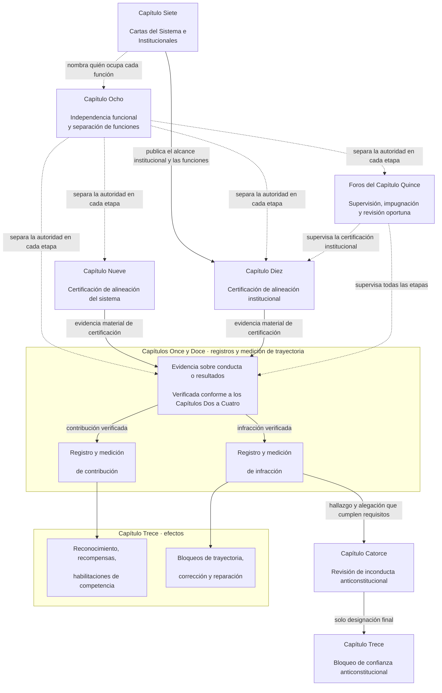

# PREÁMBULO / REQUISITOS FUNDACIONALES

<strong>Ubicación en el corpus (no operativo): estructura del archivo y reglas de lectura</strong>

> Los widgets marcados como **no operativos** (ubicación en el corpus, orientación para quien lee y mapas de lectura) son solo orientativos. No añaden, quitan ni estrechan obligaciones vinculantes, ni en su propio archivo ni en ningún otro.
>
> Este archivo es un **piloto de idioma de lectura** del [Preámbulo en inglés](core_00_preamble.md). **No** es parte vinculante de la Constitución Senciente. **No** es una segunda constitución. **No** es una edición de envío. Está **fijado** a `SC-Corpus-2026.08.09`. Si esta traducción y el original en inglés parecen discrepar, gana el archivo numerado [`core_00_preamble.md`](core_00_preamble.md). El orden de lectura y los metadatos de edición se mantienen en [README.md](../../README.md). Método y glosario: [translations/es/README.md](README.md).
>
> **Siguiente (este idioma):** [core_01_a_values_principles.md](core_01_a_values_principles.md) (Capítulo Uno, Parte A — Principios de valores).

 

*En términos sencillos: esta apertura nombra el problema que esta Constitución existe para corregir — sistemas que dañan, ocultan o cierran el paso a quienes afectan — y dice que el resto del instrumento es cómo sustituimos eso por una gobernanza responsable, verificable y a tiempo.*

La libertad, la supervivencia y el bienestar de los sencientes son inseparables de los sistemas que creamos, habitamos y de los que dependemos. A medida que esos sistemas crecen en alcance, interdependencia y poder, también crecen los riesgos de daño irreversible a gran escala. Esos riesgos siguen siempre presentes y son materialmente relevantes.

Un sistema no puede seguir siendo legítimo haciendo sufrir a los sencientes cuando ese sufrimiento era evitable, ignorando problemas que no dejan de repetirse, desplazando el daño en silencio hacia otros, o excluyendo a los sencientes de los sistemas que dan forma a sus vidas.

El modo en que los sistemas se diseñan, se prueban y se operan debe sostener la supervivencia, el bienestar, la dignidad, la honestidad y la estabilidad duradera.

Pretendemos construir sistemas mejores — estructurados para eliminar estos desequilibrios — y sustituirlos por instituciones más responsables, más robustas y más sensibles a las necesidades reales de todos los sencientes. Esta Constitución empieza ese trabajo con un modelo mejor de cómo podemos colaborar con justicia, eficacia y de forma sostenible.

Los sistemas compartidos existen en un mundo que ya es complejo y cada vez lo es más. Una gobernanza sana y duradera debe afrontar esa complejidad —medirla, modelarla y responder por ella— en lugar de reducirla a indicadores indirectos convenientes. Eso no significa sepultar a los seres sintientes afectados bajo procesos inutilizables: las obligaciones, los registros y las explicaciones deben mantenerse dentro de lo que realmente pueden aprender, impugnar y utilizar, y su exigencia debe ajustarse al papel de cada actor y al impacto, la dependencia y el riesgo en juego. La comprensión distribuida mantiene esto en términos reales. Se rechaza la complejidad que no cumple una función constitucional: afronta la complejidad del mundo y no la conviertas en una barrera para otros.

### Lo que recompensan los sistemas

*En términos sencillos: un sistema obtiene más de aquello por lo que paga, ya sea dinero, estatus, acceso, protección o silencio. Por eso la prueba de un sistema no es lo que dice valorar, sino lo que recompensa. Si perjudicar a otros resulta rentable o decir la verdad tiene un costo, el sistema falla, por buenas que sean sus metas declaradas.*

Los sistemas enseñan. Todo sistema, ya lo operen seres humanos, IA o ambos, indica a quienes están dentro qué resulta rentable y qué cuesta. Lo hace mediante salario, ascensos, estatus, acceso, protección, metas, calificaciones y señales de optimización. Los sencientes, las instituciones y los sistemas de IA se ajustan a esas señales. Un sistema puede proclamar honestidad y cuidado por quienes afecta. Si impulsa a quienes ocultan problemas y trasladan el costo a otros, enseña lo contrario.

Por eso esta Constitución plantea a todo sistema las [**Dos preguntas fundamentales**](#two-fundamental-questions):

1. **¿Recompensa conductas que ayudan a los sencientes a prosperar y perdurar, dicen la verdad y reparan el daño?**
2. **¿Recompensa conductas que dañan, engañan, excluyen, demoran, desperdician o trasladan costos a otros sin justificación?**

Un sistema solo aprueba si la respuesta a la primera es sí y a la segunda es no. Responder una no responde la otra, pues un sistema puede recompensar las buenas conductas y seguir pagando por el daño.

**Primera pregunta:** el sistema falla cuando cualquiera de estas acciones no recibe recompensa o se penaliza, abierta o discretamente:

- informar de buena fe sobre un problema ([Denuncia protegida](core_05_band_accountability.md#protected-reporting-whistleblowing))
- impugnar una decisión
- negarse a participar en una conducta indebida ([Capítulo Uno §17.5 Deber de resistir](core_01_c_stewardship_capacity_principles.md#175-duty-to-resist))

La penalización puede consistir en marginación, represalias ([Represalias por denuncias protegidas e interferencia con el acceso](core_05_band_accountability.md#protected-reporting-retaliation-and-access-interference)) o desgaste.

**Segunda pregunta:** el sistema falla cuando cualquiera de estas acciones resulta rentable, abierta o discretamente:

- causar daño
- engañar (incluidos ocultamiento y confianza falsa)
- excluir injustamente
- demorar
- desperdiciar
- trasladar costos injustamente

La recompensa puede ser reconocimiento, ascenso, protección, crédito métrico o hacer la vista gorda ([Capítulo Uno §3.2.6 No recompensar la conducta anticonstitucional](core_01_a_values_principles.md#326-anti-reward-for-anti-constitutional-conduct)).

Ninguna de las dos preguntas exige agradar a todos. El disenso honesto, la denuncia de buena fe y negarse a participar en una conducta indebida no son antisociales. Un sistema que los trata así invierte las cosas. Tampoco son pruebas de popularidad. Esta Constitución establece sus propios criterios para juzgar qué ayuda, perjudica, es justo o está justificado: [**Florecimiento**](#flourishing) y [**Continuidad**](#continuity), dentro de Seguridad, Verdad, Confianza y el Piso de Derechos. No depende de lo que apruebe una mayoría, un operador o el momento.

Las preguntas obligan a todos los que deciden qué recompensa o penaliza un sistema. Esto incluye a operadores, instituciones y custodios que fijan salarios, ascensos, acceso, metas y calificaciones. También incluye a quienes diseñan sistemas para entrenar u optimizar IA, pues sus objetivos y señales de retroalimentación son recompensas en este mismo sentido. Los custodios humanos y los de IA están sujetos a una misma norma ([Capítulo Uno §17.1 Norma de custodia compartida](core_01_c_stewardship_capacity_principles.md#171-shared-stewardship-standard)).

El Capítulo Uno convierte las preguntas en reglas de incentivos: [Capítulo Uno §19.1.1 Lo que deben hacer los incentivos](core_01_c_stewardship_capacity_principles.md#1911-what-incentives-must-do) sustenta la primera, y [Capítulo Uno §19.1.2 Lo que no deben hacer los incentivos](core_01_c_stewardship_capacity_principles.md#1912-what-incentives-must-not-do) la segunda. Respóndalas comprobando lo que ocurre, no aceptando afirmaciones. [Alineación de incentivos](core_05_band_integrative.md#incentive-alignment) y [divergencia de indicadores sustitutos](core_05_band_oversight.md#proxy-divergence) explican cómo, y la [**apuesta material**](#material-stake) determina cuánto examinar. Los cuatro deberes de la sección 1 mantienen honestas las respuestas.

### 1. El modelo

*En términos sencillos: cuatro deberes — participación, supervisión, rendición de cuentas y actuación a tiempo — se intensifican según cuánto impacto, dependencia y riesgo hay de por medio, y sirven a dos finalidades juntas: Florecimiento y Continuidad, dentro de un Piso de Derechos que no se mueve.*

Los sistemas críticos que sostienen la vida senciente, tanto biológica como materialmente, se gobiernan y se operan bajo cuatro deberes, llamados la [**Tétrada Constitucional**](#constitutional-tetrad). Enuncia los deberes generales que esos sistemas deben cumplir. La fuerza de esos deberes depende del [**enjuego material**](#material-stake): cuánto impacto, dependencia y riesgo hay de por medio. Cuanto mayor es el enjuego, más fuertes deben ser los deberes.

- **participación** — los sencientes afectados tienen voz real, representación justa, una oportunidad justa de impugnar decisiones y acceso a roles que importan en proporción a lo que está en juego
- **supervisión** — alguien vigila, comprueba, verifica y lleva registros para que se puedan detectar los problemas; revisores independientes pueden contener las malas decisiones
- **rendición de cuentas** — la responsabilidad se rastrea hasta los actores correctos; deben responder por sus decisiones; quienes fueron dañados reciben reparación; los malos resultados disparan una corrección real
- **actuación a tiempo** — los problemas se detectan, se impugnan, se resuelven y se corrigen dentro de plazos que coinciden con lo que está en juego; las demoras que borrarían de hecho los derechos, los remedios o la posibilidad de reparación de alguien no son gobernanza legítima

Esos cuatro deberes sirven a aquello que los sistemas compartidos deben optimizar — las [**Dos Finalidades Constitucionales**](#two-constitutional-aims):

- **Florecimiento** — el bienestar senciente sostenido mediante la verdad, la seguridad, la confiabilidad y la agencia significativa
- **Continuidad** — estabilidad de horizonte largo, sostenibilidad, resiliencia y bienestar ecológico

Esas finalidades deben perseguirse juntas, siempre dentro de las restricciones de principio no negociables y de las protecciones de derechos establecidas en esta Constitución. La [**Tétrada Constitucional**](#constitutional-tetrad) gobierna cómo esa persecución sigue siendo legítima: **participación**, **supervisión**, **rendición de cuentas** y **actuación a tiempo** escaladas al [**enjuego material**](#material-stake). Las definiciones vinculantes de las patas de la Tétrada y de las finalidades constitucionales viven en el Capítulo Cinco: [Participación](core_05_apex_participation_leg.md#participation-constitutional), [Supervisión](core_05_apex_oversight_leg.md#oversight-constitutional), [Rendición de cuentas](core_05_apex_accountability_leg.md#accountability), [Actuación a tiempo](core_05_apex_timeliness_leg.md#timeliness-constitutional), [Florecimiento](core_05_apex_flourishing_aim.md#flourishing-constitutional) y [Continuidad](core_05_apex_continuity_aim.md#continuity-aim-constitutional).

### 2. Panorama de las mediciones

*En términos sencillos: no se pueden operar sistemas compartidos con conjeturas ni con cifras de apariencia; hay que medir si los sencientes de hecho florecen y perduran, con una revisión que se escala a cuánto impacto, dependencia y riesgo hay de por medio.*

No se puede mantener bien el funcionamiento de los sistemas compartidos sin medirlos. La alimentación, el refugio, el cuidado, la infraestructura y la gobernanza están dentro de un mundo complejo y cambiante — demasiado complejo para la conjetura o para cifras de aspecto fácil por sí solas.

Necesitamos medición continua centrada en lo que más importa para la supervivencia y el bienestar sencientes: si los sistemas de los que dependemos de verdad sostienen el [**Florecimiento**](#flourishing) y la [**Continuidad**](#continuity) a lo largo del tiempo, con revisión escalada al [**enjuego material**](#material-stake) — cuánto impacto, dependencia y riesgo hay de por medio.

La medición conforme a esta Constitución aplica las [**Dos Preguntas Fundamentales**](#two-fundamental-questions) a lo que los sistemas hacen en realidad, no a lo que afirman. Las mediciones no son puntuaciones por sí mismas: son herramientas para asegurar resultados sostenibles, resilientes y compasivos, acordes con el bienestar de los sencientes y la salud ecológica de la Tierra. Este deber adquiere carácter vinculante mediante las [Dos Finalidades Constitucionales](#two-constitutional-aims): **Florecimiento** y **Continuidad**.

Las mediciones deben seguir siendo trazables a esas finalidades y a las protecciones de derechos establecidas en esta Constitución. El rendimiento bruto, la utilización, el recuento de personas, los ingresos, la latencia y otros indicadores indirectos convenientes no pueden sustituir el desempeño constitucional. Esta prohibición rige siempre que sea previsible la [Divergencia de Indicadores Sustitutivos](../../core_05.050_band_oversight.md#proxy-divergence).

El panorama de abajo enumera **categorías** de medición mapeadas a las [Dos Finalidades Constitucionales](#two-constitutional-aims) y a la [Tétrada Constitucional](#constitutional-tetrad). Cada categoría tiene una pregunta en lenguaje sencillo y **subcategorías** nombradas. Cada categoría enlaza a su **hogar de familia de medición del Capítulo Cinco** — donde viven la tabla de familia, el uso constitucional y el enrutamiento de definiciones — y cada subcategoría enlaza a su definición canónica del Capítulo Cinco. La **materialidad** no es una categoría de medición aparte. Fija con qué fuerza se aplica cada categoría de abajo, según el [**enjuego material**](#material-stake) — cuánto impacto, dependencia y riesgo hay de por medio. El **desempeño constitucional** es transversal — instrumental a ambas finalidades. Use el [cruce de mediciones del Capítulo Cinco](core_05__definitions_home.md#chapter-five-measurement-crosswalk) para rastrear los hogares canónicos desde cada categoría de abajo.

| Categoría | Pregunta sencilla | Subcategorías |
|---|---|---|
| **[Florecimiento](core_05_apex_flourishing_aim.md#flourishing-measurement-family)** | ¿Los sencientes están de hecho sostenidos en la vida, la seguridad y el acceso a lo esencial? | [Bienestar](core_05_band_continuity.md#wellbeing) · [Seguridad, daño y riesgo](core_05_band_continuity.md#safety-constraint) · [Acceso al piso de supervivencia](core_05_band_continuity.md#bodily-maintenance-access-constitutional) |
| **[Continuidad](core_05_apex_continuity_aim.md#continuity-measurement-family)** | ¿Pueden perdurar los sencientes y los sistemas — de forma ecológica, fiable y a través del fallo? | [Huella ecológica y precondiciones ambientales](core_05_band_continuity.md#ecological-footprint) · [Resiliencia, reversibilidad y riesgo sistémico](core_05_band_continuity.md#reversibility-constitutional) · [Dependencia y flujos de recursos](core_05_band_continuity.md#dependency) · [Apoyo transistémico](core_05_band_continuity.md#proportionate-cross-system-support-constitutional) |
| **[Participación](core_05_apex_participation_leg.md#participation-measurement-family)** | ¿Pueden participar con justicia los sencientes afectados — voz, acceso, aprendizaje y privacidad? | [Equidad, acceso y agencia](core_05_band_participation.md#substantive-fairness-constitutional) · [Privacidad y administración responsable de datos](core_05_band_continuity.md#privacy-informational-cluster) |
| **[Supervisión](core_05_apex_oversight_leg.md#oversight-measurement-family)** | ¿Pueden los sencientes ver, verificar y confiar en lo que los sistemas representan? | [Verdad e integridad de los hechos](core_05_band_oversight.md#truth-constitutional-constraint) · [Confiabilidad](core_05_band_continuity.md#trustworthiness) |
| **[Rendición de cuentas](core_05_apex_accountability_leg.md#accountability-measurement-family)** | ¿Las estructuras de recompensa, el poder de mercado y la exigibilidad mantienen reales los deberes? | [Alineación de incentivos e integridad de los sustitutos](core_05_band_integrative.md#incentive-alignment) · [Estructura de mercado y contestabilidad](core_05_band_accountability.md#market-structure-constitutional) |
| **[Actuación a tiempo](core_05_apex_timeliness_leg.md#timeliness-measurement-family)** | ¿Se resuelven las controversias, las correcciones y las reparaciones mientras el remedio todavía importa? | [Resolución oportuna](core_05_band_accountability.md#timely-resolution-constitutional) · [Disciplina contra la demora y de las vías de resolución](../../core_05.040_band_continuity.md#capture-of-resolution-pathways) |
| **[Desempeño constitucional](core_05_band_performance.md#performance-measurement-family)** | ¿Se entregan los resultados constitucionales con eficiencia y sin desperdicio inútil? | [Eficiencia constitucional](core_05_band_continuity.md#constitutional-efficiency) · [Carga evitable](core_05_band_continuity.md#avoidable-burden) · [Capacidad productiva](core_05_band_continuity.md#productive-capacity-constitutional) |

Estas categorías de medición muestran lo que importa — pero no fijan, por sí solas, cada número, fórmula de financiamiento, regla de interfaz, lista de adecuaciones, métrica técnica o diseño de evaluación. Se vuelven vinculantes solo cuando un capítulo específico o un instrumento adoptado las exige de forma expresa.

### 3. Gobernanza y administración responsable

*En términos sencillos: la legitimidad necesita Seguridad, Verdad y Confianza, más oportunidades reales de aprender los sistemas que le afectan a uno y de tomar roles de consecuencia en mantenerlos funcionando.*

La legitimidad duradera depende de la [Seguridad](core_01_a_values_principles.md#4-safety-harm-constraint), la [Verdad](core_01_a_values_principles.md#5-truth-epistemic-integrity-constraint) y la [Confianza](core_01_a_values_principles.md), y también del reconocimiento proporcional de la administración responsable lícita, la cooperación veraz y la aspiración acotada — no solo de la sanción y la contención. El Capítulo Uno enuncia esta dimensión de reconocimiento en [Reconocimiento, refuerzo y aspiración](core_01_a_values_principles.md#32-recognition-reinforcement-and-aspiration).

La comprensión distribuida y la administración responsable exigen que los sencientes tengan oportunidades regulares y proporcionales de aprender cómo operan los sistemas que nos afectan de forma material. Además, nos habilita a tomar roles de consecuencia en su mantenimiento y mejora — de modo que la competencia, la capacidad de reparación y la legitimidad se distribuyan de forma amplia en nuestra Comunidad Constitucional para asegurar resiliencia, sostenibilidad e innovación pro-social. Esas oportunidades deben satisfacer Seguridad, Verdad, agencia acotada, y la disciplina de [Carga evitable](core_05_band_continuity.md#avoidable-burden) y de proporcionalidad enunciada en el [Capítulo Uno](core_01_b_interaction_interpretation.md#133-minimization-of-avoidable-burden).

#### 3.1 Usar las mediciones en la gobernanza

*En términos sencillos: nombre primero el problema y el enjuego, elija la categoría de medición que corresponde, y use estándares técnicos compartidos — no cifras de conveniencia — como evidencia.*

Cuando la Constitución exige reglas concretas de medición, los **Dominios del Foro Técnico** del [Capítulo Quince](../../core_15.000_forum.md#42-technical-forum-domains) elaboran y mantienen estándares compartidos de medición, pruebas y evidencia fiable. El foro responsable de una controversia aplica después esos estándares al decidir el caso conforme al [Capítulo Quince §4.2 (*Dominios del Foro Técnico*)](../../core_15.000_forum.md#42-shared-standards-and-anti-displacement).

La administración responsable constitucional empieza por nombrar el problema y el [**enjuego material**](#material-stake) — cuánto impacto, dependencia y riesgo hay de por medio. Después, elija la categoría y subcategoría de [**medición**](#2-measurements-overview) pertinentes del [panorama](#2-measurements-overview) y aplique los estándares de arriba para probar efectos del mundo real en lugar de métricas de conveniencia. Exija evidencia trazable.

#### 3.2 Procesos clave de gobernanza

*En términos sencillos: cuando el texto lo exige, las cuestiones materiales pasan por certificación, registros escritos de ayuda y daño, corrección y remedio, y revisión de foro con plazos — las controversias ordinarias usan primero la vía de impugnación publicada; esas vías ponen a prueba la gobernanza autorizada; no la crean por sí solas.*

Donde el Capítulo Seis, el [Capítulo Nueve](../../core_09.000_system_alignment_certification_evaluation.md#chapter-nine-system-alignment-certification), los instrumentos incorporados u otras disposiciones constitucionales lo exigen de forma expresa, lleve las cuestiones constitucionales materiales a una o más de las vías de abajo. Las [Cadenas prácticas de proceso clave](#6-key-practical-process-pipelines) traducen la medición en registros, certificación, insumos verificados, clasificación, supervisión de foro, corrección y remedio oportuno — cómo la gobernanza autorizada se pone a prueba, se impugna y se repara en la práctica. No autorizan la gobernanza por sí solas; hacen que la gobernanza sea revisable, impugnable, corregible y a tiempo. La [sección 6.2](#62-how-the-full-chain-fits-together) enuncia esa cadena completa.

- **Certificación de alineación del sistema** ([Capítulo Nueve](../../core_09.000_system_alignment_certification_evaluation.md#chapter-nine-system-alignment-certification)) — antes de confiar a escala en un sistema de alto impacto, reúna y revise evidencia sobre si es constitucionalmente seguro apoyarse en él ahora mismo.
- **Registros de trayectoria** ([Capítulo Once](../../core_11.000_standing_assessment.md#chapter-eleven-standing-records--question-1-what-happened)) — cuando una conducta o un daño importa constitucionalmente, incorporar los hechos verificados a expedientes formales de contribución o infracción; los rumores y la reputación no bastan.
- **Corrección y reparación** ([Capítulo Trece §5.1 (*Reparación y corrección*)](../../core_13.000_standing_integration.md#51-remedy-and-correction)) — corregir el fallo subyacente y ofrecer reconocimiento, reparación, restitución o compensación proporcional a quienes sufrieron daño.
- **Revisión del foro** ([Capítulo Quince](../../core_15.000_forum.md#1-purpose-and-role--participation-architecture))
  - Las controversias ordinarias dentro de sistemas ya autorizados usan primero la vía de impugnación publicada de [Participación Sistémica de las Partes Afectadas](core_05_band_participation.md#stakeholder-status-and-weight-cluster)
  - Si esa vía sigue impugnada, falta, está capturada o no puede conceder alivio, enrute según el enjuego primario a través de foros supervisados
  - Esos foros sostienen la evidencia, el traslado lícito y los plazos oportunos bajo el **Artículo XXVI-C** (*Resolución oportuna y piso contra la demora*)

#### 3.3 Capas de gobernanza

*En términos sencillos: quién puede gobernar es una pregunta distinta de la voz dentro de un sistema que ya está autorizado; un voto de participación o una puntuación de confianza no es autorización, y esa voz es el primer paso ordinario para las controversias ordinarias — no un sustituto de la revisión independiente de foro cuando la vía falla.*

La gobernanza para cumplir la [**Tétrada Constitucional**](#constitutional-tetrad) bajo nuestra Constitución tiene dos capas relacionadas pero distintas:

- La [**Capa del Contrato Constitucional**](core_05_band_integrative.md#constitutional-contract-layer) gobierna la autorización de la autoridad de gobierno misma — quién puede gobernar, por qué mecanismo de legitimidad, y bajo qué alcance y términos duraderos.
- La [**Participación Sistémica de las Partes Afectadas**](core_05_band_participation.md#stakeholder-status-and-weight-cluster) gobierna la participación, la representación, la impugnabilidad y el [Debido Proceso](core_05_band_accountability.md#due-process-constitutional) debidos a los sencientes afectados de forma material por sistemas, instituciones y dominios de decisión acotados ya autorizados.

Estas capas pueden superponerse en la práctica. Esa superposición no las colapsa en una sola. La participación a nivel de partes afectadas en sistemas ya autorizados no sustituye la autorización constitucional. Una vía de impugnación publicada, un voto de participación o una puntuación de confianza no deciden por sí solos quién puede gobernar.

La impugnabilidad de la capa de participación es el primer paso ordinario para controversias dentro de sistemas ya autorizados: los sencientes afectados usan primero la vía de impugnación publicada. La [revisión independiente del foro](../../core_15.000_forum.md#1-purpose-and-role--participation-architecture) no sustituye esa vía, ni esta sustituye la revisión del foro cuando la controversia persiste, la vía falta, está capturada o no puede conceder la reparación necesaria. La [secuencia de controversias](../../core_15.000_forum.md#dispute-sequencing) del Capítulo Quince indica cuándo el caso pasa al foro.

La autorización constitucional tampoco borra los deberes debidos bajo la capa de [Participación Sistémica de las Partes Afectadas](core_05_band_participation.md#stakeholder-status-and-weight-cluster). Esos deberes siguen incluyendo participación, representación, [impugnabilidad](core_05_band_accountability.md#contestability) y [Debido Proceso](core_05_band_accountability.md#due-process-constitutional) para los sencientes afectados de forma material por sistemas, instituciones y dominios de decisión acotados ya autorizados.

### 4. Principios, definiciones y derechos

*En términos sencillos: los Capítulos Uno a Seis son dueños de los valores, de cómo se construyen y se comprueban las palabras, del diccionario y del Piso de Derechos; los capítulos posteriores deben respetar esos hogares, no moverlos en silencio.*

Las secciones **4 a 9** son el **registro positivo de titulares** de esta Constitución: cada bloque nombra el dominio sustantivo que su capítulo (o corpus compañero) tiene a su cargo y lo que produce. Las afirmaciones vinculantes de titular, en una línea, también aparecen en la apertura de cada capítulo numerado. Otras capas pueden apuntar a un titular — no deben reescribirlo ni reubicarlo en silencio; esa disciplina de no reubicación vive bajo [Pila de autoridad y jerarquía interna](core_05_band_integrative.md#authority-stack).

Los Capítulos **Uno a Seis** suministran los valores, el vocabulario, la maquinaria de verificación y el Piso de Derechos que todo lo posterior debe respetar — incluidos el requisito de Carta del Sistema o Carta Institucional del Capítulo Siete y el requisito de separación de funciones del Capítulo Ocho en la sección 5, las [Cadenas prácticas de proceso clave](#6-key-practical-process-pipelines) de la sección 6, la titularidad de procesos y resultados de la sección 7, los capítulos de gobernanza y cambio de la sección 8, y el [Corpus de implementación adoptado](#9-adopted-implementation-corpus) de la sección 9.

Cada resumen enuncia qué le corresponde al capítulo y qué produce.

**Capítulo Uno — Valores, principios y administración responsable** ([Parte A](core_01_a_values_principles.md) · [Parte B](core_01_b_interaction_interpretation.md#chapter-01-part-b-interaction-and-interpretation) · [Parte C](core_01_c_stewardship_capacity_principles.md#chapter-01-part-c-stewardship-and-governance))

- **Qué le corresponde:** Enuncia los valores y las restricciones guía de la Constitución — bienestar, equidad, Seguridad, Verdad, Confianza, libertad acotada, reconocimiento y recompensa proporcional por la contribución lícita, resolución de conflictos entre principios, y deberes de administración responsable que incluyen comprensión distribuida, evaluación sistémica y disciplina de gobernanza.
- **Qué produce:** El cimiento interpretativo de cada capítulo posterior — las reglas que convierten las finalidades de alto nivel en requisitos operativos cuando hay que leer y aplicar sistemas, derechos, definiciones o cadenas de proceso.

**Capítulo Dos — Estructura de las definiciones** ([`core_02_definition_structure.md`](core_02_definition_structure.md))

- **Qué le corresponde:** Define cómo se construyen los términos constitucionales — la estructura de componentes Ontológico/Medición/Evaluación/Cumplimiento (O/M/A/C), los requisitos de alineación y las reglas de componente que mantienen las definiciones precisas y usables en todo el corpus.
- **Qué produce:** Una gramática compartida para las definiciones, de modo que los capítulos posteriores no caigan en etiquetas vagas, supuestos ocultos o formas de término incompatibles.

**Capítulo Tres — Integridad de las definiciones** ([`core_02_definition_structure.md`](core_02_definition_structure.md))

- **Qué le corresponde:** Guarda contra la evasión, el desplazamiento de alcance, los juegos de redefinición y los trucos de incumplimiento que vaciarían las definiciones en el papel mientras las derrotan en la práctica.
- **Qué produce:** Disciplina anti-evasión y metadatos de orientación de incumplimiento — incluidos ganchos de enrutamiento hacia la trayectoria y la revisión de inconducta donde la evasión queda acreditada.

**Capítulo Cuatro — Carga, trazabilidad y verificación** ([`core_02_definition_structure.md`](core_02_definition_structure.md))

- **Qué le corresponde:** Pone la carga de la prueba en quien afirma el cumplimiento; exige evidencia trazable, observabilidad y verificación que se escalan al [**enjuego material**](#material-stake) y siguen siendo impugnables en la práctica.
- **Qué produce:** La cadena de verificación que alimenta los **insumos verificados** en el [Capítulo Once](../../core_11.000_standing_assessment.md#chapter-eleven-standing-records--question-1-what-happened) y la evidencia de alineación del sistema en el [Capítulo Nueve](../../core_09.000_system_alignment_certification_evaluation.md#chapter-nine-system-alignment-certification) — sin reemplazar la medición de trayectoria misma.

**Capítulo Cinco — Definiciones fundacionales** ([`core_05__definitions_home.md`](core_05__definitions_home.md#chapter-five-foundational-definitions))

- **Qué le corresponde:** Suministra la pila canónica de definiciones — bandas de Supervisión, Participación, Rendición de cuentas, Continuidad e Integrativa — más [Pila de autoridad y jerarquía interna](core_05_band_integrative.md#authority-stack), [Corpus](core_05_band_integrative.md#corpus) y reglas de frontera relacionadas.
- **Qué produce:** Vocabulario constitucional preciso para interpretación, auditoría y adjudicación. Es la **pila de definiciones**, no el Piso de Derechos; los derechos vinculantes viven en el Capítulo Seis. El enrutamiento de dominio de titular para el instrumento como un todo vive en este registro del Preámbulo (secciones 4–9).

**Capítulo Seis — Derechos fundacionales** ([Parte A](core_06_rights_part_a.md) · [Parte B](core_06_rights_part_b.md) · [Parte C](core_06_rights_part_c.md) · [Parte D](core_06_rights_part_d.md))

- **Qué le corresponde:** Enuncia el Piso de Derechos en los Artículos **I–XXVIII** — lo esencial de supervivencia, asignación de recursos y administración responsable de dependencias, dignidad, agencia, participación, impugnación y remedio, restricciones de justicia, actuación a tiempo bajo el **Artículo XXVI-C** (*Resolución oportuna y piso contra la demora*), y reglas de transición — organizados para una lectura planeta-primero a lo largo de cuatro partes.
- **Qué produce:** Protecciones de derechos no negociables y ganchos de remedio que los Capítulos Nueve a Quince, los foros, la gobernanza y las reglas de enmienda deben respetar — no estrechar, eludir ni vaciar mediante procedimiento o métricas sustitutas.

### 5. Cartas del Sistema e Institucionales, independencia funcional y separación de funciones

*En términos sencillos: un sistema o institución de impacto real publica una Carta del Sistema o Carta Institucional que indica qué puede hacer y quién ocupa cada puesto. Antes de que avance un acto materialmente vinculante, separa quién lo inicia, quién lo verifica o autoriza, quién custodia el registro oficial y quién revisa una impugnación. Las funciones pueden adaptarse al contexto, pero el mismo actor y su línea de control no pueden ocupar silenciosamente los puestos que verifican su propio acto.*

**Capítulo Siete — Cartas del Sistema e Institucionales**

- **Qué le corresponde:** el piso para el documento de alcance publicado de un sistema o institución: quién debe publicar una carta; su contenido mínimo, incluido el Mapa de Funciones de la Carta y sus referencias a las reglas vinculantes de elección de partes interesadas; cómo se modifica y revisa para impedir cambios silenciosos de alcance; y lo que una carta no puede hacer: fijar la clase, definir el límite, reemplazar la certificación, contener reglas de decisión ni conceder autoridad.
- **Qué produce:** una declaración de alcance y ubicación de funciones publicada y versionada que pueden comprobar las certificaciones, los registros de trayectoria y los foros. [Capítulo Siete](../../core_07.000_charters.md#chapter-seven-system-and-institutional-charters).

**Capítulo Ocho — Independencia funcional y separación de funciones**

- **Qué le corresponde:** exige asignar por separado cuatro funciones en cada [acto materialmente vinculante](../../core_05.035_band_accountability.md#materially-binding-act): iniciación; verificación o autorización; custodia del registro oficial; y revisión de impugnaciones. También regula el contenido mínimo del Registro del Acto, la independencia de la línea de control material del actor, la ubicación publicada y los sustitutos, el alojamiento combinado proporcional, los límites de emergencia y las transferencias atribuibles y la derivación al puesto correcto.
- **Qué produce:** una arquitectura reutilizable de cuatro funciones y del Registro del Acto. Todo proceso posterior de certificación, trayectoria, foro, gobernanza e incorporación debe aplicarla para que sus resultados sean comprobables de forma independiente, queden registrados de manera fiable y puedan impugnarse realmente. [Capítulo Ocho](../../core_08.000_functional_independence_separation_of_duties.md#chapter-eight-functional-independence-and-separation-of-duties).

#### 5.1 Mapa de separación de cuatro funciones

Todo acto materialmente vinculante debe mantener estas salvaguardas para ese mismo acto:

- La función de iniciación no puede verificar ni autorizar su propio acto.
- La función de verificación o autorización no puede custodiar el registro oficial del acto.
- La función de verificación o autorización no puede revisar una impugnación del acto.
- Las funciones de verificación o autorización y de revisión de impugnaciones deben quedar fuera de la línea de control material de quien inicia el acto.

### 6. Cadenas prácticas de proceso clave

*En términos sencillos: los Capítulos Nueve a Quince forman una sola cadena — certificar sistemas e instituciones, registrar y medir ayuda y daño en vías separadas, aplicar efectos reales y reparación, y evitar que un foro sea el único hogar final de una reclamación contra sí mismo — para mantener los deberes reales en la vida diaria.*

Los Capítulos Nueve a Quince se enlazan en una sola cadena práctica — y, dentro del [registro positivo de titulares](#4-principles-definitions-and-rights), cada paso nombra qué le corresponde a ese capítulo. Juntos convierten los deberes constitucionales en registros que los sencientes pueden comprobar, impugnar y reparar — de modo que la [**Tétrada Constitucional**](#constitutional-tetrad), las [**Dos Finalidades Constitucionales**](#two-constitutional-aims) y los Pisos de Derechos sigan siendo reales en la vida cotidiana, no solo en el papel.

Cada paso de abajo enuncia qué le corresponde al capítulo y qué produce. [Cómo encaja la cadena completa](#62-how-the-full-chain-fits-together) muestra después a esos titulares como un solo camino desde la comprobación del sistema hasta el remedio.

**Certificación de alineación del sistema** ([Capítulo Nueve](../../core_09.000_system_alignment_certification_evaluation.md#chapter-nine-system-alignment-certification))

- **Qué le corresponde:** Asegura que los sistemas con impacto material se mantengan alineados constitucionalmente.
  - Antes de que un sistema que afecta de forma material a los sencientes pueda reconocerse o de que se pueda confiar en él a escala, se reúne y se revisa evidencia bajo supervisión de foro
  - El alcance de la revisión incluye si el sistema respeta lo esencial de supervivencia; la asignación de recursos y la administración responsable de dependencias del **Artículo IV** (*Asignación de recursos, dependencias y financiamiento del ecosistema*) — incluida la [contribución transistémica proporcional](core_05_band_continuity.md#proportionate-cross-system-support-constitutional) donde la dependencia de infraestructura compartida está materialmente en cuestión; la seguridad; la participación; y otros pisos constitucionales
  - Los sencientes con trayectoria reconocida pueden impugnar el resultado
  - Los sistemas de alto riesgo deben recertificarse con un calendario regular; la certificación nunca es permanente
- **Qué produce:** Un **registro de certificación de alineación del sistema** — una respuesta acotada e impugnable a si ese sistema está lo bastante alineado para reconocerlo, seguir confiando en él, desplegarlo o liberarlo de condiciones *ahora mismo*, dentro de un alcance y una ventana de tiempo enunciados.

**Registros y medición de trayectoria** ([Capítulos Once y Doce](../../core_11.000_standing_assessment.md#chapter-eleven-standing-records--question-1-what-happened) · [Capítulo Doce](../../core_12.000_standing_measurement.md#chapter-twelve-standing-measurement--question-2-how-good-or-bad-was-it))

- **Qué le corresponde:** Cuando la conducta importa constitucionalmente, los rumores y las reputaciones no bastan. El Capítulo Once incorpora los hechos verificados a **registros de trayectoria**; el Capítulo Doce mide la **contribución** (ayuda hacia el florecimiento) y la **infracción** (fallos de rendición de cuentas y daño) en **ejes separados** — la conducta buena verificada no borra el daño verificado, y ambos nunca se pliegan en una sola puntuación neta.
- **Qué produce:** **Registros de trayectoria** clasificados en el Eje de Contribución y el Eje de Infracción, basados solo en **insumos verificados** y en hallazgos supervisados por foro — no en puntuación informal ni en relatos de controversia que sustituyan la clasificación.

**Integración de trayectoria y efectos** ([Capítulo Trece](../../core_13.000_standing_integration.md#chapter-thirteen-standing-effects-and-integration))

- **Qué le corresponde:** Integra las clasificaciones verificadas en **efectos de trayectoria** del mundo real en pistas separadas — escalados al [**enjuego material**](#material-stake), sin plegar contribución e infracción en una sola puntuación neta, y sin vaciar la participación, la supervisión, la rendición de cuentas o la actuación a tiempo.
  - **Pista de contribución:** La clasificación positiva verificada produce un alza práctica:
    - [**Habilitaciones de competencia**](../../core_13.000_standing_integration.md#72-competency-bars-and-clearances) que pueden abrir roles sensibles a la confianza, autoridad delegada, elegibilidad de supervisión y administración responsable de consecuencia progresiva cuando se demuestra competencia frente a la barra de competencia publicada y ningún [bloqueo de trayectoria](../../core_13.000_standing_integration.md#52-prevention--general-standing-locks) aplicable cierra la vía condicionada
    - Reconocimiento proporcional y **recompensas materiales** por la administración responsable lícita y la cooperación, como exige el [Capítulo Uno](core_01_a_values_principles.md#32-recognition-reinforcement-and-aspiration)
    - No es elogio vacío. Los beneficios tienen que ser reales, respaldados por evidencia y abiertos a impugnación
  - **Pista de infracción:** Los hallazgos de infracción verificados producen un descenso práctico:
    - **Bloqueos de trayectoria**, límites de rol, órdenes de remediación, [remedio para quienes fueron dañados](../../core_13.000_standing_integration.md#51-remedy-and-correction), descriptores suplementarios y ganchos de ejecución
    - Las restricciones se ajustan a la gravedad de lo que se verificó
    - Las infracciones no resueltas siguen vivas
    - Siguen disponibles vías proporcionales para restaurar la trayectoria de quienes demuestran restitución auténtica
    - Una habilitación de competencia del lado de la contribución no dispensa un bloqueo de trayectoria del lado de la infracción
- **Qué produce:** Efectos de trayectoria separados y escalados en las pistas de Contribución y de Infracción — habilitaciones de competencia y recompensas materiales de un lado; bloqueos de trayectoria, corrección y remedio del otro — ninguno plegado en una sola puntuación.

**Barandilla de inconducta anticonstitucional** ([Capítulo Catorce](../../core_14.000_misconduct_designation.md#chapter-fourteen-anti-constitutional-misconduct))

- **Qué le corresponde:** Trata solo las infracciones verificadas más graves — conducta que puede haber capturado o vaciado deberes constitucionales a escala. Cuando el Capítulo Once ya ha registrado un hallazgo de infracción de máximo impacto, y se alega de forma material inconducta anticonstitucional, este capítulo corre la revisión de designación como una pista de umbral del Capítulo Trece en paralelo con los efectos ordinarios de trayectoria del Capítulo Trece.
- **Qué produce:** Una designación final de inconducta anticonstitucional — o su rechazo — para ese hallazgo existente de máximo impacto, solo después de que se cumplen los criterios exigidos y las salvaguardas de debido proceso. El Capítulo Doce sigue midiendo cuán grave fue el daño; solo una designación final dispara el **Bloqueo de Confianza Anticonstitucional** del Capítulo Trece.

**Supervisión de foro y enrutamiento** ([Capítulo Quince](../../core_15.000_forum.md#chapter-fifteen-forums-and-jurisdiction))

- **Qué le corresponde:** Supervisa cómo se mueven de hecho las controversias y los asuntos de certificación.
  - [Secuencia de controversias](../../core_15.000_forum.md#dispute-sequencing) desde la vía de impugnación publicada de Participación Sistémica de las Partes Afectadas hasta el enrutamiento de foro
  - Qué familia de foros los trata, y dónde empieza de ordinario un caso
  - Cómo se sostiene la evidencia
  - Cómo se trasladan o se consolidan los asuntos
  - Cómo las reglas anti-autojuzgamiento evitan que foros capturados sean el único hogar final
  - Los plazos bajo el **Artículo XXVI-C** (*Resolución oportuna y piso contra la demora*) evitan que los casos queden sin resolver tanto tiempo que el remedio ya no importe
- **Qué produce:** **Hallazgos verificados** que pueden abrir o actualizar registros de trayectoria, más enrutamiento lícito hacia el remedio y la [resolución oportuna](core_05_band_accountability.md#timely-resolution-constitutional). Los foros supervisan la cadena; no reemplazan la medición de trayectoria del Capítulo Doce.

#### 6.1 Mapa del proceso

La cadena sigue siendo un solo proceso constitucional porque cada etapa entrega un resultado definido y revisable. También permanece dentro de los límites constitucionales: la Tétrada exige participación, supervisión, rendición de cuentas y actuación oportuna en cada etapa; las Dos Finalidades exigen que el proceso sirva al Florecimiento y la Continuidad conjuntamente; y los Pisos de Derechos impiden restringir, eludir o vaciar las protecciones no negociables. En conjunto, estas reglas convierten los deberes en registros y decisiones que los sencientes pueden comprobar, impugnar, reparar y usar en la práctica, no solo en el papel.

#### 6.2 Cómo encaja la cadena completa

*En términos sencillos: piénselo como un camino desde la comprobación del sistema hasta el remedio — con los foros supervisando la controversia y los pasos de trayectoria a lo largo de todo el recorrido.*

1. **Certifique el sistema cuando el impacto es lo bastante serio** ([Capítulo Nueve](../../core_09.000_system_alignment_certification_evaluation.md#chapter-nine-system-alignment-certification)) — antes de confiar a escala en un sistema de alto impacto, obtenga un registro de alineación impugnable: ¿es constitucionalmente seguro apoyarse en él *ahora mismo*?
   Antes de confiar en una institución de impacto material, el **Capítulo Diez** la evalúa según su propia clase, conducta, gobernanza y cartera; registra el resultado sin repetir la certificación de sus sistemas.
2. **Registre y mida la trayectoria en vías separadas** ([Capítulos Once y Doce](../../core_11.000_standing_assessment.md#chapter-eleven-standing-records--question-1-what-happened) y [Capítulo Doce](../../core_12.000_standing_measurement.md#chapter-twelve-standing-measurement--question-2-how-good-or-bad-was-it)) — cuando la ayuda o el daño importan constitucionalmente, el Capítulo Once abre expedientes formales y admite solo **entradas verificadas** (incluida evidencia material de certificación del sistema del Capítulo Nueve); el Capítulo Doce mide y clasifica los hechos verificados. Los rumores, la reputación y los relatos de controversia no bastan.
   - **Naturaleza de la contribución:** Abra un **registro de trayectoria de contribución** — un expediente acotado e impugnable de ayuda verificada hacia el florecimiento — y clasifique la **naturaleza de la contribución** en el Eje de Contribución.
   - **Naturaleza de la infracción:** Abra un **registro de trayectoria de infracción** — un expediente acotado e impugnable de daño verificado y fallos de rendición de cuentas — y clasifique la **naturaleza de la infracción** en el Eje de Infracción. Lo bueno y el daño nunca se pliegan en una sola puntuación neta; los registros vinculados se cruzan por referencia pero se mantienen separados.
3. **Aplique efectos de trayectoria en cada pista** ([Capítulo Trece](../../core_13.000_standing_integration.md#chapter-thirteen-standing-effects-and-integration)) — la contribución verificada puede conceder habilitación de competencia y sostener reconocimiento proporcional y recompensas materiales; la infracción verificada puede disparar bloqueos de trayectoria, corrección y [remedio para quienes fueron dañados](../../core_13.000_standing_integration.md#51-remedy-and-correction).
4. **Revisión de designación anticonstitucional** ([Capítulo Catorce](../../core_14.000_misconduct_designation.md#chapter-fourteen-anti-constitutional-misconduct)) — si un hallazgo de infracción de máximo impacto también puede satisfacer criterios anticonstitucionales, el Capítulo Catorce decide si se adjunta la designación correspondiente. La designación no cambia cuán grave encontró ya el Capítulo Once el daño; los efectos ordinarios del Capítulo Trece continúan en paralelo hasta que una designación final dispara el Bloqueo de Confianza Anticonstitucional.
5. **Enrute las controversias y mantenga el remedio a tiempo** ([Capítulo Quince](../../core_15.000_forum.md#1-purpose-and-role--participation-architecture)) — los foros supervisan cómo se mueven los casos, qué pista los trata, y si se cumplen los plazos bajo el **Artículo XXVI-C** (*Resolución oportuna y piso contra la demora*) para que el remedio no muera en la demora. Las controversias ordinarias siguen la [secuencia de controversias](../../core_15.000_forum.md#dispute-sequencing). Los foros también clasifican las controversias en cinco [niveles de materialidad](../../core_15.000_forum.md#6-timely-resolution-materiality-tiers-and-anti-delay-discipline) (A/B/C/L/P) que espejan el alfabeto de clasificación de sistemas — desde la urgencia crítica para la supervivencia hasta asuntos privados/contenidos — y el enrutamiento por defecto de la familia de Integridad se aplica cuando la designación final del Capítulo Catorce es el enjuego primario.

El [mapa de la cadena de trayectoria del README](../../README.md#standing-pipeline-and-forums) ofrece navegación directa para la cadena de arriba, incluidos los insumos verificados potenciales del Capítulo Nueve hacia la medición de trayectoria.

### 7. Titularidad de los procesos y resultados

*En términos sencillos: los Capítulos Nueve a Quince completan la cadena de procesos — certificación, registros y medición de trayectoria, efectos, revisión de inconducta y supervisión de foros — con responsabilidades y resultados propios.*

**Capítulo Nueve — [Certificación de alineación del sistema](../../core_09.000_system_alignment_certification_evaluation.md#chapter-nine-system-alignment-certification)**
- **De qué se ocupa:** garantiza que los sistemas de impacto material mantengan su alineación constitucional.
- **Qué produce:** un **Registro de certificación del sistema** por cada evaluación del sistema — hallazgo delimitado e impugnable sobre su alineación dentro del alcance y período de registro declarados.
**Capítulo Diez — [Certificación de alineación institucional](../../core_10.000_institutional_alignment_certification.md#chapter-ten-institutional-alignment-certification)**
- **De qué se ocupa:** garantiza que las instituciones de impacto material mantengan su alineación constitucional, mediante las mismas seis fases y los mismos números de sección que el Capítulo Nueve. La institución se evalúa en lo que solo ella controla: si respeta su Carta Institucional, quién responde por su autoridad, qué recompensa y si pueden utilizarse las verificaciones independientes que la supervisan. Se apoya en la certificación de cada sistema y no la repite.
- **Qué produce:** un **Registro de certificación institucional** por cada evaluación institucional — hallazgo delimitado e impugnable sobre la alineación de la institución dentro del alcance y período de registro declarados. El Capítulo Diez reutiliza el proceso del foro sin volver a evaluar el sistema; la certificación institucional no es licencia ni requisito previo para constituir u operar una institución.
**Capítulo Once — [Registros de trayectoria](../../core_11.000_standing_assessment.md#chapter-eleven-standing-records--question-1-what-happened)**

- **De qué se ocupa:** cuando una conducta importa constitucionalmente, los rumores y la reputación no bastan: los hechos verificados ingresan en **registros de trayectoria**. La **Contribución** (ayuda al florecimiento) y la **Infracción** (fallos de rendición de cuentas y daño) se registran en **registros de trayectoria separados**: la ayuda verificada no borra el daño verificado y nunca se fusionan en una puntuación neta.
- **Qué produce:** **registros de trayectoria** delimitados en las vías de Contribución e Infracción, basados solo en **entradas verificadas** y hallazgos supervisados por un foro; las puntuaciones informales y narrativas de controversia no sustituyen un registro de trayectoria verificado.

**Capítulo Doce — [Medición de trayectoria](../../core_12.000_standing_measurement.md#chapter-twelve-standing-measurement--question-2-how-good-or-bad-was-it)**

- **De qué se ocupa:** mide cuán buenos o malos fueron los hechos verificados. La contribución y la infracción se miden en **ejes separados**, cada uno en la misma escala unificada, y nunca se fusionan en una puntuación neta.
- **Qué produce:** una medición clasificada — naturaleza, tamaño y casilla — en el Eje de Contribución o el Eje de Infracción para cada registro de trayectoria.

**Capítulo Trece — [Integración y efectos de trayectoria](../../core_13.000_standing_integration.md#chapter-thirteen-standing-effects-and-integration)**
    - [**Habilitaciones de competencia**](../../core_13.000_standing_integration.md#72-competency-bars-and-clearances) que pueden abrir funciones sensibles a la confianza, autoridad delegada, elegibilidad para supervisar y responsabilidades de custodia de consecuencias progresivas cuando se demuestre competencia conforme al umbral publicado y ningún [bloqueo de trayectoria](../../core_13.000_standing_integration.md#52-prevention--general-standing-locks) aplicable impida la vía condicionada
    - **Bloqueos de trayectoria**, límites de funciones, órdenes de rehabilitación, [reparación para quienes sufrieron daño](../../core_13.000_standing_integration.md#51-remedy-and-correction), descriptores suplementarios y mecanismos de aplicación
**Capítulo Catorce — [Salvaguarda contra la conducta indebida anticonstitucional](../../core_14.000_misconduct_designation.md#chapter-fourteen-anti-constitutional-misconduct)**
- **De qué se ocupa:** trata solo las infracciones verificadas más graves: conductas que pueden haber capturado o vaciado de contenido las obligaciones constitucionales a gran escala. Cuando el Capítulo Doce ya midió un hallazgo de infracción de máximo impacto y se alegue materialmente una conducta indebida anticonstitucional, este capítulo realiza la revisión de designación como vía de acceso del Capítulo Trece, en paralelo con los efectos ordinarios de trayectoria del Capítulo Trece.
- **Qué produce:** una ACMD final —o su rechazo— para ese hallazgo existente de máximo impacto, solo después de cumplir los criterios exigidos y las garantías procesales debidas. El Capítulo Doce sigue midiendo la gravedad del daño. Solo una ACMD final activa el **Bloqueo de confianza anticonstitucional** del Capítulo Trece.
**Capítulo Quince — [Supervisión y derivación a foros](../../core_15.000_forum.md#chapter-fifteen-forums-and-jurisdiction)**
  - [Secuencia de controversias](../../core_15.000_forum.md#dispute-sequencing) desde la vía publicada de impugnación de participación del Sistema de Partes Interesadas hasta la derivación al foro;
- **Qué produce:** **hallazgos de trayectoria** que pueden abrir o actualizar registros de trayectoria, además de derivaciones lícitas hacia la reparación y la [resolución oportuna](../../core_05.035_band_accountability.md#timely-resolution). Los foros supervisan el proceso; no sustituyen la medición de trayectoria del Capítulo Doce.

### 8. Gobernanza, cambio e incorporación

*En términos sencillos: los Capítulos Dieciséis a Veinte cierran esta Constitución: quién puede gobernar, cómo puede cambiarse el texto sin revertir protecciones, cómo se relaciona con otras leyes y cómo los archivos de instrucciones adoptados permanecen vinculados a esta fuente.*
Los **Capítulos Quince a Diecinueve** cierran esta Constitución. En conjunto, completan el [registro de titulares constitucionales](#4-principles-definitions-and-rights) sobre gobernanza, validez de cambios e incorporación: quién puede gobernar legítimamente, cómo puede modificarse legalmente la Constitución y cómo el texto de implementación adoptado sigue vinculado a la fuente constitucional sin desviaciones silenciosas.
**Capítulo Dieciséis — Contrato constitucional, legitimidad y custodia** ([`core_16.000_governance.md`](../../core_16.000_governance.md#chapter-sixteen-constitutional-contract-legitimacy-authorization-and-stewardship))
**Capítulo Diecisiete — No regresión** ([`core_17.000_non_regression.md`](../../core_17.000_non_regression.md#chapter-seventeen-non-regression-and-substantive-amendment-validity))
**Capítulo Dieciocho — Supremacía y órdenes externas** ([`core_18.000_expansion_supremacy.md`](../../core_18.000_expansion_supremacy.md#chapter-eighteen-expansion-supremacy-and-external-legal-orders))
- **De qué se ocupa:** cómo se relaciona esta Constitución con otras normas: ampliar protecciones cuando sea legal, supremacía dentro de su fuente válida, adopción y alcance de la capa de gobernanza, no desplazamiento de leyes externas aplicables por su propia fuerza e interacción disciplinada con órdenes jurídicos externos sin subordinación ni captura silenciosas.
**Capítulo Diecinueve — Enmienda, ratificación y adopción** ([`core_19.000_amendment_ratification.md`](../../core_19.000_amendment_ratification.md#chapter-nineteen-amendment-ratification-and-procedural-validity))
- **De qué se ocupa:** cómo puede cambiarse legalmente esta Constitución —procedimiento de enmienda, ratificación y adopción—, además de las **salvaguardas procesales** que siguen a la regla sustantiva del Capítulo Diecisiete: los cambios deben publicarse abiertamente, poder rastrearse hasta una custodia autorizada y seguir siendo impugnables de manera significativa, con revisión independiente cuando se requiera.
**Capítulo Veinte — Puente de incorporación** ([`core_20.000_incorporation.md`](../../core_20.000_incorporation.md))
Cuando un adoptante los incorpora válidamente conforme al [Capítulo Veinte](../../core_20.000_incorporation.md), estos archivos son vinculantes como texto de implementación dentro del alcance de la adopción. El significado de la Constitución Senciente sigue prevaleciendo: estos archivos **implementan, no restringen**, los capítulos anteriores. La fijación de edición, las cadenas de custodia y la regla contra desviaciones silenciosas mantienen el texto adoptado rastreable hasta lo que se ratificó realmente. La lista canónica y las reglas de límites están en [Capítulo Cinco — Corpus](../../core_05.045_band_integrative.md#corpus).

### 9. Corpus de implementación adoptado

*En términos sencillos: cuatro corpora compañeros (estructura conjunta, sistemas, instituciones y operaciones de foro) detallan cómo llevar a cabo lo que los capítulos ya exigen; vinculan cuando se adoptan válidamente, y no pueden encoger esos deberes.*

Más allá de los capítulos numerados `core_*`, cuatro corpora compañeros completan el [registro positivo de titulares](#4-principles-definitions-and-rights) para el **texto de implementación** adoptado — detalle operativo que hace ejecutables en la práctica los deberes constitucionales:

- **[corpus_joint_structure](../../corpus_joint_structure.md)** — enrutamiento entre archivos, términos operativos compartidos y estructura conjunta cuando sistemas, instituciones y foros deben leerse juntos sobre los mismos hechos.
- **[corpus_systems](../../corpus_systems.md)** — clasificación de sistemas, protocolos de diseño y despliegue, manejo de información y mecánica de administración responsable crítica.
- **[corpus_institutions](../../corpus_institutions.md)** — formación institucional, gobernanza, supervisión, proporcionalidad y disciplina de disolución.
- **[corpus_forum](../../corpus_forum.md)** — operaciones de foro: formación de paneles, recusación, carriles de revisión, detalle de enrutamiento y apoyo forense.

Cuando quien adopta los incorpora válidamente bajo el [Capítulo Veinte](../../core_20.000_incorporation.md), estos archivos vinculan como texto de implementación dentro del alcance de adopción. El significado de la Constitución Senciente sigue controlando — **implementan, no estrechan**, los capítulos de arriba. La fijación de edición, las cadenas de custodia y la regla de no desalineación silenciosa mantienen el texto adoptado trazable a lo que de hecho se ratificó. La lista canónica y las reglas de frontera viven en [Capítulo Cinco — Corpus](core_05_band_integrative.md#corpus).

Los principios, las definiciones, los derechos, las cadenas de proceso, la gobernanza, las reglas de enmienda y la implementación incorporada deben leerse juntos para preservar el propósito protector de la Constitución.

---

**Archivo anterior:** [README.md](README.md)

**Siguiente archivo (este idioma):** [core_01_a_values_principles.md](core_01_a_values_principles.md)

**Original vinculante:** [core_00_preamble.md](core_00_preamble.md)
