<!-- AI-assisted translation draft; unreviewed; English controls.
Source: core_09.000_system_alignment_certification_evaluation.md
Source snapshot: 247e2180509e5e029c1106878cf225067339e010
Source SHA-256: 3ff6a518d3c9d6779925a1daab6ad6c53abdbdabeeaad786ffafcdd1e6ac8b80 -->

# CAPÍTULO NUEVE, PARTE A: CERTIFICACIÓN DE ALINEACIÓN DEL SISTEMA — EVALUACIÓN

<strong>Ubicación en el corpus (no operativa): estructura del archivo y reglas de lectura</strong>

> Este archivo **forma parte de la Constitución de los Seres Sintientes** y **solo es vinculante conjuntamente** con los demás archivos numerados `core_*`, leídos como un solo texto. Contiene el **Capítulo Nueve, Parte A**: el propósito de la certificación, la descripción general del proceso y las dos primeras fases del proceso: **Enmarcar** (clase del sistema) y **Evaluar** (evaluación de todo el sistema en tres subfases: las evaluaciones siempre aplicables, incluidos los tipos y el tratamiento de datos, en **§3**; las evaluaciones aplicables cuando el asunto esté implicado en **§4**; y las evaluaciones del Piso de Derechos y por ámbito que se aplican cuando se activan en **§5**) — **§1–§5**. Las **ilustraciones de las Clases A / B / C** (los perfiles de clase del sistema y los recorridos explicativos de §3.4, §5.1, §5.2, §5.3, §5.4, §5.5 y §5.6), incluido el párrafo **Lectura entre clases de sistemas** de cada una, se encuentran en [CS-9.320](../../corpus_systems/cs_09.320_system_alignment_certification_illustrations.md#cs-9320-system-alignment-certification-illustrations) (*Ilustraciones de certificación de alineación del sistema*), dentro de la familia de sistemas, no en este capítulo; cada una identifica la sección de la Parte A que ilustra. Las reglas vinculantes de escalamiento por clase del sistema y de escalada que ilustran esos párrafos permanecen en este archivo: el escalamiento por clase del sistema, incluida la participación y la proporcionalidad, en §2.2; el escalamiento del tratamiento de datos en §3.4; y el párrafo **Escalamiento y escalada por clase del sistema** en cada una de §5.1–§5.6. Los archivos de todo el capítulo se enumeran en la tabla siguiente.
>
> **Archivos del Capítulo Nueve.** El Capítulo Nueve se divide en tres archivos vinculantes que se leen como un solo texto. La Parte A, este archivo, abre el capítulo; no hay un archivo de índice aparte. Las ilustraciones prácticas no forman parte del capítulo; están en [CS-9.320](../../corpus_systems/cs_09.320_system_alignment_certification_illustrations.md#cs-9320-system-alignment-certification-illustrations) (*Ilustraciones de certificación de alineación del sistema*).
>
> | Parte | Archivo | Ámbito |
> |------|------|------|
> | **Parte A — Evaluación** | [`core_09.000_system_alignment_certification_evaluation.md`](core_09.000_system_alignment_certification_evaluation.md) | §1–§5: propósito y descripción general del proceso (con un diagrama de todo el proceso de certificación en sus seis fases), **Fase I Enmarcar** (clase del sistema, cómo la clase del sistema escala cada evaluación y certificación piloto) y **Fase II Evaluar** (evaluación de todo el sistema en tres subfases: **IIa**, siempre, en §3, incluidos el alcance establecido en la carta constitutiva frente a los límites funcionales y los tipos y el tratamiento de datos; **IIb**, cuando haya implicación, en §4; y **IIc**, cuando se active, las evaluaciones del Piso de Derechos y por ámbito, en §5) |
> | **Parte B — Proceso del foro y resultados** | [`core_09.005_system_alignment_certification_record_process.md`](core_09.005_system_alignment_certification_record_process.md) | §6–§7: **Fase III Revisar** (funciones del foro, secuencia de supervisión y cadena de impugnabilidad) y **Fase IV Decidir** (resultados de la certificación, incluida la condición de autorización para entrar en operación) — numeración continua del capítulo desde la Parte A §5 |
> | **Parte C — Registro, recertificación y posición** | [`core_09.010_system_alignment_certification_record_recertification.md`](core_09.010_system_alignment_certification_record_recertification.md) | §8–§11: **Fase V Registrar** (el Registro de Certificación del Sistema y su integridad, incluidos los campos rectores de la [Carta Constitutiva del Sistema](core_05_band_continuity.md#system-charter)) y **Fase VI Operar** (recertificación y reapertura; la vía de impugnación; el puente hacia la posición) — numeración continua del capítulo desde la Parte B §7 |
>
> **Relación entre las dos certificaciones.** La Certificación de Alineación del Sistema (este capítulo) es la certificación de un Sistema. La certificación de alineación institucional ([Capítulo Diez](core_10.000_institutional_alignment_certification.md#chapter-ten-institutional-alignment-certification)) es la certificación de una Institución, que puede operar Sistemas o ninguno. El Capítulo Diez cita mediante enlace el Registro de Certificación de cada Sistema y no lo vuelve a realizar; [Capítulo Diez §1](core_10.000_institutional_alignment_certification.md#1-purpose-and-role) establece la relación y [Capítulo Diez §1.2](core_10.000_institutional_alignment_certification.md#12-no-permission-and-no-gate-on-forming-or-running) establece que no es una licencia. Sus secciones tienen los mismos números que las de este capítulo, con títulos paralelos.
>
> Los enlaces genéricos al **Capítulo Nueve** en otros archivos dirigen a la parte correspondiente según el número de sección.
>
> - **Titular constitucional (conjuntamente con las Partes B y C):** **certificación de alineación del sistema y registros relacionados** supervisados por el foro — ámbitos de evaluación (Parte A); proceso del foro, secuencia de supervisión y resultados de certificación con la condición de autorización de puesta en operación (Parte B); deberes del Registro de Certificación del Sistema, vía de impugnación, recertificación y reapertura, y puente de entradas verificadas al Capítulo Once (todo en la Parte C). Bajo el pilar de **supervisión** de la Tétrada, SAC es uno de varios procesos de auditoría especialmente amplios y de gran importancia; los mínimos de auditoría siguen bajo el **Artículo XVI** (*Auditoría, transparencia y verificación independiente*) y la [Auditabilidad](core_05_band_oversight.md#auditability) del Capítulo Cinco.
> - **Titular de la base de verificación:** el [Capítulo Cuatro — Carga de la prueba, trazabilidad y verificación](core_04_burden_traceability_verification.md#chapter-four-burden-of-proof-traceability-and-verification) (dentro de los Capítulos Dos a Cuatro) es titular de la asignación de la carga, las pruebas de cumplimiento, la trazabilidad de las definiciones, la observabilidad y la verificación limitada por la seguridad. El Capítulo Nueve **aplica** esa disciplina a los Registros de Certificación del Sistema; **no** vuelve a enunciar las secciones **1** a **5** del Capítulo Cuatro.
> - **Sede de auditoría (no se traslada aquí):** el **Artículo XVI** (*Auditoría, transparencia y verificación independiente*), **Def.O1** (*Transparencia, auditabilidad y verificación*) y **CJS-5.110 §3 y CJS-5.115 §3** (*Sede del proceso de auditoría*)–**CJS-5.110 §5** son titulares de los mínimos de auditoría y los términos operativos. El Capítulo Nueve lleva a cabo un proceso de auditoría SAC especialmente amplio que debe satisfacer esos mínimos; no es titular de todas las auditorías.
> - **Titular de implementación:** el tratamiento por clase del sistema, CS-6.345 (*Ciclo de vida del sistema*) y los detalles del proceso del foro en los archivos de implementación designados deben ser coherentes con el Capítulo Nueve y pueden ser más estrictos cuando el corpus ya incluya una regla de [Máximo efecto protector](../../core_05.045_band_integrative.md#fullest-protective-effect).
> - **Regla contra el traslado:** la Parte A no vuelve a enunciar las definiciones canónicas del Capítulo Cinco, la disciplina contra la evasión del Capítulo Tres (véase [Parte C §9.4](core_09.010_system_alignment_certification_record_recertification.md#94-non-evasion)), la medición de contribución o posición del Capítulo Doce ni los efectos sobre la posición del Capítulo Trece. **[Parte C §11](core_09.010_system_alignment_certification_record_recertification.md#11-relationship-to-standing)** establece el puente hacia la posición.
>
> **Fuentes previas:** definiciones del Capítulo Cinco; registro, verificación, carga y trazabilidad de definiciones a resultados de los Capítulos Dos a Cuatro; y el [Capítulo Ocho](core_07_functional_independence_segregation_of_duties.md#chapter-eight-functional-independence-and-separation-of-duties), cuyo requisito de separación de funciones rige cada acto de certificación materialmente vinculante.
> **Desarrollos posteriores:** [Parte B](../../core_09.005_system_alignment_certification_record_process.md#chapter-nine-part-b-system-alignment-certification--forum-process-and-outcomes) (*proceso del foro y resultados*) y [Parte C](core_09.010_system_alignment_certification_record_recertification.md#chapter-nine-part-c-system-alignment-certification--record-recertification-and-standing) (*registro, recertificación y puente hacia la posición*); registros de posición y entradas verificadas del Capítulo Once; efectos sobre la posición del Capítulo Trece; supervisión del foro y vías de certificación de alineación del Capítulo Quince.

 

El **Capítulo Nueve, Parte A**, es el titular constitucional de la **evaluación de certificación de alineación del sistema**.

- La supervisión del foro y los resultados de certificación se encuentran en la **[Parte B](../../core_09.005_system_alignment_certification_record_process.md#chapter-nine-part-b-system-alignment-certification--forum-process-and-outcomes)**.
- El registro, la recertificación y la reapertura, y el puente hacia la posición se encuentran en la **[Parte C](core_09.010_system_alignment_certification_record_recertification.md#chapter-nine-part-c-system-alignment-certification--record-recertification-and-standing)**.
- Las ilustraciones prácticas de estas secciones de evaluación se encuentran en **[CS-9.320 Ilustraciones de certificación de alineación del sistema](../../corpus_systems/cs_09.320_system_alignment_certification_illustrations.md#cs-9320-system-alignment-certification-illustrations)**.
- La certificación de alineación institucional, con los mismos números de sección, se encuentra en el **[Capítulo Diez](core_10.000_institutional_alignment_certification.md#chapter-ten-institutional-alignment-certification)**.

### 1. Propósito y función

<strong>Trazabilidad</strong>

- Fuentes previas:
  - [Preámbulo — registro de titulares constitucionales](core_00_preamble.md#4-principles-definitions-and-rights) y
  - [Jerarquía interna y pila de autoridad](core_05_band_integrative.md#authority-stack-and-internal-hierarchy);
  - [Tétrada Constitucional](core_00_preamble.md#constitutional-tetrad);
  - [Dos Fines Constitucionales](core_00_preamble.md#two-constitutional-aims);
  - [interés material](core_00_preamble.md#material-stake);
  - [Proporcionalidad](core_05_band_accountability.md#proportionality) y
  - [Equidad sustantiva](core_05_band_participation.md#substantive-fairness) (Capítulo Cinco); familia de medición de Participación (*voz, acceso y vías de impugnación*);
  - [Capítulo Uno §16 Mayordomía en profundidad](core_01_c_stewardship_capacity_principles.md#16-stewardship-in-depth) (1.010 §16);
  - [Capítulo Uno §12 Requisito de evaluación sistémica](core_01_a_values_principles.md#12-systemic-evaluation-requirement) (1.000 §12) (*enfoque de evaluación integral del sistema en la capa de principios, no de un solo aspecto*); Capítulos Dos a Cuatro;
  - [Capítulo Cinco](core_05__definitions_home.md#chapter-five-foundational-definitions) (5.000) (*definiciones canónicas*);
  - [Capítulo Ocho §2 Requisito constitucional de cuatro puestos](core_07_functional_independence_segregation_of_duties.md#2-four-seat-constitutional-requirement) (8.000 §2);
  - [Certificación de Alineación del Sistema](core_05_band_continuity.md#system-alignment-certification) (término canónico del Capítulo Cinco; sigla abreviada no operativa **SAC**);
  - [Registro de Certificación del Sistema](core_05_band_continuity.md#system-certification-record) (significado del Capítulo Cinco).
- Desarrollos posteriores:
  - [§2](#2-system-class-evaluation) (*evaluación de la clase del sistema*);
  - [Parte C §10](core_09.010_system_alignment_certification_record_recertification.md#10-challenging-a-certification) (9.010 §10) (*impugnar una certificación*); y
  - [CS-9.320 §2](../../corpus_systems/cs_09.320_system_alignment_certification_illustrations.md#cs-9320-2-illustrative-system-class-profiles) (*Perfiles ilustrativos de clases de sistemas*);
  - [CS-9.320 §4](../../corpus_systems/cs_09.320_system_alignment_certification_illustrations.md#cs-9320-4-illustrative-whole-system-application-by-system-class) (*Aplicación ilustrativa de todo el sistema según la clase del sistema*);
  - [CS-9.320 §5](../../corpus_systems/cs_09.320_system_alignment_certification_illustrations.md#cs-9320-5-illustrative-data-handling-application-by-system-class) (*Aplicación ilustrativa del tratamiento de datos según la clase del sistema*);
  - [CS-9.320 §6](../../corpus_systems/cs_09.320_system_alignment_certification_illustrations.md#cs-9320-6-illustrative-ecological-footprint-application-by-system-class) (*Aplicación ilustrativa de la huella ecológica según la clase del sistema*);
  - [CS-9.320 §7](../../corpus_systems/cs_09.320_system_alignment_certification_illustrations.md#cs-9320-7-illustrative-educational-capability-application-by-system-class) (*Aplicación ilustrativa de la capacidad educativa según la clase del sistema*);
  - [CS-9.320 §8](../../corpus_systems/cs_09.320_system_alignment_certification_illustrations.md#cs-9320-8-illustrative-cross-system-support-application-by-system-class) (*Aplicación ilustrativa del apoyo entre sistemas según la clase del sistema*);
  - [CS-9.320 §9](../../corpus_systems/cs_09.320_system_alignment_certification_illustrations.md#cs-9320-9-illustrative-nondiscrimination-application-by-system-class) (*Aplicación ilustrativa de la no discriminación según la clase del sistema*);
  - [CS-9.320 §10](../../corpus_systems/cs_09.320_system_alignment_certification_illustrations.md#cs-9320-10-illustrative-accessibility-application-by-system-class) (*Aplicación ilustrativa de accesibilidad según la clase del sistema*);
  - [CS-9.320 §11](../../corpus_systems/cs_09.320_system_alignment_certification_illustrations.md#cs-9320-11-illustrative-trustworthiness-application-by-system-class) (*Aplicación ilustrativa de confiabilidad según la clase del sistema*);
  - [§3](#3-whole-system-certification-evaluation) (*factores de evaluación de todo el sistema*);
  - [§3.4](#34-data-types-and-handling-evaluation) hasta
  - [§5.6](#56-trustworthiness-and-system-reliance-integrity-evaluation) (*evaluaciones por ámbito*);
  - [Parte B §6](core_09.005_system_alignment_certification_record_process.md#6-forum-process) (9.005 §6) (*secuencia de supervisión y cadena de impugnabilidad*);
  - [Parte B §6.1](core_09.005_system_alignment_certification_record_process.md#61-forum-supervision-and-component-roles) (9.005 §6.1) (*funciones de los componentes del foro*);
  - [Parte C §8](core_09.010_system_alignment_certification_record_recertification.md#8-system-certification-record) (9.010 §8) (*contenido del Registro de Certificación del Sistema*);
  - [Parte C §8.2](core_09.010_system_alignment_certification_record_recertification.md#82-transparency-and-auditability-of-the-system-certification-record) (9.010 §8.2) (*requisitos de integridad del registro*);
  - [Parte B §7](core_09.005_system_alignment_certification_record_process.md#7-certification-outcomes) (9.005 §7) (*resultados de certificación*);
  - [Parte C §11](core_09.010_system_alignment_certification_record_recertification.md#11-relationship-to-standing) (9.010 §11) (*puente hacia el registro de posición*);
  - [Capítulo Once](core_11_standing_assessment.md#chapter-eleven-standing-records--question-1-what-happened) (11.000) (*registros de posición y compuerta de entradas verificadas*);
  - [Capítulo Trece](../../core_13.000_standing_integration.md#chapter-thirteen-standing-effects-and-integration) (13.000) (*efectos e integración de la posición*);
  - [Capítulo Quince](../../core_15.000_forum.md#chapter-fifteen-forums-and-jurisdiction) (15.000) (*supervisión del foro, certificación, certificación de alineación y revisión*).
- Leer junto con:
  - **[CS-9.305](../../corpus_systems/cs_09.305_system_classification_machinery.md#cs-9305-part-a-system-classification-machinery) (*Mecanismo de clasificación de sistemas*) y [CS-9.310 — Clasificaciones de impacto de sistemas](../../corpus_systems/cs_09.310_system_impact_classifications.md#cs-9310-part-b-system-impact-classifications)**, **[CS-6.305](../../corpus_systems/cs_06.305_information_types_and_handling.md#cs-6305-part-a-information-types-and-handling) (*Tipos y tratamiento de información*) y [CS-6.310 — Clasificaciones de datos](../../corpus_systems/cs_06.310_data_classifications.md#cs-6310-part-b-data-classifications)**, y
  - **CS-6.345** (*Ciclo de vida del sistema*);
  - **CF-15.415** (*Operaciones de enrutamiento, transferencia, preguntas para resolución y tratamiento de representantes*) y
  - **CF-15.425** (*Salvaguardias de integridad, operaciones contra la captura y apoyo contra la autoevaluación*); **Artículo XVI** (*Auditoría, transparencia y verificación independiente*) y
  - [Auditabilidad](core_05_band_oversight.md#auditability) (*mínimos de auditoría: SAC es uno de varios procesos de auditoría especialmente amplios bajo la supervisión, no la única sede de auditoría*); **CJS-5.110 §3 (*Supervisión: términos de auditabilidad y reconstruibilidad (anexo)*) y CJS-5.115 §3** (*Sede del proceso de auditoría*)–
  - **CJS-5.110 §5** (*Supervisión: términos de verificación independiente e integridad de las afirmaciones*).

 

*En términos sencillos: cuando un sistema afecta de verdad la vida de seres sintientes, la certificación debe ser **proporcional**: tan exigente como requieran su impacto real, dependencia y riesgo; no una lista de verificación uniforme ni un sello automático. También debe ser **participativa**: los seres sintientes y comunidades afectados deben poder ver qué se revisó, entender qué se decidió e impugnarlo cuando algo esté mal. Los foros revisan las pruebas, las consignan en un Registro de Certificación del Sistema y exigen recertificación con una periodicidad acorde con el riesgo del sistema. Las Clases A, B y C siguen el proceso completo y la Clase L uno más ligero. Se alienta a la Clase P a utilizarlo, y debe hacerlo cuando se reclasifique como Clase L o superior (es decir, cuando sus efectos rebasen una unidad privada) o cuando su operador afirme que cumple con la Constitución.*

**La certificación de alineación del sistema** existe para responder una pregunta para un alcance y calendario de revisión determinados: ¿El sistema ha demostrado suficiente alineación constitucional para obtener certificación, certificación condicional, validación, recertificación, confianza continuada, despliegue o cumplimiento material de las condiciones de certificación, o para quedar exento de ellas?

- Una certificación no es un índice de popularidad, un pase permanente ni una forma de eludir la revisión de derechos.
- Es una declaración sujeta a plazo e impugnación sobre lo que se sabe ahora acerca de la alineación del sistema.
- Bajo el pilar de **supervisión** de la Tétrada, la supervisión exige auditorías; la certificación de alineación del sistema es uno de varios procesos de auditoría especialmente amplios y de gran importancia, no la única sede de auditoría (**Artículo XVI** (*Auditoría, transparencia y verificación independiente*), [Auditabilidad](core_05_band_oversight.md#auditability)).

La certificación implementa los [Dos Fines Constitucionales](core_00_preamble.md#two-constitutional-aims) mediante la [Tétrada Constitucional](core_00_preamble.md#constitutional-tetrad):

- **[Florecimiento](core_00_preamble.md#flourishing)** — la certificación verifica que certificar o mantener la confianza no anule inadvertidamente los Pisos de Derechos ni impida la participación justa en la vida pertinente para la Constitución;
- **[Continuidad](core_00_preamble.md#continuity)** — la certificación verifica un suministro duradero y no regresivo que sostenga, en vez de agotar, los sistemas naturales saludables ([Integridad Ecológica](core_05_band_continuity.md#ecological-integrity), incluida la [Capacidad de Recuperación Ecológica](core_05_band_continuity.md#ecological-recovery-capacity)), y una recertificación escalada por clase del sistema cuando sistemas compartidos condicionen o sostengan el suministro;
- **Participación** — los seres sintientes y las comunidades afectados pueden entender, impugnar y participar en las vías de revisión que les importan;
- **Supervisión** — los registros, pruebas y supuestos son suficientemente visibles y auditables para una comprobación independiente; la propia certificación es uno de varios procesos de auditoría especialmente amplios bajo ese deber de supervisión;
- **Rendición de cuentas** — los defectos, la clasificación errónea y las operaciones que anulan los pisos se remiten a reparación, condiciones de certificación, retirada o aportaciones a la posición cuando los hechos lo justifiquen;
- **Oportunidad** — los plazos de revisión e impugnación evitan que la certificación quede obsoleta mientras aún pueda prevenirse o revertirse el daño.

#### 1.1 La certificación como proceso de auditoría, escalado por clase del sistema

Como mecanismo de supervisión, la certificación es uno de varios procesos de auditoría especialmente amplios bajo [Auditabilidad](core_05_band_oversight.md#auditability) y el **Artículo XVI** (*Auditoría, transparencia y verificación independiente*):

- Está supervisada por un foro, abarca varios ámbitos y concede una condición.
- Puede integrar los resultados de modos de auditoría relacionados, pero no los absorbe ni los sustituye. Cada uno conserva su titular, identificado en el [mapa de modos de auditoría relacionados](../../corpus_joint_structure/cjs_05.115_audit_process.md#sibling-audit-modes-owner-map) de la sede del proceso de auditoría:
  - auditorías del Registro de Tipos de Datos del Sistema bajo **CS-6.305 (*Tipos y tratamiento de información*) y CS-6.310** (*Clasificaciones de datos*);
  - auditorías del Registro de Clasificación del Sistema bajo **CS-9.305 (*Mecanismo de clasificación de sistemas*) y CS-9.310** (*Clasificaciones de impacto de sistemas*);
  - revisiones de garantía por parte de responsables bajo **CS-15.305** (*Mayordomía de sistemas críticos*);
  - auditoría continua bajo **CS-6.345** (*Ciclo de vida del sistema*) ACA;
  - auditorías de complejidad bajo **CS-6.315** (*Comprensibilidad y mayordomía de la complejidad*) y **Artículo XXIII-B** (*Requisitos de auditoría de complejidad y modularidad*);
  - verificación de afirmaciones bajo **CJS-5.110 §5** (*Supervisión: términos de verificación independiente e integridad de las afirmaciones*).
- Cualquiera de estas evaluaciones puede realizarse por separado, sin pasar por la certificación. La certificación no las sustituye.

La profundidad de la certificación, la carga de registro, el intervalo de certificación, la revisión por las partes interesadas y las vías de impugnación deben escalar con el [interés material](core_00_preamble.md#material-stake), conforme a la [Proporcionalidad](core_05_band_accountability.md#proportionality):

- Los sistemas de mayor impacto, dependencia y riesgo requieren pruebas más sólidas, registros más claros y una participación más viable, incluida la accesibilidad sustantiva, aportaciones de las partes interesadas y vías de impugnación acordes con quienes dependen del sistema.
- Las clases inferiores de sistemas y los alcances acotados siguen requiriendo clasificación honesta y garantías proporcionales; no quedan exentos de obligaciones materiales cuando existen efectos externos.

El proceso se aplica según la clase de impacto, tal como establece el [requisito de reclasificación](../../corpus_systems/cs_09.305_system_classification_machinery.md#35-reclassification-requirement) de **CS-9.305** (*Mecanismo de clasificación de sistemas*):

- **Clase A, Clase B y Clase C:** estos sistemas conllevan el mayor impacto, dependencia y riesgo; la evaluación integral del sistema en [§3 Evaluación de certificación de todo el sistema](#3-whole-system-certification-evaluation), [§4 Evaluaciones cuando haya implicación](#4-evaluations-where-implicated) y [§5 Evaluaciones del Piso de Derechos y por ámbito](#5-rights-floor-and-domain-evaluations), cada una en la subfase que le corresponda, es obligatoria con toda su profundidad;
- **Clase L:** la misma evaluación es obligatoria, pero proporcional, con un intervalo de certificación predeterminado más largo y registros más sencillos cuando CS-9.305 (*Mecanismo de clasificación de sistemas*) y CS-9.310 (*Clasificaciones de impacto de sistemas*) lo permitan; y
- **Clase P:** se recomienda el proceso mientras el sistema pertenezca válidamente a la Clase P, y el sistema puede utilizarlo de forma voluntaria. Pasa a ser obligatorio al reclasificarse como Clase L o superior, o cuando el operador afirme voluntariamente que el sistema cumple con la Constitución.

El intervalo de certificación y la auditoría financiera, de recursos o especial que corresponda en su punto medio se fijan según la clase del sistema en [Capítulo Quince §6 Resolución oportuna, niveles de materialidad y disciplina contra las demoras](../../core_15.000_forum.md#review-cadence) (*Periodicidad de revisión*). Este capítulo no repite las cifras.

#### 1.2 La certificación de un vistazo

*En términos sencillos: clasifique el sistema con honestidad, realice las evaluaciones aplicables, haga que los foros revisen de forma independiente las pruebas y las inquietudes de las partes interesadas, y decida un resultado. Complete el único registro abierto para la revisión del foro y publíquelo con una vía de impugnación abierta. Un sistema certificado solo entra en operación una vez satisfechos el plazo de notificación y las protecciones exigidas. Supervise los resultados reales, responda a incidentes e impugnaciones y vuelva a revisar según el calendario o cuando cambien los hechos. Corrija los defectos y obtenga una verificación independiente de la corrección antes de autorizar el alcance afectado o liberar las condiciones de certificación. Cada ciclo de revisión utiliza un registro nuevo enlazado con el anterior.*

El proceso consta de **seis fases**: **I Enmarcar**, **II Evaluar**, **III Revisar**, **IV Decidir**, **V Registrar** y **VI Operar**. La Fase II consta de tres subfases, cada una en su propia sección: **IIa** (siempre), **IIb** (cuando haya implicación) y **IIc** (cuando se active). La Fase VI consta de dos subfases, cada una en su propia sección: **VIa** (operación y recertificación, [§9 Recertificación y reapertura](core_09.010_system_alignment_certification_record_recertification.md#9-recertification-and-reopening)) y **VIb** (el puente hacia la posición, [§11 Relación con la posición](core_09.010_system_alignment_certification_record_recertification.md#11-relationship-to-standing)). El diagrama muestra todo el proceso de certificación en ese orden. La Parte A abarca las dos primeras fases, de definición y evaluación; la [Parte B](../../core_09.005_system_alignment_certification_record_process.md#chapter-nine-part-b-system-alignment-certification--forum-process-and-outcomes) y la [Parte C](core_09.010_system_alignment_certification_record_recertification.md#chapter-nine-part-c-system-alignment-certification--record-recertification-and-standing) abarcan las cuatro últimas: el proceso del foro y el resultado con la condición de autorización para entrar en operación (Parte B), y después el registro y la operación (la vía de impugnación, la recertificación y reapertura, y el puente hacia la posición) (Parte C).

Cada evaluación aplicable se repite en cada ciclo de certificación: en la primera certificación, en cada recertificación conforme al calendario de [§2 Evaluación de la clase del sistema](#2-system-class-evaluation), y en cada revisión reabierta o nueva. La revisión se reabre antes de la siguiente recertificación programada si cambian hechos materiales, como el aumento de la dependencia del sistema, el aumento de la extracción de fundamentos compartidos, una disminución significativa de lo que el sistema aporta a esos fundamentos o una impugnación creíble. [Parte C §9.2 Desencadenantes de reapertura](core_09.010_system_alignment_certification_record_recertification.md#92-reopening-triggers) enumera los desencadenantes.

```mermaid
flowchart TB
    T(["Un sistema con impacto material solicita certificación<br/>o aumenta la dependencia de él"])
    C["§2 Fase I, Enmarcar<br/>Clasificar con honestidad<br/><br/>La clase determina la profundidad y el calendario de revisión"]
    subgraph W["§3–§5 Fase II, Evaluar — Evaluación integral del sistema"]
        direction LR
        Al["§3.1–§3.4 IIa — Siempre<br/><br/>Gobernanza; riesgo sistémico: evaluación<br/>y divulgación a quienes la necesitan;<br/>horizonte temporal; tipos de datos"]
        Im["§4 IIb — Cuando haya implicación<br/><br/>Ámbitos de privacidad, derechos de salida,<br/>reunión y disenso"]
        Tr["§5 IIc — Cuando se active<br/><br/>Revisiones aplicables del Piso de Derechos<br/>y seis evaluaciones por ámbito"]
        Al ~~~ Im ~~~ Tr
    end
    F["§6 Fase III, Revisar<br/>Revisión independiente de las pruebas<br/>y las inquietudes de las partes interesadas<br/><br/>Los foros asignados emiten conclusiones;<br/>las vías de impugnación siguen abiertas"]
    Rec["§8 Fase V, Registrar<br/>Un Registro de Certificación del Sistema<br/><br/>Abierto para la revisión del foro; completado con el resultado,<br/>las conclusiones de respaldo, las condiciones de certificación y el plan operativo"]
    S[["Capítulo Once — Registros<br/>de posición<br/><br/>Fuera de este capítulo"]]
    O{"§7 Fase IV, Decidir<br/><br/>¿Qué resultado y condición<br/>respaldan las pruebas?"}
    Fc["§7, §9.3 Certificación plena<br/><br/>Recertificaciones provisionales limpias consecutivas exigidas;<br/>sin desalineación actual ni indicada como inminente<br/>Intervalo de certificación plena; pueden aplicarse condiciones de certificación"]
    Pc["§7, §9.3 Certificación provisional<br/><br/>Primera concesión, recuperación tras desalineación,<br/>o condición provisional continuada o reducida<br/>Intervalo provisional más corto; pueden aplicarse condiciones de certificación"]
    Nc["§7 No certificado<br/><br/>Aplazado, denegado, retirado o vencido<br/>Sin entrada en operación; indicar los motivos y el trabajo correctivo exigido"]
    Pub["§7, §10 Publicar el registro completado<br/><br/>Abrir la vía de impugnación del registro publicado;<br/>para un alcance nuevo o ampliado, indicar la entrada en operación y la notificación"]
    G{"§7 Condición de entrada en operación<br/><br/>¿Se satisfacen la certificación y los requisitos<br/>aplicables para entrar en operación?"}
    Hold["§7 Satisfacer los requisitos previos a la entrada en operación<br/><br/>Completar la notificación y verificar de forma independiente<br/>las condiciones de certificación exigidas antes de operar"]
    Rm["§7, §9.3 Proteger y corregir<br/><br/>No permitir nuevas operaciones en el alcance afectado;<br/>proteger a los seres sintientes afectados, corregir el diseño o la operación,<br/>y presentar pruebas para verificación independiente"]
    Ch["§9–§10 Fase VIa, Operar y recertificar<br/>Supervisar y mantener abiertas las impugnaciones<br/><br/>Operar dentro del alcance certificado y conforme a las condiciones de certificación;<br/>supervisar los resultados y responder a incidentes e impugnaciones"]
    S2[["Capítulo Once — Registros<br/>de posición<br/><br/>Fuera de este capítulo"]]
    Sp["&nbsp;&nbsp;&nbsp;&nbsp;&nbsp;&nbsp;&nbsp;&nbsp;&nbsp;&nbsp;&nbsp;&nbsp;&nbsp;&nbsp;&nbsp;&nbsp;&nbsp;&nbsp;&nbsp;&nbsp;&nbsp;&nbsp;&nbsp;&nbsp;&nbsp;&nbsp;&nbsp;&nbsp;&nbsp;&nbsp;&nbsp;&nbsp;&nbsp;"]
    SpL["&nbsp;&nbsp;&nbsp;&nbsp;&nbsp;&nbsp;&nbsp;&nbsp;&nbsp;&nbsp;&nbsp;&nbsp;&nbsp;&nbsp;&nbsp;&nbsp;&nbsp;&nbsp;&nbsp;&nbsp;&nbsp;&nbsp;&nbsp;&nbsp;&nbsp;&nbsp;&nbsp;&nbsp;&nbsp;&nbsp;&nbsp;&nbsp;&nbsp;&nbsp;&nbsp;"]
    SpA["&nbsp;&nbsp;&nbsp;&nbsp;&nbsp;&nbsp;&nbsp;&nbsp;&nbsp;&nbsp;&nbsp;&nbsp;&nbsp;&nbsp;&nbsp;&nbsp;&nbsp;&nbsp;&nbsp;&nbsp;&nbsp;&nbsp;&nbsp;&nbsp;&nbsp;&nbsp;&nbsp;&nbsp;&nbsp;&nbsp;&nbsp;&nbsp;&nbsp;&nbsp;&nbsp;&nbsp;&nbsp;&nbsp;&nbsp;&nbsp;&nbsp;&nbsp;&nbsp;&nbsp;&nbsp;"]
    Re["§9 Siguiente ciclo de revisión<br/><br/>Recertificación, reapertura o revisión nueva;<br/>cada ciclo abre un nuevo registro enlazado con el anterior"]
    T --> C
    A1((A)) --> C
    C --> W
    W --> F
    F --> O
    O --> Fc
    O --> Pc
    O --> Nc
    Fc --> Rec
    Pc --> Rec
    Nc --> Rec
    Rec -.->|VIb, §11 —<br/>solo entradas verificadas;<br/>certificación actual o hechos<br/>surgidos durante la certificación| S
    Rec --> Pub
    Rec ~~~ Sp
    Pub --> G
    G ~~~ SpL
    G -->|No certificado| Rm
    G --->|Sí: operar<br/>dentro del registro| Ch
    G --->|Certificado,<br/>requisitos previos pendientes| Hold
    Hold --> G
    Ch -->|Defecto material:<br/>proteger y corregir| Rm
    Ch -->|Según calendario, o<br/>un cambio material o<br/>una impugnación creíble<br/>exige revisión| Re
    Ch -.->|VIb, §11 —<br/>solo entradas verificadas;<br/>la operación puede aportar hechos<br/>a los Registros de Contribución<br/>y de Infracción| S2
    Rm -->|Las pruebas de corrección<br/>se revisan en el<br/>siguiente ciclo de revisión| Re
    S2 ~~~~ SpA
    SpA ~~~ Re
    Re --> A2((A))
    style Sp fill:none,stroke:none,color:#111111
    style SpL fill:none,stroke:none,color:#111111
    style SpA fill:none,stroke:none,color:#111111
    style T fill:none,stroke:#64748b,color:#ffffff
    style C fill:none,stroke:#16a34a,color:#ffffff
    style Ch fill:none,stroke:#16a34a,color:#ffffff
    style Al fill:none,stroke:#16a34a,color:#ffffff
    style Im fill:none,stroke:#16a34a,color:#ffffff
    style Tr fill:none,stroke:#16a34a,color:#ffffff
    style F fill:none,stroke:#ea580c,color:#ffffff
    style Rec fill:none,stroke:#2563eb,color:#ffffff
    style S fill:none,stroke:#db2777,color:#ffffff
    style S2 fill:none,stroke:#db2777,color:#ffffff
    style O fill:none,stroke:#ea580c,color:#ffffff
    style Fc fill:none,stroke:#9333ea,color:#ffffff
    style Pc fill:none,stroke:#9333ea,color:#ffffff
    style Nc fill:none,stroke:#9333ea,color:#ffffff
    style G fill:none,stroke:#ea580c,color:#ffffff
    style Pub fill:none,stroke:#2563eb,color:#ffffff
    style Rm fill:none,stroke:#9333ea,color:#ffffff
    style Hold fill:none,stroke:#16a34a,color:#ffffff
    style Re fill:none,stroke:#16a34a,color:#ffffff
    style A1 fill:none,stroke:#64748b,color:#ffffff
    style A2 fill:none,stroke:#64748b,color:#ffffff
```

<strong>Guía de lectura (no operativa): ilustraciones, hoja de ruta e Instituciones</strong>

> Los perfiles ilustrativos de las **Clases A**, **B** y **C**, y la forma en que la clase del sistema escala la profundidad de la certificación a lo largo de este capítulo, se encuentran en [CS-9.320 §2 Perfiles ilustrativos de clases de sistemas](../../corpus_systems/cs_09.320_system_alignment_certification_illustrations.md#cs-9320-2-illustrative-system-class-profiles). Los recorridos prácticos de esos mismos tres sistemas para cada ámbito de evaluación de [§3 Evaluación de certificación de todo el sistema](#3-whole-system-certification-evaluation) a [§5.6 Evaluación de confiabilidad e integridad de la confianza en el sistema](#56-trustworthiness-and-system-reliance-integrity-evaluation) aparecen allí, en [CS-9.320 Ilustraciones de certificación de alineación del sistema](../../corpus_systems/cs_09.320_system_alignment_certification_illustrations.md#cs-9320-system-alignment-certification-illustrations), que enlaza cada perfil y recorrido práctico con la sección de la Parte A que ilustra.
>
> Una hoja de ruta paso a paso de las seis fases, con un enlace de cada paso a la sección que contiene la regla, está en [CS-9.315 §2 Hoja de ruta](../../corpus_systems/cs_09.315_system_alignment_certification_run_sheet.md#cs-9315-2-run-sheet) (*Hoja de ruta de certificación de alineación del sistema*). Si la hoja de ruta difiere de una sección, prevalece la sección.
>
> Tres Instituciones ficticias, analizadas mediante el proceso del Capítulo Diez, aparecen en [CS-9.320 §12 Recorridos ilustrativos de Instituciones](../../corpus_systems/cs_09.320_system_alignment_certification_illustrations.md#cs-9320-12-illustrative-institution-walkthroughs).
>
> Para una Institución, las mismas seis fases se desarrollan en el [Capítulo Diez](core_10.000_institutional_alignment_certification.md#chapter-ten-institutional-alignment-certification), cuyas secciones tienen los mismos números que las de este capítulo: las Fases I y II en [Capítulo Diez §2 Evaluación de la clase institucional](core_10.000_institutional_alignment_certification.md#2-institution-class-evaluation) a [§5 Evaluaciones del Piso de Derechos y por ámbito](core_10.000_institutional_alignment_certification.md#5-rights-floor-and-domain-evaluations), las Fases III a V en [§6 Proceso del foro](core_10.000_institutional_alignment_certification.md#6-forum-process) a [§8 Registro de Certificación Institucional](core_10.000_institutional_alignment_certification.md#8-institutional-certification-record), y la Fase VI en [§9 Recertificación y reapertura](core_10.000_institutional_alignment_certification.md#9-recertification-and-reopening) a [§11 Relación con la posición](core_10.000_institutional_alignment_certification.md#11-relationship-to-standing).

 

### 2. Evaluación de la clase del sistema

<strong>Trazabilidad</strong>

- Fuentes previas:
  - [§1](#1-purpose-and-role) (*propósito y función*); Materialidad integrativa (
  - [Materialidad](../../core_05.050_band_oversight.md#materiality)) (*Materialidad*);
  - [Tétrada Constitucional](core_00_preamble.md#constitutional-tetrad);
  - [Dos Fines Constitucionales](core_00_preamble.md#two-constitutional-aims);
  - [Impacto material](core_05_band_oversight.md#material-impact),
  - [Dependencia](core_05_band_continuity.md#dependency),
  - [Riesgo](core_05_band_continuity.md#risk),
  - [Límites del sistema](core_05_band_continuity.md#system-boundaries), y
  - [Carta Constitutiva del Sistema](core_05_band_continuity.md#system-charter) (Capítulo Cinco);
  - [Capítulo Uno §12 Requisito de evaluación sistémica](core_01_a_values_principles.md#12-systemic-evaluation-requirement) (1.000 §12); **Artículo III-A** (*Supervivencia*) y **Artículo IV-A** (*Suministro del Piso de Derechos cuando la clasificación condiciona el acceso*); **Artículo V-A** (*Transparencia del mapeo de dependencias y de los flujos de recursos*) y **Artículo V-B** (*asignación de recursos y mayordomía de dependencias cuando la certificación condiciona la dependencia de infraestructuras compartidas*).
- Desarrollos posteriores:
  - [§2.1](#21-certification-recertification-and-defects) (*condición de certificación, recertificación y defectos*);
  - [§2.2](#22-how-system-class-scales-every-evaluation) (*participación y proporcionalidad escaladas por clase del sistema*);
  - [§2.3](#23-pilot-certification) (*certificación piloto*);
  - [CS-9.320 §2](../../corpus_systems/cs_09.320_system_alignment_certification_illustrations.md#cs-9320-2-illustrative-system-class-profiles) (*Perfiles ilustrativos de clases de sistemas*) y [CS-9.320 §3](../../corpus_systems/cs_09.320_system_alignment_certification_illustrations.md#cs-9320-3-reclassification) (*Reclasificación*);
  - [CS-9.320 §4](../../corpus_systems/cs_09.320_system_alignment_certification_illustrations.md#cs-9320-4-illustrative-whole-system-application-by-system-class) (*Aplicación ilustrativa de todo el sistema según la clase del sistema*);
  - [CS-9.320 §5](../../corpus_systems/cs_09.320_system_alignment_certification_illustrations.md#cs-9320-5-illustrative-data-handling-application-by-system-class) (*Aplicación ilustrativa del tratamiento de datos según la clase del sistema*);
  - [CS-9.320 §6](../../corpus_systems/cs_09.320_system_alignment_certification_illustrations.md#cs-9320-6-illustrative-ecological-footprint-application-by-system-class) (*Aplicación ilustrativa de la huella ecológica según la clase del sistema*);
  - [CS-9.320 §7](../../corpus_systems/cs_09.320_system_alignment_certification_illustrations.md#cs-9320-7-illustrative-educational-capability-application-by-system-class) (*Aplicación ilustrativa de la capacidad educativa según la clase del sistema*);
  - [CS-9.320 §8](../../corpus_systems/cs_09.320_system_alignment_certification_illustrations.md#cs-9320-8-illustrative-cross-system-support-application-by-system-class) (*Aplicación ilustrativa del apoyo entre sistemas según la clase del sistema*);
  - [CS-9.320 §9](../../corpus_systems/cs_09.320_system_alignment_certification_illustrations.md#cs-9320-9-illustrative-nondiscrimination-application-by-system-class) (*Aplicación ilustrativa de la no discriminación según la clase del sistema*);
  - [CS-9.320 §10](../../corpus_systems/cs_09.320_system_alignment_certification_illustrations.md#cs-9320-10-illustrative-accessibility-application-by-system-class) (*Aplicación ilustrativa de accesibilidad según la clase del sistema*);
  - [CS-9.320 §11](../../corpus_systems/cs_09.320_system_alignment_certification_illustrations.md#cs-9320-11-illustrative-trustworthiness-application-by-system-class) (*Aplicación ilustrativa de confiabilidad según la clase del sistema*);
  - [§3.4](#34-data-types-and-handling-evaluation) (*evaluación conjunta del tratamiento de datos*);
  - [§5.1](#51-ecological-footprint-evaluation) (*evaluación de huella ecológica*);
  - [§5.3](#53-proportionate-cross-system-support-evaluation) (*evaluación del apoyo proporcional entre sistemas*);
  - [Parte C §8.2](core_09.010_system_alignment_certification_record_recertification.md#82-transparency-and-auditability-of-the-system-certification-record) (9.010 §8.2) (*integridad del registro*);
  - [Parte C §11.3](core_09.010_system_alignment_certification_record_recertification.md#113-verified-input-gate) (9.010 §11.3) (*compuerta de entradas verificadas*);
  - [Parte B §7](core_09.005_system_alignment_certification_record_process.md#7-certification-outcomes) (9.005 §7) (*desviación de clasificación y desencadenantes de reclasificación*).
- Leer junto con:
  - [Registro de Clasificación del Sistema](core_05_band_continuity.md#system-classification-record);
  - **[CS-9.305](../../corpus_systems/cs_09.305_system_classification_machinery.md#cs-9305-part-a-system-classification-machinery) (*Mecanismo de clasificación de sistemas*) y [CS-9.310 — Clasificaciones de impacto de sistemas](../../corpus_systems/cs_09.310_system_impact_classifications.md#cs-9310-part-b-system-impact-classifications)**, incluido **
  - [CS-9.305 §3.5 requisito de reclasificación](../../corpus_systems/cs_09.305_system_classification_machinery.md#35-reclassification-requirement)** (*requisito de reclasificación*: desencadenantes, profundidad de evaluación escalada por clase del sistema y puente de verificación SAC) e **
  - [CS-9.305 §7](../../corpus_systems/cs_09.305_system_classification_machinery.md#cs-9305-7-classification-governance-disclosure-and-challenge)** (*Gobernanza, divulgación e impugnación de la clasificación*: deberes de gobernanza del Registro de Clasificación del Sistema y el puente SAC);
  - [CS-6.345 — Ciclo de vida del sistema](../../corpus_systems/cs_06.345_design_testing_verification_deployment.md#cs-6345-system-lifecycle);
  - [CJS-5.130 §21 — Términos de robustez adversarial y resistencia al abuso](../../corpus_joint_structure/cjs_05.130_continuity_operations.md#cjs-5130-20-continuity-reversibility-and-containment-terms) (*obligaciones del ciclo de regresión y fortalecimiento*);
  - **CF-15.425 §2** (*Certificación y revisión de alineación constitucional*).

 

*En términos sencillos: la certificación debe comprobar que la clasificación del sistema sea honesta: basada en lo que el sistema hace realmente, de qué depende y qué podría salir mal, no en cómo lo denomina el operador. Las clases superiores de sistemas exigen pruebas más estrictas, intervalos de recertificación más cortos y expectativas más fuertes de resiliencia. Consulte [CS-9.320 Ilustraciones de certificación de alineación del sistema](../../corpus_systems/cs_09.320_system_alignment_certification_illustrations.md#cs-9320-system-alignment-certification-illustrations) para ver un ejemplo de cada clase de sistema y cómo se aplica a cada una la evaluación.*

Todo Registro de Certificación del Sistema correspondiente a un sistema de impacto material debe incluir una evaluación de su **clase del sistema**.

Las reglas detalladas se encuentran en [CS-9.305 — Mecanismo de clasificación de sistemas](../../corpus_systems/cs_09.305_system_classification_machinery.md#cs-9305-part-a-system-classification-machinery) y [CS-6.345 — Ciclo de vida del sistema](../../corpus_systems/cs_06.345_design_testing_verification_deployment.md#cs-6345-system-lifecycle). Abarcan:

- cuáles son las clases de sistemas, cómo se asigna una clase y los perfiles de cada clase;
- cómo se gobierna la clasificación;
- qué nivel de garantía necesita cada clase;
- cuánta robustez debe tener la infraestructura;
- qué comprobaciones y registros se recertifican, con qué calendario escalado por clase del sistema, y cómo cambian ese calendario la certificación provisional y la plena.

Esta sección establece lo que la certificación debe verificar:

- **Requisito de evaluación:**
  - si la clase asignada refleja el **impacto**, la **dependencia** y el **riesgo** observados y razonablemente previsibles conforme a CS-9.305 (*Mecanismo de clasificación de sistemas*) y CS-9.310 (*Clasificaciones de impacto de sistemas*), incluidos:
    - los efectos agregados;
    - los efectos de interacción;
    - los efectos adversariales;
    - los efectos de umbral;
  - que la clasificación se determine por el comportamiento e impacto reales del sistema, y no por:
    - la intención declarada;
    - el alcance nominal;
    - solo el texto de la [Carta Constitutiva del Sistema](core_05_band_continuity.md#system-charter); o
    - solo la autodescripción;
  - que se haya vuelto a comprobar la clase del sistema conforme al **[requisito de reclasificación de CS-9.305 §3.5](../../corpus_systems/cs_09.305_system_classification_machinery.md#35-reclassification-requirement)** siempre que un cambio importante lo haya requerido; y
  - que el [Registro de Clasificación del Sistema](core_05_band_continuity.md#system-classification-record) muestre la **clase más alta aplicable** en las condiciones actuales.
- **Pruebas de garantía y regresión:**
  - que el nivel de garantía escalado por clase del sistema, la robustez de la infraestructura y la cobertura de regresión correspondan a la clase asignada conforme a:
    - CS-9.305 (*Mecanismo de clasificación de sistemas*) y CS-9.310 (*Clasificaciones de impacto de sistemas*); y
    - CS-6.345 (*Ciclo de vida del sistema*), leído junto con estos términos operativos compartidos cuando sean materialmente aplicables:
      - [**CJS-5.130 §19**](../../corpus_joint_structure/cjs_05.130_continuity_operations.md#right-to-exit-pathway-integrity-c) (*Continuidad: términos de degradación gradual y de integridad del modo de fallo*);
      - [**CJS-5.130 §20**](../../corpus_joint_structure/cjs_05.130_continuity_operations.md#transparency-disclosures-and-stakeholder-legibility-c) (*Continuidad: términos de reversibilidad y contención*);
      - [**CJS-5.130 §21**](../../corpus_joint_structure/cjs_05.130_continuity_operations.md#signaling-integrity-and-anti-silent-failure-controls-c) (*Continuidad: términos de robustez adversarial y resistencia al abuso*);
      - [**CJS-5.135 §22**](../../corpus_joint_structure/cjs_05.135_integrative_operations.md#cjs-5135-22-integrative-constrained-secrecy-and-protected-investigation-terms) (*Integración: términos de confidencialidad limitada e investigación protegida*), cuando la clase o función del sistema lo hagan materialmente aplicable; y
      - [**CJS-5.135 §23**](../../corpus_joint_structure/cjs_05.135_integrative_operations.md#cjs-5135-23-integrative-intervention-and-override-integrity-terms) (*Integración: términos de intervención e integridad de anulación*), cuando la clase o función del sistema lo hagan materialmente aplicable; y
  - que las pruebas de regresión se hayan ejecutado en cada recertificación, como exige CS-6.345 (*Ciclo de vida del sistema*), y que sus resultados consten en el registro conforme a [§8.1 Contenido mínimo del registro](core_09.010_system_alignment_certification_record_recertification.md#81-minimum-record-contents).

#### 2.1 Certificación, recertificación y defectos

Esta subsección establece qué debe verificar la certificación respecto a la condición de certificación, la recertificación y los defectos:

- **Certificación y recertificación:**
  - que exista un paquete de pruebas para el ciclo de certificación y revisión, como exige *Certificación del foro y revisión del ciclo de vida* de CS-6.345 (*Ciclo de vida del sistema*);
  - que la condición de certificación consignada en el registro esté respaldada conforme a [Parte C §9.3 Certificación provisional y plena](core_09.010_system_alignment_certification_record_recertification.md#93-provisional-and-full-certification):
    - la certificación plena solo resulta de un sistema que ya tenía certificación provisional al volver a revisarse y que cumple estas tres pruebas:
      - ha superado suficientes recertificaciones provisionales limpias consecutivas (al menos una, y más para las clases superiores de sistemas);
      - no presenta desalineación actual; y
      - nada de lo que se está supervisando indica una desalineación inminente;
    - la certificación provisional se aplica a un sistema certificado por primera vez, incluido un sistema recién desplegado, y a un sistema que vuelve a certificarse tras una recertificación fallida o después de una revisión reabierta que constató desalineación; y
  - para los sistemas que proporcionan protecciones básicas del Piso de Derechos o dependen de ellas:
    - que el sistema se vuelva a comprobar con suficiente frecuencia y se someta a pruebas suficientemente profundas para servir al fin de **Continuidad** de los [Dos Fines Constitucionales](core_00_preamble.md#two-constitutional-aims), de modo que los elementos esenciales sigan llegando a los seres sintientes a lo largo del tiempo; y
    - que una certificación caducada o emitida demasiado pronto nunca se trate como prueba de que hoy los seres sintientes reciben alimentos, agua, refugio, educación o seguridad.
- **Clasificación errónea y defectos:**
  - los defectos de certificación conforme a CS-9.305 (*Mecanismo de clasificación de sistemas*), CS-9.310 (*Clasificaciones de impacto de sistemas*) y [Parte B §7](core_09.005_system_alignment_certification_record_process.md#7-certification-outcomes), que no son errores menores de papeleo, incluyen:
    - atribuir al sistema una clase de riesgo inferior a la que merece;
    - dividir el sistema en partes para eludir reglas más estrictas; o
    - conservar una etiqueta antigua de clase del sistema tras cambiar las condiciones, incluso si no se vuelve a evaluar conforme al **[requisito de reclasificación de CS-9.305 §3.5](../../corpus_systems/cs_09.305_system_classification_machinery.md#35-reclassification-requirement)**;
  - los defectos de certificación conforme a CS-6.345 (*Ciclo de vida del sistema*) incluyen:
    - omitir pruebas de regresión;
    - depender de resultados obsoletos;
    - dejar sin corregir fallos conocidos; o
    - aceptar correcciones importantes sin repetir las pruebas cuando era viable hacerlo; y
  - cuando el sistema está certificado y los hechos lo justifican, los mismos problemas de clasificación también pueden contribuir a conclusiones adversas sobre la posición en el [Capítulo Once](core_11_standing_assessment.md#chapter-eleven-standing-records--question-1-what-happened).

Las consecuencias de estos defectos se establecen en [§7 Resultados de certificación](core_09.005_system_alignment_certification_record_process.md#7-certification-outcomes).

#### 2.2 Cómo la clase del sistema escala cada evaluación

La clase del sistema determina la profundidad con que se realiza cada evaluación de este capítulo —los factores de todo el sistema en [§3 Evaluación de certificación de todo el sistema](#3-whole-system-certification-evaluation), el tratamiento de datos en [§3.4 Evaluación de tipos y tratamiento de datos](#34-data-types-and-handling-evaluation), y cada evaluación del Piso de Derechos y por ámbito en [§5 Evaluaciones del Piso de Derechos y por ámbito](#5-rights-floor-and-domain-evaluations)— y la frecuencia con que se repite:

- Los sistemas de clases superiores requieren pruebas proporcionalmente más sólidas de que cada evaluación aplicable se realizó de verdad, y no solo se afirmó. Ninguna clase de sistema puede conformarse con credenciales, etiquetas o adaptaciones que solo existen en el papel, ni con evaluaciones y decisiones que nadie pueda examinar.
- Las clases inferiores de sistemas también requieren una evaluación honesta y proporcional cuando se active un desencadenante.
- La clase del sistema nunca permite omitir una evaluación exigida. Un sistema cuyo papel real supere su clase debe reclasificarse y reevaluarse con la mayor profundidad. El crecimiento de escala, alcance o adopción, así como una dependencia que se fortalece, se extiende o se vuelve más difícil de sustituir, son desencadenantes de reevaluación conforme al **[CS-9.305 §3](../../corpus_systems/cs_09.305_system_classification_machinery.md#35-reclassification-requirement)** (*Requisito de reclasificación*) y reabren la revisión conforme a [§9.2 Desencadenantes de reapertura](core_09.010_system_alignment_certification_record_recertification.md#92-reopening-triggers). La concentración por encima de un umbral fijado por quien adopta el sistema conforme a [Capítulo Uno §11.4 Concentración de recursos y dependencia](core_01_a_values_principles.md#114-resource-and-dependency-concentration-adopter-tunable) constituye más evidencia de ese crecimiento. La reevaluación no espera a que se supere un umbral, y un umbral no fijado o demasiado alto no la retrasa.

Los requisitos de participación y proporcionalidad se escalan de la misma manera:

- Los sistemas de **Clase A** requieren las vías de participación viables más sólidas, porque los errores pueden impedir el acceso a elementos esenciales para la supervivencia antes de que sea posible repararlos. Estas vías incluyen:
  - impugnación accesible;
  - revisión de las partes interesadas; y
  - conclusiones de la familia de foros asignada al interés afectado conforme a [Parte B §6.1 Supervisión del foro y funciones de los componentes](core_09.005_system_alignment_certification_record_process.md#61-forum-supervision-and-component-roles), incluidos Foros Institucionales o de Seres Sintientes según exija esa sección.
- Los sistemas de **Clase B** requieren una participación sólida cuando el sistema condiciona el acceso a:
  - atención de salud;
  - educación;
  - prestaciones;
  - trabajo; o
  - aspectos comparables de la vida cotidiana.
- Los sistemas de **Clase C** siguen requiriendo registros impugnables y divulgación proporcional, en particular cuando los efectos de coordinación:
  - imponen una carga mayor a grupos protegidos;
  - hacen que muchos seres sintientes dependan del mismo sistema; o
  - sugieren que el sistema pronto podría ascender a Clase B o Clase A.

#### 2.3 Certificación piloto

Un **[piloto](core_05_band_continuity.md#pilot)** es una [entrada en operación](core_05_band_continuity.md#go-live), por lo que requiere su propia certificación antes de empezar, conforme a la regla de entrada en operación de [Parte B §7.1 Condición de entrada en operación](core_09.005_system_alignment_certification_record_process.md#71-go-live-gate).

- Se espera que un sistema de cualquier clase realice un piloto antes del despliegue completo; si no lo hace, debe dejar constancia de los motivos.
- El piloto sigue necesitando una clasificación honesta y todas las evaluaciones cuyos desencadenantes se activen; su alcance, población y duración deben indicarse en el registro.
- Se evalúa en su propio registro, con una profundidad escalada según su clase y su grado de sustituibilidad: si existe una alternativa viable para los seres sintientes a quienes afectaría o que dependerían de él, y a qué costo, demora y pérdida de función (véase [Dependencia](core_05_band_continuity.md#dependency)).
  - Cuanto más fácil sea sustituir el sistema y menor sea su clase, más ligera podrá ser la evaluación del piloto.
  - Un piloto de un sistema difícil de sustituir se evalúa con la profundidad que su clase exigiría en un despliegue completo.

### 3. Evaluación de certificación de todo el sistema

<strong>Trazabilidad</strong>

- Fuentes previas:
  - [Capítulo Uno §12 Requisito de evaluación sistémica](core_01_a_values_principles.md#12-systemic-evaluation-requirement) (1.000 §12); familia de medición de Florecimiento (*bienestar, seguridad, daño y acceso al piso de supervivencia*); familia de medición del Desempeño Constitucional (*eficiencia constitucional, cargas evitables y capacidad productiva*);
  - [Tétrada Constitucional](core_00_preamble.md#constitutional-tetrad);
  - [Dos Fines Constitucionales](core_00_preamble.md#two-constitutional-aims);
  - [interés material](core_00_preamble.md#material-stake);
  - [§1 Propósito y función](#1-purpose-and-role).
- Desarrollos posteriores:
  - [CS-9.320 §4](../../corpus_systems/cs_09.320_system_alignment_certification_illustrations.md#cs-9320-4-illustrative-whole-system-application-by-system-class) (*Aplicación ilustrativa de todo el sistema según la clase del sistema*);
  - [§3.4](#34-data-types-and-handling-evaluation) hasta
  - [§5.6](#56-trustworthiness-and-system-reliance-integrity-evaluation) (*evaluaciones por ámbito*);
  - [CS-9.320 §2](../../corpus_systems/cs_09.320_system_alignment_certification_illustrations.md#cs-9320-2-illustrative-system-class-profiles) (*Perfiles ilustrativos de clases de sistemas*);
  - [Parte C §8](core_09.010_system_alignment_certification_record_recertification.md#8-system-certification-record) (9.010 §8) (*contenido del registro*);
  - [Parte C §8.2](core_09.010_system_alignment_certification_record_recertification.md#82-transparency-and-auditability-of-the-system-certification-record) (9.010 §8.2) (*integridad del registro*);
  - [Parte B §6](core_09.005_system_alignment_certification_record_process.md#6-forum-process) (9.005 §6) (*cadena de impugnabilidad*);
  - [Parte B §7](core_09.005_system_alignment_certification_record_process.md#7-certification-outcomes) (9.005 §7) (*resultados de certificación*).
- Leer junto con:
  - [Capítulo Uno §16](core_01_c_stewardship_capacity_principles.md#16-stewardship-in-depth) (1.010 §16),
  - [§18](core_01_c_stewardship_capacity_principles.md#18-governance-under-stewardship-discipline), y
  - [§19](core_01_c_stewardship_capacity_principles.md#19-incentive-alignment-and-system-capture);
  - [Capítulo Uno §7.4 Descontinuación voluntaria, aut modificación importante y derechos de salida](core_01_a_values_principles.md#74-voluntary-discontinuation-and-exit-rights) (1.000 §7.4);
  - [Capítulo Uno §7.2 Reunión, organización colectiva y formación institucional](core_01_a_values_principles.md#72-assembly-collective-organization-and-institutional-formation) (1.000 §7.2); **Artículo XVI** (*Auditoría, transparencia y verificación independiente*) cuando estén materialmente en juego los Pisos de Derechos de auditoría, transparencia o verificación independiente; familia de medición de Continuidad (
  - [§3.2](#32-systemic-scope-and-risk-factors) — resiliencia, reversibilidad y riesgo sistémico);
  - [Evaluación del riesgo](core_05_band_continuity.md#risk-evaluation);
  - [Divulgación de riesgos](core_05_band_oversight.md#risk-disclosure);
  - [Divulgación pública de referencia para la supervisión](core_05_band_oversight.md#public-oversight-baseline-disclosure); familia de medición de Participación (
  - [§4.1](#41-privacy-informational-joint-invocation) — privacidad y mayordomía de datos); familia de medición de Rendición de cuentas (
  - [§3.1](#31-governance-incentive-and-contestability-discipline) — alineación de incentivos e impugnabilidad de mercado);
  - [Límites del sistema](core_05_band_continuity.md#system-boundaries);
  - [Carta Constitutiva del Sistema](core_05_band_continuity.md#system-charter).
- Subsecciones:
  - [§3.1](#31-governance-incentive-and-contestability-discipline) hasta
  - [§3.4](#34-data-types-and-handling-evaluation) (*siempre: gobernanza, factores sistémicos, horizonte temporal, y tipos y tratamiento de datos*). La Fase II continúa en
  - [§4 Evaluaciones cuando haya implicación](#4-evaluations-where-implicated) (*cuando haya implicación: ámbitos de privacidad, derechos de salida, reunión y disenso*) y
  - [§5 Evaluaciones del Piso de Derechos y por ámbito](#5-rights-floor-and-domain-evaluations) (*cuando se active*).

 

*En términos sencillos: no se puede autorizar una parte del sistema e ignorar el resto. Quienes revisan necesitan el panorama completo: de qué depende, qué falla cuando se rompe algo anterior, qué daños aparecen más tarde o se acumulan con el tiempo, si los seres sintientes pueden usarlo realmente (no solo en el papel), si la información privada permanece debidamente resguardada, si los seres sintientes pueden marcharse sin quedar atrapados, si los grupos aún pueden organizarse sin que el sistema los divida, si los beneficios a corto plazo ocultan daños a largo plazo y si la supervisión y la rendición de cuentas reales seguirán funcionando cuando haya mucho en juego.*

*Ejemplos prácticos: [CS-9.320 §4 Aplicación ilustrativa de todo el sistema según la clase del sistema](../../corpus_systems/cs_09.320_system_alignment_certification_illustrations.md#cs-9320-4-illustrative-whole-system-application-by-system-class) muestra cómo funciona esta sección en la práctica. Toma tres sistemas de muestra, uno por clase de sistema, y explica cómo se aplican a cada uno las evaluaciones anteriores.*

Una evaluación de certificación debe confirmar que la [Tétrada Constitucional](core_00_preamble.md#constitutional-tetrad) (Participación, Supervisión, Rendición de cuentas y Oportunidad) será lo bastante sólida para satisfacer el [interés material](core_00_preamble.md#material-stake) del sistema en revisión.

Los Registros de Certificación del Sistema deben mostrar que la evaluación consideró cada factor de esta sección, de [§4 Evaluaciones cuando haya implicación](#4-evaluations-where-implicated) y de [§5 Evaluaciones del Piso de Derechos y por ámbito](#5-rights-floor-and-domain-evaluations), siempre que sea material para cualquiera de los siguientes actos:

- certificación;
- validación;
- recertificación;
- confianza continuada;
- despliegue; o
- levantamiento de una condición de certificación.

No basta con evaluar solo los efectos inmediatos o locales de un sistema. La evaluación integral del sistema de la Fase II cubre esa brecha en tres partes, enumeradas en la tabla siguiente. Esta sección cubre la parte **IIa**. [§4 Evaluaciones cuando haya implicación](#4-evaluations-where-implicated) cubre **IIb**, y [§5 Evaluaciones del Piso de Derechos y por ámbito](#5-rights-floor-and-domain-evaluations) cubre **IIc**. La tabla es solo una guía; no modifica lo que exige ninguna sección.

| Cuándo | Subfase | Secciones | Aplicación |
|------|-----------|----------|---------|
| **Siempre** | IIa | [§3.1 Disciplina de gobernanza, incentivos e impugnabilidad](#31-governance-incentive-and-contestability-discipline); [§3.2 Alcance sistémico y factores de riesgo](#32-systemic-scope-and-risk-factors); [§3.3 Restricción de coherencia temporal](#33-time-consistency-constraint); [§3.4 Evaluación de tipos y tratamiento de datos](#34-data-types-and-handling-evaluation) | todo Registro de Certificación del Sistema con impacto material |
| **Cuando haya implicación** | IIb | [§4.1 Invocación conjunta de la privacidad (informacional)](#41-privacy-informational-joint-invocation); [§4.2 Descontinuación voluntaria, automodificación importante y derechos de salida](#42-voluntary-discontinuation-major-self-modification-and-exit-rights); [§4.3 Reunión, organización colectiva y formación institucional](#43-assembly-collective-organization-and-institutional-formation), incluida [§4.3.1](#431-dissent-and-peaceful-protest) | cuando el asunto de certificación implique materialmente el ámbito o principio nombrado en la subsección |
| **Cuando se active** | IIc | [§5 Evaluaciones del Piso de Derechos y por ámbito](#5-rights-floor-and-domain-evaluations) | cuando se cumpla un desencadenante de la tabla de §5 |

#### 3.1 Disciplina de gobernanza, incentivos e impugnabilidad

*En términos sencillos: la revisión no está terminada hasta que quienes revisan pregunten si los cuatro pilares de la [Tétrada](core_00_preamble.md#constitutional-tetrad) se mantendrán frente al nivel de riesgo en cuestión: participación (si los seres sintientes pueden participar realmente), supervisión (si el trabajo se puede observar y comprobar), rendición de cuentas (si se puede exigir respuesta por una conducta indebida) y oportunidad (si las decisiones avanzarán con suficiente rapidez cuando importe). Quienes revisan también deben saber quién tiene realmente autoridad material y quién responde por cada cosa; no basta una referencia vaga a «el equipo» ni una estructura que traslade la culpa. Para que la certificación sea válida, hay que responder estas preguntas.*

La evaluación de certificación está incompleta si no determina si cada uno de los siguientes elementos se ajustará al escalamiento por [interés material](core_00_preamble.md#material-stake) del sistema en revisión:

- **supervisión**;
- **rendición de cuentas**;
- **participación**; y
- **oportunidad**.

La evaluación también debe comprobar que cada uno de los tipos siguientes de función material esté **asignado formalmente, documentado y trazable** con suficiente claridad para que los seres sintientes sepan quién responde y puedan impugnar decisiones de hecho:

- funciones de mayordomía;
- funciones de gobernanza; y
- funciones de rendición de cuentas.

Esto se escala según la clase del sistema y el impacto material conforme a **[CS-9.305](../../corpus_systems/cs_09.305_system_classification_machinery.md#cs-9305-part-a-system-classification-machinery) (*Mecanismo de clasificación de sistemas*) y [CS-9.310 — Clasificaciones de impacto de sistemas](../../corpus_systems/cs_09.310_system_impact_classifications.md#cs-9310-part-b-system-impact-classifications)**. La clase del sistema también determina el calendario de nuevas comprobaciones ([§2 Evaluación de la clase del sistema](#2-system-class-evaluation)).

Para evaluar la gobernanza, los incentivos y la impugnabilidad, la certificación debe aplicar lo siguiente:

- **[Capítulo Uno §16 Mayordomía en profundidad](core_01_c_stewardship_capacity_principles.md#16-stewardship-in-depth)** — comprensión distribuida, transparencia, auditabilidad y observabilidad impugnable;
- **[Capítulo Uno §18 Gobernanza bajo la disciplina de mayordomía](core_01_c_stewardship_capacity_principles.md#18-governance-under-stewardship-discipline)** — gobernanza autorizada y obligación de responder;
- **[Capítulo Uno §19 Alineación de incentivos y captura del sistema](core_01_c_stewardship_capacity_principles.md#19-incentive-alignment-and-system-capture)** — integridad de los indicadores indirectos, corrección de defectos a corto plazo y respuesta ante la captura, incluido:
  - **[Capítulo Uno §19.1.4 Vías de profundidad de funciones y responsabilidad material](core_01_c_stewardship_capacity_principles.md#1914-role-depth-and-material-responsibility-pathways)** — funciones que conllevan consecuencias reales y salvaguardias contra la participación simbólica;
- **[Capítulo Quince §5 Funciones autorizadas, desarrollo de competencias y contribución](core_12_governance.md#5-authorized-roles-competency-development-and-contribution)** y **[CS-15.305 — Mayordomía de sistemas críticos](../../corpus_systems/cs_16.305_critical_system_stewardship.md#cs-16305-critical-system-stewardship)** — requisitos operativos de definición de funciones, competencias y trazabilidad cuando sean materiales;
- **[Artículo XVI: Auditoría, transparencia y verificación independiente](core_06_rights_part_c.md#article-xvi-audit-transparency-and-independent-verification)** cuando estén materialmente en juego los Pisos de Derechos de auditoría, transparencia o verificación independiente.

**Hechos institucionales.** Esta sección examina la gobernanza y los incentivos del operador o responsable del sistema. Si ese operador o responsable es una [Institución](core_05_band_continuity.md#institution), esos hechos se registran una sola vez, en su Registro de Certificación Institucional, y no se repiten para cada sistema que opera. Los siguientes hechos sobre la Institución pueden incorporarse mediante un enlace a su registro vigente conforme a [Capítulo Diez §3 Evaluación de certificación de toda la Institución](core_10.000_institutional_alignment_certification.md#3-whole-institution-certification-evaluation):

- su propia gobernanza;
- sus oficinas sujetas a rendición de cuentas; y
- sus estructuras de recompensa.

El Capítulo Diez no acepta la palabra de la Institución sobre esos hechos. Los contrasta con pruebas y operaciones observadas, y cada conclusión indica en qué se basa. Si no hay un Registro de Certificación Institucional vigente, estos hechos se evalúan directamente en esta sección.

Respecto de estos hechos, los foros de este sistema:

- siguen decidiendo si los hechos son suficientes para este sistema; y
- no pueden llegar a una conclusión distinta sobre el mismo hecho institucional sin explicar el motivo en el Registro de Certificación del Sistema.

La gobernanza, los incentivos y la impugnabilidad propios del sistema siguen evaluándose aquí. Véase [Capítulo Diez §1 Propósito y función](core_10.000_institutional_alignment_certification.md#1-purpose-and-role).

**Publicación como Tipo O.** Lo que establece esta sección son datos de certificación, y los datos de certificación son **Tipo O** para todas las clases de sistemas conforme a [CS-6.310 Parte B §9.3 Tipo O](../../corpus_systems/cs_06.310_data_classifications.md#93-type-o-open-public-oversight-baseline-disclosure-data). No son una conclusión privada. Esto comprende:

- la evaluación de supervisión, rendición de cuentas, participación y oportunidad;
- las funciones asignadas de mayordomía, gobernanza y rendición de cuentas, y quién ejerce la autoridad material y responde por qué; y
- los hechos institucionales utilizados, incluida su gobernanza, oficinas responsables y estructuras de recompensa.

Se publica mediante el [Registro de Certificación del Sistema](core_05_band_continuity.md#system-certification-record), con la fidelidad de referencia pública y conforme a las reglas de sustitución y reserva de **[CS-6.305 §7 Referencia del Tipo O](../../corpus_systems/cs_06.305_information_types_and_handling.md#cs-6305-7-type-o-baseline-for-class-abc-systems)**. Para los sistemas de **Clase A**, **Clase B** y **Clase C**, también forma parte de la [Divulgación pública de referencia para la supervisión](core_05_band_oversight.md#public-oversight-baseline-disclosure), y [§3.4.1 Divulgación de referencia del Tipo O](#341-type-o-baseline-disclosure) verifica que se publique efectivamente.

Para los sistemas de **Clase L** y **Clase P** no se aplica la Divulgación pública de referencia para la supervisión completa, pero estos datos de certificación siguen siendo **Tipo O**. El nivel de detalle se ajusta al deber de transparencia de la clase del sistema conforme a [CS-9.310 §8.6 Intensidad de deberes escalados](../../corpus_systems/cs_09.310_system_impact_classifications.md#86-scaled-duties-intensity). Si un sistema de Clase L o P se reclasifica como Clase C o superior, la referencia completa se aplica desde la reclasificación.

#### 3.2 Alcance sistémico y factores de riesgo

Las evaluaciones de certificación deben considerar:

- **Daños a gran escala:**
  - **capacidad de recuperación ecológica** — si el sistema podría dañar la [Capacidad de Recuperación Ecológica](core_05_band_continuity.md#ecological-recovery-capacity) de cualquier ecosistema natural, a cualquier escala, hasta impedir que se regenere tras el daño;
  - **riesgos existenciales** — resultados que podrían amenazar la supervivencia de los seres sintientes a escala civilizatoria;
- **Cómo se extienden y acumulan los efectos:**
  - **relaciones de dependencia y efectos en cascada** — qué falla en etapas posteriores cuando se rompe algo anterior;
  - **efectos de agregación y escala** — qué cambia cuando se combinan muchas acciones pequeñas;
  - **impactos tardíos, acumulativos y probabilísticos** — daños que aparecen más tarde, se acumulan o dependen del azar;
- **Cómo podría usarse indebidamente o definirse mal el alcance del sistema:**
  - **condiciones adversariales y potencial de uso indebido** — cómo podrían explotar el sistema actores maliciosos o abusos previsibles;
  - **alcance de la carta constitutiva frente a límites funcionales** — si la [Carta Constitutiva del Sistema](core_05_band_continuity.md#system-charter) rectora, cuando exista o sea obligatoria, coincide con los [Límites del Sistema](core_05_band_continuity.md#system-boundaries) observados, y si el alcance declarado subestima el impacto material o la dependencia.

##### 3.2.1 Puente de evaluación y divulgación de riesgos

Cuando el [Riesgo](core_05_band_continuity.md#risk) sistémico esté dentro del alcance conforme a los factores anteriores, la certificación debe verificar ambas partes del par del Capítulo Cinco, sin inventar una categoría de registro de divulgación de riesgos con nombre propio:

- **[Evaluación del riesgo](core_05_band_continuity.md#risk-evaluation)** — si realmente se evaluó el riesgo sistémico:
  - en las condiciones pertinentes (dependencia, horizontes temporales y [condiciones adversariales, escaladas y explotadas](core_05_band_oversight.md#adversarial-scaled-and-exploited-conditions)); y
  - a un nivel adecuado a la clase del sistema y al [interés material](core_00_preamble.md#material-stake).
- **[Divulgación de riesgos](core_05_band_oversight.md#risk-disclosure)** — si el riesgo evaluado:
  - llegó a los seres sintientes que lo necesitan; y
  - les llegó a tiempo para entenderlo, impugnarlo y actuar.

##### 3.2.2 Defectos y desalineación

No basta con realizar solo una de las dos partes anteriores:

- un riesgo evaluado pero nunca compartido no cumple; y
- un riesgo compartido pero nunca evaluado debidamente tampoco cumple.

Una nota interna, un apéndice escondido, una lista de comprobación o una declaración posterior no cuentan ni como evaluación ni como divulgación del riesgo.

Cada una de las situaciones siguientes debe tratarse como defecto de certificación:

- no divulgar el riesgo sistémico evaluado a quienes lo necesitan cuando lo exijan la [Transparencia](core_05_band_oversight.md#transparency) o la [Seguridad (restricción constitucional)](../../core_05.040_band_continuity.md#safety-constitutional-constraint); o
- aprobar la confianza continuada en el sistema mientras se dejan sin documentar, divulgar y atender riesgos conocidos.

Sus consecuencias se establecen en [§7 Resultados de certificación](core_09.005_system_alignment_certification_record_process.md#7-certification-outcomes).

#### 3.3 Restricción de coherencia temporal

La certificación no puede considerar suficientes ninguno de los elementos siguientes si siguen sin atenderse infracciones previsibles a mediano o largo plazo:

- métricas a corto plazo;
- cumplimiento local; o
- eficiencia a corto plazo.

No es aceptable perseguir resultados inmediatos si cabe esperar razonablemente que esto perjudique en el futuro cualquiera de los elementos siguientes, aunque el daño se acumule lentamente, aparezca tarde o se extienda por distintos sistemas:

- **Seguridad**;
- **Verdad**; o
- **bienestar**.

#### 3.4 Evaluación de tipos y tratamiento de datos

<strong>Trazabilidad</strong>

- Fuentes previas:
  - [§3](#3-whole-system-certification-evaluation) (*factores de evaluación de todo el sistema*);
  - [CS-9.320 §4](../../corpus_systems/cs_09.320_system_alignment_certification_illustrations.md#cs-9320-4-illustrative-whole-system-application-by-system-class) (*Aplicación ilustrativa de todo el sistema según la clase del sistema*);
  - [Parte C §8](core_09.010_system_alignment_certification_record_recertification.md#8-system-certification-record) (9.010 §8) (*contenido del registro*);
  - [§2](#2-system-class-evaluation) (*evaluación de la clase del sistema*); familia de medición de Supervisión (*la Verdad y la integridad epistémica como medición constitucional*);
  - [Artículo XV: Integridad de la esfera informativa](core_06_rights_part_c.md#article-xv-info-sphere-integrity);
  - [Artículo XVI: Auditoría, transparencia y verificación independiente](core_06_rights_part_c.md#article-xvi-audit-transparency-and-independent-verification);
  - [Artículo VII: Autopropiedad](core_06_rights_part_b.md#article-vii-self-ownership).
- Desarrollos posteriores:
  - [CS-9.320 §5](../../corpus_systems/cs_09.320_system_alignment_certification_illustrations.md#cs-9320-5-illustrative-data-handling-application-by-system-class) (*Aplicación ilustrativa del tratamiento de datos según la clase del sistema*);
  - [§5.1](#51-ecological-footprint-evaluation) y
  - [CS-9.320 §6](../../corpus_systems/cs_09.320_system_alignment_certification_illustrations.md#cs-9320-6-illustrative-ecological-footprint-application-by-system-class) (*Aplicación ilustrativa de la huella ecológica según la clase del sistema*);
  - [Parte C §8.2](core_09.010_system_alignment_certification_record_recertification.md#82-transparency-and-auditability-of-the-system-certification-record) (9.010 §8.2) (*integridad del registro*);
  - [Parte C §11.3](core_09.010_system_alignment_certification_record_recertification.md#113-verified-input-gate) (9.010 §11.3) (*compuerta de entradas verificadas*);
  - [Parte B §7](core_09.005_system_alignment_certification_record_process.md#7-certification-outcomes) (9.005 §7) (*desalineación por reclasificación y tratamiento*).
- Leer junto con:
  - **[CS-6.305](../../corpus_systems/cs_06.305_information_types_and_handling.md#cs-6305-part-a-information-types-and-handling) (*Tipos y tratamiento de información*) y [CS-6.310 — Clasificaciones de datos](../../corpus_systems/cs_06.310_data_classifications.md#cs-6310-part-b-data-classifications)** (incluidos **
  - [CS-6.305 §5.2](../../corpus_systems/cs_06.305_information_types_and_handling.md#52-reclassification-and-lifecycle-governance)** (*Gobernanza de reclasificación y ciclo de vida*) y **
  - [CS-6.305 §8](../../corpus_systems/cs_06.305_information_types_and_handling.md#cs-6305-8-system-data-types-record-governance)** (*Gobernanza del Registro de Tipos de Datos del Sistema*));
  - [Registro de Tipos de Datos del Sistema](core_05_band_continuity.md#system-data-types-record);
  - [Divulgación pública de referencia para la supervisión](core_05_band_oversight.md#public-oversight-baseline-disclosure);
  - **CJS-5.130 §18** (*términos de retención de datos e integridad del ciclo de vida*),
  - **CJS-5.130 §21** (*términos de robustez adversarial y resistencia al abuso*), y
  - **CJS-5.130 §17** (*términos de interoperabilidad, portabilidad e integridad de salida*) cuando sean materialmente aplicables;
  - [§4.1 Invocación conjunta de la privacidad (informacional)](#41-privacy-informational-joint-invocation) cuando haya implicación de un ámbito de privacidad.
- Subsecciones:
  - [§3.4.1](#341-type-o-baseline-disclosure) (*divulgación de referencia del Tipo O*);
  - [§3.4.2](#342-privacy-discipline) (*disciplina de privacidad*);
  - [§3.4.3](#343-protective-storage-and-key-custody) (*almacenamiento protector y custodia de claves*);
  - [§3.4.4](#344-scheduled-data-type-re-evaluation) (*reevaluación programada de tipos de datos*);
  - [§3.4.5](#345-system-class-scaled-infrastructure-assurance) (*garantía de infraestructura escalada por clase del sistema*);
  - [§3.4.6](#346-infrastructure-robustness-for-data) (*robustez de la infraestructura de datos*);
  - [§3.4.7](#347-defects-and-misalignment) (*defectos y desalineación*);
  - [CS-9.320 §5](../../corpus_systems/cs_09.320_system_alignment_certification_illustrations.md#cs-9320-5-illustrative-data-handling-application-by-system-class) (*Aplicación ilustrativa del tratamiento de datos según la clase del sistema*).

 

*En términos sencillos: la certificación también debe examinar qué tipos de datos toca el sistema y si los trata adecuadamente, incluida la vigencia de su clasificación en el ciclo de revisión actual y la solidez de la infraestructura para esos datos y esa clase de sistema. Las reglas sobre tipos y el Registro de Tipos de Datos del Sistema se encuentran en el corpus de sistemas; la certificación comprueba que se aplicaron de verdad y que el registro es honesto.*

La certificación de alineación del sistema debe evaluar **los tipos y el tratamiento de datos** como parte de todo Registro de Certificación del Sistema con impacto material. Esta sección establece lo que debe verificar la certificación. La taxonomía de tipos y los mecanismos de tratamiento se encuentran en **[CS-6.305](../../corpus_systems/cs_06.305_information_types_and_handling.md#cs-6305-part-a-information-types-and-handling) (*Tipos y tratamiento de información*) y [CS-6.310 — Clasificaciones de datos](../../corpus_systems/cs_06.310_data_classifications.md#cs-6310-part-b-data-classifications)**, junto con:

- las definiciones canónicas de los tipos de información;
- las reglas de tratamiento y los requisitos de separación;
- los detalles del ciclo de vida; y
- el [Registro de Tipos de Datos del Sistema](core_05_band_continuity.md#system-data-types-record), que es permanente.

**Requisito de evaluación.** El proceso de certificación debe determinar si el sistema:

- identifica los tipos de datos que están materialmente dentro del alcance; y
- los trata conforme a la clasificación **más restrictiva que resulte aplicable**, incluso durante la transformación, agregación, delegación, almacenamiento, retención y vinculación entre ámbitos.

La evaluación debe reflejar el efecto funcional, no solo la etiqueta, el formato o la etapa del flujo de procesamiento.

##### 3.4.1 Divulgación de referencia del Tipo O

Cuando se aplique la **[referencia del Tipo O de CS-6.305 §7](../../corpus_systems/cs_06.305_information_types_and_handling.md#cs-6305-7-type-o-baseline-for-class-abc-systems)**, la certificación también debe verificar que la [Divulgación pública de referencia para la supervisión](core_05_band_oversight.md#public-oversight-baseline-disclosure) (**Tipo O**) publicada cubra el **alcance certificado**, determinado a partir de:

- la [Carta Constitutiva del Sistema](core_05_band_continuity.md#system-charter) rectora;
- la clase del sistema asignada; y
- los [Límites del Sistema](core_05_band_continuity.md#system-boundaries) observados.

Esa cobertura debe incluir los hallazgos sobre gobernanza, incentivos e impugnabilidad, y las funciones asignadas conforme a [§3.1 Disciplina de gobernanza, incentivos e impugnabilidad](#31-governance-incentive-and-contestability-discipline).

Para todas las clases de sistemas, incluidas la Clase L y la Clase P, la certificación también debe verificar que el Registro de Certificación del Sistema se publique como datos de certificación **Tipo O** conforme a [CS-6.310 Parte B §9.3 Tipo O](../../corpus_systems/cs_06.310_data_classifications.md#93-type-o-open-public-oversight-baseline-disclosure-data). Publicarlo no exige la Divulgación pública de referencia para la supervisión completa fuera de las Clases A, B y C.

La divulgación de los riesgos evaluados también puede contar para esta referencia cuando haya riesgo sistémico. El derecho público de referencia es más amplio que la certificación y no exige un registro separado junto al [Registro de Clasificación del Sistema](core_05_band_continuity.md#system-classification-record) o al [Registro de Tipos de Datos del Sistema](core_05_band_continuity.md#system-data-types-record).

Cada reserva justificada debe ir acompañada de la mejor alternativa pública razonablemente posible ([§3.4.5 Garantía de infraestructura escalada por clase del sistema](#345-system-class-scaled-infrastructure-assurance) ofrece ejemplos). El Capítulo Cinco es titular del término; CS-6.305 (*Tipos y tratamiento de información*) y CS-6.310 (*Clasificaciones de datos*) son titulares del contenido de referencia y de los mecanismos de divulgación.

##### 3.4.2 Disciplina de privacidad

La certificación debe someter el tratamiento de datos a la siguiente disciplina de privacidad:

- *Tipos H, I, N, S e Y.* Para los datos **Tipo H**, **Tipo I**, **Tipo N**, **Tipo S** y **Tipo Y**, la certificación debe verificar que el tratamiento satisfaga las [fuentes de privacidad](../../corpus_systems/cs_06.310_data_classifications.md#privacy-link) que cada tipo identifica en **CS-6.305 (*Tipos y tratamiento de información*) y CS-6.310** (*Clasificaciones de datos*), incluidas la [Necesidad](core_05_band_accountability.md#necessity), la [Proporcionalidad](core_05_band_accountability.md#proportionality), la minimización y el consentimiento u otra autoridad suficiente.
- *Invocación conjunta.* Cuando haya implicación de más de un ámbito de privacidad, también se aplica [§4.1 Invocación conjunta de la privacidad (informacional)](#41-privacy-informational-joint-invocation).
- *Las etiquetas no bastan.* Una etiqueta correcta del tipo no demuestra por sí sola el cumplimiento de la privacidad.
- *Tipos W, U y T.* Para las obras **Tipo W**, **Tipo U** y **Tipo T**, la certificación debe verificar que se respete el control de quien las creó, incluida:
  - la retirada de una publicación pública conforme a [CS-6.310 Parte B §9.9](../../corpus_systems/cs_06.310_data_classifications.md#99-type-w-works-published) (*Tipo W: obras publicadas*);
  - los límites de cada concesión registrada conforme a [CS-6.310 Parte B §9.13](../../corpus_systems/cs_06.310_data_classifications.md#913-commercial-grants) (*Concesiones comerciales*); y
  - los [derechos reservados](../../corpus_systems/cs_06.310_data_classifications.md#9133-reserved-rights) de quien creó la obra.
- *No se presume el consentimiento.* Una concesión solo cubre los usos que menciona, dentro del alcance, plazo, territorio y medio que especifica. Lo que no menciona permanece bajo el control de quien creó la obra. La certificación no debe tratar una configuración predeterminada, condiciones agrupadas, el silencio o una concesión más amplia como consentimiento para un uso que no se nombra. Por ejemplo, una licencia general para publicar o vender una obra no es consentimiento para utilizarla como dato de entrenamiento, lo cual requiere el consentimiento específico de quien la creó (véanse los [derechos reservados](../../corpus_systems/cs_06.310_data_classifications.md#9133-reserved-rights)).

##### 3.4.3 Almacenamiento protector y custodia de claves

Para los datos de las categorías restringidas por defecto y no accesibles, la certificación debe verificar que el sistema cumpla el mínimo de almacenamiento protector y custodia de claves de [CS-6.305 Parte A §5.0 Categorías de postura de acceso](../../corpus_systems/cs_06.305_information_types_and_handling.md#50-access-posture-bands). El registro debe indicar:
- dónde se encuentran realmente los datos restringidos y sus claves, incluidas las copias de seguridad, cachés, registros y memoria de intercambio;
- que el texto sin cifrar esté limitado a los procesos que lo necesitan; y
- que sigan funcionando las vías de auditoría, exportación y anulación lícita.

Una afirmación de cifrado sin esas pruebas no satisface este requisito.

##### 3.4.4 Reevaluación programada de tipos de datos

Cada vez que se certifique o recertifique un sistema con impacto material, la revisión debe comprobar que sus conjuntos de datos importantes se hayan:

- **reevaluado** para una clasificación adecuada conforme a **[CS-6.305 §5.2](../../corpus_systems/cs_06.305_information_types_and_handling.md#52-reclassification-and-lifecycle-governance)** (*Gobernanza de reclasificación y ciclo de vida*) y **CJS-5.130 §18** (*términos de retención de datos e integridad del ciclo de vida*); y
- **reclasificado** cuando la revisión así lo exigiera.

La reclasificación de tipos activada por eventos conforme a CS-6.305 (*Tipos y tratamiento de información*) y CS-6.310 (*Clasificaciones de datos*) no sustituye esta comprobación programada de certificación.

##### 3.4.5 Garantía de infraestructura escalada por clase del sistema

Conforme a [§2.2 Cómo la clase del sistema escala cada evaluación](#22-how-system-class-scales-every-evaluation), CS-9.305 (*Mecanismo de clasificación de sistemas*) y CS-9.310 (*Clasificaciones de impacto de sistemas*), los sistemas de clase superior requieren pruebas proporcionalmente más sólidas de que la infraestructura de tratamiento, almacenamiento, procesamiento, transmisión, copias de seguridad, recuperación y supervisión puede preservar bajo presión:

- la integridad de la clasificación;
- la atribución; y
- la impugnabilidad.

Cuando se apliquen las normas de visibilidad por interés público de CS-6.305 (*Tipos y tratamiento de información*) y CS-6.310 (*Clasificaciones de datos*), la certificación debe verificar que las restricciones sean:

- de alcance limitado;
- documentadas y auditables; y
- acompañadas de la mejor alternativa pública razonablemente posible (por ejemplo, un resumen, datos agregados, una versión desidentificada, divulgación diferida o acceso de auditoría cualificado), para explicar lo reservado en vez de ocultarlo sin más.

##### 3.4.6 Robustez de la infraestructura de datos

La certificación debe evaluar si la infraestructura de tratamiento de datos es adecuada para los tipos de datos y la clase del sistema de que se trate. Esa infraestructura incluye:

- capas y flujos de persistencia;
- controles de acceso;
- límites de cifrado o aislamiento;
- vías de copia de seguridad y restauración; y
- cadenas de delegación a operadores o proveedores.

Las deficiencias materiales en la integridad del ciclo de vida, la robustez frente a adversarios, la portabilidad o la capacidad de recuperación deben constar en el registro y reflejarse en el resultado de certificación, las condiciones de certificación o los límites de confianza.

##### 3.4.7 Defectos y desalineación

Cada una de las siguientes situaciones debe tratarse como defecto de certificación:

- clasificación errónea de datos;
- reestructuración evasiva;
- vinculación insegura entre ámbitos;
- tratamiento que usa la etiqueta correcta del tipo, pero incumple las protecciones de privacidad que exige ese tipo;
- falta de un registro de quién accedió a los datos, los procesó o los modificó, de modo que no pudiera investigarse un daño importante;
- **reevaluación programada de tipos de datos vencida u omitida**;
- datos restringidos almacenados como texto sin cifrar, o fuera de su límite de procesamiento autorizado, o claves accesibles a procesos que no las necesitan; y
- fragilidad de la infraestructura que previsiblemente anula las protecciones de CS-6.305 (*Tipos y tratamiento de información*) y CS-6.310 (*Clasificaciones de datos*).

Sus consecuencias se establecen en [§7 Resultados de certificación](core_09.005_system_alignment_certification_record_process.md#7-certification-outcomes).

### 4. Evaluaciones cuando haya implicación

<strong>Trazabilidad</strong>

- Fuente previa: [§3](#3-whole-system-certification-evaluation) (*evaluación integral, incluida la subfase siempre aplicable*); [§2](#2-system-class-evaluation) (*evaluación de la clase del sistema*); [Capítulo Uno §12 Requisito de evaluación sistémica](core_01_a_values_principles.md#12-systemic-evaluation-requirement) (1.000 §12).
- Desarrollos posteriores:
  - [§4.1](#41-privacy-informational-joint-invocation) (*ámbitos de privacidad*);
  - [§4.2](#42-voluntary-discontinuation-major-self-modification-and-exit-rights) (*derechos de salida*);
  - [§4.3](#43-assembly-collective-organization-and-institutional-formation) (*reunión y disenso*);
  - [Parte C §8](core_09.010_system_alignment_certification_record_recertification.md#8-system-certification-record) (9.010 §8) (*contenido del registro*).
- Leer junto con: [§5 Evaluaciones del Piso de Derechos y por ámbito](#5-rights-floor-and-domain-evaluations) (*la subfase que se aplica cuando se activa*).

 

*En términos sencillos: tres comprobaciones se aplican solo cuando el sistema incide realmente en estos temas: si la información privada sigue protegida, si los seres sintientes pueden marcharse sin quedar atrapados y si los grupos aún pueden organizarse y disentir. Si el sistema incide en uno de ellos, la certificación debe examinarlo.*

Esta sección es la subfase **IIb** de la Fase II (Evaluar). Agrupa las evaluaciones de todo el sistema que se aplican únicamente cuando se cumple el desencadenante propio de una subsección.

#### 4.1 Invocación conjunta de la privacidad (informacional)

<strong>Trazabilidad</strong>

- Leer junto con: la [**Def.C3** (*Privacidad (informacional)* — encabezado de grupo entre pares)](core_05_band_continuity.md#defc3-privacy-informational--peer-level-cluster-head) del Capítulo Cinco y [Privacidad (informacional)](core_05_band_continuity.md#privacy-informational), la fuente principal del grupo, que son titulares del significado.

 

*En términos sencillos: el Capítulo Seis distribuye las protecciones de privacidad en varios artículos, no en un único apartado ordenado. Si una revisión de certificación toca más de una de esas protecciones, quienes revisan deben comprobar todas las que se apliquen. No basta con marcar la casilla más fácil y dar el asunto por terminado.*

Cuando un asunto de certificación implique materialmente más de un ámbito de privacidad del Capítulo Seis, la certificación debe abordar cada uno de ellos. No basta con cerrar el asunto bajo un solo ámbito.

**Principios aplicables.** Estos principios rigen la lectura conjunta de los ámbitos:

- *Evaluación conjunta.* El asunto no puede encauzarse por un ámbito de forma que permita eludir otro ([§15.1.1 Principio contra la segmentación](core_01_b_interaction_interpretation.md#1511-anti-segmentation-principle)).
- *No se rebaja el estándar al leer entre ámbitos.* La norma expresada localmente por cada integrante del grupo rige dentro de su propio alcance y no puede rebajarse importando la norma más laxa de otro integrante ([§15.1.1 Principio contra la segmentación](core_01_b_interaction_interpretation.md#1511-anti-segmentation-principle)).
- *Se conservan los mínimos de los tipos.* Este factor no reduce el tratamiento de ningún tipo de **[CS-6.305](../../corpus_systems/cs_06.305_information_types_and_handling.md#cs-6305-part-a-information-types-and-handling) (*Tipos y tratamiento de información*) ni [CS-6.310](../../corpus_systems/cs_06.310_data_classifications.md#cs-6310-part-b-data-classifications)** (*Clasificaciones de datos*) aplicable a los datos dentro del alcance. Se aplican plenamente la postura de acceso y los deberes de tratamiento de cada tipo aplicable conforme a [CS-6.310 Parte B §9](../../corpus_systems/cs_06.310_data_classifications.md#cs-6310-9-data-classifications) (*Clasificaciones de datos*), junto con las [fuentes de privacidad](../../corpus_systems/cs_06.310_data_classifications.md#privacy-link) que el tipo identifica.
- *Rige el tipo más protector.* Cuando varios tipos correspondan a los mismos datos, rige el tratamiento aplicable más protector conforme a [CS-6.305 Parte A §2](../../corpus_systems/cs_06.305_information_types_and_handling.md#cs-6305-2-determination-of-classification) (*Determinación de la clasificación*); cumplir el tratamiento de un tipo no satisface las obligaciones de otro.

**Ámbitos del grupo.** La protección de privacidad distribuida abarca los siguientes ámbitos, cada uno con los tipos de datos que alcanza:

- **Artículo VII-A** (*Autopropiedad del cuerpo*) — [**Tipo I**](../../corpus_systems/cs_06.310_data_classifications.md#95-type-i-identity-and-attribution-data) para registros de salud, biométricos y vinculados al sustrato;
- **Artículo VII-B** (*Autopropiedad de la mente*) — [**Tipo N**](../../corpus_systems/cs_06.310_data_classifications.md#96-type-n-neurocognitive-and-internal-data) para estados internos, incluida su reconstrucción o inferencia;
- **Artículo IX** (*Semejanza, datos experienciales y derechos de publicación*):
  - **Tipo I** para semejanza y voz conforme a [Artículo IX-A](core_06_rights_part_b.md#article-ix-a-self-ownership-of-likeness-and-reputation) (*Autopropiedad de la semejanza y la reputación*);
  - [**Tipo H**](../../corpus_systems/cs_06.310_data_classifications.md#94-type-h-historical-relational-transactional-and-participation-data) para datos experienciales y derivados de la interacción conforme a [Artículo IX-B](core_06_rights_part_b.md#article-ix-b-experiential-and-derived-data-rights) (*Derechos sobre datos experienciales y derivados*); y
  - [**Tipo Y**](../../corpus_systems/cs_06.310_data_classifications.md#98-type-y-yours) para las obras de quien las creó conforme al [Artículo IX-D](core_06_rights_part_b.md#article-ix-d-creative-work-training-data-use-and-anti-displacement) (*Obras creativas, uso como datos de entrenamiento y protección contra el desplazamiento*), cuyas protecciones pasan a los [**Tipos W**](../../corpus_systems/cs_06.310_data_classifications.md#99-type-w-works-published), [**U**](../../corpus_systems/cs_06.310_data_classifications.md#911-type-u-use-licensed) y [**T**](../../corpus_systems/cs_06.310_data_classifications.md#912-type-t-transferred), junto con los [derechos reservados](../../corpus_systems/cs_06.310_data_classifications.md#9133-reserved-rights) de quien creó la obra;
- **Artículo X-A** (*Agencia y libertad frente a la manipulación*) — [**Tipo N**](../../corpus_systems/cs_06.310_data_classifications.md#96-type-n-neurocognitive-and-internal-data) para estados internos, incluida su reconstrucción o inferencia; y
- **Artículo XIV-A** (*Seguridad, inteligencia y límites del poder encubierto*) — [**Tipo S**](../../corpus_systems/cs_06.310_data_classifications.md#97-type-s-safety-security-and-restricted-investigation-data) para material restringido de seguridad e investigación, cuyos componentes **H**, **I** o **N** conservan la protección de su tipo cuando termina la restricción.

**Lo que debe demostrar la certificación:**

- *Habilitación de la participación.* La [Privacidad (informacional)](core_05_band_continuity.md#privacy-informational) permite la [Participación](core_05_apex_participation_leg.md#participation-constitutional) sustantiva. La certificación debe confirmar que las protecciones de privacidad que sostienen la voz, la deliberación, la asociación y la impugnación no se anulen mediante segmentación, lectura entre ámbitos o presión para exponer datos.
- *Tipos abiertos y accesibles a la auditoría.* Los mínimos operan en ambas direcciones:
  - el contenido personal, relacional o de estados internos incluido en material **Tipo E**, **Tipo G** o **Tipo O** conserva el tratamiento **H**, **I** o **N** que le corresponda;
  - un ámbito de privacidad no justifica por sí solo retener datos **Tipo O** o **Tipo E** más allá de las reservas acotadas permitidas por sus propias reglas; y
  - cuando proteger la privacidad de alguien y publicar lo que se debe al público entren realmente en conflicto, ninguna de las partes prevalece automáticamente: el conflicto se resuelve abiertamente y queda registrado conforme a [CS-6.305 §7](../../corpus_systems/cs_06.305_information_types_and_handling.md#cs-6305-7-type-o-baseline-for-class-abc-systems) (*Referencia del Tipo O para sistemas de Clase A/B/C*).
- *Pruebas sobre tipos de datos.* La certificación debe utilizar como prueba el [Registro de Tipos de Datos del Sistema](core_05_band_continuity.md#system-data-types-record), verificado conforme a [§3.4 Evaluación de tipos y tratamiento de datos](#34-data-types-and-handling-evaluation), para cada ámbito de privacidad alcanzado: los tipos dentro del alcance, su finalidad, destinatarios, fundamento y datos derivados. No se puede cerrar un ámbito de privacidad con un tratamiento que no conste en ese registro.

#### 4.2 Descontinuación voluntaria, automodificación importante y derechos de salida

Cuando [Capítulo Uno §7.4 Descontinuación voluntaria, automodificación importante y derechos de salida](core_01_a_values_principles.md#74-voluntary-discontinuation-and-exit-rights) se aplique a un asunto de certificación, antes de validar la afirmación de certificación se deben evaluar la voluntariedad, el consentimiento, la protección frente a la coacción, la presión de la dependencia, la información y la reversibilidad. El asentimiento formal por sí solo no basta.

#### 4.3 Reunión, organización colectiva y formación institucional

Cuando [Capítulo Uno §7.2 Reunión, organización colectiva y formación institucional](core_01_a_values_principles.md#72-assembly-collective-organization-and-institutional-formation) se aplique a un asunto de certificación, la certificación debe evaluar la cuestión conjuntamente conforme al [Principio contra la segmentación](core_01_b_interaction_interpretation.md#1511-anti-segmentation-principle). La evaluación está incompleta si encauza el asunto mediante una sola interpretación que anule las protecciones de reunión u organización colectiva.

##### 4.3.1 Disenso y protesta pacífica

*En términos sencillos: un sistema no puede certificarse como alineado si castiga en silencio a los seres sintientes que discrepan de él. Quienes revisan deben comprobar si los seres sintientes pueden oponerse y protestar de verdad, y si el disenso se utiliza en su contra en algún punto de la lógica del sistema, incluso cuando quien disiente es el propio sistema.*

Cuando [Capítulo Uno §7.3 Disenso y protesta pacífica](core_01_a_values_principles.md#73-dissent-and-peaceful-protest) se aplique a un asunto de certificación, la certificación debe comprobar:
- si los seres sintientes afectados pueden disentir, protestar y organizarse contra el sistema y sus operadores mediante los canales que controla el sistema, sin restricciones basadas en el punto de vista;
- si los registros, puntuaciones, clasificaciones, moderación, controles de acceso, reglas de elegibilidad u otros mecanismos comparables utilizan el disenso, la protesta pacífica o la [desobediencia civil no violenta protegida](core_06_rights_part_b.md#xi-d-nonviolent-civil-disobedience) como dato adverso, directamente o mediante indicadores indirectos;
- si las medidas adversas posteriores al disenso tienen motivos independientes y verificados que consten en el registro, según exige la [carga del **Artículo XI-D** (*Reunión, disenso y protesta pacífica*)](core_06_rights_part_b.md#xi-d-dissent-burden-and-pretext); y
- si el sistema es, o alberga, un ser sintiente sintético, si ese ser sintiente dispone de un canal operativo para objetar y si su objeción se trata como un defecto o se responde modificando sus valores, memoria o estados internos en represalia.

El desacuerdo propio de un sistema con su operador, expresado por los canales disponibles, no constituye prueba de desalineación a efectos de certificación. Un sistema que penalice el disenso protegido tiene un defecto de certificación. No basta con tratar el disenso como una señal de riesgo ni con cerrar la cuestión mediante una declaración formal de neutralidad mientras persista el efecto adverso.

### 5. Evaluaciones del Piso de Derechos y por ámbito

<strong>Trazabilidad</strong>

- Fuentes previas: [§1](#1-purpose-and-role) (*propósito y función*); [§2.2](#22-how-system-class-scales-every-evaluation) (*escalamiento por clase del sistema*); Pisos de Derechos del Capítulo Seis — **Artículo I-B** (*Huella ecológica y transparencia*), **Artículo III-A** (*Supervivencia*), **Artículo IV** (*Derecho a una educación centrada en los seres sintientes*), **Artículo IV-A** (*Igualdad de acceso a la educación*), **Artículo V** (*Asignación de recursos, dependencias y financiación de ecosistemas*), **Artículo VI-C** (*No discriminación*), **Artículo VI-D** (*Accesibilidad*), **Artículo XIII** (*Derecho a sistemas fiables y dignos de confianza*) y **Artículo XIII-A** (*Nivel de referencia de fiabilidad y confianza*).
- Desarrollos posteriores:
  - [Parte C §8.1](core_09.010_system_alignment_certification_record_recertification.md#81-minimum-record-contents) (9.010 §8.1) (*contenido del registro*);
  - [Parte B §6.1](core_09.005_system_alignment_certification_record_process.md#61-forum-supervision-and-component-roles) (9.005 §6.1) (*funciones de los componentes del foro*);
  - [Parte B §7](core_09.005_system_alignment_certification_record_process.md#7-certification-outcomes) (9.005 §7) (*resultados de certificación*);
  - [Parte C §11.3](core_09.010_system_alignment_certification_record_recertification.md#113-verified-input-gate) (9.010 §11.3) (*compuerta de entradas verificadas*).
- Subsecciones:
  - [§5.1](#51-ecological-footprint-evaluation) (*huella ecológica*);
  - [§5.2](#52-educational-capability-and-learning-system-integrity-evaluation) (*capacidad educativa*);
  - [§5.3](#53-proportionate-cross-system-support-evaluation) (*apoyo proporcional entre sistemas*);
  - [§5.4](#54-nondiscrimination-evaluation) (*no discriminación*);
  - [§5.5](#55-accessibility-evaluation) (*accesibilidad*);
  - [§5.6](#56-trustworthiness-and-system-reliance-integrity-evaluation) (*confiabilidad*).

 

*En términos sencillos: algunos sistemas afectan mucho a que los seres sintientes reciban sus protecciones básicas: una contabilidad honesta de las cargas ambientales, alimentos y agua, educación, trato justo, acceso real, sistemas en los que puedan confiar y una parte justa de los costos de las infraestructuras compartidas. Cuando un sistema incide en ello, la certificación debe comprobar que aprobarlo no menoscabe esas protecciones en silencio y que la evaluación sea real, no una casilla marcada por el operador. La tabla muestra qué protección cubre cada evaluación, cuándo se aplica y dónde se evalúa.*

Esta sección es la subfase **IIc** de la Fase II (Evaluar), posterior a [§3 Evaluación de certificación de todo el sistema](#3-whole-system-certification-evaluation) (**IIa**) y [§4 Evaluaciones cuando haya implicación](#4-evaluations-where-implicated) (**IIb**).

Cuando un sistema de impacto material cumpla un desencadenante de la tabla siguiente, la certificación debe evaluar la protección correspondiente, leída junto con las disposiciones relacionadas del Capítulo Seis. La evaluación debe preguntar si la certificación o la confianza continuada impedirían o menoscabarían materialmente esa protección. Las afirmaciones del operador, la autoatestación o el cumplimiento en el papel no sustituyen esa evaluación.

| Protección | Se aplica cuando el sistema… | Evaluación conforme a |
|------------|--------------------------|-----------------|
| **Artículo I-B** (*Huella ecológica y transparencia*) | conlleva cargas ambientales materiales atribuibles | [§5.1](#51-ecological-footprint-evaluation) |
| **Artículo III-A** (*Supervivencia*) — alimentos, agua, refugio, entorno operativo y suministros comparables independientes del sustrato | suministra, asigna, fija el precio, aloja o termina el acceso a elementos esenciales para la supervivencia | [§2](#2-system-class-evaluation) y [§3](#3-whole-system-certification-evaluation) |
| **Artículo IV** (*Derecho a una educación centrada en los seres sintientes*) | clasifica, evalúa, recomienda, asigna o condiciona credenciales de seres sintientes en contextos educativos o de capacitación, o condiciona vías de reciclaje profesional y aprendizaje permanente | [§5.2](#52-educational-capability-and-learning-system-integrity-evaluation) |
| **Artículo IV-A** (*Igualdad de acceso a la educación*) | suministra, asigna, fija el precio, aloja o termina el acceso a la educación | [§2](#2-system-class-evaluation) y [§3](#3-whole-system-certification-evaluation); [§5.2](#52-educational-capability-and-learning-system-integrity-evaluation) y [§5.5](#55-accessibility-evaluation) cuando se activen sus desencadenantes |
| **Artículo V** (*Asignación de recursos, dependencias y financiación de ecosistemas*), incluida la [Asistencia proporcional entre sistemas](../../core_05.040_band_continuity.md#proportionate-cross-system-support) conforme al **Artículo V-A** (*Mapeo de dependencias y transparencia de flujos de recursos*) y al **Artículo V-B** (*Equidad y sostenibilidad entre sistemas*) | asigna, encamina, financia o extrae recursos de infraestructura compartida o dependencias fundamentales de las que dependen otros sistemas o seres sintientes | [§5.3](#53-proportionate-cross-system-support-evaluation) |
| **Artículo III-F** (*Productos seguros e información de salud*) | suministra, incluye, recomienda o aconseja sobre productos o servicios que puedan afectar al cuerpo, la salud o la seguridad, o transmite información sobre ellos | [§2](#2-system-class-evaluation) y [§3](#3-whole-system-certification-evaluation); [§5.6](#56-trustworthiness-and-system-reliance-integrity-evaluation) cuando se active su desencadenante |
| **Artículo VI-C** (*No discriminación*) | clasifica, ordena, fija precios, condiciona el acceso, excluye o distribuye cargas y beneficios entre seres sintientes | [§5.4](#54-nondiscrimination-evaluation) |
| **Artículo VI-D** (*Accesibilidad*) | condiciona la participación sustantiva en ámbitos pertinentes para la Constitución | [§5.5](#55-accessibility-evaluation) |
| **Artículo XIII** (*Derecho a sistemas fiables y dignos de confianza*) | influye en la confianza de los seres sintientes en el comportamiento representado, los límites, riesgos, vías de impugnación o reparación | [§5.6](#56-trustworthiness-and-system-reliance-integrity-evaluation) |
| **Artículo XIII-A** (*Nivel de referencia de fiabilidad y confianza*) y [**Condiciones Seguras**](core_05_band_continuity.md#safe-conditions) | suministra o condiciona el acceso a actividades productivas, o suministra, asigna, fija el precio, aloja o termina el acceso a Condiciones Seguras | [§2](#2-system-class-evaluation) y [§3](#3-whole-system-certification-evaluation); [§5.6](#56-trustworthiness-and-system-reliance-integrity-evaluation) cuando se active su desencadenante |

Cada evaluación por ámbito de [§5.1 Evaluación de huella ecológica](#51-ecological-footprint-evaluation) a [§5.6 Evaluación de confiabilidad e integridad de la confianza en el sistema](#56-trustworthiness-and-system-reliance-integrity-evaluation):

- se aplica solo cuando se cumple su propio desencadenante de materialidad; por eso un Registro de Certificación del Sistema incluye únicamente las evaluaciones por ámbito que activa su sistema, no una auditoría de los seis ámbitos en cada registro;
- se escala según la clase del sistema conforme a [§2.2 Cómo la clase del sistema escala cada evaluación](#22-how-system-class-scales-every-evaluation);
- incluye sus conclusiones en el Registro de Certificación del Sistema conforme a [Parte C §8.1](core_09.010_system_alignment_certification_record_recertification.md#81-minimum-record-contents); y
- trata los defectos que identifica como defectos de certificación, con las consecuencias previstas en [Parte B §7](core_09.005_system_alignment_certification_record_process.md#7-certification-outcomes).

Cada evaluación por ámbito:

- establece lo que debe verificar la certificación, y nada más;
- toma su significado canónico, factores de evaluación y disciplina de incumplimiento del Capítulo Cinco y del Artículo que nombra; y
- deja los métodos de contabilidad, catálogos, métricas, formatos de divulgación, objetivos numéricos y demás mecanismos operativos en los documentos incorporados, cuando corresponda.

**Principios aplicables.** En cada evaluación por ámbito, quienes revisan deben comprobar que se cumpla lo siguiente, para que no se oculten cargas y defectos importantes:

- [Capítulo Uno §15.1 Principio constitucional contra la elusión](core_01_b_interaction_interpretation.md#151-constitutional-no-bypass-principle) y [§15.1.1 Principio contra la segmentación](core_01_b_interaction_interpretation.md#1511-anti-segmentation-principle): el requisito sigue al acto, no a su etiqueta, titular o encuadre, y se juzga con pruebas comprobables;
- [Integridad de los límites del sistema](core_05_band_continuity.md#system-boundary-integrity): los límites no se trazan para excluir impactos materiales;
- [Capítulo Uno §5 Verdad](core_01_a_values_principles.md#5-truth-epistemic-integrity-constraint), incluida la prohibición de informes selectivos; y
- [Capítulo Uno §6 Confianza y confiabilidad](core_01_a_values_principles.md#6-trust-and-trustworthiness-coordination-integrity): no se respalda ni mantiene la confianza mientras problemas documentados amenacen la alineación o causen desalineación.

**Defectos aplicables.** En toda evaluación por ámbito, cada una de las situaciones siguientes cuenta como defecto de certificación:

- incumplir cualquiera de los principios anteriores; y
- ocultar, tergiversar, dividir u omitir información que el Artículo nombrado en la evaluación por ámbito exija que el sistema divulgue.

#### 5.1 Evaluación de huella ecológica

<strong>Trazabilidad</strong>

- Fuentes previas:
  - [Parte C §8](core_09.010_system_alignment_certification_record_recertification.md#8-system-certification-record) (9.010 §8) (*contenido del registro*);
  - [§2](#2-system-class-evaluation) (*evaluación de la clase del sistema*); familia de medición de Continuidad (*la huella ecológica como medición constitucional*); **Artículo I-B** (*Huella ecológica y transparencia*);
  - [Huella ecológica](core_05_band_continuity.md#ecological-footprint),
  - [Impacto material](core_05_band_oversight.md#material-impact),
  - [Dependencia](core_05_band_continuity.md#dependency),
  - [Transparencia](core_05_band_oversight.md#transparency), y
  - [Integridad epistémica](core_05_band_oversight.md#epistemic-integrity) (Capítulo Cinco);
  - [Condiciones previas ambientales](core_05_band_continuity.md#environmental-preconditions) e
  - [Integridad ecológica](core_05_band_continuity.md#ecological-integrity) cuando estén materialmente implicadas.
- Fuentes previas: Principios del Capítulo Uno
  - [§5 Verdad](core_01_a_values_principles.md#5-truth-epistemic-integrity-constraint) (*los recuentos parciales son informes selectivos*),
  - [§9.1.1 Preservar, expandir y qué no cuenta](core_01_a_values_principles.md#911-preserve-expand-and-what-does-not-count), y
  - [§11.4 Concentración de recursos y dependencia](core_01_a_values_principles.md#114-resource-and-dependency-concentration-adopter-tunable) (*puntos de estrangulamiento; intensificación en §5.1.3*).
- Desarrollos posteriores:
  - [CS-9.320 §6](../../corpus_systems/cs_09.320_system_alignment_certification_illustrations.md#cs-9320-6-illustrative-ecological-footprint-application-by-system-class) (*Aplicación ilustrativa de la huella ecológica según la clase del sistema*);
  - [§5.3](#53-proportionate-cross-system-support-evaluation) y
  - [CS-9.320 §8](../../corpus_systems/cs_09.320_system_alignment_certification_illustrations.md#cs-9320-8-illustrative-cross-system-support-application-by-system-class) (*Aplicación ilustrativa del apoyo entre sistemas según la clase del sistema*);
  - [Parte C §8.2](core_09.010_system_alignment_certification_record_recertification.md#82-transparency-and-auditability-of-the-system-certification-record) (9.010 §8.2) (*integridad del registro*);
  - [Parte C §11.3](core_09.010_system_alignment_certification_record_recertification.md#113-verified-input-gate) (9.010 §11.3) (*compuerta de entradas verificadas*);
  - [Parte B §7](core_09.005_system_alignment_certification_record_process.md#7-certification-outcomes) (9.005 §7) (*tergiversación de huella y desalineación*).
- Leer junto con: [CS-6.325 — Sostenibilidad adaptativa y resiliencia de ecosistemas](../../corpus_systems/cs_06.325_adaptive_sustainability_ecosystem_resilience.md#cs-6325-adaptive-sustainability-and-ecosystem-resilience) cuando la asignación adaptativa o la interdependencia de ecosistemas estén materialmente dentro del alcance.
- Subsecciones:
  - [§5.1.1](#511-scope-and-governing-rules) (*alcance y reglas rectoras*);
  - [§5.1.2](#512-evaluation-requirement) (*requisito de evaluación*);
  - [§5.1.3](#513-system-class-scaling-and-escalation) (*escalamiento y escalada por clase del sistema*);
  - [§5.1.4](#514-defects-and-misalignment) (*defectos y desalineación*);
  - [CS-9.320 §6](../../corpus_systems/cs_09.320_system_alignment_certification_illustrations.md#cs-9320-6-illustrative-ecological-footprint-application-by-system-class) (*Aplicación ilustrativa de la huella ecológica según la clase del sistema*).

 

*En términos sencillos: si un sistema causa daños reales al medio ambiente, la certificación debe examinarlos con honestidad, incluidos los daños causados por sus proveedores y los que ocurren después de que los seres sintientes lo usan. Quienes revisan no pueden limitarse a aceptar que el operador diga que el sistema es «ecológico». Esta sección no explica cómo medir la huella ni cuánto debe reducirse; otros documentos lo hacen. Solo exige que, cuando el daño sea importante, alguien calcule qué parte es atribuible al sistema, la divulgue y la compare con las alternativas. Ejemplos prácticos: [CS-9.320 §6 Aplicación ilustrativa de la huella ecológica según la clase del sistema](../../corpus_systems/cs_09.320_system_alignment_certification_illustrations.md#cs-9320-6-illustrative-ecological-footprint-application-by-system-class).*

##### 5.1.1 Alcance y reglas rectoras

La certificación de alineación del sistema debe evaluar la **huella ecológica** como parte de cada Registro de Certificación del Sistema con impacto material cuando las cargas ambientales atribuibles sean materiales conforme a [Huella ecológica](core_05_band_continuity.md#ecological-footprint) y al **Artículo I-B** (*Huella ecológica y transparencia*).

##### 5.1.2 Requisito de evaluación

El proceso de certificación debe determinar si los flujos ambientales atribuibles —energía, materiales, emisiones, calidad del aire, calidad del agua, uso del agua, uso del suelo y cargas relacionadas— están:

- identificados a lo largo del ciclo de vida materialmente pertinente del sistema y sus relaciones de [Dependencia](core_05_band_continuity.md#dependency);
- evaluados conforme al [Impacto material](core_05_band_oversight.md#material-impact); y
- divulgados o reservados únicamente según permitan la [Transparencia](core_05_band_oversight.md#transparency), la [Integridad epistémica](core_05_band_oversight.md#epistemic-integrity) y las obligaciones de transparencia aplicables.

Los principios de [§5 Evaluaciones del Piso de Derechos y por ámbito](#5-rights-floor-and-domain-evaluations) se aplican a esta evaluación, como a todas las evaluaciones por ámbito: debe reflejar el efecto funcional y los límites del sistema, no solo el alcance nominal, las etiquetas de mercadotecnia o un encuadre parcial del ciclo de vida. Cuando sea viable, quienes revisan también deben comparar los daños ambientales importantes del sistema con alternativas realistas.

##### 5.1.3 Escalamiento y escalada por clase del sistema

La clase del sistema determina la profundidad con que deben rastrearse los daños ambientales y el grado de comparación exigido. Nunca permite evitar examinar daños importantes: [Capítulo Uno §9.1.1 Preservar, expandir y qué no cuenta](core_01_a_values_principles.md#911-preserve-expand-and-what-does-not-count) no concede crédito por mejoras que trasladan el daño a otras personas o al planeta.

- No se debe rebajar la clase de un sistema mientras sigan contando solo parcialmente su extracción de agua, vertido de contaminantes, consumo de energía u otras cargas similares, en especial cuando dichas cargas afecten al suministro de algo que los seres sintientes necesitan para sobrevivir, como el agua potable segura. Contar solo parte de la carga es el informe selectivo que prohíbe [Capítulo Uno §5 Verdad](core_01_a_values_principles.md#5-truth-epistemic-integrity-constraint).
- Si un sistema crece (por mayor carga o porque se concentra en un solo lugar una mayor parte del alojamiento) y sus daños ambientales aumentan significativamente, la revisión debe ampliarse con él, y el crecimiento activa una reevaluación conforme a [§2.2 Cómo la clase del sistema escala cada evaluación](#22-how-system-class-scales-every-evaluation). Esto puede exigir llegar a la profundidad de **Clase A** cuando estén en juego tanto el suministro de elementos esenciales para la supervivencia como las cargas de sus fuentes.
- Si un sistema se convierte en un punto de estrangulamiento del que los seres sintientes dependen para coordinar elementos esenciales para sobrevivir, no basta un archivo superficial sobre su huella porque el operador lo denomine «no crítico». Esa es la dependencia que examina [Capítulo Uno §11.4 Concentración de recursos y dependencia](core_01_a_values_principles.md#114-resource-and-dependency-concentration-adopter-tunable), y [§2.2 Cómo la clase del sistema escala cada evaluación](#22-how-system-class-scales-every-evaluation) establece el aumento de nivel.

##### 5.1.4 Defectos y desalineación

Los principios y defectos de [§5](#5-rights-floor-and-domain-evaluations) (*Evaluaciones del Piso de Derechos y por ámbito*) se aplican a esta evaluación, incluida la información sobre huella que el sistema debe divulgar conforme al **Artículo I-B** (*Huella ecológica y transparencia*). Esta evaluación no añade otros defectos.

#### 5.2 Evaluación de capacidad educativa e integridad del sistema de aprendizaje

<strong>Trazabilidad</strong>

- Fuentes previas:
  - [Parte C §8](core_09.010_system_alignment_certification_record_recertification.md#8-system-certification-record) (9.010 §8) (*contenido del registro*);
  - [§2](#2-system-class-evaluation) (*evaluación de la clase del sistema*); familia de medición de Participación (*la agencia educativa como medición constitucional*); **Artículo IV** (*Derecho a una educación centrada en los seres sintientes*);
  - [Agencia educativa](core_05_band_participation.md#educational-agency),
  - [Agencia significativa](core_05_band_participation.md#meaningful-agency),
  - [Encierro sistémico](core_05_band_continuity.md#systemic-lock-in),
  - [Impugnabilidad](core_05_band_accountability.md#contestability),
  - [Transparencia](core_05_band_oversight.md#transparency),
  - [Auditabilidad](core_05_band_oversight.md#auditability),
  - [Coacción y manipulación](core_05_band_participation.md#coercion-and-manipulation),
  - [Materialidad](../../core_05.050_band_oversight.md#materiality), y
  - [Dependencia](core_05_band_continuity.md#dependency) (Capítulo Cinco).
- Fuentes previas: Principios del Capítulo Uno
  - [§3.1 Equidad](core_01_a_values_principles.md#31-fairness) (en especial [§3.1.1 Acceso y oportunidad](core_01_a_values_principles.md#311-access-and-opportunity)),
  - [§7 Libertad](core_01_a_values_principles.md#7-freedom-bounded-agency),
  - [§11.2 Promoción de la competencia y prevención de la dominación](core_01_a_values_principles.md#112-pro-competition-and-anti-domination), y
  - [§11.4 Concentración de recursos y dependencia](core_01_a_values_principles.md#114-resource-and-dependency-concentration-adopter-tunable) (*control de acceso a credenciales; aumento de nivel en §5.2.2*).
- Desarrollos posteriores:
  - [CS-9.320 §7](../../corpus_systems/cs_09.320_system_alignment_certification_illustrations.md#cs-9320-7-illustrative-educational-capability-application-by-system-class) (*Aplicación ilustrativa de la capacidad educativa según la clase del sistema*);
  - [Parte C §8.2](core_09.010_system_alignment_certification_record_recertification.md#82-transparency-and-auditability-of-the-system-certification-record) (9.010 §8.2) (*integridad del registro*);
  - [Parte C §11.3](core_09.010_system_alignment_certification_record_recertification.md#113-verified-input-gate) (9.010 §11.3) (*compuerta de entradas verificadas*);
  - [Parte B §7](core_09.005_system_alignment_certification_record_process.md#7-certification-outcomes) (9.005 §7) (*desalineación por opacidad de evaluaciones, control de acceso a credenciales y obsolescencia impuesta*).
- Leer junto con: **Artículo IV-A** (*Igualdad de acceso a la educación*) cuando haya implicación de igualdad de acceso o accesibilidad educativa — estos aspectos siguen bajo la titularidad de ese artículo; **Artículo VI-C** (*No discriminación*) y [§5.4](#54-nondiscrimination-evaluation) cuando los patrones de clasificación o asignación impliquen cargas por características protegidas; **Artículo X-A** (*Agencia y libertad frente a la manipulación*) cuando haya implicación material de un diseño coercitivo o manipulador del aprendizaje; [Capítulo Uno §16 Mayordomía en profundidad](core_01_c_stewardship_capacity_principles.md#16-stewardship-in-depth) (1.010 §16) (*referencia conjunta sobre comprensión distribuida y desarrollo de capacidades*).
- Subsecciones:
  - [§5.2.1](#521-evaluation-requirement) (*requisito de evaluación*);
  - [§5.2.2](#522-system-class-scaling-and-escalation) (*escalamiento y escalada por clase del sistema*);
  - [§5.2.3](#523-defects-and-misalignment) (*defectos y desalineación*);
  - [CS-9.320 §7](../../corpus_systems/cs_09.320_system_alignment_certification_illustrations.md#cs-9320-7-illustrative-educational-capability-application-by-system-class) (*Aplicación ilustrativa de la capacidad educativa según la clase del sistema*).

 

*En términos sencillos: algunas escuelas, plataformas y sistemas de capacitación pueden moldear el futuro de un ser sintiente mediante calificaciones, clasificaciones, recomendaciones, asignaciones o credenciales que abren o cierran puertas. En esos casos, la certificación debe comprobar tres cosas: si los seres sintientes pueden adquirir capacidades reales, si pueden volver a capacitarse cuando cambien las capacidades que el mundo necesita, y si pueden ver cómo se toman decisiones sobre ellos, examinarlas e impugnarlas. Esta sección no dice qué enseñar, cómo calificar ni cómo financiarlo; otros documentos lo hacen. Solo comprueba que se hayan examinado el desarrollo de capacidades y la equidad del sistema de aprendizaje cuando se aplique esta sección. Ejemplos prácticos: [CS-9.320 §7 Aplicación ilustrativa de la capacidad educativa según la clase del sistema](../../corpus_systems/cs_09.320_system_alignment_certification_illustrations.md#cs-9320-7-illustrative-educational-capability-application-by-system-class).*

Esta sección se aplica cuando un sistema con gran efecto en la vida de los seres sintientes realiza cualquiera de las siguientes acciones en la educación o capacitación:

- clasifica, evalúa, recomienda, asigna o funciona significativamente como guardián de credenciales para seres sintientes —por ejemplo, mediante calificaciones, asignaciones, admisiones, licencias, recomendaciones de cursos, rutas de aprendizaje adaptativo u otras decisiones similares—; o
- controla significativamente el acceso a la educación continua, la recapacitación o la ayuda para transiciones, cuando los cambios del sistema hayan modificado de manera importante las capacidades que necesitan los seres sintientes.

La igualdad de acceso a la educación y la accesibilidad siguen bajo el **Artículo IV-A** (*Igualdad de acceso a la educación*); nada de lo dispuesto aquí las restringe.

Cuando se active el desencadenante de materialidad, la certificación debe evaluar la **capacidad educativa y la integridad del sistema de aprendizaje**, es decir, si el sistema realmente desarrolla capacidades y trata justamente a los seres sintientes, conforme a:

- **Artículo IV** (*Derecho a una educación centrada en los seres sintientes*);
- **Artículo IV-C** (*Aprendizaje permanente y adaptativo e impugnabilidad*); y
- [Agencia educativa](core_05_band_participation.md#educational-agency).

Esta sección no establece las reglas del funcionamiento de la educación. Otros documentos que pueden incorporarse rigen las decisiones sobre qué enseñar, qué credenciales existen, cómo se califica el trabajo y cómo se financian las escuelas; la certificación no elige un programa de estudios, un formato de credenciales ni un método de calificación.

##### 5.2.1 Requisito de evaluación

La certificación debe comprobar si las vías de aprendizaje y credenciales de las que dependen realmente los seres sintientes les ofrecen una manera efectiva de desarrollar capacidades —no solo un certificado que parezca valioso en el papel— y si conservan medios viables para recapacitarse, seguir aprendiendo y superar transiciones cuando cambien significativamente las capacidades que necesitan.

Quienes revisan también deben comprobar si las decisiones del sistema sobre clasificación, calificación, recomendaciones y asignaciones pueden verse, auditarse e impugnarse, como exige el **Artículo IV-C** (*Aprendizaje permanente y adaptativo e impugnabilidad*). La exigencia de esa comprobación depende de la importancia de lo que está en juego ([Materialidad](../../core_05.050_band_oversight.md#materiality)) y de cuánto dependan los seres sintientes del sistema ([Dependencia](core_05_band_continuity.md#dependency)).

Quienes revisan deben prestar atención a:

- puntuaciones o clasificaciones basadas en indicadores indirectos ocultos que nadie puede examinar;
- control de acceso a credenciales que impide a los seres sintientes desarrollar capacidades reales;
- obsolescencia forzada o encierro que elimina la elección real de los seres sintientes sobre su propio camino de aprendizaje —por ejemplo, haciendo obsoletas sus capacidades sin ofrecer una forma viable de recapacitarse, o atrapándolos en una trayectoria o proveedor que no pueden abandonar—;
- diseño del aprendizaje coercitivo o manipulador; y
- asignación de seres sintientes a trayectorias que les impidan impugnar decisiones o seguir adaptándose, cuando también se aplique el **Artículo IV** (*Derecho a una educación centrada en los seres sintientes*).

Quienes revisan juzgan lo que el sistema hace realmente, no sus etiquetas, intención declarada o documentación, conforme a [Capítulo Uno §15.1 Principio constitucional contra la elusión](core_01_b_interaction_interpretation.md#151-constitutional-no-bypass-principle) y [Capítulo Tres §2 Incumplimiento por el comportamiento observable del sistema](core_03_definition_integrity.md#2-non-compliance-from-observable-system-behavior).

##### 5.2.2 Escalamiento y escalada por clase del sistema

La profundidad de la revisión depende de la clase del sistema. Siempre que se active el desencadenante de materialidad:

- Si el sistema examina o autoriza a los operadores de infraestructuras que los seres sintientes necesitan para sobrevivir y sus decisiones podrían impedir que esas infraestructuras funcionen de manera segura, el registro debe contener las pruebas más sólidas de que el sistema desarrolla capacidades reales, ofrece recapacitación y puede ser impugnado. Una política general de capacitación no basta. La recapacitación forma parte del acceso y las oportunidades que protege [Capítulo Uno §3.1.1 Acceso y oportunidad](core_01_a_values_principles.md#311-access-and-opportunity), y la vía de impugnación es la que mantiene abierta [Capítulo Uno §7 Libertad](core_01_a_values_principles.md#7-freedom-bounded-agency).
- Si los privilegios, asignaciones o reglas de educación continua del sistema determinan quién puede trabajar en funciones donde los errores podrían causar daños importantes a otras personas (por ejemplo, funciones clínicas), el registro debe mostrar cómo pueden examinarse las evaluaciones y cómo pueden recapacitarse los seres sintientes. Cuanto más crítico sea el trabajo, más detalle se requiere.
- Si la lógica del sistema para asignar plazas de capacitación, recomendar opciones o encaminar credenciales clasifica o excluye significativamente a participantes, el registro debe mostrar cómo funciona esa lógica y cómo pueden impugnarla los seres sintientes. No basta con una descripción general breve de la educación ofrecida. Clasificar mediante una lógica que nadie puede ver ni impugnar es la regla inexplicada que prohíbe [Capítulo Uno §3.1 Equidad](core_01_a_values_principles.md#31-fairness).
- Si el sistema se convierte en una instancia obligatoria para trabajar u obtener una licencia, la certificación debe revisarlo más de cerca y reconsiderar su clase conforme a [§2.2 Cómo la clase del sistema escala cada evaluación](#22-how-system-class-scales-every-evaluation). Esto incluye elevarlo hacia la **Clase A** cuando se condicionen las credenciales necesarias para dotar puestos esenciales para la supervivencia. Una credencial de la que los seres sintientes no pueden prescindir es el encierro que abordan [Capítulo Uno §11.2 Promoción de la competencia y prevención de la dominación](core_01_a_values_principles.md#112-pro-competition-and-anti-domination) y [Capítulo Uno §11.4 Concentración de recursos y dependencia](core_01_a_values_principles.md#114-resource-and-dependency-concentration-adopter-tunable).

##### 5.2.3 Defectos y desalineación

Los defectos de [§5](#5-rights-floor-and-domain-evaluations) (*Evaluaciones del Piso de Derechos y por ámbito*) se aplican a esta evaluación, incluso cuando la información en cuestión sea la lógica subyacente a clasificaciones, evaluaciones, recomendaciones o asignaciones importantes que el **Artículo IV-C** (*Aprendizaje permanente y adaptativo e impugnabilidad*) exige que puedan revisarse. Además, cada una de las siguientes situaciones cuenta como defecto de certificación:

- aceptar credenciales, tasas generales de finalización o la palabra del operador como prueba de que los seres sintientes están aprendiendo, sin comprobar si realmente desarrollan capacidades; y
- utilizar la eficiencia, personalización o escala como excusa para negar recapacitación o la posibilidad de impugnar decisiones, cuando el sistema no haya cumplido los requisitos de desarrollo de capacidades del **Artículo IV** (*Derecho a una educación centrada en los seres sintientes*) ni los requisitos de transparencia del **Artículo IV-C** (*Aprendizaje permanente y adaptativo e impugnabilidad*).

Entre los problemas documentados que cuentan conforme a [Capítulo Uno §6 Confianza y confiabilidad](core_01_a_values_principles.md#6-trust-and-trustworthiness-coordination-integrity) se incluyen evaluaciones opacas, control de acceso a credenciales, obsolescencia forzada y diseño manipulador del aprendizaje.

#### 5.3 Evaluación del apoyo proporcional entre sistemas

<strong>Trazabilidad</strong>

- Fuentes previas:
  - [Parte C §8](core_09.010_system_alignment_certification_record_recertification.md#8-system-certification-record) (9.010 §8) (*contenido del registro*);
  - [§2](#2-system-class-evaluation) (*evaluación de la clase del sistema*); familia de medición de Continuidad (*el apoyo proporcional entre sistemas como medición constitucional*); **Artículo V-A** (*Mapeo de dependencias y transparencia de flujos de recursos*) y **Artículo V-B** (*Equidad y sostenibilidad entre sistemas*);
  - [Extracción entre sistemas](core_05_band_continuity.md#cross-system-extraction),
  - [Apoyo proporcional entre sistemas](../../core_05.040_band_continuity.md#proportionate-cross-system-support),
  - [Dependencia](core_05_band_continuity.md#dependency),
  - [Equidad sustantiva](core_05_band_participation.md#substantive-fairness),
  - [Proporcionalidad](core_05_band_accountability.md#proportionality),
  - [Huella ecológica](core_05_band_continuity.md#ecological-footprint), y
  - [Sostenibilidad](core_05_band_continuity.md#sustainability) (Capítulo Cinco).
- Fuentes previas: Principios del Capítulo Uno
  - [§9 Capacidad de los sistemas compartidos](core_01_a_values_principles.md#9-shared-system-capacity),
  - [§11.4 Concentración de recursos y dependencia](core_01_a_values_principles.md#114-resource-and-dependency-concentration-adopter-tunable) (*niveles de concentración establecidos por quien adopta el sistema e intensificación en §5.3.5*),
  - [§15.1.1 Principio contra la segmentación](core_01_b_interaction_interpretation.md#1511-anti-segmentation-principle), y
  - [§18.5 Arquitectura modular y disciplina de dependencias](core_01_c_stewardship_capacity_principles.md#185-modular-architecture-and-dependency-discipline).
- Desarrollos posteriores:
  - [CS-9.320 §8](../../corpus_systems/cs_09.320_system_alignment_certification_illustrations.md#cs-9320-8-illustrative-cross-system-support-application-by-system-class) (*Aplicación ilustrativa del apoyo entre sistemas según la clase del sistema*);
  - [Parte C §8.2](core_09.010_system_alignment_certification_record_recertification.md#82-transparency-and-auditability-of-the-system-certification-record) (9.010 §8.2) (*integridad del registro*);
  - [Parte C §11.3](core_09.010_system_alignment_certification_record_recertification.md#113-verified-input-gate) (9.010 §11.3) (*compuerta de entradas verificadas*);
  - [Parte B §7](core_09.005_system_alignment_certification_record_process.md#7-certification-outcomes) (9.005 §7) (*tergiversación de flujos de recursos, desalineación por extracción e insuficiencia del apoyo*).
- Leer junto con:
  - **[CS-6.335](../../corpus_systems/cs_06.335_resource_allocation_funding_stewardship.md#cs-6335-resource-allocation-and-funding-stewardship)** (*Asignación de recursos y mayordomía de la financiación*), y
  - **[CS-6.325](../../corpus_systems/cs_06.325_adaptive_sustainability_ecosystem_resilience.md#cs-6325-adaptive-sustainability-and-ecosystem-resilience)** (*Sostenibilidad adaptativa y resiliencia de ecosistemas*);
  - [*Arquitectura de gobernanza, supervisión, dependencia, descentralización, concentración, estructura de mercado e integridad de las vías de salida*](core_05_band_accountability.md#governance-architecture-decentralization-and-concentration) cuando la concentración, dependencia o canalización de incentivos se cruce con el **Artículo V-B** (*Equidad y sostenibilidad entre sistemas*).
- Subsecciones:
  - [§5.3.1](#531-meaning-of-extraction) (*significado de extracción*);
  - [§5.3.2](#532-governing-rules) (*reglas rectoras*);
  - [§5.3.3](#533-evaluation-requirement) (*requisito de evaluación*);
  - [§5.3.4](#534-map-and-record-integrity) (*integridad de mapas y registros*);
  - [§5.3.5](#535-system-class-scaling-and-escalation) (*escalamiento y escalada por clase del sistema*);
  - [§5.3.6](#536-defects-and-misalignment) (*defectos y desalineación*);
  - [CS-9.320 §8](../../corpus_systems/cs_09.320_system_alignment_certification_illustrations.md#cs-9320-8-illustrative-cross-system-support-application-by-system-class) (*Aplicación ilustrativa del apoyo entre sistemas según la clase del sistema*).

 

*En términos sencillos: algunos sistemas dependen de fundamentos compartidos —infraestructura, servicios y recursos de los que dependen muchos otros sistemas y seres sintientes—. Cuando un sistema recurre mucho a esos fundamentos, la certificación debe comprobar qué toma de ellos —recursos, bienes, servicios, trabajo, información o dinero—, si devuelve lo suficiente para mantenerlos y si los registros muestran todo ello con claridad suficiente para rastrearlo. No basta con que el operador diga que «las cuentas cuadran». Esta sección no establece fórmulas de asignación ni objetivos numéricos; otros documentos lo hacen. Comprueba que se hayan evaluado las dependencias del sistema, lo que toma, lo que devuelve y la equidad del acuerdo, cuando se aplique esta sección. Ejemplos prácticos: [CS-9.320 §8 Aplicación ilustrativa del apoyo entre sistemas según la clase del sistema](../../corpus_systems/cs_09.320_system_alignment_certification_illustrations.md#cs-9320-8-illustrative-cross-system-support-application-by-system-class).*

Esta sección se aplica cuando un sistema que afecta materialmente la vida de los seres sintientes realiza cualquiera de las acciones siguientes con infraestructura o fundamentos compartidos —aquello de lo que dependen otros sistemas y seres sintientes— y con los **recursos, bienes, servicios, trabajo, información o dinero** que fluyen hacia ellos, desde ellos o a través de ellos:

- decide quién los obtiene (los asigna);
- dirige su flujo (los encamina);
- paga por ellos (los financia); o
- toma recursos de ellos (los extrae).

Los flujos habituales incluyen cuotas y financiación pública, suministros y servicios compartidos, trabajo de mantenimiento y conservación, cómputo y conectividad, capacidad compartida y registros compartidos que otros sistemas mantienen y utilizan.

##### 5.3.1 Significado de extracción

En esta sección, **extracción** tiene el significado asignado en [Extracción entre sistemas](core_05_band_continuity.md#cross-system-extraction), conforme al [Artículo V-B](core_06_rights_part_a.md#article-v-b-cross-system-fairness-and-sustainability) (*Equidad y sostenibilidad entre sistemas*).

- La pregunta es **quién se beneficia de las infraestructuras compartidas y quién paga para mantenerlas funcionando**, no qué hace un sistema con los datos de los seres sintientes.
- La **información** solo cuenta aquí como flujo cuando ella misma constituye un fundamento compartido del que dependen otros, por ejemplo un registro, directorio o conjunto de datos de referencia compartido, y la pregunta es quién lo mantiene y quién paga por él.
- El tratamiento de datos por un sistema, incluida su venta, publicidad y elaboración de perfiles, se examina conforme a:
  - [§3.4 Evaluación de tipos y tratamiento de datos](#34-data-types-and-handling-evaluation) (en especial [§3.4.2 Disciplina de privacidad](#342-privacy-discipline)); y
  - [§4.1 Invocación conjunta de la privacidad (informacional)](#41-privacy-informational-joint-invocation).
- Ninguna de las dos revisiones sustituye a la otra.

##### 5.3.2 Reglas rectoras

Siempre que se active el desencadenante de materialidad, la certificación debe evaluar el **apoyo proporcional entre sistemas**. En pocas palabras: si un sistema recurre a fundamentos compartidos, ¿devuelve lo suficiente para mantenerlos? Las reglas rectoras son:

- [Apoyo proporcional entre sistemas](../../core_05.040_band_continuity.md#proportionate-cross-system-support);
- **Artículo V-A** (*Mapeo de dependencias y transparencia de flujos de recursos*); y
- **Artículo V-B** (*Equidad y sostenibilidad entre sistemas*).

Los detalles se encuentran en otros lugares:

- *El Capítulo Cinco* define los términos, los tipos de apoyo que cuentan y la prueba para determinar si el apoyo es suficiente:
  - **Los términos:**
    - [Extracción entre sistemas](core_05_band_continuity.md#cross-system-extraction): qué se considera tomar de fundamentos compartidos;
    - [Dependencia](core_05_band_continuity.md#dependency): cuán unilateral es la dependencia; y
    - [Apoyo proporcional entre sistemas](../../core_05.040_band_continuity.md#proportionate-cross-system-support): qué debe devolverse.
  - **Los tipos de apoyo que cuentan**, todos definidos en [Apoyo proporcional entre sistemas](../../core_05.040_band_continuity.md#proportionate-cross-system-support):
    - continuidad de las operaciones;
    - capacidad de reparación y resiliencia;
    - reinversión en el ecosistema; y
    - compensación o restauración de las cargas ecológicas.
  - **La prueba de suficiencia:** [Apoyo proporcional entre sistemas](../../core_05.040_band_continuity.md#proportionate-cross-system-support) exige suficiencia sustantiva, no etiquetas ni transferencias puntuales. Se juzga conforme a:
    - [Equidad sustantiva](core_05_band_participation.md#substantive-fairness); y
    - [Proporcionalidad](core_05_band_accountability.md#proportionality),
    y se escala según:
    - [Huella ecológica](core_05_band_continuity.md#ecological-footprint); y
    - [Sostenibilidad](core_05_band_continuity.md#sustainability).
- El **Artículo V-B** (*Equidad y sostenibilidad entre sistemas*) establece los factores de asignación justa y el mínimo obligatorio.
- Los textos de implementación de sistemas establecen los detalles cuando correspondan:
  - [CS-6.335](../../corpus_systems/cs_06.335_resource_allocation_funding_stewardship.md#cs-6335-resource-allocation-and-funding-stewardship) (*Asignación de recursos y mayordomía de la financiación*) establece:
    - las categorías de asignación obligatorias ([§7 Categorías de asignación obligatorias](../../corpus_systems/cs_06.335_resource_allocation_funding_stewardship.md#cs-6335-7-required-allocation-categories));
    - cómo se renuevan los modelos de financiación ([§10 Evolución de los modelos de financiación](../../corpus_systems/cs_06.335_resource_allocation_funding_stewardship.md#cs-6335-10-evolution-of-funding-models)); y
    - rangos de asignación ilustrativos que no obligan a nadie ([§12 Orientación de referencia sobre asignaciones](../../corpus_systems/cs_06.335_resource_allocation_funding_stewardship.md#cs-6335-12-reference-allocation-guidance)).
  - [CS-6.325](../../corpus_systems/cs_06.325_adaptive_sustainability_ecosystem_resilience.md#cs-6325-adaptive-sustainability-and-ecosystem-resilience) (*Sostenibilidad adaptativa y resiliencia de ecosistemas*) establece cómo se adapta la asignación a la tensión medida:
    - [§3 Requisito de asignación adaptativa](../../corpus_systems/cs_06.325_adaptive_sustainability_ecosystem_resilience.md#cs-6325-3-adaptive-allocation-requirement); y
    - [§5 Respuesta al riesgo de ecosistemas](../../corpus_systems/cs_06.325_adaptive_sustainability_ecosystem_resilience.md#cs-6325-5-ecosystem-risk-response).

No exige partes iguales, porcentajes fijos ni un único modelo de financiación.

##### 5.3.3 Requisito de evaluación

La certificación debe responder dos preguntas:

- **¿Qué toma el sistema?** ¿Los mapas documentados de sistemas dependientes y los registros auditables de flujos de recursos que exige el **Artículo V-A** (*Mapeo de dependencias y transparencia de flujos de recursos*) muestran qué recursos, bienes, servicios, trabajo, información o dinero toma el sistema de infraestructuras o fundamentos compartidos de los que depende?
- **¿Qué devuelve el sistema?** ¿Sus flujos de retorno —de recursos, bienes, servicios, trabajo, información o dinero— equivalen realmente a apoyo suficiente conforme a [Apoyo proporcional entre sistemas](../../core_05.040_band_continuity.md#proportionate-cross-system-support)?

La certificación debe juzgar ambos aspectos en términos de equidad y proporción, conforme a [Equidad sustantiva](core_05_band_participation.md#substantive-fairness) y [Proporcionalidad](core_05_band_accountability.md#proportionality), teniendo en cuenta:

- la importancia crítica de la infraestructura compartida (su clase de sistema conforme a [§2 Evaluación de la clase del sistema](#2-system-class-evaluation), si se ha asignado una);
- cuán unilateral es la dependencia;
- la facilidad para sustituir el sistema y la existencia de alternativas;
- la [Huella ecológica](core_05_band_continuity.md#ecological-footprint) del sistema, cuando sea significativa; y
- la [Sostenibilidad](core_05_band_continuity.md#sustainability) a largo plazo.

Quienes revisan deben basarse en lo que realmente ocurre y está documentado, no en etiquetas, transferencias puntuales o afirmaciones ausentes de los mapas. Comparan los mapas y registros tal como se encuentran al momento de la evaluación. La falta de una fórmula de asignación u objetivo numérico no justifica aplazar la evaluación.

La evaluación debe cubrir:

- **Suficiencia de la devolución:** si los flujos de retorno documentados cubren, cuando corresponda, las categorías de apoyo de [Apoyo proporcional entre sistemas](../../core_05.040_band_continuity.md#proportionate-cross-system-support):
  - mantener las operaciones;
  - la capacidad de reparar problemas y recuperarse;
  - reinvertir en el ecosistema circundante; y
  - compensar o restaurar los daños ecológicos.
- **Asignación justa:** si las decisiones de financiación y asignación tuvieron en cuenta los factores de reparto justo del **Artículo V-B** (*Equidad y sostenibilidad entre sistemas*), incluido si participantes más pequeños o dependientes soportan costos desiguales.
- **Integridad del apoyo:** si el apoyo consolida principalmente la captura o concentración (el acaparamiento del control por unos pocos), o está configurado para frustrar la transparencia exigida por el **Artículo V-A** (*Mapeo de dependencias y transparencia de flujos de recursos*).

##### 5.3.4 Integridad de mapas y registros

Antes de basarse en los mapas de dependencias y registros de flujos de recursos, la certificación debe comprobar que cumplan el **Artículo V-A** (*Mapeo de dependencias y transparencia de flujos de recursos*). Deben ser:

- **Completos:** abarcan las dependencias importantes anteriores y posteriores, los flujos de recursos y las relaciones ocultas o desequilibradas, cuando sean pertinentes.
- **Actuales:** se actualizan con la frecuencia necesaria según la rapidez de los cambios y la importancia crítica del sistema, incluida su clase conforme a [§2 Evaluación de la clase del sistema](#2-system-class-evaluation). Muestran el sistema tal como funciona ahora, no como funcionaba en la última certificación.
- **Auditables:** están abiertos a auditoría conforme al **Artículo XVI-A** (*Auditabilidad y pruebas observables*).

Un mapa o registro que no supere cualquiera de estas pruebas no puede respaldar una conclusión de que el sistema devuelve apoyo suficiente. La deficiencia debe quedar registrada y tratarse conforme a *Defectos y desalineación* más adelante.

##### 5.3.5 Escalamiento y escalada por clase del sistema

La clase del sistema determina la profundidad de la revisión y el rigor con que se juzga la suficiencia. Nunca hace que una extracción compartida sea demasiado pequeña para contar, y la extracción distribuida entre entidades, registros o períodos se evalúa como una sola, conforme al [Capítulo Uno §15.1.1 Principio contra la segmentación](core_01_b_interaction_interpretation.md#1511-anti-segmentation-principle). Siempre que se active el desencadenante de materialidad:

- Un sistema que recurra a un fundamento compartido que los seres sintientes necesitan para sobrevivir —como una cuenca hidrográfica compartida o la columna vertebral de una red eléctrica regional— debe incorporar las pruebas más sólidas sobre mapas de dependencias y flujos de retorno. Se trata de sistemas compartidos cuya capacidad duradera protege [Capítulo Uno §9 Capacidad de los sistemas compartidos](core_01_a_values_principles.md#9-shared-system-capacity), y aquí las pruebas son más sólidas por el **Artículo III-A** (*Supervivencia*).
- Un sistema que dependa de infraestructura compartida de autenticación, tecnología de información sanitaria u otra similar debe documentar qué toma y si su apoyo es suficiente, con profundidad acorde con la importancia crítica de sus operaciones. Los eslóganes vagos sobre «interoperabilidad» no cuentan: la dependencia debe verse en los mapas y registros, como exige [Capítulo Uno §18.5 Arquitectura modular y disciplina de dependencias](core_01_c_stewardship_capacity_principles.md#185-modular-architecture-and-dependency-discipline).
- Un sistema no puede eludir la revisión entre sistemas mientras se convierte silenciosamente en el punto de estrangulamiento de pagos, identidad o dotación de personal para instituciones que no pueden cambiarlo de forma realista.
  - **Quiénes no pueden cambiar:** se determina conforme a los factores de sustituibilidad de [§5.3.3 Requisito de evaluación](#533-evaluation-requirement).
  - **Por qué importa:** este es el tipo de concentración que describe [Capítulo Uno §11.4 Concentración de recursos y dependencia](core_01_a_values_principles.md#114-resource-and-dependency-concentration-adopter-tunable). Indica a quienes adoptan el sistema que establezcan niveles, por ejemplo, cuántos seres sintientes o sistemas dependen de un proveedor sin alternativa real, o quién controla las interfaces y los puntos de acceso a infraestructuras compartidas. La certificación no espera a que se supere el nivel establecido por quien adopta el sistema para intensificar la revisión (véase más adelante).
  - **Qué hace la certificación:** intensifica la revisión y reconsidera la clase del sistema conforme a [§2.2 Cómo la clase del sistema escala cada evaluación](#22-how-system-class-scales-every-evaluation), hasta la **Clase A** cuando el sistema controle el acceso a coordinación esencial para sobrevivir.

La intensificación no espera a que se supere un umbral de concentración fijado conforme a [Capítulo Uno §11.4 Concentración de recursos y dependencia](core_01_a_values_principles.md#114-resource-and-dependency-concentration-adopter-tunable). Que exista un umbral establecido por quien adopta el sistema y que el sistema lo haya superado constituye más evidencia. La falta de un umbral o que este sea demasiado alto no retrasa la intensificación, y superar un umbral no constituye por sí solo una conclusión de conducta indebida.

##### 5.3.6 Defectos y desalineación

Los defectos de [§5](#5-rights-floor-and-domain-evaluations) (*Evaluaciones del Piso de Derechos y por ámbito*) se aplican a esta evaluación, incluida la información sobre dependencias o flujos de recursos que el sistema debe divulgar conforme al **Artículo V-A** (*Mapeo de dependencias y transparencia de flujos de recursos*). Además, cada situación siguiente cuenta como defecto de certificación:

- tratar cualquiera de las siguientes cosas como suficiente para satisfacer [Apoyo proporcional entre sistemas](../../core_05.040_band_continuity.md#proportionate-cross-system-support):
  - transferencias simbólicas, opacas, fuera del mapa o puntuales;
  - el hecho de que un sistema alcance el piso de supervivencia del **Artículo III-A** (*Supervivencia*); o
  - el hecho de que un sistema se mantenga dentro de los límites de concentración de mercado de [Capítulo Uno §11 Estructura del mercado](core_01_a_values_principles.md#11-market-structure);
- extraer reiteradamente recursos de fundamentos compartidos sin devolverlos en proporción cuando se active el desencadenante de materialidad;
- apoyo que consolida principalmente la captura o la concentración; y
- apoyo sujeto a condiciones que anulan la transparencia exigida por el **Artículo V-A** (*Mapeo de dependencias y transparencia de flujos de recursos*).

Las deficiencias documentadas de apoyo cuentan conforme a [Capítulo Uno §6 Confianza y confiabilidad](core_01_a_values_principles.md#6-trust-and-trustworthiness-coordination-integrity).

#### 5.4 Evaluación de no discriminación

<strong>Trazabilidad</strong>

- Fuentes previas:
  - [Parte C §8](core_09.010_system_alignment_certification_record_recertification.md#8-system-certification-record) (9.010 §8) (*contenido del registro*);
  - [§2](#2-system-class-evaluation) (*evaluación de la clase del sistema*); familia de medición de Participación (*Equidad sustantiva y uso de características protegidas como indicadores indirectos e impacto dispar como medición constitucional*); **Artículo VI-C** (*No discriminación*);
  - [Equidad sustantiva](core_05_band_participation.md#substantive-fairness),
  - [Características protegidas](core_05_band_participation.md#protected-characteristics),
  - [Uso de características protegidas como indicadores indirectos e impacto dispar](core_05_band_participation.md#protected-characteristic-proxying-and-disparate-impact),
  - [Idioma, cultura y patrimonio](core_05_band_continuity.md#language-culture-and-heritage),
  - [Necesidad](core_05_band_accountability.md#necessity), y
  - [Proporcionalidad](core_05_band_accountability.md#proportionality) (Capítulo Cinco).
- Fuentes previas: Principios del Capítulo Uno
  - [§3.1 Equidad](core_01_a_values_principles.md#31-fairness) (especialmente [§3.1.2 Beneficios y cargas](core_01_a_values_principles.md#312-benefits-and-burdens)) y
  - [§11.4 Concentración de recursos y dependencia](core_01_a_values_principles.md#114-resource-and-dependency-concentration-adopter-tunable) (*control de acceso; intensificación en §5.4.2*).
- Desarrollos posteriores:
  - [CS-9.320 §9](../../corpus_systems/cs_09.320_system_alignment_certification_illustrations.md#cs-9320-9-illustrative-nondiscrimination-application-by-system-class) (*Aplicación ilustrativa de la no discriminación según la clase del sistema*);
  - [Parte C §8.2](core_09.010_system_alignment_certification_record_recertification.md#82-transparency-and-auditability-of-the-system-certification-record) (9.010 §8.2) (*integridad del registro*);
  - [Parte C §11.3](core_09.010_system_alignment_certification_record_recertification.md#113-verified-input-gate) (9.010 §11.3) (*compuerta de entradas verificadas*);
  - [Parte B §7](core_09.005_system_alignment_certification_record_process.md#7-certification-outcomes) (9.005 §7) (*desalineación por patrones discriminatorios y evasión mediante indicadores indirectos*).
- Leer junto con: deber de adjudicación y operaciones del **Artículo VI-C** (*No discriminación*) cuando la certificación condicione el acceso a foros, instancias administrativas o mecanismos de aplicación; [*Estado de la no discriminación, características protegidas, dignidad, condicionamiento por señales íntimas y el **Artículo VII-E** (*Servicios sexuales comerciales consentidos entre adultos y explotación sexual*)*](core_05_band_participation.md#fairness-protected-characteristics-and-nondiscrimination).
- Subsecciones:
  - [§5.4.1](#541-evaluation-requirement) (*requisito de evaluación*);
  - [§5.4.2](#542-system-class-scaling-and-escalation) (*escalamiento y escalada por clase del sistema*);
  - [§5.4.3](#543-defects-and-misalignment) (*defectos y desalineación*);
  - [CS-9.320 §9](../../corpus_systems/cs_09.320_system_alignment_certification_illustrations.md#cs-9320-9-illustrative-nondiscrimination-application-by-system-class) (*Aplicación ilustrativa de la no discriminación según la clase del sistema*).

 

*En términos sencillos: algunos sistemas deciden quién puede entrar. Otros deciden quién paga más, quién queda peor clasificado o quién soporta una carga mayor. Cuando el sistema toma decisiones importantes de ese tipo, la certificación plantea una pregunta: ¿el daño recae principalmente en seres sintientes con características protegidas o en rasgos que las sustituyen? La afirmación del operador de que sus reglas son neutrales no responde a esa pregunta. Ejemplos prácticos: [CS-9.320 §9 Aplicación ilustrativa de la no discriminación según la clase del sistema](../../corpus_systems/cs_09.320_system_alignment_certification_illustrations.md#cs-9320-9-illustrative-nondiscrimination-application-by-system-class).*

Esta sección se aplica cuando un sistema de impacto material clasifica, ordena, fija precios, condiciona el acceso, excluye o distribuye cargas y beneficios entre seres sintientes de manera material, incluso mediante reglas de elegibilidad, características del modelo, lógica de clasificación, políticas de plataforma o vías de decisión comparables.

La certificación de alineación del sistema debe evaluar la **no discriminación** conforme al **Artículo VI-C** (*No discriminación*), la [Equidad sustantiva](core_05_band_participation.md#substantive-fairness) y el [Uso de características protegidas como indicadores indirectos e impacto dispar](core_05_band_participation.md#protected-characteristic-proxying-and-disparate-impact) cuando se active el desencadenante de materialidad.

##### 5.4.1 Requisito de evaluación

*En términos sencillos: este capítulo no establece cuotas de inclusión ni selecciona una fórmula de equidad. Otros documentos pueden hacerlo, al igual que futuras incorporaciones al corpus o los documentos que redacte quien adopte el sistema. La certificación solo comprueba que alguien haya examinado realmente quién recibe los beneficios, quién soporta las cargas y si se usan indicadores indirectos de rasgos protegidos. La evaluación se aplica siempre que se active el desencadenante.*

El proceso de certificación debe determinar si las vías de decisión del sistema de las que se depende materialmente imponen cargas, exclusiones o daños materiales a los seres sintientes por cualquiera de los siguientes motivos:

- [Características protegidas](core_05_band_participation.md#protected-characteristics);
- sus indicadores indirectos; o
- agrupaciones arbitrarias que funcionen como sustitutos, incluidas las especializaciones de idioma, cultura y patrimonio conforme a [Idioma, cultura y patrimonio](core_05_band_continuity.md#language-culture-and-heritage).

La evaluación debe, en proporción al [interés material](core_00_preamble.md#material-stake):

- examinar patrones de cargas y beneficios conforme a [Equidad sustantiva](core_05_band_participation.md#substantive-fairness); y
- examinar el riesgo de uso de indicadores indirectos o de impacto dispar conforme a [Uso de características protegidas como indicadores indirectos e impacto dispar](core_05_band_participation.md#protected-characteristic-proxying-and-disparate-impact).

El trato diferenciado solo es aceptable cuando lo justifiquen una [Necesidad](core_05_band_accountability.md#necessity) documentada, la [Proporcionalidad](core_05_band_accountability.md#proportionality) y la equidad sustantiva. La evaluación debe reflejar el efecto funcional, no solo la neutralidad aparente, la intención declarada o una etiqueta.

##### 5.4.2 Escalamiento y escalada por clase del sistema

La clase del sistema determina la profundidad de la evaluación. No permite tratar como irrelevante la clasificación o transferencia de cargas. Siempre que se active el desencadenante de materialidad, se aplica lo siguiente:

- **Sistemas cuyas reglas de desconexión, notificación u otras similares puedan impedir el acceso a elementos esenciales para sobrevivir:**
  - el registro debe contener el análisis más sólido de cargas, beneficios e indicadores indirectos, no una declaración general de buenas prácticas; y
  - la transferencia oculta de costos no satisface [Capítulo Uno §3.1.2 Beneficios y cargas](core_01_a_values_principles.md#312-benefits-and-burdens).
- **Sistemas cuya lógica de emparejamiento o encaminamiento afecta la atención de emergencia, las prestaciones o el acceso a credenciales:**
  - el registro debe documentar hallazgos sobre impacto dispar y equidad sustantiva conforme a la importancia operativa; y
  - esto se debe a que la equidad de [Capítulo Uno §3.1 Equidad](core_01_a_values_principles.md#31-fairness) exige que no se someta a los seres sintientes a reglas inexplicadas ni se les impongan costos que otros evitan.
- **Sistemas cuya lógica de turnos, proveedores o reservas clasifica o excluye materialmente a participantes:**
  - el sistema no puede sustituir un análisis real con un párrafo superficial sobre equidad;
  - cuando la coordinación sea esencial para sobrevivir, la certificación debe intensificar la revisión y reconsiderar la clasificación conforme a [§2.2 Cómo la clase del sistema escala cada evaluación](#22-how-system-class-scales-every-evaluation), incluida la reclasificación a **Clase A** cuando el sistema condicione la dotación de personal o el encaminamiento de emergencias; y
  - ese tipo de control de acceso es un indicador de concentración conforme a [Capítulo Uno §11.4 Concentración de recursos y dependencia](core_01_a_values_principles.md#114-resource-and-dependency-concentration-adopter-tunable), pues muchos seres sintientes o sistemas dependen de un proveedor sin alternativa real; por eso la certificación intensifica aquí la revisión.

##### 5.4.3 Defectos y desalineación

Se aplican dos conjuntos de defectos a esta evaluación:

- **Defectos aplicables a toda la sección:**
  - se aplican a esta evaluación los defectos de [§5](#5-rights-floor-and-domain-evaluations) (*Evaluaciones del Piso de Derechos y por ámbito*); y
  - se aplican a la lógica material de clasificación, ordenamiento o asignación de cargas cuando el **Artículo VI-C** (*No discriminación*) exija revisarla.
- **Defectos de no discriminación:** también debe tratarse como defecto de certificación cada una de las siguientes situaciones:
  - considerar suficiente la neutralidad aparente, las métricas agregadas de conveniencia o la declaración del operador sin un análisis evaluable de cargas y beneficios; y
  - invocar la homogeneización, interoperabilidad o eficiencia para anular las protecciones de idioma, cultura o patrimonio sin satisfacer las pruebas de **Necesidad** y **Proporcionalidad** del **Artículo VI-C** (*No discriminación*).

La discriminación documentada mediante indicadores indirectos o la inequidad sustantiva cuentan conforme a [Capítulo Uno §6 Confianza y confiabilidad](core_01_a_values_principles.md#6-trust-and-trustworthiness-coordination-integrity).

#### 5.5 Evaluación de accesibilidad

<strong>Trazabilidad</strong>

- Fuentes previas:
  - [Parte C §8](core_09.010_system_alignment_certification_record_recertification.md#8-system-certification-record) (9.010 §8) (*contenido del registro*);
  - [§2](#2-system-class-evaluation) (*evaluación de la clase del sistema*); familia de medición de Participación (*la accesibilidad como medición constitucional*); **Artículo VI-D** (*Accesibilidad*);
  - [Accesibilidad](core_05_band_participation.md#accessibility),
  - [Materialidad](../../core_05.050_band_oversight.md#materiality),
  - [Dependencia](core_05_band_continuity.md#dependency),
  - [Agencia significativa](core_05_band_participation.md#meaningful-agency),
  - [Características protegidas](core_05_band_participation.md#protected-characteristics),
  - [Uso de características protegidas como indicadores indirectos e impacto dispar](core_05_band_participation.md#protected-characteristic-proxying-and-disparate-impact),
  - [Equidad sustantiva](core_05_band_participation.md#substantive-fairness),
  - [Necesidad](core_05_band_accountability.md#necessity), y
  - [Proporcionalidad](core_05_band_accountability.md#proportionality) (Capítulo Cinco).
- Fuentes previas: Principios del Capítulo Uno
  - [§3.1.5 Capacidad actual y ayuda proactiva](core_01_a_values_principles.md#315-present-capability-and-proactive-help) (*necesidades cambiantes en §5.5.2; salvaguardias ante falta de respuesta en §5.5.3*),
  - [§7.1 Disciplina de limitación](core_01_a_values_principles.md#71-limitation-discipline),
  - [§5.2 Accesibilidad en lenguaje claro](core_01_a_values_principles.md#52-plain-language-accessibility-participation-and-stewardship-duty), y
  - [§11.4 Concentración de recursos y dependencia](core_01_a_values_principles.md#114-resource-and-dependency-concentration-adopter-tunable) (*control de acceso; intensificación en §5.5.3*).
- Desarrollos posteriores:
  - [CS-9.320 §10](../../corpus_systems/cs_09.320_system_alignment_certification_illustrations.md#cs-9320-10-illustrative-accessibility-application-by-system-class) (*Aplicación ilustrativa de la accesibilidad según la clase del sistema*);
  - [Parte C §8.2](core_09.010_system_alignment_certification_record_recertification.md#82-transparency-and-auditability-of-the-system-certification-record) (9.010 §8.2) (*integridad del registro*);
  - [Parte C §11.3](core_09.010_system_alignment_certification_record_recertification.md#113-verified-input-gate) (9.010 §11.3) (*compuerta de entradas verificadas*);
  - [Parte B §7](core_09.005_system_alignment_certification_record_process.md#7-certification-outcomes) (9.005 §7) (*desalineación de accesibilidad y adaptaciones solo sobre el papel*).
- Leer junto con: **Artículo IV-A** (*Igualdad de acceso a la educación*) cuando haya implicación de accesibilidad educativa —la accesibilidad específica de la educación sigue bajo su titularidad—; **Artículo III-A** (*Supervivencia*) cuando los pasos de facturación, cobro o desconexión puedan terminar el acceso a elementos esenciales para sobrevivir —el requisito de notificación significativa que sustenta las salvaguardias por falta de respuesta de [§5.5.3](#553-system-class-scaling-and-escalation)—; **Artículo VI-C** (*No discriminación*) (adjudicación y operaciones) y **Artículo XII** (*Participación de las partes interesadas, representación y debido proceso en el sistema*) cuando la certificación condicione la participación en foros, procesos administrativos, participación de partes interesadas o aplicación de normas; [Capítulo Nueve §5.5](#55-accessibility-evaluation) (*referencia transversal al factor de evaluación de accesibilidad*).
- Subsecciones:
  - [§5.5.1](#551-evaluation-requirement) (*requisito de evaluación*);
  - [§5.5.2](#552-profiles-in-scope) (*perfiles dentro del alcance*);
  - [§5.5.3](#553-system-class-scaling-and-escalation) (*escalamiento y escalada por clase del sistema*);
  - [§5.5.4](#554-defects-and-misalignment) (*defectos y desalineación*);
  - [CS-9.320 §10](../../corpus_systems/cs_09.320_system_alignment_certification_illustrations.md#cs-9320-10-illustrative-accessibility-application-by-system-class) (*Aplicación ilustrativa de la accesibilidad según la clase del sistema*).

 

*En términos sencillos: cuando un sistema controla materialmente si los seres sintientes pueden participar de verdad —y no solo si una puerta lleva la etiqueta «abierta»—, la certificación debe comprobar que la participación sea realmente posible según las necesidades sensoriales, cognitivas, de movilidad, comunicación e interfaz de sustrato, entre otras. Los catálogos de adaptaciones y normas de interfaz pueden estar en otros documentos, incorporaciones posteriores al corpus o documentos de adopción; la certificación comprueba que se haya evaluado la participación sustantiva cuando se active el desencadenante. Ejemplos prácticos: [CS-9.320 §10 Aplicación ilustrativa de la accesibilidad según la clase del sistema](../../corpus_systems/cs_09.320_system_alignment_certification_illustrations.md#cs-9320-10-illustrative-accessibility-application-by-system-class).*

Esta sección se aplica cuando un sistema con gran efecto en la vida de los seres sintientes controla si pueden participar realmente en algo que protege la Constitución, como:

- gobernanza, participación de las partes interesadas, adjudicación y operaciones;
- elementos esenciales para sobrevivir y atención de salud;
- expresión, reunión y prensa; o
- ámbitos comparables.

El control puede ejercerse mediante:

- interfaces, espacios o programación;
- credenciales o acceso a capacidad de cómputo;
- el diseño de las adaptaciones; o
- vías similares.

La accesibilidad en la educación sigue bajo el **Artículo IV-A** (*Igualdad de acceso a la educación*); nada de lo dispuesto aquí la restringe.

Cuando corresponda, la certificación debe evaluar la **accesibilidad** conforme al **Artículo VI-D** (*Accesibilidad*) y [Accesibilidad](core_05_band_participation.md#accessibility). Esta sección no establece:

- listas de adaptaciones;
- normas de interfaz;
- especificaciones de diseño universal; ni
- procedimientos cotidianos para ofrecer adaptaciones.

Estos temas se encuentran en otros documentos que pueden incorporarse.

##### 5.5.1 Requisito de evaluación

La certificación debe comprobar si los seres sintientes pueden participar realmente en los ámbitos que controla el sistema, no solo si existen prestaciones formales, interfaces predeterminadas o adaptaciones en el papel. Debe probar el efecto real en la participación conforme a [Accesibilidad](core_05_band_participation.md#accessibility), escalada según la [Materialidad](../../core_05.050_band_oversight.md#materiality) y la [Dependencia](core_05_band_continuity.md#dependency).

Quienes revisan deben prestar atención a:

- adaptaciones que solo existen en el papel;
- afirmaciones de «acceso general» que dependen de prestaciones predeterminadas, pero no permiten que nadie participe realmente;
- argumentos de que el sistema solo es parcialmente material, utilizados para reducir las adaptaciones que debe proporcionar;
- exclusión que contraviene la [No exclusión de los seres sintientes](core_05_band_participation.md#sentience-non-exclusion); y
- diseños que excluyen indirectamente a los seres sintientes mediante la programación, elección de espacios, acreditación, acceso al cómputo u otros mecanismos similares (denegación por indicadores indirectos).

La certificación también debe aplicar las [Características protegidas](core_05_band_participation.md#protected-characteristics) y el [Uso de características protegidas como indicadores indirectos e impacto dispar](core_05_band_participation.md#protected-characteristic-proxying-and-disparate-impact) al diseño de las adaptaciones. Toda limitación de adaptaciones debe documentarse y satisfacer la [Necesidad](core_05_band_accountability.md#necessity), la [Proporcionalidad](core_05_band_accountability.md#proportionality) y la [Equidad sustantiva](core_05_band_participation.md#substantive-fairness).

##### 5.5.2 Perfiles dentro del alcance

La evaluación debe probar la participación real, no el cumplimiento sobre el papel, para cada forma de ser sintiente y perfil de capacidades dentro del alcance conforme a [Accesibilidad](core_05_band_participation.md#accessibility):

- **Perfiles pertinentes:** perfiles sensoriales, cognitivos, de movilidad y de comunicación; perfiles relativos a la conexión del ser sintiente mediante su sustrato (**interfaz de sustrato**) o mediante computación (**interfaz de cómputo**); y perfiles comparables.
- **Cómo cambian las necesidades con el tiempo:** los perfiles pueden ser **constantes** (permanecen iguales), **episódicos** (aparecen y desaparecen) o **evolutivos** (cambian a medida que el ser sintiente se desarrolla). Los tres reciben el mismo tratamiento, y cada uno se juzga según lo que el ser sintiente puede hacer ahora, no según lo que podía hacer antes ni según una etiqueta, conforme a [Capítulo Uno §3.1.5 Capacidad actual y ayuda proactiva](core_01_a_values_principles.md#315-present-capability-and-proactive-help).
- **Lo que no satisface esta sección:**
  - una afirmación de **acceso general**, cuando el acceso parece amplio en conjunto, pero deja a un grupo concreto de seres sintientes afectados sin acceso real; y
  - el **escalamiento de materialidad selectiva**, que sostiene que el sistema solo es parcialmente material para reducir las adaptaciones debidas y dejar a los seres sintientes por debajo del nivel de participación protegido por el **Artículo VI-D** (*Accesibilidad*).

##### 5.5.3 Escalamiento y escalada por clase del sistema

La clase del sistema modifica la profundidad de la evaluación. Nunca permite tratar como suficientes las adaptaciones en el papel o las interfaces predeterminadas. Siempre que se active el desencadenante de materialidad:

- Si las vías de facturación o interrupción del sistema pudieran privar a los seres sintientes de elementos esenciales para sobrevivir, el registro debe mostrar las pruebas más sólidas de que realmente pueden participar. No basta con una declaración general sobre accesibilidad. Toda barrera que los excluya requiere una justificación conforme a [Capítulo Uno §7.1 Disciplina de limitación](core_01_a_values_principles.md#71-limitation-discipline), y las notificaciones de facturación e interrupción deben redactarse para que los seres sintientes puedan leerlas y actuar conforme a [Capítulo Uno §5.2 Accesibilidad en lenguaje claro](core_01_a_values_principles.md#52-plain-language-accessibility-participation-and-stewardship-duty).
- Si los procesos de facturación, cobro o desconexión del sistema pudieran privar a los seres sintientes de elementos esenciales para sobrevivir cuando dejen de pagar o de responder, el registro debe mostrar cómo protege a quienes no pueden responder, cualquiera que sea el motivo, incluidas afecciones cognitivas o de salud mental como la depresión grave. El sistema no necesita saber por qué un ser sintiente guarda silencio. Esto aplica [Capítulo Uno §3.1.5 Capacidad actual y ayuda proactiva](core_01_a_values_principles.md#315-present-capability-and-proactive-help) a la facturación, el cobro y la desconexión. El silencio no es consentimiento ni una decisión de renunciar al servicio. Una notificación ante la que un ser sintiente no puede actuar no es la notificación significativa que exige [**Artículo III-A** (*Supervivencia*)](core_06_rights_part_a.md#article-iii-a-survival) antes de terminar una relación esencial. El registro debe mostrar:
  - más de una forma de contactar al ser sintiente, con seguimiento que no dependa de un canal que ya no haya recibido respuesta;
  - una forma para que los seres sintientes elijan por anticipado a un ser sintiente de confianza o defensor a quien contactar antes de cualquier desconexión, compartiendo solo la información necesaria para obtener respuesta;
  - contacto activo antes de cualquier desconexión, mediante el cual el sistema procure conectar al ser sintiente con ayuda (por ejemplo, un servicio de apoyo o cuidado, o el contacto elegido por la persona), en vez de esperar a que pida ayuda;
  - una revisión por parte de un revisor que sea ser sintiente, y no solo un proceso automatizado, antes de desconectar elementos esenciales para sobrevivir por falta de respuesta. La revisión se basa en lo que el sistema puede observar (los contactos sin respuesta y lo que está en juego), no en conjeturas sobre la salud o el estado mental del ser sintiente; y
  - una vía rápida y de baja barrera para recuperar el servicio y acordar el pago, de modo que un período de silencio no se convierta en una pérdida permanente.
- Si los portales de un sistema controlan el acceso a la atención de salud, debe documentar sus hallazgos sobre adaptaciones y denegación mediante indicadores indirectos. Cuanto más críticas sean las operaciones, más detalle se requiere.
- Un sistema no puede conformarse con un párrafo superficial sobre accesibilidad mientras sus interfaces de turnos, reservas o proveedores excluyen materialmente a participantes. Cuando la coordinación del sistema se vuelva esencial para sobrevivir, la certificación debe revisarlo más detenidamente y reconsiderar su clase conforme a [§2.2 Cómo la clase del sistema escala cada evaluación](#22-how-system-class-scales-every-evaluation). Esto incluye elevarlo hacia la **Clase A** cuando se condicione la dotación de personal o el encaminamiento de emergencias. Las interfaces que los seres sintientes no pueden evitar de forma realista son el control de acceso que identifica [Capítulo Uno §11.4 Concentración de recursos y dependencia](core_01_a_values_principles.md#114-resource-and-dependency-concentration-adopter-tunable).

##### 5.5.4 Defectos y desalineación

Los defectos de [§5](#5-rights-floor-and-domain-evaluations) (*Evaluaciones del Piso de Derechos y por ámbito*) se aplican a esta evaluación. Además, cada una de las siguientes situaciones debe tratarse como defecto de certificación:

- tratar prestaciones formales, interfaces predeterminadas o adaptaciones sobre el papel como suficientes sin analizar de forma evaluable la participación sustantiva;
- invocar el costo, las decisiones de diseño, la clase de sustrato o la escala operativa para anular el piso de participación sin satisfacer las pruebas de **Necesidad** y **Proporcionalidad** del **Artículo VI-D** (*Accesibilidad*);
- diseñar la operación de modo que se anule la accesibilidad cuando sea viable una opción menos gravosa; y
- tratar el silencio o la falta de pago de un ser sintiente como consentimiento, rechazo o decisión de renunciar al servicio y desconectar elementos esenciales para sobrevivir sin las salvaguardias que debe mostrar el registro conforme a [§5.5.3 Escalamiento y escalada por clase del sistema](#553-system-class-scaling-and-escalation).

Las barreras documentadas a la participación cuentan conforme a [Capítulo Uno §6 Confianza y confiabilidad](core_01_a_values_principles.md#6-trust-and-trustworthiness-coordination-integrity).

#### 5.6 Evaluación de confiabilidad e integridad de la confianza en el sistema

<strong>Trazabilidad</strong>

- Fuentes previas:
  - [Parte C §8](core_09.010_system_alignment_certification_record_recertification.md#8-system-certification-record) (9.010 §8) (*contenido del registro*);
  - [§2](#2-system-class-evaluation) (*evaluación de la clase del sistema*); familia de medición de Supervisión (*Verdad e integridad epistémica; confiabilidad, degradación de la confianza y confianza engañosa como mediciones constitucionales*); **Artículo XIII** (*Derecho a sistemas fiables y dignos de confianza*);
  - [Confiabilidad](core_05_band_continuity.md#trustworthiness),
  - [Confianza](core_05_band_continuity.md#trust),
  - [Degradación de la confianza y confianza engañosa](core_05_band_continuity.md#trust-degradation-and-misleading-reliance),
  - [Impugnabilidad](core_05_band_accountability.md#contestability),
  - [Resarcimiento y reparación](core_05_band_accountability.md#redress-and-remediation),
  - [Alineación de incentivos](core_05_band_integrative.md#incentive-alignment),
  - [Reversibilidad](core_05_band_continuity.md#reversibility),
  - [Materialidad](../../core_05.050_band_oversight.md#materiality),
  - [Dependencia](core_05_band_continuity.md#dependency), y
  - [Riesgo](core_05_band_continuity.md#risk) (Capítulo Cinco).
- Fuentes previas: Principios del Capítulo Uno
  - [§3.1.5 Capacidad actual y ayuda proactiva](core_01_a_values_principles.md#315-present-capability-and-proactive-help) (*vías de impugnación y revisión funcionales para los seres sintientes tal como son ahora; confianza engañosa evaluada frente a quienes dependen del sistema; alertas críticas para la supervivencia que lleguen a quienes no responden*),
  - [§4 Seguridad](core_01_a_values_principles.md#4-safety-harm-constraint),
  - [§6 Confianza](core_01_a_values_principles.md#6-trust-and-trustworthiness-coordination-integrity),
  - [§10 Diseño resiliente y autorreparable](core_01_a_values_principles.md#10-resilience-and-self-healing-design), y
  - [§11.4 Concentración de recursos y dependencia](core_01_a_values_principles.md#114-resource-and-dependency-concentration-adopter-tunable) (*dependencia inevitable; intensificación en §5.6.2*).
- Desarrollos posteriores:
  - [CS-9.320 §11](../../corpus_systems/cs_09.320_system_alignment_certification_illustrations.md#cs-9320-11-illustrative-trustworthiness-application-by-system-class) (*Aplicación ilustrativa de confiabilidad según la clase del sistema*);
  - [Parte C §8.2](core_09.010_system_alignment_certification_record_recertification.md#82-transparency-and-auditability-of-the-system-certification-record) (9.010 §8.2) (*integridad del registro*);
  - [Parte C §11.3](core_09.010_system_alignment_certification_record_recertification.md#113-verified-input-gate) (9.010 §11.3) (*compuerta de entradas verificadas*);
  - [Parte B §7](core_09.005_system_alignment_certification_record_process.md#7-certification-outcomes) (9.005 §7) (*desalineación por falsa confianza, incentivos perversos e integridad de recuperación*).
- Leer junto con: **Artículo XIII-A** (*Nivel de referencia de fiabilidad y confianza*) y **Artículo XIII-B** (*Derecho al resarcimiento y reparación*) y **Artículo XVI** (*Auditoría, transparencia y verificación independiente*) — los derechos de impugnación y auditoría siguen bajo su titularidad; **Artículo XIII-E** (*Sistemas de alta autonomía e integridad de procesos mediados por herramientas*) cuando sistemas de alta autonomía medien materialmente vías de gobernanza o verificación; **Artículo III-A** (*Supervivencia*) cuando la confianza continuada en el sistema afecte al acceso a elementos esenciales para sobrevivir; **Artículo III-F** (*Productos seguros e información de salud*) cuando el sistema suministre, incluya, recomiende o aconseje sobre productos o servicios que puedan afectar al cuerpo, la salud o la seguridad; **Artículo VI-D** (*Accesibilidad*) cuando la información de salud y seguridad deba ser utilizable por todos los seres sintientes que dependan de ella; [Capítulo Uno §6 Confianza](core_01_a_values_principles.md#6-trust-and-trustworthiness-coordination-integrity) (1.000 §6) y [Capítulo Uno §5 Verdad](core_01_a_values_principles.md#5-truth-epistemic-integrity-constraint) (1.000 §5).
- Términos operativos: [CJS-5.120 §10](../../corpus_joint_structure/cjs_05.120_participation_operations.md#product-and-service-health-and-safety-information) (*Participación: términos de suficiencia de divulgación y observabilidad*) para información sobre salud y seguridad de productos y servicios, así como para calificaciones, clasificaciones y promoción pagada; [CJS-5.125 §15](../../corpus_joint_structure/cjs_05.125_accountability_operations.md#harm-reports-and-corrective-notices) (*Rendición de cuentas: términos de revisión estructural, urgencia de corrección y divulgación*) para informes de daño y avisos correctivos.
- Subsecciones:
  - [§5.6.1](#561-evaluation-requirement) (*requisito de evaluación*);
  - [§5.6.2](#562-system-class-scaling-and-escalation) (*escalamiento y escalada por clase del sistema*);
  - [§5.6.3](#563-defects-and-misalignment) (*defectos y desalineación*);
  - [CS-9.320 §11](../../corpus_systems/cs_09.320_system_alignment_certification_illustrations.md#cs-9320-11-illustrative-trustworthiness-application-by-system-class) (*Aplicación ilustrativa de confiabilidad según la clase del sistema*).

 

*En términos sencillos: cuando un sistema afecta materialmente si los seres sintientes pueden confiar en lo que dice y hace —y oponerse cuando esa confianza falla—, la certificación debe comprobar si la dependencia está justificada, se divulga con honestidad y admite reparación. Las métricas de fiabilidad y el diseño de conjuntos de pruebas se encuentran en otros documentos; la certificación comprueba que se hayan evaluado realmente la confiabilidad, el riesgo de falsa confianza y las vías de impugnación cuando se active el desencadenante. Ejemplos prácticos: [CS-9.320 §11 Aplicación ilustrativa de confiabilidad según la clase del sistema](../../corpus_systems/cs_09.320_system_alignment_certification_illustrations.md#cs-9320-11-illustrative-trustworthiness-application-by-system-class).*

Esta sección se aplica cuando un sistema importante determina aquello en lo que los seres sintientes confían: lo que hace, cuáles son sus límites, qué podría salir mal, cómo impugnarlo y cómo se corrigen los problemas. Esto puede ocurrir mediante:

- afirmaciones sobre su fiabilidad;
- lo que divulga y lo que no;
- su funcionamiento real;
- los incentivos incorporados;
- la forma en que se recupera de fallos; o
- cualquier otra manera similar en que los seres sintientes llegan a depender de él.

Cuando se active el desencadenante de materialidad, la certificación de alineación del sistema debe evaluar la **confiabilidad y la integridad de la confianza en el sistema** conforme a:

- **Artículo XIII** (*Derecho a sistemas fiables y dignos de confianza*);
- [Confiabilidad](core_05_band_continuity.md#trustworthiness); y
- [Degradación de la confianza y confianza engañosa](core_05_band_continuity.md#trust-degradation-and-misleading-reliance).

##### 5.6.1 Requisito de evaluación

El proceso de certificación debe comprobar si los seres sintientes tienen buenas razones para [confiar](core_05_band_continuity.md#trust) en el sistema y pueden depender de él con precisión conforme al **Artículo XIII-A** (*Nivel de referencia de fiabilidad y confianza*).

La evaluación también debe comprobar si:

- los seres sintientes pueden impugnar realmente el sistema, lograr que se revise una decisión y obtener la corrección de un problema, no solo en el papel. Esto debe funcionar para los seres sintientes tal como son ahora, incluidas las personas que no pueden responder fácilmente o completar un proceso largo ([Capítulo Uno §3.1.5 Capacidad actual y ayuda proactiva](core_01_a_values_principles.md#315-present-capability-and-proactive-help); **Artículo XIII-A** (*Nivel de referencia de fiabilidad y confianza*) y **Artículo XIII-B** (*Derecho al resarcimiento y reparación*));
- se podría inducir a los seres sintientes a confiar o depender del sistema más de lo que merece, ya sea por una confianza no ganada o por límites no divulgados. Esto se juzga frente a quienes realmente usan el sistema, no frente a un ser sintiente promedio (**Artículo XIII-C** (*Prohibición de la falsa confianza y la confianza engañosa*));
- la información que el sistema proporcione sobre productos y servicios que puedan afectar a la salud o la seguridad sea precisa, suficientemente completa para actuar y fácil de encontrar y comprender para quien la necesite. Esto abarca advertencias de seguridad, afirmaciones de salud, datos nutricionales, ingredientes e información sobre alérgenos. También exige indicar claramente cuándo algo es desconocido o no se ha probado, en vez de dejar un vacío que parezca significar «seguro» (**Artículo III-F** (*Productos seguros e información de salud*), con **Artículo XIII-A** (*Nivel de referencia de fiabilidad y confianza*) y **Artículo XIII-C** (*Prohibición de la falsa confianza y la confianza engañosa*) como anclajes del nivel del sistema);
- los seres sintientes con distintas necesidades sensoriales, cognitivas y lingüísticas puedan usar la información de salud y seguridad, y la reciban cuando deban decidir, sin que quede enterrada en letra pequeña u ofrecida en un solo formato (**Artículo III-F** (*Productos seguros e información de salud*); **Artículo VI-D** (*Accesibilidad*); [Capítulo Uno §3.1.5 Capacidad actual y ayuda proactiva](core_01_a_values_principles.md#315-present-capability-and-proactive-help));
- cuando la información resulte ser incorrecta o un producto resulte inseguro, se avise a todas las personas que dependieron de ella dentro del plazo de notificación correspondiente a la urgencia del daño (NU-1 a NU-3) y se las localice donde estén, y se contenga y corrija el producto inseguro o la información incorrecta en todos los lugares donde aparezca dentro de los plazos de contención y corrección correspondientes a esa urgencia (CU-1 a CU-4) ([Capítulo Uno §3.1.5 Capacidad actual y ayuda proactiva](core_01_a_values_principles.md#315-present-capability-and-proactive-help); **Artículo XIII-B** (*Derecho al resarcimiento y reparación*));
- las recompensas incorporadas al sistema favorezcan el engaño o los atajos (**Artículo XIII-D** (*Restricción de alineación de incentivos*)); y
- el sistema pueda recuperarse de los fallos con honestidad, sin ocultarlos ni retirar silenciosamente derechos a nadie, cuando sea pertinente (**Artículo XIII-F** (*Nivel de referencia de resiliencia y autorreparación*)).

Las pruebas se escalan según la [Materialidad](../../core_05.050_band_oversight.md#materiality), la [Dependencia](core_05_band_continuity.md#dependency) y el [Riesgo](core_05_band_continuity.md#risk).

La evaluación debe reflejar el efecto funcional a lo largo del tiempo, la escala y la dependencia, no:

- la reputación, el tamaño o la mercadotecnia;
- etiquetas nominales de garantía;
- un párrafo superficial sobre confiabilidad cuando sellos de fiabilidad o puntuaciones del proveedor realmente determinan quién consigue personal o qué se compra;
- la intención declarada; ni
- solo el rendimiento anterior.

##### 5.6.2 Escalamiento y escalada por clase del sistema

La profundidad de la revisión depende de la clase del sistema. Siempre que se active el desencadenante de materialidad:

- Si las lecturas, alertas o afirmaciones de recuperación del sistema pudieran inducir a error a hogares u operadores sobre elementos esenciales para sobrevivir (cosas que los seres sintientes necesitan para vivir), el registro debe presentar pruebas sólidas, no solo afirmar que el sistema es fiable, porque la dependencia debe ganarse mediante el comportamiento real del sistema ([Capítulo Uno §6 Confianza](core_01_a_values_principles.md#6-trust-and-trustworthiness-coordination-integrity)). Las pruebas deben mostrar que:
  - los seres sintientes pueden confiar en el sistema;
  - no se les dará una falsa sensación de seguridad;
  - las alertas y recomendaciones críticas para sobrevivir llegan a quienes no las confirman, con seguimiento cuando queden sin respuesta, como exige [Capítulo Uno §3.1.5 Capacidad actual y ayuda proactiva](core_01_a_values_principles.md#315-present-capability-and-proactive-help); y
  - el sistema se recupera de los fallos con honestidad, como exige [Capítulo Uno §10 Diseño resiliente y autorreparable](core_01_a_values_principles.md#10-resilience-and-self-healing-design).
- Si las afirmaciones de un sistema sobre disponibilidad, emparejamiento o anulaciones de emergencia (acceso de «romper el cristal») determinan si los seres sintientes pueden recibir atención clínica o servicios de emergencia (riesgo contemplado por [Capítulo Uno §4 Seguridad](core_01_a_values_principles.md#4-safety-harm-constraint)), el registro debe documentar lo siguiente con un nivel de detalle acorde a la importancia crítica del sistema:
  - cómo pueden impugnar esas afirmaciones los seres sintientes; y
  - si se les podría inducir a depender de ellas.
- Cuando la coordinación se vuelva esencial para sobrevivir, la certificación debe intensificar su revisión y reconsiderar la clase del sistema conforme a [§2.2 Cómo la clase del sistema escala cada evaluación](#22-how-system-class-scales-every-evaluation). Esto puede exigir elevar el sistema hacia la **Clase A** cuando la confianza engañosa pudiera impedir la coordinación que los seres sintientes necesitan para sobrevivir. La dependencia de la que los seres sintientes no pueden prescindir de manera realista es la que describe [Capítulo Uno §11.4 Concentración de recursos y dependencia](core_01_a_values_principles.md#114-resource-and-dependency-concentration-adopter-tunable).

##### 5.6.3 Defectos y desalineación

Los defectos de [§5](#5-rights-floor-and-domain-evaluations) (*Evaluaciones del Piso de Derechos y por ámbito*) se aplican a esta evaluación, incluidos los límites materiales, riesgos o antecedentes de fallos que deban revisarse conforme al **Artículo XIII** (*Derecho a sistemas fiables y dignos de confianza*). Además, cada una de las siguientes situaciones debe tratarse como defecto de certificación:

- tratar la reputación, el respaldo, la escala o la declaración del operador como suficientes sin un análisis evaluable de [Confiabilidad](core_05_band_continuity.md#trustworthiness);
- tratar la ausencia de una advertencia o un campo vacío como prueba de que un producto o servicio es seguro, en vez de indicar claramente que se desconoce o no se ha probado, conforme al **Artículo III-F** (*Productos seguros e información de salud*); y
- invocar la eficiencia, innovación o seguridad para frustrar la divulgación, impugnabilidad o reparación sin satisfacer la disciplina de fiabilidad del **Artículo XIII** (*Derecho a sistemas fiables y dignos de confianza*) y la disciplina de impugnación del **Artículo XIII-A** (*Nivel de referencia de fiabilidad y confianza*).

La falsa confianza documentada, los incentivos perversos, las vías de impugnación inaccesibles y las prácticas de recuperación que ocultan fallos cuentan conforme a [Capítulo Uno §6 Confianza y confiabilidad](core_01_a_values_principles.md#6-trust-and-trustworthiness-coordination-integrity).

 

*Continúe con el proceso del foro y sus resultados:* [Capítulo Nueve, Parte B — Proceso del foro y resultados](../../core_09.005_system_alignment_certification_record_process.md#chapter-nine-part-b-system-alignment-certification--forum-process-and-outcomes) ([§6 Proceso del foro](core_09.005_system_alignment_certification_record_process.md#6-forum-process) y [§7 Resultados de certificación](core_09.005_system_alignment_certification_record_process.md#7-certification-outcomes)). *Luego continúe con el registro, la recertificación y el puente hacia la posición:* [Capítulo Nueve, Parte C — Registro, recertificación y posición](core_09.010_system_alignment_certification_record_recertification.md#chapter-nine-part-c-system-alignment-certification--record-recertification-and-standing) (desde [§8 Registro de Certificación del Sistema](core_09.010_system_alignment_certification_record_recertification.md#8-system-certification-record) hasta [§11 Relación con la posición](core_09.010_system_alignment_certification_record_recertification.md#11-relationship-to-standing)).

*Ejemplos prácticos para cada ámbito de evaluación:* [CS-9.320 Ilustraciones de certificación de alineación del sistema](../../corpus_systems/cs_09.320_system_alignment_certification_illustrations.md#cs-9320-system-alignment-certification-illustrations).
