# CAPÍTULO SIETE, PARTE A: CERTIFICACIÓN DE ALINEACIÓN DEL SISTEMA — EVALUACIÓN

<strong>Ubicación en el corpus (no operativo): estructura del archivo y reglas de lectura</strong>

> Este archivo es un **piloto de idioma de lectura** del [Capítulo Siete, Parte A en inglés](../../core_09_a_system_alignment_certification_evaluation.md). **No** es parte vinculante de la Constitución Senciente. **No** es una segunda constitución. **No** es una edición de envío. Está **fijado** a `SC-Corpus-2026.08.09`. Si esta traducción y el original en inglés parecen discrepar, gana el archivo numerado [`core_07_a_system_alignment_certification_evaluation.md`](../../core_09_a_system_alignment_certification_evaluation.md). El orden de lectura y los metadatos de edición se mantienen en [README.md](../../README.md). Método y glosario: [translations/es/README.md](README.md).
>
> Contiene el **Capítulo Siete, Parte A** — requisitos de **evaluación** de certificación (clase del sistema, factores del sistema entero y ganchos de evaluación de dominio). La **Parte B** — registro de certificación, proceso de foro, puente de trayectoria y reapertura — está en [`core_07_b_system_alignment_certification_record_process.md`](core_07_b_system_alignment_certification_record_process.md).
>
> - **Titular constitucional (conjunto con la Parte B):** **certificación de alineación del sistema supervisada por foro y registros relacionados** — dominios de evaluación (Parte A); deberes del registro de certificación, resultados de reconocimiento, cadencia de revalidación, secuencia de supervisión, cadena de impugnabilidad y puente de insumos verificados hacia el Capítulo Ocho (Parte B). Bajo la pata **supervisión** de la Tétrada, SAC es un proceso de auditoría especialmente grande y de alto enjuego entre otros; los pisos de auditoría siguen en el **Artículo XVI** y en la [Auditabilidad](core_05_band_oversight.md#auditability) del Capítulo Cinco.
> - **Titular del sustrato de verificación:** [Capítulo Cuatro — Carga de la prueba, trazabilidad y verificación](core_04_burden_traceability_verification.md#chapter-four-burden-of-proof-traceability-and-verification) (dentro de los Capítulos Dos a Cuatro) es titular de la asignación de la carga, la evidencia de cumplimiento, la trazabilidad de la definición, la observabilidad y la verificación acotada por seguridad. El Capítulo Siete **aplica** esa disciplina a los registros de certificación de alineación del sistema; **no** reenuncia las secciones **1** a **5** del Capítulo Cuatro.
> - **Hogar de auditoría (no reubicado aquí):** el **Artículo XVI** (*Auditoría, transparencia y verificación independiente*), **Def.O1** (*Transparencia, auditabilidad y verificación*) y **CJS-3.3**–**CJS-3.5** son titulares de los pisos de auditoría y de los términos operativos. El Capítulo Siete conduce un proceso de auditoría SAC especialmente grande que debe satisfacer esos pisos; no es titular de toda la auditoría.
> - **Titular de implementación:** el manejo de clase de sistema, CS-5 y el detalle de proceso de foro en los archivos de implementación designados deben permanecer consistentes con el Capítulo Siete y pueden ser más estrictos donde el corpus ya provee lógica de regla más estricta.
> - **Regla antirreubicación:** la Parte A no reenuncia las definiciones canónicas del Capítulo Cinco, la disciplina antievasión del Capítulo Tres (véase [Parte B §16](core_07_b_system_alignment_certification_record_process.md#16-reopening-drift-and-non-evasion)), la medición de contribución o de trayectoria del Capítulo Ocho, ni los efectos de trayectoria del Capítulo Nueve. La **[Parte B §15](core_07_b_system_alignment_certification_record_process.md#15-relationship-to-standing)** enuncia de forma explícita la frontera del puente de trayectoria.
>
> **Origen:** definiciones del Capítulo Cinco y registro, verificación, carga y trazabilidad de definiciones a resultados de los Capítulos Dos a Cuatro.
> **Destino:** [Parte B](core_07_b_system_alignment_certification_record_process.md#chapter-seven-part-b-certification-record-and-process) (*registro, proceso de foro y puente de trayectoria*); registros de trayectoria e insumos verificados del Capítulo Ocho; efectos de trayectoria del Capítulo Nueve; supervisión de foro y vías de certificación de alineación del sistema del Capítulo Once.
>
> **Puerta de administración (no operativa):** Declaración vinculante del siguiente paso: [Declaración operativa de administración](#operative-steward-statement-sac). Los punteros de apoyo en [`implementation/STEWARD_ENTRY_DOORS.md`](../../implementation/STEWARD_ENTRY_DOORS.md) no pueden estrecharla.

>
> **Anterior (este idioma):** [core_07_system_alignment_certification.md](core_07_system_alignment_certification.md#chapter-seven-system-alignment-certification-index)
>
> **Siguiente (este idioma):** [core_07_b_system_alignment_certification_record_process.md](core_07_b_system_alignment_certification_record_process.md#chapter-seven-part-b-certification-record-and-process)
> **Arco de lectura:** §1 finalidad y función → §2 clase del sistema → §3 evaluación del sistema entero → §4–§10 evaluaciones de dominio

 

El Capítulo Siete, **Parte A**, es el titular constitucional de la **evaluación de certificación de alineación del sistema**. Los contenidos del registro, la supervisión de foro, las vías de impugnación y el puente de trayectoria están en la **[Parte B](core_07_b_system_alignment_certification_record_process.md#chapter-seven-part-b-certification-record-and-process)**.

> **Declaración operativa de administración.** **Titular:** Capítulo Siete (SAC supervisada por foro). Lente de capa de principios: Capítulo Uno §14. SAC es un proceso de auditoría especialmente grande bajo el Artículo XVI / Auditabilidad — no la única auditoría. **Movimiento prohibido:** No traten las pruebas unitarias, las listas de verificación de privacidad ni las etiquetas locales de alineado como certificación. No omitan la ventana de impugnación. No inventen un quinto hogar de auditoría. No traten una insignia de certificación ni una puntuación LEQU como estatus de sentiencia. **Reloj:** Abran o restauren una vía impugnable del Capítulo Siete, incluida una ventana de impugnación de las partes afectadas, antes de la pretensión de alineado.

### 1. Propósito y función

<strong>Rastro</strong>

- **Arriba**: [Preámbulo — registro del propietario constitucional](core_00_preamble.md#4-principles-definitions-and-rights), [Pila de autoridad y jerarquía interna](../../core_05_band_integrative.md#authority-stack-and-internal-hierarchy); [Tétrada Constitucional](core_00_preamble.md#constitutional-tetrad), [Dos Finalidades Constitucionales](core_00_preamble.md#two-constitutional-aims), [enjuego material](core_00_preamble.md#material-stake), [Proporcionalidad](../../core_05_band_accountability.md#proportionality) y [Justicia sustantiva](../../core_05_band_participation.md#substantive-fairness) (Capítulo Cinco); Familia de mediciones de participación (*voz, acceso y vías de impugnación*); [Capítulo Uno §16 Administración Responsable en Profundidad](core_01_c_stewardship_capacity_principles.md#16-stewardship-in-depth), [Capítulo Uno §12 Requisito de Evaluación del Sistema](core_01_a_values_principles.md#12-systemic-evaluation-requirement) (*lente de evaluación integral del sistema en el nivel de principios — no solo un ángulo*); Capítulos Dos a Cuatro; [Capítulo Cinco](core_05__definitions_home.md#chapter-five-foundational-definitions) (*definiciones canónicas*); [Capítulo Siete §2 Piso Constitucional de Cuatro Asientos](core_07_functional_independence_segregation_of_duties.md#2-four-seat-constitutional-floor), [Certificación de Alineación del Sistema](../../core_05_band_continuity.md#system-alignment-certification) (término canónico del Capítulo Cinco; abreviatura no operativa **SAC**); [Registro de Certificación del Sistema](../../core_05_band_continuity.md#system-certification-record) (significado del Capítulo Cinco).
- **Abajo**: [§2](#2-system-class-evaluation) (*evaluación de la clase del sistema*); [Parte B §9.1](core_07_b_system_alignment_certification_record_process.md#91-challenging-a-certification) (*impugnación de una certificación*); y [Perfiles de clase del sistema de Parte C](../../core_09_c_system_alignment_certification_illustrations.md#illustrative-system-class-profiles-non-exhaustive) (*perfiles ilustrativos de clase del sistema*); [Perfiles de clase del sistema de Parte C](../../core_09_c_system_alignment_certification_illustrations.md#illustrative-whole-system-application-by-system-class-non-exhaustive) (*ejemplos trabajados de sistemas completos por clase del sistema*); [§3.4.8](../../core_09_c_system_alignment_certification_illustrations.md#348-illustrative-data-handling-application-by-system-class-non-exhaustive) (*ejemplos trabajados de manejo de datos por clase del sistema*); [§5.1.5](../../core_09_c_system_alignment_certification_illustrations.md#515-illustrative-ecological-footprint-application-by-system-class-non-exhaustive) (*ejemplos trabajados de huella ecológica por clase del sistema*); [§5.2.5](../../core_09_c_system_alignment_certification_illustrations.md#525-illustrative-educational-capability-application-by-system-class-non-exhaustive) (*ejemplos trabajados de capacidad educativa por clase del sistema*); [§5.3.8](../../core_09_c_system_alignment_certification_illustrations.md#538-illustrative-cross-system-support-application-by-system-class-non-exhaustive) (*ejemplos trabajados de soporte inter-sistema por clase del sistema*); [§5.4.5](../../core_09_c_system_alignment_certification_illustrations.md#545-illustrative-nondiscrimination-application-by-system-class-non-exhaustive) (*ejemplos trabajados de no discriminación por clase del sistema*); [§5.5.6](../../core_09_c_system_alignment_certification_illustrations.md#556-illustrative-accessibility-application-by-system-class-non-exhaustive) (*ejemplos trabajados de accesibilidad por clase del sistema*); [§5.6.5](../../core_09_c_system_alignment_certification_illustrations.md#565-illustrative-trustworthiness-application-by-system-class-non-exhaustive) (*ejemplos trabajados de confiabilidad por clase del sistema*); [§3](#3-whole-system-certification-evaluation) (*factores de evaluación de certificación integral*); [§3.4](#34-data-types-and-handling-evaluation) a [§5.6](#56-trustworthiness-and-system-reliance-integrity-evaluation) (*evaluaciones de dominio*); [Parte B §6](core_07_b_system_alignment_certification_record_process.md#6-forum-process) (*secuencia supervisora y cadena de impugnabilidad*); [Parte B §6.1](core_07_b_system_alignment_certification_record_process.md#61-forum-supervision-and-component-roles) (*papel de los componentes del foro*); [Parte B §8](core_07_b_system_alignment_certification_record_process.md#8-system-certification-record) (*contenidos del registro de certificación*); [Parte B §8.2](core_07_b_system_alignment_certification_record_process.md#82-record-integrity-transparency-and-auditability) (*requisitos de integridad del registro*); [Parte B §7](core_07_b_system_alignment_certification_record_process.md#7-certification-outcomes) (*reapertura y evasión*); [Parte B §10](core_07_b_system_alignment_certification_record_process.md#10-relationship-to-standing) (*puente de registro de trayectoria*); [Capítulo Nueve](core_08_standing_assessment.md#chapter-nine-contribution-violation-and-standing-model--measurement) (*registros de trayectoria y puerta de entrada de entrada verificada*); [Capítulo Diez](core_09_standing_integration.md#chapter-ten-standing-effects-and-integration) (*efectos de trayectoria e integración*); [Capítulo Doce](core_11_forum.md#chapter-twelve-forums-and-jurisdiction) (*supervisión del foro, certificación, certificación de alineación del sistema y revisión*).
- **Leer con**: [corpus_systems.md](../../corpus_systems.md), especialmente **CS-3 — Clasificación y manejo del sistema**, **CS-2 — Tipos de información y manejo**, y **CS-5** (*Superficies de capacidad frente al usuario*); [corpus_forum.md](../../corpus_forum.md), especialmente **CF-5** (*Operaciones de enrutamiento, transferencia, certificación y tratamiento representativo*) y **CF-7** (*Safeguards de integridad, operaciones de captura y soporte contra auto-juzgamiento*); **Artículo XVI** (*Auditoría, Transparencia e Verificación Independiente*) y [Auditorabilidad](../../core_05_band_oversight.md#auditability) (*piso de auditoría — SAC es un proceso de auditoría especialmente grande bajo supervisión, no el único ámbito responsable de las auditorías*); **CJS-3.3** (*Supervisión: términos de auditoría y reconstruibilidad*), **CJS-3.5** (*Supervisión: términos de verificación independiente e integridad de la afirmación*).

 

*En términos sencillos: cuando un sistema realmente importa para la vida de los sencientes, la certificación tiene que ser **proporcional** — tan exigente como el impacto real, la dependencia y el riesgo del sistema requieran, no una lista de verificación unidimensional o un sello de aprobación. También tiene que ser **participativo** — los sencientes y las comunidades afectadas deben poder ver lo revisado, entender lo decidido e impugnarlo cuando algo esté mal. Los foros revisan la evidencia y la consignan en un registro de certificación y requieren re-evaluaciones con una frecuencia que corresponda con el riesgo que presenta el sistema. Las clases A, B y C reciben el proceso completo y la clase L, un proceso menos exigente. Se alienta a la clase P a usarlo, y debe hacerlo una vez que sus efectos alcancen más allá de una unidad privada o que el operador afirme cumplimiento constitucional.*

*Una certificación no es un puntaje de popularidad, un pase para siempre, ni una forma de saltarse la revisión de derechos. Es una declaración sujeta a plazo e impugnable sobre lo que se sabe sobre la alineación del sistema en este momento. Bajo la **supervisión** como pata de la Tétrada Constitucional, la supervisión exige auditorías; la certificación de alineación del sistema es un proceso de auditoría especialmente grande y de alto riesgo entre otros — no el único ámbito responsable de las auditorías (Artículo XVI (*Auditoría, Transparencia e Verificación Independiente*), [Auditorabilidad](../../core_05_band_oversight.md#auditability)).*

La **certificación de alineación del sistema** existe para responder a una pregunta para un alcance y un calendario de revisión definidos: ¿El sistema ha demostrado alineación constitucional lo suficiente para obtener certificación, certificación condicionada, validación, recertificación, dependencia continuada, despliegue o levantamiento material de condiciones?

La profundidad de la certificación, la carga de documentación, la frecuencia de recertificación, la revisión por las partes afectadas y las vías de impugnación deben escalar con [enjuego material](core_00_preamble.md#material-stake) bajo [Proporcionalidad](../../core_05_band_accountability.md#proportionality):

- Sistemas de mayor impacto, dependencia y riesgo requieren pruebas más sólidas, registros más claros y participación más práctica — incluyendo accesibilidad sustancial, participación de las partes afectadas y vías de impugnación escaladas a quienes dependen del sistema.
- Las clases de sistema inferiores y los alcances limitados aún requieren una clasificación honesta y garantías proporcionales; no reciben un pase gratuito de obligaciones materiales donde existen efectos externos.

El proceso se aplica por clases de impacto, como establece [CS-3 §3.5 Requisito de reclasificación](../../corpus_systems/cs_03_a_system_classification_machinery.md#35-reclassification-requirement):

- **Clase A, Clase B y Clase C**: estos sistemas llevan el mayor impacto, dependencia y riesgo, y la evaluación integral del sistema bajo [§3 Evaluación de certificación integral](#3-whole-system-certification-evaluation), [§4 Evaluaciones donde esté implicado](#4-evaluations-where-implicated) y [§5 Evaluaciones del piso de derechos y evaluaciones de dominio](#5-rights-floor-and-domain-evaluations), cada nivel que corresponda es obligatorio con toda su profundidad;
- **Clase L**: la misma evaluación es obligatoria, con un alcance proporcional, con una frecuencia de revisión menor por defecto y registros más simples donde CS-3 (*Máquinas de clasificación del sistema*) lo permite; y
- **Clase P**: el proceso se anima mientras el sistema es válidamente Clase P, y un sistema Clase P puede usarlo voluntariamente. Se vuelve obligatorio en una reclasificación a Clase L o superior, o donde el operador afirma voluntariamente el cumplimiento constitucional del sistema.

La certificación hace efectivos las [Dos Finalidades Constitucionales](core_00_preamble.md#two-constitutional-aims) a través de la [Tétrada Constitucional](core_00_preamble.md#constitutional-tetrad):

- **[Florecimiento](core_00_preamble.md#flourishing)** — la certificación verifica que certificar el sistema o depender de él de forma continuada no menoscabe inadvertidamente los Pisos de Derechos ni impidan la participación justa en la vida pertinente para la Constitución;
- **[Continuidad](core_00_preamble.md#continuity)** — la certificación verifica que haya un suministro duradero y no regresivo que sostenga los sistemas naturales saludables en vez de agotarlos ([Integridad Ecológica](../../core_05_band_continuity.md#ecological-integrity), incluyendo [Capacidad de Recuperación Ecológica](../../core_05_band_continuity.md#ecological-recovery-capacity)), y recertificaciones escaladas por clase de sistema donde los sistemas compartidos condicionan o sostienen la prestación;
- **Participación** — los sencientes y las comunidades afectados pueden entender, impugnar y participar en vías de revisión que les importan;
- **Supervisión** — la evidencia y las suposiciones son suficientemente visibles y auditables para permitir la verificación independiente; la certificación en sí misma es uno de los procesos de auditoría de mayor envergadura en cumplimiento de ese deber de supervisión, no el único;
- **Rendición de cuentas** — los defectos, errores de clasificación y operaciones que vulneran los Pisos de Derechos dan lugar a remedios, condiciones, retirada o insumo para la medición de trayectoria donde los hechos lo justifiquen;
- **Actuación a tiempo** — los relojes de revisión e impugnación mantienen que la certificación pierda vigencia mientras se puede prevenir o revertir el daño.

Como instrumento de supervisión, la certificación es uno de los procesos de auditoría de mayor envergadura bajo [Auditorabilidad](../../core_05_band_oversight.md#auditability) y **Artículo XVI** (*Auditoría, Transparencia e Verificación Independiente*):

- Es supervisado por foros, multidominio y otorga estatus.
- Puede integrar los resultados de modos de auditoría hermanos, y no los absorbe ni los sustituye. Cada uno conserva su propio titular, identificado en el [mapa de modos de auditoría hermanos](../../corpus_joint_structure/cjs_03u_audit_process.md#sibling-audit-modes-owner-map) del ámbito propietario del proceso de auditoría:
  - Registro de tipos de datos del sistema auditado bajo **CS-2** (*Tipos de información y manejo*)
  - Registro de clasificación del sistema auditado bajo **CS-3** (*Máquinas de clasificación del sistema*)
  - revisiones de aseguramiento de administración responsable bajo **CS-4** (*Administración responsable de sistemas críticos*)
  - auditoría continua bajo **CS-5** (*Diseño, pruebas, verificación y despliegue*) ACA
  - auditorías de complejidad bajo **CS-6** (*Administración de complejidad y comprensibilidad*) y **Artículo XXIII-B** (*Requisitos de auditoría de complejidad y modularidad*)
  - verificación de afirmaciones bajo **CJS-3.5** (*Supervisión: términos de verificación independiente e integridad de la afirmación*)
- Cualquiera de estas verificaciones puede realizarse por separado, sin pasar por la certificación. La certificación no las sustituye.

#### 1.1 Certificación en un vistazo

*En términos sencillos: clasifica el sistema honestamente, ejecuta las evaluaciones que se aplican, haz que los foros independientes revisen la evidencia y las preocupaciones de las partes interesadas, y decide un resultado. Completa el único registro abierto para la revisión de los foros y publica con un camino de impugnación abierto. Un sistema certificado solo se pone en marcha después de que se satisfagan su intervalo de notificación y las protecciones requeridas. Monitorea los resultados reales, responde a incidentes e impugnaciones, y revisa nuevamente según el calendario o cuando cambien las circunstancias. Corrige los defectos y haz que se verifiquen independientemente antes de autorizar el alcance afectado o liberar sus condiciones. Cada revisión utiliza un nuevo registro vinculado al anterior.*

El proceso se ejecuta en **seis fases**: **I Marco**, **II Evaluación**, **III Revisión**, **IV Decisión**, **V Registro** y **VI Operación**. La fase II se desarrolla en tres niveles, cada uno en su propia sección: **IIa** (siempre), **IIb** (donde esté implicado) y **IIc** (donde se activa). El diagrama muestra el proceso de certificación en ese orden. La Parte A abarca las dos primeras fases: delimitación y evaluación; [La Parte B](core_07_b_system_alignment_certification_record_process.md#chapter-eight-part-b-system-alignment-certification--record-and-process) abarca las últimas cuatro fases: el proceso ante los foros, el resultado y el requisito para la puesta en marcha, el registro y la operación (el camino de impugnación, la recertificación y la reapertura, y el puente hacia la medición de trayectoria).

Cada evaluación que se aplica se realiza nuevamente en cada ciclo de certificación: en la certificación inicial, en cada recertificación en el calendario establecido por [§2 Evaluación de la clase del sistema](#2-system-class-evaluation), y en cada reapertura o nueva revisión. La revisión se reabre antes de la próxima recertificación programada cuando cambian hechos materiales, como la creciente dependencia del sistema, la creciente extracción de las bases compartidas, una caída significativa en lo que el sistema devuelve a esas bases, o un impugnación creíble. [La Parte B §9 Recertificación y Reapertura](core_07_b_system_alignment_certification_record_process.md#9-recertification-and-reopening) enumera los factores desencadenantes.

```mermaid
flowchart TB
    T(["Un sistema con impacto material solicita certificación,<br/>o aumenta la dependencia de él"])
    C["Fase I, Delimitar — §2<br/>Clasificar con honestidad<br/><br/>La clase determina la profundidad y el calendario de revisión"]
    subgraph W["Fase II, Evaluar — §3–§5 Evaluación del sistema en conjunto"]
        direction LR
        Al["IIa, §3.1–§3.4 — Siempre<br/><br/>Riesgo sistémico: evaluado y divulgado<br/>a quienes lo necesitan; horizonte temporal;<br/>gobernanza; tipos de datos"]
        Im["IIb, §4 — Cuando esté implicado<br/><br/>Ámbitos de privacidad, derechos de salida,<br/>asamblea y disenso"]
        Tr["IIc, §5 — Cuando se active<br/><br/>Comprobaciones aplicables del Piso de Derechos<br/>y seis evaluaciones por ámbito"]
        Al ~~~ Im ~~~ Tr
    end
    F["Fase III, Revisar — §6<br/>Revisión independiente de la evidencia<br/>y las inquietudes de las partes afectadas<br/><br/>Los foros asignados emiten conclusiones;<br/>siguen disponibles las vías de impugnación"]
    Rec["Fase V, Registrar — §8<br/>Un Registro de certificación del sistema<br/><br/>Abierto para revisión de los foros; completado con el resultado,<br/>las conclusiones de apoyo, las condiciones y el plan operativo"]
    S[["Capítulo Nueve — Trayectoria<br/>registros<br/><br/>Fuera de este capítulo"]]
    O{"Fase IV, Decidir — §7<br/><br/>¿Qué resultado y estatus<br/>respalda la evidencia?"}
    Fc["Certificación plena — §7, §9.2<br/><br/>Recertificaciones provisionales limpias consecutivas requeridas;<br/>sin desalineación actual ni indicios de que sea inminente<br/>Plazo más largo para la recertificación; pueden aplicarse condiciones"]
    Pc["Certificación provisional — §7, §9.2<br/><br/>Concesión inicial, recuperación tras una desalineación,<br/>o continuación o reducción de un estatus provisional<br/>Plazo más corto para la recertificación; pueden aplicarse condiciones"]
    Nc["No certificada — §7<br/><br/>Aplazada, denegada, retirada o vencida<br/>Sin puesta en marcha; indica los motivos y las correcciones requeridas"]
    Pub["Publicar el registro completo — §7, §9.1<br/><br/>Abrir la vía de impugnación del registro publicado;<br/>para un alcance nuevo o ampliado, indicar la puesta en marcha y el aviso"]
    G{"Requisito para la puesta en marcha — §7<br/><br/>¿Se han cumplido la certificación y<br/>los requisitos aplicables para la puesta en marcha?"}
    Hold["Cumplir los requisitos para la puesta en marcha — §7<br/><br/>Completar el aviso y verificar independientemente<br/>las condiciones exigidas antes de la puesta en marcha"]
    Rm["Proteger y corregir — §7, §9.2<br/><br/>No iniciar la puesta en marcha en el alcance afectado;<br/>proteger a los seres sintientes afectados, corregir el diseño o la operación,<br/>y presentar evidencia para verificación independiente"]
    Ch["Fase VI, Operar — §9–§9.2<br/>Supervisar y mantener abiertas las impugnaciones<br/><br/>Operar dentro del alcance y las condiciones certificados;<br/>supervisar los resultados y responder a incidentes e impugnaciones"]
    S2[["Capítulo Nueve — Trayectoria<br/>registros<br/><br/>Fuera de este capítulo"]]
    Sp["&nbsp;&nbsp;&nbsp;&nbsp;&nbsp;&nbsp;&nbsp;&nbsp;&nbsp;&nbsp;&nbsp;&nbsp;&nbsp;&nbsp;&nbsp;&nbsp;&nbsp;&nbsp;&nbsp;&nbsp;&nbsp;&nbsp;&nbsp;&nbsp;&nbsp;&nbsp;&nbsp;&nbsp;&nbsp;&nbsp;&nbsp;&nbsp;&nbsp;"]
    SpL["&nbsp;&nbsp;&nbsp;&nbsp;&nbsp;&nbsp;&nbsp;&nbsp;&nbsp;&nbsp;&nbsp;&nbsp;&nbsp;&nbsp;&nbsp;&nbsp;&nbsp;&nbsp;&nbsp;&nbsp;&nbsp;&nbsp;&nbsp;&nbsp;&nbsp;&nbsp;&nbsp;&nbsp;&nbsp;&nbsp;&nbsp;&nbsp;&nbsp;&nbsp;&nbsp;"]
    SpA["&nbsp;&nbsp;&nbsp;&nbsp;&nbsp;&nbsp;&nbsp;&nbsp;&nbsp;&nbsp;&nbsp;&nbsp;&nbsp;&nbsp;&nbsp;&nbsp;&nbsp;&nbsp;&nbsp;&nbsp;&nbsp;&nbsp;&nbsp;&nbsp;&nbsp;&nbsp;&nbsp;&nbsp;&nbsp;&nbsp;&nbsp;&nbsp;&nbsp;&nbsp;&nbsp;&nbsp;&nbsp;&nbsp;&nbsp;&nbsp;&nbsp;&nbsp;&nbsp;&nbsp;&nbsp;"]
    Re["Siguiente ciclo de revisión — §9<br/><br/>Recertificación, reapertura o nueva revisión;<br/>cada ciclo abre un nuevo registro enlazado con el anterior"]
    T --> C
    A1((A)) --> C
    C --> W
    W --> F
    F --> O
    O --> Fc
    O --> Pc
    O --> Nc
    Fc --> Rec
    Pc --> Rec
    Nc --> Rec
    Rec -.->|§10 — solo insumos verificados;<br/>certificación vigente o hechos<br/>surgidos durante la certificación| S
    Rec --> Pub
    Rec ~~~ Sp
    Pub --> G
    G ~~~ SpL
    G -->|No certificada| Rm
    G --->|Sí: operar<br/>dentro de lo que consta en el registro| Ch
    G --->|Certificado,<br/>requisitos pendientes| Hold
    Hold --> G
    Ch -->|Defecto material:<br/>proteger y corregir| Rm
    Ch -->|Según el calendario, o<br/>un cambio material o<br/>una impugnación fundada<br/>exige revisión| Re
    Ch -.->|§10 — solo insumos verificados;<br/>la operación puede aportar hechos<br/>para los registros de contribución y<br/>registros de infracciones| S2
    Rm -->|La evidencia de corrección<br/>se revisa en el<br/>siguiente ciclo de revisión| Re
    S2 ~~~~ SpA
    SpA ~~~ Re
    Re --> A2((A))
    style Sp fill:none,stroke:none,color:#111111
    style SpL fill:none,stroke:none,color:#111111
    style SpA fill:none,stroke:none,color:#111111
    style T fill:none,stroke:#64748b,color:#ffffff
    style C fill:none,stroke:#16a34a,color:#ffffff
    style Ch fill:none,stroke:#16a34a,color:#ffffff
    style Al fill:none,stroke:#16a34a,color:#ffffff
    style Im fill:none,stroke:#16a34a,color:#ffffff
    style Tr fill:none,stroke:#16a34a,color:#ffffff
    style F fill:none,stroke:#ea580c,color:#ffffff
    style Rec fill:none,stroke:#2563eb,color:#ffffff
    style S fill:none,stroke:#db2777,color:#ffffff
    style S2 fill:none,stroke:#db2777,color:#ffffff
    style O fill:none,stroke:#ea580c,color:#ffffff
    style Fc fill:none,stroke:#9333ea,color:#ffffff
    style Pc fill:none,stroke:#9333ea,color:#ffffff
    style Nc fill:none,stroke:#9333ea,color:#ffffff
    style G fill:none,stroke:#ea580c,color:#ffffff
    style Pub fill:none,stroke:#2563eb,color:#ffffff
    style Rm fill:none,stroke:#9333ea,color:#ffffff
    style Hold fill:none,stroke:#16a34a,color:#ffffff
    style Re fill:none,stroke:#16a34a,color:#ffffff
    style A1 fill:none,stroke:#64748b,color:#ffffff
    style A2 fill:none,stroke:#64748b,color:#ffffff
```

<strong>Guía del lector (no operativa): las seis fases</strong>

> El siguiente contenido es **guía del lector solo**. No añade, elimina ni limita obligaciones vinculantes en este capítulo o en otros capítulos.
>
> | Fase | Secciones | Pregunta que la fase responde | Dónde |
> |------|-----------|-------------------------------|-------|
> | **I. Marco** | [§2](#2-system-class-evaluation) | ¿Qué clase de sistema es y cuánto y con qué frecuencia debe evaluarse? | Parte A |
> | **II. Evaluación** | [§3](#3-whole-system-certification-evaluation) (IIa, siempre) · [§4](#4-evaluations-where-implicated) (IIb, donde esté implicado) · [§5](#5-rights-floor-and-domain-evaluations) (IIc, donde se activa) | ¿Qué hace el sistema completo — siempre, donde esté implicado y donde se activa? | Parte A |
> | **III. Revisión** | [§6](core_07_b_system_alignment_certification_record_process.md#6-forum-process) | ¿Qué foros independientes revisan la evidencia y las preocupaciones de las partes interesadas, en qué orden y cómo pueden impugnarse? | Parte B |
> | **IV. Decisión** | [§7](core_07_b_system_alignment_certification_record_process.md#7-certification-outcomes) | ¿Qué resultado determinan los foros y puede el sistema ponerse en marcha? | Parte B |
> | **V. Registro** | [§8](core_07_b_system_alignment_certification_record_process.md#8-system-certification-record) | ¿El único registro abierto para la revisión de los foros está completo con el resultado, las conclusiones de apoyo, las condiciones y el plan de operación, y puede ser auditado? | Parte B |
> | **VI. Operación** | [§9](core_07_b_system_alignment_certification_record_process.md#9-recertification-and-reopening) · [§10](core_07_b_system_alignment_certification_record_process.md#10-relationship-to-standing) | ¿Quién supervisa los resultados, responde a incidentes e impugnaciones, cómo se verifica la corrección, cuándo se repite la revisión y qué llega a la medición de trayectoria? | Parte B |
>
> Perfiles ilustrativos de **Clase A**, **Clase B** y **Clase C** — y cómo la clase del sistema determina la profundidad de la certificación a lo largo de este capítulo — se encuentran en [Perfiles de clase del sistema ilustrativos (no exhaustivos)](../../core_09_c_system_alignment_certification_illustrations.md#illustrative-system-class-profiles-non-exhaustive). Pasos trabajados de los mismos tres sistemas para cada área de evaluación en [§3 Evaluación de certificación integral del sistema](#3-whole-system-certification-evaluation) a [§5.6 Evaluación de integridad del sistema y confiabilidad y confiabilidad de la confianza del sistema](#56-trustworthiness-and-system-reliance-integrity-evaluation) siguen allí, en [Parte C — Ilustraciones](../../core_09_c_system_alignment_certification_illustrations.md#chapter-nine-part-c-system-alignment-certification--illustrations), que enlaza cada perfil e ilustración de la sección de la Parte A que ilustra.

 

### 2. Evaluación de la clase del sistema

<strong>Traza</strong>

- Origen: [§1](#1-purpose-and-role) (*propósito y función*); Materialidad integradora ([Materialidad](../../core_05_band_oversight.md#materiality)); [Tétrada Constitucional](core_00_preamble.md#constitutional-tetrad); [Dos Finalidades Constitucionales](core_00_preamble.md#two-constitutional-aims); [Impacto material](../../core_05_band_oversight.md#material-impact), [Dependencia](../../core_05_band_continuity.md#dependency), [Riesgo](../../core_05_band_continuity.md#risk), [Límites del sistema](../../core_05_band_continuity.md#system-boundaries) y [Carta](../../core_05_band_continuity.md#charter) (Capítulo Cinco); [Capítulo Uno §12 Requisito de evaluación sistémica](core_01_a_values_principles.md#12-systemic-evaluation-requirement); **Artículo III-A** (*Supervivencia*) y **Artículo IV-A** (*entrega del Piso de Derechos cuando la clasificación condiciona el acceso*); **Artículo V-A** (*mapeo de dependencias y transparencia de flujos de recursos*) y **Artículo V-B** (*asignación de recursos y administración responsable de dependencias cuando la certificación condiciona la dependencia de infraestructura compartida*).
- Destino: [§2.1](#21-how-system-class-scales-every-evaluation) (*participación y proporcionalidad según la clase del sistema*); [§2.2](#22-pilot-certification) (*certificación piloto*); [perfiles de clase del sistema y reclasificación de la Parte C](../../core_09_c_system_alignment_certification_illustrations.md#illustrative-system-class-profiles-non-exhaustive); [recorridos de sistemas completos de la Parte C](../../core_09_c_system_alignment_certification_illustrations.md#illustrative-whole-system-application-by-system-class-non-exhaustive); [§3.4.8](../../core_09_c_system_alignment_certification_illustrations.md#348-illustrative-data-handling-application-by-system-class-non-exhaustive); [§5.1.5](../../core_09_c_system_alignment_certification_illustrations.md#515-illustrative-ecological-footprint-application-by-system-class-non-exhaustive); [§5.2.5](../../core_09_c_system_alignment_certification_illustrations.md#525-illustrative-educational-capability-application-by-system-class-non-exhaustive); [§5.3.8](../../core_09_c_system_alignment_certification_illustrations.md#538-illustrative-cross-system-support-application-by-system-class-non-exhaustive); [§5.4.5](../../core_09_c_system_alignment_certification_illustrations.md#545-illustrative-nondiscrimination-application-by-system-class-non-exhaustive); [§5.5.6](../../core_09_c_system_alignment_certification_illustrations.md#556-illustrative-accessibility-application-by-system-class-non-exhaustive); [§5.6.5](../../core_09_c_system_alignment_certification_illustrations.md#565-illustrative-trustworthiness-application-by-system-class-non-exhaustive); [§3.4](#34-data-types-and-handling-evaluation) (*evaluación conjunta del manejo de datos*); [§5.1](#51-ecological-footprint-evaluation); [§5.3](#53-proportionate-cross-system-support-evaluation); [Parte B §8.2](core_07_b_system_alignment_certification_record_process.md#82-record-integrity-transparency-and-auditability); [Parte B §10](core_07_b_system_alignment_certification_record_process.md#10-relationship-to-standing); [Parte B §7](core_07_b_system_alignment_certification_record_process.md#7-certification-outcomes).
- Leer junto con: [Registro de Clasificación del Sistema](../../core_05_band_continuity.md#system-classification-record); [corpus_systems.md](../../corpus_systems.md), **CS-3 — Clasificación y manejo de sistemas**, incluida la **[CS-3 §3.5 exigencia de reclasificación](../../corpus_systems/cs_03_a_system_classification_machinery.md#35-reclassification-requirement)** (*activadores, profundidad de evaluación escalada según la clase y puente de verificación SAC*) y **[CS-3 §7](../../corpus_systems/cs_03_a_system_classification_machinery.md#cs-37-classification-governance-disclosure-and-challenge)** (*gobernanza, divulgación y vías de impugnación de la clasificación*); **CS-5 — Diseño, pruebas, verificación y despliegue**; **[CJS-3.21](../../corpus_joint_structure/cjs_03c_continuity_operations.md#cjs-321-continuity-adversarial-robustness-and-abuse-resistance-terms)** (*Continuidad: términos de robustez adversarial y resistencia al abuso*) (*obligaciones de regresión y endurecimiento*); [corpus_forum.md](../../corpus_forum.md) **CF-7.2** (*certificación y revisión del alineamiento constitucional*).

 

*En términos sencillos: la certificación debe comprobar si el sistema está clasificado honestamente —no por el nombre que le da el operador, sino por lo que realmente hace, quién depende de él y qué podría salir mal. Una clase de sistema más alta exige pruebas más estrictas, revisiones más frecuentes y expectativas de resiliencia más fuertes. En la [Parte C — Ilustraciones](../../core_09_c_system_alignment_certification_illustrations.md#chapter-nine-part-c-system-alignment-certification--illustrations) hay un ejemplo de sistema para cada clase y se muestra cómo se aplica la evaluación.*

Todo registro de certificación de un sistema con impacto material debe incluir una evaluación de su **clase de sistema**.

Las reglas detalladas están en [corpus_systems.md](../../corpus_systems.md), [CS-3 — Clasificación y manejo de sistemas](../../corpus_systems/cs_03_a_system_classification_machinery.md) y [CS-5 — Diseño, pruebas, verificación y despliegue](../../corpus_systems/cs_05_design_testing_verification_deployment.md). Ahí se establece:

- cuáles son las clases de sistema, cómo se asigna una clase y cuáles son sus perfiles;
- cómo se gobierna la clasificación;
- qué nivel de aseguramiento requiere cada clase;
- qué grado de robustez necesita la infraestructura; y
- qué comprobaciones y registros se recertifican, con qué calendario ajustado a la clase y cómo cambia ese calendario entre la certificación provisional y la plena.

Esta sección establece qué debe verificar la certificación.

La certificación debe verificar:

- **Requisito de evaluación:**
  - si la clase asignada refleja el **impacto**, la **dependencia** y el **riesgo** observados y razonablemente previsibles según CS-3 (*Mecanismos de clasificación de sistemas*), incluidos:
    - efectos agregados;
    - efectos de interacción;
    - efectos adversariales; y
    - efectos de umbral;
  - que la clasificación se determine por el comportamiento y los impactos reales del sistema, y no por:
    - la intención declarada;
    - el alcance nominal;
    - solo el texto de la [Carta](../../core_05_band_continuity.md#charter); o
    - solo la autodescripción;
  - que la clase del sistema se haya vuelto a comprobar conforme a la **[CS-3 §3.5 exigencia de reclasificación](../../corpus_systems/cs_03_a_system_classification_machinery.md#35-reclassification-requirement)** siempre que un cambio significativo lo requiriera; y
  - que el [Registro de Clasificación del Sistema](../../core_05_band_continuity.md#system-classification-record) muestre la **clase de sistema más alta aplicable** en las condiciones actuales.
- **Aseguramiento y pruebas de regresión:**
  - que el aseguramiento, la robustez de la infraestructura y la cobertura de regresión, escalados según la clase del sistema, correspondan a la clase asignada de acuerdo con:
    - CS-3 (*Mecanismos de clasificación de sistemas*); y
    - CS-5 (*Superficies de capacidad de cara al usuario*), leído junto con los siguientes términos operativos compartidos cuando sean materialmente aplicables:
      - [**CJS-3.19**](../../corpus_joint_structure/cjs_03c_continuity_operations.md#cjs-319-continuity-graceful-degradation-and-failure-mode-integrity-terms) (*Continuidad: degradación gradual e integridad de modos de falla*);
      - [**CJS-3.20**](../../corpus_joint_structure/cjs_03c_continuity_operations.md#cjs-320-continuity-reversibility-and-containment-terms) (*Continuidad: reversibilidad y contención*);
      - [**CJS-3.21**](../../corpus_joint_structure/cjs_03c_continuity_operations.md#cjs-321-continuity-adversarial-robustness-and-abuse-resistance-terms) (*Continuidad: robustez adversarial y resistencia al abuso*); y
      - [**CJS-3.22**](../../corpus_joint_structure/cjs_03i_integrative_operations.md#cjs-322-integrative-constrained-secrecy-and-protected-investigation-terms) (*Integración: confidencialidad restringida e investigación protegida*) y [**CJS-3.23**](../../corpus_joint_structure/cjs_03i_integrative_operations.md#cjs-323-integrative-intervention-and-override-integrity-terms) (*Integración: intervención e integridad de la anulación*), cuando la clase o función del sistema los haga materialmente aplicables; y
  - que se hayan realizado pruebas de regresión en cada recertificación, como exige CS-5 (*Superficies de capacidad de cara al usuario*), y que sus resultados consten en el registro según [§8.1 Contenido mínimo del registro](core_07_b_system_alignment_certification_record_process.md#81-minimum-record-contents).
- **Certificación y recertificación:**
  - que exista un paquete de evidencias de certificación y revisión para el ciclo, como exige CS-5 (*Superficies de capacidad de cara al usuario*), en *Certificación de foros y revisión del ciclo de vida*;
  - que el estado de certificación anotado esté respaldado según la [Parte B §9.2 Certificación provisional y plena](core_07_b_system_alignment_certification_record_process.md#92-provisional-and-full-certification):
    - certificación plena solo cuando:
      - se alcance el mínimo de recertificaciones limpias;
      - no haya desalineamiento actual; y
      - ningún indicador de monitoreo apunte a un desalineamiento inminente;
    - certificación provisional para un sistema cuyo último intento de recertificación haya fallado; y
  - para sistemas que proporcionan o dependen de protecciones básicas del Piso de Derechos:
    - que la frecuencia de las nuevas comprobaciones y la profundidad de las nuevas pruebas sirvan al fin de **Continuidad** en [Dos Finalidades Constitucionales](core_00_preamble.md#two-constitutional-aims), lo que significa que los elementos esenciales sigan llegando a los sencientes a lo largo del tiempo;
    - que nunca se tome una certificación desactualizada o demasiado temprana como prueba de que los sencientes reciben hoy alimento, agua, refugio, educación o seguridad.
- **Clasificación errónea y defectos:**
  - los defectos de certificación según CS-3 (*Mecanismos de clasificación de sistemas*) y [Parte B §7](core_07_b_system_alignment_certification_record_process.md#7-certification-outcomes), que no son errores menores de documentación, incluyen:
    - atribuir al sistema una clase de riesgo inferior a la que le corresponde;
    - dividir el sistema en partes para eludir reglas más estrictas; o
    - conservar una etiqueta de clase anterior después de que cambien las condiciones, incluso no reevaluar según la **[CS-3 §3.5 exigencia de reclasificación](../../corpus_systems/cs_03_a_system_classification_machinery.md#35-reclassification-requirement)**;
  - los defectos de certificación según CS-5 (*Superficies de capacidad de cara al usuario*) incluyen:
    - omitir pruebas de regresión;
    - depender de resultados desactualizados;
    - dejar sin corregir fallas conocidas; o
    - aceptar reparaciones importantes sin volver a probar cuando hacerlo era viable; y
  - cuando el sistema esté certificado y los hechos lo sustenten, los mismos problemas de clasificación también pueden contribuir a hallazgos adversos de trayectoria en el [Capítulo Ocho](core_08_standing_assessment.md#chapter-nine-contribution-violation-and-standing-model--measurement).

Las consecuencias de estos defectos se establecen en [§7 Resultados de la certificación](core_07_b_system_alignment_certification_record_process.md#7-certification-outcomes).

#### 2.1 Cómo la clase del sistema escala cada evaluación

La clase del sistema determina la profundidad con que se lleva a cabo cada evaluación de este capítulo —los factores de sistema completo de [§3 Evaluación de certificación del sistema completo](#3-whole-system-certification-evaluation), el manejo de datos de [§3.4 Evaluación de tipos y manejo de datos](#34-data-types-and-handling-evaluation), y cada evaluación del Piso de Derechos y de dominio de [§5 Evaluaciones del Piso de Derechos y de dominio](#5-rights-floor-and-domain-evaluations)— y con qué frecuencia se repite:

- Los sistemas de clase más alta exigen pruebas proporcionalmente más sólidas de que cada evaluación aplicable se realizó realmente, no solo se afirmó.
- Las clases de sistema más bajas también requieren una evaluación honesta y proporcional siempre que se active un factor.
- La clase del sistema nunca permite omitir una evaluación obligatoria. Si la función real de un sistema supera su clase, debe reclasificarse y reevaluarse con mayor profundidad según la [§9 Recertificación y reapertura](core_07_b_system_alignment_certification_record_process.md#9-recertification-and-reopening).
- La clase determina la profundidad de la revisión. Nunca permite conformarse con credenciales, etiquetas o adaptaciones que solo existen en el papel, ni con evaluaciones y decisiones que nadie puede examinar.

Los requisitos de participación y proporcionalidad escalan de la misma manera:

- Los sistemas de **Clase A** requieren las vías de participación practicables más sólidas, porque los errores pueden impedir el acceso a elementos esenciales para la supervivencia antes de que sea posible remediarlos. Estas vías incluyen:
  - una impugnación accesible;
  - revisión de las partes afectadas; y
  - conclusiones de la familia de foros asignada a la apuesta afectada conforme a la [Parte B §6.1 Supervisión de foros y papeles de los componentes](core_07_b_system_alignment_certification_record_process.md#61-forum-supervision-and-component-roles), incluidos los foros institucionales o de sencientes que esa sección requiera.
- Los sistemas de **Clase B** requieren participación sólida cuando el sistema controla el acceso a:
  - atención de salud;
  - educación;
  - beneficios;
  - trabajo; o
  - aspectos comparables de la vida cotidiana.
- Los sistemas de **Clase C** también requieren registros impugnables y divulgación proporcional, sobre todo cuando los efectos de coordinación:
  - imponen cargas a grupos protegidos;
  - concentran la dependencia; o
  - anticipan una escalada a Clase B o Clase A.

#### 2.2 Certificación piloto

Un **[piloto](../../core_05_band_continuity.md#pilot)** es una [entrada en operación](../../core_05_band_continuity.md#go-live), así que necesita su propia certificación antes de comenzar, conforme a la regla de entrada en operación de la [Parte B §7 Resultados de la certificación](core_07_b_system_alignment_certification_record_process.md#7-certification-outcomes).

- Se espera que los sistemas de cualquier clase realicen un piloto antes del despliegue completo; si no lo hacen, deben dejar constancia del motivo.
- El piloto también exige una clasificación honesta y todas las evaluaciones cuyo factor de activación se aplique. En su registro se declaran su alcance, población y duración.
- Se evalúa mediante su propio registro, con una profundidad ajustada a la clase del sistema y a la facilidad con que puede sustituirse: si existe una alternativa viable para los sencientes a quienes afectaría o que dependerían de él, y cuál sería el costo, la demora y la pérdida de función (véase [Dependencia](../../core_05_band_continuity.md#dependency)).
  - Cuanto más fácil sea reemplazar el sistema y más baja sea su clase, más ligera puede ser la evaluación del piloto.
  - El piloto de un sistema que no pueda reemplazarse fácilmente se evalúa con la profundidad que exige su clase cuando se despliega por completo.

### 3. Evaluación de certificación del sistema completo

<strong>Traza</strong>

- Origen: [Capítulo Uno §12 Requisito de evaluación sistémica](core_01_a_values_principles.md#12-systemic-evaluation-requirement); familia de medición de Florecimiento (*bienestar, seguridad, daño y acceso al piso de supervivencia*); familia de medición del Desempeño Constitucional (*eficiencia constitucional, carga evitable y capacidad productiva*); [Tétrada Constitucional](core_00_preamble.md#constitutional-tetrad); [Dos Finalidades Constitucionales](core_00_preamble.md#two-constitutional-aims); [enjuego material](core_00_preamble.md#material-stake); [§1 Propósito y papel](#1-purpose-and-role).
- Destino: [recorridos del sistema completo de la Parte C](../../core_09_c_system_alignment_certification_illustrations.md#illustrative-whole-system-application-by-system-class-non-exhaustive); [§3.4](#34-data-types-and-handling-evaluation) a [§5.6](#56-trustworthiness-and-system-reliance-integrity-evaluation) (*evaluaciones de dominio*); [perfiles de clase del sistema de la Parte C](../../core_09_c_system_alignment_certification_illustrations.md#illustrative-system-class-profiles-non-exhaustive); [Parte B §8](core_07_b_system_alignment_certification_record_process.md#8-system-certification-record) (*contenido del registro*); [Parte B §8.2](core_07_b_system_alignment_certification_record_process.md#82-record-integrity-transparency-and-auditability) (*integridad del registro*); [Parte B §6](core_07_b_system_alignment_certification_record_process.md#6-forum-process) (*cadena de impugnabilidad*); [Parte B §7](core_07_b_system_alignment_certification_record_process.md#7-certification-outcomes) (*reapertura y antievasión*).
- Leer junto con: [Capítulo Uno §16](core_01_c_stewardship_capacity_principles.md#16-stewardship-in-depth), [§18](core_01_c_stewardship_capacity_principles.md#18-governance-under-stewardship-discipline) y [§19](core_01_c_stewardship_capacity_principles.md#19-incentive-alignment-and-system-capture); [Capítulo Uno §7.4 Discontinuación voluntaria, automodificación importante y derechos de salida](core_01_a_values_principles.md#74-voluntary-discontinuation-and-exit-rights); [Capítulo Uno §7.2 Asamblea, organización colectiva y formación institucional](core_01_a_values_principles.md#72-assembly-collective-organization-and-institutional-formation); **Artículo XVI** (*Auditoría, transparencia y verificación independiente*) cuando los Pisos de Derechos de auditoría, transparencia o verificación independiente estén materialmente en juego; familia de medición de Continuidad ([§3.1](#31-systemic-scope-and-risk-factors) — resiliencia, reversibilidad y riesgo sistémico); [Evaluación del riesgo](core_05_band_continuity.md#risk-evaluation); [Divulgación del riesgo](core_05_band_oversight.md#risk-disclosure); [Divulgación pública de la línea de base de supervisión](core_05_band_oversight.md#public-oversight-baseline-disclosure); familia de medición de Participación ([§4.1](#41-privacy-informational-joint-invocation) — privacidad y administración responsable de datos); familia de medición de Rendición de cuentas ([§3.3](#33-governance-incentive-and-contestability-discipline) — alineación de incentivos e impugnabilidad del mercado); [Límites del sistema](core_05_band_continuity.md#system-boundaries); [Carta](core_05_band_continuity.md#charter).
- Subsecciones: [§3.1](#31-systemic-scope-and-risk-factors) a [§3.4](#34-data-types-and-handling-evaluation) (*siempre: factores sistémicos, horizonte temporal, gobernanza, tipos de datos y manejo*). La Fase II continúa en [§4 Evaluaciones cuando hay implicación](#4-evaluations-where-implicated) (*cuando hay implicación: loci de privacidad, derechos de salida, asamblea y disenso*) y [§5 Evaluaciones del Piso de Derechos y de dominio](#5-rights-floor-and-domain-evaluations) (*cuando se activan*).

 

*En términos sencillos: no se puede dar luz verde a una pieza del sistema e ignorar el resto. Quienes revisan necesitan el panorama completo: de qué depende el sistema; qué se rompe cuando falla algo aguas arriba; qué daños aparecen después o se acumulan con el tiempo; si los sencientes pueden usarlo de verdad (no solo en el papel); si la información privada permanece debidamente protegida; si los sencientes pueden salir sin quedar atrapados; si los grupos pueden seguir organizándose sin que el sistema los divida; si las ganancias a corto plazo ocultan daños a largo plazo; y si la supervisión y la rendición de cuentas reales seguirán funcionando cuando haya mucho en juego.*

*Ejemplos trabajados: la [Parte C](../../core_09_c_system_alignment_certification_illustrations.md#illustrative-whole-system-application-by-system-class-non-exhaustive) muestra cómo se aplica esta sección en la práctica. Toma tres sistemas de muestra, uno por clase de sistema, y recorre con cada uno las comprobaciones anteriores.*

Una evaluación de certificación del alineamiento del sistema está incompleta si considera solo los efectos inmediatos o locales. La evaluación del sistema completo (Fase II), que corrige esa brecha, tiene tres niveles, cada uno en su propia sección y recogido en la tabla siguiente. Esta sección establece el primero, **IIa**; [§4 Evaluaciones cuando hay implicación](#4-evaluations-where-implicated) establece **IIb** y [§5 Evaluaciones del Piso de Derechos y de dominio](#5-rights-floor-and-domain-evaluations) establece **IIc**. La tabla orienta a quien lee; no añade, limita ni cambia el orden de lo que exige cada sección o subsección.

| Nivel | Subfase | Secciones | Aplicación |
|------|-----------|----------|---------|
| **Siempre** | IIa | [§3.1 Alcance sistémico y factores de riesgo](#31-systemic-scope-and-risk-factors); [§3.2 Restricción de coherencia temporal](#32-time-consistency-constraint); [§3.3 Disciplina de gobernanza, incentivos e impugnabilidad](#33-governance-incentive-and-contestability-discipline); [§3.4 Evaluación de tipos y manejo de datos](#34-data-types-and-handling-evaluation) | todo registro de certificación con impacto material |
| **Cuando hay implicación** | IIb | [§4.1 Invocación conjunta de privacidad (informacional)](#41-privacy-informational-joint-invocation); [§4.2 Discontinuación voluntaria, automodificación importante y derechos de salida](#42-voluntary-discontinuation-major-self-modification-and-exit-rights); [§4.3 Asamblea, organización colectiva y formación institucional](#43-assembly-collective-organization-and-institutional-formation), incluida [§4.3.1](#431-dissent-and-peaceful-protest) | cuando el asunto de certificación implica materialmente el locus o principio que nombra la subsección |
| **Cuando se activa** | IIc | [§5 Evaluaciones del Piso de Derechos y de dominio](#5-rights-floor-and-domain-evaluations) | cuando se cumple un activador de la tabla de §5 |

Los registros de certificación deben mostrar que la evaluación consideró los factores siguientes siempre que sean materialmente pertinentes para:

- la certificación;
- la validación;
- la recertificación;
- la dependencia continuada;
- el despliegue; o
- levantar una condición impuesta a una certificación.

La evaluación también debe confirmar que la [Tétrada Constitucional](core_00_preamble.md#constitutional-tetrad) cumplirá la escala de [enjuego material](core_00_preamble.md#material-stake) para el sistema bajo revisión.

#### 3.1 Alcance sistémico y factores de riesgo

Las evaluaciones de certificación deben considerar:

- **relaciones de dependencia y efectos en cascada** — qué falla aguas abajo cuando algo aguas arriba se rompe;
- **efectos de agregación y escala** — qué cambia cuando se combinan muchas acciones pequeñas;
- **impactos diferidos, acumulativos y probabilísticos** — daños que aparecen después, se acumulan o dependen del azar;
- **condiciones adversariales y potencial de uso indebido** — cómo actores maliciosos o abusos previsibles podrían explotar el sistema;
- **alcance de la Carta frente a límites funcionales** — si la [Carta](core_05_band_continuity.md#charter) rectora, cuando exista o sea necesaria, coincide con los [Límites del sistema](core_05_band_continuity.md#system-boundaries) observados, y si el alcance declarado subestima el impacto material o la dependencia;
- **capacidad de recuperación ecológica** — si el sistema podría dañar la [Capacidad de Recuperación Ecológica](core_05_band_continuity.md#ecological-recovery-capacity) de cualquier ecosistema natural, a cualquier escala, de modo que ya no pueda regenerarse después del daño;
- **riesgos existenciales** — resultados que podrían amenazar la supervivencia de los sencientes a escala civilizatoria.

**Puente entre la evaluación y la divulgación del riesgo.** Cuando el [riesgo](core_05_band_continuity.md#risk) sistémico esté dentro del alcance según los factores anteriores, la certificación debe verificar ambas partes del par del Capítulo Cinco; no debe inventar una nueva especie de registro de divulgación de riesgos:

- **[Evaluación del riesgo](core_05_band_continuity.md#risk-evaluation)** — si el riesgo sistémico se evaluó realmente según las condiciones pertinentes (dependencia, horizontes temporales y [Condiciones adversariales, escaladas y explotadas](core_05_band_oversight.md#adversarial-scaled-and-exploited-conditions)), con una escala ajustada a la clase del sistema y al [enjuego material](core_00_preamble.md#material-stake); y
- **[Divulgación del riesgo](core_05_band_oversight.md#risk-disclosure)** — si el riesgo evaluado llegó a tiempo a los sencientes que necesitan entenderlo, impugnarlo y actuar.

Cumplir solo una de estas partes no basta:

- un riesgo evaluado pero nunca compartido no pasa; y
- un riesgo compartido pero nunca evaluado debidamente tampoco pasa.

**Defectos y desalineamiento.** Deben tratarse como defectos de certificación:

- considerar una nota interna, un apéndice escondido, una lista de verificación o una declaración posterior como evaluación o divulgación;
- no divulgar el riesgo sistémico evaluado a quienes lo necesitan cuando lo exijan la [Transparencia](core_05_band_oversight.md#transparency) o la [Seguridad (Restricción Constitucional)](core_05_band_continuity.md#safety-constitutional-constraint); o
- aprobar la dependencia continuada del sistema mientras se dejan riesgos conocidos sin documentar, divulgar ni abordar.

Las consecuencias se establecen en [§7 Resultados de la certificación](core_07_b_system_alignment_certification_record_process.md#7-certification-outcomes).

#### 3.2 Restricción de coherencia temporal

La certificación no puede considerar suficientes las métricas a corto plazo, el cumplimiento local ni la eficiencia en horizontes breves cuando sigan sin abordarse infracciones previsibles a mediano o largo plazo. La optimización de corto plazo es inválida si previsiblemente produce infracciones de las restricciones de **Seguridad**, **Verdad** o **bienestar** a mediano o largo plazo bajo condiciones acumulativas, diferidas o entre sistemas.

#### 3.3 Disciplina de gobernanza, incentivos e impugnabilidad

*En términos sencillos: la revisión no termina hasta que quienes revisan preguntan si los cuatro pilares de la [Tétrada](core_00_preamble.md#constitutional-tetrad) se mantendrán al nivel de riesgo en juego: participación (si los sencientes pueden participar de verdad), supervisión (si el trabajo puede observarse y comprobarse), rendición de cuentas (si se puede exigir respuesta por una conducta indebida) y actuación a tiempo (si las decisiones llegarán con suficiente rapidez cuando importe). Quienes revisan también necesitan saber quién ejerce realmente la autoridad material y quién responde por cada cosa; no basta con decir «el equipo» ni con esconderse tras una entidad que desplaza la culpa. Una certificación válida debe responder esas preguntas.*

La evaluación de certificación está incompleta si no analiza si la **supervisión**, la **rendición de cuentas**, la **participación** y la **actuación a tiempo** cumplirán la escala del [enjuego material](core_00_preamble.md#material-stake) del sistema bajo revisión. El análisis debe incluir si los papeles materiales de administración responsable, gobernanza y rendición de cuentas están **asignados formalmente, documentados y son trazables** en medida suficiente para que funcionen la exigencia de responder y las vías practicables de impugnación, en proporción a la clase del sistema y al impacto material según **[corpus_systems.md](../../corpus_systems.md), CS-3 — Clasificación y manejo de sistemas**.

Para aplicar esa disciplina, la certificación debe leerse junto con:

- **[Capítulo Uno §16 Administración responsable en profundidad](core_01_c_stewardship_capacity_principles.md#16-stewardship-in-depth)** — comprensión distribuida, transparencia, auditabilidad y observabilidad impugnable;
- **[Capítulo Uno §18 Gobernanza bajo la disciplina de administración responsable](core_01_c_stewardship_capacity_principles.md#18-governance-under-stewardship-discipline)** — gobernanza autorizada y exigencia de responder bajo esa disciplina;
- **[Capítulo Uno §19 Alineación de incentivos y captura del sistema](core_01_c_stewardship_capacity_principles.md#19-incentive-alignment-and-system-capture)** — alineación de incentivos, integridad de sustitutos, corrección de defectos de horizonte corto y respuesta a la captura;
- **[Capítulo Uno §19.1.4 Vías de profundidad de rol y responsabilidad material](core_01_c_stewardship_capacity_principles.md#1914-role-depth-and-material-responsibility-pathways)** — vías para roles con consecuencias y disciplina contra la participación simbólica;
- **[Capítulo Trece §5 Roles autorizados, desarrollo de competencias y contribución](core_12_governance.md#5-authorized-roles-competency-development-and-contribution)** y **[corpus_systems.md](../../corpus_systems.md), CS-4 — Administración responsable de sistemas críticos** — pisos operativos de definición de roles, competencias y trazabilidad cuando sean materiales;
- **[Artículo XVI: Auditoría, transparencia y verificación independiente](core_06_rights_part_c.md#article-xvi-audit-transparency-and-independent-verification)** cuando los Pisos de Derechos de auditoría, transparencia o verificación independiente estén materialmente en juego.

#### 3.4 Evaluación de tipos y manejo de datos

<strong>Traza</strong>

- Origen: [§3](#3-whole-system-certification-evaluation) (*factores de evaluación del sistema completo*); [recorridos del sistema completo de la Parte C](../../core_09_c_system_alignment_certification_illustrations.md#illustrative-whole-system-application-by-system-class-non-exhaustive); [Parte B §8](core_07_b_system_alignment_certification_record_process.md#8-system-certification-record) (*contenido del registro*); [§2](#2-system-class-evaluation) (*evaluación de clase del sistema*); familia de medición de Supervisión (*Verdad e integridad epistémica como medición constitucional*); [Artículo XV: Integridad de la esfera informativa](core_06_rights_part_c.md#article-xv-info-sphere-integrity); [Artículo XVI: Auditoría, transparencia y verificación independiente](core_06_rights_part_c.md#article-xvi-audit-transparency-and-independent-verification); [Artículo VII: Autopropiedad](core_06_rights_part_b.md#article-vii-self-ownership).
- Destino: [§3.4.8](../../core_09_c_system_alignment_certification_illustrations.md#348-illustrative-data-handling-application-by-system-class-non-exhaustive) (*recorridos ilustrativos del manejo de datos*); [§5.1](#51-ecological-footprint-evaluation) y [§5.1.5](../../core_09_c_system_alignment_certification_illustrations.md#515-illustrative-ecological-footprint-application-by-system-class-non-exhaustive) (*evaluación y recorridos de huella ecológica*); [Parte B §8.2](core_07_b_system_alignment_certification_record_process.md#82-record-integrity-transparency-and-auditability) (*integridad del registro*); [Parte B §10](core_07_b_system_alignment_certification_record_process.md#10-relationship-to-standing) (*puerta de insumos verificados*); [Parte B §7](core_07_b_system_alignment_certification_record_process.md#7-certification-outcomes) (*reclasificación y desalineamiento en el manejo*).
- Leer junto con: [corpus_systems.md](../../corpus_systems.md), **CS-2 — Tipos y manejo de información** (incluidas **[CS-2 §5.2](../../corpus_systems/cs_02_a_information_types_and_handling.md#52-reclassification-and-lifecycle-governance)** (*Gobernanza de reclasificación y ciclo de vida*) y **[CS-2 §8](../../corpus_systems/cs_02_a_information_types_and_handling.md#cs-28-system-data-types-record-governance)** (*Gobernanza del Registro de Tipos de Datos del Sistema*)); [Registro de Tipos de Datos del Sistema](core_05_band_continuity.md#system-data-types-record); [Divulgación pública de la línea de base de supervisión](core_05_band_oversight.md#public-oversight-baseline-disclosure); **CJS-3.18** (*términos de retención de datos e integridad del ciclo de vida*), **CJS-3.21** (*términos de robustez adversarial y resistencia al abuso*) y **CJS-3.17** (*términos de interoperabilidad, portabilidad e integridad de salida*) cuando sean materialmente aplicables; [§4.1 Invocación conjunta de privacidad (informacional)](#41-privacy-informational-joint-invocation) cuando haya un locus de privacidad implicado.
- Subsecciones: [§3.4.1](#341-type-o-baseline-disclosure) (*divulgación de la línea de base Type O*); [§3.4.2](#342-privacy-discipline) (*disciplina de privacidad*); [§3.4.3](#343-protective-storage-and-key-custody) (*almacenamiento protector y custodia de claves*); [§3.4.4](#344-periodic-data-type-re-evaluation) (*reevaluación periódica de tipos de datos*); [§3.4.5](#345-system-class-scaled-infrastructure-assurance) (*aseguramiento de infraestructura escalado según la clase*); [§3.4.6](#346-infrastructure-robustness-for-data) (*robustez de infraestructura para datos*); [§3.4.7](#347-defects-and-misalignment) (*defectos y desalineamiento*); [§3.4.8](../../core_09_c_system_alignment_certification_illustrations.md#348-illustrative-data-handling-application-by-system-class-non-exhaustive) (*ejemplo de manejo de datos según la clase del sistema*).

 

*En términos sencillos: la certificación también debe mirar qué tipos de datos toca el sistema y si los maneja adecuadamente; esto incluye comprobar si los tipos siguen siendo correctos en el ciclo actual de revisión y si la infraestructura subyacente es suficientemente sólida para esos datos y esa clase de sistema. Las reglas sobre tipos y el Registro de Tipos de Datos del Sistema están en el corpus de sistemas; la certificación comprueba que se hayan aplicado y que el registro sea veraz.*

La certificación de alineamiento del sistema debe evaluar **los tipos y el manejo de datos** en cada registro de certificación con impacto material. Esta sección establece qué debe verificar la certificación. La taxonomía de tipos y los mecanismos de manejo están en **[corpus_systems.md](../../corpus_systems.md), CS-2 — Tipos y manejo de información**, junto con:

- las definiciones canónicas de tipos de información;
- las reglas de manejo y los requisitos de separación;
- los detalles del ciclo de vida; y
- el [Registro de Tipos de Datos del Sistema](core_05_band_continuity.md#system-data-types-record), que es duradero.

**Requisito de evaluación.** El proceso de certificación debe determinar si el sistema:

- identifica los tipos de datos materialmente comprendidos en el alcance; y
- los maneja conforme a la clasificación aplicable **más restrictiva**, incluso durante su transformación, agregación, delegación, almacenamiento, retención y vinculación entre dominios.

La evaluación debe atender al efecto funcional, no solo a la etiqueta, el formato o la etapa de la cadena de procesamiento.

##### 3.4.1 Divulgación de la línea de base Type O

Cuando se aplique la **[línea de base Type O de CS-2 Parte A §7](../../corpus_systems/cs_02_a_information_types_and_handling.md#cs-27-type-o-baseline-for-class-abc-systems)**, la certificación también debe verificar que la [Divulgación pública de la línea de base de supervisión](core_05_band_oversight.md#public-oversight-baseline-disclosure) (**Type O**) publicada cubra el **alcance certificado**, trazado a partir de:

- la [Carta](core_05_band_continuity.md#charter) rectora (o un instrumento equivalente publicado que defina el alcance);
- la clase de sistema asignada; y
- los [Límites del sistema](core_05_band_continuity.md#system-boundaries) observados.

Cuando haya riesgo sistémico, compartir el riesgo evaluado también puede contar para esta línea de base. El derecho público a la línea de base es más amplio que la certificación y no exige un registro aparte junto al [Registro de Clasificación del Sistema](core_05_band_continuity.md#system-classification-record) o al [Registro de Tipos de Datos del Sistema](core_05_band_continuity.md#system-data-types-record).

Cada reserva justificada debe ir acompañada de la alternativa pública más sólida que sea razonablemente posible (la [§3.4.5 Aseguramiento de infraestructura escalado según la clase](#345-system-class-scaled-infrastructure-assurance) ofrece ejemplos). El término pertenece al Capítulo Cinco; CS-2 (*Tipos y manejo de información*) rige el contenido de la línea de base y el mecanismo de publicación.

##### 3.4.2 Disciplina de privacidad

La certificación debe someter el manejo de datos a la siguiente disciplina de privacidad:

- *Tipos H, I, N, S y Y.* Para los datos de **Tipo H**, **Tipo I**, **Tipo N**, **Tipo S** y **Tipo Y**, la certificación debe verificar que el manejo cumpla los [ámbitos de privacidad](../../corpus_systems/cs_02_b_data_classifications.md#privacy-link) que cada tipo nombra en **CS-2** (*Tipos y manejo de información*), incluidas la [Necesidad](core_05_band_accountability.md#necessity), la [Proporcionalidad](core_05_band_accountability.md#proportionality), la minimización y el consentimiento u otra autoridad adecuada.
- *Invocación conjunta.* Cuando haya más de un locus de privacidad implicado, también se aplica la [§4.1 Invocación conjunta de privacidad (informacional)](#41-privacy-informational-joint-invocation).
- *Las etiquetas no bastan.* Una etiqueta correcta de tipo no demuestra por sí sola el cumplimiento de privacidad.
- *Tipos W, U y T.* Para las obras de **Tipo W**, **Tipo U** y **Tipo T**, la certificación debe verificar que se respete el control de quien las creó, incluidas:
  - la retirada de una publicación pública conforme a [CS-2 Parte B §9.9](../../corpus_systems/cs_02_b_data_classifications.md#99-type-w-works-published) (*Tipo W: obras publicadas*);
  - los límites de cada autorización registrada conforme a [CS-2 Parte B §9.13](../../corpus_systems/cs_02_b_data_classifications.md#913-commercial-grants) (*Autorizaciones comerciales*); y
  - los [derechos reservados](../../corpus_systems/cs_02_b_data_classifications.md#9133-reserved-rights) de quien creó la obra.
- *No hay consentimiento implícito.* Ninguna autorización puede tratarse como consentimiento para un uso que no nombre.

##### 3.4.3 Almacenamiento protector y custodia de claves

Para los datos de acceso restringido por defecto y de acceso no permitido, la certificación debe verificar que el sistema cumpla el piso de almacenamiento protector y custodia de claves de [CS-2 Parte A §5.0 Bandas de postura de acceso](../../corpus_systems/cs_02_a_information_types_and_handling.md#50-access-posture-bands). El registro debe mostrar:

- dónde están realmente los datos restringidos y sus claves, incluidos respaldos, cachés, registros y memoria de intercambio;
- que el texto en claro quede limitado a los procesos que lo necesitan; y
- que sigan funcionando las vías de auditoría, exportación y anulación legal.

Una afirmación de cifrado sin estas pruebas no satisface esta comprobación.

##### 3.4.4 Reevaluación periódica de tipos de datos

En cada ciclo de certificación o recertificación con impacto material, el proceso debe verificar que los conjuntos de datos materiales dentro del alcance hayan sido:

- **reevaluados periódicamente** para comprobar su clasificación adecuada conforme a **[CS-2 §5.2](../../corpus_systems/cs_02_a_information_types_and_handling.md#52-reclassification-and-lifecycle-governance)** (*Gobernanza de reclasificación y ciclo de vida*) y **CJS-3.18** (*términos de retención de datos e integridad del ciclo de vida*); y
- **reclasificados** cuando esa revisión lo haya requerido.

La frecuencia debe escalar según la clase del sistema y el impacto material conforme a [§2 Evaluación de la clase del sistema](#2-system-class-evaluation). La reclasificación activada por eventos según CS-2 (*Tipos y manejo de información*) no sustituye esta comprobación periódica de certificación.

##### 3.4.5 Aseguramiento de infraestructura escalado según la clase del sistema

Conforme a [§2.1 Cómo la clase del sistema escala cada evaluación](#21-how-system-class-scales-every-evaluation) y CS-3 (*Mecanismos de clasificación de sistemas*), los sistemas de clase más alta requieren pruebas proporcionalmente más sólidas de que la infraestructura de manejo, almacenamiento, procesamiento, transmisión, respaldo, recuperación y monitoreo puede preservar bajo presión:

- la integridad de la clasificación;
- la atribución; y
- la impugnabilidad.

Cuando se apliquen los valores predeterminados de visibilidad de interés público de CS-2 (*Tipos y manejo de información*), la certificación debe verificar que las restricciones:

- tengan un alcance limitado;
- estén documentadas y sean auditables; y
- vayan acompañadas de la alternativa pública más sólida que sea razonablemente posible (por ejemplo, un resumen, datos agregados, una versión anonimizada, publicación diferida o acceso de auditoría cualificado), para explicar lo que se reserva y no simplemente ocultarlo.

##### 3.4.6 Robustez de la infraestructura para los datos

La certificación debe evaluar si la infraestructura de manejo de datos es adecuada para los tipos de datos y la clase del sistema en cuestión. Esa infraestructura incluye:

- capas de persistencia y cadenas de procesamiento;
- controles de acceso;
- límites de cifrado o aislamiento;
- vías de respaldo y restauración; y
- cadenas de delegación a operadores o proveedores.

Las brechas materiales en la integridad del ciclo de vida, la robustez adversarial, la portabilidad o la capacidad de recuperación deben constar en el registro y reflejarse en el resultado de certificación, las condiciones o los límites de dependencia.

##### 3.4.7 Defectos y desalineamiento

Cada uno de los siguientes supuestos debe tratarse como un defecto de certificación:

- clasificar mal los datos;
- reestructurar para evadir;
- vincular dominios de manera insegura;
- manejar los datos de forma acorde con su etiqueta, pero incumplir los ámbitos de privacidad que nombra ese tipo;
- carecer de atribución cuando no podría investigarse un daño material;
- **tener vencida u omitir la reevaluación periódica de tipos de datos**;
- almacenar datos restringidos en texto sin cifrar o fuera del límite de procesamiento autorizado, o permitir que procesos innecesarios accedan a las claves; y
- una fragilidad de infraestructura que previsiblemente frustre las protecciones de CS-2 (*Tipos y manejo de información*).

Las consecuencias se establecen en [§7 Resultados de la certificación](core_07_b_system_alignment_certification_record_process.md#7-certification-outcomes).

### 4. Evaluaciones cuando corresponda

<strong>Trazabilidad</strong>

- Ascendente: [§3](#3-whole-system-certification-evaluation) (*evaluación de todo el sistema, incluido el nivel siempre aplicable*); [§2](#2-system-class-evaluation) (*evaluación de la clase de sistema*); [Capítulo Uno §12 Requisito de Evaluación Sistémica](core_01_a_values_principles.md#12-systemic-evaluation-requirement).
- Descendente: [§4.1](#41-privacy-informational-joint-invocation) (*ámbitos de privacidad*); [§4.2](#42-voluntary-discontinuation-major-self-modification-and-exit-rights) (*derechos de salida*); [§4.3](#43-assembly-collective-organization-and-institutional-formation) (*asamblea y disenso*); [Parte B §8](core_07_b_system_alignment_certification_record_process.md#11-system-certification-record) (*contenido del registro*).
- Leer junto con: [§5 Evaluaciones del Piso de Derechos y de los Ámbitos](#5-rights-floor-and-domain-evaluations) (*el nivel que se aplica cuando se activa*).

 

*En términos sencillos: hay tres comprobaciones que se aplican solo cuando el sistema realmente toca esos temas: si la información privada permanece debidamente aislada, si los sencientes pueden salir sin quedar atrapados y si los grupos todavía pueden organizarse y disentir. Si el sistema toca alguno de ellos, la certificación debe evaluarlo.*

Esta sección es la subfase **IIb** de la Fase II (Evaluar). Agrupa las evaluaciones de todo el sistema que se aplican cuando el asunto de certificación implica materialmente el ámbito o principio que nombra una subsección. No añade, restringe ni reordena lo que exige ninguna subsección.

#### 4.1 Invocación conjunta de Privacidad (Informacional)

<strong>Trazabilidad</strong>

- Leer junto con: [**Def.C3** (*Privacidad (Informacional)* — encabezado de clúster entre pares)](core_05_band_continuity.md#defc3-privacy-informational--peer-level-cluster-head) del Capítulo Cinco y [Privacidad (Informacional)](core_05_band_continuity.md#privacy-informational), su ubicación como encabezado del clúster; estos textos determinan el significado.

 

*En términos sencillos: el Capítulo Seis distribuye las protecciones de privacidad entre varios artículos; no las concentra en un único rincón ordenado. Si una revisión de certificación toca más de una de esas protecciones, quienes revisan deben comprobar todas las que realmente correspondan. No basta con marcar la casilla más fácil y dar el asunto por terminado.*

Cuando un asunto de certificación implica materialmente más de un ámbito de privacidad del Capítulo Seis, la certificación debe abordar cada uno de ellos. No basta con cerrar el asunto bajo un solo ámbito.

- *Habilitación de la participación.* [Privacidad (Informacional)](core_05_band_continuity.md#privacy-informational) hace posible la [Participación](core_05_apex_participation_leg.md#participation-constitutional) sustantiva. La certificación debe confirmar que las protecciones de privacidad que sostienen la voz, la deliberación, la asociación y la impugnación no queden anuladas por la segmentación, la inferencia entre contextos o la presión para exponer información.
- *Ámbitos del clúster.* La cobertura distribuida de privacidad se encuentra en **Artículo VII-A** (*Autopropiedad del Cuerpo*), **Artículo VII-B** (*Autopropiedad de la Mente*), **Artículo IX** (*Semejanza, Datos Experienciales y Derechos de Publicación*), **Artículo X-A** (*Agencia y Libertad frente a la Manipulación*) y **Artículo XIV-A** (*Seguridad, Inteligencia y Límites al Poder Encubierto*).
- *Regla de invocación conjunta.* Cuando el asunto implica materialmente más de un ámbito, la certificación debe alcanzar cada uno y no puede encauzar el asunto por uno solo de forma que permita eludir otro.
- *No se rebaja el estándar mediante inferencias entre contextos.* El estándar expresado localmente para cada integrante del clúster rige dentro de su propio ámbito; no se puede flexibilizar importando el estándar más laxo de otro integrante.
- *Se conservan los pisos de cada tipo.* Este factor no restringe el manejo de ningún tipo de **[corpus_systems.md](../../corpus_systems.md), CS-2** (*Tipos y manejo de información*) que se aplique a los datos comprendidos. La postura de acceso y las obligaciones de manejo de cada tipo aplicable conforme a [CS-2 Parte B §9](../../corpus_systems/cs_02_b_data_classifications.md#cs-29-data-classifications) (*Clasificaciones de datos*) se aplican plenamente, junto con los [ámbitos de privacidad](../../corpus_systems/cs_02_b_data_classifications.md#privacy-link) que ese tipo nombra. Cuando más de un tipo corresponde a los mismos datos, rige el manejo aplicable más protector conforme a [CS-2 Parte A §2](../../corpus_systems/cs_02_a_information_types_and_handling.md#cs-22-determination-of-classification) (*Determinación de la clasificación*); cumplir el manejo de un tipo no satisface el de otro. Los ámbitos anteriores alcanzan estos tipos:
  - **Artículo VII-A** (*Autopropiedad del Cuerpo*) — [**Tipo I**](../../corpus_systems/cs_02_b_data_classifications.md#95-type-i-identity-and-attribution-data) para registros de salud, biométricos y vinculados al sustrato;
  - **Artículo VII-B** (*Autopropiedad de la Mente*) y **Artículo X-A** (*Agencia y Libertad frente a la Manipulación*) — [**Tipo N**](../../corpus_systems/cs_02_b_data_classifications.md#96-type-n-neurocognitive-and-internal-data) para estados internos, incluida su reconstrucción o inferencia;
  - **Artículo IX** (*Semejanza, Datos Experienciales y Derechos de Publicación*) — **Tipo I** para semejanza y voz conforme a [Artículo IX-A](core_06_rights_part_b.md#article-ix-a-self-ownership-of-likeness-and-reputation) (*Autopropiedad de la Semejanza y la Reputación*); [**Tipo H**](../../corpus_systems/cs_02_b_data_classifications.md#94-type-h-historical-relational-transactional-and-participation-data) para datos experienciales y derivados de interacciones conforme a [Artículo IX-B](core_06_rights_part_b.md#article-ix-b-experiential-and-derived-data-rights) (*Derechos sobre Datos Experienciales y Derivados*); y [**Tipo Y**](../../corpus_systems/cs_02_b_data_classifications.md#98-type-y-yours) para las obras de una persona creadora conforme a [Artículo IX-D](core_06_rights_part_b.md#article-ix-d-creative-work-training-data-use-and-anti-displacement) (*Obra Creativa, Uso de Datos de Entrenamiento y Protección contra el Desplazamiento*), cuyas protecciones se extienden a [**Tipo W**](../../corpus_systems/cs_02_b_data_classifications.md#99-type-w-works-published), [**Tipo U**](../../corpus_systems/cs_02_b_data_classifications.md#911-type-u-use-licensed) y [**Tipo T**](../../corpus_systems/cs_02_b_data_classifications.md#912-type-t-transferred), junto con los [derechos reservados](../../corpus_systems/cs_02_b_data_classifications.md#9133-reserved-rights) de la persona creadora; y
  - **Artículo XIV-A** (*Seguridad, Inteligencia y Límites al Poder Encubierto*) — [**Tipo S**](../../corpus_systems/cs_02_b_data_classifications.md#97-type-s-safety-security-and-restricted-investigation-data) para materiales restringidos de seguridad e investigación; sus componentes **H**, **I** o **N** conservan la protección de su tipo cuando termina la restricción.

  Los pisos se aplican en ambas direcciones a los tipos abiertos y accesibles para auditoría:
  - el contenido personal, relacional o de estados internos dentro de material de **Tipo E**, **Tipo G** o **Tipo O** conserva el manejo de **Tipo H**, **Tipo I** o **Tipo N** que le corresponda;
  - un ámbito de privacidad no justifica por sí solo retener datos de **Tipo O** o **Tipo E** más allá de las excepciones limitadas que permiten sus propias reglas; y
  - cuando proteger la privacidad de alguien y publicar lo que corresponde al público realmente entran en conflicto, ninguno de los dos lados prevalece automáticamente: el conflicto se decide de forma abierta y queda registrado conforme a [CS-2 Parte A §7](../../corpus_systems/cs_02_a_information_types_and_handling.md#cs-27-type-o-baseline-for-class-abc-systems) (*Piso de Tipo O para sistemas de Clase A/B/C*).
- *Evidencia de tipos de datos.* Para cada ámbito de privacidad al que llegue, la certificación debe usar como evidencia el [Registro de Tipos de Datos del Sistema](core_05_band_continuity.md#system-data-types-record), verificado conforme a [§3.4 Evaluación de Tipos y Manejo de Datos](#34-data-types-and-handling-evaluation): los tipos comprendidos y su propósito, destinatarios, fundamento y datos derivados. No se puede cerrar un ámbito de privacidad con base en un manejo que el registro no demuestre.

#### 4.2 Discontinuación Voluntaria, Automodificación Importante y Derechos de Salida

Cuando [Capítulo Uno §7.4 Discontinuación Voluntaria, Automodificación Importante y Derechos de Salida](core_01_a_values_principles.md#74-voluntary-discontinuation-and-exit-rights) se aplique a un asunto de certificación, antes de aceptar la afirmación de certificación esta debe comprobar la voluntariedad, el consentimiento, la protección contra la coacción, la presión de la dependencia, la información y la reversibilidad. El asentimiento formal por sí solo no basta.

#### 4.3 Asamblea, Organización Colectiva y Formación Institucional

Cuando [Capítulo Uno §7.2 Asamblea, Organización Colectiva y Formación Institucional](core_01_a_values_principles.md#72-assembly-collective-organization-and-institutional-formation) se aplique a un asunto de certificación, esta debe evaluar la cuestión en conjunto conforme al [Principio contra la Segmentación](core_01_b_interaction_interpretation.md#1511-anti-segmentation-principle). La evaluación queda incompleta si encauza el asunto únicamente mediante un encuadre que frustre las protecciones de asamblea u organización colectiva.

##### 4.3.1 Disenso y Protesta Pacífica

*En términos sencillos: un sistema no puede certificarse como alineado si castiga discretamente a los sencientes que discrepan con él. Quienes revisan deben comprobar si los sencientes realmente pueden objetar y protestar, y si el disenso se usa en algún punto de la lógica del sistema en su contra, incluso cuando quien disiente es el propio sistema.*

Cuando [Capítulo Uno §7.3 Disenso y Protesta Pacífica](core_01_a_values_principles.md#73-dissent-and-peaceful-protest) se aplique a un asunto de certificación, esta debe comprobar:
- si los sencientes afectados realmente pueden disentir, protestar y organizarse contra el sistema y quienes lo operan a través de los canales que el sistema controla, sin filtros basados en el punto de vista;
- si los registros, puntuaciones, clasificaciones, moderación, controles de acceso, reglas de elegibilidad o mecanismos comparables usan el disenso, la protesta pacífica o la [desobediencia civil no violenta protegida](core_06_rights_part_b.md#xi-d-nonviolent-civil-disobedience) como dato adverso, de forma directa o mediante indicadores indirectos;
- si las medidas adversas posteriores al disenso cuentan con fundamentos independientes y verificados en el registro, como exige la [carga de **Artículo XI-D** (*Asamblea, Disenso y Protesta Pacífica*)](core_06_rights_part_b.md#xi-d-dissent-burden-and-pretext); y
- si el sistema es, o alberga, un senciente sintético, si este cuenta con un canal funcional para objetar y si su objeción se trata como un defecto o se responde modificando sus valores, memoria o estados internos como represalia.

El desacuerdo del propio sistema con quien lo opera, planteado mediante los canales disponibles, no es evidencia de desalineación a efectos de certificación. Un sistema que penaliza el disenso protegido tiene un defecto de certificación. No basta con tratar el disenso como señal de riesgo ni con cerrar la cuestión mediante una declaración formal de neutralidad mientras persista el efecto adverso.

### 5. Evaluaciones del Piso de Derechos y de los Ámbitos

<strong>Trazabilidad</strong>

- Ascendente: [§1](#1-purpose-and-role) (*propósito y función*); [§2.1](#21-how-system-class-scales-every-evaluation) (*escalamiento por clase de sistema*); Pisos de Derechos del Capítulo Seis: **Artículo I-B** (*Huella Ecológica y Transparencia*), **Artículo III-A** (*Supervivencia*), **Artículo IV** (*Derecho a una Educación Centrada en los Sencientes*), **Artículo IV-A** (*Acceso Educativo Igualitario*), **Artículo V** (*Asignación de Recursos, Dependencias y Financiamiento de Ecosistemas*), **Artículo VI-C** (*No Discriminación*), **Artículo VI-D** (*Accesibilidad*), **Artículo XIII** (*Derecho a Sistemas Fiables y Confiables*) y **Artículo XIII-A** (*Piso de Fiabilidad y Confiabilidad*).
- Descendente: [Parte B §8.1](core_07_b_system_alignment_certification_record_process.md#111-minimum-record-contents) (*contenido del registro*); [Parte B §6.1](core_07_b_system_alignment_certification_record_process.md#13-forum-supervision-and-component-roles) (*funciones de los componentes del foro*); [Parte B §7](core_07_b_system_alignment_certification_record_process.md#16-reopening-drift-and-non-evasion) (*resultados y reapertura*); [Parte B §10](core_07_b_system_alignment_certification_record_process.md#15-relationship-to-standing) (*puerta de entrada verificada*).
- Subsecciones: [§5.1](#51-ecological-footprint-evaluation) (*huella ecológica*); [§5.2](#52-educational-capability-and-learning-system-integrity-evaluation) (*capacidad educativa*); [§5.3](#53-proportionate-cross-system-support-evaluation) (*apoyo entre sistemas*); [§5.4](#54-nondiscrimination-evaluation) (*no discriminación*); [§5.5](#55-accessibility-evaluation) (*accesibilidad*); [§5.6](#56-trustworthiness-and-system-reliance-integrity-evaluation) (*confiabilidad*).

 

*En términos sencillos: algunos sistemas influyen mucho en que los sencientes reciban sus protecciones básicas: una contabilidad honesta de las cargas ambientales, alimentos y agua, educación, trato justo, acceso real, sistemas en los que puedan confiar y una parte justa de los costos de la infraestructura compartida. Cuando un sistema tiene ese efecto, la certificación debe comprobar que aprobarlo no menoscabe esas protecciones de manera inadvertida, y la comprobación debe ser real, no una casilla que marcó quien opera el sistema. La tabla muestra qué protección cubre cada examen, cuándo se aplica y dónde se evalúa.*

Esta sección es la subfase **IIc** de la Fase II (Evaluar), después de [§3 Evaluación de Certificación de Todo el Sistema](#3-whole-system-certification-evaluation) (**IIa**) y [§4 Evaluaciones cuando corresponda](#4-evaluations-where-implicated) (**IIb**).

Cuando un sistema con impacto material satisface un desencadenante de la tabla siguiente, la certificación debe evaluar la protección correspondiente, junto con las disposiciones relacionadas del Capítulo Seis. La evaluación debe preguntar si la certificación o la dependencia continuada impedirían o menoscabarían materialmente esa protección. La afirmación del operador, la autoatestación o el cumplimiento documental no sustituyen esta evaluación.

| Protección | Se aplica cuando el sistema… | Se evalúa en |
|------------|--------------------------|-----------------|
| **Artículo I-B** (*Huella Ecológica y Transparencia*) | genera cargas ambientales atribuibles de carácter material | [§5.1](#51-ecological-footprint-evaluation) |
| **Artículo III-A** (*Supervivencia*) — alimentos, agua, refugio, entorno operativo y otros insumos comparables independientes del sustrato | suministra, asigna, fija el precio, aloja o termina el acceso a elementos esenciales para sobrevivir | [§2](#2-system-class-evaluation) y [§3](#3-whole-system-certification-evaluation) |
| **Artículo IV** (*Derecho a una Educación Centrada en los Sencientes*) | clasifica, evalúa, recomienda, asigna o condiciona con credenciales a sencientes en contextos educativos o de formación, o condiciona las vías de recapacitación y aprendizaje permanente | [§5.2](#52-educational-capability-and-learning-system-integrity-evaluation) |
| **Artículo IV-A** (*Acceso Educativo Igualitario*) | suministra, asigna, fija el precio, aloja o termina el acceso a la educación | [§2](#2-system-class-evaluation) y [§3](#3-whole-system-certification-evaluation); [§5.2](#52-educational-capability-and-learning-system-integrity-evaluation) y [§5.5](#55-accessibility-evaluation) cuando se activen sus desencadenantes |
| **Artículo V** (*Asignación de Recursos, Dependencias y Financiamiento de Ecosistemas*), incluida la [Asistencia Proporcionada entre Sistemas](core_05_band_continuity.md#proportionate-cross-system-support) conforme al **Artículo V-A** (*Mapeo de Dependencias y Transparencia de Flujos de Recursos*) y al **Artículo V-B** (*Equidad y Sostenibilidad entre Sistemas*) | asigna, encamina, financia o extrae recursos de infraestructura compartida o dependencias fundamentales de las que dependen otros sistemas o sencientes | [§5.3](#53-proportionate-cross-system-support-evaluation) |
| **Artículo VI-C** (*No Discriminación*) | clasifica, ordena, fija precios, condiciona, excluye o distribuye cargas y beneficios entre sencientes | [§5.4](#54-nondiscrimination-evaluation) |
| **Artículo VI-D** (*Accesibilidad*) | condiciona la participación sustantiva en ámbitos pertinentes para la Constitución | [§5.5](#55-accessibility-evaluation) |
| **Artículo XIII** (*Derecho a Sistemas Fiables y Confiables*) | configura la dependencia de los sencientes respecto de la conducta representada, los límites, los riesgos, las vías de impugnación o la reparación | [§5.6](#56-trustworthiness-and-system-reliance-integrity-evaluation) |
| **Artículo XIII-A** (*Piso de Fiabilidad y Confiabilidad*) y las [Condiciones Seguras](core_05_band_continuity.md#safe-conditions) | suministra o condiciona la actividad productiva, o suministra, asigna, fija el precio, aloja o termina el acceso a Condiciones Seguras | [§2](#2-system-class-evaluation) y [§3](#3-whole-system-certification-evaluation); [§5.6](#56-trustworthiness-and-system-reliance-integrity-evaluation) cuando se active su desencadenante |

Cada evaluación de ámbito desde [§5.1 Evaluación de la Huella Ecológica](#51-ecological-footprint-evaluation) hasta [§5.6 Evaluación de la Confiabilidad e Integridad de la Dependencia del Sistema](#56-trustworthiness-and-system-reliance-integrity-evaluation):

- se aplica únicamente cuando se cumple su propio desencadenante de materialidad y no exige una auditoría completa en cada registro de certificación;
- se escala a la clase del sistema según [§2.1 Cómo escala la clase del sistema cada evaluación](#21-how-system-class-scales-every-evaluation);
- incorpora sus hallazgos al registro de certificación conforme a [Parte B §8.1](core_07_b_system_alignment_certification_record_process.md#111-minimum-record-contents); y
- trata los defectos que identifica como defectos de certificación, con las consecuencias previstas en [Parte B §7](core_07_b_system_alignment_certification_record_process.md#16-reopening-drift-and-non-evasion).

Cada evaluación de ámbito especifica lo que la certificación debe verificar, y nada más. El significado canónico, los factores de evaluación y la disciplina de incumplimiento corresponden al Capítulo Cinco y al Artículo que se nombre. Los métodos contables, catálogos, métricas, formatos de divulgación, metas numéricas y demás mecanismos operativos se establecen, cuando corresponda, en instrumentos incorporados. Una evaluación de ámbito no los repite ni prescribe.

#### 5.1 Evaluación de la Huella Ecológica

<strong>Trazabilidad</strong>

- Ascendente: [Parte B §8](core_07_b_system_alignment_certification_record_process.md#11-certification-record) (*contenido del registro*); [§2](#2-system-class-evaluation) (*evaluación de la clase de sistema*); familia de medición de Continuidad (*Huella Ecológica como medición constitucional*); **Artículo I-B** (*Huella Ecológica y Transparencia*); [Huella Ecológica](core_05_band_continuity.md#ecological-footprint), [Impacto Material](core_05_band_oversight.md#material-impact), [Dependencia](core_05_band_continuity.md#dependency), [Transparencia](core_05_band_oversight.md#transparency) e [Integridad Epistémica](core_05_band_oversight.md#epistemic-integrity) (Capítulo Cinco); [Condiciones Previas Ambientales](core_05_band_continuity.md#environmental-preconditions) e [Integridad Ecológica](core_05_band_continuity.md#ecological-integrity) cuando estén materialmente implicadas.
- Descendente: [§5.1.5](../../core_09_c_system_alignment_certification_illustrations.md#515-illustrative-ecological-footprint-application-by-system-class-non-exhaustive) (*recorridos ilustrativos de huella ecológica*); [§5.3](#53-proportionate-cross-system-support-evaluation) y [§5.3.8](../../core_09_c_system_alignment_certification_illustrations.md#538-illustrative-cross-system-support-application-by-system-class-non-exhaustive) (*evaluación y recorridos del apoyo entre sistemas*); [Parte B §8.2](core_07_b_system_alignment_certification_record_process.md#12-transparency-auditability-and-contestability) (*integridad del registro*); [Parte B §10](core_07_b_system_alignment_certification_record_process.md#15-relationship-to-standing) (*puerta de entrada verificada*); [Parte B §7](core_07_b_system_alignment_certification_record_process.md#16-reopening-drift-and-non-evasion) (*tergiversación y desalineación de la huella*).
- Leer junto con: [corpus_systems.md](../../corpus_systems.md), [CS-8 — Sostenibilidad Adaptativa y Resiliencia de los Ecosistemas](../../corpus_systems/cs_08_adaptive_sustainability_ecosystem_resilience.md), cuando la asignación adaptativa o la interdependencia ecosistémica estén materialmente comprendidas.
- Subsecciones: [§5.1.1](#511-scope-and-governing-rules) (*alcance y reglas rectoras*); [§5.1.2](#512-evaluation-requirement) (*requisito de evaluación*); [§5.1.3](#513-system-class-scaling-and-escalation) (*escalamiento por clase de sistema y ampliación*); [§5.1.4](#514-defects-and-misalignment) (*defectos y desalineación*); [§5.1.5](../../core_09_c_system_alignment_certification_illustrations.md#515-illustrative-ecological-footprint-application-by-system-class-non-exhaustive) (*aplicación ilustrativa de huella ecológica por clase de sistema*).

 

*En términos sencillos: si un sistema causa daños ambientales reales, la certificación debe examinarlos con honestidad, incluidos los que se producen a través de sus proveedores y después de que los sencientes lo usan. Quienes revisan no pueden aceptar sin más que el operador diga que el sistema es «ecológico». Esta sección no explica cómo medir una huella ni cuánto debe reducirse; otros documentos se ocupan de ello. Solo exige que, cuando el daño sea significativo, alguien haya calculado qué parte corresponde al sistema, la haya divulgado y la haya comparado con alternativas. Ejemplos: [§5.1.5 Aplicación ilustrativa de huella ecológica por clase de sistema (no exhaustiva)](../../core_09_c_system_alignment_certification_illustrations.md#515-illustrative-ecological-footprint-application-by-system-class-non-exhaustive).*

##### 5.1.1 Alcance y Reglas Rectoras

La certificación de alineación del sistema debe evaluar la **huella ecológica** como parte de cada registro de certificación con impacto material cuando las cargas ambientales atribuibles sean materiales conforme a [Huella Ecológica](core_05_band_continuity.md#ecological-footprint) y al **Artículo I-B** (*Huella Ecológica y Transparencia*).

##### 5.1.2 Requisito de Evaluación

El proceso de certificación debe determinar si los flujos ambientales atribuibles —energía, materiales, emisiones, calidad del aire, calidad y uso del agua, uso del suelo y cargas conexas— se:

- identifican a lo largo del ciclo de vida materialmente pertinente del sistema y de sus relaciones de [Dependencia](core_05_band_continuity.md#dependency);
- evalúan conforme al [Impacto Material](core_05_band_oversight.md#material-impact); y
- divulgan o retienen únicamente en la medida permitida por la [Transparencia](core_05_band_oversight.md#transparency), la [Integridad Epistémica](core_05_band_oversight.md#epistemic-integrity) y las obligaciones de transparencia aplicables.

La evaluación debe reflejar el efecto funcional y los límites del sistema, no solo su alcance nominal, etiquetas de mercadotecnia o un encuadre parcial del ciclo de vida.

Cuando sea práctico, quienes revisan deben comparar los daños ambientales significativos del sistema con alternativas realistas. También deben comprobar que esos daños no se oculten mediante:

- **delimitar demasiado estrechamente** — fijar los límites del sistema para dejar fuera los peores impactos;
- **trasladar las cargas** — pasar el trabajo perjudicial a proveedores o socios para que no cuente como propio del sistema; o
- **comunicar solo las buenas noticias** — informar las cifras favorables y omitir las desfavorables.

##### 5.1.3 Escalamiento por Clase de Sistema y Ampliación

La clase del sistema determina cuán profundamente debe rastrearse su daño ambiental y qué grado de comparación se exige. Nunca permite evitar el examen de un daño significativo.

- No se debe bajar la clase de un sistema mientras su extracción de agua, descarga de contaminantes, uso de energía u otras cargas semejantes sigan contabilizándose solo parcialmente, en especial cuando afecten el suministro de algo que los sencientes necesitan para sobrevivir, como agua segura.
- Si un sistema crece (por mayor carga o porque concentra más alojamiento en un solo lugar) y aumenta significativamente su daño ambiental, el examen debe ampliarse en consecuencia. Esto puede exigir llegar hasta la profundidad de **Clase A** cuando estén implicados tanto el suministro esencial para la supervivencia como las cargas de sus fuentes.
- Si un sistema se convierte en un cuello de botella para la coordinación esencial para la supervivencia de la que dependen los sencientes, no puede conformarse con un expediente simbólico de huella porque su operador lo llame «no crítico».

##### 5.1.4 Defectos y Desalineación

Cada una de las siguientes situaciones cuenta como defecto de certificación:

- ocultar, falsear, fragmentar o transferir información significativa sobre la huella cuya divulgación exijan las reglas de certificación o el **Artículo I-B** (*Huella Ecológica y Transparencia*);
- revisar solo las partes del ciclo de vida que el operador decidió mostrar cuando sea pertinente una perspectiva más amplia; y
- aceptar las afirmaciones sobre la huella basándose únicamente en lo que dice el operador, sin pruebas verificables.

#### 5.2 Evaluación de la Capacidad Educativa e Integridad del Sistema de Aprendizaje

<strong>Trazabilidad</strong>

- Ascendente: [Parte B §8](core_07_b_system_alignment_certification_record_process.md#11-certification-record) (*contenido del registro*); [§2](#2-system-class-evaluation) (*evaluación de la clase de sistema*); familia de medición de Participación (*Agencia Educativa como medición constitucional*); **Artículo IV** (*Derecho a una Educación Centrada en los Sencientes*); [Agencia Educativa](core_05_band_participation.md#educational-agency), [Agencia Significativa](core_05_band_participation.md#meaningful-agency), [Bloqueo Sistémico](core_05_band_continuity.md#systemic-lock-in), [Impugnabilidad](core_05_band_accountability.md#contestability), [Transparencia](core_05_band_oversight.md#transparency), [Auditabilidad](core_05_band_oversight.md#auditability), [Coacción y Manipulación](core_05_band_participation.md#coercion-and-manipulation), [Materialidad](core_05_band_oversight.md#materiality) y [Dependencia](core_05_band_continuity.md#dependency) (Capítulo Cinco).
- Descendente: [§5.2.5](../../core_09_c_system_alignment_certification_illustrations.md#525-illustrative-educational-capability-application-by-system-class-non-exhaustive) (*recorridos ilustrativos de capacidad educativa*); [Parte B §8.2](core_07_b_system_alignment_certification_record_process.md#12-transparency-auditability-and-contestability) (*integridad del registro*); [Parte B §10](core_07_b_system_alignment_certification_record_process.md#15-relationship-to-standing) (*puerta de entrada verificada*); [Parte B §7](core_07_b_system_alignment_certification_record_process.md#16-reopening-drift-and-non-evasion) (*desalineación por opacidad de la evaluación, control de acceso mediante credenciales e obsolescencia impuesta*).
- Leer junto con: **Artículo IV-A** (*Acceso Educativo Igualitario*) cuando se implique la igualdad de acceso o la accesibilidad educativa — estas materias siguen bajo ese artículo; **Artículo VI-C** (*No Discriminación*) y [§5.4](#54-nondiscrimination-evaluation) cuando los patrones de clasificación o asignación impliquen cargas basadas en características protegidas; **Artículo X-A** (*Agencia y Libertad frente a la Manipulación*) cuando el diseño coercitivo o manipulador del aprendizaje tenga implicación material; [Capítulo Uno §16 Administración Responsable a Fondo](core_01_c_stewardship_capacity_principles.md#16-stewardship-in-depth) (*lectura conjunta sobre comprensión distribuida y desarrollo de capacidades*).
- Subsecciones: [§5.2.1](#521-materiality-trigger-and-governing-rules) (*desencadenante de materialidad y reglas rectoras*); [§5.2.2](#522-evaluation-requirement) (*requisito de evaluación*); [§5.2.3](#523-system-class-scaling-and-escalation) (*escalamiento por clase de sistema y ampliación*); [§5.2.4](#524-defects-and-misalignment) (*defectos y desalineación*); [§5.2.5](../../core_09_c_system_alignment_certification_illustrations.md#525-illustrative-educational-capability-application-by-system-class-non-exhaustive) (*aplicación ilustrativa de capacidad educativa por clase de sistema*).

 

*En términos sencillos: algunas escuelas, plataformas y sistemas de formación pueden moldear el futuro de un senciente mediante calificaciones, clasificaciones, recomendaciones, asignaciones o credenciales que abren o cierran puertas. En esos casos, la certificación debe comprobar tres cosas: si allí los sencientes pueden adquirir habilidades reales; si pueden volver a formarse cuando cambian las habilidades que el mundo necesita; y si pueden ver cómo se toman las decisiones que les afectan, examinarlas y cuestionarlas. Esta sección no determina qué enseñar, cómo calificar ni cómo financiarlo; otros documentos se ocupan de ello. Solo comprueba que, cuando se activa, se hayan evaluado realmente el desarrollo de habilidades y la equidad del sistema de aprendizaje. Ejemplos: [§5.2.5 Aplicación ilustrativa de capacidad educativa por clase de sistema (no exhaustiva)](../../core_09_c_system_alignment_certification_illustrations.md#525-illustrative-educational-capability-application-by-system-class-non-exhaustive).*

##### 5.2.1 Desencadenante de Materialidad y Reglas Rectoras

Esta sección se aplica cuando un sistema con un efecto importante en la vida de los sencientes realiza cualquiera de las siguientes acciones en contextos educativos o de formación:

- clasifica, evalúa, recomienda, asigna o actúa de manera significativa como filtro de credenciales para los sencientes —por ejemplo, mediante calificaciones, asignación de puestos, admisiones, licencias, recomendaciones de cursos, asignación a aprendizaje adaptativo o decisiones similares; o
- controla significativamente el acceso a educación continua, recapacitación o apoyo para transiciones, cuando los cambios del sistema han alterado significativamente las habilidades que necesitan los sencientes.

La igualdad de acceso a la educación y la accesibilidad siguen bajo el **Artículo IV-A** (*Acceso Educativo Igualitario*); nada de lo aquí dispuesto las restringe.

Cuando se activa el desencadenante de materialidad, la certificación debe evaluar la **capacidad educativa y la integridad del sistema de aprendizaje** —es decir, si el sistema realmente desarrolla capacidades y trata a los sencientes de manera justa— conforme a:

- **Artículo IV** (*Derecho a una Educación Centrada en los Sencientes*);
- **Artículo IV-C** (*Aprendizaje Permanente y Adaptativo e Impugnabilidad*); y
- [Agencia Educativa](core_05_band_participation.md#educational-agency).

Esta sección no establece las reglas de funcionamiento de la educación. Las decisiones sobre qué enseñar, qué credenciales ofrecer, cómo calificar el trabajo y cómo financiar las escuelas se establecen en otros documentos que pueden incorporarse; la certificación no elige un currículo, un formato de credenciales ni un método de calificación.

##### 5.2.2 Requisito de Evaluación

La certificación debe comprobar si las vías de aprendizaje y credenciales de las que los sencientes realmente dependen les ofrecen una manera real de desarrollar habilidades —y no solo un certificado que se ve bien en el papel— y si siguen teniendo formas viables de recapacitarse, continuar aprendiendo y atravesar transiciones cuando cambian significativamente las habilidades que necesitan.

Quienes revisan también deben comprobar si las decisiones del sistema sobre clasificación, calificaciones, recomendaciones y asignación pueden conocerse, auditarse e impugnarse, como exige el **Artículo IV-C** (*Aprendizaje Permanente y Adaptativo e Impugnabilidad*). La exigencia de esa comprobación depende de lo que está en juego ([Materialidad](core_05_band_oversight.md#materiality)) y de cuánto dependen los sencientes del sistema ([Dependencia](core_05_band_continuity.md#dependency)).

Quienes revisan deben prestar atención a:

- puntuaciones o clasificaciones basadas en indicadores indirectos ocultos que nadie puede examinar;
- controles de credenciales que impiden a los sencientes aprender realmente la habilidad;
- obsolescencia forzada o bloqueo que priva a los sencientes de voz sobre su propio camino;
- diseño del aprendizaje coercitivo o manipulador; y
- clasificación de sencientes en trayectorias que les quite la capacidad de impugnar decisiones o seguir adaptándose, cuando también se aplique el **Artículo IV** (*Derecho a una Educación Centrada en los Sencientes*).

Quienes revisan deben juzgar por lo que el sistema hace realmente, no por sus etiquetas de acceso, las intenciones declaradas por sus diseñadores o la apariencia correcta de los documentos.

##### 5.2.3 Escalamiento por Clase de Sistema y Ampliación

La profundidad de la revisión depende de la clase del sistema. Siempre que se active el desencadenante de materialidad:

- Si el sistema examina o licencia a operadores de infraestructura que los sencientes necesitan para sobrevivir, y sus decisiones podrían impedir que esa infraestructura funcione con seguridad, el registro debe contener las pruebas más sólidas de que el sistema desarrolla habilidades reales, ofrece recapacitación y puede impugnarse. Una política general de formación no basta.
- Si los privilegios, la asignación o las reglas de educación continua del sistema determinan quién puede ejercer funciones clínicas, el registro debe mostrar cómo pueden inspeccionarse las evaluaciones y cómo pueden recapacitarse los sencientes. Cuanto más crítico sea el trabajo, más detalle se necesita.
- Un párrafo breve sobre educación no basta cuando la lógica del sistema para asignar plazas de formación, recomendar o encaminar credenciales clasifica o excluye significativamente a participantes.
- Si el sistema se convierte en un paso obligatorio para que los sencientes trabajen o se licencien, la certificación debe examinarlo más de cerca y reconsiderar su clase conforme a [§2 Evaluación de la Clase de Sistema](#2-system-class-evaluation) y [Parte B §7 Resultados de la Certificación](core_07_b_system_alignment_certification_record_process.md#16-reopening-drift-and-non-evasion). Esto incluye elevarlo hacia **Clase A** cuando se condicionen credenciales para dotar de personal servicios esenciales para la supervivencia.

##### 5.2.4 Defectos y Desalineación

Cada una de las siguientes situaciones cuenta como defecto de certificación:

- ocultar, falsear, dispersar o delegar a terceros la lógica de clasificaciones, evaluaciones, recomendaciones o asignaciones significativas, cuando el **Artículo IV-C** (*Aprendizaje Permanente y Adaptativo e Impugnabilidad*) exige que pueda revisarse;
- aceptar credenciales, tasas generales de finalización o la palabra del operador como prueba de aprendizaje, sin comprobar si los sencientes realmente desarrollan habilidades;
- certificar que los sencientes pueden seguir dependiendo del sistema cuando problemas documentados —como evaluaciones opacas, control de acceso mediante credenciales, obsolescencia forzada o diseño manipulador— amenazan significativamente su alineación con la Constitución; y
- usar la eficiencia, personalización o escala como excusa para denegar recapacitación o la posibilidad de impugnar decisiones, cuando el sistema no haya cumplido los requisitos de desarrollo de habilidades del **Artículo IV** (*Derecho a una Educación Centrada en los Sencientes*) y los requisitos de transparencia del **Artículo IV-C** (*Aprendizaje Permanente y Adaptativo e Impugnabilidad*).

#### 5.3 Evaluación de la Asistencia Proporcionada entre Sistemas

<strong>Trazabilidad</strong>

- Ascendente: [Parte B §8](core_07_b_system_alignment_certification_record_process.md#11-certification-record) (*contenido del registro*); [§2](#2-system-class-evaluation) (*evaluación de la clase de sistema*); familia de medición de Continuidad (*Asistencia Proporcionada entre Sistemas como medición constitucional*); **Artículo V-A** (*Mapeo de Dependencias y Transparencia de Flujos de Recursos*) y **Artículo V-B** (*Equidad y Sostenibilidad entre Sistemas*); [Extracción entre Sistemas](core_05_band_continuity.md#cross-system-extraction), [Asistencia Proporcionada entre Sistemas](core_05_band_continuity.md#proportionate-cross-system-support), [Dependencia](core_05_band_continuity.md#dependency), [Equidad Sustantiva](core_05_band_participation.md#substantive-fairness), [Proporcionalidad](core_05_band_accountability.md#proportionality), [Huella Ecológica](core_05_band_continuity.md#ecological-footprint) y [Sostenibilidad](core_05_band_continuity.md#sustainability) (Capítulo Cinco).
- Descendente: [§5.3.8](../../core_09_c_system_alignment_certification_illustrations.md#538-illustrative-cross-system-support-application-by-system-class-non-exhaustive) (*recorridos ilustrativos de apoyo entre sistemas*); [Parte B §8.2](core_07_b_system_alignment_certification_record_process.md#12-transparency-auditability-and-contestability) (*integridad del registro*); [Parte B §10](core_07_b_system_alignment_certification_record_process.md#15-relationship-to-standing) (*puerta de entrada verificada*); [Parte B §7](core_07_b_system_alignment_certification_record_process.md#16-reopening-drift-and-non-evasion) (*tergiversación de flujos de recursos, desalineación por extracción e insuficiencia del apoyo*).
- Leer junto con: **[corpus_systems.md](../../corpus_systems.md)**, **CS-9** (*Administración responsable de asignación de recursos y financiamiento*) y **CS-8** (*Sostenibilidad Adaptativa y Resiliencia de los Ecosistemas*); [*Arquitectura de Gobernanza, Supervisión, Dependencia, Descentralización, Concentración, Estructura de Mercado e Integridad de las Vías de Salida*](core_05_band_accountability.md#governance-architecture-decentralization-and-concentration) cuando la concentración, la dependencia o el encaminamiento de incentivos se entrecrucen con el **Artículo V-B** (*Equidad y Sostenibilidad entre Sistemas*).
- Subsecciones: [§5.3.1](#531-materiality-trigger) (*desencadenante de materialidad*); [§5.3.2](#532-meaning-of-extraction) (*significado de extracción*); [§5.3.3](#533-governing-rules) (*reglas rectoras*); [§5.3.4](#534-evaluation-requirement) (*requisito de evaluación*); [§5.3.5](#535-map-and-record-integrity) (*integridad de mapas y registros*); [§5.3.6](#536-system-class-scaling-and-escalation) (*escalamiento por clase de sistema y ampliación*); [§5.3.7](#537-defects-and-misalignment) (*defectos y desalineación*); [§5.3.8](../../core_09_c_system_alignment_certification_illustrations.md#538-illustrative-cross-system-support-application-by-system-class-non-exhaustive) (*aplicación ilustrativa de apoyo entre sistemas por clase de sistema*).

 

*En términos sencillos: algunos sistemas dependen de bases compartidas —infraestructura, servicios y recursos de los que dependen muchos otros sistemas y sencientes. Cuando un sistema recurre mucho a esas bases, la certificación debe comprobar si devuelve lo suficiente para sostenerlas y si los registros lo muestran con claridad suficiente para que cualquiera pueda rastrearlo. No basta con que el operador diga que «las cuentas cuadran». Esta sección no fija fórmulas de asignación ni metas numéricas; otros documentos lo hacen. Comprueba que, cuando se activa, se hayan evaluado las dependencias del sistema, lo que toma, lo que devuelve y la equidad del arreglo para los demás. Ejemplos: [§5.3.8 Aplicación ilustrativa del apoyo entre sistemas por clase de sistema (no exhaustiva)](../../core_09_c_system_alignment_certification_illustrations.md#538-illustrative-cross-system-support-application-by-system-class-non-exhaustive).*

##### 5.3.1 Desencadenante de Materialidad

Esta sección se aplica cuando un sistema con impacto material en la vida de los sencientes hace cualquiera de lo siguiente con infraestructura o bases compartidas —aquello de lo que dependen otros sistemas y sencientes:

- decide quién la recibe (la asigna);
- dirige su flujo (lo encamina);
- la paga (la financia); o
- toma recursos de ella (los extrae).

##### 5.3.2 Significado de Extracción

En esta sección, **extracción** tiene el significado establecido en [Extracción entre Sistemas](core_05_band_continuity.md#cross-system-extraction) conforme al [Artículo V-B](core_06_rights_part_a.md#article-v-b-cross-system-fairness-and-sustainability) (*Equidad y Sostenibilidad entre Sistemas*).

- La cuestión es **quién se beneficia de las plataformas compartidas y quién paga para mantenerlas**, no qué hace un sistema con los datos de los sencientes.
- El manejo de datos por un sistema, incluida su venta, publicidad y elaboración de perfiles, se comprueba conforme a [§3.4 Evaluación de Tipos y Manejo de Datos](#34-data-types-and-handling-evaluation) —en particular, [§3.4.2 Disciplina de Privacidad](#342-privacy-discipline)— y [§4.1 Invocación Conjunta de Privacidad (Informacional)](#41-privacy-informational-joint-invocation).
- Ninguna de las dos evaluaciones sustituye a la otra.

##### 5.3.3 Reglas Rectoras

Siempre que se active el desencadenante de materialidad, la certificación debe evaluar la **Asistencia Proporcionada entre Sistemas**. En términos sencillos: si un sistema recurre a bases compartidas, ¿devuelve lo suficiente para mantenerlas? Las reglas rectoras son:

- [Asistencia Proporcionada entre Sistemas](core_05_band_continuity.md#proportionate-cross-system-support);
- **Artículo V-A** (*Mapeo de Dependencias y Transparencia de Flujos de Recursos*); y
- **Artículo V-B** (*Equidad y Sostenibilidad entre Sistemas*).

Los detalles se establecen en otros lugares:

- el *Capítulo Cinco* define los términos, los tipos de asistencia que cuentan y la prueba de suficiencia;
- el **Artículo V-B** (*Equidad y Sostenibilidad entre Sistemas*) establece los factores de asignación equitativa y el propio piso mínimo; y
- *[corpus_systems.md](../../corpus_systems.md)*, **CS-9** (*Administración responsable de asignación de recursos y financiamiento*) y **CS-8** (*Sostenibilidad Adaptativa y Resiliencia de los Ecosistemas*) establecen las categorías de asignación, la renovación del financiamiento y las metas numéricas cuando correspondan.

No exige partes iguales, porcentajes fijos ni un modelo único de financiamiento.

##### 5.3.4 Requisito de Evaluación

La certificación debe responder dos preguntas:

- **¿Qué toma el sistema?** ¿Los mapas documentados de sistemas dependientes y los registros auditables de flujos de recursos exigidos por el **Artículo V-A** (*Mapeo de Dependencias y Transparencia de Flujos de Recursos*) muestran que el sistema toma recursos de infraestructura o bases compartidas de las que depende?
- **¿Qué devuelve el sistema?** ¿Sus flujos de retorno constituyen realmente una asistencia adecuada conforme a la [Asistencia Proporcionada entre Sistemas](core_05_band_continuity.md#proportionate-cross-system-support)?

La certificación debe juzgar ambos aspectos en términos de equidad y proporción, conforme a la [Equidad Sustantiva](core_05_band_participation.md#substantive-fairness) y la [Proporcionalidad](core_05_band_accountability.md#proportionality), teniendo en cuenta:

- cuán crítica es la infraestructura compartida (su clase de sistema según [§2 Evaluación de la Clase de Sistema](#2-system-class-evaluation), si se le asignó una);
- cuán unilateral es la dependencia;
- cuán fácil sería reemplazar el sistema y si existen alternativas;
- la [Huella Ecológica](core_05_band_continuity.md#ecological-footprint) del sistema, cuando sea significativa; y
- la [Sostenibilidad](core_05_band_continuity.md#sustainability) a largo plazo.

Quienes revisan deben atender a lo que ocurre realmente y a lo documentado, no a etiquetas, transferencias aisladas o afirmaciones ausentes del mapa. Comparan mapas y registros tal como existen en el momento de la evaluación. La falta de una fórmula de asignación o una meta numérica no justifica aplazar la evaluación.

La evaluación debe abarcar:

- **Retorno suficiente:** si los flujos de retorno documentados cubren, cuando corresponda, las categorías de asistencia de la [Asistencia Proporcionada entre Sistemas](core_05_band_continuity.md#proportionate-cross-system-support):
  - mantener las operaciones;
  - la capacidad de corregir problemas y recuperarse;
  - reinvertir en el ecosistema circundante; y
  - compensar o restaurar el daño ecológico.
- **Asignación equitativa:** si las decisiones de financiamiento y asignación tuvieron en cuenta los factores de asignación justa del **Artículo V-B** (*Equidad y Sostenibilidad entre Sistemas*), incluida la posibilidad de que participantes más pequeños o dependientes soporten costos desiguales.
- **Integridad de la asistencia:** si esta consolida principalmente la captura o concentración (la acumulación de control en pocas manos), o está diseñada para frustrar la transparencia que exige el **Artículo V-A** (*Mapeo de Dependencias y Transparencia de Flujos de Recursos*).

##### 5.3.5 Integridad de Mapas y Registros

Antes de basarse en mapas de dependencia y registros de flujos de recursos, la certificación debe comprobar que cumplen el **Artículo V-A** (*Mapeo de Dependencias y Transparencia de Flujos de Recursos*). Deben ser:

- **Completos:** abarcar las dependencias y flujos de recursos significativos ascendentes y descendentes, así como las relaciones ocultas o asimétricas pertinentes.
- **Actuales:** actualizarse con la frecuencia que exijan la rapidez de los cambios y la criticidad del sistema, incluida su clase conforme a [§2 Evaluación de la Clase de Sistema](#2-system-class-evaluation). Deben mostrar el sistema como funciona ahora, no como funcionaba en la última certificación.
- **Auditables:** quedar abiertos a auditoría conforme al **Artículo XVI-A** (*Auditabilidad y Evidencia Observable*).

Un mapa o registro que no supere cualquiera de estas pruebas no puede fundamentar una conclusión de que el sistema devuelve lo suficiente. La deficiencia debe documentarse y tratarse conforme a *Defectos y desalineación* más adelante.

##### 5.3.6 Escalamiento por Clase de Sistema y Ampliación

La clase de un sistema determina la profundidad de la revisión y el rigor con que se juzga la suficiencia. Nunca hace que una extracción compartida sea demasiado pequeña para contar. Siempre que se active el desencadenante de materialidad:

- Un sistema que recurra a una base compartida que los sencientes necesitan para sobrevivir —como una cuenca hidrográfica compartida o la red troncal de una red eléctrica regional— debe incorporar al registro las pruebas más sólidas del mapa de dependencias y los flujos de retorno.
- Un sistema que dependa de autenticación compartida, tecnología sanitaria u otra infraestructura semejante debe documentar qué toma y si su asistencia es suficiente, con un nivel de detalle acorde a la criticidad de sus operaciones. Los lemas vagos sobre «interoperabilidad» no cuentan.
- Un sistema no debe esquivar la revisión entre sistemas mientras se convierte discretamente en cuello de botella de pagos, identidad o personal para instituciones que no pueden cambiarse de forma realista. En ese caso, la certificación debe profundizar la revisión y reconsiderar la clase conforme a [§2 Evaluación de la Clase de Sistema](#2-system-class-evaluation) y [Parte B §7 Resultados de la Certificación](core_07_b_system_alignment_certification_record_process.md#16-reopening-drift-and-non-evasion), incluso hasta **Clase A** cuando controle el acceso a coordinación esencial para la supervivencia.

##### 5.3.7 Defectos y Desalineación

Cada una de las siguientes situaciones cuenta como defecto de certificación:

- ocultar, falsear, fragmentar o desviar información significativa sobre dependencias o flujos de recursos cuya divulgación exige el **Artículo V-A** (*Mapeo de Dependencias y Transparencia de Flujos de Recursos*);
- considerar suficiente cualquiera de los siguientes elementos para cumplir la [Asistencia Proporcionada entre Sistemas](core_05_band_continuity.md#proportionate-cross-system-support):
  - transferencias simbólicas, opacas, fuera del mapa o aisladas;
  - que el sistema alcance el piso de supervivencia del **Artículo III-A** (*Supervivencia*); o
  - que el sistema respete los límites de concentración del mercado de [Capítulo Uno §11 Estructura de Mercado](core_01_a_values_principles.md#11-market-structure);
- extraer reiteradamente recursos de bases compartidas sin devolver una proporción adecuada, cuando se active el desencadenante de materialidad;
- asistencia que consolide principalmente la captura o concentración;
- asistencia sujeta a condiciones que frustren la transparencia exigida por el **Artículo V-A** (*Mapeo de Dependencias y Transparencia de Flujos de Recursos*); y
- certificar la dependencia continuada mientras deficiencias documentadas de asistencia amenacen significativamente la alineación constitucional.

#### 5.4 Evaluación de No Discriminación

<strong>Trazabilidad</strong>

- Ascendente: [Parte B §8](core_07_b_system_alignment_certification_record_process.md#11-certification-record) (*contenido del registro*); [§2](#2-system-class-evaluation) (*evaluación de la clase de sistema*); familia de medición de Participación (*Equidad Sustantiva y uso de Características Protegidas como indicadores indirectos con Impacto Dispar como medición constitucional*); **Artículo VI-C** (*No Discriminación*); [Equidad Sustantiva](core_05_band_participation.md#substantive-fairness), [Características Protegidas](core_05_band_participation.md#protected-characteristics), [Uso de Características Protegidas como Indicadores Indirectos e Impacto Dispar](core_05_band_participation.md#protected-characteristic-proxying-and-disparate-impact), [Lengua, Cultura y Patrimonio](core_05_band_continuity.md#language-culture-and-heritage), [Necesidad](core_05_band_accountability.md#necessity) y [Proporcionalidad](core_05_band_accountability.md#proportionality) (Capítulo Cinco).
- Descendente: [§5.4.5](../../core_09_c_system_alignment_certification_illustrations.md#545-illustrative-nondiscrimination-application-by-system-class-non-exhaustive) (*recorridos ilustrativos de no discriminación*); [Parte B §8.2](core_07_b_system_alignment_certification_record_process.md#12-transparency-auditability-and-contestability) (*integridad del registro*); [Parte B §10](core_07_b_system_alignment_certification_record_process.md#15-relationship-to-standing) (*puerta de entrada verificada*); [Parte B §7](core_07_b_system_alignment_certification_record_process.md#16-reopening-drift-and-non-evasion) (*desalineación por patrones discriminatorios y evasión mediante indicadores indirectos*).
- Leer junto con: deberes de adjudicación y operación del **Artículo VI-C** (*No Discriminación*) cuando la certificación condicione el acceso a foros, funciones administrativas o mecanismos de cumplimiento; [*Estado de la No Discriminación, las Características Protegidas, la Dignidad, el Condicionamiento por Señales Íntimas y el **Artículo VII-E** (*Servicios sexuales comerciales consentidos entre adultos y explotación sexual*)*](core_05_band_participation.md#fairness-protected-characteristics-and-nondiscrimination).
- Subsecciones: [§5.4.1](#541-materiality-trigger-and-governing-rules) (*desencadenante de materialidad y reglas rectoras*); [§5.4.2](#542-evaluation-requirement) (*requisito de evaluación*); [§5.4.3](#543-system-class-scaling-and-escalation) (*escalamiento por clase de sistema y ampliación*); [§5.4.4](#544-defects-and-misalignment) (*defectos y desalineación*); [§5.4.5](../../core_09_c_system_alignment_certification_illustrations.md#545-illustrative-nondiscrimination-application-by-system-class-non-exhaustive) (*aplicación ilustrativa de no discriminación por clase de sistema*).

 

*En términos sencillos: cuando un sistema decide materialmente quién accede, quién paga más, quién queda más abajo en una clasificación o quién soporta cargas más gravosas, la certificación debe comprobar si ese patrón perjudica a características protegidas o a sus indicadores indirectos, no si el operador afirma que las reglas son neutrales. Las cuotas de inclusión y los algoritmos de equidad específicos pueden estar en otros instrumentos, incorporaciones posteriores al corpus o instrumentos de adopción; cuando se activa el desencadenante, la certificación comprueba que se hayan evaluado realmente los patrones de cargas y beneficios y el riesgo de uso de indicadores indirectos. Ejemplos: [§5.4.5 Aplicación ilustrativa de no discriminación por clase de sistema (no exhaustiva)](../../core_09_c_system_alignment_certification_illustrations.md#545-illustrative-nondiscrimination-application-by-system-class-non-exhaustive).*

##### 5.4.1 Desencadenante de Materialidad y Reglas Rectoras

Esta sección se aplica cuando un sistema con impacto material clasifica, ordena, fija precios, condiciona, excluye o distribuye materialmente cargas y beneficios entre sencientes, incluso mediante reglas de elegibilidad, características de modelos, lógica de clasificación, políticas de plataforma o vías de decisión comparables.

Cuando se active el desencadenante de materialidad, la certificación de alineación del sistema debe evaluar la **no discriminación** conforme al **Artículo VI-C** (*No Discriminación*), la [Equidad Sustantiva](core_05_band_participation.md#substantive-fairness) y el [Uso de Características Protegidas como Indicadores Indirectos e Impacto Dispar](core_05_band_participation.md#protected-characteristic-proxying-and-disparate-impact).

##### 5.4.2 Requisito de Evaluación

El proceso de certificación debe determinar si las vías de decisión en las que el sistema se apoya materialmente imponen cargas, exclusiones o daños materiales a los sencientes debido a [Características Protegidas](core_05_band_participation.md#protected-characteristics), sus indicadores indirectos o agrupaciones arbitrarias que actúan como sustitutos funcionales, incluidas las particularidades de lengua, cultura y patrimonio conforme a [Lengua, Cultura y Patrimonio](core_05_band_continuity.md#language-culture-and-heritage). La evaluación debe examinar los patrones de cargas y beneficios conforme a la [Equidad Sustantiva](core_05_band_participation.md#substantive-fairness) y el riesgo de uso de indicadores indirectos o de impacto dispar conforme al [Uso de Características Protegidas como Indicadores Indirectos e Impacto Dispar](core_05_band_participation.md#protected-characteristic-proxying-and-disparate-impact), a escala del [enjuego material](core_00_preamble.md#material-stake). El trato diferenciado solo es aceptable cuando lo justifican una [Necesidad](core_05_band_accountability.md#necessity), [Proporcionalidad](core_05_band_accountability.md#proportionality) y equidad sustantiva documentadas. La evaluación debe reflejar el efecto funcional, no solo la neutralidad nominal, la intención declarada o la etiqueta.

##### 5.4.3 Escalamiento por Clase de Sistema y Ampliación

La clase del sistema modifica la profundidad de la evaluación, no permite tratar como inmateriales las clasificaciones o el traslado de cargas. Siempre que se active el desencadenante de materialidad:

- Si las reglas de desconexión, notificación u otras comparables de un sistema pueden impedir el acceso a elementos esenciales para sobrevivir, el registro debe contener el análisis más sólido de cargas, beneficios e indicadores indirectos, no una declaración genérica de buenas prácticas.
- Si la lógica de emparejamiento o encaminamiento de un sistema afecta la atención de emergencia, las prestaciones o el acceso a credenciales, el registro debe documentar los hallazgos de impacto dispar y equidad sustantiva con un nivel acorde a la criticidad operativa.
- Un sistema no puede conservar un párrafo simbólico sobre equidad mientras la lógica de turnos, proveedores o reservas clasifica o excluye materialmente a participantes. Cuando la coordinación se vuelva esencial para la supervivencia, la certificación debe ampliar la revisión y reclasificar conforme a [§2 Evaluación de la Clase de Sistema](#2-system-class-evaluation) y [Parte B §7 Resultados de la Certificación](core_07_b_system_alignment_certification_record_process.md#16-reopening-drift-and-non-evasion), incluso hacia **Clase A** cuando se condicione la dotación de personal o el encaminamiento de emergencias.

##### 5.4.4 Defectos y Desalineación

Cada una de las siguientes situaciones debe tratarse como defecto de certificación:

- ocultar, tergiversar, fragmentar o descargar en terceros la lógica material de clasificación, ordenación o asignación de cargas cuando el **Artículo VI-C** (*No Discriminación*) exige revisarla;
- considerar suficientes la neutralidad aparente, las métricas agregadas de conveniencia o la autoevaluación del operador, sin un análisis evaluable de cargas y beneficios;
- certificar la dependencia continuada cuando la discriminación por indicadores indirectos o la injusticia sustantiva documentadas amenacen materialmente la alineación constitucional; y
- emplear marcos de homogeneización, interoperabilidad o eficiencia para frustrar las protecciones de lengua, cultura o patrimonio sin satisfacer las pruebas de **Necesidad** y **Proporcionalidad** del **Artículo VI-C** (*No Discriminación*).

#### 5.5 Evaluación de Accesibilidad

<strong>Trazabilidad</strong>

- Ascendente: [Parte B §8](core_07_b_system_alignment_certification_record_process.md#11-certification-record) (*contenido del registro*); [§2](#2-system-class-evaluation) (*evaluación de la clase de sistema*); familia de medición de Participación (*Accesibilidad como medición constitucional*); **Artículo VI-D** (*Accesibilidad*); [Accesibilidad](core_05_band_participation.md#accessibility), [Materialidad](core_05_band_oversight.md#materiality), [Dependencia](core_05_band_continuity.md#dependency), [Agencia Significativa](core_05_band_participation.md#meaningful-agency), [Características Protegidas](core_05_band_participation.md#protected-characteristics), [Uso de Características Protegidas como Indicadores Indirectos e Impacto Dispar](core_05_band_participation.md#protected-characteristic-proxying-and-disparate-impact), [Equidad Sustantiva](core_05_band_participation.md#substantive-fairness), [Necesidad](core_05_band_accountability.md#necessity) y [Proporcionalidad](core_05_band_accountability.md#proportionality) (Capítulo Cinco).
- Descendente: [§5.5.6](../../core_09_c_system_alignment_certification_illustrations.md#556-illustrative-accessibility-application-by-system-class-non-exhaustive) (*recorridos ilustrativos de accesibilidad*); [Parte B §8.2](core_07_b_system_alignment_certification_record_process.md#12-transparency-auditability-and-contestability) (*integridad del registro*); [Parte B §10](core_07_b_system_alignment_certification_record_process.md#15-relationship-to-standing) (*puerta de entrada verificada*); [Parte B §7](core_07_b_system_alignment_certification_record_process.md#16-reopening-drift-and-non-evasion) (*desalineación en accesibilidad y ajustes solo documentales*).
- Leer junto con: **Artículo IV-A** (*Acceso Educativo Igualitario*) cuando corresponda la accesibilidad educativa —la accesibilidad específica de la educación sigue bajo ese artículo—; **Artículo VI-C** (*No Discriminación*) (adjudicación y operaciones) y **Artículo XII** (*Participación Sistémica de las Partes Afectadas, Representación y Debido Proceso*) cuando la certificación condicione la participación en foros, funciones administrativas, de partes afectadas o de cumplimiento; [Capítulo Ocho §5.5](#55-accessibility-evaluation) (*referencia transversal a los factores de evaluación de accesibilidad*).
- Subsecciones: [§5.5.1](#551-materiality-trigger-and-governing-rules) (*desencadenante de materialidad y reglas rectoras*); [§5.5.2](#552-evaluation-requirement) (*requisito de evaluación*); [§5.5.3](#553-profiles-in-scope) (*perfiles comprendidos*); [§5.5.4](#554-system-class-scaling-and-escalation) (*escalamiento por clase de sistema y ampliación*); [§5.5.5](#555-defects-and-misalignment) (*defectos y desalineación*); [§5.5.6](../../core_09_c_system_alignment_certification_illustrations.md#556-illustrative-accessibility-application-by-system-class-non-exhaustive) (*aplicación ilustrativa de accesibilidad por clase de sistema*).

 

*En términos sencillos: cuando un sistema controla materialmente si los sencientes pueden participar de verdad —no solo si una puerta está rotulada «abierta»— la certificación debe comprobar que la participación sea realmente alcanzable atendiendo a necesidades sensoriales, cognitivas, de movilidad, comunicación, interfaz de sustrato y otras comparables. Los catálogos de ajustes y los estándares de interfaz pueden estar en otros instrumentos, incorporaciones posteriores al corpus o instrumentos de adopción; cuando se activa el desencadenante, la certificación comprueba que se haya evaluado la participación sustantiva. Ejemplos: [§5.5.6 Aplicación ilustrativa de accesibilidad por clase de sistema (no exhaustiva)](../../core_09_c_system_alignment_certification_illustrations.md#556-illustrative-accessibility-application-by-system-class-non-exhaustive).*

##### 5.5.1 Desencadenante de Materialidad y Reglas Rectoras

Esta sección se aplica cuando un sistema con un efecto importante en la vida de los sencientes controla si realmente pueden participar en algo protegido por la Constitución, como:

- la gobernanza, la participación de las partes afectadas, la adjudicación y las operaciones;
- elementos esenciales para sobrevivir y atención sanitaria;
- expresión, asamblea y prensa; o
- ámbitos comparables.

Ese control puede ejercerse mediante:

- interfaces, espacios o programación;
- credenciales o acceso a capacidad de cómputo;
- el diseño de los ajustes; o
- vías similares.

La accesibilidad en la educación sigue bajo el **Artículo IV-A** (*Acceso Educativo Igualitario*); nada de lo aquí dispuesto la restringe.

Cuando corresponda, la certificación debe evaluar la **accesibilidad** conforme al **Artículo VI-D** (*Accesibilidad*) y a [Accesibilidad](core_05_band_participation.md#accessibility). Esta sección no establece:

- listas de ajustes;
- estándares de interfaz;
- especificaciones de diseño universal; ni
- procedimientos cotidianos para realizar ajustes.

Estos asuntos corresponden a otros documentos que pueden incorporarse.

##### 5.5.2 Requisito de Evaluación

La certificación debe comprobar si los sencientes realmente pueden participar en los ámbitos que controla el sistema, no solo si existen funciones formales, interfaces predeterminadas o ajustes sobre el papel. Debe examinar el efecto real sobre la participación conforme a [Accesibilidad](core_05_band_participation.md#accessibility), a escala de la [Materialidad](core_05_band_oversight.md#materiality) y la [Dependencia](core_05_band_continuity.md#dependency).

Quienes revisan deben prestar atención a:

- ajustes que solo existen sobre el papel;
- afirmaciones de «acceso general» basadas en funciones predeterminadas que no dan a nadie capacidad real de participar;
- argumentos de que el sistema solo es parcialmente material, usados para reducir los ajustes que debe ofrecer;
- exclusión incompatible con la [No Exclusión de los Sencientes](core_05_band_participation.md#sentience-non-exclusion); y
- diseños que excluyen indirectamente a los sencientes mediante horarios, elección del espacio, acreditación, acceso a capacidad de cómputo u otros mecanismos similares (denegación indirecta).

La certificación también debe aplicar las [Características Protegidas](core_05_band_participation.md#protected-characteristics) y el [Uso de Características Protegidas como Indicadores Indirectos e Impacto Dispar](core_05_band_participation.md#protected-characteristic-proxying-and-disparate-impact) al diseño de ajustes. Toda limitación de un ajuste debe documentarse y satisfacer los requisitos de [Necesidad](core_05_band_accountability.md#necessity), [Proporcionalidad](core_05_band_accountability.md#proportionality) y [Equidad Sustantiva](core_05_band_participation.md#substantive-fairness).

##### 5.5.3 Perfiles Comprendidos

La evaluación debe comprobar la participación real de cada forma y perfil de capacidades de los sencientes, no el cumplimiento documental:

- Debe abordar cada categoría pertinente: sensorial, cognitiva, movilidad, comunicación, **interfaz de sustrato** e **interfaz de cómputo**.
- El mismo requisito se aplica tanto si el perfil es **constante**, **episódico** o **del desarrollo**.
- Un patrón de **acceso general** que afirme una amplia disponibilidad agregada mientras frustra a un perfil afectado concreto, o un **escalamiento selectivo de materialidad** cuyo efecto sea frustrar el piso de participación, no satisface esta sección.

##### 5.5.4 Escalamiento por Clase de Sistema y Ampliación

La clase del sistema modifica la profundidad de la evaluación. Nunca permite considerar suficientes los ajustes documentales o las interfaces predeterminadas. Siempre que se active el desencadenante de materialidad:

- Si las vías de facturación o interrupción de un sistema pudieran cortar el acceso de los sencientes a elementos esenciales para sobrevivir, el registro debe presentar las pruebas más sólidas de que estos pueden participar realmente. Una declaración genérica de accesibilidad no basta.
- Si los portales de un sistema controlan el acceso a la atención sanitaria, debe documentar sus hallazgos sobre los ajustes y la denegación indirecta. Cuanto más críticas sean las operaciones, más detalle se necesita.
- Un sistema no puede conformarse con un párrafo simbólico sobre accesibilidad mientras sus interfaces de turnos, reservas o proveedores excluyan materialmente a participantes. Cuando la coordinación del sistema se vuelva esencial para la supervivencia, la certificación debe examinarlo con mayor profundidad y reconsiderar su clase conforme a [§2 Evaluación de la Clase de Sistema](#2-system-class-evaluation) y [Parte B §7 Resultados de la Certificación](core_07_b_system_alignment_certification_record_process.md#16-reopening-drift-and-non-evasion). Esto incluye elevarlo hacia **Clase A** cuando se condicione la dotación de personal o el encaminamiento de emergencias.

##### 5.5.5 Defectos y Desalineación

Cada una de las siguientes situaciones debe tratarse como defecto de certificación:

- considerar suficientes las funciones formales, las interfaces predeterminadas o los ajustes documentales sin un análisis evaluable de la participación sustantiva;
- certificar la dependencia continuada cuando las barreras de participación documentadas amenacen materialmente la alineación constitucional;
- usar argumentos de costo, elección de diseño, clase de sustrato o escala operativa para frustrar el piso de participación sin satisfacer las pruebas de **Necesidad** y **Proporcionalidad** del **Artículo VI-D** (*Accesibilidad*); y
- un diseño operativo cuyo efecto sea impedir la accesibilidad cuando exista una alternativa menos gravosa.

#### 5.6 Evaluación de la Confiabilidad y la Integridad de la Dependencia del Sistema

<strong>Trazabilidad</strong>

- Aguas arriba: [Parte B §8](core_07_b_system_alignment_certification_record_process.md#11-certification-record) (*contenido del registro*); [§2](#2-system-class-evaluation) (*evaluación de la clase del sistema*); familia de medición de supervisión (*Verdad e integridad epistémica; Confiabilidad y Degradación de la Confianza y Dependencia Engañosa como medición constitucional*); **Artículo XIII** (*Derecho a Sistemas Fiables y Confiables*); [Confiabilidad](core_05_band_continuity.md#trustworthiness), [Confianza](core_05_band_continuity.md#trust), [Degradación de la Confianza y Dependencia Engañosa](core_05_band_continuity.md#trust-degradation-and-misleading-reliance), [Impugnabilidad](core_05_band_accountability.md#contestability), [Recurso y Reparación](core_05_band_accountability.md#redress-and-remediation), [Alineación de Incentivos](core_05_band_integrative.md#incentive-alignment), [Reversibilidad](core_05_band_continuity.md#reversibility), [Materialidad](core_05_band_oversight.md#materiality), [Dependencia](core_05_band_continuity.md#dependency) y [Riesgo](core_05_band_continuity.md#risk) (Capítulo Cinco).
- Aguas abajo: [§5.6.5](../../core_09_c_system_alignment_certification_illustrations.md#565-illustrative-trustworthiness-application-by-system-class-non-exhaustive) (*ejemplos ilustrativos de confiabilidad por clase del sistema*); [Parte B §8.2](core_07_b_system_alignment_certification_record_process.md#12-transparency-auditability-and-contestability) (*integridad del registro*); [Parte B §10](core_07_b_system_alignment_certification_record_process.md#15-relationship-to-standing) (*puerta de entrada de insumos verificados*); [Parte B §7](core_07_b_system_alignment_certification_record_process.md#16-reopening-drift-and-non-evasion) (*desalineación por falsa confianza, incentivos perversos e integridad de la recuperación*).
- Léase junto con: **Artículo XIII-A** (*Piso de Fiabilidad y Confiabilidad*), **Artículo XIII-B** (*Derecho a Recurso y Reparación*) y **Artículo XVI** (*Auditoría, Transparencia y Verificación Independiente*): los derechos de impugnación y auditoría siguen correspondiendo a esos artículos; **Artículo XIII-E** (*Sistemas de Alta Autonomía e Integridad de Procesos Mediados por Herramientas*) cuando los sistemas de alta autonomía medien materialmente vías de gobernanza o verificación; **Artículo III-A** (*Supervivencia*) cuando la dependencia continuada del sistema afecte el acceso a elementos esenciales para sobrevivir; [Capítulo Uno §6 Confianza](core_01_a_values_principles.md#6-trust-and-trustworthiness-coordination-integrity) y [Capítulo Uno §5 Verdad](core_01_a_values_principles.md#5-truth-epistemic-integrity-constraint).
- Subsecciones: [§5.6.1](#561-materiality-trigger-and-governing-rules) (*desencadenante de materialidad y reglas rectoras*); [§5.6.2](#562-evaluation-requirement) (*requisito de evaluación*); [§5.6.3](#563-system-class-scaling-and-escalation) (*escalamiento y ampliación por clase del sistema*); [§5.6.4](#564-defects-and-misalignment) (*defectos y desalineación*); [§5.6.5](../../core_09_c_system_alignment_certification_illustrations.md#565-illustrative-trustworthiness-application-by-system-class-non-exhaustive) (*ejemplos ilustrativos de confiabilidad por clase del sistema*).

 

*En términos sencillos: cuando un sistema afecta materialmente si los sencientes pueden confiar en lo que dice y hace —y oponerse cuando esa confianza falla—, la certificación debe comprobar si la dependencia está realmente justificada, se divulga con honestidad y permite reparación. Las métricas de fiabilidad y los diseños de conjuntos de pruebas pertenecen a otros instrumentos; la certificación comprueba que se hayan evaluado la confiabilidad, el riesgo de generar falsa confianza y las vías de impugnación cuando se activa el desencadenante. Ejemplos desarrollados: [§5.6.5 Ejemplos ilustrativos de confiabilidad por clase del sistema (no exhaustivos)](../../core_09_c_system_alignment_certification_illustrations.md#565-illustrative-trustworthiness-application-by-system-class-non-exhaustive).*

##### 5.6.1 Desencadenante de Materialidad y Reglas Rectoras

Esta sección se aplica cuando un sistema importante determina aquello para lo que las personas cuentan con él: qué hace, cuáles son sus límites, qué podría salir mal, cómo impugnarlo y cómo se corrigen los problemas. Esto puede ocurrir mediante:

- afirmaciones sobre su fiabilidad;
- lo que divulga y lo que omite;
- su funcionamiento real;
- los incentivos incorporados en él;
- la forma en que se recupera de los fallos; o
- cualquier otra forma similar en que las personas llegan a depender de él.

Cuando se active el desencadenante de materialidad, la certificación de alineación del sistema debe evaluar la **confiabilidad y la integridad de la dependencia del sistema** conforme a lo siguiente:

- **Artículo XIII** (*Derecho a Sistemas Fiables y Confiables*);
- [Confiabilidad](core_05_band_continuity.md#trustworthiness); y
- [Degradación de la Confianza y Dependencia Engañosa](core_05_band_continuity.md#trust-degradation-and-misleading-reliance).

##### 5.6.2 Requisito de Evaluación

El proceso de certificación debe comprobar si las personas tienen buenas razones para [confiar](core_05_band_continuity.md#trust) en el sistema y pueden depender de él de manera acertada, conforme al **Artículo XIII-A** (*Piso de Fiabilidad y Confiabilidad*).

La evaluación también debe comprobar si:

- las personas pueden impugnar el sistema de manera realista, obtener la revisión de las decisiones y conseguir una corrección, no solo en teoría (**Artículo XIII-A** (*Piso de Fiabilidad y Confiabilidad*) y **Artículo XIII-B** (*Derecho a Recurso y Reparación*));
- se podría inducir a las personas a confiar o depender de él de forma equivocada, incluso mediante confianza fabricada u ocultación de límites (**Artículo XIII-C** (*Prohibición de la Falsa Confianza y la Dependencia Engañosa*));
- sus incentivos recompensan el engaño o tomar atajos (**Artículo XIII-D** (*Restricción de Alineación de Incentivos*)); y
- cuando corresponda, puede recuperarse honestamente de los fallos, sin ocultarlos ni reducir silenciosamente los derechos de nadie (**Artículo XIII-F** (*Piso de Resiliencia y Autorreparación*)).

Las pruebas se ajustan a la [Materialidad](core_05_band_oversight.md#materiality), la [Dependencia](core_05_band_continuity.md#dependency) y el [Riesgo](core_05_band_continuity.md#risk).

La evaluación debe reflejar el efecto funcional a lo largo del tiempo, la escala y la dependencia, y no basarse en:

- la reputación, el tamaño o la mercadotecnia;
- etiquetas nominales de garantía;
- un párrafo simbólico sobre confiabilidad cuando las insignias de fiabilidad o las puntuaciones de proveedores determinan en realidad quién recibe personal o qué se compra;
- la intención declarada; o
- el desempeño anterior por sí solo.

##### 5.6.3 Escalamiento y Ampliación por Clase del Sistema

La profundidad de la revisión depende de la clase del sistema. Siempre que se cumpla el desencadenante de materialidad:

- Si las lecturas, alertas o afirmaciones de recuperación de un sistema pudieran inducir a error a hogares u operadores sobre elementos esenciales para sobrevivir (cosas que las personas necesitan para vivir), el registro debe mostrar pruebas sólidas, no solo afirmar que el sistema es fiable. Las pruebas deben demostrar que:
  - las personas pueden confiar en el sistema;
  - las personas no recibirán garantías falsas; y
  - el sistema se recupera honestamente de los fallos.
- Si las afirmaciones de un sistema sobre disponibilidad, emparejamiento o anulaciones de emergencia (acceso de «romper el vidrio») controlan si las personas pueden recibir atención clínica o servicios de emergencia, el registro debe mostrar, con un nivel de detalle acorde con la criticidad del sistema:
  - cómo pueden las personas impugnar esas afirmaciones; y
  - si podrían ser inducidas a depender de ellas de manera equivocada.
- Cuando la coordinación se vuelva esencial para sobrevivir, la certificación debe ampliar la revisión y reconsiderar la clase del sistema conforme a la [§2 Evaluación de la Clase de Sistema](#2-system-class-evaluation) y la [Parte B §7 Resultados de la Certificación](core_07_b_system_alignment_certification_record_process.md#16-reopening-drift-and-non-evasion). Esto puede significar elevar el sistema hacia la **Clase A** cuando una dependencia engañosa pueda interrumpir la coordinación que las personas necesitan para sobrevivir.

##### 5.6.4 Defectos y Desalineación

Cada una de las siguientes situaciones debe tratarse como defecto de certificación:

- ocultar, tergiversar, fragmentar o delegar los límites materiales, riesgos o antecedentes de fallos cuando el **Artículo XIII** (*Derecho a Sistemas Fiables y Confiables*) exija su revisión;
- considerar suficiente la reputación, el respaldo, la escala o la declaración del operador sin un análisis evaluable de [Confiabilidad](core_05_band_continuity.md#trustworthiness);
- certificar la dependencia continuada mientras la falsa confianza documentada, los incentivos perversos, las vías de impugnación inaccesibles o las prácticas de recuperación que oculten fallos amenacen materialmente la alineación constitucional; y
- usar argumentos de eficiencia, innovación o seguridad para frustrar la divulgación, la impugnabilidad o el recurso sin satisfacer las disciplinas de fiabilidad del **Artículo XIII** (*Derecho a Sistemas Fiables y Confiables*) y las disciplinas de impugnación del **Artículo XIII-A** (*Piso de Fiabilidad y Confiabilidad*).

*Continúen al registro, al proceso de foro y al puente de trayectoria:* [Capítulo Siete, Parte B — Registro y proceso](core_07_b_system_alignment_certification_record_process.md#chapter-seven-part-b-certification-record-and-process) ([§11](core_07_b_system_alignment_certification_record_process.md#11-certification-record) hasta [§16](core_07_b_system_alignment_certification_record_process.md#16-reopening-drift-and-non-evasion)).
---

**Archivo anterior:** [core_07_system_alignment_certification.md](core_07_system_alignment_certification.md#chapter-seven-system-alignment-certification-index)

**Siguiente archivo (este idioma):** [core_07_b_system_alignment_certification_record_process.md](core_07_b_system_alignment_certification_record_process.md#chapter-seven-part-b-certification-record-and-process)

**Original vinculante:** [core_07_a_system_alignment_certification_evaluation.md](../../core_09_a_system_alignment_certification_evaluation.md)
