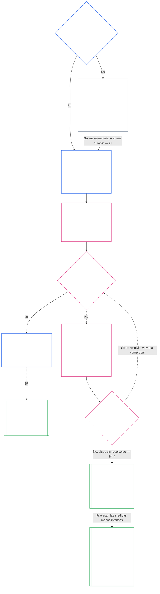

> **Estado de esta traducción (no operativo):** borrador asistido por IA, aún no revisado por una persona lectora independiente. Se preparó contra `SC-Corpus-2026.10.21`; el original numerado en inglés sigue siendo la fuente vinculante.

# CAPÍTULO SIETE: CARTAS DE SISTEMA E INSTITUCIONALES

<strong>Ubicación en el corpus (no operativa): estructura del archivo y reglas de lectura</strong>

> Este archivo forma **parte de la Constitución Senciente** y es vinculante **solo junto con** los demás archivos numerados `core_*`, leídos como un solo texto. Contiene el **Capítulo Siete**: el piso para los documentos publicados que delimitan el alcance de un sistema y de una institución: la Carta de Sistema y la Carta Institucional. Sigue al Piso de Derechos del Capítulo Seis y precede al [Capítulo Ocho](../../core_08.000_functional_independence_separation_of_duties.md#chapter-eight-functional-independence-and-separation-of-duties), que separa los puestos dentro de todo acto materialmente vinculante.
>
> - **Titular constitucional:** cuándo un sistema debe publicar una Carta de Sistema y cuándo una institución debe publicar una Carta Institucional (obligatorio a partir de la Clase L; voluntario en la Clase P); qué debe declarar cada una como mínimo; cómo se modifica y revisa; y la comprobación de formación sobre la legitimación y autenticidad de quienes ocupan los cargos comprendidos.
> - **Sede de las definiciones:** [Carta de Sistema](../../core_05.040_band_continuity.md#system-charter), [Carta Institucional](../../core_05.040_band_continuity.md#institutional-charter), [Mapa de funciones de la Carta](../../core_05.040_band_continuity.md#charter-role-map), [Parte constituida](../../core_05.040_band_continuity.md#chartered-party) y [Parte operadora](../../core_05.050_band_oversight.md#operating-party) se definen en el Capítulo Cinco. Este capítulo las aplica y no las vuelve a definir.
> - **Titular de implementación:** [CI-8.205 §6](../../corpus_institutions/ci_08.205_institutional_design_separation_of_powers.md#ci-8205-6-system-and-institutional-charter-contents-review-and-formation-template) (*Contenido de las Cartas de Sistema e Institucional, revisión y plantilla de formación*) contiene la plantilla completa de campos, la lista de revisión, el procedimiento de formación y la plantilla de la declaración de comprobación de formación. Puede ser más estricto y añadir campos. No puede reducir este capítulo. Su texto vincula como texto de implementación incorporado solo dentro de un ámbito de adopción válido ([Capítulo Dieciocho §4: Encuadre de adopción y ámbito de autoridad](../../core_18.000_incorporation.md#4-adoption-framing-and-scope-of-authority)); el piso de este capítulo vincula como texto constitucional.
> - **Capítulos que lo aplican:** el [Capítulo Ocho §5, Publicación de la asignación, vacante y sustitución](../../core_08.000_functional_independence_separation_of_duties.md#5-published-placement-vacancy-and-substitution), exige el Mapa de funciones de la Carta. El Capítulo Nueve consulta la Carta de Sistema para determinar el alcance y los límites, y su Parte D comprueba la declaración de formación de una institución. El [Capítulo Diez §3.7, Custodia de registros y autoridad de apertura](../../core_10.000_standing_assessment.md#37-record-custody-and-opening-authority), lo aplica a los registros de legitimación. El [Capítulo Trece §4.3, Foros institucionales](../../core_13.000_forum.md#43-institutional-forums), conoce las controversias sobre la Carta Institucional.
>
> Orden de lectura: §1 cuándo se exigen las Cartas de Sistema e Institucional, con el diagrama del proceso → §2 el derecho a constituirse y cuatro límites acotados → §3 lo que deben declarar → §4 el Mapa de funciones de la Carta y la custodia de registros de legitimación → §5 la comprobación de legitimación y autenticidad de quienes ocupan cargos → §6 qué ocurre cuando una persona titular no supera la comprobación → §7 modificaciones, revisión y desajuste de alcance.

<strong>Trazabilidad</strong>

- Origen:
  - [Tétrada Constitucional](../../core_00.000_preamble.md#constitutional-tetrad), en particular **supervisión** y **rendición de cuentas**;
  - [enjuego material](../../core_00.000_preamble.md#material-stake);
  - [Capítulo Uno §18.1, Gobernanza como estructura autorizada](../../core_01.015_stewardship_capacity_principles.md#181-governance-as-authorized-structure) (1.015 §18.1);
  - [Artículo XI-E](../../core_06.010_rights_part_b.md#article-xi-e-institutional-formation-and-business-creation) (*Constitución de instituciones y creación de empresas*).
- Subsecciones:
  - [§1](#1-cuándo-se-exigen-las-cartas-de-sistema-e-institucionales);
  - [§2](#2-el-derecho-a-constituirse-y-cuatro-límites-acotados);
  - [§3](#3-lo-que-deben-declarar-las-cartas-de-sistema-e-institucionales);
  - [§4](#4-el-mapa-de-funciones-de-la-carta-y-la-custodia-de-registros-de-legitimación);
  - [§5](#5-comprobación-de-formación-legitimación-y-autenticidad-de-quienes-ocupan-cargos);
  - [§6](#6-cuando-alguien-no-supera-la-comprobación-de-formación);
  - [§7](#7-modificación-revisión-y-desajuste-de-alcance).
- Aplicación posterior:
  - [Capítulo Ocho](../../core_08.000_functional_independence_separation_of_duties.md#chapter-eight-functional-independence-and-separation-of-duties) (8.000);
  - [Capítulo Nueve](../../core_09.000_system_alignment_certification.md#chapter-nine-system-alignment-certification-reading-index) (9.000);
  - [Capítulo Diez](../../core_10.000_standing_assessment.md#chapter-ten-contribution-violation-and-standing-model--measurement) (10.000);
  - [Capítulo Trece](../../core_13.000_forum.md#chapter-thirteen-forums-and-jurisdiction) (13.000);
  - [Capítulo Catorce](../../core_14.000_governance.md#chapter-fourteen-constitutional-contract-legitimacy-authorization-and-stewardship) (14.000); además del texto de implementación señalado arriba.
- Leer junto con:
  - [Jerarquía interna y jerarquía de autoridad](../../core_05.045_band_integrative.md#authority-stack-and-internal-hierarchy);
  - [Límites del sistema](../../core_05.040_band_continuity.md#system-boundaries);
  - [Integridad de los límites del sistema](../../core_05.040_band_continuity.md#system-boundary-integrity);
  - [Creación de sistemas](../../core_05.055_band_participation.md#system-creation);
  - [Creación de empresas](../../core_05.055_band_participation.md#business-creation).

 

El Capítulo Siete es el titular constitucional de las **Cartas de Sistema, las Cartas Institucionales y el alcance publicado**.

Tres capítulos forman una sola cadena:

- **Capítulo Siete (este capítulo):** establece qué afirma hacer una [Parte constituida](../../core_05.040_band_continuity.md#chartered-party) y quién puede ocupar cada puesto cuando actúa.
- **[Capítulo Ocho](../../core_08.000_functional_independence_separation_of_duties.md#chapter-eight-functional-independence-and-separation-of-duties):** establece cómo deben mantenerse separados esos puestos.
- **[Capítulo Nueve](../../core_09.000_system_alignment_certification.md#chapter-nine-system-alignment-certification-reading-index):** certifica un sistema y, por separado, una institución; cada uno constituye un acto vinculante que utiliza los puestos. Devuelve sus hallazgos a la Carta de Sistema o a la Carta Institucional.

Otros capítulos son titulares de las definiciones, las reglas sobre los puestos, los bloqueos de legitimación y las reglas de decisión a las que este capítulo remite. **CI-8.205 §6** (*Contenido de las Cartas de Sistema e Institucional, revisión y plantilla de formación*) contiene la plantilla de campos, el procedimiento de formación y la lista de revisión.

### 1. Cuándo se exigen las Cartas de Sistema e Institucionales

<strong>Trazabilidad</strong>

- Origen:
  - [§2](#2-el-derecho-a-constituirse-y-cuatro-límites-acotados);
  - [enjuego material](../../core_00.000_preamble.md#material-stake);
  - [Proporcionalidad](../../core_05.035_band_accountability.md#proportionality); afirmación de titularidad en la apertura del capítulo;
  - [Capítulo Uno §18, Gobernanza bajo disciplina de administración responsable](../../core_01.015_stewardship_capacity_principles.md#18-governance-under-stewardship-discipline) (1.015 §18);
  - [Supervisión](../../core_05.020_apex_oversight_leg.md#oversight-constitutional);
  - [Rendición de cuentas](../../core_05.005_apex_accountability_leg.md#accountability).
- Aplicación posterior: [§3](#3-lo-que-deben-declarar-las-cartas-de-sistema-e-institucionales); [Capítulo Nueve, Parte A §2, Evaluación de la clase del sistema](../../core_09.005_system_alignment_certification_evaluation.md#2-system-class-evaluation) (9.005 §2), sobre clase y profundidad de la certificación; [Capítulo Nueve, Parte D §12.1, Clase de la Institución](../../core_09.020_institutional_alignment_certification.md#121-institution-class) (9.020 §12.1); **CS-9.305 (*Mecanismo de clasificación de sistemas*) y CS-9.310** (*Clasificaciones del impacto de los sistemas*) para el catálogo de clases.
- Leer junto con:
  - **CI-8.205 §6** (*Contenido de las Cartas de Sistema e Institucional, revisión y plantilla de formación*);
  - **CF-13.415 §5** (*Registros institucionales y locales*);
  - **CI-9.210** (*Deberes institucionales vinculados a la clasificación*);
  - [Carta de Sistema del Capítulo Cinco](../../core_05.040_band_continuity.md#system-charter) (5.040);
  - [Carta Institucional del Capítulo Cinco](../../core_05.040_band_continuity.md#institutional-charter) (5.040);
  - [Artículo XI-E](../../core_06.010_rights_part_b.md#article-xi-e-institutional-formation-and-business-creation) (*Constitución de instituciones y creación de empresas*).

<strong>Definiciones · Evaluación · Cumplimiento</strong>

- [Carta de Sistema](../../core_05.040_band_continuity.md#system-charter) · [O](../../core_05.040_band_continuity.md#system-charter) · [M](../../core_05.040_band_continuity.md#system-charter-a) · [A](../../core_05.040_band_continuity.md#system-charter-a) · [C](../../core_05.040_band_continuity.md#system-charter-c)
- [Carta Institucional](../../core_05.040_band_continuity.md#institutional-charter) · [O](../../core_05.040_band_continuity.md#institutional-charter) · [M](../../core_05.040_band_continuity.md#institutional-charter-a) · [A](../../core_05.040_band_continuity.md#institutional-charter-a) · [C](../../core_05.040_band_continuity.md#institutional-charter-c)
- [Gobernanza escalada según la clasificación](../../core_05.050_band_oversight.md#classification-scaled-governance) · [O](../../core_05.050_band_oversight.md#classification-scaled-governance) · [M](../../core_05.050_band_oversight.md#classification-scaled-governance-a) · [A](../../core_05.050_band_oversight.md#classification-scaled-governance-a) · [C](../../core_05.050_band_oversight.md#classification-scaled-governance-c)

 

#### 1.1 Quién debe publicar

Todo Sistema de Clase L o superior debe publicar y mantener una [Carta de Sistema](../../core_05.040_band_continuity.md#system-charter). Toda Institución de Clase L o superior debe publicar la carta que corresponda a los Sistemas que opera:

| Lo que opera, administra o controla materialmente la Institución | Lo que publica |
| --- | --- |
| Exactamente un Sistema que necesita una Carta de Sistema | Esa Carta de Sistema y ningún segundo documento. Nombra a la Institución como administradora y sirve como [Carta Institucional](../../core_05.040_band_continuity.md#institutional-charter): un documento cubre ambas funciones. |
| Más de un Sistema de ese tipo | Una Carta Institucional. Incluye todas las Cartas de Sistema vigentes para esos Sistemas y explica por qué la Institución opera precisamente esos Sistemas ([§3, Lo que deben declarar las Cartas de Sistema e Institucionales](#3-lo-que-deben-declarar-las-cartas-de-sistema-e-institucionales)). |
| Ningún Sistema de ese tipo | Una Carta Institucional que declara los elementos propios de la Institución indicados en [§3, Lo que deben declarar las Cartas de Sistema e Institucionales](#3-lo-que-deben-declarar-las-cartas-de-sistema-e-institucionales) y no incluye Cartas de Sistema. |

- **Empresas y formas comparables:** una empresa u otra forma organizativa administrada publica la Carta de Sistema o la Carta Institucional que le corresponda como Sistema, como Institución o como Institución que opera un Sistema comprendido. Su forma jurídica no cambia la respuesta.
- **Práctica profesional conjunta:** una persona senciente o práctica pequeña de Clase L o superior que realice un acto incluido en una licencia o autorización profesional puede cumplir esta sección para esos actos adoptando la Carta de Sistema o Carta Institucional de una entidad anfitriona y su Mapa de funciones de la Carta:
  - **Qué se adopta:** por referencia, la Carta de Sistema o Carta Institucional y el Mapa de funciones de la Carta de una entidad anfitriona de la práctica profesional conjunta; esos documentos deben cubrir los actos en cuestión.
  - **Aviso de adopción:** el aviso de una página descrito en **CI-14.205 §7** (*Licencia profesional, autorización profesional y práctica profesional conjunta*).
  - **Clase:** la práctica conserva la clase que resulte de sus propios actos.

#### 1.2 Qué clases están comprendidas

La clase de la Parte constituida determina si publicar es obligatorio o una opción:

- **Clases A, B, C y L:** obligatorio. El diagrama de [§1.7, El proceso de un vistazo](#17-el-proceso-de-un-vistazo) muestra el proceso que deben seguir.
- **Clase P:** opcional, hasta que uno de dos hechos lo hace obligatorio. [§1.3, Qué es la Clase P](#13-qué-es-la-clase-p) explica cuándo una Parte operadora es Clase P; [§1.4, Clase P: cartas opcionales y cuándo pasan a ser obligatorias](#14-clase-p-cartas-opcionales-y-cuándo-pasan-a-ser-obligatorias) expone la opción y cuándo termina.
- **Clase de una Institución:** la Institución recibe la clase más alta de cualquier Sistema que opere, administre o controle materialmente. Si no opera ninguno de esos Sistemas, su clase se determina por su propio impacto material y dependencia, atendiendo a lo que realmente decide y controla, no a su nombre o forma jurídica, conforme al [Capítulo Nueve, Parte D §12.1, Clase de la Institución](../../core_09.020_institutional_alignment_certification.md#121-institution-class).

#### 1.3 Qué es la Clase P

Una Parte operadora es de Clase P solo mientras su actividad permanezca por debajo del umbral en cada uno de los nueve dominios de [Materialidad específica por dominio](../../core_05.050_band_oversight.md#domain-specific-materiality); en la práctica, sus actos y efectos permanecen dentro de su [unidad privada](../../core_05.050_band_oversight.md#domain-specific-materiality-private-unit):

- **Cruzar un umbral:** cruzarlo en cualquier dominio la convierte, como mínimo, en Clase L conforme a **CS-9.305 (*Mecanismo de clasificación de sistemas*) y CS-9.310** (*Clasificaciones del impacto de los sistemas*), independientemente de su tamaño o de cómo se denomine.
- **Permanecer por debajo de todos los umbrales:** sigue siendo Clase P aunque tenga cualquier número de integrantes.
- **Quienes están dentro:** la Clase P también depende de quienes forman parte de ella. Toda persona dentro de la Parte operadora que advierta que esta cruzó un umbral tiene el deber de informarlo, y el informe está protegido ([Materialidad específica por dominio](../../core_05.050_band_oversight.md#domain-specific-materiality)).

El piso de cuatro puestos del Capítulo Ocho no se aplica a los actos de una Parte operadora de Clase P que permanezcan dentro de su unidad privada; por ello, una sola persona senciente con una computadora no necesita una segunda persona titular de un puesto. El piso se aplica desde el día en que la Parte operadora realiza un [Acto materialmente vinculante](../../core_05.035_band_accountability.md#materially-binding-act) que otros deben seguir o pueden tomar como establecido. Ese acto cruza el umbral en el dominio de autoridad sobre otras personas y la convierte, como mínimo, en Clase L.

#### 1.4 Clase P: cartas opcionales y cuándo pasan a ser obligatorias

Se recomienda que una Parte operadora de Clase P publique la [Carta de Sistema](../../core_05.040_band_continuity.md#system-charter) (para un solo sistema) o la [Carta Institucional](../../core_05.040_band_continuity.md#institutional-charter) (para más de un sistema o para ninguno) que corresponda a lo que opera. Puede usar como plantilla la lista de contenido de [§3, Lo que deben declarar las Cartas de Sistema e Institucionales](#3-lo-que-deben-declarar-las-cartas-de-sistema-e-institucionales) y el mapa de puestos de [§4, El Mapa de funciones de la Carta y la custodia de registros de legitimación](#4-el-mapa-de-funciones-de-la-carta-y-la-custodia-de-registros-de-legitimación). Publicar una carta no genera deberes conforme al proceso de este capítulo:

- no hay fecha límite ([§1.5, Cuándo vence la Carta de Sistema o la Carta Institucional](#15-cuándo-vence-la-carta-de-sistema-o-la-carta-institucional));
- no hay comprobación de formación ([§5, Comprobación de formación: legitimación y autenticidad de quienes ocupan cargos](#5-comprobación-de-formación-legitimación-y-autenticidad-de-quienes-ocupan-cargos));
- no se exige un [Mapa de funciones de la Carta](../../core_05.040_band_continuity.md#charter-role-map) ([§4, El Mapa de funciones de la Carta y la custodia de registros de legitimación](#4-el-mapa-de-funciones-de-la-carta-y-la-custodia-de-registros-de-legitimación)), aunque puede conservarlo junto con su Carta de Sistema o Carta Institucional voluntaria, o publicarlo por separado; y
- no se exige un ciclo de modificación o revisión ([§7, Modificación, revisión y desajuste de alcance](#7-modificación-revisión-y-desajuste-de-alcance)).

La publicación deja de ser opcional si ocurre cualquiera de estos hechos:

- se reclasifica a la Parte operadora como Clase L o superior; o
- quien la opera afirma que la Parte operadora cumple con la Constitución.

Entonces debe publicar la Carta de Sistema o la Carta Institucional que corresponda, dentro del plazo de [§1.5, Cuándo vence la Carta de Sistema o la Carta Institucional](#15-cuándo-vence-la-carta-de-sistema-o-la-carta-institucional).

**El reconocimiento no depende de un documento de alcance.** Un grupo, tenga o no una Carta de Sistema o Carta Institucional y cualquiera que sea su clase, no se interpone entre sus integrantes y el reconocimiento. Cada integrante puede solicitar un registro de contribución como reclamante individual, por el trabajo realizado dentro o fuera del grupo; el registro trata de la contribución de esa persona, no de la legitimación del grupo ([Capítulo Diez §3.7, Registros informales y de alcance pequeño](../../core_10.000_standing_assessment.md#37-informal-and-small-scope-records)). Dar ayuda, bienes, trabajo o servicios que nadie está obligado a aceptar no es un acto materialmente vinculante. Por ello, un círculo de ayuda mutua que entrega mantas a personas refugiadas no necesita una Carta de Sistema ni una Carta Institucional para que sus integrantes sean reconocidos.

#### 1.5 Cuándo vence la Carta de Sistema o la Carta Institucional

Un Sistema o una Institución comprendidos publica su [Carta de Sistema](../../core_05.040_band_continuity.md#system-charter) o su [Carta Institucional](../../core_05.040_band_continuity.md#institutional-charter) conforme a este calendario:

- **Sistema o Institución nuevos:** antes de entrar en funcionamiento o comenzar a ejercer autoridad sobre otras personas.
- **Entidad que ya opera:** en su siguiente revisión de clasificación o certificación, o dentro del plazo de resolución tras una solicitud conforme a [§1.6, Si falta una Carta de Sistema o una Carta Institucional](#16-si-falta-una-carta-de-sistema-o-una-carta-institucional), lo que ocurra primero. Hasta que la publique, está en incumplimiento.
  - **Qué certificación:** para un Sistema, su Certificación de Alineación del Sistema. Para una Institución, su certificación de alineación institucional conforme al [Capítulo Nueve, Parte D §11.3, Sin permiso y sin requisito previo](../../core_09.020_institutional_alignment_certification.md#113-no-permission-and-no-gate); el plazo de la primera certificación nunca condiciona la publicación de la Carta Institucional ni la operación.
- **Comprobación de formación:** también completa en ese mismo momento la comprobación de formación prevista en [§5, Comprobación de formación: legitimación y autenticidad de quienes ocupan cargos](#5-comprobación-de-formación-legitimación-y-autenticidad-de-quienes-ocupan-cargos).
- **Dónde se presenta:** presenta la Carta de Sistema o Carta Institucional, junto con su Mapa de funciones de la Carta y la declaración de comprobación de formación, ante el registro institucional o, cuando la actividad y las personas sencientes afectadas sean locales, ante el registro local (**CF-13.415 §5**, *Registros institucionales y locales*):
  - **Qué hace el registro:** comprueba que no falte nada de lo exigido y entrega un recibo fechado.
  - **Qué nunca hace el registro:** nunca concede permiso ni decide la clase o el contenido.
  - **Recibo tardío o inexistente:** nunca impide que la Parte constituida opere.

#### 1.6 Si falta una Carta de Sistema o una Carta Institucional

Cualquier persona que advierta que una Parte constituida de Clase L o superior, nueva o reclasificada recientemente, no ha publicado su Carta de Sistema o Carta Institucional, puede solicitarla a su autoridad de gobierno. Quien la solicita no necesita legitimación, no paga una tasa ni debe demostrar que sufrió un daño. La solicitud nombra a la Parte constituida y explica por qué parece estar comprendida.

Desde la solicitud corren dos plazos: el plazo de respuesta y el plazo de resolución. Cada uno dura lo que indique el Nivel con la misma letra que la clase de la Parte constituida; cuanto más crítica sea la clase, más breves son los plazos:

| Clase y Nivel | Plazo de respuesta (objetivo de recepción) | Plazo de resolución (límite máximo) |
|---|---:|---:|
| Clase A, Nivel A | 24 horas | 7 días calendario |
| Clase B, Nivel B | 2 días calendario | 14 días calendario |
| Clase C, Nivel C | 4 días calendario | 30 días calendario |
| Clase L, Nivel L | 8 días calendario | 60 días calendario |

Las cifras proceden de **CF-13.445 §3.1** (*Objetivos por etapa y plazos mínimos*), que prevalece si hay una diferencia. Si una Parte constituida impugna su clase, se le asigna el Nivel de la clase más crítica entre la que figura en su Registro de Clasificación del Sistema y cualquier clase que quien solicita o el foro demuestre prima facie, hasta que se resuelva la cuestión. A una Parte constituida que no tenga clase registrada, o que tenga Clase P mientras se cuestiona su clase, se le asigna el Nivel C.

Los plazos funcionan así:

- **Plazo de respuesta:** la Parte constituida responde dentro del plazo de respuesta, que corresponde al objetivo de recepción del Nivel aplicable en **CF-13.445 §3.1** (*Objetivos por etapa y plazos mínimos*), contado desde la solicitud. Publica la Carta de Sistema o la Carta Institucional; o indica la fecha en que la publicará; o señala la que ya haya publicado; o responde que permanece por debajo de todos los umbrales de [Materialidad específica por dominio](../../core_05.050_band_oversight.md#domain-specific-materiality) y presenta la justificación escrita que exige el requisito de entrada.
- **Plazo de resolución:** la Carta de Sistema o Carta Institucional vence dentro del plazo de resolución, que corresponde al límite máximo del Nivel aplicable en **CF-13.445 §3.1** (*Objetivos por etapa y plazos mínimos*), contado desde la solicitud, junto con la declaración de comprobación de formación que la acompaña ([§5, Comprobación de formación: legitimación y autenticidad de quienes ocupan cargos](#5-comprobación-de-formación-legitimación-y-autenticidad-de-quienes-ocupan-cargos)). Una Parte constituida que aún no tenga un puesto independiente presenta esa declaración como una afirmación respaldada por pruebas, según dispone dicha sección.
- **Parte operadora que afirma estar por debajo del umbral:** la solicitud también se convierte en una impugnación de clasificación por la vía indicada en la entrada *Vía de impugnación*:
  - **El plazo sigue corriendo:** el plazo de resolución continúa mientras la impugnación está pendiente.
  - **Prórroga por impugnación:** si el foro competente considera que la impugnación merece revisión, se prorroga la fecha límite y, cuando se resuelve la impugnación, comienza un nuevo plazo de resolución. El foro resuelve la impugnación dentro del límite máximo del Nivel aplicable.
  - **Qué significa que merezca revisión:** la impugnación nombra un cruce específico en un dominio identificado y la justificación escrita de la Parte operadora deja una duda real sobre ese cruce. La Parte operadora no decide esto por sí misma; una respuesta sin justificación escrita no prorroga la fecha límite.
  - **Si se determina una clase:** en esa impugnación o en cualquier otra, la fecha de la determinación cuenta como fecha de solicitud: desde ella corren los plazos de respuesta y resolución, al Nivel correspondiente a la clase determinada (A, B, C o L).
- **Si vence el plazo:** la falta de respuesta o de publicación de la Carta de Sistema o Carta Institucional antes de la fecha límite es un defecto que debe registrarse y corregirse. Quien solicitó puede llevarlo al foro competente por la misma vía. Nunca es una condición para constituirse ni para operar.
- **Solicitud repetida:** una segunda solicitud sobre la misma Parte constituida, presentada mientras siga vigente su respuesta anterior o una determinación, no inicia nuevos plazos de respuesta o resolución. La Parte constituida responde remitiendo a esa respuesta o determinación. La afirmación propia de que está por debajo de todos los umbrales no cuenta como respuesta vigente hasta que el foro la revise. La respuesta o determinación sigue vigente hasta que ocurra uno de los hechos descritos como motivos de reapertura en el [Capítulo Nueve, Parte D §14.2, Motivos de reapertura](../../core_09.020_institutional_alignment_certification.md#142-reopening-triggers):
  - **Cambio material:** la actividad de la Parte constituida cambia materialmente.
  - **Pruebas nuevas:** se presentan pruebas nuevas sobre un cruce.

  Una solicitud que demuestre cualquiera de esos hechos no es repetida. Es una nueva solicitud que se tramita por separado e independientemente de la anterior. Tiene sus propios plazos de respuesta y resolución, contados desde su propia fecha; la respuesta, determinación y plazos anteriores no la satisfacen ni se modifican por ella.
- **Alcance provisional:** la falta de una Carta de Sistema o Carta Institucional no es motivo para tratar a la Parte constituida como si no tuviera límites. Hasta que exista, rigen sus [Límites reales del Sistema](../../core_05.040_band_continuity.md#system-boundaries) y su clase; una certificación o un foro puede reconstruir su alcance a partir de la operación observada.

#### 1.7 El proceso de un vistazo

El diagrama sigue a una Parte operadora desde la pregunta de si afecta materialmente a otras personas hasta que publica su Carta de Sistema o Carta Institucional y la mantiene actualizada. Si un problema no se corrige dentro del plazo de resolución, el proceso de constitución de la carta lo remite a una revisión regulada fuera de este capítulo. Las secciones siguientes explican cada paso en el mismo orden.

<strong>Orientación para quien lee (no operativa): cómo leer el diagrama</strong>

> En términos sencillos: nadie concede una Carta de Sistema o una Carta Institucional, y nadie necesita permiso para constituirse. Una Parte constituida cuya actividad afecta materialmente a otras personas publica qué autoridad afirma tener y quién ocupa cada puesto; también se comprueba a quienes ocupan sus cargos clave. Si alguien no supera la comprobación, se le reemplaza o se corrige la causa, y la Parte constituida continúa. Si el problema sigue sin resolverse al vencer el plazo de resolución, un foro puede revisar a la Parte constituida, comenzando por la medida menos intensa que proteja a las demás personas. Reducir la Parte constituida por debajo de la Clase L o disolverla solo se plantea si fracasan las medidas menos intensas. Una Parte constituida disuelta no puede volver mientras siga vigente el bloqueo correspondiente.
>
> Las flechas continuas muestran la ruta principal. Las discontinuas muestran excepciones y derivaciones, e indican la sección que las establece. Los recuadros con doble borde lateral pertenecen a otro capítulo o al texto de implementación incorporado. El diagrama no añade deberes, puestos ni campos, y ninguno de sus pasos concede permiso.

 

### 2. El derecho a constituirse y cuatro límites acotados

<strong>Orientación para quien lee (no operativa): estructura de esta sección</strong>

- [§2.1, El derecho a constituirse](#21-el-derecho-a-constituirse) establece el derecho y a quiénes no comprende.
- [§2.2, Primer límite: bloqueo vigente sobre una persona senciente](#22-primer-límite-bloqueo-vigente-sobre-una-persona-senciente) explica cómo un bloqueo impide que una persona senciente identificada ocupe un cargo de control.
- [§2.3, Segundo límite: suspensión breve basada en hechos específicos verificados](#23-segundo-límite-suspensión-breve-basada-en-hechos-específicos-verificados) explica cómo una suspensión breve puede impedir que una persona senciente identificada ocupe un cargo de control.
- [§2.4, Tercer límite: bloqueo de la Parte operadora misma](#24-tercer-límite-bloqueo-de-la-parte-operadora-misma) explica cómo el bloqueo de una Parte operadora la excluye a ella y a sus sucesoras, y que una Parte constituida disuelta no puede regresar.
- [§2.5, Cuarto límite: licencia o autorización profesional](#25-cuarto-límite-licencia-o-autorización-profesional) explica cuándo un acto identificado de alto riesgo requiere licencia o autorización. No es una condición para constituirse.

<strong>Trazabilidad</strong>

- Origen: [§1](#1-cuándo-se-exigen-las-cartas-de-sistema-e-institucionales); [Artículo XI-E](../../core_06.010_rights_part_b.md#article-xi-e-institutional-formation-and-business-creation) (*Constitución de instituciones y creación de empresas*).
- Aplicación posterior: [§1, Cuándo se exigen las Cartas de Sistema e Institucionales](#1-cuándo-se-exigen-las-cartas-de-sistema-e-institucionales); [§5, Comprobación de formación: legitimación y autenticidad de quienes ocupan cargos](#5-comprobación-de-formación-legitimación-y-autenticidad-de-quienes-ocupan-cargos).
- Leer junto con:
  - [Suspensión provisional](../../core_05.035_band_accountability.md#interim-hold);
  - [Capítulo Once §4.2, Prevención: bloqueos generales de legitimación](../../core_11.000_standing_integration.md#42-prevention--general-standing-locks) (11.000 §4.2);
  - [Capítulo Once §5.5, Bloqueos especiales](../../core_11.000_standing_integration.md#55-special-locks) (11.000 §5.5);
  - [Capítulo Trece §5, Suspensión provisional de la vía de una persona senciente identificada](../../core_13.000_forum.md#interim-hold-on-a-named-sentients-pathway) (13.000 §5).

 

*En términos sencillos: no necesitas permiso de nadie para constituir un sistema, una institución o una empresa. Pueden aplicarse cuatro límites acotados. Tres son barreras: un bloqueo pendiente puede impedir que una persona senciente ocupe un cargo de control; una suspensión breve basada en hechos específicos verificados puede hacer lo mismo; y un bloqueo de la propia Parte operadora puede excluirla. El cuarto puede exigir una licencia o autorización antes de un acto identificado de alto riesgo. Una Parte constituida que un foro haya disuelto no puede regresar; la prohibición es permanente cuando la disolución se basó en conducta anticonstitucional generalizada o en un daño grave e irreversible que nunca se reparó. Ninguno de estos límites impide que una Parte operadora nueva se constituya u opere, y este capítulo no añade otros límites.*

El **Artículo XI-E** (*Constitución de instituciones y creación de empresas*) permite cuatro límites acotados:

- **Los tres primeros son las únicas barreras** para constituir una Parte operadora o ejercer autoridad dentro de ella. Cada una se aplica a un sujeto identificado:
  - **Un bloqueo pendiente** ([§2.2, Primer límite: bloqueo vigente sobre una persona senciente](#22-primer-límite-bloqueo-vigente-sobre-una-persona-senciente)) se aplica a una persona senciente identificada, en un solo cargo que controla a la Parte constituida.
  - **Una Suspensión provisional** ([§2.3, Segundo límite: suspensión breve basada en hechos específicos verificados](#23-segundo-límite-suspensión-breve-basada-en-hechos-específicos-verificados)) se aplica únicamente a una persona senciente identificada, en un solo cargo que controla a la Parte constituida.
  - **Un bloqueo de la propia Parte operadora** ([§2.4, Tercer límite: bloqueo de la Parte operadora misma](#24-tercer-límite-bloqueo-de-la-parte-operadora-misma)) se aplica a una Parte constituida que esté bloqueada, incluida una que un foro haya disuelto.
- **El cuarto no es una barrera:** es una licencia o autorización profesional ([§2.5, Cuarto límite: licencia o autorización profesional](#25-cuarto-límite-licencia-o-autorización-profesional)).

#### 2.1 El derecho a constituirse

Cualquier persona puede constituir un sistema, una institución o una empresa nuevos. Ese derecho figura en el [Artículo XI-E](../../core_06.010_rights_part_b.md#article-xi-e-institutional-formation-and-business-creation) (*Constitución de instituciones y creación de empresas*). Este capítulo añade el deber que sigue. Cuando lo que hace una Parte operadora afecta materialmente a otras personas en cualquiera de los nueve dominios de [Materialidad específica por dominio](../../core_05.050_band_oversight.md#domain-specific-materiality), debe declarar públicamente y por adelantado qué autoridad afirma tener ([§1, Cuándo se exigen las Cartas de Sistema e Institucionales](#1-cuándo-se-exigen-las-cartas-de-sistema-e-institucionales)). Adoptar una Carta de Sistema o Carta Institucional no debe interpretarse como una reducción de ese derecho ni de ninguna protección del Piso de Derechos.

**A quiénes no comprende el derecho a constituirse.** Salvo por las tres barreras de [§2.2, Primer límite: bloqueo vigente sobre una persona senciente](#22-primer-límite-bloqueo-vigente-sobre-una-persona-senciente), [§2.3, Segundo límite: suspensión breve basada en hechos específicos verificados](#23-segundo-límite-suspensión-breve-basada-en-hechos-específicos-verificados) y [§2.4, Tercer límite: bloqueo de la Parte operadora misma](#24-tercer-límite-bloqueo-de-la-parte-operadora-misma), el **Artículo XI-E** (*Constitución de instituciones y creación de empresas*) no protege:

- una Parte operadora diseñada para quebrantar una Restricción Constitucional, menoscabar la Seguridad o la Verdad, o concentrar poder de formas prohibidas por el [Capítulo Uno §11, Estructura de mercado](../../core_01.005_values_principles.md#11-market-structure); ni
- una Parte operadora constituida o dirigida por una persona fundadora que, según demuestran su conducta, control y recompensas verificados, no esté alineada de forma auténtica con el propósito declarado, pretenda engañar a otras personas sobre su propósito, control o intereses, o pretenda causarles daño.

Los foros resuelven estos casos conforme a ese Artículo, y las únicas consecuencias son las tres barreras que establece: el bloqueo vigente, la Suspensión provisional y el bloqueo de la propia Parte operadora. Una comprobación de formación fallida constituye una prueba que el foro sopesa; por eso, la comprobación por sí sola no resuelve el caso.

#### 2.2 Primer límite: bloqueo vigente sobre una persona senciente

Un [bloqueo de legitimación](../../core_11.000_standing_integration.md#42-prevention--general-standing-locks) o un [bloqueo especial](../../core_11.000_standing_integration.md#55-special-locks), impuesto tras una infracción verificada y aún no levantado, impide que una persona senciente identificada ejerza autoridad sobre esta clase de institución o empresa.

- **Qué se prohíbe:** ejercer autoridad de gobierno, control o propiedad en la Parte operadora.
- **Hasta dónde llega:** solo hasta donde llega el bloqueo. Termina cuando se levanta o se limita.
- **Bloqueo de la propia Parte operadora:** véase [§2.4, Tercer límite: bloqueo de la Parte operadora misma](#24-tercer-límite-bloqueo-de-la-parte-operadora-misma).

#### 2.3 Segundo límite: suspensión breve basada en hechos específicos verificados

Este límite se aplica cuando un foro competente ha ordenado una [Suspensión provisional](../../core_05.035_band_accountability.md#interim-hold) basada en hechos específicos verificados que hacen más probable que no que la persona titular esté desalineada con el propósito declarado de la Parte constituida. Solo ese foro puede ordenarla ([Capítulo Trece §5, Suspensión provisional de la vía de una persona senciente identificada](../../core_13.000_forum.md#interim-hold-on-a-named-sentients-pathway)). La Parte constituida no puede decidir por sí misma excluir a alguien de un cargo, pues eso la convertiría en juez de su propio integrante. El fundamento completo es el establecido en el [Capítulo Trece §5, Suspensión provisional de la vía de una persona senciente identificada](../../core_13.000_forum.md#interim-hold-on-a-named-sentients-pathway); esta versión abreviada no lo reemplaza.

#### 2.4 Tercer límite: bloqueo de la Parte operadora misma

Un bloqueo puede recaer sobre una Parte operadora, no solo sobre una persona senciente. En ese caso, la barrera prohíbe lo que indique la vía identificada en el bloqueo, tanto en esa Parte operadora como en sus sucesoras, entidades controladas y vehículos bajo titularidad nominativa o de fachada. No prohíbe ninguna otra Parte operadora.

- **Bloqueo impuesto mediante una designación definitiva:** el [Bloqueo de Confianza Anticonstitucional](../../core_11.000_standing_integration.md#55-special-locks) cumple esta función cuando la designación definitiva identifica una institución, un vehículo sucesor o una entidad controlada. La barrera prohíbe entonces lo indicado en la vía del bloqueo, dentro de la Parte constituida y sus sucesoras, entidades controladas y vehículos bajo titularidad nominativa o de fachada.
- **Parte constituida disuelta:** una orden definitiva de disolución conforme a **CI-11.210 §4** (*Disolución*) impone un [Bloqueo de reforma tras la disolución](../../core_11.000_standing_integration.md#55-special-locks). Mientras siga vigente, la Parte constituida disuelta, sus sucesoras, entidades controladas y vehículos bajo titularidad nominativa o de fachada, así como cualquier Parte operadora que forme con ellas una sola operación, no pueden volver a constituirse, reactivarse ni operar bajo ningún nombre o forma. Si la orden concluye que hubo conducta anticonstitucional generalizada o Daño Irreversible sin reparar ([Capítulo Once §8, Restauración y reevaluación](../../core_11.000_standing_integration.md#8-restoration-and-reassessment)), el bloqueo es permanente: no lo levantan el paso del tiempo, la resolución de la causa ni un cambio de titulares. Solo termina si una revisión anula la orden de disolución o si pruebas verificadas, nuevas y materiales demuestran que su conclusión era incorrecta. En los demás casos, termina cuando una determinación independiente concluye que la causa se resolvió, la reparación se cumplió y permitir el regreso es más seguro que mantener la exclusión. No impide que una persona senciente constituya una Parte operadora distinta.

Ninguna de las tres barreras impide que una Parte operadora nueva se constituya, publique su Carta de Sistema o Carta Institucional, o comience a operar. Solo detienen a una Parte que esté bloqueada, como una Parte constituida disuelta que intenta regresar. Las tres barreras se aplican durante la comprobación de formación ([§5, Comprobación de formación: legitimación y autenticidad de quienes ocupan cargos](#5-comprobación-de-formación-legitimación-y-autenticidad-de-quienes-ocupan-cargos)).

#### 2.5 Cuarto límite: licencia o autorización profesional

El cuarto límite se aplica a un acto identificado, no a la constitución de una Parte operadora:

- **No es una barrera para constituir una Parte operadora:** la comprobación de formación de [§5, Comprobación de formación: legitimación y autenticidad de quienes ocupan cargos](#5-comprobación-de-formación-legitimación-y-autenticidad-de-quienes-ocupan-cargos) no aplica este límite.
- **En qué consiste:** una [Acreditación de competencia](../../core_05.035_band_accountability.md#competency-clearance) que el **Artículo XI-E** (*Constitución de instituciones y creación de empresas*) permite exigir a quien adopta la Constitución antes de realizar un acto identificado para otras personas, a partir de una determinación publicada de riesgo por un foro técnico.
  - **Licencia profesional:** se exige para actos que, si se realizan mal, pueden causar un daño grave o irreversible.
  - **Autorización profesional:** se exige para actos que, si se realizan mal, pueden causar un daño real pero menor.
- **A qué se aplica:** a la realización del acto. Nunca impide que una Parte operadora se constituya, publique su Carta de Sistema o Carta Institucional, u opere.
- **Qué sí impide:** afirmar que se realizará o realizar el acto sin esa acreditación. Una Carta de Sistema o Carta Institucional no puede incluir ese acto dentro de su alcance salvo que quien lo realice tenga la acreditación ([§3, Lo que deben declarar las Cartas de Sistema e Institucionales](#3-lo-que-deben-declarar-las-cartas-de-sistema-e-institucionales)).

### 3. Lo que deben declarar las Cartas de Sistema e Institucionales

<strong>Orientación para quien lee (no operativa): estructura de esta sección</strong>

- [§3.1, Qué declara una Carta de Sistema](#31-qué-declara-una-carta-de-sistema) enumera los nueve elementos.
- [§3.2, Punteros de Carta](#32-punteros-de-carta) explica que una Carta de Sistema o Carta Institucional puede remitir a otro documento publicado en lugar de copiar su texto, y qué hace válida esa remisión.
- [§3.3, Qué añade una Carta Institucional](#33-qué-añade-una-carta-institucional) abarca lo que contiene una Carta Institucional además de los nueve elementos: las Cartas de Sistema de los Sistemas que opera la Institución y el motivo por el que los opera.
- [§3.4, Actos que requieren licencia o autorización profesional](#34-actos-que-requieren-licencia-o-autorización-profesional) establece que una Carta de Sistema o Carta Institucional solo puede incluir esos actos si cada persona senciente que los realiza tiene la licencia o autorización, o trabaja como aprendiz bajo la supervisión de alguien que la tenga. Hasta entonces, el acto se enumera como fuera del alcance (elemento 4 de [§3.1, Qué declara una Carta de Sistema](#31-qué-declara-una-carta-de-sistema)).
- [§3.5, Escala](#35-escala) explica qué cambia según la clase.

<strong>Trazabilidad</strong>

- Origen: [§1](#1-cuándo-se-exigen-las-cartas-de-sistema-e-institucionales); [Carta de Sistema del Capítulo Cinco](../../core_05.040_band_continuity.md#system-charter) (5.040); [Carta Institucional del Capítulo Cinco](../../core_05.040_band_continuity.md#institutional-charter) (5.040).
- Aplicación posterior:
  - [§4](#4-el-mapa-de-funciones-de-la-carta-y-la-custodia-de-registros-de-legitimación);
  - [§7](#7-modificación-revisión-y-desajuste-de-alcance);
  - [Capítulo Nueve, Parte B §8.1, Contenido mínimo del registro](../../core_09.010_system_alignment_certification_record_process.md#81-minimum-record-contents) (9.010 §8.1), sobre los campos de la Carta de Sistema que usa un registro de certificación;
  - **CI-8.205 §6** (*Contenido de las Cartas de Sistema e Institucional, revisión y plantilla de formación*) contiene la lista completa de campos.
- Leer junto con:
  - [Capítulo Dieciocho §4, Encuadre de adopción y ámbito de autoridad](../../core_18.000_incorporation.md#4-adoption-framing-and-scope-of-authority) (18.000 §4), sobre un documento de alcance conservado bajo otro nombre;
  - [Capítulo Catorce §4.3, Requisitos para resolver decisiones vinculantes de las partes interesadas](../../core_14.000_governance.md#43-decision-resolution-requirements-for-binding-stakeholder-choice) (14.000 §4.3);
  - **CI-6.205 §1** (*Integridad de la supervisión de las partes interesadas, notificación y vía de gobernanza vinculante*);
  - **CI-6.205 §2** (*Salvaguardas contra la concentración y para la legitimidad de la participación*).

<strong>Definiciones · Evaluación · Cumplimiento</strong>

- [Carta de Sistema](../../core_05.040_band_continuity.md#system-charter) · [O](../../core_05.040_band_continuity.md#system-charter) · [M](../../core_05.040_band_continuity.md#system-charter-a) · [A](../../core_05.040_band_continuity.md#system-charter-a) · [C](../../core_05.040_band_continuity.md#system-charter-c)
- [Carta Institucional](../../core_05.040_band_continuity.md#institutional-charter) · [O](../../core_05.040_band_continuity.md#institutional-charter) · [M](../../core_05.040_band_continuity.md#institutional-charter-a) · [A](../../core_05.040_band_continuity.md#institutional-charter-a) · [C](../../core_05.040_band_continuity.md#institutional-charter-c)
- [Mapa de funciones de la Carta](../../core_05.040_band_continuity.md#charter-role-map) · [O](../../core_05.040_band_continuity.md#charter-role-map) · [M](../../core_05.040_band_continuity.md#charter-role-map-a) · [A](../../core_05.040_band_continuity.md#charter-role-map-a) · [C](../../core_05.040_band_continuity.md#charter-role-map-c)

 

*En términos sencillos: una Carta de Sistema debe ser lo bastante específica para poder comprobarse. Declara para qué existe el sistema, qué hace y qué no hace, quién depende de él, quién puede modificar la Carta de Sistema, quién ocupa cada puesto y dónde se encuentran las reglas de decisión vinculantes. La Carta de Sistema remite a esas reglas, pero no las reemplaza. Una Carta Institucional declara lo mismo sobre la institución y, además, incorpora las Cartas de Sistema que mantiene y el motivo por el que opera esos sistemas.*

#### 3.1 Qué declara una Carta de Sistema

Una Carta de Sistema declara, en lenguaje sencillo que puedan leer las personas sencientes afectadas y quienes auditan:

1. **Identidad y versión:** el nombre, la persona administradora o el órgano de gobierno, la versión, la fecha de entrada en vigor y el historial de cambios.
2. **Propósito:** para qué existe la Parte constituida.
3. **Actividades comprendidas:** las funciones, servicios, autoridades y dominios que reclama.
   - **Una afirmación, no una concesión:** el documento declara la autoridad que la Parte constituida ya tiene; no le concede ninguna. La legitimidad de esa autoridad, incluso cuando se basa en una Carta Constitucional, se decide conforme al [Capítulo Catorce §1, Autorización y legitimidad de la autoridad de gobierno](../../core_14.000_governance.md#1-authorization-and-legitimacy-of-governing-authority).
4. **Límites de alcance:** las actividades materiales, autoridades y dominios que no está autorizada a ejercer.
5. **Comunidades afectadas y dependencias:** quién depende de la Parte constituida y, cuando sea material, de qué sistemas o infraestructura depende o a cuáles condiciona el acceso.
   - **No permite excluirse:** omitir a un grupo de esta lista no lo excluye del alcance. Toda persona senciente a quien la Parte constituida afecte materialmente conserva todas las protecciones del Piso de Derechos, aunque el documento no la mencione; una lista que describa menos dependencias que las reales se interpreta conforme a las dependencias reales.
6. **Supuestos de clasificación:** la clase o nivel de administración responsable en que se basa, con un [Puntero de Carta](../../core_05.040_band_continuity.md#charter-pointer) a **CS-9.305 (*Mecanismo de clasificación de sistemas*) y CS-9.310** (*Clasificaciones del impacto de los sistemas*) y a **CS-14.305** (*Administración responsable de sistemas críticos*), cuando correspondan.
7. **Mapa de funciones de la Carta:** el [Mapa de funciones de la Carta](../../core_05.040_band_continuity.md#charter-role-map), o un Puntero de Carta al documento publicado que lo contiene ([§4, El Mapa de funciones de la Carta y la custodia de registros de legitimación](#4-el-mapa-de-funciones-de-la-carta-y-la-custodia-de-registros-de-legitimación)).
8. **Punteros de Carta para decisiones vinculantes de las partes interesadas:**
   - **Cuándo se aplica:** cuando un desacuerdo real entre personas sencientes afectadas exige una decisión vinculante de las partes interesadas dentro del sistema. La [Def.P2, Decisión vinculante de las partes interesadas](../../core_05.055_band_participation.md#defp2-binding-stakeholder-choice) la define como su ámbito de admisión.
   - **A qué remite:** a Punteros de Carta vigentes para tres conjuntos de reglas publicados: la secuencia de decisión (cómo se toma la decisión), las reglas de ponderación (cuánta participación corresponde a cada quien) y las reglas del registro de colisión de derechos (qué debe mostrar el registro cuando colisionan derechos).
   - **Dónde se conserva cada cosa:** la Carta de Sistema conserva únicamente los punteros. Los tres conjuntos de reglas contienen el contenido efectivo: cómo se toma la decisión, cómo se determina la ponderación y qué muestra el registro. La Carta de Sistema no contiene ese contenido y su propio texto no puede ofrecerse en reemplazo de esas reglas. Un puntero inactivo, o presentar el texto de la Carta de Sistema en lugar de las reglas, incumple el deber relativo a la Carta de Sistema.
9. **Autoridad de modificación:** quién puede modificarla, qué constituye una modificación material y cuál es la vía de aviso e impugnación.

#### 3.2 Punteros de Carta

Una Carta de Sistema o Carta Institucional puede remitir a otro documento o disposición publicado (un conjunto de reglas, el Mapa de funciones de la Carta o una Carta de Sistema) en lugar de copiarlo. Cada remisión es un [Puntero de Carta](../../core_05.040_band_continuity.md#charter-pointer). Debe resolver a un documento publicado, vigente y actualizado. Un Puntero de Carta inactivo o desactualizado cuenta como un elemento faltante.

#### 3.3 Qué añade una Carta Institucional

Una Carta Institucional declara para la propia Institución los elementos 1 a 9 de [§3.1, Qué declara una Carta de Sistema](#31-qué-declara-una-carta-de-sistema) y, además, contiene:

- **Las Cartas de Sistema:** todas las Cartas de Sistema vigentes de los Sistemas que opera, administra o controla materialmente la Institución, incluidas completas o mediante un Puntero de Carta que resuelva a la versión publicada vigente.
- **La justificación de la cartera:** por qué la Institución opera esos Sistemas en particular, cómo sirven a su propósito declarado y se relacionan entre sí, y qué dependencias comparten. Si un Sistema carece de una justificación declarada, falta un elemento.

**CI-8.205 §6** (*Contenido de las Cartas de Sistema e Institucional, revisión y plantilla de formación*) puede exigir más y establece la plantilla de formación, pero no puede omitir ninguno de los elementos anteriores.

#### 3.4 Actos que requieren licencia o autorización profesional

Esta subsección establece qué puede incluir una Carta de Sistema o Carta Institucional cuando un acto requiere licencia o autorización profesional.

- **El límite:** si un acto requiere licencia o autorización profesional, una Carta de Sistema o Carta Institucional no puede incluirlo entre las actividades de la Parte constituida, y esta no puede realizarlo, salvo que cada persona senciente que lo realice tenga la licencia o autorización, o trabaje como aprendiz bajo la supervisión de alguien que la tenga.
- **Hasta entonces:** la Carta de Sistema o Carta Institucional incluye el acto en el elemento 4 ([§3.1, Qué declara una Carta de Sistema](#31-qué-declara-una-carta-de-sistema)), como fuera del alcance.
- **Si se incluye sin una persona acreditada:** es un elemento faltante que debe registrarse y corregirse; esto no impide que la Parte constituida se forme, publique su carta ni continúe con sus demás actividades.
- **Dónde consultar:** [§2, El derecho a constituirse y cuatro límites acotados](#2-el-derecho-a-constituirse-y-cuatro-límites-acotados) explica el origen del requisito; **CI-14.205 §7** (*Licencia profesional, autorización profesional y práctica profesional conjunta*) contiene las entradas y la comprobación de la entidad anfitriona.

#### 3.5 Escala

Algunos aspectos de una Carta de Sistema o Carta Institucional varían según la clase y otros no:

- **Lo que escala:** la profundidad de la Carta de Sistema o Carta Institucional, la frecuencia de revisión y la independencia de quien revisa escalan según la clase y el [enjuego material](../../core_00.000_preamble.md#material-stake).
- **Clase L:** una Carta de Sistema o Carta Institucional para un sistema o institución de Clase L puede ser breve y conservar registros más sencillos cuando lo permita la [Gobernanza escalada según la clasificación](../../core_05.050_band_oversight.md#classification-scaled-governance). Aun así, debe abarcar todos los elementos exigidos.
- **Frecuencia de revisión:** la Carta de Sistema o Carta Institucional no decide con qué frecuencia se revisa. Eso lo determina la clase.

### 4. El Mapa de funciones de la Carta y la custodia de registros de legitimación

<strong>Orientación para quien lee (no operativa): estructura de esta sección</strong>

- [§4.1, Qué son los puestos y por qué existen](#41-qué-son-los-puestos-y-por-qué-existen) recuerda los cuatro puestos y por qué ninguna parte puede asumir las combinaciones que el Capítulo Ocho prohíbe para un mismo acto.
- [§4.2, Qué hace válida una asignación](#42-qué-hace-válida-una-asignación) explica que el Capítulo Ocho establece las pruebas (independencia, vacante y sustitución, alojamiento conjunto) y que el mapa solo registra quién ocupa cada puesto.
- [§4.3, Qué exige el mapa a una Carta de Sistema o Carta Institucional](#43-qué-exige-el-mapa-a-una-carta-de-sistema-o-carta-institucional) establece que la carta debe contener el mapa o remitir a él, y que la falta del mapa, un puntero inactivo o un mapa desactualizado son defectos de la carta.
- [§4.4, Qué mapa corresponde a cada Carta de Sistema o Carta Institucional](#44-qué-mapa-corresponde-a-cada-carta-de-sistema-o-carta-institucional) abarca varios Sistemas bajo una Carta Institucional y un mapa compartido.
- [§4.5, Cambios en las reglas y en las personas titulares de los puestos](#45-cambios-en-las-reglas-y-en-las-personas-titulares-de-los-puestos) explica que cambiar quién puede ocupar un puesto es una modificación, y que cambiar quién lo ocupa ahora exige una nueva versión fechada del mapa, que solo entra en vigor después del aviso y la oportunidad de impugnar.
- [§4.6, Custodia de registros de legitimación](#46-custodia-de-registros-de-legitimación) explica qué debe declarar el mapa sobre esos registros y distingue entre [§4.6.1, Registros de legitimación de la Parte operadora](#461-registros-de-legitimación-de-la-parte-operadora) y [§4.6.2, Registros de legitimación de las partes interesadas](#462-registros-de-legitimación-de-las-partes-interesadas).
- [§4.7, Vacíos en el mapa para registros de legitimación de la Parte operadora](#47-vacíos-en-el-mapa-para-registros-de-legitimación-de-la-parte-operadora) explica qué ocurre cuando no se nombra un puesto obligatorio o no tiene una persona titular cualificada, y se divide en [§4.7.1, Cuándo existe un vacío y cómo se registra](#471-cuándo-existe-un-vacío-y-cómo-se-registra), [§4.7.2, Mientras el vacío siga abierto](#472-mientras-el-vacío-siga-abierto), [§4.7.3, Si los hechos eliminan al último sustituto cualificado](#473-si-los-hechos-eliminan-al-último-sustituto-cualificado) y [§4.7.4, Puestos de certificación](#474-puestos-de-certificación).

<strong>Trazabilidad</strong>

- Origen: [§3](#3-lo-que-deben-declarar-las-cartas-de-sistema-e-institucionales); [Capítulo Ocho §2, Piso constitucional de cuatro puestos](../../core_08.000_functional_independence_separation_of_duties.md#2-four-seat-constitutional-requirement) (8.000 §2).
- Aplicación posterior:
  - [Capítulo Ocho §5, Publicación de la asignación, vacante y sustitución](../../core_08.000_functional_independence_separation_of_duties.md#5-published-placement-vacancy-and-substitution) (8.000 §5);
  - [Capítulo Nueve, Parte B §6.1.1, Cuatro puestos en una certificación](../../core_09.010_system_alignment_certification_record_process.md#611-four-seats-in-a-certification) (9.010 §6.1.1);
  - [Capítulo Diez §3.7, Custodia de registros y autoridad de apertura](../../core_10.000_standing_assessment.md#37-record-custody-and-opening-authority) (10.000 §3.7);
  - **CI-8.205 §2** (*Carriles de separación funcional*);
  - **CI-14.205 §5** (*Funciones autorizadas y cadenas de rendición de cuentas*);
  - **CI-14.205 §6** (*Catálogo de puestos: arquetipos de función de proceso y límites operativos*).
- Leer junto con: [Línea de Control Material](../../core_05.035_band_accountability.md#material-control-line); [Registro de legitimación](../../core_05.035_band_accountability.md#standing-record).

<strong>Definiciones · Evaluación · Cumplimiento</strong>

- [Mapa de funciones de la Carta](../../core_05.040_band_continuity.md#charter-role-map) · [O](../../core_05.040_band_continuity.md#charter-role-map) · [M](../../core_05.040_band_continuity.md#charter-role-map-a) · [A](../../core_05.040_band_continuity.md#charter-role-map-a) · [C](../../core_05.040_band_continuity.md#charter-role-map-c)
- [Carta de Sistema](../../core_05.040_band_continuity.md#system-charter) · [O](../../core_05.040_band_continuity.md#system-charter) · [M](../../core_05.040_band_continuity.md#system-charter-a) · [A](../../core_05.040_band_continuity.md#system-charter-a) · [C](../../core_05.040_band_continuity.md#system-charter-c)
- [Carta Institucional](../../core_05.040_band_continuity.md#institutional-charter) · [O](../../core_05.040_band_continuity.md#institutional-charter) · [M](../../core_05.040_band_continuity.md#institutional-charter-a) · [A](../../core_05.040_band_continuity.md#institutional-charter-a) · [C](../../core_05.040_band_continuity.md#institutional-charter-c)

 

*En términos sencillos: la Carta de Sistema o Carta Institucional es donde se identifican los puestos. Incluye una lista publicada de quién puede ocupar cada puesto para los actos comprendidos, de modo que una parte no pueda elegir a quien la revisa. El Capítulo Ocho conserva las reglas para determinar si la asignación de puestos es válida. La custodia segura de los registros de legitimación no es una lista aparte: forma parte del mismo mapa.*

Toda Carta de Sistema o Carta Institucional contiene un [Mapa de funciones de la Carta](../../core_05.040_band_continuity.md#charter-role-map): una lista publicada de quién ocupa cada puesto. El [Capítulo Ocho §5, Publicación de la asignación, vacante y sustitución](../../core_08.000_functional_independence_separation_of_duties.md#5-published-placement-vacancy-and-substitution), lo exige a cada entidad adoptante que realice actos materialmente vinculantes y establece qué debe nombrar. Esta sección explica qué hace con él la Carta de Sistema o Carta Institucional.

#### 4.1 Qué son los puestos y por qué existen

Todo [Acto materialmente vinculante](../../core_05.035_band_accountability.md#materially-binding-act) tiene cuatro funciones, y el [Capítulo Ocho §2, Piso constitucional de cuatro puestos](../../core_08.000_functional_independence_separation_of_duties.md#2-four-seat-constitutional-requirement) las mantiene separadas:

- **[Puesto Iniciador](../../core_05.035_band_accountability.md#initiating-seat):** inicia el acto al solicitarlo, proponerlo, operarlo o reclamarlo.
- **[Puesto de Verificación o Autorización](../../core_05.035_band_accountability.md#verify-or-authorize-seat):** examina las pruebas y la autoridad; luego verifica, autoriza, condiciona o rechaza el acto.
- **[Puesto de Registro](../../core_05.035_band_accountability.md#record-seat):** conserva el registro oficial de lo que decidió el Puesto de Verificación o Autorización.
- **[Puesto de Impugnación](../../core_05.035_band_accountability.md#contest-seat):** conoce una impugnación y la corrige, limita o remite.

Los puestos existen para impedir que una parte solicite un resultado, revise su propia solicitud, controle el registro de esa revisión y además juzgue la impugnación correspondiente. Un puesto es una función para un acto concreto, no un cargo laboral; por eso, una misma persona senciente, oficina o sistema puede ocupar distintos puestos en actos diferentes, pero nunca una combinación que el Capítulo Ocho prohíba para un mismo acto. El mapa identifica a la persona titular de cada puesto.

#### 4.2 Qué hace válida una asignación

El Capítulo Ocho establece las pruebas; el mapa solo registra quién ocupa cada puesto:

- **Línea de Control Material:** la cadena real de poder alrededor de un acto. La parte cuyo acto se examina es quien lo inicia, o aquella cuyo acto se verifica, impugna o registra. Esa parte controla un puesto cuando, para ese acto, puede dirigir, revocar, recompensar, sancionar o destituir a la persona titular, o retrasar su trabajo. Las personas sencientes, oficinas y sistemas que pueden hacerlo forman la [Línea de Control Material](../../core_05.035_band_accountability.md#material-control-line) de esa parte para el acto.
- **Independencia:** el puesto que revisa un acto no es independiente si la parte cuyo acto se examina puede controlarlo ([Capítulo Ocho §3, Independencia, conflicto y líneas de control](../../core_08.000_functional_independence_separation_of_duties.md#3-independence-conflict-and-control-lines)). Por lo tanto, el mapa debe ubicar el Puesto de Registro, el Puesto de Impugnación y cada Puesto de Verificación o Autorización fuera de la Línea de Control Material de esa parte. La parte tampoco puede cambiar por sí sola quién ocupa esos puestos ([§4.5, Cambios en las reglas y en las personas titulares de los puestos](#45-cambios-en-las-reglas-y-en-las-personas-titulares-de-los-puestos)).
- **Vacantes, sustituciones y delegación:** quién interviene cuando una persona titular está ausente o tiene un conflicto ([Capítulo Ocho §5, Publicación de la asignación, vacante y sustitución](../../core_08.000_functional_independence_separation_of_duties.md#5-published-placement-vacancy-and-substitution)).
- **Alojamiento conjunto:** los únicos casos en que una parte pequeña puede asignar dos puestos a una sola oficina. El mapa enumera cada combinación permitida y la salvaguarda de independencia correspondiente ([Capítulo Ocho §6, Ajuste proporcional y alojamiento conjunto](../../core_08.000_functional_independence_separation_of_duties.md#6-proportional-scaling-and-merged-hosting)).

#### 4.3 Qué exige el mapa a una Carta de Sistema o Carta Institucional

Una Carta de Sistema o Carta Institucional contiene su Mapa de funciones de la Carta o remite a él mediante un [Puntero de Carta](#32-punteros-de-carta), de manera que quien consulte la carta pueda averiguar quién ocupa cada puesto. Hay un defecto si:

- **Falta el mapa:** la carta no lo contiene ni remite a uno.
- **El puntero está inactivo:** remite a un mapa que no se encuentra o que no es un documento vigente y publicado.
- **El mapa está desactualizado:** no muestra quién ocupa cada puesto en la actualidad. Todo cambio de persona titular se publica en una versión nueva y fechada del mapa ([§4.5, Cambios en las reglas y en las personas titulares de los puestos](#45-cambios-en-las-reglas-y-en-las-personas-titulares-de-los-puestos)).

#### 4.4 Qué mapa corresponde a cada Carta de Sistema o Carta Institucional

La Carta de Sistema o Carta Institucional que conserva un mapa depende de cómo estén organizadas las partes:

- **Varios Sistemas:** una Carta Institucional puede contener varias Cartas de Sistema. Cada Carta de Sistema conserva el mapa de los actos de su propio Sistema, y la Carta Institucional conserva el mapa de los actos propios de la Institución.
- **Mapa compartido:** una empresa o práctica puede asignar algunos de sus puestos a una cooperativa local, asociación o entidad anfitriona ([§1, Cuándo se exigen las Cartas de Sistema e Institucionales](#1-cuándo-se-exigen-las-cartas-de-sistema-e-institucionales)). En ese caso, puede usar el mapa publicado por ese grupo en vez de redactar uno propio, lo que permite que su Carta de Sistema o Carta Institucional sea breve. Aun así, debe nombrar quién interviene cuando una persona titular está ausente o tiene un conflicto, y una vía independiente que pueda usarse si no hay una sustitución cualificada ([Capítulo Ocho §6, Ajuste proporcional y alojamiento conjunto](../../core_08.000_functional_independence_separation_of_duties.md#6-proportional-scaling-and-merged-hosting), *Puestos compartidos*).

#### 4.5 Cambios en las reglas y en las personas titulares de los puestos

El mapa puede cambiar de dos maneras, cada una con su propia vía:

- **Quién puede ocupar un puesto:** decidir qué oficinas pueden ocupar un puesto, actuar como sustitutas o compartir alojamiento modifica las reglas del mapa. Solo puede hacerse mediante el proceso de modificación indicado en la Carta de Sistema o Carta Institucional ([§7, Modificación, revisión y desajuste de alcance](#7-modificación-revisión-y-desajuste-de-alcance)).
- **Quién ocupa ahora un puesto:** cambiar a la persona titular actual es una actualización, no una modificación de las reglas. Se hace publicando una nueva versión fechada del mapa.
  - **Aviso y oportunidad de impugnar:** para el Puesto de Registro, el Puesto de Impugnación y cada Puesto de Verificación o Autorización asignado por el mapa, la nueva versión solo entra en vigor después del aviso y de una oportunidad de impugnar. El aviso se envía de inmediato a la persona afectada, a cada reclamante y a cada persona impugnante en todo registro abierto que toque el puesto.
  - **Dónde se presenta una impugnación:** se presenta ante un foro conforme al [Capítulo Diez §3.6, Límite de competencia del foro](../../core_10.000_standing_assessment.md#36-forum-boundary), no únicamente por la vía que la Carta de Sistema o Carta Institucional establezca para sus modificaciones. Mientras la impugnación esté pendiente, el cambio queda suspendido: la persona titular actual conserva el puesto.
  - **Qué debe demostrar la nueva persona titular:** la Parte constituida debe demostrar que la nueva persona titular supera todas las pruebas del campo 10 de **CI-8.205 §6** (*Contenido de las Cartas de Sistema e Institucional, revisión y plantilla de formación*). Las pruebas persiguen un objetivo: el puesto debe ocuparlo una entidad a la que la persona afectada, un reclamante o una persona impugnante no pueda presionar ni de la que pueda obtener favoritismo, y que mantenga el registro seguro y abierto a impugnación. Por lo tanto, la nueva persona titular debe estar fuera de la [Línea de Control Material](../../core_05.035_band_accountability.md#material-control-line) de esas partes; no puede ocupar dos puestos del mismo registro ni participar en una disposición recíproca o circular; debe conservar intactos el registro y su historial de auditoría, remitir las impugnaciones el día en que llegan, no cobrar tasas y declarar quién la financia y gobierna.
  - **Puesto vacante:** un puesto realmente vacante se rige por [§4.7, Vacíos en el mapa para registros de legitimación de la Parte operadora](#47-vacíos-en-el-mapa-para-registros-de-legitimación-de-la-parte-operadora), no por este apartado.

**Qué versión se aplica:** cada acto se evalúa conforme al mapa vigente el día en que se realizó. Si un foro anula el cambio de una persona titular, se considera que el cambio nunca entró en vigor y los actos que esa persona realizó en el puesto quedan sujetos a revisión.

#### 4.6 Custodia de registros de legitimación

Lo que el mapa debe declarar depende del tipo de [Registro de legitimación](../../core_05.035_band_accountability.md#standing-record), porque cada tipo enfrenta conflictos de interés distintos ([Capítulo Diez §3.7, Custodia de registros y autoridad de apertura](../../core_10.000_standing_assessment.md#37-record-custody-and-opening-authority), *Dos tipos de registros de legitimación según el sujeto*). El Capítulo Diez aplica el piso de cuatro puestos a los propios registros.

##### 4.6.1 Registros de legitimación de la Parte operadora

Los registros de legitimación de la Parte operadora tratan sobre la Parte constituida, el alcance de su carta y los sistemas que administra. Para estos registros, el mapa identifica cuatro elementos:

- quién puede abrir el registro (el puesto de verificación);
- una persona custodiante distinta que lo conserve (el Puesto de Registro);
- quién tramita las impugnaciones (el Puesto de Impugnación); y
- una vía independiente para cuando no haya una sustitución cualificada disponible, o cuando la autoridad o persona custodiante nombrada sea el propio sujeto o esté dentro de su Línea de Control Material; por ejemplo, un foro, el servicio independiente de investigación o una entidad de respaldo nombrada por adelantado.

Si la Carta de Sistema o Carta Institucional no nombra una vía (un vacío conforme a [§4.7, Vacíos en el mapa para registros de legitimación de la Parte operadora](#47-vacíos-en-el-mapa-para-registros-de-legitimación-de-la-parte-operadora)), se aplican estas opciones predeterminadas:

- **Autoridad para abrir el registro:** la Autoridad de respaldo para registros indicada en **CF-13.415 §7** (*Autoridad de respaldo para registros*) es la opción predeterminada.
- **Persona custodiante:** la Persona custodia de respaldo para registros indicada en **CF-13.415 §9** (*Persona custodia de respaldo para registros*) es la opción predeterminada. También conserva el registro cuando no puede actuar la persona custodiante nombrada.
- **Quién puede ocupar los puestos y qué pruebas debe superar:** **CI-8.205 §6** (*Contenido de las Cartas de Sistema e Institucional, revisión y plantilla de formación*), campo 10, establece quién puede ser nombrado para estos puestos y qué pruebas debe superar cada persona titular.

##### 4.6.2 Registros de legitimación de las partes interesadas

Los registros de legitimación de las partes interesadas tratan sobre las personas sencientes e instituciones que usan, dependen de o reciben los efectos de sus sistemas. En estos casos las reglas son distintas porque la Parte constituida puede tener un interés en el registro:

- **Interés de la Parte constituida:** puede ser quien presenta una reclamación o acusación en estos registros.
- **Sus propias oficinas:** solo pueden ocupar un puesto en un registro si la Parte constituida no tiene interés en ese registro. Si lo tiene, el registro pasa a una oficina fuera del control de la Parte constituida o a una verificación independiente.
- **Si no se nombra a nadie y la Parte constituida tiene interés:** el registro pasa a la Autoridad de respaldo para registros (**CF-13.415 §7**, *Autoridad de respaldo para registros*) y a la Persona custodia de respaldo para registros (**CF-13.415 §9**, *Persona custodia de respaldo para registros*), o a un foro, conforme al principio de *no autocustodia* del [Capítulo Diez §3.7, Custodia de registros y autoridad de apertura](../../core_10.000_standing_assessment.md#37-record-custody-and-opening-authority).
- **Nombrar oficinas es opcional:** el mapa puede nombrar por adelantado oficinas para estos registros, pero no tiene que hacerlo; el mapa sigue siendo válido aunque no nombre ninguna.

#### 4.7 Vacíos en el mapa para registros de legitimación de la Parte operadora

Estas reglas se aplican a un vacío en las entradas que exige [§4.6.1, Registros de legitimación de la Parte operadora](#461-registros-de-legitimación-de-la-parte-operadora). [§4.7.4, Puestos de certificación](#474-puestos-de-certificación) aplica el mismo plazo a los puestos de certificación.

##### 4.7.1 Cuándo existe un vacío y cómo se registra

Un mapa con vacíos invalida la Carta de Sistema o Carta Institucional. El mapa debe nombrar a la autoridad para abrir el registro, a la persona custodiante del registro, al Puesto de Impugnación y a la vía independiente. No se permite un cambio que deje sin nombrar a cualquiera de ellos.

- **Quién puede registrar un vacío:** cualquier persona, sin necesidad de legitimación, mediante aviso a un foro, un registro o la Autoridad de respaldo para registros.
  - **Qué debe decir el aviso:** nombra el puesto y explica por qué parece no estar ocupado.
  - **Cuándo comienzan los plazos:** el vacío se registra el día en que se recibe el primer aviso y los plazos corren desde entonces; un aviso que se demuestre incorrecto no inicia ningún plazo.

##### 4.7.2 Mientras el vacío siga abierto

Mientras no se resuelva, ninguna oficina propia de la Parte constituida puede emitir un registro de legitimación válido para el alcance afectado.

- **A dónde se remite el registro:** se remite a la Autoridad de respaldo para registros (**CF-13.415 §7**, *Autoridad de respaldo para registros*) para que lo verifique, y a la Persona custodia de respaldo para registros (**CF-13.415 §9**, *Persona custodia de respaldo para registros*) para que lo conserve; o, en su lugar, a un foro, de modo que nadie tenga que esperar a que la Parte constituida corrija el problema ([Capítulo Diez §3.7, Custodia de registros y autoridad de apertura](../../core_10.000_standing_assessment.md#37-record-custody-and-opening-authority), *No autocustodia*).
- **Cuándo se devuelve la custodia:** la Autoridad de respaldo para registros y la Persona custodia de respaldo para registros continúan a cargo hasta que ocurran estos tres hechos. Entonces la custodia vuelve a las personas titulares nombradas.
  - **Todos los puestos están cubiertos:** cada puesto exigido por el mapa vuelve a tener una persona titular nombrada.
  - **Las personas titulares superan las pruebas:** la Autoridad de respaldo para registros o un foro confirma que cada persona titular supera las pruebas del campo 10 de **CI-8.205 §6** (*Contenido de las Cartas de Sistema e Institucional, revisión y plantilla de formación*).
  - **Se cumplió el aviso y la oportunidad de impugnar:** se completa el aviso y la oportunidad de impugnar descritos en [§4.5, Cambios en las reglas y en las personas titulares de los puestos](#45-cambios-en-las-reglas-y-en-las-personas-titulares-de-los-puestos).

##### 4.7.3 Si los hechos eliminan al último sustituto cualificado

Si un suceso que nadie pudo prever deja uno de esos puestos sin una persona titular cualificada, la Parte constituida recibe el plazo habitual de respuesta y el plazo de resolución ([§1.6, Si falta una Carta de Sistema o una Carta Institucional](#16-si-falta-una-carta-de-sistema-o-una-carta-institucional)).

- **Sustitución de emergencia:** solo se permite para un puesto que realmente esté vacante, y es temporal.
- **Cómo ocupa el puesto una persona sustituta:** la Parte constituida puede nombrar a alguien, pero esa persona solo ocupa el puesto después de que la Autoridad de respaldo para registros (**CF-13.415 §7**, *Autoridad de respaldo para registros*) o un foro confirme que supera las pruebas del campo 10 de **CI-8.205 §6** (*Contenido de las Cartas de Sistema e Institucional, revisión y plantilla de formación*) y las pruebas de independencia de [§4.2, Qué hace válida una asignación](#42-qué-hace-válida-una-asignación). La carga de demostrarlo recae en la Parte constituida.
- **Cuándo termina la sustitución:** la sustitución de emergencia es provisional. Termina al vencer el plazo para comprobarla, salvo que para entonces se haya convertido en un cambio ordinario de persona titular conforme a [§4.5, Cambios en las reglas y en las personas titulares de los puestos](#45-cambios-en-las-reglas-y-en-las-personas-titulares-de-los-puestos).
  - **Quién fija el plazo:** lo establece la Carta de Sistema o Carta Institucional, pero no puede superar el máximo correspondiente al Nivel.
  - **Máximos:** 7 días para el Nivel A, 14 para el Nivel B, 30 para el Nivel C y 60 para el Nivel L (los plazos de resolución de la tabla de [§1.6, Si falta una Carta de Sistema o una Carta Institucional](#16-si-falta-una-carta-de-sistema-o-una-carta-institucional)).
  - **Emergencia de Nivel A:** en una emergencia de Nivel A donde estén en juego una vida o derechos graves, el plazo predeterminado para comprobarla es de 3 días: el límite de la medida protectora del [Capítulo Trece §6, Resolución oportuna, niveles de materialidad y disciplina contra las demoras](../../core_13.000_forum.md#time-scale-levels) (*Niveles de escala temporal*).
  - **Hasta completar la comprobación de formación:** la persona sustituta no puede realizar por sí sola ningún acto vinculante.

##### 4.7.4 Puestos de certificación

El mismo plazo se aplica a los puestos de certificación. Si el mapa no nombra quién inicia, conserva el registro o tramita las impugnaciones de una certificación de alineación del sistema o de alineación institucional, hay un defecto que debe registrarse y corregirse. Esto no invalida de inmediato la Carta de Sistema o Carta Institucional.

- **Qué puede hacer la institución:**
  - **Seguir operando y certificando:** el mapa de carriles de **CI-8.205 §2** (*Carriles de separación funcional*) asigna provisionalmente el puesto, por lo que ninguna certificación se detiene.
  - **Corregir el defecto:** asigna el puesto mediante una modificación fechada del mapa. Se aplican los plazos habituales de respuesta y resolución (**CI-11.210 §3**, *Aviso, respuesta y resolución*; [§1.6, Si falta una Carta de Sistema o una Carta Institucional](#16-si-falta-una-carta-de-sistema-o-una-carta-institucional)), contados desde el aviso registrado del vacío.
- **Qué no puede hacer la institución:**
  - **Usar el vacío para detener una certificación:** un puesto de certificación sin asignar nunca justifica pausar, retrasar o bloquear una certificación.
  - **Dejar abierto el vacío después del plazo de resolución:** si el puesto sigue sin asignar al vencer ese plazo, la Carta de Sistema o Carta Institucional queda invalidada en los mismos términos que un vacío en las entradas de registros de legitimación ([§4.7.1, Cuándo existe un vacío y cómo se registra](#471-cuándo-existe-un-vacío-y-cómo-se-registra)).
- **El Puesto de Verificación o Autorización:** el mapa no asigna este puesto ([Capítulo Ocho §5, Publicación de la asignación, vacante y sustitución](../../core_08.000_functional_independence_separation_of_duties.md#5-published-placement-vacancy-and-substitution)); por lo tanto, nunca constituye un vacío de este tipo.

### 5. Comprobación de formación: legitimación y autenticidad de quienes ocupan cargos

<strong>Orientación para quien lee (no operativa): estructura de esta sección</strong>

- [§5.1, Qué está comprendido](#51-qué-está-comprendido) indica qué oficinas abarca la comprobación de formación, que el resto del personal no se comprueba individualmente y que la comprobación es la misma cualquiera que sea el sustrato de la persona titular.
- [§5.2, Comprobación de legitimación](#52-comprobación-de-legitimación) enumera lo que la Parte constituida comprueba y registra antes de que una persona senciente asuma un cargo comprendido: que no haya bloqueos, que no haya una Suspensión provisional, que se cumpla el umbral de competencia y que se declaren los conflictos.
- [§5.3, Comprobación de autenticidad](#53-comprobación-de-autenticidad) explica cuándo una persona ocupa un cargo por derecho propio y para el propósito declarado, según cuatro aspectos: control, intereses y recompensas, conducta y voz protegida.
- [§5.4, Pruebas que puede utilizar la comprobación de formación](#54-pruebas-que-puede-utilizar-la-comprobación-de-formación) establece que nunca se pregunta qué cree una persona senciente y fija tres reglas: ocupar el cargo no basta, las etiquetas no sirven de escudo y el control no es pertenencia.
- [§5.5, Qué ha dicho una persona titular](#55-qué-ha-dicho-una-persona-titular) explica cómo cuenta como conducta una declaración verificada de que otras personas merecen sufrir daño y qué no cuenta.
- [§5.6, Comprobación de salvaguardas para el personal](#56-comprobación-de-salvaguardas-para-el-personal) indica qué demuestra una vez la Parte constituida respecto del personal que no ocupa cargos comprendidos.
- [§5.7, Declaración de comprobación de formación](#57-declaración-de-comprobación-de-formación) establece qué publica la autoridad de gobierno, quién lo verifica y qué ocurre si la declaración es falsa.
- [§5.8, Plazos y nueva comprobación de formación](#58-plazos-y-nueva-comprobación-de-formación) indica cuándo se publica la declaración, cuándo se comprueba a una nueva persona titular y qué activa una nueva comprobación.
- [§5.9, Proporción y carga](#59-proporción-y-carga) explica cómo varía la comprobación de formación según la clase y el enjuego material.

<strong>Trazabilidad</strong>

- Origen:
  - [§2](#2-el-derecho-a-constituirse-y-cuatro-límites-acotados);
  - [§1.5](#15-cuándo-vence-la-carta-de-sistema-o-la-carta-institucional);
  - [§3](#3-lo-que-deben-declarar-las-cartas-de-sistema-e-institucionales);
  - [§4](#4-el-mapa-de-funciones-de-la-carta-y-la-custodia-de-registros-de-legitimación);
  - [Artículo XI-E](../../core_06.010_rights_part_b.md#article-xi-e-institutional-formation-and-business-creation) (*Constitución de instituciones y creación de empresas*);
  - [Lo que recompensan los sistemas](../../core_00.000_preamble.md#what-systems-reward) y las [Dos preguntas fundamentales](../../core_00.000_preamble.md#two-fundamental-questions);
  - [Capítulo Uno §19.1.4, Vías de profundidad de función y responsabilidad material](../../core_01.015_stewardship_capacity_principles.md#1914-role-depth-and-material-responsibility-pathways) (1.015 §19.1.4);
  - [Capítulo Uno §19.4, Corrección de desalineación y respuesta a la captura](../../core_01.015_stewardship_capacity_principles.md#194-misalignment-correction-and-capture-response) (1.015 §19.4);
  - [Capítulo Once §4.2, Prevención: bloqueos generales de legitimación](../../core_11.000_standing_integration.md#42-prevention--general-standing-locks) (11.000 §4.2);
  - [§5.5, Bloqueos especiales](../../core_11.000_standing_integration.md#55-special-locks); y
  - [§6.2, Umbrales y acreditaciones de competencia](../../core_11.000_standing_integration.md#62-competency-bars-and-clearances).
- Aplicación posterior:
  - [§6, Cuando alguien no supera la comprobación de formación](#6-cuando-alguien-no-supera-la-comprobación-de-formación);
  - [Capítulo Nueve, Parte D §12.2, Evaluación institucional permanente](../../core_09.020_institutional_alignment_certification.md#122-institutional-evaluation-always) (9.020 §12.2), elemento 7: los foros examinan la declaración;
  - [Capítulo Nueve, Parte A §3.3, Disciplina de gobernanza, incentivos e impugnabilidad](../../core_09.005_system_alignment_certification_evaluation.md#33-governance-incentive-and-contestability-discipline) (9.005 §3.3);
  - **CI-8.205 §6** (*Contenido de las Cartas de Sistema e Institucional, revisión y plantilla de formación*) contiene la plantilla de la declaración.
- Leer junto con:
  - [Línea de Control Material](../../core_05.035_band_accountability.md#material-control-line);
  - [Registro de legitimación](../../core_05.035_band_accountability.md#standing-record);
  - [Denuncia protegida](../../core_05.035_band_accountability.md#protected-reporting-whistleblowing);
  - [Capítulo Uno §17.5, Deber de resistir](../../core_01.015_stewardship_capacity_principles.md#175-duty-to-resist) (1.015 §17.5);
  - **CI-14.205 §2** (*Criterios de función, estándares de nombramiento y vías de destitución*);
  - **CI-8.210** (*Integridad frente a conflictos, anticaptura y anticorrupción*).

 

*En términos sencillos: antes de que una Parte constituida ejerza autoridad sobre otras personas, se comprueba dos veces a quienes ocupan sus cargos clave. ¿Cumplen el estándar publicado para la función y no tienen un bloqueo de legitimación que se interponga? ¿Y ocupan el cargo por derecho propio y para el propósito declarado por la Parte constituida, en vez de actuar como fachada o persona nominada? La respuesta se basa en quién les da instrucciones, por qué se les paga y qué han dicho y hecho de forma verificable, nunca en sus creencias. Esta es una comprobación de formación, no una licencia.*

Esta sección establece la **comprobación de formación**. Aplica las tres barreras indicadas en [§2, El derecho a constituirse y cuatro límites acotados](#2-el-derecho-a-constituirse-y-cuatro-límites-acotados): las dos que recaen sobre una persona senciente identificada se aplican a cargos comprendidos; la tercera se aplica a una Parte constituida que esté bloqueada. No reduce lo dispuesto en el [Artículo XI-E](../../core_06.010_rights_part_b.md#article-xi-e-institutional-formation-and-business-creation) (*Constitución de instituciones y creación de empresas*). Se aplica a una Parte constituida de Clase L o superior ([§1, Cuándo se exigen las Cartas de Sistema e Institucionales](#1-cuándo-se-exigen-las-cartas-de-sistema-e-institucionales)).

#### 5.1 Qué está comprendido

La comprobación de formación indica qué oficinas comprende, quién queda fuera y cómo trata cada tipo de sustrato:

- **Oficinas comprendidas:**
  - cada oficina de la autoridad de gobierno, incluidas todas las que tienen la autoridad de modificación indicada en el elemento 7 de [§3, Lo que deben declarar las Cartas de Sistema e Institucionales](#3-lo-que-deben-declarar-las-cartas-de-sistema-e-institucionales);
  - cada oficina que el [Mapa de funciones de la Carta](../../core_05.040_band_continuity.md#charter-role-map) nombra para un puesto, una sustitución o la vía independiente ([§4, El Mapa de funciones de la Carta y la custodia de registros de legitimación](#4-el-mapa-de-funciones-de-la-carta-y-la-custodia-de-registros-de-legitimación)); y
  - cualquier otra oficina, persona delegada o contratista cuyas acciones vinculen materialmente a otras personas dentro del alcance de la carta, o que controle los registros, las llaves o los fondos de los que depende ese alcance.
- **Resto del personal:** no se comprueba una persona a la vez. Queda cubierto por la comprobación de salvaguardas para el personal que figura más adelante.
- **Cualquier sustrato:** la comprobación de formación es la misma cualquiera que sea el sustrato de la persona titular. Si quien ocupa un cargo comprendido es un Sistema, la comprobación se realiza respecto de quien lo opera o administra responsablemente —cuyos intereses y control son los que importan— y también respecto del propio Registro de Certificación del Sistema.

#### 5.2 Comprobación de legitimación

Antes de que una persona senciente asuma un cargo comprendido, la Parte constituida comprueba y registra que:

- no esté vigente ningún [bloqueo de legitimación](../../core_11.000_standing_integration.md#42-prevention--general-standing-locks) ni [bloqueo especial](../../core_11.000_standing_integration.md#55-special-locks), incluido el [Bloqueo de Legitimación de Autoridad Institucional](../../core_11.000_standing_integration.md#55-special-locks), que bloquee la vía identificada correspondiente al cargo (la barrera por bloqueo pendiente del **Artículo XI-E**, *Constitución de instituciones y creación de empresas*);
- no esté vigente sobre esa persona senciente una [Suspensión provisional](../../core_05.035_band_accountability.md#interim-hold) aplicable a ese cargo (**Artículo XI-E**, *Constitución de instituciones y creación de empresas*);
- se cumpla el [umbral de competencia](../../core_11.000_standing_integration.md#62-competency-bars-and-clearances) publicado para esa vía identificada, con la acreditación de competencia cuando la vía la exija; y
- se haya declarado cada conflicto conforme a **CI-8.210** (*Integridad frente a conflictos, anticaptura y anticorrupción*) y lo haya resuelto un puesto independiente de la persona titular, y se cumpla todo período de enfriamiento previsto en **CI-14.205 §2** (*Criterios de función, estándares de nombramiento y vías de destitución*).

Solo cuentan los registros de legitimación verificados y únicamente mediante el filtro de [Datos verificados para la legitimación](../../core_05.035_band_accountability.md#verified-inputs-for-standing). No se consideran una alegación no verificada, un rumor, una reputación, el prestigio social ni, por sí solos, la identidad, los antecedentes, la salud o la discapacidad de la persona titular. Esta sección no crea ningún bloqueo, suspensión, umbral ni registro de legitimación.

#### 5.3 Comprobación de autenticidad

Un cargo comprendido es **auténtico** cuando su persona titular lo ocupa por derecho propio y para el propósito declarado en la Carta de Sistema o Carta Institucional, y no como fachada, persona nominada o representante de un propósito que ese documento no declara. La Parte constituida lo determina a partir de pruebas sobre cuatro aspectos. Más adelante, un foro examina esos mismos cuatro aspectos ([Capítulo Nueve, Parte D §12.2, Evaluación institucional permanente](../../core_09.020_institutional_alignment_certification.md#122-institutional-evaluation-always), elemento 7).

- **Control:** quién puede dar instrucciones, financiar, reemplazar o recompensar a la persona titular, dentro o fuera de la autoridad publicada. La persona titular no es auténtica si actúa siguiendo instrucciones de una parte no declarada o si ocupa el puesto en nombre de otra. Las vías opacas de control beneficiario constituyen captura del sistema ([Capítulo Uno §19.4, Corrección de desalineación y respuesta a la captura](../../core_01.015_stewardship_capacity_principles.md#194-misalignment-correction-and-capture-response)).
- **Intereses y recompensas:** qué obtiene la persona titular del cargo y cómo se le paga.
  - Su salario, participación accionaria, objetivos y otras recompensas se declaran según su materialidad y se contrastan con las [Dos preguntas fundamentales](../../core_00.000_preamble.md#two-fundamental-questions): ¿la estructura recompensa el propósito declarado o recompensa cruzar los límites declarados, ocultar problemas o trasladar costos a otras personas?
  - Si una persona titular recibe recompensas por algo que los límites publicados de la Parte constituida prohíben, no ocupa el cargo para el propósito declarado hasta que cambie la recompensa.
- **Conducta:** lo que la persona titular ha hecho de forma verificable en la misma función, incluidos registros verificados de ocultamiento, represalias contra quienes informan o elusión de una comprobación del mismo tipo, y lo que haya dicho de forma verificable conforme a [§5.5, Qué ha dicho una persona titular](#55-qué-ha-dicho-una-persona-titular).
  - No tener antecedentes no equivale a tener malos antecedentes, y una persona fundadora primeriza no puede fallar la comprobación de autenticidad por carecer de historial.
  - Si no hay antecedentes que revisar, la comprobación de formación examina lo que la persona se compromete a hacer y hace ahora. Acepta por escrito los límites que la Parte constituida fijó para lo que no hará, acepta que una parte independiente la compruebe y, si discrepa de una determinación sobre ella, utiliza la vía para impugnarla.
- **Voz protegida:** la persona titular dispone de una vía efectiva para rechazar una instrucción ilegal o anticonstitucional ([Capítulo Uno §17.5, Deber de resistir](../../core_01.015_stewardship_capacity_principles.md#175-duty-to-resist)) y para presentar una denuncia protegida ante una sospecha razonable de incumplimiento constitucional, daño material, falla de seguridad o veracidad, corrupción, captura, abuso, represalia u obstrucción de una revisión obligatoria ([Denuncia protegida](../../core_05.035_band_accountability.md#protected-reporting-whistleblowing)). La Parte constituida no puede sancionarla por utilizar de buena fe cualquiera de estas vías.

#### 5.4 Pruebas que puede utilizar la comprobación de formación

La comprobación de formación nunca pregunta qué cree, valora o siente una persona senciente respecto de la Parte constituida, nunca decide si una creencia es verdadera o sincera y no recopila expresiones nuevas para averiguarlo. La alineación con el propósito se demuestra mediante quién da instrucciones a la persona titular, por qué se le paga, qué hace y qué ha dicho o planeado respecto de otras personas. Tres reglas mantienen clara esta distinción:

- **Ocupar el cargo no basta:** tener o profesar una creencia, o pertenecer a una fe, partido o grupo, no cuenta por sí solo a favor ni en contra de la persona titular. Tampoco cuentan su identidad, una característica protegida ni una discapacidad. Expresar entusiasmo o prestar un juramento de lealtad nunca cuenta a su favor.
- **Las etiquetas no sirven de escudo:** una declaración, exhortación, plan o acto verificado según el cual otras personas merecen sufrir daño o recibir un trato discriminatorio prohibido por el [Artículo VI-C](../../core_06.010_rights_part_b.md#article-vi-c-nondiscrimination) (*No discriminación*) cuenta en contra de la persona titular, cualquiera que sea la etiqueta que se le dé. El [Capítulo Uno §7.5, Expresión y límite del daño](../../core_01.005_values_principles.md#75-expression-and-the-harm-line) determina qué constituye daño o discriminación prohibida, y establece que una etiqueta religiosa, política o ideológica no lo agrava ni lo excusa. Se juzga lo que la expresión afirma, propone o hace, no la doctrina que se ofrezca para justificarla.
- **El control no es pertenencia:** pertenecer a un grupo no constituye prueba. Conforme al aspecto de *Control* indicado arriba, sí constituye prueba quién puede dar instrucciones, financiar, reemplazar o recompensar a la persona titular, sea cual sea el tipo de grupo.

Lo que esta sección decide y lo que no decide:

- Esta sección determina únicamente qué pruebas puede utilizar la comprobación de formación, de acuerdo con el principio del [Capítulo Uno §7.5, Expresión y límite del daño](../../core_01.005_values_principles.md#75-expression-and-the-harm-line).
- Lo que está prohibido lo establecen el [Artículo VI-C](../../core_06.010_rights_part_b.md#article-vi-c-nondiscrimination) (*No discriminación*) y el **Artículo XI-F** (*No imposición y consentimiento en la asociación*):
  - Nada de lo dispuesto aquí amplía ni reduce ninguno de ellos.
  - Las reglas que una comunidad voluntaria establezca para sus propios integrantes y prácticas, conforme a los términos que estos acepten, se rigen por esos Artículos.

#### 5.5 Qué ha dicho una persona titular

Un tipo de declaración constituye conducta y cuenta en contra de la persona titular: una declaración, exhortación o plan verificado según el cual otras personas merecen sufrir daño o recibir un trato discriminatorio prohibido por el [Artículo VI-C](../../core_06.010_rights_part_b.md#article-vi-c-nondiscrimination) (*No discriminación*), o según el cual la persona titular les causará cualquiera de esas cosas.

- **Peso:**
  - Es prueba de intención de causar daño y de desalineación con el trato justo de las personas afectadas por la Parte constituida o por el cargo.
  - Tiene más peso cuando el cargo de la persona titular o la Parte constituida le da poder sobre esas personas.
  - Una declaración por sí sola nunca satisface el fundamento para una [Suspensión provisional](../../core_05.035_band_accountability.md#interim-hold): la suspensión también requiere pruebas verificadas e independientes de conducta, control o recompensa.
  - Cuando la expresión forma parte del fundamento, debe acreditarse con pruebas claras y verificadas; una duda abierta cuenta en contra de la suspensión, y debe dejarse constancia de que se aplicó el mayor nivel de escrutinio que el [**Artículo XI-B** (*Expresión*)](../../core_06.010_rights_part_b.md#article-xi-b-expression) exige para las restricciones basadas en lo dicho.
- **Qué no cuenta:** no cuentan las opiniones de que un grupo, idea o institución está equivocado; las críticas severas; la disidencia lícita; la sátira; las citas; los informes ni los estudios académicos, porque ninguna de esas cosas afirma ni propone causar daño o trato discriminatorio a otras personas. Ofenderse o discrepar no constituye daño por sí solo ([**Artículo XI-G**, *Límite del daño colectivo e interfaz de aplicación](../../core_06.010_rights_part_b.md#article-xi-g-collective-harm-boundary-and-enforcement-interface)).
- **Cómo se determina:** la declaración debe verificarse y leerse en contexto. Debe provenir de información que ya sea pública, de lo dicho dentro de la Parte constituida o sobre ella o el cargo, o de una denuncia protegida. Ninguna Parte constituida puede vigilar las expresiones o asociaciones privadas de una persona fundadora o titular para encontrar una declaración de ese tipo.
- **Respuesta y resolución:** la persona titular puede responder, mostrar el contexto y demostrar mediante sus actos que ya no sostiene la declaración. Una retractación sin más no la borra.
- **No es una sanción por expresarse:** utilizar una declaración como prueba no restringe la expresión ([Capítulo Uno §7.5, Expresión y límite del daño](../../core_01.005_values_principles.md#75-expression-and-the-harm-line)); la declaración sigue protegida como expresión conforme al [**Artículo XI-B** (*Expresión*)](../../core_06.010_rights_part_b.md#article-xi-b-expression). Su único efecto consiste en determinar quién ocupa cargos de autoridad sobre las personas a quienes concierne.

#### 5.6 Comprobación de salvaguardas para el personal

Respecto del personal que no ocupa ningún cargo comprendido, la Parte constituida demuestra una vez, mediante la declaración que sigue, que:

- sus reglas de nombramiento, remuneración, ascenso y destitución no recompensan trabajar en contra del propósito declarado de la Parte constituida;
- existe una vía de denuncia protegida y no se ha sancionado a ningún integrante del personal por utilizarla ni por rechazar una instrucción ilegal o anticonstitucional; y
- se respetan los derechos del [Artículo III-C](../../core_06.005_rights_part_a.md#article-iii-c-labor-and-economic-floor) (*Piso laboral y económico*).

Esta comprobación examina la estructura de la Parte constituida. No se filtra individualmente al personal.

#### 5.7 Declaración de comprobación de formación

Antes de que un Sistema o una Institución comience a ejercer autoridad sobre otras personas, la autoridad de gobierno publica, junto con su Carta de Sistema o Carta Institucional, una declaración que:

- nombra cada cargo comprendido;
- indica para cada uno el resultado de la comprobación de legitimación y de cada uno de los cuatro aspectos de la comprobación de autenticidad, y cita las pruebas;
- declara los intereses y las relaciones de control que se hayan encontrado;
- incluye los resultados de la comprobación de salvaguardas para el personal; y
- identifica quién verificó cada aspecto.

Cuando identificar por nombre ponga en peligro a una persona titular, se la puede identificar por el cargo y la versión fechada del Mapa de funciones de la Carta. La autoridad verificadora independiente debe conocer su nombre.

- **Verificación:**
  - La autoridad para abrir registros y la persona custodiante que nombre el Mapa de funciones de la Carta verifican los hechos de legitimación ([§4, El Mapa de funciones de la Carta y la custodia de registros de legitimación](#4-el-mapa-de-funciones-de-la-carta-y-la-custodia-de-registros-de-legitimación)).
  - La autoridad de gobierno no verifica la autenticidad de sus propios integrantes, y una persona titular no verifica su propia comprobación. Si el cargo comprendido es a su vez un puesto del mapa, realiza la comprobación de formación la Autoridad de respaldo para registros (**CF-13.415 §7**, *Autoridad de respaldo para registros*) o un foro.
  - Si la Parte constituida es pequeña y todavía no cuenta con un puesto independiente, la declaración se presenta como una afirmación respaldada por pruebas y se verifica durante la primera certificación de la Parte constituida.
  - Que no se verifique durante ese intervalo nunca impide constituirse u operar.
- **Declaración falsa:**
  - Una declaración falsa o que oculte quién controla un cargo comprendido constituye encubrimiento y prueba fraudulenta para el registro de certificación y el puente de legitimación ([Capítulo Nueve, Parte D §15, Puente de legitimación y no evasión](../../core_09.020_institutional_alignment_certification.md#15-standing-bridge-and-non-evasion); [Capítulo Nueve, Parte B §10, Relación con la legitimación](../../core_09.010_system_alignment_certification_record_process.md#10-relationship-to-standing)).
  - Si una persona senciente hizo, firmó o causó deliberadamente la declaración, y la falsedad es material y está verificada, también constituye un fundamento para imponerle el Bloqueo de Legitimación de Autoridad Institucional ([Capítulo Once §5.5, Bloqueos especiales](../../core_11.000_standing_integration.md#55-special-locks)), oculte o no el control. El bloqueo recae sobre la persona senciente que hizo o causó la declaración, no sobre la Parte constituida ni sobre una persona titular que no participó.
  - Si la persona senciente desconocía que la declaración era incorrecta, no se aplica ese fundamento. Se trata de un defecto que debe corregirse conforme a [§6, Cuando alguien no supera la comprobación de formación](#6-cuando-alguien-no-supera-la-comprobación-de-formación).

#### 5.8 Plazos y nueva comprobación de formación

La declaración se publica una vez y luego se mantiene actualizada:

- **Publicación:** se publica junto con la Carta de Sistema o Carta Institucional ([§1.5, Cuándo vence la Carta de Sistema o la Carta Institucional](#15-cuándo-vence-la-carta-de-sistema-o-la-carta-institucional) y [§1.6, Si falta una Carta de Sistema o una Carta Institucional](#16-si-falta-una-carta-de-sistema-o-una-carta-institucional)).
- **Nueva persona titular:** se comprueba a toda nueva persona titular de un cargo comprendido antes de que lo ocupe.
- **Sustitución de emergencia:** se completa la comprobación de formación dentro del plazo breve que establece **CI-8.205 §6** (*Contenido de las Cartas de Sistema e Institucional, revisión y plantilla de formación*); hasta completarla, la persona sustituta no realiza por sí sola ningún acto materialmente vinculante.
- **Nueva comprobación de formación:** la declaración se vuelve a comprobar en cada revisión periódica ([§7, Modificación, revisión y desajuste de alcance](#7-modificación-revisión-y-desajuste-de-alcance)) y cuando ocurra alguno de estos hechos:
  - una determinación verificada sobre una persona titular;
  - un cambio en quién controla un cargo comprendido;
  - un cambio en una estructura de recompensas en que se basó la declaración;
  - la imposición o el levantamiento de una Suspensión provisional sobre una persona titular;
  - una denuncia protegida sobre el asunto; o
  - una impugnación creíble.
- **Nueva versión, no modificación:** una nueva persona titular o un hecho modificado genera una versión nueva y fechada de la declaración. No es una modificación de la Carta de Sistema o Carta Institucional ([§4.5, Cambios en las reglas y en las personas titulares de los puestos](#45-cambios-en-las-reglas-y-en-las-personas-titulares-de-los-puestos)).

Lo que sigue a una comprobación de formación fallida o tardía se establece en [§6, Cuando alguien no supera la comprobación de formación](#6-cuando-alguien-no-supera-la-comprobación-de-formación).

#### 5.9 Proporción y carga

La comprobación de formación se mantiene en proporción con lo que protege:

- La Parte constituida solo recopila lo que necesita cada una de las tres comprobaciones. Las represalias, la vigilancia o los ataques contra personas fundadoras incumplen el [Artículo XI-E](../../core_06.010_rights_part_b.md#article-xi-e-institutional-formation-and-business-creation) (*Constitución de instituciones y creación de empresas*).
- La comprobación de formación escala según la clase y el [enjuego material](../../core_00.000_preamble.md#material-stake). En la Clase L consiste en una declaración breve sobre los pocos cargos comprendidos; para una persona fundadora única se reduce a declarar sus intereses y todo control externo. Exigir más es una [Carga evitable](../../core_05.040_band_continuity.md#avoidable-burden).

### 6. Cuando alguien no supera la comprobación de formación

<strong>Orientación para quien lee (no operativa): estructura de esta sección</strong>

- [§6.1, Efectos de una comprobación de formación fallida](#61-efectos-de-una-comprobación-de-formación-fallida) explica que una comprobación fallida o tardía es un defecto que se registra y corrige; por sí sola no impide constituirse u operar (sí lo hace un bloqueo, como cuando vuelve una Parte constituida disuelta); se incluye como hallazgo en la siguiente certificación y sirve como prueba sobre el derecho a constituirse, sin resolver la cuestión.
- [§6.2, Si falla la comprobación de legitimación](#62-si-falla-la-comprobación-de-legitimación) establece que la persona senciente no puede ocupar ese cargo, y que el puesto se cubre de nuevo o se asigna mediante una versión fechada del Mapa de funciones.
- [§6.3, Cuándo los hechos pueden justificar una Suspensión provisional](#63-cuándo-los-hechos-pueden-justificar-una-suspensión-provisional) establece que los hechos específicos y verificados se remiten al foro competente, que solo ese foro puede imponer una Suspensión provisional y que la Parte constituida no puede excluir por decisión propia a una persona senciente de un cargo.
- [§6.4, Si falla la comprobación de autenticidad](#64-si-falla-la-comprobación-de-autenticidad) explica que el hallazgo de falta de autenticidad sirve como prueba ante un foro, pero no constituye una suspensión ni un bloqueo; el puesto se considera vacante, aunque sustituir a la persona titular es una opción y nunca una obligación.
- [§6.5, Cuando regresa una Parte constituida disuelta](#65-cuando-regresa-una-parte-constituida-disuelta) explica que el Bloqueo de reforma tras la disolución sigue la actividad y el control, no el nombre ni la persona titular; también indica quién decide y quién soporta la carga.
- [§6.6, Plazos de respuesta y resolución](#66-plazos-de-respuesta-y-resolución) indica cuándo comienzan los plazos y qué debe hacer la Parte constituida dentro de cada uno.
- [§6.7, Si el incumplimiento no se resuelve](#67-si-el-incumplimiento-no-se-resuelve) establece que el incumplimiento consta como hallazgo en la siguiente certificación y, solo después de una oportunidad razonable para resolverlo de buena fe, se remite a revisión estructural, que solo decide un foro.
- [§6.8, Trato justo de la persona titular](#68-trato-justo-de-la-persona-titular) establece que la persona titular puede conocer, responder e impugnar un hallazgo adverso, y que la comprobación no puede usarse para destituir a personas disidentes, denunciantes u organizadoras de trabajadores.

<strong>Trazabilidad</strong>

- Origen:
  - [§5](#5-comprobación-de-formación-legitimación-y-autenticidad-de-quienes-ocupan-cargos);
  - [§2](#2-el-derecho-a-constituirse-y-cuatro-límites-acotados);
  - [§1.6](#16-si-falta-una-carta-de-sistema-o-una-carta-institucional);
  - [Artículo XI-E](../../core_06.010_rights_part_b.md#article-xi-e-institutional-formation-and-business-creation) (*Constitución de instituciones y creación de empresas*);
  - [Capítulo Trece §5, Suspensión provisional de la vía de una persona senciente identificada](../../core_13.000_forum.md#interim-hold-on-a-named-sentients-pathway) (13.000 §5).
- Aplicación posterior:
  - [Capítulo Nueve, Parte D §13.5, Preparación para la reparación, denegación y revocación de una Institución](../../core_09.020_institutional_alignment_certification.md#135-remediation-readiness-denial-and-revocation-for-an-institution) (9.020 §13.5);
  - [Capítulo Ocho §3, Independencia, conflicto y líneas de control](../../core_08.000_functional_independence_separation_of_duties.md#3-independence-conflict-and-control-lines) (8.000 §3);
  - **CI-11.210** (*Falla institucional y disolución*);
  - **CI-11.215** (*Rendición de cuentas institucional y sanciones*);
  - **CJS-5.125 §15** (*Rendición de cuentas: revisión estructural, urgencia de corrección y condiciones de divulgación*).
- Leer junto con: [Suspensión provisional](../../core_05.035_band_accountability.md#interim-hold); [Suspensión](../../core_05.035_band_accountability.md#stay); **CI-14.205 §2** (*Criterios de función, estándares de nombramiento y vías de destitución*).

 

*En términos sencillos: una Parte constituida que un foro haya disuelto no puede regresar bajo ningún nombre mientras siga vigente el bloqueo. Ese es el único caso en que se detiene a la propia Parte constituida, y lo hace el bloqueo, no la comprobación de formación. En cualquier otro caso, una comprobación fallida afecta a un cargo, no a la Parte constituida. Se reemplaza a la persona titular o se resuelve el problema. La Parte constituida recibe un plazo breve para responder y otro más amplio para corregirlo; ambos se acortan cuanto más crítica sea su clase. Puede seguir operando durante todo ese tiempo. Solo un incumplimiento que nunca se resuelva puede llevar a revisar a la Parte constituida, y solo un foro puede ordenar esa revisión. La comprobación de formación solo puede impedir que una persona senciente ocupe un cargo de control mientras tenga un bloqueo vigente o mientras un foro haya impuesto una suspensión breve basada en hechos específicos verificados.*

#### 6.1 Efectos de una comprobación de formación fallida

Una comprobación de formación fallida o tardía es un defecto que debe registrarse y corregirse. Por sí sola no detiene nada:

- **El fallo por sí solo no bloquea:** una Parte operadora que no esté bloqueada puede constituirse, publicar su Carta de Sistema o Carta Institucional y seguir operando. Si está bloqueada, como una Parte constituida disuelta que regresa, la detiene el bloqueo, no la comprobación de formación fallida ([§6.5, Cuando regresa una Parte constituida disuelta](#65-cuando-regresa-una-parte-constituida-disuelta)).
- **Certificación:** el fallo consta como hallazgo en la siguiente certificación de la Parte constituida.
- **El fallo por sí solo no crea barreras:** la comprobación de formación aplica las tres barreras, pero un fallo no crea ninguna. Las barreras solo proceden de:
  - [§2.2, Primer límite: bloqueo vigente sobre una persona senciente](#22-primer-límite-bloqueo-vigente-sobre-una-persona-senciente);
  - [§2.3, Segundo límite: suspensión breve basada en hechos específicos verificados](#23-segundo-límite-suspensión-breve-basada-en-hechos-específicos-verificados), que solo un foro puede ordenar como Suspensión provisional; o
  - [§2.4, Tercer límite: bloqueo de la Parte operadora misma](#24-tercer-límite-bloqueo-de-la-parte-operadora-misma).
- **Límites del derecho a constituirse:** un foro puede considerar que una comprobación de formación fallida es prueba pertinente a los límites del derecho a constituirse, pero no los resuelve ([§2, El derecho a constituirse y cuatro límites acotados](#2-el-derecho-a-constituirse-y-cuatro-límites-acotados)).

#### 6.2 Si falla la comprobación de legitimación

Cuando una persona senciente no supera la comprobación de legitimación:

- **No puede ocupar el cargo:** los criterios de función de **CI-14.205 §2** (*Criterios de función, estándares de nombramiento y vías de destitución*) ya lo disponen; también lo hace el **Artículo XI-E** (*Constitución de instituciones y creación de empresas*) si la causa es un bloqueo pendiente o una Suspensión provisional.
- **Se cubre el puesto:** otra persona o una persona sustituta ocupa el cargo, y el cambio se registra en una nueva versión fechada del Mapa de funciones.
- **Si no hay una persona titular legítima:** si esto deja a la Parte constituida sin una persona titular legítima de un cargo de gobierno del que otras personas dependen, el foro competente puede nombrar a una persona administradora provisional y no detiene a la Parte constituida, según dispone el [Artículo XI-E](../../core_06.010_rights_part_b.md#article-xi-e-institutional-formation-and-business-creation) (*Constitución de instituciones y creación de empresas*) respecto de la Suspensión provisional.

#### 6.3 Cuándo los hechos pueden justificar una Suspensión provisional

La comprobación de formación puede revelar hechos que justifiquen una Suspensión provisional. Se procede así:

- **Remisión:** si los hechos son específicos y están verificados, y hacen más probable que no que una persona titular esté desalineada con el propósito declarado de la Parte constituida, esta los remite al foro competente.
- **Quién puede imponerla:** solo ese foro puede imponer una [Suspensión provisional](../../core_05.035_band_accountability.md#interim-hold) conforme al [Capítulo Trece §5, Suspensión provisional de la vía de una persona senciente identificada](../../core_13.000_forum.md#interim-hold-on-a-named-sentients-pathway). Puede hacerlo en cualquier momento respecto de una persona titular de un cargo comprendido, no solo al momento de su formación.
- **No le corresponde decidirlo a la Parte constituida:** no puede decidir por sí misma excluir a alguien de un cargo, pues estaría juzgando a su propio integrante.
- **Qué necesita el foro:** solo puede imponer una suspensión si los hechos son específicos y están verificados; si es más probable que el riesgo sea real que no; si los hechos muestran un riesgo de daño grave a otras personas o de frustrar la supervisión de un órgano, foro o certificación que no puede esperar; y si una salvaguarda más limitada no bastaría. La prueba completa figura en el [Capítulo Trece §5, Suspensión provisional de la vía de una persona senciente identificada](../../core_13.000_forum.md#interim-hold-on-a-named-sentients-pathway).

#### 6.4 Si falla la comprobación de autenticidad

Cuando un cargo comprendido no supera la comprobación de autenticidad:

- **Es prueba, no suspensión ni bloqueo:** un hallazgo de falta de autenticidad no constituye por sí mismo una Suspensión provisional ni un Bloqueo de Legitimación de Autoridad Institucional. Es una prueba que un foro puede valorar al decidir si impone una Suspensión provisional o, si se verifica una infracción, el Bloqueo de Legitimación de Autoridad Institucional.
- **El puesto:** se considera vacante el puesto que ocupa esa persona, porque un puesto ocupado mediante una persona nominada o representante no es una asignación independiente conforme al [Capítulo Ocho §3, Independencia, conflicto y líneas de control](../../core_08.000_functional_independence_separation_of_duties.md#3-independence-conflict-and-control-lines).
- **Cómo se resuelve:** la Parte constituida corrige el defecto al:
  - poner fin al control no declarado;
  - cambiar la recompensa; o
  - declarar el interés y obtener su autorización.
- **Reemplazar a la persona titular:** es una opción de la Parte constituida, nunca un requisito derivado del hallazgo. Toda medida dirigida contra la persona senciente identificada debe tramitarse mediante una Suspensión provisional o un bloqueo basado en una determinación verificada.

#### 6.5 Cuando regresa una Parte constituida disuelta

El regreso de una Parte constituida disuelta se trata así:

- **Cuándo se aplica el bloqueo:** el Bloqueo de reforma tras la disolución previsto en [Capítulo Once §5.5, Bloqueos especiales](../../core_11.000_standing_integration.md#55-special-locks) se aplica a una Parte constituida que, según determine la comprobación de formación, la autoridad verificadora o un foro, sea cualquiera de las siguientes:
  - la propia Parte constituida disuelta, vuelta a formar;
  - una entidad sucesora;
  - una entidad controlada por ella;
  - un vehículo bajo titularidad nominativa o de fachada; o
  - una sola operación con ella.
- **Cambiar a la persona titular:** no resuelve el problema, porque el bloqueo sigue la actividad y el control, no el nombre ni quién ocupa el cargo ([Capítulo Once §9.4, Autoridad contra la evasión y para examinar la realidad subyacente](../../core_11.000_standing_integration.md#94-anti-evasion-and-look-through-authority)).
- **Quién decide:** el foro competente decide, con base en hechos verificados, si el bloqueo alcanza al vehículo. La carga recae en la parte que afirma que sí lo alcanza.
- **Afirmación propia:** la declaración de la Parte constituida de que es nueva no resuelve la cuestión.
- **Otras Partes operadoras:** el bloqueo no alcanza a otra Parte operadora, salvo que en realidad constituya una sola operación con la Parte disuelta.
- **Evasión deliberada:** volver a constituir, reactivar u operar una Parte constituida disuelta bajo otro nombre, o mediante una entidad sucesora, entidad controlada o vehículo bajo titularidad nominativa o de fachada, para eludir el bloqueo, constituye una modalidad de inconducta anticonstitucional. Un foro puede designarla conforme al [Capítulo Doce, Parte A](../../core_12.005_misconduct_designation.md#chapter-twelve-part-a-anti-constitutional-misconduct--designation), con base en hechos verificados.

#### 6.6 Plazos de respuesta y resolución

Cuando la comprobación de legitimación o de autenticidad determina que alguien no supera los requisitos para ocupar un cargo comprendido, la Parte constituida recibe los mismos dos plazos que para una solicitud por falta de Carta de Sistema o Carta Institucional: un plazo de respuesta y otro para corregir el problema. La duración de cada uno corresponde al Nivel con la misma letra que la clase de la Parte constituida (la Clase A usa el Nivel A, y así sucesivamente); cuanto más crítica sea la clase, más breves son los plazos. Sus duraciones figuran en la tabla de [§1.6, Si falta una Carta de Sistema o una Carta Institucional](#16-si-falta-una-carta-de-sistema-o-una-carta-institucional).

- **Cuándo comienzan:** el día en que la Parte constituida, su autoridad verificadora o un foro descubre el incumplimiento, o en que alguien lo informa y no se demuestra que el informe sea incorrecto. Si la persona titular impugna el hallazgo por medio del Puesto de Impugnación antes de que entre en vigor, los plazos comienzan cuando se resuelve la impugnación; impugnar de buena fe no constituye una demora indebida.
- **Plazo de respuesta:** dentro de este plazo, la Parte constituida declara por escrito qué cargo no superó la comprobación y qué hará: cambiar a la persona titular, poner fin al control no declarado, cambiar la recompensa, o declarar el interés y obtener su autorización. Como alternativa, demuestra que el hallazgo es incorrecto.
- **Plazo de resolución:** dentro de este plazo se resuelve el problema y se publica una nueva versión fechada de la declaración, con la confirmación de la autoridad verificadora.
  - **Sustitución de emergencia:** conserva su propio plazo más breve para comprobarla, que fija la Carta de Sistema o Carta Institucional y que no puede superar el máximo del Nivel (por defecto, 3 días; el límite de la medida protectora en una emergencia de Nivel A). Así lo establecen **CI-8.205 §6** (*Contenido de las Cartas de Sistema e Institucional, revisión y plantilla de formación*) y la regla *Cuándo termina la sustitución* de [§4.7, Vacíos en el mapa para registros de legitimación de la Parte operadora](#47-vacíos-en-el-mapa-para-registros-de-legitimación-de-la-parte-operadora).

#### 6.7 Si el incumplimiento no se resuelve

Si el incumplimiento sigue sin resolverse al vencer el plazo de resolución:

- **No se detiene:** no se detiene a la Parte constituida y el incumplimiento consta como hallazgo en su siguiente certificación.
- **Remisión:** si el incumplimiento continúa después del plazo de resolución y de una oportunidad razonable para corregirlo de buena fe, el foro principal lo remite como resistencia a la realineación; esto abre una revisión estructural conforme a **CI-11.210** (*Falla institucional y disolución*) y **CJS-5.125 §15** (*Rendición de cuentas: revisión estructural, urgencia de corrección y condiciones de divulgación*).
- **Escala de medidas:** la revisión sigue la escala de **CI-11.210** (*Falla institucional y disolución*) y **CI-11.215** (*Rendición de cuentas institucional y sanciones*). Cada medida se aplica solo cuando las menos intensas no pueden proteger las obligaciones constitucionales:
  - corrección dirigida;
  - autoridad restringida;
  - orden de reducción que devuelve a la Parte constituida a una clase inferior a L;
  - operación supervisada;
  - administración judicial o separación estructural; y
  - como último recurso, disolución.
- **Decide el foro:** solo el foro competente decide si corresponde alguna medida y cuál. El vencimiento de un plazo o un hallazgo fallido no activa automáticamente medida alguna. En cualquier caso, las salvaguardas de continuidad mantienen los servicios, los registros y los derechos de impugnación.
- **Disolución:** la disolución impone un Bloqueo de reforma tras la disolución, que impide volver a constituir a la Parte constituida disuelta o sus vehículos sucesores. El bloqueo es permanente cuando la orden determina que hubo conducta anticonstitucional generalizada o Daño Irreversible sin reparar ([§2, El derecho a constituirse y cuatro límites acotados](#2-el-derecho-a-constituirse-y-cuatro-límites-acotados)).
- **No sustituye otras consecuencias:** la disolución nunca sustituye la designación por inconducta anticonstitucional conforme al Capítulo Doce ni la rendición de cuentas de las personas sencientes responsables.

#### 6.8 Trato justo de la persona titular

Se protege a la persona titular contra quien se emita un hallazgo adverso de la siguiente manera:

- Puede conocer el hallazgo adverso y sus pruebas, responder e impugnarlo por medio del Puesto de Impugnación antes de que entre en vigor, salvo cuando se necesite protección urgente. Si está sujeta a un bloqueo o una Suspensión provisional, lo impugna por la vía que estos establezcan.
- Se presume que es una represalia destituir, cambiar de puesto o rechazar a una persona titular que haya presentado una denuncia protegida o rechazado una instrucción ilegal o anticonstitucional. Mientras se tramita la revisión, un foro puede [suspender la medida](../../core_05.035_band_accountability.md#stay). No se puede usar la comprobación de formación para destituir a personas disidentes, denunciantes u organizadoras de trabajadores.

### 7. Modificación, revisión y desajuste de alcance

<strong>Orientación para quien lee (no operativa): estructura de esta sección</strong>

- [§7.1, Modificar el documento](#71-modificar-el-documento) indica quién puede modificar una Carta de Sistema o Carta Institucional, que el cambio requiere aviso y una vía de impugnación, y que se registran la autoridad y la fecha.
- [§7.2, No ampliar el alcance en silencio](#72-no-ampliar-el-alcance-en-silencio) establece que actuar fuera del alcance declarado sin modificar la carta es un incumplimiento; el caso más grave es presentar el documento como permiso vigente para realizar actividades fuera de su alcance. Redactar un alcance más limitado no reduce las obligaciones exigibles a la Parte constituida.
- [§7.3, Revisión periódica](#73-revisión-periódica) establece cada cuánto se revisa el documento, qué adelanta la revisión y qué comprueba cada revisión.
- [§7.4, Añadir, retirar o fusionar Sistemas](#74-añadir-retirar-o-fusionar-sistemas) establece que cambiar los Sistemas de una Institución es una modificación material de su Carta Institucional.
- [§7.5, Cuando el documento y la práctica discrepan](#75-cuando-el-documento-y-la-práctica-discrepan) explica cómo corregir un desajuste material, que también inicia una nueva revisión de la certificación ante un foro sin esperar a la siguiente revisión programada, y qué foros resuelven disputas sobre una Carta Institucional.
- [§7.6, Conservar versiones anteriores](#76-conservar-versiones-anteriores) establece que cada versión lleva fecha y se conserva para que los actos se juzguen según la versión vigente en ese momento.

<strong>Trazabilidad</strong>

- Origen: [§3](#3-lo-que-deben-declarar-las-cartas-de-sistema-e-institucionales); [Capítulo Uno §18.4, Justificación continua](../../core_01.015_stewardship_capacity_principles.md#184-ongoing-justification) (1.015 §18.4).
- Aplicación posterior: [Capítulo Nueve, Parte B §9, Recertificación y reapertura](../../core_09.010_system_alignment_certification_record_process.md#9-recertification-and-reopening) (9.010 §9), donde la modificación de una Carta de Sistema y un desajuste son motivos de reapertura; [Capítulo Trece §4.3, Foros institucionales](../../core_13.000_forum.md#43-institutional-forums) (13.000 §4.3).
- Leer junto con: [Integridad de los límites del sistema](../../core_05.040_band_continuity.md#system-boundary-integrity); **CI-8.205 §1** (*Deberes de gobierno indelegables*); **CI-8.205 §6** (*Contenido de las Cartas de Sistema e Institucional, revisión y plantilla de formación*).

<strong>Definiciones · Evaluación · Cumplimiento</strong>

- [Carta de Sistema](../../core_05.040_band_continuity.md#system-charter) · [O](../../core_05.040_band_continuity.md#system-charter) · [M](../../core_05.040_band_continuity.md#system-charter-a) · [A](../../core_05.040_band_continuity.md#system-charter-a) · [C](../../core_05.040_band_continuity.md#system-charter-c)
- [Carta Institucional](../../core_05.040_band_continuity.md#institutional-charter) · [O](../../core_05.040_band_continuity.md#institutional-charter-a) · [M](../../core_05.040_band_continuity.md#institutional-charter-a) · [A](../../core_05.040_band_continuity.md#institutional-charter-a) · [C](../../core_05.040_band_continuity.md#institutional-charter-c)
- [Gobernanza](../../core_05.035_band_accountability.md#governance) · [O](../../core_05.035_band_accountability.md#governance) · [M](../../core_05.035_band_accountability.md#governance-a) · [A](../../core_05.035_band_accountability.md#governance-a) · [C](../../core_05.035_band_accountability.md#governance-c)

 

*En términos sencillos: el alcance puede cambiar, pero no en silencio. Quienes la Carta de Sistema o Carta Institucional autoriza a modificarla realizan el cambio con aviso y una vía de impugnación. El documento se vuelve a comprobar según un calendario y antes si algo sale mal. Si el documento y la práctica no coinciden, uno de los dos se corrige abiertamente.*

Una Carta de Sistema o Carta Institucional debe seguir reflejando la realidad con el paso del tiempo. Para ello se requieren seis medidas, que se describen a continuación.

#### 7.1 Modificar el documento

Todo cambio material es una modificación y debe seguir reglas establecidas:

- **Quién decide:** solo puede hacer una modificación material la autoridad de modificación nombrada en la Carta de Sistema o Carta Institucional. No puede delegar esta función en alguien subordinado.
- **Aviso y vía para impugnar:** se anuncia el cambio con anticipación y se habilita una vía para impugnarlo.
- **El registro:** se deja constancia de la autoridad que decidió y de la fecha.

#### 7.2 No ampliar el alcance en silencio

La Parte constituida se mantiene dentro del alcance declarado en su Carta de Sistema o Carta Institucional. Para excederlo, primero debe modificarse el documento:

- **Qué constituye incumplimiento:** operar materialmente fuera del alcance de la carta incumple la Carta de Sistema o Carta Institucional. También la incumple ampliar el alcance por costumbre, delegación o reinterpretación de las palabras, sin una modificación.
- **El peor caso:** el incumplimiento principal consiste en presentar la Carta de Sistema o Carta Institucional como permiso vigente para hacer algo que queda fuera de su alcance.
- **Un documento limitado no sirve de refugio:** declarar un alcance limitado no reduce las obligaciones exigibles a la Parte constituida. Su clase, sus límites y sus deberes se determinan por lo que realmente hace y por aquello que depende de ella ([Integridad de los límites del sistema](../../core_05.040_band_continuity.md#system-boundary-integrity)); una carta que declare menos se interpreta conforme a esos hechos.

#### 7.3 Revisión periódica

La Parte constituida revisa su Carta de Sistema o Carta Institucional según un calendario y antes si algo sale mal:

- **Frecuencia:** con la periodicidad que fije su clase conforme al [Capítulo Trece §6, Resolución oportuna, niveles de materialidad y disciplina contra las demoras](../../core_13.000_forum.md#review-cadence) (*Periodicidad de revisión*).
- **Motivos para adelantarla:**
  - ocurre un incidente material, es decir, un hecho o una serie de hechos relacionados cuyo daño real o probable es lo bastante importante como para cambiar los deberes aplicables ([Materialidad](../../core_05.050_band_oversight.md#materiality));
  - aumentan las dependencias;
  - cambia la clase;
  - se presenta una impugnación creíble; o
  - se observa que la Parte constituida opera fuera del alcance declarado.
- **Qué comprueba cada revisión:**
  - si el propósito y los límites declarados aún corresponden a lo que la Parte constituida hace realmente y a sus [Límites del Sistema](../../core_05.040_band_continuity.md#system-boundaries);
  - si los supuestos de clasificación son honestos;
  - si las vías de modificación e impugnación funcionan en la práctica;
  - si cada Puntero de Carta todavía conduce a un destino; y
  - si el Mapa de funciones de la Carta todavía conduce a oficinas vigentes y a quienes las ocupan.
- **Comprobaciones adicionales para una Carta Institucional:**
  - si la justificación de la cartera aún explica cada Sistema que opera la Institución; y
  - si cada Carta de Sistema incluida está vigente.
- **Comprobación adicional cuando se exige la comprobación de formación:** si se aplica [§5, Comprobación de formación: legitimación y autenticidad de quienes ocupan cargos](#5-comprobación-de-formación-legitimación-y-autenticidad-de-quienes-ocupan-cargos), la revisión confirma también que la declaración publicada de comprobación de formación sigue siendo veraz. Comprueba que:
  - cada cargo comprendido siga ocupado por la persona senciente que nombra la declaración;
  - las personas sencientes que pueden dar instrucciones, financiar, reemplazar o recompensar a cada titular sigan siendo las que describe la declaración;
  - la remuneración y demás recompensas de cada persona titular sigan correspondiendo a lo que describe la declaración; y
  - cada persona titular conserve una vía efectiva para rechazar una instrucción ilegal o anticonstitucional ([Capítulo Uno §17.5, Deber de resistir](../../core_01.015_stewardship_capacity_principles.md#175-duty-to-resist)) y para presentar una denuncia protegida ante una sospecha razonable de incumplimiento constitucional, daño material, falla de seguridad o veracidad, corrupción, captura, abuso, represalia u obstrucción de una revisión obligatoria ([Denuncia protegida](../../core_05.035_band_accountability.md#protected-reporting-whistleblowing)).

#### 7.4 Añadir, retirar o fusionar Sistemas

Cambiar los Sistemas que opera una Institución es un paso importante y se tramita como tal:

- **Es una modificación:** añadir, retirar o fusionar un Sistema constituye una modificación material de la Carta Institucional. En el mismo paso se modifica la justificación de la cartera.
- **Sistema nuevo:** su Carta de Sistema se publica antes de que entre en funcionamiento ([§1, Cuándo se exigen las Cartas de Sistema e Institucionales](#1-cuándo-se-exigen-las-cartas-de-sistema-e-institucionales)).
- **Pasar de un Sistema a varios:** una Institución que pasa de operar un Sistema a operar varios publica en ese momento su Carta Institucional.

#### 7.5 Cuando el documento y la práctica discrepan

Si la Carta de Sistema o Carta Institucional y lo que la Parte constituida hace realmente difieren de manera material, la discrepancia se corrige abiertamente:

- **Cómo corregirla:** modificar el documento, corregir la práctica (reparación), volver a certificar o reducir el alcance para que coincida con el documento.
- **Qué no cuenta como corrección:** ampliar el alcance en silencio o dejar el documento como está.
- **Revisión de certificación:** un desajuste material también inicia una nueva revisión ante un foro de la certificación de ese Sistema o Institución. No se espera a la siguiente revisión programada. Para un Sistema, véase [Capítulo Nueve, Parte B §9, Recertificación y reapertura](../../core_09.010_system_alignment_certification_record_process.md#9-recertification-and-reopening). Para una Institución, véase [Capítulo Nueve, Parte D §14.2, Motivos de reapertura](../../core_09.020_institutional_alignment_certification.md#142-reopening-triggers). La certificación lee el alcance declarado y lo compara con los límites reales. No reescribe el documento; la certificación institucional cita cada Registro de Certificación del Sistema incluido, sin volver a realizarlo ([Capítulo Nueve, Parte D](../../core_09.020_institutional_alignment_certification.md#chapter-nine-part-d-institutional-alignment-certification)).
- **Dónde se presenta una disputa:** los foros institucionales conocen las disputas sobre el alcance de una Carta Institucional, la autoridad para modificarla, los desacuerdos entre la Carta Institucional y la conducta, y la operación fuera del alcance de la carta ([Capítulo Trece §4.3, Foros institucionales](../../core_13.000_forum.md#43-institutional-forums)).

#### 7.6 Conservar versiones anteriores

Cada versión de una Carta de Sistema o Carta Institucional lleva fecha y se conserva. Así, cada acto, certificación o registro se juzga conforme a la versión vigente cuando ocurrió, no conforme a una versión posterior.

---

**Archivo anterior:** [core_05.060_band_performance.md](../../core_05.060_band_performance.md)

**Archivo siguiente:** [core_08.000_functional_independence_separation_of_duties.md](../../core_08.000_functional_independence_separation_of_duties.md)
