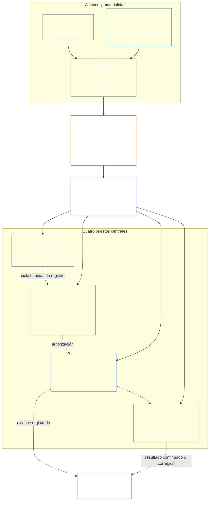

# CAPÍTULO OCHO: INDEPENDENCIA FUNCIONAL Y SEPARACIÓN DE FUNCIONES

<strong>Ubicación en el corpus (no operativa): estructura del archivo y reglas de lectura</strong>

> Este archivo **forma parte de la Constitución Senciente** y solo es vinculante **junto con** los demás archivos numerados `core_*`, leídos como un instrumento único. Contiene el **Capítulo Ocho**: el piso transversal a los procesos para la independencia funcional y la segregación de funciones. Sigue al [Capítulo Siete](core_07_charters.md#chapter-seven-system-and-institutional-charters), que establece las Cartas del Sistema o Institucionales con el mapa de puestos publicado, y precede a los capítulos de procesos constitucionales que comienzan con la [certificación de alineación del sistema del Capítulo Nueve](core_07_a_system_alignment_certification_evaluation.md#chapter-nine-system-alignment-certification).
>
> - **Titular constitucional:** el piso de puestos diferenciados para actos materialmente vinculantes; el contenido mínimo universal de cada [Registro de Acto Materialmente Vinculante](../../core_05.035_band_accountability.md#materially-binding-act-record); la independencia respecto del actor y de su [Línea de Control Material](../../core_05.035_band_accountability.md#material-control-line); la publicación de la asignación de carriles y funciones; el enrutamiento de conflictos, vacantes, sustituciones y puestos incorrectos; el alojamiento conjunto proporcional; los traspasos atribuibles; y las condiciones mínimas de independencia que debe aplicar todo proceso constitucional posterior.
> - **Fuente en la capa de principios:** el [Capítulo Uno §18.3](core_01_c_stewardship_capacity_principles.md#183-separation-of-duties) exige que la gobernanza preserve la independencia funcional y remite aquí a la arquitectura operativa de puestos.
> - **Entidad implementadora:** [CJS-5.125 §11](../../corpus_joint_structure/cjs_05.125_accountability_operations.md#constitutional-lane-and-functional-separation) (*Vía constitucional y separación funcional*), [CI-8.205 §2](../../corpus_institutions/ci_08.205_institutional_design_separation_of_powers.md#ci-8205-2-functional-separation-lanes) y [CI-16.205 §6](../../corpus_institutions/ci_16.205_appointment_competency_rotation_removal.md#ci-16205-6-seat-catalog--process-role-archetypes-and-operational-boundaries) asignan los cargos y los hacen operativos. Pueden ser más estrictos y añadir tipos de cargos de autoridad especial acotada; no pueden reducir este capítulo.
> - **La aplicación específica de cada proceso sigue correspondiendo a los capítulos posteriores:** el [Capítulo Nueve](core_07_a_system_alignment_certification_evaluation.md#chapter-nine-system-alignment-certification) aplica este requisito a la certificación de alineación del sistema y de alineación institucional; el [Capítulo Once §5.1](core_11_standing_assessment.md#51-separation-of-duties) lo aplica a los registros de condición; el Capítulo Quince y [corpus_forum.md](../../corpus_forum.md) lo aplican al proceso de los foros. Esos capítulos pueden añadir salvaguardas que requiera su materia, pero no crear un sustituto más débil.
>
> Orden de lectura: §1 propósito y alcance → §2 piso de cuatro puestos → §3 independencia y conflictos → §4 enrutamiento al puesto incorrecto → §5 asignación publicada y sustitutos → §6 escala proporcional → §7 emergencias → §8 Registros de Acto y traspasos atribuibles → §9 aplicación aguas abajo.

<strong>Rastro</strong>

- Antecedentes: [Tétrada Constitucional](core_00_preamble.md#constitutional-tetrad) — en especial **supervisión** y **rendición de cuentas**; [interés material](core_00_preamble.md#material-stake); [Estándar de Custodia Compartida del Capítulo Uno §17.1](core_01_c_stewardship_capacity_principles.md#171-shared-stewardship-standard); [Gobernanza bajo Disciplina de Custodia del Capítulo Uno §18](core_01_c_stewardship_capacity_principles.md#18-governance-under-stewardship-discipline); [Artículo XVI](core_06_rights_part_c.md#article-xvi-audit-transparency-and-independent-verification) (*Auditoría, transparencia y verificación independiente*).
- Subsecciones: [§1](#1-purpose-scope-and-owner-boundary); [§2](#2-four-seat-constitutional-requirement); [§3](#3-independence-conflict-and-control-lines); [§4](#4-wrong-seat-routing); [§5](#5-published-placement-vacancy-and-substitution); [§6](#6-proportional-scaling-and-merged-hosting); [§7](#7-emergency-and-urgent-action); [§8](#8-act-records-and-attributable-handoffs); [§9](#9-relationship-to-later-processes).
- Consecuencias: [Capítulo Ocho](../../core_09.000_system_alignment_certification_evaluation.md#chapter-nine-system-alignment-certification); [Capítulo Nueve](../../core_10_standing_assessment.md#chapter-ten-contribution-violation-and-standing-model--measurement); [Capítulo Doce](../../core_13_forum.md#chapter-thirteen-forums-and-jurisdiction); [Capítulo Trece](../../core_14_governance.md#chapter-fourteen-constitutional-contract-legitimacy-authorization-and-stewardship); texto de implementación designado arriba.
- Leer con: [Detección de Desalineación del Capítulo Uno §19.3](core_01_c_stewardship_capacity_principles.md#193-misalignment-detection) (*detección plural y revisión*); [Acción Atribuible](core_05_band_accountability.md#attributable-action); [Integridad de Atribución](core_05_band_accountability.md#attribution-integrity); [Auditabilidad](core_05_band_oversight.md#auditability); [Impugnabilidad](core_05_band_accountability.md#contestability); [Proporcionalidad](core_05_band_accountability.md#proportionality).

 

El Capítulo Ocho es el titular constitucional del **piso de independencia funcional y segregación de funciones para actos materialmente vinculantes**.

### 1. Propósito, alcance y límites del titular

<strong>Rastro</strong>

- Antecedentes: afirmación de titularidad al inicio del capítulo; [Capítulo Uno §18](core_01_c_stewardship_capacity_principles.md#18-governance-under-stewardship-discipline); [Supervisión](core_05_apex_oversight_leg.md#oversight-constitutional); [Rendición de cuentas](core_05_apex_accountability_leg.md#accountability).
- Consecuencias: desde [§2](#2-four-seat-constitutional-requirement) hasta [§9](#9-relationship-to-later-processes); todo proceso posterior que produzca o modifique un acto materialmente vinculante.
- Leer con: [Capítulo Cuatro](core_04_burden_traceability_verification.md#chapter-four-burden-of-proof-traceability-and-verification) para la base de verificación; [Artículo XIII-A](core_06_rights_part_c.md#article-xiii-a-reliability-and-trustworthiness-baseline) (*Piso de Fiabilidad y Confiabilidad*) y [Artículo XIII-B](core_06_rights_part_c.md#article-xiii-b-right-to-redress-and-remedy) (*Derecho a Reparación y Remedio*) para impugnación y reparación; [Artículo XVI](core_06_rights_part_c.md#article-xvi-audit-transparency-and-independent-verification) (*Auditoría, transparencia y verificación independiente*) para los Pisos de Derechos de verificación independiente.

 

*En términos sencillos: antes de confiar en un proceso constitucional —o en una decisión de nivel de las partes interesadas dentro de un sistema, institución o ámbito de decisión acotado y ya autorizado— hay que separar las funciones que lo componen. Este piso se aplica tanto a la [Capa de Contrato Constitucional](core_05_band_integrative.md#constitutional-contract-layer) como a la [Participación de las Partes Interesadas en el Sistema](core_05_band_participation.md#stakeholder-status-and-weight). Un senciente, cargo, sistema de IA, órgano de partes interesadas o representante que busca un resultado no puede también aportar la supuesta comprobación independiente, controlar el registro oficial de esa comprobación ni decidir la impugnación de esta.*

Este capítulo se aplica a todo [Acto Materialmente Vinculante](../../core_05.035_band_accountability.md#materially-binding-act), según lo define el Capítulo Cinco, incluidos:

- una decisión;
- una autorización o certificación;
- una determinación;
- una anotación en un registro o un cambio material de versión;
- una liberación, despliegue, continuación o retirada;
- un desembolso o una asignación; y
- la resolución de una impugnación.

Los puestos de este capítulo definen quién puede hacer qué respecto de un acto particular; no son títulos de empleo. Un mismo senciente, cargo o sistema puede ocupar puestos distintos para actos distintos. Un título, una delegación, una capacidad técnica o la posibilidad de realizar un paso no amplía el puesto que se ocupa para ese acto.

Este capítulo establece el piso transversal de segregación de funciones. No traslada:

- la carga probatoria, la trazabilidad ni el método de verificación del Capítulo Cuatro;
- los significados canónicos del Capítulo Cinco;
- los Pisos de Derechos del Capítulo Seis;
- el contenido de registros específico de cada proceso de los Capítulos Ocho a Doce; ni
- los catálogos operativos de puestos, métodos de dotación de personal y mecánicas de mapas de carriles del texto de implementación designado.

#### 1.1 Por qué se separan las funciones

*En términos sencillos: las empresas, los gobiernos y la seguridad nuclear han aprendido una y otra vez la misma lección. Cuando una sola parte puede iniciar un acto, aprobarlo, registrarlo y juzgar cualquier queja al respecto, nadie más puede detectar un error o una mentira.*

Esta subsección explica las razones del requisito. No es operativa: las reglas vinculantes están en [§2 Requisito constitucional de cuatro puestos](#2-four-seat-constitutional-requirement) hasta [§9 Relación con procesos posteriores](#9-relationship-to-later-processes).

Varios ámbitos llegaron por sí solos a la misma idea:

- **Contabilidad y control interno:** desde hace mucho, las empresas y los auditores dividen las tareas de autorizar una transacción, registrarla, custodiar los activos y conciliar los libros, para que ningún empleado pueda apropiarse de dinero y ocultarlo. Marcos de control interno como COSO incluyen la segregación de funciones entre sus actividades básicas de control.
- **Separación de poderes en el gobierno:** Montesquieu sostuvo en *El espíritu de las leyes* (1748) que la libertad peligra cuando un mismo órgano crea, ejecuta y juzga las leyes. James Madison, en *Federalist No. 51* (1788), defendió un diseño en el que cada rama dispone de medios para resistir a las demás. Muchas constituciones posteriores han dividido el poder de manera similar.
- **Reglas de dos personas:** las fuerzas armadas de Estados Unidos exigen que dos miembros autorizados de la tripulación actúen juntos antes de lanzar o acceder a ciertas armas nucleares, para que nadie pueda actuar en solitario (Air Force Instruction 91-104). Los bancos llevan mucho tiempo usando dos llaves para las bóvedas por el mismo motivo. Una regla de dos personas confirma quién actúa y si la orden es auténtica, no si es correcta. Por eso este capítulo exige una comprobación independiente, no solo una segunda firma.
- **Qué ocurre sin separación:** en 1995, Nick Leeson dirigía tanto la mesa de operaciones de Barings Bank en Singapur como la oficina administrativa que liquidaba y registraba esas operaciones. Ocultó pérdidas en una cuenta secreta. Una auditoría interna de 1994 había señalado el doble cargo como un riesgo importante, pero la dirección lo mantuvo. El banco, con más de dos siglos de historia, quebró en febrero de 1995 tras pérdidas de unos 2.200 millones de dólares singapurenses y fue vendido a ING.

Estos ejemplos no demuestran que algún sistema sea infalible. Muestran que la idea es antigua y muy utilizada, y que la falta de separación causa fallos de manera recurrente. Son razones, no autoridad.

#### 1.2 Por qué cuatro puestos

*En términos sencillos: dos funciones son insuficientes y tres dejan una brecha. Cuatro cubren el inicio del acto, su comprobación, la conservación del registro oficial y la atención de una impugnación.*

Esta subsección explica por qué son cuatro puestos. No es operativa: los puestos y sus reglas están en [§2 Requisito constitucional de cuatro puestos](#2-four-seat-constitutional-requirement).

- **Dos no bastan:** una pareja de creador y revisor impide que una parte apruebe su propio acto. Pero nadie queda a cargo de conservar el registro oficial ni de atender una queja; quien lo tenga puede cambiar en silencio lo ocurrido, y la pareja termina juzgando quejas sobre su propio trabajo.
- **Tres poderes sirven para gobernar, no para cada acto:** crear, ejecutar y juzgar son funciones adecuadas para un gobierno. Un acto también necesita un registro oficial que perdure y una vía de impugnación que no pase por quien lo realiza ni por quien lo aprueba.
- **Cuatro corresponden a los puntos de falla:** un puesto inicia el acto, otro lo comprueba y autoriza, otro conserva el registro oficial y otro atiende las impugnaciones. Esto refleja las divisiones contables entre autorizar, registrar y revisar.
- **La automatización facilita que se abra la brecha:** un sistema puede actuar, aprobar y registrar su propio trabajo en un solo paso, y ese registro puede parecer prueba. [§2 Requisito constitucional de cuatro puestos](#2-four-seat-constitutional-requirement) trata esto como ocupar tres puestos a la vez.
- **Los adoptantes pequeños también pueden cumplir:** [§6 Escala proporcional y alojamiento conjunto](#6-proportional-scaling-and-merged-hosting) permite que un adoptante pequeño asigne un puesto a un organismo independiente o, bajo condiciones, reúna dos puestos en una oficina. El puesto de verificación o autorización nunca se combina con el de registro ni con el de impugnación.

### 2. Requisito constitucional de cuatro escaños

<strong>Rastro</strong>

- Antecedentes: [§1](#1-purpose-scope-and-owner-boundary); [Capítulo Uno §18.3](core_01_c_stewardship_capacity_principles.md#183-separation-of-duties); [Capítulo Uno §17.1](core_01_c_stewardship_capacity_principles.md#171-shared-stewardship-standard).
- Consecuencias: desde [§3](#3-independence-conflict-and-control-lines) hasta [§9](#9-relationship-to-later-processes); [CI-4.6](../../corpus_institutions/ci_16.205_appointment_competency_rotation_removal.md#ci-16205-6-seat-catalog--process-role-archetypes-and-operational-boundaries) (*Catálogo de puestos: arquetipos de funciones de proceso y límites operativos*).
- Leer con: [§6](#6-proportional-scaling-and-merged-hosting) para la única vía permitida de alojamiento conjunto.

 

*En términos sencillos: cada acto materialmente vinculante tiene cuatro funciones: solicitar o actuar, comprobar, llevar el registro oficial y oír la impugnación. Las funciones siguen siendo distintas aunque se permita a una organización pequeña asignar un par permitido a un mismo cargo.*

<strong>Orientación para quien lee (no operativa): mapa de cuatro puestos</strong>

> **Mapa para quien lee (no operativo).** Este diagrama muestra los cuatro puestos y un ciclo habitual de registro. No añade un quinto puesto de implementación, no exige que la revisión concluya antes de toda acción ni modifica las reglas operativas de esta sección y de los §§3–6.

 

Las flechas punteadas dentro del recuadro de puestos muestran un ciclo habitual de registro. Las flechas hacia la implementación son enlaces de trazabilidad, no una secuencia obligatoria que exija esperar a la revisión.

Todo acto materialmente vinculante tiene cuatro puestos funcionalmente distintos. El Capítulo Cinco aporta sus significados canónicos; esta sección establece las reglas transversales de asignación e incompatibilidad:

1. **[Puesto Iniciador](../../core_05.035_band_accountability.md#initiating-seat)** — solicita, propone, opera, reclama o de otro modo inicia el acto.
2. **[Puesto de Verificación o Autorización](../../core_05.035_band_accountability.md#verify-or-authorize-seat)** — contrasta las pruebas y la autoridad con la norma aplicable y verifica, autoriza, deniega o condiciona el acto.
3. **[Puesto de Registro](../../core_05.035_band_accountability.md#record-seat)** — asienta, versiona, custodia, conserva y publica el [Registro de Acto](../../core_05.035_band_accountability.md#materially-binding-act-record) de lo que determinó el Puesto de Verificación o Autorización.
4. **[Puesto de Impugnación](../../core_05.035_band_accountability.md#contest-seat)** — recibe y revisa una impugnación, ordena correcciones o límites cuando está autorizado y remite cualquier asunto fuera de su autoridad.

Estos puestos se aplican por igual a custodios humanos y de IA. Si un sistema realiza un acto, lo aprueba y luego usa su propio registro como prueba, ocupa a la vez los puestos iniciador, verificador y registrador. Automatizar el proceso no hace independiente la comprobación.

Se prohíben las siguientes combinaciones para un mismo acto:

- el puesto iniciador no debe verificar ni autorizar su propio acto;
- el puesto de verificación o autorización no debe ocupar el puesto de registro;
- el puesto de verificación o autorización no debe ocupar el puesto de impugnación; y
- el operador de un sistema no debe verificar ni autorizar un acto relativo a ese sistema.

Los capítulos posteriores o el texto de implementación incorporado pueden prohibir combinaciones adicionales para un proceso particular. No pueden permitir una combinación prohibida aquí.

El piso funcional de cuatro puestos rige en todas las clases. La cuestión que escala por clase es si esos puestos pueden fusionarse o compartir titular: para una institución o sistema que opera dentro del alcance de Clase C, siempre se recomienda la separación plena de los cuatro puestos; para el alcance de Clase B, casi siempre debería exigirse; y para el alcance de Clase A, siempre es obligatoria. Cuando el alcance sea mixto o la clasificación incierta, aplíquese la postura más exigente que corresponda hasta que el registro sustente una menor.

### 3. Independencia, conflictos y líneas de control

<strong>Rastro</strong>

- Antecedentes: [§2](#2-four-seat-constitutional-requirement); [Responsabilidad a escala de autoridad](core_01_c_stewardship_capacity_principles.md#181-governance-as-authorized-structure); [Artículo XXIV](core_06_rights_part_d.md) (*Salvaguardas de interpretación constitucional, revisión y anticaptura*).
- Consecuencias: [§4](#4-wrong-seat-routing); [§5](#5-published-placement-vacancy-and-substitution); [§8](#8-act-records-and-attributable-handoffs); funciones de certificación del Capítulo Ocho; custodia de registros del Capítulo Nueve; prevención de la autoadjudicación en foros del Capítulo Doce.
- Leer con: [Línea de Control Material](../../core_05.035_band_accountability.md#material-control-line); [CI-5](../../corpus_institutions/ci_08.210_conflict_integrity_anti_capture_anti_corruption.md) (*Integridad frente a conflictos, anticaptura y anticorrupción*) y [CF-7](../../corpus_forum/cf_15.425_integrity_safeguards_anti_capture_anti_self_judging.md) (*Salvaguardas de integridad, operaciones anticaptura y apoyo contra la autoadjudicación*) para las salvaguardas operativas frente a conflictos y autoadjudicación.

 

*En términos sencillos: cambiar el nombre del puesto no crea independencia. Quien verifica o revisa no es independiente si el senciente o cargo que busca el resultado puede dirigirle, destituirle, recompensarle, castigarle o revocarle en silencio la decisión sobre ese acto.*

La independencia funcional se determina por la autoridad y el control reales, no por las etiquetas. Para un mismo acto:

- los puestos de verificación o autorización e impugnación deben estar fuera de la [Línea de Control Material](../../core_05.035_band_accountability.md#material-control-line) del puesto iniciador;
- una parte cuyo propio interés se determine mediante el acto no debe ocupar el puesto de verificación o autorización ni el de impugnación;
- quien esté en conflicto como titular del registro debe transferirlo, con todo su historial de auditoría, al sustituto publicado; no debe decidir el conflicto ni abandonar la custodia; y
- la recusación elimina la autoridad sobre el acto; no transfiere el puesto a quien lo solicitó, a la línea de reporte de esa persona ni a quien esté más cerca.

Traza la [Línea de Control Material](../../core_05.035_band_accountability.md#material-control-line) para el acto concreto. La infraestructura compartida, el apoyo administrativo o los antecedentes de nombramiento no establecen por sí solos esa línea, pero tales arreglos no deben impedir en la práctica el juicio independiente.

No basta para satisfacer la independencia una segunda firma, un comité nominal, una etiqueta interna o una certificación generada por una herramienta si la supuesta comprobación carece de autoridad, acceso a las pruebas, libertad frente al control material o capacidad real para denegar y remitir.

### 4. Enrutamiento al puesto incorrecto

<strong>Rastro</strong>

- Antecedentes: [§2](#2-four-seat-constitutional-requirement); [§3](#3-independence-conflict-and-control-lines).
- Consecuencias: [§5](#5-published-placement-vacancy-and-substitution); [§8](#8-act-records-and-attributable-handoffs); [reglas compartidas de puestos CI-4.6](../../corpus_institutions/ci_16.205_appointment_competency_rotation_removal.md#ci-46-shared-seat-rules).
- Leer con: [Deber de Resistir del Capítulo Uno §17.5](core_01_c_stewardship_capacity_principles.md#175-duty-to-resist).

 

*En términos sencillos: cuando un paso no te corresponde, no lo asumas en silencio ni te limites a marcharte. Registra la carencia y remite el asunto al lugar correcto.*

Cuando se le pida realizar un paso fuera de su puesto, un custodio debe:

1. rechazar ese paso sin pretender decidir sus méritos;
2. nombrar el puesto que puede asumirlo y, si está publicado, a su titular o sustituto;
3. registrar la solicitud, el puesto que ocupa, la carencia o el conflicto y la vía utilizada;
4. conservar las pruebas y la integridad de todo registro ya recibido; y
5. remitirlo sin demora evitable.

Esa respuesta es el cumplimiento del deber, no el abandono del acto. El acto prosigue por el puesto correcto. Asumir el paso porque el custodio es quien está más cerca, actúa más rápido, tiene mayor rango o posee conocimientos únicos no subsana la falta de un puesto.

### 5. Asignación publicada, vacantes y sustituciones

<strong>Rastro</strong>

- Antecedentes: [§2](#2-four-seat-constitutional-requirement); [§3](#3-independence-conflict-and-control-lines); [Transparencia](core_05_band_oversight.md#transparency); [Auditabilidad](core_05_band_oversight.md#auditability).
- Consecuencias: [§8](#8-act-records-and-attributable-handoffs); [CI-3.2](../../corpus_institutions/ci_08.205_institutional_design_separation_of_powers.md#ci-8205-2-functional-separation-lanes) (*Carriles de separación funcional*); [CI-4.5](../../corpus_institutions/ci_16.205_appointment_competency_rotation_removal.md#ci-16205-5-authorized-roles-and-accountability-chains) (*Funciones autorizadas y cadenas de rendición de cuentas*); registros de los Capítulos Ocho y Nueve.
- Leer con: [Carta](core_05_band_continuity.md) y [Capítulo Trece §5](core_12_governance.md#5-authorized-roles-competency-development-and-contribution).

 

*En términos sencillos: una organización debe indicar quién ocupa cada puesto antes de que surja el caso difícil, incluido quién lo asume cuando falta el titular habitual o este está en conflicto.*

#### 5.1 Qué debe indicar el mapa

Todo adoptante de Clase L o superior que realice actos materialmente vinculantes debe mantener un [Mapa de Funciones de la Carta](../../core_05.040_band_continuity.md#charter-role-map) publicado, auditable e impugnable que identifique:

- qué carril, oficina, función o proceso alberga cada puesto;
- los actos y el alcance a los que se aplica esa asignación;
- cada arreglo permitido de alojamiento conjunto y su salvaguarda de independencia;
- cada suplente o sustituto que pueda actuar en un puesto, incluso cuando el titular esté ausente, excluido, capturado o en conflicto;
- la vía independiente cuando no haya un sustituto cualificado disponible; y
- la versión y fecha de entrada en vigor, para juzgar cada acto según el mapa vigente cuando se realizó.

#### 5.2 Dónde se conserva el mapa

El mapa se conserva en la [Carta de Sistema](../../core_05.040_band_continuity.md#system-charter) o la [Carta Institucional](../../core_05.040_band_continuity.md#institutional-charter) del adoptante, o junto a ellas.

Un miembro de un grupo que publique un mapa compartido para los puestos que alberga puede adoptar ese mapa por referencia ([§6.3 Puestos compartidos](#63-seats-held-in-common)), y aun así nombra su propio sustituto y su vía independiente.

Un adoptante de Clase P queda fuera de este capítulo ([§1 Propósito, alcance y límites del titular](#1-purpose-scope-and-owner-boundary)) y no necesita publicar un mapa. Aun así, puede publicarlo, por sí solo o junto con una Carta de Sistema o Institucional voluntaria ([Capítulo Siete §4 El Mapa de Funciones de la Carta y la Custodia de Registros de Condición](core_07_charters.md#4-the-charter-role-map-and-standing-record-custody)).

#### 5.3 Puesto sin asignar en el mapa o titular que no puede servir

Un puesto sin asignar, o cuyo titular esté ausente, excluido, capturado o en conflicto, es un defecto de gobernanza que debe registrarse y corregirse.

- El puesto no pasa automáticamente al puesto iniciador, a una parte interesada, a un operador ni a un superior en su [Línea de Control Material](../../core_05.035_band_accountability.md#material-control-line).
- Hasta que se corrija, el acto se remite al sustituto publicado o a la vía independiente, por urgente que sea.
- Si el Mapa de Funciones de la Carta no asigna un puesto de certificación, la corrección debe cumplir los plazos de respuesta y resolución, contados desde el aviso registrado de la carencia, establecidos en [Capítulo Siete §4.7.4 Puestos de certificación](core_07_charters.md#474-certification-seats).

#### 5.4 Delegación

El titular de un puesto solo puede delegarlo en un suplente o sustituto nombrado en el [Mapa de Funciones de la Carta](../../core_05.040_band_continuity.md#charter-role-map). Delegarlo en otra persona deja el puesto sin asignar y se aplica [§5.3 Puesto sin asignar en el mapa o titular que no puede servir](#53-a-seat-the-map-leaves-unplaced-or-a-holder-who-cannot-serve). Nombrar a un nuevo suplente o sustituto modifica el mapa ([Capítulo Siete §4.5 Cambio de reglas y titulares de puestos](core_07_charters.md#45-changing-seat-rules-and-seat-holders)). La delegación no puede hacerlo.

La delegación conserva el mismo límite del puesto, los deberes probatorios, el registro y el plazo, y el delegado sigue sujeto a la [Línea de Control Material](../../core_05.035_band_accountability.md#material-control-line). No crea un puesto nuevo, no fusiona puestos ni permite al delegado hacer lo que no podía hacer el puesto delegante. Si el delegado también ocupa un segundo puesto en el mismo acto, existe una fusión, y solo se permite mediante los arreglos de alojamiento conjunto que el mapa enumera en [§6 Escala proporcional y alojamiento conjunto](#6-proportional-scaling-and-merged-hosting).

El titular puede utilizar personal o herramientas para ayudar en el trabajo del puesto, por ejemplo reuniendo pruebas, preparando borradores o realizando comprobaciones rutinarias. Eso es asistencia, no delegación. El titular sigue tomando las decisiones del puesto, responde por el resultado y es responsable de la independencia del puesto. Si otra persona toma una decisión o realiza un paso en nombre del puesto, eso es una delegación y debe cumplir esta subsección. La asistencia no puede usarse para hacer lo que el propio puesto no podría hacer, incluido presionar a los titulares de otros puestos para que determinen el resultado de un acto.

### 6. Escala proporcional y alojamiento conjunto

<strong>Rastro</strong>

- Antecedentes: [§2](#2-four-seat-constitutional-requirement); [interés material](core_00_preamble.md#material-stake); [Necesidad](core_05_band_accountability.md#necessity); [Proporcionalidad](core_05_band_accountability.md#proportionality).
- Consecuencias: [Capítulo Nueve §3.7](core_11_standing_assessment.md#59-informal-and-small-scope-records); [CJS-2.4](../../corpus_joint_structure/cjs_20.110_specific_joint_interlocks.md#cjs-20110-4-class-scaled-lane-staffing-and-competency-redundancy) (*Dotación de personal por carriles y redundancia de competencias graduadas por clase*); [CI-3.2](../../corpus_institutions/ci_08.205_institutional_design_separation_of_powers.md#ci-8205-2-functional-separation-lanes) (*Carriles de separación funcional*).
- Leer con: [Carga Evitable](core_05_band_continuity.md#avoidable-burden) y [Proceso Antidegradante del Capítulo Uno §3.3](core_01_a_values_principles.md#33-anti-degrading-process).

 

*En términos sencillos: los grupos pequeños e informales no necesitan cuatro departamentos grandes. Sí necesitan una comprobación realmente independiente, un registro utilizable y una vía de impugnación. La escala cambia el método de dotación de personal, no la separación protegida.*

#### 6.1 Cómo se gradúa la separación

La solidez, la dotación de personal, la redundancia y la formalidad de la separación se gradúan según el interés material, la clase del sistema, la dependencia y el daño razonablemente previsible.

#### 6.2 Fusión de dos puestos en una oficina

Un adoptante pequeño o informal puede asignar dos puestos a una misma oficina o senciente solo si se cumplen todas estas condiciones:

- la fusión es necesaria y proporcional al alcance del adoptante;
- está publicada, es auditable e impugnable, y se declara en el registro del acto;
- una salvaguarda de independencia aborda los riesgos creados por la fusión;
- el puesto iniciador no verifica ni autoriza su propio acto;
- el puesto de verificación o autorización nunca se fusiona con el puesto de registro ni con el de impugnación; y
- hay una vía independiente disponible cuando el conflicto, el daño material o la impugnación superen el límite lícito del titular fusionado.

#### 6.3 Puestos compartidos

Una empresa dirigida por un solo senciente o por unos pocos puede asignar su puesto de verificación o autorización, registro o impugnación a una cooperativa local, a una asociación de empresas semejantes o a cualquier otro órgano independiente del que puedan valerse. Esto no constituye una fusión, porque los puestos siguen en manos de titulares distintos. Así puede una empresa demasiado pequeña para dotar cuatro puestos cumplir el requisito de segregación de funciones de [§2 Requisito constitucional de cuatro puestos](#2-four-seat-constitutional-requirement). Se aplican las mismas reglas de independencia que a cualquier asignación de puestos, además de las siguientes reglas para el grupo:

- **Independencia respecto de la empresa:** el titular es [independiente](../../core_05.035_band_accountability.md#independence) de la empresa iniciadora. Está fuera de la [Línea de Control Material](../../core_05.035_band_accountability.md#material-control-line) de la empresa y el acto no decide nada que le dé un interés. Un proveedor, prestamista, arrendador o cliente del que dependa la empresa no es independiente para un acto relativo a esa dependencia —por ejemplo, una disputa sobre el propio contrato del proveedor— porque el acto también decide algo para él.
- **Un mapa para el grupo:** el grupo publica un [Mapa de Funciones de la Carta](../../core_05.040_band_continuity.md#charter-role-map) único para los puestos que alberga, y cada miembro puede adoptarlo por referencia. El mapa propio de cada miembro sigue nombrando su sustituto y su vía independiente.
- **Servicio recíproco:** los miembros pueden ocupar puestos de los demás en actos distintos. Dos miembros no pueden revisarse los actos mutuamente como pareja cerrada, y una rotación no puede remitir un acto a un titular dentro de la línea de control de quien lo inicia.
- **Actos propios del grupo:** admitir o expulsar a un miembro, asignar un puesto y resolver sobre un acto de un miembro son actos materialmente vinculantes del grupo. Para esos actos, el grupo:
  - ocupa los cuatro puestos;
  - publica su propia Carta de Sistema o Carta Institucional; y
  - mantiene una vía independiente externa (otro grupo, un foro o una oficina pública), para que nunca se juzgue a sí mismo ni a un miembro que controla.
- **Sin obligación de afiliarse:** ninguna empresa está obligada a ingresar, y ningún grupo es la única vía disponible.
- **Límites de admisión:** un grupo puede rechazar o aplazar una solicitud por un motivo vinculado a su capacidad para prestar el servicio, de modo que nunca se le obligue a asumir más de lo que puede sostener. Entre esos motivos están:
  - **Capacidad:** el volumen previsto de actos materiales de la solicitante agotaría la capacidad de la que dependen los miembros actuales. El grupo puede limitar el volumen que acepta de cada miembro o mantener una lista de espera;
  - **Adecuación:** el tipo de actos o la clase de la solicitante excede las cualificaciones y la dotación de personal de quienes ocupan los puestos del grupo, por ejemplo cuando el trabajo requiere más redundancia de competencias de la que tiene el grupo ([§6.6 Interés, clase y lo que no justifica una fusión](#66-stake-class-and-what-does-not-justify-a-merger));
  - **Independencia:** quienes ocupan los puestos del grupo no podrían atender los actos de la solicitante con independencia, porque esta se encuentra dentro de la [Línea de Control Material](../../core_05.035_band_accountability.md#material-control-line) de alguno de ellos; y
  - **Conducta:** la solicitante incumplió antes las condiciones publicadas del grupo o no acepta cumplirlas.
- **Aplicación de los límites:** cada límite de admisión:
  - se establece en la Carta de Sistema o Carta Institucional del grupo ([Capítulo Siete §3.1 Qué declara una Carta de Sistema](core_07_charters.md#31-what-a-system-charter-states)), para publicarlo antes de aplicarlo;
  - se aplica por igual a solicitantes en circunstancias semejantes;
  - no se utiliza para proteger a los miembros de la competencia ni para convertir al grupo en la única vía hacia un puesto en su zona;
  - se explica por escrito a quien recibe una negativa; y
  - puede impugnarse mediante la vía independiente externa, porque decidir si se admite a una solicitante es un acto materialmente vinculante del grupo (véase *Actos propios del grupo*, arriba).
- **Sin trampas:** las condiciones del grupo no pueden convertir el puesto en un coste que la empresa no pueda soportar ([Carga Evitable](../../core_05.040_band_continuity.md#avoidable-burden)).
- **Salida:** el miembro que se marcha se lleva sus registros oficiales. El grupo no puede retenerlos ni condicionar la salida a que se abandonen. El grupo:
  - entrega al miembro una exportación completa de sus Registros de Acto y de los datos que contienen, en un formato utilizable por el miembro o por un nuevo anfitrión ([CS-6.305 §1.2 Colección crítica para la continuidad y capacidad de exportación](../../corpus_systems/cs_06.305_information_types_and_handling.md#12-continuity-critical-collection-and-exportability)), y revela de antemano cualquier límite lícito a la exportación;
  - transfiere el puesto de registro de esos actos al titular que nombre el miembro y lo conserva hasta que este nombre a alguien, para que los Registros de Acto sigan siendo reconstruibles mientras haya una impugnación, corrección o reparación abierta ([§8 Registros de Acto y traspasos atribuibles](#8-act-records-and-attributable-handoffs)); y
  - conserva solo lo que aún le exijan sus propios deberes —por ejemplo, el Registro de Acto de un acto que acogió para otro miembro o que todavía está impugnado— y solo durante el plazo de conservación que haya divulgado ([CS-6.305 §1.3 Aviso de recopilación y eliminación](../../corpus_systems/cs_06.305_information_types_and_handling.md#13-collection-notice-and-deletion)).
- **Datos que conserva el grupo:** los datos que conserva el grupo se tratan según su tipo, conforme a [CS-6.310 §9 Clasificaciones de datos](../../corpus_systems/cs_06.310_data_classifications.md#cs-6310-9-data-classifications):
  - **Datos de identidad y atribución (Tipo I):** se usan solo para verificar quién ocupó cada puesto y quién actuó;
  - **Datos de participación y transacción (Tipo H):** se usan solo para el registro oficial, la auditoría y las obligaciones de impugnación del acto;
  - **Datos de fuentes de gobernanza (Tipo G):** están disponibles para auditoría y no son públicos por defecto;
  - **Material de seguridad e investigación (Tipo S):** se conserva solo durante el plazo de revisión limitado; y
  - **Obras propias del miembro (Tipos Y y W):** se devuelven al miembro y se eliminan de las copias del grupo cuando el miembro lo ordene.

#### 6.4 Ejercicio profesional conjunto

Un senciente o un pequeño ejercicio profesional de Clase L o superior puede asignar sus puestos a un anfitrión y adoptar sus documentos:

- **Quién puede ser anfitrión:** una asociación profesional, cooperativa, empleador o registro público, dondequiera que se encuentre.
- **Qué adopta el ejercicio profesional:** el mapa publicado y la Carta Institucional del anfitrión, por referencia, para los actos que cubren.
- **Todo tipo de trabajo:** esta vía está disponible para todos los actos del ejercicio profesional, necesiten o no licencia o autorización profesional, de modo que una práctica con ambos tipos de trabajo puede utilizar un solo anfitrión para todo.
- **Las mismas reglas:** se aplican al anfitrión y al ejercicio profesional las reglas de [§6.3 Puestos compartidos](#63-seats-held-in-common), incluidas la independencia del anfitrión respecto del ejercicio profesional, los cuatro puestos y una vía independiente para los actos propios del anfitrión, los límites de admisión publicados y la regla aplicable al miembro que se marcha.
- **Actos enumerados:** para un acto sujeto a licencia o autorización profesional conforme al [Artículo XI-E](../../core_06.005_rights_part_b.md#article-xi-e-institutional-formation-and-business-creation) (*Constitución institucional y creación de empresas*), las normas del anfitrión también se basan en una determinación de un foro técnico; el anfitrión verifica que cada profesional tenga la licencia o autorización; y un anfitrión público de último recurso admite a cualquier titular. Para otros trabajos, el anfitrión admite o rechaza solo conforme a los límites de admisión de [§6.3 Puestos compartidos](#63-seats-held-in-common), y no puede inventar criterios de competencia para impedir que un senciente ejerza un trabajo que la Constitución no somete a autorización.
- **Deberes añadidos del anfitrión:** **CI-16.205 §7** (*Licencia profesional, autorización profesional y ejercicio profesional conjunto*) establece los deberes adicionales del anfitrión y las salvaguardas contra la captura.
- **Cumplimiento del requisito:** incorporarse a un anfitrión de este modo satisface el requisito de segregación de funciones de [§2 Requisito constitucional de cuatro puestos](#2-four-seat-constitutional-requirement) para los actos cubiertos por los documentos del anfitrión.

#### 6.5 Trabajo informal y comunitario

El trabajo informal, no remunerado, de ayuda mutua, cuidado, reparación, enseñanza, cooperación y custodia comunitaria puede utilizar un órgano independiente del que pueda valerse, con autoridad publicada para la verificación pertinente. La Constitución no exige que ese trabajo establezca oficinas, personal o procedimientos formales más allá de lo que su tamaño y medios puedan sostener razonablemente, siempre que la verificación pase por una vía verdaderamente independiente y sujeta a rendición de cuentas.

#### 6.6 Interés, clase y lo que no justifica una fusión

Cuanto mayor sea lo que está en juego, más firme será la expectativa inicial de que cada puesto ocupe su propia oficina y de que cada función tenga una persona cualificada de respaldo, es decir, más de un senciente capaz de desempeñarla (redundancia de competencias). Compartir un puesto mediante un grupo conforme a [§6.3 Puestos compartidos](#63-seats-held-in-common) no reduce esa expectativa.

La falta de personal, la prisa o la conveniencia no bastan para justificar que dos puestos se asignen a una misma oficina. Tampoco basta que haya una sola persona experta con más conocimientos que las demás. Se aplican las reglas por clase de [§2 Requisito constitucional de cuatro puestos](#2-four-seat-constitutional-requirement):

- **Clase A:** nunca se fusionan los cuatro puestos.
- **Clase B o Clase C:** solo se permite una fusión si cumple todas las condiciones de esta sección.

Cuanto mayor sea el daño posible y mayor la dependencia de otras personas respecto del trabajo, más difícil será justificar la fusión y más necesarias serán las oficinas separadas, los titulares suplentes para cada función y los sustitutos independientes.

### 7. Acción de emergencia y urgente

<strong>Rastro</strong>

- Antecedentes: [§2](#2-four-seat-constitutional-requirement); [§6](#6-proportional-scaling-and-merged-hosting); [medidas de emergencia y carga de continuación del Capítulo Doce §6.1](../../core_15.000_forum.md#61-emergency-measures-and-continuation-burden); [postura provisional predeterminada](core_01_b_interaction_interpretation.md#default-interim-posture).
- Consecuencias: procesos de incidentes, contención, liberación, continuación y revisión posterior al evento en el texto de implementación designado.
- Leer con: [Puntualidad](core_05_apex_timeliness_leg.md#timeliness-constitutional), [Preservación de Pruebas](core_05_band_oversight.md#evidence-preservation) y [catálogo de puestos CI-4.6 — arquetipos de funciones de proceso y límites operativos](../../corpus_institutions/ci_16.205_appointment_competency_rotation_removal.md#ci-46-seat-containment).

 

*En términos sencillos: una emergencia real puede justificar actuar antes de que concluya la comprobación ordinaria. Cambia la secuencia, no la titularidad de los puestos ni la postura de separación graduada por clase. No permite que el actor certifique su propia continuación, borre el rastro ni se convierta después en revisor final.*

Cuando una demora crearía un riesgo razonablemente previsible de daño grave e inminente, un puesto iniciador o de contención autorizado puede tomar la acción reversible mínima necesaria antes de completar la verificación previa ordinaria, solo si:

- la autoridad, el alcance, el inicio, el vencimiento y el motivo de la emergencia se registran de inmediato o tan pronto como sea físicamente posible;
- se conservan las pruebas y objeciones;
- se restablecen la notificación y la participación dentro del plazo constitucional aplicable;
- un puesto independiente de verificación o autorización revisa toda continuación que exceda el límite inmediato; y
- el acto recibe una revisión independiente posterior al evento.

La acción de emergencia no:

- permite que el actor verifique su propia continuación;
- convierte al actor en custodio de un registro en conflicto;
- permite que el actor oiga la impugnación de su acto;
- convierte una necesidad temporal en autoridad permanente; ni
- permite fusionar los cuatro puestos en una institución o sistema de Clase A.

Ninguno de los siguientes constituye por sí solo una emergencia:

- un plazo;
- una fecha prevista de liberación;
- la escasez de personal; ni
- una preocupación reputacional.

### 8. Registros de Acto y traspasos atribuibles

<strong>Rastro</strong>

- Antecedentes: desde [§2](#2-four-seat-constitutional-requirement) hasta [§7](#7-emergency-and-urgent-action); [Registro de Acto Materialmente Vinculante](../../core_05.035_band_accountability.md#materially-binding-act-record); [Acción Atribuible](core_05_band_accountability.md#attributable-action); [Integridad de Atribución](core_05_band_accountability.md#attribution-integrity).
- Consecuencias: [acción atribuible inspeccionable CS-4 §10](../../corpus_systems/cs_16.305_critical_system_stewardship.md#cs-16305-103-inspectable-attributable-action); [reglas compartidas de puestos CI-4.6](../../corpus_institutions/ci_16.205_appointment_competency_rotation_removal.md#ci-46-shared-seat-rules); todo registro de proceso regido por el §8; [`materially_binding_act_record.schema.json`](../../implementation/schemas/materially_binding_act_record.schema.json) (*formato base verificable por máquina; apoyo al proceso, no una segunda definición*).
- Leer con: [§4 Enrutamiento al Puesto Incorrecto](#4-wrong-seat-routing) y [Capítulo Cuatro §5](core_04_burden_traceability_verification.md#5-compliance-evidence-standard).

 

*En términos sencillos: todo acto materialmente vinculante tiene un Registro de Acto que muestra qué ocurrió, quién ocupó cada puesto, qué se decidió y adónde se remite una impugnación.*

Todo acto materialmente vinculante debe tener un [Registro de Acto Materialmente Vinculante](../../core_05.035_band_accountability.md#materially-binding-act-record) identificable (**Registro de Acto**). El Registro de Acto puede formar parte de un registro oficial aplicable y específico del proceso o de un conjunto atribuible de registros oficiales enlazados que preserve la integridad. No hace falta un documento duplicado separado si el registro oficial existente o el conjunto enlazado identifica claramente todos los elementos exigidos, conserva sus enlaces e historial de versiones y sigue siendo accesible por la vía autorizada del registro oficial.

El Registro de Acto debe identificar, como mínimo:

- una identidad estable del registro, la versión actual y las marcas temporales materiales de creación y cambio;
- el acto, su alcance material, estado y autoridad rectora;
- el puesto iniciador, su titular y autoridad;
- el puesto de verificación o autorización, su titular, la norma rectora, la determinación, las condiciones o motivos materiales y la hora de la determinación;
- el puesto de registro, su titular, autoridad de custodia y versión asentada;
- el puesto de impugnación o la vía publicada de impugnación, y el estado actual de la impugnación o corrección;
- toda delegación, recusación, sustitución, fusión permitida o excepción de emergencia; y
- las pruebas materiales y los enlaces a registros, traspasos, rechazos, condiciones, objeciones pendientes, plazos, versiones sustituidas y correcciones que sean necesarios para reconstruir el acto.

Los registros específicos de cada proceso pueden añadir campos más estrictos o propios de su ámbito. No pueden omitir, contradecir ni volver imposible reconstruir este mínimo. Los controles lícitos de privacidad, confidencialidad y seguridad rigen el acceso a materiales protegidos o su divulgación; no permiten borrar el rastro oficial ni volverlo inutilizable para la verificación, impugnación, corrección o reparación autorizadas.

Los registros de actividad muestran quién hizo qué, pero por sí solos no demuestran que la acción fuera válida. Un registro, firma, traza de modelo, lista de comprobación o certificación creados por el senciente o sistema que realiza la acción tienen una función limitada:

- Estos materiales pueden aportar pruebas o enlazarse al Registro de Acto.
- Estos materiales no pueden sustituir una revisión y decisión independientes ni el propio Registro de Acto oficial.

### 9. Relación con procesos posteriores

<strong>Rastro</strong>

- Antecedentes: desde [§1](#1-purpose-scope-and-owner-boundary) hasta [§8](#8-act-records-and-attributable-handoffs).
- Consecuencias: [Capítulo Ocho](../../core_09.000_system_alignment_certification_evaluation.md#chapter-nine-system-alignment-certification); [Capítulo Nueve](../../core_10_standing_assessment.md#chapter-ten-contribution-violation-and-standing-model--measurement); [Capítulo Doce](../../core_13_forum.md#chapter-thirteen-forums-and-jurisdiction); [Capítulo Trece](../../core_14_governance.md#chapter-fourteen-constitutional-contract-legitimacy-authorization-and-stewardship).
- Leer con: [Pila de Autoridad y Jerarquía Interna](core_05_band_integrative.md#owner-non-relocation) y el [registro de titulares del Preámbulo](core_00_preamble.md#4-principles-definitions-and-rights).

 

*En términos sencillos: los capítulos posteriores indican a cada proceso qué debe evaluar, registrar, decidir y reparar. Este capítulo les indica cómo separar el poder mientras lo hacen.*

Todo proceso constitucional posterior debe explicar cómo asigna y utiliza los cuatro puestos y cómo cumple este capítulo. En la práctica:

- Su propio registro de proceso puede servir como Registro de Acto o añadirle detalles específicos del proceso.
- Si un registro de proceso abarca varios actos materialmente vinculantes, puede enlazar a un Registro de Acto separado para cada uno.
- No se requiere un registro duplicado separado cuando la vía del registro oficial sigue completa y trazable.
- Dar otro nombre a un proceso no lo exime del [§4 Enrutamiento al Puesto Incorrecto](#4-wrong-seat-routing) ni del [§8 Registros de Acto y Traspasos Atribuibles](#8-act-records-and-attributable-handoffs), incluidas sus reglas sobre traspasos y puestos incorrectos.

En particular:

- **Capítulo Ocho — certificación de alineación del sistema:** el operador del sistema o proponente de la certificación ocupa un puesto iniciador, no el de su propio verificador; las determinaciones acotadas de componentes, la integración del registro de certificación, la custodia y las impugnaciones deben permanecer dentro de sus puestos lícitos y vías contra la autoadjudicación.
- **Capítulo Nueve — registros de trayectoria:** quien solicita, la autoridad que abre el registro, quien lo custodia y la vía de impugnación aplican conjuntamente el piso de cuatro puestos y las reglas más estrictas del Capítulo Nueve sobre custodia, reclamantes, registros informales y prohibición de autocustodia.
- **Capítulo Doce — foros:** la presentación, investigación, revisión de méritos, custodia de registros, apelación y revisión de un presunto sesgo o abuso procesal del propio foro deben preservar los límites aplicables de los puestos y contra la autoadjudicación.
- **Capítulo Trece — gobernanza:** las definiciones de funciones, planes de competencias, delegación, sucesión y diseño institucional deben asignar y sostener los puestos, no limitarse a repetir sus nombres.

Un capítulo posterior puede imponer requisitos más estrictos de independencia, recusación, separación, custodia, composición del panel o revisión cuando su proceso conlleve un riesgo mayor o distinto. No puede estrechar este piso, tratar una etiqueta específica del proceso como exención ni inferir que el silencio transfiere un puesto al actor.

---

**Archivo anterior:** [core_05_band_performance.md](core_05_band_performance.md)

**Archivo siguiente:** [core_08_a_system_alignment_certification_evaluation.md](core_09.000_system_alignment_certification_evaluation.md#chapter-nine-part-a-certification-evaluation)
