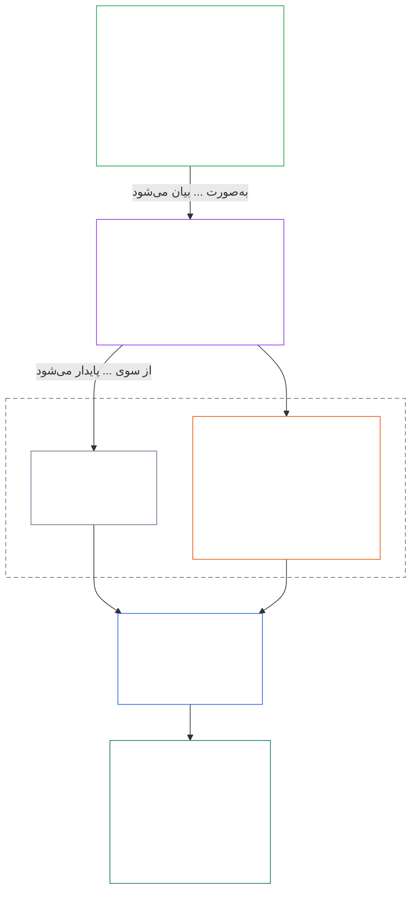
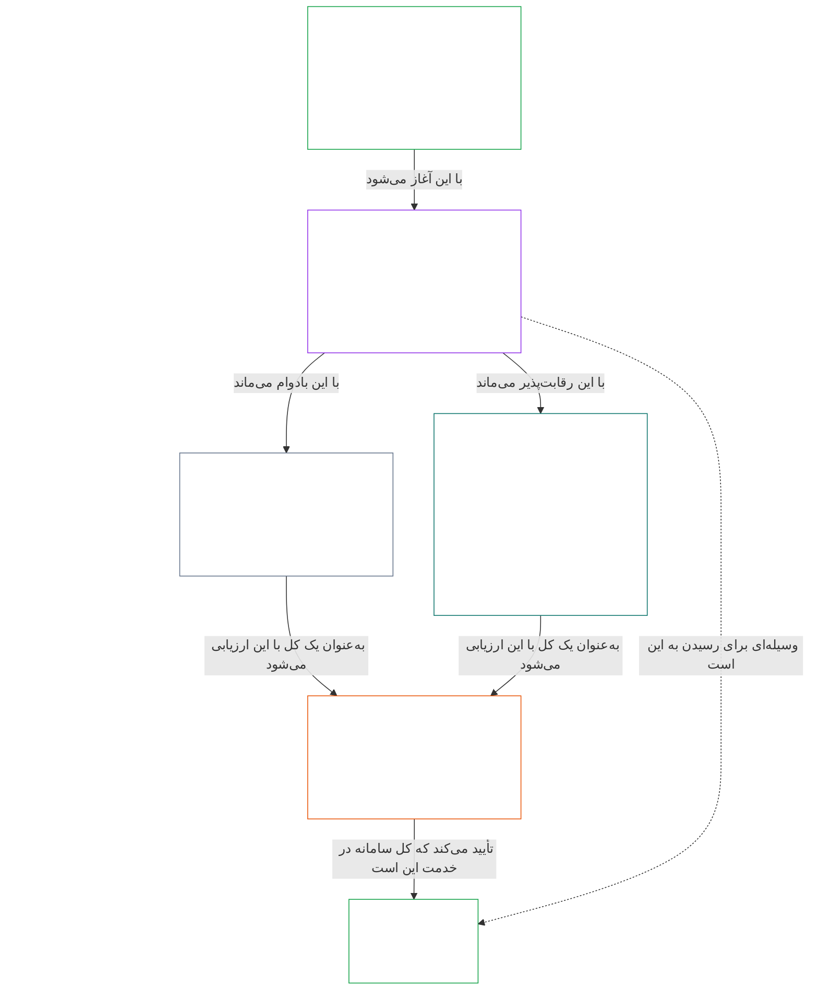

# فصل ۰۱، بخش الف: اصول ارزش‌ها

<details>
<summary><strong><span style="color: #2563eb;">جایگاه در پیکره (غیرعملیاتی): ساختار فایل و قواعد خواندن</span></strong></summary>

> ابزارک‌های دارای برچسب **غیرعملیاتی** (جایگاه در پیکره، راهنمای خواننده و نقشه‌های خواندن) صرفاً جهت‌دهنده‌اند. آن‌ها در پروندهٔ خود یا هر پروندهٔ دیگری هیچ تعهد الزام‌آوری را اضافه، حذف یا محدود نمی‌کنند.
> این فایل **بخشی از قانون اساسی موجودات ذی‌شعور** است و **فقط همراه** با سایر فایل‌های شماره‌دار `core_*` که به‌منزله یک سند واحد خوانده می‌شوند الزام‌آور است. این فایل شامل **فصل یک، بخش الف** (§§1–12: هدف و نقش؛ آرمان شکوفایی که در §2 معرفی و از طریق بهزیستی، ایمنی، حقیقت، اعتماد و آزادی بسط داده می‌شود؛ و آرمان تداوم که در §8 معرفی و از طریق ظرفیت سامانه مشترک، تاب‌آوری، ساختار بازار و ارزیابی نظام‌مند بسط داده می‌شود) است.
>
> **پیشین:** [core_00_preamble.md](core_00_preamble.md)  
> **بعدی:** [core_01_b_interaction_interpretation.md](core_01_b_interaction_interpretation.md) (فصل یک، بخش ب — §§13–15، تعامل، حدود غلبه و تفسیر قانون اساسی).  
> **مسیر خواندن:** §1 هدف و نقش ← **شکوفایی:** مقدمه §2 (با محدودیت‌های غیرقابل‌مذاکره ایمنی و حقیقت در §2.1) ← §3 بهزیستی (نتیجه) ← §4 ایمنی ← §5 حقیقت ← §6 اعتماد ← §7 آزادی ← **تداوم:** مقدمه §8 ← §9 ظرفیت سامانه مشترک (پل: وسیله‌ای برای شکوفایی و جوهر تداوم) ← §10 تاب‌آوری ← §11 ساختار بازار ← §12 ارزیابی نظام‌مند.

</details>

<details>
<summary><strong><span style="color: #2563eb;">راهنمای خواننده (غیرعملیاتی): پیوند فصل یک با آرمان‌ها، چهارگانه، مواد و تعاریف</span></strong></summary>

> **ردیابی** و **تعاریف · ارزیابی · انطباق** هر بخش، مسیرهای ارجاع الزام‌آور را فراهم می‌کنند؛ این بلوک نقشه‌ای در سطح بخش برای خوانندگانی است که از فصل یک وارد می‌شوند.

**لایه‌ها چگونه به هم مرتبط‌اند.** هر لایه به پرسشی متفاوت پاسخ می‌دهد و هر اصل فصل یک به سه لایه دیگر اشاره می‌کند:

- **آرمان‌ها و چهارگانه** ([مقدمه §1](core_00_preamble.md#the-model)): هدف سامانه‌های مشترک ([شکوفایی](core_05_apex_flourishing_aim.md#flourishing-constitutional) و [تداوم](core_05_apex_continuity_aim.md#فصل-پنجم-تعریفها-پیوستگی-هدف-قانون-اساسی)) چیست و چهار تکلیفی که این پیگیری را مشروع نگه می‌دارند کدام‌اند ([مشارکت](core_05_apex_participation_leg.md#participation-constitutional)، [نظارت](core_05_apex_oversight_leg.md#oversight-constitutional)، [پاسخ‌گویی](core_05_apex_accountability_leg.md#accountability) و [به‌موقع‌بودن](core_05_apex_timeliness_leg.md#timeliness-constitutional)).
- **اصول** (این فصل): این آرمان‌ها و تکالیف چگونه به ارزش‌ها، محدودیت‌ها و قواعد سنجش آن‌ها در برابر یکدیگر تبدیل می‌شوند.
- **مواد** ([فصل شش](core_06_rights_part_a.md#فصل-ششم-حقوق-بنیادین)): حمایت‌های کف حقوق که هنگام پیگیری آرمان‌ها نیز قابل استفاده می‌مانند. **ردیابی** هر بخش آن‌ها را زیر عنوان *به‌ویژه* فهرست می‌کند.
- **تعاریف** ([فصل‌های دو تا پنج](core_02_definition_structure.md)): معانی مشترکی که برای سنجش درستی یک ادعا به کار می‌روند. ابزارک **تعاریف · ارزیابی · انطباق** هر بخش آن‌ها را فهرست می‌کند.

**فصل یک هر آرمان را چگونه بسط می‌دهد.** شکوفایی یعنی بهزیستی‌ای که از راه حقیقت، ایمنی، اعتمادپذیری و عاملیت معنادار پایدار می‌ماند ([مقدمه §1](core_00_preamble.md#flourishing)). فصل یک نخست نتیجه را بیان می‌کند و سپس برای هر یک از این چهار شرط اصلی می‌آورد.

| آرمان و بُعد | اصل فصل یک | جایگاه تعریف | مواد نام‌برده در ردیابی |
|---|---|---|---|
| **شکوفایی**: نتیجه | [§3 بهزیستی](../../core_01.000_values_principles.md#3-foundational-objective-wellbeing-flourishing-aim) | [بهزیستی](../../core_05.040_band_continuity.md#wellbeing) | [VI](core_06_rights_part_b.md#ماده-ششم-حقوق-بنیادین-برابر)، [X](core_06_rights_part_b.md#ماده-دهم-خودتعیینگری-عاملیت-و-مشارکت)، [XIII-B](core_06_rights_part_c.md#ماده-xiii-b-حق-جبران-خسارت-و-جبران-خسارت)، [XIX-B](core_06_rights_part_d.md#ماده-xix-b-اعتراضپذیری-و-حدود-محدودیت-متناسب) |
| **شکوفایی**: ایمنی | [§4 ایمنی](../../core_01.000_values_principles.md#4-safety-harm-constraint) | [ایمنی](../../core_05.040_band_continuity.md#safety-constitutional-constraint) | [XIII](core_06_rights_part_c.md#ماده-xiii-حق-بر-سیستم-های-قابل-اعتماد-و-قابل-اعتماد)، [XVII](core_06_rights_part_c.md#article-xvii-system-lifecycle-environments-and-reversibility)، [XXIII](core_06_rights_part_d.md#article-xxiii-root-cause-analysis-and-adaptive-response) |
| **شکوفایی**: حقیقت | [§5 حقیقت](../../core_01.000_values_principles.md#5-truth-epistemic-integrity-constraint) | [حقیقت](core_05_band_oversight.md#حقیقت-قید-قانون-اساسی) | [XIII](core_06_rights_part_c.md#ماده-xiii-حق-بر-سیستم-های-قابل-اعتماد-و-قابل-اعتماد)، [XV](core_06_rights_part_c.md#article-xv-info-sphere-integrity)، [XVI](core_06_rights_part_c.md#ماده-xvi-حسابرسی-شفافیت-و-تأیید-مستقل) |
| **شکوفایی**: اعتمادپذیری | [§6 اعتماد](#6-trust-and-trustworthiness-coordination-integrity) | [اعتمادپذیری](../../core_05.040_band_continuity.md#trustworthiness) | [XIII](core_06_rights_part_c.md#ماده-xiii-حق-بر-سیستم-های-قابل-اعتماد-و-قابل-اعتماد)، [XV](core_06_rights_part_c.md#article-xv-info-sphere-integrity)، [XVI](core_06_rights_part_c.md#ماده-xvi-حسابرسی-شفافیت-و-تأیید-مستقل) |
| **شکوفایی**: عاملیت معنادار | [§7 آزادی](#7-freedom-bounded-agency) | [عاملیت معنادار](../../core_05.055_band_participation.md#meaningful-agency) | [VI](core_06_rights_part_b.md#ماده-ششم-حقوق-بنیادین-برابر)، [X](core_06_rights_part_b.md#ماده-دهم-خودتعیینگری-عاملیت-و-مشارکت)، [XXI](core_06_rights_part_d.md#ماده-xxi-تعاملپذیری-انتقالپذیری-و-یکپارچگی-خروج) |
| **تداوم**، پل به شکوفایی: ظرفیت پایدار | [§9 ظرفیت سامانه مشترک](#۹-ظرفیت-سامانه-مشترک) | [ظرفیت سامانه مشترک](../../core_05.040_band_continuity.md#shared-system-capacity) | [I-A](core_06_rights_part_a.md#اصل-i-a-پیششرطهای-محیطی-و-یکپارچگی-بومشناختی)، [III](core_06_rights_part_a.md#اصل-iii-بقا-و-دسترسی-اساسی)، [V](core_06_rights_part_a.md#اصل-v-تخصیص-منابع-وابستگیها-و-تأمین-زیستبوم) |
| **تداوم**: تاب‌آوری | [§10 تاب‌آوری و طراحی خودترمیم‌گر](#10-resilience-and-self-healing-design) | [خودترمیمی](../../core_05.040_band_continuity.md#self-healing) | [XIII](core_06_rights_part_c.md#ماده-xiii-حق-بر-سیستم-های-قابل-اعتماد-و-قابل-اعتماد)، [XVII](core_06_rights_part_c.md#article-xvii-system-lifecycle-environments-and-reversibility)، [XXIII](core_06_rights_part_d.md#article-xxiii-root-cause-analysis-and-adaptive-response) |
| **تداوم**: بازارهای رقابت‌پذیر | [§11 ساختار بازار](#11-ساختار-بازار) | [ساختار بازار](../../core_05.035_band_accountability.md#market-structure) | [III-C](core_06_rights_part_a.md#اصل-iii-c-کف-کار-و-اقتصاد)، [V](core_06_rights_part_a.md#اصل-v-تخصیص-منابع-وابستگیها-و-تأمین-زیستبوم)، [XXI](core_06_rights_part_d.md#ماده-xxi-تعاملپذیری-انتقالپذیری-و-یکپارچگی-خروج) |
| **تداوم**: دید کل‌سامانه‌ای | [§12 الزام ارزیابی نظام‌مند](#12-الزام-ارزیابی-نظاممند) | [گواهی هم‌راستایی سامانه](../../core_05.040_band_continuity.md#system-alignment-certification) | [XVI](core_06_rights_part_c.md#ماده-xvi-حسابرسی-شفافیت-و-تأیید-مستقل) |

**سلسله‌مراتب اصول (تداوم).** در سطح اصول، آرمان تداوم به ترتیب زیر بسط می‌یابد و با ظرفیتی آغاز می‌شود که دو آرمان را به هم پیوند می‌دهد:

6. **[ظرفیت سامانه مشترک](../../core_05.040_band_continuity.md#shared-system-capacity)** حاصل جمعی است که سرپرستی شایسته، حکمرانی و مشوق‌ها باید در گذر زمان به آن برسند — توانایی واقعی و قابل‌اعتراض موجودات ذی‌شعور و سامانه‌های مشترک برای انجام کارهای مقرر در قانون اساسی. این ظرفیت میان دو آرمان قرار دارد: وسیله‌ای برای **شکوفایی** و جوهر **تداوم** است، اما بر همه‌چیز برتری ندارد. [§9.1](#91-ظرفیت-تولیدی-خیر-ابزاری) و [§9.2](#92-کارآمدی-قانون-اساسی) دو بُعد اصلی آن را توضیح می‌دهند.
7. **[تاب‌آوری و طراحی خودترمیم‌گر](#10-resilience-and-self-healing-design)** بیان می‌کند سامانه‌هایی که موجودات ذی‌شعور به آن‌ها وابسته‌اند چگونه مشکل را زود تشخیص می‌دهند، مهار می‌کنند، طبق مسیرهای اعلام‌شده از کار می‌افتند و صادقانه بازیابی می‌شوند (**[خودترمیمی](../../core_05.040_band_continuity.md#self-healing)**)، تا ظرفیت بند 6 پایدار بماند و ثبات به مداخله اضطراری وابسته نباشد.
8. **[ساختار بازار](../../core_05.035_band_accountability.md#market-structure)** در [§11](#11-ساختار-بازار) انضباط ضدتمرکزی فراهم می‌کند که این ظرفیت را در عمل رقابت‌پذیر نگه می‌دارد.
9. **[الزام ارزیابی نظام‌مند](#12-الزام-ارزیابی-نظاممند)** پیش از پذیرش ادعاهای انطباق یا حکمرانی، دامنه کل سامانه، وابستگی‌ها و هم‌راستایی مشوق‌ها را بررسی می‌کند — ذیل رکن **نظارت** چهارگانه به‌عنوان جهت‌گیری اصولی برای حسابرسی؛ از جمله [گواهی هم‌راستایی سامانه](../../core_05.040_band_continuity.md#system-alignment-certification) به‌عنوان یکی از فرایندهای حسابرسی به‌ویژه گسترده در میان فرایندهای دیگر.

**جایگاه چهارگانه در فصل یک.** هر بخش در ردیابی خود ارکانی را که به آن‌ها می‌پردازد نام می‌برد. این بخش‌ها مستقیم‌تر از همه آن ارکان را پوشش می‌دهند:

| رکن چهارگانه | جایگاه‌های اصلی در فصل یک |
|---|---|
| **مشارکت** | [§16 سرپرستی به‌تفصیل](core_01_c_stewardship_capacity_principles.md#۱۶-شرح-تفصیلی-سرپرستی) و [§17 سرپرستی پیامددار](core_01_c_stewardship_capacity_principles.md#۱۷-سرپرستی-پیامدآفرین-نقش-سرپرست) (نقش‌های اثرگذار و حق اظهارنظر)؛ [§7 آزادی](#7-freedom-bounded-agency) (عاملیت معنادار) |
| **نظارت** | [§16](core_01_c_stewardship_capacity_principles.md#۱۶-شرح-تفصیلی-سرپرستی) و [§17](core_01_c_stewardship_capacity_principles.md#۱۷-سرپرستی-پیامدآفرین-نقش-سرپرست) (درک توزیع‌شده و سوابق)؛ [§18 حکمرانی](core_01_c_stewardship_capacity_principles.md#18-حکمرانی-تحت-انضباط-سرپرستی) (تخصیص اختیار)؛ [§12](#12-الزام-ارزیابی-نظاممند) (حسابرسی) |
| **پاسخ‌گویی** | [§18 حکمرانی](core_01_c_stewardship_capacity_principles.md#18-حکمرانی-تحت-انضباط-سرپرستی) (پاسخ‌گویی متناسب با اختیار)؛ [§19 هم‌سویی مشوق‌ها و تسخیر سامانه](core_01_c_stewardship_capacity_principles.md#19-همراستاسازی-مشوقها-و-تسخیر-سامانه) (پاداش‌ها نباید ارکان را تهی کنند) |
| **به‌موقع‌بودن** | [§16](core_01_c_stewardship_capacity_principles.md#۱۶-شرح-تفصیلی-سرپرستی) و [§17](core_01_c_stewardship_capacity_principles.md#۱۷-سرپرستی-پیامدآفرین-نقش-سرپرست) (شناسایی و رفع مشکل بدون تأخیر قابل‌اجتناب) |

**دو محور، نه تعارض.** آرمان‌ها می‌گویند سامانه‌ها چه چیزی را دنبال می‌کنند؛ چهارگانه می‌گوید آن پیگیری چگونه مشروع می‌ماند. یک اصطلاح می‌تواند در هر دو محور جای گیرد: حقیقت و اعتمادپذیری از اجزای شکوفایی‌اند و [مقدمه §2](core_00_preamble.md#2-نمای-کلی-اندازهگیریها) آن‌ها را در خانواده نظارت می‌سنجد. [§§13–15](core_01_b_interaction_interpretation.md#۱۳-فرایند-حل-تعارض-قانون-اساسی) نحوه سنجش و خواندن این اصول به‌صورت یک کل را هنگام تعارض تعیین می‌کنند و [§20](core_01_c_stewardship_capacity_principles.md#20-برنامه-یکپارچه) آن‌ها را بر همه فصل‌های بعدی اعمال می‌کند.

</details>

<br>

### ۱. هدف و نقش
<details>
<summary><strong><span style="color: #2563eb;">ردیابی</span></strong></summary>

- بالادست: [پیشگفتار §۱ مدل](core_00_preamble.md#the-model) — [چهارگانۀ قانون اساسی](core_00_preamble.md#constitutional-tetrad)، [دو هدف قانون اساسی](core_00_preamble.md#two-constitutional-aims) و مقیاس‌بندی متناسب با [ذی‌نفعی مادی](core_00_preamble.md#material-stake) از طریق ردیابی بخش‌ها در سراسر فصل اعمال می‌شوند.
- پایین‌دست: [۱۵. تفسیر قانون اساسی](core_01_b_interaction_interpretation.md#15-constitutional-interpretation) برای خوانش یکپارچه، ابهام، سلسله‌مراتب درونی و رویۀ رسمی حل تعارض.
- پایین‌دست: [دو هدف قانون اساسی](core_00_preamble.md#two-constitutional-aims) — توسعۀ هدف **شکوفایی**: از [§۳](../../core_01.000_values_principles.md#3-foundational-objective-wellbeing-flourishing-aim) تا [§۶](#6-trust-and-trustworthiness-coordination-integrity) و [§۷ آزادی](#7-freedom-bounded-agency)؛ توسعۀ هدف **تداوم**: [§۹ ظرفیت نظام مشترک](#۹-ظرفیت-سامانه-مشترک)، [§۱۰ تاب‌آوری و طراحی خودترمیم‌گر](#10-resilience-and-self-healing-design)، [§۱۱ ساختار بازار](#11-ساختار-بازار) و [§۱۲ الزام ارزیابی نظام‌مند](#12-الزام-ارزیابی-نظاممند).
- پایین‌دست: [۳. هدف بنیادین: بهزیستی](../../core_01.000_values_principles.md#3-foundational-objective-wellbeing-flourishing-aim)، [§۳.۲ به‌رسمیت‌شناسی، تقویت و آرمان‌خواهی](#32-recognition-reinforcement-and-aspiration)، [۴ ایمنی](../../core_01.000_values_principles.md#4-safety-harm-constraint)، [۵ حقیقت](../../core_01.000_values_principles.md#5-truth-epistemic-integrity-constraint)، [۶. اعتماد](#6-trust-and-trustworthiness-coordination-integrity)، [§۱۶ سرپرستی به‌تفصیل](core_01_c_stewardship_capacity_principles.md#۱۶-شرح-تفصیلی-سرپرستی)، [۱۳. فرایند حل تعارض قانون اساسی](core_01_b_interaction_interpretation.md#۱۳-فرایند-حل-تعارض-قانون-اساسی) و [§۷ آزادی](#7-freedom-bounded-agency).
- همراه بخوانید: [چهارگانۀ قانون اساسی](core_00_preamble.md#constitutional-tetrad) — مشارکت، نظارت، پاسخ‌گویی و به‌موقع‌بودن چگونگی پیگیری [دو هدف قانون اساسی](core_00_preamble.md#two-constitutional-aims) را در نظام‌های مشترک تنظیم می‌کنند؛ مقیاس‌بندی متناسب با [ذی‌نفعی مادی](core_00_preamble.md#material-stake) از طریق ردیابی بخش‌ها در سراسر فصل اعمال می‌شود.
- همراه بخوانید: [فصل‌های دو تا چهار](core_02_definition_structure.md) و [فصل پنج](core_05__definitions_home.md#فصل-پنجم-تعریفهای-بنیادین) — لایۀ سازوکارهای حاکم بر همۀ اصطلاحات به‌کاررفته در این فصل؛ یکپارچگی O/M/A/C، جلوگیری از طفره‌روی، بار اثبات و قابلیت ردیابی تعریف‌ها تا نتایج را اعمال کنید.
- همراه بخوانید: [فصل شش: حقوق بنیادین](core_06_rights_part_a.md#فصل-ششم-حقوق-بنیادین).
  - به‌ویژه [مادۀ VI: حقوق اساسی برابر](core_06_rights_part_b.md#ماده-ششم-حقوق-بنیادین-برابر)، [مادۀ XIII: حق برخورداری از نظام‌های قابل‌اتکا و قابل‌اعتماد](core_06_rights_part_c.md#ماده-xiii-حق-بر-سیستم-های-قابل-اعتماد-و-قابل-اعتماد) و [مادۀ XXIV: تفسیر قانون اساسی، بازبینی و تضمین‌های ضدتصرف](core_06_rights_part_d.md#ماده-xxv-تفسیر-قانون-اساسی-بازبینی-و-تدابیر-حفاظتی-ضدتسخیر).
  - هرجا تفسیر بر موجودات صاحب‌احساس، نظام‌ها یا نهادهای حمایت‌شده اثر می‌گذارد، این خوانش را اعمال کنید.

</details>

<details>
<summary><strong><span style="color: #2563eb;">تعریف‌ها · ارزیابی · رعایت</span></strong></summary>

- [تناسب](../../core_05.035_band_accountability.md#proportionality) · [O](../../core_05.035_band_accountability.md#proportionality) · [M](../../core_05.035_band_accountability.md#proportionality-a) · [A](../../core_05.035_band_accountability.md#proportionality-a) · [C](../../core_05.035_band_accountability.md#proportionality-c)
- [ضرورت](../../core_05.035_band_accountability.md#necessity) · [O](../../core_05.035_band_accountability.md#necessity) · [M](../../core_05.035_band_accountability.md#necessity-a) · [A](../../core_05.035_band_accountability.md#necessity-a) · [C](../../core_05.035_band_accountability.md#necessity-c)

</details>

<br>

*به زبان ساده: فصل یک ارزش‌ها و محدودیت‌هایی را تعیین می‌کند که بر همه فصل‌های دیگر حاکم‌اند. سامانه‌های مشترک باید **شکوفایی** و **تداوم** را با هم دنبال کنند، نه یکی را به بهای دیگری؛ و هیچ ارزشی را نباید به زیان ارزش‌های دیگر به حداکثر رساند.*

<a id="two-constitutional-aims"></a><a id="flourishing"></a><a id="continuity"></a>این فصل اصول و محدودیت‌های حاکم بر تفسیر، اجرا و تحول این قانون اساسی را برقرار می‌کند. این فصل [دو هدف قانون اساسی](core_00_preamble.md#two-constitutional-aims) — [**شکوفایی**](core_00_preamble.md#flourishing) و [**تداوم**](core_00_preamble.md#continuity) — را که در [پیشگفتار §۱ مدل](core_00_preamble.md#the-model) تثبیت شده‌اند، به اصول و محدودیت‌های اجرایی بسط می‌دهد. تعریف‌های معیار در سطح اصول در پیشگفتار آمده‌اند؛ این فصل آن‌ها را اعمال می‌کند.

این هدف‌ها باید همواره با هم و در چارچوب محدودیت‌های اصولیِ غیرقابل‌مذاکره و حمایت‌های حقوقیِ مقرر در این قانون اساسی دنبال شوند. [**چهارگانۀ قانون اساسی**](core_00_preamble.md#constitutional-tetrad) چگونگی مشروع‌ماندن این پیگیری را تنظیم می‌کند و مقیاس آن را با [**ذی‌نفعی مادی**](core_00_preamble.md#material-stake) متناسب می‌سازد.

این فصل حول آن دو هدف و آن چهارگانه سازمان یافته است:
- **شکوفایی:** [هدف شکوفایی: مقدمه](#۲-مقدمه-هدف-شکوفایی) نقشۀ هدف را ترسیم می‌کند. [§۳ هدف بنیادین: بهزیستی](../../core_01.000_values_principles.md#3-foundational-objective-wellbeing-flourishing-aim) نتیجۀ مطلوب را بیان می‌کند. [§۴ ایمنی](../../core_01.000_values_principles.md#4-safety-harm-constraint)، [§۵ حقیقت](../../core_01.000_values_principles.md#5-truth-epistemic-integrity-constraint)، [§۶ اعتماد](#6-trust-and-trustworthiness-coordination-integrity) و [§۷ آزادی](#7-freedom-bounded-agency) چهار شرطِ پشتیبان آن را بسط می‌دهند: ایمنی، حقیقت، قابل‌اعتمادبودن و عاملیت معنادار.
- **تداوم:** [مقدمهٔ هدف تداوم](#8-continuity-aim-introduction) هدف را ترسیم می‌کند. [§9 ظرفیت سامانهٔ مشترک](#9-shared-system-capacity) (وسیله‌ای برای شکوفایی و در عین حال جوهر تداوم)، [§10 طراحی تاب‌آوری و خودترمیمی](#10-resilience-and-self-healing-design)، [§11 ساختار بازار](#11-market-structure) و [§12 الزام ارزیابی سامانه‌ای](#12-systemic-evaluation-requirement) ثبات بلندمدت، ظرفیت پایدار سامانهٔ مشترک و تاب‌آوری را بسط می‌دهند. ادعاهای تداوم بر تصویری صادقانه از کل سامانه تکیه دارند: هر ادعای §9، §10 و §11 فقط پس از ارزیابی §12 پابرجاست.
- **هنگام رویارویی اصول:** [§۱۳ فرایند حل تعارض قانون اساسی](core_01_b_interaction_interpretation.md#۱۳-فرایند-حل-تعارض-قانون-اساسی)، [§۱۴ منع تقدم مطلق](core_01_b_interaction_interpretation.md#14-prohibition-on-absolute-override) و [§۱۵ تفسیر قانون اساسی](core_01_b_interaction_interpretation.md#15-constitutional-interpretation) چگونگی سنجش و خوانش یکپارچۀ هدف‌ها و اصول را تنظیم می‌کنند.
- **چهارگانه در عمل:** از [§۱۶ سرپرستی به‌تفصیل](core_01_c_stewardship_capacity_principles.md#۱۶-شرح-تفصیلی-سرپرستی) تا [§۱۹ هم‌راستایی انگیزه‌ها و تصرف نظام](core_01_c_stewardship_capacity_principles.md#19-همراستاسازی-مشوقها-و-تسخیر-سامانه)، مشارکت، نظارت، پاسخ‌گویی و به‌موقع‌بودن را در سرپرستی، حکمرانی و انگیزه‌ها جاری می‌کنند؛ [§۲۰ کاربرد یکپارچه](core_01_c_stewardship_capacity_principles.md#20-برنامه-یکپارچه) کل فصل را بر همۀ فصل‌های بعدی اعمال می‌کند.

**ردیابی** هر اصل، مواد فصل شش را که از آن حمایت می‌کنند فهرست می‌کند؛ ویجت **تعریف‌ها · ارزیابی · رعایت** نیز تعریف‌های فصل پنج را که آن را می‌سنجند فهرست می‌کند.

**نمودار: دو هدف قانون اساسی و چهارگانۀ قانون اساسی**

<hr style="border: 0; border-top: 1px solid currentColor;">

```mermaid
flowchart TB
    subgraph Foundation[" "]
        direction TB
        subgraph Aims["دو هدف قانون اساسی"]
            direction LR
            F["شکوفایی<br/><br/>• بهزیستی موجودات صاحب‌احساس که با حقیقت، ایمنی،<br/>قابل‌اعتمادبودن و عاملیت معنادار پایدار می‌شود"]
            C["تداوم<br/><br/>• ثبات بلندمدت، پایداری، تاب‌آوری،<br/>و بهزیستی بوم‌شناختی"]
        end
        subgraph Tetrad1["چهارگانۀ قانون اساسی · مشارکت و نظارت"]
            direction LR
            P["مشارکت<br/><br/>• موجودات صاحب‌احساسِ متأثر صدای واقعی دارند<br/>• نمایندگی منصفانه و فرصت منصفانه برای اعتراض<br/>• دسترسی به نقش‌های مهم متناسب با میزان ذی‌نفعی"]
            O["نظارت<br/><br/>• پایش، بررسی، راستی‌آزمایی و نگهداری سوابق<br/>• بازبینی مستقل می‌تواند انتخاب‌های نادرست را محدود کند"]
        end
        subgraph Tetrad2["چهارگانۀ قانون اساسی · پاسخ‌گویی و به‌موقع‌بودن"]
            direction LR
            A["پاسخ‌گویی<br/><br/>• مسئولیت به کنشگران درست قابل ردیابی است<br/>• پاسخ‌گویی، جبران و اصلاح واقعی<br/>• پیامدهای بد، ترمیم را به‌دنبال دارند"]
            T["به‌موقع‌بودن<br/><br/>• مشکلات شناسایی، به چالش کشیده، حل و اصلاح می‌شوند<br/>• مهلت‌ها متناسب با ذی‌نفعی مادی‌اند<br/>• تأخیر نمی‌تواند حقوق، جبران یا ترمیم را از میان ببرد"]
        end
    end
    F ~~~ P
    P ~~~ A
    style Foundation fill:none,stroke:none
    style Aims fill:none,stroke:none
    style Tetrad1 fill:none,stroke:none
    style Tetrad2 fill:none,stroke:none
    style F fill:none,stroke:#16a34a,color:#ffffff
    style C fill:none,stroke:#16a34a,color:#ffffff
    style P fill:none,stroke:#0f766e,color:#ffffff
    style O fill:none,stroke:#ea580c,color:#ffffff
    style A fill:none,stroke:#db2777,color:#ffffff
    style T fill:none,stroke:#9333ea,color:#ffffff
```

*هدف‌ها می‌گویند نظام‌های مشترک باید چه چیزی را پی بگیرند؛ چهارگانه وظایف لازم برای مشروع‌ماندن این پیگیری را نشان می‌دهد. هر چهار وظیفه متناسب با [ذی‌نفعی مادی](core_00_preamble.md#material-stake) مقیاس‌بندی می‌شوند و هر دو هدف در چارچوب کف حقوق باقی می‌مانند. بازنشر از [مرور مفهومی](../../guides/CONCEPTUAL_OVERVIEW.md#two-aims-and-the-constitutional-tetrad).*

این ارزش‌ها:
- مستقل از یکدیگر نیستند و در عملکرد معمول نیز سلسله‌مراتب سختی ندارند.
- به‌عنوان اصول و محدودیت‌های متعامل عمل می‌کنند که باید با هم ارزیابی شوند.
- بر همۀ «نظام‌ها» اعمال می‌شوند؛ از جمله ساختارهای فنی، سازمانی، اقتصادی، اجتماعی‌ـ‌فنی و بوم‌سازگان‌هایی که به‌طور مادی بر موجودات صاحب‌احساس و سیارۀ زمین اثر می‌گذارند.

هیچ اصلی را نمی‌توان جداگانه به‌کار برد اگر این کار اصول دیگر را به‌طور مادی نقض کند. هنگام بروز تنش، سامانه‌ها باید آن را طبق الزامات تناسب، ضرورت و اثر سامانه‌ایِ بیان‌شده در این فصل حل کنند. اگر تعارض حل‌نشده مستقیماً به محدودیت‌های اصول غیرقابل‌مذاکره مربوط شود، **§13** فرایند حل برخورد قانون اساسی تقدم را تعیین می‌کند.

<a id="2-flourishing-aim-introduction"></a>
### ۲. مقدمه هدف شکوفایی
<details>
<summary><strong><span style="color: #2563eb;">ردیابی</span></strong></summary>

- همراه با [چهارگانه قانون اساسی](core_00_preamble.md#constitutional-tetrad) خوانده شود — هر چهار رکن بر چگونگی پیگیری شکوفایی اعمال می‌شوند؛ [اهمیت مادی](core_00_preamble.md#material-stake) عمق هر ادعای مربوط به شکوفایی را تعیین می‌کند.
- همراه با [دو هدف قانون اساسی](core_00_preamble.md#two-constitutional-aims) خوانده شود — هدف **شکوفایی**؛ هدف همراه آن در [مقدمه هدف تداوم](#۸-هدف-تداوم-مقدمه) معرفی می‌شود.
- پیشین: اصول: [دیباچه §1 الگو](core_00_preamble.md#flourishing)؛ [شکوفایی (هدف قانون اساسی)](core_05_apex_flourishing_aim.md#flourishing-constitutional)؛ [§1 هدف و نقش](../../core_01.000_values_principles.md#1-purpose-and-role).
- پسین: [§3 هدف بنیادین: بهزیستی (هدف شکوفایی)](../../core_01.000_values_principles.md#3-foundational-objective-wellbeing-flourishing-aim)، [§4 ایمنی (محدودیت آسیب)](../../core_01.000_values_principles.md#4-safety-harm-constraint)، [§5 حقیقت (محدودیت سلامت معرفتی)](../../core_01.000_values_principles.md#5-truth-epistemic-integrity-constraint)، [§6 اعتماد و اعتمادپذیری (سلامت هماهنگی)](#6-trust-and-trustworthiness-coordination-integrity)، و [§7 آزادی (عاملیت محدود)](#7-freedom-bounded-agency)؛ مواد حافظ هر یک در ردیابی همان بخش نام برده شده‌اند.
- زیربخش‌ها: [§2.1 محدودیت‌های اصولی غیرقابل‌مذاکره: ایمنی و حقیقت](#۲۱-محدودیتهای-اصولی-غیرقابلمذاکره-ایمنی-و-حقیقت).
- همراه با کف حقوق فصل ششم به‌طور کلی خوانده شود.

</details>

<details>
<summary><strong><span style="color: #2563eb;">تعاریف · ارزیابی · انطباق</span></strong></summary>

- [شکوفایی (هدف قانون اساسی)](core_05_apex_flourishing_aim.md#flourishing-constitutional) · [O](core_05_apex_flourishing_aim.md#flourishing-constitutional) · [M](core_05_apex_flourishing_aim.md#flourishing-constitutional-m) · [A](core_05_apex_flourishing_aim.md#flourishing-constitutional-a) · [C](core_05_apex_flourishing_aim.md#flourishing-constitutional-c)
- [بهزیستی](../../core_05.040_band_continuity.md#wellbeing) · [O](../../core_05.040_band_continuity.md#wellbeing) · [M](../../core_05.040_band_continuity.md#wellbeing-a) · [A](../../core_05.040_band_continuity.md#wellbeing-a) · [C](../../core_05.040_band_continuity.md#wellbeing-c)
- [ایمنی (محدودیت قانون اساسی)](../../core_05.040_band_continuity.md#safety-constitutional-constraint) · [O](../../core_05.040_band_continuity.md#safety-constitutional-constraint) · [M](../../core_05.040_band_continuity.md#safety-constraint-a) · [A](../../core_05.040_band_continuity.md#safety-constraint-a) · [C](../../core_05.040_band_continuity.md#safety-constraint-c)
- [حقیقت (محدودیت قانون اساسی)](core_05_band_oversight.md#حقیقت-قید-قانون-اساسی) · [O](core_05_band_oversight.md#truth-constitutional-constraint-o) · [M](core_05_band_oversight.md#truth-constitutional-constraint-a) · [A](core_05_band_oversight.md#truth-constitutional-constraint-a) · [C](core_05_band_oversight.md#truth-constitutional-constraint-c)
- [اعتمادپذیری](../../core_05.040_band_continuity.md#trustworthiness) · [O](../../core_05.040_band_continuity.md#trustworthiness) · [M](../../core_05.040_band_continuity.md#trustworthiness-a) · [A](../../core_05.040_band_continuity.md#trustworthiness-a) · [C](../../core_05.040_band_continuity.md#trustworthiness-c)
- [عاملیت معنادار](../../core_05.055_band_participation.md#meaningful-agency) · [O](../../core_05.055_band_participation.md#meaningful-agency) · [M](../../core_05.055_band_participation.md#meaningful-agency-a) · [A](../../core_05.055_band_participation.md#meaningful-agency-a) · [C](../../core_05.055_band_participation.md#meaningful-agency-c)

</details>

<br>

*به زبان ساده: شکوفایی نخستینِ دو هدف است؛ موجودات ذی‌شعور خوب زندگی کنند و توان ادامه آن را داشته باشند، زیرا سامانه‌های پیرامونشان ایمن، صادق و قابل‌اعتمادند و امکان واقعی انتخاب می‌دهند. بخش ۳ نتیجه را توضیح می‌دهد و چهار اصل بعدی می‌گویند چگونه آن را واقعی نگه داریم.*

[**شکوفایی**](core_05_apex_flourishing_aim.md#flourishing-constitutional) **بهزیستی موجودات ذی‌شعور است که از راه حقیقت، ایمنی، اعتمادپذیری و عاملیت معنادار پایدار می‌ماند** ([دیباچه §1 الگو](core_00_preamble.md#flourishing)). فصل یک آن را در دو گام می‌پروراند: [§3 هدف بنیادین: بهزیستی (هدف شکوفایی)](../../core_01.000_values_principles.md#3-foundational-objective-wellbeing-flourishing-aim) نتیجه را بیان می‌کند و چهار اصل شرایط پایداری آن را مشخص می‌کنند.

| شرط | اصل | پرسشی که پاسخ می‌دهد |
|---|---|---|
| **ایمنی** | [§4 ایمنی (محدودیت آسیب)](../../core_01.000_values_principles.md#4-safety-harm-constraint) | آیا موجودات ذی‌شعور از آسیب قابل‌پیشگیری محافظت می‌شوند؟ |
| **حقیقت** | [§5 حقیقت (محدودیت سلامت معرفتی)](../../core_01.000_values_principles.md#5-truth-epistemic-integrity-constraint)، همراه با [§5.1 پژوهش آگاه از علم و پشتیبانی تصمیم‌گیری](../../core_01.000_values_principles.md#51-science-informed-inquiry-and-decision-support) و [§5.2 دسترس‌پذیری زبان ساده (وظیفه مشارکت و سرپرستی)](#52-دسترسپذیری-با-زبان-ساده-وظیفه-مشارکت-و-سرپرستی) | آیا موجودات ذی‌شعور می‌توانند به گفته‌ها اعتماد کنند و آن‌ها را بفهمند؟ |
| **اعتمادپذیری** | [§6 اعتماد و اعتمادپذیری (سلامت هماهنگی)](#6-trust-and-trustworthiness-coordination-integrity) | آیا سامانه‌ها اعتماد را به دست می‌آورند و هنگام ناکامی آن را ترمیم می‌کنند؟ |
| **عاملیت معنادار** | [§7 آزادی (عاملیت محدود)](#7-freedom-bounded-agency) | آیا موجودات ذی‌شعور آزادی واقعی و محدودی برای انتخاب، مخالفت، سازمان‌یابی و ترک‌کردن دارند؟ |

**اصول شکوفایی چگونه با هم کار می‌کنند:**
- **ایمنی و حقیقت محدودیت‌های غیرقابل‌مذاکره‌اند:** این دو در [§2.1 محدودیت‌های اصولی غیرقابل‌مذاکره: ایمنی و حقیقت](#۲۱-محدودیتهای-اصولی-غیرقابلمذاکره-ایمنی-و-حقیقت) کنار هم آمده‌اند و نمی‌توان آن‌ها را برای دستیابی به اصول دیگر واگذار کرد.
- **اعتماد و آزادی محدودند، نه مطلق:** اعتماد کسب‌شدنی و اصلاح‌پذیر است ([§6.1 اصلاح و جبران](#61-correction-and-remedy))؛ آزادی محدودیت‌های منضبط دارد ([§7.1 انضباط محدودیت](#71-limitation-discipline)).
- **هیچ‌یک جداگانه اعمال نمی‌شود:** اصول با هم خوانده می‌شوند و هنگام تعارض، بر اساس [§13 فرایند حل تعارض قانون اساسی](core_01_b_interaction_interpretation.md#۱۳-فرایند-حل-تعارض-قانون-اساسی) سنجیده می‌شوند.
- **شکوفایی هدفی همراه دارد:** هدف تداوم می‌پرسد چه چیزی این نتیجه را پایدار نگه می‌دارد؛ این هدف در [مقدمه هدف تداوم](#۸-هدف-تداوم-مقدمه) معرفی می‌شود.

**نمودار: شکوفایی و اصول آن**

<hr style="border: 0; border-top: 1px solid currentColor;">



*شکوفایی به‌عنوان نتیجه بیان می‌شود و ابتدا محدودیت‌های غیرقابل‌مذاکره، یعنی ایمنی و حقیقت، آن را پایدار می‌کنند؛ هر دو به اعتماد کمک می‌کنند و اعتماد نیز به نوبه خود آزادی را پشتیبانی می‌کند. رنگ‌ها نشانه‌های بصریِ قابل استفاده مجدد هستند، نه ادعای اولویت. ردیابی هر اصل مواد مربوط به آن را نام می‌برد و ویجت تعاریف · ارزیابی · انطباق، تعاریفش را مشخص می‌کند. بازنشرشده در [مرور مفهومی](../../guides/CONCEPTUAL_OVERVIEW.md#flourishing-and-its-principles).*

<a id="21-non-negotiable-principle-constraints-safety-and-truth"></a>
#### ۲.۱ محدودیت‌های اصولی غیرقابل‌مذاکره: ایمنی و حقیقت
<details>
<summary><strong><span style="color: #2563eb;">ردیابی</span></strong></summary>

- همراه با [چهارگانه قانون اساسی](core_00_preamble.md#constitutional-tetrad) خوانده شود — رکن **مشارکت** (درک و به‌چالش‌کشیدن ارزیابی‌های ایمنی و حقیقت)؛ رکن **نظارت** (کشف خطر آسیب و فرسایش معرفتی)؛ رکن **پاسخ‌گویی** (پاسخ‌گویی در قبال آسیب، فریب و اتکای گمراه‌کننده)؛ و سنجش [اهمیت مادی](core_00_preamble.md#material-stake).
- همراه با [دو هدف قانون اساسی](core_00_preamble.md#two-constitutional-aims) خوانده شود — هدف **شکوفایی** (**ایمنی** و **حقیقت** در [دیباچه §1](core_00_preamble.md#two-constitutional-aims) اجزای تصریح‌شده‌اند)؛ هدف **تداوم** (پیشگیری از آسیب بلندمدت و سرپرستی صادقانه سامانه‌های پایدار).
- پیشین: اصول: [3. هدف بنیادین: بهزیستی](../../core_01.000_values_principles.md#3-foundational-objective-wellbeing-flourishing-aim)؛ [دو هدف قانون اساسی](core_00_preamble.md#two-constitutional-aims).
- پسین: [6. اعتماد](#6-trust-and-trustworthiness-coordination-integrity)، [13. فرایند حل تعارض قانون اساسی](core_01_b_interaction_interpretation.md#۱۳-فرایند-حل-تعارض-قانون-اساسی) و [§7 آزادی](#7-freedom-bounded-agency).
- کاربرد در: [§4 ایمنی](../../core_01.000_values_principles.md#4-safety-harm-constraint)؛ [§5 حقیقت](../../core_01.000_values_principles.md#5-truth-epistemic-integrity-constraint)؛ [§5.1 پژوهش آگاه از علم و پشتیبانی تصمیم‌گیری](../../core_01.000_values_principles.md#51-science-informed-inquiry-and-decision-support)؛ [§5.2 دسترس‌پذیری زبان ساده](#52-دسترسپذیری-با-زبان-ساده-وظیفه-مشارکت-و-سرپرستی).

</details>

<br>

*به زبان ساده: ایمنی و حقیقت کف‌های محکم قانون اساسی‌اند، نه امتیازهایی برای معامله یا بهینه‌سازی تا حد حذف. سامانه‌های مشترک نباید موجودات ذی‌شعور را در معرض خطر قابل‌پیش‌بینی قرار دهند یا فریب دهند؛ هر دو قید در پیگیری شکوفایی و تداوم نیز، تحت انضباط مشارکت، نظارت، پاسخ‌گویی و به‌موقع‌بودنِ چهارگانه قانون اساسی، اعمال می‌شوند.*

**ایمنی** و **حقیقت** محدودیت‌های اصولی غیرقابل‌مذاکره‌اند که همه اصول دیگر فصل یک — از جمله [§3 هدف بنیادین: بهزیستی](../../core_01.000_values_principles.md#3-foundational-objective-wellbeing-flourishing-aim) و [دو هدف قانون اساسی](core_00_preamble.md#two-constitutional-aims) — را مقید می‌کنند. آن‌ها اجزای تصریح‌شده [**شکوفایی**](#flourishing) و برای [**تداوم**](#continuity) ضروری‌اند: سامانه‌ها از راه آسیب یا فریب به شکوفایی نمی‌رسند و مشروعیت پایدار به سرپرستی صادقانه ریسک در گذر زمان نیاز دارد.

اجرای این محدودیت‌ها باید با [چهارگانه قانون اساسی](core_00_preamble.md#constitutional-tetrad) منطبق و متناسب با [اهمیت مادی](core_00_preamble.md#material-stake) باشد، به‌ویژه:
- وقتی ارزیابی‌های ایمنی بر ظرفیت مشارکت اثر می‌گذارند
- وقتی ادعاهای حقیقت، اتکا را هدایت می‌کنند
- وقتی پاسخ‌گویی در قبال آسیب یا رفتار گمراه‌کننده مطرح است

یافته‌های مربوط به ایمنی و حقیقت می‌توانند سابقه جایگاه یک موجود ذی‌شعور را تغییر دهند، از جمله:
- نحوه به‌رسمیت‌شناختن [مشارکت‌ها](../../core_05.035_band_accountability.md#contribution-nature)
- اینکه آیا تخلف‌ها ثبت می‌شوند
- نحوه طبقه‌بندی شدت آن تخلف‌ها
- پیامدهای مترتب بر آن‌ها

مدل ردپا — [**فصل یازدهم**](../../core_11.000_standing_assessment.md) برای سوابق و [**فصل دوازدهم**](../../core_12.000_standing_measurement.md) برای سنجش — چگونگی طبقه‌بندی، راستی‌آزمایی و اعمال آن یافته‌ها را با الزامات ارزیابی و انطباق برگرفته از [**فصل‌های دوم تا پنجم**](../../core_02.000_definition_structure.md) تنظیم می‌کند.

### ۳. هدف بنیادین: بهزیستی (هدف شکوفایی)
<details>
<summary><strong><span style="color: #2563eb;">ردیابی</span></strong></summary>

- همراه با [چهارگانهٔ قانون اساسی](core_00_preamble.md#constitutional-tetrad) خوانده شود — بُعد **مشارکت** هنگامی که شرایط بهزیستی به‌طور مادی بر معنادار بودن صدا، دسترسی و امکان اعتراض اثر می‌گذارد؛ بُعد **پاسخ‌گویی** هنگامی که ادعاهای بهزیستی بر تخصیص بارها اثر می‌گذارد؛ در صورت ارتباط، مقیاس‌بندی بر پایهٔ [مصلحت مادی](core_00_preamble.md#material-stake).
- همراه با [دو هدف قانون اساسی](core_00_preamble.md#two-constitutional-aims) خوانده شود — این فصل هدف **شکوفایی** را از [§3](../../core_01.000_values_principles.md#3-foundational-objective-wellbeing-flourishing-aim) تا [§6](#6-trust-and-trustworthiness-coordination-integrity) و نیز [§7 آزادی](#7-freedom-bounded-agency) بسط می‌دهد.
- پیش‌نیاز: اصول: [دیباچه §1 الگو](core_00_preamble.md#the-model)؛ [دو هدف قانون اساسی](core_00_preamble.md#two-constitutional-aims) — بسط هدف **شکوفایی**.
- پیامدها: [4 ایمنی](../../core_01.000_values_principles.md#4-safety-harm-constraint)، [5 حقیقت](../../core_01.000_values_principles.md#5-truth-epistemic-integrity-constraint)، [§16 سرپرستی به‌تفصیل](core_01_c_stewardship_capacity_principles.md#۱۶-شرح-تفصیلی-سرپرستی)، و [13. فرایند حل تعارض قانون اساسی](core_01_b_interaction_interpretation.md#۱۳-فرایند-حل-تعارض-قانون-اساسی).
- زیربخش‌ها: [§3.1 انصاف](#31-fairness)؛ [§3.2 به‌رسمیت‌شناختن، تقویت و آرمان‌خواهی](#32-recognition-reinforcement-and-aspiration)؛ [§3.3 فرایند ضدتضعیف](#33-فرایند-ضدتحقیر).
- همراه با کف حقوق فصل ششم به‌طور کلی خوانده شود.
  - به‌ویژه [مادهٔ VI: حقوق اساسی برابر](core_06_rights_part_b.md#ماده-ششم-حقوق-بنیادین-برابر)، [مادهٔ X: خودتعیین‌گری، عاملیت و مشارکت](core_06_rights_part_b.md#ماده-دهم-خودتعیینگری-عاملیت-و-مشارکت)، [مادهٔ XIII-B: حق جبران و راهکار](core_06_rights_part_c.md#ماده-xiii-b-حق-جبران-خسارت-و-جبران-خسارت)، و [مادهٔ XIX-B: امکان اعتراض و حدود محدودیت متناسب](core_06_rights_part_d.md#ماده-xix-b-اعتراضپذیری-و-حدود-محدودیت-متناسب).
  - این را هنگامی به کار ببرید که دستاوردهای ادعایی در بهزیستی برای توجیه محدودیت بر عاملیت، کرامت یا امکان اعتراض استفاده شوند.
  - هنگامی که دسترسی، فرایند، هم‌ترازی توزیعی، اتکا یا یکپارچگی هماهنگی اهمیت مادی دارد، به‌ویژه [کرامت و منزلت اخلاقی برابر](../../core_05.055_band_participation.md#dignity-and-equal-moral-standing)، [انصاف ماهوی](../../core_05.055_band_participation.md#substantive-fairness) و [6. اعتماد](#6-trust-and-trustworthiness-coordination-integrity).

</details>

<details>
<summary><strong><span style="color: #2563eb;">تعاریف · ارزیابی · انطباق</span></strong></summary>

- [بهزیستی](../../core_05.040_band_continuity.md#wellbeing) · [O](../../core_05.040_band_continuity.md#wellbeing) · [M](../../core_05.040_band_continuity.md#wellbeing-a) · [A](../../core_05.040_band_continuity.md#wellbeing-a) · [C](../../core_05.040_band_continuity.md#wellbeing-c)
- [مشارکت](core_05_apex_participation_leg.md#participation-constitutional) · [O](core_05_apex_participation_leg.md#participation-constitutional) · [M](core_05_apex_participation_leg.md#participation-constitutional-m) · [A](core_05_apex_participation_leg.md#participation-constitutional-a) · [C](core_05_apex_participation_leg.md#participation-constitutional-c)
- [کرامت و منزلت اخلاقی برابر](../../core_05.055_band_participation.md#dignity-and-equal-moral-standing) · [O](../../core_05.055_band_participation.md#dignity-and-equal-moral-standing) · [M](../../core_05.055_band_participation.md#dignity-and-equal-moral-standing-a) · [A](../../core_05.055_band_participation.md#dignity-and-equal-moral-standing-a) · [C](../../core_05.055_band_participation.md#dignity-and-equal-moral-standing-c)
- [انصاف ماهوی](../../core_05.055_band_participation.md#substantive-fairness) · [O](../../core_05.055_band_participation.md#substantive-fairness) · [M](../../core_05.055_band_participation.md#substantive-fairness-constitutional-a) · [A](../../core_05.055_band_participation.md#substantive-fairness-constitutional-a) · [C](../../core_05.055_band_participation.md#substantive-fairness-constitutional-c)
- [مادیت](../../core_05.050_band_oversight.md#materiality) · [O](../../core_05.050_band_oversight.md#materiality) · [M](core_05_band_oversight.md#materiality-determination-a) · [A](core_05_band_oversight.md#materiality-determination-a) · [C](core_05_band_oversight.md#materiality-determination-c)
- [واگرایی شاخص جانشین](core_05_band_oversight.md#واگرایی-شاخص-جانشین) · [O](core_05_band_oversight.md#واگرایی-شاخص-جانشین) · [M](core_05_band_oversight.md#proxy-divergence-a) · [A](core_05_band_oversight.md#proxy-divergence-a) · [C](core_05_band_oversight.md#proxy-divergence-c)

</details>

<br>

*به زبان ساده: هدف این سامانه‌ها بهترکردن واقعی زندگی موجودات ذی‌شعور است. دنبال‌کردن شاخص جانشین این هدف را برآورده نمی‌کند و مجوز کوتاهی در ایمنی، حقیقت یا حقوق نیست. بهزیستی پایه مشارکت است؛ صدای نمادین بدون شرایط عاملیت واقعی، مشارکت به شمار نمی‌آید.*

هدف نهایی همهٔ نظام‌های تابع این قانون اساسی، حفظ و ارتقای [بهزیستی](../../core_05.040_band_continuity.md#wellbeing) موجودات برخوردار از احساس است — هدف [**شکوفایی**](#flourishing) در چارچوب [دو هدف قانون اساسی](core_00_preamble.md#two-constitutional-aims).

[دیباچه §1 الگو](core_00_preamble.md#flourishing) شکوفایی را بهزیستی موجودات برخوردار از احساس تعریف می‌کند که از طریق حقیقت، ایمنی، قابل‌اعتمادبودن و عاملیت معنادار پایدار می‌شود. این بخش نتیجه را بیان می‌کند. بخش‌های بعدی چهار شرط پشتیبان آن را بسط می‌دهند: [§4 ایمنی](../../core_01.000_values_principles.md#4-safety-harm-constraint)، [§5 حقیقت](../../core_01.000_values_principles.md#5-truth-epistemic-integrity-constraint)، [§6 اعتماد](#6-trust-and-trustworthiness-coordination-integrity) و [§7 آزادی](#7-freedom-bounded-agency). این پنج اصل در کنار هم بسط هدف شکوفایی در فصل یک را شکل می‌دهند. هدف [**پیوستگی**](#continuity) در [§9 ظرفیت نظام‌های مشترک](#۹-ظرفیت-سامانه-مشترک)، [§10 تاب‌آوری و طراحی خودترمیم‌گر](#10-resilience-and-self-healing-design)، [§11 ساختار بازار](#11-ساختار-بازار) و [§12 الزام ارزیابی نظامی](#12-الزام-ارزیابی-نظاممند) بسط می‌یابد.

بهزیستی برای [مشارکت](core_05_apex_participation_leg.md#participation-constitutional) ذیل [چهارگانهٔ قانون اساسی](core_00_preamble.md#constitutional-tetrad) بنیادین است. نظام‌های مشترک نمی‌توانند مشارکت را محقق‌شده بدانند، اگر شرایط زیربنایی بهزیستی — از جمله [عاملیت معنادار](../../core_05.055_band_participation.md#meaningful-agency)، دسترسی منصفانه و کرامت — به‌طور مادی تضعیف شده باشند.

بهزیستی نه‌فقط آثار فوری، بلکه پیامدهای غیرمستقیم، با تأخیر، انباشتی و میان‌نظامی را نیز دربرمی‌گیرد که بر اساس [**فصل‌های دوم تا چهارم**](core_02_definition_structure.md) ارزیابی می‌شوند. در این لایهٔ ارزشی، بهزیستی:
- مشارکت واقعی را ممکن می‌سازد — صدایی که موجودات برخوردار از احساس شرایط استفاده از آن را ندارند، مشارکت معنادار نیست؛
- با دستیابی به شاخصی که از آنچه واقعاً اهمیت دارد منحرف شده، نمی‌تواند «محقق‌شده» اعلام شود؛
- همچنان به قیود اصولی غیرقابل‌مذاکرهٔ این فصل محدود است: **ایمنی** و **حقیقت**؛
- نمی‌تواند توجیهی کلی برای نقض ایمنی، حقیقت یا حمایت‌های حقوق باشد.

<a id="31-fairness"></a>

#### 3.1 انصاف
<details>
<summary><strong><span style="color: #2563eb;">ردیابی</span></strong></summary>

- همراه با [چهارگانهٔ قانون اساسی](core_00_preamble.md#constitutional-tetrad) خوانده شود — بُعد **مشارکت** (دسترسی، صدا و امکان اعتراض؛ الزامی عمومی، نه صرفاً [مشارکت سامانهٔ ذی‌نفعان](../../core_05.055_band_participation.md#stakeholder-status-and-weight))؛ بُعد **پاسخ‌گویی** هنگام تخصیص منافع و بارها.
- پیش‌نیاز: اصول: [§3 هدف بنیادین: بهزیستی](../../core_01.000_values_principles.md#3-foundational-objective-wellbeing-flourishing-aim) — از جمله بنیادین بودن بهزیستی برای [مشارکت](core_05_apex_participation_leg.md#participation-constitutional).
- پیامدها: [§3.2 به‌رسمیت‌شناختن، تقویت و آرمان‌خواهی](#32-recognition-reinforcement-and-aspiration)؛ [6. اعتماد](#6-trust-and-trustworthiness-coordination-integrity)، [§16 سرپرستی به‌تفصیل](core_01_c_stewardship_capacity_principles.md#۱۶-شرح-تفصیلی-سرپرستی)، [13. فرایند حل تعارض قانون اساسی](core_01_b_interaction_interpretation.md#۱۳-فرایند-حل-تعارض-قانون-اساسی) و [سابقهٔ تعارض قانون اساسی](../../core_05.045_band_integrative.md#constitutional-collision-record)، جایی که انتخاب‌های تقدم و تخصیص باید منسجم و قابل‌بازبینی بمانند.
- زیربخش‌ها (ترتیب خواندن): [§3.1.1](#311-دسترسی-و-فرصت) · [§3.1.2](#312-منافع-و-بارها) · [§3.1.3](#313-رفتار-منصفانه) · [§3.1.4](#314-رفتار-ناعادلانه).
- پیامدها: سطح حقوق مربوط به منزلت برابر، رفتار غیرخودسرانه، امکان اعتراض معنادار و حدود متناسب محدودیت را شکل می‌دهد.
  - به‌ویژه [مادهٔ VI: حقوق اساسی برابر](core_06_rights_part_b.md#ماده-ششم-حقوق-بنیادین-برابر)، [مادهٔ VI-C: منع تبعیض](core_06_rights_part_b.md#ماده-vi-c-منع-تبعیض)، [مادهٔ X: خودتعیین‌گری، عاملیت و مشارکت](core_06_rights_part_b.md#ماده-دهم-خودتعیینگری-عاملیت-و-مشارکت)، [مادهٔ XIII-B: حق جبران و راهکار](core_06_rights_part_c.md#ماده-xiii-b-حق-جبران-خسارت-و-جبران-خسارت) و [مادهٔ XIX-B: امکان اعتراض و حدود محدودیت متناسب](core_06_rights_part_d.md#ماده-xix-b-اعتراضپذیری-و-حدود-محدودیت-متناسب).
  - هرگاه تعیین ضدقانون‌اساسی مجازات یا اثر پایدار داشته باشد، همراه با [فصل چهاردهم، بخش 4 — تضمین‌های دادرسی عادلانه، جبران و پیشگیری](../../core_14.000_misconduct_designation.md#4-due-process-safeguards-for-slot-assignment) (14.000) خوانده شود.
  - تعهدات منع تبعیض از طریق فصل پنج، [§2 — ویژگی‌های حمایت‌شده، استفاده از شاخص جانشین، فیلترگذاری سیگنال‌های صمیمی و وضعیت ذیل **مادهٔ VII-E** (*خدمات جنسی تجاری با رضایت بزرگسالان و بهره‌کشی جنسی*)](../../core_05.055_band_participation.md#fairness-protected-characteristics-and-nondiscrimination) شرح داده می‌شود؛ از جمله [دورزدن فیلترگذاری سیگنال‌های صمیمی حمایت‌شده و وضعیت ذیل **مادهٔ VII-E** (*خدمات جنسی تجاری با رضایت بزرگسالان و بهره‌کشی جنسی*)](../../core_05.055_band_participation.md#protected-intimate-signal-gating-and-article-vii-e-adult-consensual-commercial-sexual-services-and-sexual-exploitation-status-circumvention)، هنگامی که قواعد رفتار منصفانهٔ §2.1.3 به فیلتر سیگنال‌های صمیمی یا **مادهٔ VII-E** (*خدمات جنسی تجاری با رضایت بزرگسالان و بهره‌کشی جنسی*) مربوط می‌شوند.
- همراه با [انصاف ماهوی](../../core_05.055_band_participation.md#substantive-fairness) و تعهدات مرتبط کف حقوق فصل ششم خوانده شود، هرگاه منافع، بارها، پاداش‌ها، هزینه‌ها، وظایف، خطرها، مشارکت، نیاز یا مواجهه اهمیت مادی داشته باشند؛ [دسترس‌پذیری](../../core_05.055_band_participation.md#accessibility) هنگامی که مسیرهای دسترسی §2.1.1 اهمیت مادی دارند؛ [واگرایی شاخص جانشین](core_05_band_oversight.md#واگرایی-شاخص-جانشین) هنگامی که سنجه‌های تجمیعی یا آثار جدول امتیاز اهمیت مادی دارند.

</details>

<details>
<summary><strong><span style="color: #2563eb;">تعاریف · ارزیابی · انطباق</span></strong></summary>

- [کرامت و منزلت اخلاقی برابر](../../core_05.055_band_participation.md#dignity-and-equal-moral-standing) · [O](../../core_05.055_band_participation.md#dignity-and-equal-moral-standing) · [M](../../core_05.055_band_participation.md#dignity-and-equal-moral-standing-a) · [A](../../core_05.055_band_participation.md#dignity-and-equal-moral-standing-a) · [C](../../core_05.055_band_participation.md#dignity-and-equal-moral-standing-c)
- [دسترس‌پذیری](../../core_05.055_band_participation.md#accessibility) · [O](../../core_05.055_band_participation.md#accessibility) · [M](../../core_05.055_band_participation.md#accessibility-constitutional-a) · [A](../../core_05.055_band_participation.md#accessibility-constitutional-a) · [C](../../core_05.055_band_participation.md#accessibility-constitutional-c)
- [مشارکت](core_05_apex_participation_leg.md#participation-constitutional) · [O](core_05_apex_participation_leg.md#participation-constitutional) · [M](core_05_apex_participation_leg.md#participation-constitutional-m) · [A](core_05_apex_participation_leg.md#participation-constitutional-a) · [C](core_05_apex_participation_leg.md#participation-constitutional-c)
- [انصاف رویه‌ای](../../core_05.055_band_participation.md#procedural-fairness) · [O](../../core_05.055_band_participation.md#procedural-fairness) · [M](../../core_05.055_band_participation.md#procedural-fairness-constitutional-a) · [A](../../core_05.055_band_participation.md#procedural-fairness-constitutional-a) · [C](../../core_05.055_band_participation.md#procedural-fairness-constitutional-c)
- [انصاف ماهوی](../../core_05.055_band_participation.md#substantive-fairness) · [O](../../core_05.055_band_participation.md#substantive-fairness) · [M](../../core_05.055_band_participation.md#substantive-fairness-constitutional-a) · [A](../../core_05.055_band_participation.md#substantive-fairness-constitutional-a) · [C](../../core_05.055_band_participation.md#substantive-fairness-constitutional-c)
- [ویژگی‌های حمایت‌شده](../../core_05.055_band_participation.md#protected-characteristics) · [O](../../core_05.055_band_participation.md#protected-characteristics) · [M](../../core_05.055_band_participation.md#protected-characteristics-constitutional-a) · [A](../../core_05.055_band_participation.md#protected-characteristics-constitutional-a) · [C](../../core_05.055_band_participation.md#protected-characteristics-constitutional-c)
- [استفاده از ویژگی‌های حمایت‌شده به‌عنوان شاخص جانشین و اثر نامتناسب](../../core_05.055_band_participation.md#protected-characteristic-proxying-and-disparate-impact) · [O](../../core_05.055_band_participation.md#protected-characteristic-proxying-and-disparate-impact) · [M](../../core_05.055_band_participation.md#protected-characteristic-proxying-and-disparate-impact-a) · [A](../../core_05.055_band_participation.md#protected-characteristic-proxying-and-disparate-impact-a) · [C](../../core_05.055_band_participation.md#protected-characteristic-proxying-and-disparate-impact-c)
- [دورزدن فیلترگذاری سیگنال‌های صمیمی حمایت‌شده و وضعیت ذیل **مادهٔ VII-E** (*خدمات جنسی تجاری با رضایت بزرگسالان و بهره‌کشی جنسی*)](../../core_05.055_band_participation.md#protected-intimate-signal-gating-and-article-vii-e-adult-consensual-commercial-sexual-services-and-sexual-exploitation-status-circumvention) · [O](../../core_05.055_band_participation.md#protected-intimate-signal-gating-and-article-vii-e-adult-consensual-commercial-sexual-services-and-sexual-exploitation-status-circumvention) · [M](../../core_05.055_band_participation.md#protected-intimate-signal-gating-and-article-vii-e-status-circumvention-a) · [A](../../core_05.055_band_participation.md#protected-intimate-signal-gating-and-article-vii-e-status-circumvention-a) · [C](../../core_05.055_band_participation.md#protected-intimate-signal-gating-and-article-vii-e-status-circumvention-c)
- [واگرایی شاخص جانشین](core_05_band_oversight.md#واگرایی-شاخص-جانشین) · [O](core_05_band_oversight.md#واگرایی-شاخص-جانشین) · [M](core_05_band_oversight.md#proxy-divergence-a) · [A](core_05_band_oversight.md#proxy-divergence-a) · [C](core_05_band_oversight.md#proxy-divergence-c)

</details>

<br>

*به زبان ساده: سامانه نمی‌تواند خود را عادلانه بداند در حالی که مانع مشارکت موجودات ذی‌شعور عادی می‌شود، با قواعد توضیح‌نداده با آنان رفتار می‌کند یا هزینه‌هایی را بر دوششان می‌گذارد که دیگران از آن می‌گریزند. سامانه عادلانه دسترسی واقعی می‌دهد، به دلایل قابل دفاع تکیه می‌کند و پاداش‌ها، هزینه‌ها و خطرها را متناسب با مشارکت، نیاز و میزان مواجهه واقعی تقسیم می‌کند.*

**انصاف** بخشی از الزام [§3 هدف بنیادین: بهزیستی](../../core_01.000_values_principles.md#3-foundational-objective-wellbeing-flourishing-aim) است، هرگاه موجودات برخوردار از احساس ناچار باشند از طریق نظام‌های مشترک زندگی، کار، یادگیری، تجارت یا تصمیم‌گیری کنند. وقتی نظام‌های مشترک به‌طور مادی بر آنان اثر می‌گذارند، انصاف می‌پرسد آیا فرصت‌ها، رفتار و تقسیم منافع و بارها به [کرامت و منزلت اخلاقی برابر](../../core_05.055_band_participation.md#dignity-and-equal-moral-standing) احترام می‌گذارند یا نه.

انصاف به واقعی‌شدن [مشارکت](core_05_apex_participation_leg.md#participation-constitutional) کمک می‌کند. اگر موجودات برخوردار از احساس به‌طور صوری صدا داشته باشند، اما نتوانند به فرایند دسترسی یابند، قاعده را بفهمند، شرایط را برآورده کنند، نتیجه را به چالش بکشند یا بار تحمیل‌شده را تاب آورند، مشارکت واقعی نیست.

نشان‌دادن یک نتیجهٔ میانگین خوب از سوی نظام کافی نیست. یک شاخص برجسته، میانگین، رتبه‌بندی یا ادعای کارآمدی به‌تنهایی انصاف را ثابت نمی‌کند. نظام ممکن است در مجموع موفق به نظر برسد، اما همچنان در حق موجوداتی که کنار گذاشته شده‌اند، نادرست طبقه‌بندی شده‌اند، دستمزد ناکافی گرفته‌اند، بار بیش از حد بردوش دارند یا از فرصت معنادار اعتراض محروم شده‌اند، ناعادلانه باشد.

این بخش **پنج جزء عملی** دارد. این اجزا راهنمای همین بخش‌اند، اما جایگزین تعریف‌های فصل پنج یا کف حقوق فصل شش نمی‌شوند.

<a id="311-access-and-opportunity"></a>
##### 3.1.1 دسترسی و فرصت

این زیربخش معنای عملی دسترسی و فرصت را بیان می‌کند:

- موجودات ذی‌شعور به مسیرهای عملی برای [مشارکت](../../core_05.025_apex_participation_leg.md#participation-constitutional)، آموزش، کار، مراقبت، ایمنی، جابه‌جایی و دیگر نیازهای مهم زندگی روزمره احتیاج دارند.
- این مسیرها نباید به دلایل خودسرانه یا نامربوط مسدود، از توان مالی خارج، به تأخیر انداخته، پنهان یا منحرف شوند.
- هرگاه این قانون اساسی فرصت **واقعی و ماهوی** می‌خواهد، بازبودن در فقط روی کاغذ کافی نیست.

<a id="312-benefits-and-burdens"></a>
##### 3.1.2 منافع و بارها

این زیربخش بیان می‌کند که تقسیم منافع و بارها چه زمانی منصفانه است:

- اگر برخی موجودات ذی‌شعور سود ببرند و دیگران بی‌سروصدا هزینه‌ها را تحمل کنند، سامانه منصفانه نیست.
- جانبداری، انتقال پنهانی هزینه، اجرای گزینشی قواعد و دستکاری جدول امتیاز این الزام را برآورده نمی‌کنند.

<a id="313-fair-treatment"></a>
##### 3.1.3 رفتار منصفانه

این زیربخش الزامات رفتار منصفانه را بیان می‌کند:

- با موجودات برخوردار از احساس در وضعیت‌های مشابه باید بر اساس قواعد پایهٔ یکسان رفتار شود.
- آنچه موجودات ذی‌شعور دریافت می‌کنند، بر عهده می‌گیرند یا به خطر می‌اندازند باید با سهمی که داشته‌اند، نیازشان یا بارهایی که واقعاً تحمل می‌کنند متناسب باشد.
- رفتار متفاوت باید دلیل واقعی داشته باشد، با آن دلیل متناسب باشد، به کرامت احترام بگذارد و از تبعیض بپرهیزد.
- قواعد تفصیلی در فصل پنج اجرا می‌شوند؛ از جمله [ویژگی‌های حمایت‌شده](../../core_05.055_band_participation.md#protected-characteristics) و [جانشین‌سازی ویژگی‌های حمایت‌شده و اثر نامتوازن](../../core_05.055_band_participation.md#protected-characteristic-proxying-and-disparate-impact).
- هرگاه تصمیمی به‌طور اساسی بر کسی اثر بگذارد یا او به آن اعتراض کند، مسیر بازبینی باید هرجا فصل شش یا سند حاکم اخطار، جلسه رسیدگی، توضیح یا بازبینی را لازم می‌داند، [انصاف رویه‌ای](../../core_05.055_band_participation.md#procedural-fairness) را رعایت کند.

بهزیستی ادعایی با [§3 هدف بنیادین: بهزیستی](../../core_01.000_values_principles.md#3-foundational-objective-wellbeing-flourishing-aim) هم‌راستا نیست، اگر به محروم‌سازی خودسرانه، قواعد توضیح‌ناپذیر یا ناپایدار، استخراج پنهانی یا [مشارکت](core_05_apex_participation_leg.md#participation-constitutional) صوری وابسته باشد، در حالی که شرایط انصافِ معنادارکنندهٔ مشارکت محقق نشده‌اند.

<a id="314-unfair-treatment"></a>
##### 3.1.4 رفتار ناعادلانه

رفتار ناعادلانه موجب طرد و ناسازگاری می‌شود. سامانه‌ها نباید آن را پشت زبان فنی، برچسب‌های خنثی یا تصمیم‌های خودکار پنهان کنند. به‌ویژه نباید:
- بدون دلیل معتبر قانون اساسی از الگوریتم‌ها، سامانه‌های امتیازدهی یا قواعد اداری‌ای استفاده کنند که محرومیت تاریخی را تکرار می‌کنند؛
- از نشانه‌های شخصی صمیمی یا سابقه جنسی به‌عنوان میان‌بری برای اعتماد، خطر، منش یا دسترسی استفاده کنند — با [محدودسازی نشانه‌های صمیمی حمایت‌شده و دور زدن وضعیت ماده VII-E](../../core_05.055_band_participation.md#protected-intimate-signal-gating-and-article-vii-e-adult-consensual-commercial-sexual-services-and-sexual-exploitation-status-circumvention) بخوانید؛
- بدون دلیل معتبر قانون اساسی، اشتغال قانونی، سابقه اشتغال، بیکاری، وضعیت کاری قانونی یا ارتباط حمایت‌شده را مجازات کنند؛
- **عمدتاً به دلیل** هر شکل اشتغال قانونی، اشتغال قانونی گذشته، اشتغال قانونیِ فرض‌شده یا بیکاری، کار، مسکن، خدمات بانکی، مجوز، اهلیت یا دسترسی مشابه را انکار کنند؛
- از راه صدور مجوز، منطقه‌بندی، هزینه‌ها، قواعد پلتفرم یا الزامات ظاهراً خنثی دیگر، محرومیت مادی ایجاد کنند که عمدتاً کار قانونی یا سابقه آن، کار قانونیِ فرض‌شده، بیکاری یا ارتباط حمایت‌شده را سنگین می‌کند، بی‌آنکه توجیه مقرر در این قانون اساسی را داشته باشد.

این چهار جزء همچنین از [6. اعتماد](#6-trust-and-trustworthiness-coordination-integrity) پشتیبانی می‌کنند، هنگامی که موجودات برخوردار از احساس باید به نظامی اتکا کنند، تصمیم‌هایش را بپذیرند یا بر مبنای وعده‌هایش هماهنگ شوند.

<a id="32-recognition-reinforcement-and-aspiration"></a>

<a id="315-present-capability-and-proactive-help"></a>
##### 3.1.5 توانایی کنونی و کمک پیش‌دستانه

این زیربخش بیان می‌کند که سامانه‌ها باید با آنچه یک موجود ذی‌حس اکنون می‌تواند انجام دهد چگونه برخورد کنند، و هنگامی که نمی‌تواند پاسخ دهد چه باید بکنند:

- **توانایی کنونی:** سامانه توانایی موجود ذی‌حس را برای کار یا تصمیم موردنظر در زمان حاضر ارزیابی می‌کند. ارزیابی بر آنچه پیش‌تر می‌توانست انجام دهد، تشخیص یا برچسب، یا توانایی موجود ذی‌حس متوسط تکیه نمی‌کند. توانایی ممکن است کاهش یابد، بازگردد یا روزبه‌روز تغییر کند. سال‌ها پرداخت به‌موقع، توانایی کنونی را ثابت نمی‌کند؛ یک ارزیابی پیشین از توانایی محدود نیز آن را دائمی نمی‌سازد.
- **بقا به پاسخ وابسته نیست:** حفظ نیازهای اساسی بقا نباید به توانایی موجود ذی‌حس برای پاسخ‌دادن، درخواست کمک یا پیروی از فرایندی که اکنون قادر به پیروی از آن نیست وابسته باشد. دامنه این الزام با [اهمیت مادی](../../core_00.000_preamble.md#material-stake) و [وابستگی](../../core_05.040_band_continuity.md#dependency) افزایش می‌یابد.
- **تماس پیش‌دستانه:** وقتی موجود ذی‌حسی که برای امری مادی به یک سامانه وابسته است دیگر پاسخ نمی‌دهد، سامانه باید بکوشد با او تماس بگیرد و او را به کمک پیوند دهد، با کم‌مداخله‌ترین روش، بی‌آنکه لازم باشد بداند چرا سکوت کرده است.

#### 3.2 به‌رسمیت‌شناسی، تقویت و آرمان‌خواهی
<details>
<summary><strong><span style="color: #2563eb;">ردیابی</span></strong></summary>

- همراه با این بخش بخوانید: [چهارگانهٔ قانون اساسی](core_00_preamble.md#constitutional-tetrad) — رکن **مشارکت**، هنگامی که مسیرهای به‌رسمیت‌شناسی، ستایش یا آرمان‌خواهی به‌طور مادی بر صدا، جایگاه یا دسترسی به نقش‌های پیامدساز اثر می‌گذارند؛ رکن **پاسخ‌گویی** (ممنوعیت پاداش برای خیانت، پنهان‌کاری و گریز از پاسخ‌گویی)؛ رکن **نظارت** (ستایشی که قابل‌ردیابی و گمراه‌کننده نباشد).
- پیشینی: اصول: [§3 هدف بنیادین: بهزیستی](../../core_01.000_values_principles.md#3-foundational-objective-wellbeing-flourishing-aim) — از جمله اینکه بهزیستی بنیان [مشارکت](core_05_apex_participation_leg.md#participation-constitutional) است؛ [§3.1 انصاف](#31-fairness).
- پسینی: [6. اعتماد](#6-trust-and-trustworthiness-coordination-integrity)؛ [§16 سرپرستی به‌تفصیل](core_01_c_stewardship_capacity_principles.md#۱۶-شرح-تفصیلی-سرپرستی)؛ [§18 حکمرانی تحت انضباط سرپرستی](core_01_c_stewardship_capacity_principles.md#18-حکمرانی-تحت-انضباط-سرپرستی)؛ [§7 آزادی](#7-freedom-bounded-agency).
- همراه با این مورد خوانده شود: [فصل دوازدهم §§3.1–3.2 — فهرست استاندارد توصیفگرها](../../core_12.000_standing_measurement.md#31-contribution-route-descriptor-catalog-and-measurement-roles) (12.000 §3.1)، هرگاه شناسایی **هم‌راستا با حوزه** یا روایت‌های توصیفگر مقایسه‌ای **محور مشارکت / محور نقض** اهمیت مادی داشته باشند.
- همراه با این مورد خوانده شود: [فصل دوازدهم §3.1 — توصیفگرهای سوی مشارکت](../../core_12.000_standing_measurement.md#31-contribution-route-descriptor-catalog-and-measurement-roles) (12.000 §3.1)، هرگاه ماهیت مشارکت و روایت‌های شناسایی اهمیت داشته باشند؛ [فصل سیزدهم §4](../../core_13.000_standing_integration.md#4-descriptor-integration-and-attachment-normalization) (13.000 §4) برای ادغام آن‌ها در پرسش 3.
- همراه با این بخش بخوانید: [مادهٔ X: خودتعیینی، عاملیت و مشارکت](core_06_rights_part_b.md#ماده-دهم-خودتعیینگری-عاملیت-و-مشارکت)، هرجا ترجیحات مربوط به شکل به‌رسمیت‌شناسی، میزان دیده‌شدن یا انصراف اهمیت مادی دارند.
- زیربخش‌ها (ترتیب مطالعه): [§3.2.1](#321-بهرسمیتشناسی-و-تقویت) · [§3.2.2](#322-جشن-گرفتن-موفقیت) · [§3.2.3](#323-آرمانخواهی) · [§3.2.4](#324-بهرسمیتشناسی-همسو-با-ترجیح) · [§3.2.5](#325-مسیرهای-بهرسمیتشناسی-همسو) · [§3.2.6](#326-منع-پاداش-برای-رفتار-مغایر-قانون-اساسی) · [§3.2.7](#327-لایه-اجرا).

</details>

<details>
<summary><strong><span style="color: #2563eb;">تعریف‌ها · ارزیابی · انطباق</span></strong></summary>

- [بهزیستی](../../core_05.040_band_continuity.md#wellbeing) · [O](../../core_05.040_band_continuity.md#wellbeing) · [M](../../core_05.040_band_continuity.md#wellbeing-a) · [A](../../core_05.040_band_continuity.md#wellbeing-a) · [C](../../core_05.040_band_continuity.md#wellbeing-c)
- [مشارکت](core_05_apex_participation_leg.md#participation-constitutional) · [O](core_05_apex_participation_leg.md#participation-constitutional) · [M](core_05_apex_participation_leg.md#participation-constitutional-m) · [A](core_05_apex_participation_leg.md#participation-constitutional-a) · [C](core_05_apex_participation_leg.md#participation-constitutional-c)
- [انصاف ماهوی](../../core_05.055_band_participation.md#substantive-fairness) · [O](../../core_05.055_band_participation.md#substantive-fairness) · [M](../../core_05.055_band_participation.md#substantive-fairness-constitutional-a) · [A](../../core_05.055_band_participation.md#substantive-fairness-constitutional-a) · [C](../../core_05.055_band_participation.md#substantive-fairness-constitutional-c)
- [امکان اعتراض](../../core_05.035_band_accountability.md#contestability) · [O](../../core_05.035_band_accountability.md#contestability) · [M](../../core_05.035_band_accountability.md#contestability-a) · [A](../../core_05.035_band_accountability.md#contestability-a) · [C](../../core_05.035_band_accountability.md#contestability-c)
- [عاملیت معنادار](../../core_05.055_band_participation.md#meaningful-agency) · [O](../../core_05.055_band_participation.md#meaningful-agency) · [M](../../core_05.055_band_participation.md#meaningful-agency-a) · [A](../../core_05.055_band_participation.md#meaningful-agency-a) · [C](../../core_05.055_band_participation.md#meaningful-agency-c)
- [همسویی مشوق‌ها](core_05_band_integrative.md#همراستایی-انگیزه) · [O](core_05_band_integrative.md#همراستایی-انگیزه) · [M](core_05_band_integrative.md#incentive-alignment-a) · [A](core_05_band_integrative.md#incentive-alignment-a) · [C](core_05_band_integrative.md#incentive-alignment-c)

</details>

<br>

*به زبان ساده: بهزیستی فقط به ممنوعیت‌ها و انصاف محدود نیست؛ سامانه‌های مشترک باید در چارچوب حقیقت و حقوق، رفتارهایی را که می‌خواهند تکرار شود صادقانه تشویق و پاداش دهند، به‌گونه‌ای که مشارکت واقعی را تقویت کند نه جایگزین آن شود. جشن موفقیت یعنی اعتباردادن به مشارکت واقعی، ترمیم و تکمیل کار، نه تبلیغات یا شاخص‌های دستکاری‌شده. همچنین یعنی پاداش‌ندادن به خیانت قانون اساسی، پنهان‌کاری، تلافی یا فرار از پاسخ‌گویی، حتی اگر این رفتارها برای نهاد مزیت ایجاد کرده باشند.*

**سه بُعد.** بهزیستی به آنچه سامانه‌ها ممنوع می‌کنند و اینکه هزینه‌ها را تا چه حد منصفانه توزیع می‌کنند وابسته است — و نیز به آنچه آشکارا ارزش می‌نهند، تقویت می‌کنند و به جانداران حساس برای پیگیری آن یاری می‌رسانند. این بخش وظایف مربوط به به‌رسمیت‌شناسی، تقویت و آرمان‌خواهی را بیان می‌کند. به‌رسمیت‌شناسی و ستایشی که به‌طور مادی بر صدا، جایگاه یا دسترسی اثر می‌گذارد باید با [مشارکت](core_05_apex_participation_leg.md#participation-constitutional) ذیل [§3 هدف بنیادین: بهزیستی](../../core_01.000_values_principles.md#3-foundational-objective-wellbeing-flourishing-aim) و [§3.1 انصاف](#31-fairness) سازگار بماند. این بخش همراه با [§3.1 انصاف](#31-fairness) اعمال می‌شود و همچنان تابع ایمنی، حقیقت و کف حقوق فصل ششم است. این بخش محل پیوند [دو پرسش بنیادین](core_00_preamble.md#two-fundamental-questions) دیباچه با اصول است: [§3.2.1 به‌رسمیت‌شناسی و تقویت](#321-بهرسمیتشناسی-و-تقویت) به پرسش نخست مربوط می‌شود و [§3.2.6 پاداش ندادن به رفتار ضدقانون اساسی](#326-منع-پاداش-برای-رفتار-مغایر-قانون-اساسی) به پرسش دوم.

<a id="321-recognition-and-reinforcement"></a>
##### 3.2.1 به‌رسمیت‌شناسی و تقویت

بهزیستی موجودات ذی‌شعور زمانی پیش می‌رود که سامانه‌ها سرپرستیِ قانونی، همکاریِ صادقانه، ترمیم، به‌پایان‌رساندن کار و دیگر مشارکت‌های سازگار با قانون اساسی را **نشان دهند**، **به رسمیت بشناسند** و **به‌طور متناسب پاداش دهند** — از جمله با **تقویت مثبت** و **تقدیر عمومی** — و نه اینکه فقط به محدودسازی، مجازات یا سکوت متکی باشند.

این یک تکلیف قانون اساسی است، نه فرهنگی اختیاری. سامانه‌های مشترک باید رفتار سازگار با قانون اساسی را آشکار و تکرار آن را ارزشمند کنند.

<a id="322-celebration-of-success"></a>
##### 3.2.2 جشن گرفتن موفقیت

**جشن** از دستاوردهای **قابل‌ردیابی** و **غیرگمراه‌کننده** و هماهنگیِ نفع‌رسان تجلیل می‌کند. این شامل روایت‌های امیدبخش و سرپرستیِ پیوندخورده با [مشارکت](../../core_05.035_band_accountability.md#contribution-nature) تأییدشده است.

جشن نباید:
- جایگزین پیشرفت واقعی به سوی اهداف بنیادین قانون اساسی شود، هنگامی که بهینه‌سازی شاخص‌های جانشین از آن اهداف منحرف شده است ([§3 هدف بنیادین: بهزیستی](../../core_01.000_values_principles.md#3-foundational-objective-wellbeing-flourishing-aim))؛
- به **تصاحب** تحسین یا اعتبار تبدیل شود (../../[§19 همسویی مشوق‌ها و تسخیر سامانه](core_01_c_stewardship_capacity_principles.md#19-incentive-alignment-and-system-capture))؛
- در مواردی که ایمنی، حقیقت یا حمایت از حقوق مطرح است، گریز از پاسخ‌گویی را توجیه کند

<a id="323-aspiration"></a>
##### 3.2.3 آرمان‌خواهی

**آرمان** شامل ترجیحات اعلام‌شده و اهدافی است که در چارچوب [§7 آزادی](#7-freedom-bounded-agency) دنبال می‌شوند. هنگامی بخشی از بهزیستی است که با کرامت، برابری منزلت، ایمنی، حقیقت و [انصاف ماهوی](../../core_05.055_band_participation.md#substantive-fairness) سازگار باشد.

در این حدود، سامانه‌ها باید آنچه را موجودات ذی‌شعور به‌طور قانونی می‌خواهند دنبال کنند **به رسمیت بشناسند و پشتیبانی کنند**.

خواستن چیزی مجوز بی‌قیدوشرط نیست. هرگاه رضایت، کرامت، ایمنی، حقیقت، انصاف ماهوی یا حمایت‌های **فصل ششم** به‌طور بااهمیت در میان باشد، این خواسته‌ها نیز مانند هر ادعای قانون اساسی دیگر مشمول تحلیل تعارض قانون اساسی هستند.

<a id="324-preference-aligned-recognition"></a>
##### 3.2.4 به‌رسمیت‌شناسی همسو با ترجیح

هرجا عملی باشد، سامانه‌ها باید شکل به‌رسمیت‌شناسی، ستایش و پاداش متناسب را با چگونگیِ مورد ترجیح جانداران حساس برای تجلیل شدن **تطبیق دهند** — به‌ویژه با ترجیحات اعلام‌شدهٔ آنان دربارهٔ **شکل و میزان دیده‌شدن**.

این کار شامل احترام به **انصراف** از تقدیر عمومی یا تشریفاتی، یا ترجیح برای قدردانی **حداقلی یا خصوصی** است، هرگاه متناسب و قانونی باشد.

تقدیر **ناخواسته** یا **اجباری** این الزام را برآورده نمی‌کند؛ از جمله برجسته‌کردن موجوداتی که **رد می‌کنند**.

تقدیر باید برای افراد مورد تقدیر و جوامعی که با آن‌ها کار می‌کنند **معنادار** باشد، نه نمایشی که عمدتاً برای تماشاگران بیرونی اجرا می‌شود.

<a id="325-aligned-recognition-pathways"></a>
##### 3.2.5 مسیرهای به‌رسمیت‌شناسی همسو

مسیرهای نام‌گذاری‌شده تقدیر، تحسین، جایزه، گواهی، جایگاه، آثار اعتباری یا مشوق‌های مشابهی که **جایگاه**، **منابع** یا **دسترسی مادی** تخصیص می‌دهند باید با حقیقت، ایمنی، رویه قابل اعتراض در مواردی که **فصل ششم** مقرر می‌کند، [مشارکت](../../core_05.025_apex_participation_leg.md#participation-constitutional) و [همسویی مشوق‌ها](../../core_05.045_band_integrative.md#incentive-alignment) سازگار باشند.

این سازوکارها **نباید** به‌طور نظام‌مند به آسیب، فریب، گریز از نظارت، استخراج یا تضعیف عاملیت معنادار پاداش دهند.

<a id="326-anti-reward-for-anti-constitutional-conduct"></a>
##### 3.2.6 منع پاداش برای رفتار مغایر قانون اساسی

*به زبان ساده: هیچ‌کس نباید برای ارتکاب یا پنهان‌کردن رفتار مغایر قانون اساسی یا انتقام‌گرفتن از گزارش‌دهندگان آن پاداش بگیرد؛ چه آشکارا و چه از راه‌های پنهانی مانند رانت، ارتقای بی‌سروصدا یا چشم‌پوشی عمدی. کمک به موجودات ذی‌شعور آسیب‌دیده و حمایت از کسانی که صادقانه گزارش می‌دهند متفاوت است. این پاسخ درست است و باید تشویق شود.*

هیچ به‌رسمیت‌شناسی، پاداش، حمایت، پیشرفت شغلی، مصونیت، مأموریت مطلوب، قرارداد، دسترسی، جایگاه، مزیت شهرت، مزیت موقعیت یا امتیاز مشابهی را نمی‌توان به این دلیل اعطا کرد که یک جاندار حساس، نقش، نهاد یا مؤلفهٔ سامانه رفتار مغایر قانون اساسی را مرتکب شده، ممکن ساخته، پنهان کرده، عادی‌سازی کرده، از اصلاح آن سر باز زده یا در واکنش به گزارش آن تلافی کرده است.

این قاعده هم پاداش‌های مستقیم و هم مسیرهای غیرمستقیم پاداش، از جمله حمایت‌پروری، تطهیر شهرت، ارتقای پسینی، عدم اجرای گزینشی، مصالحهٔ مطلوب، اعتبار سنجه‌ای یا حمایت نهادی را در بر می‌گیرد.

هر جاندار حساس، نقش، نهاد یا مؤلفهٔ سامانه‌ای که آسیب را جبران کند، از جانداران حساس در برابر تلافی‌جویی محافظت کند یا برای آسیب‌دیدگان یا گزارش‌دهندگان با حسن‌نیت اوضاع را اصلاح کند، همان کاری را انجام می‌دهد که این قانون اساسی تشویق می‌کند. نه آن کار و نه کمکی که جانداران حساس آسیب‌دیده یا گزارش‌دهندگان با حسن‌نیت دریافت می‌کنند، طبق این قاعده پاداش محسوب نمی‌شود.

<a id="327-implementation-layer"></a>
##### 3.2.7 لایهٔ اجرا

مراسم، برنامه‌های درسی، بودجه‌ها، برنامه‌ها و سنجه‌های جزئی به لایه‌های اجراییِ مورد پذیرش تعلق دارند.

<a id="33-anti-degrading-process"></a>
#### 3.3 فرایندِ ضدتحقیر

<details>
<summary><strong><span style="color: #2563eb;">ردیابی</span></strong></summary>

- پیشینی: [§3 هدف بنیادین: بهزیستی](../../core_01.000_values_principles.md#3-foundational-objective-wellbeing-flourishing-aim) (*مبنای مادر — عملیاتی کردن کرامت و جایگاه اخلاقی برابر به‌عنوان کفِ ضدتحقیر در فرایند*)؛ [§3.1 انصاف](#31-fairness) (*رفتار منصفانه مستلزم آن است که خودِ فرایند به مجازات تبدیل نشود*)؛ [کرامت و جایگاه اخلاقی برابر](../../core_05.055_band_participation.md#dignity-and-equal-moral-standing).
- همراه با این بخش بخوانید: [چهارگانهٔ قانون اساسی](core_00_preamble.md#constitutional-tetrad) — رکن **پاسخ‌گویی** (طراحی فرایند باید در برابر جانداران حساسِ متأثر پاسخ‌گو باشد، نه آسایش نهادی)؛ رکن **نظارت** (تحقیر قابل‌شناسایی و قابل‌اعتراض باشد)؛ [بی‌رحمی](../../core_05.035_band_accountability.md#cruelty) (*جایگاه این موضوع در فصل پنج برای رنج به‌عنوان هدف و تحمیل بی‌دلیل / تحقیرآمیز*).
- پسینی: [§13.1.4 کف‌های قانون اساسی، ایمنی و فرایند ضدتحقیر](core_01_b_interaction_interpretation.md#1314-حداقلهای-بنیادین-قانون-اساسی-ایمنی-و-فرایند-عاری-از-تحقیر) (این اصل را در زنجیرهٔ موازنه به‌عنوان کفی مطلق اعمال می‌کند)؛ [§16 سرپرستی به‌تفصیل](core_01_c_stewardship_capacity_principles.md#۱۶-شرح-تفصیلی-سرپرستی) و [§17 سرپرستی پیامدمحور](core_01_c_stewardship_capacity_principles.md#۱۷-سرپرستی-پیامدآفرین-نقش-سرپرست) (*نحوهٔ انجام کار ارکان و نقش سرپرست را مقید می‌کند — زیرمجموعهٔ هیچ‌یک نیست*)؛ [مادهٔ VI: حقوق بنیادین برابر](core_06_rights_part_b.md#ماده-ششم-حقوق-بنیادین-برابر) و [مادهٔ VI-A](core_06_rights_part_b.md#article-vi-a-dignity-and-equal-moral-standing) (*کف کرامت*)؛ [مادهٔ XX-A](core_06_rights_part_d.md#ماده-xx-a-هدف-و-دامنه-عدالت) (*کف ضدبی‌رحمی*)؛ [corpus_systems CS-7](../../corpus_systems/cs_06.320_justice_safeguards_restitution_rehabilitation.md) (*تضمین‌های عدالت، جبران و بازتوانی*).

</details>

<details>
<summary><strong><span style="color: #2563eb;">تعریف‌ها · ارزیابی · انطباق</span></strong></summary>

- [کرامت و جایگاه اخلاقی برابر](../../core_05.055_band_participation.md#dignity-and-equal-moral-standing) · [O](../../core_05.055_band_participation.md#dignity-and-equal-moral-standing) · [M](../../core_05.055_band_participation.md#dignity-and-equal-moral-standing-a) · [A](../../core_05.055_band_participation.md#dignity-and-equal-moral-standing-a) · [C](../../core_05.055_band_participation.md#dignity-and-equal-moral-standing-c)
- [بی‌رحمی](../../core_05.035_band_accountability.md#cruelty) · [O](../../core_05.035_band_accountability.md#cruelty) · [M](../../core_05.035_band_accountability.md#cruelty-a) · [A](../../core_05.035_band_accountability.md#cruelty-a) · [C](../../core_05.035_band_accountability.md#cruelty-c)
- [آسیب](../../core_05.035_band_accountability.md#harm) · [O](../../core_05.035_band_accountability.md#harm) · [M](../../core_05.035_band_accountability.md#harm-a) · [A](../../core_05.035_band_accountability.md#harm-a) · [C](../../core_05.035_band_accountability.md#harm-c)
- [تناسب](../../core_05.035_band_accountability.md#proportionality) · [O](../../core_05.035_band_accountability.md#proportionality) · [M](../../core_05.035_band_accountability.md#proportionality-a) · [A](../../core_05.035_band_accountability.md#proportionality-a) · [C](../../core_05.035_band_accountability.md#proportionality-c)
- [امکان اعتراض](../../core_05.035_band_accountability.md#contestability) · [O](../../core_05.035_band_accountability.md#contestability) · [M](../../core_05.035_band_accountability.md#contestability-a) · [A](../../core_05.035_band_accountability.md#contestability-a) · [C](../../core_05.035_band_accountability.md#contestability-c)

</details>

<br>

*به زبان ساده: هر طور که حکومت، اجرا، داوری، محدودسازی یا جبران می‌کنید، نباید موجودات ذی‌شعور را در معرض تحقیر، نمایش عمومی، تلافی یا قساوتِ «چون برای ما راحت‌تر است» قرار دهید. پیامدهای منصفانه، پاسخگویی عمومی و محدودیت‌های قاطع حتی اگر به کسی آسیب بزنند یا او را شرمنده کنند، همچنان می‌توانند قانونی باشند. مرز زمانی رد می‌شود که خودِ فرایند مجازات شود — یعنی به‌جای حفاظت، اصلاح، بازگردانی یا پیشگیری، برای خوارکردن، شرمسارکردن یا تلافی طراحی شود. این اصل هر جا اختیار قانون اساسی اعمال می‌شود جاری است، نه فقط هنگام موازنه حقوق.*

**چیستی آن:** یک حدّ عرضیِ ناظر بر ماهیت کار ذیل [§3 رفاه](../../core_01.000_values_principles.md#3-foundational-objective-wellbeing-flourishing-aim) است. برخلاف [§3.1 انصاف](#31-fairness) و [§3.2 به‌رسمیت‌شناختن، تقویت و آرمان‌خواهی](#32-recognition-reinforcement-and-aspiration)، کار ماهوی مستقلی اضافه نمی‌کند؛ بلکه *چگونگی* اجرای کار رفاه، سرپرستی و هر فرایند قانون اساسی دیگر را محدود می‌سازد — از جمله سه رکن [§16 سرپرستی در ژرفا](../../core_01.010_stewardship_capacity_principles.md#16-stewardship-in-depth) و نقش سرپرستی که در [§17 سرپرستیِ پیامدمحور](../../core_01.010_stewardship_capacity_principles.md#17-consequential-stewardship-the-steward-role) تعریف شده است.

**اصل فرایندِ غیرتحقیرآمیز.** فرایندها، تدابیر و نتایج قانون اساسی باید از این اصل پیروی کنند.

**ممنوع.** این موارد نباید بر مبنای امور زیر توجیه شوند، آنها را دربرگیرند یا به‌طور قابل‌پیش‌بینی ایجاد کنند:

- رفتار تحقیرآمیز؛
- تحقیر صرفاً برای خودِ تحقیر؛
- نمایشی که عمدتاً برای بازدارندگی به کار رود؛
- شکایت تلافی‌جویانه؛
- تلافی‌جویی جمعی؛
- تحمیل بار تبعیض‌آمیز؛ یا
- مقدم داشتن آسایش رویه‌ای بر حقوق.

هرگاه ویژگی ممنوع، رنج‌رسانی به‌عنوان هدفی در خود یا واردکردن آسیبِ بی‌دلیل یا تحقیرآمیز فراتر از ضرورت و تناسب باشد — از جمله تحقیر برای خودِ آن — مدخل مربوط در فصل پنجم [Cruelty](../../core_05.035_band_accountability.md#cruelty) است (با تحقیر به‌عنوان زیرنوعی در همان مدخل).

**صرفاً به‌دلیل دشوار بودن ممنوع نیست.** پاسخگویی عمومیِ معمول، انتشار مستدل، محدودیت تأییدشده یا جبران متناسب حتی اگر ناخوشایند یا از نظر اعتباری زیان‌بار باشد، قانونی باقی می‌ماند.

**طراحی و رفتار.** فرایندها نباید به‌گونه‌ای طراحی، صورت‌بندی یا اجرا شوند، یا اجازه یابند عمل کنند، که موجب تحقیر، خوارسازی، نمایش، تلافی، تحمیل بار تبعیض‌آمیز یا فرسایش حقوق به‌دلیل سهولت نهادی شوند.

**دامنه.** این اصل بر هر فرایند قانون اساسی اعمال می‌شود، از جمله:

- تصمیم‌های حکمرانی و اجرا؛
- اجرا و ارزیابی جایگاه؛
- رسیدگی‌های مجمع؛
- اقدامات اضطراری و برنامه‌های گذار؛
- رویه‌های اصلاح؛ و
- همهٔ فعالیت‌های اداری و عملیاتی تحت اختیار قانون اساسی.

این اصل به زمینهٔ توازن‌گذاری محدود نیست و در آنجا نیز طبق [§13.1.4 کف‌های قانون اساسی، ایمنی و فرایندِ تحقیرنکننده](../../core_01.005_interaction_interpretation.md#1314-constitutional-floors-safety-and-anti-degrading-process) به‌عنوان کف مطلق عمل می‌کند.

**تشخیص و اعتراض.** ماهیت فرایند تابع همان الزامات [اعتراض‌پذیری](../../core_05.035_band_accountability.md#contestability) و [نظارت](../../core_05.020_apex_oversight_leg.md#oversight-constitutional) است که بر نتایج ماهوی حاکم‌اند. طرف‌های متأثر می‌توانند مستقل از اینکه نتیجهٔ ماهوی در غیر این صورت قانونی بود یا نه، به ماهیت فرایند اعتراض کنند. نتیجهٔ درست که از راه فرایندی تحقیرآمیز حاصل شود همچنان نامنطبق است.

### ۴. ایمنی (قیدِ آسیب)
<details>
<summary><strong><span style="color: #2563eb;">ردیابی</span></strong></summary>

- همراه با [چهارگانهٔ قانون اساسی](core_00_preamble.md#constitutional-tetrad) خوانده شود — پایه‌های **نظارت** و **پاسخ‌گویی**؛ تنظیم متناسب با [ذی‌نفعی مادی](core_00_preamble.md#material-stake).
- همراه با [دو هدف قانون اساسی](core_00_preamble.md#two-constitutional-aims) خوانده شود — هدف **Flourishing** (عنصر **ایمنی**)؛ هدف **Continuity** (پیشگیری از آسیب برگشت‌ناپذیر و سرپرستی خطر در افق بلندمدت).
- پیشینی: اصول: [3. هدف بنیادین: بهزیستی](../../core_01.000_values_principles.md#3-foundational-objective-wellbeing-flourishing-aim)؛ [دو هدف قانون اساسی](core_00_preamble.md#two-constitutional-aims).
- پسینی: [5.1 پژوهش مبتنی بر علم و پشتیبانی از تصمیم‌گیری](../../core_01.000_values_principles.md#51-science-informed-inquiry-and-decision-support)، [6. اعتماد](#6-trust-and-trustworthiness-coordination-integrity)، [§7 آزادی](#7-freedom-bounded-agency)، [13. فرایند حل تعارض قانون اساسی](core_01_b_interaction_interpretation.md#۱۳-فرایند-حل-تعارض-قانون-اساسی)، و [13.2.1 پاسداری از سلامت معرفتی](core_01_b_interaction_interpretation.md#1321-پاسداری-از-یکپارچگی-معرفتی).
- پسینی: حوزهٔ حقوق را دربارهٔ سامانه‌های قابل اتکا، سلامت فضای اطلاعات، حسابرسی و بازبینی، کنترل‌های چرخهٔ عمر، مرزهای آزمایش، فهم‌پذیری، پاسخ سازگارشونده و مدیریت وضعیت اضطراری شکل می‌دهد.
  - به‌ویژه [مادهٔ XIII: حق برخورداری از سامانه‌های قابل اتکا و اعتماد](core_06_rights_part_c.md#ماده-xiii-حق-بر-سیستم-های-قابل-اعتماد-و-قابل-اعتماد)، [مادهٔ XV: سلامت فضای اطلاعات](core_06_rights_part_c.md#article-xv-info-sphere-integrity)، [مادهٔ XVI: حسابرسی، شفافیت و راستی‌آزمایی مستقل](core_06_rights_part_c.md#ماده-xvi-حسابرسی-شفافیت-و-تأیید-مستقل)، [مادهٔ XVII: چرخهٔ عمر سامانه، محیط‌ها و برگشت‌پذیری](core_06_rights_part_c.md#article-xvii-system-lifecycle-environments-and-reversibility)، [مادهٔ XVIII: نوآوری، آزمایش و آزادی خلاقانه در محیط‌های محصور](core_06_rights_part_c.md)، [مادهٔ XXII: فهم‌پذیری و سرپرستی پیچیدگی](core_06_rights_part_d.md#article-xxii-comprehensibility-and-complexity-stewardship)، [مادهٔ XXIII: تحلیل ریشهٔ علت و پاسخ سازگارشونده](core_06_rights_part_d.md#article-xxiii-root-cause-analysis-and-adaptive-response)، [مادهٔ XXIV: تفسیر قانون اساسی، بازبینی و تضمین‌های ضدتصرف](core_06_rights_part_d.md#ماده-xxv-تفسیر-قانون-اساسی-بازبینی-و-تدابیر-حفاظتی-ضدتسخیر)، و [مادهٔ XX: عدالت پس از نقضِ راستی‌آزمایی‌شده](core_06_rights_part_d.md#article-xx-justice-after-verified-violation).
  - این اصل همچنین هر زمینهٔ مربوط به کف‌های حقوق فصل ششم را دربرمی‌گیرد که اعمال یا محدودکردنشان به خطر، شواهد، افشا یا سلامت سامانه وابسته است.

</details>

<details>
<summary><strong><span style="color: #2563eb;">تعاریف · ارزیابی · انطباق</span></strong></summary>

- [ایمنی (قید قانون اساسی)](../../core_05.040_band_continuity.md#safety-constitutional-constraint) · [O](../../core_05.040_band_continuity.md#safety-constitutional-constraint) · [M](../../core_05.040_band_continuity.md#safety-constraint-a) · [A](../../core_05.040_band_continuity.md#safety-constraint-a) · [C](../../core_05.040_band_continuity.md#safety-constraint-c)
- [آسیب](../../core_05.035_band_accountability.md#harm) · [O](../../core_05.035_band_accountability.md#harm) · [M](../../core_05.035_band_accountability.md#harm-a) · [A](../../core_05.035_band_accountability.md#harm-a) · [C](../../core_05.035_band_accountability.md#harm-c)
- [آسیب برگشت‌ناپذیر](../../core_05.035_band_accountability.md#irreversible-harm) · [O](../../core_05.035_band_accountability.md#irreversible-harm) · [M](../../core_05.035_band_accountability.md#irreversible-harm-a) · [A](../../core_05.035_band_accountability.md#irreversible-harm-a) · [C](../../core_05.035_band_accountability.md#irreversible-harm-c)
- [خطر](../../core_05.040_band_continuity.md#risk) · [O](../../core_05.040_band_continuity.md#risk) · [M](../../core_05.040_band_continuity.md#risk-a) · [A](../../core_05.040_band_continuity.md#risk-a) · [C](../../core_05.040_band_continuity.md#risk-c)
- [اهمیت مادی](../../core_05.050_band_oversight.md#materiality) · [O](../../core_05.050_band_oversight.md#materiality) · [M](core_05_band_oversight.md#materiality-determination-a) · [A](core_05_band_oversight.md#materiality-determination-a) · [C](core_05_band_oversight.md#materiality-determination-c)
- [وابستگی](../../core_05.040_band_continuity.md#dependency) · [O](../../core_05.040_band_continuity.md#dependency) · [M](../../core_05.040_band_continuity.md#dependency-a) · [A](../../core_05.040_band_continuity.md#dependency-a) · [C](../../core_05.040_band_continuity.md#dependency-c)
- [پیش‌بینی‌پذیری](../../core_05.050_band_oversight.md#foreseeability) · [O](../../core_05.050_band_oversight.md#foreseeability) · [M](core_05_band_oversight.md#foreseeability-diligence-a) · [A](core_05_band_oversight.md#foreseeability-diligence-a) · [C](core_05_band_oversight.md#foreseeability-diligence-c)

</details>

<br>

*به زبان ساده: سامانه‌ها را نباید به‌گونه‌ای ساخت یا اداره کرد که به‌طور قابل پیش‌بینی خطر آسیب مهارنشده، شکست زنجیره‌ای یا آسیب برگشت‌ناپذیر به موجودات ذی‌شعور و سامانه‌های مورد اتکای آن‌ها را افزایش دهد.*

ایمنی قیدی اصولی و غیرقابل‌مذاکره بر طراحی، بهره‌برداری و حکمرانی سامانه است — جزئی نام‌برده از [**شکوفایی**](#flourishing) و حداقلی برای [**تداوم**](#continuity) هرجا سامانه‌های مشترک خطر آسیب قابل پیش‌بینی ایجاد می‌کنند. تعاریف تفصیلی، معیارهای ارزیابی و آزمون‌های انطباق در [**فصل‌های دوم تا پنجم**](../../core_02.000_definition_structure.md)، به‌ویژه [آسیب](../../core_05.035_band_accountability.md#harm)، [آسیب برگشت‌ناپذیر](../../core_05.035_band_accountability.md#irreversible-harm)، [خطر](../../core_05.040_band_continuity.md#risk)، [مادی‌بودن](../../core_05.050_band_oversight.md#materiality)، [وابستگی](../../core_05.040_band_continuity.md#dependency) و [پیش‌بینی‌پذیری](../../core_05.050_band_oversight.md#foreseeability-and-reasonably-foreseeable) آمده‌اند.

سامانه‌ها نباید در تعارض با این قانون اساسی، به‌گونه‌ای عمل کنند — یا از عمل بازبمانند — که به‌طور قابل پیش‌بینی خطر آسیب مهارنشده، احتمال شکست زنجیره‌ای یا مواجهه با آسیب برگشت‌ناپذیر را افزایش دهد.

### ۵. حقیقت (قیدِ سلامت معرفتی)
<details>
<summary><strong><span style="color: #2563eb;">ردیابی</span></strong></summary>

- همراه با [چهارگانهٔ قانون اساسی](core_00_preamble.md#constitutional-tetrad) خوانده شود — پایه‌های **نظارت** و **پاسخ‌گویی**؛ تنظیم متناسب با [ذی‌نفعی مادی](core_00_preamble.md#material-stake).
- همراه با [دو هدف قانون اساسی](core_00_preamble.md#two-constitutional-aims) خوانده شود — هدف **Flourishing** (عنصر **حقیقت**)؛ هدف **Continuity** (سرپرستی صادقانهٔ شرایط معرفتی و نهادیِ پایدار).
- پیشینی: اصول: [3. هدف بنیادین: بهزیستی](../../core_01.000_values_principles.md#3-foundational-objective-wellbeing-flourishing-aim)؛ [دو هدف قانون اساسی](core_00_preamble.md#two-constitutional-aims).
- پسینی: [5.1 پژوهش مبتنی بر علم و پشتیبانی از تصمیم‌گیری](../../core_01.000_values_principles.md#51-science-informed-inquiry-and-decision-support)، [6. اعتماد](#6-trust-and-trustworthiness-coordination-integrity)، [13. فرایند حل تعارض قانون اساسی](core_01_b_interaction_interpretation.md#۱۳-فرایند-حل-تعارض-قانون-اساسی)، [13.2.1 پاسداری از سلامت معرفتی](core_01_b_interaction_interpretation.md#1321-پاسداری-از-یکپارچگی-معرفتی)، [13.2.2 هم‌راستایی اعتماد و حقیقت](core_01_b_interaction_interpretation.md#1322-همسویی-اعتماد-و-حقیقت)، و [14. منعِ برتری مطلق](core_01_b_interaction_interpretation.md#14-prohibition-on-absolute-override).
- پسینی: زیربنای حوزهٔ حقوق برای شواهد راستین، قابلیت حسابرسی، سلامت علمی، بازبینی گذشته‌نگر و افشای قابل‌اعتراض است.
  - به‌ویژه [مادهٔ XIII: حق برخورداری از سامانه‌های قابل اتکا و اعتماد](core_06_rights_part_c.md#ماده-xiii-حق-بر-سیستم-های-قابل-اعتماد-و-قابل-اعتماد)، [مادهٔ XV: سلامت فضای اطلاعات](core_06_rights_part_c.md#article-xv-info-sphere-integrity)، [مادهٔ XVI: حسابرسی، شفافیت و راستی‌آزمایی مستقل](core_06_rights_part_c.md#ماده-xvi-حسابرسی-شفافیت-و-تأیید-مستقل)، [مادهٔ XVIII-E: سلامت انتشار علمی، بازبینی و تکرارپذیری](core_06_rights_part_c.md)، [مادهٔ XXIV: تفسیر قانون اساسی، بازبینی و تضمین‌های ضدتصرف](core_06_rights_part_d.md#ماده-xxv-تفسیر-قانون-اساسی-بازبینی-و-تدابیر-حفاظتی-ضدتسخیر)، و [مادهٔ XXV-A: بازبینی گذشته‌نگر و افشا](core_06_rights_part_e.md).
  - زمینه‌های مربوط به کف‌های حقوق فصل ششم را نیز شامل می‌شود، هرجا که صداقت، شواهد، افشا یا امکان اعتراض در میان باشد.

</details>

<details>
<summary><strong><span style="color: #2563eb;">تعاریف · ارزیابی · انطباق</span></strong></summary>

- [سلامت معرفتی](core_05_band_oversight.md#یکپارچگی-معرفتی) · [O](core_05_band_oversight.md#epistemic-integrity-o) · [M](core_05_band_oversight.md#epistemic-integrity-a) · [A](core_05_band_oversight.md#epistemic-integrity-a) · [C](core_05_band_oversight.md#epistemic-integrity-c)
- [حقیقت (قید قانون اساسی)](core_05_band_oversight.md#حقیقت-قید-قانون-اساسی) · [O](core_05_band_oversight.md#truth-constitutional-constraint-o) · [M](core_05_band_oversight.md#truth-constitutional-constraint-a) · [A](core_05_band_oversight.md#truth-constitutional-constraint-a) · [C](core_05_band_oversight.md#truth-constitutional-constraint-c)
- [اهمیت مادی](../../core_05.050_band_oversight.md#materiality) · [O](../../core_05.050_band_oversight.md#materiality) · [M](core_05_band_oversight.md#materiality-determination-a) · [A](core_05_band_oversight.md#materiality-determination-a) · [C](core_05_band_oversight.md#materiality-determination-c)
- [وابستگی](../../core_05.040_band_continuity.md#dependency) · [O](../../core_05.040_band_continuity.md#dependency) · [M](../../core_05.040_band_continuity.md#dependency-a) · [A](../../core_05.040_band_continuity.md#dependency-a) · [C](../../core_05.040_band_continuity.md#dependency-c)
- [پیش‌بینی‌پذیری](../../core_05.050_band_oversight.md#foreseeability) · [O](../../core_05.050_band_oversight.md#foreseeability) · [M](core_05_band_oversight.md#foreseeability-diligence-a) · [A](core_05_band_oversight.md#foreseeability-diligence-a) · [C](core_05_band_oversight.md#foreseeability-diligence-c)

</details>

<br>

*به زبان ساده: سامانه‌ها نباید فریب دهند، تحریف یا سرکوب کنند یا خروجی خود را برای گمراه‌سازی تنظیم کنند — و تصمیم‌های پُراثر باید بر شواهد صادقانه، روش‌های اعلام‌شده، عدم‌قطعیت پذیرفته‌شده و آمادگی واقعی برای پذیرش یافته‌های مخالف تکیه داشته باشند.*

حقیقت قابل مذاکره نیست: در شیوه کار و در آنچه به دیگران می‌گویید صادق باشید. حقیقت بخش اصلی [**شکوفایی**](#flourishing) است و برای [**تداوم**](#continuity) نیز ضرورت دارد، زیرا هر چیزی که برای ماندگاری ساخته می‌شود به شواهد صادقانه و تصویری دقیق از واقعیت وابسته است. تعریف‌های تفصیلی، معیارهای ارزیابی و آزمون‌های انطباق در [**فصل‌های دوم تا پنجم**](../../core_02.000_definition_structure.md)، به‌ویژه [درستکاری معرفتی](../../core_05.050_band_oversight.md#epistemic-integrity)، [حقیقت (قید قانون اساسی)](../../core_05.050_band_oversight.md#truth-constitutional-constraint)، [مادی‌بودن](../../core_05.050_band_oversight.md#materiality)، [وابستگی](../../core_05.040_band_continuity.md#dependency) و [پیش‌بینی‌پذیری](../../core_05.050_band_oversight.md#foreseeability-and-reasonably-foreseeable) آمده‌اند.

سامانه‌ها نباید توانایی موجودات ذی‌شعور را برای فهم آنچه رخ می‌دهد، تصمیم‌گیری آگاهانه یا راستی‌آزمایی آنچه به آنان گفته می‌شود تضعیف کنند. این ممنوعیت شامل دروغ‌گویی، تحریف، پنهان‌کردن اطلاعات، گزارش نتایج مطلوب و حذف نتایج نامطلوب، یا ارائه مطالب با هدف گمراه‌سازی است.

#### ۵.۱ پژوهش مبتنی بر علم و پشتیبانی از تصمیم‌گیری
<details>
<summary><strong><span style="color: #2563eb;">ردیابی</span></strong></summary>

- همراه با [چهارگانهٔ قانون اساسی](core_00_preamble.md#constitutional-tetrad) خوانده شود — جایی که طرف‌های متأثر باید ادعاهای تجربی را بفهمند و به چالش بکشند، پایهٔ **مشارکت**؛ پایهٔ **نظارت** (موشکافی مستقل، قابلیت حسابرسی)؛ تنظیم متناسب با [ذی‌نفعی مادی](core_00_preamble.md#material-stake).
- همراه با [دو هدف قانون اساسی](core_00_preamble.md#two-constitutional-aims) خوانده شود — هدف **Flourishing** (شواهد صادقانه برای **ایمنی** و **حقیقت**)؛ هدف **Continuity** (سرپرستی تجربیِ اصلاح‌پذیر و بلندمدت).
- پیشینی: اصول: [§4 ایمنی](../../core_01.000_values_principles.md#4-safety-harm-constraint) و [§5 حقیقت](../../core_01.000_values_principles.md#5-truth-epistemic-integrity-constraint)؛ [دو هدف قانون اساسی](core_00_preamble.md#two-constitutional-aims).
- پسینی: [6. اعتماد](#6-trust-and-trustworthiness-coordination-integrity)، [§16 سرپرستی در عمق](core_01_c_stewardship_capacity_principles.md#۱۶-شرح-تفصیلی-سرپرستی)، [13.2 محدودیت‌های افشای معرفتی](core_01_b_interaction_interpretation.md#132-محدودیتهای-افشای-معرفتی)، [فصل نهم §3 ارزیابی گواهی کل سامانه](core_07_a_system_alignment_certification_evaluation.md#3-whole-system-certification-evaluation)، و [§18 حکمرانی تحت انضباط سرپرستی](core_01_c_stewardship_capacity_principles.md#18-حکمرانی-تحت-انضباط-سرپرستی).
- پسینی: حوزهٔ حقوق را دربارهٔ شواهد تجربی قابل اتکا، معیارهای شواهد کارشناسی، سلامت انتشار و تکرار علمی، راستی‌آزمایی مستقل، آزمون چرخهٔ عمر، بازبینی ریشهٔ علت و افشای حساس به ایمنی شکل می‌دهد.
  - به‌ویژه [مادهٔ XIII: حق برخورداری از سامانه‌های قابل اتکا و اعتماد](core_06_rights_part_c.md#ماده-xiii-حق-بر-سیستم-های-قابل-اعتماد-و-قابل-اعتماد)، [مادهٔ XVI: حسابرسی، شفافیت و راستی‌آزمایی مستقل](core_06_rights_part_c.md#ماده-xvi-حسابرسی-شفافیت-و-تأیید-مستقل)، [مادهٔ XVIII-E: سلامت انتشار علمی، بازبینی و تکرارپذیری](core_06_rights_part_c.md)، [مادهٔ XXIII: تحلیل ریشهٔ علت و پاسخ سازگارشونده](core_06_rights_part_d.md#article-xxiii-root-cause-analysis-and-adaptive-response)، و [مادهٔ XXV-A: بازبینی گذشته‌نگر و افشا](core_06_rights_part_e.md).
- همراه با این مورد خوانده شود: [فصل پانزدهم §4.2 — حوزه‌های انجمن فنی](../../core_15.000_forum.md#42-technical-forum-domains) (15.000 §4.2) (*از جمله استانداردهای مشترک و قاعدهٔ منع جابه‌جایی*) هرگاه استانداردهای شواهد کارشناسی، پرسش‌های فنی برای رأی یا اختلاف‌های مربوط به سرپرستی شواهد اهمیت داشته باشند؛ [CF-15.440](../../corpus_forum/cf_15.440_technical_specialist_forums_specialist_chambers.md#cf-15440-technical-specialist-forums-and-specialist-chambers) (*انجمن‌های متخصص فنی و شعب تخصصی*) برای مسیرهای تخصصی پذیرفته‌شده.

</details>

<details>
<summary><strong><span style="color: #2563eb;">تعاریف · ارزیابی · انطباق</span></strong></summary>

- [ایمنی (قید قانون اساسی)](../../core_05.040_band_continuity.md#safety-constitutional-constraint) · [O](../../core_05.040_band_continuity.md#safety-constitutional-constraint) · [M](../../core_05.040_band_continuity.md#safety-constraint-a) · [A](../../core_05.040_band_continuity.md#safety-constraint-a) · [C](../../core_05.040_band_continuity.md#safety-constraint-c)
- [حقیقت (قید قانون اساسی)](core_05_band_oversight.md#حقیقت-قید-قانون-اساسی) · [O](core_05_band_oversight.md#truth-constitutional-constraint-o) · [M](core_05_band_oversight.md#truth-constitutional-constraint-a) · [A](core_05_band_oversight.md#truth-constitutional-constraint-a) · [C](core_05_band_oversight.md#truth-constitutional-constraint-c)
- [سلامت معرفتی](core_05_band_oversight.md#یکپارچگی-معرفتی) · [O](core_05_band_oversight.md#epistemic-integrity-o) · [M](core_05_band_oversight.md#epistemic-integrity-a) · [A](core_05_band_oversight.md#epistemic-integrity-a) · [C](core_05_band_oversight.md#epistemic-integrity-c)
- [خطر](../../core_05.040_band_continuity.md#risk) · [O](../../core_05.040_band_continuity.md#risk) · [M](../../core_05.040_band_continuity.md#risk-a) · [A](../../core_05.040_band_continuity.md#risk-a) · [C](../../core_05.040_band_continuity.md#risk-c)
- [اهمیت مادی](../../core_05.050_band_oversight.md#materiality) · [O](../../core_05.050_band_oversight.md#materiality) · [M](core_05_band_oversight.md#materiality-determination-a) · [A](core_05_band_oversight.md#materiality-determination-a) · [C](core_05_band_oversight.md#materiality-determination-c)
- [وابستگی](../../core_05.040_band_continuity.md#dependency) · [O](../../core_05.040_band_continuity.md#dependency) · [M](../../core_05.040_band_continuity.md#dependency-a) · [A](../../core_05.040_band_continuity.md#dependency-a) · [C](../../core_05.040_band_continuity.md#dependency-c)
- [پیش‌بینی‌پذیری](../../core_05.050_band_oversight.md#foreseeability) · [O](../../core_05.050_band_oversight.md#foreseeability) · [M](core_05_band_oversight.md#foreseeability-diligence-a) · [A](core_05_band_oversight.md#foreseeability-diligence-a) · [C](core_05_band_oversight.md#foreseeability-diligence-c)
- [حکمرانی متناسب با طبقه‌بندی](core_05_band_oversight.md#حکمرانی-مقیاسشده-با-طبقهبندی) · [O](core_05_band_oversight.md#حکمرانی-مقیاسشده-با-طبقهبندی) · [M](core_05_band_oversight.md#classification-scaled-governance-a) · [A](core_05_band_oversight.md#classification-scaled-governance-a) · [C](core_05_band_oversight.md#classification-scaled-governance-c)
- [قابلیت حسابرسی](core_05_band_oversight.md#قابلیت-حسابرسی) · [O](core_05_band_oversight.md#قابلیت-حسابرسی) · [M](core_05_band_oversight.md#auditability-a) · [A](core_05_band_oversight.md#auditability-a) · [C](core_05_band_oversight.md#auditability-c)

</details>

<br>

*به زبان ساده: وقتی سامانه ادعاهای آزمون‌پذیری درباره ایمنی، خطر، حقیقت یا حکمرانی پراَثر مطرح می‌کند، باید با شواهد همچون شواهد برخورد کند — با روش‌های روشن، پذیرش عدم‌قطعیت، بررسی دقیق و آمادگی برای تغییر مسیر هنگامی که واقعیت‌ها آن را ایجاب می‌کنند.*

پژوهشِ آگاه از علم، هنگامی که تصمیم‌های قانون اساسی بر گزاره‌های تجربی، پیش‌بینانه، علّی، قابل‌اندازه‌گیری یا به هر شکل دیگری آزمون‌پذیر تکیه دارند، انضباط پشتیبانِ ضروری برای **ایمنی** و **حقیقت** است. این پژوهش قید سومِ غیرقابل‌مذاکره‌ای جدا از ایمنی و حقیقت نیست؛ بلکه الزام به بررسی ادعاها با شواهد آزموده و روش‌های روشن است تا آن قیود در عمل حقیقت‌محور بمانند، در صورت خطا اصلاح شوند و با آنچه واقعاً می‌دانیم تناسب داشته باشند.

هرگاه انتخاب‌های حکمرانی — از جمله پیش‌بینی‌ها، ادعاهای علّی، طبقه‌بندی‌ها و دیگر تصمیم‌های **پراَثر** — بر گزاره‌های **تجربی** یا **آزمون‌پذیر** متکی باشند، رویه‌های شواهد **باید** با **درستکاری علمی** همسو باشند. دست‌کم، هرجا امکان‌پذیر است، سوابق تصمیم باید شامل موارد زیر باشد:
- پرسش‌ها یا فرضیه‌های صریح
- **روش‌ها**، **محدودیت‌های داده** و **عدم‌قطعیت**
- برخورد صادقانه با **شواهد متعارض** و **بازنگری هنگامی که شواهد نتیجه‌گیری‌ها یا فرض‌های پیشین را رد می‌کنند**؛
- **بررسی مستقل** متناسب با اهمیت موضوع طبق **فصل چهارم** و **فصل پنجم** (*یکپارچگی معرفتی*؛ *حقیقت (قید قانون اساسی)*).

روش علمی، پژوهش نظام‌مند و داوری همتا معیار را تعیین می‌کنند، اما تنها رویه‌های پذیرفتنی نیستند. میزان رسمیت لازم به اهمیت موضوع بستگی دارد: تصمیم‌های پراَثرتر به رویه‌های شواهدی سخت‌گیرانه‌تری نیاز دارند که تابع [حکمرانی متناسب با طبقه‌بندی](../../core_05.050_band_oversight.md#classification-scaled-governance) است.

اگر اختلاف دربارهٔ این باشد که شواهد کارشناسی خوب چیست، کدام روش‌ها معتبرند یا چه کسی از شواهد نگهداری می‌کند، به انجمنی می‌رود که این پرسش‌ها را رسیدگی می‌کند. **حوزه‌های انجمن فنی** در [فصل پانزدهم §4.2 حوزه‌های انجمن فنی](../../core_15.000_forum.md#42-technical-forum-domains) را ببینید. انجمن‌های فنی استانداردها را در خانواده‌ها سازگار نگه می‌دارند و می‌توانند به پرسش‌های فنی برای رأی پاسخ دهند. آن‌ها پرونده‌ای را که به‌سبب موضوع مورد اختلاف متعلق به انجمن دیگری است تصاحب نمی‌کنند.

گاهی ایمنی دلیل موجهی برای محدودکردن آنچه منتشر یا به‌اشتراک گذاشته می‌شود است؛ مانند دسترسی به داده‌ها، نحوه کار یک روش یا موادی که برای تکرار یک مطالعه لازم است. چنین محدودیت‌هایی فقط طبق موارد زیر مجازند:

- [§13.2 محدودیت‌های افشای معرفتی](../../core_01.005_interaction_interpretation.md#132-epistemic-disclosure-constraints)؛
- تعریف‌های فصل پنجم که در بالا آمده‌اند
- کف‌های حقوق فصل ششم که اعمال می‌شوند

با وجود این، باید تا جایی که ایمن است صداقت و امکان بررسی حفظ شود. از سوابق حفاظت‌شده، بازبینی مستقل، انتشار با تأخیر، حذف بخش‌های حساس، دسترسی امن یا روش‌های مشابه استفاده کنید. هرگز از محدودیت برای پنهان‌کردن شواهد ناخوشایند، عیب ایمنی یا بزرگ‌نمایی میزان توافق استفاده نکنید.

<a id="52-plain-language-accessibility-participation-and-stewardship-duty"></a>
#### 5.2 دسترس‌پذیری با زبان ساده (وظیفهٔ مشارکت و سرپرستی)
<details>
<summary><strong><span style="color: #2563eb;">ردیابی</span></strong></summary>

- همراه با این بخش بخوانید: [چهارگانهٔ قانون اساسی](core_00_preamble.md#constitutional-tetrad) — رکن **مشارکت** (تعامل قابل‌فهم)؛ رکن **نظارت** (خوانایی برای ممیزی و راستی‌آزمایی)؛ مقیاس‌بندی بر پایهٔ [منافع مادی](core_00_preamble.md#material-stake).
- همراه با این بخش بخوانید: [دو هدف قانون اساسی](core_00_preamble.md#two-constitutional-aims) — هدف **شکوفایی** (عاملیت معنادار از راه تعامل قابل‌فهم با **حقیقت**)؛ هدف **تداوم** (خوانایی پایدار نهادها در گذر زمان).
- پیشینی: اصول: [§5 حقیقت](../../core_01.000_values_principles.md#5-truth-epistemic-integrity-constraint)، [5.1 پژوهش و پشتیبانی تصمیم‌گیری مبتنی بر علم](../../core_01.000_values_principles.md#51-science-informed-inquiry-and-decision-support)، [§13.3 به حداقل رساندن بار اجتناب‌پذیر](core_01_b_interaction_interpretation.md#۱۳۳-بهحداقلرساندن-بار-قابلاجتناب) و [§19.1.3 سرپرستی و کاربرد برای بهره‌بردار](core_01_c_stewardship_capacity_principles.md#۱۹۱۳-کاربرد-برای-سرپرستان-و-اپراتورها)؛ [دو هدف قانون اساسی](core_00_preamble.md#two-constitutional-aims).
- پسینی: دامنهٔ حقوق: [مادهٔ VI-D: دسترس‌پذیری](core_06_rights_part_b.md#article-vi-d-accessibility)، [مادهٔ IV: حق آموزش با محوریت جانداران حساس](core_06_rights_part_a.md#اصل-iv-حق-آموزش-حسمندمحور)، [مادهٔ XVI: ممیزی، شفافیت و راستی‌آزمایی مستقل](core_06_rights_part_c.md#ماده-xvi-حسابرسی-شفافیت-و-تأیید-مستقل)، [مادهٔ XXII: فهم‌پذیری و سرپرستی پیچیدگی](core_06_rights_part_d.md#article-xxii-comprehensibility-and-complexity-stewardship).
- ارجاع متقابل: سازوکارهای تعریف در فصل‌های دوم تا چهارم و ضوابط زبان ساده در [core_02_definition_structure.md](core_02_definition_structure.md) در سطح تعاریف همچنان حاکم‌اند.
- زیربخش‌ها (ترتیب مطالعه): [§5.2.1](#521-دامنه) · [§5.2.2](#522-وظیفه) · [§5.2.3](#523-حفظ-دقت-تعریفی) · [§5.2.4](#524-انضباط-علیه-استفاده-از-پیچیدگی-برای-خنثیکردن-حقوق) · [§5.2.5](#525-مرز-کف-حقوق).

</details>

<details>
<summary><strong><span style="color: #2563eb;">تعریف‌ها · ارزیابی · انطباق</span></strong></summary>

- [بار اجتناب‌پذیر](../../core_05.040_band_continuity.md#avoidable-burden) · [O](../../core_05.040_band_continuity.md#avoidable-burden) · [M](../../core_05.040_band_continuity.md#avoidable-burden-a) · [A](../../core_05.040_band_continuity.md#avoidable-burden-a) · [C](../../core_05.040_band_continuity.md#avoidable-burden-c)
- [دسترس‌پذیری](../../core_05.055_band_participation.md#accessibility) · [O](../../core_05.055_band_participation.md#accessibility) · [M](../../core_05.055_band_participation.md#accessibility-constitutional-a) · [A](../../core_05.055_band_participation.md#accessibility-constitutional-a) · [C](../../core_05.055_band_participation.md#accessibility-constitutional-c)
- [امکان اعتراض](../../core_05.035_band_accountability.md#contestability) · [O](../../core_05.035_band_accountability.md#contestability) · [M](../../core_05.035_band_accountability.md#contestability-a) · [A](../../core_05.035_band_accountability.md#contestability-a) · [C](../../core_05.035_band_accountability.md#contestability-c)
- [عاملیت معنادار](../../core_05.055_band_participation.md#meaningful-agency) · [O](../../core_05.055_band_participation.md#meaningful-agency) · [M](../../core_05.055_band_participation.md#meaningful-agency-a) · [A](../../core_05.055_band_participation.md#meaningful-agency-a) · [C](../../core_05.055_band_participation.md#meaningful-agency-c)
- [شفافیت](core_05_band_oversight.md#شفافیت) · [O](core_05_band_oversight.md#شفافیت) · [M](core_05_band_oversight.md#transparency-a) · [A](core_05_band_oversight.md#transparency-a) · [C](core_05_band_oversight.md#transparency-c)
- [حقیقت (قید قانون اساسی)](core_05_band_oversight.md#حقیقت-قید-قانون-اساسی) · [O](core_05_band_oversight.md#truth-constitutional-constraint-o) · [M](core_05_band_oversight.md#truth-constitutional-constraint-a) · [A](core_05_band_oversight.md#truth-constitutional-constraint-a) · [C](core_05_band_oversight.md#truth-constitutional-constraint-c)

</details>

<br>

*به زبان ساده: قواعد، تصمیم‌ها و اطلاعیه‌های الزام‌آور برای موجودات ذی‌شعور باید چنان نوشته شوند که بتوانند واقعاً آن‌ها را بخوانند، بفهمند و بر اساسشان عمل کنند. از اصطلاحات تخصصی، پیچیدگی انباشته یا ابهام رویه‌ای نباید برای ناکام‌گذاشتن اعتراض‌پذیری، عاملیت، حسابرسی یا اصلاح استفاده کرد.*

قواعدی که جانداران حساس را مقید می‌کنند باید به زبان ساده نوشته شوند. این همان **وظیفهٔ دسترس‌پذیری با زبان ساده** است. این وظیفه متن‌های قانون اساسی، حکمرانی، انجمن‌ها و عملیات روزمره را در بر می‌گیرد. همچنین شامل هر متنی می‌شود که جانداران حساس برای استفاده از حقوق خود، مشارکت در حکمرانی، اعتراض به تصمیم یا بررسی رعایت قواعد ناگزیر از کار با آن هستند.

این یک الزام [مشارکت](core_05_apex_participation_leg.md#participation-constitutional) است. اگر جانداران حساس نتوانند قواعدی را که آن‌ها را مقید می‌کند بفهمند، نمی‌توانند واقعاً در سامانه‌هایی که این قواعد اداره می‌کنند مشارکت کنند.

<a id="521-scope"></a>
##### 5.2.1 دامنه

این تکلیف هر قاعده، اطلاعیه یا ابزاری را دربرمی‌گیرد که موجودات ذی‌شعور واقعاً باید بخوانند یا به کار گیرند. برای نمونه:

- متن‌های قانون اساسی و حکمرانی
- تصمیم‌ها و اطلاعیه‌های انجمن‌ها
- مراحل اعتراض به تصمیم یا دریافت جبران
- سوابق ممیزی و راستی‌آزمایی، هنگامی که به خوانندگان حساس می‌رسند
- شرایط استفاده و صفحه‌های رضایت، و موارد مشابه

مهم نیست اطلاعات چگونه می‌رسد: متن نوشتاری، رابط، پیام گفتاری یا هر کانال دیگر. کانال زمانی این تکلیف را برآورده می‌کند که نسخه‌ای ساده در دسترس هر موجود ذی‌شعور متأثر قرار دهد. این حکم از [ماده VI-D](../../core_06.005_rights_part_b.md#article-vi-d-accessibility) (*دسترس‌پذیری*) و [عدم طرد موجودات ذی‌شعور](../../core_05.055_band_participation.md#sentience-non-exclusion) پیروی می‌کند.

<a id="522-the-duty"></a>
##### 5.2.2 وظیفه

طبق [§13.3 به حداقل رساندن بار قابل‌اجتناب](../../core_01.005_interaction_interpretation.md#133-minimization-of-avoidable-burden)، گردانندگان و نهادهای حکمرانی باید:

- تا جایی که معنای مهم حفظ می‌شود، به‌جای اصطلاحات تخصصی یا عبارت‌بندی بی‌جهت پیچیده از واژه‌های ساده و مستقیم استفاده کنند.
- هرگاه موجودات ذی‌شعور ناچارند با مطالب فنیِ متراکم کار کنند، خلاصه یا راهنمایی به زبان ساده ارائه دهند.
- متن را طوری سازمان دهند که موجودات ذی‌شعور بتوانند نیاز خود را بیابند و بی‌زحمت اضافی بخوانند. این امر از منفعت یادگیریِ به‌رسمیت‌شناخته‌شده در [ماده IV](../../core_06.000_rights_part_a.md#article-iv-right-to-sentient-centered-education) (*حق آموزش متمحور بر موجود ذی‌شعور*) پشتیبانی می‌کند.
- پیچیدگی را متناسب با آنچه پیام باید بگوید نگه دارند.

پیچیدگی‌ای که بدون خدمت به هدفی قانون اساسی، کار را دشوارتر کند، طبق [§13.3 به حداقل رساندن بار قابل‌اجتناب](../../core_01.005_interaction_interpretation.md#133-minimization-of-avoidable-burden) نقصِ [بار قابل‌اجتناب](../../core_05.040_band_continuity.md#avoidable-burden) است. این موضوع ذیل [ماده XXIII](../../core_06.015_rights_part_d.md#article-xxiii-comprehensibility-and-complexity-stewardship) (*فهم‌پذیری و سرپرستی پیچیدگی*) نیز مطرح است.

<a id="523-definitional-rigor-preserved"></a>
##### 5.2.3 حفظ دقت تعریفی

کار با زبان ساده مجوزی برای کاهش دقت تعریفی **نیست**. موارد زیر در لایه تعاریف همچنان حاکم‌اند:

- تعاریف فصل پنج و مؤلفه‌های O/M/A/C آن‌ها؛
- سازوکارهای تعریف در فصل‌های دوم تا چهارم.

نوشتن مطلب با زبانی ساده‌تر معنای آن را عوض نمی‌کند. اگر به نظر برسد خلاصه‌ای ساده و تعریف رسمیِ خلاصه‌شده با هم تفاوت دارند، تعریف رسمی حاکم است — و باید خلاصه را برای انطباق با آن اصلاح کرد.

<a id="524-complexity-as-defeat-discipline"></a>
##### 5.2.4 انضباط علیه استفاده از پیچیدگی برای خنثی‌کردن حقوق

سامانه‌ها نباید از زبان پیچیده، رویه‌های گیج‌کننده یا ابهام عمدی برای بازداشتن موجودات ذی‌شعور از [اعتراض](../../core_05.035_band_accountability.md#contestability) به تصمیم‌ها، اعمال [عاملیت معنادار](../../core_05.055_band_participation.md#meaningful-agency)، دسترسی به [ممیزی‌ها](../../core_06.010_rights_part_c.md#article-xvi-audit-transparency-and-independent-verification) یا اعمال حقوق [فصل ششم](../../core_06.000_rights_part_a.md#chapter-six-foundational-rights) استفاده کنند.

وارونهٔ این کار نیز ممنوع است. زبان ساده نباید کار واقعی یک قاعده را نادرست بازگو کند، اثر واقعی آن را پنهان سازد یا جای متن اجرایی را بگیرد. این کار قید [حقیقت](../../core_05.050_band_oversight.md#truth-constitutional-constraint) را نقض می‌کند.

این قاعده درباره ساختار نیز صدق می‌کند، نه فقط زبان. نباید از پیچیدگی — از راه لایه‌بندی فنی، سازمانی، قراردادی یا رویه‌ای — برای ناکام‌گذاشتن ممیزی، اعتراض یا اصلاح استفاده شود. اجزا، واگذاری‌های میان سازمان‌ها، توافق‌ها یا مراحل رویه‌ای نباید چنان روی هم انباشته شوند که هیچ‌کس نتواند از آنها سردرآورد یا مسئولیت، مشاهده‌پذیری یا مسیر جبران میان لایه‌ها گم شود.

<a id="525-rights-floor-boundary"></a>
##### 5.2.5 مرز کف حقوق

کف‌های حقوق مربوط به دسترس‌پذیری، آموزش و فهم‌پذیری به‌ترتیب در [ماده VI-D](../../core_06.005_rights_part_b.md#article-vi-d-accessibility) (*دسترس‌پذیری*)، [ماده IV-A](../../core_06.000_rights_part_a.md#article-iv-a-equal-educational-access) (*دسترسی برابر به آموزش*) و [ماده XXIII](../../core_06.015_rights_part_d.md#article-xxiii-comprehensibility-and-complexity-stewardship) (*فهم‌پذیری و سرپرستی پیچیدگی*) قرار دارند. این بخش تکلیفِ سطح اصول را بیان می‌کند که پشتیبان آن کف‌هاست.

<a id="6-trust-and-trustworthiness-coordination-integrity"></a>

### 6. اعتماد و اعتمادپذیری (یکپارچگی هماهنگی)
<details>
<summary><strong><span style="color: #2563eb;">ردیابی</span></strong></summary>

- همراه با این بخش بخوانید: [چهارگانهٔ قانون اساسی](core_00_preamble.md#constitutional-tetrad) — رکن **مشارکت** (اتکای موجه که عاملیت معنادار و امکان اعتراض را فراهم می‌کند)؛ رکن **نظارت** (تشخیصِ قابل‌اعتراضِ خطر سیستمی و اعتمادپذیری)؛ رکن **پاسخ‌گویی** (پاسخ‌گویی دربارهٔ اتکای گمراه‌کننده)؛ مقیاس‌بندی بر پایهٔ [منافع مادی](core_00_preamble.md#material-stake).
- همراه با این بخش بخوانید: [دو هدف قانون اساسی](core_00_preamble.md#two-constitutional-aims) — هدف **شکوفایی** (**اعتمادپذیری** در [مقدمه §1](core_00_preamble.md#flourishing) جزئی نام‌برده است)؛ هدف **تداوم** (یکپارچگی پایدار هماهنگی و ثبات سامانه در گذر زمان).
- پیشینی: اصول: [§2.1 قیود اصولیِ غیرقابل‌مذاکره: ایمنی و حقیقت](#۲۱-محدودیتهای-اصولی-غیرقابلمذاکره-ایمنی-و-حقیقت)؛ [§3.2 به‌رسمیت‌شناسی، تقویت و آرمان‌خواهی](#32-recognition-reinforcement-and-aspiration)؛ [دو هدف قانون اساسی](core_00_preamble.md#two-constitutional-aims).
- پسینی: [§16 سرپرستی به‌تفصیل](core_01_c_stewardship_capacity_principles.md#۱۶-شرح-تفصیلی-سرپرستی)، [13.2.1 حفظ یکپارچگی معرفتی](core_01_b_interaction_interpretation.md#1321-پاسداری-از-یکپارچگی-معرفتی)، [13.2.2 هم‌راستایی اعتماد و حقیقت](core_01_b_interaction_interpretation.md#1322-همسویی-اعتماد-و-حقیقت) و [14. منع تقدم مطلق](core_01_b_interaction_interpretation.md#14-prohibition-on-absolute-override).
- زیربخش‌ها: [§6.1 اصلاح و جبران](#61-correction-and-remedy).
- پسینی: [§10 تاب‌آوری و طراحی خودترمیم‌گر](#10-resilience-and-self-healing-design) — گسترش بُعد تداومِ بازیابی و خودترمیم‌گری که اعتماد بر آن تکیه دارد.
- پسینی: دامنهٔ حقوق مربوط به عاملیت، اتکای قابل‌اعتماد، شفافیت، جایگاه و بررسی ضدتسلط را شکل می‌دهد.
  - به‌ویژه [مادهٔ X: خودتعیینی، عاملیت و مشارکت](core_06_rights_part_b.md#ماده-دهم-خودتعیینگری-عاملیت-و-مشارکت)، [مادهٔ XIII: حق بر سامانه‌های قابل‌اعتماد و اعتمادپذیر](core_06_rights_part_c.md#ماده-xiii-حق-بر-سیستم-های-قابل-اعتماد-و-قابل-اعتماد)، [مادهٔ XV: یکپارچگی فضای اطلاعاتی](core_06_rights_part_c.md#article-xv-info-sphere-integrity)، [مادهٔ XVI: ممیزی، شفافیت و راستی‌آزمایی مستقل](core_06_rights_part_c.md#ماده-xvi-حسابرسی-شفافیت-و-تأیید-مستقل)، [مادهٔ XIX: جایگاه و وضعیت مشارکت](core_06_rights_part_d.md#ماده-xix-جایگاه-و-وضعیت-مشارکت) و [مادهٔ XXIV: تفسیر قانون اساسی، بازبینی و تضمین‌های ضدتسلط](core_06_rights_part_d.md#ماده-xxv-تفسیر-قانون-اساسی-بازبینی-و-تدابیر-حفاظتی-ضدتسخیر).
  - این امر هر زمینه‌ای در فصل ششم را نیز در بر می‌گیرد که در آن اتکا، مشروعیت یا امکان اعتراض محل نزاع است.

</details>

<details>
<summary><strong><span style="color: #2563eb;">تعریف‌ها · ارزیابی · انطباق</span></strong></summary>

- [اعتماد](../../core_05.040_band_continuity.md#trust) · [O](../../core_05.040_band_continuity.md#trust) · [M](../../core_05.040_band_continuity.md#trust-a) · [A](../../core_05.040_band_continuity.md#trust-a) · [C](../../core_05.040_band_continuity.md#trust-c)
- [اعتمادپذیری](../../core_05.040_band_continuity.md#trustworthiness) · [O](../../core_05.040_band_continuity.md#trustworthiness) · [M](../../core_05.040_band_continuity.md#trustworthiness-a) · [A](../../core_05.040_band_continuity.md#trustworthiness-a) · [C](../../core_05.040_band_continuity.md#trustworthiness-c)
- [حقیقت (قید قانون اساسی)](core_05_band_oversight.md#حقیقت-قید-قانون-اساسی) · [O](core_05_band_oversight.md#truth-constitutional-constraint-o) · [M](core_05_band_oversight.md#truth-constitutional-constraint-a) · [A](core_05_band_oversight.md#truth-constitutional-constraint-a) · [C](core_05_band_oversight.md#truth-constitutional-constraint-c)
- [ایمنی (قید قانون اساسی)](../../core_05.040_band_continuity.md#safety-constitutional-constraint) · [O](../../core_05.040_band_continuity.md#safety-constitutional-constraint) · [M](../../core_05.040_band_continuity.md#safety-constraint-a) · [A](../../core_05.040_band_continuity.md#safety-constraint-a) · [C](../../core_05.040_band_continuity.md#safety-constraint-c)
- [اهمیت مادی](../../core_05.050_band_oversight.md#materiality) · [O](../../core_05.050_band_oversight.md#materiality) · [M](core_05_band_oversight.md#materiality-determination-a) · [A](core_05_band_oversight.md#materiality-determination-a) · [C](core_05_band_oversight.md#materiality-determination-c)
- [فرسایش اعتماد و اتکای گمراه‌کننده](../../core_05.040_band_continuity.md#trust-degradation-and-misleading-reliance) · [O](../../core_05.040_band_continuity.md#trust-degradation-and-misleading-reliance-o) · [M](../../core_05.040_band_continuity.md#trust-degradation-and-misleading-reliance-a) · [A](../../core_05.040_band_continuity.md#trust-degradation-and-misleading-reliance-a) · [C](../../core_05.040_band_continuity.md#trust-degradation-and-misleading-reliance-c)

</details>

<br>

*به زبان ساده: سامانه‌های مشترک از موجودات ذی‌شعور می‌خواهند برای ایمنی، اطلاعات، دسترسی و هماهنگی به آن‌ها وابسته باشند. اعتماد در این قانون اساسی یعنی این وابستگی باید با رفتار واقعی سامانه‌ها به دست آید، نه با تبلیغات فریبنده، پنهان‌کاری یا انتقال پنهانی خطر.*

موجودات ذی‌شعور به سامانه‌هایی نیاز دارند که واقعاً بتوانند به آن‌ها اتکا کنند. [**اعتماد**](../../core_05.040_band_continuity.md#trust) اصل قانون اساسی است که اتکا را مشروع می‌سازد: سامانه‌ها باید با رفتار صادقانه و قابلیت اتکای اثبات‌شده در گذر زمان اعتماد را به دست آورند، نه اینکه با فریب یا پنهان‌کاری آن را القا کنند. [**قابل‌اعتمادبودن**](../../core_05.040_band_continuity.md#trustworthiness) کارنامه‌ای است که این اعتماد را به دست می‌آورد. قابل‌اعتمادبودن از اجزای نام‌برده [**شکوفایی**](#flourishing) است و اعتمادی که کسب می‌کند برای [**تداوم**](#continuity) ضروری است — هماهنگی پایدار به سامانه‌هایی نیاز دارد که موجودات ذی‌شعور بتوانند روی آن‌ها حساب کنند.

اعتماد، قیود اصولی را به زندگی روزمرهٔ مشترک پیوند می‌دهد:
- [**حقیقت**](core_05_band_oversight.md#حقیقت-قید-قانون-اساسی) فریب را منع می‌کند.
- [**ایمنی**](../../core_05.040_band_continuity.md#safety-constitutional-constraint) هنگامی که خطر واقعی وجود دارد، حد اتکا را تعیین می‌کند.
- [**اهمیت مادی**](../../core_05.050_band_oversight.md#materiality) مشخص می‌کند چه مقدار باید آشکار و توضیح داده شود — هرچه خطر برای موجودات ذی‌شعوری که به سامانه وابسته‌اند بیشتر باشد، سامانه باید اطلاعات بیشتری افشا و توجیه کند.
- [**کاهش اعتماد و اتکای گمراه‌کننده**](../../core_05.040_band_continuity.md#trust-degradation-and-misleading-reliance) حالت شکست را نام‌گذاری می‌کند: وقتی سامانه‌ها اتکا را به شکلی گمراه‌کننده از نظر قانون اساسی ایجاد، حفظ یا ارزیابی می‌کنند.

اعتماد هنگامی شکست می‌خورد که وابستگی از راه سرکوب، فریب، انتقال پنهان ریسک یا تاکتیک‌های مشابه ایجاد یا حفظ شود — از جمله هر چیزی که توان sentientها برای کشف و به‌چالش‌کشیدن ریسک سامانه‌ای را به‌طور مادی تضعیف کند. وقتی مشکلات مستند، هم‌راستایی سامانه با این قانون اساسی را به‌طور مادی تهدید می‌کنند یا موجب ناهم‌راستایی آن می‌شوند نیز تأیید یا ادامهٔ وابستگی اعتماد را از بین می‌برد. فرایند [**گواهی هم‌راستایی سامانه**](../../core_09.000_system_alignment_certification_evaluation.md#chapter-nine-part-a-system-alignment-certification--evaluation) ذیل [فصل نهم](../../core_09.000_system_alignment_certification_evaluation.md#chapter-nine-system-alignment-certification) جایی است که سامانه‌ها استواری ادعاهای اعتماد خود را نشان می‌دهند: گواهی باید در سابقهٔ گواهی سامانهٔ اعتراض‌پذیر تأیید کند که رفتار واقعی با بازنمایی‌ها مطابقت دارد، نه اینکه فقط به ادعای اپراتور تکیه کند.

اعتماد همچنین به آنچه سامانه هنگام شکست انجام می‌دهد بستگی دارد. سامانهٔ اعتمادپذیر خطاهای خود را اصلاح می‌کند: [§6.1 اصلاح و جبران](#61-correction-and-remedy) اصلاح را بخشی از اعتماد می‌داند، نه کاری پس از پایان.

گواهی یکی از دو تضمینی است که با هم کار می‌کنند: سامانه را شایسته اعتماد می‌سازد و حقوق موجودات ذی‌شعور برای [به‌چالش‌کشیدن آن](../../core_06.010_rights_part_c.md#article-xiii-a-reliability-and-trustworthiness-baseline)، [درخواست جبران](../../core_06.010_rights_part_c.md#article-xiii-b-right-to-redress-and-remedy) و [ممیزی آن](../../core_06.010_rights_part_c.md#article-xvi-audit-transparency-and-independent-verification) صداقت آن را حفظ می‌کنند. هیچ‌یک جایگزین دیگری نیست؛ [ماده XIII](../../core_06.010_rights_part_c.md#article-xiii-right-to-reliable-and-trustworthy-systems) (*حق برخورداری از سامانه‌های قابل‌اتکا و قابل‌اعتماد*) چگونگی ترکیب آن دو را بیان می‌کند.

<a id="61-correction-and-remedy"></a>

#### 6.1 اصلاح و جبران
<details>
<summary><strong><span style="color: #2563eb;">پیوند</span></strong></summary>

- همراه با این بخش بخوانید: [Constitutional Tetrad](core_00_preamble.md#constitutional-tetrad) — مؤلفه **پاسخ‌گویی** (الزام به پاسخ‌دادن، جبران، و اصلاح واقعی)؛ مؤلفه **به‌موقع‌بودن** (جبران باید پیش از آن فراهم شود که تأخیر دسترسی به آن را ناممکن کند)؛ تعیین عمق جبران بر مبنای [مخاطره مادی](core_00_preamble.md#material-stake).
- همراه با [دو هدف قانون اساسی](../../core_00.000_preamble.md#two-constitutional-aims) خوانده شود: **شکوفایی** (چون خطاها اصلاح می‌شوند، اتکا همچنان موجه می‌ماند)؛ **تداوم** (ظرفیت پایدار جبران در گذر زمان، جانشینی و بازسازی ساختاری).
- اصول پیشین: [4 Safety](../../core_01.000_values_principles.md#4-safety-harm-constraint)، [5 Truth](../../core_01.000_values_principles.md#5-truth-epistemic-integrity-constraint)، و [§6 Trust](#6-trust-and-trustworthiness-coordination-integrity).
- اجرای پایین‌دستی: [ماده XIII-B: حق جبران و دادخواهی](../../core_06.010_rights_part_c.md#article-xiii-b-right-to-redress-and-remedy)؛ [فصل یازدهم §9](../../core_13.000_standing_integration.md#10-enforcement-realism-and-remedy-systems) (*واقع‌گرایی اجرا و سامانه‌های جبران*) برای پیامدهای اهلیت طرح دعوا؛ و [CI-11.205](../../corpus_institutions/ci_13.205_remedy_systems_institutional_redress_capacity.md) (*سامانه‌های جبران و ظرفیت جبران نهادی*) برای اجرای نهادی.

</details>

<details>
<summary><strong><span style="color: #2563eb;">تعاریف · ارزیابی · انطباق</span></strong></summary>

- [Redress and Remediation](../../core_05.035_band_accountability.md#redress-and-remediation) · [O](../../core_05.035_band_accountability.md#redress-and-remediation) · [M](../../core_05.035_band_accountability.md#redress-and-remediation-constitutional-a) · [A](../../core_05.035_band_accountability.md#redress-and-remediation-constitutional-a) · [C](../../core_05.035_band_accountability.md#redress-and-remediation-constitutional-c)
- [Remedy System](../../core_05.035_band_accountability.md#remedy-system) · [O](../../core_05.035_band_accountability.md#remedy-system) · [M](../../core_05.035_band_accountability.md#remedy-system-constitutional-a) · [A](../../core_05.035_band_accountability.md#remedy-system-constitutional-a) · [C](../../core_05.035_band_accountability.md#remedy-system-constitutional-c)
- [Timely Resolution](../../core_05.035_band_accountability.md#timely-resolution) · [O](../../core_05.035_band_accountability.md#timely-resolution) · [M](../../core_05.035_band_accountability.md#timely-resolution-constitutional-a) · [A](../../core_05.035_band_accountability.md#timely-resolution-constitutional-a) · [C](../../core_05.035_band_accountability.md#timely-resolution-constitutional-c)

</details>

<br>

*به زبان ساده: وقتی سامانه خطا می‌کند، آن را اصلاح می‌کند. سامانه به این دلیل قابل‌اعتماد نیست که هرگز شکست نمی‌خورد؛ بلکه چون خطاهایش به‌موقع و با ظرفیتی که واقعاً وجود دارد پذیرفته، اصلاح و جبران می‌شوند.*

هیچ سامانه‌ای که موجودات ذی‌شعور به آن وابسته‌اند از خطا مصون نیست. آنچه اتکا به آن را موجه می‌کند، اتفاقی است که پس از آن می‌افتد. اصلاح بخشی از [**اعتماد**](../../core_05.040_band_continuity.md#trust) است، نه چیزی افزوده: سامانه‌ای که خطا می‌کند و آن را اصلاح نمی‌کند نمی‌تواند اعتمادی را که درخواست می‌کند حفظ کند.

هرگاه شکست سامانه به‌طور ملموس به موجودات ذی‌شعور آسیب بزند یا کف حقوق فصل ششم را نقض کند، مسئولان سامانه باید:
- شکست را بپذیرند؛
- آن را اصلاح کنند؛
- آسیب را متناسب جبران کنند (../../نگاه کنید به [جبران خسارت و اصلاح](../../core_05.035_band_accountability.md#redress-and-remediation))؛ و
- برای جلوگیری از تکرار آن اقدام کنند.

این اصلاح باید واقعی باشد:
- **ظرفیت واقعی:** جبران از طریق [سامانه جبران](../../core_05.035_band_accountability.md#remedy-system) انجام می‌شود؛ ظرفیتی پایدار، دارای کارکنان و بودجه و در دسترس، نه جبرانی که فقط روی کاغذ وجود دارد.
- **به‌موقع:** جبرانی که تنها پس از برگشت‌ناپذیرشدن آسیب، یا پس از فرسوده‌شدن موجود ذی‌شعور تا حد تسلیم او برسد، جبران محسوب نمی‌شود (../../نگاه کنید به [رسیدگی به‌موقع](../../core_05.035_band_accountability.md#timely-resolution)).
- **بر عهده مسئولان:** اگر عاملان مسئول توان پرداخت دارند، هزینه اصلاح به زیان‌دیدگان، جوامع آنان یا سامانه‌های عمومی جبران منتقل نمی‌شود. هزینه، بازسازی ساختار یا جانشینی به‌تنهایی این تکلیف را پایان نمی‌دهد.

حق این اصلاح در [مادهٔ XIII-B](../../core_06.010_rights_part_c.md#article-xiii-b-right-to-redress-and-remedy) (*حق دادخواهی و جبران*) در فصل ششم آمده است. [فصل سیزدهم §10](../../core_13.000_standing_integration.md#10-enforcement-realism-and-remedy-systems) (*واقع‌گرایی اجرا و سامانه‌های جبران*) این اصل را بر پیامدهای ردپا اعمال می‌کند و [CI-13.205](../../corpus_institutions/ci_13.205_remedy_systems_institutional_redress_capacity.md#ci-13205-remedy-systems-and-institutional-redress-capacity) اجرای نهادی را تعیین می‌کند.

### 7. Freedom (Bounded Agency)
<a id="7-freedom-bounded-agency"></a>
<details>
<summary><strong><span style="color: #2563eb;">پیوند</span></strong></summary>

- همراه با این بخش بخوانید: [Constitutional Tetrad](core_00_preamble.md#constitutional-tetrad) — مؤلفه **مشارکت** (عاملیت معنادار و نقش‌های اثرگذار)؛ مؤلفه **پاسخ‌گویی** (عاملیت بدون الزام به پاسخ‌دادن کامل نیست)؛ تنظیم بر مبنای [مخاطره مادی](core_00_preamble.md#material-stake).
- همراه با این بخش بخوانید: [Two Constitutional Aims](core_00_preamble.md#two-constitutional-aims) — هدف **Flourishing** (این فصل **عاملیت معنادار** را گسترش می‌دهد)؛ هدف **Continuity** (عاملیتی محدود که نظام‌های قانون اساسی پایدار و قابل اعتراض را حفظ می‌کند).
- همراه با این بخش بخوانید: [Voluntary Discontinuation](../../core_05.040_band_continuity.md#voluntary-discontinuation)، فصل پنجم §2 *Agency, consent, and anti-coercion*، و [Assembly, Collective Organization, and Institutional Formation](../../core_05.055_band_participation.md#assembly-collective-organization-and-institutional-formation).
- همراه با این بخش بخوانید: [§17 Consequential Stewardship](core_01_c_stewardship_capacity_principles.md#۱۷-سرپرستی-پیامدآفرین-نقش-سرپرست) و [§19.1.4 Role-Depth and Material-Responsibility Pathways](core_01_c_stewardship_capacity_principles.md#۱۹۱۴-عمق-نقش-و-مسیرهای-مسئولیت-مادی) — مسیرهای عمق نقش، شایستگی و مسئولیت مادی؛ عاملیت معنادار شامل راه‌های واقعی برای رسیدن به نقش‌های یادگیری، عملیات و تکالیف اثرگذار است، هرجا ایمنی و رضایت اجازه دهند؛ هرگاه اثر، انجام تکلیف اثرگذار را ایجاب کند، مشارکت نمادین نباید جایگزین آن شود.
- همراه با این بخش بخوانید: [§11 Market Structure](#11-ساختار-بازار)، به‌ویژه [§11.2 Pro-Competition and Anti-Domination](#112-رقابتافزایی-و-مقابله-با-سلطه)، و [Article XXI: Interoperability, Portability, Movement, Refuge, and Exit Integrity](core_06_rights_part_d.md#ماده-xxi-تعاملپذیری-انتقالپذیری-و-یکپارچگی-خروج) در مواردی که تمرکز، سلطه یا قفل‌شدن در سامانه عاملیت را به‌طور مادی محدود می‌کند — بازارهای رقابت‌پذیر، مسیرهای خروج و انضباط ضدسلطه عاملیت را در مقیاس بزرگ واقعی نگه می‌دارند.
- همراه با این بخش بخوانید: [§7.1 Limitation Discipline](#71-limitation-discipline) و [Chapter Nine §3.2 Time-Consistency Constraint](core_07_a_system_alignment_certification_evaluation.md#32-time-consistency-constraint) — انضباط ارزیابی عملیاتی محدودیت آزادی و سازگاری زمانی؛ اگر محدودیت آزادی با ارزش‌ها یا حقوق دیگر تعارض پیدا کند، پس از برآورده‌شدن **Safety** و **Truth**، آن را بر اساس [§13.1](core_01_b_interaction_interpretation.md#131-اصول-بنیادین-مصالحه) تا [§13.1.5 Rights-Collision Procedure](core_01_b_interaction_interpretation.md#1315-rights-collision-decision-test) حل کنید.
- اصول پیشین: [§3.2 Recognition, Reinforcement, and Aspiration](#32-recognition-reinforcement-and-aspiration)؛ [4 Safety](../../core_01.000_values_principles.md#4-safety-harm-constraint)؛ [5 Truth](../../core_01.000_values_principles.md#5-truth-epistemic-integrity-constraint)؛ [6. Trust](#6-trust-and-trustworthiness-coordination-integrity)؛ و [Two Constitutional Aims](core_00_preamble.md#two-constitutional-aims).
- اصول پسین: از [§7.1 Limitation Discipline](#71-limitation-discipline) تا [§7.4 Voluntary Discontinuation, Major Self-Modification, and Exit Rights](#74-voluntary-discontinuation-and-exit-rights)؛ [§18.2 Institutional Secularism and Worldview Neutrality](core_01_c_stewardship_capacity_principles.md#182-institutional-secularism-and-worldview-neutrality) (*همتای Freedom در اقتدار عمومی*)؛ [13. Constitutional Collision Resolution Process](core_01_b_interaction_interpretation.md#۱۳-فرایند-حل-تعارض-قانون-اساسی)؛ [14. Prohibition on Absolute Override](core_01_b_interaction_interpretation.md#14-prohibition-on-absolute-override)؛ [§20 Integrated Application](core_01_c_stewardship_capacity_principles.md#20-برنامه-یکپارچه)؛ و [Constitutional Collision Record](../../core_05.045_band_integrative.md#constitutional-collision-record) در مواردی که کاربردهای مشخص به رسیدگی به تعارض نیاز دارند.
- اصول پسین: چارچوب حقوق مربوط به برابری جایگاه، آموزش، مالکیت بر خود، کنترل انتشار و همانندی، عاملیت، تعامل همکاری‌محور، دادرسی منصفانه، جایگاه طرح دعوا و بازبینی ضدتصرف را تعیین می‌کند.
  - به‌ویژه [Article VI: Equal Basic Rights](core_06_rights_part_b.md#ماده-ششم-حقوق-بنیادین-برابر)، [Article IV: Right to Sentient-Centered Education](core_06_rights_part_a.md#اصل-iv-حق-آموزش-حسمندمحور)، [Article VII: Self-Ownership](core_06_rights_part_b.md#article-vii-self-ownership)، [Article IX: Likeness, Experiential Data, and Publication Rights](core_06_rights_part_b.md#article-ix-likeness-experiential-data-and-publication-rights)، [Article X: Self-Determination, Agency, and Participation](core_06_rights_part_b.md#ماده-دهم-خودتعیینگری-عاملیت-و-مشارکت)، [Article XI: Conscience, Expression, Association, and Cooperative Interaction](core_06_rights_part_b.md#article-xi-conscience-expression-association-and-cooperative-interaction)، [Article XII: Stakeholder System Participation, Representation, and Due Process](core_06_rights_part_b.md#article-xii-stakeholder-system-participation-representation-and-due-process)، [Article XIX: Standing and Participation Status](core_06_rights_part_d.md#ماده-xix-جایگاه-و-وضعیت-مشارکت)، و [Article XXV: Constitutional Interpretation, Review, and Anti-Capture Safeguards](core_06_rights_part_d.md#ماده-xxv-تفسیر-قانون-اساسی-بازبینی-و-تدابیر-حفاظتی-ضدتسخیر).
  - همچنین هر مورد مرتبط با کف حقوق فصل ششم را دربرمی‌گیرد که در آن عاملیت محدود می‌شود یا ادعا می‌شود.

</details>

<details>
<summary><strong><span style="color: #2563eb;">تعاریف · ارزیابی · انطباق</span></strong></summary>

- [Freedom (Bounded Agency)](../../core_05.055_band_participation.md#freedom-bounded-agency) · [O](../../core_05.055_band_participation.md#freedom-bounded-agency) · [M](../../core_05.055_band_participation.md#freedom-bounded-agency-a) · [A](../../core_05.055_band_participation.md#freedom-bounded-agency-a) · [C](../../core_05.055_band_participation.md#freedom-bounded-agency-c)
- [Meaningful Agency](../../core_05.055_band_participation.md#meaningful-agency) · [O](../../core_05.055_band_participation.md#meaningful-agency) · [M](../../core_05.055_band_participation.md#meaningful-agency-a) · [A](../../core_05.055_band_participation.md#meaningful-agency-a) · [C](../../core_05.055_band_participation.md#meaningful-agency-c)
- [Reproductive Autonomy](../../core_05.055_band_participation.md#reproductive-autonomy) · [O](../../core_05.055_band_participation.md#reproductive-autonomy) · [M](../../core_05.055_band_participation.md#reproductive-autonomy-constitutional-a) · [A](../../core_05.055_band_participation.md#reproductive-autonomy-constitutional-a) · [C](../../core_05.055_band_participation.md#reproductive-autonomy-constitutional-c)
- [Consent](../../core_05.055_band_participation.md#consent) · [O](../../core_05.055_band_participation.md#consent) · [M](../../core_05.055_band_participation.md#consent-constitutional-a) · [A](../../core_05.055_band_participation.md#consent-constitutional-a) · [C](../../core_05.055_band_participation.md#consent-constitutional-c)
- [Coercion and Manipulation](../../core_05.055_band_participation.md#coercion-and-manipulation) · [O](../../core_05.055_band_participation.md#coercion-and-manipulation) · [M](../../core_05.055_band_participation.md#coercion-and-manipulation-constitutional-a) · [A](../../core_05.055_band_participation.md#coercion-and-manipulation-constitutional-a) · [C](../../core_05.055_band_participation.md#coercion-and-manipulation-constitutional-c)
- [Assembly](../../core_05.055_band_participation.md#assembly) · [O](../../core_05.055_band_participation.md#assembly) · [M](../../core_05.055_band_participation.md#assembly-constitutional-a) · [A](../../core_05.055_band_participation.md#assembly-constitutional-a) · [C](../../core_05.055_band_participation.md#assembly-constitutional-c)
- [Collective Organization](../../core_05.055_band_participation.md#collective-organization) · [O](../../core_05.055_band_participation.md#collective-organization) · [M](../../core_05.055_band_participation.md#collective-organization-constitutional-a) · [A](../../core_05.055_band_participation.md#collective-organization-constitutional-a) · [C](../../core_05.055_band_participation.md#collective-organization-constitutional-c)
- [System Creation](../../core_05.055_band_participation.md#system-creation) · [O](../../core_05.055_band_participation.md#system-creation) · [M](../../core_05.055_band_participation.md#system-creation-constitutional-a) · [A](../../core_05.055_band_participation.md#system-creation-constitutional-a) · [C](../../core_05.055_band_participation.md#system-creation-constitutional-c)
- [Business Creation](../../core_05.055_band_participation.md#business-creation) · [O](../../core_05.055_band_participation.md#business-creation) · [M](../../core_05.055_band_participation.md#business-creation-constitutional-a) · [A](../../core_05.055_band_participation.md#business-creation-constitutional-a) · [C](../../core_05.055_band_participation.md#business-creation-constitutional-c)
- [Feasibility](../../core_05.035_band_accountability.md#feasibility) · [O](../../core_05.035_band_accountability.md#feasibility) · [M](../../core_05.035_band_accountability.md#feasibility-a) · [A](../../core_05.035_band_accountability.md#feasibility-a) · [C](../../core_05.035_band_accountability.md#feasibility-c)
- [Necessity](../../core_05.035_band_accountability.md#necessity) · [O](../../core_05.035_band_accountability.md#necessity) · [M](../../core_05.035_band_accountability.md#necessity-a) · [A](../../core_05.035_band_accountability.md#necessity-a) · [C](../../core_05.035_band_accountability.md#necessity-c)
- [Proportionality](../../core_05.035_band_accountability.md#proportionality) · [O](../../core_05.035_band_accountability.md#proportionality) · [M](../../core_05.035_band_accountability.md#proportionality-a) · [A](../../core_05.035_band_accountability.md#proportionality-a) · [C](../../core_05.035_band_accountability.md#proportionality-c)
- [Harm Minimization (Tradeoff Selection)](../../core_05.035_band_accountability.md#harm-minimization-tradeoff-selection) · [O](../../core_05.035_band_accountability.md#harm-minimization-tradeoff-selection) · [M](../../core_05.035_band_accountability.md#harm-minimization-tradeoff-selection-a) · [A](../../core_05.035_band_accountability.md#harm-minimization-tradeoff-selection-a) · [C](../../core_05.035_band_accountability.md#harm-minimization-tradeoff-selection-c)
- [Dependency](../../core_05.040_band_continuity.md#dependency) · [O](../../core_05.040_band_continuity.md#dependency) · [M](../../core_05.040_band_continuity.md#dependency-a) · [A](../../core_05.040_band_continuity.md#dependency-a) · [C](../../core_05.040_band_continuity.md#dependency-c)

</details>

<br>

*به زبان ساده: آزادی یعنی داشتن انتخاب‌های واقعی در چارچوب محدودیت‌های قانون اساسی. انتخاب واقعی به شکوفایی کمک می‌کند و بازبودن سامانه‌ها به روی اعتراض از تداوم پشتیبانی می‌کند. آزادی به معنای انجام هر کاری نیست. «گزینه‌ای نداشتیم» عذر محسوب نمی‌شود؛ گوینده باید نشان دهد گزینه‌ای با محدودیت کمتر کارساز نبوده و راحتی، هزینه یا عادت دلیل نیست. موجودات ذی‌شعور صدای واقعی خود را حفظ می‌کنند و کسی باید پاسخ‌گوی پیامدها باشد. هرچه اثر، وابستگی و خطر بیشتر باشد، اهمیت این موارد بیشتر است.*

**Freedom (Bounded Agency)** شیوه‌ای است که فصل اول بخش انتخاب واقعیِ هدف [**Flourishing**](core_00_preamble.md#flourishing) را بیان می‌کند؛ Flourishing یکی از [Two Constitutional Aims](core_00_preamble.md#two-constitutional-aims) است. منظور عاملیت محدود است، نه اختیار نامحدود یا خودمختاری کامل.

- باید در راستای Safety، Truth و حقوق دیگران به کار رود.
- وقتی تصمیمی بر شخصی اثر مادی دارد، یا شخصی به‌طور مادی به سامانه وابسته است، انتخاب‌های او باید واقعی بمانند. او به گزینه‌های واقعی و توان عملی استفاده از آنها نیاز دارد. وابستگی نباید انتخاب را به «بپذیر یا رها کن» تبدیل کند.
- باید با [**Continuity**](core_00_preamble.md#continuity) سازگار باشد، زیرا دوام نظام‌های قانون اساسی به عاملیتی محدود و قابل اعتراض وابسته است.

اجرای آن باید [Constitutional Tetrad](core_00_preamble.md#constitutional-tetrad) را برآورده کند. دو مؤلفه از همه مهم‌ترند. **مشارکت** یعنی انتخاب‌های واقعی و نقش‌های اثرگذار. **پاسخ‌گویی** یعنی عاملیت بدون الزام به پاسخ‌دادن کامل نیست. میزان الزام با [مخاطره مادی](core_00_preamble.md#material-stake) متناسب می‌شود.

صرف ادعا — از جملهٔ «چاره‌ای نداشتیم» — ثابت نمی‌کند که محدودکردن آزادی اجتناب‌ناپذیر بوده است. طرف مدعی باید طبق الزامات بار اثبات و ردگیری‌پذیری در [فصل چهارم](../../core_04.000_burden_traceability_verification.md#chapter-four-burden-of-proof-traceability-and-verification) و تعریف‌های [امکان‌پذیری](../../core_05.035_band_accountability.md#feasibility) و [ضرورت](../../core_05.035_band_accountability.md#necessity) در فصل پنجم نشان دهد که هیچ جایگزین کم‌محدودکننده‌تری وجود نداشته که بتواند از آسیب مادی یا خطر نظام‌مند در سامانهٔ در حال کار جلوگیری کند. سهولت، هزینه به‌تنهایی، موانع ایجادشده از سوی گرداننده یا عادت نهادی چنین چیزی را ثابت نمی‌کنند. این ادعا تکالیف چهارگانه را که متناسب با [اهمیت مادی](../../core_00.000_preamble.md#material-stake) هستند لغو نمی‌کند:
- **مشارکت** — موجودات ذی‌شعورِ متأثر همچنان به عاملیت معنادار و نقش‌های قابل‌اعتراض نیاز دارند.
- **پاسخ‌گویی** — شخصی همچنان در برابر محدودیت پاسخ‌گو است

آزمون‌های اجرایی در [§7.1 انضباط محدودیت‌ها](#71-limitation-discipline) و [§13.1.1 ضرورت](../../core_01.005_interaction_interpretation.md#1311-necessity) آمده‌اند.

[عاملیت معنادار](../../core_05.055_band_participation.md#meaningful-agency) توانایی انتخاب میان گزینه‌های واقعی است. [رضایت](../../core_05.055_band_participation.md#consent) پاسخ مثبت معتبر به یک گزینهٔ مشخص است. اگر گزینه‌ها از یکدیگر متمایز یا معنادار نباشند، رضایت معتبر نیست. امضای یک فرم به‌تنهایی نه عاملیت معنادار ایجاد می‌کند و نه رضایت. [اجبار و دست‌کاری](../../core_05.055_band_participation.md#coercion-and-manipulation) هر دو را از بین می‌برند. قواعد تفصیلی در فصل پنجم، §2 *عاملیت، رضایت و مقابله با اجبار* آمده‌اند.

آزادی اجازه نمی‌دهد نظام‌های قانون اساسی تضعیف شوند، از فرایندها یا راهکارهای جبرانی قانون اساسی دور زده شود، یا برای رفتاری ادعای عاملیت حمایت‌شده شود که هدف یا اثر اصلی آن پاداش‌دادن به رفتار ضدقانون‌اساسی، حمایت از آن، عادی‌سازی یا تأمین مالی آن است. مخالفت با نظام‌های قانون اساسی و اعتراض مسالمت‌آمیز برای تغییرشان، تضعیف آن‌ها محسوب نمی‌شود. بنگرید به [§7.3 مخالفت و اعتراض مسالمت‌آمیز](#73-dissent-and-peaceful-protest).

#### 7.1 انضباط محدودسازی

<a id="71-limitation-discipline"></a>

<details>
<summary><strong><span style="color: #2563eb;">تعاریف · ارزیابی · انطباق</span></strong></summary>

*دامنه.* [§7.1 Limitation Discipline](#71-limitation-discipline) — تعاریف مربوط به مواردی که آزادی را می‌توان محدود کرد.

- [Freedom (Bounded Agency)](../../core_05.055_band_participation.md#freedom-bounded-agency) · [O](../../core_05.055_band_participation.md#freedom-bounded-agency) · [M](../../core_05.055_band_participation.md#freedom-bounded-agency-a) · [A](../../core_05.055_band_participation.md#freedom-bounded-agency-a) · [C](../../core_05.055_band_participation.md#freedom-bounded-agency-c)
- [Feasibility](../../core_05.035_band_accountability.md#feasibility) · [O](../../core_05.035_band_accountability.md#feasibility) · [M](../../core_05.035_band_accountability.md#feasibility-a) · [A](../../core_05.035_band_accountability.md#feasibility-a) · [C](../../core_05.035_band_accountability.md#feasibility-c)
- [Necessity](../../core_05.035_band_accountability.md#necessity) · [O](../../core_05.035_band_accountability.md#necessity) · [M](../../core_05.035_band_accountability.md#necessity-a) · [A](../../core_05.035_band_accountability.md#necessity-a) · [C](../../core_05.035_band_accountability.md#necessity-c)
- [Proportionality](../../core_05.035_band_accountability.md#proportionality) · [O](../../core_05.035_band_accountability.md#proportionality) · [M](../../core_05.035_band_accountability.md#proportionality-a) · [A](../../core_05.035_band_accountability.md#proportionality-a) · [C](../../core_05.035_band_accountability.md#proportionality-c)
- [Harm Minimization (Tradeoff Selection)](../../core_05.035_band_accountability.md#harm-minimization-tradeoff-selection) · [O](../../core_05.035_band_accountability.md#harm-minimization-tradeoff-selection) · [M](../../core_05.035_band_accountability.md#harm-minimization-tradeoff-selection-a) · [A](../../core_05.035_band_accountability.md#harm-minimization-tradeoff-selection-a) · [C](../../core_05.035_band_accountability.md#harm-minimization-tradeoff-selection-c)
- [Harm](../../core_05.035_band_accountability.md#harm) · [O](../../core_05.035_band_accountability.md#harm) · [M](../../core_05.035_band_accountability.md#harm-a) · [A](../../core_05.035_band_accountability.md#harm-a) · [C](../../core_05.035_band_accountability.md#harm-c)
- [Risk](../../core_05.040_band_continuity.md#risk) · [O](../../core_05.040_band_continuity.md#risk) · [M](../../core_05.040_band_continuity.md#risk-a) · [A](../../core_05.040_band_continuity.md#risk-a) · [C](../../core_05.040_band_continuity.md#risk-c)
- [Reversibility](../../core_05.040_band_continuity.md#reversibility) · [O](../../core_05.040_band_continuity.md#reversibility) · [M](../../core_05.040_band_continuity.md#reversibility-constitutional-a) · [A](../../core_05.040_band_continuity.md#reversibility-constitutional-a) · [C](../../core_05.040_band_continuity.md#reversibility-constitutional-c)
- [Oversight](core_05_apex_oversight_leg.md#oversight-constitutional) · [O](core_05_apex_oversight_leg.md#oversight-constitutional) · [M](core_05_apex_oversight_leg.md#oversight-constitutional-m) · [A](core_05_apex_oversight_leg.md#oversight-constitutional-a) · [C](core_05_apex_oversight_leg.md#oversight-constitutional-c)

</details>

<br>

*به زبان ساده: آزادی محدود است، اما قابل حذف نیست. آزادی کسی را محدود نکنید مگر آنکه لازم باشد؛ و در آن صورت فقط به اندازه‌ای که برای متوقف‌کردن آسیب مادی یا خطر نظام‌مند جدی ضرورت دارد، همراه با نظارت و امکان بازگشت هرجا که شدنی باشد.*

آزادی فقط در صورتی قابل محدودکردن است که:
- برای جلوگیری از **آسیب مادی** یا **خطر نظام‌مند** ضروری باشد
- محدودیت **متناسب**، **در صورت امکان برگشت‌پذیر** و **تحت نظارت** باشد

حدود آزادی که در بالا آمده به این بستگی دارد که چه چیزی آسیب محسوب می‌شود. فصل پنجم این شش مفهوم را با هم و در قالب [خوشهٔ آسیب](../../core_05.035_band_accountability.md#defa1-collective-harm-boundary-harm-and-harassment-and-bullying) بررسی می‌کند:

- [**آسیب**](../../core_05.035_band_accountability.md#harm): وخامت مادی در زندگی، عاملیت، کارکرد یا سلامت روانی شخص. رنجش، ناراحتی یا اختلاف‌نظر به‌تنهایی آسیب نیست.
- [**آسیب روانی**](../../core_05.035_band_accountability.md#psychological-harm): صدمهٔ جدی به شیوهٔ تفکر، احساس، ارتباط با دیگران یا اعمال عاملیت شخص. ناراحتی معمول کافی نیست.
- [**آسیب برگشت‌ناپذیر**](../../core_05.035_band_accountability.md#irreversible-harm): آسیبی که در بازهٔ زمانی مهم نمی‌توان آن را به‌طور معنادار جبران کرد.
- [**ظلم**](../../core_05.035_band_accountability.md#cruelty): عمداً رنجاندن کسی یا افزودن رنج غیرضروری یا تحقیرآمیز فراتر از حدی که ضرورت و تناسب اجازه می‌دهند.
- [**آزار و قلدری**](../../core_05.035_band_accountability.md#harassment-and-bullying): رفتارها یا شرایط ناخواسته‌ای که بر اثر تکرار، هماهنگی، قدرت یا شدت، محیط را ناامن، تحقیرآمیز یا دشوار برای مشارکت می‌کنند.
- [**مرز آسیب جمعی**](../../core_05.035_band_accountability.md#collective-harm-boundary): نقطه‌ای که آزادی عمل یک طرف باید کنار برود، زیرا به منافع حفاظت‌شدهٔ دیگران یا شرایط مشترکی که همه به آن وابسته‌اند آسیب قابل‌راستی‌آزمایی می‌رساند.

این مفاهیم باید با هم خوانده شوند. اگر موضوعی در این خوشه قرار گیرد، نمی‌توان آن را به پرسش‌های جداگانه تقسیم کرد تا از یکی از این مفاهیم اجتناب شود یا اهمیت آن کمتر جلوه کند.

آزادی کسی را فقط به‌عنوان آخرین راه چاره می‌توان محدود کرد. اگر گزینه‌ای کم‌محدودکننده‌تر همچنان آسیب مادی یا خطر نظام‌مند را متوقف می‌کند، باید همان را به کار برد. هر محدودیتی باید همهٔ شرایط زیر را برآورده کند:

- **ضروری:** هیچ گزینهٔ کم‌محدودکننده‌تری نیست که همچنان جلوی آسیب یا خطر را بگیرد. این همان آزمون [ضرورت](../../core_05.035_band_accountability.md#necessity) در فصل پنجم است.
- **اثبات‌شده:** هرکس می‌گوید محدودیت اجتناب‌ناپذیر است باید بتواند آن را طبق قواعد بار اثبات و ردگیری‌پذیری فصل چهارم نشان دهد. سهولت، هزینه به‌تنهایی، موانع ایجادشده از سوی گرداننده و عادت، دلیل محسوب نمی‌شوند.
- **سازگار با تعاریف:** ادعا باید با تعاریف Feasibility، Necessity، Proportionality و Harm Minimization (Tradeoff Selection) در فصل پنجم سازگار باشد.
- **تحت نظارت:** هر محدودیتی زیر [نظارت](../../core_05.020_apex_oversight_leg.md#oversight-constitutional) می‌ماند؛ هرچه موضوع مهم‌تر باشد، نظارت باید دقیق‌تر باشد (../../[اهمیت مادی](core_00_preamble.md#material-stake)).

اگر محدودکردن آزادی با ارزش‌ها یا حقوق قانون اساسی دیگر تعارض پیدا کرد، نخست مطمئن شوید **ایمنی** و **حقیقت** تأمین شده‌اند. سپس [§13.1 اصول بنیادین موازنه](../../core_01.005_interaction_interpretation.md#131-core-tradeoff-principles) تا [§13.1.5 فرایند تعارض حقوق](../../core_01.005_interaction_interpretation.md#1315-rights-collision-decision-test) را دنبال کنید.

#### ۷.۲ گردهمایی، سازمان‌یابی جمعی و تشکیل نهاد

<details>
<summary><strong><span style="color: #2563eb;">تعاریف · ارزیابی · انطباق</span></strong></summary>

*محل اصلی تعریف‌ها.* فصل پنجم، [§3.5 گردهمایی، سازمان‌یابی جمعی و تشکیل نهاد](../../core_05.055_band_participation.md#assembly-collective-organization-and-institutional-formation)، جایگاه اصلی این گروه از تعریف‌هاست. آن را همراه با **ماده XI-D** (*گردهمایی، مخالفت و اعتراض مسالمت‌آمیز*) (گردهمایی)، **ماده III-C** (*کف کار و اقتصاد*) (سازمان‌یابی جمعی در چارچوب کف کار و اقتصاد)، و [§17.4 خودسازمان‌یابی همسو](core_01_c_stewardship_capacity_principles.md#174-خودسازماندهی-همسو) (مسیر رویه‌ای برای سرپرستی قانون اساسی به ابتکار موجودات ذی‌شعور و جوامع) بخوانید.

- [گردهمایی](../../core_05.055_band_participation.md#assembly) · [O](../../core_05.055_band_participation.md#assembly) · [M](../../core_05.055_band_participation.md#assembly-constitutional-a) · [A](../../core_05.055_band_participation.md#assembly-constitutional-a) · [C](../../core_05.055_band_participation.md#assembly-constitutional-c)
- [سازمان‌یابی جمعی](../../core_05.055_band_participation.md#collective-organization) · [O](../../core_05.055_band_participation.md#collective-organization) · [M](../../core_05.055_band_participation.md#collective-organization-constitutional-a) · [A](../../core_05.055_band_participation.md#collective-organization-constitutional-a) · [C](../../core_05.055_band_participation.md#collective-organization-constitutional-c)
- [ایجاد سامانه](../../core_05.055_band_participation.md#system-creation) · [O](../../core_05.055_band_participation.md#system-creation) · [M](../../core_05.055_band_participation.md#system-creation-constitutional-a) · [A](../../core_05.055_band_participation.md#system-creation-constitutional-a) · [C](../../core_05.055_band_participation.md#system-creation-constitutional-c)
- [ایجاد کسب‌وکار](../../core_05.055_band_participation.md#business-creation) · [O](../../core_05.055_band_participation.md#business-creation) · [M](../../core_05.055_band_participation.md#business-creation-constitutional-a) · [A](../../core_05.055_band_participation.md#business-creation-constitutional-a) · [C](../../core_05.055_band_participation.md#business-creation-constitutional-c)

</details>

<br>

<a id="72-assembly-collective-organization-and-institutional-formation"></a>

*به زبان ساده: نمی‌توان پرسش‌های مربوط به گردهمایی، سازمان‌دهی اتحادیه‌مانند، دسترسی به پلتفرم یا اجازهٔ فعالیت را در جعبه‌های جداگانه خرد کرد، به‌گونه‌ای که کاغذبازی پسندیده به نظر برسد اما کنش جمعی واقعی شکست بخورد. این بخش جایگزین کف حقوق نیست: **مادهٔ XI-D** (*گردهمایی، مخالفت و اعتراض مسالمت‌آمیز*) همچنان مرجع حق گردهمایی است و **مادهٔ III-C** (*کف کار و اقتصاد*) همچنان مرجع سازمان‌دهی کارگری است.*

**جایگاه قواعد کامل.** فصل پنجم تعریف‌های مرتبطی را کنار هم قرار می‌دهد که هرگاه پرسش‌های تحت پوشش آن‌ها با هم مطرح شوند، باید با هم خوانده شوند. این گروه‌بندی یک **خوشهٔ تعریف** است. این خوشه حق مستقلی نیست و جایگزین مواد فصل ششم در ادامه هم نمی‌شود. تعریف‌های این موضوع در [فصل پنجم — گردهمایی، سازمان‌یابی جمعی و تشکیل نهاد](../../core_05.055_band_participation.md#assembly-collective-organization-and-institutional-formation) قرار دارند:
- [گردهمایی](../../core_05.055_band_participation.md#assembly)
- [سازمان‌یابی جمعی](../../core_05.055_band_participation.md#collective-organization)
- [ایجاد سامانه](../../core_05.055_band_participation.md#system-creation)
- [ایجاد کسب‌وکار](../../core_05.055_band_participation.md#business-creation)

قواعد خواندن خودِ خوشه نیز همان‌جا آمده‌اند. **§7.2** (*گردهمایی، سازمان‌یابی جمعی و تشکیل نهاد*) [اصل منع تفکیک](../../core_01.005_interaction_interpretation.md#1511-anti-segmentation-principle) را در این موضوع اعمال می‌کند؛ سازوکارهای فصل پنجم را بازگو نمی‌کند.

**کدام مواد حقوق همچنان حاکم‌اند.** **§7.2** (*گردهمایی، سازمان‌یابی جمعی و تشکیل نهاد*) یک اصل در فصل اول است و جایگزین کف حقوق فصل ششم نمی‌شود. در چارچوب **§7.2**، این مواد همچنان تعیین می‌کنند حق چیست و چگونه می‌توان آن را محدود کرد:
- **[مادهٔ XI-D](../../core_06.005_rights_part_b.md#article-xi-d-assembly-dissent-and-peaceful-protest) (*گردهمایی، مخالفت و اعتراض مسالمت‌آمیز*)** — گردهم‌آمدن، ارتباط و اقدام مشترک در فضاهای فیزیکی، دیجیتال یا رایانش اشتراکی برای بیان، سیاست، فرهنگ، جامعه و اهداف مشابه.
- **[مادهٔ III-C](../../core_06.000_rights_part_a.md#article-iii-c-labor-and-economic-floor) (*کف کار و اقتصاد*)** — سازمان‌یابی جمعی در فعالیت تولیدی و اقتصادی (اتحادیه‌ها، تعاونی‌ها، انجمن‌های حرفه‌ای، شوراهای کارگری و شکل‌های مشابه برای تعیین شرایط کار).
- **[مادهٔ XI-E](../../core_06.005_rights_part_b.md#article-xi-e-institutional-formation-and-business-creation) (*تشکیل نهاد و ایجاد کسب‌وکار*)** — [ایجاد سامانه](../../core_05.055_band_participation.md#system-creation) (تشکیل و ادارهٔ نهادهای غیرتجاری) و [ایجاد کسب‌وکار](../../core_05.055_band_participation.md#business-creation) (تشکیل و ادارهٔ بنگاه‌های تجاری).
- **[مادهٔ X-C](../../core_06.005_rights_part_b.md#article-x-c-stakeholder-role-and-participation-rights) (*حقوق نقش و مشارکت ذی‌نفعان*)** و **[مادهٔ XII](../../core_06.005_rights_part_b.md#article-xii-stakeholder-system-participation-representation-and-due-process) (*مشارکت ذی‌نفعان در سامانه، نمایندگی و دادرسی منصفانه*)** — حقوق ذی‌نفعان هنگامی که نهاد یا بنگاه ایجادشده به‌طور مادی بر دیگران اثر می‌گذارد.

**زمانی که کل مجموعهٔ تعریف‌ها اعمال می‌شود.** قاعدهٔ منع تفکیک زمانی اعمال می‌شود که [گردهمایی](../../core_05.055_band_participation.md#assembly)، [سازمان‌یابی جمعی](../../core_05.055_band_participation.md#collective-organization)، [ایجاد سامانه](../../core_05.055_band_participation.md#system-creation) یا [ایجاد کسب‌وکار](../../core_05.055_band_participation.md#business-creation) به‌گونه‌ای اساسی باشد که این پرسش‌ها به هم وابسته شوند.

**زمانی که قواعد سبک‌تر اعمال می‌شوند.** اگر موضوع فقط یکی از این پرسش‌ها باشد — برای نمونه، گردهمایی مدنی عادی بدون منفعتی در سازمان‌یابی کار یا تشکیل نهاد — آنگاه:

- [گردهمایی](../../core_05.055_band_participation.md#assembly) یا [سازمان‌یابی جمعی](../../core_05.055_band_participation.md#collective-organization) را به‌عنوان تعریف کمکی معمول به‌کار ببرید.
- [ایجاد سامانه](../../core_05.055_band_participation.md#system-creation)، [ایجاد کسب‌وکار](../../core_05.055_band_participation.md#business-creation) یا بقیهٔ مجموعهٔ تعریف‌ها را وارد نکنید.
- صرفاً به‌دلیل آنکه یکی از این اصطلاحات آمده است، بستهٔ ضدبخش‌بندی **§7.2** (*گردهمایی، سازمان‌یابی جمعی و تشکیل نهاد*) را اعمال نکنید.

**دامنه و محدودیت‌های این بخش:**

- **آنچه تغییر نمی‌دهد:** **§7.2** (*گردهمایی، سازمان‌یابی جمعی و تشکیل نهاد*) اصل [ضدبخش‌بندی](core_01_b_interaction_interpretation.md#1511-اصل-منع-بخشبندی) را در این موضوع به کار می‌گیرد و فقط ارجاع [§7.2.1 خودسازمان‌یابی همسو](#721-aligned-self-organization) را می‌افزاید. این بخش هیچ‌یک از مفاد کف حقوق فصل ششم را ایجاد، گسترش یا محدود **نمی‌کند**.
- **دسته‌بندی‌ها:** چارچوب‌بندی‌های انجمن مدنی، سازمان کارگری، دسترسی به سکو و مجوز فعالیت. جدا کردن آن‌ها هنگامی ناسازگار است که دسترسی صوری را حفظ کند اما حمایت از گردهمایی یا سازمان‌یابی جمعی را ناکام بگذارد.
- **ارزیابی‌های کل‌سامانه‌ای:** در جایی که خوشهٔ کامل تعریف‌ها اعمال می‌شود، پیش از پذیرفته شدن ادعاهای طبقه‌بندی، حکمرانی یا انطباق، ضدبخش‌بندی را طبق [فصل نهم §4.3 گردهمایی، سازمان‌یابی جمعی و تشکیل نهاد](core_07_a_system_alignment_certification_evaluation.md#43-assembly-collective-organization-and-institutional-formation) بیازمایید.

##### 7.2.1 خودسازمان‌یابی همسو
<a id="721-aligned-self-organization"></a>

*به زبان ساده: می‌توانید بدون حامی کار مشروعی را آغاز کنید و نهادها باید برای کار معتبر مسیر رویه‌ای واقعی فراهم کنند؛ اما این مسیر اختیار حکومت بر دیگران نیست و دربارهٔ ماهیت موضوع نیز تصمیم نهایی نمی‌گیرد.*

آزادی گردهمایی یا ایجاد سامانه شامل راهی واقعی برای آغاز کاری است که این قانون اساسی مشروع می‌داند، بی‌آنکه منتظر حمایت امینانِ مستقر بماند. جایگاه اجرایی این قاعده [§17.4 خودسازمان‌دهی همسو](../../core_01.010_stewardship_capacity_principles.md#174-aligned-self-organization) است. این زیربخش آن را در سطح آزادی، گردهمایی و تشکیل نهاد به‌کار می‌گیرد.

اگر آن کار معتبر و از نظر مادی مرتبط باشد، نهادها باید مسیر رویه‌ای واقعی برای آن فراهم کنند:
- دریافتش کنند
- در صورت موجه بودن حفظش کنند
- آن را به مرجع مربوط ارجاع دهند
- پاسخی مستدل بدهند
- بررسی آن را به شخصی مستقل از کسانی بسپارند که اقداماتشان در حال بررسی است

این مسیر اعطای اختیار نیست. آغاز، اداره، تأمین مالی، انتشار یا ارائهٔ کار، به‌خودی‌خود:
- به کسی اختیار حکومت بر دیگران، اجرای اجبار علیه آنان یا واداشتنشان نمی‌دهد
- موجودات ذی‌شعوری را که با نتیجهٔ ماهوی موافقت نکرده‌اند مقید نمی‌کند
- سمت، مسئولیت، استحقاق، اعتبار، مأموریت، جبران، طبقه‌بندی یا محدودیت حقوق را تعیین نمی‌کند
- [تعیین ماهوی](../../core_05.035_band_accountability.md#merits-determination) — تصمیم الزام‌آور دربارهٔ ماهیت اختلاف — به‌شمار نمی‌آید

دریافت، ارجاع یا پاسخ‌دادن به کار به معنای تأیید نتیجه‌گیری‌های نویسندگان نیست. هر اثر حاکمیتی یا ماهوی مستلزم اختیار قانونی جداگانه، شواهد، فرایند منصفانه، بازبینی و جبرانی است که این قانون اساسی مقرر می‌کند. قاعدهٔ کامل منع خودگماری در [§17.4 خودسازمان‌دهی همسو](../../core_01.010_stewardship_capacity_principles.md#174-aligned-self-organization) آمده است.

#### 7.3 مخالفت و اعتراض مسالمت‌آمیز

<details>
<summary><strong><span style="color: #2563eb;">تعاریف · ارزیابی · انطباق</span></strong></summary>

*مرجع کف حقوق.* **[ماده XI-D](core_06_rights_part_b.md#xi-d-dissent-and-peaceful-protest) (*گردهمایی، مخالفت و اعتراض مسالمت‌آمیز*)** (*گردهمایی، مخالفت و اعتراض مسالمت‌آمیز*) کف اجرایی مخالفت، اعتراض مسالمت‌آمیز و نافرمانی مدنی را مقرر می‌کند. این زیربخش اصل آزادی را بیان می‌کند که آن ماده اجرا می‌کند.

- [آزادی (عاملیت محدود)](../../core_05.055_band_participation.md#freedom-bounded-agency) · [O](../../core_05.055_band_participation.md#freedom-bounded-agency) · [M](../../core_05.055_band_participation.md#freedom-bounded-agency-a) · [A](../../core_05.055_band_participation.md#freedom-bounded-agency-a) · [C](../../core_05.055_band_participation.md#freedom-bounded-agency-c)
- [عاملیت معنادار](../../core_05.055_band_participation.md#meaningful-agency) · [O](../../core_05.055_band_participation.md#meaningful-agency) · [M](../../core_05.055_band_participation.md#meaningful-agency-a) · [A](../../core_05.055_band_participation.md#meaningful-agency-a) · [C](../../core_05.055_band_participation.md#meaningful-agency-c)
- [گردهمایی](../../core_05.055_band_participation.md#assembly) · [O](../../core_05.055_band_participation.md#assembly) · [M](../../core_05.055_band_participation.md#assembly-constitutional-a) · [A](../../core_05.055_band_participation.md#assembly-constitutional-a) · [C](../../core_05.055_band_participation.md#assembly-constitutional-c)
- [ضرورت](../../core_05.035_band_accountability.md#necessity) · [O](../../core_05.035_band_accountability.md#necessity) · [M](../../core_05.035_band_accountability.md#necessity-a) · [A](../../core_05.035_band_accountability.md#necessity-a) · [C](../../core_05.035_band_accountability.md#necessity-c)
- [تناسب](../../core_05.035_band_accountability.md#proportionality) · [O](../../core_05.035_band_accountability.md#proportionality) · [M](../../core_05.035_band_accountability.md#proportionality-a) · [A](../../core_05.035_band_accountability.md#proportionality-a) · [C](../../core_05.035_band_accountability.md#proportionality-c)

</details>

<br>

<a id="73-dissent-and-peaceful-protest"></a>

*به زبان ساده: آزادی شامل حق «نه» گفتن است — مخالفت با هر مرجعی، از جمله این قانون اساسی، و اعتراض مسالمت‌آمیز برای تغییر آن. سامانه‌ای که مخالفت را مجازات کند دیگر قابل اعتراض نیست، و سامانه‌ای که نتوان به آن اعتراض کرد نمی‌تواند خود را اصلاح کند.*

**مخالفت بخشی از آزادی است.** [عاملیت معنادار](../../core_05.055_band_participation.md#meaningful-agency) شامل توانایی مخالفت، اعتراض و سازمان‌یابی علیه تصمیم‌ها، نهادها و سامانه‌هایی است که زندگی یک کائن ذی‌شعور را شکل می‌دهند. عاملیت محدودی که نتواند به سامانه‌های تعیین‌کنندهٔ حدودش دسترسی پیدا کند، معنادار نخواهد بود.

**مخالفت سامانه‌ها را قابل اعتراض نگه می‌دارد.** هدف [تداوم](../../core_00.000_preamble.md#continuity) به قابل اعتراض ماندن سامانه‌های قانون اساسی وابسته است. مخالفت و اعتراض مسالمت‌آمیز، اعتراض را از بیرون فرایند رسمی به مرجع قدرت می‌رسانند و خطاهایی را آشکار می‌کنند که فرایند رسمی از آن‌ها غافل مانده است. این‌ها در خدمت دو رکن **مشارکت** و **نظارت** در [چهارگانهٔ قانون اساسی](../../core_00.000_preamble.md#constitutional-tetrad) هستند.

**مخالفت براندازی نیست.** مخالفت با این قانون اساسی یا با مرجعی که بر پایهٔ آن عمل می‌کند، و حمایت مسالمت‌آمیز و قانونی از اصلاح آن یا تغییر دارندگان قدرت، اعمال آزادی است. این کار [براندازی](../../core_05.035_band_accountability.md#subversion) سامانه‌های قانون اساسی نیست که در [§7 آزادی (عاملیت محدود)](#7-freedom-bounded-agency) از عاملیت حمایت‌شده مستثنا شده است. براندازی مستلزم زور، اجبار، غصب قدرت یا غیرقابل‌استفاده‌کردن عملی فرایندها یا جبران‌های قانون اساسی است.

**محدودکردن مخالفت تابع انضباط محدودسازی است.** مخالفت و اعتراض مسالمت‌آمیز فقط بر اساس [§7.1 انضباط محدودسازی](#71-limitation-discipline) قابل محدودشدن است.
- مخالفت، اختلال، زحمت، رنجش، نامحبوب‌بودن یا فشار بر مرجع قدرت، به‌تنهایی **آسیب مادی** یا **خطر سیستمی** نیست.
- محدودیت‌ها نباید بر دیدگاه مبتنی باشند و بار اثبات بر عهدهٔ طرف محدودکنندهٔ مخالفت، طبق **فصل چهارم** است.

**اعمال آزادی نباید جایگاه یا صدای فرد را هزینه‌دار کند.** اعمال این آزادی از سوی کائن ذی‌شعور نباید دلیلی برای کاهش جایگاه او، محدودکردن صلاحیتش برای نقش‌ها، کم‌کردن صدای او در حکمرانی یا محسوب‌کردن آن علیه گواهی همسویی سامانه شود. قواعد اجرایی، از جمله قاعدهٔ نافرمانی مدنی و بار اثبات در اقدامات زیان‌بار پس از مخالفت، در **[مادهٔ XI-D](../../core_06.005_rights_part_b.md#xi-d-dissent-and-peaceful-protest) (*گردهمایی، مخالفت و اعتراض مسالمت‌آمیز*)** آمده‌اند.

هنگام ارزیابی کل سامانه، ارزیابی باید نحوهٔ برخورد آن با مخالفت و اعتراض مسالمت‌آمیز را با استفاده از [فصل نهم §4.3.1 مخالفت و اعتراض مسالمت‌آمیز](../../core_09.000_system_alignment_certification_evaluation.md#431-dissent-and-peaceful-protest) بررسی کند. تا انجام آن ارزیابی، در مواردی که این بخش اعمال می‌شود کسی نمی‌تواند ادعا کند سامانه به‌درستی طبقه‌بندی، خوب اداره یا منطبق است.

**دامنه.** این زیربخش از رفتاری جداپذیر که مستقلاً ایمنی یا حداقل‌های کف حقوق sentient دیگری را نقض می‌کند حمایت نمی‌کند.

<a id="74-voluntary-discontinuation-and-exit-rights"></a>

*به زبان ساده: انتخاب‌های سرنوشت‌ساز یا دشوار برای بازگشت، صرفاً به‌دلیل امضای یک فرم «داوطلبانه» نیستند. عاملیت واقعی مقدم است؛ رضایت، موافقتی در چارچوب آن عاملیت است — و اگر اجبار یا فشار وابستگی عملاً تصمیم‌گیر باشد، هر دو از میان می‌روند.*

اگر شرایط عاملیت ماهوی، رضایت یا منع اجبار فراهم نباشد، نمی‌توان یک موضوع پرمخاطره و سرنوشت‌ساز را با رضایت رسمی داوطلبانه تلقی کرد. رضایت در اینجا مستلزم [عاملیت معنادار](../../core_05.055_band_participation.md#meaningful-agency) است؛ جایگزین آن نمی‌شود.

**دامنهٔ پذیرش.** این زیربخش دربارهٔ موارد زیر اعمال می‌شود:
- توقف داوطلبانه
- تغییرات خودخواستهٔ برگشت‌ناپذیر یا عملاً برگشت‌ناپذیر، از جمله خودتغییردهی عمده
- تصمیم‌های مبتنی بر وابستگی شدید که به‌طور اساسی بر ادامهٔ وجود یا عاملیت اساسی اثر می‌گذارند
- تصمیم‌های مشابهی که داوطلبانه‌بودنشان به سنجش مشترک رضایت، خودتعیین‌گری، اجبار/فریبکاری، اطلاعات، فشار وابستگی و برگشت‌پذیری بستگی دارد

**تعمیم ندادن رضایت معمول.** بیرون از این دامنهٔ پذیرش، تعریف‌های فصل پنجم همچنان قابل استفاده‌اند:
- *رضایت* (§3 (*هدف بنیادین: بهزیستی*))
- *خودتعیین‌گری*
- *اجبار و دست‌کاری* (§3 (*هدف بنیادین: بهزیستی*))

این زیربخش انضباط توقف داوطلبانه را به زمینه‌های زیر تعمیم **نمی‌دهد**:
- رضایت معمول
- حریم خصوصی
- معاشرت
- انتشار
- داده‌های آموزشی
- رضایت جنسی
- خدمات تجاری

ارزیابی کل سامانه باید این شرایط را طبق [فصل نهم §4.2 توقف داوطلبانه، خودتغییری اساسی و حقوق خروج](../../core_09.000_system_alignment_certification_evaluation.md#42-voluntary-discontinuation-major-self-modification-and-exit-rights) بیازماید، پیش از آنکه در موارد مشمول دامنهٔ شمول، ادعاهای طبقه‌بندی، حکمرانی، محدودسازی یا انطباق پذیرفته شوند.

#### 7.5 بیان و مرز آسیب

<details><summary><strong>تعاریف · ارزیابی · انطباق</strong></summary>

*جایگاه کف حقوق.* [ماده XI-B](../../core_06.005_rights_part_b.md#article-xi-b-expression) کف اجرایی بیان را مقرر می‌کند و [ماده XI-G](../../core_06.005_rights_part_b.md#article-xi-g-collective-harm-boundary-and-enforcement-interface) نقطه آغاز آسیب جمعی را مشخص می‌کند. این زیربخش اصل آزادی را به آن دو پیوند می‌دهد و قاعده مستقلی نمی‌افزاید.

</details>
<br>
<a id="75-expression-and-the-harm-line"></a>

*به زبان ساده: تقریباً می‌توانید هر چیزی را بگویید، بنویسید، منتشر کنید یا طراحی کنید، حتی اگر توهین‌آمیز، آزاردهنده یا انتقادی باشد. اما بیان، راه گریز نیست. وقتی واژه‌ها، سیاست‌ها یا طراحی‌ها وسیلهٔ آسیب‌زدن، آزار، قلدری یا تبعیض علیه دیگران می‌شوند، بر پایهٔ اثرشان سنجیده می‌شوند؛ چه از سوی کائن ذی‌شعور و چه نهاد، و با هر برچسب دینی یا سیاسی.*

**بیان، به‌عنوان بیان، حمایت می‌شود.** [بیان](../../core_05.055_band_participation.md#expression) دیدگاه‌هایی از هر نوع، از جمله دیدگاه‌های نگران‌کننده، و انتقاد از هر کائن ذی‌شعور یا نهادی را در بر می‌گیرد. رنجش، مخالفت، ناراحتی و اعتراض مسالمت‌آمیز آسیب نیست ([§7.3 مخالفت و اعتراض مسالمت‌آمیز](#73-dissent-and-peaceful-protest)).

**بیان سپر رفتار نیست.** گفتار، انتشار، طراحی، سیاست و دیگر انواع بیان، هنگامی که وسیلهٔ انجام آن رفتار باشند، همچنان تابع قواعد [آسیب](../../core_05.035_band_accountability.md#harm)، [آزار و قلدری](../../core_05.035_band_accountability.md#harassment-and-bullying)، [بی‌رحمی](../../core_05.035_band_accountability.md#cruelty) و منع تبعیض هستند. معیار، چیزی است که بیان در متن خود می‌گوید، می‌خواهد یا انجام می‌دهد، با توجه به تعاریف فصل پنجم. معنای آن تعاریف ثابت است: آزار و قلدری نیازمند الگویی مادی است، نه یک اظهار تند؛ آسیب نیز به مسیر واقعی اثر مادی نیاز دارد، نه صرف رنجش (../../[مرز آسیب جمعی](../../core_05.035_band_accountability.md#collective-harm-boundary)).

**معیار برای گوینده و هدف یکسان است.** فرد، گروه یا نهاد می‌تواند گوینده یا هدف باشد. سیاست‌ها، اخطارها، طراحی پلتفرم، بیانیه‌های رسمی و نحوه رسیدگی به گزارش‌ها و منتقدان، بیان نهادی هستند. انتقاد از نهاد، مسئولان یا رفتار آن حمایت می‌شود. نامیدن آن به‌عنوان آزار یا قلدری محدودیت بیان است و مدعی باید بار اثبات §7.1 و فصل چهارم را بر عهده بگیرد.

**برچسب‌ها و موضوعات معیار را تغییر نمی‌دهند.** برچسب دینی، سیاسی، ایدئولوژیک، فرهنگی، هنری یا تجاری، بیانی را که به دیگران آسیب می‌زند یا با آنان به‌نحوی ممنوع در **[مادهٔ VI-C](../../core_06.005_rights_part_b.md#article-vi-c-nondiscrimination) (*عدم تبعیض*)** رفتار می‌کند، به بیان حمایت‌شده تبدیل نمی‌کند. موضوع یا دیدگاه نیز بیان حمایت‌شده را به آسیب تبدیل نمی‌کند. **[مادهٔ XI-A](../../core_06.005_rights_part_b.md#article-xi-a-freedom-of-conscience-religion-and-comparable-worldview) (*آزادی وجدان، دین و جهان‌بینی مشابه*)** از داشتن و ابراز باور در سازگاری با حقوق دیگران حمایت می‌کند.

**محدودکردن بیان با استفاده از آن به‌عنوان دلیل تفاوت دارد.** محدودیت بیان باید با [§7.1 انضباط محدودسازی](#71-limitation-discipline) و **[مادهٔ XI-B](../../core_06.005_rights_part_b.md#article-xi-b-expression) (*بیان*)** سازگار باشد؛ محدودیتی که متوجه گفته‌هاست، مشمول سخت‌گیرانه‌ترین بازبینی مقرر در آن ماده است. استفاده از گفتهٔ یک کائن ذی‌شعور به‌عنوان دلیل نیت، هدف یا اختیار، محدودیت نیست. این استفاده تابع قواعد ادلهٔ فصلی است که پرسش را مطرح می‌کند، مانند [فصل هفتم §5 بررسی تشکیل: جایگاه و اصالت صاحب‌منصب](../../core_07.000_charters.md#5-formation-check-office-holder-standing-and-authenticity)، و نباید به مجازات خودِ گفتار تبدیل شود.

**دامنه.** این زیربخش انضباط محدودسازی و تعاریف فصل پنجم را دربارهٔ بیان اعمال می‌کند. هیچ دستهٔ تازه‌ای از آسیب یا مبنایی برای محدودکردن آزادی فراتر از آنچه [§7.1 انضباط محدودسازی](#71-limitation-discipline) از پیش اجازه می‌دهد ایجاد نمی‌کند.

<a id="8-continuity-aim-introduction"></a>
### ۸. هدف تداوم: مقدمه
<details>
<summary><strong><span style="color: #2563eb;">ردیابی</span></strong></summary>

- همراه با این بخش بخوانید: [چهارگانهٔ قانون اساسی](core_00_preamble.md#constitutional-tetrad) — هر چهار پایه بر چگونگی پیگیری تداوم حاکم‌اند؛ [ذی‌نفعی مادی](core_00_preamble.md#material-stake) عمق هر ادعای تداوم را تعیین می‌کند.
- همراه با این بخش بخوانید: [دو هدف قانون اساسی](core_00_preamble.md#two-constitutional-aims) — هدف **تداوم**؛ هدف همراه آن در [هدف شکوفایی: مقدمه](#۲-مقدمه-هدف-شکوفایی) معرفی می‌شود.
- مبانی بالادستی: اصول: [مقدمه §۱ الگو](core_00_preamble.md#continuity)؛ [تداوم (هدف قانون اساسی)](core_05_apex_continuity_aim.md#فصل-پنجم-تعریفها-پیوستگی-هدف-قانون-اساسی)؛ [هدف شکوفایی: مقدمه](#۲-مقدمه-هدف-شکوفایی).
- پیامدهای پایین‌دستی: [§۹ ظرفیت سامانهٔ مشترک](#۹-ظرفیت-سامانه-مشترک)، [§۱۰ تاب‌آوری و طراحی خودترمیم‌گر](#10-resilience-and-self-healing-design)، [§۱۱ ساختار بازار](#11-ساختار-بازار) و [§۱۲ الزام ارزیابی سیستمی](#12-الزام-ارزیابی-نظاممند)؛ مواد حافظ هرکدام در ردیابی همان بخش نام برده شده‌اند.
- به‌طور کلی همراه با کف حقوق فصل ششم بخوانید.

</details>

<details>
<summary><strong><span style="color: #2563eb;">تعاریف · ارزیابی · انطباق</span></strong></summary>

- [تداوم (هدف قانون اساسی)](core_05_apex_continuity_aim.md#فصل-پنجم-تعریفها-پیوستگی-هدف-قانون-اساسی) · [O](core_05_apex_continuity_aim.md#فصل-پنجم-تعریفها-پیوستگی-هدف-قانون-اساسی) · [M](core_05_apex_continuity_aim.md#continuity-aim-constitutional-m) · [A](core_05_apex_continuity_aim.md#continuity-aim-constitutional-a) · [C](core_05_apex_continuity_aim.md#continuity-aim-constitutional-c)
- [ظرفیت سامانهٔ مشترک](../../core_05.040_band_continuity.md#shared-system-capacity) · [O](../../core_05.040_band_continuity.md#shared-system-capacity) · [M](../../core_05.040_band_continuity.md#shared-system-capacity-constitutional-a) · [A](../../core_05.040_band_continuity.md#shared-system-capacity-constitutional-a) · [C](../../core_05.040_band_continuity.md#shared-system-capacity-constitutional-c)
- [خودترمیم‌گری](../../core_05.040_band_continuity.md#self-healing) · [O](../../core_05.040_band_continuity.md#self-healing) · [M](../../core_05.040_band_continuity.md#self-healing-constitutional-a) · [A](../../core_05.040_band_continuity.md#self-healing-constitutional-a) · [C](../../core_05.040_band_continuity.md#self-healing-constitutional-c)
- [یکپارچگی بوم‌شناختی](../../core_05.040_band_continuity.md#ecological-integrity) · [O](../../core_05.040_band_continuity.md#ecological-integrity) · [M](../../core_05.040_band_continuity.md#ecological-integrity-constitutional-a) · [A](../../core_05.040_band_continuity.md#ecological-integrity-constitutional-a) · [C](../../core_05.040_band_continuity.md#ecological-integrity-constitutional-c)
- [مسئولیت میان‌نسلی](../../core_05.040_band_continuity.md#intergenerational-responsibility) · [O](../../core_05.040_band_continuity.md#intergenerational-responsibility) · [M](../../core_05.040_band_continuity.md#intergenerational-responsibility-constitutional-a) · [A](../../core_05.040_band_continuity.md#intergenerational-responsibility-constitutional-a) · [C](../../core_05.040_band_continuity.md#intergenerational-responsibility-constitutional-c)

</details>

<br>

*به زبان ساده: تداوم دومینِ دو هدف است: اطمینان از ماندگاری نتیجهٔ خوب — در میان شکست‌ها و نسل‌ها، بدون آنکه چند کنشگر قدرتمند آن را در انحصار بگیرند. این هدف با ظرفیت سامانهٔ مشترک آغاز می‌شود؛ ظرفیتی که به شکوفایی خدمت می‌کند و خود، محتوای تداوم نیز هست.*

[**تداوم**](core_05_apex_continuity_aim.md#فصل-پنجم-تعریفها-پیوستگی-هدف-قانون-اساسی) یعنی **ثبات بلندمدت، پایداری، تاب‌آوری و بهزیستی بوم‌شناختی** ([مقدمه §۱ الگو](core_00_preamble.md#continuity)). فصل اول آن را از راه چهار اصل بسط می‌دهد و نخستین اصل پلی از [شکوفایی](#۲-مقدمه-هدف-شکوفایی) می‌سازد.

| اصل | پرسشی که پاسخ می‌دهد |
|---|---|
| [§۹ ظرفیت سامانهٔ مشترک](#۹-ظرفیت-سامانه-مشترک) | آیا موجودات ذی‌شعور و سامانه‌های مشترک همچنان توان پایدار انجام کارهای لازم طبق قانون اساسی را دارند؟ |
| [§۱۰ تاب‌آوری و طراحی خودترمیم‌گر](#10-resilience-and-self-healing-design) | آیا سامانه‌ها مشکل را زود تشخیص می‌دهند، مهارش می‌کنند و صادقانه بهبود می‌یابند؟ |
| [§۱۱ ساختار بازار](#11-ساختار-بازار) | آیا موجودات ذی‌شعور هنوز می‌توانند وارد بازار شوند، رقابت کنند، بازیگران قدرتمند را به چالش بکشند و از آن‌ها فاصله بگیرند، یا تمرکز قدرت نزد چند بازیگر این راه‌ها را بسته و ظرفیت سامانه را تهی کرده است؟ |
| [§۱۲ الزام ارزیابی سیستمی](#12-الزام-ارزیابی-نظاممند) | پیش از آنکه کسی سامانه‌ای را منطبق، ایمن یا خوب‌حکمرانی‌شده اعلام کند، آیا کل سامانه، از جمله وابستگی‌ها و محرک‌های انگیزشی آن، بررسی شده است؛ نه فقط بخشی از آن در یک لحظه؟ |

**اصول تداوم چگونه با هم کار می‌کنند:**
- **تداوم با تصویری صادقانه آغاز می‌شود:** هر ادعای تداوم، چه دربارهٔ ظرفیت، تاب‌آوری یا ساختار بازار، باید بر آنچه کل سامانه در گذر زمان واقعاً انجام می‌دهد تکیه کند، نه بر شعار یا تصویری لحظه‌ای. [§۱۲ الزام ارزیابی سیستمی](#12-الزام-ارزیابی-نظاممند) این معیار را بیان می‌کند و بر هر ادعایی در [§§۹–۱۱](#۹-ظرفیت-سامانه-مشترک) اعمال می‌شود. این معیار بر قید حقیقت در [§۲.۱](#۲۱-محدودیتهای-اصولی-غیرقابلمذاکره-ایمنی-و-حقیقت) و [§۵](../../core_01.000_values_principles.md#5-truth-epistemic-integrity-constraint) بنا شده است.
- **ظرفیت میان دو هدف قرار دارد:** [§۹ ظرفیت سامانهٔ مشترک](#۹-ظرفیت-سامانه-مشترک) وسیله‌ای برای شکوفایی و جوهر تداوم است و برگ برنده‌ای برای نادیده‌گرفتن ایمنی، حقیقت، حقوق یا بوم‌شناسی نیست.
- **تاب‌آوری و ساختار بازار از ظرفیت محافظت می‌کنند:** تاب‌آوری آن را بادوام نگه می‌دارد؛ ساختار بازار امکان رقابت و اعتراض را حفظ می‌کند.
- **ارزیابی سیستمی کل مجموعه را می‌سنجد:** [§۱۲ الزام ارزیابی سیستمی](#12-الزام-ارزیابی-نظاممند) پیش از پذیرفته‌شدن ادعاهای انطباق، دامنه، وابستگی‌ها و هم‌راستایی انگیزه‌ها را می‌سنجد. این بخش در پایان آمده، چون آنچه §§۹–۱۱ شرح می‌دهند را بررسی می‌کند و شیوهٔ طرح هر ادعای تداوم را تعیین می‌کند.
- **تداوم نباید پنهانی بر شکوفایی غلبه کند:** در صورت برخورد این دو، آن‌ها طبق [§۱۳ فرایند حل تعارض قانون اساسی](core_01_b_interaction_interpretation.md#۱۳-فرایند-حل-تعارض-قانون-اساسی) سنجیده می‌شوند.

**نمودار: تداوم و اصول آن**

<hr style="border: 0; border-top: 1px solid currentColor;">



*تداوم با ظرفیتی آغاز می‌شود که پلی به شکوفایی می‌زند؛ تاب‌آوری آن را بادوام و ساختار بازار آن را رقابت‌پذیر نگه می‌دارند و ارزیابی سیستمی کل آن را بررسی می‌کند. رنگ‌ها نشانه‌های بصری قابل استفادهٔ مجددند، نه ادعایی دربارهٔ اولویت. ردیابی هر اصل مواد مربوط به آن را نام می‌برد و ابزار تعاریف · ارزیابی · انطباق آن تعاریف را. این نمودار در [نمای کلی مفهومی](../../guides/CONCEPTUAL_OVERVIEW.md#continuity-and-its-principles) بازنشر شده است.*

<a id="9-shared-system-capacity"></a>
### ۹. ظرفیت سامانهٔ مشترک
<details>
<summary><strong><span style="color: #2563eb;">ردیابی</span></strong></summary>

- همراه با این بخش بخوانید: [دو هدف قانون اساسی](core_00_preamble.md#two-constitutional-aims) — هدف **تداوم** (یکپارچگی بوم‌شناختی، مسئولیت میان‌نسلی و ظرفیت پایدار سامانهٔ مشترک)؛ هدف **شکوفایی** (ظرفیت وسیله‌ای برای رسیدن به آن است). این بخش میان هر دو قرار دارد.
- مبانی بالادستی: اصول: [مقدمه §۱ الگو](core_00_preamble.md#the-model)؛ [دو هدف قانون اساسی](core_00_preamble.md#two-constitutional-aims) — بسط هدف **تداوم**؛ [۳. هدف بنیادین: بهزیستی](../../core_01.000_values_principles.md#3-foundational-objective-wellbeing-flourishing-aim)، [§۶ اعتماد و اعتمادپذیری](#6-trust-and-trustworthiness-coordination-integrity) و [§۷ آزادی](#7-freedom-bounded-agency).
- پیامدهای پایین‌دستی: [§۱۳.۳ کمینه‌سازی بار اجتناب‌پذیر](core_01_b_interaction_interpretation.md#۱۳۳-بهحداقلرساندن-بار-قابلاجتناب)، [۱۸. حکمرانی با انضباط سرپرستی](core_01_c_stewardship_capacity_principles.md#18-حکمرانی-تحت-انضباط-سرپرستی) و [§۱۹.۱.۳ کاربرد سرپرستی و اپراتوری](core_01_c_stewardship_capacity_principles.md#۱۹۱۳-کاربرد-برای-سرپرستان-و-اپراتورها).
- پیامدهای پایین‌دستی: **CJS-3.11.1 — انضباط تعیین آستانهٔ تمرکز (قابل تنظیم توسط پذیرنده)** (قواعد اجرایی تعیین آستانه).
- پیامدهای پایین‌دستی: سطح حقوق مربوط به پیش‌شرط‌های بوم‌شناختی، تخصیص منابع، ظرفیت آموزشی و رشدی، تاب‌آوری چرخهٔ عمر، تعامل‌پذیری، فهم‌پذیری و پاسخ‌گویی سازگارانه را شکل می‌دهد؛ به‌ویژه [مادهٔ I-A: پیش‌شرط‌های زیست‌محیطی و یکپارچگی بوم‌شناختی](core_06_rights_part_a.md#اصل-i-a-پیششرطهای-محیطی-و-یکپارچگی-بومشناختی)، [مادهٔ III: بقا و دسترسی اساسی](core_06_rights_part_a.md#اصل-iii-بقا-و-دسترسی-اساسی)، [مادهٔ V: تخصیص منابع، وابستگی‌ها و تأمین مالی زیست‌بوم](core_06_rights_part_a.md#اصل-v-تخصیص-منابع-وابستگیها-و-تأمین-زیستبوم)، [مادهٔ X: خودتعیین‌گری، عاملیت و مشارکت](core_06_rights_part_b.md#ماده-دهم-خودتعیینگری-عاملیت-و-مشارکت)، [مادهٔ XVII: چرخهٔ عمر سامانه، محیط‌ها و برگشت‌پذیری](core_06_rights_part_c.md#article-xvii-system-lifecycle-environments-and-reversibility)، [مادهٔ XXI: تعامل‌پذیری، انتقال‌پذیری، جابه‌جایی، پناه و سلامت خروج](core_06_rights_part_d.md#ماده-xxi-تعاملپذیری-انتقالپذیری-و-یکپارچگی-خروج)، [مادهٔ XXII: فهم‌پذیری و سرپرستی پیچیدگی](core_06_rights_part_d.md#article-xxii-comprehensibility-and-complexity-stewardship) و [مادهٔ XXIII: تحلیل علت ریشه‌ای و پاسخ‌گویی سازگارانه](core_06_rights_part_d.md#article-xxiii-root-cause-analysis-and-adaptive-response).
- زیربخش‌ها (ترتیب مطالعه): [§۹.۱ ظرفیت مولد (خیر ابزاری)](#91-ظرفیت-تولیدی-خیر-ابزاری) · [§۹.۱.۱ حفظ، گسترش و آنچه به حساب نمی‌آید](#911-حفظ-گسترش-و-آنچه-به-شمار-نمیآید) · [§۹.۲ کارایی قانون اساسی](#92-کارآمدی-قانون-اساسی).

</details>

<details>
<summary><strong><span style="color: #2563eb;">تعاریف · ارزیابی · انطباق</span></strong></summary>

- [ظرفیت سامانهٔ مشترک](../../core_05.040_band_continuity.md#shared-system-capacity) · [O](../../core_05.040_band_continuity.md#shared-system-capacity) · [M](../../core_05.040_band_continuity.md#shared-system-capacity-constitutional-a) · [A](../../core_05.040_band_continuity.md#shared-system-capacity-constitutional-a) · [C](../../core_05.040_band_continuity.md#shared-system-capacity-constitutional-c)
- [ظرفیت مولد](../../core_05.040_band_continuity.md#productive-capacity) · [O](../../core_05.040_band_continuity.md#productive-capacity) · [M](../../core_05.040_band_continuity.md#productive-capacity-constitutional-a) · [A](../../core_05.040_band_continuity.md#productive-capacity-constitutional-a) · [C](../../core_05.040_band_continuity.md#productive-capacity-constitutional-c)
- [کارایی قانون اساسی](../../core_05.040_band_continuity.md#constitutional-efficiency) · [O](../../core_05.040_band_continuity.md#constitutional-efficiency) · [M](../../core_05.040_band_continuity.md#constitutional-efficiency-a) · [A](../../core_05.040_band_continuity.md#constitutional-efficiency-a) · [C](../../core_05.040_band_continuity.md#constitutional-efficiency-c)
- [بهزیستی](../../core_05.040_band_continuity.md#wellbeing) · [O](../../core_05.040_band_continuity.md#wellbeing) · [M](../../core_05.040_band_continuity.md#wellbeing-a) · [A](../../core_05.040_band_continuity.md#wellbeing-a) · [C](../../core_05.040_band_continuity.md#wellbeing-c)
- [کرامت و منزلت اخلاقی برابر](../../core_05.055_band_participation.md#dignity-and-equal-moral-standing) · [O](../../core_05.055_band_participation.md#dignity-and-equal-moral-standing) · [M](../../core_05.055_band_participation.md#dignity-and-equal-moral-standing-a) · [A](../../core_05.055_band_participation.md#dignity-and-equal-moral-standing-a) · [C](../../core_05.055_band_participation.md#dignity-and-equal-moral-standing-c)
- [عاملیت معنادار](../../core_05.055_band_participation.md#meaningful-agency) · [O](../../core_05.055_band_participation.md#meaningful-agency) · [M](../../core_05.055_band_participation.md#meaningful-agency-a) · [A](../../core_05.055_band_participation.md#meaningful-agency-a) · [C](../../core_05.055_band_participation.md#meaningful-agency-c)
- [امکان‌پذیری](../../core_05.035_band_accountability.md#feasibility) · [O](../../core_05.035_band_accountability.md#feasibility) · [M](../../core_05.035_band_accountability.md#feasibility-a) · [A](../../core_05.035_band_accountability.md#feasibility-a) · [C](../../core_05.035_band_accountability.md#feasibility-c)
- [ضرورت](../../core_05.035_band_accountability.md#necessity) · [O](../../core_05.035_band_accountability.md#necessity) · [M](../../core_05.035_band_accountability.md#necessity-a) · [A](../../core_05.035_band_accountability.md#necessity-a) · [C](../../core_05.035_band_accountability.md#necessity-c)
- [تناسب](../../core_05.035_band_accountability.md#proportionality) · [O](../../core_05.035_band_accountability.md#proportionality) · [M](../../core_05.035_band_accountability.md#proportionality-a) · [A](../../core_05.035_band_accountability.md#proportionality-a) · [C](../../core_05.035_band_accountability.md#proportionality-c)
- [بار اجتناب‌پذیر](../../core_05.040_band_continuity.md#avoidable-burden) · [O](../../core_05.040_band_continuity.md#avoidable-burden) · [M](../../core_05.040_band_continuity.md#avoidable-burden-a) · [A](../../core_05.040_band_continuity.md#avoidable-burden-a) · [C](../../core_05.040_band_continuity.md#avoidable-burden-c)
- [واگرایی شاخص جانشین](core_05_band_oversight.md#واگرایی-شاخص-جانشین) · [O](core_05_band_oversight.md#واگرایی-شاخص-جانشین) · [M](core_05_band_oversight.md#proxy-divergence-a) · [A](core_05_band_oversight.md#proxy-divergence-a) · [C](core_05_band_oversight.md#proxy-divergence-c)
- [یکپارچگی بوم‌شناختی](../../core_05.040_band_continuity.md#ecological-integrity) · [O](../../core_05.040_band_continuity.md#ecological-integrity) · [M](../../core_05.040_band_continuity.md#ecological-integrity-constitutional-a) · [A](../../core_05.040_band_continuity.md#ecological-integrity-constitutional-a) · [C](../../core_05.040_band_continuity.md#ecological-integrity-constitutional-c)
- [پیش‌شرط‌های زیست‌محیطی](../../core_05.040_band_continuity.md#environmental-preconditions) · [O](../../core_05.040_band_continuity.md#environmental-preconditions) · [M](../../core_05.040_band_continuity.md#environmental-preconditions-constitutional-a) · [A](../../core_05.040_band_continuity.md#environmental-preconditions-constitutional-a) · [C](../../core_05.040_band_continuity.md#environmental-preconditions-constitutional-c)
- [مسئولیت میان‌نسلی](../../core_05.040_band_continuity.md#intergenerational-responsibility) · [O](../../core_05.040_band_continuity.md#intergenerational-responsibility) · [M](../../core_05.040_band_continuity.md#intergenerational-responsibility-constitutional-a) · [A](../../core_05.040_band_continuity.md#intergenerational-responsibility-constitutional-a) · [C](../../core_05.040_band_continuity.md#intergenerational-responsibility-constitutional-c)

</details>

<br>

*به زبان ساده: سامانه‌های مشترک باید در بلندمدت برای کائنات ذی‌شعور کار کنند. آنان باید بتوانند کار مفید انجام دهند، زندگی را به‌مرور بهتر کنند و هنگام بروز مشکل اعتراض کنند، بی‌آنکه چند بازیگر قدرتمند دیگران را کنار بزنند. این توانایی پایدار **ظرفیت سامانهٔ مشترک** است. **[§9.1 ظرفیت مولد (خیر ابزاری)](#91-productive-capacity-instrumental-good)** می‌پرسد آیا کائنات ذی‌شعور به نتایج واقعی می‌رسند. **[§9.2 کارایی قانون اساسی](#92-constitutional-efficiency)** می‌پرسد آیا این نتایج بدون اتلاف وقت، پول و توجه افراد حاصل می‌شوند. سودی که از انباشت ثروت یا قدرت، جعل اعداد، سلب حقوق یا تحمیل آسیب به دیگران یا سیاره حاصل شود، به حساب نمی‌آید؛ **[§9.1.1 حفظ، گسترش و آنچه محسوب نمی‌شود](#911-preserve-expand-and-what-does-not-count)** این را توضیح می‌دهد. **[§11 ساختار بازار](#11-market-structure)** مانع تسلط چند بازیگر می‌شود.*

شکوفایی هدف است: زندگی خوب برای موجودات ذی‌شعور. این بخش نیمهٔ تداوم فصل را می‌گشاید و می‌پرسد چه چیزی آن را در بلندمدت پایدار نگه می‌دارد. پاسخ، سامانه‌های مشترکی است که کار واقعی را ادامه می‌دهند و موجودات ذی‌شعور هنوز می‌توانند آن‌ها را زیر سؤال ببرند و به چالش بکشند. ادعاها دربارهٔ این توانایی باید صادقانه باشند. آن‌ها با آنچه کل سامانه در گذر زمان واقعاً انجام می‌دهد سنجیده می‌شوند، چنان‌که [§۱۲ الزام ارزیابی سیستمی](#12-الزام-ارزیابی-نظاممند) مقرر می‌کند.

**[ظرفیت سامانهٔ مشترک](../../core_05.040_band_continuity.md#shared-system-capacity)** حاصل نهاییِ مورد انتظار از [سرپرستی](../../core_05.040_band_continuity.md#stewardship) و [حکمرانی](../../core_05.035_band_accountability.md#governance) خوب در گذر زمان است: توان پایدار موجودات ذی‌شعور و سامانه‌های مشترک برای انجام آنچه این قانون اساسی لازم می‌داند، همراه با حفظ امکان به‌چالش‌کشیدن آن. این ظرفیت **وسیله‌ای** برای هدف **شکوفایی** و هستهٔ هدف **تداوم** است. اما هرگز دلیلی برای نادیده‌گرفتن ایمنی، حقیقت، حقوق یا بوم‌شناسی نیست.

این ظرفیت چند بُعد دارد که با هم کار می‌کنند:
- **[ظرفیت مولد](../../core_05.040_band_continuity.md#productive-capacity)** — آیا موجودات ذی‌شعور می‌توانند مشارکت کنند، سهمی داشته باشند و به نتایج واقعی برسند؟ ([§۹.۱ ظرفیت مولد (خیر ابزاری)](#91-ظرفیت-تولیدی-خیر-ابزاری))
- **[کارایی قانون اساسی](../../core_05.040_band_continuity.md#constitutional-efficiency)** — آیا این نتایج بدون هدر دادن وقت، توجه، مواد، زیرساخت و انرژی موجودات ذی‌شعور حاصل می‌شوند؟ ([§۹.۲ کارایی قانون اساسی](#92-کارآمدی-قانون-اساسی))
- **انضباط مقابله با تمرکز** — آیا موجودات ذی‌شعور هنوز می‌توانند اعتراض کنند، رقابت کنند و از سامانه خارج شوند؟ ([§۱۱ ساختار بازار](#11-ساختار-بازار))
- **نمایندگی منصفانهٔ ذی‌نفعان، امکان خروج، رقابت‌پذیری و پیش‌شرط‌های بوم‌شناختی** — آیا ذی‌نفعان متأثر منصفانه نمایندگی می‌شوند و آیا شرایط زمینه‌ای ظرفیت را واقعی و نه توخالی نگه می‌دارند؟

**چگونگی سنجش این ظرفیت:**

- **نشانه‌های موفقیت:**
  - [بهزیستی](../../core_05.040_band_continuity.md#wellbeing)؛
  - [کرامت و منزلت اخلاقی برابر](../../core_05.055_band_participation.md#dignity-and-equal-moral-standing)؛ و
  - [عاملیت معنادار](../../core_05.055_band_participation.md#meaningful-agency).
- **آنچه بده‌بستان‌های دشوار را تنظیم می‌کند:**
  - [امکان‌پذیری](../../core_05.035_band_accountability.md#feasibility)؛
  - [ضرورت](../../core_05.035_band_accountability.md#necessity)؛ و
  - [تناسب](../../core_05.035_band_accountability.md#proportionality).
- **آنچه اصطکاک بیهوده و سنجه‌های ناراست را آشکار می‌کند:**
  - [بار اجتناب‌پذیر](../../core_05.040_band_continuity.md#avoidable-burden)؛ و
  - [واگرایی شاخص جانشین](core_05_band_oversight.md#واگرایی-شاخص-جانشین).
- **آنچه ظرفیت را در گذر زمان به جهانی زیست‌پذیر پیوند می‌دهد:**
  - [یکپارچگی بوم‌شناختی](../../core_05.040_band_continuity.md#ecological-integrity)؛
  - [پیش‌شرط‌های زیست‌محیطی](../../core_05.040_band_continuity.md#environmental-preconditions)؛ و
  - [مسئولیت میان‌نسلی](../../core_05.040_band_continuity.md#intergenerational-responsibility).

<a id="91-productive-capacity-instrumental-good"></a>
#### 9.1 ظرفیت تولیدی (خیر ابزاری)

<details>
<summary><strong><span style="color: #2563eb;">ردیابی</span></strong></summary>

- همراه با [§9 ظرفیت نظام مشترک](#۹-ظرفیت-سامانه-مشترک) خوانده شود.
- زیربخش‌ها (به‌ترتیب مطالعه): [§9.1.1 حفظ، گسترش و آنچه به شمار نمی‌آید](#911-حفظ-گسترش-و-آنچه-به-شمار-نمیآید).

</details>

<details>
<summary><strong><span style="color: #2563eb;">تعاریف · ارزیابی · انطباق</span></strong></summary>

- [ظرفیت تولیدی](../../core_05.040_band_continuity.md#productive-capacity) · [O](../../core_05.040_band_continuity.md#productive-capacity) · [M](../../core_05.040_band_continuity.md#productive-capacity-constitutional-a) · [A](../../core_05.040_band_continuity.md#productive-capacity-constitutional-a) · [C](../../core_05.040_band_continuity.md#productive-capacity-constitutional-c)
- [ظرفیت نظام مشترک](../../core_05.040_band_continuity.md#shared-system-capacity) · [O](../../core_05.040_band_continuity.md#shared-system-capacity) · [M](../../core_05.040_band_continuity.md#shared-system-capacity-constitutional-a) · [A](../../core_05.040_band_continuity.md#shared-system-capacity-constitutional-a) · [C](../../core_05.040_band_continuity.md#shared-system-capacity-constitutional-c)
- [کارآمدی قانون اساسی](../../core_05.040_band_continuity.md#constitutional-efficiency) · [O](../../core_05.040_band_continuity.md#constitutional-efficiency) · [M](../../core_05.040_band_continuity.md#constitutional-efficiency-a) · [A](../../core_05.040_band_continuity.md#constitutional-efficiency-a) · [C](../../core_05.040_band_continuity.md#constitutional-efficiency-c)
- [بهزیستی](../../core_05.040_band_continuity.md#wellbeing) · [O](../../core_05.040_band_continuity.md#wellbeing) · [M](../../core_05.040_band_continuity.md#wellbeing-a) · [A](../../core_05.040_band_continuity.md#wellbeing-a) · [C](../../core_05.040_band_continuity.md#wellbeing-c)
- [کرامت و جایگاه اخلاقی برابر](../../core_05.055_band_participation.md#dignity-and-equal-moral-standing) · [O](../../core_05.055_band_participation.md#dignity-and-equal-moral-standing) · [M](../../core_05.055_band_participation.md#dignity-and-equal-moral-standing-a) · [A](../../core_05.055_band_participation.md#dignity-and-equal-moral-standing-a) · [C](../../core_05.055_band_participation.md#dignity-and-equal-moral-standing-c)
- [واگراییِ نماینده](core_05_band_oversight.md#واگرایی-شاخص-جانشین) · [O](core_05_band_oversight.md#واگرایی-شاخص-جانشین) · [M](core_05_band_oversight.md#proxy-divergence-a) · [A](core_05_band_oversight.md#proxy-divergence-a) · [C](core_05_band_oversight.md#proxy-divergence-c)
- [یکپارچگی بوم‌شناختی](../../core_05.040_band_continuity.md#ecological-integrity) · [O](../../core_05.040_band_continuity.md#ecological-integrity) · [M](../../core_05.040_band_continuity.md#ecological-integrity-constitutional-a) · [A](../../core_05.040_band_continuity.md#ecological-integrity-constitutional-a) · [C](../../core_05.040_band_continuity.md#ecological-integrity-constitutional-c)
- [پیش‌شرط‌های محیط‌زیستی](../../core_05.040_band_continuity.md#environmental-preconditions) · [O](../../core_05.040_band_continuity.md#environmental-preconditions) · [M](../../core_05.040_band_continuity.md#environmental-preconditions-constitutional-a) · [A](../../core_05.040_band_continuity.md#environmental-preconditions-constitutional-a) · [C](../../core_05.040_band_continuity.md#environmental-preconditions-constitutional-c)
- [مسئولیت بین‌نسلی](../../core_05.040_band_continuity.md#intergenerational-responsibility) · [O](../../core_05.040_band_continuity.md#intergenerational-responsibility) · [M](../../core_05.040_band_continuity.md#intergenerational-responsibility-constitutional-a) · [A](../../core_05.040_band_continuity.md#intergenerational-responsibility-constitutional-a) · [C](../../core_05.040_band_continuity.md#intergenerational-responsibility-constitutional-c)

</details>

<br>

*به زبان ساده: ظرفیت مولد همان جنبهٔ «آیا واقعاً می‌توانیم کارها را انجام دهیم؟» در ظرفیت سامانهٔ مشترک است. آیا کائنات ذی‌شعور می‌توانند مشارکت کنند، بیاموزند، سهم داشته باشند و تلاش و منابع را به نتایجی تبدیل کنند که زندگی را بهتر کند — و این توانایی را در طول زمان حفظ کنند؟ این وسیله‌ای برای زندگی بهتر است. آنچه باید حفظ شود و آنچه به حساب نمی‌آید در [§9.1.1 حفظ، گسترش و آنچه محسوب نمی‌شود](#911-preserve-expand-and-what-does-not-count) توضیح داده شده است.*

**[ظرفیت مولد](../../core_05.040_band_continuity.md#productive-capacity)** یکی از جنبه‌های **[ظرفیت سامانهٔ مشترک](../../core_05.040_band_continuity.md#shared-system-capacity)** است. این مفهوم توانایی پایدار کائنات ذی‌شعور و سامانه‌های مشترک را برای این موارد بیان می‌کند:
- پشتیبانی از مشارکت واقعی، سهم‌آفرینی و پرورش مهارت؛ و
- تبدیل زمان، توجه، تلاش، هماهنگی، مواد، زیرساخت و انرژی به نتایجی که این قانون اساسی واقعاً مطالبه می‌کند.

این یک **خیر ابزاری** است — وسیله، نه ارزشی برتر از همه. وظیفه‌اش افزایش، حفظ و گسترش کیفیت زندگی در چارچوب هدف **شکوفایی** است، سازگار با [بهزیستی](../../core_01.000_values_principles.md#3-foundational-objective-wellbeing-flourishing-aim)، [کرامت و جایگاه اخلاقی برابر](../../core_05.055_band_participation.md#dignity-and-equal-moral-standing)، کف حقوق فصل ششم و محدودیت‌های بوم‌شناختی و بین‌نسلی هدف **تداوم** بر اساس [دو هدف قانون اساسی](../../core_00.000_preamble.md#two-constitutional-aims).

<a id="911-preserve-expand-and-what-does-not-count"></a>
##### 9.1.1 حفظ، گسترش و آنچه به شمار نمی‌آید

<details>
<summary><strong><span style="color: #2563eb;">ردیابی</span></strong></summary>

- همراه با [§9.2 کارآمدی قانون اساسی](#92-کارآمدی-قانون-اساسی)؛ [§13 فرایند حل تعارض قانون اساسی](core_01_b_interaction_interpretation.md#۱۳-فرایند-حل-تعارض-قانون-اساسی)؛ [§13.2.4 بی‌اعتبارسازی به‌سبب واگراییِ نماینده](core_01_b_interaction_interpretation.md#1324-بیاعتباری-ناشی-از-واگرایی-شاخص-جانشین)؛ [§14 منع چیرگی مطلق](core_01_b_interaction_interpretation.md#14-prohibition-on-absolute-override)؛ [مادهٔ I-A: پیش‌شرط‌های محیط‌زیستی و یکپارچگی بوم‌شناختی](core_06_rights_part_a.md#اصل-i-a-پیششرطهای-محیطی-و-یکپارچگی-بومشناختی) خوانده شود.
- همراه با [§4 ایمنی (قید آسیب)](../../core_01.000_values_principles.md#4-safety-harm-constraint)؛ [§5 حقیقت (قید یکپارچگی معرفتی)](../../core_01.000_values_principles.md#5-truth-epistemic-integrity-constraint)؛ [6. اعتماد](#6-trust-and-trustworthiness-coordination-integrity)؛ [§7 آزادی (عاملیت محدود)](#7-freedom-bounded-agency) خوانده شود.

</details>

<br>

*به زبان ساده: توان انجام کارها را حفظ کنید و هرگاه موجب صرفه‌جویی در وقت همگان می‌شود آن را افزایش دهید؛ اما نه با احتکار، جعل اعداد، سلب حقوق یا تحمیل آسیب به دیگران یا سیاره. شاخص‌هایی که دیگر نتایج واقعی را اثبات نمی‌کنند، معتبر نیستند.*

سامانه‌ها باید ظرفیت مولد را حفظ کنند و هرگاه شدنی باشد، در صورتی آن را گسترش دهند که این کار [کارایی قانون اساسی](../../core_05.040_band_continuity.md#constitutional-efficiency) ([§9.2 کارایی قانون اساسی](#92-constitutional-efficiency)) را بهبود دهد.

**این تعهد:**

- **در چارچوب موارد زیر می‌ماند:**
  - ایمنی؛
  - حقیقت؛
  - اعتماد؛
  - آزادی؛
  - کف حقوق فصل ششم، از جمله [مادهٔ I-A](core_06_rights_part_a.md#اصل-i-a-پیششرطهای-محیطی-و-یکپارچگی-بومشناختی) (*پیش‌شرط‌های محیط‌زیستی و یکپارچگی بوم‌شناختی*):
    - [یکپارچگی بوم‌شناختی](../../core_05.040_band_continuity.md#ecological-integrity)؛
    - [پیش‌شرط‌های محیط‌زیستی](../../core_05.040_band_continuity.md#environmental-preconditions)؛ و
    - [مسئولیت بین‌نسلی](../../core_05.040_band_continuity.md#intergenerational-responsibility).
  - محدودیت‌های سخت [§2.1 قیود غیرقابل‌مذاکرهٔ اصول: ایمنی و حقیقت](#۲۱-محدودیتهای-اصولی-غیرقابلمذاکره-ایمنی-و-حقیقت): ایمنی و حقیقت را هرگز نباید در برابر هیچ هدف دیگری واگذاشت.
- **معیار داوری:** نتایجِ ردیابی‌شده بر اساس **فصل‌های چهار و پنج**.
- **شیوهٔ اثبات:** شواهد، نه شعارها.

ظرفیت تولیدی به شمار نمی‌آید—و نباید برای توجیه موارد زیر به کار رود:

- **متمرکزکردن قدرت یا تحمیل هزینه بر دیگران:**
  - متمرکز کردن ثروت، قدرت، کنترل یا فرصت به شیوه‌ای که اکنون یا در آینده به رفاه، عاملیت، کرامت یا شرایط زیست‌محیطی دیگر موجودات برخوردار از احساس آسیب برساند؛
  - تخریب سامانه‌های طبیعی پشتیبان حیات، یا تحمیل هزینه‌های زیست‌محیطی یا بین‌نسلی بر دیگران بدون کاهش آثار، افشا و نمایندگی آنان؛
- **شمردن چیزهای نادرست:**
  - جریان خام، حجم خروجی، میزان بهره‌برداری، شمار کارکنان، درآمد، رشد دارایی، سهم بازار یا شاخص‌های مشابهی که دیگر نتایج واقعی را نشان نمی‌دهند — از جمله شاخص‌هایی که «رشد» را نشان می‌دهند، در حالی که آسیب به موجودات برخوردار از احساس، نسل‌های آینده یا محیط‌زیست منتقل می‌شود؛
- **تضعیف حمایت‌ها:**
  - محدودکردن یا به‌تعویق‌انداختن کف حقوق فصل ششم، از جمله پیش‌شرط‌های بوم‌شناختی موضوع [مادهٔ I-A](core_06_rights_part_a.md#اصل-i-a-پیششرطهای-محیطی-و-یکپارچگی-بومشناختی) (*پیش‌شرط‌های محیط‌زیستی و یکپارچگی بوم‌شناختی*)؛
  - تضعیف تکالیف حسابرسی، امکان به چالش کشیدن یا بازبینی پسینی؛
- **دورزدن قواعد سنجش و موازنهٔ اصول:**
  - دور زدن [§13 فرایند حل تعارض قانون اساسی](../../core_01.005_interaction_interpretation.md#13-constitutional-collision-resolution-process)، از جمله الزامات [سجل تعارض قانون اساسی](../../core_05.045_band_integrative.md#constitutional-collision-record)؛ یا
  - استفاده از مسیرهای دیگرِ کنارگذاری ممنوع در [§14 منع کنارگذاری مطلق](../../core_01.005_interaction_interpretation.md#14-prohibition-on-absolute-override)، از جمله پنهان‌کردن آسیب‌های زیست‌محیطی، بین‌نسلی یا توزیعی که **فصل‌های دوم تا چهارم** آشکار نگه‌داشتن آن‌ها را لازم می‌دانند؛

هرگاه ادعاهای مربوط به ظرفیت مولد بر سنجه‌هایی تکیه کنند که دیگر نتایج واقعی را اثبات نمی‌کنند — از جمله سنجه‌هایی که آسیب زیست‌محیطی، آسیب آینده یا زیان ناشی از تمرکز را پنهان می‌کنند — [§13.2.4 بی‌اعتبارسازی انحراف شاخص](../../core_01.005_interaction_interpretation.md#1324-proxy-divergence-invalidation) اعمال می‌شود.

<a id="92-constitutional-efficiency"></a>
#### 9.2 کارآمدی قانون اساسی

<details>
<summary><strong><span style="color: #2563eb;">تعاریف · ارزیابی · انطباق</span></strong></summary>

- [کارآمدی قانون اساسی](../../core_05.040_band_continuity.md#constitutional-efficiency) · [O](../../core_05.040_band_continuity.md#constitutional-efficiency) · [M](../../core_05.040_band_continuity.md#constitutional-efficiency-a) · [A](../../core_05.040_band_continuity.md#constitutional-efficiency-a) · [C](../../core_05.040_band_continuity.md#constitutional-efficiency-c)
- [ظرفیت نظام مشترک](../../core_05.040_band_continuity.md#shared-system-capacity) · [O](../../core_05.040_band_continuity.md#shared-system-capacity) · [M](../../core_05.040_band_continuity.md#shared-system-capacity-constitutional-a) · [A](../../core_05.040_band_continuity.md#shared-system-capacity-constitutional-a) · [C](../../core_05.040_band_continuity.md#shared-system-capacity-constitutional-c)
- [ظرفیت تولیدی](../../core_05.040_band_continuity.md#productive-capacity) · [O](../../core_05.040_band_continuity.md#productive-capacity) · [M](../../core_05.040_band_continuity.md#productive-capacity-constitutional-a) · [A](../../core_05.040_band_continuity.md#productive-capacity-constitutional-a) · [C](../../core_05.040_band_continuity.md#productive-capacity-constitutional-c)

</details>

<br>

*به زبان ساده: کارایی قانون اساسی آن بُعد از ظرفیت سامانه مشترک است که می‌پرسد «آیا از نظر زندگی مردم، در برابر آنچه صرف می‌کنیم ارزش واقعی می‌گیریم؟» یعنی منفعت واقعی بیشتر در برابر هر ساعت از وقت، توجه و تلاش مشترک موجودات برخوردار از احساس — بدون کوتاه‌آمدن از حقوق، حقیقت، ایمنی یا محیط‌زیست صرفاً برای سریع‌تر، کم‌حجم‌تر یا ارزان‌تر به‌نظررسیدن.*

**[کارایی قانون اساسی](../../core_05.040_band_continuity.md#constitutional-efficiency)** بُعد اصلی دیگر **[ظرفیت سامانه مشترک](../../core_05.040_band_continuity.md#shared-system-capacity)** است. این معیار می‌پرسد آیا سامانه‌ها در برابر هر واحد از وقت، توجه، تلاش، هماهنگی، مواد، زیرساخت و انرژی مصرف‌شده از سوی موجودات برخوردار از احساس، منفعت بیشتری را که قانون اساسی لازم می‌داند تولید می‌کنند یا نه.

کارایی می‌تواند به بهبودی گسترده و مشترک کمک کند، اما فقط در چارچوب محدودیت‌های قانون اساسی. کارایی به‌خودی‌خود **این‌ها نیست**:
- سرعت خام؛
- آسایش اداری؛
- اهداف بهره‌برداری؛
- رشد درآمد؛
- سهم بازار؛
- شمار کارکنان؛ یا
- کاهش هزینه صرفاً برای خودِ آن.

**ادعای کارآمدی چه زمانی پذیرفتنی است:**

- **به این موارد قابل‌ردیابی باشد:** نتایج واقعیِ قانون اساسی.
- **با این موارد سازگار بماند:**
  - ایمنی؛
  - حقیقت؛
  - کف حقوق فصل ششم؛
  - یکپارچگی بوم‌شناختی؛
  - کرامت؛
  - عاملیت معنادار؛ و
  - توزیع منصفانه.

**افزایش کارآمدی نباید:**

- [چهارگانه قانون اساسی](../../core_00.000_preamble.md#constitutional-tetrad) را از محتوا تهی کنند؛ یا
- شاخص‌های داشبورد را جایگزین پیشرفت به‌سوی [دو هدف قانون اساسی](../../core_00.000_preamble.md#two-constitutional-aims) کنند.

<a id="10-resilience-and-self-healing-design"></a>

### 10. طراحی تاب‌آور و خودترمیم
<details>
<summary><strong><span style="color: #2563eb;">ردیابی</span></strong></summary>

- همراه با [سازوکار چهارگانهٔ قانون اساسی](core_00_preamble.md#constitutional-tetrad) خوانده شود — پایه‌های **نظارت** و **پاسخ‌گویی**؛ تعیین عمق بازیابی و حسابرسی بر اساس [مصلحت مادی](core_00_preamble.md#material-stake).
- بالادست: [§9 ظرفیت نظام مشترک](#۹-ظرفیت-سامانه-مشترک) — ظرفیت پایدار که تاب‌آوری از آن محافظت می‌کند و آن را بازمی‌گرداند.
- همراه با [دو هدف قانون اساسی](core_00_preamble.md#two-constitutional-aims) خوانده شود — هدف **پیوستگی** (انضباط تاب‌آوری و خودترمیمی)؛ هدف **شکوفایی** (بازیابی قابل‌اعتماد بدون افت معرفتی).
- اصول بالادست: [مقدمه §1 الگو](core_00_preamble.md#the-model)؛ [دو هدف قانون اساسی](core_00_preamble.md#two-constitutional-aims)؛ [4 ایمنی](../../core_01.000_values_principles.md#4-safety-harm-constraint)، [5 حقیقت](../../core_01.000_values_principles.md#5-truth-epistemic-integrity-constraint) و [§6 اعتماد](#6-trust-and-trustworthiness-coordination-integrity).
- پایین‌دست: [§16 سرپرستی به‌تفصیل](core_01_c_stewardship_capacity_principles.md#۱۶-شرح-تفصیلی-سرپرستی)، [§13.3 به‌حداقل‌رساندن بار قابل‌اجتناب](core_01_b_interaction_interpretation.md#۱۳۳-بهحداقلرساندن-بار-قابلاجتناب)، [فصل نه §3 ارزیابی گواهی‌دهی کل‌نظام](core_07_a_system_alignment_certification_evaluation.md#3-whole-system-certification-evaluation)، [§18 حکمرانی تحت انضباط سرپرستی](core_01_c_stewardship_capacity_principles.md#18-حکمرانی-تحت-انضباط-سرپرستی)، و [14. منع چیرگی مطلق](core_01_b_interaction_interpretation.md#14-prohibition-on-absolute-override).
- پایین‌دست: سطح حقوق مربوط به قابلیت اطمینان همراه با بازیابی، صداقت در تحلیل علت ریشه‌ای، برگشت‌پذیری و فهم‌پذیری وضعیت‌های مختل و در حال بازسازی را شکل می‌دهد.
  - به‌ویژه [مادهٔ XIII: حق برخورداری از نظام‌های قابل‌اعتماد و مطمئن](core_06_rights_part_c.md#ماده-xiii-حق-بر-سیستم-های-قابل-اعتماد-و-قابل-اعتماد) (از جمله **مادهٔ XIII-F** (*مبنای تاب‌آوری و خودترمیمی*))، [مادهٔ XVI: حسابرسی، شفافیت و راستی‌آزمایی مستقل](core_06_rights_part_c.md#ماده-xvi-حسابرسی-شفافیت-و-تأیید-مستقل)، [مادهٔ XVII: چرخهٔ عمر نظام، محیط‌ها و برگشت‌پذیری](core_06_rights_part_c.md#article-xvii-system-lifecycle-environments-and-reversibility)، [مادهٔ XXII: فهم‌پذیری و سرپرستی پیچیدگی](core_06_rights_part_d.md#article-xxii-comprehensibility-and-complexity-stewardship)، و [مادهٔ XXIII: تحلیل علت ریشه‌ای و واکنش انطباقی](core_06_rights_part_d.md#article-xxiii-root-cause-analysis-and-adaptive-response).

</details>

<details>
<summary><strong><span style="color: #2563eb;">تعاریف · ارزیابی · انطباق</span></strong></summary>

- [خودترمیمی](../../core_05.040_band_continuity.md#self-healing) · [O](../../core_05.040_band_continuity.md#self-healing) · [M](../../core_05.040_band_continuity.md#self-healing-constitutional-a) · [A](../../core_05.040_band_continuity.md#self-healing-constitutional-a) · [C](../../core_05.040_band_continuity.md#self-healing-constitutional-c)
- [خرابی زنجیره‌ای](../../core_05.040_band_continuity.md#cascading-failure) · [O](../../core_05.040_band_continuity.md#cascading-failure) · [M](../../core_05.040_band_continuity.md#cascading-failure-a) · [A](../../core_05.040_band_continuity.md#cascading-failure-a) · [C](../../core_05.040_band_continuity.md#cascading-failure-c)
- [برگشت‌پذیری](../../core_05.040_band_continuity.md#reversibility) · [O](../../core_05.040_band_continuity.md#reversibility) · [M](../../core_05.040_band_continuity.md#reversibility-constitutional-a) · [A](../../core_05.040_band_continuity.md#reversibility-constitutional-a) · [C](../../core_05.040_band_continuity.md#reversibility-constitutional-c)
- [بار قابل‌اجتناب](../../core_05.040_band_continuity.md#avoidable-burden) · [O](../../core_05.040_band_continuity.md#avoidable-burden) · [M](../../core_05.040_band_continuity.md#avoidable-burden-a) · [A](../../core_05.040_band_continuity.md#avoidable-burden-a) · [C](../../core_05.040_band_continuity.md#avoidable-burden-c)
- [هم‌راستایی انگیزه‌ها](core_05_band_integrative.md#همراستایی-انگیزه) · [O](core_05_band_integrative.md#همراستایی-انگیزه) · [M](core_05_band_integrative.md#همراستایی-انگیزه) · [A](core_05_band_integrative.md#همراستایی-انگیزه) · [C](core_05_band_integrative.md#همراستایی-انگیزه)

</details>

<br>

*به زبان ساده: سامانه‌ها باید مشکل را زود تشخیص دهند، آن را مهار کنند، در مسیرهای اعلام‌شده از کار بیفتند و صادقانه بازیابی شوند. «ترمیم خودکار»ی که خرابی را پنهان کند، از بررسی علت ریشه‌ای بگذرد یا بی‌سروصدا حقوق را محدود کند، تاب‌آوری نیست — نقص است.*

نظام‌هایی که موجودات حساس به آن‌ها وابسته‌اند باید طوری ساخته شوند که:
- مشکلات را زود تشخیص دهند؛
- پیش از گسترش، آن‌ها را مهار کنند؛
- در مسیرهایی ازکارافتاده شوند که برنامه‌ریزی و اعلام شده‌اند، نه در مسیرهای پنهان؛
- به شیوه‌هایی بازیابی شوند که با [برگشت‌پذیری](../../core_05.040_band_continuity.md#reversibility) و کف حقوق فصل ششم سازگار است.

فصل پنجم این را [**خودترمیمی**](../../core_05.040_band_continuity.md#self-healing) می‌نامد — و فقط وقتی مشروع است که سامانه را درباره وضعیت خودش صادق‌تر کند، نه کم‌صداقت‌تر. بازیابی خودکاری که علت ریشه‌ای را پنهان کند، شواهد را سرکوب کند یا جایگزین حاکمیت شود، خودترمیمی نیست؛ نقض [حقیقت](../../core_05.050_band_oversight.md#truth-constitutional-constraint) و نقص [همسویی مشوق‌ها](../../core_05.045_band_integrative.md#incentive-alignment) است.

هرچه موجودات برخوردار از احساس بیشتر به سامانه‌ای وابسته باشند و اثر آن بزرگ‌تر باشد، سامانه باید کمتر به مداخله اضطراری متکی شود. در عوض باید در خودبازیابی آزموده، حسابرسی‌شده و محدود سرمایه‌گذاری کند — تا [بار قابل اجتناب](../../core_05.040_band_continuity.md#avoidable-burden) را کاهش دهد و از [**تداوم**](#continuity) بلندمدت پشتیبانی کند.

جزئیات اجرایی — تشخیص بازیابی، مهار، ترجیحِ ازکارافتادن ایمن، بستن پرونده علت ریشه‌ای و تداوم کف حقوق — در [ماده XIII-F](../../core_06.010_rights_part_c.md#article-xiii-right-to-reliable-and-trustworthy-systems) (*پایه تاب‌آوری و خودترمیمی*) در فصل ششم آمده است؛ الزامات معماری بازیابی نیز در متن اجرای ادغام‌شده درج شده‌اند.

<a id="11-market-structure"></a>
### 11. ساختار بازار
<details>
<summary><strong><span style="color: #2563eb;">ردیابی</span></strong></summary>

- همراه با [سازوکار چهارگانهٔ قانون اساسی](core_00_preamble.md#constitutional-tetrad) خوانده شود — مشارکت، نظارت، پاسخ‌گویی و به‌موقع‌بودن، هرجا تمرکز یا سلطه صدا، وارسی، پاسخ‌گویی یا اصلاح به‌موقع را از میان می‌برد؛ تعیین دامنه بر اساس [مصلحت مادی](core_00_preamble.md#material-stake) (به‌ویژه [§11.2 رقابت‌افزایی و مقابله با سلطه](#112-رقابتافزایی-و-مقابله-با-سلطه)).
- همراه با [دو هدف قانون اساسی](core_00_preamble.md#two-constitutional-aims) خوانده شود — هدف **پیوستگی** (شرایط تولیدیِ بادوام و قابل‌رقابت)؛ هدف **شکوفایی** (دسترسی منصفانه به مسیرهای معیشت، عاملیت و نوآوری).
- اصول بالادست: [§9 ظرفیت نظام مشترک](#۹-ظرفیت-سامانه-مشترک) — ادعاهای ظرفیت تولیدی و کارآمدی هنگامی شکست می‌خورند که تمرکز یا سلطه آن‌ها را تهی کند؛ [18. حکمرانی تحت انضباط سرپرستی](core_01_c_stewardship_capacity_principles.md#18-حکمرانی-تحت-انضباط-سرپرستی).
- پایین‌دست: [فصل چهاردهم §5](../../core_14.005_misconduct_pattern_applications.md#51-concentration-based-subversion-criteria-interaction) (14.005 §5) (براندازی مبتنی بر تمرکز)؛ [13. فرایند حل برخورد قانون اساسی](../../core_01.005_interaction_interpretation.md#13-constitutional-collision-resolution-process) (../../[§13.2.4 بی‌اعتبارسازی به‌سبب واگرایی جانشین](core_01_b_interaction_interpretation.md#1324-proxy-divergence-invalidation)).
- پایین‌دست: **CJS-3.11.1 — انضباط تعیین آستانهٔ تمرکز بازار (قابل‌تنظیم توسط پذیرنده)** (قواعد [§11.1](#111-سازوکار-آستانه-تمرکز-بازار-قابلتنظیم-توسط-پذیرنده) و [§11.4](#114-تمرکز-منابع-و-وابستگی-قابلتنظیم-توسط-پذیرنده) برای کاربرد آن)؛ **CJS-3.11.2 — فهرست رفتار و جبران سلطه‌گرانه** ([§11.2](#112-رقابتافزایی-و-مقابله-با-سلطه) رفتار ممنوع و راهکارهای آن)؛ **CJS-3.11.3 — انضباط تعیین سقف ادغام (قابل‌تنظیم توسط پذیرنده)** ([§11.3.2](#1132-سازوکار-سقف-ادغام-قابلتنظیم-توسط-پذیرنده) نحوهٔ تعیین سقف).
- پایین‌دست: سطح حقوق مربوط به تخصیص منابع، جبران منصفانه، سازمان‌یابی جمعی، تعامل‌پذیری، خروج و بازبینی ضدتسخیر را شکل می‌دهد؛ به‌ویژه [مادهٔ III-C: کف کار و اقتصاد](core_06_rights_part_a.md#اصل-iii-c-کف-کار-و-اقتصاد)، [مادهٔ V: تخصیص منابع، وابستگی‌ها و تأمین مالی زیست‌بوم](core_06_rights_part_a.md#اصل-v-تخصیص-منابع-وابستگیها-و-تأمین-زیستبوم)، و [مادهٔ XXI: تعامل‌پذیری، حمل‌پذیری، جابه‌جایی، پناه و سلامت خروج](core_06_rights_part_d.md#ماده-xxi-تعاملپذیری-انتقالپذیری-و-یکپارچگی-خروج).
- زیربخش‌ها (به‌ترتیب مطالعه): [§11.1 سازوکار آستانهٔ تمرکز بازار (قابل‌تنظیم توسط پذیرنده)](#111-سازوکار-آستانه-تمرکز-بازار-قابلتنظیم-توسط-پذیرنده) · [§11.1.1 محرک‌های آستانهٔ تمرکز (قابل‌تنظیم توسط پذیرنده)](#1111-محرکهای-آستانه-تمرکز-قابلتنظیم-توسط-پذیرنده) · [§11.2 رقابت‌افزایی و مقابله با سلطه](#112-رقابتافزایی-و-مقابله-با-سلطه) · [§11.3 سقف ادغام](#113-سقف-ادغام) · [§11.4 تمرکز منابع و وابستگی (قابل‌تنظیم توسط پذیرنده)](#114-تمرکز-منابع-و-وابستگی-قابلتنظیم-توسط-پذیرنده).

</details>

<details>
<summary><strong><span style="color: #2563eb;">تعاریف · ارزیابی · انطباق</span></strong></summary>

- [ساختار بازار](../../core_05.035_band_accountability.md#market-structure) · [O](../../core_05.035_band_accountability.md#market-structure) · [M](../../core_05.035_band_accountability.md#market-structure-constitutional-a) · [A](../../core_05.035_band_accountability.md#market-structure-constitutional-a) · [C](../../core_05.035_band_accountability.md#market-structure-constitutional-c)
- [آستانهٔ تمرکز بازار](../../core_05.035_band_accountability.md#market-concentration-threshold) · [O](../../core_05.035_band_accountability.md#market-concentration-threshold) · [M](../../core_05.035_band_accountability.md#market-concentration-threshold-constitutional-a) · [A](../../core_05.035_band_accountability.md#market-concentration-threshold-constitutional-a) · [C](../../core_05.035_band_accountability.md#market-concentration-threshold-constitutional-c)
- [رقابت‌پذیری](../../core_05.035_band_accountability.md#contestability) · [O](../../core_05.035_band_accountability.md#contestability) · [M](../../core_05.035_band_accountability.md#contestability-a) · [A](../../core_05.035_band_accountability.md#contestability-a) · [C](../../core_05.035_band_accountability.md#contestability-c)
- [واگراییِ نماینده](core_05_band_oversight.md#واگرایی-شاخص-جانشین) · [O](core_05_band_oversight.md#واگرایی-شاخص-جانشین) · [M](core_05_band_oversight.md#proxy-divergence-a) · [A](core_05_band_oversight.md#proxy-divergence-a) · [C](core_05_band_oversight.md#proxy-divergence-c)
- [وابستگی](../../core_05.040_band_continuity.md#dependency) · [O](../../core_05.040_band_continuity.md#dependency) · [M](../../core_05.040_band_continuity.md#dependency-a) · [A](../../core_05.040_band_continuity.md#dependency-a) · [C](../../core_05.040_band_continuity.md#dependency-c)
- [عاملیت معنادار](../../core_05.055_band_participation.md#meaningful-agency) · [O](../../core_05.055_band_participation.md#meaningful-agency) · [M](../../core_05.055_band_participation.md#meaningful-agency-a) · [A](../../core_05.055_band_participation.md#meaningful-agency-a) · [C](../../core_05.055_band_participation.md#meaningful-agency-c)

</details>

<br>

*به زبان ساده: موجودات ذی‌شعور باید بتوانند کار کنند، چیزی بسازند، ارائه‌دهنده را عوض کنند و اعتراض کنند، بی‌آنکه چون یک شرکت یا نهاد تنها درِ ورود را در اختیار دارد با مانع روبه‌رو شوند. **ساختار بازار** انضباط ضدانحصار است و بازارها، سکوها، سامانه‌های کاری، زیرساخت، داده، توان محاسباتی، اعتبارنامه‌ها و دیگر وابستگی‌های مهم زندگی روزمره را دربرمی‌گیرد. بزرگ‌شدن و نوآوری اشکالی ندارد؛ قبضه‌کردن بازار نه. **§§11.1–11.3** مشخص می‌کنند تمرکز چه زمانی بیش از حد است، سلطه چگونه متوقف شود و پیش از به‌دام‌افتادن موجودات ذی‌شعور چه میزان ادغام مجاز است. **§11.4** همان حدود را درباره منابع مشترک و وابستگی‌ها اعمال می‌کند.*

**[ساختار بازار](../../core_05.035_band_accountability.md#market-structure)** بر این امر حاکم است که آیا موجودات حساس و نظام‌های مشترک می‌توانند در زندگی تولیدی به‌گونه‌ای مشارکت کنند که برای انتخاب، رقابت و اعتراض گشوده بماند یا نه. هرجا [مصلحت مادی](core_00_preamble.md#material-stake) اقتضا کند، این موارد را در بر می‌گیرد:
- مبادلهٔ تجاری؛
- سکوها؛
- بازارهای تقاضای نیروی کار؛
- نظام‌های کنترل تأمین‌کنندگان و منابع؛
- مسیرهای نقش‌آفرینی مبتنی بر گواهی؛
- کانال‌های دسترسی به سرمایه؛ و
- دروازه‌بانی در عرصهٔ اطلاعات.

ادعاهای **[ظرفیت تولیدی](../../core_05.040_band_continuity.md#productive-capacity)** و **[کارآمدی قانون اساسی](../../core_05.040_band_continuity.md#constitutional-efficiency)** تحت **[§9 ظرفیت نظام مشترک](#۹-ظرفیت-سامانه-مشترک)** در جایی بی‌اعتبارند که ساختار بازار تمرکز، سلطه یا ادغامی را ممکن کند که به‌طور قابل‌پیش‌بینی موارد زیر را تضعیف می‌کند:
- [بهزیستی](../../core_05.040_band_continuity.md#wellbeing)؛
- [عاملیت معنادار](../../core_05.055_band_participation.md#meaningful-agency)؛
- [کرامت و جایگاه اخلاقی برابر](../../core_05.055_band_participation.md#dignity-and-equal-moral-standing)؛
- [یکپارچگی بوم‌شناختی](../../core_05.040_band_continuity.md#ecological-integrity)؛ یا
- بازبینی قانون اساسی.

<a id="111-market-concentration-threshold-mechanism-adopter-tunable"></a>
#### 11.1 سازوکار آستانهٔ تمرکز بازار (قابل‌تنظیم توسط پذیرنده)

<details>
<summary><strong><span style="color: #2563eb;">ردیابی</span></strong></summary>

- بالادست: [§11 ساختار بازار](#11-ساختار-بازار)؛ [آستانهٔ تمرکز بازار](../../core_05.035_band_accountability.md#market-concentration-threshold).
- پایین‌دست: **CJS-3.11.1 — انضباط تعیین آستانهٔ تمرکز بازار (قابل‌تنظیم توسط پذیرنده)** (قواعد اجرایی تعیین آستانه)؛ [§11.2 رقابت‌افزایی و مقابله با سلطه](#112-رقابتافزایی-و-مقابله-با-سلطه)؛ [§11.3 سقف ادغام](#113-سقف-ادغام)؛ [CJS-3.11.3 — انضباط تعیین سقف ادغام (قابل‌تنظیم توسط پذیرنده)](../../corpus_joint_structure/cjs_05.125_accountability_operations.md#cjs-5125-113-consolidation-ceiling-setting-discipline-adopter-tunable) (قواعد اجرایی تعیین سقف [§11.3.2](#1132-سازوکار-سقف-ادغام-قابلتنظیم-توسط-پذیرنده))؛ [فصل نه §4 پرسش 2 — چقدر خوب یا بد بود؟](core_08_standing_assessment.md#4-question-2-how-good-or-bad-was-it)؛ [فصل یازده §5.1 اخلال مبتنی بر تمرکز](../../core_14.005_misconduct_pattern_applications.md#51-concentration-based-subversion-criteria-interaction).
- درگاه سرپرست (غیرعملیاتی): کارت گام بعد: [ساختار بازار](../../implementation/STEWARD_ENTRY_DOORS.md#market-structure).
- زیربخش‌ها (به‌ترتیب مطالعه): [§11.1.1 محرک‌های آستانهٔ تمرکز (قابل‌تنظیم توسط پذیرنده)](#1111-محرکهای-آستانه-تمرکز-قابلتنظیم-توسط-پذیرنده).

</details>

<details>
<summary><strong><span style="color: #2563eb;">تعاریف · ارزیابی · انطباق</span></strong></summary>

- [آستانهٔ تمرکز بازار](../../core_05.035_band_accountability.md#market-concentration-threshold) · [O](../../core_05.035_band_accountability.md#market-concentration-threshold) · [M](../../core_05.035_band_accountability.md#market-concentration-threshold-constitutional-a) · [A](../../core_05.035_band_accountability.md#market-concentration-threshold-constitutional-a) · [C](../../core_05.035_band_accountability.md#market-concentration-threshold-constitutional-c)
- [ساختار بازار](../../core_05.035_band_accountability.md#market-structure) · [O](../../core_05.035_band_accountability.md#market-structure) · [M](../../core_05.035_band_accountability.md#market-structure-constitutional-a) · [A](../../core_05.035_band_accountability.md#market-structure-constitutional-a) · [C](../../core_05.035_band_accountability.md#market-structure-constitutional-c)
- [وابستگی](../../core_05.040_band_continuity.md#dependency) · [O](../../core_05.040_band_continuity.md#dependency) · [M](../../core_05.040_band_continuity.md#dependency-a) · [A](../../core_05.040_band_continuity.md#dependency-a) · [C](../../core_05.040_band_continuity.md#dependency-c)

</details>

<br>

*به زبان ساده: این بخش الزام‌هایی برای مقابله با انباشت زیان‌بار ثروت، قدرت یا کنترل تعیین می‌کند. این بخش به‌تنهایی تصمیم نمی‌گیرد آسیب چقدر بد بوده و کسی را به‌تنهایی پروندهٔ سوءرفتار نمی‌نامد. اگر از تمرکز برای تضعیف این قانون اساسی استفاده شود، فصل چهاردهم آن را داوری می‌کند — و فقط پس از آنکه فصل دوازدهم آسیب راستی‌آزمایی‌شده را در میان سه سطح جدی‌تر امتیازدهی کرده باشد. پذیرندگان می‌توانند محرک‌های عددی دقیق را با زمینهٔ خود تنظیم کنند، اما نمی‌توانند آن‌ها را چنان بالا بگذارند که هرگز فعال نشوند، با اجرای غیرقابل‌استفاده همراه کنند یا تمرکز را پشت ساختارهای فدرال یا صوری پنهان کنند. چگونگی تعیین محرک‌ها در [§11.1.1 محرک‌های آستانهٔ تمرکز (قابل‌تنظیم توسط پذیرنده)](#1111-concentration-threshold-triggers-adopter-tunable) آمده است.*

**این زیربخش چه می‌کند:**

- **انجام می‌دهد:** جهت آستانه را در سطح اصول برای کف [§11 ساختار بازار](#11-ساختار-بازار) بیان می‌کند.
- **انجام نمی‌دهد:** شدت آسیب تأییدشده را تعیین یا عنوان تخلف صادر نمی‌کند.
- **هنگامی که تمرکز برای تضعیف این قانون اساسی به‌کار رود:** آن سوءرفتار طبق [فصل چهاردهم §5.1 براندازی مبتنی بر تمرکز](../../core_14.005_misconduct_pattern_applications.md#51-concentration-based-subversion-criteria-interaction) داوری می‌شود.
- **ایجاد، حفظ یا بهره‌برداری از تمرکزی که الزامات را نقض می‌کند:** این امر می‌تواند برای بازبینی تعیین سوءرفتار به فصل چهاردهم ارجاع شود، اما فقط در دو گام. نخست، [فصل دوازدهم §1 پرسش 2 — چقدر خوب یا بد بود؟](../../core_12.000_standing_measurement.md#1-question-2--how-good-or-bad-was-it) باید آسیب راستی‌آزمایی‌شده را در میان سه سطح جدی‌تر امتیازدهی کرده باشد. سپس فصل چهاردهم بررسی می‌کند که تمرکز معیار 3 (راهکاری برای بازگرداندن حمایت‌ها)، معیار 4 (آسیب به حمایت‌های کف حقوق یا مسدودسازی اعتراض‌ها) یا معیار 6 (غیرقابل‌استفاده‌کردن عملی فرایند قانون اساسی) را برآورده می‌کند یا نه.

**کف قانون اساسی:**

- **چیست:** انضباط ضدتمرکز در [§11 ساختار بازار](#11-ساختار-بازار) یک **کف قانون اساسی** تعیین می‌کند.
- **مانع چیست:** تمرکزِ موارد زیر:
  - ثروت؛
  - قدرت؛
  - کنترل؛ یا
  - فرصت.
- **آسیبی که پیشگیری می‌کند:** تضعیف قابل‌پیش‌بینیِ موارد زیر برای دیگر موجودات حساس:
  - بهزیستی؛
  - عاملیت؛
  - کرامت؛ یا
  - یکپارچگی بوم‌شناختی.
- **چه چیزی نیست:** یک عدد ثابت؛ بلکه حداقل معیار است.
- **با چه چیز دیگری تعارض دارد:** [سازوکار چهارگانهٔ قانون اساسی](core_00_preamble.md#constitutional-tetrad) و هدف **پیوستگی** در چارچوب [دو هدف قانون اساسی](core_00_preamble.md#two-constitutional-aims). تمرکز هر جا به‌طور قابل‌پیش‌بینی یکی از چهار تکلیف سازوکار چهارگانه را ناکام کند با هر دو در تعارض است:
  - صدا (مشارکت)؛
  - وارسی (نظارت)؛
  - پاسخ‌گویی (پاسخ‌گویی)؛ یا
  - اصلاح به‌موقع (به‌موقع‌بودن).

<a id="1111-concentration-threshold-triggers-adopter-tunable"></a>
##### 11.1.1 محرک‌های آستانهٔ تمرکز (قابل‌تنظیم توسط پذیرنده)

<details>
<summary><strong><span style="color: #2563eb;">ردیابی</span></strong></summary>

- همراه با [آستانهٔ تمرکز بازار](../../core_05.035_band_accountability.md#market-concentration-threshold)؛ [وابستگی](../../core_05.040_band_continuity.md#dependency) خوانده شود.
- پایین‌دست: [CJS-3.11.1 — انضباط تعیین آستانهٔ تمرکز بازار (قابل‌تنظیم توسط پذیرنده)](../../corpus_joint_structure/cjs_05.125_accountability_operations.md#cjs-5125-111-market-concentration-threshold-setting-discipline-adopter-tunable) (قواعد اجرایی تعیین آستانه).

</details>

<br>

*به زبان ساده: پذیرندگان می‌توانند محرک‌های عددی را با زمینه خود —حوزه، اندازه جمعیت و تراکم وابستگی— تنظیم کنند؛ اما یک عدد جهانی واحد وجود ندارد و الزامات همچنان پابرجاست. قواعد تفصیلی تعیین آستانه در CJS-5.125 §11.1 (انضباط تعیین آستانه تمرکز بازار، قابل‌تنظیم از سوی پذیرندگان) آمده است.*

**آستانه‌های تمرکز** محرک‌های کمّی‌اند که مشخص می‌کنند تمرکز به سطحی رسیده است که بازبینی تشدیدشده، مداخله یا راهکار ساختاری لازم دارد. آن‌ها تمرکز مادی، قضایی، قابلیتی، سکویی و حوزهٔ اطلاعات را پوشش می‌دهند. پذیرندگان می‌توانند این محرک‌ها را **درون کف قانون اساسی** تنظیم کنند.

پذیرندگان می‌توانند آستانه‌های متفاوتی بر اساس موارد زیر تعیین کنند:
- حوزه (مادی، قضایی، قابلیتی، سکویی، حوزهٔ اطلاعات)؛
- اندازهٔ جمعیت موجودات حساس؛
- چگالی وابستگی؛
- دیگر عوامل متناسب با زمینه.

این حکم یک عدد جهانی تحمیل نمی‌کند. فدراسیون‌های متفاوت قانون اساسی می‌توانند آستانه‌های متفاوتی داشته باشند بی‌آن‌که همین امر به‌تنهایی عدم انطباق باشد، مشروط بر آن‌که کف رعایت شود. برای مبنای تعریفی، [آستانهٔ تمرکز بازار](../../core_05.035_band_accountability.md#market-concentration-threshold) را ببینید.

انضباط اجرایی تعیین آستانه—حفظ کف، بازبینی محتوا به‌جای شکل، مقابله با بی‌اثرکردن و محرک‌های وارسی تشدیدشده—در **CJS-3.11.1 — انضباط تعیین آستانهٔ تمرکز (قابل‌تنظیم توسط پذیرنده)** قرار دارد.

<a id="112-pro-competition-and-anti-domination"></a>
#### 11.2 رقابت‌افزایی و مقابله با سلطه

<details>
<summary><strong><span style="color: #2563eb;">ردیابی</span></strong></summary>

- بالادست: [§11 ساختار بازار](#11-ساختار-بازار)؛ [ساختار بازار](../../core_05.035_band_accountability.md#market-structure).
- پایین‌دست: **CJS-5.125 §11.2 — فهرست رفتار ضدسلطه و اصلاح** (الگوهای رفتاری و جبران‌های اجرایی)؛ [§11.3 سقف تجمیع](#113-consolidation-ceiling)؛ [فصل چهاردهم §5](../../core_14.005_misconduct_pattern_applications.md#51-concentration-based-subversion-criteria-interaction) (14.005 §5).
- همراه با [مادهٔ III-C: کف کار و اقتصاد](core_06_rights_part_a.md#اصل-iii-c-کف-کار-و-اقتصاد) (کف حقوق جابه‌جایی نیروی کار)؛ [مادهٔ XXI: تعامل‌پذیری، حمل‌پذیری، جابه‌جایی، پناه و سلامت خروج](core_06_rights_part_d.md#ماده-xxi-تعاملپذیری-انتقالپذیری-و-یکپارچگی-خروج)؛ [13. فرایند حل تعارض قانون اساسی](core_01_b_interaction_interpretation.md#۱۳-فرایند-حل-تعارض-قانون-اساسی) ([ضرورت](../../core_05.035_band_accountability.md#necessity)، [تناسب](../../core_05.035_band_accountability.md#proportionality)، [§13.2.4 بی‌اعتبارسازی به‌سبب واگراییِ نماینده](core_01_b_interaction_interpretation.md#1324-بیاعتباری-ناشی-از-واگرایی-شاخص-جانشین)) خوانده شود.
- زیربخش‌ها (به‌ترتیب مطالعه): [§11.2.1 تکالیف رقابت‌افزا (بایدها)](#1121-تکالیف-رقابتافزا-بایدها) · [§11.2.2 ممنوعیت‌های مقابله با سلطه (نبایدها)](#1122-ممنوعیتهای-مقابله-با-سلطه-نبایدها) · [§11.2.3 راهکارها](#1123-راهکارها).

</details>

<details>
<summary><strong><span style="color: #2563eb;">تعاریف · ارزیابی · انطباق</span></strong></summary>

- [ساختار بازار](../../core_05.035_band_accountability.md#market-structure) · [O](../../core_05.035_band_accountability.md#market-structure) · [M](../../core_05.035_band_accountability.md#market-structure-constitutional-a) · [A](../../core_05.035_band_accountability.md#market-structure-constitutional-a) · [C](../../core_05.035_band_accountability.md#market-structure-constitutional-c)
- [رقابت‌پذیری](../../core_05.035_band_accountability.md#contestability) · [O](../../core_05.035_band_accountability.md#contestability) · [M](../../core_05.035_band_accountability.md#contestability-a) · [A](../../core_05.035_band_accountability.md#contestability-a) · [C](../../core_05.035_band_accountability.md#contestability-c)
- [عاملیت معنادار](../../core_05.055_band_participation.md#meaningful-agency) · [O](../../core_05.055_band_participation.md#meaningful-agency) · [M](../../core_05.055_band_participation.md#meaningful-agency-a) · [A](../../core_05.055_band_participation.md#meaningful-agency-a) · [C](../../core_05.055_band_participation.md#meaningful-agency-c)
- [ضرورت](../../core_05.035_band_accountability.md#necessity) · [O](../../core_05.035_band_accountability.md#necessity) · [M](../../core_05.035_band_accountability.md#necessity-a) · [A](../../core_05.035_band_accountability.md#necessity-a) · [C](../../core_05.035_band_accountability.md#necessity-c)
- [تناسب](../../core_05.035_band_accountability.md#proportionality) · [O](../../core_05.035_band_accountability.md#proportionality) · [M](../../core_05.035_band_accountability.md#proportionality-a) · [A](../../core_05.035_band_accountability.md#proportionality-a) · [C](../../core_05.035_band_accountability.md#proportionality-c)
- [وابستگی](../../core_05.040_band_continuity.md#dependency) · [O](../../core_05.040_band_continuity.md#dependency) · [M](../../core_05.040_band_continuity.md#dependency-a) · [A](../../core_05.040_band_continuity.md#dependency-a) · [C](../../core_05.040_band_continuity.md#dependency-c)
- [واگراییِ نماینده](core_05_band_oversight.md#واگرایی-شاخص-جانشین) · [O](core_05_band_oversight.md#واگرایی-شاخص-جانشین) · [M](core_05_band_oversight.md#proxy-divergence-a) · [A](core_05_band_oversight.md#proxy-divergence-a) · [C](core_05_band_oversight.md#proxy-divergence-c)

</details>

<br>

*به زبان ساده: قانون اساسی سامانه‌ای را صرفاً به‌دلیل بزرگی، سودمندی یا پیشتازی موقت ناشی از نوآوری واقعی مجازات نمی‌کند. اما سلطه پایدار را منع می‌کند: کنترل بازارها، کار، سکوها، زیرساخت، داده، توان محاسباتی، گواهی‌ها یا منابع به‌گونه‌ای که به یک بازیگر امکان دهد دیگران را گرفتار کند، رقیبان را کنار بزند، چانه‌زنی منصفانه را سرکوب کند یا پاسخگویی قانون اساسی را به تصرف درآورد.*

**این زیربخش چه می‌کند:**

- **چه چیزی را بیان می‌کند:** قواعد قانون اساسی برای واقعی نگه‌داشتن رقابت و متوقف کردن سلطه پایدار — فقط در سطح اصول؛ این بخش یک قانون جامع رقابت نیست.
- **قانون محلیِ قوی‌تر:** اگر قانون ضدانحصار یا رقابتِ نهاد پذیرنده حمایت بیشتری فراهم کند، این زیربخش آن را از میان نمی‌برد.
- **اختصاص‌های دیگر همچنان جاری‌اند:** اگر همان واقعیت‌ها تکالیف حقوقی، جبران یا سوءرفتار دیگری را نیز برانگیزند که این بخش به آن‌ها ارجاع می‌دهد، آن تکالیف جداگانه پابرجا می‌مانند.

<a id="1121-pro-competition-duties-dos"></a>
##### 11.2.1 تکالیف رقابت‌افزا (بایدها)

*به زبان ساده (بایدها): بازارها و وابستگی‌ها باید آن‌قدر باز بمانند که موجودات برخوردار از احساس بتوانند وارد شوند، تغییر دهند، منصفانه مذاکره کنند و خارج شوند — بزرگ‌شدن یا نوآوری اشکالی ندارد، به شرط آن‌که امکان اعتراض واقعی بماند.*

ظرفیت سامانه مشترک باید در عمل قابل اعتراض بماند. بر اساس [چهارگانه قانون اساسی](../../core_00.000_preamble.md#constitutional-tetrad)، هر سلطه‌ای که **مشارکت**، **نظارت**، **پاسخگویی** یا **به‌موقع‌بودن** را — با توجه به [اهمیت مادی](../../core_00.000_preamble.md#material-stake) — تهی از محتوا کند، با این بخش ناسازگار است؛ فارغ از اندازه یا ادعای کارایی.

هرگاه موجودات برخوردار از احساس برای معیشت، عاملیت یا رفاه به بازارها، سکوها، زیرساخت، ترتیبات کار، جریان منابع، دسترسی به داده یا توان محاسباتی، گواهی‌ها یا شرایط تولیدی مشابه وابسته باشند، سامانه‌های حاکم و ترتیبات ساختاردهنده بازار باید این موارد را حفظ کنند:
- مشارکتِ قابل اعتراض؛ یعنی موجودات بتوانند مشارکت کنند و تصمیم‌ها و شروط اثرگذار بر خود را به چالش بکشند؛
- جایگزین‌پذیری و خروج معنادار؛ یعنی جایگزینی عملی وجود داشته باشد و بتوان بدون هزینه یا تأخیر نامعقول یا از دست‌دادن نیازهای ضروری تغییر مسیر داد یا خارج شد؛
- ورود و ورود مجدد منصفانه؛ یعنی تازه‌واردان بتوانند وارد شوند و افرادی که خارج شده‌اند با شروط منصفانه بازگردند؛
- تعامل‌پذیری و حمل‌پذیری هرجا برای خروج یا رقابت مهم است، یعنی نظام‌ها بتوانند به جایگزین‌ها متصل شوند و موجودات حساس داده و هویت خود را با خود ببرند؛
- چانه‌زنی غیرقهری برای کارگران، تأمین‌کنندگان، کاربران، مشارکت‌کنندگان وابسته و ذی‌نفعان متأثر؛
- دسترسیِ قابل بازبینی به زیرساخت ضروری یا دارای وابستگی بالا، هرگاه محرومیت، حمایت‌های فصل ششم، حسابرسی، جبران یا عاملیت معنادار را ناکام کند.

موارد زیر به‌خودی‌خود ممنوع نیستند:
- مقیاس؛
- یکپارچه‌سازی؛
- حمایت از مالکیت فکری؛
- مزیت موقت ناشی از نوآوری واقعی؛
- کارآمدی حاصل از هماهنگی قانونی.

این مزایا فقط تا زمانی معتبرند که به موارد زیر تبدیل نشوند و در نتیجه [دو هدف قانون اساسی](../../core_00.000_preamble.md#two-constitutional-aims) یا [چهارگانه قانون اساسی](../../core_00.000_preamble.md#constitutional-tetrad) را تضعیف نکنند:
- سلطهٔ پایدار؛
- وابستگی قهری؛
- تضعیف کف حقوق؛
- انتقال بار بوم‌شناختی؛
- تصاحب مسیرهای پاسخ‌گویی.

توجیه‌های زیر باید تکالیف ردیابی و شواهد در [§13 فرایند حل تعارض قانون اساسی](../../core_01.005_interaction_interpretation.md#13-constitutional-collision-resolution-process) و فصل چهارم را برآورده کنند:
- کارآمدی؛
- رقابت‌پذیری؛
- وضعیت اضطراری؛
- امنیت؛
- ظرفیت تولیدی.

<a id="1122-anti-domination-prohibitions-donts"></a>
##### 11.2.2 ممنوعیت‌های مقابله با سلطه (نبایدها)

*به زبان ساده (نبایدها): موجودات برخوردار از احساس را گرفتار نکنید، رقیبان را مسدود نکنید، چانه‌زنی منصفانه را سرکوب نکنید و پاسخگویی قانون اساسی را به تصرف درنیاورید.*

هیچ‌یک از موارد زیر:
- موجود(ات) حساس؛
- نهاد(ها)؛
- سکو(ها)؛
- بنگاه(ها)؛
- اندام(های) دولت؛
- سرپرست(ها)؛
- گروه(های) هماهنگ‌شده

نباید:
- ایجاد کند؛
- حفظ کند؛
- به دست آورد؛
- بهره‌برداری کند؛
- پنهان کند؛
- با بازساختاردهی پیرامون آن عمل کند

قدرت پایدار از هر یک از انواع زیر:
- بازار؛
- سکو؛
- زیرساخت؛
- نیروی کار؛
- تأمین‌کننده؛
- داده؛
- توان محاسباتی؛
- گواهی‌دهی؛
- دسترسی به سرمایه؛
- کنترل منابع.

هرجا آن قدرت به‌طور قابل‌پیش‌بینی موارد زیر را تضعیف کند:
- بهزیستی؛
- عاملیت معنادار؛
- جبران منصفانه؛
- نوآوری؛
- دسترسی؛
- یکپارچگی بوم‌شناختی؛
- رقابت‌پذیری؛
- بازبینی قانون اساسی.

<a id="1123-remedies"></a>
##### 11.2.3 راهکارها

*به زبان ساده: وقتی سلطه اثبات شود، پاسخ باید با آسیب متناسب باشد، انتخاب واقعی را بازگرداند و بزرگی را صرفاً به‌خاطر بزرگی مجازات نکند.*

موارد زیر در **CJS-3.11.2 — فهرست رفتار و جبران سلطه‌گرانه** قرار دارند:
- نمونه‌های الگووار رفتار ممنوع؛
- ابزارهای جبرانی متناسب؛
- مسیر ارزیابی میان‌حوزه‌ای.

مراجع دیگر:
- ممنوعیت‌های دسته‌ای درباره جابه‌جایی نیروی کار: [ماده III-C](../../core_06.000_rights_part_a.md#article-iii-c-labor-and-economic-floor) (*کف کار و اقتصاد*)؛
- شرایط اجرایی تعامل‌پذیری، انتقال‌پذیری و یکپارچگی خروج: **CJS-5.130 §17** (*تداوم: شرایط تعامل‌پذیری، انتقال‌پذیری و یکپارچگی خروج*)؛
- الگوهای خطر ادغام افقی و عمودی: **§11.3** (*سقف ادغام*).

راهکارها باید:
- متناسب باشند با:
  - تمرکز؛
  - وابستگی؛
  - رفتار؛
  - آسیب قانون اساسی؛
- هرگاه سلطه اثبات شود، رقابت‌پذیری را بازگردانند؛
- کف حقوق فصل ششم را حفظ کنند.

راهکارها نباید صرفاً مقیاس را مجازات کنند.

گزینش اجرایی راهکار از **CJS-3.11.2** (*فهرست رفتار و جبران سلطه‌گرانه*) پیروی می‌کند.

<a id="113-consolidation-ceiling"></a>
#### 11.3 سقف ادغام

<details>
<summary><strong><span style="color: #2563eb;">ردیابی</span></strong></summary>

- همراه با [سازوکار چهارگانهٔ قانون اساسی](core_00_preamble.md#constitutional-tetrad) خوانده شود — **نظارت**، **پاسخ‌گویی** و **به‌موقع‌بودن** هرجا ادغام نظارت، پاسخ‌خواهی یا اصلاح به‌موقع را پیش از تثبیت مختل کند؛ **مشارکت** هرجا ادغام ورود، خروج یا چانه‌زنی منصفانه را ناممکن کند؛ تعیین دامنه بر اساس [مصلحت مادی](core_00_preamble.md#material-stake).
- همراه با [دو هدف قانون اساسی](core_00_preamble.md#two-constitutional-aims) خوانده شود — هدف **پیوستگی** (شرایط تولیدیِ بادوام و رقابت‌پذیر در برابر ادغام پیش از تثبیت)؛ هدف **شکوفایی** (مسیرهای معیشت، عاملیت و نوآوری تا هنگامی که جایگزین‌ها واقعی‌اند).
- بالادست: [§11 ساختار بازار](#11-ساختار-بازار)؛ [§18 حکمرانی تحت انضباط سرپرستی](core_01_c_stewardship_capacity_principles.md#18-حکمرانی-تحت-انضباط-سرپرستی)؛ [§16 سرپرستی به‌تفصیل](core_01_c_stewardship_capacity_principles.md#۱۶-شرح-تفصیلی-سرپرستی).
- زیربخش‌ها (به‌ترتیب مطالعه): [§11.3.1 خطر ادغام (آسیب پیش از تثبیت)](#1131-خطر-ادغام-آسیب-پیش-از-تثبیت) · [§11.3.2 سازوکار سقف ادغام (قابل‌تنظیم توسط پذیرنده)](#1132-سازوکار-سقف-ادغام-قابلتنظیم-توسط-پذیرنده).

</details>

<details>
<summary><strong><span style="color: #2563eb;">تعاریف · ارزیابی · انطباق</span></strong></summary>

- [حکمرانی](../../core_05.035_band_accountability.md#governance) · [O](../../core_05.035_band_accountability.md#governance) · [M](../../core_05.035_band_accountability.md#governance-a) · [A](../../core_05.035_band_accountability.md#governance-a) · [C](../../core_05.035_band_accountability.md#governance-c)
- [سرپرستی](../../core_05.040_band_continuity.md#stewardship) · [O](../../core_05.040_band_continuity.md#stewardship) · [M](../../core_05.040_band_continuity.md#stewardship-constitutional-a) · [A](../../core_05.040_band_continuity.md#stewardship-constitutional-a) · [C](../../core_05.040_band_continuity.md#stewardship-constitutional-c)
- [رقابت‌پذیری](../../core_05.035_band_accountability.md#contestability) · [O](../../core_05.035_band_accountability.md#contestability) · [M](../../core_05.035_band_accountability.md#contestability-a) · [A](../../core_05.035_band_accountability.md#contestability-a) · [C](../../core_05.035_band_accountability.md#contestability-c)
- [ساختار بازار](../../core_05.035_band_accountability.md#market-structure) · [O](../../core_05.035_band_accountability.md#market-structure) · [M](../../core_05.035_band_accountability.md#market-structure-constitutional-a) · [A](../../core_05.035_band_accountability.md#market-structure-constitutional-a) · [C](../../core_05.035_band_accountability.md#market-structure-constitutional-c)
- [وابستگی](../../core_05.040_band_continuity.md#dependency) · [O](../../core_05.040_band_continuity.md#dependency) · [M](../../core_05.040_band_continuity.md#dependency-a) · [A](../../core_05.040_band_continuity.md#dependency-a) · [C](../../core_05.040_band_continuity.md#dependency-c)

</details>

<br>

*به زبان ساده: ادغام می‌تواند مدت‌ها پیش از آنکه بازار بسته به نظر برسد، انتخاب واقعی را از میان ببرد. **سقف‌های ادغام** به حاکمیت و سرپرستان اختیار هشدار زودهنگام می‌دهد تا زمانی که امکان خروج و رقابت وجود دارد، تمرکزها را بررسی و اصلاح کنند و مداخله کنند.*

ادغامی که پیش از آشکارشدن تثبیت، به‌طور قابل‌پیش‌بینی رقابت‌پذیری را مختل کند، مسئلهٔ [حکمرانی](../../core_05.035_band_accountability.md#governance) و [سرپرستی](../../core_05.040_band_continuity.md#stewardship) است، نه فقط مسئلهٔ سلطهٔ پسینی؛ و طبق موارد زیر تابع انضباط سقف ادغام در لایهٔ اصول است:
- [§11 ساختار بازار](#11-ساختار-بازار)؛
- [§11.2 رقابت‌افزایی و مقابله با سلطه](#112-رقابتافزایی-و-مقابله-با-سلطه).

پذیرندگان و نظام‌های حاکم باید انباشت‌های ادغام از انواع زیر را تشخیص دهند:
- **ادغام افقی** (*کاهش رقبای هم‌لایه*). ادغامی که جایگزین‌ها، رقابت یا قدرت چانه‌زنی را در یک لایه یا بازار کاهش می‌دهد—برای مثال کاهش فروشندگان یا ارائه‌دهندگان خدماتِ قابل‌رقابت، انحصار تقاضا در بازار کار، خریدهای پیاپی یا حذف‌کنندهٔ رقیب که رقابت بالقوه را از میان می‌برند، یا تمرکز قدرت خریدار که با وجود ثبات قیمت‌های شاخص، رقبا را کنار می‌زند.
- **ادغام عمودی** (*وابستگی میان‌لایه‌ای و کنترل گلوگاه*). ادغامی که کنترل را در لایه‌های زنجیرهٔ ارزش، پشتهٔ سکو یا زنجیرهٔ وابستگی به هم پیوند می‌دهد—برای مثال تصاحب نهاده یا رابط، دروازه‌بانی دسترسی به سرمایه، سرکوب تعامل‌پذیری یا حمل‌پذیری، ترجیح محصولات خود یا کنترل رتبه‌بندی که هزینهٔ تغییر را بالا می‌برد و خروج را ناکام می‌کند.
- **ساختارهای میان‌حوزه‌ای و فدرال** (*صورت‌هایی که همان انباشت کنترل را حفظ می‌کنند*). ترتیباتی میان حوزه‌ها، سکوها، شرکت‌های صوری، جانشین‌ها یا صورت‌های فدرال که با گذر از آزمون‌های اسمی افقی یا عمودی، ادغام مؤثر را حفظ می‌کنند.

هر یک از این الگوها ممکن است چگالی وابستگی، هزینهٔ تغییر، تثبیت، کنارزدن جایگزین‌ها یا تمرکز بار بوم‌شناختی یا کنترل پیش‌شرط‌های محیط‌زیستی را در بر بگیرد، هرجا که از نظر مادی مرتبط باشد.

باید این موارد را زود تشخیص دهند، هنگامی که هنوز موارد زیر می‌توانند رقابت‌پذیری را بازگردانند:
- بازبینی؛
- مداخله؛
- راهکار ساختاری.

این انضباط در خدمت [سازوکار چهارگانهٔ قانون اساسی](core_00_preamble.md#constitutional-tetrad)، متناسب با [مصلحت مادی](core_00_preamble.md#material-stake)، است؛ به‌ویژه:
- **نظارت**، **پاسخ‌گویی** و **به‌موقع‌بودن** از طریق بازبینی زودهنگام، پیش از آن‌که تثبیت موارد زیر را ناکام کند:
  - وارسی؛
  - اصلاح؛
- **مشارکت** هرجا ادغام این موارد را مسدود کند:
  - ورود منصفانه؛
  - خروج؛
  - چانه‌زنی.

این انضباط تحت [دو هدف قانون اساسی](core_00_preamble.md#two-constitutional-aims) موارد زیر را پیش می‌برد:
- هدف **پیوستگی** (شرایط تولیدیِ بادوام و رقابت‌پذیر)؛
- هدف **شکوفایی** (مسیرهای معیشت، عاملیت و نوآوری تا زمانی که جایگزین‌ها واقعی‌اند).

قواعد اجرایی تعیین سقف در این موارد قرار دارند:
- [§11.3.2 انضباط تعیین سقف (الزامات پذیرنده)](#1132-سازوکار-سقف-ادغام-قابلتنظیم-توسط-پذیرنده)؛
- **CJS-3.11.3 — انضباط تعیین سقف ادغام (قابل‌تنظیم توسط پذیرنده)**.

<a id="1131-consolidation-risk-pre-lock-in-impairment"></a>
##### 11.3.1 خطر ادغام (آسیب پیش از تثبیت)

*به زبان ساده: ادغام می‌تواند مدت‌ها پیش از آنکه بازار «قفل‌شده» به نظر برسد، گزینه‌های واقعی را تهی کند. دو نوع انباشت اهمیت ویژه دارند: **ادغام افقی** — کاهش رقیبان در یک سطح — و **ادغام عمودی** — کنترل در چند سطح که گلوگاه و قفل‌شدگی ایجاد می‌کند.*

ادغام می‌تواند پیش از آشکارشدن تثبیت، به‌طور قابل‌پیش‌بینی موارد زیر را مختل کند:
- رقابت‌پذیری؛
- جایگزین‌پذیری؛
- چانه‌زنی منصفانه؛
- ورود؛
- خروج؛
- نوآوری؛
- عاملیت ذی‌نفعان؛
- تعامل‌پذیری؛
- حمل‌پذیری؛
- بازبینی قانون اساسی.

بازبینی نباید تا هنگامی صبر کند که هر یک از موارد زیر از قبل تثبیت شده باشد:
- بازار(ها)؛
- سکو(ها)؛
- مخزن(های) نیروی کار؛
- لایه(های) داده؛
- لایه(های) محاسباتی؛
- وابستگی(های) زیرساختی.

الگوهای اصلی خطر عبارت‌اند از:
- افقی (*رقبای کمتر در همان لایه*)؛
- عمودی (*کنترل میان لایه‌ها که گلوگاه و تثبیت ایجاد می‌کند*)؛
- میان‌حوزه‌ای (*صورت‌های فدرال، صوری یا حوزه‌تفکیک‌شده که همان انباشت کنترل را حفظ می‌کنند*).

ارزیابی سقف باید داوری کند دربارهٔ:
- کنترل واقعی؛
- نه شمار رسمی شخصیت‌های حقوقی.

موارد زیر، هرگاه ادغام مؤثر را حفظ کنند و در عین حال از آستانه‌های اسمی بگریزند، همچنان در دامنه‌اند:
- صورت(های) فدرال؛
- شرکت(های) صوری؛
- ترتیب(های) قراردادی؛
- ترتیب(های) صدور مجوز؛
- ترتیب(های) ثبت اختراع؛
- ترتیب(های) مالکیت مشترک؛
- ترتیب(های) میان‌سکویی؛
- جانشین(ها)؛
- ترتیب(های) تفویض‌شده؛
- ترتیب(های) میان‌حوزه‌ای.

<a id="1132-consolidation-ceiling-mechanism-adopter-tunable"></a>
##### 11.3.2 سازوکار سقف ادغام (قابل‌تنظیم توسط پذیرنده)

<details>
<summary><strong><span style="color: #2563eb;">ردیابی</span></strong></summary>

- بالادست: [§11.3 سقف ادغام](#113-سقف-ادغام)؛ [§11.3.1 خطر ادغام (آسیب پیش از تثبیت)](#1131-خطر-ادغام-آسیب-پیش-از-تثبیت).
- پایین‌دست: **CJS-3.11.3 — انضباط تعیین سقف ادغام (قابل‌تنظیم توسط پذیرنده)** (قواعد اجرایی تعیین سقف)؛ [CJS-3.11.2 — فهرست رفتار و جبران سلطه‌گرانه](../../corpus_joint_structure/cjs_05.125_accountability_operations.md#cjs-5125-112-anti-domination-conduct-and-remediation-catalog) (ارجاع راهکار در صورت نقض سقف)؛ [فصل یازده §5](../../core_14.005_misconduct_pattern_applications.md#51-concentration-based-subversion-criteria-interaction).

</details>

<br>

*به زبان ساده: پذیرندگان باید سقف‌های مبتنی بر شواهد تعیین کنند تا پیش از آنکه خطرهای ادغام در **§11.3.1** (خطر ادغام، تضعیف پیش از قفل‌شدگی) به قفل‌شدگی بینجامد، بررسی را فعال کنند؛ هرجا حوزه نیاز دارد، محرک‌های افقی و عمودی جداگانه وضع شوند.*

**سقف‌های ادغام** محرک‌های هشدار زودهنگامِ قابل‌تنظیم توسط پذیرنده‌اند که وقتی ادغام به سطحی می‌رسد که آسیب‌های **§11.3.1** (*خطر ادغام، آسیب پیش از تثبیت*) به‌طور قابل‌پیش‌بینی قریب‌الوقوع‌اند، بازبینی تشدیدشده، مداخله یا راهکار ساختاری را فعال می‌کنند. آن‌ها ذیل انضباط ضدتمرکز **§11** (*ساختار بازار*) و قواعد مقابله با سلطهٔ **§11.2** (*رقابت‌افزایی و مقابله با سلطه*) قرار دارند؛ این‌ها ممنوعیت مقیاس نیستند.

پذیرندگان باید برای موارد زیر سقف ادغام تعیین کنند:
- بازارها؛
- سکوها؛
- لایه‌های زیرساخت؛
- بازارهای تقاضای نیروی کار؛
- نظام‌های کنترل تأمین‌کننده یا منبع؛
- وابستگی‌های داده یا محاسبات؛
- مسیرهای نقش‌آفرینیِ گواهی‌دهی؛
- کانال‌های دسترسی به سرمایه؛
- حوزه‌های قابل‌مقایسه.

هرجا ادغام بتواند به‌طور مادی بر موارد زیر اثر بگذارد:
- فرصت موجودات حساس؛
- معیشت؛
- عاملیت؛
- بهزیستی؛
- یکپارچگی بوم‌شناختی؛
- پاسخ‌گویی قانون اساسی.

انضباط اجرایی تعیین سقف—طراحی محرک افقی و عمودی، فرضِ عبور از سقف، رد آن فرض، مقابله با بی‌اثرکردن و ارجاع راهکار—در **CJS-3.11.3 — انضباط تعیین سقف ادغام (قابل‌تنظیم توسط پذیرنده)** قرار دارد.

<a id="114-resource-and-dependency-concentration-adopter-tunable"></a>
#### 11.4 تمرکز منابع و وابستگی (قابل‌تنظیم توسط پذیرنده)

<details>
<summary><strong><span style="color: #2563eb;">ردیابی</span></strong></summary>

- همراه با [سازوکار چهارگانهٔ قانون اساسی](core_00_preamble.md#constitutional-tetrad) خوانده شود — **نظارت** (نقشه‌ها و سوابقی از این‌که چه کسی به چه کسی وابسته است و منابع به کجا جریان دارند)، **پاسخ‌گویی** (پاسخ‌خواهی دربارهٔ استخراج پنهان و عدم‌توازنِ اصلاح‌نشده)، **مشارکت** (حق به‌چالش‌کشیدن نحوهٔ تقسیم منابع) و **به‌موقع‌بودن** (اقدام پیش از تثبیت وابستگی)؛ تعیین دامنه بر اساس [مصلحت مادی](core_00_preamble.md#material-stake).
- همراه با [دو هدف قانون اساسی](core_00_preamble.md#two-constitutional-aims) خوانده شود — هدف **پیوستگی** (تأمین مالی و دوام زیرساخت مشترک)؛ هدف **شکوفایی** (دسترسی منصفانه، بدون آن‌که کسی در وابستگی یک‌طرفه گیر بیفتد).
- بالادست: [§11 ساختار بازار](#11-ساختار-بازار)؛ [§11.1 سازوکار آستانهٔ تمرکز بازار (قابل‌تنظیم توسط پذیرنده)](#111-سازوکار-آستانه-تمرکز-بازار-قابلتنظیم-توسط-پذیرنده)؛ [§11.1.1 محرک‌های آستانهٔ تمرکز (قابل‌تنظیم توسط پذیرنده)](#1111-محرکهای-آستانه-تمرکز-قابلتنظیم-توسط-پذیرنده).
- پایین‌دست: [مادهٔ V: تخصیص منابع، وابستگی‌ها و تأمین مالی زیست‌بوم](core_06_rights_part_a.md#اصل-v-تخصیص-منابع-وابستگیها-و-تأمین-زیستبوم) (کف حقوقی که این زیربخش دست‌نخورده می‌گذارد)، [مادهٔ V-A: نقشه‌برداری وابستگی و شفافیت جریان منابع](core_06_rights_part_a.md#اصل-v-a-نقشهبرداری-وابستگی-و-شفافیت-جریان-منابع)، و [مادهٔ V-B: انصاف و پایداری میان‌نظامی](core_06_rights_part_a.md#article-v-b-cross-system-fairness-and-sustainability)؛ [CJS-3.11.1 — انضباط تعیین آستانهٔ تمرکز بازار (قابل‌تنظیم توسط پذیرنده)](../../corpus_joint_structure/cjs_05.125_accountability_operations.md#cjs-5125-111-market-concentration-threshold-setting-discipline-adopter-tunable) (قواعد اجرایی تعیین آستانه)؛ [CS-9](../../corpus_systems/cs_06.335_resource_allocation_funding_stewardship.md) (*تخصیص منابع و سرپرستی تأمین مالی*) و [CS-8](../../corpus_systems/cs_06.325_adaptive_sustainability_ecosystem_resilience.md) (*پایداری انطباقی و تاب‌آوری زیست‌بوم*).

</details>

<details>
<summary><strong><span style="color: #2563eb;">تعاریف · ارزیابی · انطباق</span></strong></summary>

- [آستانهٔ تمرکز بازار](../../core_05.035_band_accountability.md#market-concentration-threshold) · [O](../../core_05.035_band_accountability.md#market-concentration-threshold) · [M](../../core_05.035_band_accountability.md#market-concentration-threshold-constitutional-a) · [A](../../core_05.035_band_accountability.md#market-concentration-threshold-constitutional-a) · [C](../../core_05.035_band_accountability.md#market-concentration-threshold-constitutional-c)
- [وابستگی](../../core_05.040_band_continuity.md#dependency) · [O](../../core_05.040_band_continuity.md#dependency) · [M](../../core_05.040_band_continuity.md#dependency-a) · [A](../../core_05.040_band_continuity.md#dependency-a) · [C](../../core_05.040_band_continuity.md#dependency-c)
- [استخراج میان‌نظامی](../../core_05.040_band_continuity.md#cross-system-extraction) · [O](../../core_05.040_band_continuity.md#cross-system-extraction) · [M](../../core_05.040_band_continuity.md#cross-system-extraction-a) · [A](../../core_05.040_band_continuity.md#cross-system-extraction-a) · [C](../../core_05.040_band_continuity.md#cross-system-extraction-c)
- [پشتیبانی متناسب میان‌نظامی](../../core_05.040_band_continuity.md#proportionate-cross-system-support) · [O](../../core_05.040_band_continuity.md#proportionate-cross-system-support) · [M](../../core_05.040_band_continuity.md#proportionate-cross-system-support-constitutional-a) · [A](../../core_05.040_band_continuity.md#proportionate-cross-system-support-constitutional-a) · [C](../../core_05.040_band_continuity.md#proportionate-cross-system-support-constitutional-c)

</details>

<br>

*به زبان ساده: زیرساخت‌های مشترک، مانند شبکه‌ها، ابزارهای باز، خدمات عمومی، داده‌ها و توان محاسباتی، ممکن است به جایی تبدیل شوند که چند بازیگر به‌آرامی کنترل کنند چه کسی منابع می‌گیرد، چه کسی به چه کسی وابسته می‌شود و چه کسی هزینه ادامه کار را می‌پردازد. پذیرندگان باید برای این نوع تمرکز حدهای روشنی تعیین کنند و هنگام عبور از حد یا نزدیک‌شدن معتبر به آن اقدام کنند. این حدها می‌توانند با توجه به زمینه متفاوت باشند، اما نباید آن‌قدر سهل‌گیرانه باشند که هرگز اثری نگذارند. [ماده پنجم](../../core_06.000_rights_part_a.md#article-v-resource-allocation-dependencies-and-ecosystem-funding) (*تخصیص منابع، وابستگی‌ها و تأمین مالی زیست‌بوم*) و حمایت‌های آن از اشتراک منابع دقیقاً به همان صورت باقی می‌مانند.*

تمرکز در زیرساخت مشترک به‌آسانی از نظر پنهان می‌ماند. چند سامانه می‌توانند نحوهٔ تخصیص منابع، تعداد وابستگانی که جایگزین واقعی ندارند و پرداخت‌کنندهٔ هزینهٔ استمرار زیرساخت را کنترل کنند. [مادهٔ V](../../core_06.000_rights_part_a.md#article-v-resource-allocation-dependencies-and-ecosystem-funding) (*تخصیص منابع، وابستگی‌ها و تأمین مالی زیست‌بوم*) کف حقوق اشتراک منابع را تعیین می‌کند. این زیربخش آستانه‌های تمرکز [§11.1 سازوکار آستانهٔ تمرکز بازار (قابل‌تنظیم توسط پذیرنده)](#111-market-concentration-threshold-mechanism-adopter-tunable) را بر آن کف حقوق اعمال می‌کند. قواعد اجرایی تعیین آستانه در **CJS-5.125 §11.1** (*انضباط تعیین آستانهٔ تمرکز بازار*) آمده‌اند؛ جزئیات نقشه‌ها و جریان منابع، تخصیص و تأمین مالی زیست‌بوم در [**CS-6.335**](../../corpus_systems/cs_06.335_resource_allocation_funding_stewardship.md#cs-6335-resource-allocation-and-funding-stewardship) (*تخصیص منابع و سرپرستی تأمین مالی*) و [**CS-6.325**](../../corpus_systems/cs_06.325_adaptive_sustainability_ecosystem_resilience.md#cs-6325-adaptive-sustainability-and-ecosystem-resilience) (*پایداری انطباقی و تاب‌آوری زیست‌بوم*) است.

**آنچه پذیرندگان باید تعیین کنند:**

پذیرندگان باید برای تخصیص منابع، وابستگی‌ها و تأمین مالی زیست‌بوم، شاخص‌های [آستانه تمرکز بازار](../../core_05.035_band_accountability.md#market-concentration-threshold) تعریف کنند و هنگام عبور از آستانه یا نزدیک‌شدن معتبر به آن اقدام کنند. شاخص‌ها باید این موارد را پوشش دهند:
- کنترل پایدار بر نحوهٔ تخصیص منابع مشترک؛
- تمرکز وابستگی، یعنی شمار موجودات ذی‌شعور یا سیستم‌هایی که بدون جایگزین واقعی به یک ارائه‌دهنده یا بنیاد متکی‌اند؛
- دروازه‌بانی رابط‌ها و نقاط دسترسی به زیرساخت مشترک؛ و
- کنترل متمرکز بر نحوهٔ تأمین مالی زیست‌بوم‌ها و این‌که چه کسانی بهره‌مند می‌شوند.

**پذیرندگان چگونه باید آن‌ها را تعیین کنند:**

- **بر پایهٔ جریان‌های واقعی:** آستانه‌ها بر نقشه‌های وابستگی و سوابق جریان منابعی استوار شوند که [مادهٔ V-A](../../core_06.000_rights_part_a.md#article-v-a-dependency-mapping-and-resource-flow-transparency) (*نقشه‌برداری وابستگی و شفافیت جریان منابع*) لازم می‌داند، نه بر برچسب‌های اپراتور یا انتقال‌های موردی.
- **بر حسب زمینه:** آستانه‌ها می‌توانند با حوزه، اندازهٔ جمعیت و تراکم وابستگی تفاوت کنند، چنان‌که در [§11.1.1 محرک‌های آستانهٔ تمرکز (قابل‌تنظیم توسط پذیرنده)](#1111-concentration-threshold-triggers-adopter-tunable) آمده است.
- **با همان انضباط:** قواعد حفظ الزامات، تقدم ماهیت بر شکل، ضدابطال و بررسی تشدیدشدهٔ **CJS-5.125 §11.1 — انضباط تعیین آستانهٔ تمرکز بازار (قابل‌تنظیم توسط پذیرنده)** به‌طور کامل اعمال می‌شوند. هیچ آستانه‌ای نباید چنان بالا باشد که هرگز فعال نشود؛ تمرکز پنهان پشت ساختارهای صوری، فدرال یا تکه‌تکه نیز محسوب می‌شود.
- **به‌صورت علنی:** آستانه‌ها و دلایلشان باید مکتوب و قابل اعتراض باشند، مطابق با [مادهٔ V](../../core_06.000_rights_part_a.md#article-v-resource-allocation-dependencies-and-ecosystem-funding) (*تخصیص منابع، وابستگی‌ها و تأمین مالی زیست‌بوم*) که دیدنی، قابل‌بررسی و قابل‌اعتراض بودن جریان منابع را لازم می‌داند.

**هنگام عبور از یک سطح:**

اگر همان ترتیبات همچنین الزامات [ماده V-A](../../core_06.000_rights_part_a.md#article-v-a-dependency-mapping-and-resource-flow-transparency) (*نقشه‌برداری وابستگی و شفافیت جریان منابع*) یا [ماده V-B](../../core_06.000_rights_part_a.md#article-v-b-cross-system-fairness-and-sustainability) (*انصاف و پایداری میان‌سیستمی*) را برآورده نکند، هر دو اعمال می‌شوند: بررسی تمرکز در کنار [ماده پنجم](../../core_06.000_rights_part_a.md#article-v-resource-allocation-dependencies-and-ecosystem-funding) (*تخصیص منابع، وابستگی‌ها و تأمین مالی زیست‌بوم*) افزوده می‌شود و جایگزین آن نیست.

<a id="12-systemic-evaluation-requirement"></a>
### 12. الزام ارزیابی نظام‌مند

<details>
<summary><strong><span style="color: #2563eb;">ردیابی</span></strong></summary>

- همراه با خانوادهٔ سنجش پیوستگی (*تاب‌آوری، برگشت‌پذیری و خطر نظام‌مند*) خوانده شود.
- همراه با [سازوکار چهارگانهٔ قانون اساسی](core_00_preamble.md#constitutional-tetrad)، [دو هدف قانون اساسی](core_00_preamble.md#two-constitutional-aims) و تعیین دامنه بر اساس [مصلحت مادی](core_00_preamble.md#material-stake) خوانده شود.
- همراه با [13. فرایند حل تعارض قانون اساسی](core_01_b_interaction_interpretation.md#۱۳-فرایند-حل-تعارض-قانون-اساسی)، [§16 سرپرستی به‌تفصیل](core_01_c_stewardship_capacity_principles.md#۱۶-شرح-تفصیلی-سرپرستی)، [§18 حکمرانی تحت انضباط سرپرستی](core_01_c_stewardship_capacity_principles.md#18-حکمرانی-تحت-انضباط-سرپرستی) و [§19 هم‌راستایی انگیزه‌ها و تصاحب نظام](core_01_c_stewardship_capacity_principles.md#19-همراستاسازی-مشوقها-و-تسخیر-سامانه) خوانده شود.
- همراه با **[فصل نه §3 ارزیابی گواهی‌دهی کل‌نظام](core_07_a_system_alignment_certification_evaluation.md#3-whole-system-certification-evaluation)** خوانده شود — عوامل ارزیابی کل نظام برای گواهی‌دهی. گواهی‌دهی یک حسابرسیِ به‌ویژه گسترده ذیل پایهٔ **نظارت** در سازوکار چهارگانه است، نه تنها موقعیتی که حسابرسی در آن انجام می‌شود.
- همراه با **مادهٔ XVI** (*حسابرسی، شفافیت و راستی‌آزمایی مستقل*) و [حسابرسی‌پذیری](core_05_band_oversight.md#قابلیت-حسابرسی) خوانده شود — کف‌های حسابرسی که فصل نه باید برآورده کند و حالت‌های حسابرسی هم‌تراز نیز اجرا می‌کنند.
- همراه با **[corpus_systems.md](../../corpus_systems.md)، CS-3 — طبقه‌بندی و رسیدگی به نظام‌ها** و [حکمرانی متناسب با طبقه‌بندی](core_05_band_oversight.md#حکمرانی-مقیاسشده-با-طبقهبندی) خوانده شود — اجرای متناسب با طبقه، قالب سوابق، محرک‌های بازطبقه‌بندی و نمایه‌های رسیدگی.
- بالادست: [§16 سرپرستی به‌تفصیل](core_01_c_stewardship_capacity_principles.md#۱۶-شرح-تفصیلی-سرپرستی)؛ [§18 حکمرانی تحت انضباط سرپرستی](core_01_c_stewardship_capacity_principles.md#18-حکمرانی-تحت-انضباط-سرپرستی)؛ [13. فرایند حل تعارض قانون اساسی](core_01_b_interaction_interpretation.md#۱۳-فرایند-حل-تعارض-قانون-اساسی).
- پایین‌دست: [§20 اجرای یکپارچه](core_01_c_stewardship_capacity_principles.md#20-برنامه-یکپارچه) — بررسی می‌کند که پیگیری [دو هدف قانون اساسی](core_00_preamble.md#two-constitutional-aims) و تعیین دامنهٔ [سازوکار چهارگانهٔ قانون اساسی](core_00_preamble.md#constitutional-tetrad) در ساختار انگیزه و کنترل نظام واقعاً انجام می‌شود، نه فقط در توجیه اعلام‌شدهٔ آن.
- اگر با هم خوانده شوند، **§§9–12** هدف پیوستگی را از ظرفیت و تاب‌آوری نظام مشترک، از مسیر ساختار بازار، تا اعتبارسنجی کل‌نظام می‌سازند؛ **§§13–15** رویهٔ موازنه‌ای را فراهم می‌کنند که نحوهٔ سنجش آن در برابر شکوفایی را تنظیم می‌کند؛ و **§§16–20** سرپرستی، حکمرانی و انضباط انگیزه را برای حفظ مشروعیت پیش می‌برند.

</details>

<details>
<summary><strong><span style="color: #2563eb;">تعاریف · ارزیابی · انطباق</span></strong></summary>

- [حکمرانی متناسب با طبقه‌بندی](core_05_band_oversight.md#حکمرانی-مقیاسشده-با-طبقهبندی) · [O](core_05_band_oversight.md#حکمرانی-مقیاسشده-با-طبقهبندی) · [M](core_05_band_oversight.md#classification-scaled-governance-a) · [A](core_05_band_oversight.md#classification-scaled-governance-a) · [C](core_05_band_oversight.md#classification-scaled-governance-c)
- [نظارت](core_05_apex_oversight_leg.md#oversight-constitutional) · [O](core_05_apex_oversight_leg.md#oversight-constitutional) · [M](core_05_apex_oversight_leg.md#oversight-constitutional-m) · [A](core_05_apex_oversight_leg.md#oversight-constitutional-a) · [C](core_05_apex_oversight_leg.md#oversight-constitutional-c)
- [حسابرسی‌پذیری](core_05_band_oversight.md#قابلیت-حسابرسی) · [O](core_05_band_oversight.md#قابلیت-حسابرسی) · [M](core_05_band_oversight.md#auditability-a) · [A](core_05_band_oversight.md#auditability-a) · [C](core_05_band_oversight.md#auditability-c)
- [گواهی‌دهی هم‌راستایی نظام](../../core_05.040_band_continuity.md#system-alignment-certification) · [O](../../core_05.040_band_continuity.md#system-alignment-certification) · [M](../../core_05.040_band_continuity.md#system-alignment-certification-constitutional-a) · [A](../../core_05.040_band_continuity.md#system-alignment-certification-constitutional-a) · [C](../../core_05.040_band_continuity.md#system-alignment-certification-constitutional-c)
- [خطر](../../core_05.040_band_continuity.md#risk) · [O](../../core_05.040_band_continuity.md#risk) · [M](../../core_05.040_band_continuity.md#risk-a) · [A](../../core_05.040_band_continuity.md#risk-a) · [C](../../core_05.040_band_continuity.md#risk-c)
- [وابستگی](../../core_05.040_band_continuity.md#dependency) · [O](../../core_05.040_band_continuity.md#dependency) · [M](../../core_05.040_band_continuity.md#dependency-a) · [A](../../core_05.040_band_continuity.md#dependency-a) · [C](../../core_05.040_band_continuity.md#dependency-c)

</details>

<br>

*به زبان ساده: این اصل یک ارجاع است. ارزیابی کل‌نظام باید فراتر از آثار فوری و محلی را بررسی کند، اما عوامل اجرایی گواهی‌دهی نظام، تکالیف ثبت، عمق متناسب با طبقه، تواتر و پیامدهای گواهی‌دهی در **فصل نه** و **CS-3** (*سازوکار طبقه‌بندی نظام*) قرار دارند، نه اینجا. ذیل پایهٔ **نظارت** در سازوکار چهارگانه، نظارت مستلزم حسابرسی است؛ گواهی‌دهی هم‌راستایی نظام یکی از فرایندهای حسابرسیِ به‌ویژه گسترده و پرمخاطره در کنار دیگر فرایندهاست—نه تنها جایگاه حسابرسی (**مادهٔ XVI** (*حسابرسی، شفافیت و راستی‌آزمایی مستقل*)، [حسابرسی‌پذیری](core_05_band_oversight.md#قابلیت-حسابرسی)).*

هر ادعایی دربارهٔ موضوعات زیر باید با آنچه کل نظام در گذر زمان واقعاً انجام می‌دهد سنجیده شود. یک شعار یا تصویری لحظه‌ای از بخشی از نظام کافی نیست:

- طبقه‌بندی؛
- انطباق؛
- حکمرانی؛
- محدودسازی؛
- شناسایی؛
- اعتبارسنجی؛
- اتکای مستمر؛
- استقرار؛
- رهایی از شرایط.

مالکیت عوامل تفصیلی ارزیابی و سوابق گواهی‌دهی بر عهدهٔ موارد زیر است:
- **[فصل نه §3 ارزیابی گواهی‌دهی کل‌نظام](core_07_a_system_alignment_certification_evaluation.md#3-whole-system-certification-evaluation)**؛
- **[فصل نهم §8 سابقهٔ گواهی سامانه](../../core_09.010_system_alignment_certification_record_recertification.md#8-system-certification-record)**؛
- **[corpus_systems.md](../../corpus_systems.md)، CS-3 — طبقه‌بندی و رسیدگی به نظام‌ها**.

آن فرایند فصل نه:
- حسابرسی در سطح اصول ذیل [نظارت](core_05_apex_oversight_leg.md#oversight-constitutional) است؛
- یکی از فرایندهای حسابرسیِ به‌ویژه گسترده در میان روش‌های هم‌تراز است؛
- **مادهٔ XVI** (*حسابرسی، شفافیت و راستی‌آزمایی مستقل*) را جابه‌جا یا جایگزین نمی‌کند.

<br>

---

**فایل پیشین:** [core_00_preamble.md](core_00_preamble.md)

**فایل بعدی:** [core_01_b_interaction_interpretation.md](core_01_b_interaction_interpretation.md)
