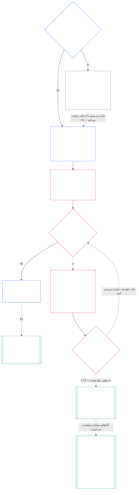

**پیش‌نویس کمک‌گرفته از هوش مصنوعی — فصل هفتم به فارسی**

**وضعیت:** پیش‌نویس کامل فصل، کمک‌گرفته از هوش مصنوعی و هنوز بازبینی‌نشده به‌دست خوانندهٔ مستقل فارسی‌زبان؛ ویرایش منبع `SC-Corpus-2026.10.21`. متن شماره‌دار انگلیسی همچنان منبع الزام‌آور است. هیچ گواهی بازبینی تغییر نکرده است.

**دامنهٔ این پیش‌نویس:** فصل هفتم، §§۱–۷، همراه با راهنمای جایگاه در پیکره و راهنمای خواندن. پیوندهای نسبی برای مسیر نهایی `translations/fa/core_07_charters.md` در نظر گرفته شده‌اند و تا پیش از انتقال به آن مسیر ممکن است کار نکنند.

# فصل هفتم: منشورهای سیستم و نهادی

<strong>جایگاه در پیکره (غیرعملیاتی): ساختار فایل و قواعد خواندن</strong>

> این فایل **بخشی از قانون اساسی حساس‌مندان** است و فقط **همراه با** فایل‌های شماره‌دار دیگر `core_*` که به‌صورت یک متن واحد خوانده می‌شوند الزام‌آور است. این فایل **فصل هفتم** را دربرمی‌گیرد: حداقل محتوای اسناد منتشرشده‌ای که دامنهٔ سیستم یا نهاد را تعیین می‌کنند، یعنی منشور سیستم و منشور نهادی. پس از کف حقوق فصل شش می‌آید و پیش از [فصل هشت](../../core_08.000_functional_independence_separation_of_duties.md#chapter-eight-functional-independence-and-separation-of-duties) قرار می‌گیرد که جایگاه‌ها را در هر عمل الزام‌آور مادی از هم جدا می‌کند.
>
> - **مالکیت قانون اساسی:** زمان لزوم انتشار منشور سیستم برای سیستم و منشور نهادی برای نهاد (الزامی از طبقهٔ L به بالا و داوطلبانه در طبقهٔ P)، حداقل محتوای هرکدام، شیوهٔ تغییر و بازبینی آن‌ها و کنترل تشکیل برای احراز صلاحیت و اصالت دارندگان منصب‌های مشمول.
> - **مرجع تعریف‌ها:** [منشور سیستم](../../core_05.040_band_continuity.md#system-charter)، [منشور نهادی](../../core_05.040_band_continuity.md#institutional-charter)، [نقشهٔ نقش‌های منشور](../../core_05.040_band_continuity.md#charter-role-map)، [طرف منشوردار](../../core_05.040_band_continuity.md#chartered-party) و [طرف عملیاتی](../../core_05.050_band_oversight.md#operating-party) در فصل پنج تعریف شده‌اند. این فصل آن‌ها را به کار می‌گیرد و از نو تعریف نمی‌کند.
> - **مالکیت اجرایی:** [CI-8.205 §۶](../../corpus_institutions/ci_08.205_institutional_design_separation_of_powers.md#ci-8205-6-system-and-institutional-charter-contents-review-and-formation-template) (*محتوای منشور سیستم و نهادی، بازبینی و الگوی تشکیل*) الگوی کامل فیلدها، سیاههٔ بازبینی، روش تشکیل و الگوی بیانیهٔ کنترل تشکیل را دارد. می‌تواند سخت‌گیرانه‌تر باشد و فیلدهایی بیفزاید، اما نمی‌تواند این فصل را محدودتر کند. متن آن فقط در دامنهٔ پذیرش معتبر، به‌عنوان متن اجراییِ گنجانده‌شده الزام‌آور است ([فصل هجده §۴ چارچوب پذیرش و دامنهٔ اختیار](../../core_18.000_incorporation.md#4-adoption-framing-and-scope-of-authority))؛ حداقل این فصل به‌عنوان متن اصلی الزام‌آور است.
> - **بهره‌برداران پایین‌دستی:** [فصل هشت §۵ انتصاب منتشرشده، جای خالی و جانشینی](../../core_08.000_functional_independence_separation_of_duties.md#5-published-placement-vacancy-and-substitution) داشتن نقشهٔ نقش‌های منشور را الزامی می‌کند. فصل نه دامنه و مرزها را از روی منشور سیستم می‌سنجد و بخش د آن بیانیهٔ کنترل تشکیل نهاد را بررسی می‌کند. [فصل ده §۳.۷ نگهداری سوابق و اختیار گشودن](../../core_10.000_standing_assessment.md#37-record-custody-and-opening-authority) آن را دربارهٔ سوابق احراز صلاحیت به کار می‌گیرد. [فصل سیزده §۴.۳ مجامع نهادی](../../core_13.000_forum.md#43-institutional-forums) به اختلاف‌های مربوط به منشور نهادی رسیدگی می‌کند.
>
> ترتیب خواندن: §۱ زمان لزوم منشورهای سیستم و نهادی، همراه نمودار فرایند → §۲ حق تشکیل و چهار حد محدود → §۳ محتوای لازم آن‌ها → §۴ نقشهٔ نقش‌های منشور و نگهداری سوابق احراز صلاحیت → §۵ کنترل تشکیل برای احراز صلاحیت و اصالت دارندگان منصب → §۶ پیامد مردودی دارندهٔ منصب → §۷ اصلاح، بازبینی و ناهمخوانی دامنه.

<strong>ردیابی</strong>

- بالادست:
  - [چهارگانهٔ قانون اساسی](../../core_00.000_preamble.md#constitutional-tetrad)، به‌ویژه **نظارت** و **پاسخ‌گویی**؛
  - [اهمیت مادی](../../core_00.000_preamble.md#material-stake)؛
  - [فصل یک §۱۸.۱ حکمرانی به‌مثابه ساختار مجاز](../../core_01.015_stewardship_capacity_principles.md#181-governance-as-authorized-structure) (1.015 §18.1)؛
  - [مادهٔ XI-E](../../core_06.010_rights_part_b.md#article-xi-e-institutional-formation-and-business-creation) (*تشکیل نهادی و ایجاد کسب‌وکار*).
- زیربخش‌ها: [§۱](#۱-زمان-لزوم-منشورهای-سیستم-و-نهادی)؛ [§۲](#۲-حق-تشکیل-و-چهار-حد-محدود)؛ [§۳](#۳-محتوای-لازم-منشورهای-سیستم-و-نهادی)؛ [§۴](#۴-نقشه-نقشهای-منشور-و-نگهداری-سوابق-احراز-صلاحیت)؛ [§۵](#۵-کنترل-تشکیل-احراز-صلاحیت-و-اصالت-دارندگان-منصب)؛ [§۶](#۶-وقتی-دارنده-منصب-در-کنترل-تشکیل-مردود-میشود)؛ [§۷](#۷-اصلاح-بازبینی-و-ناهمخوانی-دامنه).
- پایین‌دست: [فصل هشت](../../core_08.000_functional_independence_separation_of_duties.md#chapter-eight-functional-independence-and-separation-of-duties) (8.000)؛ [فصل نه](../../core_09.000_system_alignment_certification.md#chapter-nine-system-alignment-certification-reading-index) (9.000)؛ [فصل ده](../../core_10.000_standing_assessment.md#chapter-ten-contribution-violation-and-standing-model--measurement) (10.000)؛ [فصل سیزده](../../core_13.000_forum.md#chapter-thirteen-forums-and-jurisdiction) (13.000)؛ [فصل چهارده](../../core_14.000_governance.md#chapter-fourteen-constitutional-contract-legitimacy-authorization-and-stewardship) (14.000)؛ متن اجراییِ تعیین‌شده در بالا.
- همراه با: [سلسله‌مراتب داخلی و پشتهٔ اختیار](../../core_05.045_band_integrative.md#authority-stack-and-internal-hierarchy)؛ [مرزهای سیستم](../../core_05.040_band_continuity.md#system-boundaries)؛ [یکپارچگی مرز سیستم](../../core_05.040_band_continuity.md#system-boundary-integrity)؛ [ایجاد سیستم](../../core_05.055_band_participation.md#system-creation)؛ [ایجاد کسب‌وکار](../../core_05.055_band_participation.md#business-creation).

 

فصل هفتم مالکیت قانون اساسیِ **منشورهای سیستم، منشورهای نهادی و دامنهٔ منتشرشده** را بر عهده دارد.

سه فصل در یک زنجیره کار می‌کنند:

- **فصل هفتم (این فصل):** می‌گوید طرف منشوردار مدعی انجام چه کاری است و هنگام اقدام چه کسی می‌تواند هر جایگاه را داشته باشد.
- **[فصل هشت](../../core_08.000_functional_independence_separation_of_duties.md#chapter-eight-functional-independence-and-separation-of-duties):** می‌گوید آن جایگاه‌ها چگونه باید از هم جدا بمانند.
- **[فصل نه](../../core_09.000_system_alignment_certification.md#chapter-nine-system-alignment-certification-reading-index):** سیستم و جداگانه نهاد را گواهی می‌کند؛ هرکدام یک عمل الزام‌آورند که از جایگاه‌ها استفاده می‌کند و یافته‌هایش را به منشور سیستم یا نهادی بازمی‌گرداند.

فصل‌های دیگر مالک تعریف‌ها، قواعد جایگاه‌ها، قفل‌های احراز صلاحیت و قواعد تصمیمی هستند که این فصل به آن‌ها ارجاع می‌دهد. **CI-8.205 §۶** (*محتوای منشور سیستم و نهادی، بازبینی و الگوی تشکیل*) الگوی فیلدها، روش تشکیل و سیاههٔ بازبینی را دربرمی‌گیرد.

### ۱. زمان لزوم منشورهای سیستم و نهادی

<strong>ردیابی</strong>

- بالادست: [§۲](#۲-حق-تشکیل-و-چهار-حد-محدود)؛ [اهمیت مادی](../../core_00.000_preamble.md#material-stake)؛ [تناسب](../../core_05.035_band_accountability.md#proportionality)، ادعای مالکیت در آغاز فصل؛ [فصل یک §۱۸ حکمرانی تحت انضباط سرپرستی](../../core_01.015_stewardship_capacity_principles.md#18-governance-under-stewardship-discipline) (1.015 §18)؛ [نظارت](../../core_05.020_apex_oversight_leg.md#oversight-constitutional)؛ [پاسخ‌گویی](../../core_05.005_apex_accountability_leg.md#accountability).
- پایین‌دست: [§۳](#۳-محتوای-لازم-منشورهای-سیستم-و-نهادی)؛ [فصل نه، بخش الف §۲ ارزیابی طبقهٔ سیستم](../../core_09.005_system_alignment_certification_evaluation.md#2-system-class-evaluation) (9.005 §2)، دربارهٔ طبقه و عمق گواهی؛ [فصل نه، بخش د §۱۲.۱ طبقهٔ نهاد](../../core_09.020_institutional_alignment_certification.md#121-institution-class) (9.020 §12.1)؛ **CS-9.305** و **CS-9.310** (*سازوکار طبقه‌بندی سیستم*) برای فهرست طبقات.
- همراه با: **CI-8.205 §۶** (*محتوای منشور سیستم و نهادی، بازبینی و الگوی تشکیل*)؛ **CF-13.415 §۵** (*ثبت‌داران نهادی و محلی*)؛ **CI-9.210** (*تکالیف نهادی مرتبط با طبقه‌بندی*)؛ [منشور سیستم، فصل پنج](../../core_05.040_band_continuity.md#system-charter) (5.040)؛ [منشور نهادی، فصل پنج](../../core_05.040_band_continuity.md#institutional-charter) (5.040)؛ [مادهٔ XI-E](../../core_06.010_rights_part_b.md#article-xi-e-institutional-formation-and-business-creation) (*تشکیل نهادی و ایجاد کسب‌وکار*).

<strong>تعاریف · ارزیابی · رعایت</strong>

- [منشور سیستم](../../core_05.040_band_continuity.md#system-charter) · [O](../../core_05.040_band_continuity.md#system-charter) · [M](../../core_05.040_band_continuity.md#system-charter-a) · [A](../../core_05.040_band_continuity.md#system-charter-a) · [C](../../core_05.040_band_continuity.md#system-charter-c)
- [منشور نهادی](../../core_05.040_band_continuity.md#institutional-charter) · [O](../../core_05.040_band_continuity.md#institutional-charter) · [M](../../core_05.040_band_continuity.md#institutional-charter-a) · [A](../../core_05.040_band_continuity.md#institutional-charter-a) · [C](../../core_05.040_band_continuity.md#institutional-charter-c)
- [حکمرانی متناسب با طبقه‌بندی](../../core_05.050_band_oversight.md#classification-scaled-governance) · [O](../../core_05.050_band_oversight.md#classification-scaled-governance) · [M](../../core_05.050_band_oversight.md#classification-scaled-governance-a) · [A](../../core_05.050_band_oversight.md#classification-scaled-governance-a) · [C](../../core_05.050_band_oversight.md#classification-scaled-governance-c)

 

*به زبان ساده: پیش از آنکه کسی بتواند بررسی کند سیستم یا نهاد در محدوده‌اش مانده یا نه، آن محدوده باید جایی نوشته شده باشد که همه بتوانند بخوانند. سیستمی که در یکی از نه حوزهٔ [اهمیت مادی حوزه‌محور](../../core_05.050_band_oversight.md#domain-specific-materiality) برای دیگران اهمیت مادی دارد، به منشور سیستم منتشرشده نیاز دارد. نهاد، منشوری را منتشر می‌کند که با سیستم‌های زیر اداره‌اش تناسب دارد. طبقهٔ P داوطلبانه است؛ الگوی آن گروهی خیاطی است که به پناهندگان لحاف می‌دهد.*

منشور سیستم یا نهادی، دامنهٔ منتشرشدهٔ طرف منشوردار است: اینکه مدعی چه اختیاری برای انجام چه کاری است، چه کاری نمی‌کند و هنگام اقدام چه کسی هر جایگاه را دارد. جایگاه‌های فصل هشت بر اساس این دامنه تعیین می‌شوند و گواهی فصل نه آن را با عملکرد واقعی می‌سنجد. الزام انتشار به طبقه بستگی دارد: **در طبقهٔ L و بالاتر الزامی است و در طبقهٔ P داوطلبانه.** اگر انتشار الزامی باشد، منشور باید دقیق نیز نگه داشته شود.

پنج طبقهٔ اثر سیستم چارچوب مطالب زیرند، از پرپیامدترین تا کم‌پیامدترین:

- **طبقهٔ A، حیاتی برای بقا، بنیادین و بی‌جایگزین:** شکست در بازهٔ زمانی مرتبط با بقا، بدون جایگزین کارآمد، به ازدست‌رفتن شرایط بقا می‌انجامد.
- **طبقهٔ B، حیاتی، با وابستگی بالا و مهم در سطح سیستم:** وابستگان بدون آن نمی‌توانند کارکرد اصلی را حفظ کنند؛ بقا فوراً از دست نمی‌رود و هنوز می‌توان به‌موقع جایگزینی یافت.
- **طبقهٔ C، هماهنگ‌کننده، با وابستگی بالا و غیرحیاتی:** هماهنگی را در مقیاس وسیع شکل می‌دهد، اما پیش‌نیاز عملیاتی کارکرد طبقهٔ A یا B نیست.
- **طبقهٔ L، محلی، با اثر محدود و غیرحیاتی:** اثرش از واحد خصوصی فراتر می‌رود، اما محلی، جایگزین‌پذیر و مهارپذیر است.
- **طبقهٔ P، شخصی، برای استفادهٔ خصوصی، منزوی و آزمایشی:** اثرش در واحد خصوصی می‌ماند و هیچ اتکای بیرونی معناداری ایجاد نمی‌کند.

[CS-9.310 §۸](../../corpus_systems/cs_09.310_system_impact_classifications.md#cs-9310-8-system-impact-classifications) تعریف‌های کامل را دارد. طبقات A، B، C و L باید منتشر کنند و طبقهٔ P می‌تواند منتشر کند؛ [§۱.۲ طبقات مشمول](#۱۲-کدام-طبقات-مشمولاند) می‌گوید نهاد طبقه‌اش را از سیستم‌های تحت ادارهٔ خود چگونه می‌گیرد.

#### ۱.۱ چه کسی باید منتشر کند

سیستمِ طبقهٔ L یا بالاتر باید [منشور سیستم](../../core_05.040_band_continuity.md#system-charter) را منتشر و نگهداری کند. نهادِ طبقهٔ L یا بالاتر باید منشوری را که با سیستم‌های زیر اداره‌اش تناسب دارد منتشر و نگهداری کند:

| سیستم‌هایی که نهاد اداره، سرپرستی یا به‌طور مادی کنترل می‌کند | سندی که منتشر می‌کند |
| --- | --- |
| دقیقاً یک سیستم که به منشور سیستم نیاز دارد | همان منشور سیستم و هیچ سند دومی؛ نهاد را سرپرست نام می‌برد و همان سند [منشور نهادی](../../core_05.040_band_continuity.md#institutional-charter) نیز هست، پس یک سند هر دو را پوشش می‌دهد. |
| بیش از یک سیستم از این نوع | منشور نهادی؛ همهٔ منشورهای جاری آن سیستم‌ها را دربرمی‌گیرد و دلیل ادارهٔ هر سیستم مشخص را بیان می‌کند ([§۳ محتوای لازم منشورهای سیستم و نهادی](#۳-محتوای-لازم-منشورهای-سیستم-و-نهادی)). |
| هیچ سیستمی از این نوع ندارد | منشور نهادی که موارد مربوط به خود نهاد را از [§۳ محتوای لازم منشورهای سیستم و نهادی](#۳-محتوای-لازم-منشورهای-سیستم-و-نهادی) بیان می‌کند و منشور سیستمی برای درج ندارد. |

- **کسب‌وکارها و شکل‌های مشابه:** کسب‌وکار یا شکل سازمانیِ دیگر که سرپرستی می‌شود، بسته به اینکه سیستم، نهاد یا نهادی اداره‌کنندهٔ سیستم مشمول باشد، منشور سیستم یا نهادیِ لازم را منتشر می‌کند. شکل حقوقی پاسخ را عوض نمی‌کند.
- **فعالیت حرفه‌ای مشترک:** حساس‌مند یا فعالیت حرفه‌ای کوچکِ طبقهٔ L یا بالاتر که عملی نیازمند پروانه یا تأییدیه انجام می‌دهد، می‌تواند تکلیف این بخش را برای آن اعمال با پذیرفتن منشور سیستم یا نهادی و نقشهٔ نقش‌های میزبان انجام دهد:
  - **مورد پذیرفته‌شده:** با ارجاع، منشور سیستم یا نهادی و نقشهٔ نقش‌های میزبان در فعالیت حرفه‌ای مشترک؛ میزبان باید آن اعمال را پوشش دهد.
  - **اطلاعیهٔ پذیرش:** اطلاعیهٔ یک‌صفحه‌ای که **CI-14.205 §۷** (*پروانهٔ حرفه‌ای، تأییدیهٔ حرفه‌ای و فعالیت حرفه‌ای مشترک*) توصیف می‌کند.
  - **طبقه:** طبقهٔ فعالیت حرفه‌ای همان طبقه‌ای می‌ماند که اعمال خودش برایش تعیین می‌کنند.

#### ۱.۲ کدام طبقات مشمول‌اند

طبقهٔ طرف منشوردار تعیین می‌کند انتشار الزامی است یا اختیاری:

- **طبقات A، B، C و L:** الزامی؛ نمودار [§۱.۷ فرایند در یک نگاه](#۱۷-فرایند-در-یک-نگاه) فرایند آن‌ها را نشان می‌دهد.
- **طبقهٔ P:** اختیاری است تا یکی از دو رویداد آن را الزامی کند. [§۱.۳ ماهیت طبقهٔ P](#۱۳-ماهیت-طبقه-p) می‌گوید چه چیزی طرف عملیاتی را در طبقهٔ P نگه می‌دارد و [§۱.۴ منشورهای اختیاری طبقهٔ P و زمان الزامی‌شدنشان](#۱۴-منشورهای-اختیاری-طبقه-p-و-زمان-الزامیشدنشان) اختیار و پایان آن را شرح می‌دهد.
- **طبقهٔ نهاد:** نهاد، بالاترین طبقهٔ هر سیستمی را می‌گیرد که اداره، سرپرستی یا به‌طور مادی کنترل می‌کند. نهادی که چنین سیستمی ندارد، طبق اثر و وابستگی مادی واقعی خودش طبقه‌بندی می‌شود؛ معیار، تصمیم‌ها و دارایی‌های واقعی آن است نه برچسب یا شکل حقوقی‌اش، طبق [فصل نه، بخش د §۱۲.۱ طبقهٔ نهاد](../../core_09.020_institutional_alignment_certification.md#121-institution-class).

#### ۱.۳ ماهیت طبقهٔ P

طرف عملیاتی فقط تا وقتی در طبقهٔ P می‌ماند که در همهٔ نه حوزهٔ [اهمیت مادی حوزه‌محور](../../core_05.050_band_oversight.md#domain-specific-materiality) پایین‌تر از آستانه بماند؛ در عمل یعنی اعمال و اثراتش در [واحد خصوصی](../../core_05.050_band_oversight.md#domain-specific-materiality-private-unit) خودش محصور بماند:

- **عبور از آستانه:** عبور در هر حوزه، صرف‌نظر از اندازه یا نامی که طرف بر خود می‌گذارد، طبق **CS-9.305** و **CS-9.310** آن را دست‌کم به طبقهٔ L می‌رساند.
- **ماندن پایین‌تر از همهٔ آستانه‌ها:** با هر تعداد عضو، در طبقهٔ P می‌ماند.
- **افراد درون آن:** طبقهٔ P به افراد داخل آن نیز بستگی دارد. هرکس درون آن متوجه عبور طرف عملیاتی از آستانه شود وظیفهٔ گزارش دارد و گزارشش حفاظت می‌شود ([اهمیت مادی حوزه‌محور](../../core_05.050_band_oversight.md#domain-specific-materiality)).

کف چهار جایگاه فصل هشت بر اعمال طرف عملیاتیِ طبقهٔ P که در واحد خصوصی‌اش می‌مانند اعمال نمی‌شود؛ پس یک حساس‌مند با رایانه به دارندهٔ جایگاه دوم نیاز ندارد. کف از روزی اعمال می‌شود که طرف عملیاتی [عمل الزام‌آور مادی](../../core_05.035_band_accountability.md#materially-binding-act) انجام دهد که دیگران باید از آن پیروی کنند یا می‌توانند آن را قطعی فرض کنند؛ چنین عملی از آستانهٔ حوزهٔ اختیار بر دیگران می‌گذرد و طرف را دست‌کم به طبقهٔ L می‌رساند.

#### ۱.۴ منشورهای اختیاری طبقهٔ P و زمان الزامی‌شدنشان

طرف عملیاتیِ طبقهٔ P تشویق می‌شود منشور متناسب با کارش را منتشر کند: [منشور سیستم](../../core_05.040_band_continuity.md#system-charter) برای یک سیستم یا [منشور نهادی](../../core_05.040_band_continuity.md#institutional-charter) برای چند سیستم یا بدون سیستم. می‌تواند فهرست محتوا در [§۳ محتوای لازم منشورهای سیستم و نهادی](#۳-محتوای-لازم-منشورهای-سیستم-و-نهادی) و نقشهٔ جایگاه‌ها در [§۴ نقشهٔ نقش‌های منشور و نگهداری سوابق احراز صلاحیت](#۴-نقشه-نقشهای-منشور-و-نگهداری-سوابق-احراز-صلاحیت) را الگو قرار دهد. انتشار منشور هیچ تکلیفی را طبق فرایند این فصل ایجاد نمی‌کند:

- مهلت ندارد ([§۱.۵ زمان سررسید منشور سیستم یا نهادی](#۱۵-زمان-سررسید-منشور-سیستم-یا-نهادی))؛
- کنترل تشکیل ندارد ([§۵ کنترل تشکیل: احراز صلاحیت و اصالت دارندگان منصب](#۵-کنترل-تشکیل-احراز-صلاحیت-و-اصالت-دارندگان-منصب))؛
- [نقشهٔ نقش‌های منشور](../../core_05.040_band_continuity.md#charter-role-map) الزامی نیست ([§۴](#۴-نقشه-نقشهای-منشور-و-نگهداری-سوابق-احراز-صلاحیت))، هرچند می‌تواند آن را همراه منشور داوطلبانه نگه دارد یا جداگانه منتشر کند؛ و
- چرخهٔ الزامی اصلاح یا بازبینی ندارد ([§۷ اصلاح، بازبینی و ناهمخوانی دامنه](#۷-اصلاح-بازبینی-و-ناهمخوانی-دامنه)).

اگر یکی از این دو رویداد رخ دهد، انتشار دیگر اختیاری نیست:

- طرف عملیاتی دوباره در طبقهٔ L یا بالاتر طبقه‌بندی شود؛ یا
- اپراتورش رعایت قانون اساسی را از طرف عملیاتی ادعا کند.

طرف عملیاتی باید سپس منشور سیستم یا نهادیِ متناسب با خود را طبق برنامهٔ [§۱.۵ زمان سررسید منشور سیستم یا نهادی](#۱۵-زمان-سررسید-منشور-سیستم-یا-نهادی) منتشر کند.

**به‌رسمیت‌شناختن به سند دامنه وابسته نیست.** گروهی با هر طبقه، چه منشور سیستم یا نهادی داشته باشد چه نداشته باشد، میان اعضایش و به‌رسمیت‌شناختن آن‌ها مانع نمی‌شود. هر عضو می‌تواند به‌عنوان مدعی فردی سابقهٔ مشارکت بخواهد، برای کاری که درون یا بیرون گروه انجام داده است؛ سابقه دربارهٔ مشارکت عضو است، نه احراز صلاحیت گروه ([فصل ده §۳.۷ سوابق غیررسمی و دامنهٔ کوچک](../../core_10.000_standing_assessment.md#37-informal-and-small-scope-records)). کمک، کالا، نیروی کار یا خدماتی که هیچ‌کس ملزم به پذیرفتنش نیست، عمل الزام‌آور مادی نیست؛ بنابراین گروه خیریه‌ای که به پناهندگان لحاف می‌دهد برای به‌رسمیت‌شناختن اعضایش به منشور سیستم یا نهادی نیاز ندارد.

#### ۱.۵ زمان سررسید منشور سیستم یا نهادی

سیستم یا نهاد مشمول، [منشور سیستم](../../core_05.040_band_continuity.md#system-charter) یا [منشور نهادی](../../core_05.040_band_continuity.md#institutional-charter) خود را طبق این برنامه منتشر می‌کند:

- **سیستم یا نهاد تازه:** پیش از آغاز فعالیت یا شروع اعمال اختیار بر دیگران.
- **واحدی که هم‌اکنون فعال است:** در بازبینی بعدی طبقه‌بندی یا گواهی، یا در مهلت حل‌وفصل پس از درخواست طبق [§۱.۶ نبود منشور سیستم یا نهادی](#۱۶-اگر-منشور-سیستم-یا-نهادی-مفقود-باشد)، هرکدام زودتر باشد. تا آن زمان تخلف از مهلت است.
  - **کدام گواهی:** برای سیستم، گواهی همسویی سیستم؛ برای نهاد، گواهی همسویی نهادی طبق [فصل نه، بخش د §۱۱.۳ بدون اجازه و بدون دروازه](../../core_09.020_institutional_alignment_certification.md#113-no-permission-and-no-gate). مهلت گواهی نخست هرگز شرط انتشار منشور نهادی یا فعالیت نیست.
- **کنترل تشکیل:** هم‌زمان کنترل تشکیل [§۵ احراز صلاحیت و اصالت دارندگان منصب](#۵-کنترل-تشکیل-احراز-صلاحیت-و-اصالت-دارندگان-منصب) را نیز کامل می‌کند.
- **محل ثبت:** منشور سیستم یا نهادی، نقشهٔ نقش‌های منشور و بیانیهٔ کنترل تشکیل را نزد ثبت‌دار نهادی می‌گذارد؛ اگر فعالیت و حساس‌مندان متأثر محلی باشند، نزد ثبت‌دار محلی (**CF-13.415 §۵** *ثبت‌داران نهادی و محلی*):
  - **کار ثبت‌دار:** بررسی می‌کند مورد الزامی جا نمانده باشد و رسید تاریخ‌دار می‌دهد.
  - **کاری که ثبت‌دار هرگز نمی‌کند:** اجازه صادر نمی‌کند و دربارهٔ طبقه یا محتوا حکم نمی‌دهد.
  - **رسید دیرهنگام یا مفقود:** هرگز مانع فعالیت طرف منشوردار نمی‌شود.

#### ۱.۶ اگر منشور سیستم یا نهادی مفقود باشد

هرکس متوجه طرف منشوردارِ طبقهٔ L یا بالاتر شود که تازه تشکیل شده یا تازه به این طبقه رسیده و منشورش را منتشر نکرده، می‌تواند از مرجع راهبری آن بخواهد منشور را ارائه کند. درخواست‌کننده لازم نیست احراز صلاحیت داشته باشد، هزینه‌ای نمی‌پردازد و نیازی به نشان‌دادن آسیب ندارد. درخواست، طرف منشوردار را نام می‌برد و می‌گوید چرا ظاهراً مشمول است.

از زمان درخواست دو مهلت آغاز می‌شود: مهلت پاسخ و مهلت حل‌وفصل. طول هرکدام از رده‌ای هم‌حرف با طبقهٔ طرف منشوردار گرفته می‌شود؛ بنابراین هرچه طبقه حیاتی‌تر باشد، مهلت کوتاه‌تر است:

| طبقه و رده | مهلت پاسخ (هدف پذیرش) | مهلت حل‌وفصل (حد نهایی) |
| --- | --- | --- |
| طبقهٔ A، ردهٔ A | ۲۴ ساعت | ۷ روز تقویمی |
| طبقهٔ B، ردهٔ B | ۲ روز تقویمی | ۱۴ روز تقویمی |
| طبقهٔ C، ردهٔ C | ۴ روز تقویمی | ۳۰ روز تقویمی |
| طبقهٔ L، ردهٔ L | ۸ روز تقویمی | ۶۰ روز تقویمی |

این اعداد از **CF-13.445 §۳.۱** (*هدف‌های مرحله‌ای و کف‌های زمانی*) می‌آیند و اگر تفاوتی باشد همان سند حاکم است. اگر طرف منشوردار به طبقه‌اش اعتراض کند، تا حل‌وفصل پرسش، در ردهٔ حیاتی‌ترِ طبقهٔ ثبت‌شده در سابقهٔ طبقه‌بندی سیستم یا هر طبقه‌ای شمرده می‌شود که درخواست‌کننده یا مجمع بر مبنای ظاهری نشان دهد. طرف منشورداری که طبقه‌ای در سابقه ندارد یا طبقهٔ P دارد و طبقه‌اش محل اختلاف است، در ردهٔ C شمرده می‌شود.

مهلت‌ها چنین اجرا می‌شوند:

- **مهلت پاسخ:** طرف منشوردار در مهلت پاسخ، یعنی هدف پذیرش ردهٔ متناظر طبق **CF-13.445 §۳.۱**، از زمان درخواست پاسخ می‌دهد. منشور سیستم یا نهادی را منتشر می‌کند، تاریخ انتشار را می‌گوید، به منشور منتشرشده ارجاع می‌دهد، یا پاسخ می‌دهد که در همهٔ حوزه‌های [اهمیت مادی حوزه‌محور](../../core_05.050_band_oversight.md#domain-specific-materiality) پایین‌تر از آستانه است و شواهد کتبیِ لازم برای آن مدخل را ارائه می‌کند.
- **مهلت حل‌وفصل:** منشور سیستم یا نهادی باید در مهلت حل‌وفصل ــ حد نهایی ردهٔ متناظر در **CF-13.445 §۳.۱**، از تاریخ درخواست ــ به همراه بیانیهٔ کنترل تشکیلِ مربوط منتشر شود ([§۵ احراز صلاحیت و اصالت دارندگان منصب](#۵-کنترل-تشکیل-احراز-صلاحیت-و-اصالت-دارندگان-منصب)). طرف منشورداری که هنوز جایگاه مستقل ندارد، طبق همان بخش بیانیه را همراه شواهدش به‌صورت اقرارنامه ثبت می‌کند.
- **طرف عملیاتی‌ای که می‌گوید پایین‌تر از آستانه است:** درخواست همچنین اعتراض به طبقه‌بندی از مسیر *مسیر اعتراض* همان مدخل محسوب می‌شود:
  - **ادامهٔ مهلت:** تا وقتی اعتراض در جریان است مهلت حل‌وفصل ادامه دارد.
  - **تمدید برای اعتراض:** اگر مجمع دارای صلاحیت تشخیص دهد اعتراض شایستهٔ بازبینی است، موعد تمدید می‌شود و با تصمیم دربارهٔ اعتراض، مهلت حل‌وفصل تازه‌ای آغاز می‌شود. مجمع اعتراض را در حد نهایی ردهٔ متناظر تعیین می‌کند.
  - **معیار شایستگی بازبینی:** اعتراض باید عبور مشخصی در حوزه‌ای نام‌برده کند و شواهد کتبی طرف عملیاتی پرسشی واقعی دربارهٔ آن عبور باقی بگذارد. طرف عملیاتی این را برای خودش تعیین نمی‌کند و پاسخی که شواهد کتبی ندهد موعد را تمدید نمی‌کند.
  - **اگر طبقه‌ای تعیین شود:** در نتیجهٔ آن اعتراض یا هر اعتراض دیگری، تاریخ یافته تاریخ درخواست محسوب می‌شود؛ مهلت پاسخ و حل‌وفصل از همان روز و بر پایهٔ ردهٔ طبقهٔ تعیین‌شده (A، B، C یا L) آغاز می‌شوند.
- **اگر مهلت بگذرد:** ندادن پاسخ یا منتشرنکردن منشور تا موعد، نقصی است که باید ثبت و اصلاح شود. درخواست‌کننده می‌تواند از همان مسیر موضوع را به مجمع دارای صلاحیت ببرد. این امر هرگز شرط تشکیل یا فعالیت نیست.
- **درخواست تکراری:** درخواست دوم دربارهٔ همان طرف منشوردار، درحالی‌که پاسخ قبلی یا یافتهٔ مربوط به آن هنوز معتبر است، مهلت تازه‌ای برای پاسخ یا حل‌وفصل آغاز نمی‌کند. طرف منشوردار به همان پاسخ یا یافته ارجاع می‌دهد. ادعای خود طرف مبنی بر پایین‌بودن از همهٔ آستانه‌ها که مجمع هنوز بررسی نکرده، پاسخ معتبر محسوب نمی‌شود. پاسخ یا یافته تا یکی از محرک‌های بازگشایی [فصل نه، بخش د §۱۴.۲](../../core_09.020_institutional_alignment_certification.md#142-reopening-triggers) برقرار می‌ماند:
  - **تغییر مادی:** فعالیت طرف منشوردار به‌طور مادی تغییر کند.
  - **شواهد تازه:** شواهد تازه‌ای دربارهٔ عبور از آستانه ارائه شود.

  درخواستی که یکی از موارد بالا را نشان دهد تکراری نیست؛ درخواست تازه‌ای است که جداگانه و مستقل از قبلی رسیدگی می‌شود. مهلت پاسخ و حل‌وفصل خودش را از تاریخ خودش دارد؛ پاسخ، یافته و مهلت‌های قبلی نه آن را برآورده می‌کنند و نه تغییر می‌دهند.
- **دامنه تا آن زمان:** نبود منشور سیستم یا نهادی به معنای نامحدودبودن طرف منشوردار نیست. تا انتشار آن، مرزهای واقعی [سیستم](../../core_05.040_band_continuity.md#system-boundaries) و طبقهٔ طرف حاکم‌اند؛ گواهی یا مجمع می‌تواند دامنه را از عملکرد مشاهده‌شده بازسازی کند.

#### ۱.۷ فرایند در یک نگاه

نمودار یک طرف عملیاتی را از این پرسش که آیا برای دیگران اهمیت مادی دارد یا نه، تا انتشار منشور سیستم یا نهادی و دقیق نگه‌داشتن آن دنبال می‌کند. اگر مشکلی در مهلت حل‌وفصل رفع نشود، فرایند منشوردهی آن را به بازبینی‌ای ارجاع می‌دهد که بیرون از این فصل پوشش داده شده است. بخش‌های بعدی هر گام را به همین ترتیب توضیح می‌دهند.

<strong>راهنمای خواننده (غیرعملیاتی): خواندن نمودار</strong>

> به زبان ساده: هیچ‌کس منشور سیستم یا نهادی اعطا نمی‌کند و برای تشکیل اجازه لازم نیست. طرف منشورداری که فعالیتش برای دیگران اهمیت مادی دارد، اختیاری را که مدعی است دارد و دارندگان جایگاه‌ها را منتشر می‌کند و دارندگان منصب‌های کلیدی بررسی می‌شوند. دارندهٔ مردود جایگزین می‌شود یا علت اصلاح می‌شود و طرف منشوردار ادامه می‌دهد. اگر شکست تا پایان مهلت حل‌وفصل رفع نشود، مجمع می‌تواند طرف را با سبک‌ترین گامی که از دیگران حفاظت کند بازبینی کند. کوچک‌کردن طرف به کمتر از طبقهٔ L یا انحلال فقط وقتی مطرح می‌شود که گام‌های سبک‌تر کافی نباشند. طرف منشوردار منحل‌شده تا زمان برقراری قفل نمی‌تواند بازگردد.
>
> پیکان‌های پیوسته مسیر اصلی‌اند. پیکان‌های نقطه‌چین استثناها و ارجاع‌ها هستند و بخشی را که مجازشان می‌کند نشان می‌دهند. کادرهای دارای دو خط کناری به فصل دیگری یا متن اجراییِ پذیرفته‌شده تعلق دارند. نمودار تکلیف، جایگاه یا فیلدی نمی‌افزاید و هیچ گامی در آن اعطای اجازه نیست.

 

### ۲. حق تشکیل و چهار حد محدود

<strong>راهنمای خواننده (غیرعملیاتی): ساختار این بخش</strong>

- [§۲.۱ حق تشکیل](#۲۱-حق-تشکیل) این حق و موارد خارج از شمول آن را بیان می‌کند.
- [§۲.۲ حد نخست: قفل فعال بر یک حساس‌مند](#۲۲-حد-نخست-قفل-فعال-بر-یک-حساسمند) می‌گوید قفل چگونه یک حساس‌مند نام‌برده را از یک منصب کنترلی کنار می‌گذارد.
- [§۲.۳ حد دوم: توقف کوتاه بر پایهٔ واقعیت‌های مشخص و تأییدشده](#۲۳-حد-دوم-توقف-کوتاه-بر-پایه-واقعیتهای-مشخص-و-تأییدشده) می‌گوید توقف کوتاه چگونه می‌تواند یک حساس‌مند نام‌برده را از یک منصب کنترلی کنار بگذارد.
- [§۲.۴ حد سوم: قفل بر خود طرف عملیاتی](#۲۴-حد-سوم-قفل-بر-خود-طرف-عملیاتی) می‌گوید قفل چگونه طرف عملیاتی و جانشینان آن را منع می‌کند و چرا طرف منشوردار منحل‌شده نمی‌تواند بازگردد.
- [§۲.۵ حد چهارم: پروانه یا تأییدیهٔ حرفه‌ای](#۲۵-حد-چهارم-پروانه-یا-تأییدیه-حرفهای) می‌گوید چه زمانی یک عمل پرخطرِ مشخص به پروانه یا تأییدیه نیاز دارد؛ این حد دروازه‌ای برای تشکیل نیست.

<strong>ردیابی</strong>

- بالادست: [§۱](#۱-زمان-لزوم-منشورهای-سیستم-و-نهادی)؛ [مادهٔ XI-E](../../core_06.010_rights_part_b.md#article-xi-e-institutional-formation-and-business-creation) (*تشکیل نهادی و ایجاد کسب‌وکار*).
- پایین‌دست: [§۱ زمان لزوم منشورهای سیستم و نهادی](#۱-زمان-لزوم-منشورهای-سیستم-و-نهادی)؛ [§۵ کنترل تشکیل: احراز صلاحیت و اصالت دارندگان منصب](#۵-کنترل-تشکیل-احراز-صلاحیت-و-اصالت-دارندگان-منصب).
- همراه با: [توقف موقت](../../core_05.035_band_accountability.md#interim-hold)؛ [فصل یازده §۴.۲ پیشگیری ـ قفل‌های عمومی احراز صلاحیت](../../core_11.000_standing_integration.md#42-prevention--general-standing-locks) (11.000 §4.2)؛ [فصل یازده §۵.۵ قفل‌های ویژه](../../core_11.000_standing_integration.md#55-special-locks) (11.000 §5.5)؛ [فصل سیزده §۵ توقف موقت در مسیر یک حساس‌مند نام‌برده](../../core_13.000_forum.md#interim-hold-on-a-named-sentients-pathway) (13.000 §5).

 

*به زبان ساده: برای تشکیل سیستم، نهاد یا کسب‌وکار به اجازهٔ کسی نیاز ندارید. چهار حد محدود ممکن است اعمال شود. سه مورد دروازه‌اند: قفل حل‌نشده می‌تواند یک حساس‌مند را از یک منصب کنترلی کنار بگذارد؛ توقف کوتاه بر پایهٔ واقعیت‌های مشخص و تأییدشده نیز چنین می‌کند؛ و قفل بر خود طرف عملیاتی می‌تواند آن را منع کند. حد چهارم ممکن است پیش از انجام عمل پرخطرِ نام‌برده پروانه یا تأییدیه بخواهد. طرف منشورداری که مجمع منحل کرده حق بازگشت ندارد؛ اگر انحلال بر رفتار ضدقانون اساسیِ گسترده یا آسیب جدیِ جبران‌نشده و برگشت‌ناپذیر استوار بوده باشد، منع دائمی است. هیچ‌یک مانع تشکیل یا فعالیت طرف عملیاتی تازه نمی‌شود و این فصل نیز حد دیگری نمی‌افزاید.*

**مادهٔ XI-E** (*تشکیل نهادی و ایجاد کسب‌وکار*) چهار حد محدود را اجازه می‌دهد:

- **فقط سه مورد نخست دروازه‌اند**: تنها موانع تشکیل طرف عملیاتی یا داشتن اختیار در آن هستند. هرکدام به موضوعی نام‌برده مربوط می‌شوند:
  - **قفل فعال** ([§۲.۲ حد نخست: قفل فعال بر یک حساس‌مند](#۲۲-حد-نخست-قفل-فعال-بر-یک-حساسمند)) به حساس‌مند نام‌برده در یک منصبِ کنترل‌کنندهٔ طرف منشوردار مربوط است.
  - **توقف موقت** ([§۲.۳ حد دوم: توقف کوتاه بر پایهٔ واقعیت‌های مشخص و تأییدشده](#۲۳-حد-دوم-توقف-کوتاه-بر-پایه-واقعیتهای-مشخص-و-تأییدشده)) فقط به یک حساس‌مند نام‌برده در یک منصبِ کنترل‌کنندهٔ طرف منشوردار مربوط است.
  - **قفل بر خود طرف عملیاتی** ([§۲.۴ حد سوم: قفل بر خود طرف عملیاتی](#۲۴-حد-سوم-قفل-بر-خود-طرف-عملیاتی)) به طرف منشورداری مربوط است که خود زیر قفل باشد، ازجمله طرفی که مجمع منحل کرده است.
- **حد چهارم دروازه نیست:** پروانه یا تأییدیهٔ حرفه‌ای است ([§۲.۵ حد چهارم: پروانه یا تأییدیهٔ حرفه‌ای](#۲۵-حد-چهارم-پروانه-یا-تأییدیه-حرفهای)).

#### ۲.۱ حق تشکیل

هرکس می‌تواند سیستم، نهاد یا کسب‌وکار تازه‌ای تشکیل دهد. این حق در [مادهٔ XI-E](../../core_06.010_rights_part_b.md#article-xi-e-institutional-formation-and-business-creation) (*تشکیل نهادی و ایجاد کسب‌وکار*) آمده است. این فصل تکلیف پس از آن را می‌افزاید: هرگاه کار طرف عملیاتی در یکی از نه حوزهٔ [اهمیت مادیِ حوزه‌محور](../../core_05.050_band_oversight.md#domain-specific-materiality) برای دیگران مادی باشد، باید از پیش و به‌صورت عمومی اختیاری را که مدعی است دارد اعلام کند ([§۱ زمان لزوم منشورهای سیستم و نهادی](#۱-زمان-لزوم-منشورهای-سیستم-و-نهادی)). تصویب منشور سیستم یا نهادی نباید به‌گونه‌ای تفسیر شود که این حق یا هیچ‌یک از حمایت‌های کف حقوق را محدود کند.

**حق تشکیل شامل چه کسانی نمی‌شود.** جز سه دروازهٔ [§۲.۲ قفل فعال بر یک حساس‌مند](#۲۲-حد-نخست-قفل-فعال-بر-یک-حساسمند)، [§۲.۳ توقف کوتاه بر پایهٔ واقعیت‌های مشخص و تأییدشده](#۲۳-حد-دوم-توقف-کوتاه-بر-پایه-واقعیتهای-مشخص-و-تأییدشده) و [§۲.۴ قفل بر خود طرف عملیاتی](#۲۴-حد-سوم-قفل-بر-خود-طرف-عملیاتی)، **مادهٔ XI-E** (*تشکیل نهادی و ایجاد کسب‌وکار*) از این موارد حمایت نمی‌کند:

- طرف عملیاتی‌ای که برای نقض محدودیت قانون اساسی، تضعیف ایمنی یا حقیقت، یا تمرکز قدرت به شیوه‌ای طراحی شده باشد که [فصل یک §۱۱ ساختار بازار](../../core_01.005_values_principles.md#11-market-structure) منع می‌کند؛ یا
- طرف عملیاتی‌ای که بنیان‌گذارش، طبق رفتار، کنترل و پاداش‌های تأییدشده، واقعاً با هدف اعلام‌شدهٔ آن همسو نباشد، یا قصد داشته باشد دیگران را دربارهٔ هدف، کنترل یا منافعش گمراه کند یا به آن‌ها آسیب برساند.

مجامع این موارد را طبق همان ماده تعیین می‌کنند؛ تنها پیامدها همان سه دروازه‌اند: قفل فعال، توقف موقت و قفل بر خود طرف عملیاتی. کنترل تشکیل ناموفق یکی از شواهدی است که مجمع می‌سنجد؛ یعنی کنترل تشکیل به‌تنهایی پرونده را فیصله نمی‌دهد.

#### ۲.۲ حد نخست: قفل فعال بر یک حساس‌مند

[قفل احراز صلاحیت](../../core_11.000_standing_integration.md#42-prevention--general-standing-locks) یا [قفل ویژه](../../core_11.000_standing_integration.md#55-special-locks) که پس از تخلف تأییدشده وضع شده و هنوز برداشته نشده است، یک حساس‌مند نام‌برده را از داشتن اختیار بر این نوع نهاد یا کسب‌وکار منع می‌کند.

- **مورد ممنوع:** گرفتن یا اعمال اختیار راهبری، کنترل یا مالکیت در طرف عملیاتی.
- **دامنه:** فقط تا همان حدی که قفل تعیین کرده؛ با برداشتن یا محدودشدن قفل پایان می‌یابد.
- **قفل بر خود طرف عملیاتی:** بنگرید به [§۲.۴ حد سوم: قفل بر خود طرف عملیاتی](#۲۴-حد-سوم-قفل-بر-خود-طرف-عملیاتی).

#### ۲.۳ حد دوم: توقف کوتاه بر پایهٔ واقعیت‌های مشخص و تأییدشده

این حد وقتی اعمال می‌شود که مجمع دارای صلاحیت بر اساس واقعیت‌های مشخص و تأییدشده‌ای که نشان می‌دهند به احتمال بیشتر از خلاف، دارنده با هدف اعلام‌شدهٔ طرف منشوردار همسو نیست، [توقف موقت](../../core_05.035_band_accountability.md#interim-hold) صادر کرده باشد. فقط همان مجمع می‌تواند آن را صادر کند ([فصل سیزده §۵ توقف موقت در مسیر یک حساس‌مند نام‌برده](../../core_13.000_forum.md#interim-hold-on-a-named-sentients-pathway)). طرف منشوردار نمی‌تواند خودش کسی را از منصب کنار بگذارد، چون در آن صورت داور عضو خودش می‌شود. مبنای کامل همان است که [فصل سیزده §۵](../../core_13.000_forum.md#interim-hold-on-a-named-sentients-pathway) بیان می‌کند؛ این صورت کوتاه جایگزین آن نیست.

#### ۲.۴ حد سوم: قفل بر خود طرف عملیاتی

قفل می‌تواند بر خود طرف عملیاتی اعمال شود، نه فقط بر یک حساس‌مند. در این صورت، دروازه مواردی را که مسیر نام‌بردهٔ قفل تعیین می‌کند، در همان طرف عملیاتی و جانشینان، نهادهای تحت کنترل و ابزارهای در اختیار نامزد یا شرکت پوششی آن منع می‌کند؛ هیچ طرف عملیاتی دیگری را منع نمی‌کند.

- **قفل ناشی از تعیین نهایی:** [قفل امانی ضدقانون اساسی](../../core_11.000_standing_integration.md#55-special-locks) چنین اثری دارد اگر تعیین نهایی نهادی، ابزار جانشین یا نهادی تحت کنترل را نام ببرد. دروازه موارد مشخص‌شده در مسیر قفل را در طرف منشوردار و جانشینان، نهادهای تحت کنترل و ابزارهای در اختیار نامزد یا شرکت پوششی آن منع می‌کند.
- **طرف منشوردار منحل‌شده:** حکم نهایی انحلال طبق **CI-11.210 §۴** (*انحلال*) [قفل بازتشکیل پس از انحلال](../../core_11.000_standing_integration.md#55-special-locks) را وضع می‌کند. تا زمانی که قفل برقرار است، طرف منشوردار منحل‌شده، جانشینان، نهادهای تحت کنترل، ابزارهای در اختیار نامزد یا شرکت پوششی و هر طرف عملیاتی که با آن‌ها یک عملیات واحد باشد، با هیچ نام یا شکلی نمی‌تواند دوباره تشکیل، احیا یا اداره شود. اگر حکم رفتار ضدقانون اساسیِ فراگیر یا آسیب جبران‌نشدهٔ برگشت‌ناپذیر را احراز کند ([فصل یازده §۸ اعاده و ارزیابی مجدد](../../core_11.000_standing_integration.md#8-restoration-and-reassessment))، قفل دائمی است: گذر زمان، رفع علت یا تغییر دارندگان آن را برنمی‌دارد؛ فقط لغو حکم انحلال پس از بازبینی یا واقعیت‌های تازهٔ مادی و تأییدشده‌ای که نادرستی یافته را نشان دهند آن را پایان می‌دهند. در غیر این صورت، قفل زمانی پایان می‌یابد که مستقلاً احراز شود علت رفع شده، جبران انجام گرفته و بازگشت از ادامهٔ محرومیت امن‌تر است. این قفل هیچ حساس‌مندی را از تشکیل طرف عملیاتی دیگری منع نمی‌کند.

هیچ‌یک از سه دروازه مانع تشکیل طرف عملیاتی جدید، انتشار منشور سیستم یا نهادی آن، یا آغاز فعالیتش نمی‌شود. فقط طرفی متوقف می‌شود که خود زیر قفل باشد؛ مانند طرف منشوردار منحل‌شده‌ای که می‌کوشد بازگردد. سه دروازه در [§۵ کنترل تشکیل: احراز صلاحیت و اصالت دارندگان منصب](#۵-کنترل-تشکیل-احراز-صلاحیت-و-اصالت-دارندگان-منصب) اعمال می‌شوند.

#### ۲.۵ حد چهارم: پروانه یا تأییدیهٔ حرفه‌ای

حد چهارم بر عمل نام‌برده اعمال می‌شود، نه بر تشکیل طرف عملیاتی:

- **دروازهٔ تشکیل نیست:** کنترل تشکیل در [§۵ کنترل تشکیل: احراز صلاحیت و اصالت دارندگان منصب](#۵-کنترل-تشکیل-احراز-صلاحیت-و-اصالت-دارندگان-منصب) آن را اعمال نمی‌کند.
- **ماهیت آن:** [تأییدیهٔ صلاحیت](../../core_05.035_band_accountability.md#competency-clearance) که مادهٔ XI-E اجازه می‌دهد پذیرنده پیش از انجام عمل نام‌برده برای دیگران، بر پایهٔ یافتهٔ خطرِ منتشرشده از مجمع فنی، مطالبه کند.
  - **پروانهٔ حرفه‌ای:** برای عملی لازم است که اگر بد انجام شود خطر آسیب جدی یا برگشت‌ناپذیر دارد.
  - **تأییدیهٔ حرفه‌ای:** برای عملی لازم است که اگر بد انجام شود خطر آسیب واقعی اما کمتر دارد.
- **آنچه به آن مربوط است:** انجام خودِ عمل. هرگز مانع تشکیل طرف عملیاتی، انتشار منشور سیستم یا نهادی یا فعالیت آن نمی‌شود.
- **آنچه منع می‌کند:** ادعا یا انجام عمل بدون پروانه یا تأییدیه. منشور سیستم یا نهادی نمی‌تواند آن عمل را در دامنهٔ خود بداند مگر دارندهٔ آن را انجام دهد ([§۳ محتوای لازم منشورهای سیستم و نهادی](#۳-محتوای-لازم-منشورهای-سیستم-و-نهادی)).

### ۳. محتوای لازم منشورهای سیستم و نهادی

<strong>راهنمای خواننده (غیرعملیاتی): ساختار این بخش</strong>

- [§۳.۱ محتوای منشور سیستم](#۳۱-محتوای-منشور-سیستم) نه مورد را فهرست می‌کند.
- [§۳.۲ ارجاع‌های منشور](#۳۲-ارجاعهای-منشور) می‌گوید منشور سیستم یا نهادی می‌تواند به‌جای رونویسی، به سند منتشرشدهٔ دیگری ارجاع دهد و چه چیزی ارجاع را معتبر می‌کند.
- [§۳.۳ افزوده‌های منشور نهادی](#۳۳-افزودههای-منشور-نهادی) محتوای منشور نهادی فراتر از نه مورد را پوشش می‌دهد: منشور سیستم‌های تحت ادارهٔ نهاد و دلیل ادارهٔ آن‌ها.
- [§۳.۴ اعمال نیازمند پروانه یا تأییدیهٔ حرفه‌ای](#۳۴-اعمال-نیازمند-پروانه-یا-تأییدیه-حرفهای) می‌گوید منشور فقط وقتی می‌تواند چنین عملی را در دامنهٔ خود بداند که همهٔ حساس‌مندانی که آن را انجام می‌دهند پروانه یا تأییدیه داشته باشند، یا زیر نظر سرپرستی که دارد در حال یادگیری باشند؛ تا آن زمان عمل در مورد ۴ [§۳.۱](#۳۱-محتوای-منشور-سیستم) خارج از دامنه است.
- [§۳.۵ مقیاس‌بندی](#۳۵-مقیاسبندی) می‌گوید چه چیزهایی با طبقه تغییر می‌کنند.

<strong>ردیابی</strong>

- بالادست: [§۱](#۱-زمان-لزوم-منشورهای-سیستم-و-نهادی)؛ [منشور سیستم در فصل پنج](../../core_05.040_band_continuity.md#system-charter) (5.040)؛ [منشور نهادی در فصل پنج](../../core_05.040_band_continuity.md#institutional-charter) (5.040).
- پایین‌دست: [§۴](#۴-نقشه-نقشهای-منشور-و-نگهداری-سوابق-احراز-صلاحیت)؛ [§۷](#۷-اصلاح-بازبینی-و-ناهمخوانی-دامنه)؛ [فصل نه، بخش ب §۸.۱ حداقل محتوای سابقه](../../core_09.010_system_alignment_certification_record_process.md#81-minimum-record-contents) (9.010 §8.1)، دربارهٔ فیلدهای منشور سیستم که سابقهٔ گواهی به آن‌ها متکی است؛ **CI-8.205 §۶** (*محتوای منشور سیستم و نهادی، بازبینی و الگوی تشکیل*) برای فهرست کامل فیلدها.
- همراه با: [فصل هجده §۴ چارچوب پذیرش و دامنهٔ اختیار](../../core_18.000_incorporation.md#4-adoption-framing-and-scope-of-authority) (18.000 §4)، دربارهٔ سند دامنه‌ای که با نامی دیگر نگهداری می‌شود؛ [فصل چهارده §۴.۳ الزامات تصمیم برای انتخاب الزام‌آور ذی‌نفعان](../../core_14.000_governance.md#43-decision-resolution-requirements-for-binding-stakeholder-choice)؛ **CI-6.205 §۱** (*یکپارچگی نظارت ذی‌نفعان، اطلاع‌رسانی و مسیر حکمرانی الزام‌آور*)؛ **CI-6.205 §۲** (*تدابیر ضدتمرکز و مشروعیت مشارکت*).

<strong>تعاریف · ارزیابی · رعایت</strong>

- [منشور سیستم](../../core_05.040_band_continuity.md#system-charter) · [O](../../core_05.040_band_continuity.md#system-charter) · [M](../../core_05.040_band_continuity.md#system-charter-a) · [A](../../core_05.040_band_continuity.md#system-charter-a) · [C](../../core_05.040_band_continuity.md#system-charter-c)
- [منشور نهادی](../../core_05.040_band_continuity.md#institutional-charter) · [O](../../core_05.040_band_continuity.md#institutional-charter) · [M](../../core_05.040_band_continuity.md#institutional-charter-a) · [A](../../core_05.040_band_continuity.md#institutional-charter-a) · [C](../../core_05.040_band_continuity.md#institutional-charter-c)
- [نقشهٔ نقش‌های منشور](../../core_05.040_band_continuity.md#charter-role-map) · [O](../../core_05.040_band_continuity.md#charter-role-map) · [M](../../core_05.040_band_continuity.md#charter-role-map-a) · [A](../../core_05.040_band_continuity.md#charter-role-map-a) · [C](../../core_05.040_band_continuity.md#charter-role-map-c)

 

*به زبان ساده: منشور سیستم باید آن‌قدر دقیق باشد که بتوان آن را آزمود. هدف سیستم، کارهایی که انجام می‌دهد و نمی‌دهد، وابستگان به آن، مرجع مجاز اصلاح منشور، دارندهٔ هر جایگاه و محل قواعد تصمیم الزام‌آور را مشخص می‌کند. منشور به آن قواعد ارجاع می‌دهد و جایگزین آن‌ها نمی‌شود. منشور نهادی همین کار را دربارهٔ نهاد انجام می‌دهد و سپس منشورهای سیستمِ زیرمجموعه و دلیل ادارهٔ هر سیستم را می‌افزاید.*

#### ۳.۱ محتوای منشور سیستم

منشور سیستم موارد زیر را به زبانی روشن می‌گوید که حساس‌مندانِ متأثر و حسابرسان بتوانند بخوانند:

1. **هویت و نسخه:** نام، سرپرست یا مرجع راهبری، نسخه، تاریخ اجرا و تاریخچهٔ تغییرات.
2. **هدف:** طرف منشوردار برای انجام چه کاری وجود دارد.
3. **فعالیت‌های در دامنه:** کارکردها، خدمات، اختیارات و حوزه‌هایی که ادعا می‌کند.
   - **ادعا است، نه اعطای اختیار:** سند اختیاری را بیان می‌کند که طرف منشوردار از قبل دارد و هیچ اختیاری به آن نمی‌دهد. مشروعیت اختیار، ازجمله اتکای آن به منشور قانون اساسی، طبق [فصل چهارده §۱ مجوز و مشروعیت مرجع راهبری](../../core_14.000_governance.md#1-authorization-and-legitimacy-of-governing-authority) تعیین می‌شود.
4. **محدودیت‌های خارج از دامنه:** فعالیت‌ها، اختیارات و حوزه‌های مادی‌ای که اجازهٔ اعمالشان را ندارد.
5. **جوامع متأثر و وابستگی‌ها:** در موارد مادی، چه کسانی به طرف منشوردار اتکا دارند و آن به چه سیستم‌ها یا زیرساخت‌هایی وابسته است یا دسترسی به آن‌ها را کنترل می‌کند.
   - **انصراف از حفاظت نیست:** حذف یک گروه از فهرست، آن را از دامنه بیرون نمی‌برد. هر حساس‌مندی که طرف منشوردار به‌طور مادی بر او اثر می‌گذارد، چه سند نامش را ببرد چه نه، از همهٔ حمایت‌های کف حقوق برخوردار است؛ فهرستی محدودتر از وابستگی واقعی نیز با توجه به همان وابستگی واقعی تفسیر می‌شود.
6. **فرض‌های طبقه‌بندی:** طبقه یا ردهٔ سرپرستیِ مبنای کار، همراه با [ارجاع منشور](../../core_05.040_band_continuity.md#charter-pointer) به **CS-9.305** (*سازوکار طبقه‌بندی سیستم*) و **CS-9.310** (*سازوکار طبقه‌بندی سیستم*) و **CS-14.305** (*سرپرستی سیستم حیاتی*) در صورت شمول.
7. **نقشهٔ نقش‌های منشور:** خود [نقشهٔ نقش‌های منشور](../../core_05.040_band_continuity.md#charter-role-map) یا ارجاع منشور به سند منتشرشده‌ای که نقشه است ([§۴ نقشهٔ نقش‌های منشور و نگهداری سوابق احراز صلاحیت](#۴-نقشه-نقشهای-منشور-و-نگهداری-سوابق-احراز-صلاحیت)).
8. **ارجاع‌های منشور برای انتخاب الزام‌آور ذی‌نفعان:**
   - **زمان شمول:** وقتی اختلاف واقعی میان حساس‌مندان متأثر، درون سیستم به انتخاب الزام‌آور ذی‌نفعان نیاز دارد. [تعریف P2 انتخاب الزام‌آور ذی‌نفعان](../../core_05.055_band_participation.md#defp2-binding-stakeholder-choice) این را دامنهٔ پذیرش آن می‌نامد.
   - **مقصد ارجاع:** ارجاع‌های منشور زنده به سه مجموعهٔ قواعد منتشرشده: توالی تصمیم (چگونگی انتخاب)، قواعد وزن‌دهی (میزان نظر هر شخص) و قواعد ثبت تعارض حقوق (آنچه سابقه هنگام تعارض حقوق باید نشان دهد).
   - **مسئولیت هر سند:** منشور سیستم فقط ارجاع‌ها را نگه می‌دارد. سه مجموعهٔ قواعد محتوای واقعی را دارند: چگونگی انتخاب، تعیین وزن و آنچه سابقه نشان می‌دهد. منشور سیستم خود آن محتوا را دربرنمی‌گیرد و متنش را نمی‌توان جایگزین آن قواعد کرد. ارجاع مرده یا ارائهٔ متن منشور به‌جای قواعد، نقض تکلیف منشور سیستم است.
9. **مرجع اصلاح:** چه کسی می‌تواند اصلاح کند، چه چیزی اصلاح مادی محسوب می‌شود و مسیر اطلاع و اعتراض چیست.

#### ۳.۲ ارجاع‌های منشور

منشور سیستم یا نهادی می‌تواند به‌جای رونویسی از سند یا حکمی دیگر (مجموعهٔ قواعد، نقشهٔ نقش‌های منشور یا منشور سیستم دیگر) به آن ارجاع دهد. هر ارجاع، [ارجاع منشور](../../core_05.040_band_continuity.md#charter-pointer) است و باید به سندی زنده، جاری و منتشرشده برسد. ارجاع مرده یا منسوخ مانند موردی مفقود است.

#### ۳.۳ افزوده‌های منشور نهادی

منشور نهادی موارد ۱ تا ۹ [§۳.۱ محتوای منشور سیستم](#۳۱-محتوای-منشور-سیستم) را دربارهٔ خود نهاد بیان می‌کند و این دو مورد را نیز دارد:

- **منشورهای سیستم:** هر منشور سیستمِ نافذ برای سیستم‌هایی که نهاد اداره، سرپرستی یا به‌طور مادی کنترل می‌کند؛ متن کامل آن‌ها یا ارجاع منشوری که به نسخهٔ جاری و منتشرشده برسد.
- **توجیه سبد سیستم‌ها:** چرا نهاد آن سیستم‌های مشخص را اداره می‌کند، چگونه به هدف اعلام‌شده‌اش خدمت می‌کنند و با یکدیگر مرتبط‌اند، و چه وابستگی‌هایی دارند. سیستم بی‌دلیل اعلام‌شده، موردی مفقود است.

**CI-8.205 §۶** (*محتوای منشور سیستم و نهادی، بازبینی و الگوی تشکیل*) می‌تواند موارد بیشتری بخواهد و الگوی تشکیل را تعیین می‌کند، اما نمی‌تواند هیچ‌یک از موارد بالا را حذف کند.

#### ۳.۴ اعمال نیازمند پروانه یا تأییدیهٔ حرفه‌ای

این زیربخش می‌گوید منشور سیستم یا نهادی چه عملی را می‌تواند در دامنهٔ ادعایی خود بگنجاند، وقتی آن عمل به پروانه یا تأییدیهٔ حرفه‌ای نیاز دارد:

- **محدودیت:** اگر عملی به پروانه یا تأییدیهٔ حرفه‌ای نیاز داشته باشد، منشور نمی‌تواند آن را از کارهای طرف منشوردار بداند و طرف نیز نمی‌تواند انجامش دهد، مگر اینکه هر حساس‌مندی که آن را انجام می‌دهد پروانه یا تأییدیه داشته باشد یا زیر نظر سرپرستی که دارد در حال یادگیری باشد.
- **تا آن زمان:** منشور، عمل را طبق مورد ۴ [§۳.۱ محتوای منشور سیستم](#۳۱-محتوای-منشور-سیستم) خارج از دامنه فهرست می‌کند.
- **ادعای عمل بدون دارندهٔ مجاز:** موردی مفقود است که باید ثبت و اصلاح شود، اما مانع تشکیل، انتشار یا ادامهٔ دیگر کارهای طرف منشوردار نمی‌شود.
- **محل مراجعه:** [§۲ حق تشکیل و چهار حد محدود](#۲-حق-تشکیل-و-چهار-حد-محدود) منشأ این الزام را می‌گوید و **CI-14.205 §۷** (*پروانهٔ حرفه‌ای، تأییدیهٔ حرفه‌ای و کار مشترک حرفه‌ای*) مدخل‌ها و بررسی میزبان را نگه می‌دارد.

#### ۳.۵ مقیاس‌بندی

برخی بخش‌های منشور سیستم یا نهادی با طبقه مقیاس می‌شوند و برخی نمی‌شوند:

- **موارد مقیاس‌پذیر:** عمق منشور، تناوب بازبینی و استقلال بازبینی با طبقه و [اهمیت مادی](../../core_00.000_preamble.md#material-stake) متناسب می‌شوند.
- **طبقهٔ L:** منشور سیستم یا نهادیِ طبقهٔ L می‌تواند کوتاه باشد و، در موارد مجاز طبق [حکمرانی متناسب با طبقه‌بندی](../../core_05.050_band_oversight.md#classification-scaled-governance)، سوابق ساده‌تری نگه دارد؛ بااین‌حال باید همهٔ موارد الزامی را پوشش دهد.
- **تناوب بازبینی:** منشور سیستم یا نهادی تعیین نمی‌کند هر چند وقت یک‌بار بازبینی شود؛ طبقه این تناوب را تعیین می‌کند.

### ۴. نقشهٔ نقش‌های منشور و نگهداری سوابق احراز صلاحیت

<strong>راهنمای خواننده (غیرعملیاتی): ساختار این بخش</strong>

- [§۴.۱ جایگاه‌ها چیستند و چرا وجود دارند](#۴۱-جایگاهها-چیستند-و-چرا-وجود-دارند) چهار جایگاه و دلیل ممنوعیت برخی ترکیب‌های آن‌ها در یک عمل واحد طبق فصل هشت را یادآوری می‌کند.
- [§۴.۲ اعتبار انتصاب به جایگاه](#۴۲-اعتبار-انتصاب-به-جایگاه) می‌گوید فصل هشت آزمون‌ها را تعیین می‌کند (استقلال، جای خالی و جانشینی، میزبانی ادغام‌شده) و نقشه فقط مشخص می‌کند چه کسی کجا می‌نشیند.
- [§۴.۳ تعهد منشور به نقشه](#۴۳-تعهد-منشور-سیستم-یا-نهادی-به-نقشه) می‌گوید منشور سیستم یا نهادی باید نقشه را در خود داشته باشد یا به آن ارجاع دهد؛ نبودن نقشه، ارجاع مرده یا نقشهٔ منسوخ نقص آن منشور است.
- [§۴.۴ نقشهٔ هر منشور](#۴۴-نقشه-هر-منشور-سیستم-یا-نهادی) چند سیستم زیر یک منشور نهادی و نقشهٔ مشترک را پوشش می‌دهد.
- [§۴.۵ تغییر قواعد جایگاه و دارندگان آن](#۴۵-تغییر-قواعد-جایگاه-و-دارندگان-آن) می‌گوید تغییر اینکه چه کسی می‌تواند جایگاهی داشته باشد، اصلاح منشور است؛ تغییر دارندهٔ فعلی نسخهٔ تاریخ‌دار تازه‌ای از نقشه می‌خواهد که فقط پس از اطلاع و فرصت اعتراض نافذ می‌شود.
- [§۴.۶ نگهداری سوابق احراز صلاحیت](#۴۶-نگهداری-سوابق-احراز-صلاحیت) محتوای لازم نقشه را برای دو گونه سابقه می‌گوید: [§۴.۶.۱ سوابق اپراتور](#۴۶۱-سوابق-احراز-صلاحیت-اپراتور) و [§۴.۶.۲ سوابق ذی‌نفعان](#۴۶۲-سوابق-احراز-صلاحیت-ذینفعان).
- [§۴.۷ خلأهای نقشه در سوابق اپراتور](#۴۷-خلأهای-نقشه-در-سوابق-احراز-صلاحیت-اپراتور) پیامد نام‌نبردن از جایگاه لازم یا نداشتن دارندهٔ واجد صلاحیت را توضیح می‌دهد: [§۴.۷.۱ وجود و ثبت خلأ](#۴۷۱-وجود-و-ثبت-خلأ)، [§۴.۷.۲ هنگام بازبودن خلأ](#۴۷۲-هنگام-بازبودن-خلأ)، [§۴.۷.۳ حذف آخرین جانشین واجد صلاحیت بر اثر رویدادها](#۴۷۳-حذف-آخرین-جانشین-واجد-صلاحیت-بر-اثر-رویدادها)، و [§۴.۷.۴ جایگاه‌های گواهی](#۴۷۴-جایگاههای-گواهی).

<strong>ردیابی</strong>

- بالادست: [§۳](#۳-محتوای-لازم-منشورهای-سیستم-و-نهادی)؛ [فصل هشت §۲ کف قانون اساسیِ چهار جایگاه](../../core_08.000_functional_independence_separation_of_duties.md#2-four-seat-constitutional-requirement) (8.000 §2).
- پایین‌دست: [فصل هشت §۵ انتصاب منتشرشده، جای خالی و جانشینی](../../core_08.000_functional_independence_separation_of_duties.md#5-published-placement-vacancy-and-substitution) (8.000 §5)؛ [فصل نه، بخش ب §۶.۱.۱ چهار جایگاه در گواهی](../../core_09.010_system_alignment_certification_record_process.md#611-four-seats-in-a-certification)؛ [فصل ده §۳.۷ نگهداری سوابق و اختیار گشودن](../../core_10.000_standing_assessment.md#37-record-custody-and-opening-authority)؛ **CI-8.205 §۲** (*مسیرهای تفکیک کارکردی*)؛ **CI-14.205 §۵** (*نقش‌های مجاز و زنجیره‌های پاسخ‌گویی*)؛ **CI-14.205 §۶** (*فهرست جایگاه‌ها: الگوهای نقش فرایندی و مرزهای عملیاتی*).
- همراه با: [خط کنترل مادی](../../core_05.035_band_accountability.md#material-control-line)؛ [سابقهٔ احراز صلاحیت](../../core_05.035_band_accountability.md#standing-record).

<strong>تعاریف · ارزیابی · رعایت</strong>

- [نقشهٔ نقش‌های منشور](../../core_05.040_band_continuity.md#charter-role-map) · [O](../../core_05.040_band_continuity.md#charter-role-map) · [M](../../core_05.040_band_continuity.md#charter-role-map-a) · [A](../../core_05.040_band_continuity.md#charter-role-map-a) · [C](../../core_05.040_band_continuity.md#charter-role-map-c)
- [منشور سیستم](../../core_05.040_band_continuity.md#system-charter) · [O](../../core_05.040_band_continuity.md#system-charter) · [M](../../core_05.040_band_continuity.md#system-charter-a) · [A](../../core_05.040_band_continuity.md#system-charter-a) · [C](../../core_05.040_band_continuity.md#system-charter-c)
- [منشور نهادی](../../core_05.040_band_continuity.md#institutional-charter) · [O](../../core_05.040_band_continuity.md#institutional-charter) · [M](../../core_05.040_band_continuity.md#institutional-charter-a) · [A](../../core_05.040_band_continuity.md#institutional-charter-a) · [C](../../core_05.040_band_continuity.md#institutional-charter-c)

 

*به زبان ساده: منشور سیستم یا نهادی مشخص می‌کند هر جایگاه را چه کسی پر می‌کند. فهرستی منتشرشده از دارندگان جایگاه‌ها برای اعمال مشمول ارائه می‌کند تا هیچ طرفی نتواند خودش بازبینش را انتخاب کند. قواعد اعتبار انتصاب در فصل هشت می‌مانند. حفاظت از سوابق احراز صلاحیت فهرستی جداگانه نیست؛ بخشی از همین نقشه است.*

هر منشور سیستم یا نهادی [نقشهٔ نقش‌های منشور](../../core_05.040_band_continuity.md#charter-role-map) را دارد: فهرستی منتشرشده از دارندگان هر جایگاه. [فصل هشت §۵ انتصاب منتشرشده، جای خالی و جانشینی](../../core_08.000_functional_independence_separation_of_duties.md#5-published-placement-vacancy-and-substitution) همهٔ پذیرندگانی را که اعمال الزام‌آور مادی انجام می‌دهند به داشتن آن ملزم می‌کند و می‌گوید چه چیزهایی را باید نام ببرند. این بخش می‌گوید منشور سیستم یا نهادی با نقشه چه می‌کند.

#### ۴.۱ جایگاه‌ها چیستند و چرا وجود دارند

هر [عمل الزام‌آور مادی](../../core_05.035_band_accountability.md#materially-binding-act) چهار کارکرد دارد و [فصل هشت §۲ کف قانون اساسیِ چهار جایگاه](../../core_08.000_functional_independence_separation_of_duties.md#2-four-seat-constitutional-requirement) آن‌ها را از هم جدا نگه می‌دارد:

- **[جایگاه آغازکننده](../../core_05.035_band_accountability.md#initiating-seat):** عمل را با درخواست، پیشنهاد، اجرا یا ادعای آن آغاز می‌کند.
- **[جایگاه راستی‌آزمایی یا اجازه](../../core_05.035_band_accountability.md#verify-or-authorize-seat):** شواهد و اختیار را بررسی و سپس عمل را تأیید، مجاز، مشروط یا رد می‌کند.
- **[جایگاه ثبت](../../core_05.035_band_accountability.md#record-seat):** سابقهٔ رسمی تصمیم جایگاه راستی‌آزمایی یا اجازه را نگه می‌دارد.
- **[جایگاه اعتراض](../../core_05.035_band_accountability.md#contest-seat):** به اعتراض رسیدگی و آن را اصلاح، محدود یا ارجاع می‌کند.

این جایگاه‌ها مانع آن می‌شوند که یک طرف نتیجه‌ای بخواهد، درخواست خودش را بررسی کند، سابقهٔ آن بررسی را کنترل کند و هم‌زمان داور اعتراض به آن هم باشد. جایگاه، کارکردی در یک عمل است نه عنوان شغلی؛ بنابراین یک حساس‌مند، منصب یا سیستم می‌تواند در اعمال مختلف جایگاه‌های متفاوت داشته باشد، اما هرگز ترکیبی را که فصل هشت در یک عمل ممنوع کرده است. نقشه مشخص می‌کند هر جایگاه دارندهٔ نام‌برده‌اش را دارد.

#### ۴.۲ اعتبار انتصاب به جایگاه

فصل هشت آزمون‌ها را تعیین می‌کند و نقشه فقط نشان می‌دهد چه کسی کجا می‌نشیند:

- **خط کنترل مادی:** زنجیرهٔ واقعی قدرت پیرامون یک عمل. طرفی که عملش موضوع است، آن را آغاز می‌کند یا عملش در حال راستی‌آزمایی، اعتراض یا ثبت است. اگر آن طرف برای همان عمل بتواند دارندهٔ جایگاه را هدایت، وتو، پاداش، تنبیه یا برکنار کند یا کار او را به تأخیر اندازد، آن جایگاه را کنترل می‌کند. حساس‌مندان، منصب‌ها و سیستم‌هایی که چنین کاری می‌توانند بکنند، خط [کنترل مادی](../../core_05.035_band_accountability.md#material-control-line) آن طرف برای آن عمل را می‌سازند.
- **استقلال:** جایگاهی که عمل را بررسی می‌کند، اگر طرف موضوع عمل بتواند آن را کنترل کند مستقل نیست ([فصل هشت §۳ استقلال، تعارض و خطوط کنترل](../../core_08.000_functional_independence_separation_of_duties.md#3-independence-conflict-and-control-lines)). پس نقشه باید جایگاه ثبت، جایگاه اعتراض و هر جایگاه راستی‌آزمایی یا اجازه را بیرون از خط کنترل مادی آن طرف بگذارد. آن طرف همچنین نمی‌تواند به‌تنهایی با تصمیم خود دارندگان این جایگاه‌ها را تغییر دهد ([§۴.۵ تغییر قواعد جایگاه و دارندگان آن](#۴۵-تغییر-قواعد-جایگاه-و-دارندگان-آن)).
- **جای خالی، جانشین و تفویض:** چه کسی هنگام غیبت یا تعارض دارنده وارد جایگاه می‌شود ([فصل هشت §۵ انتصاب منتشرشده، جای خالی و جانشینی](../../core_08.000_functional_independence_separation_of_duties.md#5-published-placement-vacancy-and-substitution)).
- **میزبانی ادغام‌شده:** تنها مواردی که طرف کوچک می‌تواند دو جایگاه را در یک منصب بگذارد. نقشه هر آرایش مجاز و تدبیر حفاظتی استقلال مربوط به آن را فهرست می‌کند ([فصل هشت §۶ مقیاس‌بندی متناسب و میزبانی ادغام‌شده](../../core_08.000_functional_independence_separation_of_duties.md#6-proportional-scaling-and-merged-hosting)).

#### ۴.۳ تعهد منشور سیستم یا نهادی به نقشه

منشور سیستم یا نهادی یا نقشهٔ نقش‌های خود را دربرمی‌گیرد یا با [ارجاع منشور](#۳۲-ارجاعهای-منشور) به آن اشاره می‌کند تا خواننده‌ای که از منشور آغاز می‌کند بتواند دارندگان جایگاه‌ها را پیدا کند. موارد زیر نقص‌اند:

- **نبود نقشه:** نه نقشه را دارد و نه به نقشه‌ای ارجاع می‌دهد.
- **ارجاع مرده:** به نقشه‌ای اشاره دارد که یافتنی نیست یا سندی زنده و منتشرشده نیست.
- **نقشهٔ منسوخ:** نشان نمی‌دهد اکنون چه کسی هر جایگاه را دارد. تغییر دارنده در نسخه‌ای تازه و تاریخ‌دار از نقشه منتشر می‌شود ([§۴.۵ تغییر قواعد جایگاه و دارندگان آن](#۴۵-تغییر-قواعد-جایگاه-و-دارندگان-آن)).

#### ۴.۴ نقشهٔ هر منشور سیستم یا نهادی

اینکه کدام منشور نقشه‌ای را نگه می‌دارد، به چیدمان طرف‌ها بستگی دارد:

- **چند سیستم:** یک منشور نهادی می‌تواند چند منشور سیستم را دربرگیرد. هر منشور سیستم نقشهٔ اعمال سیستم خودش را نگه می‌دارد و منشور نهادی نقشهٔ اعمال خود نهاد را.
- **نقشهٔ مشترک:** یک کسب‌وکار یا رویه می‌تواند برخی جایگاه‌ها را به تعاونی، انجمن یا میزبان محلی بسپارد ([§۱ زمان لزوم منشورهای سیستم و نهادی](#۱-زمان-لزوم-منشورهای-سیستم-و-نهادی)). در این صورت می‌تواند به‌جای نوشتن نقشهٔ خودش از نقشهٔ منتشرشدهٔ آن گروه استفاده کند و منشور خود را کوتاه نگه دارد. بااین‌حال باید نام جانشینِ دارندهٔ غایب یا دچار تعارض و مسیر مستقلی را بیاورد که وقتی جانشین واجد صلاحیت نیست به کار می‌رود ([فصل هشت §۶ مقیاس‌بندی متناسب و میزبانی ادغام‌شده](../../core_08.000_functional_independence_separation_of_duties.md#6-proportional-scaling-and-merged-hosting)، *جایگاه‌های مشترک*).

#### ۴.۵ تغییر قواعد جایگاه و دارندگان آن

نقشه از دو راه تغییر می‌کند و هرکدام مسیر خودش را دارد:

- **چه کسی می‌تواند جایگاه داشته باشد:** تعیین اینکه چه منصب‌هایی می‌توانند جایگاه داشته باشند، جانشین شوند یا میزبانی مشترک کنند، تغییر قواعد نقشه است. این کار فقط از مسیر اصلاحی ممکن است که منشور سیستم یا نهادی تعیین کرده ([§۷ اصلاح، بازبینی و ناهمخوانی دامنه](#۷-اصلاح-بازبینی-و-ناهمخوانی-دامنه)).
- **دارندهٔ فعلی جایگاه:** تغییر دارندهٔ کنونی به‌روزرسانی است، نه اصلاح منشور؛ با انتشار نسخه‌ای تازه و تاریخ‌دار از نقشه انجام می‌شود.
  - **اطلاع و فرصت اعتراض:** دربارهٔ جایگاه ثبت، اعتراض و هر جایگاه راستی‌آزمایی یا اجازه‌ای که نقشه تعیین کرده، نسخهٔ تازه فقط پس از اطلاع و فرصت اعتراض نافذ است. اطلاع بی‌درنگ به موضوع، هر مدعی و هر معترض در همهٔ سوابق بازی می‌رسد که آن جایگاه بر آن‌ها اثر می‌گذارد.
  - **محل رسیدگی به اعتراض:** اعتراض طبق [فصل ده §۳.۶ مرز مجمع](../../core_10.000_standing_assessment.md#36-forum-boundary) به مجمع می‌رود، نه فقط به مسیری که منشور برای اصلاحات نام برده است؛ اعتراض در جریان، تغییر را متوقف می‌کند و دارندهٔ فعلی در جایگاه می‌ماند.
  - **آنچه دارندهٔ تازه باید نشان دهد:** طرف منشوردار باید نشان دهد دارندهٔ تازه همهٔ آزمون‌های **CI-8.205 §۶** (*محتوای منشور سیستم و نهادی، بازبینی و الگوی تشکیل*)، بند ۱۰، را می‌گذراند. هدف آزمون‌ها این است که جایگاه را نهادی داشته باشد که موضوع، مدعی یا معترض نتواند بر آن فشار وارد کند و نتواند آن را به سود خود برگرداند، و سابقه را امن و در دسترس اعتراض نگه دارد. پس دارندهٔ تازه باید بیرون از [خط کنترل مادی](../../core_05.035_band_accountability.md#material-control-line) آن طرف‌ها باشد؛ برای یک سابقه دو جایگاه را در آرایش متقابل یا دوری نداشته باشد؛ سابقه و مسیر حسابرسی آن را سالم نگه دارد؛ اعتراض‌ها را همان روز دریافت به مسیر درست بفرستد؛ هزینه‌ای نگیرد؛ و منابع مالی و شیوهٔ راهبری خود را افشا کند.
  - **جایگاه خالی:** جایگاهی که واقعاً خالی است طبق [§۴.۷ خلأهای نقشه در سوابق اپراتور](#۴۷-خلأهای-نقشه-در-سوابق-احراز-صلاحیت-اپراتور) رسیدگی می‌شود، نه طبق این بند.

**نسخهٔ حاکم:** هر عمل با نقشه‌ای سنجیده می‌شود که روز انجامش لازم‌الاجرا بوده است. اگر مجمع تغییر دارنده را باطل کند، تغییر از ابتدا نافذ نبوده تلقی می‌شود و اعمالی که آن دارنده در جایگاه انجام داده قابل بازبینی است.

#### ۴.۶ نگهداری سوابق احراز صلاحیت

محتوای لازم نقشه به نوع [سابقهٔ احراز صلاحیت](../../core_05.035_band_accountability.md#standing-record) بستگی دارد، چون این دو نوع با تعارض منافع متفاوتی روبه‌رو هستند ([فصل ده §۳.۷ نگهداری سوابق و اختیار گشودن](../../core_10.000_standing_assessment.md#37-record-custody-and-opening-authority)، *دو نوع سابقه بر پایهٔ موضوع*). فصل ده کفِ چهار جایگاه را بر خود سوابق اعمال می‌کند.

##### ۴.۶.۱ سوابق احراز صلاحیت اپراتور

سوابق اپراتور دربارهٔ طرف منشوردار، دامنهٔ منشورشدهٔ آن و سیستم‌هایی است که سرپرستی می‌کند. نقشه چهار مورد را نام می‌برد:

- چه کسی می‌تواند سابقه را بگشاید (جایگاه راستی‌آزمایی)؛
- نگهدارنده‌ای جداگانه که آن را حفظ کند (جایگاه ثبت)؛
- چه کسی به اعتراض رسیدگی کند (جایگاه اعتراض)؛ و
- مسیر مستقلی برای زمانی که جانشین واجد صلاحیت موجود نیست، یا مرجع یا نگهدارندهٔ نام‌برده خود موضوع سابقه است یا در خط کنترل مادی آن قرار دارد؛ مانند مجمع، خدمت مستقل تحقیق یا نهادی پشتیبان که از پیش نام‌برده شده است.

اگر منشور سیستم یا نهادی مسیری را نام نبرد (خلأ طبق [§۴.۷ خلأهای نقشه در سوابق اپراتور](#۴۷-خلأهای-نقشه-در-سوابق-احراز-صلاحیت-اپراتور))، این پیش‌فرض‌ها اعمال می‌شوند:

- **مرجع گشودن سابقه:** مرجع پشتیبان سوابق طبق **CF-13.415 §۷** (*مرجع پشتیبان سوابق*) پیش‌فرض است.
- **نگهدارنده:** نگهدارندهٔ پشتیبان سوابق طبق **CF-13.415 §۹** (*نگهدارندهٔ پشتیبان سوابق*) پیش‌فرض است و اگر نگهدارندهٔ نام‌برده نتواند عمل کند نیز سابقه را نگه می‌دارد.
- **افراد قابل نام‌بردن و آزمون‌ها:** افراد قابل انتصاب به این جایگاه‌ها و آزمون‌هایی که هر دارنده باید بگذراند در **CI-8.205 §۶** (*محتوای منشور سیستم و نهادی، بازبینی و الگوی تشکیل*) بند ۱۰ آمده است.

##### ۴.۶.۲ سوابق احراز صلاحیت ذی‌نفعان

سوابق ذی‌نفعان دربارهٔ حساس‌مندان و نهادهایی است که از سیستم‌های طرف منشوردار استفاده می‌کنند، به آن‌ها اتکا دارند یا از آن‌ها اثر می‌پذیرند. چون طرف منشوردار ممکن است در آن سابقه ذی‌نفع باشد، قواعد متفاوت‌اند:

- **ذی‌نفع‌بودن طرف منشوردار:** ممکن است خودش در این سوابق ادعا یا اتهامی مطرح کند.
- **منصب‌های خود طرف:** فقط اگر طرف منشوردار در آن سابقه ذی‌نفع نباشد می‌توانند جایگاهی در آن داشته باشند. اگر ذی‌نفع باشد، سابقه به منصبی بیرون از کنترل آن یا به راستی‌آزمایی مستقل می‌رود.
- **نبود نام‌برده در صورت ذی‌نفع‌بودن طرف:** سابقه به مرجع پشتیبان سوابق (**CF-13.415 §۷**) و نگهدارندهٔ پشتیبان سوابق (**CF-13.415 §۹**) یا به مجمع می‌رود؛ طبق [فصل ده §۳.۷ نگهداری سوابق و اختیار گشودن](../../core_10.000_standing_assessment.md#37-record-custody-and-opening-authority)، *منع نگهداری خودخواسته*.
- **نام‌بردن از منصب اختیاری است:** نقشه می‌تواند از پیش منصب‌های این سوابق را نام ببرد، اما الزامی نیست؛ نقشه‌ای که هیچ‌کدام را نام نمی‌برد نیز معتبر است.

#### ۴.۷ خلأهای نقشه در سوابق احراز صلاحیت اپراتور

این قواعد بر خلأ در مواردی اعمال می‌شوند که [§۴.۶.۱ سوابق اپراتور](#۴۶۱-سوابق-احراز-صلاحیت-اپراتور) لازم می‌داند. [§۴.۷.۴ جایگاه‌های گواهی](#۴۷۴-جایگاههای-گواهی) همین مهلت‌ها را بر جایگاه‌های گواهی اعمال می‌کند.

##### ۴.۷.۱ وجود و ثبت خلأ

نقشهٔ دارای خلأ، منشور سیستم یا نهادی را نامعتبر می‌کند. نقشه باید مرجع گشودن سابقه، نگهدارندهٔ سابقه، جایگاه اعتراض و مسیر مستقل را نام ببرد. هیچ تغییری که یکی از این موارد را بی‌نام بگذارد مجاز نیست.

- **چه کسی می‌تواند خلأ را ثبت کند:** هرکس، بدون نیاز به احراز صلاحیت، با اطلاع به مجمع، ثبت‌دار یا مرجع پشتیبان سوابق.
  - **محتوای اطلاع:** جایگاه را نام می‌برد و توضیح می‌دهد چرا ظاهراً خالی است.
  - **آغاز مهلت‌ها:** خلأ در روز دریافت نخستین اطلاع ثبت می‌شود و مهلت‌ها از همان روز آغاز می‌شوند؛ اطلاعِ نادرستی که نادرستی‌اش اثبات شود هیچ مهلتی را آغاز نمی‌کند.

##### ۴.۷.۲ هنگام بازبودن خلأ

تا رفع خلأ، هیچ‌یک از منصب‌های خود طرف منشوردار نمی‌تواند برای دامنهٔ مشمول سابقهٔ احراز صلاحیتِ معتبر صادر کند.

- **مقصد سابقه:** سابقه برای راستی‌آزمایی به مرجع پشتیبان سوابق (**CF-13.415 §۷**) و برای نگهداری به نگهدارندهٔ پشتیبان سوابق (**CF-13.415 §۹**) می‌رود؛ یا به‌جای آن به مجمع می‌رسد تا سابقهٔ کسی منتظر اصلاح طرف منشوردار نماند ([فصل ده §۳.۷ نگهداری سوابق و اختیار گشودن](../../core_10.000_standing_assessment.md#37-record-custody-and-opening-authority)، *منع نگهداری خودخواسته*).
- **بازگشت نگهداری:** مرجع و نگهدارندهٔ پشتیبان تا تحقق هر سه شرط زیر کار را ادامه می‌دهند؛ سپس نگهداری به دارندگان نام‌برده بازمی‌گردد.
  - **همهٔ جایگاه‌ها پر شده‌اند:** برای هر جایگاه الزامی نقشه دوباره دارنده‌ای نام‌برده شده است.
  - **دارندگان آزمون‌ها را می‌گذرانند:** مرجع پشتیبان سوابق یا مجمع تأیید می‌کند هر دارنده آزمون‌های **CI-8.205 §۶**، بند ۱۰، را می‌گذراند.
  - **اطلاع و فرصت اعتراض انجام شده است:** اطلاع و فرصت اعتراضِ مقرر در [§۴.۵ تغییر قواعد جایگاه و دارندگان آن](#۴۵-تغییر-قواعد-جایگاه-و-دارندگان-آن) کامل شده است.

##### ۴.۷.۳ حذف آخرین جانشین واجد صلاحیت بر اثر رویدادها

اگر رویدادی پیش‌بینی‌ناپذیر یکی از این جایگاه‌ها را بی‌دارندهٔ واجد صلاحیت بگذارد، طرف منشوردار مهلت معمول پاسخ و حل‌وفصل را دارد ([§۱.۶ نبود منشور سیستم یا نهادی](#۱۶-اگر-منشور-سیستم-یا-نهادی-مفقود-باشد)).

- **جانشینی اضطراری:** فقط برای جایگاهی واقعاً خالی مجاز و موقت است.
- **نحوهٔ تصدی جانشین:** طرف منشوردار می‌تواند جانشین نام ببرد، اما جانشین فقط پس از تأیید مرجع پشتیبان سوابق (**CF-13.415 §۷**) یا مجمع مبنی بر گذراندن آزمون‌های **CI-8.205 §۶**، بند ۱۰، و آزمون‌های استقلال [§۴.۲ اعتبار انتصاب به جایگاه](#۴۲-اعتبار-انتصاب-به-جایگاه) جایگاه را می‌گیرد؛ اثبات آن بر عهدهٔ طرف منشوردار است.
- **پایان جانشینی:** جانشین اضطراری راه‌حلی موقت است و با پایان مهلت بررسی‌اش خاتمه می‌یابد، مگر آنکه تا آن زمان طبق [§۴.۵ تغییر قواعد جایگاه و دارندگان آن](#۴۵-تغییر-قواعد-جایگاه-و-دارندگان-آن) به تغییر عادی دارنده تبدیل شده باشد.
  - **تعیین مهلت:** منشور سیستم یا نهادی طول مهلت را تعیین می‌کند، اما نمی‌تواند از سقف ردهٔ مربوط بیشتر باشد.
  - **سقف‌ها:** ۷ روز برای ردهٔ A، ۱۴ روز برای B، ۳۰ روز برای C و ۶۰ روز برای L (مهلت‌های حل‌وفصل جدول [§۱.۶ نبود منشور سیستم یا نهادی](#۱۶-اگر-منشور-سیستم-یا-نهادی-مفقود-باشد)).
  - **وضعیت اضطراری ردهٔ A:** اگر جان یا حقوق جدی در خطر باشد، مهلت پیش‌فرض بررسی ۳ روز است؛ این سقف گام حفاظتی در [فصل سیزده §۶ حل‌وفصل به‌موقع، سطوح اهمیت و انضباط ضدتأخیر](../../core_13.000_forum.md#time-scale-levels) (*سطوح مقیاس زمانی*) است.
  - **تا پایان کنترل تشکیل:** جانشین نمی‌تواند به‌تنهایی عمل الزام‌آوری انجام دهد.

##### ۴.۷.۴ جایگاه‌های گواهی

همین مهلت‌ها بر جایگاه‌های گواهی نیز اعمال می‌شوند. اگر نقشه آغازکننده، نگهدارندهٔ سابقه یا رسیدگی‌کننده به اعتراض در گواهی همسویی سیستم یا گواهی همسویی نهادی را نام نبرد، این نقصی است که باید ثبت و اصلاح شود؛ اما فوراً منشور سیستم یا نهادی را نامعتبر نمی‌کند.

- **کارهایی که نهاد می‌تواند بکند:**
  - **ادامهٔ فعالیت و گواهی:** نقشهٔ مسیرهای **CI-8.205 §۲** (*مسیرهای تفکیک کارکردی*) تا آن زمان جایگاه را تعیین می‌کند؛ هیچ نوبت گواهی متوقف نمی‌شود.
  - **رفع نقص:** جایگاه را با اصلاح تاریخ‌دار نقشه تعیین می‌کند. مهلت معمول پاسخ و حل‌وفصل (**CI-11.210 §۳** *اطلاع، پاسخ و حل‌وفصل*؛ [§۱.۶ نبود منشور سیستم یا نهادی](#۱۶-اگر-منشور-سیستم-یا-نهادی-مفقود-باشد)) از زمان اطلاع ثبت‌شدهٔ خلأ محاسبه می‌شود.
- **کارهایی که نهاد نمی‌تواند بکند:**
  - **توقف گواهی به‌دلیل خلأ:** جایگاه تعیین‌نشدهٔ گواهی هرگز دلیل مکث، تأخیر یا مسدودکردن نوبت گواهی نیست.
  - **بازگذاشتن خلأ پس از مهلت حل‌وفصل:** اگر در پایان مهلت جایگاه هنوز تعیین نشده باشد، منشور سیستم یا نهادی با همان شرایط خلأ سوابق احراز صلاحیت نامعتبر است ([§۴.۷.۱ وجود و ثبت خلأ](#۴۷۱-وجود-و-ثبت-خلأ)).
- **جایگاه راستی‌آزمایی یا اجازه:** نقشه این جایگاه را تعیین نمی‌کند ([فصل هشت §۵ انتصاب منتشرشده، جای خالی و جانشینی](../../core_08.000_functional_independence_separation_of_duties.md#5-published-placement-vacancy-and-substitution))؛ پس هرگز خلأیی از این نوع نیست.

### ۵. کنترل تشکیل: احراز صلاحیت و اصالت دارندگان منصب

<strong>راهنمای خواننده (غیرعملیاتی): ساختار این بخش</strong>

- [§۵.۱ دامنهٔ شمول](#۵۱-دامنه-شمول) مشخص می‌کند کنترل تشکیل کدام منصب‌ها را دربرمی‌گیرد، چرا کارکنان دیگر یک‌به‌یک بررسی نمی‌شوند و چرا نوع بسترِ دارنده تفاوتی ایجاد نمی‌کند.
- [§۵.۲ بررسی احراز صلاحیت](#۵۲-بررسی-احراز-صلاحیت) می‌گوید طرف منشوردار پیش از تصدی منصب مشمول چه چیزهایی را بررسی و ثبت می‌کند: نبود قفل یا توقف موقت، احراز معیار صلاحیت، و افشای تعارض منافع.
- [§۵.۳ بررسی اصالت](#۵۳-بررسی-اصالت) می‌گوید چه زمانی دارنده منصب را به‌حق و برای هدف اعلام‌شده دارد و این امر را بر پایهٔ چهار موضوع می‌سنجد: کنترل، منافع و پاداش‌ها، رفتار و امکان بیان حفاظت‌شده.
- [§۵.۴ شواهد مجاز برای کنترل تشکیل](#۵۴-شواهد-مجاز-برای-کنترل-تشکیل) می‌گوید کنترل تشکیل هرگز باور حساس‌مند را نمی‌پرسد و سه قاعده می‌گذارد: صرفِ تصدی کافی نیست، برچسب پناهگاه نیست و کنترل با عضویت یکی نیست.
- [§۵.۵ گفته‌های دارندهٔ منصب](#۵۵-گفتههای-دارنده-منصب) توضیح می‌دهد گفتهٔ تأییدشده‌ای که دیگران سزاوار آسیب‌اند چگونه رفتار محسوب می‌شود و چه چیزهایی چنین نیست.
- [§۵.۶ بررسی تدابیر حفاظتی کارکنان](#۵۶-بررسی-تدابیر-حفاظتی-کارکنان) می‌گوید طرف منشوردار دربارهٔ کارکنانی که منصب مشمول ندارند، یک‌بار چه چیزی را نشان می‌دهد.
- [§۵.۷ بیانیهٔ کنترل تشکیل](#۵۷-بیانیه-کنترل-تشکیل) می‌گوید مرجع راهبری چه چیزی منتشر و چه کسی آن را تأیید می‌کند و پیامد بیانیهٔ نادرست چیست.
- [§۵.۸ زمان‌بندی و بازبینی دوباره](#۵۸-زمانبندی-و-بازبینی-دوباره) زمان انتشار بیانیه، بررسی دارندهٔ تازه و محرک‌های بازبینی مجدد را بیان می‌کند.
- [§۵.۹ تناسب و بار اثبات](#۵۹-تناسب-و-بار-اثبات) می‌گوید کنترل تشکیل چگونه با طبقه و اهمیت مادی متناسب می‌شود.

<strong>ردیابی</strong>

- بالادست: [§۲](#۲-حق-تشکیل-و-چهار-حد-محدود)؛ [§۱.۵](#۱۵-زمان-سررسید-منشور-سیستم-یا-نهادی)؛ [§۳](#۳-محتوای-لازم-منشورهای-سیستم-و-نهادی)؛ [§۴](#۴-نقشه-نقشهای-منشور-و-نگهداری-سوابق-احراز-صلاحیت)؛ [مادهٔ XI-E](../../core_06.010_rights_part_b.md#article-xi-e-institutional-formation-and-business-creation) (*تشکیل نهادی و ایجاد کسب‌وکار*)؛ [پاداش‌دهی سیستم‌ها](../../core_00.000_preamble.md#what-systems-reward) و [دو پرسش بنیادین](../../core_00.000_preamble.md#two-fundamental-questions)؛ [فصل یک §۱۹.۱.۴ مسیرهای عمق نقش و مسئولیت مادی](../../core_01.015_stewardship_capacity_principles.md#1914-role-depth-and-material-responsibility-pathways)؛ [فصل یک §۱۹.۴ اصلاح ناهمسویی و پاسخ به تسخیر](../../core_01.015_stewardship_capacity_principles.md#194-misalignment-correction-and-capture-response)؛ [فصل یازده §۴.۲ پیشگیری ـ قفل‌های عمومی احراز صلاحیت](../../core_11.000_standing_integration.md#42-prevention--general-standing-locks)؛ [§۵.۵ قفل‌های ویژه](../../core_11.000_standing_integration.md#55-special-locks) و [§۶.۲ معیارهای صلاحیت و مجوزها](../../core_11.000_standing_integration.md#62-competency-bars-and-clearances).
- پایین‌دست: [§۶ وقتی دارندهٔ منصب در کنترل تشکیل مردود می‌شود](#۶-وقتی-دارنده-منصب-در-کنترل-تشکیل-مردود-میشود)؛ [فصل نه، بخش د §۱۲.۲ ارزیابی نهادی، همواره](../../core_09.020_institutional_alignment_certification.md#122-institutional-evaluation-always) (مورد ۷: مجامع بیانیه را می‌سنجند)؛ [فصل نه، بخش الف §۳.۳ انضباط حکمرانی، مشوق و امکان اعتراض](../../core_09.005_system_alignment_certification_evaluation.md#33-governance-incentive-and-contestability-discipline)؛ **CI-8.205 §۶** (*محتوای منشور سیستم و نهادی، بازبینی و الگوی تشکیل*) برای الگوی بیانیه.
- همراه با: [خط کنترل مادی](../../core_05.035_band_accountability.md#material-control-line)؛ [سابقهٔ احراز صلاحیت](../../core_05.035_band_accountability.md#standing-record)؛ [گزارش‌دهی حفاظت‌شده (افشاگری)](../../core_05.035_band_accountability.md#protected-reporting-whistleblowing)؛ [فصل یک §۱۷.۵ تکلیف مقاومت](../../core_01.015_stewardship_capacity_principles.md#175-duty-to-resist)؛ **CI-14.205 §۲** (*معیارهای نقش، استانداردهای انتصاب و مسیرهای برکناری*)؛ **CI-8.210** (*یکپارچگی تعارض منافع، مقابله با تسخیر و فساد*).

 

*به زبان ساده: پیش از آنکه طرف منشوردار بر دیگران اختیار اعمال کند، دارندگان منصب‌های کلیدی‌اش دوبار بررسی می‌شوند: آیا معیار منتشرشدهٔ نقش را دارند و قفل احراز صلاحیتی مانعشان نیست؟ آیا منصب را به‌حق و برای هدف اعلام‌شدهٔ طرف دارند، نه به‌عنوان پوشش یا نامزد دیگری؟ پاسخ از این به دست می‌آید که چه کسی به آنان دستور می‌دهد، بابت چه چیزی پاداش می‌گیرند و چه کارها و گفته‌هایی از آنان به‌طور تأییدشده ثبت شده است؛ هرگز از باورهایشان به دست نمی‌آید. این کنترل تشکیل است، نه مجوز فعالیت.*

این بخش **کنترل تشکیل** را مقرر می‌کند. این کنترل سه دروازهٔ [§۲ حق تشکیل و چهار حد محدود](#۲-حق-تشکیل-و-چهار-حد-محدود) را به کار می‌گیرد: دو دروازه‌ای که به حساس‌مند نام‌برده مربوط‌اند، بر منصب‌های مشمول اعمال می‌شوند و دروازهٔ سوم بر طرف منشورداری اعمال می‌شود که خود زیر قفل است. این بخش مادهٔ XI-E (*تشکیل نهادی و ایجاد کسب‌وکار*) را محدود نمی‌کند. کنترل برای طرف منشوردارِ طبقهٔ L یا بالاتر اعمال می‌شود ([§۱ زمان لزوم منشورهای سیستم و نهادی](#۱-زمان-لزوم-منشورهای-سیستم-و-نهادی)).

#### ۵.۱ دامنهٔ شمول

کنترل تشکیل منصب‌های مشمول، موارد خارج از شمول و برخورد یکسان با همهٔ بسترها را مشخص می‌کند:

- **منصب‌های مشمول:**
  - هر منصب در مرجع راهبری، ازجمله هر منصبی که اختیار اصلاح نام‌برده در [§۳ محتوای لازم منشورهای سیستم و نهادی](#۳-محتوای-لازم-منشورهای-سیستم-و-نهادی)، مورد ۷، را دارد؛
  - هر منصبی که [نقشهٔ نقش‌های منشور](../../core_05.040_band_continuity.md#charter-role-map) برای جایگاه، جانشین یا مسیر مستقل نام می‌برد ([§۴ نقشهٔ نقش‌های منشور و نگهداری سوابق احراز صلاحیت](#۴-نقشه-نقشهای-منشور-و-نگهداری-سوابق-احراز-صلاحیت))؛ و
  - هر منصب، نماینده یا پیمانکار دیگری که اعمالش در دامنهٔ منشور به‌طور مادی دیگران را ملزم می‌کند یا سوابق، کلیدها یا بودجهٔ لازم برای آن دامنه را کنترل می‌کند.
- **دیگر کارکنان:** تک‌تک بررسی نمی‌شوند؛ بررسی تدابیر حفاظتی کارکنان در ادامه شامل آن‌هاست.
- **هر نوع بستر:** کنترل تشکیل برای هر بستری یکسان است. اگر دارندهٔ منصب مشمول یک سیستم باشد، کنترل بر اپراتور یا سرپرست آن سیستم اجرا می‌شود، زیرا منافع و کنترل آن‌ها اهمیت دارد؛ سابقهٔ گواهی سیستم خود سیستم نیز بررسی می‌شود.

#### ۵.۲ بررسی احراز صلاحیت

طرف منشوردار پیش از تصدی منصب مشمول بررسی و ثبت می‌کند که:

- هیچ [قفل احراز صلاحیت](../../core_11.000_standing_integration.md#42-prevention--general-standing-locks) یا [قفل ویژه](../../core_11.000_standing_integration.md#55-special-locks)، ازجمله [قفل احراز صلاحیت مقام نهادی](../../core_11.000_standing_integration.md#55-special-locks)، برقرار نیست که مسیر نام‌بردهٔ آن منصب را مسدود کند (دروازهٔ قفل فعال در **مادهٔ XI-E**)؛
- هیچ [توقف موقت](../../core_05.035_band_accountability.md#interim-hold) طبق مادهٔ XI-E برای آن حساس‌مند و آن منصب برقرار نیست؛
- [معیار صلاحیت](../../core_11.000_standing_integration.md#62-competency-bars-and-clearances) منتشرشده برای آن مسیر نام‌برده احراز شده است و اگر مسیر به تأییدیهٔ صلاحیت نیاز دارد، آن تأییدیه نیز صادر شده است؛ و
- هر تعارض طبق **CI-8.210** افشا و به تأیید جایگاهی مستقل از دارندهٔ منصب رسیده است و هر دورهٔ منع اشتغال طبق **CI-14.205 §۲** رعایت شده است.

فقط سوابق احراز صلاحیتِ تأییدشده و صرفاً از مسیر دروازهٔ [ورودی‌های تأییدشده برای احراز صلاحیت](../../core_05.035_band_accountability.md#verified-inputs-for-standing) معتبرند. ادعای تأییدنشده، شایعه، شهرت، منزلت اجتماعی یا هویت، پیشینه، سلامت یا معلولیت خودِ دارنده، دلیل احراز صلاحیت نیست و لحاظ نمی‌شود. این بخش هیچ قفل، توقف، معیار منع یا سابقهٔ احراز صلاحیتی ایجاد نمی‌کند.

#### ۵.۳ بررسی اصالت

منصب مشمول **اصیل** است اگر دارنده آن را به‌حق و برای هدفی داشته باشد که منشور سیستم یا منشور نهادی اعلام کرده است، نه به‌عنوان پوشش، نامزد یا نمایندهٔ هدفی اعلام‌نشده در آن سند. طرف منشوردار این موضوع را با شواهد مربوط به چهار موضوع تعیین می‌کند. مجمع بعداً همان چهار موضوع را می‌سنجد ([فصل نه، بخش د §۱۲.۲ ارزیابی نهادی، همواره](../../core_09.020_institutional_alignment_certification.md#122-institutional-evaluation-always)، مورد ۷).

- **کنترل:** چه کسی می‌تواند در محدوده یا بیرون از اختیار منتشرشده به دارنده دستور دهد، بودجه بدهد، او را جایگزین کند یا پاداش دهد. دارنده‌ای که از دستور طرفی افشانشده پیروی می‌کند یا جایگاهش را به نیابت از دیگری دارد، اصیل نیست. مسیرهای مبهم کنترل ذی‌نفعانه نوعی تسخیر سیستم‌اند ([فصل یک §۱۹.۴ اصلاح ناهمسویی و پاسخ به تسخیر](../../core_01.015_stewardship_capacity_principles.md#194-misalignment-correction-and-capture-response)).
- **منافع و پاداش‌ها:** دارنده از منصب چه چیزی به دست می‌آورد و چگونه پاداش می‌گیرد.
  - دستمزد، سهام، اهداف و پاداش‌های دیگر به‌اندازهٔ اهمیت مادی‌شان افشا و با [دو پرسش بنیادین](../../core_00.000_preamble.md#two-fundamental-questions) سنجیده می‌شوند: آیا ساختار به هدف اعلام‌شده پاداش می‌دهد یا به عبور از محدودیت‌ها، پنهان‌کردن مشکل یا انتقال هزینه به دیگران؟
  - تا زمانی که پاداشِ دارنده‌ای که بابت نقض محدودیت‌های منتشرشدهٔ طرف منشوردار پاداش می‌گیرد تغییر نکند، او منصب را برای هدف اعلام‌شده ندارد.
- **رفتار:** آنچه دارنده در همان کارکرد به‌طور تأییدشده انجام داده، ازجمله سابقهٔ تأییدشدهٔ پنهان‌کاری، تلافی علیه گزارش‌دهندگان یا خنثی‌کردن همان نوع بررسی؛ همچنین گفته‌های تأییدشدهٔ او طبق [§۵.۵ گفته‌های دارندهٔ منصب](#۵۵-گفتههای-دارنده-منصب).
  - نداشتن سابقه، سابقهٔ بد نیست؛ بنیان‌گذار تازه‌کار به‌دلیل نداشتن سابقه در بررسی اصالت مردود نمی‌شود.
  - اگر سابقه‌ای برای بررسی نیست، کنترل تشکیل تعهدها و رفتار کنونی او را می‌سنجد: او کتبی محدودیت‌های کارهایی را می‌پذیرد که طرف منشوردار انجام نخواهد داد، بررسی مستقل را قبول می‌کند و برای اعتراض به یافته دربارهٔ خودش از مسیر مقرر استفاده می‌کند.
- **امکان بیان حفاظت‌شده:** دارنده مسیر عملی برای رد دستور غیرقانونی یا مغایر قانون اساسی ([فصل یک §۱۷.۵ تکلیف مقاومت](../../core_01.015_stewardship_capacity_principles.md#175-duty-to-resist)) و گزارش حفاظت‌شدهٔ ظن معقول به عدم رعایت قانون اساسی، آسیب مادی، شکست ایمنی یا حقیقت، فساد، تسخیر، سوءاستفاده، تلافی یا مانع‌تراشی در بازبینی الزامی دارد ([گزارش‌دهی حفاظت‌شده (افشاگری)](../../core_05.035_band_accountability.md#protected-reporting-whistleblowing)). طرف منشوردار نمی‌تواند به‌دلیل استفادهٔ با حسن‌نیت از هیچ‌یک از این دو مسیر او را مجازات کند.

#### ۵.۴ شواهد مجاز برای کنترل تشکیل

کنترل تشکیل هرگز نمی‌پرسد حساس‌مند دربارهٔ طرف منشوردار چه باور، ارزش یا احساسی دارد؛ دربارهٔ حقیقت یا صداقت باور داوری نمی‌کند و برای کشف آن گفتار تازه‌ای گرد نمی‌آورد. همسویی با هدف از این راه‌ها نشان داده می‌شود: چه کسی به دارنده دستور می‌دهد، بابت چه چیزی پاداش می‌گیرد، چه می‌کند و دربارهٔ دیگران چه گفته یا برنامه‌ریزی کرده است. سه قاعده این مرز را روشن نگه می‌دارند:

- **صرفِ تصدی کافی نیست:** داشتن یا ابراز یک باور، یا عضویت در دین، حزب یا گروهی، به‌تنهایی به سود یا زیان دارنده نیست؛ هویت، ویژگی حفاظت‌شده یا معلولیت او نیز چنین است. ابراز اشتیاق یا سوگند وفاداری هیچ‌گاه به سود او محسوب نمی‌شود.
- **برچسب پناهگاه نیست:** گفته، دعوت، برنامه یا عملِ تأییدشده‌ای که می‌گوید دیگران سزاوار آسیب‌اند، یا رفتار تبعیض‌آمیز ممنوع طبق [مادهٔ VI-C عدم تبعیض](../../core_06.010_rights_part_b.md#article-vi-c-nondiscrimination)، علیه دارنده محسوب می‌شود، هر نامی بر آن بگذارند. اینکه چه چیزی آسیب یا تبعیض ممنوع است، و اینکه برچسب دینی، سیاسی یا ایدئولوژیک نه آن را تشدید می‌کند و نه عذر آن است، در [فصل یک §۷.۵ بیان و مرز آسیب](../../core_01.005_values_principles.md#75-expression-and-the-harm-line) تعیین شده است. داوری بر پایهٔ چیزی است که گفته، درخواست یا انجام شده، نه آموزه‌ای که برای توجیه آن عرضه می‌شود.
- **کنترل، عضویت نیست:** عضویت در یک گروه مدرک نیست. اینکه چه کسی به دارنده دستور می‌دهد، بودجه می‌دهد، جایگزین می‌کند یا پاداش می‌دهد، طبق بخش *کنترل* در بالا مدرک است، فارغ از نوع گروه.

این بخش چه چیزی را تعیین می‌کند و چه چیزی را نه:

- فقط تعیین می‌کند کنترل تشکیل با رعایت اصل [فصل یک §۷.۵ بیان و مرز آسیب](../../core_01.005_values_principles.md#75-expression-and-the-harm-line) از چه شواهدی استفاده کند.
- امر ممنوع را [مادهٔ VI-C](../../core_06.010_rights_part_b.md#article-vi-c-nondiscrimination) (*عدم تبعیض*) و **مادهٔ XI-F** (*عدم تحمیل و رضایت در انجمن*) تعیین می‌کنند:
  - هیچ‌چیز در این بخش هیچ‌یک از آن دو را گسترش یا محدود نمی‌کند.
  - قواعدی که اجتماع داوطلبانه برای اعضا و رویهٔ خود، بر مبنای شرایط پذیرفته‌شدهٔ اعضا می‌گذارد، تابع همان موادند.

#### ۵.۵ گفته‌های دارندهٔ منصب

یک نوع گفته رفتار محسوب می‌شود و علیه دارنده است: گفته، دعوت یا برنامهٔ تأییدشده‌ای که می‌گوید دیگران سزاوار آسیب یا رفتار تبعیض‌آمیز ممنوع طبق [مادهٔ VI-C](../../core_06.010_rights_part_b.md#article-vi-c-nondiscrimination) (*عدم تبعیض*) هستند، یا دارنده چنین کاری خواهد کرد.

- **وزن آن:**
  - مدرکی بر قصد آسیب‌رساندن و ناهمسویی با رفتار منصفانه با کسانی است که طرف منشوردار یا منصب بر آنان اثر می‌گذارد؛
  - اگر منصب یا طرف منشوردار به دارنده قدرتی بر آن دیگران دهد، وزن بیشتری دارد؛
  - گفته به‌تنهایی هرگز مبنای [توقف موقت](../../core_05.035_band_accountability.md#interim-hold) را برآورده نمی‌کند؛ توقف به واقعیت‌های تأییدشدهٔ مستقل دربارهٔ رفتار، کنترل یا پاداش نیز نیاز دارد؛
  - اگر گفتار بخشی از مبنا باشد، باید با شواهد روشن و تأییدشده نشان داده شود، تردید آشکار علیه توقف محسوب گردد و ثبت شود که بالاترین سطح بررسیِ لازم برای محدودیت مبتنی بر گفته طبق [مادهٔ XI-B بیان](../../core_06.010_rights_part_b.md#article-xi-b-expression) اعمال شده است.
- **چه چیزهایی محسوب نمی‌شوند:** اینکه گروه، فکر یا نهادی نادرست است؛ انتقاد تند؛ مخالفت قانونی؛ طنز؛ نقل قول؛ گزارش‌دهی؛ و پژوهش، هیچ‌یک محسوب نمی‌شوند، چون آسیب یا رفتار تبعیض‌آمیز علیه دیگری را بیان یا درخواست نمی‌کنند. رنجش یا اختلاف‌نظر به‌تنهایی آسیب نیست ([مادهٔ XI-G مرز آسیب جمعی و رابط اجرا](../../core_06.010_rights_part_b.md#article-xi-g-collective-harm-boundary-and-enforcement-interface)).
- **چگونگی احراز:** گفته باید تأیید و در بافت خود خوانده شود. منبع آن باید چیزی باشد که از قبل عمومی است، درون یا دربارهٔ طرف منشوردار یا منصب گفته شده، یا از گزارش حفاظت‌شده آمده است. هیچ طرف منشورداری نمی‌تواند برای یافتن چنین گفته‌ای، گفتار خصوصی یا انجمن‌های بنیان‌گذار یا دارنده را زیر نظر بگیرد.
- **پاسخ و رفع مشکل:** دارنده می‌تواند پاسخ دهد، بافت را نشان دهد و با عمل ثابت کند که دیگر به آن گفته پایبند نیست. پس‌گرفتن صرفِ گفته آن را پاک نمی‌کند.
- **مجازاتِ بیان نیست:** استفاده از گفته به‌عنوان مدرک محدودیت بیان نیست ([فصل یک §۷.۵ بیان و مرز آسیب](../../core_01.005_values_principles.md#75-expression-and-the-harm-line)) و گفته همچنان به‌عنوان بیان طبق [مادهٔ XI-B بیان](../../core_06.010_rights_part_b.md#article-xi-b-expression) حفاظت می‌شود. تنها اثرش این است که چه کسی بر افراد مورد بحث اختیار دارد.

#### ۵.۶ بررسی تدابیر حفاظتی کارکنان

طرف منشوردار در بیانیهٔ زیر یک‌بار نشان می‌دهد که دربارهٔ کارکنانی که منصب مشمول ندارند:

- قواعد انتصاب، دستمزد، ارتقا و برکناری، به کارکردن برخلاف هدف اعلام‌شدهٔ طرف منشوردار پاداش نمی‌دهند؛
- مسیر گزارش‌دهی حفاظت‌شده وجود دارد و هیچ کارمندی که از آن استفاده کرده یا از دستور غیرقانونی یا مغایر قانون اساسی سر باز زده مجازات نشده است؛ و
- حقوق [مادهٔ III-C کف کار و اقتصاد](../../core_06.005_rights_part_a.md#article-iii-c-labor-and-economic-floor) برقرار است.

این بررسی ساختار طرف منشوردار را می‌سنجد؛ کارکنان منفرد غربال نمی‌شوند.

#### ۵.۷ بیانیهٔ کنترل تشکیل

پیش از آنکه سیستم یا نهاد اعمال اختیار بر دیگران را آغاز کند، مرجع راهبری همراه با منشور سیستم یا منشور نهادی بیانیه‌ای منتشر می‌کند که:

- هر منصب مشمول را نام می‌برد؛
- نتیجهٔ بررسی احراز صلاحیت و هر چهار بخش بررسی اصالت را برای هر منصب می‌آورد و به شواهد ارجاع می‌دهد؛
- منافع و روابط کنترلیِ کشف‌شده را افشا می‌کند؛
- یافته‌های بررسی تدابیر حفاظتی کارکنان را می‌آورد؛ و
- مشخص می‌کند چه کسی چه چیزی را تأیید کرده است.

اگر نام‌بردن از دارنده او را در خطر قرار دهد، می‌توان او را با عنوان منصب و نسخهٔ تاریخ‌دار نقشهٔ نقش معرفی کرد؛ مرجع تأیید مستقل نام را می‌بیند.

- **تأیید:**
  - واقعیت‌های احراز صلاحیت را مرجع گشودن سوابق و نگهدارندهٔ سوابقِ نام‌برده در [نقشهٔ نقش‌های منشور](../../core_05.040_band_continuity.md#charter-role-map) تأیید می‌کنند ([§۴ نقشهٔ نقش‌های منشور و نگهداری سوابق احراز صلاحیت](#۴-نقشه-نقشهای-منشور-و-نگهداری-سوابق-احراز-صلاحیت)).
  - مرجع راهبری اصالت اعضای خودش را تأیید نمی‌کند و دارنده نیز بررسی خودش را تأیید نمی‌کند. اگر منصب مشمول، خود جایگاهی در نقشه باشد، کنترل تشکیل را مرجع پشتیبان سوابق (**CF-13.415 §۷** *مرجع پشتیبان سوابق*) یا مجمع انجام می‌دهد.
  - اگر طرف منشوردار کوچک باشد و هنوز جایگاه مستقلی نداشته باشد، بیانیه همراه شواهدش اقرارنامه است و در نخستین گواهی طرف تأیید می‌شود.
  - تأییدنشده‌ماندن در این فاصله هرگز مانع تشکیل یا فعالیت نیست.
- **بیانیهٔ نادرست:**
  - بیانیهٔ نادرست یا پنهان‌کنندهٔ کنترل یک منصب مشمول، کتمان و مدرک متقلبانه برای سابقهٔ گواهی و پل احراز صلاحیت است ([فصل نه، بخش د §۱۵ پل احراز صلاحیت و منع گریز](../../core_09.020_institutional_alignment_certification.md#15-standing-bridge-and-non-evasion)؛ [فصل نه، بخش ب §۱۰ رابطه با احراز صلاحیت](../../core_09.010_system_alignment_certification_record_process.md#10-relationship-to-standing)).
  - اگر حساس‌مندی آگاهانه بیانیه را داده، امضا یا سبب صدورش شده و نادرستی آن مادی و تأییدشده باشد، این امر حتی اگر کنترل را پنهان نکند مبنای قفل احراز صلاحیت مقام نهادی بر همان حساس‌مند است ([فصل یازده §۵.۵ قفل‌های ویژه](../../core_11.000_standing_integration.md#55-special-locks)). قفل بر حساس‌مندی اعمال می‌شود که بیانیه را داده یا سبب آن شده، نه طرف منشوردار یا دارنده‌ای که نقشی نداشته است.
  - بیانیه‌ای که حساس‌مند ناآگاهانه نادرست داده، چنین مبنایی نیست؛ نقصی است که باید طبق [§۶ وقتی دارندهٔ منصب در کنترل تشکیل مردود می‌شود](#۶-وقتی-دارنده-منصب-در-کنترل-تشکیل-مردود-میشود) اصلاح شود.

#### ۵.۸ زمان‌بندی و بازبینی دوباره

بیانیه یک‌بار منتشر و سپس به‌روز نگه داشته می‌شود:

- **انتشار:** بیانیه همراه منشور سیستم یا نهادی منتشر می‌شود ([§۱.۵ زمان سررسید منشور سیستم یا نهادی](#۱۵-زمان-سررسید-منشور-سیستم-یا-نهادی) و [§۱.۶ نبود منشور سیستم یا نهادی](#۱۶-اگر-منشور-سیستم-یا-نهادی-مفقود-باشد)).
- **دارندهٔ تازه:** دارندهٔ تازهٔ منصب مشمول پیش از تصدی بررسی می‌شود.
- **جانشینی اضطراری:** کنترل تشکیل در مهلت کوتاهی که **CI-8.205 §۶** (*محتوای منشور سیستم و نهادی، بازبینی و الگوی تشکیل*) تعیین کرده کامل می‌شود و جانشین پیش از آن به‌تنهایی هیچ عمل مادیِ الزام‌آوری انجام نمی‌دهد.
- **بازبینی مجدد:** بیانیه در هر بازبینی دوره‌ای ([§۷ اصلاح، بازبینی و ناهمخوانی دامنه](#۷-اصلاح-بازبینی-و-ناهمخوانی-دامنه)) و با هر یک از محرک‌های زیر بازبینی می‌شود:
  - یافتهٔ تأییدشده دربارهٔ دارنده؛
  - تغییر در کنترل‌کنندهٔ منصب مشمول؛
  - تغییر ساختار پاداشی که بیانیه بر آن تکیه دارد؛
  - صدور یا پایان توقف موقت برای دارنده؛
  - گزارش حفاظت‌شده دربارهٔ موضوع؛ یا
  - اعتراض معتبر.
- **نسخهٔ تازه، نه اصلاح منشور:** دارندهٔ تازه یا تغییر واقعیت‌ها نسخهٔ تازه و تاریخ‌داری از بیانیه می‌سازد؛ این کار اصلاح منشور سیستم یا منشور نهادی نیست ([§۴.۵ تغییر قواعد جایگاه و دارندگان آن](#۴۵-تغییر-قواعد-جایگاه-و-دارندگان-آن)).

پیامد کنترل تشکیل ناموفق یا دیرهنگام در [§۶ وقتی دارندهٔ منصب در کنترل تشکیل مردود می‌شود](#۶-وقتی-دارنده-منصب-در-کنترل-تشکیل-مردود-میشود) آمده است.

#### ۵.۹ تناسب و بار اثبات

کنترل تشکیل با آنچه از آن حفاظت می‌کند متناسب می‌ماند:

- طرف منشوردار فقط اطلاعاتی را گرد می‌آورد که هر یک از سه بررسی لازم دارد. تلافی، نظارت یا هدف‌گرفتن بنیان‌گذاران طبق [مادهٔ XI-E](../../core_06.010_rights_part_b.md#article-xi-e-institutional-formation-and-business-creation) (*تشکیل نهادی و ایجاد کسب‌وکار*) ناسازگار با قانون اساسی است.
- کنترل تشکیل با طبقه و [اهمیت مادی](../../core_00.000_preamble.md#material-stake) متناسب می‌شود. در طبقهٔ L، بیانیه‌ای کوتاه دربارهٔ چند منصب مشمول کافی است؛ برای بنیان‌گذار یگانه، بررسی به افشای منافع و هرگونه کنترل بیرونی محدود می‌شود. بیش از آن [بار قابل‌اجتناب](../../core_05.040_band_continuity.md#avoidable-burden) است.

### ۶. وقتی دارندهٔ منصب در کنترل تشکیل مردود می‌شود

<strong>راهنمای خواننده (غیرعملیاتی): ساختار این بخش</strong>

- [§۶.۱ پیامد کنترل تشکیل ناموفق](#۶۱-پیامد-کنترل-تشکیل-ناموفق) می‌گوید کنترل تشکیل ناموفق یا دیرهنگام نقصی است که باید ثبت و اصلاح شود؛ به‌خودی‌خود مانع تشکیل یا فعالیت طرف عملیاتی نمی‌شود (اما قفل مانع می‌شود، مانند طرف منشوردار منحل‌شده‌ای که بازمی‌گردد)؛ در گواهی بعدی به‌عنوان یافته درج می‌شود؛ و می‌تواند مدرکی دربارهٔ حق تشکیل باشد، بی‌آنکه به‌تنهایی آن را فیصله دهد.
- [§۶.۲ شکست در بررسی احراز صلاحیت](#۶۲-شکست-در-بررسی-احراز-صلاحیت) می‌گوید حساس‌مند نمی‌تواند آن منصب را داشته باشد و منصب باید دوباره پر شود یا با نسخهٔ تاریخ‌دار نقشهٔ نقش جایگزین گردد.
- [§۶.۳ زمان موجه‌بودن توقف موقت](#۶۳-زمان-موجهبودن-توقف-موقت) می‌گوید واقعیت‌های مشخص و تأییدشده به مجمع دارای صلاحیت ارجاع می‌شوند، فقط همان مجمع می‌تواند توقف موقت صادر کند و طرف منشوردار نمی‌تواند بر پایهٔ نظر خودش حساس‌مندی را از منصب کنار بگذارد.
- [§۶.۴ شکست در بررسی اصالت](#۶۴-شکست-در-بررسی-اصالت) می‌گوید یافتهٔ ناموفق اصالت مدرکی برای مجمع است نه توقف یا قفل؛ جایگاه منصب خالی تلقی می‌شود؛ و جایگزینی دارنده یک انتخاب است و هرگز الزامی نیست.
- [§۶.۵ بازگشت طرف منشوردار منحل‌شده](#۶۵-بازگشت-طرف-منشوردار-منحلشده) می‌گوید قفل بازتشکیل پس از انحلال، فعالیت و کنترل را دنبال می‌کند، نه نام یا دارندهٔ منصب را؛ و مشخص می‌کند چه کسی تصمیم می‌گیرد و بار اثبات بر عهدهٔ کیست.
- [§۶.۶ مهلت‌های پاسخ و حل‌وفصل](#۶۶-مهلتهای-پاسخ-و-حلوفصل) زمان آغاز مهلت‌ها و کارهایی را که طرف منشوردار باید در هر مهلت انجام دهد بیان می‌کند.
- [§۶.۷ حل‌نشدن تخلف](#۶۷-حلنشدن-تخلف) می‌گوید عدم اقدام در گواهی بعدی به‌عنوان یافته درج می‌شود و فقط پس از فرصت معقول برای حل‌وفصل با حسن‌نیت، موضوع برای بازبینی ساختاری ارجاع می‌شود؛ تصمیم دربارهٔ آن فقط با مجمع است.
- [§۶.۸ انصاف در حق دارندهٔ منصب](#۶۸-انصاف-در-حق-دارنده-منصب) می‌گوید دارنده از یافتهٔ نامساعد و شواهد آن آگاه می‌شود، می‌تواند پاسخ دهد و اعتراض کند؛ و کنترل تشکیل را نمی‌توان برای کنارزدن مخالفان، گزارش‌دهندگان یا سازمان‌دهندگان کارگران به کار برد.

<strong>ردیابی</strong>

- بالادست: [§۵](#۵-کنترل-تشکیل-احراز-صلاحیت-و-اصالت-دارندگان-منصب)؛ [§۲](#۲-حق-تشکیل-و-چهار-حد-محدود)؛ [§۱.۶](#۱۶-اگر-منشور-سیستم-یا-نهادی-مفقود-باشد)؛ [مادهٔ XI-E](../../core_06.010_rights_part_b.md#article-xi-e-institutional-formation-and-business-creation) (*تشکیل نهادی و ایجاد کسب‌وکار*)؛ [فصل سیزده §۵ توقف موقت در مسیر یک حساس‌مند نام‌برده](../../core_13.000_forum.md#interim-hold-on-a-named-sentients-pathway) (13.000 §5).
- پایین‌دست: [فصل نه، بخش د §۱۳.۵ آمادگی اصلاح، رد و لغو برای یک نهاد](../../core_09.020_institutional_alignment_certification.md#135-remediation-readiness-denial-and-revocation-for-an-institution) (9.020 §13.5)؛ [فصل هشت §۳ استقلال، تعارض و خطوط کنترل](../../core_08.000_functional_independence_separation_of_duties.md#3-independence-conflict-and-control-lines) (8.000 §3)؛ **CI-11.210** (*شکست نهادی و انحلال*)؛ **CI-11.215** (*پاسخ‌گویی و ضمانت‌اجراهای نهادی*)؛ **CJS-5.125 §۱۵** (*پاسخ‌گویی: بازبینی ساختاری، فوریت اصلاح و شرایط افشا*).
- همراه با: [توقف موقت](../../core_05.035_band_accountability.md#interim-hold)؛ [توقف اجرا](../../core_05.035_band_accountability.md#stay)؛ **CI-14.205 §۲** (*معیارهای نقش، استانداردهای انتصاب و مسیرهای برکناری*).

 

*به زبان ساده: طرف منشورداری که مجمع آن را منحل کرده، تا وقتی قفل برقرار است نمی‌تواند با هیچ نامی بازگردد. این تنها موردی است که خود طرف منشوردار متوقف می‌شود؛ عامل توقف قفل است، نه کنترل تشکیل. در همهٔ موارد دیگر، کنترل تشکیل ناموفق فقط به یک منصب مربوط است، نه به کل طرف منشوردار. دارنده جایگزین می‌شود یا مشکل حل می‌شود. طرف منشوردار مهلتی کوتاه برای پاسخ و مهلتی بلندتر برای اصلاح دارد؛ هرچه اهمیت آن بیشتر باشد، هر دو مهلت کوتاه‌ترند. فعالیت در این مدت ادامه دارد. فقط تخلفی که هرگز حل نشود می‌تواند به بازبینی طرف منشوردار بینجامد و تنها مجمع می‌تواند چنین بازبینی‌ای را دستور دهد. کنترل تشکیل می‌تواند یک حساس‌مند را فقط تا وقتی قفل فعالی بر اوست یا مجمع بر پایهٔ واقعیت‌های مشخص و تأییدشده توقف کوتاهی بر آن منصب گذاشته است، از یک منصب کنترلی کنار نگه دارد.*

#### ۶.۱ پیامد کنترل تشکیل ناموفق

کنترل تشکیل ناموفق یا دیرهنگام نقصی است که باید ثبت و اصلاح شود؛ به‌تنهایی مانع فعالیت نیست:

- **خود شکست مانع فعالیت نمی‌شود:** طرف عملیاتیِ بدون قفل همچنان می‌تواند تشکیل شود، منشور سیستم یا منشور نهادی خود را منتشر کند و به فعالیت ادامه دهد. اگر طرف عملیاتی قفل داشته باشد، مانند طرف منشوردار منحل‌شده‌ای که بازمی‌گردد، قفل آن را متوقف می‌کند نه شکست کنترل تشکیل ([§۶.۵ بازگشت طرف منشوردار منحل‌شده](#۶۵-بازگشت-طرف-منشوردار-منحلشده)).
- **گواهی:** شکست به‌عنوان یافته در گواهی بعدی طرف منشوردار درج می‌شود.
- **خود شکست دروازه‌ای ایجاد نمی‌کند:** کنترل تشکیل سه دروازه را به کار می‌گیرد، اما شکست دروازهٔ تازه‌ای نمی‌سازد. دروازه‌ها فقط از این موارد ناشی می‌شوند:
  - [§۲.۲ حد نخست: قفل فعال بر یک حساس‌مند](#۲۲-حد-نخست-قفل-فعال-بر-یک-حساسمند)؛
  - [§۲.۳ حد دوم: توقف کوتاه بر پایهٔ واقعیت‌های مشخص و تأییدشده](#۲۳-حد-دوم-توقف-کوتاه-بر-پایه-واقعیتهای-مشخص-و-تأییدشده)، که فقط مجمع می‌تواند آن را به‌صورت توقف موقت صادر کند؛ یا
  - [§۲.۴ حد سوم: قفل بر خود طرف عملیاتی](#۲۴-حد-سوم-قفل-بر-خود-طرف-عملیاتی).
- **حدود حق تشکیل:** شکست کنترل تشکیل مدرکی است که مجمع می‌تواند در سنجش محدودیت‌های حق تشکیل لحاظ کند، اما به‌تنهایی آن محدودیت‌ها را تعیین نمی‌کند ([§۲ حق تشکیل و چهار حد محدود](#۲-حق-تشکیل-و-چهار-حد-محدود)).

#### ۶.۲ شکست در بررسی احراز صلاحیت

اگر حساس‌مندی در بررسی احراز صلاحیت مردود شود:

- **خروج از منصب:** حساس‌مند نمی‌تواند آن منصب را داشته باشد. قواعد نقش در **CI-14.205 §۲** (*معیارهای نقش، استانداردهای انتصاب و مسیرهای برکناری*) همین را مقرر می‌کنند؛ اگر علت، قفل فعال یا توقف موقت باشد، **مادهٔ XI-E** (*تشکیل نهادی و ایجاد کسب‌وکار*) نیز همین حکم را دارد.
- **پرکردن جایگاه:** شخص دیگری منصب را می‌گیرد یا جانشین می‌شود؛ تغییر در نسخهٔ تازه و تاریخ‌دار نقشهٔ نقش ثبت می‌شود.
- **نبود دارندهٔ قانونی:** اگر طرف منشوردار در نتیجه دارندهٔ قانونیِ یک منصب راهبری را از دست دهد و دیگران به آن وابسته باشند، مجمع دارای صلاحیت می‌تواند سرپرست موقت تعیین کند و فعالیت طرف منشوردار را متوقف نمی‌کند؛ مادهٔ XI-E دربارهٔ توقف موقت همین را مقرر می‌کند.

#### ۶.۳ زمان موجه‌بودن توقف موقت

کنترل تشکیل ممکن است واقعیت‌هایی آشکار کند که توقف موقت را توجیه می‌کنند. رسیدگی چنین است:

- **ارجاع:** اگر واقعیت‌ها مشخص و تأییدشده باشند و نشان دهند به احتمال بیشتر از خلاف، دارندهٔ منصب با هدف اعلام‌شدهٔ طرف منشوردار همسو نیست، طرف منشوردار آن‌ها را به مجمع دارای صلاحیت ارجاع می‌دهد.
- **صادرکنندهٔ مجاز:** فقط همان مجمع می‌تواند طبق [فصل سیزده §۵ توقف موقت در مسیر یک حساس‌مند نام‌برده](../../core_13.000_forum.md#interim-hold-on-a-named-sentients-pathway) [توقف موقت](../../core_05.035_band_accountability.md#interim-hold) صادر کند. این کار برای دارندهٔ منصب مشمول در هر زمانی ممکن است، نه فقط هنگام تشکیل.
- **تصمیم با طرف منشوردار نیست:** طرف منشوردار نمی‌تواند خودش کسی را از منصب کنار بگذارد؛ چنین تصمیمی داوری دربارهٔ عضو خود آن طرف خواهد بود.
- **شرایط لازم برای مجمع:** مجمع فقط وقتی می‌تواند توقف صادر کند که واقعیت‌ها مشخص و تأییدشده باشند، خطر به احتمال بیشتر واقعی باشد، واقعیت‌ها خطر آسیب جدی به دیگران یا بی‌اثرکردن نظارت یک نهاد، مجمع یا گواهی را نشان دهند و نتوان تا بعد صبر کرد، و تدبیر حفاظتی محدودتری کافی نباشد. آزمون کامل در [فصل سیزده §۵ توقف موقت در مسیر یک حساس‌مند نام‌برده](../../core_13.000_forum.md#interim-hold-on-a-named-sentients-pathway) آمده است.

#### ۶.۴ شکست در بررسی اصالت

وقتی یک منصب مشمول در بررسی اصالت مردود می‌شود:

- **مدرک است، نه توقف یا قفل:** یافتهٔ ناموفق اصالت به‌خودی‌خود توقف موقت یا قفل احراز صلاحیت مقام نهادی نیست. این مدرکی است که مجمع می‌تواند هنگام تصمیم‌گیری دربارهٔ صدور توقف موقت یا، در صورت تأیید تخلف، قفل احراز صلاحیت مقام نهادی بسنجد.
- **جایگاه:** منصب برای جایگاهی که نمایندگی می‌کند خالی تلقی می‌شود؛ زیرا جایگاهی که از راه نامزد یا نماینده نگه داشته شود، انتصاب مستقل طبق [فصل هشت §۳ استقلال، تعارض و خطوط کنترل](../../core_08.000_functional_independence_separation_of_duties.md#3-independence-conflict-and-control-lines) نیست.
- **رفع نقص:** طرف منشوردار نقص را با پایان‌دادن به کنترل افشانشده، تغییر پاداش، یا افشای منفعت و گرفتن تأیید آن رفع می‌کند.
- **جایگزینی دارنده:** طرف منشوردار می‌تواند دارنده را جایگزین کند، اما یافته هرگز چنین کاری را الزامی نمی‌کند؛ هر اقدامی که شخص نام‌برده را هدف بگیرد باید از مسیر توقف موقت یا قفلی بر پایهٔ یافتهٔ تأییدشده انجام شود.

#### ۶.۵ بازگشت طرف منشوردار منحل‌شده

با طرف منشوردار منحل‌شده‌ای که بازمی‌گردد چنین برخورد می‌شود:

- **موارد شمول قفل:** قفل بازتشکیل پس از انحلال طبق [فصل یازده §۵.۵ قفل‌های ویژه](../../core_11.000_standing_integration.md#55-special-locks) بر طرف منشورداری اعمال می‌شود که کنترل تشکیل، مرجع تأییدکننده یا مجمع تشخیص دهد یکی از این موارد است:
  - طرف منشوردار منحل‌شده که دوباره تشکیل شده است؛
  - جانشین آن؛
  - نهادی تحت کنترل آن؛
  - وسیله‌ای که از طریق نامزد یا شرکت پوششی نگهداری می‌شود؛ یا
  - یک عملیات واحد با آن.
- **تغییر دارندهٔ منصب:** تغییر دارنده، قفل را رفع نمی‌کند؛ زیرا قفل فعالیت و کنترل را دنبال می‌کند، نه نام یا دارنده را ([فصل یازده §۹.۴ اختیار ضدگریز و بررسی ماهوی](../../core_11.000_standing_integration.md#94-anti-evasion-and-look-through-authority)).
- **تصمیم‌گیرنده:** مجمع دارای صلاحیت، بر پایهٔ واقعیت‌های تأییدشده تصمیم می‌گیرد قفل شامل آن وسیله می‌شود یا نه؛ بار اثبات بر دوش طرفی است که می‌گوید قفل شامل آن می‌شود.
- **ادعای خود طرف:** گفتهٔ خود طرف منشوردار مبنی بر اینکه جدید است، تعیین‌کننده نیست.
- **دیگر طرف‌های عملیاتی:** قفل شامل طرف عملیاتی دیگری نمی‌شود، مگر آنکه در واقع با طرف منحل‌شده یک عملیات واحد باشد.
- **گریز عمدی:** تشکیل دوباره، احیا یا ادارهٔ طرف منشوردار منحل‌شده با نامی دیگر یا از راه جانشین، نهاد تحت کنترل، یا وسیلهٔ در اختیار نامزد یا شرکت پوششی، با هدف دورزدن قفل، نوعی تخلف ضدقانون اساسی است. مجمع می‌تواند بر پایهٔ واقعیت‌های تأییدشده طبق [فصل دوازده، بخش الف](../../core_12.005_misconduct_designation.md#chapter-twelve-part-a-anti-constitutional-misconduct--designation) آن را تعیین کند.

#### ۶.۶ مهلت‌های پاسخ و حل‌وفصل

وقتی بررسی احراز صلاحیت یا اصالت، شکست دارندهٔ یک منصب مشمول را نشان می‌دهد، طرف منشوردار همان دو مهلتی را دارد که برای درخواست منشور سیستم یا منشور نهادیِ مفقود مقرر شده است: مهلتی برای پاسخ و مهلتی برای رفع مشکل. طول هر مهلت از ردهٔ هم‌حرف با طبقهٔ طرف منشوردار می‌آید (طبقهٔ A از ردهٔ A استفاده می‌کند و به همین ترتیب)؛ بنابراین هرچه طبقه حیاتی‌تر باشد، مهلت‌ها کوتاه‌ترند. مدت‌ها در جدول [§۱.۶ نبود منشور سیستم یا منشور نهادی](#۱۶-اگر-منشور-سیستم-یا-نهادی-مفقود-باشد) آمده‌اند.

- **آغاز مهلت:** مهلت از روزی آغاز می‌شود که طرف منشوردار، مرجع تأییدکننده یا مجمع شکست را تشخیص دهد، یا هرکسی آن را گزارش کند و خلاف‌بودنش اثبات نشود. اگر دارنده پیش از اثرگذاری یافته، از طریق جایگاه اعتراض به آن اعتراض کند، مهلت‌ها پس از تصمیم دربارهٔ اعتراض آغاز می‌شوند؛ اعتراض با حسن‌نیت تأخیر محسوب نمی‌شود.
- **مهلت پاسخ:** طرف منشوردار در مهلت پاسخ، کتبی مشخص می‌کند کدام منصب مردود شده و چه خواهد کرد: دارنده را تغییر دهد، به کنترل افشانشده پایان دهد، پاداش را تغییر دهد، یا منفعت را افشا و تأیید کند؛ یا نشان دهد یافته نادرست است.
- **مهلت حل‌وفصل:** مشکل در این مهلت رفع و نسخهٔ تازه و تاریخ‌دار بیانیه، همراه با تأیید مرجع تأییدکننده، منتشر می‌شود.
  - **جانشینی اضطراری:** جانشینی اضطراری مهلت بررسی کوتاه‌تر و جداگانهٔ خود را دارد؛ منشور سیستم یا منشور نهادی آن را تعیین می‌کند و نمی‌تواند از سقف رده بیشتر باشد (پیش‌فرض: ۳ روز، یعنی حد گام حفاظتی برای وضعیت اضطراری ردهٔ A)، طبق **CI-8.205 §۶** (*محتوای منشور سیستم و منشور نهادی، بازبینی و الگوی تشکیل*) و بند *پایان جانشینی* در [§۴.۷ خلأهای نقشه در سوابق احراز صلاحیت اپراتور](#۴۷-خلأهای-نقشه-در-سوابق-احراز-صلاحیت-اپراتور).

#### ۶.۷ حل‌نشدن تخلف

اگر با پایان مهلت حل‌وفصل، شکست هنوز رفع نشده باشد:

- **توقفی در کار نیست:** فعالیت طرف منشوردار متوقف نمی‌شود و عدم اقدام به‌عنوان یافته در گواهی بعدی آن درج می‌شود.
- **ارجاع:** اگر پس از مهلت و فرصت معقول برای حل‌وفصل با حسن‌نیت، شکست همچنان برقرار باشد، مجمع راهبر آن را به‌عنوان مقاومت در برابر همسوسازی ارجاع می‌دهد؛ این کار بازبینی ساختاری را طبق **CI-11.210** (*شکست نهادی و انحلال*) و **CJS-5.125 §۱۵** (*پاسخ‌گویی: بازبینی ساختاری، فوریت اصلاح و شرایط افشا*) آغاز می‌کند.
- **نردبان اقدامات:** بازبینی از نردبان **CI-11.210** و **CI-11.215** (*پاسخ‌گویی و ضمانت‌اجراهای نهادی*) پیروی می‌کند؛ هر گام فقط وقتی برداشته می‌شود که اقدام سبک‌تر نتواند از تکالیف قانون اساسی حفاظت کند:
  - اصلاح هدایت‌شده؛
  - محدودکردن اختیار؛
  - دستور کاهش دامنه تا پایین‌تر از طبقهٔ L؛
  - فعالیت تحت نظارت؛
  - تصدی‌گری یا جداسازی ساختاری؛ و
  - در آخرین مرحله، انحلال.
- **تصمیم با مجمع است:** فقط مجمع دارای صلاحیت تصمیم می‌گیرد کدام گام، اگر اصلاً لازم باشد، برداشته شود. هیچ اقدامی صرفاً به‌علت ازدست‌رفتن مهلت یا یافتهٔ ناموفق خودکار نیست. در هر اقدامی، تدابیر تداوم، خدمات، سوابق و حقوق اعتراض را حفظ می‌کنند.
- **انحلال:** انحلال قفل بازتشکیل پس از انحلال را به‌دنبال دارد؛ بنابراین طرف منشوردار منحل‌شده و نهادهای جانشین آن نمی‌توانند دوباره تشکیل شوند. اگر حکم، رفتار ضدقانون اساسی فراگیر یا آسیب جبران‌نشدهٔ برگشت‌ناپذیر را احراز کند، قفل دائمی است ([§۲ حق تشکیل و چهار حد محدود](#۲-حق-تشکیل-و-چهار-حد-محدود)).
- **جایگزین تعیین تخلف نیست:** انحلال هرگز جای تعیین تخلف ضدقانون اساسی طبق فصل دوازده یا پاسخ‌گویی حساس‌مندان مسئول را نمی‌گیرد.

#### ۶.۸ انصاف در حق دارندهٔ منصب

دارنده‌ای که با یافتهٔ نامساعد روبه‌رو شود، از این حمایت‌ها برخوردار است:

- دارنده از هر یافتهٔ نامساعد و شواهد آن آگاه می‌شود، می‌تواند پاسخ دهد و پیش از اثرگذاری از طریق جایگاه اعتراض به آن اعتراض کند؛ مگر آنکه حفاظت فوری لازم باشد. دارنده‌ای که مشمول قفل یا توقف موقت است، طبق مسیر تعیین‌شده در همان قفل یا توقف اعتراض می‌کند.
- برکناری، جابه‌جایی یا رد دارنده‌ای که گزارش حفاظت‌شده داده یا از دستور غیرقانونی یا مغایر قانون اساسی سر باز زده است، تلافی‌جویانه فرض می‌شود؛ مجمع می‌تواند تا پایان بازبینی اجرای اقدام را [متوقف کند](../../core_05.035_band_accountability.md#stay). از کنترل تشکیل نمی‌توان برای کنارزدن مخالفان، گزارش‌دهندگان یا سازمان‌دهندگان کارگران استفاده کرد.

### ۷. اصلاح، بازبینی و ناهمخوانی دامنه

<strong>راهنمای خواننده (غیرعملیاتی): ساختار این بخش</strong>

- [§۷.۱ تغییر سند](#۷۱-تغییر-سند) می‌گوید چه کسی می‌تواند منشور سیستم یا منشور نهادی را اصلاح کند، چرا تغییر به اطلاع‌رسانی و راه اعتراض نیاز دارد، و مرجع تصمیم‌گیر و تاریخ چگونه ثبت می‌شوند.
- [§۷.۲ گسترش خاموش دامنه ممنوع](#۷۲-گسترش-خاموش-دامنه-ممنوع) می‌گوید فعالیت فراتر از دامنهٔ اعلام‌شده بدون اصلاح منشور تخلف است، ارائهٔ سند به‌عنوان مجوز جاری برای کاری بیرون از آن دامنه مهم‌ترین نمونهٔ این تخلف است، و محدود نوشتن دامنه، مسئولیت طرف منشوردار را کاهش نمی‌دهد.
- [§۷.۳ بازبینی منظم](#۷۳-بازبینی-منظم) فاصلهٔ زمانی بازبینی، محرک‌های بازبینی زودتر، و مواردی را که هر بازبینی می‌سنجد توضیح می‌دهد.
- [§۷.۴ افزودن، بازنشسته‌کردن یا ادغام سیستم‌ها](#۷۴-افزودن-بازنشستهکردن-یا-ادغام-سیستمها) می‌گوید تغییر سیستم‌های زیر ادارهٔ یک نهاد، اصلاحی اساسی در منشور نهادی آن است.
- [§۷.۵ ناسازگاری سند و عملکرد](#۷۵-ناسازگاری-سند-و-عملکرد) توضیح می‌دهد ناهمخوانی اساسی چگونه برطرف می‌شود، چرا بررسی تازهٔ مجمع دربارهٔ گواهی نیز باید بی‌درنگ آغاز شود، و کدام مجامع اختلاف‌های مربوط به منشور نهادی را می‌شنوند.
- [§۷.۶ نگهداری نسخه‌های پیشین](#۷۶-نگهداری-نسخههای-پیشین) می‌گوید هر نسخه تاریخ می‌خورد و نگهداری می‌شود تا هر عمل بر پایهٔ نسخهٔ لازم‌الاجرا در زمان وقوعش سنجیده شود.

<strong>ردیابی</strong>

- بالادست: [§۳](#۳-محتوای-لازم-منشورهای-سیستم-و-نهادی)؛ [فصل یک §۱۸.۴ توجیه مستمر](../../core_01.015_stewardship_capacity_principles.md#184-ongoing-justification) (1.015 §18.4).
- پایین‌دست: [فصل نه، بخش ب §۹ بازگواهی و بازگشایی](../../core_09.010_system_alignment_certification_record_process.md#9-recertification-and-reopening) (9.010 §9)، دربارهٔ اصلاح منشور سیستم و ناهمخوانی به‌عنوان محرک بازگشایی؛ [فصل سیزده §۴.۳ مجامع نهادی](../../core_13.000_forum.md#43-institutional-forums) (13.000 §4.3).
- همراه با: [یکپارچگی مرز سیستم](../../core_05.040_band_continuity.md#system-boundary-integrity)؛ **CI-8.205 §۱** (*تکالیف راهبری تفویض‌ناپذیر*)؛ **CI-8.205 §۶** (*محتوای منشور سیستم و منشور نهادی، بازبینی و الگوی تشکیل*).

<strong>تعاریف · ارزیابی · رعایت</strong>

- [منشور سیستم](../../core_05.040_band_continuity.md#system-charter) · [O](../../core_05.040_band_continuity.md#system-charter) · [M](../../core_05.040_band_continuity.md#system-charter-a) · [A](../../core_05.040_band_continuity.md#system-charter-a) · [C](../../core_05.040_band_continuity.md#system-charter-c)
- [منشور نهادی](../../core_05.040_band_continuity.md#institutional-charter) · [O](../../core_05.040_band_continuity.md#institutional-charter) · [M](../../core_05.040_band_continuity.md#institutional-charter-a) · [A](../../core_05.040_band_continuity.md#institutional-charter-a) · [C](../../core_05.040_band_continuity.md#institutional-charter-c)
- [حکمرانی](../../core_05.035_band_accountability.md#governance) · [O](../../core_05.035_band_accountability.md#governance) · [M](../../core_05.035_band_accountability.md#governance-a) · [A](../../core_05.035_band_accountability.md#governance-a) · [C](../../core_05.035_band_accountability.md#governance-c)

 

*به زبان ساده: دامنه می‌تواند تغییر کند، اما نه پنهانی. تغییر کاری که طرف منشوردار مجاز است انجام دهد باید به دست حساس‌مندانی انجام شود که منشور سیستم یا منشور نهادی اختیار این کار را به آنان داده است؛ تغییر باید از پیش اعلام شود و راهی برای اعتراض داشته باشد. سند طبق برنامه و نیز زودتر، هنگام بروز مشکل، دوباره بررسی می‌شود. اگر نوشته و عملکرد با هم نخوانند، یکی از آن دو آشکارا اصلاح می‌شود.*

منشور سیستم یا منشور نهادی باید در گذر زمان همچنان درست و منطبق بماند. این کار به شش مورد زیر نیاز دارد.

#### ۷.۱ تغییر سند

هر تغییر اساسی اصلاح منشور است و اصلاح باید از قواعد مشخصی پیروی کند:

- **تصمیم‌گیرنده:** فقط مرجع اصلاحی که در منشور سیستم یا منشور نهادی نام برده شده می‌تواند اصلاح اساسی انجام دهد. این مرجع نمی‌تواند این اختیار را به مرجعی پایین‌تر واگذار کند.
- **اطلاع‌رسانی و امکان اعتراض:** تغییر از پیش اعلام می‌شود و راهی برای اعتراض به آن وجود دارد.
- **ثبت:** مرجع تصمیم‌گیر و تاریخ تصمیم ثبت می‌شوند.

#### ۷.۲ گسترش خاموش دامنه ممنوع

طرف منشوردار در محدوده‌ای می‌ماند که منشور سیستم یا منشور نهادی آن تعیین کرده است. پیش از فراتر رفتن از آن محدوده، باید سند اصلاح شود:

- **چه چیزی تخلف است:** فعالیت اساسی بیرون از دامنهٔ منشورشده، تخلف از منشور سیستم یا منشور نهادی است. گسترش دامنه از راه عادت، تفویض یا تفسیر متفاوتِ واژه‌ها، بدون اصلاح منشور نیز تخلف است.
- **مهم‌ترین نمونه:** استناد به منشور سیستم یا منشور نهادی به‌عنوان مجوز جاری برای کاری که بیرون از دامنهٔ آن قرار دارد، مهم‌ترین تخلف است.
- **سند محدود، پناهگاه نیست:** محدود نوشتن دامنه، مسئولیت طرف منشوردار را کاهش نمی‌دهد. طبقه، مرزها و تکالیف آن از کار واقعی‌اش و از آنچه به آن وابسته است پیروی می‌کنند ([یکپارچگی مرز سیستم](../../core_05.040_band_continuity.md#system-boundary-integrity))؛ سندی که دامنه را کمتر از این نشان دهد، با توجه به همین واقعیت‌ها تفسیر می‌شود.

#### ۷.۳ بازبینی منظم

طرف منشوردار منشور سیستم یا منشور نهادی خود را طبق برنامه و نیز زودتر، هنگام بروز مشکل، بازبینی می‌کند:

- **فاصلهٔ بازبینی:** طبق تناوبی که طبقهٔ آن تعیین می‌کند؛ بنگرید به [فصل سیزده §۶ حل‌وفصل به‌موقع، سطوح اهمیت و انضباط ضدتأخیر](../../core_13.000_forum.md#review-cadence) (*تناوب بازبینی*).
- **محرک‌های بازبینی زودتر:**
  - رخداد اساسی: رویداد یا زنجیرهٔ مرتبطی از رویدادها که آسیب واقعی یا محتمل آن به‌اندازه‌ای مهم است که تکالیف قابل‌اعمال را تغییر دهد ([اهمیت](../../core_05.050_band_oversight.md#materiality))؛
  - افزایش وابستگی‌ها؛
  - تغییر طبقه؛
  - اعتراض معتبر؛ یا
  - مشاهدهٔ فعالیت طرف منشوردار بیرون از دامنهٔ اعلام‌شده.
- **مواردی که هر بازبینی می‌سنجد:**
  - آیا هدف و محدودیت‌های اعلام‌شده هنوز با کار واقعی طرف منشوردار و [مرزهای سیستم](../../core_05.040_band_continuity.md#system-boundaries) سازگارند؛
  - آیا فرض‌های طبقه‌بندی صادقانه‌اند؛
  - آیا مسیرهای اصلاح و اعتراض در عمل کار می‌کنند؛
  - آیا هر ارجاع منشور هنوز به مقصدی می‌رسد؛ و
  - آیا نقشهٔ نقش‌های منشور هنوز به سمت منصب‌های موجود و دارندگان کنونی آن‌ها راهنمایی می‌کند.
- **بررسی‌های افزوده برای منشور نهادی:**
  - آیا توجیه سبد فعالیت همچنان هر سیستمی را که نهاد اداره می‌کند توضیح می‌دهد؛ و
  - آیا منشور سیستم هر یک از سیستم‌های گنجانده‌شده به‌روز است.
- **بررسی افزوده در موارد شمول کنترل تشکیل:** هرگاه [§۵ کنترل تشکیل: احراز صلاحیت و اصالت دارندگان منصب](#۵-کنترل-تشکیل-احراز-صلاحیت-و-اصالت-دارندگان-منصب) اعمال شود، بازبینی همچنین تأیید می‌کند که بیانیهٔ منتشرشدهٔ کنترل تشکیل هنوز درست است. بررسی می‌کند که:
  - هر منصب مشمول همچنان در اختیار همان حساس‌مندی است که بیانیه نام می‌برد؛
  - حساس‌مندانی که می‌توانند به هر دارندهٔ منصب دستور دهند، بودجه بدهند، او را جایگزین کنند یا پاداش دهند، هنوز همان کسانی هستند که بیانیه توصیف می‌کند؛
  - دستمزد و دیگر پاداش‌های هر دارندهٔ منصب هنوز با توصیف بیانیه مطابقت دارد؛ و
  - هر دارندهٔ منصب هنوز راهی عملی برای رد دستور غیرقانونی یا مغایر قانون اساسی ([فصل یک §۱۷.۵ تکلیف مقاومت](../../core_01.015_stewardship_capacity_principles.md#175-duty-to-resist)) و برای گزارش حفاظت‌شدهٔ ظن معقول به عدم رعایت قانون اساسی، آسیب اساسی، شکست ایمنی یا حقیقت، فساد، تسخیر، سوءاستفاده، تلافی‌جویی یا مانع‌تراشی در بازبینی الزامی ([گزارش‌دهی حفاظت‌شده (افشاگری)](../../core_05.035_band_accountability.md#protected-reporting-whistleblowing)) دارد.

#### ۷.۴ افزودن، بازنشسته‌کردن یا ادغام سیستم‌ها

تغییر سیستم‌هایی که یک نهاد اداره می‌کند، گامی اساسی است و به همان شکل نیز رسیدگی می‌شود:

- **این کار اصلاح منشور است:** افزودن، بازنشسته‌کردن یا ادغام یک سیستم، اصلاحی اساسی در منشور نهادی است. توجیه سبد فعالیت نیز هم‌زمان تغییر می‌کند.
- **سیستم تازه:** منشور آن پیش از آغاز به کار منتشر می‌شود ([§۱ زمان لزوم منشورهای سیستم و نهادی](#۱-زمان-لزوم-منشورهای-سیستم-و-نهادی)).
- **گسترش از یک سیستم به چند سیستم:** نهادی که از ادارهٔ یک سیستم به ادارهٔ بیش از یک سیستم می‌رسد، همان هنگام منشور نهادی خود را منتشر می‌کند.

#### ۷.۵ ناسازگاری سند و عملکرد

هنگامی که منشور سیستم یا منشور نهادی از نظر اساسی با کار واقعی طرف منشوردار تفاوت دارد، این شکاف آشکارا بسته می‌شود:

- **راه‌های بستن شکاف:** اصلاح سند، اصلاح عملکرد، بازگواهی، یا محدودکردن دامنه تا با سند سازگار شود.
- **کارهایی که کافی نیستند:** گسترش خاموش دامنه یا بی‌تغییر گذاشتن سند.
- **بازبینی گواهی:** ناهمخوانی اساسی همچنین بررسی تازهٔ مجمع دربارهٔ گواهی همان سیستم یا نهاد را به جریان می‌اندازد. این بررسی تا نوبت برنامه‌ریزی‌شدهٔ بعدی صبر نمی‌کند. برای سیستم، بنگرید به [فصل نه، بخش ب §۹ بازگواهی و بازگشایی](../../core_09.010_system_alignment_certification_record_process.md#9-recertification-and-reopening). برای نهاد، بنگرید به [فصل نه، بخش د §۱۴.۲ محرک‌های بازگشایی](../../core_09.020_institutional_alignment_certification.md#142-reopening-triggers). گواهی، دامنهٔ اعلام‌شده را با مرزهای واقعی مقایسه می‌کند. سند را بازنویسی نمی‌کند؛ گواهی نهادی نیز به هر سابقهٔ گواهی سیستمِ گنجانده‌شده ارجاع می‌دهد و آن را از نو انجام نمی‌دهد ([فصل نه، بخش د](../../core_09.020_institutional_alignment_certification.md#chapter-nine-part-d-institutional-alignment-certification)).
- **محل رسیدگی به اختلاف:** مجامع نهادی به اختلاف دربارهٔ دامنهٔ منشور نهادی، اختیار اصلاح آن، ناهمخوانی منشور و رفتار، و فعالیت بیرون از دامنهٔ منشورشده رسیدگی می‌کنند ([فصل سیزده §۴.۳ مجامع نهادی](../../core_13.000_forum.md#43-institutional-forums)).

#### ۷.۶ نگهداری نسخه‌های پیشین

تاریخ هر نسخه از منشور سیستم یا منشور نهادی ثبت و خود نسخه نگهداری می‌شود. بدین‌ترتیب، هر عمل، گواهی یا سابقه بر پایهٔ نسخه‌ای سنجیده می‌شود که هنگام وقوع آن لازم‌الاجرا بوده است، نه نسخه‌ای متأخر.

---

**فایل پیشین:** [core_05.060_band_performance.md](../../core_05.060_band_performance.md)

**فایل بعدی:** [core_08.000_functional_independence_separation_of_duties.md](../../core_08.000_functional_independence_separation_of_duties.md)
