<!-- Locale: fa; source: current working tree (2026-11-11); source SHA-256: ca982edf4c396c52eb050b4709ed03882cc2abbecd9ee63a8f7a3b833c2d8653; baseline: 247e2180509e5e029c1106878cf225067339e010; AI-drafted, unreviewed; assembled from complete 2026-11-03 draft with 2026-11-09 changed-passage refreshes. -->

# فصل نهم، بخش الف: گواهی هم‌راستایی سیستم — ارزیابی

<strong>جایگاه در پیکره (غیرعملیاتی): ساختار پرونده و قواعد خواندن</strong>

> این پرونده **بخشی از قانون اساسی حس‌مندان** است و فقط همراه با دیگر پرونده‌های شماره‌دار `core_*` که به‌صورت یک متن خوانده می‌شوند الزام‌آور است. این پرونده **فصل نهم، بخش الف** را دربرمی‌گیرد — هدف گواهی، نمای کلی فرایند، و دو مرحلهٔ نخست فرایند — **چارچوب‌گذاری** (کلاس سیستم) و **ارزیابی** (ارزیابی کل سیستم در سه زیرمرحله: ارزیابی‌های همواره‌کاربردپذیر، ازجمله انواع داده و نحوهٔ رسیدگی، در **§3**؛ ارزیابی‌هایی که در صورت وجود مورد مشمول اعمال می‌شوند در **§4**؛ و ارزیابی‌های کف حقوق و حوزه که در صورت برآورده‌شدن محرک اعمال می‌شوند در **§5**) — **§1–§5**. نمونه‌های مشروح **کلاس‌های A / B / C** (نمایه‌های کلاس سیستم و مرورهای §3.4، §5.1، §5.2، §5.3، §5.4، §5.5 و §5.6)، ازجمله بند **خوانش در کلاس‌های مختلف سیستم** هر نمونه، در [CS-9.320](../../corpus_systems/cs_09.320_system_alignment_certification_illustrations.md#cs-9320-system-alignment-certification-illustrations) (*نمونه‌های گواهی هم‌راستایی سیستم*) در خانوادهٔ سیستم‌ها آمده‌اند، نه در این فصل؛ هر نمونه بخش مربوط در بخش الف را مشخص می‌کند. قواعد الزام‌آور مقیاس‌بندی بر پایهٔ کلاس سیستم و تشدیدی که آن بندها نشان می‌دهند در همین پرونده می‌مانند: مقیاس‌بندی بر اساس کلاس سیستم، ازجمله مشارکت و تناسب، در §2.2؛ مقیاس‌بندی رسیدگی به داده در §3.4؛ و بند **مقیاس‌بندی و تشدید برحسب کلاس سیستم** در هر یک از §5.1 تا §5.6. پرونده‌های کل فصل در جدول زیر فهرست شده‌اند.
>
> **پرونده‌های فصل نهم.** فصل نهم میان سه پروندهٔ الزام‌آور تقسیم شده که باید به‌صورت یک متن خوانده شوند. بخش الف، همین پرونده، فصل را آغاز می‌کند؛ پروندهٔ نمایهٔ جداگانه‌ای وجود ندارد. نمونه‌های مشروح جزو فصل نیستند؛ در [CS-9.320](../../corpus_systems/cs_09.320_system_alignment_certification_illustrations.md#cs-9320-system-alignment-certification-illustrations) (*نمونه‌های گواهی هم‌راستایی سیستم*) آمده‌اند.
>
> | بخش | پرونده | مسئولیت |
> |------|------|------|
> | **بخش الف — ارزیابی** | [`core_09.000_system_alignment_certification_evaluation.md`](core_09.000_system_alignment_certification_evaluation.md) | §1–§5: هدف و نمای کلی فرایند (با نمودار کل فرایند گواهی در شش مرحله)، **مرحلهٔ اول: چارچوب‌گذاری** (کلاس سیستم، چگونگی مقیاس‌بندی هر ارزیابی بر پایهٔ کلاس سیستم و گواهی آزمایشی) و **مرحلهٔ دوم: ارزیابی** (ارزیابی کل سیستم در سه زیرمرحله: **IIa** همواره، در §3، ازجمله دامنهٔ مقرر در منشور در برابر مرزهای کارکردی و انواع داده و رسیدگی؛ **IIb** در صورت وجود مورد مشمول، در §4؛ و **IIc** در صورت برآورده‌شدن محرک، ارزیابی‌های کف حقوق و حوزه، در §5) |
> | **بخش ب — فرایند مجمع و نتایج** | [`core_09.005_system_alignment_certification_record_process.md`](core_09.005_system_alignment_certification_record_process.md) | §6–§7: **مرحلهٔ سوم: بازبینی** (نقش‌های مجمع، توالی نظارت و زنجیرهٔ قابلیت اعتراض) و **مرحلهٔ چهارم: تصمیم‌گیری** (نتایج گواهی، ازجمله مجوز آغاز به کار) — ادامهٔ شماره‌گذاری فصل از §5 بخش الف |
> | **بخش ج — پرونده، گواهی دوباره و ردپا** | [`core_09.010_system_alignment_certification_record_recertification.md`](core_09.010_system_alignment_certification_record_recertification.md) | §8–§11: **مرحلهٔ پنجم: ثبت** (پروندهٔ گواهی سیستم و یکپارچگی آن، ازجمله فیلدهای [منشور سیستم](../../core_05.040_band_continuity.md#system-charter) حاکم) و **مرحلهٔ ششم: بهره‌برداری** (گواهی دوباره و بازگشایی؛ مسیر اعتراض؛ پیوند به ردپا) — ادامهٔ شماره‌گذاری فصل از §7 بخش ب |
>
> **ارتباط دو گواهی.** گواهی هم‌راستایی سیستم (این فصل) گواهی یک سیستم است. گواهی هم‌راستایی نهادی ([فصل دهم](core_10.000_institutional_alignment_certification.md#chapter-ten-institutional-alignment-certification)) گواهی یک نهاد است که ممکن است یک یا چند سیستم را اداره کند یا اصلاً سیستمی نداشته باشد. فصل دهم با پیوند به پروندهٔ گواهی سیستم هر سیستم استناد می‌کند و آن را دوباره انجام نمی‌دهد؛ [فصل دهم §1](core_10.000_institutional_alignment_certification.md#1-purpose-and-role) این رابطه را بیان می‌کند و [فصل دهم §1.2](core_10.000_institutional_alignment_certification.md#12-no-permission-and-no-gate-on-forming-or-running) می‌گوید که این گواهی مجوز نیست. بخش‌های آن شماره‌های همین فصل را زیر عنوان‌های موازی دارند.
>
> پیوندهای عمومی به **فصل نهم** در پرونده‌های دیگر، بر اساس شمارهٔ بخش به بخش مناسب هدایت می‌کنند.
>
> - **دارندهٔ مسئولیت قانون اساسی (مشترک با بخش‌های ب و ج):** گواهی هم‌راستایی سیستم و سوابق مربوط که زیر نظارت مجمع انجام می‌شوند — حوزه‌های ارزیابی (بخش الف)؛ فرایند مجمع، توالی نظارت و نتایج گواهی همراه با مجوز آغاز به کار (بخش ب)؛ تکالیف پروندهٔ گواهی سیستم، مسیر اعتراض، گواهی دوباره و بازگشایی، و پیوند داده‌های تأییدشده به فصل یازدهم (همه در بخش ج). در بازوی **نظارت** چهارگانه، SAC یکی از فرایندهای ممیزی بسیار بزرگ و پُرمخاطره در میان فرایندهای دیگر است؛ کف‌های ممیزی در **مادهٔ شانزدهم** (*ممیزی، شفافیت و تأیید مستقل*) و [ممیزی‌پذیری](core_05_band_oversight.md#auditability) در فصل پنجم باقی می‌مانند.
> - **دارندهٔ زیرساخت تأیید:** [فصل چهارم — بار اثبات، ردیابی‌پذیری و تأیید](core_04_burden_traceability_verification.md#chapter-four-burden-of-proof-traceability-and-verification) (در میان فصل‌های دو تا چهار) مسئول تخصیص بار، شواهد انطباق، ردیابی‌پذیری تعریف تا نتیجه، مشاهده‌پذیری و تأیید مقید به امنیت است. فصل نهم آن انضباط را بر پرونده‌های گواهی سیستم **اعمال می‌کند**؛ بخش‌های **1** تا **5** فصل چهارم را **بازنویسی نمی‌کند**.
> - **جایگاه ممیزی (اینجا منتقل نشده است):** **مادهٔ شانزدهم** (*ممیزی، شفافیت و تأیید مستقل*)، **Def.O1** (*شفافیت، ممیزی‌پذیری و تأیید*)، و **CJS-5.110 §3 و CJS-5.115 §3** (*جایگاه فرایند ممیزی*) تا **CJS-5.110 §5** مسئول کف‌های ممیزی و اصطلاحات عملیاتی‌اند. فصل نهم یک فرایند ممیزی SAC بسیار بزرگ را اجرا می‌کند که باید آن کف‌ها را رعایت کند؛ مسئول همهٔ ممیزی‌ها نیست.
> - **دارندهٔ مسئولیت پیاده‌سازی:** رسیدگی برحسب کلاس سیستم، CS-6.345 (*چرخهٔ عمر سیستم*) و جزئیات فرایند مجمع در پرونده‌های پیاده‌سازی تعیین‌شده باید با فصل نهم سازگار بمانند و هرجا پیکره از پیش قاعدهٔ [بیشترین اثر حفاظتی](../../core_05.045_band_integrative.md#fullest-protective-effect) دارد، می‌توانند سخت‌گیرانه‌تر باشند.
> - **قاعده منع انتقال:** بخش A تعاریف معیار فصل پنج، انضباط ضدفرار فصل سه (بنگرید به [بخش C §9.4](core_09.010_system_alignment_certification_record_recertification.md#94-non-evasion))، سنجش مشارکت یا وضعیت فصل دوازده، یا آثار وضعیت فصل سیزده را بازگو نمی‌کند. **[بخش C §11](core_09.010_system_alignment_certification_record_recertification.md#11-relationship-to-standing)** پل وضعیت را تعیین می‌کند.
>
> **پیش‌نیازها:** تعریف‌های فصل پنجم؛ سوابق فصل‌های دو تا چهار، تأیید، بار اثبات و ردیابی‌پذیری تعریف‌ها تا نتایج؛ و [فصل هشتم](../../core_08.000_functional_independence_separation_of_duties.md#chapter-eight-functional-independence-and-separation-of-duties) که الزام جدایی وظایف آن بر هر اقدام گواهیِ دارای الزام مادی حاکم است.
> **ارجاع به مراحل بعد:** [بخش B](../../core_09.005_system_alignment_certification_record_process.md#chapter-nine-part-b-system-alignment-certification--forum-process-and-outcomes) (*فرایند و نتایج انجمن*) و [بخش C](../../core_09.010_system_alignment_certification_record_recertification.md#chapter-nine-part-c-system-alignment-certification--record-recertification-and-standing) (*سابقه، گواهی مجدد و پل وضعیت*)؛ سوابق وضعیت و ورودی‌های راستی‌آزمایی‌شده فصل یازده؛ آثار وضعیت فصل سیزده؛ نظارت انجمن و مسیرهای گواهی هم‌راستایی سامانه در فصل پانزده.

 

فصل نهم، **بخش الف**، مسئول قانون اساسیِ **ارزیابی گواهی هم‌راستایی سیستم** است.

- نظارت مجمع و نتایج گواهی در **[بخش ب](../../core_09.005_system_alignment_certification_record_process.md#chapter-nine-part-b-system-alignment-certification--forum-process-and-outcomes)** آمده‌اند.
- سابقه گواهی سامانه، گواهی مجدد و بازگشایی، و پل وضعیت در **[بخش C](../../core_09.010_system_alignment_certification_record_recertification.md#chapter-nine-part-c-system-alignment-certification--record-recertification-and-standing)** قرار دارد.
- نمونه‌های مشروح این بخش‌های ارزیابی در **[CS-9.320 نمونه‌های گواهی هم‌راستایی سیستم](../../corpus_systems/cs_09.320_system_alignment_certification_illustrations.md#cs-9320-system-alignment-certification-illustrations)** آمده‌اند.
- گواهی هم‌راستایی نهادی، با همان شمارهٔ بخش‌ها، در **[فصل دهم](core_10.000_institutional_alignment_certification.md#chapter-ten-institutional-alignment-certification)** آمده است.

### 1. هدف و نقش

<strong>ردیابی</strong>

- پیش‌نیازها:
  - [دیباچه — فهرست مالکان قانون اساسی](core_00_preamble.md#4-principles-definitions-and-rights) و
  - [سلسله‌مراتب مرجعیت و لایه‌های اختیار](core_05_band_integrative.md#authority-stack-and-internal-hierarchy)؛
  - [چهارگانهٔ قانون اساسی](core_00_preamble.md#constitutional-tetrad)؛
  - [دو هدف قانون اساسی](core_00_preamble.md#two-constitutional-aims)؛
  - [منافع مادی](core_00_preamble.md#material-stake)؛
  - [تناسب](../../core_05.035_band_accountability.md#proportionality) و
  - [انصاف ماهوی](../../core_05.055_band_participation.md#substantive-fairness) (فصل پنجم)؛ خانوادهٔ سنجش مشارکت (*صدا، دسترسی و مسیرهای اعتراض*)؛
  - [فصل یکم §16 مدیریت مسئولانه به‌تفصیل](core_01_c_stewardship_capacity_principles.md#16-stewardship-in-depth) (1.010 §16)؛
  - [فصل یکم §12 الزام ارزیابی سیستمی](core_01_a_values_principles.md#12-systemic-evaluation-requirement) (1.000 §12) (*لنز ارزیابی کل سیستم در لایهٔ اصول — نه فقط یک گوشه*)؛ فصل‌های دو تا چهار؛
  - [فصل پنجم](core_05__definitions_home.md#chapter-five-foundational-definitions) (5.000) (*تعریف‌های معیار*)؛
  - [فصل هشتم §2 الزام قانون اساسیِ چهار جایگاه](core_07_functional_independence_segregation_of_duties.md#2-four-seat-constitutional-requirement) (8.000 §2)؛
  - [گواهی هم‌راستایی سیستم](../../core_05.040_band_continuity.md#system-alignment-certification) (اصطلاح معیار فصل پنجم؛ اختصار غیرعملیاتی **SAC**)؛
  - [پروندهٔ گواهی سیستم](../../core_05.040_band_continuity.md#system-certification-record) (معنای فصل پنجم).
- پیامدها:
  - [§2](#2-system-class-evaluation) (*ارزیابی کلاس سیستم*)؛
  - [بخش ج §10](core_09.010_system_alignment_certification_record_recertification.md#10-challenging-a-certification) (9.010 §10) (*اعتراض به گواهی*)؛ و
  - [CS-9.320 §2](../../corpus_systems/cs_09.320_system_alignment_certification_illustrations.md#cs-9320-2-illustrative-system-class-profiles) (*نمایه‌های نمونهٔ کلاس سیستم*)؛
  - [CS-9.320 §4](../../corpus_systems/cs_09.320_system_alignment_certification_illustrations.md#cs-9320-4-illustrative-whole-system-application-by-system-class) (*کاربرد نمونهٔ ارزیابی کل سیستم برحسب کلاس سیستم*)؛
  - [CS-9.320 §5](../../corpus_systems/cs_09.320_system_alignment_certification_illustrations.md#cs-9320-5-illustrative-data-handling-application-by-system-class) (*کاربرد نمونهٔ رسیدگی به داده برحسب کلاس سیستم*)؛
  - [CS-9.320 §6](../../corpus_systems/cs_09.320_system_alignment_certification_illustrations.md#cs-9320-6-illustrative-ecological-footprint-application-by-system-class) (*کاربرد نمونهٔ ردپای بوم‌شناختی برحسب کلاس سیستم*)؛
  - [CS-9.320 §7](../../corpus_systems/cs_09.320_system_alignment_certification_illustrations.md#cs-9320-7-illustrative-educational-capability-application-by-system-class) (*کاربرد نمونهٔ توانمندی آموزشی برحسب کلاس سیستم*)؛
  - [CS-9.320 §8](../../corpus_systems/cs_09.320_system_alignment_certification_illustrations.md#cs-9320-8-illustrative-cross-system-support-application-by-system-class) (*کاربرد نمونهٔ پشتیبانی میان‌سیستمی برحسب کلاس سیستم*)؛
  - [CS-9.320 §9](../../corpus_systems/cs_09.320_system_alignment_certification_illustrations.md#cs-9320-9-illustrative-nondiscrimination-application-by-system-class) (*کاربرد نمونهٔ منع تبعیض برحسب کلاس سیستم*)؛
  - [CS-9.320 §10](../../corpus_systems/cs_09.320_system_alignment_certification_illustrations.md#cs-9320-10-illustrative-accessibility-application-by-system-class) (*کاربرد نمونهٔ دسترس‌پذیری برحسب کلاس سیستم*)؛
  - [CS-9.320 §11](../../corpus_systems/cs_09.320_system_alignment_certification_illustrations.md#cs-9320-11-illustrative-trustworthiness-application-by-system-class) (*کاربرد نمونهٔ اعتمادپذیری برحسب کلاس سیستم*)؛
  - [§3](#3-whole-system-certification-evaluation) (*عوامل ارزیابی گواهی کل سیستم*)؛
  - [§3.4](#34-data-types-and-handling-evaluation) تا
  - [§5.6](#56-trustworthiness-and-system-reliance-integrity-evaluation) (*ارزیابی‌های حوزه‌ای*)؛
  - [بخش ب §6](core_09.005_system_alignment_certification_record_process.md#6-forum-process) (9.005 §6) (*توالی نظارت و زنجیرهٔ قابلیت اعتراض*)؛
  - [بخش ب §6.1](core_09.005_system_alignment_certification_record_process.md#61-forum-supervision-and-component-roles) (9.005 §6.1) (*نقش‌های مؤلفه‌های مجمع*)؛
  - [بخش ج §8](core_09.010_system_alignment_certification_record_recertification.md#8-system-certification-record) (9.010 §8) (*محتوای پروندهٔ گواهی سیستم*)؛
  - [بخش C §8.2](core_09.010_system_alignment_certification_record_recertification.md#82-transparency-and-auditability-of-the-system-certification-record) (9.010 §8.2) (*الزامات تمامیت سابقه*);
  - [بخش ب §7](core_09.005_system_alignment_certification_record_process.md#7-certification-outcomes) (9.005 §7) (*نتایج گواهی*)؛
  - [بخش ج §11](core_09.010_system_alignment_certification_record_recertification.md#11-relationship-to-standing) (9.010 §11) (*پیوند به سوابق ردپا*)؛
  - [فصل یازده](core_11_standing_assessment.md#chapter-eleven-standing-records--question-1-what-happened) (11.000) (*سوابق وضعیت و دروازه ورودی راستی‌آزمایی‌شده*);
  - [فصل سیزده](../../core_13.000_standing_integration.md#chapter-thirteen-standing-effects-and-integration) (13.000) (*آثار و ادغام وضعیت*);
  - [فصل پانزده](../../core_15.000_forum.md#chapter-fifteen-forums-and-jurisdiction) (15.000) (*نظارت انجمن، گواهی، گواهی هم‌راستایی و بازبینی*).
- همراه با این موارد خوانده شود:
  - **[CS-9.305](../../corpus_systems/cs_09.305_system_classification_machinery.md#cs-9305-part-a-system-classification-machinery) (*سازوکار طبقه‌بندی سیستم*) و [CS-9.310 — طبقه‌بندی اثر سیستم](../../corpus_systems/cs_09.310_system_impact_classifications.md#cs-9310-part-b-system-impact-classifications)**، **[CS-6.305](../../corpus_systems/cs_06.305_information_types_and_handling.md#cs-6305-part-a-information-types-and-handling) (*انواع اطلاعات و رسیدگی*) و [CS-6.310 — طبقه‌بندی داده](../../corpus_systems/cs_06.310_data_classifications.md#cs-6310-part-b-data-classifications)**، و
  - **CS-6.345** (*چرخهٔ عمر سیستم*)؛
  - **CF-15.415** (*عملیات مسیریابی، انتقال، پرسش برای صدور رأی و نحوه برخورد با نماینده*) و
  - **CF-15.425** (*تضمین‌های تمامیت، عملیات ضدتصرف و پشتیبانی ضدداوری شخص درباره کار خود*); **ماده XVI** (*حسابرسی، شفافیت و راستی‌آزمایی مستقل*) و
  - [ممیزی‌پذیری](core_05_band_oversight.md#auditability) (*کف‌های ممیزی — SAC یکی از فرایندهای ممیزی بسیار بزرگ زیر نظارت است، نه تنها جایگاه ممیزی*)؛ **CJS-5.110 §3 (*نظارت: اصطلاحات ممیزی‌پذیری و بازسازی‌پذیری (پیوست)*) و CJS-5.115 §3** (*جایگاه فرایند ممیزی*) تا
  - **CJS-5.110 §5** (*نظارت: اصطلاحات تأیید مستقل و یکپارچگی ادعا*).

 

*به زبان ساده: وقتی یک سیستم واقعاً بر زندگی حس‌مندان اثر می‌گذارد، گواهی باید **متناسب** باشد — به همان اندازه سخت‌گیرانه که اثر، وابستگی و خطر واقعی سیستم اقتضا می‌کند، نه یک فهرست یکسان برای همه و نه مُهر تأیید بی‌بررسی. همچنین باید **مشارکتی** باشد — حس‌مندان و جوامع اثرپذیر باید بتوانند ببینند چه چیزی بازبینی شده، بفهمند چه تصمیمی گرفته شده و وقتی چیزی نادرست است به آن اعتراض کنند. مجمع‌ها شواهد را بررسی و در پروندهٔ گواهی سیستم ثبت می‌کنند و گواهی دوباره را طبق زمان‌بندی متناسب با میزان خطر سیستم الزامی می‌کنند. کلاس‌های A، B و C فرایند کامل را دارند و کلاس L فرایندی سبک‌تر. کلاس P به استفاده از آن ترغیب می‌شود و وقتی دوباره در کلاس L یا بالاتر طبقه‌بندی شود (یعنی آثارش از یک واحد خصوصی فراتر رود) یا گرداننده‌اش ادعای انطباق قانون اساسی کند، ملزم به استفاده از آن است.*

**گواهی هم‌راستایی سیستم** برای پاسخ به یک پرسش دربارهٔ دامنه و زمان‌بندی بازبینیِ مشخص وجود دارد: آیا سیستم به‌اندازهٔ کافی هم‌راستایی قانون اساسی را نشان داده است تا گواهی، گواهی مشروط، اعتبارسنجی، گواهی دوباره، اتکای مستمر، استقرار، یا اجرای اساسی یا رفع شرط‌های گواهی را توجیه کند؟

- گواهی، امتیاز محبوبیت، مجوز همیشگی یا راهی برای دور زدن بازبینی حقوق نیست.
- گواهی بیانیه‌ای محدود به زمان و قابل اعتراض است دربارهٔ آنچه اکنون از هم‌راستایی سیستم می‌دانیم.
- در بازوی **نظارت** چهارگانه، نظارت مستلزم ممیزی است؛ گواهی هم‌راستایی سیستم یکی از فرایندهای ممیزی بسیار بزرگ و پُرمخاطره در میان فرایندهای دیگر است — نه تنها جایگاه ممیزی (**مادهٔ شانزدهم** (*ممیزی، شفافیت و تأیید مستقل*)، [ممیزی‌پذیری](core_05_band_oversight.md#auditability)).

گواهی، [دو هدف قانون اساسی](core_00_preamble.md#two-constitutional-aims) را از طریق [چهارگانهٔ قانون اساسی](core_00_preamble.md#constitutional-tetrad) اجرا می‌کند:

- **[شکوفایی](core_00_preamble.md#flourishing)** — گواهی احراز می‌کند که گواهی یا اتکای مستمر بی‌سروصدا کف‌های حقوق را نقض نمی‌کند یا مشارکت منصفانه در زندگی مرتبط با قانون اساسی را مسدود نمی‌سازد؛
- **[پیوستگی](core_00_preamble.md#continuity)** — گواهی عرضهٔ بادوام و بدون پسرفت را احراز می‌کند که سامانه‌های طبیعی سالم را حفظ می‌کند نه اینکه از آن‌ها بکاهد ([یکپارچگی بوم‌شناختی](../../core_05.040_band_continuity.md#ecological-integrity)، ازجمله [ظرفیت احیای بوم‌شناختی](../../core_05.040_band_continuity.md#ecological-recovery-capacity))، و در مواردی که سیستم‌های مشترک دروازهٔ دسترسی به عرضه‌اند یا آن را حفظ می‌کنند، گواهی دوباره را برحسب کلاس سیستم مقیاس‌بندی می‌کند؛
- **مشارکت** — حس‌مندان و جوامع اثرپذیر می‌توانند مسیرهای بازبینیِ مربوط به خود را بفهمند، به چالش بکشند و در آن‌ها مشارکت کنند؛
- **نظارت** — سوابق، شواهد و فرض‌ها به‌اندازهٔ کافی آشکار و ممیزی‌پذیرند تا مستقلاً بررسی شوند؛ خود گواهی یکی از فرایندهای ممیزی بسیار بزرگ در اجرای تکلیف نظارت است، نه تنها فرایند؛
- **پاسخگویی** — نقص‌ها، طبقه‌بندی نادرست و عملیاتی که کف‌ها را نقض می‌کند به اصلاح، شرط‌های گواهی، پس‌گرفتن گواهی یا دادهٔ ورودی ردپا ارجاع می‌شوند، هرجا واقعیت‌ها آن را پشتیبانی کنند؛
- **به‌هنگامی** — مهلت‌های بازبینی و اعتراض مانع کهنه‌شدن گواهی می‌شوند، درحالی‌که هنوز می‌توان از آسیب جلوگیری یا آن را جبران کرد.

#### 1.1 گواهی به‌مثابهٔ فرایند ممیزی، مقیاس‌بندی‌شده بر پایهٔ کلاس سیستم

گواهی به‌عنوان سازوکار نظارت، یکی از فرایندهای ممیزی بسیار بزرگ ذیل [ممیزی‌پذیری](core_05_band_oversight.md#auditability) و **مادهٔ شانزدهم** (*ممیزی، شفافیت و تأیید مستقل*) است:

- این فرایند زیر نظارت مجمع، چندحوزه‌ای و اعطاکنندهٔ وضعیت است.
- ممکن است نتایج شیوه‌های ممیزیِ هم‌خانواده را ادغام کند، اما آن‌ها را در خود جذب یا جایگزین نمی‌کند. هرکدام مالک خود را دارند که در [نقشهٔ مالکان شیوه‌های ممیزی هم‌خانواده](../../corpus_joint_structure/cjs_05.115_audit_process.md#sibling-audit-modes-owner-map) در جایگاه فرایند ممیزی نام برده شده است:
  - ممیزی‌های سوابق انواع دادهٔ سیستم ذیل **CS-6.305 (*انواع اطلاعات و رسیدگی*) و CS-6.310** (*طبقه‌بندی داده*)؛
  - ممیزی‌های سوابق طبقه‌بندی سیستم ذیل **CS-9.305 (*سازوکار طبقه‌بندی سیستم*) و CS-9.310** (*طبقه‌بندی اثر سیستم*)؛
  - بازبینی‌های تضمین متولی طبق **CS-16.305** (*سرپرستی سامانه حیاتی*).
  - ممیزی مستمر ذیل **CS-6.345** (*چرخهٔ عمر سیستم*) ACA؛
  - ممیزی‌های پیچیدگی ذیل **CS-6.315** (*سرپرستی فهم‌پذیری و پیچیدگی*) و **مادهٔ XXIII-B** (*الزامات ممیزی پیچیدگی و ماژولار بودن*)؛
  - تأیید ادعا ذیل **CJS-5.110 §5** (*نظارت: اصطلاحات تأیید مستقل و یکپارچگی ادعا*).
- هر یک از این ارزیابی‌ها را همچنان می‌توان جداگانه و بدون طی فرایند گواهی انجام داد. گواهی جایگزین آن‌ها نمی‌شود.

عمق گواهی، بار ثبت سوابق، فاصلهٔ زمانی گواهی، بازبینی طرف‌های اثرپذیر و مسیرهای اعتراض باید بر پایهٔ [منافع مادی](core_00_preamble.md#material-stake) و مطابق [تناسب](../../core_05.035_band_accountability.md#proportionality) مقیاس‌بندی شوند:

- سیستم‌هایی با اثر، وابستگی و خطر بیشتر به اثبات قوی‌تر، سوابق روشن‌تر و مشارکت عملی‌تر نیاز دارند — ازجمله دسترس‌پذیری ماهوی، دریافت نظر طرف‌های اثرپذیر و مسیرهای اعتراض متناسب با کسانی که به سیستم وابسته‌اند.
- کلاس‌های پایین‌تر سیستم و دامنه‌های محدود همچنان به طبقه‌بندی صادقانه و تضمین متناسب نیاز دارند؛ هرجا آثار بیرونی وجود دارد، از تکالیف مادی معاف نیستند.

فرایند برحسب کلاس اثر اعمال می‌شود، چنان‌که [الزام طبقه‌بندی دوباره](../../corpus_systems/cs_09.305_system_classification_machinery.md#35-reclassification-requirement) در **CS-9.305** (*سازوکار طبقه‌بندی سیستم*) تعیین می‌کند:

- **کلاس A، کلاس B و کلاس C:** این سیستم‌ها بالاترین سطح اثر، وابستگی و خطر را دارند؛ ارزیابی کل سیستم ذیل [§3 ارزیابی گواهی کل سیستم](#3-whole-system-certification-evaluation)، [§4 ارزیابی‌ها در صورت وجود مورد مشمول](#4-evaluations-where-implicated) و [§5 ارزیابی‌های کف حقوق و حوزه](#5-rights-floor-and-domain-evaluations)، هرکدام مطابق زیرمرحلهٔ مستقل خود، با عمق کامل الزامی است؛
- **کلاس L:** همان ارزیابی الزامی اما متناسب است و فاصلهٔ پیش‌فرض گواهی طولانی‌تر و سوابق ساده‌تر خواهد بود، هرجا CS-9.305 (*سازوکار طبقه‌بندی سیستم*) و CS-9.310 (*طبقه‌بندی اثر سیستم*) اجازه دهند؛ و
- **کلاس P:** تا زمانی که سیستم به‌درستی کلاس P باشد، استفاده از فرایند تشویق می‌شود و سیستم کلاس P می‌تواند داوطلبانه از آن استفاده کند. با طبقه‌بندی دوباره به کلاس L یا بالاتر، یا اگر گرداننده داوطلبانه ادعای انطباق قانون اساسی برای سیستم کند، فرایند الزامی می‌شود.

بازه گواهی و حسابرسی مالی، منابعی یا ویژه‌ای که در میانه آن انجام می‌شود بر اساس رده سامانه در [فصل پانزده §6 حل‌وفصل به‌موقع، سطوح اهمیت و انضباط ضدتأخیر](../../core_15.000_forum.md#review-cadence) (*تناوب بازبینی*) تعیین می‌شود. این فصل اعداد را تکرار نمی‌کند.

#### 1.2 نمای کلی گواهی

*به زبان ساده: سیستم را صادقانه طبقه‌بندی کنید، ارزیابی‌های مربوط را اجرا کنید، شواهد و نگرانی‌های طرف‌های اثرپذیر را به‌طور مستقل به بازبینی مجمع‌ها بسپارید و دربارهٔ نتیجه تصمیم بگیرید. همان پرونده‌ای را که برای بازبینی مجمع گشوده شده تکمیل و همراه با مسیر اعتراضِ باز منتشر کنید. سیستمِ گواهی‌شده فقط پس از سپری‌شدن فاصلهٔ اطلاع‌رسانی و برآورده‌شدن حمایت‌های لازم آغاز به کار می‌کند. پیامدهای واقعی را پایش کنید، به رخدادها و اعتراض‌ها پاسخ دهید و طبق برنامه یا هنگام تغییر واقعیت‌ها دوباره بررسی کنید. نقص‌ها را اصلاح کنید و پیش از مجازکردن دامنهٔ مربوط یا رفع شرط‌های گواهی، اصلاح را مستقلاً تأیید کنید. در هر دور بازبینی، پروندهٔ تازه‌ای گشوده می‌شود که به پروندهٔ قبلی پیوند دارد.*

فرایند در **شش مرحله** پیش می‌رود: **I چارچوب‌گذاری**، **II ارزیابی**، **III بازبینی**، **IV تصمیم**، **V ثبت** و **VI بهره‌برداری**. مرحله II سه زیرمرحله دارد که هر یک بخش جداگانه خود را دارد: **IIa** (همیشه)، **IIb** (در صورت ارتباط) و **IIc** (در صورت فعال‌شدن). مرحله VI دو زیرمرحله دارد که هر یک بخش جداگانه خود را دارد: **VIa** (بهره‌برداری و گواهی مجدد، [§9 گواهی مجدد و بازگشایی](core_09.010_system_alignment_certification_record_recertification.md#9-recertification-and-reopening)) و **VIb** (پل وضعیت، [§11 رابطه با وضعیت](core_09.010_system_alignment_certification_record_recertification.md#11-relationship-to-standing)). نمودار کل فرایند گواهی را به همان ترتیب نشان می‌دهد. بخش A دو مرحله نخست، چارچوب‌گذاری و ارزیابی را پوشش می‌دهد؛ [بخش B](../../core_09.005_system_alignment_certification_record_process.md#chapter-nine-part-b-system-alignment-certification--forum-process-and-outcomes) و [بخش C](../../core_09.010_system_alignment_certification_record_recertification.md#chapter-nine-part-c-system-alignment-certification--record-recertification-and-standing) چهار مرحله پایانی را پوشش می‌دهند: فرایند انجمن و نتیجه همراه با دروازه شروع بهره‌برداری (بخش B)، سپس سابقه گواهی سامانه و بهره‌برداری (مسیر اعتراض، گواهی مجدد و بازگشایی، و پل وضعیت) (بخش C).

هر ارزیابیِ مربوط در هر دور گواهی دوباره انجام می‌شود: در گواهی نخست، در هر گواهی دوباره طبق برنامهٔ تعیین‌شده در [§2 ارزیابی کلاس سیستم](#2-system-class-evaluation)، و در هر بازبینیِ بازگشایی‌شده یا تازه. پیش از موعد گواهی دوبارهٔ برنامه‌ریزی‌شده، در صورت تغییر واقعیت‌های مادی، مانند افزایش وابستگی به سیستم، افزایش برداشت از پایه‌های مشترک، کاهش چشمگیر سهمی که سیستم به آن پایه‌ها بازمی‌گرداند، یا اعتراض معتبر، بازبینی دوباره گشوده می‌شود. [بخش ج §9.2 محرک‌های بازگشایی](core_09.010_system_alignment_certification_record_recertification.md#92-reopening-triggers) این محرک‌ها را فهرست می‌کند.

```mermaid
flowchart TB
    T(["System with material impact seeks certification,<br/>or reliance on it grows"])
    C["§2 Phase I, Frame<br/>Classify honestly<br/><br/>Class sets depth and re-check schedule"]
    subgraph W["§3–§5 Phase II, Evaluate — Whole-system evaluation"]
        direction LR
        Al["§3.1–§3.4 IIa — Always<br/><br/>Governance; systemic risk: evaluated,<br/>and disclosed to those who need it;<br/>time horizon; data types"]
        Im["§4 IIb — When implicated<br/><br/>Privacy loci, exit rights,<br/>assembly and dissent"]
        Tr["§5 IIc — When triggered<br/><br/>Applicable Rights-Floor checks<br/>and six domain evaluations"]
        Al ~~~ Im ~~~ Tr
    end
    F["§6 Phase III, Review<br/>Independent review of evidence<br/>and stakeholder concerns<br/><br/>Assigned forums issue findings;<br/>challenge paths stay open"]
    Rec["§8 Phase V, Record<br/>One System Certification Record<br/><br/>Opened for forum review; completed with the outcome,<br/>supporting findings, certification conditions, and operating plan"]
    S[["Chapter Eleven — Standing<br/>records<br/><br/>Outside this chapter"]]
    O{"§7 Phase IV, Decide<br/><br/>What outcome and status<br/>does the evidence support?"}
    Fc["§7, §9.3 Full Certification<br/><br/>Required consecutive clean provisional recertifications;<br/>no current or indicated impending misalignment<br/>Full certification interval; certification conditions may apply"]
    Pc["§7, §9.3 Provisional Certification<br/><br/>First grant, recovery after misalignment,<br/>or continued or stepped-down provisional status<br/>Provisional interval, shorter; certification conditions may apply"]
    Nc["§7 Not Certified<br/><br/>Deferred, refused, withdrawn, or expired<br/>No go-live; state reasons and required corrective work"]
    Pub["§7, §10 Publish the completed System Certification Record<br/><br/>Open the published record challenge path;<br/>for new or expanded scope, state go-live and notice"]
    G{"§7 Go-live gate<br/><br/>Certification and applicable<br/>go-live prerequisites satisfied?"}
    Hold["§7 Meet go-live prerequisites<br/><br/>Complete notice and independently verify<br/>certification conditions required before go-live"]
    Rm["§7, §9.3 Protect and correct<br/><br/>No new go-live in the affected scope;<br/>protect affected sentients, correct design or operation,<br/>and submit evidence for independent verification"]
    Ch["§9–§10 Phase VIa, Operate and recertify<br/>Monitor and keep challenges open<br/><br/>Operate within certified scope and certification conditions;<br/>monitor outcomes and respond to incidents and challenges"]
    S2[["Chapter Eleven — Standing<br/>records<br/><br/>Outside this chapter"]]
    Sp["&nbsp;&nbsp;&nbsp;&nbsp;&nbsp;&nbsp;&nbsp;&nbsp;&nbsp;&nbsp;&nbsp;&nbsp;&nbsp;&nbsp;&nbsp;&nbsp;&nbsp;&nbsp;&nbsp;&nbsp;&nbsp;&nbsp;&nbsp;&nbsp;&nbsp;&nbsp;&nbsp;&nbsp;&nbsp;&nbsp;&nbsp;&nbsp;&nbsp;"]
    SpL["&nbsp;&nbsp;&nbsp;&nbsp;&nbsp;&nbsp;&nbsp;&nbsp;&nbsp;&nbsp;&nbsp;&nbsp;&nbsp;&nbsp;&nbsp;&nbsp;&nbsp;&nbsp;&nbsp;&nbsp;&nbsp;&nbsp;&nbsp;&nbsp;&nbsp;&nbsp;&nbsp;&nbsp;&nbsp;&nbsp;&nbsp;&nbsp;&nbsp;&nbsp;&nbsp;"]
    SpA["&nbsp;&nbsp;&nbsp;&nbsp;&nbsp;&nbsp;&nbsp;&nbsp;&nbsp;&nbsp;&nbsp;&nbsp;&nbsp;&nbsp;&nbsp;&nbsp;&nbsp;&nbsp;&nbsp;&nbsp;&nbsp;&nbsp;&nbsp;&nbsp;&nbsp;&nbsp;&nbsp;&nbsp;&nbsp;&nbsp;&nbsp;&nbsp;&nbsp;&nbsp;&nbsp;&nbsp;&nbsp;&nbsp;&nbsp;&nbsp;&nbsp;&nbsp;&nbsp;&nbsp;&nbsp;"]
    Re["§9 Next review pass<br/><br/>Recertification, reopening, or fresh review;<br/>each pass opens a new System Certification Record linked to the last"]
    T --> C
    A1((A)) --> C
    C --> W
    W --> F
    F --> O
    O --> Fc
    O --> Pc
    O --> Nc
    Fc --> Rec
    Pc --> Rec
    Nc --> Rec
    Rec -.->|VIb, §11 —<br/>verified inputs only;<br/>current certification or facts<br/>arising during certification| S
    Rec --> Pub
    Rec ~~~ Sp
    Pub --> G
    G ~~~ SpL
    G -->|Not Certified| Rm
    G --->|Yes: operate<br/>within the System Certification Record| Ch
    G --->|Certified,<br/>prerequisites pending| Hold
    Hold --> G
    Ch -->|Material defect:<br/>protect and correct| Rm
    Ch -->|On schedule, or<br/>material change or<br/>credible challenge<br/>requires review| Re
    Ch -.->|VIb, §11 —<br/>verified inputs only;<br/>operation may supply facts<br/>for Contribution and<br/>Violation records| S2
    Rm -->|Correction evidence<br/>is checked in the<br/>next review pass| Re
    S2 ~~~~ SpA
    SpA ~~~ Re
    Re --> A2((A))
    style Sp fill:none,stroke:none,color:#111111
    style SpL fill:none,stroke:none,color:#111111
    style SpA fill:none,stroke:none,color:#111111
    style T fill:none,stroke:#64748b,color:#ffffff
    style C fill:none,stroke:#16a34a,color:#ffffff
    style Ch fill:none,stroke:#16a34a,color:#ffffff
    style Al fill:none,stroke:#16a34a,color:#ffffff
    style Im fill:none,stroke:#16a34a,color:#ffffff
    style Tr fill:none,stroke:#16a34a,color:#ffffff
    style F fill:none,stroke:#ea580c,color:#ffffff
    style Rec fill:none,stroke:#2563eb,color:#ffffff
    style S fill:none,stroke:#db2777,color:#ffffff
    style S2 fill:none,stroke:#db2777,color:#ffffff
    style O fill:none,stroke:#ea580c,color:#ffffff
    style Fc fill:none,stroke:#9333ea,color:#ffffff
    style Pc fill:none,stroke:#9333ea,color:#ffffff
    style Nc fill:none,stroke:#9333ea,color:#ffffff
    style G fill:none,stroke:#ea580c,color:#ffffff
    style Pub fill:none,stroke:#2563eb,color:#ffffff
    style Rm fill:none,stroke:#9333ea,color:#ffffff
    style Hold fill:none,stroke:#16a34a,color:#ffffff
    style Re fill:none,stroke:#16a34a,color:#ffffff
    style A1 fill:none,stroke:#64748b,color:#ffffff
    style A2 fill:none,stroke:#64748b,color:#ffffff
```

<strong>راهنمای خواننده (غیرعملیاتی): نمونه‌ها، برگهٔ اجرا و نهادها</strong>

> نمایه‌های نمونهٔ **کلاس A**، **کلاس B** و **کلاس C** — و چگونگی مقیاس‌بندی عمق گواهی بر پایهٔ کلاس سیستم در این فصل — در [CS-9.320 §2 نمایه‌های نمونهٔ کلاس سیستم](../../corpus_systems/cs_09.320_system_alignment_certification_illustrations.md#cs-9320-2-illustrative-system-class-profiles) آمده‌اند. مرورهای مشروح همان سه سیستم برای هر حوزهٔ ارزیابی در [§3 ارزیابی گواهی کل سیستم](#3-whole-system-certification-evaluation) تا [§5.6 ارزیابی اعتمادپذیری و یکپارچگی اتکا به سیستم](#56-trustworthiness-and-system-reliance-integrity-evaluation) نیز در [CS-9.320 نمونه‌های گواهی هم‌راستایی سیستم](../../corpus_systems/cs_09.320_system_alignment_certification_illustrations.md#cs-9320-system-alignment-certification-illustrations) آمده‌اند که هر نمایه و مرور را به بخش الفی که نشان می‌دهد پیوند می‌دهد.
>
> برگهٔ اجرای گام‌به‌گام شش مرحله، با پیوند هر گام به بخشی که قاعده را دربرمی‌گیرد، در [CS-9.315 §2 برگهٔ اجرا](../../corpus_systems/cs_09.315_system_alignment_certification_run_sheet.md#cs-9315-2-run-sheet) (*برگهٔ اجرای گواهی هم‌راستایی سیستم*) آمده است. اگر برگهٔ اجرا با یک بخش تفاوت داشته باشد، متن بخش حاکم است.
>
> سه نهاد ساختگی که فرایند فصل دهم را طی می‌کنند، در [CS-9.320 §12 مرورهای نمونهٔ نهادها](../../corpus_systems/cs_09.320_system_alignment_certification_illustrations.md#cs-9320-12-illustrative-institution-walkthroughs) آمده‌اند.
>
> برای یک نهاد، همان شش مرحله در [فصل دهم](core_10.000_institutional_alignment_certification.md#chapter-ten-institutional-alignment-certification) طی می‌شوند که بخش‌هایش همان شماره‌های این فصل را دارند: مرحله‌های اول و دوم در [فصل دهم §2 ارزیابی کلاس نهاد](core_10.000_institutional_alignment_certification.md#2-institution-class-evaluation) تا [§5 ارزیابی‌های کف حقوق و حوزه](core_10.000_institutional_alignment_certification.md#5-rights-floor-and-domain-evaluations)، مرحله‌های سوم تا پنجم در [§6 فرایند مجمع](core_10.000_institutional_alignment_certification.md#6-forum-process) تا [§8 پروندهٔ گواهی نهادی](core_10.000_institutional_alignment_certification.md#8-institutional-certification-record)، و مرحلهٔ ششم در [§9 گواهی دوباره و بازگشایی](core_10.000_institutional_alignment_certification.md#9-recertification-and-reopening) تا [§11 رابطه با ردپا](core_10.000_institutional_alignment_certification.md#11-relationship-to-standing).

 

### 2. ارزیابی کلاس سیستم

<strong>ردیابی</strong>

- پیش‌نیازها:
  - [§1](#1-purpose-and-role) (*هدف و نقش*)؛ اهمیت مادی یکپارچه (
  - [اهمیت مادی](../../core_05.050_band_oversight.md#materiality)) (*اهمیت مادی*)؛
  - [چهارگانهٔ قانون اساسی](core_00_preamble.md#constitutional-tetrad)؛
  - [دو هدف قانون اساسی](core_00_preamble.md#two-constitutional-aims)؛
  - [اثر مادی](core_05_band_oversight.md#material-impact)،
  - [وابستگی](../../core_05.040_band_continuity.md#dependency)،
  - [خطر](../../core_05.040_band_continuity.md#risk)،
  - [مرزهای سیستم](../../core_05.040_band_continuity.md#system-boundaries)، و
  - [منشور سیستم](../../core_05.040_band_continuity.md#system-charter) (فصل پنجم)؛
  - [فصل یکم §12 الزام ارزیابی سیستمی](core_01_a_values_principles.md#12-systemic-evaluation-requirement) (1.000 §12)؛ **مادهٔ III-A** (*بقا*) و **مادهٔ IV-A** (*ارائهٔ کف حقوق در جایی که طبقه‌بندی دسترسی را دروازه‌بانی می‌کند*)؛ **مادهٔ V-A** (*نقشه‌برداری وابستگی و شفافیت جریان منابع*) و **مادهٔ V-B** (*تخصیص منابع و سرپرستی وابستگی در جایی که گواهی اتکا به زیرساخت مشترک را دروازه‌بانی می‌کند*).
- پیامدها:
  - [§2.1](#21-certification-recertification-and-defects) (*وضعیت گواهی، گواهی دوباره و نقص‌ها*)؛
  - [§2.2](#22-how-system-class-scales-every-evaluation) (*مشارکت و تناسب مقیاس‌بندی‌شده برحسب کلاس سیستم*)؛
  - [§2.3](#23-pilot-certification) (*گواهی آزمایشی*)؛
  - [CS-9.320 §2](../../corpus_systems/cs_09.320_system_alignment_certification_illustrations.md#cs-9320-2-illustrative-system-class-profiles) (*نمایه‌های نمونهٔ کلاس سیستم*) و [CS-9.320 §3](../../corpus_systems/cs_09.320_system_alignment_certification_illustrations.md#cs-9320-3-reclassification) (*طبقه‌بندی دوباره*)؛
  - [CS-9.320 §4](../../corpus_systems/cs_09.320_system_alignment_certification_illustrations.md#cs-9320-4-illustrative-whole-system-application-by-system-class) (*کاربرد نمونهٔ ارزیابی کل سیستم برحسب کلاس سیستم*)؛
  - [CS-9.320 §5](../../corpus_systems/cs_09.320_system_alignment_certification_illustrations.md#cs-9320-5-illustrative-data-handling-application-by-system-class) (*کاربرد نمونهٔ رسیدگی به داده برحسب کلاس سیستم*)؛
  - [CS-9.320 §6](../../corpus_systems/cs_09.320_system_alignment_certification_illustrations.md#cs-9320-6-illustrative-ecological-footprint-application-by-system-class) (*کاربرد نمونهٔ ردپای بوم‌شناختی برحسب کلاس سیستم*)؛
  - [CS-9.320 §7](../../corpus_systems/cs_09.320_system_alignment_certification_illustrations.md#cs-9320-7-illustrative-educational-capability-application-by-system-class) (*کاربرد نمونهٔ توانمندی آموزشی برحسب کلاس سیستم*)؛
  - [CS-9.320 §8](../../corpus_systems/cs_09.320_system_alignment_certification_illustrations.md#cs-9320-8-illustrative-cross-system-support-application-by-system-class) (*کاربرد نمونهٔ پشتیبانی میان‌سیستمی برحسب کلاس سیستم*)؛
  - [CS-9.320 §9](../../corpus_systems/cs_09.320_system_alignment_certification_illustrations.md#cs-9320-9-illustrative-nondiscrimination-application-by-system-class) (*کاربرد نمونهٔ منع تبعیض برحسب کلاس سیستم*)؛
  - [CS-9.320 §10](../../corpus_systems/cs_09.320_system_alignment_certification_illustrations.md#cs-9320-10-illustrative-accessibility-application-by-system-class) (*کاربرد نمونهٔ دسترس‌پذیری برحسب کلاس سیستم*)؛
  - [CS-9.320 §11](../../corpus_systems/cs_09.320_system_alignment_certification_illustrations.md#cs-9320-11-illustrative-trustworthiness-application-by-system-class) (*کاربرد نمونهٔ اعتمادپذیری برحسب کلاس سیستم*)؛
  - [§3.4](#34-data-types-and-handling-evaluation) (*ارزیابی مشترک رسیدگی به داده*)؛
  - [§5.1](#51-ecological-footprint-evaluation) (*ارزیابی ردپای بوم‌شناختی*)؛
  - [§5.3](#53-proportionate-cross-system-support-evaluation) (*ارزیابی پشتیبانی میان‌سیستمی*)؛
  - [بخش ج §8.2](core_09.010_system_alignment_certification_record_recertification.md#82-transparency-and-auditability-of-the-system-certification-record) (9.010 §8.2) (*یکپارچگی پرونده*)؛
  - [بخش ج §11.3](core_09.010_system_alignment_certification_record_recertification.md#113-verified-input-gate) (9.010 §11.3) (*دروازهٔ دادهٔ تأییدشده*)؛
  - [بخش ب §7](core_09.005_system_alignment_certification_record_process.md#7-certification-outcomes) (9.005 §7) (*تغییر در طبقه‌بندی و محرک‌های طبقه‌بندی دوباره*).
- همراه با این موارد خوانده شود:
  - [پروندهٔ طبقه‌بندی سیستم](../../core_05.040_band_continuity.md#system-classification-record)؛
  - **[CS-9.305](../../corpus_systems/cs_09.305_system_classification_machinery.md#cs-9305-part-a-system-classification-machinery) (*سازوکار طبقه‌بندی سیستم*) و [CS-9.310 — طبقه‌بندی اثر سیستم](../../corpus_systems/cs_09.310_system_impact_classifications.md#cs-9310-part-b-system-impact-classifications)**، ازجمله **
  - [CS-9.305 §3.5 الزام طبقه‌بندی دوباره](../../corpus_systems/cs_09.305_system_classification_machinery.md#35-reclassification-requirement)** (*الزام طبقه‌بندی دوباره* — محرک‌ها، عمق ارزیابی برحسب کلاس سیستم و پیوند تأیید SAC) و **
  - [CS-9.305 §7](../../corpus_systems/cs_09.305_system_classification_machinery.md#cs-9305-7-classification-governance-disclosure-and-challenge)** (*حکمرانی طبقه‌بندی، افشا و اعتراض*) — تکالیف حکمرانی پروندهٔ طبقه‌بندی سیستم و پیوند SAC؛
  - [CS-6.345 — چرخهٔ عمر سیستم](../../corpus_systems/cs_06.345_design_testing_verification_deployment.md#cs-6345-system-lifecycle)؛
  - [CJS-5.130 §21 — اصطلاحات تاب‌آوری خصمانه و مقاومت در برابر سوءاستفاده](../../corpus_joint_structure/cjs_05.130_continuity_operations.md#cjs-5130-20-continuity-reversibility-and-containment-terms) (*تکالیف چرخهٔ رگرسیون و سخت‌سازی*)؛
  - **CF-15.425 §2** (*گواهی و بازبینی هم‌راستایی قانون اساسی*).

 

*به زبان ساده: گواهی باید بررسی کند که آیا سیستم صادقانه طبقه‌بندی شده است یا نه — نه براساس نامی که گرداننده بر آن می‌گذارد، بلکه بر پایهٔ کار واقعی آن، آنچه به آن وابسته است و آنچه ممکن است از کار بیفتد. کلاس‌های بالاتر سیستم به اثبات سخت‌گیرانه‌تر، فاصلهٔ کوتاه‌تر تا گواهی دوباره و انتظارهای نیرومندتر برای تاب‌آوری نیاز دارند. برای دیدن یک نمونه از هر کلاس سیستم و نحوهٔ اعمال ارزیابی به هرکدام، بنگرید به [CS-9.320 نمونه‌های گواهی هم‌راستایی سیستم](../../corpus_systems/cs_09.320_system_alignment_certification_illustrations.md#cs-9320-system-alignment-certification-illustrations).*

هر پروندهٔ گواهی سیستم برای سیستمی با اثر مادی باید ارزیابی **کلاس سیستم** آن سیستم را دربرگیرد.

قواعد تفصیلی در [CS-9.305 — سازوکار طبقه‌بندی سیستم](../../corpus_systems/cs_09.305_system_classification_machinery.md#cs-9305-part-a-system-classification-machinery) و [CS-6.345 — چرخهٔ عمر سیستم](../../corpus_systems/cs_06.345_design_testing_verification_deployment.md#cs-6345-system-lifecycle) آمده‌اند. این قواعد موارد زیر را پوشش می‌دهند:

- کلاس‌های سیستم چه هستند، کلاس سیستم چگونه تعیین می‌شود و نمایه‌های کلاس سیستم چیست؛
- طبقه‌بندی چگونه اداره می‌شود؛
- هر کلاس سیستم به چه میزان تضمین نیاز دارد؛
- زیرساخت باید تا چه اندازه تاب‌آور باشد؛
- کدام بازبینی‌ها و سوابق، طبق چه برنامهٔ مقیاس‌بندی‌شده برحسب کلاس سیستم، گواهی دوباره می‌شوند و گواهی موقت و کامل چگونه آن برنامه را تغییر می‌دهند.

این بخش آنچه را گواهی باید تأیید کند بیان می‌کند:

- **الزام ارزیابی:**
  - آیا کلاس سیستم تعیین‌شده، **اثر**، **وابستگی** و **خطر** مشاهده‌شده و به‌طور معقول قابل پیش‌بینی را طبق CS-9.305 (*سازوکار طبقه‌بندی سیستم*) و CS-9.310 (*طبقه‌بندی اثر سیستم*) منعکس می‌کند، ازجمله:
    - آثار تجمیعی؛
    - آثار تعاملی؛
    - آثار خصمانه؛
    - آثار آستانه‌ای؛
  - طبقه‌بندی بر پایهٔ رفتار و آثار واقعی سیستم تعیین شده باشد، نه بر اساس:
    - قصد اعلام‌شده؛
    - دامنهٔ اسمی؛
    - صرفاً متن [منشور سیستم](../../core_05.040_band_continuity.md#system-charter)؛ یا
    - صرفاً توصیف خود سیستم؛
  - هرگاه تغییر مهمی ایجاب کرده باشد، کلاس سیستم طبق **[CS-9.305 §3.5 الزام طبقه‌بندی دوباره](../../corpus_systems/cs_09.305_system_classification_machinery.md#35-reclassification-requirement)** دوباره بررسی شده باشد؛ و
  - [پروندهٔ طبقه‌بندی سیستم](../../core_05.040_band_continuity.md#system-classification-record) **بالاترین کلاس سیستمِ قابل اعمال** در شرایط جاری را نشان دهد.
- **تضمین و آزمون رگرسیون:**
  - تضمین متناسب با کلاس سیستم، تاب‌آوری زیرساخت و پوشش رگرسیون با کلاس سیستم تعیین‌شده مطابق موارد زیر هم‌خوان باشند:
    - CS-9.305 (*سازوکار طبقه‌بندی سیستم*) و CS-9.310 (*طبقه‌بندی اثر سیستم*)؛ و
    - CS-6.345 (*چرخهٔ عمر سیستم*) که هرجا از نظر مادی مربوط باشد، همراه با این اصطلاحات عملیاتی مشترک خوانده می‌شود:
      - [**CJS-5.130 §19**](../../corpus_joint_structure/cjs_05.130_continuity_operations.md#right-to-exit-pathway-integrity-c) (*پیوستگی: اصطلاحات تنزل تدریجی و یکپارچگی حالت خرابی*)؛
      - [**CJS-5.130 §20**](../../corpus_joint_structure/cjs_05.130_continuity_operations.md#transparency-disclosures-and-stakeholder-legibility-c) (*پیوستگی: اصطلاحات برگشت‌پذیری و مهار*)؛
      - [**CJS-5.130 §21**](../../corpus_joint_structure/cjs_05.130_continuity_operations.md#signaling-integrity-and-anti-silent-failure-controls-c) (*پیوستگی: اصطلاحات تاب‌آوری خصمانه و مقاومت در برابر سوءاستفاده*)؛
      - [**CJS-5.135 §22**](../../corpus_joint_structure/cjs_05.135_integrative_operations.md#cjs-5135-22-integrative-constrained-secrecy-and-protected-investigation-terms) (*یکپارچه‌ساز: اصطلاحات رازداری مقید و تحقیق حفاظت‌شده*)، هرجا کلاس یا کارکرد سیستم آن را از نظر مادی مربوط کند؛ و
      - [**CJS-5.135 §23**](../../corpus_joint_structure/cjs_05.135_integrative_operations.md#cjs-5135-23-integrative-intervention-and-override-integrity-terms) (*یکپارچه‌ساز: اصطلاحات مداخله و یکپارچگی لغو اختیار*)، هرجا کلاس یا کارکرد سیستم آن را از نظر مادی مربوط کند؛ و
  - آزمون بازگشت در هر گواهی مجدد، مطابق الزام CS-6.345 (*چرخه عمر سامانه*) اجرا شده و نتایجش طبق [§8.1 حداقل محتوای سابقه](core_09.010_system_alignment_certification_record_recertification.md#81-minimum-record-contents) در سابقه گواهی سامانه ثبت شده است؛

#### 2.1 گواهی، گواهی دوباره و نقص‌ها

این زیربخش مشخص می‌کند گواهی دربارهٔ وضعیت گواهی، گواهی دوباره و نقص‌ها چه چیزی را باید تأیید کند:

- **گواهی و گواهی دوباره:**
  - برای چرخهٔ گواهی، بستهٔ شواهد گواهی و بازبینی وجود داشته باشد، چنان‌که CS-6.345 (*چرخهٔ عمر سیستم*) در بخش *گواهی مجمع و بازبینی چرخهٔ عمر* مقرر می‌کند؛
  - وضعیت گواهی در سابقه گواهی سامانه طبق [بخش C §9.3 گواهی موقت و کامل](core_09.010_system_alignment_certification_record_recertification.md#93-provisional-and-full-certification) پشتیبانی می‌شود:
    - گواهی کامل فقط برای سیستمی صادر می‌شود که هنگام بازبینی دوباره از پیش گواهی موقت داشته و هر سه آزمون زیر را برآورده کند:
      - به تعداد کافی گواهی دوبارهٔ موقتِ پاک را پیاپی گذرانده باشد (دست‌کم یکی، و برای کلاس‌های بالاتر سیستم تعداد بیشتری)؛
      - هیچ ناهماهنگی جاری نداشته باشد؛ و
      - هیچ‌یک از موارد پایش‌شده نشان ندهد که ناهماهنگی در راه است؛
    - گواهی موقت برای سیستمی اعمال می‌شود که نخستین بار گواهی می‌شود، ازجمله سیستم تازه‌مستقرشده، و برای سیستمی که پس از گواهی دوبارهٔ ناموفق یا پس از بازبینیِ بازگشوده‌ای که ناهماهنگی یافته است دوباره گواهی می‌شود؛ و
  - برای سیستم‌هایی که حمایت‌های پایهٔ کف حقوق را فراهم می‌کنند یا به آن‌ها وابسته‌اند:
    - سیستم به‌اندازهٔ کافی مکرر و عمیق بازبینی دوباره شود تا هدف **پیوستگی** را در [دو هدف قانون اساسی](core_00_preamble.md#two-constitutional-aims) تأمین کند، به‌گونه‌ای که نیازهای اساسی در گذر زمان به حس‌مندان برسند؛ و
    - گواهی‌ای که منسوخ شده یا زودتر از موعد صادر شده است، هرگز به‌عنوان اثباتی تلقی نشود که حس‌مندان امروز غذا، آب، سرپناه، آموزش یا ایمنی دریافت می‌کنند.
- **طبقه‌بندی نادرست و نقص‌ها:**
  - نقص‌های گواهی طبق CS-9.305 (*سازوکار طبقه‌بندی سیستم*) و CS-9.310 (*طبقه‌بندی اثر سیستم*) و [بخش ب §7](core_09.005_system_alignment_certification_record_process.md#7-certification-outcomes)، و نه اشتباه‌های جزئی اداری، شامل موارد زیرند:
    - ادعای کلاس خطر پایین‌تر از آنچه سیستم سزاوار آن است؛
    - تکه‌تکه‌کردن سیستم برای گریز از قواعد سخت‌گیرانه‌تر؛ یا
    - نگه‌داشتن برچسب کلاس قدیمی سیستم پس از تغییر شرایط، ازجمله انجام‌ندادن ارزیابی دوباره طبق **[CS-9.305 §3.5 الزام طبقه‌بندی دوباره](../../corpus_systems/cs_09.305_system_classification_machinery.md#35-reclassification-requirement)**؛
  - نقص‌های گواهی طبق CS-6.345 (*چرخهٔ عمر سیستم*) شامل موارد زیرند:
    - نادیده‌گرفتن آزمون‌های رگرسیون؛
    - اتکا به نتایج منسوخ؛
    - اصلاح‌نکردن شکست‌های شناخته‌شده؛ یا
    - پذیرفتن اصلاحات عمده بدون آزمون دوباره، درحالی‌که آزمون دوباره امکان‌پذیر بوده است؛ و
  - در جایی که سامانه گواهی شده و واقعیت‌ها آن را پشتیبانی می‌کنند، همان مشکلات طبقه‌بندی ممکن است در یافته‌های نامساعد وضعیت در [فصل یازده](core_11_standing_assessment.md#chapter-eleven-standing-records--question-1-what-happened) نیز لحاظ شود.

پیامدهای این نقص‌ها در [§7 نتایج گواهی](core_09.005_system_alignment_certification_record_process.md#7-certification-outcomes) تعیین شده‌اند.

#### 2.2 چگونگی مقیاس‌بندی هر ارزیابی بر پایهٔ کلاس سیستم

کلاس سیستم تعیین می‌کند هر ارزیابی این فصل تا چه عمقی انجام شود — عوامل کل سیستم در [§3 ارزیابی گواهی کل سیستم](#3-whole-system-certification-evaluation)، رسیدگی به داده در [§3.4 ارزیابی انواع داده و رسیدگی](#34-data-types-and-handling-evaluation)، و هر ارزیابی کف حقوق و حوزه در [§5 ارزیابی‌های کف حقوق و حوزه](#5-rights-floor-and-domain-evaluations) — و هر چند وقت یک‌بار تکرار شود:

- سیستم‌های کلاس بالاتر به شواهد متناسباً قوی‌تری نیاز دارند که نشان دهد هر ارزیابی مربوط واقعاً انجام شده است، نه اینکه صرفاً ادعا شود. هیچ کلاس سیستمی نمی‌تواند به اعتبارنامه‌ها، برچسب‌ها یا تسهیلاتی بسنده کند که فقط روی کاغذ وجود دارند، یا به ارزیابی‌ها و تصمیم‌هایی که هیچ‌کس امکان دیدن درونشان را ندارد.
- کلاس‌های پایین‌تر سیستم نیز هرجا محرکی اعمال شود به ارزیابی صادقانه و متناسب نیاز دارند.
- کلاس سیستم هرگز اجازهٔ نادیده‌گرفتن ارزیابی الزامی را نمی‌دهد. سیستمی که نقش واقعی‌اش از کلاس سیستم آن فراتر رود باید دوباره طبقه‌بندی و در عمق بیشتر ارزیابی شود. رشد مقیاس، دامنه یا پذیرش، و وابستگی‌ای که تقویت شود، گسترش یابد یا جایگزینی‌اش دشوارتر شود، طبق **[CS-9.305 §3](../../corpus_systems/cs_09.305_system_classification_machinery.md#35-reclassification-requirement)** (*الزام طبقه‌بندی دوباره*) محرک ارزیابی مجدد است و بازبینی را طبق [§9.2 محرک‌های بازگشایی](core_09.010_system_alignment_certification_record_recertification.md#92-reopening-triggers) دوباره می‌گشاید. تمرکز بیش از آستانه‌ای که پذیرنده طبق [فصل یکم §11.4 تمرکز منابع و وابستگی](core_01_a_values_principles.md#114-resource-and-dependency-concentration-adopter-tunable) تعیین کرده، شاهد دیگری بر این رشد است. ارزیابی مجدد منتظر عبور از آستانه نمی‌ماند و آستانه‌ای که تعیین نشده یا بیش‌ازحد بالا تعیین شده باشد، آن را به تأخیر نمی‌اندازد.

الزامات مشارکت و تناسب نیز به همین شیوه مقیاس‌بندی می‌شوند:

- سیستم‌های **کلاس A** به عملی‌ترین مسیرهای مشارکت نیاز دارند، چون خطاها ممکن است پیش از امکان اصلاح، دسترسی به نیازهای اساسی بقا را ناممکن کنند. این مسیرها شامل موارد زیرند:
  - اعتراض دسترس‌پذیر؛
  - بازبینی طرف‌های اثرپذیر؛ و
  - یافته‌های خانوادهٔ مجمعی که طبق [بخش ب §6.1 نظارت مجمع و نقش‌های مؤلفه‌ای](core_09.005_system_alignment_certification_record_process.md#61-forum-supervision-and-component-roles) برای منفعت ذی‌ربط تعیین شده است، ازجمله مجمع‌های نهادی یا حس‌مندان، طبق الزام همان بخش.
- سیستم‌های **کلاس B** به مشارکت مؤثر نیاز دارند، هرجا سیستم دروازه‌بان دسترسی به موارد زیر باشد:
  - مراقبت سلامت؛
  - آموزش؛
  - مزایا؛
  - کار؛ یا
  - زندگی روزمرهٔ مشابه.
- سامانه‌های **رده C** همچنان به سوابق گواهی سامانه قابل‌اعتراض و افشای متناسب نیاز دارند، به‌ویژه هنگامی که آثار هماهنگی:
  - بار سنگین‌تری بر گروه‌های تحت حمایت بگذارد؛
  - حس‌مندان بسیاری را به همان سیستم وابسته کند؛ یا
  - نشان دهد سیستم ممکن است به‌زودی به کلاس B یا A ارتقا یابد.

#### 2.3 گواهی آزمایشی

یک **[آزمایش مقدماتی](../../core_05.040_band_continuity.md#pilot)** نوعی [آغاز به کار](../../core_05.040_band_continuity.md#go-live) است؛ بنابراین پیش از شروع، طبق قاعدهٔ آغاز به کار در [بخش ب §7.1 مجوز آغاز به کار](core_09.005_system_alignment_certification_record_process.md#71-go-live-gate) به گواهی جداگانهٔ خود نیاز دارد.

- انتظار می‌رود سیستم در هر کلاس سیستمی پیش از استقرار کامل یک آزمایش مقدماتی اجرا کند؛ سیستمی که این کار را نمی‌کند، دلیلش را ثبت می‌کند.
- یک طرح آزمایشی نیز به طبقه‌بندی صادقانه و هر ارزیابی‌ای که محرکش برقرار است نیاز دارد؛ دامنه، جمعیت و مدت گواهی‌شده آن در سابقه گواهی سامانه درج می‌شود.
- طرح آزمایشی بر اساس سابقه گواهی سامانه خودش و با عمقی متناسب با رده سامانه و میزان جایگزین‌پذیری آن ارزیابی می‌شود: آیا برای موجودات دارای احساس که متأثر می‌شوند یا به آن تکیه می‌کنند جایگزین عملی وجود دارد، و آن جایگزین چه هزینه، تأخیر و کاهش کارکردی دارد (بنگرید به [وابستگی](../../core_05.040_band_continuity.md#dependency)).
  - هرچه جایگزینی سیستم آسان‌تر و کلاس آن پایین‌تر باشد، ارزیابی آزمایشی می‌تواند سبک‌تر باشد.
  - آزمایش مقدماتی سیستمی که به‌سادگی جایگزین نمی‌شود، در عمقی ارزیابی می‌شود که کلاس سیستم در استقرار کامل الزام می‌کند.

### 3. ارزیابی گواهی کل سیستم

<strong>ردیابی</strong>

- پیش‌نیازها:
  - [فصل یکم §12 الزام ارزیابی سیستمی](core_01_a_values_principles.md#12-systemic-evaluation-requirement) (1.000 §12)؛ خانوادهٔ سنجش شکوفایی (*بهزیستی، ایمنی، آسیب و دسترسی به کف بقا*)؛ خانوادهٔ سنجش عملکرد قانون اساسی (*کارآمدی قانون اساسی، بار اجتناب‌پذیر و ظرفیت بهره‌ور*)؛
  - [چهارگانهٔ قانون اساسی](core_00_preamble.md#constitutional-tetrad)؛
  - [دو هدف قانون اساسی](core_00_preamble.md#two-constitutional-aims)؛
  - [منافع مادی](core_00_preamble.md#material-stake)؛
  - [§1 هدف و نقش](#1-purpose-and-role).
- پیامدها:
  - [CS-9.320 §4](../../corpus_systems/cs_09.320_system_alignment_certification_illustrations.md#cs-9320-4-illustrative-whole-system-application-by-system-class) (*کاربرد نمونهٔ ارزیابی کل سیستم برحسب کلاس سیستم*)؛
  - [§3.4](#34-data-types-and-handling-evaluation) تا
  - [§5.6](#56-trustworthiness-and-system-reliance-integrity-evaluation) (*ارزیابی‌های حوزه‌ای*)؛
  - [CS-9.320 §2](../../corpus_systems/cs_09.320_system_alignment_certification_illustrations.md#cs-9320-2-illustrative-system-class-profiles) (*نمایه‌های نمونهٔ کلاس سیستم*)؛
  - [بخش ج §8](core_09.010_system_alignment_certification_record_recertification.md#8-system-certification-record) (9.010 §8) (*محتوای پرونده*)؛
  - [بخش ج §8.2](core_09.010_system_alignment_certification_record_recertification.md#82-transparency-and-auditability-of-the-system-certification-record) (9.010 §8.2) (*یکپارچگی پرونده*)؛
  - [بخش ب §6](core_09.005_system_alignment_certification_record_process.md#6-forum-process) (9.005 §6) (*زنجیرهٔ قابلیت اعتراض*)؛
  - [بخش ب §7](core_09.005_system_alignment_certification_record_process.md#7-certification-outcomes) (9.005 §7) (*نتایج گواهی*).
- همراه با این موارد خوانده شود:
  - [فصل یکم §16](core_01_c_stewardship_capacity_principles.md#16-stewardship-in-depth) (1.010 §16)،
  - [§18](core_01_c_stewardship_capacity_principles.md#18-governance-under-stewardship-discipline)، و
  - [§19](core_01_c_stewardship_capacity_principles.md#19-incentive-alignment-and-system-capture)؛
  - [فصل یکم §7.4 توقف داوطلبانه، خودتغییری عمده و حقوق خروج](core_01_a_values_principles.md#74-voluntary-discontinuation-and-exit-rights) (1.000 §7.4)؛
  - [فصل یکم §7.2 گردهمایی، سازمان‌دهی جمعی و تشکیل نهاد](core_01_a_values_principles.md#72-assembly-collective-organization-and-institutional-formation) (1.000 §7.2)؛ **مادهٔ شانزدهم** (*ممیزی، شفافیت و تأیید مستقل*) هرجا کف‌های حقوقِ ممیزی، شفافیت یا تأیید مستقل از نظر مادی در معرض خطر باشند؛ خانوادهٔ سنجش پیوستگی (
  - [§3.2](#32-systemic-scope-and-risk-factors) — تاب‌آوری، برگشت‌پذیری و خطر سیستمی)؛
  - [ارزیابی خطر](../../core_05.040_band_continuity.md#risk-evaluation)؛
  - [افشای خطر](core_05_band_oversight.md#risk-disclosure)؛
  - [افشای پایهٔ نظارت عمومی](core_05_band_oversight.md#public-oversight-baseline-disclosure)؛ خانوادهٔ سنجش مشارکت (
  - [§4.1](#41-privacy-informational-joint-invocation) — حریم خصوصی و مدیریت داده)؛ خانوادهٔ سنجش پاسخگویی (
  - [§3.1](#31-governance-incentive-and-contestability-discipline) — هم‌راستایی انگیزه و قابلیت رقابت بازار)؛
  - [مرزهای سیستم](../../core_05.040_band_continuity.md#system-boundaries)؛
  - [منشور سیستم](../../core_05.040_band_continuity.md#system-charter).
- زیربخش‌ها:
  - [§3.1](#31-governance-incentive-and-contestability-discipline) تا
  - [§3.4](#34-data-types-and-handling-evaluation) (*همواره: حکمرانی، عوامل سیستمی، افق زمانی، و انواع داده و رسیدگی*). مرحلهٔ دوم در
  - [§4 ارزیابی‌ها در صورت وجود مورد مشمول](#4-evaluations-where-implicated) (*هنگام وجود مورد مشمول: محل‌های حریم خصوصی، حقوق خروج، گردهمایی و مخالفت*) و
  - [§5 ارزیابی‌های کف حقوق و حوزه](#5-rights-floor-and-domain-evaluations) (*هنگام برآورده‌شدن محرک*) ادامه می‌یابد.

 

*به زبان ساده: نمی‌توانید یک بخش سیستم را چراغ سبز بدهید و بقیه را نادیده بگیرید. بازبینان به تصویر کامل نیاز دارند — سیستم به چه چیزهایی وابسته است، با خرابی یک جزء بالادستی چه چیز از کار می‌افتد، چه آسیب‌هایی دیرتر پدیدار می‌شوند یا در گذر زمان روی هم انباشته می‌شوند، آیا حس‌مندان واقعاً می‌توانند از آن استفاده کنند (نه فقط روی کاغذ)، آیا اطلاعات خصوصی به‌درستی جدا می‌ماند، آیا حس‌مندان می‌توانند بدون گرفتارشدن از آن خارج شوند، آیا گروه‌ها می‌توانند بدون آنکه سیستم آن‌ها را از هم بپاشد سازمان یابند، آیا دستاوردهای کوتاه‌مدت آسیب بلندمدت را پنهان می‌کنند، و آیا وقتی پای منافع بسیار در میان است نظارت واقعی و پاسخگویی همچنان کار خواهند کرد.*

*نمونه‌های مشروح: [CS-9.320 §4 کاربرد نمونهٔ ارزیابی کل سیستم برحسب کلاس سیستم](../../corpus_systems/cs_09.320_system_alignment_certification_illustrations.md#cs-9320-4-illustrative-whole-system-application-by-system-class) نشان می‌دهد این بخش در عمل چگونه اجرا می‌شود. سه سیستم نمونه، یکی از هر کلاس سیستم، را می‌گیرد و هرکدام را از میان ارزیابی‌های بالا می‌گذراند.*

ارزیابی گواهی باید تأیید کند که [چهارگانهٔ قانون اساسی](core_00_preamble.md#constitutional-tetrad) (مشارکت، نظارت، پاسخگویی و به‌هنگامی) به‌اندازهٔ کافی نیرومند خواهد بود تا [منافع مادی](core_00_preamble.md#material-stake) سیستمِ در دست بازبینی را برآورده کند.

پرونده‌های گواهی سیستم باید نشان دهند ارزیابی هر عامل این بخش، [§4 ارزیابی‌ها در صورت وجود مورد مشمول](#4-evaluations-where-implicated) و [§5 ارزیابی‌های کف حقوق و حوزه](#5-rights-floor-and-domain-evaluations) را هرجا که برای هر یک از موارد زیر اهمیت مادی دارد، در نظر گرفته است:

- گواهی؛
- اعتبارسنجی؛
- گواهی دوباره؛
- اتکای مستمر؛
- استقرار؛ یا
- رفع یک شرط گواهی.

ارزیابی صرفِ آثار فوری یا محلی یک سیستم کافی نیست. مرحلهٔ دوم، یعنی ارزیابی کل سیستم، این خلأ را در سه بخش پر می‌کند که در جدول زیر فهرست شده‌اند. این بخش جزء **IIa** را پوشش می‌دهد. [§4 ارزیابی‌ها در صورت وجود مورد مشمول](#4-evaluations-where-implicated) **IIb** را پوشش می‌دهد و [§5 ارزیابی‌های کف حقوق و حوزه](#5-rights-floor-and-domain-evaluations) **IIc** را. جدول فقط راهنماست و الزامات هیچ بخشی را تغییر نمی‌دهد.

| زمان | زیرمرحله | بخش‌ها | دامنهٔ کاربرد |
|------|-----------|----------|---------|
| **همواره** | IIa | [§3.1 انضباط حکمرانی، انگیزه و قابلیت اعتراض](#31-governance-incentive-and-contestability-discipline)؛ [§3.2 دامنهٔ سیستمی و عوامل خطر](#32-systemic-scope-and-risk-factors)؛ [§3.3 قید سازگاری زمانی](#33-time-consistency-constraint)؛ [§3.4 ارزیابی انواع داده و رسیدگی](#34-data-types-and-handling-evaluation) | هر پروندهٔ گواهی سیستم با اثر مادی |
| **در صورت ارتباط** | IIb | [§4.1 اعمال مشترک حریم خصوصی (اطلاعاتی)](#41-privacy-informational-joint-invocation); [§4.2 توقف داوطلبانه، خودتغییری عمده و حقوق خروج](#42-voluntary-discontinuation-major-self-modification-and-exit-rights); [§4.3 مجمع، سازمان‌یابی جمعی و تشکیل نهاد](#43-assembly-collective-organization-and-institutional-formation)، از جمله [§4.3.1 مخالفت و اعتراض مسالمت‌آمیز](#431-dissent-and-peaceful-protest) | هرگاه موضوع گواهی به‌طور مادی به کانون یا اصلی که زیر‌بخش نام می‌برد مربوط باشد |
| **در صورت فعال‌شدن** | IIc | [§5 ارزیابی‌های کف حقوق و حوزه‌ها](#5-rights-floor-and-domain-evaluations) | هرگاه محرکی در جدول ارزیابی‌های کف حقوق و حوزه‌های §5 برقرار شود |

#### 3.1 انضباط حکمرانی، انگیزه و قابلیت اعتراض

*به زبان ساده: بازبینی کامل نیست مگر آنکه بازبینان بپرسند آیا چهار بازوی [چهارگانه](core_00_preamble.md#constitutional-tetrad) در سطح خطر مربوط همچنان پابرجا خواهند ماند — مشارکت (آیا حس‌مندان واقعاً می‌توانند مشارکت کنند)، نظارت (آیا کار قابل مشاهده و بررسی است)، پاسخگویی (آیا می‌توان خطاکار را پاسخگو کرد) و به‌هنگامی (آیا تصمیم‌ها در زمان لازم به‌موقع گرفته می‌شوند). بازبینان همچنین باید بدانند چه کسی واقعاً اختیار مادی دارد و چه کسی در برابر چه چیزی پاسخگوست — نه عبارتی مبهم مانند «تیم» یا پوسته‌ای برای فرافکنی تقصیر. برای اعتبار گواهی باید به این پرسش‌ها پاسخ داده شود.*

ارزیابی گواهی ناقص است اگر نسنجد که هر یک از موارد زیر مقیاس‌بندی بر پایهٔ [منافع مادی](core_00_preamble.md#material-stake) را برای سیستمِ در دست بازبینی برآورده می‌کند یا نه:

- **نظارت**؛
- **پاسخگویی**؛
- **مشارکت**؛ و
- **به‌هنگامی**.

این ارزیابی همچنین باید بررسی کند که هر نوع نقش مادی زیر به‌اندازهٔ کافی **به‌طور رسمی تخصیص یافته، مستند شده و قابل ردیابی** است تا حس‌مندان بتوانند تشخیص دهند چه کسی پاسخگوست و واقعاً تصمیم‌ها را به چالش بکشند:

- نقش‌های مدیریت مسئولانه؛
- نقش‌های حکمرانی؛ و
- نقش‌های پاسخگویی.

این موارد با توجه به کلاس سیستم و اثر مادی طبق **[CS-9.305](../../corpus_systems/cs_09.305_system_classification_machinery.md#cs-9305-part-a-system-classification-machinery) (*سازوکار طبقه‌بندی سیستم*) و [CS-9.310 — طبقه‌بندی اثر سیستم](../../corpus_systems/cs_09.310_system_impact_classifications.md#cs-9310-part-b-system-impact-classifications)** مقیاس‌بندی می‌شوند. کلاس سیستم همچنین برنامهٔ بازبینی دوباره را تعیین می‌کند ([§2 ارزیابی کلاس سیستم](#2-system-class-evaluation)).

برای ارزیابی حکمرانی، انگیزه‌ها و قابلیت اعتراض، گواهی باید موارد زیر را اعمال کند:

- **[فصل یکم §16 مدیریت مسئولانه به‌تفصیل](core_01_c_stewardship_capacity_principles.md#16-stewardship-in-depth)** — درک توزیع‌شده، شفافیت، ممیزی‌پذیری و مشاهده‌پذیریِ قابل اعتراض؛
- **[فصل یکم §18 حکمرانی تحت انضباط مدیریت مسئولانه](core_01_c_stewardship_capacity_principles.md#18-governance-under-stewardship-discipline)** — حکمرانی مجاز و پاسخگویی؛
- **[فصل یکم §19 هم‌راستایی انگیزه و تصرف سیستم](core_01_c_stewardship_capacity_principles.md#19-incentive-alignment-and-system-capture)** — یکپارچگی نماینده‌ها، اصلاح نقص‌های کوتاه‌مدت و پاسخ به تصرف، ازجمله:
  - **[فصل یکم §19.1.4 مسیرهای عمق نقش و مسئولیت مادی](core_01_c_stewardship_capacity_principles.md#1914-role-depth-and-material-responsibility-pathways)** — نقش‌هایی با پیامد واقعی و تضمین‌هایی علیه مشارکت نمادین؛
- **[فصل شانزده §5 نقش‌های مجاز، توسعه شایستگی و مشارکت](core_12_governance.md#5-authorized-roles-competency-development-and-contribution)** و **[CS-16.305 — سرپرستی سامانه حیاتی](../../corpus_systems/cs_16.305_critical_system_stewardship.md#cs-16305-critical-system-stewardship)** — الزامات اجرایی تعریف نقش، شایستگی و ردیابی‌پذیری در موارد مادی؛
- **[مادهٔ شانزدهم: ممیزی، شفافیت و تأیید مستقل](core_06_rights_part_c.md#article-xvi-audit-transparency-and-independent-verification)** هرجا کف‌های حقوقِ ممیزی، شفافیت یا تأیید مستقل از نظر مادی در معرض خطر باشند.

**واقعیت‌های نهادی.** این بخش درباره حکمرانی و مشوق‌های بهره‌بردار یا متولی سامانه می‌پرسد. اگر بهره‌بردار یا متولی [نهاد](../../core_05.040_band_continuity.md#institution) باشد، آن واقعیت‌ها یک‌بار در سابقه گواهی نهادی آن ثبت می‌شوند، نه برای هر سامانه‌ای که اداره می‌کند. واقعیت‌های زیر درباره نهاد را می‌توان با ارجاع به سابقه گواهی نهادی جاری آن طبق [فصل ده §3 ارزیابی گواهی کل نهاد](core_10.000_institutional_alignment_certification.md#3-whole-institution-certification-evaluation) وارد کرد:

- حکمرانی خود نهاد؛
- مناصب پاسخگوی آن؛ و
- ساختارهای پاداش آن.

فصل دهم این واقعیت‌ها را صرفاً بر پایهٔ گفتهٔ نهاد نمی‌پذیرد. آن‌ها را با شواهد و عملیات مشاهده‌شده می‌سنجد و هر یافته مبنای خود را بیان می‌کند. اگر پروندهٔ جاری گواهی نهادی وجود نداشته باشد، این واقعیت‌ها مستقیماً طبق این بخش ارزیابی می‌شوند.

در مورد این واقعیت‌ها، مجمع‌های مربوط به این سیستم:

- همچنان تصمیم می‌گیرند آیا واقعیت‌ها برای این سیستم کافی هستند یا نه؛ و
- بدون بیان دلیل در پروندهٔ گواهی سیستم، نمی‌توانند دربارهٔ همان واقعیت نهادی یافته‌ای متفاوت داشته باشند.

حکمرانی، انگیزه‌ها و قابلیت اعتراض خود سیستم همچنان در همین‌جا ارزیابی می‌شوند. بنگرید به [فصل دهم §1 هدف و نقش](core_10.000_institutional_alignment_certification.md#1-purpose-and-role).

**انتشار به‌عنوان نوع O.** آنچه این بخش برقرار می‌کند دادهٔ گواهی است و برای همهٔ کلاس‌های سیستم طبق [CS-6.310 بخش ب §9.3 نوع O](../../corpus_systems/cs_06.310_data_classifications.md#93-type-o-open-public-oversight-baseline-disclosure-data) **نوع O** محسوب می‌شود. این یافته‌ای خصوصی نیست. موارد زیر را دربرمی‌گیرد:

- ارزیابی نظارت، پاسخگویی، مشارکت و به‌هنگامی؛
- نقش‌های تخصیص‌یافتهٔ مدیریت مسئولانه، حکمرانی و پاسخگویی، و اینکه چه کسی اختیار مادی را در دست دارد و در برابر چه چیزی پاسخگوست؛ و
- واقعیت‌های نهادیِ مورد اتکا، ازجمله حکمرانی، مناصب پاسخگو و ساختارهای پاداش نهاد.

این داده از طریق [پروندهٔ گواهی سیستم](../../core_05.040_band_continuity.md#system-certification-record)، با وفاداری به خط پایهٔ عمومی و طبق قواعد جایگزینی و نگه‌داشتِ **[CS-6.305 §7 خط پایهٔ نوع O](../../corpus_systems/cs_06.305_information_types_and_handling.md#cs-6305-7-type-o-baseline-for-class-abc-systems)** منتشر می‌شود. برای سیستم‌های **کلاس A**، **کلاس B** و **کلاس C** همچنین بخشی از [افشای پایهٔ نظارت عمومی](core_05_band_oversight.md#public-oversight-baseline-disclosure) است و [§3.4.1 افشای پایهٔ نوع O](#341-type-o-baseline-disclosure) تأیید می‌کند که واقعاً منتشر شده باشد.

برای سیستم‌های **کلاس L** و **کلاس P**، افشای کامل پایهٔ نظارت عمومی اعمال نمی‌شود، اما این دادهٔ گواهی همچنان **نوع O** است. میزان جزئیات آن تابع تکلیف شفافیت کلاس سیستم طبق [CS-9.310 §8.6 شدت تکالیف مقیاس‌بندی‌شده](../../corpus_systems/cs_09.310_system_impact_classifications.md#86-scaled-duties-intensity) است. اگر سیستم کلاس L یا P به کلاس C یا بالاتر طبقه‌بندی دوباره شود، خط پایهٔ کامل از زمان طبقه‌بندی دوباره اعمال می‌شود.

#### 3.2 دامنهٔ سیستمی و عوامل خطر

ارزیابی‌های گواهی باید این موارد را در نظر بگیرند:

- **آسیب‌ها در بزرگ‌ترین مقیاس‌ها:**
  - **ظرفیت احیای بوم‌شناختی** — آیا سیستم می‌تواند در هر مقیاسی به [ظرفیت احیای بوم‌شناختی](../../core_05.040_band_continuity.md#ecological-recovery-capacity) هر بوم‌سازگان طبیعی آسیب بزند، به‌گونه‌ای که پس از آسیب دیگر نتواند خود را بازسازی کند؛
  - **خطرهای وجودی** — پیامدهایی که می‌توانند بقای حس‌مندان را در مقیاس تمدنی تهدید کنند؛
- **چگونگی گسترش و انباشت آثار:**
  - **روابط وابستگی و آثار زنجیره‌ای** — وقتی چیزی در بالادست از کار می‌افتد، چه چیزی در پایین‌دست از کار می‌افتد؛
  - **آثار تجمیع و مقیاس** — وقتی بسیاری از اقدامات کوچک با هم ترکیب می‌شوند، چه چیزی تغییر می‌کند؛
  - **آثار تأخیری، تجمعی و احتمالاتی** — آسیب‌هایی که بعداً پدیدار می‌شوند، روی هم انباشته می‌شوند یا به شانس وابسته‌اند؛
- **چگونگی سوءاستفاده یا تعیین نادرست دامنهٔ سیستم:**
  - **شرایط خصمانه و امکان سوءاستفاده** — اینکه بدخواهان یا سوءاستفادهٔ قابل پیش‌بینی چگونه می‌توانند از سیستم بهره‌برداری کنند؛
  - **دامنهٔ مقرر در منشور در برابر مرزهای کارکردی** — آیا [منشور سیستم](../../core_05.040_band_continuity.md#system-charter) حاکم، در جایی که وجود دارد یا لازم است، با [مرزهای سیستم](../../core_05.040_band_continuity.md#system-boundaries) مشاهده‌شده هم‌خوان است، و آیا دامنهٔ اعلام‌شده اثر مادی یا وابستگی را کمتر از واقع نشان می‌دهد.

##### 3.2.1 ارزیابی خطر و پیوند افشا

هرگاه [خطر](../../core_05.040_band_continuity.md#risk) سیستمی براساس عوامل بالا در دامنهٔ ارزیابی باشد، گواهی باید هر دو نیمهٔ زوج فصل پنجم را تأیید کند — نه اینکه گونهٔ جداگانه‌ای از پروندهٔ نام‌گذاری‌شدهٔ افشای خطر ابداع کند:

- **[ارزیابی خطر](../../core_05.040_band_continuity.md#risk-evaluation)** — آیا خطر سیستمی واقعاً ارزیابی شده است:
  - در شرایط مهم (وابستگی، افق‌های زمانی و [شرایط خصمانه، مقیاس‌یافته و مورد بهره‌برداری](core_05_band_oversight.md#adversarial-scaled-and-exploited-conditions))؛ و
  - در سطحی متناسب با کلاس سیستم و [منافع مادی](core_00_preamble.md#material-stake).
- **[افشای خطر](core_05_band_oversight.md#risk-disclosure)** — آیا خطر ارزیابی‌شده:
  - به حس‌مندانی رسیده که به آن نیاز دارند؛ و
  - به‌موقع به آن‌ها رسیده تا بفهمند، اعتراض کنند و اقدام کنند.

##### 3.2.2 نقص‌ها و ناهماهنگی

انجام تنها یکی از دو نیمهٔ بالا کافی نیست:

- خطری که ارزیابی شده اما هرگز به اشتراک گذاشته نشده باشد پذیرفته نمی‌شود؛ و
- خطری که به اشتراک گذاشته شده اما هرگز به‌درستی ارزیابی نشده باشد پذیرفته نمی‌شود.

یادداشت داخلی، پیوست پنهان، فهرست کنترل یا بیانیهٔ پس از واقعه نه ارزیابی خطر محسوب می‌شود و نه افشای خطر.

هر یک از موارد زیر باید نقص گواهی محسوب شود:

- افشانکردن خطر سیستمیِ ارزیابی‌شده به کسانی که به آن نیاز دارند، هرجا [شفافیت](core_05_band_oversight.md#transparency) یا [ایمنی (قید قانون اساسی)](../../core_05.040_band_continuity.md#safety-constitutional-constraint) آن را لازم کند؛ یا
- تأیید اتکای مستمر به سیستم، درحالی‌که خطرهای شناخته‌شده مستند، افشا و رسیدگی نشده‌اند.

پیامدهای این موارد در [§7 نتایج گواهی](core_09.005_system_alignment_certification_record_process.md#7-certification-outcomes) تعیین شده‌اند.

#### 3.3 قید سازگاری زمانی

اگر نقض‌های قابل پیش‌بینی در افق میان‌مدت یا بلندمدت همچنان بی‌پاسخ مانده باشند، گواهی نمی‌تواند هیچ‌یک از موارد زیر را کافی تلقی کند:

- سنجه‌های کوتاه‌مدت؛
- انطباق محلی؛ یا
- کارآمدی در افق کوتاه.

دنبال‌کردن نتایج کوتاه‌مدت پذیرفتنی نیست اگر بتوان به‌طور معقول انتظار داشت که در آینده هر یک از موارد زیر را مختل کند، حتی اگر آسیب به‌آرامی انباشته شود، دیر پدیدار شود یا در سیستم‌های مختلف گسترش یابد:

- **ایمنی**؛
- **حقیقت**؛ یا
- **بهزیستی**.

#### 3.4 ارزیابی انواع داده و رسیدگی

<strong>ردیابی</strong>

- پیش‌نیازها:
  - [§3](#3-whole-system-certification-evaluation) (*عوامل ارزیابی کل سیستم*)؛
  - [CS-9.320 §4](../../corpus_systems/cs_09.320_system_alignment_certification_illustrations.md#cs-9320-4-illustrative-whole-system-application-by-system-class) (*کاربرد نمونهٔ ارزیابی کل سیستم برحسب کلاس سیستم*)؛
  - [بخش ج §8](core_09.010_system_alignment_certification_record_recertification.md#8-system-certification-record) (9.010 §8) (*محتوای پرونده*)؛
  - [§2](#2-system-class-evaluation) (*ارزیابی کلاس سیستم*)؛ خانوادهٔ سنجش نظارت (*حقیقت و یکپارچگی معرفتی به‌عنوان سنجهٔ قانون اساسی*)؛
  - [مادهٔ پانزدهم: یکپارچگی سپهر اطلاعات](core_06_rights_part_c.md#article-xv-info-sphere-integrity)؛
  - [مادهٔ شانزدهم: ممیزی، شفافیت و تأیید مستقل](core_06_rights_part_c.md#article-xvi-audit-transparency-and-independent-verification)؛
  - [مادهٔ هفتم: مالکیت بر خویشتن](core_06_rights_part_b.md#article-vii-self-ownership).
- پیامدها:
  - [CS-9.320 §5](../../corpus_systems/cs_09.320_system_alignment_certification_illustrations.md#cs-9320-5-illustrative-data-handling-application-by-system-class) (*کاربرد نمونهٔ رسیدگی به داده برحسب کلاس سیستم*)؛
  - [§5.1](#51-ecological-footprint-evaluation) و
  - [CS-9.320 §6](../../corpus_systems/cs_09.320_system_alignment_certification_illustrations.md#cs-9320-6-illustrative-ecological-footprint-application-by-system-class) (*کاربرد نمونهٔ ردپای بوم‌شناختی برحسب کلاس سیستم*)؛
  - [بخش ج §8.2](core_09.010_system_alignment_certification_record_recertification.md#82-transparency-and-auditability-of-the-system-certification-record) (9.010 §8.2) (*یکپارچگی پرونده*)؛
  - [بخش ج §11.3](core_09.010_system_alignment_certification_record_recertification.md#113-verified-input-gate) (9.010 §11.3) (*دروازهٔ دادهٔ تأییدشده*)؛
  - [بخش ب §7](core_09.005_system_alignment_certification_record_process.md#7-certification-outcomes) (9.005 §7) (*طبقه‌بندی دوباره و ناهماهنگی در رسیدگی*).
- همراه با این موارد خوانده شود:
  - **[CS-6.305](../../corpus_systems/cs_06.305_information_types_and_handling.md#cs-6305-part-a-information-types-and-handling) (*انواع اطلاعات و رسیدگی*) و [CS-6.310 — طبقه‌بندی داده](../../corpus_systems/cs_06.310_data_classifications.md#cs-6310-part-b-data-classifications)** (ازجمله **
  - [CS-6.305 §5.2](../../corpus_systems/cs_06.305_information_types_and_handling.md#52-reclassification-and-lifecycle-governance)** (*طبقه‌بندی دوباره و حکمرانی چرخهٔ عمر*) و **
  - [CS-6.305 §8](../../corpus_systems/cs_06.305_information_types_and_handling.md#cs-6305-8-system-data-types-record-governance)** (*حکمرانی پروندهٔ انواع دادهٔ سیستم*)؛
  - [پروندهٔ انواع دادهٔ سیستم](../../core_05.040_band_continuity.md#system-data-types-record)؛
  - [افشای پایهٔ نظارت عمومی](core_05_band_oversight.md#public-oversight-baseline-disclosure)؛
  - **CJS-5.130 §18** (*اصطلاحات نگهداشت داده و یکپارچگی چرخهٔ عمر*)،
  - **CJS-5.130 §21** (*اصطلاحات تاب‌آوری خصمانه و مقاومت در برابر سوءاستفاده*)، و
  - **CJS-5.130 §17** (*اصطلاحات تعامل‌پذیری، انتقال‌پذیری و یکپارچگی خروج*) هرجا اهمیت مادی داشته باشند؛
  - [§4.1 فراخوان مشترک حریم خصوصی (اطلاعاتی)](#41-privacy-informational-joint-invocation) هرجا محل حریم خصوصی درگیر باشد.
- زیربخش‌ها:
  - [§3.4.1](#341-type-o-baseline-disclosure) (*افشای پایهٔ نوع O*)؛
  - [§3.4.2](#342-privacy-discipline) (*انضباط حریم خصوصی*)؛
  - [§3.4.3](#343-protective-storage-and-key-custody) (*ذخیره‌سازی حفاظتی و نگهداری کلید*)؛
  - [§3.4.4](#344-scheduled-data-type-re-evaluation) (*ارزیابی مجدد برنامه‌ریزی‌شدهٔ نوع داده*)؛
  - [§3.4.5](#345-system-class-scaled-infrastructure-assurance) (*تضمین زیرساخت مقیاس‌بندی‌شده برحسب کلاس سیستم*)؛
  - [§3.4.6](#346-infrastructure-robustness-for-data) (*تاب‌آوری زیرساخت برای داده*)؛
  - [§3.4.7](#347-defects-and-misalignment) (*نقص‌ها و ناهماهنگی*)؛
  - [CS-9.320 §5](../../corpus_systems/cs_09.320_system_alignment_certification_illustrations.md#cs-9320-5-illustrative-data-handling-application-by-system-class) (*کاربرد نمونهٔ رسیدگی به داده برحسب کلاس سیستم*).

 

*به زبان ساده: گواهی همچنین باید بررسی کند سیستم با چه انواع داده‌ای سروکار دارد و آیا به‌درستی با آن‌ها رسیدگی می‌کند یا نه — ازجمله اینکه آیا انواع داده در چرخهٔ بازبینی جاری همچنان درست هستند و آیا زیرساخت زیربنایی برای آن داده و آن کلاس سیستم به‌اندازهٔ کافی نیرومند است. قواعد انواع داده و پروندهٔ انواع دادهٔ سیستم در پیکرهٔ سیستم‌ها آمده‌اند؛ گواهی بررسی می‌کند که قواعد واقعاً اعمال شده‌اند و پرونده صادقانه است.*

گواهی هم‌راستایی سیستم باید **انواع داده و رسیدگی** را در هر پروندهٔ گواهی سیستمِ دارای اثر مادی ارزیابی کند. این بخش مشخص می‌کند گواهی چه چیزی را باید تأیید کند. رده‌بندی انواع داده و سازوکارهای رسیدگی در **[CS-6.305](../../corpus_systems/cs_06.305_information_types_and_handling.md#cs-6305-part-a-information-types-and-handling) (*انواع اطلاعات و رسیدگی*) و [CS-6.310 — طبقه‌بندی داده](../../corpus_systems/cs_06.310_data_classifications.md#cs-6310-part-b-data-classifications)**، همراه با موارد زیر، آمده‌اند:

- تعریف‌های معیار انواع اطلاعات؛
- قواعد رسیدگی و الزامات جداسازی؛
- جزئیات چرخهٔ عمر؛ و
- [پروندهٔ انواع دادهٔ سیستم](../../core_05.040_band_continuity.md#system-data-types-record) بادوام.

**الزام ارزیابی.** فرایند گواهی باید تعیین کند آیا سیستم:

- انواع داده‌ای را که از نظر مادی در دامنه‌اند شناسایی می‌کند؛ و
- طبق **محدودکننده‌ترین** طبقه‌بندی قابل اعمال با آن‌ها رسیدگی می‌کند، ازجمله در سراسر تبدیل، تجمیع، واگذاری، ذخیره‌سازی، نگهداشت و پیوند میان‌حوزه‌ای.

ارزیابی باید اثر کارکردی را منعکس کند، نه صرفاً برچسب، قالب یا مرحلهٔ خط لوله را.

##### 3.4.1 افشای پایهٔ نوع O

هرجا **[CS-6.305 §7 خط پایهٔ نوع O](../../corpus_systems/cs_06.305_information_types_and_handling.md#cs-6305-7-type-o-baseline-for-class-abc-systems)** اعمال شود، گواهی باید تأیید کند که [افشای پایهٔ نظارت عمومی](core_05_band_oversight.md#public-oversight-baseline-disclosure) (**نوع O**) منتشرشده، **دامنهٔ گواهی‌شده** را پوشش می‌دهد؛ دامنه‌ای که از موارد زیر نگاشت شده است:

- [منشور سیستم](../../core_05.040_band_continuity.md#system-charter) حاکم؛
- کلاس سیستم تعیین‌شده؛ و
- [مرزهای سیستم](../../core_05.040_band_continuity.md#system-boundaries) مشاهده‌شده.

این پوشش باید یافته‌های حکمرانی، انگیزه و قابلیت اعتراض و نقش‌های تخصیص‌یافته طبق [§3.1 انضباط حکمرانی، انگیزه و قابلیت اعتراض](#31-governance-incentive-and-contestability-discipline) را دربرگیرد.

برای هر کلاس سیستم، ازجمله کلاس L و کلاس P، گواهی همچنین باید تأیید کند که پروندهٔ گواهی سیستم طبق [CS-6.310 بخش ب §9.3 نوع O](../../corpus_systems/cs_06.310_data_classifications.md#93-type-o-open-public-oversight-baseline-disclosure-data) به‌عنوان دادهٔ گواهی **نوع O** منتشر می‌شود. انتشار پرونده، خارج از کلاس‌های A، B و C، مستلزم افشای کامل پایهٔ نظارت عمومی نیست.

در صورت وجود خطر سیستمی، اشتراک‌گذاری خطر ارزیابی‌شده نیز می‌تواند در این مبنا منظور شود. حق پایه مردم گسترده‌تر از گواهی است و سابقه گواهی سامانه جداگانه‌ای در کنار [سابقه طبقه‌بندی سامانه](../../core_05.040_band_continuity.md#system-classification-record) یا [سابقه انواع داده سامانه](../../core_05.040_band_continuity.md#system-data-types-record) نمی‌طلبد.

هر نگه‌داشتِ موجه باید با قوی‌ترین جایگزین عمومیِ معقول همراه شود ([§3.4.5 تضمین زیرساخت مقیاس‌بندی‌شده برحسب کلاس سیستم](#345-system-class-scaled-infrastructure-assurance) نمونه‌هایی می‌دهد). فصل پنجم اصطلاح را تعریف می‌کند؛ CS-6.305 (*انواع اطلاعات و رسیدگی*) و CS-6.310 (*طبقه‌بندی داده*) محتوای خط پایه و سازوکارهای انتشار را تعیین می‌کنند.

##### 3.4.2 انضباط حریم خصوصی

گواهی باید رسیدگی به داده را تابع انضباط حریم خصوصی زیر قرار دهد:

- *انواع H، I، N، S و Y.* برای داده‌های **نوع H**، **نوع I**، **نوع N**، **نوع S** و **نوع Y**، گواهی باید تأیید کند که رسیدگی از [جایگاه‌های حریم خصوصی](../../corpus_systems/cs_06.310_data_classifications.md#privacy-link) نام‌برده‌شده برای هر نوع در **CS-6.305 (*انواع اطلاعات و رسیدگی*) و CS-6.310** (*طبقه‌بندی داده*) پیروی می‌کند؛ ازجمله [ضرورت](../../core_05.035_band_accountability.md#necessity)، [تناسب](../../core_05.035_band_accountability.md#proportionality)، کمینه‌سازی و رضایت یا اختیار کافی دیگر.
- *فراخوان مشترک.* هرگاه بیش از یک محل حریم خصوصی درگیر باشد، [§4.1 فراخوان مشترک حریم خصوصی (اطلاعاتی)](#41-privacy-informational-joint-invocation) نیز اعمال می‌شود.
- *برچسب کافی نیست.* برچسب درست نوع داده به‌تنهایی رعایت حریم خصوصی را نشان نمی‌دهد.
- *انواع W، U و T.* برای آثار **نوع W**، **نوع U** و **نوع T**، گواهی باید تأیید کند که کنترل پدیدآورنده رعایت می‌شود، ازجمله:
  - پس‌گرفتن انتشار عمومی طبق [CS-6.310 بخش ب §9.9](../../corpus_systems/cs_06.310_data_classifications.md#99-type-w-works-published) (*نوع W: آثار منتشرشده*)؛
  - رعایت محدودیت‌های هر مجوز ثبت‌شده طبق [CS-6.310 بخش ب §9.13](../../corpus_systems/cs_06.310_data_classifications.md#913-commercial-grants) (*مجوزهای تجاری*)؛ و
  - [حقوق محفوظ](../../corpus_systems/cs_06.310_data_classifications.md#9133-reserved-rights) پدیدآورنده.
- *رضایت ضمنی وجود ندارد.* مجوز فقط کاربردهایی را پوشش می‌دهد که در آن نام برده، و فقط در دامنه، مدت، قلمرو و رسانه‌ای که ذکر کرده است. هرچه نام نبرده باشد نزد پدیدآورنده می‌ماند. گواهی نباید تنظیمات پیش‌فرض، شرایط یک‌جا، سکوت یا مجوز گسترده‌تر را رضایت به کاربردی تلقی کند که مجوز نام نبرده است. برای مثال، مجوز عمومی انتشار یا فروش اثر، رضایت به استفاده از آن به‌عنوان دادهٔ آموزشی نیست؛ چنین استفاده‌ای به رضایت مشخص خود پدیدآورنده نیاز دارد (بنگرید به [حقوق محفوظ](../../corpus_systems/cs_06.310_data_classifications.md#9133-reserved-rights)).

##### 3.4.3 ذخیره‌سازی حفاظتی و نگهداری کلید

برای داده‌های گروه‌های محدودشده به‌طور پیش‌فرض و غیرقابل‌دسترسی، گواهی باید راستی‌آزمایی کند که سامانه حداقل‌های نگهداری حفاظتی و امانت‌داری کلید در [CS-6.305 بخش A §5.0 باندهای وضعیت دسترسی](../../corpus_systems/cs_06.305_information_types_and_handling.md#50-access-posture-bands) را برآورده می‌کند. سابقه گواهی سامانه باید نشان دهد:
- دادهٔ محدودشده و کلیدهای آن در عمل کجا قرار دارند، ازجمله نسخه‌های پشتیبان، حافظه‌های نهان، گزارش‌ها و فضای مبادله؛
- متن آشکار فقط در فرایندهایی موجود است که به آن نیاز دارند؛ و
- مسیرهای ممیزی، برون‌بری و لغو اختیار قانونی همچنان کار می‌کنند.

ادعای رمزگذاری بدون این شواهد، این الزام را برآورده نمی‌کند.

##### 3.4.4 ارزیابی مجدد زمان‌بندی‌شدهٔ نوع داده

هر بار که سیستمِ دارای اثر مادی گواهی یا دوباره گواهی می‌شود، بازبینی باید بررسی کند که مجموعه‌داده‌های مهم آن:

- طبق **[CS-6.305 §5.2](../../corpus_systems/cs_06.305_information_types_and_handling.md#52-reclassification-and-lifecycle-governance)** (*طبقه‌بندی دوباره و حکمرانی چرخهٔ عمر*) و **CJS-5.130 §18** (*اصطلاحات نگهداشت داده و یکپارچگی چرخهٔ عمر*) از نظر طبقه‌بندی مناسب **دوباره ارزیابی** شده‌اند؛ و
- هرجا بازبینی چنین الزامی داشته، **دوباره طبقه‌بندی** شده‌اند.

تعیین دوبارهٔ نوع داده با محرک رخداد طبق CS-6.305 (*انواع اطلاعات و رسیدگی*) و CS-6.310 (*طبقه‌بندی داده*) جای این بازبینی زمان‌بندی‌شدهٔ گواهی را نمی‌گیرد.

##### 3.4.5 تضمین زیرساخت مقیاس‌بندی‌شده برحسب کلاس سیستم

طبق [§2.2 چگونگی مقیاس‌بندی هر ارزیابی بر پایهٔ کلاس سیستم](#22-how-system-class-scales-every-evaluation) و CS-9.305 (*سازوکار طبقه‌بندی سیستم*) و CS-9.310 (*طبقه‌بندی اثر سیستم*)، سیستم‌های کلاس بالاتر به شواهد متناسباً قوی‌تری نیاز دارند که زیرساخت رسیدگی، ذخیره‌سازی، پردازش، انتقال، پشتیبان‌گیری، بازیابی و پایش بتواند موارد زیر را در شرایط فشار حفظ کند:

- یکپارچگی طبقه‌بندی؛
- انتساب؛ و
- قابلیت اعتراض.

هرگاه پیش‌فرض‌های رؤیت‌پذیری منفعت عمومی در CS-6.305 (*انواع اطلاعات و رسیدگی*) و CS-6.310 (*طبقه‌بندی داده*) اعمال شوند، گواهی باید تأیید کند محدودیت‌ها:

- دامنه‌ای محدود دارند؛
- مستند و ممیزی‌پذیرند؛ و
- با قوی‌ترین جایگزین عمومیِ معقول همراه‌اند (برای مثال، خلاصه، دادهٔ تجمیعی، نسخهٔ بی‌هویت‌شده، انتشار با تأخیر یا دسترسی ممیزیِ مشروط)، تا آنچه نگه داشته می‌شود توضیح داده شود، نه اینکه صرفاً پنهان بماند.

##### 3.4.6 تاب‌آوری زیرساخت برای داده

گواهی باید ارزیابی کند آیا زیرساخت رسیدگی به داده با انواع داده و کلاس سیستمِ مورد بحث متناسب است یا نه. این زیرساخت شامل موارد زیر است:

- لایه‌ها و خط‌های لولهٔ ماندگاری داده؛
- کنترل‌های دسترسی؛
- مرزهای رمزگذاری یا جداسازی؛
- مسیرهای پشتیبان‌گیری و بازیابی؛ و
- زنجیره‌های واگذاری اختیار به گرداننده یا فروشنده.

شکاف‌های مادی در تمامیت چرخه عمر، استحکام در برابر خصومت، قابلیت انتقال یا بازیابی‌پذیری باید در سابقه گواهی سامانه ذکر شوند و در نتیجه گواهی، شروط گواهی یا محدودیت‌های اتکا بازتاب یابند.

##### 3.4.7 نقص‌ها و ناهماهنگی

هر یک از موارد زیر باید نقص گواهی محسوب شود:

- طبقه‌بندی نادرست داده؛
- بازآرایی گریزآمیز؛
- پیوند ناایمن میان‌حوزه‌ای؛
- رسیدگی‌ای که برچسب نوع درست را دارد اما همچنان حمایت‌های حریم خصوصیِ الزامی آن نوع را نقض می‌کند؛
- نبود سابقه از اینکه چه کسی به داده دسترسی یافته، آن را پردازش یا تغییر داده است، به‌گونه‌ای که نتوان آسیب مهم را بررسی کرد؛
- **ارزیابی مجدد زمان‌بندی‌شدهٔ نوع داده که به تأخیر افتاده یا انجام نشده است**؛
- نگهداری دادهٔ محدودشده به‌صورت متن آشکار در حافظه یا فراتر از مرز پردازش مجاز، یا امکان دسترسی فرایندهای غیرنیازمند به کلیدها؛ و
- شکنندگی زیرساختی که به‌طور قابل پیش‌بینی حمایت‌های CS-6.305 (*انواع اطلاعات و رسیدگی*) و CS-6.310 (*طبقه‌بندی داده*) را بی‌اثر می‌کند.

پیامدهای این موارد در [§7 نتایج گواهی](core_09.005_system_alignment_certification_record_process.md#7-certification-outcomes) تعیین شده‌اند.

### 4. ارزیابی‌ها در صورت وجود مورد مشمول

<strong>ردیابی</strong>

- پیش‌نیازها: [§3](#3-whole-system-certification-evaluation) (*ارزیابی کل سیستم، ازجمله زیرمرحلهٔ همواره‌کاربردپذیر*)؛ [§2](#2-system-class-evaluation) (*ارزیابی کلاس سیستم*)؛ [فصل یکم §12 الزام ارزیابی سیستمی](core_01_a_values_principles.md#12-systemic-evaluation-requirement) (1.000 §12).
- پیامدها:
  - [§4.1](#41-privacy-informational-joint-invocation) (*محل‌های حریم خصوصی*)؛
  - [§4.2](#42-voluntary-discontinuation-major-self-modification-and-exit-rights) (*حقوق خروج*)؛
  - [§4.3](#43-assembly-collective-organization-and-institutional-formation) (*گردهمایی و مخالفت*)؛
  - [بخش ج §8](core_09.010_system_alignment_certification_record_recertification.md#8-system-certification-record) (9.010 §8) (*محتوای پرونده*).
- همراه با این مورد خوانده شود: [§5 ارزیابی‌های کف حقوق و حوزه](#5-rights-floor-and-domain-evaluations) (*زیرمرحله‌ای که هنگام برآورده‌شدن محرک اعمال می‌شود*).

 

*به زبان ساده: سه بررسی فقط وقتی اعمال می‌شوند که سیستم واقعاً به آن‌ها مربوط باشد — آیا اطلاعات خصوصی به‌درستی جدا می‌ماند، آیا حس‌مندان می‌توانند بدون گرفتارشدن خارج شوند، و آیا گروه‌ها همچنان می‌توانند سازمان یابند و مخالفت کنند. اگر سیستم به یکی از این موارد مربوط شود، گواهی باید آن را بررسی کند.*

این بخش زیرمرحلهٔ **IIb** از مرحلهٔ دوم (ارزیابی) است. ارزیابی‌های کل سیستم را گرد هم می‌آورد که فقط هنگامی اعمال می‌شوند که محرک مخصوص یک زیربخش برآورده شود.

#### 4.1 فراخوان مشترک حریم خصوصی (اطلاعاتی)

<strong>ردیابی</strong>

- همراه با تعریف فصل پنجم [**Def.C3** (*حریم خصوصی (اطلاعاتی)* — سرِ خوشه در سطح همتا)](../../core_05.040_band_continuity.md#defc3-privacy-informational--peer-level-cluster-head) و [حریم خصوصی (اطلاعاتی)](../../core_05.040_band_continuity.md#privacy-informational)، جایگاه سرِ خوشه که معنا را تعیین می‌کند، خوانده شود.

 

*به زبان ساده: فصل ششم حمایت‌های حریم خصوصی را میان چند ماده پخش می‌کند — نه در گوشه‌ای مرتب و واحد. اگر بازبینی گواهی بیش از یکی از آن حمایت‌ها را درگیر کند، بازبینان باید هرکدام را که واقعاً اعمال می‌شود بررسی کنند. تیک‌زدن آسان‌ترین مورد و تمام‌کردن کار کافی نیست.*

هرگاه موضوع گواهی بیش از یک محل حریم خصوصیِ فصل ششم را از نظر مادی درگیر کند، گواهی باید به هر یک از آن محل‌ها رسیدگی کند. بستن موضوع تنها با رسیدگی به یک محل کافی نیست.

**اصولی که اعمال می‌شوند.** این اصول نحوهٔ خواندن محل‌ها در کنار یکدیگر را اداره می‌کنند:

- *کاهش معیار با ارجاع متقابل مجاز نیست.* معیار محلیِ تعیین‌شده از سوی هر عضو خوشه در محدوده همان عضو حاکم است و با واردکردن معیار آسان‌گیرانه‌تر عضو دیگر نباید سست شود ([§15.1.1 اصل ضدبخش‌بندی](core_01_b_interaction_interpretation.md#1511-anti-segmentation-principle)).
- *عدم سست‌کردن معیار با قیاس.* استانداردی که هر عضو خوشه به‌طور محلی بیان کرده، در دامنهٔ خودش حاکم است و با واردکردن معیار سهل‌گیرانه‌ترِ عضو دیگری نمی‌توان آن را سست کرد ([§15.1.1 اصل منع بخش‌بندی](core_01_b_interaction_interpretation.md#1511-anti-segmentation-principle)).
- *حفظ حداقل‌های انواع داده.* این عامل رسیدگی به هیچ نوع دادهٔ **[CS-6.305](../../corpus_systems/cs_06.305_information_types_and_handling.md#cs-6305-part-a-information-types-and-handling) (*انواع اطلاعات و رسیدگی*) و [CS-6.310](../../corpus_systems/cs_06.310_data_classifications.md#cs-6310-part-b-data-classifications)** (*طبقه‌بندی داده*) را که بر دادهٔ در دامنه اعمال می‌شود محدود نمی‌کند. وضعیت دسترسی و تکالیف رسیدگیِ هر نوعِ قابل اعمال طبق [CS-6.310 بخش ب §9](../../corpus_systems/cs_06.310_data_classifications.md#cs-6310-9-data-classifications) (*طبقه‌بندی داده*) به‌طور کامل، همراه با [جایگاه‌های حریم خصوصی](../../corpus_systems/cs_06.310_data_classifications.md#privacy-link) نام‌برده برای آن نوع اعمال می‌شوند.
- *حاکمیت نوعِ دارای حفاظت بیشتر.* هرگاه بیش از یک نوع با همان داده سازگار باشد، رسیدگیِ دارای بیشترین حفاظتِ قابل اعمال طبق [CS-6.305 بخش الف §2](../../corpus_systems/cs_06.305_information_types_and_handling.md#cs-6305-2-determination-of-classification) (*تعیین طبقه‌بندی*) حاکم است؛ رعایت رسیدگی یک نوع، تکلیف نوع دیگر را ادا نمی‌کند.

**محل‌های خوشه.** پوشش توزیع‌شدهٔ حریم خصوصی در موارد زیر است؛ هر مورد با انواع داده‌ای که دربرمی‌گیرد:

- **مادهٔ VII-A** (*مالکیت بر بدن خویش*) — [**نوع I**](../../corpus_systems/cs_06.310_data_classifications.md#95-type-i-identity-and-attribution-data) برای سوابق سلامت، زیست‌سنجی و مرتبط با بستر زیستی؛
- **مادهٔ VII-B** (*مالکیت بر ذهن خویش*) — [**نوع N**](../../corpus_systems/cs_06.310_data_classifications.md#96-type-n-neurocognitive-and-internal-data) برای حالت‌های درونی، ازجمله بازسازی یا استنباط آن‌ها؛
- **مادهٔ IX** (*حق شباهت، دادهٔ تجربی و انتشار*):
  - **نوع I** برای شباهت و صدا طبق [مادهٔ IX-A](core_06_rights_part_b.md#article-ix-a-self-ownership-of-likeness-and-reputation) (*مالکیت بر شباهت و اعتبار خود*)؛
  - [**نوع H**](../../corpus_systems/cs_06.310_data_classifications.md#94-type-h-historical-relational-transactional-and-participation-data) برای داده‌های تجربی و مشتق از تعامل طبق [مادهٔ IX-B](core_06_rights_part_b.md#article-ix-b-experiential-and-derived-data-rights) (*حقوق داده‌های تجربی و مشتق‌شده*)؛ و
  - [**نوع Y**](../../corpus_systems/cs_06.310_data_classifications.md#98-type-y-yours) برای آثار پدیدآورنده طبق [مادهٔ IX-D](core_06_rights_part_b.md#article-ix-d-creative-work-training-data-use-and-anti-displacement) (*اثر خلاق، استفاده از دادهٔ آموزشی و منع جایگزینی*) که حمایت‌های آن به [**نوع W**](../../corpus_systems/cs_06.310_data_classifications.md#99-type-w-works-published)، [**نوع U**](../../corpus_systems/cs_06.310_data_classifications.md#911-type-u-use-licensed) و [**نوع T**](../../corpus_systems/cs_06.310_data_classifications.md#912-type-t-transferred) نیز منتقل می‌شود، همراه با [حقوق محفوظ](../../corpus_systems/cs_06.310_data_classifications.md#9133-reserved-rights) پدیدآورنده؛
- **مادهٔ X-A** (*عاملیت و آزادی از دست‌کاری*) — [**نوع N**](../../corpus_systems/cs_06.310_data_classifications.md#96-type-n-neurocognitive-and-internal-data) برای حالت‌های درونی، ازجمله بازسازی یا استنباط آن‌ها؛ و
- **مادهٔ XIV-A** (*محدودیت‌های امنیت، اطلاعات و قدرت پنهان*) — [**نوع S**](../../corpus_systems/cs_06.310_data_classifications.md#97-type-s-safety-security-and-restricted-investigation-data) برای مواد محدودشدهٔ امنیتی و تحقیقی که مؤلفه‌های **H**، **I** یا **N** آن‌ها پس از پایان محدودیت نیز حمایت نوع مربوط را حفظ می‌کنند.

**آنچه گواهی باید نشان دهد:**

- *توانمندسازی مشارکت.* [حریم خصوصی (اطلاعاتی)](../../core_05.040_band_continuity.md#privacy-informational) [مشارکت](core_05_apex_participation_leg.md#participation-constitutional) ماهوی را ممکن می‌کند. گواهی باید تأیید کند که حمایت‌های حریم خصوصیِ پشتیبان صدا، گفت‌وگو، هم‌پیوستگی و اعتراض با بخش‌بندی، قیاس یا فشار ناشی از افشا بی‌اثر نمی‌شوند.
- *انواع دادهٔ آشکار و قابل دسترسی برای ممیزی.* کف‌ها در هر دو جهت اعمال می‌شوند:
  - محتوای شخصی، رابطه‌ای یا مربوط به حالت درونی که در مواد **نوع E**، **نوع G** یا **نوع O** گنجانده شده، رسیدگی **H**، **I** یا **N** خود را حفظ می‌کند؛
  - یک محل حریم خصوصی به‌تنهایی مجوز پنهان‌کردن دادهٔ **نوع O** یا **نوع E** فراتر از استثناهای محدود خود آن قواعد را نمی‌دهد؛ و
  - اگر حفاظت از حریم خصوصی فرد و انتشار آنچه حق مردم است واقعاً در تعارض باشند، هیچ‌یک خودکار برنده نمی‌شود: تعارض علنی حل می‌شود و طبق [CS-6.305 §7](../../corpus_systems/cs_06.305_information_types_and_handling.md#cs-6305-7-type-o-baseline-for-class-abc-systems) (*خط مبنای Type O برای سامانه‌های رده A/B/C*) در سابقه گواهی سامانه ثبت می‌شود.
- *شواهد نوع داده.* گواهی باید [سابقه انواع داده سامانه](../../core_05.040_band_continuity.md#system-data-types-record) را که طبق [§3.4 ارزیابی انواع داده و رسیدگی به آن‌ها](#34-data-types-and-handling-evaluation) راستی‌آزمایی شده، برای هر کانون حریم خصوصیِ متأثر به‌عنوان شاهد به کار گیرد: انواع در دامنه، هدف آن‌ها، گیرندگان، مبنا و داده‌های مشتق‌شده. کانون حریم خصوصی را نمی‌توان بر پایه رسیدگی‌ای بست که در سابقه گواهی سامانه نشان داده نشده است.

#### 4.2 توقف داوطلبانه، خودتغییری عمده و حقوق خروج

هرجا [فصل یکم §7.4 توقف داوطلبانه، خودتغییری عمده و حقوق خروج](core_01_a_values_principles.md#74-voluntary-discontinuation-and-exit-rights) در موضوع گواهی اعمال شود، گواهی باید پیش از پذیرش ادعای گواهی، داوطلبانه‌بودن، رضایت، منع اجبار، فشار وابستگی، اطلاعات و برگشت‌پذیری را بیازماید. اظهار موافقت رسمی به‌تنهایی کافی نیست.

#### 4.3 گردهمایی، سازمان‌دهی جمعی و تشکیل نهادی

هرجا [فصل یکم §7.2 گردهمایی، سازمان‌دهی جمعی و تشکیل نهادی](core_01_a_values_principles.md#72-assembly-collective-organization-and-institutional-formation) در موضوع گواهی اعمال شود، گواهی باید موضوع را با هم و طبق [اصل منع بخش‌بندی](core_01_b_interaction_interpretation.md#1511-anti-segmentation-principle) بیازماید. اگر موضوع را تنها از یک چارچوب عبور دهد و بدین‌وسیله حمایت از گردهمایی یا سازمان‌دهی جمعی را بی‌اثر کند، ارزیابی ناقص است.

##### 4.3.1 مخالفت و اعتراض مسالمت‌آمیز

*به زبان ساده: اگر سیستم بی‌سروصدا حس‌مندانی را که با آن مخالف‌اند مجازات کند، نمی‌توان آن را هم‌راستا گواهی کرد. بازبینان باید بررسی کنند آیا حس‌مندان واقعاً می‌توانند مخالفت، اعتراض و سازمان‌دهی کنند، و آیا مخالفت در جایی از منطق سیستم علیه آن‌ها محسوب می‌شود — حتی وقتی خود سیستم مخالف است.*

هرجا [فصل یکم §7.3 مخالفت و اعتراض مسالمت‌آمیز](core_01_a_values_principles.md#73-dissent-and-peaceful-protest) در موضوع گواهی اعمال شود، گواهی باید این موارد را بیازماید:
- آیا حس‌مندان اثرپذیر واقعاً می‌توانند از راه کانال‌هایی که سیستم کنترل می‌کند، بدون دروازه‌بانی مبتنی بر دیدگاه، علیه سیستم و گردانندگان آن مخالفت، اعتراض و سازمان‌دهی کنند؛
- آیا سوابق، امتیازها، رتبه‌بندی‌ها، تعدیل محتوا، کنترل‌های دسترسی، منطق احراز صلاحیت یا سازوکارهای مشابه، مخالفت، اعتراض مسالمت‌آمیز یا [نافرمانی مدنیِ مسالمت‌آمیزِ حمایت‌شده](core_06_rights_part_b.md#xi-d-nonviolent-civil-disobedience) را مستقیم یا از طریق شاخص‌های جانشین به‌عنوان ورودی منفی به کار می‌برند؛
- آیا اقدامات نامساعد پس از مخالفت، دلایل مستقل و راستی‌آزمایی‌شده‌ای در سابقه گواهی سامانه دارند، همان‌طور که [بار اثبات **ماده XI-D**](core_06_rights_part_b.md#xi-d-dissent-burden-and-pretext) (*مجمع، مخالفت و اعتراض مسالمت‌آمیز*) ایجاب می‌کند؛ و
- اگر سیستم خود یک حس‌مند مصنوعی باشد یا میزبان چنین حس‌مندی باشد، آیا آن حس‌مند کانالی فعال برای اعتراض دارد و آیا اعتراضش نقص تلقی می‌شود یا در تلافی با تغییر ارزش‌ها، حافظه یا حالت‌های درونی‌اش پاسخ می‌گیرد.

مخالفت خود سیستم با گرداننده‌اش، اگر از راه کانال‌های موجود ابراز شود، برای اهداف گواهی دلیل ناهماهنگی نیست. سیستمی که مخالفت حمایت‌شده را مجازات کند نقص گواهی دارد. تلقی مخالفت به‌عنوان علامت خطر یا بستن پرسش با اظهارنامهٔ رسمی بی‌طرفی درحالی‌که اثر منفی ادامه دارد، کافی نیست.

### 5. ارزیابی‌های کف حقوق و حوزه

<strong>ردیابی</strong>

- پیش‌نیازها: [§1](#1-purpose-and-role) (*هدف و نقش*)؛ [§2.2](#22-how-system-class-scales-every-evaluation) (*مقیاس‌بندی برحسب کلاس سیستم*)؛ کف‌های حقوق فصل ششم — **مادهٔ I-B** (*ردپای بوم‌شناختی و شفافیت*)، **مادهٔ III-A** (*بقا*)، **مادهٔ IV** (*حق آموزش حس‌مندمحور*)، **مادهٔ IV-A** (*دسترسی برابر به آموزش*)، **مادهٔ V** (*تخصیص منابع، وابستگی‌ها و تأمین مالی بوم‌سازگان*)، **مادهٔ VI-C** (*منع تبعیض*)، **مادهٔ VI-D** (*دسترس‌پذیری*)، **مادهٔ XIII** (*حق سیستم‌های قابل اتکا و اعتمادپذیر*) و **مادهٔ XIII-A** (*خط پایهٔ قابلیت اتکا و اعتمادپذیری*).
- پیامدها:
  - [بخش ج §8.1](core_09.010_system_alignment_certification_record_recertification.md#81-minimum-record-contents) (9.010 §8.1) (*محتوای پرونده*)؛
  - [بخش ب §6.1](core_09.005_system_alignment_certification_record_process.md#61-forum-supervision-and-component-roles) (9.005 §6.1) (*نقش‌های مؤلفه‌ای مجمع*)؛
  - [بخش ب §7](core_09.005_system_alignment_certification_record_process.md#7-certification-outcomes) (9.005 §7) (*نتایج گواهی*)؛
  - [بخش ج §11.3](core_09.010_system_alignment_certification_record_recertification.md#113-verified-input-gate) (9.010 §11.3) (*دروازهٔ دادهٔ تأییدشده*).
- زیربخش‌ها:
  - [§5.1](#51-ecological-footprint-evaluation) (*ردپای بوم‌شناختی*)؛
  - [§5.2](#52-educational-capability-and-learning-system-integrity-evaluation) (*توانمندی آموزشی*)؛
  - [§5.3](#53-proportionate-cross-system-support-evaluation) (*پشتیبانی میان‌سیستمی*)؛
  - [§5.4](#54-nondiscrimination-evaluation) (*منع تبعیض*)؛
  - [§5.5](#55-accessibility-evaluation) (*دسترس‌پذیری*)؛
  - [§5.6](#56-trustworthiness-and-system-reliance-integrity-evaluation) (*اعتمادپذیری*).

 

*به زبان ساده: بعضی سیستم‌ها تأثیر بزرگی بر برخورداری حس‌مندان از حمایت‌های پایه دارند — حساب‌وکتاب صادقانهٔ بارهای زیست‌محیطی، غذا و آب، آموزش، رفتار منصفانه، دسترسی واقعی، سیستم‌های قابل اعتماد و سهم منصفانه از هزینهٔ زیرساخت مشترک. وقتی چنین باشد، گواهی باید بررسی کند که تأیید سیستم این حمایت‌ها را بی‌سروصدا تضعیف نمی‌کند و ارزیابی واقعی است — نه تیکی که گرداننده زده باشد. جدول نشان می‌دهد هر ارزیابی کدام حمایت را پوشش می‌دهد، چه زمانی اعمال می‌شود و کجا ارزیابی می‌شود.*

این بخش زیرمرحلهٔ **IIc** از مرحلهٔ دوم (ارزیابی) است، پس از [§3 ارزیابی گواهی کل سیستم](#3-whole-system-certification-evaluation) (**IIa**) و [§4 ارزیابی‌ها در صورت وجود مورد مشمول](#4-evaluations-where-implicated) (**IIb**).

هرگاه سیستمِ دارای اثر مادی محرکی از جدول زیر را برآورده کند، گواهی باید حمایت مربوط را با خواندن مقررات مرتبط فصل ششم ارزیابی کند. ارزیابی باید بپرسد آیا گواهی یا اتکای مستمر، آن حمایت را مسدود یا به‌طور مادی تضعیف می‌کند. ادعای گرداننده، گواهی خوداظهاری یا انطباق روی کاغذ جای این ارزیابی را نمی‌گیرد.

| حمایت | وقتی سیستم… اعمال می‌شود | ارزیابی طبق |
|------------|--------------------------|---------|
| **ماده I-B** (*ردپای زیست‌محیطی و شفافیت*) | بارهای زیست‌محیطی مادی و قابل‌انتساب ایجاد می‌کند | [§5.1 ارزیابی ردپای زیست‌محیطی](#51-ecological-footprint-evaluation) |
| **ماده III-A** (*بقا*) — خوراک، آب، سرپناه، محیط عملیاتی و ورودی‌های قابل‌مقایسه فارغ از بستر | دسترسی به ملزومات بقا را تأمین، تخصیص، قیمت‌گذاری، میزبانی یا قطع می‌کند | [§2 ارزیابی رده سامانه](#2-system-class-evaluation) و [§3 ارزیابی گواهی کل سامانه](#3-whole-system-certification-evaluation) |
| **مادهٔ IV** (*حق آموزش حس‌مندمحور*) | در بافت‌های آموزشی یا تربیتی حس‌مندان را رتبه‌بندی، ارزیابی، توصیه یا جایابی می‌کند یا مدرک‌گرفتن آن‌ها را دروازه‌بانی می‌کند، یا مسیر بازآموزی و یادگیری مادام‌العمر را دروازه‌بانی می‌کند | [§5.2](#52-educational-capability-and-learning-system-integrity-evaluation) |
| **مادهٔ IV-A** (*دسترسی برابر به آموزش*) | دسترسی به آموزش را فراهم، تخصیص، قیمت‌گذاری یا میزبانی می‌کند یا پایان می‌دهد | [§2](#2-system-class-evaluation) و [§3](#3-whole-system-certification-evaluation)؛ [§5.2](#52-educational-capability-and-learning-system-integrity-evaluation) و [§5.5](#55-accessibility-evaluation) هرجا محرک‌هایشان برقرار باشند |
| **ماده V** (*تخصیص منابع، وابستگی‌ها و تأمین مالی بوم‌سازگان*)، شامل [پشتیبانی متناسب میان‌سامانه‌ای](../../core_05.040_band_continuity.md#proportionate-cross-system-support) طبق **ماده V-A** (*نقشه‌برداری وابستگی و شفافیت جریان منابع*) و **ماده V-B** (*انصاف و پایداری میان‌سامانه‌ای*) | از زیرساخت مشترک یا وابستگی‌های بنیادی‌ای که سامانه‌های دیگر یا موجودات دارای احساس به آن‌ها متکی‌اند منابع تخصیص، مسیریابی، تأمین مالی یا استخراج می‌کند | [§5.3 ارزیابی پشتیبانی متناسب میان‌سامانه‌ای](#53-proportionate-cross-system-support-evaluation) |
| **ماده III-F** (*محصولات ایمن و اطلاعات سلامت*) | محصولات یا خدماتی را تأمین، فهرست، توصیه یا درباره آن‌ها مشاوره می‌دهد که می‌توانند بر بدن، سلامت یا ایمنی اثر بگذارند، یا اطلاعات مربوط را حمل می‌کند | [§2 ارزیابی رده سامانه](#2-system-class-evaluation) و [§3 ارزیابی گواهی کل سامانه](#3-whole-system-certification-evaluation)؛ در صورت فعال‌شدن محرک، [§5.6 ارزیابی اعتمادپذیری و تمامیت اتکای سامانه](#56-trustworthiness-and-system-reliance-integrity-evaluation) |
| **ماده VI-C** (*عدم تبعیض*) | بارها و منافع میان موجودات دارای احساس را طبقه‌بندی، رتبه‌بندی، قیمت‌گذاری، دروازه‌بانی، حذف یا تخصیص می‌کند | [§5.4 ارزیابی عدم تبعیض](#54-nondiscrimination-evaluation) |
| **ماده VI-D** (*دسترس‌پذیری*) | مشارکت ماهوی در حوزه‌های مرتبط با قانون اساسی را دروازه‌بانی می‌کند | [§5.5 ارزیابی دسترس‌پذیری](#55-accessibility-evaluation) |
| **ماده XIII** (*حق سامانه‌های قابل‌اعتماد و شایسته اعتماد*) | اتکای موجود دارای احساس به رفتار، محدودیت‌ها، خطرها، مسیرهای اعتراض یا جبرانِ بازنمایی‌شده را شکل می‌دهد | [§5.6 ارزیابی اعتمادپذیری و تمامیت اتکای سامانه](#56-trustworthiness-and-system-reliance-integrity-evaluation) |
| **مادهٔ XIII-A** (*خط پایهٔ قابلیت اتکا و اعتمادپذیری*) و [**شرایط ایمن**](../../core_05.040_band_continuity.md#safe-conditions) | فعالیت بهره‌ور را فراهم یا دروازه‌بانی می‌کند، یا دسترسی به شرایط ایمن را فراهم، تخصیص، قیمت‌گذاری یا میزبانی می‌کند یا پایان می‌دهد | [§2](#2-system-class-evaluation) و [§3](#3-whole-system-certification-evaluation)؛ [§5.6](#56-trustworthiness-and-system-reliance-integrity-evaluation) هرجا محرکش برقرار باشد |

هر ارزیابی حوزه‌ای از [§5.1 ارزیابی ردپای بوم‌شناختی](#51-ecological-footprint-evaluation) تا [§5.6 ارزیابی اعتمادپذیری و یکپارچگی اتکا به سیستم](#56-trustworthiness-and-system-reliance-integrity-evaluation):

- فقط هنگامی اعمال می‌شود که محرک اهمیت مادی خودش برآورده شود؛ بنابراین پروندهٔ گواهی سیستم فقط ارزیابی‌های حوزه‌ای را دربرمی‌گیرد که سیستمش محرک آن‌ها را فعال کرده است، نه ممیزی هر شش حوزه در هر پرونده؛
- طبق [§2.2 چگونگی مقیاس‌بندی هر ارزیابی بر پایهٔ کلاس سیستم](#22-how-system-class-scales-every-evaluation) برحسب کلاس سیستم مقیاس‌بندی می‌شود؛
- یافته‌هایش را طبق [بخش ج §8.1](core_09.010_system_alignment_certification_record_recertification.md#81-minimum-record-contents) در پروندهٔ گواهی سیستم ثبت می‌کند؛ و
- نقص‌هایی را که نام می‌برد نقص گواهی می‌شمارد و پیامدهای آن‌ها را طبق [بخش ب §7](core_09.005_system_alignment_certification_record_process.md#7-certification-outcomes) اعمال می‌کند.

هر ارزیابی حوزه‌ای:

- مشخص می‌کند گواهی چه چیزی را باید تأیید کند و نه چیزی بیش از آن؛
- معنای معیار، عوامل ارزیابی و انضباط عدم انطباق را از فصل پنجم و ماده‌ای که نام می‌برد می‌گیرد؛ و
- هرجا اسناد ارجاع‌شده وجود دارند، روش‌های حسابداری، فهرست‌ها، سنجه‌ها، قالب‌های افشا، هدف‌های عددی و سازوکارهای عملیاتی دیگر را به آن‌ها واگذار می‌کند.

**اصول قابل اعمال.** در هر ارزیابی حوزه‌ای، بازبینان باید بررسی کنند که موارد زیر برقرار باشند تا بارها و نقص‌های مهم پنهان نمانند:

- [فصل یکم §15.1 اصل قانون اساسیِ منع دورزدن](core_01_b_interaction_interpretation.md#151-constitutional-no-bypass-principle) و [§15.1.1 اصل منع بخش‌بندی](core_01_b_interaction_interpretation.md#1511-anti-segmentation-principle) — الزام، عمل را دنبال می‌کند نه برچسب، مالک یا چارچوب آن را، و بر پایهٔ شواهد قابل بررسی سنجیده می‌شود؛
- [یکپارچگی مرزهای سیستم](../../core_05.040_band_continuity.md#system-boundary-integrity) — مرزها طوری ترسیم نشده‌اند که آثار مادی را بیرون بگذارند؛
- [فصل یکم §5 حقیقت](../../core_01.000_values_principles.md#5-truth-epistemic-integrity-constraint) — ازجمله منع گزارش‌دهی گزینشی؛ و
- [فصل یکم §6 اعتماد و اعتمادپذیری](core_01_a_values_principles.md#6-trust-and-trustworthiness-coordination-integrity) — تا وقتی مشکلات مستند، هم‌راستایی را تهدید یا مختل می‌کنند، اتکا تأیید یا ادامه داده نمی‌شود.

**نقص‌های قابل اعمال.** در هر ارزیابی حوزه‌ای، هر یک از موارد زیر نقص گواهی محسوب می‌شود:

- نقض هر یک از اصول بالا؛ و
- پنهان‌کردن، نادرست بیان‌کردن، بخش‌بندی یا واگذاری اطلاعاتی که سیستم طبق مادهٔ نام‌برده در ارزیابی حوزه‌ای ملزم به افشای آن است.

#### 5.1 ارزیابی ردپای بوم‌شناختی

<strong>ردیابی</strong>

- پیش‌نیازها:
  - [بخش ج §8](core_09.010_system_alignment_certification_record_recertification.md#8-system-certification-record) (9.010 §8) (*محتوای پرونده*)؛
  - [§2](#2-system-class-evaluation) (*ارزیابی کلاس سیستم*)؛ خانوادهٔ سنجش پیوستگی (*ردپای بوم‌شناختی به‌عنوان سنجهٔ قانون اساسی*)؛ **مادهٔ I-B** (*ردپای بوم‌شناختی و شفافیت*)؛
  - [ردپای بوم‌شناختی](../../core_05.040_band_continuity.md#ecological-footprint)،
  - [اثر مادی](core_05_band_oversight.md#material-impact)،
  - [وابستگی](../../core_05.040_band_continuity.md#dependency)،
  - [شفافیت](core_05_band_oversight.md#transparency)، و
  - [یکپارچگی معرفتی](core_05_band_oversight.md#epistemic-integrity) (فصل پنجم)؛
  - [پیش‌شرط‌های زیست‌محیطی](../../core_05.040_band_continuity.md#environmental-preconditions) و
  - [یکپارچگی بوم‌شناختی](../../core_05.040_band_continuity.md#ecological-integrity) هرجا از نظر مادی درگیر باشند.
- پیش‌نیازها: اصول فصل یکم
  - [§5 حقیقت](../../core_01.000_values_principles.md#5-truth-epistemic-integrity-constraint) (*شمارش ناقص، گزارش‌دهی گزینشی است*)؛
  - [§9.1.1 حفظ، گسترش و آنچه محسوب نمی‌شود](core_01_a_values_principles.md#911-preserve-expand-and-what-does-not-count)؛ و
  - [§11.4 تمرکز منابع و وابستگی](core_01_a_values_principles.md#114-resource-and-dependency-concentration-adopter-tunable) (*گلوگاه‌ها؛ افزایش سطح در §5.1.3*).
- پیامدها:
  - [CS-9.320 §6](../../corpus_systems/cs_09.320_system_alignment_certification_illustrations.md#cs-9320-6-illustrative-ecological-footprint-application-by-system-class) (*کاربرد نمونهٔ ردپای بوم‌شناختی برحسب کلاس سیستم*)؛
  - [§5.3](#53-proportionate-cross-system-support-evaluation) و
  - [CS-9.320 §8](../../corpus_systems/cs_09.320_system_alignment_certification_illustrations.md#cs-9320-8-illustrative-cross-system-support-application-by-system-class) (*کاربرد نمونهٔ پشتیبانی میان‌سیستمی برحسب کلاس سیستم*)؛
  - [بخش ج §8.2](core_09.010_system_alignment_certification_record_recertification.md#82-transparency-and-auditability-of-the-system-certification-record) (9.010 §8.2) (*یکپارچگی پرونده*)؛
  - [بخش ج §11.3](core_09.010_system_alignment_certification_record_recertification.md#113-verified-input-gate) (9.010 §11.3) (*دروازهٔ دادهٔ تأییدشده*)؛
  - [بخش ب §7](core_09.005_system_alignment_certification_record_process.md#7-certification-outcomes) (9.005 §7) (*بازنمایی نادرست ردپا و ناهماهنگی*).
- همراه با [CS-6.325 — پایداری سازگارشونده و تاب‌آوری بوم‌سازگان](../../corpus_systems/cs_06.325_adaptive_sustainability_ecosystem_resilience.md#cs-6325-adaptive-sustainability-and-ecosystem-resilience) خوانده شود، هرجا تخصیص سازگارشونده یا وابستگی متقابل بوم‌سازگان از نظر مادی در دامنه باشد.
- زیربخش‌ها:
  - [§5.1.1](#511-scope-and-governing-rules) (*دامنه و قواعد حاکم*)؛
  - [§5.1.2](#512-evaluation-requirement) (*الزام ارزیابی*)؛
  - [§5.1.3](#513-system-class-scaling-and-escalation) (*مقیاس‌بندی و تشدید برحسب کلاس سیستم*)؛
  - [§5.1.4](#514-defects-and-misalignment) (*نقص‌ها و ناهماهنگی*)؛
  - [CS-9.320 §6](../../corpus_systems/cs_09.320_system_alignment_certification_illustrations.md#cs-9320-6-illustrative-ecological-footprint-application-by-system-class) (*کاربرد نمونهٔ ردپای بوم‌شناختی برحسب کلاس سیستم*).

 

*به زبان ساده: اگر سیستمی واقعاً به محیط زیست آسیب می‌زند، گواهی باید صادقانه آن آسیب را بررسی کند — ازجمله آسیبی که از طریق تأمین‌کنندگانش یا پیامدهای استفادهٔ حس‌مندان از آن رخ می‌دهد. بازبینان نمی‌توانند صرفاً حرف گرداننده را بپذیرند که سیستم «سبز» است. این بخش شیوهٔ اندازه‌گیری ردپا یا میزان کاهش لازم را توضیح نمی‌دهد؛ اسناد دیگر به آن می‌پردازند. این بخش فقط لازم می‌کند که هرجا آسیب مهم است، واقعاً مشخص شود چه مقدار از آن به این سیستم تعلق دارد، افشا شود و با گزینه‌های جایگزین مقایسه شود. نمونه‌های مشروح: [CS-9.320 §6 کاربرد نمونهٔ ردپای بوم‌شناختی برحسب کلاس سیستم](../../corpus_systems/cs_09.320_system_alignment_certification_illustrations.md#cs-9320-6-illustrative-ecological-footprint-application-by-system-class).*

##### 5.1.1 دامنه و قواعد حاکم

گواهی هم‌راستایی سیستم باید **ردپای بوم‌شناختی** را در هر پروندهٔ گواهی سیستمِ دارای اثر مادی ارزیابی کند، هرجا بارهای زیست‌محیطیِ قابل انتساب طبق [ردپای بوم‌شناختی](../../core_05.040_band_continuity.md#ecological-footprint) و **مادهٔ I-B** (*ردپای بوم‌شناختی و شفافیت*) اهمیت مادی داشته باشند.

##### 5.1.2 الزام ارزیابی

فرایند گواهی باید تعیین کند آیا جریان‌های زیست‌محیطیِ قابل انتساب — انرژی، مواد، انتشارها، کیفیت هوا، کیفیت آب، مصرف آب، استفاده از زمین و بارهای مرتبط —:

- در سراسر چرخهٔ عمرِ مرتبط از نظر مادی و روابط [وابستگی](../../core_05.040_band_continuity.md#dependency) سیستم شناسایی شده‌اند؛
- طبق [اثر مادی](core_05_band_oversight.md#material-impact) ارزیابی شده‌اند؛ و
- فقط در حدودی افشا یا نگه داشته می‌شوند که [شفافیت](core_05_band_oversight.md#transparency)، [یکپارچگی معرفتی](core_05_band_oversight.md#epistemic-integrity) و تکالیف شفافیت قابل اعمال اجازه می‌دهند.

اصول [§5 ارزیابی‌های کف حقوق و حوزه](#5-rights-floor-and-domain-evaluations) همانند هر ارزیابی حوزه‌ای بر این ارزیابی نیز اعمال می‌شوند: باید اثر کارکردی و مرزهای سیستم را منعکس کند، نه اینکه فقط به دامنهٔ اسمی، برچسب‌های بازاریابی یا چارچوب‌بندی بخشی از چرخهٔ عمر تکیه کند. هرجا عملی باشد، بازبینان باید آسیب‌های زیست‌محیطی مهم سیستم را با گزینه‌های جایگزین واقع‌بینانه نیز مقایسه کنند.

##### 5.1.3 مقیاس‌بندی و تشدید برحسب کلاس سیستم

کلاس سیستم تعیین می‌کند آسیب زیست‌محیطی آن تا چه عمقی ردیابی شود و چه میزان مقایسه لازم است. کلاس هرگز راهی برای اجتناب از بررسی آسیب مهم نیست: [فصل یکم §9.1.1 حفظ، گسترش و آنچه محسوب نمی‌شود](core_01_a_values_principles.md#911-preserve-expand-and-what-does-not-count) برای دستاوردهایی که آسیب را به دیگران یا سیاره منتقل می‌کنند اعتباری قائل نمی‌شود.

- تا وقتی برداشت آب، تخلیهٔ آلاینده، مصرف انرژی یا بارهای مشابهِ سیستم فقط به‌طور ناقص شمرده می‌شوند، نباید آن را به کلاس پایین‌تری برد — به‌ویژه وقتی این بارها بر عرضهٔ چیزی که حس‌مندان برای بقا نیاز دارند، مانند آب سالم، اثر بگذارند. شمردن تنها بخشی از بار همان گزارش‌دهی گزینشی است که [فصل یکم §5 حقیقت](../../core_01.000_values_principles.md#5-truth-epistemic-integrity-constraint) منع می‌کند.
- اگر سیستم رشد کند (بار بیشتر یا تمرکز بیشتر میزبانی در یک مکان) و آسیب زیست‌محیطی‌اش به‌طور چشمگیری افزایش یابد، بازبینی نیز باید هم‌پای آن گسترش یابد و این رشد طبق [§2.2 چگونگی مقیاس‌بندی هر ارزیابی بر پایهٔ کلاس سیستم](#22-how-system-class-scales-every-evaluation) محرک ارزیابی مجدد است. اگر هم عرضهٔ نیازهای ضروری بقا از سوی سیستم و هم بارهای منابع آن درگیر باشند، ممکن است این کار مستلزم رسیدن به عمق **کلاس A** باشد.
- اگر سیستم به گلوگاهی بدل شود که حس‌مندان برای هماهنگیِ ضروری بقا به آن وابسته‌اند، نمی‌تواند فقط به این دلیل که گرداننده‌اش آن را «حیاتی نیست» می‌نامد، به پرونده‌ای نمادین دربارهٔ ردپایش بسنده کند. این همان وابستگی‌ای است که [فصل یکم §11.4 تمرکز منابع و وابستگی](core_01_a_values_principles.md#114-resource-and-dependency-concentration-adopter-tunable) بررسی می‌کند و [§2.2 چگونگی مقیاس‌بندی هر ارزیابی بر پایهٔ کلاس سیستم](#22-how-system-class-scales-every-evaluation) افزایش سطح را تعیین می‌کند.

##### 5.1.4 نقص‌ها و ناهماهنگی

اصول و نقص‌های [§5](#5-rights-floor-and-domain-evaluations) (*ارزیابی‌های کف حقوق و حوزه*) بر این ارزیابی نیز اعمال می‌شوند، ازجمله دربارهٔ اطلاعات ردپایی که سیستم طبق **مادهٔ I-B** (*ردپای بوم‌شناختی و شفافیت*) ملزم به افشای آن است. این ارزیابی نقص دیگری اضافه نمی‌کند.

#### 5.2 ارزیابی توانمندی آموزشی و یکپارچگی نظام یادگیری

<strong>ردیابی</strong>

- پیش‌نیازها:
  - [بخش ج §8](core_09.010_system_alignment_certification_record_recertification.md#8-system-certification-record) (9.010 §8) (*محتوای پرونده*)؛
  - [§2](#2-system-class-evaluation) (*ارزیابی کلاس سیستم*)؛ خانوادهٔ سنجش مشارکت (*عاملیت آموزشی به‌عنوان سنجهٔ قانون اساسی*)؛ **مادهٔ IV** (*حق آموزش حس‌مندمحور*)؛
  - [عاملیت آموزشی](../../core_05.055_band_participation.md#educational-agency)،
  - [عاملیت معنادار](../../core_05.055_band_participation.md#meaningful-agency)،
  - [گیراندازی سیستمی](../../core_05.040_band_continuity.md#systemic-lock-in)،
  - [قابلیت اعتراض](../../core_05.035_band_accountability.md#contestability)،
  - [شفافیت](core_05_band_oversight.md#transparency)،
  - [ممیزی‌پذیری](core_05_band_oversight.md#auditability)،
  - [اجبار و دست‌کاری](../../core_05.055_band_participation.md#coercion-and-manipulation)،
  - [اهمیت مادی](../../core_05.050_band_oversight.md#materiality)، و
  - [وابستگی](../../core_05.040_band_continuity.md#dependency) (فصل پنجم).
- پیش‌نیازها: اصول فصل یکم
  - [§3.1 انصاف](core_01_a_values_principles.md#31-fairness) (به‌ویژه [§3.1.1 دسترسی و فرصت](core_01_a_values_principles.md#311-access-and-opportunity))؛
  - [§7 آزادی](core_01_a_values_principles.md#7-freedom-bounded-agency)؛
  - [§11.2 طرفدار رقابت و مخالف سلطه](core_01_a_values_principles.md#112-pro-competition-and-anti-domination)؛ و
  - [§11.4 تمرکز منابع و وابستگی](core_01_a_values_principles.md#114-resource-and-dependency-concentration-adopter-tunable) (*دروازه‌بانی اعتبارنامه؛ افزایش سطح در §5.2.2*).
- پیامدها:
  - [CS-9.320 §7](../../corpus_systems/cs_09.320_system_alignment_certification_illustrations.md#cs-9320-7-illustrative-educational-capability-application-by-system-class) (*کاربرد نمونهٔ توانمندی آموزشی برحسب کلاس سیستم*)؛
  - [بخش ج §8.2](core_09.010_system_alignment_certification_record_recertification.md#82-transparency-and-auditability-of-the-system-certification-record) (9.010 §8.2) (*یکپارچگی پرونده*)؛
  - [بخش ج §11.3](core_09.010_system_alignment_certification_record_recertification.md#113-verified-input-gate) (9.010 §11.3) (*دروازهٔ دادهٔ تأییدشده*)؛
  - [بخش ب §7](core_09.005_system_alignment_certification_record_process.md#7-certification-outcomes) (9.005 §7) (*ناهماهنگی ناشی از ابهام در ارزیابی، دروازه‌بانی اعتبارنامه و منسوخ‌سازی تحمیلی*).
- همراه با این موارد خوانده شود: **مادهٔ IV-A** (*دسترسی برابر به آموزش*) هرجا دسترسی برابر یا دسترس‌پذیری آموزشی درگیر باشد — مالکیت بر دسترسی برابر و دسترس‌پذیری آموزشی همچنان متعلق به همان ماده است؛ **مادهٔ VI-C** (*منع تبعیض*) و [§5.4](#54-nondiscrimination-evaluation) هرجا الگوهای رتبه‌بندی یا جایابی بار را بر ویژگی‌های حمایت‌شده تحمیل کنند؛ **مادهٔ X-A** (*عاملیت و آزادی از دست‌کاری*) هرجا طراحی یادگیریِ اجباری یا دست‌کارانه از نظر مادی درگیر باشد؛ [فصل یکم §16 مدیریت مسئولانه به‌تفصیل](core_01_c_stewardship_capacity_principles.md#16-stewardship-in-depth) (1.010 §16) (*درک توزیع‌شده و ظرفیت‌سازی به‌صورت تکمیلی خوانده شود*).
- زیربخش‌ها:
  - [§5.2.1](#521-evaluation-requirement) (*الزام ارزیابی*)؛
  - [§5.2.2](#522-system-class-scaling-and-escalation) (*مقیاس‌بندی و تشدید برحسب کلاس سیستم*)؛
  - [§5.2.3](#523-defects-and-misalignment) (*نقص‌ها و ناهماهنگی*)؛
  - [CS-9.320 §7](../../corpus_systems/cs_09.320_system_alignment_certification_illustrations.md#cs-9320-7-illustrative-educational-capability-application-by-system-class) (*کاربرد نمونهٔ توانمندی آموزشی برحسب کلاس سیستم*).

 

*به زبان ساده: بعضی مدرسه‌ها، سکوها و نظام‌های آموزشی می‌توانند با نمره‌ها، رتبه‌بندی‌ها، توصیه‌ها، جایابی یا اعتبارنامه‌هایی که درها را می‌گشایند یا می‌بندند، آیندهٔ یک حس‌مند را شکل دهند. هرجا چنین باشد، گواهی باید سه چیز را بررسی کند: آیا حس‌مندان واقعاً می‌توانند در آنجا مهارت‌های واقعی بسازند، آیا وقتی مهارت‌های موردنیاز جهان تغییر می‌کند می‌توانند بازآموزی شوند، و آیا می‌توانند بفهمند تصمیم‌ها دربارهٔ آنان چگونه گرفته می‌شود، آن تصمیم‌ها را بررسی کنند و به آن‌ها اعتراض کنند. این بخش تعیین نمی‌کند چه چیزی آموزش داده شود، نمره‌دهی چگونه باشد یا هزینهٔ آن چگونه تأمین شود؛ اسناد دیگر به این موارد می‌پردازند. این بخش فقط بررسی می‌کند که هرجا اعمال می‌شود، مهارت‌سازی و انصاف نظام یادگیری واقعاً ارزیابی شده باشند. نمونه‌های مشروح: [CS-9.320 §7 کاربرد نمونهٔ توانمندی آموزشی برحسب کلاس سیستم](../../corpus_systems/cs_09.320_system_alignment_certification_illustrations.md#cs-9320-7-illustrative-educational-capability-application-by-system-class).*

این بخش هنگامی اعمال می‌شود که سیستمی با اثر عمده بر زندگی حس‌مندان، در آموزش یا تربیت یکی از کارهای زیر را انجام دهد:

- حس‌مندان را به‌طور چشمگیر رتبه‌بندی، ارزیابی، توصیه یا جایابی کند، یا دروازه‌بان اعتبارنامهٔ آنان باشد — برای مثال از طریق نمره‌دهی، جایابی، پذیرش، مجوزدهی، پیشنهاد درس، هدایت در یادگیری سازگارشونده یا تصمیم‌های مشابه؛ یا
- دسترسی به آموزش مستمر، بازآموزی یا کمک در دوره‌های گذار را به‌طور چشمگیر کنترل کند، در مواردی که تغییرات سیستم نیاز حس‌مندان به مهارت‌ها را به‌طور چشمگیر دگرگون کرده است.

دسترسی برابر به آموزش و دسترس‌پذیری ذیل **مادهٔ IV-A** (*دسترسی برابر به آموزش*) باقی می‌مانند و هیچ‌چیز در اینجا دامنهٔ آن‌ها را محدود نمی‌کند.

هرجا محرک اهمیت مادی برقرار باشد، گواهی باید **توانمندی آموزشی و یکپارچگی نظام یادگیری** را ارزیابی کند — یعنی اینکه آیا سیستم واقعاً توانمندی می‌سازد و با حس‌مندان منصفانه رفتار می‌کند — طبق موارد زیر:

- **مادهٔ IV** (*حق آموزش حس‌مندمحور*)؛
- **مادهٔ IV-C** (*یادگیری مادام‌العمر و سازگارشونده و قابلیت اعتراض*)؛ و
- [عاملیت آموزشی](../../core_05.055_band_participation.md#educational-agency).

این بخش قواعد کارکرد خود آموزش را تعیین نمی‌کند. تصمیم دربارهٔ اینکه چه چیزی آموزش داده شود، چه اعتبارنامه‌هایی وجود داشته باشد، کار چگونه نمره‌دهی شود و بودجهٔ مدرسه‌ها چگونه تأمین شود در اسناد دیگری گرفته می‌شود که ممکن است به آن‌ها ارجاع داده شود؛ گواهی برنامهٔ درسی، قالب اعتبارنامه یا روش نمره‌دهی را انتخاب نمی‌کند.

##### 5.2.1 الزام ارزیابی

گواهی باید بررسی کند آیا مسیرهای یادگیری و اعتبارنامه‌ای که حس‌مندان واقعاً به آن‌ها اتکا دارند، راهی واقعی برای مهارت‌آموزی در اختیارشان می‌گذارند یا نه — نه فقط گواهی‌نامه‌ای که روی کاغذ خوب به‌نظر می‌رسد — و آیا حس‌مندان همچنان راه‌های عملی برای بازآموزی، ادامهٔ یادگیری و عبور از دوره‌های گذار دارند، وقتی مهارت‌های موردنیازشان به‌طور چشمگیر تغییر می‌کند.

بازبینان همچنین باید بیازمایند آیا تصمیم‌های رتبه‌بندی، نمره‌دهی، توصیه و جایابی سیستم قابل مشاهده، ممیزی و اعتراض هستند، چنان‌که **مادهٔ IV-C** (*یادگیری مادام‌العمر و سازگارشونده و قابلیت اعتراض*) مقرر می‌کند. میزان سخت‌گیری این آزمون به اهمیت موضوع بستگی دارد ([اهمیت مادی](../../core_05.050_band_oversight.md#materiality)) و به میزان وابستگی حس‌مندان به سیستم ([وابستگی](../../core_05.040_band_continuity.md#dependency)).

بازبینان باید مراقب این موارد باشند:

- امتیازها یا رتبه‌بندی‌هایی که بر جانشین‌های پنهان (نماینده‌ها) بنا شده‌اند و هیچ‌کس امکان بازبینی‌شان را ندارد؛
- دروازه‌بانی اعتبارنامه که مانع مهارت‌آموزی واقعی حس‌مندان می‌شود؛
- منسوخ‌سازی تحمیلی یا گیراندازی‌ای که انتخاب واقعی حس‌مندان دربارهٔ مسیر یادگیری خودشان را می‌گیرد — برای نمونه با منسوخ‌کردن مهارت‌هایشان بدون راه عملی برای بازآموزی یا گرفتارکردنشان در مسیر یا ارائه‌دهنده‌ای که نمی‌توانند ترک کنند؛
- طراحی یادگیریِ اجباری یا دست‌کارانه؛ و
- دسته‌بندی حس‌مندان در مسیرهایی که توانایی اعتراض به تصمیم‌ها یا سازگاری مستمر را از آن‌ها می‌گیرد، هرجا **مادهٔ IV** (*حق آموزش حس‌مندمحور*) نیز اعمال شود.

بازبینان طبق الزام [فصل یکم §15.1 اصل قانون اساسیِ منع دورزدن](core_01_b_interaction_interpretation.md#151-constitutional-no-bypass-principle) و [فصل سوم §2 عدم انطباق ناشی از رفتار قابل مشاهدهٔ سیستم](core_03_definition_integrity.md#2-non-compliance-from-observable-system-behavior)، براساس کار واقعی سیستم قضاوت می‌کنند، نه برچسب‌ها، قصد اعلام‌شده یا کاغذبازی آن.

##### 5.2.2 مقیاس‌بندی و تشدید برحسب کلاس سیستم

عمق بازبینی به کلاس سیستم بستگی دارد. هرگاه محرک اهمیت مادی برقرار باشد:

- اگر سامانه اپراتورهای زیرساختی را که موجودات دارای احساس برای بقا به آن نیاز دارند آزمایش یا مجوزدهی می‌کند و تصمیم‌هایش می‌تواند مانع فعالیت ایمن زیرساخت شود، سابقه گواهی سامانه باید قوی‌ترین مدرک را نشان دهد که سامانه مهارت واقعی ایجاد می‌کند، بازآموزی ارائه می‌دهد و قابل اعتراض است. سیاست آموزشی کلی کافی نیست. بازآموزی بخشی از دسترسی و فرصتی است که [فصل یک §3.1.1 دسترسی و فرصت](core_01_a_values_principles.md#311-access-and-opportunity) حمایت می‌کند، و مسیر اعتراض همان چیزی است که [فصل یک §7 آزادی](core_01_a_values_principles.md#7-freedom-bounded-agency) باز نگه می‌دارد.
- اگر امتیازها، جای‌دهی یا قواعد آموزش پیوسته سامانه تعیین می‌کنند چه کسی در نقش‌هایی کار کند که خطا در آن‌ها ممکن است به دیگران زیان قابل‌توجه بزند (مثلاً نقش بالینی)، سابقه گواهی سامانه باید نشان دهد ارزیابی‌ها چگونه قابل‌بازرسی‌اند و موجودات دارای احساس چگونه می‌توانند بازآموزی شوند. هرچه کار حیاتی‌تر باشد، جزئیات بیشتری لازم است.
- اگر منطق جایگاه آموزشی، توصیه یا مسیریابی اعتبارنامه سامانه شرکت‌کنندگان را به‌طور معنادار رتبه‌بندی یا حذف می‌کند، سابقه گواهی سامانه باید نشان دهد آن منطق چگونه کار می‌کند و موجودات دارای احساس چگونه می‌توانند به آن اعتراض کنند. توصیف کلی کوتاه از آموزش ارائه‌شده کافی نیست. رتبه‌بندی با منطقی که هیچ‌کس نمی‌تواند ببیند یا به چالش بکشد همان قاعده نامشروحی است که [فصل یک §3.1 انصاف](core_01_a_values_principles.md#31-fairness) رد می‌کند.
- اگر سیستم به مسیری بدل شود که حس‌مندان برای کارکردن یا دریافت مجوز باید از آن بگذرند، گواهی باید آن را دقیق‌تر بازبینی کند و کلاس سیستمش را طبق [§2.2 چگونگی مقیاس‌بندی هر ارزیابی بر پایهٔ کلاس سیستم](#22-how-system-class-scales-every-evaluation) دوباره بررسی کند. این کار شامل ارتقا به عمق **کلاس A** نیز می‌شود، هرگاه اعتبارنامه‌های لازم برای نیروی کارِ ضروری بقا دروازه‌بانی شوند. اعتبارنامه‌ای که حس‌مندان بی‌آن نمی‌توانند کاری انجام دهند همان گیراندازی‌ای است که [فصل یکم §11.2 طرفدار رقابت و مخالف سلطه](core_01_a_values_principles.md#112-pro-competition-and-anti-domination) و [فصل یکم §11.4 تمرکز منابع و وابستگی](core_01_a_values_principles.md#114-resource-and-dependency-concentration-adopter-tunable) به آن می‌پردازند.

##### 5.2.3 نقص‌ها و ناهماهنگی

نقص‌های [§5](#5-rights-floor-and-domain-evaluations) (*ارزیابی‌های کف حقوق و حوزه*) بر این ارزیابی نیز اعمال می‌شوند، ازجمله وقتی اطلاعات مورد بحث منطق پشت رتبه‌بندی، ارزیابی، توصیه یا جایابی مهمی باشد که **مادهٔ IV-C** (*یادگیری مادام‌العمر و سازگارشونده و قابلیت اعتراض*) می‌خواهد برای بازبینی آشکار باشد. افزون بر این، هر یک از موارد زیر نقص گواهی محسوب می‌شود:

- پذیرفتن اعتبارنامه‌ها، نرخ کلی تکمیل یا گفتهٔ گرداننده به‌عنوان اثبات یادگیری حس‌مندان، بدون بررسی اینکه آیا واقعاً مهارت می‌سازند؛ و
- استفاده از کارآمدی، شخصی‌سازی یا مقیاس بهانه‌ای برای محروم‌کردن از بازآموزی یا امکان اعتراض به تصمیم‌ها، وقتی سیستم الزامات مهارت‌سازی **مادهٔ IV** (*حق آموزش حس‌مندمحور*) و الزامات شفافیت **مادهٔ IV-C** (*یادگیری مادام‌العمر و سازگارشونده و قابلیت اعتراض*) را برآورده نکرده است.

مشکلات مستندی که طبق [فصل یکم §6 اعتماد و اعتمادپذیری](core_01_a_values_principles.md#6-trust-and-trustworthiness-coordination-integrity) محسوب می‌شوند شامل ارزیابی‌های مبهم، دروازه‌بانی اعتبارنامه، منسوخ‌سازی تحمیلی و طراحی یادگیری دست‌کارانه‌اند.

#### 5.3 ارزیابی پشتیبانی متناسب میان‌سیستمی

<strong>ردیابی</strong>

- پیش‌نیازها:
  - [بخش ج §8](core_09.010_system_alignment_certification_record_recertification.md#8-system-certification-record) (9.010 §8) (*محتوای پرونده*)؛
  - [§2](#2-system-class-evaluation) (*ارزیابی کلاس سیستم*)؛ خانوادهٔ سنجش پیوستگی (*پشتیبانی متناسب میان‌سیستمی به‌عنوان سنجهٔ قانون اساسی*)؛ **مادهٔ V-A** (*نقشه‌برداری وابستگی و شفافیت جریان منابع*) و **مادهٔ V-B** (*انصاف و پایداری میان‌سیستمی*)؛
  - [استخراج میان‌سیستمی](../../core_05.040_band_continuity.md#cross-system-extraction)،
  - [پشتیبانی متناسب میان‌سیستمی](../../core_05.040_band_continuity.md#proportionate-cross-system-support)،
  - [وابستگی](../../core_05.040_band_continuity.md#dependency)،
  - [انصاف ماهوی](../../core_05.055_band_participation.md#substantive-fairness)،
  - [تناسب](../../core_05.035_band_accountability.md#proportionality)،
  - [ردپای بوم‌شناختی](../../core_05.040_band_continuity.md#ecological-footprint)، و
  - [پایداری](../../core_05.040_band_continuity.md#sustainability) (فصل پنجم).
- پیش‌نیازها: اصول فصل یکم
  - [§9 ظرفیت سیستم مشترک](core_01_a_values_principles.md#9-shared-system-capacity)،
  - [§11.4 تمرکز منابع و وابستگی](core_01_a_values_principles.md#114-resource-and-dependency-concentration-adopter-tunable) (*سطوح تمرکزِ تعیین‌شده توسط پذیرنده و افزایش سطح در §5.3.5*)؛
  - [§15.1.1 اصل منع بخش‌بندی](core_01_b_interaction_interpretation.md#1511-anti-segmentation-principle)، و
  - [§18.5 معماری ماژولار و انضباط وابستگی](core_01_c_stewardship_capacity_principles.md#185-modular-architecture-and-dependency-discipline).
- پیامدها:
  - [CS-9.320 §8](../../corpus_systems/cs_09.320_system_alignment_certification_illustrations.md#cs-9320-8-illustrative-cross-system-support-application-by-system-class) (*کاربرد نمونهٔ پشتیبانی میان‌سیستمی برحسب کلاس سیستم*)؛
  - [بخش ج §8.2](core_09.010_system_alignment_certification_record_recertification.md#82-transparency-and-auditability-of-the-system-certification-record) (9.010 §8.2) (*یکپارچگی پرونده*)؛
  - [بخش ج §11.3](core_09.010_system_alignment_certification_record_recertification.md#113-verified-input-gate) (9.010 §11.3) (*دروازهٔ دادهٔ تأییدشده*)؛
  - [بخش ب §7](core_09.005_system_alignment_certification_record_process.md#7-certification-outcomes) (9.005 §7) (*بازنمایی نادرست جریان منابع، ناهماهنگی استخراج و ناکافی‌بودن پشتیبانی*).
- همراه با این موارد خوانده شود:
  - **[CS-6.335](../../corpus_systems/cs_06.335_resource_allocation_funding_stewardship.md#cs-6335-resource-allocation-and-funding-stewardship)** (*تخصیص منابع و مدیریت مسئولانهٔ تأمین مالی*)، و
  - **[CS-6.325](../../corpus_systems/cs_06.325_adaptive_sustainability_ecosystem_resilience.md#cs-6325-adaptive-sustainability-and-ecosystem-resilience)** (*پایداری سازگارشونده و تاب‌آوری بوم‌سازگان*)؛
  - [*معماری حکمرانی، نظارت، وابستگی، تمرکززدایی، تمرکز، ساختار بازار و یکپارچگی مسیر خروج*](../../core_05.035_band_accountability.md#governance-architecture-decentralization-and-concentration)، هرجا تمرکز، وابستگی یا مسیریابی انگیزه‌ها با **مادهٔ V-B** (*انصاف و پایداری میان‌سیستمی*) تلاقی کند.
- زیربخش‌ها:
  - [§5.3.1](#531-meaning-of-extraction) (*معنای استخراج*)؛
  - [§5.3.2](#532-governing-rules) (*قواعد حاکم*)؛
  - [§5.3.3](#533-evaluation-requirement) (*الزام ارزیابی*)؛
  - [§5.3.4](#534-map-and-record-integrity) (*یکپارچگی نقشه و پرونده*)؛
  - [§5.3.5](#535-system-class-scaling-and-escalation) (*مقیاس‌بندی و تشدید برحسب کلاس سیستم*)؛
  - [§5.3.6](#536-defects-and-misalignment) (*نقص‌ها و ناهماهنگی*)؛
  - [CS-9.320 §8](../../corpus_systems/cs_09.320_system_alignment_certification_illustrations.md#cs-9320-8-illustrative-cross-system-support-application-by-system-class) (*کاربرد نمونهٔ پشتیبانی میان‌سیستمی برحسب کلاس سیستم*).

 

*به زبان ساده: برخی سامانه‌ها به بنیان‌های مشترک — زیرساخت، خدمات و منابعی که سامانه‌ها و موجودات دارای احساس بسیاری به آن متکی‌اند — وابسته‌اند. وقتی سامانه‌ای به‌شدت از آن بنیان‌ها استفاده می‌کند، گواهی باید بررسی کند چه چیزی می‌گیرد — منابع، کالاها، خدمات، نیروی کار، اطلاعات یا پول — آیا برای تداوم آن بنیان به‌اندازه کافی بازمی‌گرداند و آیا سوابق گواهی سامانه آن را آن‌قدر روشن نشان می‌دهند که هرکس بتواند ردیابی کند. گفته بهره‌بردار که «حساب‌ها جور است» کافی نیست. این بخش فرمول تخصیص یا هدف عددی تعیین نمی‌کند؛ اسناد دیگر چنین می‌کنند. در صورت کاربرد این بخش، بررسی می‌کند آیا وابستگی‌های سامانه، آنچه می‌گیرد و بازمی‌گرداند، و انصاف ترتیبات برای دیگران واقعاً ارزیابی شده‌اند. نمونه‌ها: [CS-9.320 §8 نمونه کاربرد پشتیبانی میان‌سامانه‌ای برحسب رده سامانه](../../corpus_systems/cs_09.320_system_alignment_certification_illustrations.md#cs-9320-8-illustrative-cross-system-support-application-by-system-class).*

این بخش هنگامی اعمال می‌شود که سیستمی با اثر مادی بر زندگی حس‌مندان هر یک از کارهای زیر را با زیرساخت یا پایه‌های مشترک — چیزهایی که سیستم‌ها و حس‌مندان دیگر به آن وابسته‌اند — و با **منابع، کالاها، خدمات، نیروی کار، اطلاعات یا پولی** که به آن‌ها وارد می‌شود، از آن‌ها خارج می‌شود یا از میانشان می‌گذرد، انجام دهد:

- تصمیم بگیرد چه کسی آن‌ها را دریافت می‌کند (تخصیص دهد)؛
- تعیین کند به کجا جریان یابند (مسیریابی کند)؛
- هزینه‌شان را بپردازد (تأمین مالی کند)؛ یا
- از آن‌ها بردارد (استخراج کند).

جریان‌های متداول شامل کارمزدها و بودجهٔ عمومی، تدارکات و خدمات مشترک، نیروی کار نگهداری و تعمیر، توان محاسباتی و اتصال، ظرفیت مشترک و سوابق مشترکی است که سیستم‌های دیگر آن‌ها را نگه می‌دارند و به آن‌ها اتکا می‌کنند.

##### 5.3.1 معنای استخراج

در این بخش، **استخراج** همان معنایی را دارد که [استخراج میان‌سیستمی](../../core_05.040_band_continuity.md#cross-system-extraction) ذیل [مادهٔ V-B](core_06_rights_part_a.md#article-v-b-cross-system-fairness-and-sustainability) (*انصاف و پایداری میان‌سیستمی*) مقرر می‌کند.

- پرسش این است که **چه کسی از پشت‌سامانه‌های مشترک سود می‌برد و چه کسی هزینهٔ ادامهٔ کار آن‌ها را می‌پردازد** — نه اینکه سیستم با داده‌های حس‌مندان چه می‌کند.
- **اطلاعات** فقط وقتی اینجا یک جریان محسوب می‌شود که خودِ آن پایه‌ای مشترک باشد که دیگران به آن اتکا دارند — برای مثال، دفتر ثبت، فهرست راهنما یا مجموعه‌دادهٔ مرجع مشترک — و پرسش این باشد که چه کسی نگهداری‌اش می‌کند و چه کسی هزینه‌اش را می‌پردازد.
- نحوهٔ رسیدگی سیستم به داده، ازجمله فروش، تبلیغات و نمایه‌سازی، طبق این موارد بررسی می‌شود:
  - [§3.4 ارزیابی انواع داده و رسیدگی](#34-data-types-and-handling-evaluation) (به‌ویژه [§3.4.2 انضباط حریم خصوصی](#342-privacy-discipline))؛ و
  - [§4.1 فراخوان مشترک حریم خصوصی (اطلاعاتی)](#41-privacy-informational-joint-invocation).
- هیچ‌یک از دو بازبینی جای دیگری را نمی‌گیرد.

##### 5.3.2 قواعد حاکم

هرگاه محرک اهمیت مادی برقرار باشد، گواهی باید **پشتیبانی متناسب میان‌سیستمی** را ارزیابی کند. به‌بیان ساده: اگر سیستمی از پایه‌های مشترک استفاده می‌کند، آیا به‌اندازهٔ کافی به آن‌ها بازمی‌گرداند تا پابرجا بمانند؟ قواعد حاکم عبارت‌اند از:

- [پشتیبانی متناسب میان‌سیستمی](../../core_05.040_band_continuity.md#proportionate-cross-system-support)؛
- **مادهٔ V-A** (*نقشه‌برداری وابستگی و شفافیت جریان منابع*)؛ و
- **مادهٔ V-B** (*انصاف و پایداری میان‌سیستمی*).

جزئیات در جای دیگری آمده‌اند:

- *فصل پنجم* اصطلاحات، انواع پشتیبانیِ قابل احتساب و آزمون کفایت پشتیبانی را تعریف می‌کند:
  - **اصطلاحات:**
    - [استخراج میان‌سیستمی](../../core_05.040_band_continuity.md#cross-system-extraction) — چه چیزی برداشت از پایه‌های مشترک محسوب می‌شود؛
    - [وابستگی](../../core_05.040_band_continuity.md#dependency) — اتکا تا چه حد یک‌طرفه است؛ و
    - [پشتیبانی متناسب میان‌سیستمی](../../core_05.040_band_continuity.md#proportionate-cross-system-support) — چه چیزی باید بازگردانده شود.
  - **انواع پشتیبانیِ قابل احتساب، که همگی در [پشتیبانی متناسب میان‌سیستمی](../../core_05.040_band_continuity.md#proportionate-cross-system-support) آمده‌اند:**
    - تداوم عملیات؛
    - ظرفیت جبران و تاب‌آوری؛
    - سرمایه‌گذاری دوباره در بوم‌سازگان؛ و
    - جبران یا احیای بار بوم‌شناختی.
  - **آزمون کفایت:** [پشتیبانی متناسب میان‌سیستمی](../../core_05.040_band_continuity.md#proportionate-cross-system-support) کفایت ماهوی می‌خواهد، نه برچسب یا انتقال یک‌باره. کفایت بر پایهٔ این موارد سنجیده می‌شود:
    - [انصاف ماهوی](../../core_05.055_band_participation.md#substantive-fairness) و
    - [تناسب](../../core_05.035_band_accountability.md#proportionality)،
    و با توجه به این موارد مقیاس‌بندی می‌شود:
    - [ردپای بوم‌شناختی](../../core_05.040_band_continuity.md#ecological-footprint) و
    - [پایداری](../../core_05.040_band_continuity.md#sustainability).
- **مادهٔ V-B** (*انصاف و پایداری میان‌سیستمی*) عوامل تخصیص منصفانه و خودِ حداقل کف را تعیین می‌کند.
- متن پیاده‌سازی سیستم‌ها هرجا اعمال شود این جزئیات را تعیین می‌کند:
  - [CS-6.335](../../corpus_systems/cs_06.335_resource_allocation_funding_stewardship.md#cs-6335-resource-allocation-and-funding-stewardship) (*تخصیص منابع و مدیریت مسئولانهٔ تأمین مالی*) موارد زیر را تعیین می‌کند:
    - دسته‌های الزامی تخصیص ([§7 دسته‌های الزامی تخصیص](../../corpus_systems/cs_06.335_resource_allocation_funding_stewardship.md#cs-6335-7-required-allocation-categories))؛
    - چگونگی تجدید مدل‌های تأمین مالی ([§10 تحول مدل‌های تأمین مالی](../../corpus_systems/cs_06.335_resource_allocation_funding_stewardship.md#cs-6335-10-evolution-of-funding-models))؛ و
    - دامنه‌های تخصیص پیشنهادی که برای کسی الزام‌آور نیستند ([§12 راهنمای مرجع تخصیص](../../corpus_systems/cs_06.335_resource_allocation_funding_stewardship.md#cs-6335-12-reference-allocation-guidance)).
  - [CS-6.325](../../corpus_systems/cs_06.325_adaptive_sustainability_ecosystem_resilience.md#cs-6325-adaptive-sustainability-and-ecosystem-resilience) (*پایداری سازگارشونده و تاب‌آوری بوم‌سازگان*) چگونگی سازگاری تخصیص با فشار اندازه‌گیری‌شده را تعیین می‌کند:
    - [§3 الزام تخصیص سازگارشونده](../../corpus_systems/cs_06.325_adaptive_sustainability_ecosystem_resilience.md#cs-6325-3-adaptive-allocation-requirement)؛ و
    - [§5 پاسخ به خطر بوم‌سازگان](../../corpus_systems/cs_06.325_adaptive_sustainability_ecosystem_resilience.md#cs-6325-5-ecosystem-risk-response).

این قواعد تقسیم برابر، درصدهای ثابت یا یک مدل تأمین مالی خاص را الزامی نمی‌کنند.

##### 5.3.3 الزام ارزیابی

گواهی باید به دو پرسش پاسخ دهد:

- **سیستم چه چیزی می‌گیرد؟** آیا نقشه‌های مستند سیستم‌های وابسته و سوابق ممیزی‌پذیر جریان منابع که **مادهٔ V-A** (*نقشه‌برداری وابستگی و شفافیت جریان منابع*) الزام می‌کند، نشان می‌دهند سیستم چه منابع، کالاها، خدمات، نیروی کار، اطلاعات یا پولی از زیرساخت‌ها یا پایه‌های مشترکِ مورد اتکایش می‌گیرد؟
- **سیستم چه چیزی بازمی‌گرداند؟** آیا جریان‌های بازگشتی آن — از منابع، کالاها، خدمات، نیروی کار، اطلاعات یا پول — طبق [پشتیبانی متناسب میان‌سیستمی](../../core_05.040_band_continuity.md#proportionate-cross-system-support) در عمل به پشتیبانی کافی می‌رسند؟

گواهی باید هر دو را از نظر انصاف و تناسب، طبق [انصاف ماهوی](../../core_05.055_band_participation.md#substantive-fairness) و [تناسب](../../core_05.035_band_accountability.md#proportionality)، با درنظرگرفتن موارد زیر بسنجد:

- حیاتی‌بودن زیرساخت مشترک (کلاس سیستم آن طبق [§2 ارزیابی کلاس سیستم](#2-system-class-evaluation)، اگر تعیین شده باشد)؛
- یک‌طرفه‌بودن وابستگی؛
- میزان جایگزین‌پذیری سیستم و وجود گزینه‌های جایگزین؛
- [ردپای بوم‌شناختی](../../core_05.040_band_continuity.md#ecological-footprint) سیستم، هرجا مهم باشد؛ و
- [پایداری](../../core_05.040_band_continuity.md#sustainability) بلندمدت.

بازبینان باید به آنچه واقعاً رخ می‌دهد و مستند شده است توجه کنند — نه برچسب‌ها، انتقال‌های یک‌باره یا ادعاهایی که در نقشه ثبت نشده‌اند. آن‌ها نقشه‌ها و سوابق موجود هنگام ارزیابی را با هم مقایسه می‌کنند. نبود فرمول تخصیص یا هدف عددی دلیلی برای به‌تعویق‌انداختن ارزیابی نیست.

ارزیابی باید این موارد را پوشش دهد:

- **بازگشت کافی:** آیا جریان‌های بازگشتی مستند، هرجا اهمیت دارد، دسته‌های پشتیبانیِ [پشتیبانی متناسب میان‌سیستمی](../../core_05.040_band_continuity.md#proportionate-cross-system-support) را پوشش می‌دهند:
  - تداوم عملیات؛
  - ظرفیت حل مشکل و بازیابی؛
  - سرمایه‌گذاری دوباره در بوم‌سازگان پیرامون؛ و
  - جبران یا احیای آسیب بوم‌شناختی.
- **تخصیص منصفانه:** آیا تصمیم‌های تأمین مالی و تخصیص، عوامل تخصیص منصفانه در **مادهٔ V-B** (*انصاف و پایداری میان‌سیستمی*) را در نظر گرفته‌اند، ازجمله اینکه آیا مشارکت‌کنندگان کوچک‌تر یا وابسته‌تر هزینه‌های نابرابر بر دوش دارند.
- **یکپارچگی پشتیبانی:** آیا پشتیبانی عمدتاً تصرف یا تمرکز را تثبیت می‌کند (یعنی گردآمدن کنترل در دست عده‌ای اندک)، یا طوری طراحی شده که شفافیت الزامی **مادهٔ V-A** (*نقشه‌برداری وابستگی و شفافیت جریان منابع*) را بی‌اثر کند.

##### 5.3.4 یکپارچگی نقشه و پرونده

پیش از اتکا به نقشه‌های وابستگی و سوابق جریان منابع، گواهی باید بررسی کند که آن‌ها **مادهٔ V-A** (*نقشه‌برداری وابستگی و شفافیت جریان منابع*) را برآورده می‌کنند. این نقشه‌ها و سوابق باید:

- **کامل باشند:** وابستگی‌های مهم بالادستی و پایین‌دستی، جریان‌های منابع و هر رابطهٔ پنهان یا نامتوازن را هرجا مهم باشد پوشش دهند.
- **به‌روز باشند:** با توجه به سرعت تغییر اوضاع و حیاتی‌بودن سیستم، ازجمله کلاس سیستم آن طبق [§2 ارزیابی کلاس سیستم](#2-system-class-evaluation)، به‌اندازهٔ کافی مرتب به‌روزرسانی شوند. سیستم را چنان‌که اکنون کار می‌کند نشان دهند، نه چنان‌که در آخرین گواهی کار می‌کرد.
- **ممیزی‌پذیر باشند:** طبق **مادهٔ XVI-A** (*ممیزی‌پذیری و شواهد قابل مشاهده*) برای ممیزی باز باشند.

نقشه یا پرونده‌ای که در هر یک از این آزمون‌ها مردود شود، نمی‌تواند از یافتهٔ کفایت بازگشت پشتیبانی کند. این شکاف باید ثبت و طبق *نقص‌ها و ناهماهنگی* زیر رسیدگی شود.

##### 5.3.5 مقیاس‌بندی و تشدید برحسب کلاس سیستم

کلاس سیستم عمق بازبینی و میزان دقت در سنجش کفایت را تعیین می‌کند. این کلاس هرگز استخراج از منابع مشترک را آن‌قدر ناچیز نمی‌کند که قابل احتساب نباشد؛ استخراجی که میان نهادها، پرونده‌ها یا دوره‌ها تقسیم شده باشد طبق [فصل یکم §15.1.1 اصل منع بخش‌بندی](core_01_b_interaction_interpretation.md#1511-anti-segmentation-principle) یک‌جا سنجیده می‌شود. هرگاه محرک اهمیت مادی برقرار باشد:

- سیستمی که از پایهٔ مشترکی استفاده می‌کند که حس‌مندان برای بقا به آن نیاز دارند — مانند حوزهٔ آبخیز مشترک یا ستون فقرات شبکهٔ برق منطقه‌ای — باید قوی‌ترین مدرک نقشهٔ وابستگی و جریان‌های بازگشتی را در پرونده ثبت کند. این‌ها سیستم‌های مشترکی هستند که [فصل یکم §9 ظرفیت سیستم مشترک](core_01_a_values_principles.md#9-shared-system-capacity) ظرفیت پایدارشان را حمایت می‌کند؛ و **مادهٔ III-A** (*بقا*) دلیل الزام قوی‌ترین مدرک در اینجاست.
- سیستمی که به زیرساخت مشترک احراز هویت، فناوری اطلاعات سلامت یا زیرساخت مشابه متکی است باید آنچه را می‌گیرد و کفایت پشتیبانی خود را در عمقی متناسب با حیاتی‌بودن عملیاتش مستند کند. شعارهای مبهم دربارهٔ «تعامل‌پذیری» کافی نیستند: وابستگی باید در نقشه‌ها و سوابق آشکار باشد، چنان‌که [فصل یکم §18.5 معماری ماژولار و انضباط وابستگی](core_01_c_stewardship_capacity_principles.md#185-modular-architecture-and-dependency-discipline) مقرر می‌کند.
- سیستم نباید هنگام بدل‌شدن بی‌سروصدا به گلوگاه پرداخت، هویت یا نیروی انسانی برای نهادهایی که واقعاً نمی‌توانند جابه‌جا شوند، از بازبینی میان‌سیستمی بگریزد.
  - **چه کسانی نمی‌توانند جابه‌جا شوند:** بر پایهٔ عوامل جایگزین‌پذیری در [§5.3.3 الزام ارزیابی](#533-evaluation-requirement) سنجیده می‌شود.
  - **اهمیت موضوع:** این همان نوع تمرکزی است که [فصل یکم §11.4 تمرکز منابع و وابستگی](core_01_a_values_principles.md#114-resource-and-dependency-concentration-adopter-tunable) شرح می‌دهد. این فصل از پذیرندگان می‌خواهد برای آن سطح تعیین کنند؛ برای نمونه، شمار حس‌مندان یا سیستم‌هایی که بدون گزینهٔ واقعی به یک ارائه‌دهنده وابسته‌اند، یا اینکه چه کسی رابط‌ها و نقاط دسترسی به زیرساخت مشترک را کنترل می‌کند. گواهی پیش از رسیدن تمرکز به سطح تعیین‌شده از سوی پذیرنده، بازبینی را افزایش می‌دهد (بنگرید به زیر).
  - **اقدام گواهی:** بازبینی را افزایش می‌دهد و کلاس سیستم را طبق [§2.2 چگونگی مقیاس‌بندی هر ارزیابی بر پایهٔ کلاس سیستم](#22-how-system-class-scales-every-evaluation) دوباره بررسی می‌کند؛ هرجا سیستم دسترسی به هماهنگی ضروری بقا را کنترل کند، تا سطح **کلاس A**.

افزایش سطح منتظر آستانهٔ تمرکزی که طبق [فصل یکم §11.4 تمرکز منابع و وابستگی](core_01_a_values_principles.md#114-resource-and-dependency-concentration-adopter-tunable) تعیین شده نمی‌ماند. عبور سیستم از آستانه‌ای که پذیرنده تعیین کرده، شاهد دیگری است. آستانه‌ای که تعیین نشده یا بیش‌ازحد بالا تعیین شده، افزایش سطح را به تأخیر نمی‌اندازد؛ و عبور از آستانه به‌تنهایی یافتهٔ تخلف نیست.

##### 5.3.6 نقص‌ها و ناهماهنگی

نقص‌های [§5](#5-rights-floor-and-domain-evaluations) (*ارزیابی‌های کف حقوق و حوزه*) بر این ارزیابی نیز اعمال می‌شوند، ازجمله دربارهٔ اطلاعات وابستگی یا جریان منابعی که سیستم طبق **مادهٔ V-A** (*نقشه‌برداری وابستگی و شفافیت جریان منابع*) ملزم به افشای آن‌هاست. افزون بر این، هر یک از موارد زیر نقص گواهی محسوب می‌شود:

- کافی دانستن هر یک از موارد زیر برای برآوردن [پشتیبانی متناسب میان‌سیستمی](../../core_05.040_band_continuity.md#proportionate-cross-system-support):
  - انتقال‌های نمادین، مبهم، خارج از نقشه یا یک‌باره؛
  - برآورده‌کردن کف بقا در **مادهٔ III-A** (*بقا*) از سوی سیستم؛ یا
  - رعایت محدودیت‌های تمرکز بازار در [فصل یکم §11 ساختار بازار](core_01_a_values_principles.md#11-market-structure) از سوی سیستم؛
- برداشت مکرر از پایه‌های مشترک بدون بازگرداندن متناسب، هرگاه محرک اهمیت مادی برقرار باشد؛
- پشتیبانی‌ای که عمدتاً تصرف یا تمرکز را تثبیت می‌کند؛ و
- پشتیبانیِ مشروطی که شفافیت الزامی **مادهٔ V-A** (*نقشه‌برداری وابستگی و شفافیت جریان منابع*) را بی‌اثر می‌کند.

شکاف‌های مستند در پشتیبانی طبق [فصل یکم §6 اعتماد و اعتمادپذیری](core_01_a_values_principles.md#6-trust-and-trustworthiness-coordination-integrity) محسوب می‌شوند.

#### 5.4 ارزیابی منع تبعیض

<strong>ردیابی</strong>

- پیش‌نیازها:
  - [بخش ج §8](core_09.010_system_alignment_certification_record_recertification.md#8-system-certification-record) (9.010 §8) (*محتوای پرونده*)؛
  - [§2](#2-system-class-evaluation) (*ارزیابی کلاس سیستم*)؛ خانوادهٔ سنجش مشارکت (*انصاف ماهوی و نمایندگی ویژگی‌های حمایت‌شده و آثار متفاوت به‌عنوان سنجهٔ قانون اساسی*)؛ **مادهٔ VI-C** (*منع تبعیض*)؛
  - [انصاف ماهوی](../../core_05.055_band_participation.md#substantive-fairness)،
  - [ویژگی‌های حمایت‌شده](../../core_05.055_band_participation.md#protected-characteristics)،
  - [نمایندگی ویژگی‌های حمایت‌شده و آثار متفاوت](../../core_05.055_band_participation.md#protected-characteristic-proxying-and-disparate-impact)،
  - [زبان، فرهنگ و میراث](../../core_05.040_band_continuity.md#language-culture-and-heritage)،
  - [ضرورت](../../core_05.035_band_accountability.md#necessity)، و
  - [تناسب](../../core_05.035_band_accountability.md#proportionality) (فصل پنجم).
- پیش‌نیازها: اصول فصل یکم
  - [§3.1 انصاف](core_01_a_values_principles.md#31-fairness) (به‌ویژه [§3.1.2 مزایا و بارها](core_01_a_values_principles.md#312-benefits-and-burdens)) و
  - [§11.4 تمرکز منابع و وابستگی](core_01_a_values_principles.md#114-resource-and-dependency-concentration-adopter-tunable) (*دروازه‌بانی؛ افزایش سطح در §5.4.2*).
- پیامدها:
  - [CS-9.320 §9](../../corpus_systems/cs_09.320_system_alignment_certification_illustrations.md#cs-9320-9-illustrative-nondiscrimination-application-by-system-class) (*کاربرد نمونهٔ منع تبعیض برحسب کلاس سیستم*)؛
  - [بخش ج §8.2](core_09.010_system_alignment_certification_record_recertification.md#82-transparency-and-auditability-of-the-system-certification-record) (9.010 §8.2) (*یکپارچگی پرونده*)؛
  - [بخش ج §11.3](core_09.010_system_alignment_certification_record_recertification.md#113-verified-input-gate) (9.010 §11.3) (*دروازهٔ دادهٔ تأییدشده*)؛
  - [بخش ب §7](core_09.005_system_alignment_certification_record_process.md#7-certification-outcomes) (9.005 §7) (*ناهماهنگی ناشی از الگوی تبعیض و گریز از طریق نماینده*).
- همراه با تکلیف داوری و عملیات **مادهٔ VI-C** (*منع تبعیض*) خوانده شود، هرجا گواهی دسترسی به مجمع، امور اداری یا اجرا را دروازه‌بانی کند؛ [*وضعیت منع تبعیض، ویژگی‌های حمایت‌شده، کرامت، دروازه‌بانی سیگنال‌های صمیمی و **مادهٔ VII-E** (*خدمات جنسی تجاریِ رضایتمندانهٔ بزرگسالان و بهره‌کشی جنسی*)*](../../core_05.055_band_participation.md#fairness-protected-characteristics-and-nondiscrimination).
- زیربخش‌ها:
  - [§5.4.1](#541-evaluation-requirement) (*الزام ارزیابی*)؛
  - [§5.4.2](#542-system-class-scaling-and-escalation) (*مقیاس‌بندی و تشدید برحسب کلاس سیستم*)؛
  - [§5.4.3](#543-defects-and-misalignment) (*نقص‌ها و ناهماهنگی*)؛
  - [CS-9.320 §9](../../corpus_systems/cs_09.320_system_alignment_certification_illustrations.md#cs-9320-9-illustrative-nondiscrimination-application-by-system-class) (*کاربرد نمونهٔ منع تبعیض برحسب کلاس سیستم*).

 

*به زبان ساده: بعضی سیستم‌ها تعیین می‌کنند چه کسی پذیرفته شود. بعضی تعیین می‌کنند چه کسی بیشتر بپردازد. بعضی تعیین می‌کنند چه کسی رتبهٔ پایین‌تر بگیرد یا بار سنگین‌تری را تحمل کند. وقتی سیستم تصمیم‌های مهمی از این دست می‌گیرد، گواهی یک پرسش می‌پرسد: آیا آسیب عمدتاً به حس‌مندان دارای ویژگی‌های حمایت‌شده می‌رسد، یا به صفاتی که جانشین آن ویژگی‌ها هستند؟ اینکه گرداننده بگوید قواعدش بی‌طرف‌اند پاسخی به این پرسش نیست. نمونه‌های مشروح: [CS-9.320 §9 کاربرد نمونهٔ منع تبعیض برحسب کلاس سیستم](../../corpus_systems/cs_09.320_system_alignment_certification_illustrations.md#cs-9320-9-illustrative-nondiscrimination-application-by-system-class).*

این بخش هنگامی اعمال می‌شود که سیستمِ دارای اثر مادی، حس‌مندان را به‌طور مادی طبقه‌بندی، رتبه‌بندی یا قیمت‌گذاری کند، دسترسی را دروازه‌بانی یا افراد را محروم کند، یا بارها و مزایا را میانشان تخصیص دهد — ازجمله از طریق قواعد احراز صلاحیت، ویژگی‌های مدل، منطق رتبه‌بندی، سیاست سکو یا مسیرهای تصمیم‌گیری مشابه.

گواهی هم‌راستایی سیستم باید **منع تبعیض** را طبق **مادهٔ VI-C** (*منع تبعیض*)، [انصاف ماهوی](../../core_05.055_band_participation.md#substantive-fairness) و [نمایندگی ویژگی‌های حمایت‌شده و آثار متفاوت](../../core_05.055_band_participation.md#protected-characteristic-proxying-and-disparate-impact) هرجا محرک اهمیت مادی برقرار باشد، ارزیابی کند.

##### 5.4.1 الزام ارزیابی

*به زبان ساده: این فصل سهمیه‌های شمول تعیین نمی‌کند و فرمول انصاف انتخاب نمی‌کند. اسناد دیگر ممکن است به این موارد بپردازند؛ افزوده‌های بعدی پیکره یا اسنادی که پذیرنده می‌نویسد نیز ممکن است چنین کنند. گواهی فقط بررسی می‌کند که آیا واقعاً کسی دیده است چه کسانی مزایا را می‌گیرند، چه کسانی بارها را تحمل می‌کنند و آیا صفات جانشینِ ویژگی‌های حمایت‌شده به کار می‌روند. این ارزیابی هرجا محرک برقرار باشد اعمال می‌شود.*

فرایند گواهی باید تعیین کند آیا مسیرهای تصمیم‌گیریِ سیستم که از نظر مادی مورد اتکا هستند، بر پایهٔ هر یک از موارد زیر بار، محرومیت یا آسیب مادی بر حس‌مندان تحمیل می‌کنند یا نه:

- [ویژگی‌های حمایت‌شده](../../core_05.055_band_participation.md#protected-characteristics)؛
- نماینده‌های آن‌ها؛ یا
- گروه‌بندی‌های دلخواهی که جانشین کارکردی آن ویژگی‌ها هستند، ازجمله تخصص‌های زبانی، فرهنگی و میراثی طبق [زبان، فرهنگ و میراث](../../core_05.040_band_continuity.md#language-culture-and-heritage).

ارزیابی باید متناسب با [منافع مادی](core_00_preamble.md#material-stake):

- الگوهای بار و مزایا را طبق [انصاف ماهوی](../../core_05.055_band_participation.md#substantive-fairness) بیازماید؛ و
- خطر نمایندگی یا آثار متفاوت را طبق [نمایندگی ویژگی‌های حمایت‌شده و آثار متفاوت](../../core_05.055_band_participation.md#protected-characteristic-proxying-and-disparate-impact) بیازماید.

رفتار متفاوت فقط وقتی پذیرفتنی است که [ضرورت](../../core_05.035_band_accountability.md#necessity)، [تناسب](../../core_05.035_band_accountability.md#proportionality) و انصاف ماهویِ مستند آن را توجیه کنند. ارزیابی باید اثر کارکردی را منعکس کند، نه بی‌طرفی اسمی، قصد اعلام‌شده یا صرفاً برچسب را.

##### 5.4.2 مقیاس‌بندی و تشدید برحسب کلاس سیستم

کلاس سیستم عمق ارزیابی را تعیین می‌کند، اما اجازه نمی‌دهد رتبه‌بندی یا انتقال بار بی‌اهمیت تلقی شود. هرجا محرک اهمیت مادی برقرار باشد، این موارد اعمال می‌شوند:

- **سیستم‌هایی که قطع، اطلاع‌رسانی یا قواعد مشابه آن‌ها می‌تواند نیازهای اساسی بقا را مسدود کند:**
  - سابقه گواهی سامانه باید قوی‌ترین تحلیل بار و منفعت و نمایه‌ها را ارائه کند، نه بیانیه عمومیِ بهترین رویه‌ها؛ و
  - انتقال پنهان هزینه، [فصل یکم §3.1.2 مزایا و بارها](core_01_a_values_principles.md#312-benefits-and-burdens) را برآورده نمی‌کند.
- **سیستم‌هایی که منطق تطبیق یا مسیریابی‌شان بر مراقبت اضطراری، مزایا یا دسترسی به اعتبارنامه اثر می‌گذارد:**
  - سابقه گواهی سامانه باید یافته‌های اثر نامتوازن و انصاف ماهوی را در سطح اهمیت عملیاتی مستند کند؛ و
  - دلیل این است که انصاف طبق [فصل یکم §3.1 انصاف](core_01_a_values_principles.md#31-fairness) یعنی با حس‌مندان بر اساس قواعد توضیح‌نداده رفتار نشود و بارهایی را که دیگران از آن اجتناب می‌کنند بر دوش نکشند.
- **سیستم‌هایی که منطق شیفت‌بندی، فروشنده یا رزرو آن‌ها شرکت‌کنندگان را به‌طور مادی رتبه‌بندی یا حذف می‌کند:**
  - سیستم نباید به‌جای تحلیل واقعی به بندی نمادین دربارهٔ انصاف بسنده کند؛
  - وقتی هماهنگی برای بقا ضروری می‌شود، گواهی باید بازبینی و طبقه‌بندی دوباره را طبق [§2.2 چگونگی مقیاس‌بندی هر ارزیابی بر پایهٔ کلاس سیستم](#22-how-system-class-scales-every-evaluation) تشدید کند، ازجمله طبقه‌بندی دوباره به **کلاس A** هرجا سیستم دروازه‌بان نیروی کار یا مسیریابی اضطراری باشد؛ و
  - چنین دروازه‌بانی‌ای نشانهٔ تمرکز طبق [فصل یکم §11.4 تمرکز منابع و وابستگی](core_01_a_values_principles.md#114-resource-and-dependency-concentration-adopter-tunable) است، چون حس‌مندان یا سیستم‌های بسیاری بدون گزینهٔ واقعی به یک ارائه‌دهنده وابسته‌اند؛ به همین دلیل گواهی در اینجا بازبینی را تشدید می‌کند.

##### 5.4.3 نقص‌ها و ناهماهنگی

دو دسته نقص بر این ارزیابی اعمال می‌شوند:

- **نقص‌های سراسر بخش:**
  - نقص‌های [§5](#5-rights-floor-and-domain-evaluations) (*ارزیابی‌های کف حقوق و حوزه*) بر این ارزیابی اعمال می‌شوند؛ و
  - هرجا **مادهٔ VI-C** (*منع تبعیض*) بازبینی منطق طبقه‌بندی، رتبه‌بندی یا تخصیص بارِ مادی را لازم کند، اعمال می‌شوند.
- **نقص‌های منع تبعیض:** هر یک از موارد زیر نیز نقص گواهی محسوب می‌شود:
  - کافی دانستن بی‌طرفی ظاهری، سنجه‌های کلیِ سهولت یا خودگزارشی گرداننده بدون تحلیل ارزیابی‌پذیر بار و مزایا؛ و
  - استفاده از چارچوب‌های یکسان‌سازی، تعامل‌پذیری یا کارآمدی برای بی‌اثرکردن حمایت‌های زبانی، فرهنگی یا میراثی، بدون برآوردن آزمون‌های **ضرورت** و **تناسب** در **مادهٔ VI-C** (*منع تبعیض*).

تبعیض نماینده‌ای یا بی‌انصافی ماهویِ مستند طبق [فصل یکم §6 اعتماد و اعتمادپذیری](core_01_a_values_principles.md#6-trust-and-trustworthiness-coordination-integrity) محسوب می‌شود.

#### 5.5 ارزیابی دسترس‌پذیری

<strong>ردیابی</strong>

- پیش‌نیازها:
  - [بخش ج §8](core_09.010_system_alignment_certification_record_recertification.md#8-system-certification-record) (9.010 §8) (*محتوای پرونده*)؛
  - [§2](#2-system-class-evaluation) (*ارزیابی کلاس سیستم*)؛ خانوادهٔ سنجش مشارکت (*دسترس‌پذیری به‌عنوان سنجهٔ قانون اساسی*)؛ **مادهٔ VI-D** (*دسترس‌پذیری*)؛
  - [دسترس‌پذیری](../../core_05.055_band_participation.md#accessibility)،
  - [اهمیت مادی](../../core_05.050_band_oversight.md#materiality)،
  - [وابستگی](../../core_05.040_band_continuity.md#dependency)،
  - [عاملیت معنادار](../../core_05.055_band_participation.md#meaningful-agency)،
  - [ویژگی‌های حمایت‌شده](../../core_05.055_band_participation.md#protected-characteristics)،
  - [نمایندگی ویژگی‌های حمایت‌شده و آثار متفاوت](../../core_05.055_band_participation.md#protected-characteristic-proxying-and-disparate-impact)،
  - [انصاف ماهوی](../../core_05.055_band_participation.md#substantive-fairness)،
  - [ضرورت](../../core_05.035_band_accountability.md#necessity)، و
  - [تناسب](../../core_05.035_band_accountability.md#proportionality) (فصل پنجم).
- پیش‌نیازها: اصول فصل یکم
  - [§3.1.5 توانمندی کنونی و یاری پیش‌دستانه](core_01_a_values_principles.md#315-present-capability-and-proactive-help) (*نیازهای در حال تغییر در §5.5.2؛ تضمین‌های عدم پاسخ در §5.5.3*)؛
  - [§7.1 انضباط محدودیت](core_01_a_values_principles.md#71-limitation-discipline)؛
  - [§5.2 دسترس‌پذیری به زبان ساده](core_01_a_values_principles.md#52-plain-language-accessibility-participation-and-stewardship-duty)؛ و
  - [§11.4 تمرکز منابع و وابستگی](core_01_a_values_principles.md#114-resource-and-dependency-concentration-adopter-tunable) (*دروازه‌بانی؛ افزایش سطح در §5.5.3*).
- پیامدها:
  - [CS-9.320 §10](../../corpus_systems/cs_09.320_system_alignment_certification_illustrations.md#cs-9320-10-illustrative-accessibility-application-by-system-class) (*کاربرد نمونهٔ دسترس‌پذیری برحسب کلاس سیستم*)؛
  - [بخش ج §8.2](core_09.010_system_alignment_certification_record_recertification.md#82-transparency-and-auditability-of-the-system-certification-record) (9.010 §8.2) (*یکپارچگی پرونده*)؛
  - [بخش ج §11.3](core_09.010_system_alignment_certification_record_recertification.md#113-verified-input-gate) (9.010 §11.3) (*دروازهٔ دادهٔ تأییدشده*)؛
  - [بخش ب §7](core_09.005_system_alignment_certification_record_process.md#7-certification-outcomes) (9.005 §7) (*ناهماهنگی دسترس‌پذیری و تسهیل صرفاً روی کاغذ*).
- همراه با این موارد خوانده شود: **مادهٔ IV-A** (*دسترسی برابر به آموزش*) هرجا دسترس‌پذیری آموزشی درگیر باشد — دسترس‌پذیری ویژهٔ آموزش همچنان متعلق به همان ماده است؛ **مادهٔ III-A** (*بقا*) هرجا مراحل صورت‌حساب، وصول یا قطع بتوانند دسترسی به نیازهای اساسی بقا را پایان دهند — الزام اطلاع‌رسانی معنادار در پشت تضمین‌های عدم پاسخ در [§5.5.3](#553-system-class-scaling-and-escalation)؛ **مادهٔ VI-C** (*منع تبعیض*) (داوری و عملیات) و **مادهٔ XII** (*مشارکت سیستمی طرف‌های اثرپذیر، نمایندگی و فرایند عادلانه*) هرجا گواهی مشارکت در مجمع، امور اداری، طرف‌های اثرپذیر یا اجرا را دروازه‌بانی کند؛ [فصل نهم §5.5](#55-accessibility-evaluation) (*محور عوامل میان‌بُر ارزیابی دسترس‌پذیری*).
- زیربخش‌ها:
  - [§5.5.1](#551-evaluation-requirement) (*الزام ارزیابی*)؛
  - [§5.5.2](#552-profiles-in-scope) (*نمایه‌های در دامنه*)؛
  - [§5.5.3](#553-system-class-scaling-and-escalation) (*مقیاس‌بندی و تشدید برحسب کلاس سیستم*)؛
  - [§5.5.4](#554-defects-and-misalignment) (*نقص‌ها و ناهماهنگی*)؛
  - [CS-9.320 §10](../../corpus_systems/cs_09.320_system_alignment_certification_illustrations.md#cs-9320-10-illustrative-accessibility-application-by-system-class) (*کاربرد نمونهٔ دسترس‌پذیری برحسب کلاس سیستم*).

 

*به زبان ساده: وقتی سیستمی به‌طور مادی کنترل می‌کند آیا حس‌مندان واقعاً می‌توانند مشارکت کنند یا نه — نه فقط اینکه روی دری برچسب «باز» خورده باشد — گواهی باید بررسی کند آیا مشارکت واقعاً با نیازهای حسی، شناختی، حرکتی، ارتباطی، رابطِ بستر و نیازهای مشابه سازگار است. فهرست‌های تسهیلات و استانداردهای رابط ممکن است در اسناد دیگر، افزوده‌های بعدی پیکره یا اسناد پذیرنده آمده باشند؛ گواهی بررسی می‌کند هرجا محرک برقرار است، مشارکت ماهوی واقعاً ارزیابی شده باشد. نمونه‌های مشروح: [CS-9.320 §10 کاربرد نمونهٔ دسترس‌پذیری برحسب کلاس سیستم](../../corpus_systems/cs_09.320_system_alignment_certification_illustrations.md#cs-9320-10-illustrative-accessibility-application-by-system-class).*

این بخش هنگامی اعمال می‌شود که سیستمی با اثر عمده بر زندگی حس‌مندان، کنترل کند آیا آن‌ها واقعاً می‌توانند در چیزی که قانون اساسی حمایت می‌کند مشارکت کنند یا نه، مانند:

- حکمرانی، مشارکت طرف‌های اثرپذیر، داوری و عملیات؛
- نیازهای اساسی بقا و مراقبت سلامت؛
- ابراز وجود، گردهمایی و مطبوعات؛ یا
- حوزه‌های مشابه.

این کنترل ممکن است از راه موارد زیر اعمال شود:

- رابط‌ها، مکان‌ها یا زمان‌بندی؛
- اعتبارنامه‌ها یا دسترسی به توان محاسباتی؛
- نحوهٔ طراحی تسهیلات؛ یا
- مسیرهای مشابه.

دسترس‌پذیری آموزش ذیل **مادهٔ IV-A** (*دسترسی برابر به آموزش*) باقی می‌ماند و هیچ‌چیز در اینجا دامنهٔ آن را محدود نمی‌کند.

هرجا این شرایط برقرار باشد، گواهی باید **دسترس‌پذیری** را طبق **مادهٔ VI-D** (*دسترس‌پذیری*) و [دسترس‌پذیری](../../core_05.055_band_participation.md#accessibility) ارزیابی کند. این بخش موارد زیر را تعیین نمی‌کند:

- فهرست تسهیلات؛
- استانداردهای رابط؛
- مشخصات طراحی همگانی؛ یا
- رویه‌های روزمرهٔ ارائهٔ تسهیلات.

این موارد در اسناد دیگری آمده‌اند که ممکن است به آن‌ها ارجاع داده شود.

##### 5.5.1 الزام ارزیابی

گواهی باید بررسی کند که آیا حس‌مندان واقعاً می‌توانند در حوزه‌های تحت کنترل سیستم مشارکت کنند یا نه، نه فقط اینکه امکانات رسمی، رابط‌های پیش‌فرض یا تسهیلات روی کاغذ وجود دارند. باید اثر واقعی بر مشارکت را طبق [دسترس‌پذیری](../../core_05.055_band_participation.md#accessibility)، متناسب با [اهمیت مادی](../../core_05.050_band_oversight.md#materiality) و [وابستگی](../../core_05.040_band_continuity.md#dependency)، بیازماید.

بازبینان باید مراقب این موارد باشند:

- تسهیلاتی که فقط روی کاغذ وجود دارند؛
- ادعاهای «دسترسی عمومی» که به امکانات پیش‌فرض متکی‌اند اما برای هیچ‌کس ظرفیت واقعی مشارکت فراهم نمی‌کنند؛
- استدلال‌هایی که سیستم را فقط تا حدی مادی می‌دانند تا تسهیلات الزامی آن را کاهش دهند؛
- محروم‌سازیِ مغایر با [منع حذف حس‌مندان](../../core_05.055_band_participation.md#sentience-non-exclusion)؛ و
- طراحی‌ای که از راه زمان‌بندی، انتخاب مکان، اعتباردهی، دسترسی به توان محاسباتی یا سازوکارهای مشابه به‌طور غیرمستقیم حس‌مندان را کنار می‌زند (محروم‌سازی از طریق نماینده).

گواهی باید [ویژگی‌های حمایت‌شده](../../core_05.055_band_participation.md#protected-characteristics) و [نمایندگی ویژگی‌های حمایت‌شده و آثار متفاوت](../../core_05.055_band_participation.md#protected-characteristic-proxying-and-disparate-impact) را دربارهٔ نحوهٔ طراحی تسهیلات نیز اعمال کند. هر محدودیتی بر تسهیلات باید مستند باشد و آزمون‌های [ضرورت](../../core_05.035_band_accountability.md#necessity)، [تناسب](../../core_05.035_band_accountability.md#proportionality) و [انصاف ماهوی](../../core_05.055_band_participation.md#substantive-fairness) را برآورده کند.

##### 5.5.2 نمایه‌های در دامنه

ارزیابی باید مشارکت واقعی، نه انطباق روی کاغذ را، برای هر شکل و نمایهٔ توانایی حس‌مندان در دامنهٔ [دسترس‌پذیری](../../core_05.055_band_participation.md#accessibility) بیازماید:

- **نمایه‌های قابل احتساب:** نمایه‌های حسی، شناختی، حرکتی و ارتباطی؛ نمایه‌هایی دربارهٔ اتصال حس‌مند از طریق بسترش (**رابط‌بستر**) یا از طریق محاسبات (**رابط‌محاسباتی**)؛ و نمایه‌های مشابه.
- **تغییر نیازها در گذر زمان:** نمایه‌ها می‌توانند **ثابت** باشند (همان می‌مانند)، **دوره‌ای** باشند (می‌آیند و می‌روند) یا **رشدی** باشند (با رشد حس‌مند تغییر می‌کنند). هر سه به یک روش پوشش داده می‌شوند و طبق [فصل یکم §3.1.5 توانمندی کنونی و یاری پیش‌دستانه](core_01_a_values_principles.md#315-present-capability-and-proactive-help)، هرکدام براساس کاری سنجیده می‌شود که حس‌مند اکنون می‌تواند انجام دهد، نه کاری که پیش‌تر می‌توانست انجام دهد یا برچسبی که دارد.
- **مواردی که این بخش را برآورده نمی‌کنند:**
  - ادعای **دسترسی عمومی**، وقتی دسترسی در مجموع گسترده به‌نظر می‌رسد اما گروه مشخصی از حس‌مندان اثرپذیر را بی‌دسترسی واقعی می‌گذارد؛ و
  - **مقیاس‌بندی گزینشیِ اهمیت مادی**، وقتی ادعا می‌شود سیستم فقط تا حدی مادی است تا تسهیلات الزامی کاهش یابد و حس‌مندان به سطحی پایین‌تر از مشارکتِ حمایت‌شده در **مادهٔ VI-D** (*دسترس‌پذیری*) سقوط کنند.

##### 5.5.3 مقیاس‌بندی و تشدید برحسب کلاس سیستم

کلاس سیستم عمق ارزیابی را تغییر می‌دهد، اما هرگز اجازه نمی‌دهد تسهیلات روی کاغذ یا رابط‌های پیش‌فرض کافی تلقی شوند. هرجا محرک اهمیت مادی برقرار باشد:

- اگر مسیرهای صورت‌حساب یا قطعی سامانه ممکن است موجودات دارای احساس را از ملزومات بقا محروم کند، سابقه گواهی سامانه باید قوی‌ترین مدرک را نشان دهد که آن‌ها واقعاً می‌توانند مشارکت کنند. عبارت کلی درباره دسترس‌پذیری کافی نیست. مانعی که موجودات دارای احساس را کنار می‌گذارد به توجیه طبق [فصل یک §7.1 انضباط محدودیت](core_01_a_values_principles.md#71-limitation-discipline) نیاز دارد؛ اعلان‌های صورتحساب و قطعی باید طوری نوشته شوند که موجودات دارای احساس بتوانند آن‌ها را بخوانند و بر پایه [فصل یک §5.2 دسترس‌پذیری زبان ساده](core_01_a_values_principles.md#52-plain-language-accessibility-participation-and-stewardship-duty) اقدام کنند.
- اگر صورتحساب، وصول یا فرایند قطع سامانه می‌تواند پس از توقف پرداخت یا پاسخ، موجودات دارای احساس را از ملزومات بقا محروم کند، سابقه گواهی سامانه باید نشان دهد چگونه از کسانی که به هر دلیل نمی‌توانند پاسخ دهند، از جمله وضعیت شناختی یا سلامت روان مانند افسردگی شدید، حمایت می‌شود. سامانه لازم نیست بداند چرا موجود دارای احساس ساکت است. این امر [فصل یک §3.1.5 توان کنونی و کمک پیش‌دستانه](core_01_a_values_principles.md#315-present-capability-and-proactive-help) را بر صورتحساب، وصول و قطع اعمال می‌کند. سکوت رضایت نیست و انتخاب برای واگذاری خدمت هم نیست. اعلانی که موجود دارای احساس نمی‌تواند بر اساسش اقدام کند، اعلان معناداری نیست که [**ماده III-A** (*بقا*)](core_06_rights_part_a.md#article-iii-a-survival) پیش از پایان رابطه ضروری می‌طلبد. سابقه گواهی سامانه باید نشان دهد:
  - بیش از یک راه تماس با حس‌مند وجود دارد و پیگیری به کانالی وابسته نیست که قبلاً بی‌پاسخ مانده است؛
  - حس‌مندان می‌توانند از پیش یک حس‌مند معتمد یا وکیل را انتخاب کنند تا پیش از هر قطعی با او تماس گرفته شود و فقط اطلاعات لازم برای دریافت پاسخ به اشتراک گذاشته شود؛
  - پیش از هر قطعی، پیگیری فعال برای ارتباط حس‌مند با کمک وجود دارد (برای مثال، خدمات حمایتی یا مراقبتی یا فرد تماسِ منتخب او)، نه اینکه منتظر بمانند خودش مراجعه کند؛
  - پیش از قطع نیازهای اساسی بقا به‌دلیل عدم پاسخ، بازبین حس‌مند و نه صرفاً فرایند خودکار، بر پایهٔ آنچه سیستم می‌تواند مشاهده کند (تماس‌های بی‌پاسخ و آنچه در معرض خطر است) و نه حدس دربارهٔ سلامت یا وضعیت ذهنی حس‌مند، بررسی کند؛ و
  - راهی سریع و کم‌مانع برای بازگشت وجود دارد (برقراری دوبارهٔ خدمت و ترتیب‌دادن پرداخت) تا یک دورهٔ سکوت به ازدست‌رفتن دائمی خدمت نینجامد.
- اگر درگاه‌های یک سیستم دسترسی به مراقبت سلامت را کنترل کنند، باید یافته‌هایش دربارهٔ تسهیلات و محروم‌سازی از طریق نماینده را مستند کند. هرچه عملیات حیاتی‌تر باشد، جزئیات بیشتری لازم است.
- سیستم نمی‌تواند وقتی رابط‌های شیفت‌بندی، رزرو یا فروشنده شرکت‌کنندگان را به‌طور مادی کنار می‌زنند، به بندی نمادین دربارهٔ دسترس‌پذیری بسنده کند. وقتی هماهنگی سیستم برای بقا ضروری شود، گواهی باید بازبینی را دقیق‌تر کند و کلاس سیستم را طبق [§2.2 چگونگی مقیاس‌بندی هر ارزیابی بر پایهٔ کلاس سیستم](#22-how-system-class-scales-every-evaluation) دوباره بررسی کند. این شامل ارتقای آن به **کلاس A** نیز می‌شود، هرجا نیروی کار یا مسیریابی اضطراری دروازه‌بانی شود. رابط‌هایی که حس‌مندان در عمل نمی‌توانند از آن‌ها اجتناب کنند، همان دروازه‌بانی‌ای هستند که [فصل یکم §11.4 تمرکز منابع و وابستگی](core_01_a_values_principles.md#114-resource-and-dependency-concentration-adopter-tunable) نام می‌برد.

##### 5.5.4 نقص‌ها و ناهماهنگی

نقص‌های [§5](#5-rights-floor-and-domain-evaluations) (*ارزیابی‌های کف حقوق و حوزه*) بر این ارزیابی اعمال می‌شوند. افزون بر آن، هر یک از موارد زیر باید نقص گواهی محسوب شود:

- کافی دانستن امکانات رسمی، رابط‌های پیش‌فرض یا تسهیلات روی کاغذ، بدون تحلیل ارزیابی‌پذیر مشارکت ماهوی؛
- استفاده از چارچوب‌های هزینه، انتخاب طراحی، کلاس بستر یا مقیاس عملیاتی برای بی‌اثرکردن کف مشارکت بدون برآوردن آزمون‌های **ضرورت** و **تناسب** در **مادهٔ VI-D** (*دسترس‌پذیری*)؛
- طراحی عملیاتی‌ای که اثرش بی‌اثرکردن دسترس‌پذیری است، درحالی‌که گزینه‌ای کم‌بارتر عملی است؛ و
- سکوت یا نپرداختن موجود دارای احساس را رضایت، امتناع یا انتخاب برای واگذاری خدمت تلقی‌کردن و ملزومات بقا را بدون تضمین‌هایی قطع‌کردن که سابقه گواهی سامانه باید طبق [§5.5.3 تشدید رده سامانه و افزایش سطح](#553-system-class-scaling-and-escalation) نشان دهد.

موانع مستند مشارکت طبق [فصل یکم §6 اعتماد و اعتمادپذیری](core_01_a_values_principles.md#6-trust-and-trustworthiness-coordination-integrity) محسوب می‌شوند.

#### 5.6 ارزیابی اعتمادپذیری و یکپارچگی اتکا به سیستم

<strong>ردیابی</strong>

- پیش‌نیازها:
  - [بخش ج §8](core_09.010_system_alignment_certification_record_recertification.md#8-system-certification-record) (9.010 §8) (*محتوای پرونده*)؛
  - [§2](#2-system-class-evaluation) (*ارزیابی کلاس سیستم*)؛ خانوادهٔ سنجش نظارت (*حقیقت و یکپارچگی معرفتی؛ اعتمادپذیری، فرسایش اعتماد و اتکای گمراه‌کننده به‌عنوان سنجهٔ قانون اساسی*)؛ **مادهٔ XIII** (*حق سیستم‌های قابل اتکا و اعتمادپذیر*)؛
  - [اعتمادپذیری](../../core_05.040_band_continuity.md#trustworthiness)،
  - [اعتماد](../../core_05.040_band_continuity.md#trust)،
  - [فرسایش اعتماد و اتکای گمراه‌کننده](../../core_05.040_band_continuity.md#trust-degradation-and-misleading-reliance)،
  - [قابلیت اعتراض](../../core_05.035_band_accountability.md#contestability)،
  - [جبران و اصلاح](../../core_05.035_band_accountability.md#redress-and-remediation)،
  - [هم‌راستایی انگیزه](core_05_band_integrative.md#incentive-alignment)،
  - [برگشت‌پذیری](../../core_05.040_band_continuity.md#reversibility)،
  - [اهمیت مادی](../../core_05.050_band_oversight.md#materiality)،
  - [وابستگی](../../core_05.040_band_continuity.md#dependency)، و
  - [خطر](../../core_05.040_band_continuity.md#risk) (فصل پنجم).
- پیش‌نیازها: اصول فصل یکم
  - [§3.1.5 توانمندی کنونی و یاری پیش‌دستانه](core_01_a_values_principles.md#315-present-capability-and-proactive-help) (*مسیرهای اعتراض و بازبینیِ متناسب با وضعیت کنونی حس‌مندان؛ سنجش اتکای گمراه‌کننده برحسب حس‌مندانی که واقعاً متکی‌اند؛ هشدارهای حیاتی برای بقا که به کسانی می‌رسند که پاسخ نمی‌دهند*)؛
  - [§4 ایمنی](../../core_01.000_values_principles.md#4-safety-harm-constraint)؛
  - [§6 اعتماد](core_01_a_values_principles.md#6-trust-and-trustworthiness-coordination-integrity)؛
  - [§10 طراحی تاب‌آور و خودترمیم‌شونده](core_01_a_values_principles.md#10-resilience-and-self-healing-design)؛ و
  - [§11.4 تمرکز منابع و وابستگی](core_01_a_values_principles.md#114-resource-and-dependency-concentration-adopter-tunable) (*اتکایی که نمی‌توان از آن اجتناب کرد؛ افزایش سطح در §5.6.2*).
- پیامدها:
  - [CS-9.320 §11](../../corpus_systems/cs_09.320_system_alignment_certification_illustrations.md#cs-9320-11-illustrative-trustworthiness-application-by-system-class) (*کاربرد نمونهٔ اعتمادپذیری برحسب کلاس سیستم*)؛
  - [بخش ج §8.2](core_09.010_system_alignment_certification_record_recertification.md#82-transparency-and-auditability-of-the-system-certification-record) (9.010 §8.2) (*یکپارچگی پرونده*)؛
  - [بخش ج §11.3](core_09.010_system_alignment_certification_record_recertification.md#113-verified-input-gate) (9.010 §11.3) (*دروازهٔ دادهٔ تأییدشده*)؛
  - [بخش ب §7](core_09.005_system_alignment_certification_record_process.md#7-certification-outcomes) (9.005 §7) (*ناهماهنگی اعتماد کاذب، انگیزهٔ منحرف و یکپارچگی بازیابی*).
- همراه با **مادهٔ XIII-A** (*خط پایهٔ قابلیت اتکا و اعتمادپذیری*)، **مادهٔ XIII-B** (*حق جبران و چاره*) و **مادهٔ شانزدهم** (*ممیزی، شفافیت و تأیید مستقل*) خوانده شود — حقوق اعتراض و ممیزی همچنان متعلق به آن موادند؛ **مادهٔ XIII-E** (*سیستم‌های خودمختاری بالا و یکپارچگی فرایند باواسطهٔ ابزار*) هرجا سیستم‌های خودمختاری بالا مسیرهای حکمرانی یا تأیید را از نظر مادی میانجی‌گری کنند؛ **مادهٔ III-A** (*بقا*) هرجا اتکای مستمر به سیستم بر دسترسی به نیازهای اساسی بقا اثر بگذارد؛ **مادهٔ III-F** (*محصولات ایمن و اطلاعات سلامت*) هرجا سیستم محصول یا خدماتی عرضه، فهرست، توصیه یا دربارهٔ آن مشاوره دهد که بر بدن، سلامت یا ایمنی اثر می‌گذارد؛ **مادهٔ VI-D** (*دسترس‌پذیری*) هرجا اطلاعات سلامت و ایمنی باید برای هر حس‌مندی که به آن تکیه می‌کند قابل استفاده باشد؛ [فصل یکم §6 اعتماد](core_01_a_values_principles.md#6-trust-and-trustworthiness-coordination-integrity) (1.000 §6) و [فصل یکم §5 حقیقت](../../core_01.000_values_principles.md#5-truth-epistemic-integrity-constraint) (1.000 §5).
- اصطلاحات عملیاتی: [CJS-5.120 §10](../../corpus_joint_structure/cjs_05.120_participation_operations.md#product-and-service-health-and-safety-information) (*مشارکت: کفایت افشا و اصطلاحات مشاهده‌پذیری*) برای اطلاعات سلامت و ایمنی محصول و خدمات و نیز رتبه‌بندی، جایگاه‌بندی و تبلیغ پولی؛ [CJS-5.125 §15](../../corpus_joint_structure/cjs_05.125_accountability_operations.md#harm-reports-and-corrective-notices) (*پاسخگویی: بازبینی ساختاری، فوریت اصلاح و اصطلاحات افشا*) برای گزارش‌های آسیب و اطلاعیه‌های اصلاحی.
- زیربخش‌ها:
  - [§5.6.1](#561-evaluation-requirement) (*الزام ارزیابی*)؛
  - [§5.6.2](#562-system-class-scaling-and-escalation) (*مقیاس‌بندی و تشدید برحسب کلاس سیستم*)؛
  - [§5.6.3](#563-defects-and-misalignment) (*نقص‌ها و ناهماهنگی*)؛
  - [CS-9.320 §11](../../corpus_systems/cs_09.320_system_alignment_certification_illustrations.md#cs-9320-11-illustrative-trustworthiness-application-by-system-class) (*کاربرد نمونهٔ اعتمادپذیری برحسب کلاس سیستم*).

 

*به زبان ساده: وقتی سیستمی از نظر مادی بر توان حس‌مندان برای اعتماد به گفته و عملکرد آن — و اعتراض هنگام شکست اعتماد — اثر می‌گذارد، گواهی باید بررسی کند آیا اتکا واقعاً موجه است، صادقانه افشا می‌شود و امکان اصلاح دارد یا نه. سنجه‌های قابلیت اتکا و طراحی مجموعه‌آزمون‌ها در اسناد دیگر آمده‌اند؛ گواهی بررسی می‌کند هرجا محرک برقرار است، اعتمادپذیری، خطر اعتماد کاذب و مسیرهای اعتراض واقعاً ارزیابی شده‌اند. نمونه‌های مشروح: [CS-9.320 §11 کاربرد نمونهٔ اعتمادپذیری برحسب کلاس سیستم](../../corpus_systems/cs_09.320_system_alignment_certification_illustrations.md#cs-9320-11-illustrative-trustworthiness-application-by-system-class).*

این بخش هنگامی اعمال می‌شود که سیستمی بزرگ، آنچه را حس‌مندان از آن انتظار دارند شکل دهد: اینکه چه می‌کند، محدودیت‌هایش کجاست، چه چیزی ممکن است خراب شود، چگونه می‌توان به آن اعتراض کرد و مشکلات چگونه برطرف می‌شوند. این امر ممکن است از راه‌های زیر رخ دهد:

- ادعاهایی دربارهٔ میزان قابلیت اتکای آن؛
- آنچه افشا می‌کند یا نمی‌کند؛
- نحوهٔ عملکرد واقعی آن؛
- انگیزه‌های تعبیه‌شده در آن؛
- نحوهٔ بازیابی از خرابی‌ها؛ یا
- هر شیوهٔ مشابهی که حس‌مندان را به آن وابسته می‌کند.

هرجا محرک اهمیت مادی برقرار باشد، گواهی هم‌راستایی سیستم باید **اعتمادپذیری و یکپارچگی اتکا به سیستم** را طبق موارد زیر ارزیابی کند:

- **مادهٔ XIII** (*حق سیستم‌های قابل اتکا و اعتمادپذیر*)؛
- [اعتمادپذیری](../../core_05.040_band_continuity.md#trustworthiness)؛ و
- [فرسایش اعتماد و اتکای گمراه‌کننده](../../core_05.040_band_continuity.md#trust-degradation-and-misleading-reliance).

##### 5.6.1 الزام ارزیابی

فرایند گواهی باید طبق **مادهٔ XIII-A** (*خط پایهٔ قابلیت اتکا و اعتمادپذیری*) بررسی کند که آیا حس‌مندان دلیل موجهی برای [اعتماد](../../core_05.040_band_continuity.md#trust) به سیستم دارند و می‌توانند به‌درستی به آن اتکا کنند یا نه.

ارزیابی همچنین باید بیازماید آیا:

- حس‌مندان واقعاً می‌توانند به سیستم اعتراض کنند، تصمیم را به بازبینی بسپارند و مشکل را برطرف کنند — نه فقط روی کاغذ. این کار باید برای حس‌مندان در وضعیت کنونی‌شان عملی باشد، ازجمله برای کسانی که به‌سادگی نمی‌توانند پاسخ دهند یا یک فرایند طولانی را طی کنند ([فصل یکم §3.1.5 توانمندی کنونی و یاری پیش‌دستانه](core_01_a_values_principles.md#315-present-capability-and-proactive-help)؛ **مادهٔ XIII-A** (*خط پایهٔ قابلیت اتکا و اعتمادپذیری*) و **مادهٔ XIII-B** (*حق جبران و چاره*))؛
- حس‌مندان ممکن است فریب بخورند و بیش از حد سزاوار، به سیستم اعتماد یا اتکا کنند، چه به‌واسطهٔ اعتمادی که به‌دست نیاورده و چه به‌دلیل محدودیت‌هایی که افشا نمی‌کند. این موضوع برحسب حس‌مندانی سنجیده می‌شود که واقعاً از سیستم استفاده می‌کنند، نه یک حس‌مند متوسط (**مادهٔ XIII-C** (*منع اعتماد کاذب و اتکای گمراه‌کننده*))؛
- اطلاعات سیستم دربارهٔ محصولات و خدماتی که بر سلامت یا ایمنی اثر می‌گذارند دقیق، به‌اندازهٔ کافی کامل برای اقدام و برای حس‌مند نیازمند به آن، آسان‌یاب و آسان‌فهم باشد. این اطلاعات هشدارهای ایمنی، ادعاهای سلامت، حقایق تغذیه‌ای، مواد تشکیل‌دهنده و اطلاعات آلرژن را دربرمی‌گیرد. همچنین باید آشکارا بگوید چه چیزی ناشناخته یا آزمون‌نشده است، نه اینکه شکافی باقی بگذارد که معنای «ایمن» بدهد (**مادهٔ III-F** (*محصولات ایمن و اطلاعات سلامت*)، با **مادهٔ XIII-A** (*خط پایهٔ قابلیت اتکا و اعتمادپذیری*) و **مادهٔ XIII-C** (*منع اعتماد کاذب و اتکای گمراه‌کننده*) به‌عنوان پیوندهای لایهٔ سیستم)؛
- حس‌مندان با نیازهای حسی، شناختی و زبانی متفاوت بتوانند از اطلاعات ایمنی و سلامت استفاده کنند و این اطلاعات هنگام تصمیم‌گیری به آنان برسد، نه اینکه در نوشتهٔ ریز پنهان شود یا فقط در یک قالب ارائه شود (**مادهٔ III-F** (*محصولات ایمن و اطلاعات سلامت*)؛ **مادهٔ VI-D** (*دسترس‌پذیری*)؛ [فصل یکم §3.1.5 توانمندی کنونی و یاری پیش‌دستانه](core_01_a_values_principles.md#315-present-capability-and-proactive-help))؛
- وقتی معلوم شود اطلاعات نادرست بوده یا محصولی ناایمن است، در پنجرهٔ اطلاع‌رسانی متناسب با فوریت آسیب (NU-1 تا NU-3) به هرکسی که به آن اتکا کرده اطلاع داده شود و در هرجا که هست به او دسترسی پیدا شود؛ و محصول ناایمن یا اطلاعات نادرست در همهٔ جاهایی که ظاهر می‌شود، در پنجرهٔ مهار و اصلاح متناسب با فوریت (CU-1 تا CU-4) مهار و اصلاح شود ([فصل یکم §3.1.5 توانمندی کنونی و یاری پیش‌دستانه](core_01_a_values_principles.md#315-present-capability-and-proactive-help)؛ **مادهٔ XIII-B** (*حق جبران و چاره*))؛
- پاداش‌های تعبیه‌شده در سیستم فریب یا سرهم‌بندی را تشویق کنند (**مادهٔ XIII-D** (*قید هم‌راستایی انگیزه*))؛ و
- هرجا اهمیت دارد، سیستم بدون پنهان‌کردن خرابی‌ها یا گرفتن بی‌سروصدای حقوق کسی، صادقانه از خرابی‌ها بازیابی کند (**مادهٔ XIII-F** (*خط پایهٔ تاب‌آوری و خودترمیمی*)).

آزمون متناسب با [اهمیت مادی](../../core_05.050_band_oversight.md#materiality)، [وابستگی](../../core_05.040_band_continuity.md#dependency) و [خطر](../../core_05.040_band_continuity.md#risk) است.

ارزیابی باید اثر کارکردی در گذر زمان، مقیاس و وابستگی را منعکس کند، نه:

- شهرت، اندازه یا بازاریابی؛
- برچسب‌های اسمی تضمین؛
- بندی نمادین دربارهٔ اعتمادپذیری، درحالی‌که نشان‌های قابلیت اتکا یا امتیاز فروشندگان واقعاً تعیین می‌کنند چه کسی استخدام شود یا چه چیزی خریداری شود؛
- قصد اعلام‌شده؛ یا
- عملکرد پیشین به‌تنهایی.

##### 5.6.2 مقیاس‌بندی و تشدید برحسب کلاس سیستم

عمق بازبینی به کلاس سیستم بستگی دارد. هرجا محرک اهمیت مادی برقرار باشد:

- اگر قرائت‌ها، هشدارها یا ادعاهای بازیابی سیستم بتوانند خانواده‌ها یا گردانندگان را دربارهٔ نیازهای اساسی بقا گمراه کنند، پرونده باید شواهد قوی نشان دهد، نه صرفاً ادعای قابل اتکابودن سیستم؛ زیرا وابستگی باید با رفتار واقعی سیستم به‌دست آید ([فصل یکم §6 اعتماد](core_01_a_values_principles.md#6-trust-and-trustworthiness-coordination-integrity)). شواهد باید نشان دهند که:
  - حس‌مندان می‌توانند به سیستم اعتماد کنند؛
  - حس‌مندان به‌اشتباه اطمینان خاطر نمی‌یابند؛
  - هشدارها و توصیه‌های حیاتی برای بقا به حس‌مندانی می‌رسند که آن‌ها را تأیید نمی‌کنند و در صورت بی‌پاسخ‌ماندن، پیگیری می‌شود، چنان‌که [فصل یکم §3.1.5 توانمندی کنونی و یاری پیش‌دستانه](core_01_a_values_principles.md#315-present-capability-and-proactive-help) مقرر می‌کند؛ و
  - سیستم طبق الزام [فصل یکم §10 طراحی تاب‌آور و خودترمیم‌شونده](core_01_a_values_principles.md#10-resilience-and-self-healing-design)، صادقانه از خرابی‌ها بازیابی می‌کند.
- اگر ادعاهای سامانه درباره زمان فعالیت، تطبیق یا دسترسی اضطراریِ بدون کنترل عادی («دسترسی اضطراری») تعیین می‌کنند آیا موجودات دارای احساس می‌توانند مراقبت بالینی یا خدمات اضطراری بگیرند (خطری که [فصل یک §4 ایمنی](../../core_01.000_values_principles.md#4-safety-harm-constraint) پوشش می‌دهد)، سابقه گواهی سامانه باید با جزئیاتی متناسب با میزان حیاتی‌بودن سامانه موارد زیر را نشان دهد:
  - حس‌مندان چگونه می‌توانند به این ادعاها اعتراض کنند؛ و
  - آیا ممکن است حس‌مندان دربارهٔ اتکا به آن‌ها گمراه شوند.
- وقتی هماهنگی برای بقا ضروری شود، گواهی باید بازبینی را تشدید کند و کلاس سیستم را طبق [§2.2 چگونگی مقیاس‌بندی هر ارزیابی بر پایهٔ کلاس سیستم](#22-how-system-class-scales-every-evaluation) دوباره بررسی کند. اگر اتکای گمراه‌کننده بتواند هماهنگیِ لازم برای بقا را از حس‌مندان بگیرد، ممکن است سیستم به **کلاس A** ارتقا یابد. اتکایی که حس‌مندان در عمل نمی‌توانند بدون آن سر کنند همان وابستگی‌ای است که [فصل یکم §11.4 تمرکز منابع و وابستگی](core_01_a_values_principles.md#114-resource-and-dependency-concentration-adopter-tunable) نام می‌برد.

##### 5.6.3 نقص‌ها و ناهماهنگی

نقص‌های [§5](#5-rights-floor-and-domain-evaluations) (*ارزیابی‌های کف حقوق و حوزه*) بر این ارزیابی نیز اعمال می‌شوند، ازجمله دربارهٔ محدودیت‌ها، خطرها یا سابقهٔ خرابیِ مادی که **مادهٔ XIII** (*حق سیستم‌های قابل اتکا و اعتمادپذیر*) بازبینی آن را لازم می‌داند. افزون بر این، هر یک از موارد زیر باید نقص گواهی محسوب شود:

- کافی دانستن شهرت، تأیید دیگران، مقیاس یا خودگزارشی گرداننده بدون تحلیل ارزیابی‌پذیر [اعتمادپذیری](../../core_05.040_band_continuity.md#trustworthiness)؛
- تلقی نبود هشدار یا خالی‌بودن یک فیلد به‌عنوان نشانهٔ ایمنی محصول یا خدمت، به‌جای بیان روشن ناشناخته یا آزمون‌نشده‌بودن آن، طبق **مادهٔ III-F** (*محصولات ایمن و اطلاعات سلامت*)؛ و
- استفاده از چارچوب‌های کارآمدی، نوآوری یا امنیت برای بی‌اثرکردن افشا، قابلیت اعتراض یا جبران، بدون برآوردن انضباط‌های قابلیت اتکای **مادهٔ XIII** (*حق سیستم‌های قابل اتکا و اعتمادپذیر*) و اعتراضِ **مادهٔ XIII-A** (*خط پایهٔ قابلیت اتکا و اعتمادپذیری*).

اعتماد کاذبِ مستند، انگیزه‌های منحرف، مسیرهای اعتراض دسترس‌ناپذیر و شیوه‌های بازیابیِ پنهان‌کنندهٔ خرابی طبق [فصل یکم §6 اعتماد و اعتمادپذیری](core_01_a_values_principles.md#6-trust-and-trustworthiness-coordination-integrity) محسوب می‌شوند.

 

*به فرایند و نتایج انجمن ادامه دهید:* [فصل نه، بخش B — فرایند و نتایج انجمن](../../core_09.005_system_alignment_certification_record_process.md#chapter-nine-part-b-system-alignment-certification--forum-process-and-outcomes) ([§6 فرایند انجمن](core_09.005_system_alignment_certification_record_process.md#6-forum-process) و [§7 نتایج گواهی](core_09.005_system_alignment_certification_record_process.md#7-certification-outcomes)). *سپس به سابقه گواهی سامانه، گواهی مجدد و پل وضعیت بروید:* [فصل نه، بخش C — سابقه، گواهی مجدد و وضعیت](../../core_09.010_system_alignment_certification_record_recertification.md#chapter-nine-part-c-system-alignment-certification--record-recertification-and-standing) (از [§8 سابقه گواهی سامانه](core_09.010_system_alignment_certification_record_recertification.md#8-system-certification-record) تا [§11 رابطه با وضعیت](core_09.010_system_alignment_certification_record_recertification.md#11-relationship-to-standing)).*

*نمونه‌های مشروح هر حوزهٔ ارزیابی:* [CS-9.320 نمونه‌های گواهی هم‌راستایی سیستم](../../corpus_systems/cs_09.320_system_alignment_certification_illustrations.md#cs-9320-system-alignment-certification-illustrations).
