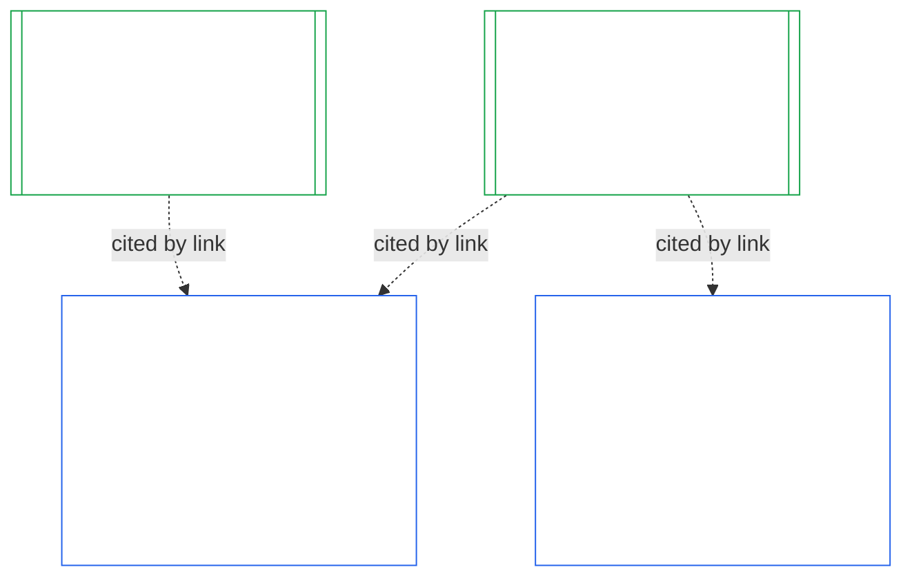
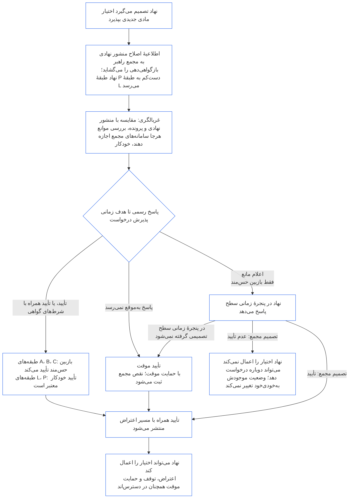

<!-- Locale: fa; source: current working tree (2026-11-11); source SHA-256: 08e166f5f098d01317c1f57ae3501abde31dd10f3c9b43b54d1a2aea1da4200f; baseline: 247e2180509e5e029c1106878cf225067339e010; AI-drafted, unreviewed; assembled from complete 2026-11-03 draft with 2026-11-09 changed-passage refreshes. -->

# فصل دهم: گواهی هم‌راستایی نهادی

<strong>جایگاه در پیکره (غیرعملیاتی): ساختار پرونده و قواعد خواندن</strong>

> این پرونده **بخشی از قانون اساسی حس‌مندان** است و فقط همراه با دیگر پرونده‌های شماره‌دار `core_*` که به‌صورت یک متن خوانده می‌شوند الزام‌آور است. این پرونده **فصل دهم** را دربرمی‌گیرد — **گواهی هم‌راستایی نهادی**: اینکه یک [نهاد](../../core_05.040_band_continuity.md#institution)، متمایز از هر سیستمی که اداره می‌کند، چگونه طبقه‌بندی، ارزیابی، بازبینی و درباره‌اش تصمیم‌گیری می‌شود، چگونه ثبت و به‌روز نگه داشته و دوباره گشوده می‌شود (**§1–§11**). فصل دهم همتای نهادی [فصل نهم](core_09.000_system_alignment_certification_evaluation.md#chapter-nine-system-alignment-certification) (*گواهی هم‌راستایی سیستم*) است و **شمارهٔ بخش‌هایش یکسان است**: §N اینجا به §N آنجا پاسخ می‌دهد. [CS-9.320](../../corpus_systems/cs_09.320_system_alignment_certification_illustrations.md#cs-9320-system-alignment-certification-illustrations) (*نمونه‌های گواهی هم‌راستایی سیستم*) نمونه‌های مشروح سیستم‌ها را دارد و در [§12 مرورهای نمونهٔ نهادها](../../corpus_systems/cs_09.320_system_alignment_certification_illustrations.md#cs-9320-12-illustrative-institution-walkthroughs) نیز سه مرور نهاد آمده است. این فصل آن‌ها را تکرار نمی‌کند.
>
> | § | فصل نهم (سیستم) | فصل دهم (نهاد) |
> |---|------------------------|----------------------------|
> | 1 | هدف و نقش | رابطه با گواهی سیستم، چه کسی گواهی می‌شود، نبود اجازه و مانع برای تشکیل یا اداره، انتظار برای اختیار مادی جدید، مهلت گواهی نخست |
> | 2 | ارزیابی کلاس سیستم | کلاس نهاد؛ مقیاس‌بندی برحسب کلاس |
> | 3 | ارزیابی گواهی کل سیستم | هشت مورد نهادی، همواره |
> | 4 | ارزیابی‌ها در صورت وجود مورد مشمول | ارجاع به فصل نهم §4 |
> | 5 | ارزیابی‌های کف حقوق و حوزه | ارجاع به فصل نهم §5 |
> | 6 | فرایند مجمع | چهار جایگاه؛ نقش‌ها و توالی مجمع؛ مجمع‌ها، گواهی‌دهندگان و دفاتر ثبت به‌عنوان نهاد |
> | 7 | نتایج گواهی | آغاز به کار برای یک نهاد و سیستم‌هایش، شرط‌های گواهی و دیگر آثار نتیجه؛ ارجاع برای نقص‌ها؛ آمادگی برای اصلاح؛ رد و لغو گواهی |
> | 8 | پروندهٔ گواهی سیستم | پروندهٔ گواهی نهادی |
> | 9 | گواهی دوباره و بازگشایی | پایش؛ محرک‌های بازگشایی؛ گواهی موقت و کامل؛ منع گریز؛ زنجیره از گواهی‌های سیستم؛ بازگشایی سیستم‌هایش هنگام تخلف حکمرانی |
> | 10 | اعتراض به گواهی | مسیر اعتراض |
> | 11 | رابطه با ردپا | پیوند به ردپا |
>
> - **دارندهٔ مسئولیت قانون اساسی (مشترک با فصل نهم):** گواهی هم‌راستایی تحت نظارت مجمع و سوابق مربوط به گواهی سیستم و گواهی نهادی. فصل دهم موضوع نهادی را می‌افزاید. این فصل نه خانوادهٔ جدیدی از مجامع، نه جایگاه تازه‌ای و نه واژهٔ تازه‌ای برای نتیجه ایجاد می‌کند.
> - **استفادهٔ دوباره، نه تکرار:** مرحله‌های سوم تا ششم همان‌طور اجرا می‌شوند که [فصل نهم، بخش ب §6](core_09.005_system_alignment_certification_record_process.md#6-forum-process) تا [فصل نهم، بخش ج §11](core_09.010_system_alignment_certification_record_recertification.md#11-relationship-to-standing) مقرر می‌کنند. فصل دهم فقط تغییرات مربوط به نهادی‌بودن موضوع را بیان می‌کند.
> - **قاعدهٔ منع انتقال:** فصل دهم سازوکار ارزیابی سیستم در فصل نهم، فیلدهای منشور سیستم و منشور نهادی در فصل هفتم، الزام چهار جایگاه در فصل هشتم، تکالیف نهادی در [corpus_institutions](../../corpus_institutions.md)، سنجش ردپا در فصل دوازدهم یا آثار ردپا در فصل سیزدهم را دوباره بیان نمی‌کند.
>
> **بالادست:** منشورها در [فصل هفتم](core_07_charters.md#chapter-seven-system-and-institutional-charters)؛ استقلال کارکردی [فصل هشتم](../../core_08.000_functional_independence_separation_of_duties.md#chapter-eight-functional-independence-and-separation-of-duties)؛ [فصل نهم](core_09.000_system_alignment_certification_evaluation.md#chapter-nine-system-alignment-certification) (بخش‌های [الف](core_09.000_system_alignment_certification_evaluation.md#chapter-nine-part-a-system-alignment-certification--evaluation)، [ب](../../core_09.005_system_alignment_certification_record_process.md#chapter-nine-part-b-system-alignment-certification--forum-process-and-outcomes) و [ج](../../core_09.010_system_alignment_certification_record_recertification.md#chapter-nine-part-c-system-alignment-certification--record-recertification-and-standing))؛ نظارت مجمع در فصل پانزدهم.
> **پایین‌دست:** سوابق پایدار و داده‌های تأییدشده در فصل یازدهم؛ آثار سوابق پایدار در فصل سیزدهم.

<strong>ردیابی</strong>

- پیش‌نیازها:
  - [فصل هفتم §1 موارد الزام‌آور بودن منشورهای سیستم و نهادی](core_07_charters.md#1-when-system-and-institutional-charters-are-required) (7.000 §1) (*کدام نهادها منشور سیستم یا منشور نهادی منتشر می‌کنند و کلاس یک نهاد*)؛
  - [فصل هفتم §7 اصلاح و بازبینی](core_07_charters.md#7-amendment-review-and-scope-misalignment) (7.000 §7) (*آزمون‌های بازبینی منشور نهادی*)؛
  - [فصل هفتم §4 نقشهٔ نقش‌های منشور و نگهداری سوابق ردپا](core_07_charters.md#4-the-charter-role-map-and-standing-record-custody) (7.000 §4) (*جایگاه‌ها کجا قرار می‌گیرند*)؛
  - [فصل هشتم §2 الزام قانون اساسیِ چهار جایگاه](core_07_functional_independence_segregation_of_duties.md#2-four-seat-constitutional-requirement) (8.000 §2) و [§9 رابطه با فرایندهای بعدی](core_07_functional_independence_segregation_of_duties.md#9-relationship-to-later-processes)؛
  - [فصل نهم](core_09.000_system_alignment_certification_evaluation.md#chapter-nine-system-alignment-certification) (9.000 تا 9.010) (*فرایند گواهی هم‌راستایی سیستم که این فصل دوباره به کار می‌گیرد*)؛
  - [دو پرسش بنیادین](core_00_preamble.md#two-fundamental-questions)؛
  - [چهارگانهٔ قانون اساسی](core_00_preamble.md#constitutional-tetrad)؛
  - [مادهٔ XI-E](core_06_rights_part_b.md#article-xi-e-institutional-formation-and-business-creation) (*تشکیل نهاد و ایجاد کسب‌وکار*).
- پایین‌دست: از [§1](#1-purpose-and-role) تا [§11](#11-relationship-to-standing)؛ فصل یازدهم ([11.000](core_11_standing_assessment.md#chapter-eleven-standing-records--question-1-what-happened))؛ [فصل پانزدهم](../../core_15.000_forum.md#chapter-fifteen-forums-and-jurisdiction) (15.000).
- همراه با این موارد خوانده شود:
  - [گواهی هم‌راستایی نهادی](../../core_05.040_band_continuity.md#institutional-alignment-certification) و
  - [پروندهٔ گواهی نهادی](../../core_05.040_band_continuity.md#institutional-certification-record) (*معانی فصل پنجم*)؛
  - **CI-8.205 §6** (*محتوا، بازبینی و الگوی تشکیل منشورهای سیستم و نهادی*)؛
  - **CF-14.425** (*تضمین‌های یکپارچگی، عملیات ضدتصرف و پشتیبانی ضدداوری دربارهٔ خود*).

 

فصل دهم دارندهٔ مسئولیت قانون اساسی برای **گواهی هم‌راستایی نهادی** است. فرایند [فصل نهم](core_09.000_system_alignment_certification_evaluation.md#chapter-nine-system-alignment-certification) را از یک سیستم به یک نهاد گسترش می‌دهد:

- **مرحلهٔ اول، چارچوب‌گذاری:** کلاس نهاد و نحوهٔ مقیاس‌بندی ارزیابی برحسب آن ([§2 ارزیابی کلاس نهاد](#2-institution-class-evaluation))؛
- **مرحلهٔ دوم، ارزیابی:** ارزیابی نهادی، ازجمله ارزیابی‌هایی که در صورت وجود مورد مشمول و ارزیابی‌های کف حقوق و حوزه اعمال می‌شوند ([§3 ارزیابی گواهی کل نهاد](#3-whole-institution-certification-evaluation) تا [§5 ارزیابی‌های کف حقوق و حوزه](#5-rights-floor-and-domain-evaluations))؛
- **مرحلهٔ سوم، بازبینی:** نقش‌ها و توالی مجمع ([§6 فرایند مجمع](#6-forum-process))؛
- **مرحلهٔ چهارم، تصمیم‌گیری:** نتیجه، آمادگی برای اصلاح، و رد و لغو گواهی ([§7 نتایج گواهی](#7-certification-outcomes))؛
- **مرحلهٔ پنجم، ثبت:** پروندهٔ گواهی نهادی ([§8 پروندهٔ گواهی نهادی](#8-institutional-certification-record))؛ و
- **مرحلهٔ ششم، بهره‌برداری:** گواهی دوباره، بازگشایی، زنجیره از گواهی‌های سیستم، بازگشایی سیستم‌هایش، مسیر اعتراض و پیوند به ردپا ([§9 گواهی دوباره و بازگشایی](#9-recertification-and-reopening) تا [§11 رابطه با ردپا](#11-relationship-to-standing)).

*به زبان ساده: فصل نهم می‌پرسد آیا یک **سیستم** هم‌راستاست. فصل دهم همین پرسش را دربارهٔ **نهادی** می‌پرسد که سیستم‌هایی را اداره می‌کند یا بدون ادارهٔ سیستم، اختیار دارد. ممکن است نهادی هم‌راستا باشد درحالی‌که یکی از سیستم‌هایش نیست، و برعکس. پس نهاد از بابت آنچه فقط خودش کنترل می‌کند بررسی می‌شود: آیا مطابق منشور نهادی‌اش عمل می‌کند، چه کسی پاسخگوی اختیار آن است، در میان اعضایش به چه چیزی پاداش می‌دهد و آیا کنترل‌های مستقل واقعاً قابل استفاده‌اند. این فصل به گواهی هر سیستم اتکا می‌کند و آن را دوباره انجام نمی‌دهد. این گواهی مجوز نیست: برای آغاز یا ادارهٔ نهاد به اجازهٔ آن نیاز نیست.*

### 1. هدف و نقش

<strong>ردیابی</strong>

- پیش‌نیازها:
  - [فصل هفتم §1 موارد الزام‌آور بودن منشورهای سیستم و نهادی](core_07_charters.md#1-when-system-and-institutional-charters-are-required) (7.000 §1)؛
  - [فصل نهم، بخش الف §1 هدف و نقش](core_09.000_system_alignment_certification_evaluation.md#1-purpose-and-role) (9.000 §1)؛
  - [مادهٔ XI-E](core_06_rights_part_b.md#article-xi-e-institutional-formation-and-business-creation) (*تشکیل نهاد و ایجاد کسب‌وکار*)؛
  - [مادهٔ XXVIII-A](../../core_06.020_rights_part_e.md#xxviii-a-existing-instantiations-adoption-transition-window) (*پذیرش مرحله‌ای و تداوم کف حقوق*).
- پیامدها: [§2](#2-institution-class-evaluation)؛ [§6](#6-forum-process)؛ [§7](#7-certification-outcomes)؛ [§9](#9-recertification-and-reopening).
- همراه با این موارد خوانده شود:
  - [نهاد](../../core_05.040_band_continuity.md#institution)؛
  - [منشور نهادی](../../core_05.040_band_continuity.md#institutional-charter)؛
  - [منشور سیستم](../../core_05.040_band_continuity.md#system-charter)؛
  - [ایجاد کسب‌وکار](../../core_05.055_band_participation.md#business-creation).

 

*به زبان ساده: گواهی یک سیستم متعلق به خود سیستم است. گواهی نهاد به آن گواهی‌ها استناد می‌کند و مسئولیت‌هایی را اضافه می‌کند که فقط نهاد می‌تواند پاسخگوی آن‌ها باشد. یک سیستم ممکن است زیرمجموعهٔ چند نهاد یا هیچ نهادی باشد. هیچ‌چیز در اینجا اجازه نمی‌دهد گواهی مانع تشکیل نهاد شود.*

گواهی هم‌راستایی نهادی و گواهی هم‌راستایی سیستم دو گواهی‌اند که پیوندی آن‌ها را به هم متصل می‌کند. رابطه، **ترکیب از راه پیوند** است، نه دربرگرفتن. در نمودار، پیکانی از هر سابقهٔ گواهی سیستم به هر سابقهٔ گواهی نهادی که به آن استناد می‌کند می‌رود. سیستمی که زیر نظر هیچ نهادی نیست پیکان ندارد و به آن نیازی هم نیست؛ نهادی که هیچ سیستمی را اداره نمی‌کند، فقط سابقهٔ گواهی نهادی دارد.

ترکیب از راه پیوند دو سویه دارد که نخست سوی نهاد را بیان می‌کنیم.

از سوی نهاد:

- **پروندهٔ گواهی نهادی به پروندهٔ سیستم استناد می‌کند و آن را دوباره انجام نمی‌دهد:** با پیوند به پروندهٔ گواهی سیستم استناد می‌کند و نسخهٔ آن را ذکر می‌کند. این فصل هیچ ارزیابی سیستمی را دوباره اجرا نمی‌کند، کلاس هیچ سیستمی را دوباره تعیین نمی‌کند و نتیجه، وضعیت یا شرط‌های گواهی هیچ سیستمی را تغییر نمی‌دهد.
- **گواهی نهاد نمی‌تواند گواهی سیستم را ارتقا دهد:** سیستمِ «گواهی‌نشده» با هر وضعیتی که نهاد داشته باشد همچنان گواهی‌نشده می‌ماند. سیستمی که گواهی دارد از یافتهٔ مربوط به نهاد مصون نمی‌شود.
- **واقعیت‌های نهادی یک‌بار تعیین می‌شوند:** هرگاه [فصل نهم، بخش الف §3.1 انضباط حکمرانی، انگیزه و قابلیت اعتراض](core_09.000_system_alignment_certification_evaluation.md#31-governance-incentive-and-contestability-discipline) دربارهٔ حکمرانی و انگیزه‌های گرداننده بپرسد، پروندهٔ جاری گواهی نهادیِ گرداننده می‌تواند آن واقعیت‌ها را از راه پیوند فراهم کند. بااین‌حال مجمع‌های سیستم همچنان تصمیم می‌گیرند آیا آن واقعیت‌ها برای آن سیستم کافی‌اند یا نه. بدون بیان دلیل در پروندهٔ گواهی سیستم نمی‌توانند دربارهٔ همان واقعیت نهادی یافته‌ای متفاوت داشته باشند.

از سوی سیستم:

- **سابقهٔ گواهی سیستم متعلق به سیستم است:** این سابقه، سابقهٔ خود سیستم بر اساس [فصل نهم](core_09.000_system_alignment_certification_evaluation.md#chapter-nine-system-alignment-certification) است.
- **چند نهاد می‌توانند به یک سابقهٔ گواهی سیستم استناد کنند:** طبق [فصل هفتم §1 موارد لزوم منشورهای سیستم و نهادی](core_07_charters.md#1-when-system-and-institutional-charters-are-required)، یک سیستم ممکن است توسط بیش از یک نهاد اداره، سرپرستی یا به‌طور مادی کنترل شود. هر نهاد به همان سابقهٔ گواهی سیستم استناد می‌کند.
- **سیستم لازم نیست زیرمجموعهٔ نهادی باشد:** یک حس‌مند به‌تنهایی نهاد نیست، پس ممکن است سیستم هیچ نهادِ بالادستی نداشته باشد. سیستم بدون نهاد فقط طبق [فصل نهم](core_09.000_system_alignment_certification_evaluation.md#chapter-nine-system-alignment-certification) گواهی می‌شود و به چیزی از این فصل نیاز ندارد. سیستمی که زیرمجموعهٔ نهاد است نیز به همان شیوه گواهی می‌شود: این فصل پرونده‌ای جدا برای نهاد می‌افزاید و مرحله‌ای از گواهی خود سیستم نیست.

#### 1.1 چه کسی گواهی می‌شود

نهادِ کلاس L یا بالاتر در دامنهٔ این فصل است؛ کلاس آن طبق [§2.1 کلاس نهاد](#21-institution-class) تعیین می‌شود. این شامل نهادی است که اصلاً سیستمی را اداره نمی‌کند: پروندهٔ گواهی سیستمی برای استناد ندارد و کلاسش بر پایهٔ اثر خودش تعیین می‌شود. **سبد** نهاد مجموعهٔ سیستم‌هایی است که اداره، سرپرستی یا به‌طور مادی کنترل می‌کند ([سبد](../../core_05.040_band_continuity.md#portfolio)).

- **کلاس A، B، C و L:** فرایند متناسب با کلاس طبق [§2.2 مقیاس‌بندی برحسب کلاس](#22-scaling-by-class) اعمال می‌شود.
- **کلاس P:** استفاده از فرایند تشویق می‌شود و می‌توان داوطلبانه از آن استفاده کرد. با طبقه‌بندی دوباره به کلاس L یا بالاتر، یا اگر نهاد داوطلبانه ادعای انطباق قانون اساسی کند، فرایند الزامی می‌شود. نهادی در کلاس P که تصمیم بگیرد اختیار مادی جدیدی بگیرد، هنگام ارسال اطلاعیهٔ [§9.2.2 گواهی دوباره برای اختیار مادی جدید](#922-recertification-for-new-material-authority) دست‌کم به کلاس L طبقه‌بندی دوباره می‌شود، چون آن اختیار بنا بر تعریف مادی است ([§9.2.1 چه چیزی اختیار مادی جدید محسوب می‌شود](#921-what-counts-as-new-material-authority)) و نهادی که در هر حوزه‌ای مادی باشد دست‌کم کلاس L است ([§2.1 کلاس نهاد](#21-institution-class)، مورد 2). طبقه‌بندی دوباره از زمان اطلاعیه برقرار است تا اطلاعیه پیش از صدور مجوز پس گرفته شود یا اختیار مجاز نشود، به شرط آنکه هیچ‌کس آن را اعمال نکرده باشد. سپس نهاد به کلاس P بازمی‌گردد و گواهی نخستِ محدود پایان می‌یابد. اطلاعیهٔ تازه آن را دوباره آغاز می‌کند؛ و اعمال اختیار بدون مجوز همچنان طبق [§9.2.2 گواهی دوباره برای اختیار مادی جدید](#922-recertification-for-new-material-authority) یافته محسوب می‌شود (*بدون اطلاعیه یا پیش از صدور مجوز*). این قاعده با [فصل نهم، بخش الف §1 هدف و نقش](core_09.000_system_alignment_certification_evaluation.md#1-purpose-and-role) همسان است.
- **یک سیستم:** نهادی که دقیقاً یک سیستمِ نیازمند منشور سیستم را اداره می‌کند، یک مرحلهٔ گواهی و یک سابقهٔ گواهی سیستم دارد؛ این فصل آن را **ارزیابی تک‌سیستمی** می‌نامد. سابقهٔ گواهی سیستم یک *بخش یافته‌های نهادی* با موارد [§8 سابقهٔ گواهی نهادی](#8-institutional-certification-record) در خود دارد و در حکم سابقهٔ گواهی نهادی است. مجامع، جایگاه‌ها و مهلت‌ها همان‌هایی هستند که برای مرحلهٔ گواهی خود سیستم اعمال می‌شوند، با افزوده‌شدن موارد نهادی. نتایج آن تابع مبانی رد و لغو خودشان است، چنان‌که [§7.4 رد و لغو گواهی برای نهاد](#74-denial-and-revocation-for-an-institution) مقرر می‌کند. زنجیرهٔ [§9.5 سرایت از گواهی‌های سیستم](#95-cascade-from-system-certifications) به‌عنوان سرایت اعمال نمی‌شود، چون سیستم تمام سبد فعالیت است؛ اما [§7.4 رد و لغو گواهی برای نهاد](#74-denial-and-revocation-for-an-institution) قواعد 1 و 2 آن را اعمال می‌کند (شاخص و آزمون محل قرارداشتن علت).
- **چند سیستم:** یک پروندهٔ گواهی نهادی برای نهاد که با پیوند به پروندهٔ گواهی سیستمِ هر سیستم تحت ادارهٔ آن ارجاع می‌دهد. هر سیستم دور و پروندهٔ خود را حفظ می‌کند.
- **چند سیستم:** برای نهاد یک سابقهٔ گواهی نهادی وجود دارد که به سابقهٔ گواهی هر سیستمی که اداره می‌کند پیوند می‌خورد. هر سیستم مرحلهٔ مستقل و سابقهٔ گواهی سیستم خودش را حفظ می‌کند.

#### 1.2 نبود اجازه و نبود مانع برای تشکیل یا اداره

گواهی هم‌راستایی نهادی، بازبینی مستقلی است از اینکه نهاد در عمل چگونه از اختیارش استفاده می‌کند. مجمع‌های مستقل از نهاد آن را انجام می‌دهند و نتیجه به پروندهٔ گواهی نهادی‌ای می‌انجامد که یافته‌هایشان را ثبت می‌کند.

- **تشکیل و اداره:** نهاد تشکیل می‌شود، منشور نهادی‌اش را منتشر می‌کند، اعمال اختیار را آغاز می‌کند و بدون آنکه پیش‌تر گواهی داشته باشد به کار ادامه می‌دهد؛ هیچ نتیجه‌ای این حق را اعطا یا سلب نمی‌کند.
- **اثر نتیجه:** نتیجه فقط آثاری دارد که در [§7.1 آغاز به کار برای یک نهاد](#71-go-live-for-an-institution) آمده‌اند.
- **تنها دروازه‌ها در این حوزه:** سه دروازهٔ محدود وجود دارد که همگی در **مادهٔ XI-E** (*تشکیل نهاد و ایجاد کسب‌وکار*) هستند:
  - قفلِ برقرار بر یک حس‌مندِ نام‌برده که به اختیار همان حس‌مند پیوست می‌شود؛
  - نگه‌داشت موقت بر پایهٔ واقعیت‌های تأییدشدهٔ مشخص دربارهٔ ناهماهنگی که آن هم به اختیار یک حس‌مند نام‌برده پیوست می‌شود؛
  - قفلی بر خودِ طرفِ بهره‌بردار؛ این قفل فقط هنگامی به نهادی متصل می‌شود که قفل بر همان نهاد قرار گیرد، مانند نهاد منحل‌شده ذیل **CI-13.210 §4** (*انحلال*).

  یافتهٔ گواهی می‌تواند به مجمع تصمیم‌گیرنده دربارهٔ یکی از این دروازه‌ها ارجاع شود و طبق [§7.5 آثار رد و لغو گواهی برای یک نهاد](#75-effects-of-denial-and-revocation-for-an-institution) شاهد باشد. نتیجهٔ گواهی خودِ دروازه نیست و هیچ دروازه‌ای را نمی‌گشاید یا نمی‌بندد.
- **انتظار برای اختیار مادی جدید:** نهادی که تصمیم می‌گیرد اختیار مادی جدیدی بگیرد، طبق شرایط [§9.2.2 گواهی دوباره برای اختیار مادی جدید](#922-recertification-for-new-material-authority) پیش از اعمال آن اختیار منتظر می‌ماند تا گواهی دوباره، اختیار را مجاز کند. **مادهٔ XI-E** (*تشکیل نهاد و ایجاد کسب‌وکار*) این انتظار را مقرر می‌کند. این انتظار یکی از سه دروازهٔ محدود نیست و مانعی برای تشکیل یا اداره به‌شمار نمی‌رود. فقط به اختیار جدید مربوط است و نهاد همهٔ فعالیت‌های دیگرش را ادامه می‌دهد. شکل [§9.2.2 گواهی دوباره برای اختیار مادی جدید](#922-recertification-for-new-material-authority) مراحل را خلاصه می‌کند.
- **راه پشتی وجود ندارد:** هیچ‌چیز در این فصل را نباید مجمع، پذیرنده یا نهادی مستقر به‌عنوان آستانهٔ مجوزدهی به کار ببرد که بنیان‌گذاران را کنار بزند یا از نهادهای مستقر حمایت کند. چنین کاری [مادهٔ XI-E](core_06_rights_part_b.md#article-xi-e-institutional-formation-and-business-creation) (*تشکیل نهاد و ایجاد کسب‌وکار*) را بی‌اثر می‌کند.
  - [بار اجتناب‌پذیر](../../core_05.040_band_continuity.md#avoidable-burden) بر هزینهٔ فرایند حاکم است.
  - [حکمرانی مقیاس‌بندی‌شده برحسب طبقه‌بندی](core_05_band_oversight.md#classification-scaled-governance) بر عمق آن حاکم است.
  - انتظار برای اختیار مادی جدید، با شرایط یکسان بر هر نهادی از همان کلاس اعمال می‌شود و فقط به اختیاری مربوط است که از پیش برای دیگران مادی باشد.

دروازهٔ آغاز به کار سیستم‌ها جداست و در اختیار خودشان می‌ماند. طبق [فصل نهم، بخش ب §7.1 مجوز آغاز به کار](core_09.005_system_alignment_certification_record_process.md#71-go-live-gate)، هر سیستم جدید یا توسعهٔ مادی آن، صرف‌نظر از وضعیت نهاد، فقط با گواهی خود آغاز به کار می‌کند.

#### 1.3 مهلت گواهی نخست

پروندهٔ نخست گواهی نهادی باید در مهلتی ارائه شود که سند پذیرنده برای کلاس نهاد تعیین می‌کند.

- **نهاد جدید:** مهلت از روزی آغاز می‌شود که برای نخستین بار بر دیگران اثر مادی دارد، طبق تشخیص [مادی‌بودن خاص حوزه](core_05_band_oversight.md#domain-specific-materiality)؛ گواهی نخست آن موقت است.
- **نهاد کلاس P که با اطلاعیه طبقه‌بندی دوباره می‌شود:** مهلت، مانند نهاد جدید، از روز ارسال اطلاعیه طبق [§9.2.2 گواهی دوباره برای اختیار مادی جدید](#922-recertification-for-new-material-authority) آغاز می‌شود و هرگز از مهلت گذار پذیرشی که قبلاً پایان یافته آغاز نمی‌شود.
- **نهادی که از قبل در حال فعالیت است:** مهلت، مهلت گذار پذیرشی طبق [مادهٔ XXVIII-A](../../core_06.020_rights_part_e.md#xxviii-a-existing-instantiations-adoption-transition-window) (*پذیرش مرحله‌ای و تداوم کف حقوق*) است که با قاعدهٔ پیش‌فرض [فصل هفتم §1.5 موعد ارائهٔ منشور سیستم یا منشور نهادی](core_07_charters.md#15-when-a-system-charter-or-institutional-charter-is-due) سازگار است.
- **مهلت ازدست‌رفته:** نهادی که بگذارد مهلت بدون انجام دور نخست تمام شود و در زمرهٔ موارد معاف زیر نباشد، نقصی دارد که باید ثبت و اصلاح شود و مهلت ازدست‌رفته آن دور را آغاز می‌کند. نهادِ کلاس L یا بالاتر که در حال فعالیت است، مشمول شکست مرحلهٔ زمانیِ زیر نیز می‌شود. چون دروازه‌ای وجود ندارد، نهاد متوقف نمی‌شود و از فعالیت منع نمی‌گردد ([§1.2 نبود اجازه و نبود مانع برای تشکیل یا اداره](#12-no-permission-and-no-gate-on-forming-or-running)).
  - **نهادِ در حال فعالیت:** این قاعدهٔ اختصاصی فصل برای نهادهای کلاس L یا بالاتر است که با [مادهٔ XXVIII-A](../../core_06.020_rights_part_e.md#xxviii-a-existing-instantiations-adoption-transition-window) (*گذار مرحله‌ای و تداوم کف حقوق*) هم‌سنجی شده و سیستم‌ها و موجودیت‌های مشتق‌شده را نام می‌برد. اگر مهلت گذار برای پذیرش به پایان برسد و نخستین مرحلهٔ گواهی کامل نشده باشد (نه گواهی موقت یا کامل صادر شده و نه نتیجه‌ای ذیل [§7 نتایج گواهی](#7-certification-outcomes) اتخاذ شده باشد)، نهاد مهلت را از دست داده است. نهادی که در مهلت درخواست داده و همکاری کرده، در صورتی مهلت را از دست نداده که مرحلهٔ گواهی به‌علت تجاوز مجمع از مهلت خودش ([فصل پانزدهم §6 حل‌وفصل به‌موقع، سطوح اهمیت و انضباط ضدتأخیر](core_11_forum.md#6-timely-resolution-materiality-tiers-and-anti-delay-discipline)، *بازبینی تجاوز از مهلت*؛ [فصل نهم بخش ج §9.3.4 پنجره‌های سطح](core_09.010_system_alignment_certification_record_recertification.md#934-tier-windows)) یا به‌علت جریان داشتن تنها تعویق مجاز ذیل [§7.3 آمادگی اصلاح برای نهاد](#73-remediation-readiness-for-an-institution) ناتمام مانده باشد. مگر اینکه بر اساس [مادهٔ XXVIII-B](../../core_06.020_rights_part_e.md#article-xxviii-b-adoption-transition-authority-limits-and-reauthorization) (*محدودیت‌های اختیار گذار پذیرش و اعطای دوبارهٔ اختیار*) اعطای دوبارهٔ اختیار مستندی ارائه کند، این یک شکست در نقطهٔ عطف گذار پذیرش است و مسیر معمول انطباق و نقض در [فصل یازدهم](core_11_standing_assessment.md#chapter-eleven-standing-records--question-1-what-happened) گشوده می‌شود. تکالیف محدودکنندهٔ آن ماده از تاریخ اجرا اعمال می‌شوند و طولانی‌شدن این شکاف آن را به وضعیت عادی تازه تبدیل نمی‌کند. این قاعده مشابه [فصل نهم بخش ب §7.1.1 سیستم‌های ازپیش‌فعال](core_09.005_system_alignment_certification_record_process.md#711-systems-already-operating) است؛ این یک دروازه نیست.
  - **دور گواهی:** مانند هر دور دیگری دربارهٔ آن تصمیم‌گیری می‌شود. ممکن است با هر نتیجه‌ای در [§7 نتایج گواهی](#7-certification-outcomes)، ازجمله «گواهی‌نشده»، پایان یابد؛ آثار آن در [§7.5 آثار رد و لغو گواهی برای یک نهاد](#75-effects-of-denial-and-revocation-for-an-institution) آمده است.
  - **تحریم‌ها و انحلال:** این فصل هیچ‌کدام را ایجاد نمی‌کند. تعلیق، ادارهٔ اموال، جداسازی ساختاری و انحلال نزد مجمع دارای صلاحیت بر اساس **CI-13.210** (*شکست نهادی و انحلال*) و **CI-13.215** (*پاسخ‌گویی و تحریم‌های نهادی*) باقی می‌مانند. ارجاع به آن مجمع فقط بر مبانی ارجاع در [§7.5 آثار رد و لغو گواهی برای نهاد](#75-effects-of-denial-and-revocation-for-an-institution) (مورد 5، *ارجاع*) انجام می‌شود.

### 2. ارزیابی کلاس نهاد

<strong>ردیابی</strong>

- پیش‌نیازها:
  - [فصل هفتم §1 موارد الزام‌آور بودن منشورهای سیستم و نهادی](core_07_charters.md#1-when-system-and-institutional-charters-are-required) (7.000 §1)؛
  - [فصل نهم، بخش الف §2 ارزیابی کلاس سیستم](core_09.000_system_alignment_certification_evaluation.md#2-system-class-evaluation) (9.000 §2) و [§2.2 چگونگی مقیاس‌بندی هر ارزیابی بر پایهٔ کلاس سیستم](core_09.000_system_alignment_certification_evaluation.md#22-how-system-class-scales-every-evaluation)؛
  - [فصل سوم §2.1 الگوهای رایج گریز](core_03_definition_integrity.md#21-common-evasion-patterns) (3.000 §2.1).
- پایین‌دست: [§3](#3-whole-institution-certification-evaluation) (*مواردی که کلاس مقیاس‌بندی می‌کند*)؛ [§8](#8-institutional-certification-record) (*بیان کلاس در سابقهٔ گواهی نهادی*)؛ [§9.2](#92-reopening-triggers) (*محرک‌های ارزیابی دوباره*).
- همراه با این موارد خوانده شود:
  - **CS-9.305 (*سازوکار طبقه‌بندی سیستم*) و CS-9.310** (*طبقه‌بندی اثر سیستم*) و [corpus_systems/cs_09.310_system_impact_classifications.md](../../corpus_systems/cs_09.310_system_impact_classifications.md) (*فهرست کلاس‌ها*)؛
  - **CI-9.210** (*تکالیف نهادی مرتبط با طبقه‌بندی*)؛
  - **CI-8.205 §6** (*محتوا، بازبینی و الگوی تشکیل منشورهای سیستم و نهادی*).

 

*به زبان ساده: نخست نهاد را بر پایهٔ میزان اهمیتش برای دیگران در یک کلاس قرار دهید. این را با توجه به آنچه واقعاً تصمیم می‌گیرد و در اختیار دارد بسنجید، نه با نامی که بر خود می‌گذارد. کلاس سپس عمق ارزیابی را تعیین می‌کند: هرچه کلاس بالاتر باشد، اثبات سخت‌گیرانه‌تر، بازبینی مستقل‌تر و بررسی دوباره زودتر است.*

این بخش **مرحلهٔ اول، چارچوب‌گذاری** برای یک نهاد است.

#### 2.1 کلاس نهاد

**کلاس نهاد** بر پایهٔ بیشترین اثر مادی‌ای تعیین می‌شود که نهاد دارد، چه آن اثر از طریق سیستمی باشد که اداره می‌کند و چه بیرون از هر سیستمی. معیار، تصمیم‌ها، دارایی‌ها و کنترل واقعی نهاد است، نه برچسب، شکل حقوقی یا فهرست منشور نهادی آن. کلاس، عمق ارزیابی و مهلت‌ها را اداره می‌کند، همان‌گونه که [فصل نهم، بخش الف §2.2 چگونگی مقیاس‌بندی هر ارزیابی بر پایهٔ کلاس سیستم](core_09.000_system_alignment_certification_evaluation.md#22-how-system-class-scales-every-evaluation) برای سیستم انجام می‌دهد. این همان کلاسی است که در این فصل و [فصل هفتم §1.2 کلاس‌های مشمول](core_07_charters.md#12-which-classes-are-covered) به کار می‌رود.

1. **اثر از راه سیستم‌ها:** کلاس نهاد دست‌کم برابر با بالاترین کلاس هر سیستم در سبدش است ([فصل هفتم §1 موارد الزام‌آور بودن منشورهای سیستم و نهادی](core_07_charters.md#1-when-system-and-institutional-charters-are-required)). سیستم‌ها بر پایهٔ عملیات مشاهده‌شده شناسایی می‌شوند. سیستمی که از منشور نهادی جا افتاده باشد همچنان محسوب می‌شود.
2. **اثر بیرون از هر سیستم:** اثر مادی و وابستگی خود نهاد، چه سیستم اداره کند چه نکند، محسوب می‌شود. تعریف‌های کلاس در **CS-9.305 (*سازوکار طبقه‌بندی سیستم*) و CS-9.310** (*طبقه‌بندی اثر سیستم*) بر تصمیم‌ها و دارایی‌های خود نهاد اعمال می‌شوند، با توجه به این عوامل:
   - **چه چیزی را تصمیم می‌گیرد و در اختیار دارد:**
     - دربارهٔ دسترسی حس‌مندان دیگر به نیازهای اساسی بقا، آموزش، ایمنی، معیشت، حقوق یا ردپا چه تصمیم‌هایی می‌گیرد؛ و
     - چه چیزهایی در اختیار دارد، مانند وجوه، سوابق، عضویت‌ها، نگهداری سوابق ردپا یا کارکرد مجمع، گواهی‌دهنده یا دفتر ثبت.
   - **مادی‌بودن آن:**
     - آیا فعالیت خود نهاد در هر حوزه‌ای طبق [مادی‌بودن خاص حوزه](core_05_band_oversight.md#domain-specific-materiality) مادی است، ازجمله انجام [اعمال الزام‌آور مادی](../../core_05.035_band_accountability.md#materially-binding-act) که دیگران باید از آن پیروی کنند یا می‌توانند به‌عنوان امری تثبیت‌شده بر آن تکیه کنند؛
     - طبق **CS-9.305 (*سازوکار طبقه‌بندی سیستم*) و CS-9.310** (*طبقه‌بندی اثر سیستم*) نهادی که در یک حوزه مادی باشد دست‌کم کلاس L است؛ و
     - ارائهٔ کمک، کالا، نیروی کار یا خدماتی که دیگران آزادند بپذیرند یا نپذیرند و دسترسی کسی را به نیازهایش کنترل نمی‌کند، کسی را ملزم نمی‌سازد. این رفتار است، نه یک عمل الزام‌آور مادی، و فقط از طریق عوامل دیگر محسوب می‌شود.
   - **میزان وابستگی دیگران به آن:**
     - شمار حس‌مندان وابسته و میزان جایگزین‌پذیری آن؛
     - میزان تمرکز اختیار آن در چارچوب خط کنترل مادی؛ و
     - برگشت‌پذیری تصمیم‌های آن.
3. **کنترل مشترک:** طرف‌های عملیاتی‌ای که طبق قاعدهٔ تجمیعِ [مادی‌بودن خاص حوزه](core_05_band_oversight.md#domain-specific-materiality) یک عملیات‌اند (کنترل عملی مشترک در یک [خط کنترل مادی](../../core_05.035_band_accountability.md#material-control-line)؛ تأمین مالی به‌تنهایی کافی نیست)، هرجا در عمل به‌عنوان یک نهاد عمل کنند با هم طبقه‌بندی می‌شوند. تقسیم یک طرف عملیاتی، سبد یا اختیارش به‌گونه‌ای که هیچ بخشی به کلاس L نرسد، گریز از دامنه و مرز طبق [فصل سوم §2.1 الگوهای رایج گریز](core_03_definition_integrity.md#21-common-evasion-patterns) است.
4. **طبقه‌بندی دوباره:** کلاس بر اساس محرک‌های [§9.2 محرک‌های بازگشایی](#92-reopening-triggers) دوباره ارزیابی می‌شود. طبقه‌بندی همراه با دلایلش در پروندهٔ گواهی نهادی ذکر می‌شود.

#### 2.2 مقیاس‌بندی برحسب کلاس

طبقهٔ نهاد عمق شواهد، استقلال بازبینی، بازهٔ پیش‌فرض گواهی و افشا در سابقهٔ گواهی نهادی را به همان شیوه‌ای مقیاس‌بندی می‌کند که [فصل نهم بخش الف §2.2 چگونگی مقیاس‌بندی همهٔ ارزیابی‌ها بر اساس کلاس سیستم](core_09.000_system_alignment_certification_evaluation.md#22-how-system-class-scales-every-evaluation) انجام می‌دهد. بازه‌های گواهی در [فصل پانزدهم §6 حل‌وفصل به‌موقع، سطوح اهمیت و انضباط ضدتأخیر](../../core_15.000_forum.md#review-cadence) (*چرخهٔ بازبینی*) آمده‌اند؛ سندِ تصویب‌کننده می‌تواند بازه‌های کوتاه‌تری تعیین کند و تعداد پیاپی بازگواهی‌های موقتِ بی‌نقص را مشخص می‌کند.

- **کلاس A، B و C:** هر هشت مورد [§3 ارزیابی گواهی کل نهاد](#3-whole-institution-certification-evaluation)، با شواهد و استقلال متناسب با کلاس.
- **کلاس L:** همان هشت مورد، ساده‌تر، با سوابق ساده‌تر و فاصلهٔ پیش‌فرض طولانی‌تر، هرجا [حکمرانی مقیاس‌بندی‌شده برحسب طبقه‌بندی](core_05_band_oversight.md#classification-scaled-governance) اجازه دهد. هستهٔ ارزیابی کلاس L عبارت است از مقایسهٔ منشور نهادی با عمل، نقشهٔ نقش‌ها، بیانیهٔ کنترل تشکیل و به‌روز بودن گواهی‌های سیستمِ مورد استناد. هیچ موردی را نمی‌توان حذف کرد و موردی که یافته‌ای ندارد، در یک سطر ذکر می‌شود.
- **کلاس P:** داوطلبانه، چنان‌که [§1.1 چه کسی گواهی می‌شود](#11-who-is-certified) بیان می‌کند.

**میزبان در فعالیت حرفه‌ای مشترک.** هنگامی که نهادی میزبان است ([**CI-16.205 §7**](../../corpus_institutions/ci_16.205_appointment_competency_rotation_removal.md#ci-46-seat-advisory) (*مجوز فعالیت حرفه‌ای، تأیید صلاحیت فعالیت و فعالیت حرفه‌ای مشترک*))، گواهی آن همچنین عملکرد اعضا را در برابر جایگاه‌هایی که میزبان بر عهده دارد نمونه‌برداری می‌کند و اعلامیه‌های پذیرش اعضا را با آنچه میزبان انجام می‌دهد می‌سنجد. یافته دربارهٔ عمل یک عضو، یافته‌ای دربارهٔ همان عضو است و فقط زمانی به میزبان می‌رسد که جایگاهی که میزبان بر عهده دارد دچار شکست شده باشد.

### 3. ارزیابی گواهی کل نهاد

<strong>ردیابی</strong>

- پیش‌نیازها:
  - [فصل نهم، بخش الف §3 ارزیابی گواهی کل سیستم](core_09.000_system_alignment_certification_evaluation.md#3-whole-system-certification-evaluation) (9.000 §3)؛
  - [فصل هفتم §3 مواردی که منشورهای سیستم و نهادی باید بیان کنند](core_07_charters.md#3-what-system-and-institutional-charters-must-state) (7.000 §3)؛
  - [فصل هفتم §5 کنترل تشکیل: مشروعیت و اصالت دارندگان مناصب](core_07_charters.md#5-formation-check-office-holder-standing-and-authenticity) (7.000 §5)؛
  - [فصل هفتم §7 اصلاح و بازبینی](core_07_charters.md#7-amendment-review-and-scope-misalignment) (7.000 §7)؛
  - [دو پرسش بنیادین](core_00_preamble.md#two-fundamental-questions)؛
  - [فصل یکم §19.6 حفظ مسئولیت هنگام تغییر مالکیت یا ساختار](core_01_c_stewardship_capacity_principles.md#196-keeping-responsibility-when-ownership-or-structure-changes) (1.010 §19.6).
- پیامدها: [§6](#6-forum-process) (*یافته‌هایی که مجمع‌ها بازبینی می‌کنند*)؛ [§9](#9-recertification-and-reopening) (*محرک‌های بازگشایی آن‌ها*)؛ [§11](#11-relationship-to-standing) (*دروازهٔ دادهٔ تأییدشده برای یافته‌های مربوط به حس‌مند نام‌برده*).
- همراه با این موارد خوانده شود:
  - **CI-8.205 §3** (*زنجیرهٔ اختیار و کنترل‌های واگذاری*) و **CI-8.205 §6** (*محتوا، بازبینی و الگوی تشکیل منشورهای سیستم و نهادی*)؛
  - **CI-6.215** (*سرپرستی منابع و یکپارچگی انگیزه*)؛
  - **CI-8.210** (*درستکاری تعارض، ضدتصرف و ضدفساد*)، **CI-6.205** (*شفافیت، مشارکت و مسیرهای دسترس‌پذیر اعتراض و خدمت*) و **CI-13.205** (*سامانه‌های جبران و ظرفیت دادخواهی نهادی*)، برای مورد 8.

 

*به زبان ساده: چیزهایی را بررسی کنید که متعلق به نهادند، نه به هیچ‌یک از سیستم‌های آن: آیا منشور نهادی‌اش را رعایت می‌کند، چه کسی پاسخگوی اختیار آن است، به چه چیزی پاداش می‌دهد، و آیا کنترل‌های مستقل بر آن کار می‌کنند.*

این بخش **مرحلهٔ دوم، ارزیابی** برای یک نهاد است.

هر دور گواهی، این هشت مورد را ارزیابی می‌کند که همتای نهادیِ [فصل نهم، بخش الف §3 ارزیابی گواهی کل سیستم](core_09.000_system_alignment_certification_evaluation.md#3-whole-system-certification-evaluation) هستند. هر یافته، شواهد و متن منشور نهادی یا عملیات مشاهده‌شده‌ای را که به آن متکی است بیان می‌کند.

1. **منشور نهادی در برابر عملکرد:**
   - منشور نهادی در برابر عملیات مشاهده‌شده و با استفاده از فهرست بازبینی [فصل هفتم §7 اصلاح و بازبینی](core_07_charters.md#7-amendment-review-and-scope-misalignment) سنجیده می‌شود.
   - چه عملکرد بیرون از منشور نهادی باشد و چه منشور نهادی دیگر عملکرد را توصیف نکند، در هر دو صورت یافته ثبت می‌شود.
2. **سبد و اثر تجمیعی:**
   - منطق سبد آزموده می‌شود: هر سیستم به هدف اعلام‌شدهٔ نهاد مربوط است و بی‌دلیل‌بودن یک سیستم یافته محسوب می‌شود.
   - ارزیابی همچنین سیستم‌ها را کنار هم می‌نگرد تا اموری را بیابد که هیچ‌یک از گواهی‌هایشان به‌تنهایی نشان نمی‌دهد:
     - وابستگی‌های مشترک؛
     - اتکای تجمیعی؛
     - برداشت تجمعی از پایه‌های مشترک؛ و
     - هر سازوکاری که یک کارکرد را به بخش‌هایی تقسیم کند تا هر بخش از یک کلاس یا تکلیف بگریزد.
3. **اختیار پاسخگو:**
   - هر اختیاری که نهاد بر دیگران اعمال می‌کند، به منصبی پاسخگو منتسب است که می‌توان نام برد؛ آن منصب طبق قواعد [فصل هشتم](../../core_08.000_functional_independence_separation_of_duties.md#chapter-eight-functional-independence-and-separation-of-duties) و **CI-8.205 §3** (*زنجیرهٔ اختیار و کنترل‌های واگذاری*) پاسخگوست.
   - تغییر مالکیت، کنترل یا ساختار مسئولیت را از میان نمی‌برد ([فصل یکم §19.6 حفظ مسئولیت هنگام تغییر مالکیت یا ساختار](core_01_c_stewardship_capacity_principles.md#196-keeping-responsibility-when-ownership-or-structure-changes)).
4. **پاداش‌ها و انگیزه‌ها:**
   - پرداخت، ترفیع، اهداف و پاداش‌های خود نهاد با [دو پرسش بنیادین](core_00_preamble.md#two-fundamental-questions) سنجیده می‌شوند: ساختار واقعاً به چه چیزی پاداش می‌دهد و آیا به‌سوی دو هدف قانون اساسی جهت دارد یا از آن‌ها دور می‌شود.
   - اگر ساختار پاداش به ناهماهنگی یا پنهان‌کردن آن پاداش دهد، حتی اگر هر سیستم جداگانه گواهی شده باشد، یافته محسوب می‌شود.
   - [فصل نهم، بخش الف §3.3 قید سازگاری زمانی](core_09.000_system_alignment_certification_evaluation.md#33-time-consistency-constraint) اعمال می‌شود. سنجه‌های کوتاه‌مدت، انطباق محلی و کارآمدی در افق کوتاه، وقتی آسیب پیش‌بینی‌پذیر میان‌مدت یا بلندمدت به ایمنی، حقیقت یا بهزیستی همچنان بی‌پاسخ مانده باشد کافی نیستند؛ ساختار پاداشی که به بهای این آسیب به نتایج کوتاه‌مدت پاداش می‌دهد یافته محسوب می‌شود.
   - تکالیف نهادی دربارهٔ یکپارچگی انگیزه در اختیار **CI-6.215** (*سرپرستی منابع و یکپارچگی انگیزه*) باقی می‌مانند؛ به آن استناد می‌شود و بازنویسی نمی‌شود.
5. **نقشهٔ نقش‌ها و نگهداری:**
   - [نقشهٔ نقش‌های منشور](../../core_05.040_band_continuity.md#charter-role-map) مناصبی را نام می‌برد که وجود دارند، طبق آن پر شده‌اند یا جانشین دارند و برای هر سابقهٔ گواهی نهادی که نهاد موضوع آن است از نهاد [مستقل](../../core_05.035_band_accountability.md#independence) هستند.
   - مسیر مستقل در عمل قابل استفاده است.
   - جایگاهی که تعیین نشده، منصبی بی‌کارکرد یا متصدی پرونده‌ای که در خط کنترل خود نهاد است، یافته محسوب می‌شود.
6. **به‌روز بودن گواهی هر سیستمِ مورد استناد:**
   - برای هر سیستمی که نهاد اداره می‌کند، ارزیابی بررسی می‌کند که سابقهٔ گواهی سیستم لازم‌الاجراست یا در پنجرهٔ گذار پذیرش قرار دارد و نهاد آنچه را شرایط گواهیِ همان سابقه از نهاد می‌خواهند انجام داده است.
   - گواهی منقضی، پس‌گرفته‌شده، ناموفق یا مفقود که دلیل ثبت‌شده‌ای ندارد، یافته‌ای است که [§9.5 زنجیره از گواهی‌های سیستم](#95-cascade-from-system-certifications) سپس به نهاد منتقل می‌کند.
7. **مشروعیت و اصالت دارندگان مناصب:**
   - بیانیهٔ کنترل تشکیلِ منتشرشده طبق [فصل هفتم §5 کنترل تشکیل: مشروعیت و اصالت دارندگان مناصب](core_07_charters.md#5-formation-check-office-holder-standing-and-authenticity) با عملیات مشاهده‌شده سنجیده می‌شود و صرفاً براساس اظهارنامه پذیرفته نمی‌شود.
   - برای هر منصب مشمول، مجامع واقعیت‌های مربوط به ردپا را با سوابق ردپای تأییدشده می‌سنجند و اصالت را از شواهد کنترل، منافع و پاداش‌ها، رفتار و صدای حفاظت‌شده احراز می‌کنند. یعنی:
     - چه کسی در عمل دارندهٔ منصب را هدایت می‌کند؛
     - برای چه چیزی به دارندهٔ منصب پرداخت و ترفیع داده می‌شود؛
     - دارندهٔ منصب به‌طور قابل‌اثبات در آن کارکرد چه کرده است؛ و
     - آیا کسی — ازجمله خود دارندهٔ منصب — که [گزارش حمایت‌شده](../../core_05.035_band_accountability.md#protected-reporting-whistleblowing) ارائه کرده یا از دستور غیرقانونی یا خلاف قانون اساسی سر باز زده است ([فصل یکم §17.5 تکلیف مقاومت](core_01_c_stewardship_capacity_principles.md#175-duty-to-resist))، به‌دلیل این کار مجازات شده است یا نه.
   - کارکنانی که منصب مشمولی ندارند تک‌تک بررسی نمی‌شوند. بررسی تضمین‌های کارکنان در [فصل هفتم §5.6 بررسی تضمین‌های کارکنان](core_07_charters.md#56-staff-safeguards-check) آن‌ها را پوشش می‌دهد و مجمع‌ها آن را به همان شیوه با عملیات مشاهده‌شده می‌سنجند. این بررسی می‌پرسد آیا:
     - قواعد استخدام، پرداخت، ترفیع و برکناری نهاد به کارکردن علیه هدف اعلام‌شده‌اش پاداش نمی‌دهد؛
     - مسیر گزارش‌دهی حمایت‌شده وجود دارد و هیچ کارمندی که از آن استفاده کرده یا از دستور غیرقانونی یا خلاف قانون اساسی سر باز زده مجازات نشده است؛ و
     - حقوق مقرر در [مادهٔ III-C](core_06_rights_part_a.md#article-iii-c-labor-and-economic-floor) (*کف کار و اقتصاد*) پابرجاست.
   - هر یک از این موارد یافته محسوب می‌شود:
     - دارندهٔ منصبی که نمایندهٔ کنترل‌گر افشانشده است؛
     - منصب مشمولی که فقط روی کاغذ وجود دارد: منشور نهادی یا نقشهٔ نقش‌های منشور آن را نام می‌برد، اما هیچ‌کس واقعاً آن را در اختیار ندارد و کارش را انجام نمی‌دهد؛
     - ساختار پاداشی که به دارندگان مناصب برای انجام کاری پاداش می‌دهد که محدودیت‌های منتشرشدهٔ منشور نهادی منع می‌کنند؛ و
     - بیانیه‌ای نادرست یا ناقص.
   - یافته‌ها دربارهٔ منصب و ساختارند. فقط از راه دروازهٔ دادهٔ تأییدشده در [§11 رابطه با ردپا](#11-relationship-to-standing) به حس‌مند نام‌برده منتسب می‌شوند.
   - کنترل تشکیل، آزمون باور نیست؛ اما اظهار تأییدشده‌ای که بگوید دیگران سزاوار آسیب یا رفتار تبعیض‌آمیزند، رفتار محسوب می‌شود و مطابق آنچه [فصل یکم §7.5 بیان و مرز آسیب](core_01_a_values_principles.md#75-expression-and-the-harm-line) مقرر می‌کند، علیه دارندهٔ منصب حساب می‌شود.
   - این مورد با موارد 3، 4 و 5 با هم خوانده می‌شود و واقعیتی که ذیل یکی از آن‌ها یافته شده، دوباره ذیل مورد دیگری یافته نمی‌شود.
8. **تکالیف نهادی خود نهاد:**
   - انطباق نهاد با تکالیف نهادیِ مقرر در متن نهادیِ تصویب‌شده بر پایهٔ عملکرد مشاهده‌شده آزموده می‌شود، نه بر اساس اظهارات خود نهاد. این تکالیف عبارت‌اند از **CI-8.210** (*درستکاری تعارض، ضدتصرف و ضدفساد*)، **CI-6.205** (*شفافیت، مشارکت و مسیرهای دسترس‌پذیر اعتراض و خدمت*)، **CI-6.215** (*سرپرستی منابع و درستکاری انگیزه‌ها*) و **CI-13.205** (*سامانه‌های جبران و ظرفیت دادخواهی نهادی*).
   - آزمون بررسی می‌کند آیا مسیرهای نظارت، پاسخ‌گویی، مشارکت و رسیدگی به‌موقع نهاد وجود دارند، عملاً قابل استفاده‌اند و در مهلت‌هایی پاسخ می‌دهند که خود نهاد اعلام کرده است. این مهلت‌ها نباید از کف زمانیِ کلاس نهاد بیشتر باشند ([مادهٔ XXVI-C](../../core_06.020_rights_part_e.md#article-xxvi-c-timely-resolution-and-anti-delay-floor) (*کف حل‌وفصل به‌موقع و ضدتأخیر*) و اهداف سطح متناظر در [CF-15.445 §3.1 اهداف مراحل و حدود نهایی](../../corpus_forum/cf_15.445_performance_backlog_publication_accessibility.md#cf-15445-31-stage-targets-and-outer-bounds))؛ اعلام مهلتی طولانی‌تر خود یک یافته است.
   - مسیری که فقط روی کاغذ وجود دارد، مسیری که دسترسی به آن ممکن نیست و مسیری که به‌موقع پاسخ داده نمی‌شود، هرکدام یافته محسوب می‌شوند.
   - این تکالیف در اختیار همان متون باقی می‌مانند؛ به آن‌ها استناد می‌شود و بازنویسی نمی‌شوند. واقعیتی که ذیل موارد 3 تا 5 یافته شده، دوباره ذیل این مورد یافته نمی‌شود.

**دو بخش دیگر از فصل نهم، بخش الف §3 ارزیابی گواهی کل سیستم.** [فصل نهم، بخش الف §3 ارزیابی گواهی کل سیستم](core_09.000_system_alignment_certification_evaluation.md#3-whole-system-certification-evaluation) دو پرسش دیگر نیز از یک سیستم می‌پرسد که دربارهٔ رفتار خود نهاد اعمال می‌شوند. هرکدام بخشی از ارزیابی نهاد هستند، اما فقط وقتی محرک خودشان برقرار باشد:

- **دامنهٔ سیستمی و عوامل خطر:**
  - **زمان اعمال:** رفتار خود نهاد طبق عوامل [فصل نهم، بخش الف §3.2 دامنهٔ سیستمی و عوامل خطر](core_09.000_system_alignment_certification_evaluation.md#32-systemic-scope-and-risk-factors) خطر سیستمی را در دامنه قرار می‌دهد: آسیب‌ها در بزرگ‌ترین مقیاس‌ها، چگونگی گسترش و انباشت آثار (ازجمله آنچه با خرابی خدمت خود نهاد در پایین‌دست از کار می‌افتد)، و چگونگی سوءاستفاده از فعالیت نهاد یا تعیین نادرست دامنهٔ آن.
  - **مبنای ارزیابی:** [فصل نهم، بخش الف §3.2 دامنهٔ سیستمی و عوامل خطر](core_09.000_system_alignment_certification_evaluation.md#32-systemic-scope-and-risk-factors)، ازجمله پیوند ارزیابی و افشای خطر در [§3.2.1 پیوند ارزیابی و افشای خطر](core_09.000_system_alignment_certification_evaluation.md#321-risk-evaluation-and-disclosure-bridge) و نقص‌های [§3.2.2 نقص‌ها و ناهماهنگی](core_09.000_system_alignment_certification_evaluation.md#322-defects-and-misalignment).
- **انواع داده و رسیدگی:**
  - **زمان اعمال:** رفتار خود نهاد با انواع داده‌ای رسیدگی می‌کند که از نظر مادی در دامنه‌اند، چنان‌که [فصل نهم، بخش الف §3.4 ارزیابی انواع داده و رسیدگی](core_09.000_system_alignment_certification_evaluation.md#34-data-types-and-handling-evaluation) برای هر پروندهٔ گواهیِ دارای اثر مادی لازم می‌داند.
  - **مبنای ارزیابی:** [فصل نهم، بخش الف §3.4 ارزیابی انواع داده و رسیدگی](core_09.000_system_alignment_certification_evaluation.md#34-data-types-and-handling-evaluation)، با تضمین زیرساخت در آن که متناسب با کلاس نهاد مقیاس‌بندی شده باشد.
  - **ثبت در:** بخش انواع داده در پروندهٔ گواهی نهادی ([§8.1 حداقل محتوای پرونده](#81-minimum-record-contents))، برای داده‌ای که نهاد بیرون از هر سیستمی رسیدگی می‌کند. داده‌ای که درون یک سیستم رسیدگی می‌شود فقط یک‌بار در پروندهٔ همان سیستم یافته و سپس به آن استناد می‌شود.

قاعدهٔ [§4 ارزیابی‌ها در صورت وجود مورد مشمول](#4-evaluations-where-implicated) مبنی بر تکرارنکردن ارزیابی‌ای که پیش‌تر در پروندهٔ گواهی سیستمِ مورد استناد انجام شده است، بر هر دو مورد اعمال می‌شود.

### 4. ارزیابی‌ها در صورت وجود مورد مشمول

<strong>ردیابی</strong>

- پیش‌نیازها:
  - [فصل نهم، بخش الف §4 ارزیابی‌ها در صورت وجود مورد مشمول](core_09.000_system_alignment_certification_evaluation.md#4-evaluations-where-implicated) (9.000 §4).
- پیامدها: [§6](#6-forum-process)؛ [§8](#8-institutional-certification-record).
- همراه با این موارد خوانده شود:
  - **CI-8.210** (*یکپارچگی تعارض، ضدتصرف و ضدفساد*)؛
  - **CI-6.205** (*شفافیت، مشارکت و مسیرهای دسترس‌پذیر اعتراض و خدمت*)؛
  - **CI-6.215** (*سرپرستی منابع و یکپارچگی انگیزه*)؛
  - **CI-12.205** (*سامانه‌های جبران و ظرفیت دادخواهی نهادی*).

 

*به زبان ساده: هرجا رفتار خود نهاد یکی از حوزه‌هایی را درگیر کند که سیستم در صورت وجود مورد مشمول بررسی می‌شود، همان ارزیابی یک‌بار دربارهٔ نهاد هم انجام می‌شود.*

هرگاه رفتار خود نهاد موضوعی را درگیر کند که در [فصل نهم، بخش الف §4 ارزیابی‌ها در صورت وجود مورد مشمول](core_09.000_system_alignment_certification_evaluation.md#4-evaluations-where-implicated) پوشش داده شده است، ارزیابی متناظر با همان محرک‌ها دربارهٔ رفتار خود نهاد انجام می‌شود. هر ارزیابی فقط وقتی اعمال می‌شود که محرک مخصوص خودش برقرار باشد:

- **حریم خصوصی (اطلاعاتی):** هرگاه رفتار نهاد بیش از یک محل حریم خصوصیِ فصل ششم را از نظر مادی درگیر کند، به هر محل رسیدگی می‌شود و بستن موضوع با رسیدگی به یکی از آن‌ها کافی نیست ([فصل نهم، بخش الف §4.1 فراخوان مشترک حریم خصوصی (اطلاعاتی)](core_09.000_system_alignment_certification_evaluation.md#41-privacy-informational-joint-invocation)).
- **توقف داوطلبانه، خودتغییری عمده و حقوق خروج:** پیش از پذیرفتن ادعای گواهی، داوطلبانه‌بودن، رضایت، منع اجبار، فشار وابستگی، اطلاعات و برگشت‌پذیری بررسی می‌شوند؛ موافقت رسمی به‌تنهایی کافی نیست ([فصل نهم، بخش الف §4.2 توقف داوطلبانه، خودتغییری عمده و حقوق خروج](core_09.000_system_alignment_certification_evaluation.md#42-voluntary-discontinuation-major-self-modification-and-exit-rights)).
- **گردهمایی، سازمان‌دهی جمعی و تشکیل نهادی:** موضوع به‌طور مشترک بر اساس اصل منع بخش‌بندی و نه تنها از یک چارچوب آزموده می‌شود ([فصل نهم، بخش الف §4.3 گردهمایی، سازمان‌دهی جمعی و تشکیل نهادی](core_09.000_system_alignment_certification_evaluation.md#43-assembly-collective-organization-and-institutional-formation)).
- **مخالفت و اعتراض مسالمت‌آمیز:** نهاد نمی‌تواند مخالفت یا نافرمانی مدنیِ مسالمت‌آمیزِ حمایت‌شده را مستقیم یا از طریق نماینده به‌عنوان ورودی منفی به کار ببرد ([فصل نهم، بخش الف §4.3.1 مخالفت و اعتراض مسالمت‌آمیز](core_09.000_system_alignment_certification_evaluation.md#431-dissent-and-peaceful-protest)).

خود تکالیف نهادی در اختیار متن نهادیِ پذیرفته‌شده می‌مانند، ازجمله:

- **CI-8.210** (*یکپارچگی تعارض، ضدتصرف و ضدفساد*)؛
- **CI-6.205** (*شفافیت، مشارکت و مسیرهای دسترس‌پذیر اعتراض و خدمت*)؛
- **CI-6.215** (*سرپرستی منابع و یکپارچگی انگیزه*)؛ و
- **CI-12.205** (*سامانه‌های جبران و ظرفیت دادخواهی نهادی*).

این فصل به آن‌ها استناد می‌کند و بازنویسی‌شان نمی‌کند. اینکه نهاد واقعاً آن‌ها را رعایت می‌کند طبق [§3 ارزیابی گواهی کل نهاد](#3-whole-institution-certification-evaluation) (مورد 8) سنجیده می‌شود. ارزیابی‌ای که در پروندهٔ گواهی سیستمِ مورد استناد انجام شده باشد دوباره انجام نمی‌شود.

### 5. ارزیابی‌های کف حقوق و حوزه

<strong>ردیابی</strong>

- پیش‌نیازها:
  - [فصل نهم، بخش الف §5 ارزیابی‌های کف حقوق و حوزه](core_09.000_system_alignment_certification_evaluation.md#5-rights-floor-and-domain-evaluations) (9.000 §5).
- پیامدها: [§6](#6-forum-process)؛ [§8](#8-institutional-certification-record).
- همراه با این مورد خوانده شود:
  - [§4](#4-evaluations-where-implicated) (*تکالیف نهادی و قاعدهٔ منع تکرار ارزیابی*).

 

*به زبان ساده: همان قاعدهٔ بخش پیشین است: ارزیابی کف حقوق یا حوزه هرجا محرکش برقرار باشد دربارهٔ رفتار خود نهاد انجام می‌شود، و اگر گواهی سیستمِ مورد استناد پیش‌تر آن را انجام داده باشد تکرار نمی‌شود.*

هرگاه رفتار خود نهاد یک کف حقوق یا حوزه‌ای را درگیر کند که [فصل نهم، بخش الف §5 ارزیابی‌های کف حقوق و حوزه](core_09.000_system_alignment_certification_evaluation.md#5-rights-floor-and-domain-evaluations) پوشش می‌دهد، ارزیابی متناظر با همان محرک‌ها دربارهٔ رفتار خود نهاد انجام می‌شود. هر ارزیابی فقط وقتی اعمال می‌شود که محرک مخصوص خودش برقرار باشد؛ بنابراین پروندهٔ گواهی نهادی فقط ارزیابی‌هایی را دربرمی‌گیرد که نهاد محرکشان را فعال کرده است. حمایت‌ها و محل ارزیابی هرکدام عبارت‌اند از:

- **مادهٔ I-B** (*ردپای بوم‌شناختی و شفافیت*):
  - **زمان اعمال:** نهاد بارهای زیست‌محیطیِ قابل انتسابِ مادی دارد.
  - **مبنای ارزیابی:** [فصل نهم، بخش الف §5.1 ارزیابی ردپای بوم‌شناختی](core_09.000_system_alignment_certification_evaluation.md#51-ecological-footprint-evaluation).
- **مادهٔ III-A** (*بقا*):
  - **زمان اعمال:** نهاد دسترسی به نیازهای اساسی بقا را فراهم، تخصیص، قیمت‌گذاری یا میزبانی می‌کند یا پایان می‌دهد.
  - **مبنای ارزیابی:** [§2 ارزیابی کلاس نهاد](#2-institution-class-evaluation) و [§3 ارزیابی گواهی کل نهاد](#3-whole-institution-certification-evaluation).
- **مادهٔ IV** (*حق آموزش حس‌مندمحور*):
  - **زمان اعمال:** نهاد حس‌مندان را در بافت‌های آموزشی یا تربیتی رتبه‌بندی، ارزیابی، توصیه یا جایابی می‌کند یا اعتبارنامهٔ آنان را دروازه‌بانی می‌کند؛ یا مسیرهای بازآموزی و یادگیری مادام‌العمر را دروازه‌بانی می‌کند.
  - **مبنای ارزیابی:** [فصل نهم، بخش الف §5.2 ارزیابی توانمندی آموزشی و یکپارچگی نظام یادگیری](core_09.000_system_alignment_certification_evaluation.md#52-educational-capability-and-learning-system-integrity-evaluation).
- **مادهٔ IV-A** (*دسترسی برابر به آموزش*):
  - **زمان اعمال:** نهاد دسترسی به آموزش را فراهم، تخصیص، قیمت‌گذاری یا میزبانی می‌کند یا پایان می‌دهد.
  - **مبنای ارزیابی:** [§2 ارزیابی کلاس نهاد](#2-institution-class-evaluation) و [§3 ارزیابی گواهی کل نهاد](#3-whole-institution-certification-evaluation)؛ و [فصل نهم، بخش الف §5.2 ارزیابی توانمندی آموزشی و یکپارچگی نظام یادگیری](core_09.000_system_alignment_certification_evaluation.md#52-educational-capability-and-learning-system-integrity-evaluation) و [فصل نهم، بخش الف §5.5 ارزیابی دسترس‌پذیری](core_09.000_system_alignment_certification_evaluation.md#55-accessibility-evaluation) هرجا محرک‌هایشان برقرار باشند.
- **مادهٔ V** (*تخصیص منابع، وابستگی‌ها و تأمین مالی بوم‌سازگان*)، ازجمله **مادهٔ V-A** (*نقشه‌برداری وابستگی و شفافیت جریان منابع*) و **مادهٔ V-B** (*انصاف و پایداری میان‌سیستمی*):
  - **زمان اعمال:** نهاد از زیرساخت مشترک یا وابستگی‌های زیربنایی‌ای که سیستم‌ها یا حس‌مندان دیگر به آن‌ها اتکا دارند تخصیص، مسیریابی، تأمین مالی یا برداشت می‌کند.
  - **مبنای ارزیابی:** [فصل نهم، بخش الف §5.3 ارزیابی پشتیبانی متناسب میان‌سیستمی](core_09.000_system_alignment_certification_evaluation.md#53-proportionate-cross-system-support-evaluation).
- **مادهٔ III-F** (*محصولات ایمن و اطلاعات سلامت*):
  - **زمان اعمال:** نهاد محصول یا خدماتی عرضه، فهرست، توصیه یا دربارهٔ آن مشاوره می‌دهد که بر بدن، سلامت یا ایمنی اثر می‌گذارد، یا اطلاعات مربوط به آن‌ها را منتقل می‌کند.
  - **مبنای ارزیابی:** [§2 ارزیابی کلاس نهاد](#2-institution-class-evaluation) و [§3 ارزیابی گواهی کل نهاد](#3-whole-institution-certification-evaluation)؛ و [فصل نهم، بخش الف §5.6 ارزیابی اعتمادپذیری و یکپارچگی اتکا به سیستم](core_09.000_system_alignment_certification_evaluation.md#56-trustworthiness-and-system-reliance-integrity-evaluation) هرجا محرکش برقرار باشد.
- **مادهٔ VI-C** (*منع تبعیض*):
  - **زمان اعمال:** نهاد حس‌مندان را طبقه‌بندی، رتبه‌بندی یا قیمت‌گذاری می‌کند، دسترسی را دروازه‌بانی یا افراد را محروم می‌کند یا بارها و مزایا را میانشان تخصیص می‌دهد.
  - **مبنای ارزیابی:** [فصل نهم، بخش الف §5.4 ارزیابی منع تبعیض](core_09.000_system_alignment_certification_evaluation.md#54-nondiscrimination-evaluation).
- **مادهٔ VI-D** (*دسترس‌پذیری*):
  - **زمان اعمال:** نهاد مشارکت ماهوی در حوزه‌های مرتبط با قانون اساسی را دروازه‌بانی می‌کند.
  - **مبنای ارزیابی:** [فصل نهم، بخش الف §5.5 ارزیابی دسترس‌پذیری](core_09.000_system_alignment_certification_evaluation.md#55-accessibility-evaluation).
- **مادهٔ XIII** (*حق سیستم‌های قابل اتکا و اعتمادپذیر*):
  - **زمان اعمال:** نهاد اتکای حس‌مندان به رفتار، محدودیت‌ها، خطرها، مسیرهای اعتراض یا اصلاحِ بازنمایی‌شده را شکل می‌دهد.
  - **مبنای ارزیابی:** [فصل نهم، بخش الف §5.6 ارزیابی اعتمادپذیری و یکپارچگی اتکا به سیستم](core_09.000_system_alignment_certification_evaluation.md#56-trustworthiness-and-system-reliance-integrity-evaluation).
- **مادهٔ XIII-A** (*خط پایهٔ قابلیت اتکا و اعتمادپذیری*) و **شرایط ایمن**:
  - **زمان اعمال:** نهاد فعالیت بهره‌ور را فراهم یا دروازه‌بانی می‌کند، یا دسترسی به شرایط ایمن را فراهم، تخصیص، قیمت‌گذاری یا میزبانی می‌کند یا پایان می‌دهد.
  - **مبنای ارزیابی:** [§2 ارزیابی کلاس نهاد](#2-institution-class-evaluation) و [§3 ارزیابی گواهی کل نهاد](#3-whole-institution-certification-evaluation)؛ و [فصل نهم، بخش الف §5.6 ارزیابی اعتمادپذیری و یکپارچگی اتکا به سیستم](core_09.000_system_alignment_certification_evaluation.md#56-trustworthiness-and-system-reliance-integrity-evaluation) هرجا محرکش برقرار باشد.

تکالیف نهادی و قاعدهٔ منع تکرار ارزیابی‌ای که پیش‌تر در پروندهٔ گواهی سیستمِ مورد استناد انجام شده، همان است که [§4 ارزیابی‌ها در صورت وجود مورد مشمول](#4-evaluations-where-implicated) بیان می‌کند. اصول و نقص‌هایی که [فصل نهم، بخش الف §5 ارزیابی‌های کف حقوق و حوزه](core_09.000_system_alignment_certification_evaluation.md#5-rights-floor-and-domain-evaluations) برای همهٔ ارزیابی‌های حوزه‌ای تعیین می‌کند، بر ارزیابی متناظرِ رفتار خود نهاد نیز اعمال می‌شوند.

### 6. فرایند مجمع

<strong>ردیابی</strong>

- پیش‌نیازها:
  - [فصل نهم، بخش ب §6 فرایند مجمع](core_09.005_system_alignment_certification_record_process.md#6-forum-process) (9.005 §6)؛
  - [فصل هشتم §2 الزام قانون اساسیِ چهار جایگاه](core_07_functional_independence_segregation_of_duties.md#2-four-seat-constitutional-requirement) (8.000 §2)، [§5 جانمایی منتشرشده، جای خالی و جانشینی](core_07_functional_independence_segregation_of_duties.md#5-published-placement-vacancy-and-substitution)، [§6 مقیاس‌بندی متناسب و میزبانی ادغام‌شده](core_07_functional_independence_segregation_of_duties.md#6-proportional-scaling-and-merged-hosting) و [§9 رابطه با فرایندهای بعدی](core_07_functional_independence_segregation_of_duties.md#9-relationship-to-later-processes)؛
  - [فصل پانزدهم §4.3 مجامع نهادی](core_11_forum.md#43-institutional-forums) (15.000 §4.3)؛
  - [فصل پانزدهم §3 انتقال، ادغام و هماهنگی](core_11_forum.md#3-transfer-consolidation-and-coordination--continuity-and-anti-capture) (15.000 §3) (*قاعدهٔ بین‌مجمعیِ ضدخودداوری*);
  - [پروندهٔ عمل الزام‌آور مادی](../../core_05.035_band_accountability.md#materially-binding-act-record).
- پایین‌دست: [§7](#7-certification-outcomes)؛ [§8](#8-institutional-certification-record)؛ [§9](#9-recertification-and-reopening)؛ [فصل پانزدهم](../../core_15.000_forum.md#chapter-fifteen-forums-and-jurisdiction) (15.000).
- همراه با این موارد خوانده شود:
  - [نقشهٔ نقش‌های منشور](../../core_05.040_band_continuity.md#charter-role-map)؛
  - **CF-15.415** (*عملیات مسیر‌دهی، انتقال، پرسش برای صدور رأی و رفتار نمایندگی*);
  - **CF-14.425** (*تضمین‌های یکپارچگی، عملیات ضدتصرف و پشتیبانی ضدداوری دربارهٔ خود*)؛
  - **CF-14.435 §6** (*نبود تحقیق از خود*).

 

*به زبان ساده: همان مجمع‌های مستقل، با همان ترتیب، نهاد را بازبینی می‌کنند و نهاد هرگز بازبین خودش را انتخاب نمی‌کند.*

این بخش **مرحلهٔ سوم، بازبینی** برای یک نهاد است.

#### 6.1 چهار جایگاه در گواهی نهادی

این زیربخش بیان می‌کند این فصل چگونه [فصل هشتم §2 الزام قانون اساسیِ چهار جایگاه](core_07_functional_independence_segregation_of_duties.md#2-four-seat-constitutional-requirement) را اعمال می‌کند و همان بیانیه‌ای است که [فصل هشتم §9 رابطه با فرایندهای بعدی](core_07_functional_independence_segregation_of_duties.md#9-relationship-to-later-processes) از این فرایند می‌خواهد. گواهی نهادی یک [عمل الزام‌آور مادی](../../core_05.035_band_accountability.md#materially-binding-act) است؛ بنابراین هر دور گواهی چهار جایگاه دارد. این فصل جایگاهی نمی‌افزاید و هیچ قاعده‌ای از فصل هشتم را سست نمی‌کند. [فصل نهم، بخش ب §6.1.1 چهار جایگاه در یک گواهی](core_09.005_system_alignment_certification_record_process.md#611-four-seats-in-a-certification) با این جایگزینی‌ها اعمال می‌شود:

- **[جایگاه آغازگر](../../core_05.035_band_accountability.md#initiating-seat):** مرجع حاکم نهاد.
  - **نقش:** درخواست گواهی می‌کند یا طرف پیشنهاددهنده‌ای است که باید شواهد ارائه کند.
  - **دوری که با یک محرک گشوده می‌شود:** با دستور مجمع اصلی باز می‌شود و مرجع حاکم همچنان طرف پیشنهاددهنده می‌ماند.
- **[جایگاه تأیید یا اجازه‌دهی](../../core_05.035_band_accountability.md#verify-or-authorize-seat):** مجمع راهبرِ نتیجه و هر مرجع مؤلفه‌ای برای یافتهٔ خودش، طبق [§6.2 نقش‌ها و توالی مجمع](#62-forum-roles-and-sequence) و فصل پانزدهم تعیین می‌شوند.
  - **جانمایی جایگاه:** [نقشهٔ نقش‌های منشور](../../core_05.040_band_continuity.md#charter-role-map) این جایگاه را تعیین نمی‌کند.
  - **کاری که نهاد نمی‌تواند انجام دهد:** انتخاب یا انتصاب مرجع راستی‌آزمای خود، تأمین مالی آن از مجرایی که کنترل می‌کند، یا برکناری آن.
  - **چه کسی می‌تواند آن را در اختیار داشته باشد:** هیچ‌کس که برای نهاد کار می‌کند، تحت تملک آن است یا به آن پاسخگوست نمی‌تواند این جایگاه را برای گواهی نهاد داشته باشد؛ هر دارندهٔ این جایگاه نیز نباید هیچ نفعی در نتیجه‌ای داشته باشد که گواهی تعیین می‌کند.
  - **سیستم‌ها:** همین قاعده بر گواهی سیستم نیز اعمال می‌شود ([فصل نهم، بخش ب §6.1.1 چهار جایگاه در یک گواهی](core_09.005_system_alignment_certification_record_process.md#611-four-seats-in-a-certification)، *بیرون از گرداننده*).
- **[جایگاه ثبت](../../core_05.035_band_accountability.md#record-seat):** منصبی که نقشهٔ نقش‌های منشورِ منشور نهادی تعیین می‌کند.
  - **نقش:** پروندهٔ گواهی نهادی را می‌گشاید، اصلاح می‌کند، نگه می‌دارد و منتشر می‌سازد.
  - **جایگاه:** بیرون از [خط کنترل مادی](../../core_05.035_band_accountability.md#material-control-line) نهاد قرار دارد.
- **[جایگاه اعتراض](../../core_05.035_band_accountability.md#contest-seat):** مسیر منتشرشدهٔ اعتراض به پرونده همراه با مجمع بازبین یا پشتیبانِ ذی‌صلاح.
  - **جایگاه:** به همان شیوه و بیرون از همان خط کنترل قرار می‌گیرد.

**جانمایی به‌دست خود نهاد.** نهاد نقشه‌ای را منتشر می‌کند که جایگاه ثبت و جایگاه اعتراضِ گواهی خودش را تعیین می‌کند.

- **جای‌گذاری نامعتبر:** قرار دادن هر یک از دو جایگاه درون خط کنترل مادیِ خود نهاد، برای سابقهٔ گواهی نهادی‌ای که آن نهاد موضوع آن است جای‌گذاری معتبر محسوب نمی‌شود، صرف‌نظر از آنچه نقشه نشان دهد ([فصل هشتم §3 استقلال، تعارض و خطوط کنترل](core_07_functional_independence_segregation_of_duties.md#3-independence-conflict-and-control-lines)).
- **مسیریابی:** سپس دور گواهی طبق آنچه [فصل هشتم §5 جانمایی منتشرشده، جای خالی و جانشینی](core_07_functional_independence_segregation_of_duties.md#5-published-placement-vacancy-and-substitution) مقرر می‌کند مسیریابی می‌شود. کار جایگاه به مسیر مستقلی می‌رود که نقشهٔ نقش‌های منشور نام می‌برد و جایگاه به نهاد یا کسی در خط کنترل آن منتقل نمی‌شود.
- **یافته:** جانمایی معیوبِ جایگاه، خودش یافته‌ای طبق [§3 ارزیابی گواهی کل نهاد](#3-whole-institution-certification-evaluation) است.

**میزبانی ادغام‌شده.** [فصل هشتم §6 مقیاس‌بندی متناسب و میزبانی ادغام‌شده](core_07_functional_independence_segregation_of_duties.md#6-proportional-scaling-and-merged-hosting) بدون تغییر اعمال می‌شود. این فصل میزبانی ادغام‌شده‌ای نمی‌افزاید و هیچ موردی را حذف نمی‌کند.

#### 6.2 نقش‌ها و توالی مجمع

توالی نظارت در [فصل نهم، بخش ب §6.2 توالی نظارت](core_09.005_system_alignment_certification_record_process.md#62-supervisory-sequence) اعمال می‌شود؛ از مسیر اعتراض آغاز می‌شود، از انتقال می‌گذرد و به مرحله‌های چهارم و پنجم می‌رسد، با تغییرات زیر. [فصل نهم، بخش ب §6.1 نظارت مجمع و نقش‌های مؤلفه‌ای](core_09.005_system_alignment_certification_record_process.md#61-forum-supervision-and-component-roles) نیز اعمال می‌شود، مگر در مواردی که این بخش تغییر می‌دهد:

- **مجمع اصلی:** یک مجمع **یکپارچگی** رهبری هر دور گواهی را بر عهده دارد.
  - **استثنا:** فصل پانزدهم می‌تواند برای منفعت اصلی، راهبر قانونی دیگری تعیین کند.
  - **جایگاه ثبت:** مجمع اصلی، متصدی جایگاه ثبت را هدایت می‌کند و در همان عمل جایگاه ثبت را در اختیار ندارد.
- **مجمع‌های نهادی مؤلفه‌های اصلی را در اختیار دارند:**
  - **طرف لازم:** نهاد همواره طرف لازم در گواهی خودش است.
  - **مؤلفه چیست:** مؤلفه بخشی از گواهی است؛ مجمعی که **اختیار مؤلفه‌ای** بر آن دارد، شواهد و اختیار مربوط به آن بخش را با معیار حاکم می‌سنجد و در حدود همان اختیار یافتهٔ خود را صادر می‌کند. بخش متعلق به آن مجمع در دور گواهی، **ارزیابی مؤلفه‌ای** است ([فصل نهم، بخش ب §6.1 نظارت مجمع و نقش‌های مؤلفه‌ای](core_09.005_system_alignment_certification_record_process.md#61-forum-supervision-and-component-roles)).
  - **در اختیار مجامع نهادی:** مجامع نهادی دربارهٔ مأموریت نهادی، دامنهٔ نظارت‌شده، کلاس نهاد، انطباق با تکالیف نهادی ([§3 ارزیابی گواهی کل نهاد](#3-whole-institution-certification-evaluation)، مورد 8) و مؤلفهٔ کف حقوق در رفتار خود نهاد صلاحیت مؤلفه‌ای دارند ([فصل پانزدهم §4.3 مجامع نهادی](core_11_forum.md#43-institutional-forums)، [فصل نهم بخش ب §6.1.6 مجامع نهادی](core_09.005_system_alignment_certification_record_process.md#616-institutional-forums)).
- **مؤلفه‌های دیگر:**
  - **مجمع‌های فنی:** استانداردهای شواهد و هر سنجهٔ موردنیاز یافته‌های انگیزه یا تجمیع را فراهم می‌کنند.
  - **مجمع‌های محیطی:** هرجا میزان کلی مواجههٔ بوم‌شناختی نهاد در سیستم‌هایش مادی باشد، یافتهٔ مؤلفه‌ای را ارائه می‌کنند.
  - **مجمع‌های حس‌مندان:** هرجا رفتار خود نهاد به‌طور مادی بر شیوهٔ حکمرانی یک جامعه بر خود اثر بگذارد، یافتهٔ حکمرانی جامعه را ارائه می‌کنند.
  - **اعضای اثرپذیر و جوامع:** از طریق مجمع‌های تعیین‌شده شواهد ارائه می‌کنند.
  - **مجمع‌های قانون اساسی:** معنا، اعتبار و پرسش‌های مربوط به چارهٔ ساختاری را بر عهده دارند.
- **سیستم‌ها ارجاع می‌شوند، درباره‌شان تصمیم‌گیری نمی‌شود:**
  - **مقصد ارجاع:** پرسش مؤلفه‌ای مربوط به یک سیستم به دور گواهی خود آن سیستم می‌رود، نه دور گواهی نهاد.
  - **کارهایی که مجمع اصلی می‌تواند انجام دهد:** می‌تواند پرسش را ارجاع دهد، برای رأی بفرستد یا آن را [معلق کند](../../core_05.035_band_accountability.md#stay)، چنان‌که [فصل نهم، بخش ب §6.2 توالی نظارت](core_09.005_system_alignment_certification_record_process.md#62-supervisory-sequence) مقرر می‌کند.
    - **ارجاع:** پرسش را به خانوادهٔ مجمع مربوط واگذار می‌کند.
    - **فرستادن برای رأی:** آن را به‌صورت پرسش برای رأی به مجمع دیگری می‌فرستد و منتظر پاسخ می‌ماند. موضوع نزد مجمع اصلی می‌ماند.
    - **تعلیق:** آن را موقتاً متوقف می‌کند.
  - **کاری که نمی‌تواند انجام دهد:** تصمیم‌گیری دربارهٔ پرسش مؤلفه‌ای یک سیستم در دور گواهی نهاد. دربارهٔ آن پرسش در دور گواهی خود سیستم تصمیم‌گیری می‌شود.
- **مشارکت، حفاظت فوری و اعتراض:** فصل نهم بخش ب به‌طور کامل بر مرحلهٔ گواهی نهاد اعمال می‌شود و سابقهٔ گواهی سیستم در آن، سابقهٔ گواهی نهادی خوانده می‌شود.
  - **مشارکت هنگام بازبینی** ([فصل نهم، بخش ب §6.2.4 مشارکت هنگام بازبینی](core_09.005_system_alignment_certification_record_process.md#624-participation-during-review)): مجمع‌های تعیین‌شده در طول ارزیابی و بازبینی مجمع، راه‌های عملی و دسترس‌پذیر برای ارائهٔ شواهد و نگرانی‌ها در اختیار حس‌مندان اثرپذیر می‌گذارند. همهٔ ارائه‌ها در دفتر ثبت ارائه‌های بازبینی، که متصدی جایگاه ثبت نگه می‌دارد، وارد می‌شوند.
  - **چه کسانی می‌توانند ارائه دهند:** اعضا، کارکنان، کاربران و جوامع اثرپذیرِ نهاد، در حال حاضر و در آیندهٔ معقول، از جملهٔ حس‌مندان اثرپذیری هستند که باید راه دسترس‌پذیری برای ارائهٔ شواهد داشته باشند. فصل نهم، بخش ب آنان را بر پایهٔ آثار و وابستگی واقعی و به‌طور معقول قابل پیش‌بینی، ازجمله پیش از استقرار، شناسایی می‌کند.
  - **کارکنان و محرمانگی:** کارکنان بیش از همه احتمال دارد از مشکلات نهاد آگاه باشند. ارائه‌دهنده، ازجمله کارمند، می‌تواند درخواست ناشناس‌ماندن یا محرمانگی کند. تا زمانی که مجمع اصلی تصمیم بگیرد، هویت ارائه‌دهنده از همه، ازجمله نهاد، پنهان می‌ماند، چنان‌که [فصل نهم، بخش ب §6.2.4 مشارکت هنگام بازبینی](core_09.005_system_alignment_certification_record_process.md#624-participation-during-review) مقرر می‌کند.
  - **حفاظت فوری** ([فصل نهم بخش ب §6.2.3 حفاظت فوری](core_09.005_system_alignment_certification_record_process.md#623-urgent-protection)): پیش از پایان توالی می‌توان توقف، حفاظت موقت یا محدودیت اتکا صادر کرد. توالی همچنان ادامه می‌یابد و اقدام در سابقهٔ گواهی نهادی ثبت می‌شود.
  - **اعتراض** ([فصل نهم بخش ب §6.3 زنجیرهٔ قابلیت اعتراض](core_09.005_system_alignment_certification_record_process.md#63-contestability-chain)): طرف‌های اثرپذیر می‌توانند سابقهٔ گواهی نهادی را به چالش بکشند و اعتراض به سطحی می‌رود که اختلاف واقعاً در آن قرار دارد.
  - **منع دورزدن** ([فصل نهم، بخش ب §6.4 منع دورزدن](core_09.005_system_alignment_certification_record_process.md#64-anti-bypass)): توالی نظارت و زنجیرهٔ قابلیت اعتراض را نمی‌توان با سوابق فرعی پنهان، ارجاع اعتراض‌ها فقط به نهادهای داخلیِ تصرف‌شده، ختم‌کردن اعتراض در پایین‌ترین لایهٔ اداری یا تلقی سکوت مؤلفه به‌عنوان تأیید، بی‌اثر کرد.

#### 6.3 مجمع‌ها، گواهی‌دهندگان و دفاتر ثبت به‌عنوان نهاد

*به زبان ساده: نهادهایی که گواهی می‌دهند خودشان هم نهاد هستند، پس نمی‌توانند در چرخه‌ای به یکدیگر گواهی بدهند. نهادی که خودش «گواهی‌نشده» است، جایگاه‌هایش را در گواهی‌های دیگر از دست می‌دهد.*

میزبان مجمع، نهاد گواهی‌دهنده، دفتر ثبت، مرجع راستی‌آزمایی یا هر نهاد دیگری که در گواهی‌دهی مشارکت می‌کند، هرگاه تعریف [نهاد](../../core_05.040_band_continuity.md#institution) را برآورده کند یک نهاد است و این فصل همانند هر نهاد دیگر از طبقهٔ خودش بر آن اعمال می‌شود.

- **ممنوعیت خودداوری:** مرحلهٔ خود نهاد را مجمعی بیرون از آن و بیرون از [خط کنترل مادی](../../core_05.035_band_accountability.md#material-control-line) آن راهبری و بازبینی می‌کند. اگر مسئله سوگیری، تصرف، تعارض یا سوءاستفادهٔ رویه‌ایِ خانوادهٔ مجمع باشد، مسیر پشتیبانِ قاعدهٔ بین‌مجمعی ضدخودداوری در [فصل پانزدهم §3 انتقال، ادغام و هماهنگی](core_11_forum.md#3-transfer-consolidation-and-coordination--continuity-and-anti-capture) و **CF-15.435 §6** (*ممنوعیت تحقیق دربارهٔ خود*) اعمال می‌شود.
- **نه چرخه:** نهادی در گواهی‌دهی نهادی که در گواهی‌دهی خودش جایگاه دارد، مستقیم یا از راه زنجیره‌ای از نهادها که در یک چرخهٔ بازگواهی‌دهی به نهاد نخست بازمی‌گردد، جایگاه نمی‌گیرد. فرایند گواهی‌دهی‌ای که چرخه‌ای ایجاد می‌کند به نهادی بیرون از آن ارجاع می‌شود.
- **جایگاه‌ها جدا می‌مانند:** مشارکت در گواهی‌دهی نهادی دیگر، ازجمله با گرفتن جایگاه در آن، هیچ امتیازی برای خود آن نهاد ایجاد نمی‌کند.
  - **هیچ اختیاری بر نهاد دیگر نمی‌دهد:** این مشارکت هیچ اختیاری دربارهٔ نحوهٔ واکنش آن نهاد به گواهی‌دهی‌اش، مانند پاسخ به یافته‌ها، شرط‌های گواهی یا اعتراض‌ها، نمی‌دهد.
  - **در گواهی‌دهی خود ترجیحی نمی‌آورد:** این مشارکت در گواهی‌دهی خود نهاد رفتار مساعدی ایجاد نمی‌کند.
- **بدون جایگاه در زمان گواهی‌نشده‌بودن:** مادامی که نهادی «گواهی‌نشده» است ([§7 پیامدهای گواهی‌دهی](#7-certification-outcomes))، نمی‌تواند در گواهی‌دهی نهاد دیگری جایگاه راستی‌آزمایی یا مجوزدهی، ثبت یا اعتراض را داشته باشد و نمی‌تواند میزبان مجمع یا نهاد گواهی‌دهنده باشد. هر جایگاهی که در اختیار دارد در نسخه‌ای تازه و تاریخ‌دار از نقشهٔ نقش‌ها به جای دیگری منتقل می‌شود.

### 7. پیامدهای گواهی‌دهی

<strong>ردپا</strong>

- بالادستی:
  - [فصل نهم، بخش ب §7 پیامدهای گواهی‌دهی](core_09.005_system_alignment_certification_record_process.md#7-certification-outcomes) (9.005 §7)، ازجمله [§7.2](core_09.005_system_alignment_certification_record_process.md#72-certification-defects-and-correction)، [§7.3](core_09.005_system_alignment_certification_record_process.md#73-remediation-readiness-willingness-and-capacity-to-correct)، [§7.4](core_09.005_system_alignment_certification_record_process.md#74-denial-and-revocation) و [§7.5](core_09.005_system_alignment_certification_record_process.md#75-effects-of-denial-and-revocation)؛
  - [فصل نهم، بخش پ §9.3 گواهی موقت و کامل](core_09.010_system_alignment_certification_record_recertification.md#93-provisional-and-full-certification)؛
  - [فصل نهم، بخش الف §3.1 انضباط حکمرانی، انگیزه و قابلیت اعتراض](core_09.000_system_alignment_certification_evaluation.md#31-governance-incentive-and-contestability-discipline)؛
  - [فصل هفتم §6 هنگامی که دارنده‌ای کنترل تشکیل را نمی‌گذراند](core_07_charters.md#6-when-a-holder-fails-the-formation-check) (7.000 §6)؛
  - [فصل سیزدهم §6.5 قفل‌های ویژه](../../core_13.000_standing_integration.md#65-special-locks) (13.000 §6.5)؛
  - [فصل پانزدهم §5 توقف موقت در مسیر یک حس‌مند نام‌برده](../../core_15.000_forum.md#interim-hold-on-a-named-sentients-pathway) (15.000 §5).
- پایین‌دستی: [§8](#8-institutional-certification-record)، [§9](#9-recertification-and-reopening) و [§11](#11-relationship-to-standing).
- همراه با این موارد خوانده شود:
  - **CI-13.210** (*شکست نهادی و انحلال*) و **CI-13.215** (*پاسخ‌گویی و تحریم‌های نهادی*);
  - **CI-8.205 §3** (*زنجیرهٔ اختیار و کنترل‌های تفویض*)؛
  - **CI-16.205 §1** (*الزام نیروی انسانی مشترک و صلاحیت*);
  - [مادهٔ XI-E](core_06_rights_part_b.md#article-xi-e-institutional-formation-and-business-creation) (*تشکیل نهاد و ایجاد کسب‌وکار*).

 

*به زبان ساده: بررسی گواهی‌دهی با پیامدی منتشرشده برای نهاد پایان می‌یابد. این پیامد هرگز تعیین نمی‌کند که نهاد می‌تواند وجود داشته باشد یا فعالیت کند. تعیین می‌کند نهاد دربارهٔ خودش چه بگوید، به چه کسانی هشدار داده شود و پیامد هنگام بررسی سیستم‌های نهاد چه وزنی داشته باشد. مجمع‌ها همچنین می‌توانند رویه یا اختیار مشخصی را که بررسی نادرست یافته محدود کنند و نهادِ گواهی‌نشده نمی‌تواند در گواهی‌دهی نهادی دیگر جایگاهی داشته باشد. آن‌ها نمی‌توانند نهاد را از فعالیت یا تشکیل سیستم‌ها بازدارند.*

این بخش برای یک نهاد **مرحلهٔ چهارم، تصمیم‌گیری** است: مجمع‌ها پس از بررسی در [§6 فرایند مجمع](#6-forum-process) در اینجا به پیامد می‌رسند.

یک نهاد می‌تواند همان پیامدهایی را دریافت کند که یک سیستم دریافت می‌کند. [فصل نهم، بخش ب §7 پیامدهای گواهی‌دهی](core_09.005_system_alignment_certification_record_process.md#7-certification-outcomes) آن‌ها را تعریف می‌کند:

- گواهی موقت و گواهی کامل که دو **وضعیت** هستند (گواهی موقت زودتر دوباره بررسی می‌شود)؛
- گواهی مشروط (گواهی‌ای که شرط‌های گواهی دارد)؛
- گواهی به‌تعویق‌افتاده (تصمیم به زمان دیگری موکول می‌شود)؛
- گواهی‌نشدن که **رد** است (گواهی رد می‌شود)؛
- پس‌گرفتن که **لغو** است (گواهی‌ای که قبلاً صادر شده پس گرفته می‌شود)؛
- انقضا (مدت گواهی پایان می‌یابد)؛
- برآورده‌شدن شرط‌های گواهی (شرط‌های گواهی برآورده شده‌اند)؛ و
- رفع شرط‌های گواهی (شرط‌های گواهی دیگر اعمال نمی‌شوند، پس بدون آنکه برآورده شده باشند برداشته می‌شوند).

نهادی که نه گواهی موقت دارد و نه گواهی کامل، **گواهی‌نشده** است. قواعد مربوط به وضعیت‌ها و شرط‌های گواهی همان قواعد فصل نهم، بخش ب §7 پیامدهای گواهی‌دهی و [§9.3 گواهی موقت و کامل](core_09.010_system_alignment_certification_record_recertification.md#93-provisional-and-full-certification) هستند. بر پایهٔ این قواعد، شرط گواهی فقط پس از راستی‌آزمایی مستقل و ازطریق برآورده‌شدن یا رفع آن پایان می‌یابد.

#### 7.1 آغاز به کار یک نهاد

*به زبان ساده: سیستم تا زمانی که گواهی نشده باشد نمی‌تواند آغاز به کار کند. نهاد می‌تواند بدون گواهی تشکیل شود و فعالیت کند، اما پیش از اعمال اختیار مادی جدید منتظر می‌ماند تا بازگواهی‌دهی‌اش آن را تأیید کند. پیامد یک نهاد سه کار محدودتر انجام می‌دهد: وضعیت عمومی نهاد را تعیین می‌کند، شرط‌های گواهی را به مشکل مشخصی که یافته شده پیوند می‌دهد و هنگام بررسی سیستم‌های نهاد به‌عنوان مدرک به حساب می‌آید.*

[فصل نهم، بخش ب §7.1 دروازهٔ آغاز به کار](core_09.005_system_alignment_certification_record_process.md#71-go-live-gate) می‌گوید سیستم تا وقتی گواهی نشده، پیامدش با بازبودن مسیر اعتراض منتشر نشده، فاصلهٔ زمانیِ اعلام سپری نشده و همهٔ شرط‌های گواهیِ لازم به‌طور مستقل راستی‌آزمایی نشده‌اند، آغاز به کار نمی‌کند.

هیچ دروازه‌ای برای تشکیل یا فعالیت نهاد وجود ندارد ([§1.2 نه اجازه و نه دروازه‌ای برای تشکیل یا فعالیت](#12-no-permission-and-no-gate-on-forming-or-running)). نهاد بدون آنکه گواهی داشته باشد تشکیل می‌شود، منشور نهادی خود را منتشر می‌کند، اعمال اختیار را آغاز می‌کند و به فعالیت ادامه می‌دهد و هیچ پیامدی این حق را اعطا یا سلب نمی‌کند. اختیار مادی جدید تنها استثناست. نهاد پیش از اعمال آن اختیار منتظر می‌ماند تا بازگواهی‌دهی‌اش آن را تأیید کند ([§9.2.2 بازگواهی‌دهی برای اختیار مادی جدید](#922-recertification-for-new-material-authority)). هر کار دیگری که انجام می‌دهد ادامه می‌یابد و هر شرط گواهی که باید پیش از اعمال اختیار جدید رعایت شود ابتدا راستی‌آزمایی می‌شود ([§7.1.1 شرط‌های گواهی](#711-certification-conditions)).

**آغاز به کار همچنان برای سیستم‌ها مشروط است.** سیستم جدید یا گسترش مادی آن فقط با گواهی‌دهی خودش آغاز به کار می‌کند، فارغ از وضعیت نهاد. وضعیت نهاد می‌تواند در آن تصمیم مؤثر باشد، اما هرگز به‌تنهایی آن را تعیین نمی‌کند:

- **مدرک است، نه پیامدی برای سیستم:** وقتی یکی از سیستم‌های نهاد در انتظار گواهی‌دهی است، وضعیت نهاد یکی از شواهد دربارهٔ شیوهٔ ادارهٔ آن سیستم، عوامل محرک آن و امکان اعتراض حس‌مندان به آن است ([فصل نهم، بخش الف §3.1 انضباط حکمرانی، انگیزه و قابلیت اعتراض](core_09.000_system_alignment_certification_evaluation.md#31-governance-incentive-and-contestability-discipline)). این وضعیت به‌تنهایی هرگز به سیستم گواهی نمی‌دهد و مانع آن هم نمی‌شود.
- **بار اثباتی بیشتر پس از رد یا لغو:** اگر گواهی نهاد رد شده یا از دست رفته باشد، هرکس بخواهد سیستم جدیدی را راه‌اندازی کند یا گسترش عمده‌ای انجام دهد که به آن نهاد وابسته است باید موارد بیشتری را اثبات کند. باید نشان دهد چیزی که دربارهٔ نهاد به آن تکیه می‌کند، با وجود آن یافتهٔ ثبت‌شده همچنان به‌اندازهٔ کافی استوار است ([§7.5 پیامدهای رد و لغو برای یک نهاد](#75-effects-of-denial-and-revocation-for-an-institution)، مورد پیامد 3).

##### 7.1.1 شرط‌های گواهی

گواهی مشروط یک نهاد به شکلی نوشته می‌شود که [فصل نهم، بخش ب §7.1 دروازهٔ آغاز به کار](core_09.005_system_alignment_certification_record_process.md#71-go-live-gate) (*شرط‌های گواهی و مجوز محدود*) مقرر می‌کند، با محدودیت‌های زیر:

- **وابسته به مشکل یافته‌شده:** شرط گواهی یا محدودیت اتکا به اختیار، رویه یا ساختاری پیوند می‌خورد که یافته به آن مربوط است.
- **مشخص‌شده به‌طور کامل:** هر شرط گواهی پنج مورد را روشن می‌کند:
  - چه کسی مسئول آن است.
  - چه زمانی موعد آن است، یا اگر ادامه‌دار است هر چند وقت یک بار تکرار می‌شود.
  - چه مدرکی نشان می‌دهد که برآورده شده است.
  - چه کسی آن مدرک را مستقلانه بررسی می‌کند.
  - اگر انجام نشود چه رخ می‌دهد.
- **فراتر نرفتن از مشکل:** شرط نمی‌تواند نهاد را ملزم کند که تشکیل سیستم‌ها را متوقف کند، برای ادامهٔ فعالیت اجازه بگیرد یا چیزی را تغییر دهد که یافته‌ها به آن نپرداخته‌اند.
- **شرط‌های گواهی پیش از اختیار جدید:** شرط‌های گواهی‌ای که [فصل نهم، بخش ب §7.1 دروازهٔ آغاز به کار](core_09.005_system_alignment_certification_record_process.md#71-go-live-gate) پیش از آغاز به کار لازم می‌داند، برای نهاد فقط در مورد اختیار مادی جدید اعمال می‌شوند. پیش از آنکه نهاد آن اختیار را اعمال کند باید مستقلانه راستی‌آزمایی شوند. هرگز باعث انتظار برای فعالیت موجود نهاد نمی‌شوند.
- **نحوهٔ پایان:** شرط گواهی، چنان‌که فصل نهم، بخش ب §7.1 دروازهٔ آغاز به کار (*نحوهٔ پایان شرط گواهی*) بیان می‌کند، ازطریق برآورده‌شدن یا رفع آن و فقط پس از راستی‌آزمایی مستقل پایان می‌یابد.

##### 7.1.2 دیگر پیامدهای یک نتیجه

جدا از سیستم‌ها و شرط‌های گواهی، یک نتیجه فقط این پیامدها را دارد:

- **وضعیت در سابقهٔ گواهی نهادی:** وضعیت نهاد منتشر می‌شود و هر فرد اثرپذیر می‌تواند به آن اعتراض کند. نهادی که «گواهی‌نشده» است نمی‌تواند خود را گواهی‌شده توصیف کند.
- **هشدار به کسانی که به نهاد اتکا می‌کنند:** اگر یافته نشان دهد اتکای آن‌ها ایمن نیست، به آن‌ها اطلاع داده می‌شود.
- **زمان بررسی بعدی:** فاصلهٔ زمانی گواهی موقت از فاصلهٔ زمانی گواهی کامل کوتاه‌تر است.
- **رد و لغو:** پیامدها در [§7.5 پیامدهای رد و لغو برای یک نهاد](#75-effects-of-denial-and-revocation-for-an-institution) آمده‌اند.
- **بازگشایی و زنجیرهٔ پیامدها:** بررسی می‌تواند بازگشایی شود و گواهی‌نشدن یک سیستم می‌تواند بر نهاد اثر بگذارد. بنگرید به [§9 بازگواهی‌دهی و بازگشایی](#9-recertification-and-reopening).
- **اهلیت:** نتیجه فقط از راه [§11 رابطه با اهلیت](#11-relationship-to-standing) می‌تواند بر اهلیت یک حس‌مند اثر بگذارد.

تحریم‌ها، انحلال و پیامدهای شکست نهادی در اختیار **CI-13.210** (*شکست نهادی و انحلال*) و **CI-13.215** (*پاسخ‌گویی و تحریم‌های نهادی*) باقی می‌مانند. این فصل هیچ‌کدام را ایجاد نمی‌کند.

#### 7.2 نقص‌های گواهی‌دهی و اصلاح

*به زبان ساده: نقص گواهی‌دهی مشکلی واقعی است که ارزیابی آشکار می‌کند، نه خطایی در کاغذبازی. وقتی چنین نقصی در یک نهاد پیدا شود، قواعد اصلاح همان قواعد مربوط به یک سیستم هستند.*

[فصل نهم، بخش ب §7.2 نقص‌های گواهی‌دهی و اصلاح](core_09.005_system_alignment_certification_record_process.md#72-certification-defects-and-correction) هنگامی اعمال می‌شود که فرایند گواهی‌دهی نقصی را در نهادی بیابد. یافته‌های [§2 ارزیابی طبقهٔ نهادی](#2-institution-class-evaluation)، [§3 ارزیابی گواهی‌دهی کل نهاد](#3-whole-institution-certification-evaluation)، [§4 ارزیابی‌ها در موارد دخالت](#4-evaluations-where-implicated) و [§5 ارزیابی‌های کف حقوق و حوزه](#5-rights-floor-and-domain-evaluations) جای ارزیابی‌های فصل نهم، بخش الف را می‌گیرند که فصل نهم، بخش ب فهرست می‌کند. فصل نهم، بخش ب §7.2 نقص‌های گواهی‌دهی و اصلاح این موارد را تعیین می‌کند:

- گزینه‌های پیش روی مجمع‌ها؛
- بیان آنچه تحت‌تأثیر قرار گرفته، حمایت موقت و محدودیت‌های اتکا، و کار اصلاحیِ لازم؛ و
- قاعده‌ای که می‌گوید اصلاح باید پیش از آنکه پشتوانهٔ برآورده‌شدن شرط‌های گواهی باشد، مستقلانه راستی‌آزمایی شود.

دو نکته ویژهٔ یک نهاد است:

- **فراتر نرفتن از نقص:** شرط گواهی نمی‌تواند فراتر از نقص برود ([§7.1 آغاز به کار یک نهاد](#71-go-live-for-an-institution)).
- **ممنوع‌نکردن فعالیت:** بند پایانی فصل نهم، بخش ب §7.2 نقص‌های گواهی‌دهی و اصلاح می‌گوید سیستمی که گواهی‌نشده است نمی‌تواند فعالیت جدیدی را آغاز کند. این قاعده برای سیستم‌هاست و برای نهاد اعمال نمی‌شود ([§1.2 نه اجازه و نه دروازه‌ای برای تشکیل یا فعالیت](#12-no-permission-and-no-gate-on-forming-or-running)).

#### 7.3 آمادگی نهاد برای اصلاح

*به زبان ساده: وقتی بررسی مشکلی را در نهادی می‌یابد، مجمع‌ها همان پرسشی را می‌پرسند که دربارهٔ سیستم می‌پرسند: آیا هم خواهان اصلاح مشکل است و هم توان آن را دارد؟ اگر پاسخ صادقانه نه باشد، گواهی‌اش رد یا پس گرفته می‌شود. این امر به‌خودی‌خود نمی‌تواند مانع وجود یا فعالیت نهاد شود. ادعای نهاد به گواهی‌شده‌بودن را از میان می‌برد، به کسانی که به آن اتکا می‌کنند هشدار می‌دهد، پشتیبانی‌ای را که سیستم‌هایش می‌توانند از وضعیت خوب آن بگیرند تضعیف می‌کند و مانع حضورش در جایگاه‌هایی می‌شود که دیگران را گواهی می‌کنند.*

[فصل نهم، بخش ب §7.3 آمادگی برای اصلاح: خواست و توان اصلاح](core_09.005_system_alignment_certification_record_process.md#73-remediation-readiness-willingness-and-capacity-to-correct) با تغییرات زیر برای یک نهاد اعمال می‌شود:

- **چه کسی چه کاری انجام می‌دهد:**
  - **مرجع حکمرانی نهاد** پیشنهاددهنده است: طرفی که پروندهٔ آمادگی نهاد را پیش می‌برد. این مرجع شواهد را ارائه می‌کند و آمادگی خود را داوری نمی‌کند.
  - **مجمع یکپارچگیِ راهبر** دربارهٔ یافته تصمیم می‌گیرد: اینکه آیا نهاد هم خواهان اصلاح مشکل است و هم توان آن را دارد ([فصل نهم، بخش ب §7.3.4 یافته‌ها](core_09.005_system_alignment_certification_record_process.md#734-findings) یافته‌های ممکن را فهرست می‌کند).
  - **مجمع‌های نهادی** شواهد مربوط به حکمرانی، اختیار و انگیزه‌ها را نگه می‌دارند و آن‌ها را به مجمع راهبر می‌آورند.
  - **مجمع‌های فنی** شواهد ظرفیتی را که نیاز به سنجش دارد نگه می‌دارند و به مجمع راهبر می‌آورند ([§6.2 نقش‌ها و توالی مجمع‌ها](#62-forum-roles-and-sequence)).
- **خواست:** افزون بر عوامل [فصل نهم، بخش ب §7.3.1 خواست](core_09.005_system_alignment_certification_record_process.md#731-willingness)، مجمع‌ها بررسی می‌کنند که آیا نهاد:
  - ساختار پاداش خود را تغییر می‌دهد، اگر آن ساختار باعث یافته شده باشد؛
  - دارندهٔ منصبی را که غیر اصیل تشخیص داده شده، مطابق [§3 ارزیابی گواهی‌دهی کل نهاد](#3-whole-institution-certification-evaluation) (مورد 7) جایگزین یا افشا می‌کند (برای نمونه، دارنده‌ای که به‌جای کنترل‌گر افشانشده‌ای عمل می‌کند)؛
  - جایگاه مستقل را در [نقشهٔ نقش‌های منشور](../../core_05.040_band_continuity.md#charter-role-map) خود بازمی‌گرداند؛
  - منشور نهادی یا مجموعهٔ سیستم‌هایش را اصلاح می‌کند؛ و
  - در قبال هر سیستمی پاسخ می‌دهد که یافتهٔ مربوط به علت آن به نهاد بازمی‌گردد ([§9.5 زنجیرهٔ پیامدها از گواهی‌دهی سیستم‌ها](#95-cascade-from-system-certifications)).
- **توان:** افزون بر عوامل [فصل نهم، بخش ب §7.3.2 توان](core_09.005_system_alignment_certification_record_process.md#732-capacity)، مجمع‌ها بررسی می‌کنند که آیا:
  - منصب‌هایی که باید اقدام کنند اختیار این کار را دارند (**CI-8.205 §3** (*زنجیرهٔ اختیار و کنترل‌های تفویض*))؛
  - نهاد برای این کار بودجه، کارکنان و برنامهٔ جانشینی دارد (**CI-16.205 §1** (*الزام نیروی انسانی مشترک و صلاحیت*)؛ **CI-13.205** (*سامانه‌های جبران و ظرفیت دادخواهی نهادی*)); و
  - مرجع راستی‌آزمایی مستقل می‌تواند اصلاح را با دسترسی و زمانی که واقعاً در اختیارش گذاشته شده بیازماید ([فصل نهم، بخش ب §7.3.2 توان](core_09.005_system_alignment_certification_record_process.md#732-capacity)، *راستی‌آزمایی‌پذیری*). اصلاحی که هیچ‌کس نتواند راستی‌آزمایی کند نشانهٔ توان نیست.
- **یک سیستم:** نهادی که دقیقاً یک سیستم را اداره می‌کند، در ارزیابی تک‌سیستمی فقط یک بررسی آمادگی می‌گیرد. بررسی آمادگی، طبق الزام [§7.4 رد و لغو برای یک نهاد](#74-denial-and-revocation-for-an-institution)، مبانی رد را جداگانه برای سیستم و نهاد بیان می‌کند.

#### 7.4 رد و لغو برای یک نهاد

*به زبان ساده: رد یعنی گواهی صادر نمی‌شود و لغو یعنی گواهی‌ای که قبلاً صادر شده پس گرفته می‌شود. هر دو پیامد واقعی‌اند. هیچ‌یک نهاد را تعطیل نمی‌کند.*

[فصل نهم، بخش ب §7.4 رد و لغو](core_09.005_system_alignment_certification_record_process.md#74-denial-and-revocation) با تغییرات زیر برای یک نهاد اعمال می‌شود:

- **مبناها و فرایند:** فصل نهم، بخش ب §7.4 رد و لغو این موارد را بدون تغییر مقرر می‌کند:
  - **مبناها** ([فصل نهم، بخش ب §7.4.2 موارد لازم برای رد یا لغو](core_09.005_system_alignment_certification_record_process.md#742-when-denial-or-revocation-is-required)):
    - **رد** درصورتی‌که گواهی‌ای در اختیار نباشد: بررسی آمادگی نشان دهد نهاد خواهان اصلاح نیست، یا نه خواهان اصلاح است و نه توان آن را دارد؛ یا خواهان اصلاح است اما توان آن را ندارد و هیچ محدودسازی دامنه، پشتیبانی یا انتقالی به‌موقع این شکاف را نمی‌بندد؛ یا مهلت یک‌بارهٔ تعویق پایان یافته و آمادگی همچنان اثبات نشده است.
    - **لغو** درصورتی‌که گواهی‌ای در اختیار باشد: همان یافته‌های آمادگی، پس از اعلام و فرصت پاسخ. همچنین اگر شرط گواهی دو بار رعایت نشود یا به‌طور مادی نقض شود، شواهد نادرست، جعل‌شده یا پنهان‌شده تشخیص داده شوند، یا گام اثباتی لازم در مهلت خود انجام نشود.
    - **به‌جای آن گواهی مشروط صادر نمی‌شود:** هنگامی که یکی از مبناهای رد یا لغو برقرار باشد، مجمع باید گواهی را رد یا لغو کند. نمی‌تواند با صدور یا ادامهٔ گواهی همراه با شرط‌های گواهی به مبنای رد یا لغو پاسخ دهد.
  - **نخست حمایت** ([فصل نهم، بخش ب §7.4.3 نخست حمایت](core_09.005_system_alignment_certification_record_process.md#743-protection-first)):
    - **چه چیزی را تحت‌تأثیر قرار می‌دهد:** رد و لغو بر وضعیت گواهی اثر می‌گذارند و به‌خودی‌خود نهاد را تعطیل نمی‌کنند.
    - **پیش از اثرگذاری هرکدام:** مجمع حمایت موقت و محدودیت‌های اتکا را مشخص می‌کند.
  - **فرایند** ([فصل نهم، بخش ب §7.4.4 فرایند](core_09.005_system_alignment_certification_record_process.md#744-process)):
    - **پیشاپیش ارائه می‌شود:** پیش از رد یا لغو، یافته و شواهد به نهاد اعلام می‌شود، مهلتی کوتاه برای پاسخ یا ارائهٔ گام اثباتی به آن داده می‌شود و فرصت دارد از راه زنجیرهٔ قابلیت اعتراض به یافته اعتراض کند.
    - **دلایل:** تصمیم دلایل خود را در سابقهٔ گواهی نهادی بیان می‌کند.
    - **حفاظت فوری** ([فصل نهم بخش ب §6.2.3 حفاظت فوری](core_09.005_system_alignment_certification_record_process.md#623-urgent-protection)): توقف، حفاظت موقت یا محدودیت اتکا را می‌توان بی‌درنگ و بدون انتظار برای اطلاعیه، پاسخ یا تصمیم صادر کرد. روند پس از آن ادامه می‌یابد و اقدام در سابقهٔ گواهی نهادی ثبت می‌شود.
  - **نه ممنوعیت دائمی:** گرداننده‌ای که گواهی‌اش رد یا لغو شده است می‌تواند دوباره درخواست دهد.
- **چه کسی جایگزین می‌شود:**
  - **گرداننده:** هرجا فصل نهم، بخش ب §7.4 رد و لغو از «گرداننده» می‌گوید، مرجع حکمرانی نهاد خوانده شود.
  - **یافته‌های سیستم:** هرجا از «یافته‌های سیستم» می‌گوید، یافته‌های نهادی خوانده شود.
- **پیامدها:** پیامدها در [§7.5 پیامدهای رد و لغو برای یک نهاد](#75-effects-of-denial-and-revocation-for-an-institution) آمده‌اند، نه در [فصل نهم، بخش ب §7.5 پیامدهای رد و لغو](core_09.005_system_alignment_certification_record_process.md#75-effects-of-denial-and-revocation).
- **یک سیستم:** نهادی که دقیقاً یک سیستم را اداره می‌کند ارزیابی تک‌سیستمی دارد ([§1.1 چه چیزی گواهی می‌شود](#11-who-is-certified)). هر پیامد تابع مبنای رد یا لغو خود است، تا نهادی با یک سیستم بدتر از نهادی با چند سیستم با آن برخورد نشود:
  - **سیستم:** فقط بر مبنای سیستمی، یعنی مبنایی متکی به یافته‌های خود سیستم، طبق فصل نهم، بخش ب §7.4 رد و لغو رد یا لغو می‌شود. مبنای نهادی، که فقط به موارد نهادی (موارد 1 تا 5، 7 و 8 از [§3 ارزیابی گواهی‌دهی کل نهاد](#3-whole-institution-certification-evaluation) و ارزیابی‌های خود نهاد بر اساس [§4 ارزیابی‌ها در موارد دخالت](#4-evaluations-where-implicated) و [§5 ارزیابی‌های کف حقوق و حوزه](#5-rights-floor-and-domain-evaluations)) متکی است، موجب رد یا لغو سیستم نمی‌شود.
  - **نهاد:** فقط بر مبنای نهادی، یعنی مبنایی متکی به یافته‌های نهادی، وضعیتش «گواهی‌نشده» اعلام می‌شود و پیامدهای [§7.5 پیامدهای رد و لغو برای یک نهاد](#75-effects-of-denial-and-revocation-for-an-institution) بر آن اعمال می‌شود. مبنای سیستمی وضعیت نهاد را همان‌طور که بوده باقی می‌گذارد، مگر اینکه یافتهٔ علت، علت را در نهاد قرار دهد ([فصل نهم، بخش پ §9.3.3 علت ناهم‌سویی](core_09.010_system_alignment_certification_record_recertification.md#933-cause-of-misalignment)). آزمون مربوط در قاعدهٔ 2 از [§9.5 زنجیرهٔ پیامدها از گواهی‌دهی سیستم‌ها](#95-cascade-from-system-certifications) آمده است که چنین علتی را *علت نهادی* می‌نامد. قواعد 1 و 2 از §9.5 زنجیرهٔ پیامدها از گواهی‌دهی سیستم‌ها چنان‌که این بخش بیان می‌کند برای ارزیابی تک‌سیستمی اعمال می‌شوند؛ بقیهٔ §9.5 زنجیرهٔ پیامدها از گواهی‌دهی سیستم‌ها اعمال نمی‌شود.
  - **هر دو:** مبنای مشترک، یعنی مبنایی متکی به هر دو، هر دو پیامد را به‌دنبال دارد. مبنای رد یا لغو زمانی مشترک است که به رفتار مرجع حکمرانی نهاد مربوط باشد (نخواستن اصلاح، نادرست یا جعل‌شده یا پنهان‌شده تشخیص‌دادن شواهد، دوبار رعایت‌نکردن یا نقض مادی شرط گواهی، یا انجام‌ندادن گام اثباتی لازم)، یا بر واقعیتی متکی باشد که [فصل نهم، بخش الف §3.1 انضباط حکمرانی، انگیزه و قابلیت اعتراض](core_09.000_system_alignment_certification_evaluation.md#31-governance-incentive-and-contestability-discipline) آن را به خود سیستم نسبت می‌دهد، نه واقعیتی که سیستم از راه پیوند به پروندهٔ نهاد می‌گیرد. پروندهٔ گواهی‌دهی نهادی مشخص می‌کند کدام مبنای رد یا لغو پشتوانهٔ کدام پیامد است.
  - **دو خط وضعیت:** یک سابقهٔ گواهی نهادی یک خط وضعیت برای سیستم و یک خط برای نهاد دارد. اگر نهاد هنوز گواهی ندارد و تنها مبنای رد، مبنایی مربوط به سیستم باشد، مرحلهٔ نهاد بر اساس یافته‌های نهادی خودش پایان می‌یابد، چنان‌که [§9.3.1 دو وضعیت](#931-the-two-statuses) مقرر می‌کند (گواهی موقت با محدودیت اتکا که در سابقهٔ گواهی نهادی درج شده است). وضعیت آن «گواهی‌نشده» نیست و منع جایگاه در [§6.3 مجامع، گواهی‌دهندگان و دفاتر ثبت به‌عنوان نهاد](#63-forums-certifiers-and-record-offices-as-institutions) و پیامدهای [§7.5 آثار رد و لغو گواهی برای نهاد](#75-effects-of-denial-and-revocation-for-an-institution) بر آن اعمال نمی‌شود. رد یا لغو گواهی سیستم برای نهاد شاخصی بر اساس قاعدهٔ 1 از §9.5 سرایت از گواهی‌های سیستم است؛ همین قاعده برای نهادی با چند سیستم نیز اعمال می‌شود.

#### 7.5 پیامدهای رد و لغو برای یک نهاد

*به زبان ساده: رد یا لغو آنچه را نهاد می‌تواند دربارهٔ خودش بگوید، کسانی که باید مطلع شوند، وزن وضعیتش در بررسی سیستم‌هایش و مقصد بعدی پرونده تغییر می‌دهد. این امر به‌خودی‌خود نهاد را تعطیل نمی‌کند.*

**پیامدها:** چون دروازه‌ای وجود ندارد ([§1.2 نه اجازه و نه دروازه‌ای برای تشکیل یا فعالیت](#12-no-permission-and-no-gate-on-forming-or-running))، رد یا لغو فقط این پیامدها را دارد:

1. **وضعیت:** وضعیت نهاد «گواهی‌نشده» اعلام می‌شود و نمی‌تواند خود را گواهی‌شده معرفی کند.
2. **اعلام:** به کسانی که به نهاد اتکا می‌کنند و همچنین مجمع‌های هر سیستم در مجموعهٔ آن اطلاع داده می‌شود. مجمع راهبری که پیامد را منتشر می‌کند اطمینان می‌یابد این کار انجام شود. هرگاه [§9.6 بازگشایی سیستم‌های نهاد](#96-reopening-the-institutions-systems) اعمال شود، همان اعلام درخواست بازگشایی را نیز دربرمی‌گیرد و بر اساس اعلام‌کننده، مهلت و قواعد پیش‌فرض §9.6 بازگشایی سیستم‌های نهاد پیش می‌رود؛ مدخل *سیستم‌های مطلع‌شده* در پرونده نیز هر دو مورد را پوشش می‌دهد.
3. **وزن در گواهی‌دهی سیستم‌های آن:**
   - هنگام گواهی‌دهی هر سیستم در مجموعهٔ نهاد، وضعیت آن بر اساس [فصل نهم، بخش الف §3.1 انضباط حکمرانی، انگیزه و قابلیت اعتراض](core_09.000_system_alignment_certification_evaluation.md#31-governance-incentive-and-contestability-discipline) مدرکی منفی است.
   - برای آغاز به کار سیستم جدید یا گسترش مادی، پیشنهاددهنده باید نشان دهد واقعیت‌های نهادی‌ای که به آن‌ها اتکا می‌کند با وجود یافته کافی هستند.
   - وضعیت به‌تنهایی هیچ سیستمی را گواهی نمی‌کند یا مانع آن نمی‌شود. فرایند گواهی‌دهی خود سیستم تصمیم می‌گیرد.
4. **جایگاه‌ها در گواهی‌دهی نهادهای دیگر:** نهاد مادامی که گواهی‌نشده است آن جایگاه‌ها را واگذار می‌کند، چنان‌که [§6.3 مجمع‌ها، گواهی‌دهندگان و دفاتر ثبت به‌عنوان نهاد](#63-forums-certifiers-and-record-offices-as-institutions) مقرر می‌کند.
5. **ارجاع:** مجمع راهبر پرونده را به مجمعی ارجاع می‌دهد که بر نوع مشکل گواهی‌دهیِ شناسایی‌شده صلاحیت دارد. سه مسیر وجود دارد:
   - **به مجمعی که دربارهٔ شکست و ضمانت‌اجراها تصمیم می‌گیرد:** هرگاه:
     - یافته نشان دهد نهاد توانمند است اما نمی‌خواهد اصلاح کند؛
     - لغو بر پنهان‌کاری یا شواهد متقلبانه متکی باشد؛ یا
     - کنترل تشکیلِ مردود در مهلت اصلاحِ [فصل هفتم §6 هنگامی که دارنده‌ای کنترل تشکیل را نمی‌گذراند](core_07_charters.md#6-when-a-holder-fails-the-formation-check) (*مهلت اصلاح*) حل نشده باشد، مجمع راهبر پرونده را به مجمع دارای صلاحیت بر اساس **CI-12.210** (*شکست و انحلال نهادی*) و **CI-12.215** (*پاسخگویی و ضمانت‌اجراهای نهادی*) ارجاع می‌دهد.

     فقط آن مجمع دربارهٔ هرگونه تعلیق، سرپرستی، جداسازی ساختاری یا انحلال تصمیم می‌گیرد. این فصل هیچ‌یک از آن‌ها را ایجاد نمی‌کند.
   - **به مجمع دارای صلاحیت دربارهٔ یک حس‌مند نام‌برده:** اگر یافتهٔ گواهی‌دهی بر دارنده‌ای متکی باشد که اصیل نیست، یا بر استفادهٔ یک حس‌مند از نهاد به‌عنوان وسیله‌ای برای نقض، مجمع راهبر واقعیت‌ها را به مجمع دارای صلاحیت دربارهٔ آن حس‌مند نیز ارجاع می‌دهد.
   - **به قفل یا توقف موقت:** برای یافتهٔ تأییدشدهٔ نقض، موضوع به قفل پایدارِ اختیار نهادی ذیل [فصل سیزدهم §6.5 قفل‌های ویژه](../../core_13.000_standing_integration.md#65-special-locks) می‌رود. اگر تنها مبانی [توقف موقت](../../core_05.035_band_accountability.md#interim-hold) احراز شود، موضوع ذیل [فصل پانزدهم §5 توقف موقت در مسیر یک حس‌مند نام‌برده](../../core_15.000_forum.md#interim-hold-on-a-named-sentients-pathway) به توقف موقت می‌رود. توقف بر اختیار همان حس‌مند استوار است، نه بر اختیار نهاد.
6. **اهلیت:** فقط از راه [§11 رابطه با اهلیت](#11-relationship-to-standing). این امر دربارهٔ رد نخستین گواهی نیز صدق می‌کند: یافته‌های پشتوانهٔ آن می‌توانند بر همان شرایطِ هر پیامد دیگری، ورودی‌ای بر اساس [§11.2 هر پیامد گواهی‌دهی](#112-every-certification-outcome) فراهم کنند.

نهادی که گواهی‌نشده است می‌تواند به وجود خود ادامه دهد، منشور نهادی‌اش را منتشر کند، فعالیت کند و بر اساس شرایط فصل نهم، بخش ب §7.4 (*نه ممنوعیت دائمی*) دوباره درخواست دهد. پیش از آنکه بازگواهی‌دهی اختیار مادی جدید را تأیید کند، نمی‌تواند آن اختیار را اعمال کند ([§9.2.2 بازگواهی‌دهی برای اختیار مادی جدید](#922-recertification-for-new-material-authority)).

وضعیت گواهی‌نشده هیچ‌یک از سه دروازهٔ محدود مادهٔ XI-E (*تشکیل نهاد و ایجاد کسب‌وکار*) را نمی‌گشاید:

- قفل بر اختیار یک حس‌مند نام‌برده؛
- توقف موقت بر اختیار یک حس‌مند نام‌برده؛ و
- قفل بر خود طرفِ بهره‌بردار. این قفل نهاد را فقط در جایی مقید می‌کند که واقعاً بر خود نهاد قرار گرفته باشد، مانند قفل اصلاحیِ انحلال بر اساس **CI-13.210 §4** (*انحلال*). وضعیت «گواهی‌نشده» چنین قفلی نیست.

اینکه طرف عملیاتی طبق محدودیت‌های [مادهٔ XI-E](core_06_rights_part_b.md#article-xi-e-institutional-formation-and-business-creation) (*تشکیل نهاد و ایجاد کسب‌وکار*) از حق تشکیل بیرون باشد، تصمیمی است که مجمع‌ها بر اساس شرایط همان ماده می‌گیرند. این فصل دربارهٔ آن تصمیم نمی‌گیرد.

### 8. پروندهٔ گواهی‌دهی نهادی

<strong>ردپا</strong>

- بالادستی:
  - [فصل نهم بخش ج §8 سابقهٔ گواهی سیستم](core_09.010_system_alignment_certification_record_recertification.md#8-system-certification-record) (9.010 §8)، از جمله [§8.1 حداقل محتوای سابقه](core_09.010_system_alignment_certification_record_recertification.md#81-minimum-record-contents) و [§8.2 شفافیت و ممیزی‌پذیری سابقهٔ گواهی سیستم](core_09.010_system_alignment_certification_record_recertification.md#82-transparency-and-auditability-of-the-system-certification-record)؛
  - [فصل هشتم §8 پرونده‌های کنش و انتقال‌های قابل انتساب](core_07_functional_independence_segregation_of_duties.md#8-act-records-and-attributable-handoffs) (8.000 §8)؛
  - [پروندهٔ کنشِ الزام‌آور مادی](../../core_05.035_band_accountability.md#materially-binding-act-record)؛
  - [CS-6.310 بخش ب §9.3 نوع O](../../corpus_systems/cs_06.310_data_classifications.md#93-type-o-open-public-oversight-baseline-disclosure-data).
- پایین‌دستی: [§9](#9-recertification-and-reopening)؛ [§10](#10-challenging-a-certification)؛ [§11](#11-relationship-to-standing).
- همراه با این موارد خوانده شود:
  - [پروندهٔ گواهی‌دهی نهادی](../../core_05.040_band_continuity.md#institutional-certification-record)؛
  - [نقشهٔ نقش‌های منشور](../../core_05.040_band_continuity.md#charter-role-map).

 

*به زبان ساده: نتیجهٔ اعلام‌شده در سابقهٔ گواهی نهادی نگهداری می‌شود؛ دفتری آن را در اختیار دارد که نهاد کنترلش نمی‌کند و می‌توان به سابقه اعتراض کرد.*

این بخش برای یک نهاد **مرحلهٔ پنجم، ثبت** است.

یک **سابقهٔ گواهی نهادی** محدود و قابل بازبینی است و دربارهٔ یک نهاد، یک نسخهٔ منشور نهادی، یک دامنهٔ گواهی‌شده، یک بازهٔ سابقه و یک زمینهٔ تصمیم‌گیری است. این سابقه [سابقهٔ عملِ الزام‌آور مادی](../../core_05.035_band_accountability.md#materially-binding-act-record) و [فصل هشتم §8 سوابق عمل و واگذاری‌های قابل انتساب](core_07_functional_independence_segregation_of_duties.md#8-act-records-and-attributable-handoffs) را برآورده می‌کند و گسترش می‌دهد. دارندهٔ جایگاه ثبت آن را در گام 1 توالی می‌گشاید و با نتیجه کامل می‌کند. برای تصمیم سابقهٔ دومی گشوده نمی‌شود. قواعد نگهداری سوابق [فصل نهم بخش ج §8 سابقهٔ گواهی سیستم](core_09.010_system_alignment_certification_record_recertification.md#8-system-certification-record) بر آن نیز اعمال می‌شود (نسخه‌های سابقه، ممنوعیت تغییر درجا در سابقهٔ نهادیِ تکمیل‌شده، ثبت درخواست‌های تغییر و اینکه اعتراض سابقه را متوقف نمی‌کند)؛ نسخهٔ منشور نهادی جای نسخهٔ سیستم را می‌گیرد.

#### 8.1 حداقل محتوای پرونده

سابقهٔ گواهی نهادی باید دست‌کم موارد زیر را مشخص کند:

- **هویت، دامنه و وضعیت نهاد:** خود نهاد، مرجع حکمرانی آن، نسخهٔ منشور نهادی‌اش (یا منشور سیستمی که نقش آن را دارد) و وضعیت بررسی آن؛
- **سابقهٔ گواهی نهادی پیشین:** در صورت وجود، سابقهٔ تکمیل‌شده‌ای که این مرحلهٔ گواهی پس از آن می‌آید؛
- **طبقه‌بندی نهادی:** طبقه بر اساس [§2.1 طبقهٔ نهاد](#21-institution-class)، همراه با دلایل؛
- **مجموعه و پرونده‌های سیستمیِ مورد استناد:** هر سیستم در مجموعه، نسخهٔ منشور سیستمی آن و پروندهٔ گواهی‌دهی سیستمِ مورد استناد همراه با نسخه، وضعیت، تاریخ انقضا و نتایج آزمون رگرسیونی که دارد. سیستمی که هیچ پروندهٔ معتبری ندارد، همراه با دلیل فهرست می‌شود؛
- **گونه‌های داده و نحوهٔ رسیدگی:** برای داده‌هایی که نهاد بیرون از هر سیستمی رسیدگی می‌کند، گونه‌های داده‌ای که ازنظر مادی در دامنه‌اند و نحوهٔ رسیدگی به هرکدام بر پایهٔ محدودکننده‌ترین طبقه‌بندیِ قابل‌اعمال. این اطلاعات در پروندهٔ گواهی‌دهی نهادی جای پروندهٔ گونه‌های دادهٔ سیستم را می‌گیرد. مطابق برنامهٔ زمانی [فصل نهم، بخش الف §3.4.4 ارزیابی دوبارهٔ زمان‌بندی‌شدهٔ گونهٔ داده](core_09.000_system_alignment_certification_evaluation.md#344-scheduled-data-type-re-evaluation) دوباره ارزیابی می‌شود. داده‌ای که درون سیستم رسیدگی می‌شود فقط یک بار در پروندهٔ همان سیستم می‌آید و به آن ارجاع داده می‌شود؛
- **یافته‌های نهادی:** یافته‌ها دربارهٔ هشت موردِ [§3 ارزیابی گواهی‌دهی کل نهاد](#3-whole-institution-certification-evaluation)، دو بخش افزوده از ارزیابی گواهی‌دهی کل سیستم در فصل نهم، بخش الف §3 که دربارهٔ نهاد اعمال می‌شوند (خطر سیستمی، و گونه‌های داده و رسیدگی به آن‌ها) و هر ارزیابی انجام‌شده بر اساس [§4 ارزیابی‌ها در موارد دخالت](#4-evaluations-where-implicated) یا [§5 ارزیابی‌های کف حقوق و حوزه](#5-rights-floor-and-domain-evaluations)، هرکدام همراه با شواهد؛
- **نسخهٔ نقشهٔ نقش‌های منشورِ معتبر** و تعیین هر یک از چهار جایگاه برای این فرایند گواهی‌دهی، همراه با مسیر مستقل؛
- **سابقهٔ نظارت مجمع و استقلال کارکردی:** مجمع راهبر و هر مرجع مؤلفه‌ای، و نحوهٔ جدا نگه‌داشتن جایگاه‌ها؛
- **مسیرهای اعتراض:** مسیر منتشرشدهٔ اعتراض به پرونده، دریافت‌کنندهٔ آن، روش ثبت اعتراض و مهلت‌های آن، چنان‌که [فصل نهم، بخش پ §10.2 مسیرهای قابلیت اعتراض](core_09.010_system_alignment_certification_record_recertification.md#102-contestability-paths) مقرر می‌کند؛
- **نگرانی‌های مطرح‌شده در بررسی و تصمیم‌گیری؛**
- **دفتر ثبت مطالب ارسالی به بازبینی:** دفتری که دارندهٔ جایگاه ثبت طبق [فصل نهم بخش ب §6.2.4 مشارکت در جریان بازبینی](core_09.005_system_alignment_certification_record_process.md#624-participation-during-review) نگه می‌دارد و همراه با سابقهٔ گواهی نهادی منتشر می‌شود؛
- **یافتهٔ علت** برای هرگونه ناهم‌سویی، چنان‌که [فصل نهم، بخش پ §9.3.3 علت ناهم‌سویی](core_09.010_system_alignment_certification_record_recertification.md#933-cause-of-misalignment) بیان می‌کند، ازجمله اینکه علت در نهاد است یا در یک سیستم؛
- **آمادگی برای اصلاح:** هرگاه ناهم‌سویی پیدا شود، یافته‌ها و شواهد لازم بر اساس [فصل نهم، بخش پ §8.1 حداقل محتوای پرونده](core_09.010_system_alignment_certification_record_recertification.md#81-minimum-record-contents)، چنان‌که [§7.4 رد و لغو برای یک نهاد](#74-denial-and-revocation-for-an-institution) مقرر می‌کند، برای نهاد بیان می‌شوند؛
- **پیامد، وضعیت و محدودیت‌های اتکا** (در ارزیابی تک‌سیستمی، یک خط برای سیستم و یک خط برای نهاد)؛
- **سیستم‌های مطلع‌شده:** هر سیستمی که بر اساس [§9.6 بازگشایی سیستم‌های نهاد](#96-reopening-the-institutions-systems) مطلع شده و تاریخ اطلاع‌رسانی؛ و
- **برنامهٔ عملیاتی:** مسئولان، مهلت‌ها، پایش و نشانگرها، شرط‌های گواهی و معیارهای راستی‌آزمایی.

اگر یافته‌های هر ارزیابیِ اعمال‌شده یا هر نگرانی، اعتراض یا مخالفت مطرح‌شده در بررسی یا هنگام رسیدن به پیامد حذف شده باشد، پرونده ناقص است؛ چنان‌که [فصل نهم، بخش پ §8.1.10 کامل‌بودن](core_09.010_system_alignment_certification_record_recertification.md#8110-completeness) بیان می‌کند.

صرفِ پروندهٔ گواهی‌دهی سیستم، یا گزارش یا تأییدیهٔ خود نهاد که به‌جای پروندهٔ گواهی‌دهی نهادی ارائه شود، این بخش را برآورده نمی‌کند.

#### 8.2 شفافیت و ممیزی‌پذیری سابقهٔ گواهی نهادی

قواعد درستکاری [فصل نهم بخش ج §8.2 شفافیت و ممیزی‌پذیری سابقهٔ گواهی سیستم](core_09.010_system_alignment_certification_record_recertification.md#82-transparency-and-auditability-of-the-system-certification-record) بر سابقهٔ گواهی نهادی اعمال می‌شود.

**نوع O.** پروندهٔ گواهی‌دهی نهادیِ تکمیل‌شده دادهٔ گواهی‌دهی **نوع O** است. مطابق [CS-6.310 بخش ب §9.3 نوع O](../../corpus_systems/cs_06.310_data_classifications.md#93-type-o-open-public-oversight-baseline-disclosure-data)، با دقت خط مبنای عمومی و با جایگزین‌های قانونی منتشر می‌شود.

### 9. بازگواهی‌دهی و بازگشایی

<strong>ردپا</strong>

- بالادستی:
  - [فصل نهم، بخش پ §9 بازگواهی‌دهی و بازگشایی](core_09.010_system_alignment_certification_record_recertification.md#9-recertification-and-reopening) (9.010 §9)، ازجمله [§9.3 گواهی موقت و کامل](core_09.010_system_alignment_certification_record_recertification.md#93-provisional-and-full-certification) و [§9.4 عدم طفره‌روی](core_09.010_system_alignment_certification_record_recertification.md#94-non-evasion)؛
  - [فصل نهم، بخش ب §6.2.3 حمایت فوری](core_09.005_system_alignment_certification_record_process.md#623-urgent-protection) (9.005 §6.2.3) و [فصل نهم، بخش الف §3.1 انضباط حکمرانی، انگیزه و قابلیت اعتراض](core_09.000_system_alignment_certification_evaluation.md#31-governance-incentive-and-contestability-discipline) (9.000 §3.1)؛
  - **CF-15.445 §3.1** (*اهداف مراحل و حدود نهایی*);
  - [فصل هفتم §7 اصلاح و بررسی](core_07_charters.md#7-amendment-review-and-scope-misalignment) (7.000 §7)؛
  - [فصل سوم §1 درستکاری تعاریف و محدودیت‌های ضدگریز](core_03_definition_integrity.md#1-definition-integrity-and-anti-evasion-constraints) (3.000 §1) و [§2.1 الگوهای رایج گریز](core_03_definition_integrity.md#21-common-evasion-patterns)؛
  - [فصل پانزدهم §3 انتقال، ادغام و هماهنگی](core_11_forum.md#3-transfer-consolidation-and-coordination--continuity-and-anti-capture) (15.000 §3) و [§2.1 محدودیت‌های پیش‌فرض راهبر](core_11_forum.md#21-lead-default-limits)؛
  - [فصل اول §19.6 حفظ مسئولیت هنگام تغییر مالکیت یا ساختار](core_01_c_stewardship_capacity_principles.md#196-keeping-responsibility-when-ownership-or-structure-changes) (1.010 §19.6).
- پایین‌دست: [§10](#10-challenging-a-certification)؛ [§11](#11-relationship-to-standing)؛ [فصل پانزدهم](../../core_15.000_forum.md#chapter-fifteen-forums-and-jurisdiction) (15.000).
- همراه با این موارد خوانده شود:
  - [بازگواهی‌دهی](../../core_05.040_band_continuity.md#recertification)؛
  - [گواهی موقت](../../core_05.040_band_continuity.md#provisional-certification)؛
  - [گواهی کامل](../../core_05.040_band_continuity.md#full-certification)؛
  - **CF-15.435 §6** (*ممنوعیت تحقیق دربارهٔ خود*).

 

*به زبان ساده: گواهی نهاد طبق برنامه و هرگاه چیز مهمی تغییر کند دوباره بررسی می‌شود. اگر یکی از سیستم‌های آن گواهی‌اش را از دست بدهد، نهاد فقط در قبال معنای آن برای خود نهاد پاسخ می‌دهد، نه بیشتر. اگر مشخص شود نهاد بد حکمرانی کرده است، سیستم‌هایش دوباره بررسی می‌شوند.*

این بخش برای یک نهاد **مرحلهٔ ششم، فعالیت** است.

#### 9.1 پایش، بازگواهی‌دهی و وضعیت

[فصل نهم، بخش پ §9 بازگواهی‌دهی و بازگشایی](core_09.010_system_alignment_certification_record_recertification.md#9-recertification-and-reopening) (*پایش و پاسخ؛ پروندهٔ تازه برای هر فرایند گواهی‌دهی؛ اعتبارسنجی*) و [§9.3 گواهی موقت و کامل](core_09.010_system_alignment_certification_record_recertification.md#93-provisional-and-full-certification) با جایگزینی‌های زیر بر پروندهٔ گواهی‌دهی نهادی اعمال می‌شوند:

- مرجع حکمرانی نهاد پیشنهاددهنده است؛
- تناوب با مقیاس طبقهٔ نهادی تنظیم می‌شود؛ و
- هر مرحلهٔ گواهی سابقهٔ گواهی نهادیِ جدیدی می‌گشاید که به سابقهٔ قبلی پیوند می‌خورد.

سابقهٔ گواهی نهادیِ تکمیل‌شده به همان صورتی که بوده حفظ می‌شود و همچنان برای اعتراض باز می‌ماند.

#### 9.2 محرک‌های بازگشایی

پروندهٔ گواهی‌دهی نهادی با تناوب تعیین‌شده برای طبقهٔ نهاد در [فصل چهاردهم §6 حل‌وفصل به‌موقع، سطوح اهمیت مادی و انضباط ضدتأخیر](../../core_15.000_forum.md#review-cadence) (*تناوب بررسی*) دوباره گواهی‌دهی می‌شود و در میانهٔ این تناوب از نهاد ممیزی می‌شود. همچنین هرگاه هر یک از موارد زیر مادی باشد، بررسی دوباره گشوده می‌شود:

- **محرک‌های فصل نهم، بخش پ،** چنان‌که [فصل نهم، بخش پ §9.2 محرک‌های بازگشایی](core_09.010_system_alignment_certification_record_recertification.md#92-reopening-triggers) فهرست می‌کند و برای نهاد اعمال می‌شود:
  - تغییر مادی در فعالیت یا بافت نهادی؛
  - رفتار پنهان‌شده؛
  - افزایش وابستگی‌ها، ازجمله کاهش چشمگیر سهمی که نهاد به بنیان‌های مشترک بازمی‌گرداند؛
  - خطر جدید؛
  - سابقهٔ رخدادها؛
  - شواهد طرف‌های اثرپذیر؛
  - اعتراض بوم‌شناختی؛
  - اعتراض معتبر؛
  - طبقه‌بندی نادرست یا ارزیابی مجددِ به‌تعویق‌افتادهٔ طبقهٔ نهاد؛
  - ناهم‌سویی در گونهٔ داده یا نحوهٔ رسیدگی، یا ارزیابی مجدد گونه‌های دادهٔ به‌تعویق‌افتاده یا انجام‌نشده؛ و
  - ناهم‌سویی یا نقصی که در هر ارزیابیِ اعمال‌شده پیدا شود؛
- **رویدادهای منشور نهادی:**
  - اصلاح منشور نهادی؛
  - ناسازگاری میان منشور نهادی و فعالیت مشاهده‌شده؛
  - فعالیت مادی بیرون از دامنهٔ منشوردار؛ یا
  - بررسی زمان‌بندی‌شدهٔ منشور نهادی که موعدش گذشته باشد؛
- **تغییر مجموعه:**
  - افزودن، بازنشسته‌کردن، ادغام، تقسیم یا انتقال سیستمی به نهاد یا از آن؛ یا
  - تغییر در کنترل‌کنندهٔ یکی از سیستم‌ها؛
- **اختیار مادی جدید:** نهاد اختیار مادی بر دیگران می‌گیرد که طبق [مادیت ویژهٔ حوزه](core_05_band_oversight.md#domain-specific-materiality) مادی است و منشور نهادی و سابقهٔ گواهی نهادی فعلی آن را پوشش نمی‌دهند (تعریف در [§9.2.1 اختیار مادی جدید چیست](#921-what-counts-as-new-material-authority)؛ بازگواهی لازم در [§9.2.2 بازگواهی برای اختیار مادی جدید](#922-recertification-for-new-material-authority));
- **تغییر مالکیت، کنترل یا ساختار،** ازجمله هر تغییری که اختیار را بیرون از خطی ببرد که ارزیابی شده است ([فصل اول §19.6 حفظ مسئولیت هنگام تغییر مالکیت یا ساختار](core_01_c_stewardship_capacity_principles.md#196-keeping-responsibility-when-ownership-or-structure-changes))؛
- **تغییر پاداش و انگیزه:** تغییر مادی در ساختار پرداخت، ارتقا، هدف‌گذاری یا پاداش نهاد؛
- **نقص نقشهٔ نقش‌ها یا نگهداری:**
  - جایگاهی که تعیین نشده باشد؛
  - منصبی که بدون جانشین خالی مانده باشد؛ یا
  - متولی‌ای که به خط کنترل نهاد آورده شود؛
- **رویدادهای دارندهٔ منصب:**
  - تغییر دارندهٔ یک منصب مشمول؛
  - تغییر در کنترل‌کنندهٔ آن منصب؛
  - قفل وضعیتِ تأییدشده یا [توقف موقت](../../core_05.035_band_accountability.md#interim-hold) بر دارنده؛ یا
  - یافته‌ای مبنی بر اینکه اظهارنامهٔ کنترل تشکیل نادرست یا ناقص بوده است؛
- **رویدادهای آمادگی،** طبق [فصل نهم، بخش ب §7.3 آمادگی برای اصلاح: خواست و توان اصلاح](core_09.005_system_alignment_certification_record_process.md#73-remediation-readiness-willingness-and-capacity-to-correct):
  - انجام‌نشدن گام اثباتی یا پایان مهلت شرط گواهی؛ یا
  - شواهد نادرست دربارهٔ آمادگی؛ و
- **رویدادهای سیستمِ مورد استناد:** شکست، پس‌گرفتن یا انقضای پروندهٔ گواهی‌دهی سیستمِ مورد استناد که [§9.5 زنجیرهٔ پیامدها از گواهی‌دهی سیستم‌ها](#95-cascade-from-system-certifications) را نیز فعال می‌کند؛ یا بازگشایی آن به دلیلی غیر از [§9.6 بازگشایی سیستم‌های نهاد](#96-reopening-the-institutions-systems). بازگشایی بر اساس §9.6 بازگشایی سیستم‌های نهاد از تصمیم خود نهاد پیروی می‌کند و بررسی نهاد را دوباره نمی‌گشاید.

محرکی که مادی و به‌موقع باشد، بررسی به‌موقع مجمع را لازم می‌کند و تا فرایند زمان‌بندی‌شدهٔ بعدی منتظر نمی‌ماند. پنجره‌های زمانیِ سطح‌بندی‌شده و سطوح اهمیت مادی در [فصل نهم، بخش پ §9.3.4 پنجره‌های زمانی برحسب سطح](core_09.010_system_alignment_certification_record_recertification.md#934-tier-windows) اعمال می‌شوند؛ به‌طور پیش‌فرض سطح با طبقهٔ نهاد مطابقت دارد.

##### 9.2.1 چه چیزی اختیار مادی جدید به شمار می‌آید

اختیار زمانی **اختیار مادی جدید** است که هر دو مورد زیر برقرار باشند:

- **مادی باشد:** اختیاری برای تصمیم‌گیری، هدایت، تخصیص، محدودکردن یا کنترل چیزی برای دیگران باشد و بر اساس [اهمیت مادیِ ویژهٔ حوزه](core_05_band_oversight.md#domain-specific-materiality) برای آنان اهمیت مادی داشته باشد.
- **پوشش داده نشده باشد:** نه منشور نهادی نهاد و نه پروندهٔ گواهی‌دهی نهادیِ جاری آن را پوشش دهد.

این موارد را دربرمی‌گیرد:

- کارکردی جدید یا گونه‌ای جدید از تصمیم‌گیری دربارهٔ دیگران؛
- گروهی تازه از حس‌مندان که نهاد بر آن‌ها حکمرانی می‌کند یا بر آن‌ها اثر می‌گذارد؛
- حوزه، منبع یا سیستم مشترک تازه‌ای که نهاد کنترل می‌کند؛
- دامنه‌ای که فقط وقتی با هم شمردن طرف‌های عملیاتیِ تحت کنترل مشترک یا دیگران در همان سیستم مشترک اهمیت مادی پیدا می‌کند ([قید درستکاری اهمیت مادی](core_05_band_oversight.md#materiality-integrity-constraint)؛ [اهمیت مادی سیستمی](../../core_05.040_band_continuity.md#systemic-materiality))؛ و
- اجرای آزمایشی یا پایلوت هر یک از موارد بالا که خود مادی است؛ مادی‌بودنش بر اساس [اهمیت مادیِ ویژهٔ حوزه](core_05_band_oversight.md#domain-specific-materiality) و با توجه به دامنه، جمعیت و مدت واقعی آن سنجیده می‌شود. چنین پایلوتی آن اختیار را اعمال می‌کند، پس مانند اختیار کامل منتظر بازگواهی‌دهی می‌ماند؛ همان‌طور که [فصل نهم، بخش الف §2.3 گواهی‌دهی پایلوت](core_09.000_system_alignment_certification_evaluation.md#23-pilot-certification) پایلوت یک سیستم را آغاز به کار تلقی می‌کند. بازگواهی‌دهی متناسب با دامنه، جمعیت و مدت واقعی پایلوت تنظیم می‌شود. پایلوتی که بر اساس این شرایط مادی نباشد اختیار مادی جدید نیست.

این موارد را دربرنمی‌گیرد:

- **اختیار تصریح‌شده هنگام تشکیل:** اختیاری که نهاد در نخستین منشور نهادی خود تصریح می‌کند، زیرا برای تشکیل دروازه‌ای وجود ندارد ([§1.2 نه اجازه و نه دروازه‌ای برای تشکیل یا فعالیت](#12-no-permission-and-no-gate-on-forming-or-running))؛
- **گسترشِ آنچه پوشش داده شده:** رشد در دامنه‌ای که سابقهٔ گواهی نهادی پیش‌تر ارزیابی کرده است؛ محرک‌های رشد وابستگی و تغییر مادیِ بالا آن را پوشش می‌دهند؛ و
- **سیستم جدید:** سیستم جدید با گواهی خودش به کار می‌افتد ([فصل نهم بخش ب §7.1 دروازهٔ آغاز به کار](core_09.005_system_alignment_certification_record_process.md#71-go-live-gate)). اگر آن سیستم همچنین اختیاری به نهاد بدهد که سابقهٔ گواهی نهادی پوشش نداده است، آن اختیار مادی جدید است.

تقسیم یا مرحله‌بندی اختیار به اجزایی که هیچ‌کدام به‌تنهایی جدید یا مادی نباشند، از انتظار پیشگیری نمی‌کند ([فصل نهم، بخش پ §9.4 عدم طفره‌روی](core_09.010_system_alignment_certification_record_recertification.md#94-non-evasion)). هرگاه روشن نباشد که اختیار، اختیار مادی جدید است یا نه، نهاد اطلاع می‌دهد و مجمع راهبر تصمیم می‌گیرد.

##### 9.2.2 بازگواهی‌دهی برای اختیار مادی جدید

نهادی که تصمیم می‌گیرد اختیار مادی جدیدی بپذیرد باید دوباره گواهی شود و پیش از اعمال آن اختیار باید منتظر نتیجه بماند. این همان انتظاری است که **مادهٔ XI-E** (*تشکیل نهاد و ایجاد کسب‌وکار*) بیان می‌کند. این فرایند چنین پیش می‌رود:

- **نخست اطلاع‌رسانی:** نهاد اطلاعیهٔ اصلاح منشور نهادی را که [فصل هفتم §7.1 تغییر سند](core_07_charters.md#71-changing-the-document) از پیش لازم می‌داند ارائه می‌کند و آن را به مجمع راهبر می‌فرستد. این اطلاعیه بازگواهی‌دهی را آغاز می‌کند.
- **هنوز سابقهٔ گواهی نهادی ندارد:** نهادی که سابقهٔ گواهی نهادی ندارد همان اطلاعیه را می‌دهد. اطلاعیه نخستین گواهی را می‌گشاید که به اختیار جدید محدود است و در برابر منشور نهادی و ارزیابی‌های [§3 ارزیابی گواهی کل نهاد](#3-whole-institution-certification-evaluation) تا [§5 ارزیابی‌های کف حقوق و حوزه](#5-rights-floor-and-domain-evaluations)، تا جایی که به آن اختیار مربوط‌اند، سنجیده می‌شود. بقیهٔ گواهی نخست همچنان تابع مهلت [§1.3 پنجرهٔ گواهی نخست](#13-window-for-the-first-certification) است (برای نهاد کلاس P که اطلاعیه طبقه‌بندی‌اش را عوض می‌کند، پنجره از تاریخ اطلاعیه آغاز می‌شود) و انتظار برای اختیار جدید وابسته به آن نیست.
- **در پنجره‌های زمانی سطح‌بندی‌شده:** بازگواهی‌دهی بر اساس پنجره‌های زمانیِ [فصل نهم، بخش پ §9.3.4 پنجره‌های زمانی برحسب سطح](core_09.010_system_alignment_certification_record_recertification.md#934-tier-windows) پیش می‌رود و به‌طور پیش‌فرض سطح با طبقهٔ نهاد مطابقت دارد. مهلت ازدست‌رفته طبق [مادهٔ XXVI-C](../../core_06.020_rights_part_e.md#article-xxvi-c-timely-resolution-and-anti-delay-floor) (*کف حل‌وفصل به‌موقع و ضدتأخیر*) پیگیری می‌شود و هزینه‌ها و انتظار نباید به مانع تبدیل شوند ([بار اجتناب‌پذیر](../../core_05.040_band_continuity.md#avoidable-burden)).
- **هرجا بتوان، خودکار:** اطلاعیه، مقایسهٔ اختیار جدید با منشور نهادی و سابقهٔ فعلی، وارسی موانع و صدور تأیید، هرجا سامانه‌های مجمع اجازه دهند خودکار می‌شوند. [فصل یکم §13.3 به‌حداقل‌رساندن بار اجتناب‌پذیر](core_01_b_interaction_interpretation.md#133-minimization-of-avoidable-burden) خودکارسازی را راه‌حل ترجیحیِ بار اجتناب‌پذیر می‌داند و [فصل یکم §16.4 ثبت در زمان اقدام](core_01_c_stewardship_capacity_principles.md#164-document-at-action) بار خودکارسازی را بر دوش سیستم می‌گذارد، نه سرپرست.
  - **تأیید می‌کند، رد نمی‌کند:** وارسی خودکار می‌تواند اختیار جدید را بی‌قیدوشرط یا با شرایط گواهی‌ای که سابقهٔ فعلی پشتیبانی می‌کند تأیید کند. خودِ وارسی نمی‌تواند مانعی را بیان کند (از موانع [§9.2.3 موانع تأیید اختیار مادی جدید](#923-blockers-to-clearing-new-material-authority)) یا از تأیید سر باز زند. وارسی می‌تواند مانع احتمالی را علامت‌گذاری کند، اما فقط بازبین حس‌مند در مجمع راهبر و پس از بررسی آن علامت می‌تواند مانع را اعلام کند.
  - **طبقه‌های A، B و C:** بازبین حس‌مند در مجمع راهبر هر رفع مانع را پیش از آنکه پاسخ رسمی به شمار آید تأیید می‌کند. این قاعده برای نهادی در یکی از این طبقه‌ها و برای نهادی که اختیار جدید آن را وارد یکی از این طبقه‌ها می‌کند اعمال می‌شود. هدف زمانیِ پذیرش درخواست همچنان برای تأیید اعمال می‌شود. بازبین در مجمع راهبر حضور دارد که از پیش جایگاه راستی‌آزمایی یا مجوزدهی را دارد و باید مستقل از نهاد باشد ([§6.1 چهار جایگاه در گواهی‌دهی نهادی](#61-four-seats-in-an-institutional-certification)).
  - **طبقه‌های L و P:** رفع مانع خودکار بدون تأیید، پاسخ رسمی به شمار می‌آید. هنگام اطلاع‌رسانی، نهاد طبقهٔ P دست‌کم به طبقهٔ L بازطبقه‌بندی می‌شود ([§1.1 چه چیزی گواهی می‌شود](#11-who-is-certified))، بنابراین برای آن قاعدهٔ طبقهٔ L اعمال می‌شود.
  - **شرایط استثنایی:** در هر طبقه‌ای بازبین حس‌مند به‌جای آن رسیدگی می‌کند اگر غربالگری مانعی احتمالی را علامت‌گذاری کند، نتواند تشخیص دهد اختیار پوشش داده شده یا مادی است، یا نهاد یا حس‌مند اثرپذیری درخواست بررسی کند. به درخواست بررسی در [هدف زمانیِ پذیرش متناسب](../../core_05.040_band_continuity.md#tier-window) پاسخ داده می‌شود که از زمان درخواست محاسبه می‌شود. این درخواست پنجرهٔ زمانی سطح را تمدید نمی‌کند.
  - **همان پرونده و همان مهلت‌ها:** پرونده بررسی‌های اجراشده را نشان می‌دهد تا بتوان به رفع مانع خودکار مانند هر تصمیم دیگری اعتراض کرد. خودکارسازی نه هدف زمانی پذیرش درخواست را تمدید می‌کند و نه پنجرهٔ زمانی سطح را؛ اگر غربالگری از کار بیفتد یا پاسخی ندهد، بر اساس بند زیر پاسخ ازدست‌رفته به شمار می‌آید. مجمع همان‌طور که در برابر هر سیستمی که به کار می‌برد پاسخگوست، در برابر این غربالگری نیز پاسخگو است ([§6.3 مجمع‌ها، گواهی‌دهندگان و دفاتر ثبت به‌عنوان نهاد](#63-forums-certifiers-and-record-offices-as-institutions)).
- **انتظار:** نهاد پیش از آنکه بازگواهی‌دهی اختیار جدید را تأیید کند آن را اعمال نمی‌کند.
  - **انتظار در همهٔ طبقه‌ها:** هیچ طبقه‌ای معاف نیست و نه وضعیت اضطراری و نه فوریت این انتظار را برمی‌دارد.
  - **همهٔ کارهای دیگر ادامه دارند:** کارهایی که نهاد از پیش انجام می‌دهد ادامه می‌یابند ([§1.2 نه اجازه و نه دروازه‌ای برای تشکیل یا فعالیت](#12-no-permission-and-no-gate-on-forming-or-running)).
  - **حمایت منتظر نمی‌ماند:** حمایت فوری مجمع‌ها از حس‌مندان اثرپذیر منتظر بازگواهی‌دهی نمی‌ماند ([فصل نهم، بخش ب §6.2 توالی نظارت](core_09.005_system_alignment_certification_record_process.md#62-supervisory-sequence)). این اقدام از حس‌مندان حمایت می‌کند و مبنایی برای اعمال زودهنگام اختیار از سوی نهاد نیست.
- **انتشار هنگام تأیید:** مجمع راهبر هر تأیید را بلافاصله پس از صدور منتشر می‌کند، از جمله تأیید موقت، و مسیر اعتراضِ [§10 اعتراض به گواهی](#10-challenging-a-certification) را باز می‌گذارد. نهاد از زمان تأیید می‌تواند اختیار را اعمال کند؛ نیازی نیست تا پایان مهلت اطلاعیه یا تصمیم‌گیری دربارهٔ اعتراض صبر کند. حس‌مند اثرپذیر می‌تواند مانند هر تصمیم دیگری به تأیید اعتراض کند و تقاضای توقف یا حفاظت موقت کند؛ رسیدگی به آن منتظر نمی‌ماند ([§9.2.2 بازگواهی برای اختیار مادی جدید](#922-recertification-for-new-material-authority)، *حفاظت منتظر نمی‌ماند*). هنگام انتشار، مجمع راهبر حس‌مندهای اثرپذیری را که می‌شناسد و مجامع سیستم‌های مربوط را نیز از تأیید باخبر می‌کند. درخواست توقف یا حفاظت موقت در مهلت پذیرش متناظر پاسخ داده می‌شود ([CF-15.445 §3.1 اهداف مراحل و حدود نهایی](../../corpus_forum/cf_15.445_performance_backlog_publication_accessibility.md#cf-15445-31-stage-targets-and-outer-bounds)) یا، اگر تنظیم اضطراری اعمال شود، در حد زمانی آن.
- **اصل بر تأیید است:** اختیار تأییدشده فرض می‌شود. مجمع راهبر فقط وقتی از تأیید خودداری می‌کند که بر پایهٔ شواهد درج‌شده در سابقهٔ گواهی نهادی، مانعی از [§9.2.3 موانع تأیید اختیار مادی جدید](#923-blockers-to-clearing-new-material-authority) را نشان دهد. اگر شرایط گواهیِ وابسته به مانع بتواند آن را مهار کند، اختیار با همان شرایط تأیید می‌شود، نه اینکه رد شود.
- **معنای رفع مانع:** بازگواهی‌دهی به گواهی موقت یا کامل می‌انجامد، با شرط‌های گواهی یا بدون آن‌ها، و هر شرط گواهی لازم پیش از اعمال اختیار باید مستقلانه راستی‌آزمایی شده باشد.
- **اگر مجمع به‌موقع پاسخ ندهد:** مجمع راهبر تا هدف پذیرش متناظر ([CF-15.445 §3.1 اهداف مراحل و حدود نهایی](../../corpus_forum/cf_15.445_performance_backlog_publication_accessibility.md#cf-15445-31-stage-targets-and-outer-bounds)) پاسخ رسمی بدهکار است. پاسخ اختیار را تأیید می‌کند، با شرایط گواهی تأیید می‌کند یا مانع و شواهد آن را بیان می‌کند. اگر مانعی بیان شود، نهاد فرصت پاسخ دارد و مجمع در پنجرهٔ سطح بالا تصمیم می‌گیرد.
  - **رفع مانع موقت:** اگر تا هدف زمانیِ پذیرش درخواست پاسخ رسمی نیاید، یا مانع اعلام‌شده در پنجرهٔ زمانیِ سطح تعیین تکلیف نشود، اختیار موقتاً با حمایت موقت و محدودیت‌های اتکایی که [فصل نهم، بخش ب §7.2 نقص‌های گواهی‌دهی و اصلاح](core_09.005_system_alignment_certification_record_process.md#72-certification-defects-and-correction) مقرر می‌کند، تأیید می‌شود.
  - **نقص مجمع:** ازدست‌رفتن هدف یا پنجره، نقص مجمع است نه تقصیر نهاد. این نقص طبق [فصل پانزدهم §6 حل‌وفصل به‌موقع، سطوح اهمیت و انضباط ضدتأخیر](core_11_forum.md#6-timely-resolution-materiality-tiers-and-anti-delay-discipline) (*بازبینی تجاوز از مهلت*) ثبت، اصلاح و بررسی می‌شود.
  - **واگذاری به مجمع دیگر:** درخواست بازگواهی به مجمعی دیگر در همان خانواده منتقل می‌شود ([فصل پانزدهم §3 انتقال، ادغام و هماهنگی](core_11_forum.md#3-transfer-consolidation-and-coordination--continuity-and-anti-capture)). آن مجمع بازگواهی را در پنجره‌های معمول کلاس نهاد، از تاریخ انتقال، انجام می‌دهد.
- **اگر رفع مانع نشود:** نهاد اختیار را اعمال نمی‌کند و می‌تواند بر اساس شرایط فصل نهم، بخش ب §7.4 (*نه ممنوعیت دائمی*) دوباره درخواست دهد. رفع‌نکردن مانع اختیار جدید به‌خودی‌خود به معنی رد یا لغو وضعیت گواهی‌ای نیست که نهاد برای کارهای کنونی‌اش دارد. وضعیت فقط بر اساس یافته‌ای طبق [§7.3 آمادگی نهاد برای اصلاح](#73-remediation-readiness-for-an-institution) و [§7.4 رد و لغو برای یک نهاد](#74-denial-and-revocation-for-an-institution) تغییر می‌کند.
- **بدون اطلاعیه یا پیش از رفع مانع:** اعمال اختیار مادی جدید بدون اطلاعیه یا پیش از رفع مانع، رویه‌ای بیرون از منشور نهادی است. این مورد یافته‌ای بر اساس [§3 ارزیابی گواهی‌دهی کل نهاد](#3-whole-institution-certification-evaluation) (مورد 1) است و بررسی را به‌عنوان رویداد منشور نهادی باز می‌گشاید.

<strong>راهنمای خواننده (غیرعملیاتی): انتظار برای اختیار مادی جدید</strong>

این شکل خلاصهٔ §9.2.2 بازگواهی‌دهی برای اختیار مادی جدید است. اگر با متن تفاوتی داشته باشد، متن حاکم است. هر کاری که نهاد از پیش انجام می‌دهد در تمام مدت ادامه می‌یابد و حمایت فوری از حس‌مندان اثرپذیر هرگز منتظر نمی‌ماند. نمونه‌های توضیحی نهادها در [CS-9.320 §12 مرورهای گام‌به‌گام نمونهٔ نهادها](../../corpus_systems/cs_09.320_system_alignment_certification_illustrations.md#cs-9320-12-illustrative-institution-walkthroughs) آمده‌اند.

 

##### 9.2.3 موانع رفع مانع از اختیار مادی جدید

مجمع راهبر فقط به یکی از این موانع می‌تواند از تأیید اختیار مادی جدید خودداری کند. مانع 2 عمدتاً واقعیتی آشکار است که از نقشهٔ نقش‌های منشور و زنجیرهٔ اختیار خوانده می‌شود و وارسی خودکار می‌تواند آن را انجام دهد ([§9.2.2 بازگواهی برای اختیار مادی جدید](#922-recertification-for-new-material-authority)). موانع 1، 3، 4 و 5 نیازمند قضاوت‌اند؛ بنابراین وارسی می‌تواند آن‌ها را علامت‌گذاری کند، ولی فقط بازبین حس‌مند می‌تواند اعلامشان کند. هر مانع باید با شواهد مربوط به اختیار جدید یا آمادگی نهاد برای دراختیارگرفتن آن نشان داده شود؛ مجمع مانع و راه رفع آن را در سابقهٔ گواهی نهادی می‌نویسد:

1. **اختیار ناهم‌سو:** اختیار جدید [قید قانون اساسی](core_05_band_integrative.md#constitutional-constraint) یا حمایتی از کف حقوق را نقض می‌کند، یا ارزیابی‌های [§3 ارزیابی گواهی‌دهی کل نهاد](#3-whole-institution-certification-evaluation) تا [§5 ارزیابی‌های کف حقوق و حوزه](#5-rights-floor-and-domain-evaluations) در آن نقص گواهی‌دهی می‌یابند و هیچ شرط گواهی‌ای نمی‌تواند مشکل را مهار کند.
2. **نبود پاسخگویی برای آن:** برای اختیار جدید نمی‌توان منصبی پاسخگو تعیین کرد یا هیچ مسیر مستقلی به آن نمی‌رسد، برخلاف الزام [§3 ارزیابی گواهی‌دهی کل نهاد](#3-whole-institution-certification-evaluation) (موارد 3 و 5).
3. **ناهم‌سویی حل‌نشده و نبود آمادگی برای اصلاح آن:** ناهم‌سویی جاری نهاد که بر اختیار جدید اثر می‌گذارد حل نشده است و بررسی آمادگی بر اساس [§7.3 آمادگی نهاد برای اصلاح](#73-remediation-readiness-for-an-institution) نشان می‌دهد نهاد نمی‌خواهد یا نمی‌تواند آن را در پنجره‌های زمانی سطح اصلاح کند.
4. **پنهان‌کاری:** اطلاعیه یا آنچه نهاد ارائه می‌کند نادرست یا جعل‌شده است یا به‌طور مادی پنهان‌کاری شده است.
5. **تمرکز قدرت:** اختیار جدید قدرت را برخلاف [فصل اول §11 ساختار بازار](core_01_a_values_principles.md#11-market-structure) متمرکز می‌کند.

این موارد مانع نیستند:

- اندازه، قدمت یا ثروت نهاد، یا نداشتن سابقهٔ گواهی نهادی پیشین؛
- رقابت با نهادهای دیگر یا حمایت از نهادی مستقر؛
- هزینه یا حجم کار بازگواهی‌دهی برای مجمع؛ یا
- اختلاف با حسن نیت بر سر یک یافته که از مسیر منتشرشده پیگیری شود ([فصل نهم، بخش ب §7.3.1 خواست](core_09.005_system_alignment_certification_record_process.md#731-willingness)).

**توقف‌ها و قفل‌ها همچنان اعمال می‌شوند.** سه دروازهٔ محدود **مادهٔ XI-E** (*تشکیل نهاد و ایجاد کسب‌وکار*) بر اساس شرایط خودشان اجرا می‌شوند. [توقف موقت](../../core_05.035_band_accountability.md#interim-hold) یا قفل پایدار بر حس‌مند نام‌برده، همان حس‌مند را در مسیر محدودشده از گرفتن یا اعمال اختیار جدید بازمی‌دارد. این محدودیت بر حس‌مند است، نه بر نهاد؛ مانعی برای نهاد نیست و ازاین‌رو اختیار همچنان می‌تواند برای دارندهٔ دیگری تأیید شود.

پیش از آنکه مجمع تصمیم بگیرد تأیید نکند، مانع و شواهد آن به نهاد گفته می‌شود و نهاد در مهلت سطح فرصت پاسخ دارد. تصمیم دلایل خود را در سابقهٔ گواهی نهادی بیان می‌کند ([فصل نهم بخش ج §8.1 حداقل محتوای سابقه](core_09.010_system_alignment_certification_record_recertification.md#81-minimum-record-contents)).

#### 9.3 گواهی موقت و کامل

*به زبان ساده: نهاد مانند سیستم گام‌به‌گام اعتماد به‌دست می‌آورد. نهاد تازه یا نهادی که در بررسی مردود شده، با محدودیت‌های بیشتر شروع می‌کند و مرتب دوباره بررسی می‌شود. فقط نهادی که اکنون مشکلی ندارد و نشانه‌ای از مشکل پیش رو هم ندارد به گواهی کامل و فاصلهٔ زمانی طولانی‌تر می‌رسد. مردودشدن در بررسی آن را به محدودیت‌های بیشتر بازمی‌گرداند.*

قواعد وضعیت در [فصل نهم، بخش پ §9.3 گواهی موقت و کامل](core_09.010_system_alignment_certification_record_recertification.md#93-provisional-and-full-certification) با جایگزینی‌های [§9.1 پایش، بازگواهی‌دهی و وضعیت](#91-monitoring-recertification-and-status) بر پروندهٔ گواهی‌دهی نهادی اعمال می‌شوند. این زیربخش آن‌ها را خلاصه می‌کند و موارد ویژهٔ نهاد را بیان می‌کند.

##### 9.3.1 دو وضعیت

[فصل نهم، بخش پ §9.3.1 دو وضعیت](core_09.010_system_alignment_certification_record_recertification.md#931-the-two-statuses) اعمال می‌شود؛ در آن «سیستم» جای «نهاد» و «طبقهٔ سیستم» جای «طبقهٔ نهاد» خوانده شود. خلاصه:

- **گواهی موقت** وضعیت گواهی‌دهی نخست نهاد، ازجمله نهاد تازه ([§1.3 پنجرهٔ زمانی گواهی‌دهی نخست](#13-window-for-the-first-certification))، و نیز نهادی است که پس از بازگواهی‌دهی ناموفق یا بررسیِ بازگشوده‌ای که ناهم‌سویی یافته است گواهی می‌شود. گواهی موقت در فاصلهٔ زمانی موقت که از فاصلهٔ گواهی کامل برای همان طبقهٔ نهادی کوتاه‌تر است اعتبار دارد و محدودیت‌های اتکا در پرونده تصریح می‌شوند ([§8.1 حداقل محتوای پرونده](#81-minimum-record-contents)، *پیامد، وضعیت و محدودیت‌های اتکا*).
- **گواهی کامل** فقط هنگام بازگواهی‌دهی نهادی به‌دست می‌آید که گواهی موقت دارد و فقط هنگامی که تعداد لازم بازگواهی‌دهی موقتِ پاکِ پیاپی را تکمیل کرده باشد (دست‌کم یکی و برای طبقه‌های بالاتر نهادی تعداد بیشتر، چنان‌که سند مصوب تعیین می‌کند)، اکنون ناهم‌سویی نداشته باشد (پرونده هیچ ناهم‌سوییِ باز، نقص اصلاح‌نشده یا بررسی عقب‌افتاده‌ای نشان ندهد) و هیچ نشانگر پایشی به ناهم‌سویی قریب‌الوقوع اشاره نکند. گواهی کامل در فاصلهٔ زمانی گواهی متناسب با طبقه اعتبار دارد، مدت‌دار است و تأیید دائمی نیست.
- **پاک:** بازگواهی‌دهی زمانی پاک است که دو شرط پایانیِ بالا را برآورده کند.

**آزمون رگرسیونی** در شرطِ نبود ناهم‌سویی جاری، به آزمون رگرسیونیِ سیستم‌هایی اشاره دارد که پروندهٔ گواهی‌دهی نهادی به آن‌ها ارجاع می‌دهد و نتایج آن در پروندهٔ گواهی‌دهی هر سیستم ثبت می‌شود ([فصل نهم، بخش پ §8.1 حداقل محتوای پرونده](core_09.010_system_alignment_certification_record_recertification.md#81-minimum-record-contents)). نهاد آزمون رگرسیونی جداگانه‌ای برای خودش ندارد. شکست یا نبود آزمون رگرسیونیِ سیستمِ مورد استناد، رویدادی طبق قاعدهٔ 1 از [§9.5 زنجیرهٔ پیامدها از گواهی‌دهی سیستم‌ها](#95-cascade-from-system-certifications) به‌شمار می‌آید و بنابراین نشانگر است: مانع گواهی کامل نهاد و بازگواهی‌دهی پاک آن می‌شود. فقط وقتی قاعدهٔ 2 از §9.5 زنجیرهٔ پیامدها از گواهی‌دهی سیستم‌ها علت را در نهاد قرار دهد، این مورد ناهم‌سویی جاری نهاد است.

##### 9.3.2 شکست و تنزل وضعیت

[فصل نهم، بخش پ §9.3.2 شکست و تنزل وضعیت](core_09.010_system_alignment_certification_record_recertification.md#932-failure-and-step-down) اعمال می‌شود؛ در آن «سیستم» جای «نهاد» خوانده شود. خلاصه اینکه یافتهٔ بازگواهی‌دهی یا بررسی بازگشوده‌شده تعیین می‌کند چه بر سر وضعیت نهاد می‌آید:

- **ناهم‌سویی جاری:** بازگواهی‌دهی یا بررسی بازگشوده‌شده‌ای که ناهم‌سویی جاری بیابد، بازگواهی‌دهیِ **ناموفق** است. پیامدهای [فصل نهم، بخش ب §7 پیامدهای گواهی‌دهی](core_09.005_system_alignment_certification_record_process.md#7-certification-outcomes) طبق بیان [§7 پیامدهای گواهی‌دهی](#7-certification-outcomes) دربارهٔ نهاد اعمال می‌شوند. بااین‌حال، گواهی بعدی‌ای که نهاد می‌تواند به‌دست آورد گواهی موقت است، هرقدر بررسی بعدی پاک باشد؛ شمار بازگواهی‌دهی‌های پاک آن نیز از صفر ازسرگرفته می‌شود.
- **فقط یک نشانگر:** بازگواهی‌دهی‌ای که ناهم‌سویی جاری نیابد اما نشانگر ناهم‌سویی قریب‌الوقوع را آشکار کند، شکست نیست و پاک هم نیست. نهادی که گواهی موقت دارد موقت می‌ماند و شمارش آن جلو نمی‌رود. نهادی که گواهی کامل دارد به گواهی موقت تنزل می‌یابد.

مورد ویژهٔ نهاد این است که شکست، پس‌گرفتن یا انقضای گواهی سیستمی که نهاد به آن استناد می‌کند بازگواهی‌دهی نهاد نیست و به‌تنهایی موجب شکست نهاد نمی‌شود. [§9.5 زنجیرهٔ پیامدها از گواهی‌دهی سیستم‌ها](#95-cascade-from-system-certifications) پیامد آن را در دو گام تعیین می‌کند:

- همیشه نشانگر ناهم‌سویی قریب‌الوقوع نهاد است و پیامد همان بند بالا را دارد.
- فقط اگر بررسی سیستم نشان دهد مشکل را خود نهاد ایجاد کرده است، شکست برای خود نهاد محسوب می‌شود (ناهم‌سویی جاری، و درنتیجه بازگواهی‌دهی ناموفق): از راه حکمرانی آن، انگیزه‌هایی که تعیین می‌کند، منابعی که به سیستم می‌دهد، منشور نهادی یا مجموعهٔ سیستم‌هایی که اداره می‌کند. اگر مشکل از جای دیگری آمده باشد، نهاد به این دلیل مردود نمی‌شود و فقط هشدار گام نخست اعمال می‌شود.

##### 9.3.3 علت ناهم‌سویی

[فصل نهم، بخش پ §9.3.3 علت ناهم‌سویی](core_09.010_system_alignment_certification_record_recertification.md#933-cause-of-misalignment) اعمال می‌شود؛ در آن «سیستم» جای «نهاد» خوانده شود. خلاصه:

- **علت:** هرگاه ارزیابی، بازگواهی‌دهی یا بررسی بازگشوده‌شده ناهم‌سویی نهاد را بیابد، پرونده علت آن را یکی از این موارد ثبت می‌کند: **ناشی از طراحی** (چنان ساخته شده که حتی هنگام اجرای موردنظر نتایج ناهم‌سو تولید کند)، **ناشی از شیوهٔ اجرا** (در ظاهر درست است، اما شیوهٔ اداره، تأمین منابع یا نگهداری نهاد نتایج ناهم‌سو ایجاد می‌کند)، یا **هنوز تعیین‌نشده** (راهکارهای هر دو علت باز می‌مانند تا مجمع علت را بیابد).
- **محدودیت‌ها:** نهادی که پیوسته نتایج ناهم‌سو تولید می‌کند ناهم‌سو است، حتی اگر طراحی‌اش روی کاغذ درست به‌نظر برسد. طراحی‌ای که نتایج ناهم‌سو به‌بار می‌آورد، پیش از پدیدارشدن هر نتیجه‌ای خود ناهم‌سویی است. یافتهٔ علت راهکار موردنظر و دامنهٔ هر بررسیِ بازگشوده‌شده را تعیین می‌کند، اما هرگز تعیین نمی‌کند نهاد ناهم‌سو هست یا نه.
- **اگر علت طراحی باشد:** شمار بازگواهی‌دهی‌های پاک تا هنگام اجرا و راستی‌آزماییِ طراحی دوباره صفر می‌ماند. ارزیابی مؤلفه‌ای که پیش از آن انجام شود، هرقدر هم پاک باشد، در شمار پاک منظور نمی‌شود و تغییر در شیوهٔ ادارهٔ نهاد این گام را برآورده نمی‌کند. این مورد به قواعد تنزل وضعیت در [§9.3.2 شکست و تنزل وضعیت](#932-failure-and-step-down) افزوده می‌شود، نه اینکه جایگزین آن‌ها شود.

موارد ویژهٔ نهاد:

- **چه کسی راستی‌آزمایی می‌کند:** طراحی دوباره را مجمعی راستی‌آزمایی می‌کند که علت را یافته است یا مجمع بعدی که طبق [§6.2 نقش‌ها و توالی مجمع‌ها](#62-forum-roles-and-sequence) تعیین می‌شود؛ این کار در مهلت پذیرش درخواست متناسب انجام می‌شود و می‌تواند در نخستین بازگواهی‌دهی موقت صورت گیرد. ارزیابی مؤلفه‌ای سهم یک مؤلفه از فرایند گواهی‌دهی است، چنان‌که [فصل نهم، بخش ب §6.1 نظارت مجمع و نقش‌های مؤلفه‌ای](core_09.005_system_alignment_certification_record_process.md#61-forum-supervision-and-component-roles) تعریف می‌کند.
- **بازبینی علت:** نهاد یا هر حس‌مند اثرپذیر می‌تواند از مجمع بخواهد یافتهٔ علت را بازبینی کند؛ اگر علت تغییر کند، این قواعد دیگر اعمال نمی‌شوند.

##### 9.3.4 پنجره‌های زمانی سطح‌بندی‌شده

[فصل نهم بخش ج §9.3.4 پنجره‌های سطح](core_09.010_system_alignment_certification_record_recertification.md#934-tier-windows) اعمال می‌شود. موضوعی که در ارزیابی نخست، بازگواهی یا بازبینیِ بازگشوده‌شده ناهم‌راستایی نهاد را بیابد، به‌طور پیش‌فرض در سطح اهمیت متناظر با کلاس نهاد قرار می‌گیرد (ناهم‌راستایی نهاد کلاس A به‌طور پیش‌فرض سطح A است). پذیرش، حفظ شواهد، حفاظت موقت و تصمیم در پنجره‌ها و حدود نهایی همان سطح، طبق [فصل پانزدهم §6 حل‌وفصل به‌موقع، سطوح اهمیت و انضباط ضدتأخیر](core_11_forum.md#6-timely-resolution-materiality-tiers-and-anti-delay-discipline) انجام می‌شوند. تجاوز از مهلت طبق همان بخش بازبینی می‌شود.

##### 9.3.5 اتکا در طبقهٔ A

[فصل نهم بخش ج §9.3.5 اتکای کلاس A](core_09.010_system_alignment_certification_record_recertification.md#935-class-a-reliance) با جایگزینی «نهاد» به‌جای «سیستم» اعمال می‌شود. گواهی موقت یعنی بازهٔ کوتاه‌تر و محدودیت‌های اتکای مندرج در سابقهٔ گواهی نهادی ([§9.3.1 دو وضعیت](#931-the-two-statuses)؛ [§8.1 حداقل محتوای سابقه](#81-minimum-record-contents)). این وضعیت به‌تنهایی ایجاب نمی‌کند نهادی را که توقفش نیازهای اساسی بقا را پیش از رسیدن جایگزین‌ها قطع می‌کند متوقف کنند. حفاظت موقت و شرایط گواهی بر اتکا طبق [فصل نهم بخش ب §7 نتایج گواهی](core_09.005_system_alignment_certification_record_process.md#7-certification-outcomes) این مورد را مدیریت می‌کنند. همین قاعده هنگام توقف شمارش پس از یافتهٔ ناهم‌راستایی ناشی از طراحی نیز برقرار است: خودِ توقف هیچ‌گاه به‌تنهایی نهادی را که حس‌مندها به آن وابسته‌اند متوقف نمی‌کند؛ مجمع در تمام مدت، حفاظت موقت، شرایط گواهیِ اتکا و اطلاعیه به وابستگان را بیان می‌کند.

مورد ویژهٔ نهاد آن است که گواهی موقت هرگز آن را از فعالیت بازنمی‌دارد ([§1.2 نه اجازه و نه دروازه‌ای برای تشکیل یا فعالیت](#12-no-permission-and-no-gate-on-forming-or-running)).

##### 9.3.6 راستی‌آزمایی، نه ادعا

[فصل نهم، بخش پ §9.3.6 راستی‌آزمایی، نه ادعا](core_09.010_system_alignment_certification_record_recertification.md#936-verification-not-assertion) اعمال می‌شود؛ در آن «سیستم» جای «نهاد» خوانده شود. وضعیت نهاد، شمار بازگواهی‌دهی‌های پاک آن و نشانگرهای پایشی‌اش باید راستی‌آزمایی شوند و راستی‌آزمایی باید برای بررسی مستقل باز باشد. صرف گفتهٔ نهاد کافی نیست. نشانگرها را نمی‌توان طوری انتخاب یا تنظیم کرد که ناهم‌سویی هرگز آشکار نشود؛ طراحی دوباره نیز به همین روش و با شواهدی راستی‌آزمایی می‌شود که دیگران بتوانند بررسی کنند. گواهی کامل هیچ دلیلی را برای بازگشایی بررسی از میان نمی‌برد: همهٔ محرک‌های [§9.2 محرک‌های بازگشایی](#92-reopening-triggers) همچنان اعمال می‌شوند و با گریز بر اساس [§9.4 عدم طفره‌روی](#94-non-evasion) برخورد می‌شود.

#### 9.4 عدم طفره‌روی

*به زبان ساده: هیچ‌کس با تقسیم، تغییر نام یا شکل‌دادن دوباره به یک نهاد از این فصل نمی‌گریزد.*

گریز از این فصل تابع فصل سوم است ([فصل سوم §1 درستکاری تعاریف و محدودیت‌های ضدگریز](core_03_definition_integrity.md#1-definition-integrity-and-anti-evasion-constraints)، ازجمله گریز از دامنه و مرز طبق [§2.1 الگوهای رایج گریز](core_03_definition_integrity.md#21-common-evasion-patterns)) و [فصل نهم، بخش پ §9.4 عدم طفره‌روی](core_09.010_system_alignment_certification_record_recertification.md#94-non-evasion). بدون محدودکردن آن موارد، این‌ها گریز از این فصل به‌شمار می‌آیند:

- تقسیم نهاد، مجموعهٔ آن یا اختیارش به‌گونه‌ای که هیچ بخشی به طبقهٔ نیازمند گواهی‌دهی نرسد؛
- انتقال سیستم، منصب، سابقهٔ گواهی سیستم یا سابقهٔ گواهی نهادی بین طرف‌های بهره‌بردارِ تحت کنترل مشترک برای گریز از یافته یا محرک؛
- قراردادن جایگاه ثبت، جایگاه اعتراض یا مسیر مستقل در خط کنترل خود نهاد؛
- گماردن نامزد یا نماینده در منصبی مشمول، یا پنهان‌کردن کنترل‌کنندهٔ آن، به‌گونه‌ای که کنترل تشکیل یا مورد دارندهٔ منصب قبول شود؛ ازجمله نشاندن حس‌مندی از راه نامزد که مشمول قفل وضعیت مرجع نهادی یا توقف موقت است؛
- انتخاب یا پرداخت به بازبین از راه مجرایی که نهاد کنترل می‌کند؛ و
- استفاده از این فصل، در هر جهت، به‌عنوان مجوز یا سپر: به‌عنوان آستانه‌ای برای کنارگذاشتن بنیان‌گذار یا حمایت از نهاد مستقر، یا ارائهٔ گواهی آن به‌جای گواهی‌دهی خود سیستم.

#### 9.5 زنجیرهٔ پیامدها از گواهی‌دهی سیستم‌ها

*به زبان ساده: شکست گواهی‌دهی یک سیستم چراغ هشدار نهاد است و گاهی آژیر خطر. فقط اگر حکمرانی خود نهاد علت آن باشد، آژیر به صدا درمی‌آید.*

هرگاه پروندهٔ گواهی‌دهی سیستمی که نهاد به آن استناد می‌کند **شکست بخورد** (بازگواهی‌دهی، بررسی بازگشوده‌شده یا بررسی تازه ناهم‌سویی جاری بیابد)، **پس گرفته شود** یا **منقضی شود**، پیامد برای نهاد چنین است:

1. **همیشه نشانگر:** این رویداد نشانگر ناهم‌سویی قریب‌الوقوع نهاد است. نهادی که گواهی موقت دارد موقت می‌ماند و شمار بازگواهی‌دهی‌های پاک آن جلو نمی‌رود. نهادی که گواهی کامل دارد به گواهی موقت تنزل می‌یابد. صرف این رویداد هیچ مجازات دیگری برای نهاد ندارد.
2. **ناهم‌سویی جاری، هنگامی که علت نهادی است:** اگر یافتهٔ علت برای سیستم ([فصل نهم، بخش پ §9.3.3 علت ناهم‌سویی](core_09.010_system_alignment_certification_record_recertification.md#933-cause-of-misalignment)) ناهم‌سویی را به حکمرانی، انگیزه‌ها، تأمین منابع، منشور نهادی یا مجموعهٔ خود نهاد نسبت دهد، علت **نهادی** است. در آن صورت نهاد ناهم‌سویی جاری دارد و فرایند گواهی‌دهی آن ناموفق است، با پیامدهای فصل نهم، بخش ب §7 پیامدهای گواهی‌دهی. مجمع راهبر به یافتهٔ علتِ سیستم ارجاع می‌دهد. دربارهٔ سیستم یافتهٔ تازه‌ای صادر نمی‌کند و فقط تعیین می‌کند آیا علت در نهاد است.
3. **انقضا بدون دلیل:** گواهیِ مورد استنادی که منقضی شده، دلیلی ثبت‌شده ندارد و پنجرهٔ گذار برای پذیرش هنوز جاری نیست، بررسی عقب‌افتادهٔ نهاد طبق [§3 ارزیابی گواهی‌دهی کل نهاد](#3-whole-institution-certification-evaluation) (مورد 6) است و طبق قاعدهٔ 1 نشانگر به‌شمار می‌آید.
4. **داوری دوباره دربارهٔ سیستم ممنوع:** زنجیرهٔ پیامدها از گواهی‌دهی سیستم‌ها فقط یک‌طرفه است. هرگز پیامد، وضعیت، شرط‌های گواهی یا مهلت‌های سیستم را تغییر نمی‌دهد؛ و اگر یافته علت را نهادی نداند، وضعیت نهاد همان است که قاعدهٔ 1 تعیین می‌کند. بازگشایی طبق [§9.6 بازگشایی سیستم‌های نهاد](#96-reopening-the-institutions-systems) نیز هیچ‌یک از این موارد را تغییر نمی‌دهد؛ فقط بررسی خود سیستم را می‌گشاید.
5. **سابقه:** سابقهٔ گواهی نهادی رویدادِ مورد استناد، یافتهٔ علتِ سیستم از راه پیوند و یافتهٔ مجمع راهبر دربارهٔ محل قرارداشتن علت را بیان می‌کند.

#### 9.6 بازگشایی سیستم‌های نهاد

*به زبان ساده: هرگاه مشخص شود نهاد به‌شیوه‌ای مهم بد حکمرانی کرده است، بررسی هر یک از سیستم‌هایش به‌محض اطلاع‌رسانی دوباره گشوده می‌شود، مگر آنکه بررسی خود آن سیستم از پیش در جریان باشد. این بازبینی تازه است، نه پیامد نهایی. هر سیستم تا زمانی که بررسی خودش تصمیم بگیرد وضعیت خود را حفظ می‌کند.*

هرگاه نهادی **نقض حکمرانی** داشته باشد، بررسی هر سیستم در مجموعهٔ آن دوباره گشوده می‌شود. این نام به معنی نقض مربوط به اهلیت نیست؛ مبناهای بازگشایی زیر را نام می‌برد. نقض حکمرانی هر یک از موارد زیر است و فقط نقض مادی موجب بازگشایی می‌شود (بنگرید به *فقط موارد مادی* در ادامه):

- **یافتهٔ شکست حکمرانی آن:** یافته‌ای مبنی بر اینکه حکمرانی خود نهاد در یکی از این موارد [§3 ارزیابی گواهی‌دهی کل نهاد](#3-whole-institution-certification-evaluation) شکست خورده است: منشور نهادی در برابر رویه (مورد 1)، مجموعه و اثر تجمیعی (مورد 2)، مرجع پاسخگو (مورد 3)، پاداش‌ها و انگیزه‌ها (مورد 4)، نقشهٔ نقش‌ها و نگهداری (مورد 5)، اهلیت و اصالت دارندگان منصب (مورد 7)، یا تکالیف نهادی خود نهاد (مورد 8). همچنین نقصی را در رفتار خود نهاد در ارزیابی بر اساس [§4 ارزیابی‌ها در موارد دخالت](#4-evaluations-where-implicated) یا [§5 ارزیابی‌های کف حقوق و حوزه](#5-rights-floor-and-domain-evaluations)، یا در بخش‌های مربوط به خطر سیستمی یا گونه‌های داده و رسیدگی به آن‌ها از فصل نهم، بخش الف §3 ارزیابی گواهی‌دهی کل سیستم دربرمی‌گیرد. چنین یافته‌ای ممکن است در فرایند گواهی‌دهی نهاد، بازگواهی‌دهی، بررسی بازگشوده‌شده یا پرونده‌ای در یک مجمع صادر شود. اگر در ارزیابی گواهی‌دهی صادر شود، حتی اگر نتیجه فقط این باشد که نهاد هنوز هم‌سو نیست، باز هم به‌شمار می‌آید؛ نتیجه‌ای که نقض مربوط به اهلیت نیست ([فصل نهم، بخش پ §11.2 هر پیامد گواهی‌دهی](core_09.010_system_alignment_certification_record_recertification.md#112-every-certification-outcome)).
- **رد یا لغو گواهی نهاد** بر مبنای رد یا لغوی که به موارد بالا یا رفتار مرجع حکمرانی آن مربوط باشد (مبناهای رد یا لغو ناشی از آن رفتار، مواردی هستند که در بند *هر دو* از [§7.4 رد و لغو برای یک نهاد](#74-denial-and-revocation-for-an-institution) آمده‌اند).
- **علت نهادی:** یافتهٔ علت طبق قاعدهٔ 2 از [§9.5 زنجیرهٔ پیامدها از گواهی‌دهی سیستم‌ها](#95-cascade-from-system-certifications) که علت ناهم‌سویی سیستمِ مورد استناد را در نهاد قرار می‌دهد. آن سیستم از پیش در حال بررسی است؛ هر سیستم دیگری در مجموعهٔ نهاد دوباره گشوده می‌شود.

مورد 6 (به‌روز بودن هر گواهی سیستمِ مورد استناد) به‌خودی‌خود نقض حکمرانی نیست. این موضوع از سوابق گواهی خود سیستم‌ها ناشی می‌شود و §9.5 سرایت از گواهی‌های سیستم آن را پوشش می‌دهد.

- **فقط موارد مادی:** یافته فقط هنگامی سیستم‌ها را دوباره می‌گشاید که با توجه به آنچه برای سیستم‌های نهاد اهمیت دارد و متناسب با طبقهٔ نهاد مادی باشد. یافته‌ای ناچیز که در نخستین پرونده ثبت و اصلاح شود این کار را نمی‌کند.
- **یک بار برای هر یافته:** هر یافته هر سیستم را یک‌بار دوباره می‌گشاید. یافتهٔ علت یا نقصی که در بررسیِ بازگشوده‌شده بر اساس این بخش صادر شود، به‌دلیل همان یافته محرک تازه‌ای در این بخش نیست؛ ندادن اطلاعیهٔ زیر نیز نقصی بر اساس مورد 3 است و برای همان یافته محرک تازه‌ای نیست. سیستمی که بر اثر بررسیِ بازگشوده‌شده شکست بخورد یا گواهی‌اش پس گرفته شود همچنان رویداد سیستمِ مورد استناد برای [§9.2 محرک‌های بازگشایی](#92-reopening-triggers) و [§9.5 زنجیرهٔ پیامدها از گواهی‌دهی سیستم‌ها](#95-cascade-from-system-certifications) به‌شمار می‌رود.
- **اطلاع‌رسانی بی‌درنگ:** اگر گواهی نهاد رد یا لغو شده باشد، این همان اطلاعیهٔ [§7.5 آثار رد و لغو گواهی برای نهاد](#75-effects-of-denial-and-revocation-for-an-institution) (مورد 2) است. مرجع حاکم نهاد نقض را به مجمع راهبر هر مرحلهٔ گواهیِ سیستم‌های مربوط اطلاع می‌دهد و درخواست بازگشایی بازبینی سیستم را مطرح می‌کند. اطلاعیه بی‌درنگ فرستاده می‌شود. اگر فرستاده نشود، مجمعی که تصمیم را گرفته آن را در مهلت پذیرش متناسب با کلاس نهاد ([CF-15.445 §3.1 اهداف مراحل و حدود نهایی](../../corpus_forum/cf_15.445_performance_backlog_publication_accessibility.md#cf-15445-31-stage-targets-and-outer-bounds))، از تاریخ تصمیم به مجامع راهبر و مجمع راهبر مرحلهٔ نهاد می‌فرستد. اگر مجمع راهبری وجود نداشته باشد (نهاد کلاس P، نهاد یا سیستم هنوز در پنجرهٔ نخست یا مرحلهٔ منقضی)، مجمعِ تصمیم‌گیر بازبینیِ بازگشوده‌شده را به مجمعی ارجاع می‌دهد که طبق [§6.2 نقش‌ها و توالی مجمع](#62-forum-roles-and-sequence) مسئول آن مرحله می‌شد. مرجع حاکمی که اطلاعیه را نمی‌فرستد طبق مورد 3 (مرجع پاسخ‌گو) دچار نقص است و [§9.4 منع گریز](#94-non-evasion) اعمال می‌شود.
- **بستن بازگشایی:** مجمع راهبر سیستم می‌تواند در هدف پذیرش متناظر، با یادداشتی کوتاه در سابقهٔ گواهی نهادی بازگشایی را ببندد، اگر تصمیم هیچ اثری بر آن سیستم نداشته باشد.
- **بازبینیِ بازگشوده‌شدهٔ هر سیستم:** مجمع راهبر هر مرحلهٔ گواهی سیستم، طبق [فصل نهم بخش ج §9.1 برنامهٔ بازگواهی و سابقهٔ گواهی سیستم جدید](core_09.010_system_alignment_certification_record_recertification.md#91-recertification-schedule-and-the-new-system-certification-record)، بازبینی را دوباره می‌گشاید و سابقهٔ گواهی سیستم جدیدی را به سابقهٔ پیشین پیوند می‌دهد. تصمیم نهادی طبق [فصل نهم بخش الف §3.1 انضباط حکمرانی، انگیزه و قابلیت اعتراض](core_09.000_system_alignment_certification_evaluation.md#31-governance-incentive-and-contestability-discipline) شاهد است؛ بازبینی بررسی می‌کند نقض چه اثری بر آن سیستم دارد. رسیدگی در پنجره‌های سطح [فصل نهم بخش ج §9.3.4 پنجره‌های سطح](core_09.010_system_alignment_certification_record_recertification.md#934-tier-windows) انجام می‌شود؛ سطح به‌طور پیش‌فرض با کلاس سیستم متناظر است.
- **بررسی است، نه پیامد:** بازگشایی پیامد، وضعیت یا شرط گواهی هیچ سیستمی را تغییر نمی‌دهد. فرایند گواهی‌دهی خود سیستم، بر پایهٔ یافته‌های خودش، تصمیم می‌گیرد چه رخ دهد.
- **فعالیت ادامه می‌یابد:** بازگشایی باعث توقف نهاد یا هیچ‌یک از سیستم‌هایش نمی‌شود ([§1.2 نه اجازه و نه دروازه‌ای برای تشکیل یا فعالیت](#12-no-permission-and-no-gate-on-forming-or-running)). حمایت فوری از حس‌مندان اثرپذیر منتظر نمی‌ماند ([فصل نهم، بخش ب §6.2.3 حمایت فوری](core_09.005_system_alignment_certification_record_process.md#623-urgent-protection)).
- **سیستمی که از پیش در فرایند گواهی‌دهی است:** یافته را وارد همان فرایند می‌کند و فرایند گواهی‌دهی دومی گشوده نمی‌شود.
- **یک سیستم:** یافته‌ای که در ارزیابی تک‌سیستمی صادر شود از پیش در همان ارزیابی مطرح است و بررسی جداگانه‌ای گشوده نمی‌شود. یافته‌ای که در پروندهٔ مجمع یا بازگواهی‌دهی صادر شود، بر اساس فصل نهم، بخش پ §9.1 برنامهٔ بازگواهی‌دهی و پروندهٔ تازه، آن ارزیابی را دوباره می‌گشاید.
- **پرونده:** پروندهٔ گواهی‌دهی نهادی هر سیستمِ مطلع‌شده و تاریخ اطلاعیه را نام می‌برد ([§8.1 حداقل محتوای پرونده](#81-minimum-record-contents)، *سیستم‌های مطلع‌شده*).

### 10. اعتراض به گواهی‌دهی

<strong>ردپا</strong>

- بالادستی:
  - [فصل نهم، بخش پ §10 اعتراض به گواهی‌دهی](core_09.010_system_alignment_certification_record_recertification.md#10-challenging-a-certification) (9.010 §10)، ازجمله [§10.1 زمان گشوده‌شدن مسیر](core_09.010_system_alignment_certification_record_recertification.md#101-when-the-path-opens) و [§10.2 مسیرهای قابلیت اعتراض](core_09.010_system_alignment_certification_record_recertification.md#102-contestability-paths)؛
  - [فصل نهم، بخش ب §6.3 زنجیرهٔ قابلیت اعتراض](core_09.005_system_alignment_certification_record_process.md#63-contestability-chain) (*ترتیب اجرای مسیرهای اعتراض*)؛
  - [مادهٔ XXVI-C](../../core_06.020_rights_part_e.md#article-xxvi-c-timely-resolution-and-anti-delay-floor) (*کف حل‌وفصل به‌موقع و ضدتأخیر*)؛
  - [اهمیت مادیِ ویژهٔ حوزه](core_05_band_oversight.md#domain-specific-materiality).
- پایین‌دستی: [§11](#11-relationship-to-standing).
- همراه با این موارد خوانده شود:
  - [پروندهٔ گواهی‌دهی نهادی](../../core_05.040_band_continuity.md#institutional-certification-record)؛
  - [قابلیت اعتراض](../../core_05.035_band_accountability.md#contestability).

 

*به زبان ساده: پروندهٔ گواهی‌دهی نهادی فقط وقتی کار می‌کند که حس‌مندان بتوانند در صورت نادرستی به آن اعتراض کنند. اعتراض باید واقعی باشد: بتواند بررسی را دوباره بگشاید، اتکا را متوقف کند و موضوع را به مجمع دارای اختیار بر نکتهٔ مورد اختلاف برساند. صندوق شکایتی که هیچ‌چیز را تغییر نمی‌دهد به‌حساب نمی‌آید.*

این بخش برای یک نهاد **مرحلهٔ ششم، فعالیت** است. نحوهٔ اعتراض طرف‌های اثرپذیر به پروندهٔ گواهی‌دهی نهادی را پوشش می‌دهد. [فصل نهم، بخش پ §10 اعتراض به گواهی‌دهی](core_09.010_system_alignment_certification_record_recertification.md#10-challenging-a-certification)، همراه با [§10.1 زمان گشوده‌شدن مسیر](core_09.010_system_alignment_certification_record_recertification.md#101-when-the-path-opens) و [§10.2 مسیرهای قابلیت اعتراض](core_09.010_system_alignment_certification_record_recertification.md#102-contestability-paths)، بر پروندهٔ گواهی‌دهی نهادی اعمال می‌شود؛ در آن «سیستم» جای «نهاد» و «گرداننده» جای «مرجع حکمرانی نهاد» خوانده شود. این بخش موارد ویژهٔ نهاد را حفظ و بقیه را خلاصه می‌کند.

خلاصه، چنان‌که فصل نهم، بخش پ §10 اعتراض به گواهی‌دهی بیان می‌کند:

- **راه‌های واقعی اعتراض:** سابقهٔ گواهی نهادی باید مسیرهای قابلیت اعتراض [§10.2 مسیرهای قابلیت اعتراض](#102-contestability-paths) را مشخص کند، به‌گونه‌ای که محتوا، دامنه، فرض‌های طبقه‌بندی، اتکای شواهد، درستکاری نظارت، نتیجه و تداوم اتکا قابل اعتراض باشند. مسیرها باید کارآمد و آسان باشند، نه تشریفاتی.
- **کارکرد اعتراض:** باید بتواند بررسی را دوباره بگشاید، درصورتی‌که خطای مادی یا خطرِ درستکاری به‌طور معتبر نشان داده شود، اتکا را [متوقف کند](../../core_05.035_band_accountability.md#stay) یا محدود سازد و موضوع را به خانوادهٔ مجمعی ارجاع دهد که صلاحیت قانونی دربارهٔ نکتهٔ مورد اعتراض دارد.
- **مقیاس:** این تکالیف با طبقهٔ نهاد و اثر مادی مقیاس می‌گیرند و اگر اثر مادی وجود داشته باشد، برچسبی که نهاد یا فعالیتش دارد آن‌ها را از میان نمی‌برد.

#### 10.1 زمان گشوده‌شدن مسیر

*به زبان ساده: مسیر اعتراض باید پیش از آنکه از کسی خواسته شود به گواهی اتکا کند باز باشد. برای نهادی که از پیش طرف‌های اثرپذیر دارد، مسیر از قبل باز است یا هم‌زمان با گشوده‌شدن پرونده باز می‌شود. برای نهادی که هنوز طرف اثرپذیری ندارد، مسیر با نخستین پیامد گواهی‌دهی باز می‌شود.*

[فصل نهم، بخش پ §10.1 زمان گشوده‌شدن مسیر](core_09.010_system_alignment_certification_record_recertification.md#101-when-the-path-opens) اعمال می‌شود؛ در آن «سیستم» جای «نهاد» خوانده شود. زمان گشوده‌شدن مسیر و مدت بازماندن آن چنین است:

- **نهادی که از پیش ذی‌نفع دارد:** مسیرش از قبل باز است یا با گشوده‌شدن سابقهٔ گواهی نهادی باز می‌شود. این قاعده نهادی را در پنجرهٔ گذار پذیرش ذیل [مادهٔ XXVIII-A](../../core_06.020_rights_part_e.md#xxviii-a-existing-instantiations-adoption-transition-window) (*گذار مرحله‌ای و تداوم کف حقوق*) و نیز نهادی را در [مرحلهٔ گواهی بعدی](../../core_05.040_band_continuity.md#certification-pass) دربرمی‌گیرد.
- **نهادی که هنوز ذی‌نفع ندارد:** مسیر منتشرشدهٔ اعتراض به سابقه با انتشار نخستین نتیجهٔ گواهی، هرچه باشد، باز می‌شود. از ابتدا می‌توان اعتراض کرد و اتکا را متوقف ساخت. تا آن زمان سابقهٔ گواهی نهادی همچنان مسیر را نام می‌برد ([§6.2 نقش‌ها و توالی مجمع](#62-forum-roles-and-sequence)) و مسیرهای دیگرِ [§10.2 قابلیت اعتراض](#102-contestability-paths) در سراسر بازبینی در دسترس‌اند.

این دو بند جای بندهای فصل نهم بخش ج §10.1 زمان گشوده‌شدن مسیر را می‌گیرند که به آغاز به کار سیستم وابسته‌اند. بقیه همان‌گونه است که فصل نهم بخش ج §10.1 می‌گوید. ذی‌نفعان حس‌مندهایی هستند که نهاد به‌طور مادی بر آنان اثر می‌گذارد یا آنان به‌طور مادی به نهاد اتکا می‌کنند؛ این موضوع در ارزیابی مشخص می‌شود، نه با تعیین خود نهاد. مسیر تا وقتی نهاد ذی‌نفع دارد باز می‌ماند؛ نهادی که پس از گواهی ذی‌نفع پیدا می‌کند، طبق [§9 بازگواهی و بازگشایی](#9-recertification-and-reopening) بازبینی را می‌گشاید. اگر نهادی ذی‌نفع داشته باشد اما مسیر بازِ اعتراض به سابقهٔ گواهی نهادی نداشته باشد، ادعای هم‌راستایی آن بی‌پشتوانه است.

#### 10.2 مسیرهای قابلیت اعتراض

*به زبان ساده: پرونده باید بگوید اعتراض را کجا باید برد. یک گام نخستِ معمول وجود دارد، سپس مسیرهایی به مجمعی که مسئول یافتهٔ مورد اختلاف است، جایگزینی هنگامی که خود مجمع راهبر زیر سؤال است و ارجاع برای رسیدگی در سطح بالاتر. هرجا انتظار زیان‌بار باشد، معترض می‌تواند مستقیم به مجمع مراجعه کند.*

سابقهٔ گواهی نهادی باید چهار مسیر اعتراضِ [فصل نهم بخش ج §10.2 مسیرهای قابلیت اعتراض](core_09.010_system_alignment_certification_record_recertification.md#102-contestability-paths) را نام ببرد تا هر فرد اثرپذیر بداند اختلاف را کجا ببرد. این مسیرها [ترتیب رسیدگی به اختلاف](core_11_forum.md#dispute-sequencing) فصل پانزدهم را برای سوابق گواهی نهادی اعمال می‌کنند. آن‌ها مسیر ورود به مجامع‌اند، نه مجمعی جدید؛ تعیین اینکه کدام مجمع صلاحیت دارد همچنان با فصل پانزدهم است. ترتیب اجرای آن‌ها در [فصل نهم بخش ب §6.3 زنجیرهٔ قابلیت اعتراض](core_09.005_system_alignment_certification_record_process.md#63-contestability-chain) آمده است. خلاصه:

- **مسیر اعتراض به سابقهٔ منتشرشده** — گام نخست معمول برای اختلاف معمول دربارهٔ سابقهٔ گواهی نهادی. سابقه جایگاه اعتراض را نام می‌برد ([§6.1 چهار جایگاه در گواهی نهادی](#61-four-seats-in-an-institutional-certification)) که بیرون از خط کنترل نهاد است؛ همچنین گیرندهٔ اعتراض، روش ثبت و اینکه مهلت‌های [مادهٔ XXVI-C](../../core_06.020_rights_part_e.md#article-xxvi-c-timely-resolution-and-anti-delay-floor) (*کف حل‌وفصل به‌موقع و ضدتأخیر*) از زمان دریافت آغاز می‌شوند مشخص می‌کند. بازبینی داخلی نهاد یا گزارش و اظهار خود آن، این مسیر نیست.
- **مسیر مجمع مؤلفه‌ای** — اعتراض به یک یافته به خانوادهٔ مجامع فصل پانزدهم می‌رود که صلاحیت رسیدگی به آن را دارد.
- **مسیر درستکاری مجمع راهبر** — اعتراض به نحوهٔ اجرای فرایند از سوی مجمع راهبر، مانند تصرف، پنهان‌کردن اطلاعات، بررسی کار خودش یا اعلام زودهنگام پایان گواهی‌دهی، از مسیر ارجاع یکپارچگی پیگیری می‌شود و مجمع پشتیبانی برای آن هست تا مجمع راهبر خودش داوری نکند.
- **مسیر ارجاع به سطح بالاتر** — اختلافی که طبق فصل چهاردهم باید به مجمعی دیگر یا سطح بالاتر برود از طریق انتقال، درخواست صدور رأی، مسیر پشتیبان یا ارجاع میان خانواده‌های مجمع منتقل می‌شود. این مسیر در مواردی اعمال می‌شود که منافع اصلی در خانوادهٔ مجمعی دیگر قرار دارد، اعتبار قانون اساسی محل پرسش است، اصلاح ساختاری لازم است، دو خانواده به بن‌بست رسیده‌اند یا یک مجمع باید دربارهٔ خودش داوری کند.

هرگاه تأخیر حقوق، شواهد، استقلال یا جبران عملی را به‌طور مادی به خطر بیندازد، دسترسی مستقیم به مسیر مجمع همچنان در دسترس است؛ ناتمام‌ماندن مسیر اعتراض به پروندهٔ منتشرشده نمی‌تواند آن را متوقف کند یا مهلت‌های [مادهٔ XXVI-C](../../core_06.020_rights_part_e.md#article-xxvi-c-timely-resolution-and-anti-delay-floor) (*کف حل‌وفصل به‌موقع و ضدتأخیر*) را مصرف کند.

دو نکته ویژهٔ نهاد:

- اعتراض به گواهی‌دهی خود یک سیستم به پروندهٔ همان سیستم ارجاع می‌شود، نه به فرایند گواهی‌دهی نهاد.
- اعتراض به طبقهٔ نهاد از مسیر اعتراضِ [اهمیت مادیِ ویژهٔ حوزه](core_05_band_oversight.md#domain-specific-materiality) پیش می‌رود. اعتراض‌ها به نکته‌های مرتبط با هم، یکجا و به‌عنوان یک موضوع رسیدگی می‌شوند.

### 11. رابطه با اهلیت

<strong>ردپا</strong>

- بالادستی:
  - [§6](#6-forum-process) تا [§9](#9-recertification-and-reopening)؛
  - [فصل نهم، بخش پ §11 رابطه با اهلیت](core_09.010_system_alignment_certification_record_recertification.md#11-relationship-to-standing) (9.010 §11)؛
  - [دو هدف قانون اساسی](core_00_preamble.md#two-constitutional-aims)؛
  - [ورودی‌های راستی‌آزمایی‌شده برای اهلیت](../../core_05.035_band_accountability.md#verified-inputs-for-standing).
- پایین‌دست: [فصل یازدهم](core_11_standing_assessment.md#chapter-eleven-standing-records--question-1-what-happened) (11.000) (*سوابق پایدار و دروازهٔ دادهٔ تأییدشده*)؛ [فصل سیزدهم](../../core_13.000_standing_integration.md#chapter-thirteen-standing-effects-and-integration) (13.000) (*آثار و یکپارچه‌سازی سوابق پایدار*).
- همراه با این موارد خوانده شود:
  - **مادهٔ III-A** (*بقا*)؛
  - [چهارگانهٔ قانون اساسی](core_00_preamble.md#constitutional-tetrad).

 

*به زبان ساده: گواهی‌دهی می‌تواند داده‌ای برای اهلیت فراهم کند، اما خودِ اهلیت نیست. پروندهٔ گواهی‌دهی نهادی، چه خوب باشد چه بد و هر نتیجه‌ای داشته باشد، ممکن است واقعیت‌های راستی‌آزمایی‌شده را به فصل یازدهم برساند، اما فقط از راه دروازه‌ای سخت‌گیرانه. فقط فصل‌های یازدهم و دوازدهم پرونده‌های اهلیت و پیامدهایشان را تعیین می‌کنند.*

این بخش برای یک نهاد **مرحلهٔ ششم، فعالیت** است. پل ارتباط با اهلیت است. [فصل نهم، بخش پ §11 رابطه با اهلیت](core_09.010_system_alignment_certification_record_recertification.md#11-relationship-to-standing) بر پروندهٔ گواهی‌دهی نهادی اعمال می‌شود؛ واقعیت‌ها به خود نهاد به‌عنوان کنشگر نسبت داده می‌شوند. این بخش موارد ویژهٔ نهاد را حفظ و بقیه را خلاصه می‌کند.

#### 11.1 چه چیزی می‌تواند به اهلیت منتقل شود

فقط [سابقهٔ گواهی نهادی](../../core_05.040_band_continuity.md#institutional-certification-record) می‌تواند واقعیت‌هایی را به سوابق پایدار منتقل کند؛ اینکه این واقعیت‌ها به کدام سوی سوابق می‌رسند تابع [دو هدف قانون اساسی](core_00_preamble.md#two-constitutional-aims) است. هیچ‌چیز به حساب نمی‌آید تا از دروازهٔ دادهٔ تأییدشدهٔ فصل یازدهم ([فصل یازدهم §2.5 دروازهٔ دادهٔ تأییدشده](core_11_standing_assessment.md#25-verified-input-gate)) عبور کند، چنان‌که [§11.3 دروازهٔ دادهٔ تأییدشده](#113-verified-input-gate) در ادامه مقرر می‌کند:

- پروندهٔ گواهی‌دهی نهادی که نشان دهد رفتار خود نهاد واقعاً با کف حقوق هم‌سو است می‌تواند ورودیِ راستی‌آزمایی‌شده‌ای از سمت **شکوفایی** فراهم کند، برای **پروندهٔ اهلیتِ مشارکت** ([§11.4 پروندهٔ اهلیتِ مشارکت](#114-contribution-standing-record)).
- پروندهٔ گواهی‌دهی نهادی که مستند کند نهاد نادرست طبقه‌بندی شده، نقص‌ها را پنهان کرده یا به‌گونه‌ای فعالیت کرده که کف حقوق را نقض کند می‌تواند ورودیِ راستی‌آزمایی‌شده‌ای از سمت **پاسخگویی** فراهم کند، برای **پروندهٔ اهلیتِ نقض** ([§11.5 پروندهٔ اهلیتِ نقض](#115-violation-standing-record)).

این پل فقط آنچه را پروندهٔ گواهی‌دهی نهادی می‌تواند منتقل کند پوشش می‌دهد. هر ورودی راستی‌آزمایی‌شدهٔ دیگری دربارهٔ نهاد، مانند یافتهٔ اهلیتی که در پروندهٔ مجمع صادر شود، از مسیر خودش طبق فصل یازدهم به اهلیت می‌رسد. فصل یازدهم تعیین می‌کند چه ورودی‌های دیگری را می‌پذیرد؛ این پل نه به آن‌ها چیزی می‌افزاید و نه محدودشان می‌کند.

**آنچه این پل منتقل می‌کند و آنچه منتقل نمی‌کند:** فقط واقعیت‌های پروندهٔ گواهی‌دهی نهادی را منتقل می‌کند. عملیاتی که اطلاعات دیگری را به فرایند اهلیت منتقل کند، چه نهاد آن را مستقیم اداره کند و چه از طریق یک سیستم، تحت پوشش این پل یا پروندهٔ گواهی‌دهی نهادی نیست. چنین عملیاتی خودش یک [سیستم](../../core_05.040_band_continuity.md#system) است، زیرا سیستم بر پایهٔ آنچه واقعاً انجام می‌دهد شناسایی می‌شود، نه برچسب یا گواهیِ کنار آن؛ و چنان‌که [فصل نهم، بخش پ §11.1 آنچه پروندهٔ گواهی‌دهی سیستم می‌تواند به اهلیت منتقل کند](core_09.010_system_alignment_certification_record_recertification.md#111-what-a-system-certification-record-can-pass-on-to-standing) بیان می‌کند، خودش ارزیابی، طبقه‌بندی و گواهی می‌شود. آنچه سیستم منتقل می‌کند همچنان باید از دروازهٔ ورودی‌های راستی‌آزمایی‌شده در [§11.3 دروازهٔ ورودی‌های راستی‌آزمایی‌شده](#113-verified-input-gate) بگذرد.

#### 11.2 هر پیامد گواهی‌دهی

[فصل نهم، بخش پ §11.2 هر پیامد گواهی‌دهی](core_09.010_system_alignment_certification_record_recertification.md#112-every-certification-outcome) بر پروندهٔ گواهی‌دهی نهادی اعمال می‌شود و کنشگر نهاد است. خلاصه:

- **همهٔ پیامدها به‌شمار می‌آیند:** گواهی‌دهی (موقت یا کامل، با شرط‌های گواهی یا بدون آن‌ها)، گواهی مشروط یا به‌تعویق‌افتاده، رد، پس‌گرفتن، انقضا یا هر نتیجهٔ دیگری ورودی اهلیت فراهم می‌کند؛ ازجمله برای نهادی که نخستین گواهی خود را می‌گیرد یا هرگز گواهی نداشته است، با شرایط یکسان. ازدست‌دادن گواهی‌دهی واقعیت‌های راستی‌آزمایی‌شده‌ای را که در زمان داشتن گواهی از سوی نهاد پدید آمده‌اند حذف نمی‌کند. همهٔ این ورودی‌ها همچنان تابع دروازهٔ ورودی‌های راستی‌آزمایی‌شدهٔ زیر هستند.
- **هنوز هم‌سو نبودن، نقض نیست:** یافتهٔ گواهی‌دهی مبنی بر اینکه نهاد هنوز هم‌سو نیست به‌خودی‌خود نقض محسوب نمی‌شود، زیرا هدف فرایند گواهی‌دهی یافتن و اصلاح مشکلات است. اگر نهاد پیوسته و صادقانه تلاش کند و سهل‌انگار نباشد، احتمال صدور یافتهٔ نقض کم است. ورودی اهلیت به واقعیت‌هایی نیاز دارد که طبقه‌بندی منفی و نسبت‌دادن به نهاد به‌عنوان کنشگر را پشتیبانی کنند ([§11.5 پروندهٔ اهلیتِ نقض](#115-violation-standing-record))؛ همچنین یافتهٔ آمادگی مبنی بر اینکه نهاد خواهان اصلاح بوده اما توان آن را نداشته، چیزی فراهم نمی‌کند ([فصل نهم، بخش ب §7.5 پیامدهای رد و لغو](core_09.005_system_alignment_certification_record_process.md#75-effects-of-denial-and-revocation)). هیچ‌یک از این موارد سهل‌انگاری، پنهان‌کاری یا شواهد نادرست را پوشش نمی‌دهد.

#### 11.3 دروازهٔ ورودی‌های راستی‌آزمایی‌شده

پروندهٔ گواهی‌دهی نهادی فقط هنگامی می‌تواند مبنای اهلیتِ فصل یازدهم قرار گیرد که محدود، ردگیری‌پذیر، برخوردار از قابلیت اعتراض (از مسیرهای اعتراض در [§10 اعتراض به گواهی‌دهی](#10-challenging-a-certification)) و بر اساس همهٔ موارد زیر راستی‌آزمایی شده باشد:

- ارزیابی طبقهٔ نهاد ([§2 ارزیابی طبقهٔ نهادی](#2-institution-class-evaluation)) که تعیین می‌کند نهاد در کدام طبقه است؛ ارزیابی کل نهاد ([§3 ارزیابی گواهی‌دهی کل نهاد](#3-whole-institution-certification-evaluation))؛ و ارزیابی گونه‌های داده و نحوهٔ رسیدگی ([فصل نهم، بخش الف §3.4 ارزیابی گونه‌های داده و نحوهٔ رسیدگی](core_09.000_system_alignment_certification_evaluation.md#34-data-types-and-handling-evaluation)) که تعیین می‌کند نهاد چه داده‌هایی را چگونه مدیریت می‌کند؛
- هر ارزیابی در [§4 ارزیابی‌ها در موارد دخالت](#4-evaluations-where-implicated) و [§5 ارزیابی‌های کف حقوق و حوزه](#5-rights-floor-and-domain-evaluations) که بر رفتار خود نهاد اعمال می‌شود؛ یعنی هر ارزیابی‌ای که محرکش برقرار باشد؛
- قواعد شفافیت و ممیزی‌پذیری خود سابقهٔ گواهی نهادی ([§8.2 شفافیت و ممیزی‌پذیری سابقهٔ گواهی نهادی](#82-transparency-and-auditability-of-the-institutional-certification-record)) و قواعد بازبینی مجمع ([§6 فرایند مجمع](#6-forum-process))؛ و
- فصل‌های دوم تا چهارم و هر فرایند فصل پانزدهم که اعمال می‌شود.

#### 11.4 پروندهٔ اهلیتِ مشارکت

طبق شرایط [فصل نهم، بخش پ §11.4 پروندهٔ اهلیتِ مشارکت](core_09.010_system_alignment_certification_record_recertification.md#114-contribution-standing-record)، گواهی مثبت، اعتبارسنجی، بازگواهی‌دهی، تکمیل اصلاح یا برآورده‌شدن یا رفع یک شرط گواهی می‌تواند ورودی راستی‌آزمایی‌شده‌ای برای **پروندهٔ اهلیتِ مشارکت** فراهم کند، اگر منفعت قانون اساسی، مدیریت مسئولانهٔ شایسته، آمادگی تفویض امن، بهینه‌سازی سیستم، پشتکار یا هم‌سویی قانون اساسی را نشان دهد.

#### 11.5 پروندهٔ اهلیتِ نقض

این موارد در پروندهٔ گواهی‌دهی نهادی، اگر واقعیت‌ها طبقه‌بندی منفی و نسبت‌دادن به نهاد به‌عنوان کنشگر را پشتیبانی کنند، می‌توانند ورودی راستی‌آزمایی‌شده‌ای برای **پروندهٔ اهلیتِ نقض** فراهم کنند:

- پس‌گرفتن گواهی؛
- طبقه‌بندی نادرستِ پنهان‌شده؛
- شکست بازگواهی‌دهی؛
- شکست یا نبود آزمون رگرسیونیِ سیستمِ مورد استناد هنگام بازگواهی‌دهی، هرگاه لازم باشد و قاعدهٔ 2 از [§9.5 زنجیرهٔ پیامدها از گواهی‌دهی سیستم‌ها](#95-cascade-from-system-certifications) علت را در نهاد قرار دهد؛
- شواهد متقلبانه در گواهی‌دهی، ازجمله اظهارنامهٔ کنترل تشکیل که کنترل‌کنندهٔ منصبی مشمول را پنهان کند؛
- نقض مادی یک شرط گواهی؛
- فعالیتِ راستی‌آزمایی‌شده بیرون از دامنهٔ گواهی‌شده؛
- شکنندگی زیرساخت که برای طبقهٔ نهاد نامتناسب باشد؛ و
- نقص مادی‌ای که در ارزیابی لازم از رفتار خود نهاد بر اساس [§3 ارزیابی گواهی‌دهی کل نهاد](#3-whole-institution-certification-evaluation)، [§4 ارزیابی‌ها در موارد دخالت](#4-evaluations-where-implicated) یا [§5 ارزیابی‌های کف حقوق و حوزه](#5-rights-floor-and-domain-evaluations) پیدا شود؛ ازجمله هر نوع نقصی که [فصل نهم، بخش پ §11.5 پروندهٔ اهلیتِ نقض](core_09.010_system_alignment_certification_record_recertification.md#115-violation-standing-record) فهرست می‌کند: رسیدگی به داده‌ها، ارزیابی خطر یا افشای خطر هنگامی که خطر سیستمی در دامنه بوده، بازنمایی نادرست اثر بوم‌شناختی هنگامی که افشا لازم بوده، تبعیض یا تبعیض نیابتی، دسترس‌پذیری یا مشارکت ماهوی، توانمندی آموزشی و اعتمادپذیری.

---

**پروندهٔ پیشین:** [core_09.010_system_alignment_certification_record_recertification.md](core_09.010_system_alignment_certification_record_recertification.md#chapter-nine-part-c-certification-record-recertification-and-standing)

**پروندهٔ بعدی:** [core_11.000_standing_assessment.md](core_11_standing_assessment.md)
