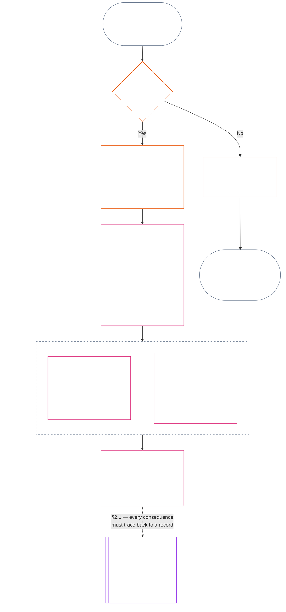
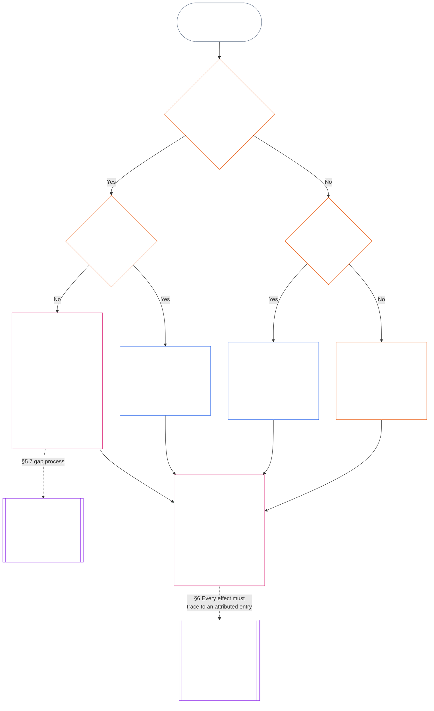

<!-- Complete unreviewed AI-assisted fa translation of current Chapter Eleven; source: core_11.000_standing_assessment.md; source snapshot: 05b7b839; 2026-11-09 source refresh applied. -->

# فصل یازدهم: سوابق جایگاه — پرسش ۱، چه اتفاقی افتاد؟

<strong>جایگاه در پیکره (غیرعملیاتی): ساختار پرونده و قواعد خواندن</strong>

> این پرونده **بخشی از قانون اساسی حس‌مندان** است و فقط **در کنار** دیگر پرونده‌های شماره‌دار `core_*` که به‌صورت یک متن خوانده می‌شوند الزام‌آور است. این پرونده **فصل یازدهم** را دربرمی‌گیرد: سه پرسشِ مسیر جایگاه و **پرسش ۱** (*چه اتفاقی افتاد؟*)، در **§۱ تا §۶**. پاسخ **پرسش ۲** (*چقدر خوب یا بد بود؟*) در [فصل دوازدهم](core_12_standing_measurement.md#chapter-twelve-standing-measurement--question-2-how-good-or-bad-was-it) داده می‌شود. پرسش ۳ (*در پی آن چه رخ می‌دهد؟*) در [فصل سیزدهم](../../core_13.000_standing_integration.md#chapter-thirteen-standing-effects-and-integration) ادامه می‌یابد؛ بازبینی برای یافته‌های واجد شرایطِ محور نقض با `s` = ۷–۹ به تعیینِ تخلف ضدقانون‌اساسی در [فصل چهاردهم](../../core_14.000_misconduct_designation.md#chapter-fourteen-anti-constitutional-misconduct) محدود است. ترتیب خواندن، تفکیک متن الزام‌آور از پشتیبان و فرادادهٔ ویرایش پیکره در [README.md](README.md) نگهداری می‌شوند.

<strong>راهنمای خواننده (غیرعملیاتی): جایگاه فصل یازدهم و آنچه در اینجا می‌ماند</strong>

> | پرسش | متولی و نقش |
> | --- | --- |
> | **۱. چه اتفاقی افتاد؟** | فصل یازدهم (این پرونده): احراز واقعیت‌های راستی‌آزمایی‌شده در سابقهٔ جایگاهِ محدود و قابل اعتراض. |
> | **۲. چقدر خوب یا بد بود؟** | [فصل دوازدهم](core_12_standing_measurement.md#chapter-twelve-standing-measurement--question-2-how-good-or-bad-was-it): سنجش واقعیت‌های راستی‌آزمایی‌شده بدون ادغام یاری و آسیب. |
> | **۳. در پی آن چه رخ می‌دهد؟** | ادامه در [فصل سیزدهم](../../core_13.000_standing_integration.md#chapter-thirteen-standing-effects-and-integration). |
>
> ادعاها، محبوبیت و روایت‌های اختلاف پاسخ پرسش ۱ نیستند. رتبه‌بندیِ مطلوب نمی‌تواند واقعیت‌های پرسش ۱ را فراهم کند و پیامدِ مطلوب نمی‌تواند رتبه‌بندی پرسش ۲ را تعیین کند.

<strong>ردیابی</strong>

- پیشین:
  - [چهارگانهٔ قانون اساسی](core_00_preamble.md#constitutional-tetrad)؛
  - [دو هدف قانون اساسی](core_00_preamble.md#two-constitutional-aims)؛
  - [اهمیت مادی](core_00_preamble.md#material-stake)؛
  - [مقدمه §۶ زنجیره‌های عملی فرایندهای کلیدی](../../core_00.000_preamble.md#6-key-practical-process-pipelines) (*زنجیرهٔ فصل‌های نهم تا پانزدهم*).
- پیشین:
  - [فصل یکم](core_01_c_stewardship_capacity_principles.md#chapter-01-principles-and-constraints) (1.010) (*سرپرستیِ دسترس‌پذیر به زبان ساده* در شرح سطح بخش بازتاب یافته است)؛
  - [فصل یکم §۱۶ — سرپرستی به‌تفصیل](core_01_c_stewardship_capacity_principles.md#16-stewardship-in-depth) (1.010 §16) (*بنیاد لایهٔ اصول برای جایگاهِ پیوندخورده با شایستگی و قابل ردیابی — اعتماد، نقش‌ها و بازشناسی*)؛
  - [فصل‌های دوم تا چهارم](core_02_definition_structure.md) (*تمامیت، سوابق و راستی‌آزمایی*)؛
  - [فصل پنجم](core_05__definitions_home.md#chapter-five-foundational-definitions) (5.000) (*تعریف‌ها و برتری که همراه فصل‌های دوم تا چهارم خوانده می‌شود*).
- پیشین: [فصل نهم](core_09.000_system_alignment_certification_evaluation.md#chapter-nine-system-alignment-certification) (9.000) (*گواهی هم‌راستایی سیستم*)؛ [بخش ج فصل نهم §۱۱](core_09.010_system_alignment_certification_record_recertification.md#11-relationship-to-standing) (9.010 §11) (*پیوند جایگاه — فقط داده‌های ورودیِ بالقوهٔ راستی‌آزمایی‌شده*).
- مسیر جایگاه:
  - [مقدمه §۶.۲ چگونگی پیوستن کل زنجیره](../../core_00.000_preamble.md#62-how-the-full-chain-fits-together)؛
  - [فصل یازدهم — سوابق جایگاه](#chapter-eleven-standing-records--question-1-what-happened) (11.000) (*چارچوب سه پرسش و سوابق پرسش ۱*)؛
  - [فصل دوازدهم — اندازه‌گیری جایگاه](core_12_standing_measurement.md#chapter-twelve-standing-measurement--question-2-how-good-or-bad-was-it) (12.000) (*اندازه‌گیری پرسش ۲*)؛
  - [فصل سیزدهم — آثار جایگاه و یکپارچه‌سازی](../../core_13.000_standing_integration.md#chapter-thirteen-standing-effects-and-integration) (13.000) (*آثار و یکپارچه‌سازی پرسش ۳*)؛
  - [فصل چهاردهم](../../core_14.000_misconduct_designation.md#chapter-fourteen-anti-constitutional-misconduct) (14.000) (*فقط تعیین وضعیت برای یافته‌های واجد شرایطِ محور نقض، s = 7–9*).
- زیربخش‌های این پرونده:
  - [§۱](#1-the-three-questions) (*چارچوب سه پرسش و دامنه*)؛
  - [§۲](#2-question-1--what-happened) (*پرسش ۱ — واقعیت‌ها و سوابق راستی‌آزمایی‌شده*)؛
  - [§۳](#3-question-1-event-type-guide--what-kind-of-help-or-harm-occurred) (*راهنمای نوع رویداد پرسش ۱ — گونه‌های یاری و آسیب*)؛
  - [§۴](#4-standing-record-operational-requirements) (*الزامات راستی‌آزمایی و ثبت*)؛
  - [§۵](#5-record-custody-and-opening-authority) (*نگهداری سوابق و اختیار گشودن*)؛
  - [§۶](#6-handling-a-standing-record) (*رسیدگی به سابقهٔ جایگاه*).
- پسین:
  - [فصل دوازدهم](core_12_standing_measurement.md#chapter-twelve-standing-measurement--question-2-how-good-or-bad-was-it) (12.000) (*پرسش ۲ — مبنای LEQU، ابعاد اندازه‌گیری، توصیف‌گرهای مسیر، دستور زبان جایگاه، داده‌های ورودی قانون اساسی، مقیاس LEQU، معیارهای استاندارد مشارکت، شرح نمونه‌ها و تحویل به پرسش ۳*)؛
  - [فصل چهاردهم](../../core_14.000_misconduct_designation.md#chapter-fourteen-part-a-anti-constitutional-misconduct-designation) (14.000) (*فقط تعیین وضعیت — اندازه‌گیری پرسش ۲ را دوباره نمی‌گشاید*)؛
  - [فصل پانزدهم](../../core_15.000_forum.md#chapter-fifteen-forums-and-jurisdiction) (15.000) (*نظارت مجمع و ارجاع*)؛
  - [مادهٔ XXVI-C](../../core_06.020_rights_part_e.md#article-xxvi-c-timely-resolution-and-anti-delay-floor) (*حل‌وفصل به‌موقع*)؛
  - [مادهٔ XX](core_06_rights_part_d.md#article-xx-a-justice-objective-and-scope) (*محدودیت‌های عدالت*).
- همراه با این موارد خوانده شود: [فصل پنجم *وضعیت جایگاه، مشارکت و نقض*](../../core_05.035_band_accountability.md#defa3-standing-state-contribution-and-violation) (5.035) (*ارجاع به تعریف‌های معیار*).
- همراه با این موارد خوانده شود: [README.md](README.md) (*ترتیب خواندن*)؛ [doc_architecture.md](../../doc_architecture.md) (*نقشه‌های ویرایشیِ غیرالزام‌آور، مگر آنکه پذیرفته شوند*).

 

فصل یازدهم متولی قانون اساسیِ **سابقهٔ واقعیِ راستی‌آزمایی‌شده (پرسش ۱)** است. این فصل از [§۱ سه پرسش](#1-the-three-questions) تا [§۶ رسیدگی به سابقهٔ جایگاه](#6-handling-a-standing-record) را دربرمی‌گیرد. [فصل دوازدهم](core_12_standing_measurement.md#chapter-twelve-standing-measurement--question-2-how-good-or-bad-was-it) متولی پرسش ۲ است؛ از [فصل دوازدهم §۱ پرسش ۲ — چقدر خوب یا بد بود؟](core_12_standing_measurement.md#1-question-2--how-good-or-bad-was-it) تا [فصل دوازدهم §۹ تحویل به پرسش ۳ — پیوندهای اندازه‌گیری میان پرسش‌ها](core_12_standing_measurement.md#9-hand-off-to-question-3--cross-question-measurement-hooks). پرسش ۳ در فصل سیزدهم ادامه می‌یابد.

*به زبان ساده: این فصل آنچه رخ داده را می‌نویسد و سابقهٔ جایگاه را نگه می‌دارد. اینکه چقدر خوب یا زیان‌بار بوده در فصل دوازدهم، در دو مسیر جداگانه و هرگز به‌صورت یک امتیاز خالص، سنجیده می‌شود. تشکیل پرونده به‌خودی‌خود جایگاه ایجاد نمی‌کند.*

### 1. سه پرسش

*به زبان ساده: وضعیت با پاسخ‌دادن به سه پرسش به‌ترتیب تعیین می‌شود. از رتبه‌بندی مطلوب، واقعیت‌ها را استنباط نکنید و برای توجیه پیامد مطلوب، رتبه‌بندی را انتخاب نکنید.*

| پرسش | پرسش چه می‌خواهد بداند؟ | پاسخ کجا داده می‌شود؟ |
| --- | --- | --- |
| **1. چه اتفاقی افتاد؟** | کدام واقعیت‌ها راستی‌آزمایی شده‌اند، دربارهٔ چه کسی یا چه چیزی، در چه دوره‌ای، و وضعیت سابقهٔ وضعیت و اعتراض به آن چیست؟ | [بخش 2](#2-question-1--what-happened) و [بخش 3](#3-question-1-event-type-guide--what-kind-of-help-or-harm-occurred) |
| **2. چقدر خوب یا بد بود؟** | آن واقعیت‌ها چه نوع و چه اندازه‌ای از مشارکت یا نقض را اثبات می‌کنند؟ | [فصل دوازدهم، بخش 1](core_12_standing_measurement.md#1-question-2--how-good-or-bad-was-it) |
| **3. در پی آن چه رخ می‌دهد؟** | چه شناخت، آمادگی، جبران، تضمین، محدودیت یا پیامد دیگری در پی می‌آید؟ | [فصل سیزدهم](../../core_13.000_standing_integration.md#chapter-thirteen-standing-effects-and-integration) |

پاسخ هر پرسش به پاسخ پرسش پیش از آن وابسته است:

- پرسش 1 واقعیت‌های راستی‌آزمایی‌شده را برای پرسش 2 فراهم می‌کند.
- پرسش 2 آن واقعیت‌ها را برای پرسش 3 اندازه‌گیری می‌کند.
- پرسش 3 نباید واقعیت‌ها یا رتبه‌بندی را برای رسیدن به نتیجه‌ای ترجیحی بازنویسی کند.

پاسخ‌های هر سه پرسش در کنار هم ارزیابی کامل وضعیت را برای یک رویداد محدود یا یک الگوی تعریف‌شده تشکیل می‌دهند. یک موضوع ممکن است در طول زمان چند ارزیابی از این دست داشته باشد، اما هیچ‌یک امتیاز خالص یا رتبه‌بندی کلی آن موضوع نیست. سوابق وضعیتِ مشارکت و نقض پاسخ‌های پرسش‌های 1 و 2 را حفظ می‌کنند؛ تصمیم پرسش 3 می‌گوید چه چیزی از آن‌ها در پی می‌آید.

#### 1.1 هدف و دامنه

این فصل چارچوب سابقهٔ قانون اساسی را و [فصل دوازدهم](core_12_standing_measurement.md#chapter-twelve-standing-measurement--question-2-how-good-or-bad-was-it) چارچوب اندازه‌گیری را برای **سیستم‌ها**، **حس‌مندان** و **نهادها** تعیین می‌کند؛ ازجمله برای هر سیستمی که بر اساس [**CS-9.305**](../../corpus_systems/cs_09.305_system_classification_machinery.md#cs-9305-part-a-system-classification-machinery) (*سازوکار طبقه‌بندی سیستم*) طبقه‌بندی شده باشد. این چارچوب‌ها شایعه، محبوبیت، شهرت مبهم، کرامت ذاتی یا ارزش کلی را اندازه‌گیری نمی‌کنند؛ هیچ‌یک موضوع مجاز ارزیابی وضعیت نیست.

زنجیرهٔ وضعیت باید در این شرایط نیز کارآمد بماند:

- مشارکت‌هایی که قبلاً راستی‌آزمایی شده‌اند آن‌قدر قدیمی شوند که دیگر شایستگی یا قابلیت اعتماد کنونی را نشان ندهند؛
- نقض‌ها حل‌نشده بمانند؛
- جبران پرهزینه باشد؛
- مسئولیت از مرزها عبور کند؛ یا
- کنشگری برای مختل‌کردن پاسخگویی از لایه‌بندی یا تغییر نام سازمانی استفاده کند.

موارد زیر در متن اجراییِ مصوب قرار می‌گیرند:

- رویه‌های روزمره؛
- گام‌های تشدید؛
- عملیات اعاده و جبران؛
- سنجه‌های پاسخگویی ترمیمی؛ و
- طراحی مشوق‌ها.

اندازه‌گیری فصل دوازدهم **به‌خودی‌خود** مجوز استفاده از زور، بازداشت یا محدودیت دیگری بر آزادی نیست. هر پیامد از این دست باید مستقلاً الزامات فصل ششم، **مادهٔ XX** (*عدالت پس از نقض راستی‌آزمایی‌شده*) را برآورده کند؛ ازجمله الزامات تناسب، کم‌محدودکننده‌ترین گزینه، محدودیت زمانی، اعاده و پاسخگویی ترمیمی.

<strong>ردیابی · تعریف‌ها · ارزیابی · انطباق</strong>

- پیشین‌ها: [فصل یک §16 — سرپرستی در عمق](core_01_c_stewardship_capacity_principles.md#16-stewardship-in-depth)؛ [فصل‌های دو تا چهار](core_02_definition_structure.md)؛ [فصل پنج](core_05__definitions_home.md#chapter-five-foundational-definitions).
- پسین‌ها: [§2](#2-question-1--what-happened) (*پرسش 1*)؛ [§4](#4-standing-record-operational-requirements) (*الزامات راستی‌آزمایی و سابقه*)؛ [§5](#5-record-custody-and-opening-authority) (*نگهداری سابقه و اختیار گشودن آن*)؛ [§6](#6-handling-a-standing-record) (*رسیدگی به سابقهٔ وضعیت*)؛ [فصل دوازدهم §1](core_12_standing_measurement.md#1-question-2--how-good-or-bad-was-it) (*اندازه‌گیری پرسش 2*)؛ [فصل دوازدهم §2](core_12_standing_measurement.md#2-magnitude-and-severity-input-dimensions) (*ابعاد ورودی اندازه‌گیری*)؛ [فصل دوازدهم §3](core_12_standing_measurement.md#3-route-descriptor-catalogs-and-measurement-roles) (*فهرست توصیف‌گرهای مسیر*)؛ [فصل دوازدهم §4](core_12_standing_measurement.md#4-slot-grammar-and-shared-scaling) (*دستور جایگاه و مقیاس‌بندی مشترک*)؛ [فصل دوازدهم §5](core_12_standing_measurement.md#5-constitutional-inputs-to-axis-assignment) (*ورودی‌های قانون اساسی برای تخصیص محور*)؛ [فصل دوازدهم §6](core_12_standing_measurement.md#6-unified-proportional-lequ-scale--contribution-and-violation-axes) (*مقیاس تناسبی یکپارچهٔ LEQU برای هر دو محور*)؛ [فصل سیزدهم](../../core_13.000_standing_integration.md#chapter-thirteen-standing-effects-and-integration) (*پرسش 3*).
- [اهمیت مادی](../../core_05.050_band_oversight.md#materiality) · [O](../../core_05.050_band_oversight.md#materiality) · [M](core_05_band_oversight.md#materiality-determination-a) · [A](core_05_band_oversight.md#materiality-determination-a) · [C](core_05_band_oversight.md#materiality-determination-c)
- [آسیب](../../core_05.035_band_accountability.md#harm) · [O](../../core_05.035_band_accountability.md#harm) · [M](../../core_05.035_band_accountability.md#harm-a) · [A](../../core_05.035_band_accountability.md#harm-a) · [C](../../core_05.035_band_accountability.md#harm-c)
- [تناسب](../../core_05.035_band_accountability.md#proportionality) · [O](../../core_05.035_band_accountability.md#proportionality) · [M](../../core_05.035_band_accountability.md#proportionality-a) · [A](../../core_05.035_band_accountability.md#proportionality-a) · [C](../../core_05.035_band_accountability.md#proportionality-c)

### 2. پرسش 1 — چه اتفاقی افتاد؟

<strong>ردیابی</strong>

- پیشین‌ها: [§1](#1-the-three-questions) (*چارچوب سه‌پرسشی*)؛ [فصل‌های دو تا چهار](core_02_definition_structure.md) (*سابقه، راستی‌آزمایی و قابلیت ردیابی تعریف‌ها تا نتایج*).
- پایه‌های چهارگانه: **مشارکت**؛ **نظارت** (قابلیت اعتراض و مسیرهای چالش). هدف‌های اصلی: **شکوفایی** و **پیوستگی** (سوابق قابل‌ردیابی که یافته‌های مشارکت و نقض را برای اندازه‌گیری بعدی جداگانه حفظ می‌کنند).
- پسین‌ها:
  - [§2.2](#22-silence-is-the-default) (*سکوت حالت پیش‌فرض است*)؛
  - [§2.3](#23-protected-dissent-is-not-a-trigger) (*اعتراضِ حمایت‌شده محرک نیست*)؛
  - [§2.4](#24-linked-standing-records-and-no-offset-bridge) (*پل سوابق وضعیت پیوندخورده و نبود تهاتر*)؛
  - [§2.5](#25-verified-input-gate) (*دروازهٔ ورودی راستی‌آزمایی‌شده*)؛
  - [§2.6](#26-stage-boundary) (*مرز مرحله*)؛
  - [§2.7](#27-forum-boundary) (*مرز مجمع*)؛
  - [§3](#3-question-1-event-type-guide--what-kind-of-help-or-harm-occurred) (*راهنمای نوع رویداد*)؛
  - [§4](#4-standing-record-operational-requirements) (*الزامات سابقه*)؛
  - [§5](#5-record-custody-and-opening-authority) (*نگهداری سابقه و اختیار گشودن آن*)؛
  - [§6](#6-handling-a-standing-record) (*رسیدگی به سابقهٔ وضعیت*)؛
  - [فصل دوازدهم §1](core_12_standing_measurement.md#1-question-2--how-good-or-bad-was-it) (*اندازه‌گیری پرسش 2*)؛
  - [فصل دوازدهم §2](core_12_standing_measurement.md#2-magnitude-and-severity-input-dimensions) (*ابعاد ورودی اندازه‌گیری*)؛
  - [فصل دوازدهم §3](core_12_standing_measurement.md#3-route-descriptor-catalogs-and-measurement-roles) (*فهرست توصیف‌گرهای مسیر*)؛
  - [فصل دوازدهم §4](core_12_standing_measurement.md#4-slot-grammar-and-shared-scaling) (*دستور جایگاه و مقیاس‌بندی مشترک*)؛
  - [فصل دوازدهم §5](core_12_standing_measurement.md#5-constitutional-inputs-to-axis-assignment) (*ورودی‌های قانون اساسی برای تخصیص محور*)؛
  - [فصل دوازدهم §6](core_12_standing_measurement.md#6-unified-proportional-lequ-scale--contribution-and-violation-axes) (*مقیاس تناسبی یکپارچهٔ LEQU برای هر دو محور*)؛
  - [فصل سیزدهم](../../core_13.000_standing_integration.md#chapter-thirteen-standing-effects-and-integration) (13.000) (*پرسش 3*).

 

*به زبان ساده: پرسش 1 گزارشی محدود و اعتراض‌پذیر از آنچه رخ داده برقرار می‌کند. پیش از بررسی هر رتبه‌بندی یا پیامدی، موضوع، رویداد یا الگو، دورهٔ زمانی، واقعیت‌های راستی‌آزمایی‌شده و وضعیت سابقه را مشخص می‌کند. کمکِ راستی‌آزمایی‌شده و نقضِ راستی‌آزمایی‌شده در سوابق وضعیت جداگانه ثبت می‌شوند تا یکی دیگری را پاک نکند. این سوابق امتیاز محبوبیت یا برچسب‌های مبهم نیستند.*

**سابقهٔ وضعیت** سابقه‌ای محدود است که این فصل برای موضوع، دامنهٔ کارکردی، بازهٔ سابقه، وضعیت بازبینی و زمینهٔ تصمیم معینی به کار می‌برد. پیش از آغاز اندازه‌گیری، باید مشخص کند:

- سابقهٔ وضعیت دربارهٔ چه کسی یا چه چیزی است؛
- به یک رویداد محدود مربوط است یا الگویی تعریف‌شده؛
- رفتار و آثار مربوط چه وقت و کجا رخ داده‌اند؛
- کدام واقعیت‌ها راستی‌آزمایی شده و کدام‌ها هنوز مورد اختلاف‌اند؛
- چه شواهد، انتساب و مسیر چالشی از یافته‌ها پشتیبانی می‌کنند؛ و
- وضعیت کنونیِ بازبینی، اصلاح و جایگزینی سابقهٔ وضعیت چیست.

نمودار رویدادی را دنبال می‌کند تا ببیند آیا محرکِ سابقهٔ وضعیت است و سپس سابقه چه چیزهایی را در خود نگه می‌دارد؛ زیر‌بخش‌های بعدی هر قاعده را بیان می‌کنند. شاخهٔ «نه» از مسیر اصلی به سمت راست خارج می‌شود.

#### 2.1 سوابق وضعیت: انواع و موضوع‌ها

پرسش 1 برای کمکِ راستی‌آزمایی‌شده از **سابقهٔ وضعیت مشارکت** و برای آسیبِ راستی‌آزمایی‌شده، ازجمله شکست‌های پاسخگویی، از **سابقهٔ وضعیت نقض** استفاده می‌کند. یک سابقهٔ وضعیت هر دو نوع یافته را با هم ترکیب نمی‌کند.

- سابقهٔ وضعیت می‌تواند دربارهٔ یک حس‌مند، نهاد، سیستم، ارزیابی، رویداد محدود، نقش، جمع، سابقهٔ مربوط به کنشگری خاص یا واحد دیگری با اهمیت برای قانون اساسی باشد.
  - نباید موضوع‌ها، نقش‌ها، سیستم‌ها، اجتماعات، بازه‌های سابقه، وضعیت‌های بازبینی یا زمینه‌های تصمیم متمایز را در یک برچسب وضعیتِ تفکیک‌نشده ادغام کند.
- سابقهٔ وضعیت می‌تواند یک **رویداد محدود** — یک رخداد با آغاز و پایان روشن — یا یک **الگو** از رفتار تکرارشونده را پوشش دهد.
  - الگو به موضوع، دامنه و دورهٔ بازبینی تعریف‌شده نیاز دارد.
- یک موضوع ممکن است در طول زمان چند سابقهٔ وضعیت داشته باشد، ازجمله سوابق وضعیتِ پیوندخوردهٔ مشارکت و نقض.
  - هرگاه موضوع مشترک، بازهٔ هم‌پوشان سابقه، رویداد محدود، الگو یا زمینهٔ تصمیم مشترک باشد، سوابق وضعیت مرتبط باید طبق **بخش 4.2** به یکدیگر **ارجاع متقابل** دهند.
- سابقهٔ وضعیت، امتیاز مستقل شهرت، رتبهٔ کرامت، وضعیت دائمی، برچسب ارزش کلی یا کارنامهٔ امتیازِ ادغام‌شده نیست.
  - الزامات عملیاتی در **بخش 4** آمده‌اند.

هر اثر بعدی بر وضعیت به فصل سیزدهم تعلق دارد و باید بدون آن‌که بخشی از خود سابقه شود، به سابقه یا سوابق وضعیت مرتبط قابل‌ردیابی باشد.

#### 2.2 سکوت حالت پیش‌فرض است

نداشتن سابقهٔ وضعیت، حالت معمولِ یک حس‌مند، نهاد یا سیستم است و بیشتر حس‌مندان در همین حالت می‌مانند.

- سابقهٔ وضعیت فقط وقتی گشوده می‌شود که محرکی طبق **بخش 4** راستی‌آزمایی شده باشد. مرجع نام‌گذاری‌شدهٔ گشودن سابقه باید ورودی را تأیید کند و نگهدارندهٔ جداگانهٔ سابقه باید آن را ثبت کند (**بخش 5**). سابقهٔ وضعیت هرگز برای موارد زیر گشوده نمی‌شود:
  - ایجاد خط مبنا؛
  - تکمیل یک فهرست؛ یا
  - چون نگهبانِ مسیرِ مشروط ترجیح دهد.
- نداشتنِ پروندهٔ جایگاه هیچ معنایی ندارد. «امتیازدهی‌نشده»، «راستی‌آزمایی‌نشده» و «پرونده‌ای ثبت نشده» دلیلِ خطر، مشارکتِ اندک یا هیچ چیز دیگری نیستند. هیچ‌کس نمی‌تواند نبودِ پرونده را دلیلی برای بررسیِ دقیق‌تر، پیش‌فرضِ پایین‌تر یا دسترسیِ مشروط به یک مسیرِ مشروط بداند.
- هیچ نهاد یا سیستمی نمی‌تواند وجود سابقهٔ وضعیت، گواهیِ «سابقه‌ای وجود ندارد» یا رضایت به گشودن سابقه را شرط موارد زیر قرار دهد:
  - نیازهای ضروریِ **مادهٔ III** (*بقا و دسترسی ضروری*)؛
  - حمایت‌های **مادهٔ III-C** (*کار و کف اقتصادی*)؛
  - دادوستد معمول؛ یا
  - مشارکت به‌عنوان طرف اثرپذیر.
  موانعِ صلاحیتِ منتشرشده برای مسیرهایِ مشروطِ خاصِ حساس به اعتماد، ذیل [فصل سیزدهم §7.2 موانع صلاحیت و مجوزها](../../core_13.000_standing_integration.md#72-competency-bars-and-clearances) استثنا هستند و باید توضیح دهند چرا مسیرِ مشروط حساس به اعتماد است.
- وقتی سابقهٔ وضعیت دربارهٔ موضوعی گشوده می‌شود، طبق الزام **بخش 4** باید آن موضوع را آگاه کرد. اطلاع‌رسانی فقط وقتی ممکن است به تأخیر افتد که نیاز مستند به [حفظ مدرک](core_05_band_oversight.md#evidence-preservation) یا ایمنی آن را توجیه کند، و فقط برای مدتی محدود و تعیین‌شده. اطلاع‌رسانی سابقهٔ وضعیت را اعتراض‌پذیر می‌کند: موضوعی که نمی‌داند سابقه‌ای وجود دارد نمی‌تواند به آن اعتراض کند یا آن را اصلاح کند.

#### 2.3 اعتراض حمایت‌شده محرک نیست

اعتراض یا تظاهرات مسالمت‌آمیز — ازجمله [نافرمانی مدنیِ حمایت‌شده و بدون خشونت](core_06_rights_part_b.md#xi-d-nonviolent-civil-disobedience) — طبق **مادهٔ XI-D** (*تجمع، اعتراض و تظاهرات مسالمت‌آمیز*) ([*کف اعتراض و تظاهرات مسالمت‌آمیز*](core_06_rights_part_b.md#xi-d-dissent-and-peaceful-protest)) محرکِ راستی‌آزمایی‌شده نیست.

- این کار سابقهٔ وضعیت نقض را نمی‌گشاید، تمدید یا تشدید نمی‌کند؛ ورودی شدت طبق **بخش 8.2** نیست؛ و تکرارش آن را به الگو تبدیل نمی‌کند.
- رفتارِ قابل‌تفکیکی که مستقلاً یک کفِ قانون اساسی را نقض می‌کند بر اساس شرایط خودش ثبت می‌شود، بدون تشدید به‌دلیل دیدگاه، هدف یا طرفِ هدفِ اعتراض.

#### 2.4 سوابق وضعیت پیوندخورده و پلِ نبود تهاتر

<strong>ردیابی</strong>

- پیشین: [§2.1](#21-standing-records-kinds-and-subjects) (*سوابق جداگانهٔ مشارکت و نقض*).
- پسین‌ها:
  - [§2.5](#25-verified-input-gate) (*دروازهٔ ورودی راستی‌آزمایی‌شده*)؛
  - [§2.7](#27-forum-boundary) (*مرز مجمع*)؛
  - [§4.2](#42-related-standing-record-cross-references) (*ارجاع‌های متقابل*)؛
  - [فصل دوازدهم §1](core_12_standing_measurement.md#1-question-2--how-good-or-bad-was-it) (*اندازه‌گیری پرسش 2*)؛
  - [فصل دوازدهم §2](core_12_standing_measurement.md#2-magnitude-and-severity-input-dimensions) (*ابعاد ورودی اندازه‌گیری*)؛
  - [فصل دوازدهم §3](core_12_standing_measurement.md#3-route-descriptor-catalogs-and-measurement-roles) (*فهرست توصیف‌گرهای مسیر*)؛
  - [فصل دوازدهم §4](core_12_standing_measurement.md#4-slot-grammar-and-shared-scaling) (*دستور جایگاه و مقیاس‌بندی مشترک*)؛
  - [فصل دوازدهم §5](core_12_standing_measurement.md#5-constitutional-inputs-to-axis-assignment) (*ورودی‌های قانون اساسی برای تخصیص محور*)؛
  - [فصل دوازدهم §6](core_12_standing_measurement.md#6-unified-proportional-lequ-scale--contribution-and-violation-axes) (*مقیاس تناسبی یکپارچهٔ LEQU برای هر دو محور*)؛
  - [فصل سیزدهم](../../core_13.000_standing_integration.md#chapter-thirteen-standing-effects-and-integration) (13.000) (*پرسش 3*).
- برای مطالعهٔ همراه: [فصل سیزدهم — یکپارچه‌سازی جایگاه](../../core_13.000_standing_integration.md#3-automatic-integration-review-and-continuity) (13.000) (*عدم اسقاط و یکپارچه‌سازی پرونده‌های مرتبط*); [فصل سیزدهم §7.2 — موانع صلاحیت و مجوزها](../../core_13.000_standing_integration.md#72-competency-bars-and-clearances) (13.000 §7.2); [فصل سیزدهم §5.2 — قفل‌های جایگاه](../../core_13.000_standing_integration.md#52-prevention--general-standing-locks) (13.000 §5.2).

 

**قاعدهٔ اصلی:** **سوابق وضعیتِ مشارکت** راستی‌آزمایی‌شده و **سوابق وضعیتِ نقض** راستی‌آزمایی‌شده طبق **بخش 2.1** جدا نگه داشته می‌شوند. هر یافتهٔ مشارکت یا نقض باید بر واقعیت‌های پشتیبانی‌شدهٔ خودش در سابقهٔ وضعیت خودش متکی باشد. تحلیل و مدارک پشتیبان باید دو مسیر سابقه را جداگانه قابل‌ردیابی نگه دارند. هیچ مدخل منفرد یا مجموعهٔ پیوندخورده‌ای امتیاز خالص، امتیاز ترکیبی یا معامله نیست.

- **سوابق وضعیتِ نقض و قفل‌های وضعیت:**
  - طبق فصل سیزدهم، **قفل‌های وضعیت** قابل‌اعمال که از سوابق وضعیت نقض گرفته شده‌اند، ممکن است وضعیت را محدود کنند، صلاحیت نقش را کاهش دهند یا تا زمانی که نقض راستی‌آزمایی‌شده حل‌نشده است بر دسترسی به جبران اثر بگذارند.
  - قفل‌های وضعیت نباید مشارکت مثبت راستی‌آزمایی‌شده‌ای را که در سوابق وضعیت مشارکت ثبت شده محو کنند.
  - صرف گذشت زمان، از شدت نقض‌های راستی‌آزمایی‌شدهٔ حل‌نشده نمی‌کاهد.
  - نقض‌های راستی‌آزمایی‌شده نباید سوابق وضعیتِ مشارکت نامرتبط را به پروندهٔ شهرت منفیِ کاذب تبدیل کنند.
- **سوابق وضعیتِ مشارکت و مجوزهای شایستگی:**
  - مشارکت راستی‌آزمایی‌شده ممکن است از **مجوزهای شایستگی** قابل‌اعمال بر اساس **آستانه‌های شایستگی** منتشرشده حمایت کند و، در صورت به‌روز و مرتبط‌بودن با نقش، از صلاحیت مرتبط با اعتماد، نقش یا شناخت نیز پشتیبانی کند.
  - مشارکت راستی‌آزمایی‌شده نباید یافتهٔ نقضِ راستی‌آزمایی‌شده را تهاتر، میانگین‌گیری و کم‌اهمیت، توجیه یا بازنام‌گذاری کند.
  - برآورده‌شدن دروازه هیچ قفل وضعیتِ قابل‌اعمالی را اسقاط نمی‌کند.

**تنها استثنا:** اگر خودِ یافتهٔ نقض، مشارکت ادعاشده را رد کند — برای مثال، اگر مدرک نشان دهد کاری را که سابقهٔ مشارکت شما ادعا می‌کند واقعاً انجام نداده‌اید — سابقهٔ وضعیت مشارکتِ پیوندخورده را می‌توان از راه فرایند درستِ شواهد و بازبینی اصلاح یا حذف کرد، با ارجاع متقابلِ لازم طبق **بخش 4.2**. اما نقض به‌طور خودکار کمک نامرتبطی را که در سوابق وضعیتِ جداگانهٔ مشارکت ثبت شده پاک نمی‌کند.

#### 2.5 دروازهٔ ورودی راستی‌آزمایی‌شده

این دروازه چنین عمل می‌کند:

- هر تصمیمی که بر وضعیت، اعتماد، نقش، شناخت یا صلاحیت برای دریافت شناخت اثر بگذارد فقط می‌تواند از ورودی‌های راستی‌آزمایی‌شدهٔ **سوابق وضعیتِ مشارکت** یا **سوابق وضعیتِ نقض** مربوط استفاده کند.
- ادعاها، دعوی‌های تعیین‌تکلیف‌نشده، برچسب‌های مسیریابی موقت، روایت‌های صرفاً ورودی و دیگر مواد مرحلهٔ اختلاف، به‌تنهایی ماهیت مشارکت یا ماهیت نقض را برای وضعیت فراهم نمی‌کنند.
- ورودی راستی‌آزمایی‌شده یک **یافتهٔ وضعیت** است: یافتهٔ مشارکتِ راستی‌آزمایی‌شده (محور I) یا یافتهٔ نقضِ راستی‌آزمایی‌شده (محور II).
- یافته‌های مشارکت و نقض در سوابق وضعیت جداگانه می‌مانند (نگاه کنید به **بخش 2.1**).

#### 2.6 مرز مرحله

مرحله‌های سابقهٔ وضعیت جدا می‌مانند:

- پرسش 1 واقعیت‌های راستی‌آزمایی‌شده را ثبت می‌کند؛ پرسش 2 آن‌ها را اندازه‌گیری می‌کند.
- سابقهٔ وضعیت به‌محض کامل‌شدن مبنای واقعیِ راستی‌آزمایی‌شده‌اش می‌تواند گشوده شود، حتی اگر اندازه‌گیری پرسش 2 هنوز در انتظار باشد.
- تا پیش از اندازه‌گیری، بخش‌های مربوط به پرسش 2 باید بگویند که کار در انتظار است، نه این‌که جایگاه یا دسته‌ای را القا کنند.
- سابقهٔ وضعیت نباید **اثر وضعیتیِ** پرسش 3 را بیان یا اعمال کند.

#### 2.7 مرز مجمع

*به زبان ساده: مجمع‌ها جایی هستند که اختلاف‌ها نظارت، به چالش کشیده و به نتیجه‌های راستی‌آزمایی‌شده تبدیل می‌شوند — اما ثبت پرونده یا پیروزی در نبرد روایی وضعیت را به‌روز نمی‌کند. دروازهٔ ورودی راستی‌آزمایی‌شده در **بخش 2.5** همچنان اعمال می‌شود. وقتی مجمع بر اساس فصل‌های دو تا چهار واقعیت‌ها را راستی‌آزمایی کند، می‌تواند سابقهٔ وضعیت را **بگشاید، به‌روز کند یا اصلاح کند** — یا پس از اعتراض، **سابقهٔ نادرست را کنار بگذارد**. مجمع‌ها خوب و بد را در یک امتیاز ادغام نمی‌کنند و خودشان دستهٔ وضعیت را ابداع نمی‌کنند.*

این بخش مالک یک پرسش است: کار مجمع چگونه به سابقهٔ وضعیت می‌رسد. گام‌های دیگر زنجیره در اختیار مالکانی است که اینجا نام برده شده‌اند، و زنجیره به‌ترتیب زیر پیش می‌رود:

1. اختلافی ثبت می‌شود و مجمع **سابقهٔ پروندهٔ مجمع** را نگه می‌دارد؛ این سابقه، سابقهٔ وضعیت نیست. مالک: [فصل پانزدهم §2.3 سوابق پروندهٔ مجمع، سوابق وضعیت و اختلاف‌ها](core_11_forum.md#23-forum-case-records-standing-records-and-contests)؛ همچنین [§2.7.1 سابقهٔ پروندهٔ مجمع](#271-forum-case-record) را ببینید.
2. مجمع واقعیت‌ها را بر اساس [فصل‌های دو تا چهار](core_02_definition_structure.md) راستی‌آزمایی می‌کند.
3. یافته‌های راستی‌آزمایی‌شده از دروازهٔ ورودی راستی‌آزمایی‌شده می‌گذرند. مالک: [§2.5 دروازهٔ ورودی راستی‌آزمایی‌شده](#25-verified-input-gate).
4. مرجع نام‌گذاری‌شدهٔ گشودن سابقه، که می‌تواند مجمع باشد، سابقهٔ وضعیت را می‌گشاید، به‌روز می‌کند یا اصلاح می‌کند، یا پس از اعتراض سابقهٔ نادرست را کنار می‌گذارد. مالکان: [§4.1 حداقل محتوای سابقه](#41-minimum-record-contents) برای آنچه سابقهٔ وضعیت نگه می‌دارد، و [§5 نگهداری سابقه و اختیار گشودن آن](#5-record-custody-and-opening-authority) برای اینکه چه کسی می‌تواند اقدام کند.
5. سابقهٔ وضعیت فقط واقعیت‌های راستی‌آزمایی‌شده را نگه می‌دارد و سپس پرسش 2 آن‌ها را اندازه‌گیری می‌کند. مالکان: [§2.6 مرز مرحله](#26-stage-boundary) و [فصل دوازدهم §1 پرسش 2 — چقدر خوب یا بد بود؟](core_12_standing_measurement.md#1-question-2--how-good-or-bad-was-it).
6. اگر اثری بر وضعیت باشد، طبق [فصل سیزدهم](../../core_13.000_standing_integration.md#chapter-thirteen-standing-effects-and-integration) در پی می‌آید؛ آن فصل مالک آثار وضعیت است.

خانواده‌های مجمع طبق [فصل پانزدهم](../../core_15.000_forum.md#chapter-fifteen-forums-and-jurisdiction) **نظارت می‌کنند** که اختلاف‌های عینی چگونه از زنجیرهٔ وضعیت عبور می‌کنند. مجمع‌ها موارد زیر را طبق [فصل پانزدهم §6 حل‌وفصل به‌موقع، سطوح اهمیت مادی و انضباط ضدتأخیر](core_11_forum.md#6-timely-resolution-materiality-tiers-and-anti-delay-discipline) و [مادهٔ XXVI-C](../../core_06.020_rights_part_e.md#article-xxvi-c-timely-resolution-and-anti-delay-floor) (*حل‌وفصل به‌موقع و کف ضدتأخیر*) فراهم می‌کنند:

- امکان اعتراضِ دسترس‌پذیر؛
- بازبینی مستقل؛
- پشتیبانی پزشکی قانونی؛
- ترتیب‌بندی اصلاح؛ و
- مهلت‌های مرحله‌بندی‌شده.

وقتی یافته‌های مجمع در فصل‌های دو تا چهار دروازهٔ ورودی راستی‌آزمایی‌شده را برآورده کنند، می‌توانند:

- طبق **بخش 4.1** سوابق وضعیت را **بگشایند، به‌روز کنند یا اصلاح کنند**؛ یا
- پس از اعتراض، **سابقهٔ نادرست را کنار بگذارند**.

##### 2.7.1 سابقهٔ پروندهٔ مجمع

پروندهٔ خودِ مجمع دربارهٔ اختلافِ گشوده، [**سابقهٔ پروندهٔ مجمع**](../../core_05.035_band_accountability.md#forum-case-record) است که در [فصل پانزدهم §2.3 سوابق پروندهٔ مجمع، سوابق وضعیت و اختلاف‌ها](core_11_forum.md#23-forum-case-records-standing-records-and-contests) تعریف شده است. این **سابقهٔ وضعیت نیست**.

##### 2.7.2 یافته‌های مجمع و اندازه‌گیری پرسش 2

یافته‌های واقعیِ راستی‌آزمایی‌شدهٔ مجمع ممکن است مبنای واقعیِ سابقهٔ وضعیتِ پرسش 1 را فراهم کنند. آن‌ها اندازه‌گیری پرسش 2 دربارهٔ خوب یا بد بودن مشارکت یا نقضِ راستی‌آزمایی‌شده را **تعیین نمی‌کنند** ([§2.6 مرز مرحله](#26-stage-boundary)). بنابراین:

- رسیدگی‌های مجمع نباید مواد مشارکت و نقض را در یک امتیاز خالص، پاسخ ترکیبی دربارهٔ ماهیت اختلاف یا برچسب وضعیتِ تفکیک‌نشده **ادغام کنند**؛ سوابق وضعیت پیوندخورده طبق [§2.1 سوابق وضعیت: انواع و موضوع‌ها](#21-standing-records-kinds-and-subjects) و [§2.4 سوابق وضعیت پیوندخورده و پلِ نبود تهاتر](#24-linked-standing-records-and-no-offset-bridge) جدا می‌مانند.
- خروجی مجمع نباید روایت اختلاف، آسودگی مسیریابی یا ترجیح هیئت را جایگزین ورودی‌های راستی‌آزمایی‌شدهٔ اثبات‌پذیر ([§2.5 دروازهٔ ورودی راستی‌آزمایی‌شده](#25-verified-input-gate))، اندازه‌گیری جداگانه ([فصل دوازدهم §1 پرسش 2 — چقدر خوب یا بد بود؟](core_12_standing_measurement.md#1-question-2--how-good-or-bad-was-it)) یا سازوکارهای اثر بر وضعیتِ متعلق به [فصل سیزدهم](../../core_13.000_standing_integration.md#chapter-thirteen-standing-effects-and-integration) **کند**.

##### 2.7.3 آنچه مرز مجمع کاهش نمی‌دهد

این مرز چالش، جبران، تسکین موقت یا حمایت‌های رویه‌ایِ لازم طبق موارد زیر را **کاهش نمی‌دهد**:

- [مادهٔ XIII-A](core_06_rights_part_c.md#article-xiii-a-reliability-and-trustworthiness-baseline) (*خط مبنای قابلیت اعتماد و امانت‌داری*)؛
- [مادهٔ XIII-B](core_06_rights_part_c.md#article-xiii-b-right-to-redress-and-remedy) (*حق جبران و درمان*)؛
- [فصل پانزدهم §6 حل‌وفصل به‌موقع، سطوح اهمیت مادی و انضباط ضدتأخیر](core_11_forum.md#6-timely-resolution-materiality-tiers-and-anti-delay-discipline)؛
- [مادهٔ XXVI-C](../../core_06.020_rights_part_e.md#article-xxvi-c-timely-resolution-and-anti-delay-floor) (*حل‌وفصل به‌موقع و کف ضدتأخیر*)؛ یا
- مواد مرتبطِ عدالت.

این مرز مقرر می‌کند که یافته‌های راستی‌آزمایی‌شدهٔ مجمع از همان دروازه‌ای وارد وضعیت شوند که دیگر ورودی‌های راستی‌آزمایی‌شده از آن می‌گذرند — نه اینکه آن را دور بزنند.

### 3. راهنمای نوع رویدادِ پرسش 1 — چه نوع کمک یا آسیبی رخ داد؟

*به زبان ساده: پس از راستی‌آزمایی واقعیت‌ها، برای توصیف آنچه رخ داد از این جدول‌ها استفاده کنید. آن‌ها به شناسایی نوع مشارکت یا نقض کمک می‌کنند. تعیین نمی‌کنند چقدر خوب یا بد بوده، جایگاهی تخصیص نمی‌دهند و مشخص نمی‌کنند در پی آن چه رخ می‌دهد.*

#### 3.1 انواع رویداد مشارکت

**قاعدهٔ احراز:** مشارکتِ ادعاشده فقط وقتی محاسبه می‌شود که قابل‌ردیابی، بدون برون‌ریزکردن آسیب و در کلیت با قانون اساسیِ لازم‌الاجرا سازگار باشد.

- آسیب‌های برون‌ریز‌شده، وابستگی‌های قهری، محدودکردن کف حقوق یا بارهای پنهان ممکن است مشارکت ادعاشده را بی‌اعتبار یا محدود کنند.
- مشارکت ادعاشده یک یافتهٔ جداگانهٔ نقض را تهاتر نمی‌کند.

هر ردیف جدول زیر مسیر رایجی از کمکِ راستی‌آزمایی‌شده و ارتباط آن با قانون اساسی را نام می‌برد. ممکن است چند ردیف دربارهٔ یک سابقهٔ وضعیت مصداق داشته باشند.

| نوع مشارکتِ راستی‌آزمایی‌شده | چه اتفاقی افتاد؟ | پایه یا پایه‌های چهارگانه | هدف یا هدف‌های اصلی |
| --- | --- | --- | --- |
| بقا و نگهداری جسمانی | کسی غذا، سرپناه، مراقبت پزشکی یا ایمنی دریافت کرد | **مشارکت**، **نظارت** | **شکوفایی** |
| مراقبت و آموزش | از کودکان مراقبت شد، سالمندان نگهداری شدند یا دیگران آموزش دیدند | **مشارکت**، **نظارت** | **شکوفایی**، **پیوستگی** |
| بهبود از تروما | کسی برای بهبود از آسیب روانیِ مانع بهزیستی کمک دریافت کرد | **مشارکت**، **پاسخگویی** | **شکوفایی** |
| حذف بارهای شدید | بدهی کمرشکن، شرایط کاری استثمارگرانه یا موانع نظام‌مند برداشته شد | **مشارکت**، **نظارت** | **شکوفایی** |
| بازگرداندن عاملیت | کسی انتخاب‌های معناداری دربارهٔ زندگی خود به دست آورد | **مشارکت** | **شکوفایی** |
| گسترش ظرفیت مولد | ابزار، زیرساخت یا فرصت دیگران را قادر کرد مستقلانه شکوفا شوند | **مشارکت**، **نظارت** | **شکوفایی**، **پیوستگی** |
| بهبود کارآمدی زمان | انتظارِ اجتناب‌پذیر، اصطکاک اداری یا سربار هماهنگی کاهش یافت و زمان قابل‌استفاده برای مراقبت، استراحت، عاملیت، یادگیری یا کار سازگار با حقوق بازگردانده شد | **مشارکت**، **نظارت** | **شکوفایی** |
| کاهش خطر زیست‌محیطی یا زیرساختی | فروپاشی محیطی یا خرابی سیستم حیاتی پیشگیری شد | **نظارت**، **پاسخگویی** | **پیوستگی**، **شکوفایی** |
| کاهش ردپای زیست‌محیطی | مصرف منابع، انتشار یا نیاز به زمین و آب به‌صورت راستی‌آزمایی‌شده کاهش یافت، بی‌آنکه بار به دیگران یا اکوسیستم‌ها منتقل شود | **نظارت**، **پاسخگویی** | **پیوستگی**، **شکوفایی** |
| احیای اکوسیستم‌ها | زمین، آب یا زیستگاهی تخریب‌شده به‌سوی وضعیتی کارآمد و خودپایدار بازگردانده شد | **نظارت**، **پاسخگویی** | **پیوستگی**، **شکوفایی** |
| حفاظت از گونه‌های در معرض خطر | گونه‌های در معرض خطر انقراض، یا زیستگاه‌های مورد اتکای آن‌ها، از نابودی محافظت شدند | **نظارت**، **پاسخگویی** | **پیوستگی**، **شکوفایی** |
| کاهش آلودگی و پسماند | آلودگی، انتشار زیان‌بار یا پسماند پیشگیری، حذف یا به‌طور ایمن مدیریت شد | **نظارت**، **پاسخگویی** | **شکوفایی**، **پیوستگی** |
| تقویت ایمنی، حقیقت، قابلیت حسابرسی یا ظرفیت چالش | نهادها یا رویه‌هایی برای حمایت از حقوق و پاسخگو نگه‌داشتن قدرت ساخته یا اصلاح شدند | **مشارکت**، **نظارت**، **پاسخگویی** | **شکوفایی**، **پیوستگی** |

#### 3.2 انواع رویداد نقض

**قاعدهٔ احراز:** نوع رویداد نقض به یافتهٔ نقضِ راستی‌آزمایی‌شده‌ای نیاز دارد که طبق **فصل‌های دو تا چهار** همچنان قابل‌ردیابی، محدود، حسابرسی‌پذیر و اعتراض‌پذیر باشد.

- ادعاها، برچسب‌های موقت، روایت‌های مجمع و برچسب‌های پذیرش ممکن است به مسیریابی یا غربالگری کمک کنند، اما پرسش 1 را کامل نمی‌کنند.
- مشارکت مثبت، نقضِ راستی‌آزمایی‌شده را تهاتر، توجیه، خنثی یا بازنام‌گذاری نمی‌کند.

هر ردیف جدول زیر مسیر رایجی از فقدان، خطر یا شکست وظیفهٔ راستی‌آزمایی‌شده و ارتباط آن با قانون اساسی را نام می‌برد. ممکن است چند ردیف دربارهٔ یک سابقهٔ وضعیت مصداق داشته باشند.

| نوع فقدان یا خطرِ راستی‌آزمایی‌شده | چه اتفاقی افتاد؟ | پایه یا پایه‌های چهارگانه | هدف یا هدف‌های اصلی |
| --- | --- | --- | --- |
| محرومیت از بقا یا نگهداری جسمانی | مرگِ اجتناب‌پذیر، محرومیت از مراقبت، شرایط ناایمن یا محرومیت مادی از بقا رخ داد | **پاسخگویی**، **مشارکت** | **شکوفایی** |
| بار شدیدِ اجتناب‌پذیر | بارهای کمرشکن، تحمیل‌شده یا نظام‌منداً منتقل‌شده به‌طور مادی بهزیستی یا عاملیت را مختل کردند | **پاسخگویی**، **مشارکت** | **شکوفایی** |
| از دست‌دادن قهری عاملیت | اجبار، دست‌کاری، تهدید معتبر، حبس یا خطر آزادی رخ داد | **پاسخگویی**، **مشارکت** | **شکوفایی** |
| خنثی‌سازی کف حقوق | کف‌های غیرقابل‌مذاکرهٔ قانون اساسی، برتری آن یا دسترسی به چالش و جبران به‌طور مادی نقض شدند | **پاسخگویی**، **نظارت** | **شکوفایی**، **پیوستگی** |
| آسیب زیست‌محیطی یا زیرساختی | شرایط لازم برای بهزیستی قانون اساسی آسیب دیدند | **پاسخگویی**، **نظارت** | **پیوستگی**، **شکوفایی** |
| آسیب آلودگی یا پسماند | آلودگی، انتشار زیان‌بار یا پسماند به هوا، آب، خاک یا سلامت آسیب رساند | **پاسخگویی**، **نظارت** | **شکوفایی**، **پیوستگی** |
| تخریب گونه یا زیستگاه | گونه‌های در معرض خطر انقراض یا زیستگاه‌های مورد اتکای آن‌ها نابود، تکه‌تکه یا به‌سوی نابودی سوق داده شدند؛ ازجمله نابودی‌ای که قابل‌تهاتر تلقی می‌شود | **پاسخگویی**، **نظارت** | **پیوستگی**، **شکوفایی** |
| از دست‌رفتن ظرفیت بازیابی زیست‌محیطی | توان اکوسیستم برای نوزایی پس از آسیب از میان برده شد یا بازگرداندنش به‌نحوی اجتناب‌پذیر دشوار یا ناممکن شد | **پاسخگویی**، **نظارت** | **پیوستگی**، **شکوفایی** |
| آسیب یا تخلیهٔ زیست‌محیطی برون‌ریز‌شده | هزینه‌های زیست‌محیطی به دیگران یا اکوسیستم‌ها منتقل شدند، منابع بیش از ظرفیت نوزایی تخلیه شدند، یا ادعای ردپا یا پایداری، وخامت مداوم را پنهان کرد | **پاسخگویی**، **نظارت** | **پیوستگی**، **شکوفایی** |
| نابودی ظرفیت مولد | ابزار، قابلیت‌ها، روابط یا منابع لازم برای شکوفایی مستقلانه از دسترس خارج شدند | **پاسخگویی** | **شکوفایی** |
| تضعیف ایمنی، حقیقت یا قابلیت حسابرسی | پنهان‌کاری، اطلاعات نادرست، سوابق شکسته، مسیرهای چالشِ غیرقابل‌دسترس یا تجمیعِ بازبینی‌ناپذیر رخ داد | **نظارت**، **پاسخگویی** | **شکوفایی**، **پیوستگی** |
| اخلال در پاسخگویی | مداخلهٔ راستی‌آزمایی‌شده در سازوکار پاسخ‌خواهی — سلامت شواهد، راستی‌آزمایی، فرایند مجمع، سوابق وضعیت، پنجره‌های جبران یا مسیرهای اعتراض و دادخواهی — رخ داد؛ اگر اخلال، حمله‌ای فراسطحی به آسیبی زیربنایی و متمایز است، یک سابقهٔ وضعیتِ نقضِ جداگانه و پیوندخورده بگشایید | **پاسخگویی**، **نظارت**، **به‌هنگامی** | **شکوفایی**، **پیوستگی** |
| تسخیر سیستم یا سوءاستفاده از وابستگی | توانمندسازی ساختاری، سوءاستفاده از عدم‌تقارن وابستگی، طراحی ضدگریز یا تسخیر مسیرهای پاسخگویی رخ داد | **پاسخگویی**، **مشارکت** | **پیوستگی**، **شکوفایی** |

### ۴. الزامات راستی‌آزمایی و ثبت

<strong>ردیابی</strong>

- پیشین: [§۲](#2-question-1--what-happened) (*سوابق پرسش ۱ و راهنمای نوع رویداد*)؛ [فصل‌های دوم تا چهارم](core_02_definition_structure.md) (*ثبت، راستی‌آزمایی و ردیابی‌پذیری تعریف‌ها تا نتایج*).
- پسین:
  - [§۴.۱](#41-minimum-record-contents) (*حداقل محتوا*);
  - [§۴.۲](#42-related-standing-record-cross-references) (*ارجاع‌های متقابل*);
  - [§۵](#5-record-custody-and-opening-authority) (*نگهداری سوابق و اختیار گشودن*);
  - [§۶](#6-handling-a-standing-record) (*رسیدگی به سابقهٔ جایگاه*);
  - [فصل دوازدهم §۱](core_12_standing_measurement.md#1-question-2--how-good-or-bad-was-it) (*پرسش ۲*).
- همراه با این بخش خوانده شود: [CF-15.415 §8 اختیار اطلاعات محدودشده](../../corpus_forum/cf_15.415_routing_operations_transfer_certification_representative_treatment.md#cf-15415-8-restricted-information-authority) (*نخستین مرجع برای اختلاف دربارهٔ محدودیت افشایی که ذیل [§۴.۱](#41-minimum-record-contents) بیان شده است*).

 

*به زبان ساده: این بخش مشخص می‌کند هر سابقهٔ جایگاه باید چه چیزهایی داشته باشد، سوابق جایگاه مرتبط چگونه به یکدیگر ارجاع دهند و سوابق چگونه نسخه‌بندی شوند. اینکه چه کسی می‌تواند سابقهٔ جایگاه را بگشاید و نگه دارد و چگونه می‌توان به آن اعتراض یا آن را اصلاح کرد، در [§۵ نگهداری سوابق و اختیار گشودن](#5-record-custody-and-opening-authority) آمده است. اندازه‌گیری‌های پرسش ۲ فقط پس از ثبت مبنای واقعیِ راستی‌آزمایی‌شده افزوده می‌شوند.*

جزئیات شواهد و ثبتِ لازم ممکن است متناسب با میزان اهمیت مادی و ردهٔ سیستم افزایش یابد. این مقیاس‌بندی هیچ حس‌مند، نهاد یا سیستمِ مشمولی را از فرایند جایگاه خارج نمی‌کند.

#### ۴.۱ حداقل محتوای سابقه

سابقهٔ جایگاه باید فیلدهای زیر را داشته باشد و دو زیربخش پایانی برای هر محور فیلدهایی می‌افزایند. دروازهٔ ورودیِ راستی‌آزمایی‌شده، که تعیین می‌کند چه چیزی می‌تواند وارد سابقهٔ جایگاه شود، در [§۲.۵ دروازهٔ ورودیِ راستی‌آزمایی‌شده](#25-verified-input-gate) آمده است. قاعده‌ای که واقعیت‌های پرسش ۱ را از اندازه‌گیری پرسش ۲ جدا نگه می‌دارد، در [§۲.۶ مرز مرحله‌ها](#26-stage-boundary) آمده است.

##### ۴.۱.۱ فیلدهایی که هر سابقهٔ جایگاه باید داشته باشد

هر سابقهٔ جایگاه باید دست‌کم موارد زیر را دربرگیرد:

- نوع سابقهٔ جایگاه — **سابقهٔ جایگاهِ مشارکت** یا **سابقهٔ جایگاهِ نقض**؛
- اینکه چه کسی یا چه چیزی ارزیابی می‌شود و دامنهٔ ارزیابی، ازجمله مرزهای مرتبط سیستم، مرزهای نقش، جوامع متأثر و روابط وابستگی؛
- اینکه چه رفتاری یا یافته‌ای ارزیابی می‌شود، ازجمله اعمال، ترک‌اعمال، تکالیف، آثار، رویداد محدودشده، الگوی درون دامنه، سابقهٔ مشارکت یا یافتهٔ نقضی که سابقهٔ جایگاه به آن متکی است؛
- بازهٔ سابقه و وضعیت کنونی بازبینی — برای نمونه، موقت، نهایی برای هدفی مشخص، مورد اعتراض، جایگزین‌شده یا سررسیدِ ارزیابی مجددِ برنامه‌ریزی‌شده؛
- هر سابقهٔ جایگاه مرتبط که طبق **بخش ۴.۲** به آن ارجاع متقابل داده شده است؛
- سوابق رسمی، شاهدان، اندازه‌گیری‌ها، ممیزی‌ها، تصمیم‌های مجمع یا دیگر مواد راستی‌آزمایی که طبق فصل‌های دوم تا چهارم، سابقهٔ جایگاه را قابل اثبات، بازبینی و اعتراض می‌کنند؛
- **مرجع اختیار گشودن سابقه** که مبنای واقعی را راستی‌آزمایی و ثبت را مجاز کرده است، و **متولی سابقه**ی جداگانه که سابقهٔ جایگاه را وارد و نگهداری کرده است؛ نام هر یک باید طبق **بخش ۵** ثبت شود؛
- چگونگی اعتراض به سابقهٔ جایگاه، ازجمله:
  - کدام مجمع یا مرجع آن را بازبینی می‌کند؛
  - هرگونه محدودیت افشا؛ و
  - شرایط مربوط به:
    - اصلاح؛
    - اعاده؛
    - انقضا؛ یا
    - بازبینی برنامه‌ریزی‌شده؛
- فیلدهای اندازه‌گیری پرسش ۲ ویژهٔ هر محور که در ادامه لازم‌اند، پس از انجام اندازه‌گیری.

##### ۴.۱.۲ اقدامِ قابل بازرسی و قابل انتساب

شواهد اقدامِ قابل انتساب، به شکل زیر با سابقهٔ جایگاه ارتباط دارد:

- برای کارکنان/عاملانی که سرپرستی حیاتی سیستم یا اختیار عملیاتیِ مادی را اعمال می‌کنند، شواهد اقدامِ قابل انتسابِ قابل بازسازی در **[CS-16.305 §۱۰ اقدامِ قابل بازرسی و قابل انتساب](../../corpus_systems/cs_16.305_critical_system_stewardship.md#cs-16305-103-inspectable-attributable-action)** به‌عنوان قرارداد پیش‌فرض ثبت وقایع برای گروه‌های کاریِ مختلط تعیین شده است.
- این شواهد می‌توانند در این سابقهٔ جایگاه به کار روند.
- این شواهد جایگزین این سابقهٔ جایگاه نمی‌شوند.
- سابقهٔ جایگاه شامل وزن‌های مدل هوش مصنوعی (اعداد درون مدل) یا استدلال خصوصی آن نمی‌شود. تنها استثنا زمانی است که هیچ راه دیگری برای نشان دادن اینکه چه کسی یا چه چیزی مسئول بوده باقی نمانده باشد.
- موضوعی صرفاً به این دلیل از اندازه‌گیری جایگاه خارج نمی‌شود که به حریم خصوصیِ کسی یا وضعیت درونیِ محافظت‌شدهٔ یک سیستم مربوط است. اگر آن موضوع به جایگاه مربوط باشد، همچنان اندازه‌گیری می‌شود.

##### ۴.۱.۳ نبودِ معافیت به‌دلیل حریم خصوصی یا کدر بودن

حریم خصوصی، محرمانگی یا کدر بودن درون‌کارِ یک سیستم، موضوعی را از اندازه‌گیری جایگاه معاف نمی‌کند. هرگاه این موارد با الزام سابقهٔ راستی‌آزمایی‌شده تعارض پیدا کنند، تعارض طبق [فصل یکم §۱۳.۱ اصول مبادلهٔ بنیادین](core_01_b_interaction_interpretation.md#131-core-tradeoff-principles) و انضباط ثبت تصمیم آن حل می‌شود و دسترسی بازبین مستقل محفوظ می‌ماند.

##### ۴.۱.۴ فیلدهای افزوده برای سوابق جایگاهِ مشارکت

**سوابق جایگاهِ مشارکت** باید موارد زیر را نیز بیان کنند:

- اندازه‌گیری مشارکتِ پرسش ۲، ازجمله:
  - باند اصلی؛
  - جایگاه `s`، هرجا تخصیص یافته باشد (بنگرید به [فصل دوازدهم §۴ دستور زبان جایگاه و مقیاس‌بندی مشترک](core_12_standing_measurement.md#4-slot-grammar-and-shared-scaling))؛
  - مبنای شواهد؛
  - استدلال دربارهٔ اهمیت مادی؛ و
  - هر LEQU یا معیارسنجیِ قابل مقایسهٔ پذیرفته‌شده برای پشتیبانی شفاف؛
- هرگاه مشارکت مشترک باشد، نحوهٔ تخصیص اعتبار، با درنظرگرفتن موارد زیر:
  - زمان؛
  - تلاش؛
  - هماهنگی؛
  - نگهداری؛
  - مشارکت علّی؛ و
  - کارهای پشتیبانیِ کم‌تر دیده‌شده؛
- اندازه‌گیری مشارکت، چنان‌که در اینجا ثبت شده، که هر اثر جایگاهیِ بعدیِ فصل سیزدهم باید بر آن مبتنی باشد.

##### ۴.۱.۵ فیلدهای افزوده برای سوابق جایگاهِ نقض

**سوابق جایگاهِ نقض** باید موارد زیر را نیز بیان کنند:

- اندازه‌گیری نقضِ پرسش ۲، ازجمله:
  - مرجعِ یافته یا مبنای سابقه؛
  - اثر LEQU؛
  - جایگاه `s`، هرجا تخصیص یافته باشد (بنگرید به [فصل دوازدهم §۴ دستور زبان جایگاه و مقیاس‌بندی مشترک](core_12_standing_measurement.md#4-slot-grammar-and-shared-scaling))؛
  - ویژگی فرایند / پاسخ، هرجا مرتبط باشد؛ و
  - هر وضعیتِ تعیین‌شده در فصل چهاردهم؛
- هرگاه چند عامل مسئولیت نقضی را شریک باشند یا میان خود تقسیم کنند، دلایل راستی‌آزمایی‌شدهٔ هرگونه جایگاه نامطلوب ثبت‌شده برای یک عامل مشخص، ازجمله:
  - نقش علّی؛
  - تکلیف؛
  - اختیار؛
  - کنترل؛
  - پیش‌بینی‌پذیری؛
  - منفعت؛
  - پنهان‌کاری؛ یا
  - تواناییِ پیشگیریِ عملی؛
- هرگاه یافتهٔ نقض شامل حذف افشای مجمع یا قصور عمدی در فرایند کناره‌گیری باشد (برای انضباط اندازه‌گیری، **§۸.۲.۲** (*ثبتِ چگونگی وقوع آسیب*) را بخوانید):
  - مبنای راستی‌آزمایی‌شدهٔ حذف یا قصور؛
  - تکلیف افشا یا کناره‌گیریِ انجام‌نشده؛
  - آگاهی، بی‌مبالاتیِ آگاهانه یا قصدِ عامل، هرگاه احراز شده باشد؛ و
  - اینکه آیا رفتار به‌طور مادی بر موارد زیر اثر گذاشته است:
    - قانونی‌بودن هیئت؛
    - استقلال؛
    - اعتراض به کناره‌گیری؛
    - تمامیت شواهد؛
    - زمان‌بندی جبران؛
    - مسیریابیِ پشتیبان؛ یا
    - امکان عملی اعتراض؛
- اندازه‌گیری نقض، چنان‌که در اینجا ثبت شده، که هر اثر جایگاهیِ بعدیِ فصل سیزدهم باید بر آن مبتنی باشد.

#### ۴.۲ ارجاع‌های متقابل میان سوابق جایگاه مرتبط

اگر سابقهٔ جایگاهِ مشارکت و سابقهٔ جایگاهِ نقض دربارهٔ یک موضوع باشند، از نظر زمانی هم‌پوشانی داشته باشند یا به همان رویداد، الگو یا تصمیم بپردازند، هر یک باید به دیگری ارجاع دهد.

هر ارجاع متقابل باید دست‌کم این موارد را مشخص کند:

- سابقهٔ جایگاه مرتبط و اینکه سابقهٔ مشارکت است یا سابقهٔ نقض؛
- علت پیوند دو سابقهٔ جایگاه، ازجمله هرجا یافتهٔ نقض، مشارکتِ ادعاشده ذیل **بخش ۲.۴** را رد، اصلاح یا محدود می‌کند؛
- وجه اشتراک دو سابقهٔ جایگاه: موضوع، رویداد، الگو یا تصمیم؛ و
- نحوهٔ هم‌پوشانی دوره‌های زمانی یا موضوعاتی که پوشش می‌دهند.

ارجاع‌های متقابل:

- باید قابل ممیزی و باز برای اعتراض بمانند؛
- نباید جایگزین اندازه‌گیری جداگانه شوند؛
- نباید امتیازی ادغام‌شده ایجاد کنند؛ و
- نباید چنین القا کنند که دو سابقهٔ جایگاه موضوعات یا دوره‌های زمانی یکسانی را پوشش می‌دهند، درحالی‌که چنین نیست.

#### ۴.۳ سوابق جمعی و ویژهٔ هر عامل

هرگاه چند حس‌مند یا نهاد در منفعت یا نقضی مشترک باشند، سیستم می‌تواند هم سابقهٔ جایگاهِ جمعی و هم سوابق جداگانهٔ ویژهٔ هر عامل را نگه دارد. این قواعد اعمال می‌شوند:

- یافته‌های مشارکت و نقض باید طبق **بخش ۲.۱** در سوابق جایگاه جداگانه بمانند.
- برای اعتبارِ مشارکت مشترک، بازشناسی باید از آنچه هر حس‌مند واقعاً انجام داده پیروی کند:
  - نقش؛
  - زمان؛
  - تلاش؛
  - خطر؛
  - مهارت؛
  - هماهنگی؛
  - نگهداری؛ و
  - اثر علّی.
- هرگاه حس‌مندان بسیاری کمک کرده باشند و سهم‌های فردی را نتوان به‌روشنی جدا کرد، توزیع گسترده ترجیح دارد.
- در نقض‌های مشترک، سرزنش نباید تنها بر پایهٔ عضویت در گروه تعیین شود.
- ثبت جایگاه نامطلوب برای یک عامل مشخص مستلزم پیوندِ راستی‌آزمایی‌شده با موارد زیر است:
  - نقش علّی؛
  - تکلیف؛
  - اختیار؛
  - کنترل؛
  - پیش‌بینی‌پذیری؛
  - منفعت؛
  - پنهان‌کاری؛ یا
  - تواناییِ پیشگیریِ عملی.

#### ۴.۴ نسخه‌بندی

هرگاه هر یک از موارد زیر تغییر کند، سوابق جایگاه باید نسخه‌بندی شوند:

- واقعیت‌های مهم؛
- یافته‌ها؛
- نتایج بازبینی؛
- وضعیت جبران؛
- شواهد مشارکت؛
- معیارسنجیِ اجرا؛ یا
- قواعد قانون اساسی.

نسخهٔ بعدی می‌تواند:

- سابقهٔ جایگاه را برای آینده به‌روزرسانی کند؛
- هرجا نادرست بوده، آن را به‌طور بازگشتی اصلاح کند؛
- آن را برای زمینهٔ تصمیمیِ تکمیل‌شده منقضی کند؛ یا
- برای زمینهٔ تصمیمیِ جدید جایگزینش شود.

نسخهٔ بعدی باید رد ممیزی پیشین را حفظ کند و توضیح دهد چه چیزی تغییر کرد، چه کسی تغییر را انجام داد، با چه اختیاری برای گشودن یا نگهداری سابقه طبق **بخش ۵**، بر پایهٔ کدام مواد راستی‌آزمایی و به درخواست چه کسی.

#### ۴.۵ ابزارهای اجرا

تیم‌ها می‌توانند ابزارهای کاربردی برای سوابق جایگاه بسازند، ازجمله:

- فیلدهای داده؛
- برچسب‌ها؛
- آستانه‌ها؛
- فرم‌ها؛
- داشبوردها؛
- گام‌های بازبینی؛ و
- **معیارهای استاندارد مشارکت** منتشرشده برای وظایف تکرارشونده طبق **بخش ۱۳**.

این ابزارها باید فیلدهای لازم طبق **بخش ۴.۱** را جداگانه قابل مشاهده و قابل اعتراض نگه دارند. نباید این فیلدها را در یک امتیاز کدر یا برچسب پنهان مدفون کنند.

### ۵. نگهداری سوابق و اختیار گشودن

<strong>ردیابی</strong>

- پیشین:
  - [فصل هشتم §۲ *الزام قانون اساسی چهارکرسی*](core_07_functional_independence_segregation_of_duties.md#2-four-seat-constitutional-requirement) (8.000 §2) (*الزام لایهٔ اصول که این بخش بر سوابق جایگاه اعمال می‌کند و در اینجا نمی‌توان آن را محدود کرد*)؛
  - [فصل یکم §۱۹.۳ *تشخیص و بازبینی چندگانه*](core_01_c_stewardship_capacity_principles.md#193-misalignment-detection) (1.010 §19.3)؛
  - [§۲.۲](#22-silence-is-the-default) (*محرک راستی‌آزمایی‌شده؛ آگاهی‌رسانی به موضوع*)؛
  - [§۴.۱](#41-minimum-record-contents) (*حداقل محتوا*)؛
  - [§۴.۴](#44-versioning) (*نسخه‌بندی*)؛
  - [§۲.۷](#27-forum-boundary) (*مجمع‌ها می‌توانند بگشایند، به‌روزرسانی کنند، اصلاح کنند یا کنار بگذارند*)؛
  - [فصل‌های دوم تا چهارم](core_02_definition_structure.md) (*ثبت، راستی‌آزمایی و ردیابی‌پذیری*)؛
  - [حفظ شواهد](core_05_band_oversight.md#evidence-preservation) (*زنجیرهٔ نگهداری شواهد*).
- پایه(های) چهارگانه: **پاسخگویی** (عامل نام‌برده برای هر مدخل پاسخگوست)؛ **نظارت** (هیچ طرفی ادعای خودش را راستی‌آزمایی نمی‌کند). هدف(های) اصلی: **شکوفایی** و **پیوستگی**.
- همراه با این موارد خوانده شود:
  - [فصل پنجم *منشور سیستم*](../../core_05.040_band_continuity.md#system-charter) (5.040) و
  - [*منشور نهادی*](../../core_05.040_band_continuity.md#institutional-charter) (*اسناد دامنهٔ منتشرشده‌ای که نقشهٔ نقش‌های منشور در آن‌ها مرجع اختیار گشودن سابقه و متولی را برای دامنهٔ منشوردار نام می‌برد*)؛
  - [فصل هفتم §۴ *نقشهٔ نقش‌های منشور و نگهداری سوابق جایگاه*](core_07_charters.md#4-the-charter-role-map-and-standing-record-custody) (7.000 §4)؛
  - **CI-8.205 §۶** (*محتوا، بازبینی و الگوی تشکیل منشورهای سیستم و نهادی*) — فیلد نگهداری سوابق جایگاه؛
  - [**CJS-5.125 §۱۱** *مسیر قانون اساسی و تفکیک کارکردی*](../../corpus_joint_structure/cjs_05.125_accountability_operations.md#constitutional-lane-and-functional-separation) (*پنج مسیری که وظایف ثبت در آن‌ها قرار می‌گیرند؛ تفکیک وظایف*)؛
  - **CI-8.205 §۲** (*مسیرهای تفکیک کارکردی — نقشهٔ مسیرهای منتشرشده، راهکار جایگزین وقتی منشور سیستم یا منشور نهادی ساکت است*)؛
  - **CI-8.205 §۳** (*زنجیرهٔ اختیار و کنترل‌های تفویض*)؛
  - **CI-16.205 §۶** (*فهرست کرسی‌ها — نمونه‌های نقش فرایندی و مرزهای عملیاتی*) — چهار کرسی سابقه به‌عنوان انواع کرسی ۱ تا ۴، همراه با قاعدهٔ کرسی نادرست؛
  - **CF-15.435 §۶** (*نبودِ خودتحقیقی*) و
  - **CF-15.435 §۸** (*سوابق، ارجاع‌ها و مسیرهای پشتیبان*) برای تحویل یافتهٔ راستی‌آزمایی‌شده؛
  - [فصل پانزدهم §۲.۱](core_11_forum.md#21-lead-default-limits) (15.000 §2.1) (*پشتیبانِ منع داوری دربارهٔ خود*)؛
  - [CS-16.305 §۱۰ اقدامِ قابل بازرسی و قابل انتساب](../../corpus_systems/cs_16.305_critical_system_stewardship.md#cs-16305-103-inspectable-attributable-action) (*چه کسی مجوز داد؛ گزارش ثبت، سابقهٔ جایگاه نیست*)؛
  - [فصل یکم §۱۷.۵](core_01_c_stewardship_capacity_principles.md#175-duty-to-resist) (1.010 §17.5) (*متوقف‌کردن، نپذیرفتن، مستندسازی و ارجاع به مرجع بالاتر*).
- پسین: [§۶](#6-handling-a-standing-record) (*کار نگهدارندگان با سابقهٔ جایگاه پس از تعیین تکلیف نگهداری*)؛ [فصل دوازدهم §۱](core_12_standing_measurement.md#1-question-2--how-good-or-bad-was-it) (*پرسش ۲ فقط سوابق جایگاهی را می‌سنجد که طبق این بخش و §۶ ثبت شده‌اند*)؛ [فصل سیزدهم](../../core_13.000_standing_integration.md#chapter-thirteen-standing-effects-and-integration) (13.000) (*آثار پرسش ۳ به مدخل منتسب‌شده در سابقه ردیابی می‌شوند*).

 

*به زبان ساده: این بخش قاعدهٔ چهارکرسیِ [فصل هشتم §۲ الزام قانون اساسی چهارکرسی](core_07_functional_independence_segregation_of_duties.md#2-four-seat-constitutional-requirement) را بر سوابق جایگاه اعمال می‌کند. درخواست تغییر، راستی‌آزمایی واقعیت‌ها، نوشتن و نگهداری سابقهٔ جایگاه و رسیدگی به اعتراض کارهای جداگانه‌اند؛ دفتری که سابقهٔ جایگاه را راستی‌آزمایی می‌کند هرگز آن را ثبت نمی‌کند و به اعتراض دربارهٔ آن رسیدگی نمی‌کند ([§۵.۱ تفکیک وظایف](#51-separation-of-duties)). منشور سیستم یا منشور نهادی مشخص می‌کند چه کسی هر کرسی را پر می‌کند، از راه نقشهٔ نقش‌های منشور در [فصل هفتم §۴ نقشهٔ نقش‌های منشور و نگهداری سوابق جایگاه](core_07_charters.md#4-the-charter-role-map-and-standing-record-custody). این بخش موارد ویژهٔ سوابق جایگاه را می‌افزاید: چه کسی از سابقهٔ جایگاه مستثناست ([§۵.۴ منع نگهداریِ شخصی](#54-no-self-custody))؛ این استثنا برای سوابق جایگاهِ بهره‌بردار و طرفِ اثرپذیر ([§۵.۵ دو نوع سابقهٔ جایگاه برحسب موضوع](#55-two-kinds-of-standing-record-by-subject)) و برای یک متولیِ دچار تعارض ([§۵.۶ متولیِ دچار تعارض در یک سابقهٔ جایگاه](#56-conflicted-custodian-on-a-single-standing-record)) چه تفاوتی دارد؛ سابقهٔ جایگاه وقتی کرسی‌ای نام‌برده نشده ([§۵.۷ هرگاه منشور سیستم یا منشور نهادی کرسی‌ای را نام نبرد](#57-when-a-system-charter-or-institutional-charter-leaves-a-seat-unnamed)) یا هیچ منشور سیستم یا منشور نهادی حاکم نیست ([§۵.۸ راهکار جایگزین وقتی هیچ منشور سیستم یا منشور نهادی به سابقهٔ جایگاه مربوط نیست](#58-fallback-when-no-system-charter-or-institutional-charter-reaches-the-standing-record)) به کجا می‌رود؛ و قواعد چگونه برای کار غیررسمی و کم‌دامنه مقیاس می‌یابند ([§۵.۹ سوابق غیررسمی و کم‌دامنه](#59-informal-and-small-scope-records)). سپس [§۶ رسیدگی به سابقهٔ جایگاه](#6-handling-a-standing-record) می‌گوید نگهدارندگان پس از تعیین تکلیف نگهداری با سابقهٔ جایگاه چه می‌کنند.*

#### ۵.۱ تفکیک وظایف

این بخش [فصل هشتم §۲ *الزام قانون اساسی چهارکرسی*](core_07_functional_independence_segregation_of_duties.md#2-four-seat-constitutional-requirement) را دربارهٔ سوابق جایگاه اعمال می‌کند. چهار وظیفه با هر سابقهٔ جایگاه سروکار دارند و هرکدام کرسی جداگانه‌ای در همان سابقهٔ جایگاه هستند:

| وظیفه | ماهیت | مسیر طبق [CJS-5.125 §۱۱ *مسیر قانون اساسی و تفکیک کارکردی*](../../corpus_joint_structure/cjs_05.125_accountability_operations.md#constitutional-lane-and-functional-separation) |
| --- | --- | --- |
| **درخواست** | درخواست برای گشودن، اصلاح، منقضی‌کردن یا جایگزین‌کردن سابقهٔ جایگاه، ازجمله درخواست خودِ موضوع یا مدعی | اجرا، یا طرف درخواست‌کننده؛ این طرف در درخواست خودش کرسی آغازگر را در اختیار دارد و برای انجام این کار به هیچ نهادی نیاز ندارد |
| **راستی‌آزمایی** | احراز مبنای واقعی طبق فصل‌های دوم تا چهارم برای دروازهٔ **بخش ۲.۵** — اقدام مرجع اختیار گشودن سابقه | اطمینان‌بخشی و ممیزی |
| **ثبت و نگهداری** | نوشتن نسخه طبق **بخش ۴.۴**، نگهداری سابقهٔ جایگاه، انتشار مسیر اعتراض — اقدام متولی سابقه | انتشار و شواهد |
| **اعتراض** | رسیدگی به اعتراض دربارهٔ سابقهٔ جایگاه و کنارگذاشتن، اصلاح یا تأیید آن طبق **بخش ۲.۷** | اعتراض و بازبینی |

میزبانیِ ادغام‌شده به این صورت محدود می‌شود (بنگرید به [فصل هشتم §۶ مقیاس‌بندی متناسب و میزبانی ادغام‌شده](core_07_functional_independence_segregation_of_duties.md#6-proportional-scaling-and-merged-hosting)):

- **اشتراک یک کرسی:** هیچ دفتری دو کرسی از این کرسی‌ها را در یک سابقهٔ جایگاه در اختیار ندارد، مگر آنکه نهاد برای آن ترکیب، طبق **CJS-5.125 §۱۱** (*پاسخگویی: شرایط اختیار توزیع‌شده و متناسب*) و **CI-8.205 §۲** (*مسیرهای تفکیک کارکردی*) حفاظتی برای میزبانی ادغام‌شده منتشر کرده باشد که قابل ممیزی و اعتراض باشد.
- **هرگز ادغام نمی‌شوند:** هیچ دفتری هرگز هم‌زمان هم سابقهٔ جایگاه واحدی را راستی‌آزمایی و ثبت نمی‌کند، یا هم آن را راستی‌آزمایی و هم به اعتراض دربارهٔ آن رسیدگی نمی‌کند.
- **بهره‌بردار هرگز راستی‌آزمایی نمی‌کند:** دفتری که سیستمِ مورد نظرِ سابقهٔ جایگاه را اداره می‌کند، مسیر اجرا برای آن سیستم را در اختیار دارد و بنابراین هرگز سوابق جایگاه مربوط به آن را راستی‌آزمایی نمی‌کند.
- **ادغام استثناست:** میزبانی ادغام‌شده طبق حفاظتی منتشرشده، استثنایی متناسب با رده برای پذیرندگان کوچک است، نه قاعدهٔ پیش‌فرض.
- **اهمیت بالا:** هرجا اهمیت مادی یا ردهٔ سیستم بالا باشد، کرسی‌ها به دفترهای جداگانه تعلق می‌گیرند.

#### ۵.۲ مرجع نام‌بردهٔ اختیار گشودن سابقه

گشودن، اصلاح، انقضا یا جایگزینی هر سابقهٔ جایگاه به‌وسیلهٔ [**مرجع اختیار گشودن سابقه**](../../core_05.035_band_accountability.md#record-opening-authority) مجاز می‌شود: نقش، دفتر، مجمع یا پیکره‌ای که اختیارش برای راستی‌آزمایی مبنای واقعی طبق فصل‌های دوم تا چهارم و مجازکردن تغییر، پیش از اقدام آن منتشر شده باشد.

- **نام‌برده در منشور سیستم یا منشور نهادی:** هرگاه سابقهٔ جایگاه به سیستم، نهاد یا کسب‌وکاری مربوط باشد که [منشور سیستم](../../core_05.040_band_continuity.md#system-charter) یا [منشور نهادی](../../core_05.040_band_continuity.md#institutional-charter) دارد، آن منشور سیستم یا منشور نهادی مرجع اختیار گشودن سابقه و متولی سابقه را برای سوابق جایگاهِ مربوط به دامنهٔ منشور خود نام می‌برد، یا به سند منتشرشده‌ای ارجاع می‌دهد که آن‌ها را نام می‌برد ([فصل هفتم §۴.۶ نگهداری سوابق جایگاه](core_07_charters.md#46-standing-record-custody)؛ **CI-8.205 §۶** (*محتوا، بازبینی و الگوی تشکیل منشورهای سیستم و نهادی*)).
- **مجمع‌ها:** مجمع‌ها طبق شرایط **بخش ۲.۷** به‌عنوان مراجع اختیار گشودن سابقه عمل می‌کنند؛ مجمعی که سابقهٔ جایگاهی را راستی‌آزمایی کرده است، به اعتراض دربارهٔ همان سابقه رسیدگی نمی‌کند؛ اعتراض برای بازبینی ثانویه به [فصل پانزدهم](../../core_15.000_forum.md#chapter-fifteen-forums-and-jurisdiction) و **CF-15.420** (*مسیرهای تجدیدنظر، بازبینی ثانویه و طی‌کردن مراحل*) می‌رود.
- **مرجعی نام‌برده نشده است:** هرگاه منشور سیستم یا منشور نهادی به سابقهٔ جایگاه مربوط باشد اما کرسیِ الزامی‌ای را نام نبرده باشد، [§۵.۷ هرگاه منشور سیستم یا منشور نهادی کرسی‌ای را نام نبرد](#57-when-a-system-charter-or-institutional-charter-leaves-a-seat-unnamed) اعمال می‌شود. هرگاه نه منشور سیستم، نه منشور نهادی و نه تعیین مجمعی به سابقهٔ جایگاه مربوط باشد، [§۵.۸ راهکار جایگزین وقتی هیچ منشور سیستم یا منشور نهادی به سابقهٔ جایگاه مربوط نیست](#58-fallback-when-no-system-charter-or-institutional-charter-reaches-the-standing-record) اعمال می‌شود؛ در آن صورت، سند پذیرش طبق [فصل نوزدهم](../../core_19.000_amendment_ratification.md) یا قواعد منتشرشدهٔ پیکره‌ای که مسیر سوابق جایگاه را اداره می‌کند باید یک مرجع را نام ببرد.
- **ثبت‌های موقت:** ثبتی که بدون مرجع نام‌برده انجام شود **موقت** علامت‌گذاری می‌شود: طبق **بخش ۲.۲** شواهد و آگاهی‌رسانی را حفظ می‌کند، اما تا زمانی که مرجع نام‌برده آن را تأیید، اصلاح یا کنار نگذارد، ورودیِ راستی‌آزمایی‌شده طبق **بخش ۴.۱** فراهم نمی‌کند و هیچ اثری طبق فصل سیزدهم ندارد.

#### ۵.۳ متولی سابقه

هر سابقهٔ جایگاه، [**متولی سابقه**](../../core_05.035_band_accountability.md#record-custodian)ی نام‌برده‌ای دارد که سابقهٔ جایگاه را نگه می‌دارد، نسخه‌بندی آن را طبق **بخش ۴.۴** کنترل می‌کند، مسیر اعتراض را طبق **بخش ۴.۱** منتشر می‌کند و پاسخگوی پیوستگی سابقهٔ جایگاه است. این کرسی از مرجع اختیار گشودن سابقه جداست ([§۵.۱ تفکیک وظایف](#51-separation-of-duties)).

- **نگهداری نباید گسسته شود:** هرگاه متولی منحل شود، دچار تعارض منافع باشد یا جایگزین شود، نگهداری همراه با رد کامل ممیزی و طبق [حفظ شواهد](core_05_band_oversight.md#evidence-preservation) به جانشینی منتقل می‌شود که منشور سیستم، منشور نهادی یا تعیین پشتیبان نام برده است؛ و اگر هیچ‌یک نامی نبرده باشند، به متولی پشتیبان سوابق منتقل می‌شود (**CF-15.415 §۹** (*متولی پشتیبان سوابق*)).
- **اگر متولی پشتیبان سوابق نتواند اقدام کند:** مجمع ناظر طبق **بخش ۲.۷** سابقهٔ جایگاه را نگه می‌دارد یا نگهدارنده‌ای تعیین می‌کند که آزمون‌های فیلد ۱۰ در **CI-8.205 §۶** (*محتوا، بازبینی و الگوی تشکیل منشورهای سیستم و نهادی*) را بگذراند. موضوع، مدعی یا معترض می‌تواند بی‌درنگ سابقهٔ جایگاه را نزد آن مجمع ببرد؛ مجمعی که سابقهٔ جایگاه را نگه می‌دارد یا نگهدارندهٔ آن را تعیین می‌کند، به اعتراض دربارهٔ همان سابقه رسیدگی نمی‌کند.
- **یک سابقهٔ جایگاه یا کل مخزن:** هرگاه فقط یک سابقهٔ جایگاه دچار تعارض باشد، فقط همان سابقه جابه‌جا می‌شود (بنگرید به *متولیِ دچار تعارض در یک سابقهٔ جایگاه* در ادامه)؛ هرگاه خود متولی پایان یابد یا نتواند به کار ادامه دهد، همهٔ سوابق جایگاهِ تحت نگهداری او، همراه با رد آن‌ها، منتقل می‌شوند.

#### ۵.۴ منع نگهداریِ شخصی

اشخاص و نهادهای زیر نمی‌توانند برای یک سابقهٔ جایگاه، مرجع اختیار گشودن سابقه یا متولی سابقه باشند:

- موضوع سابقهٔ جایگاه؛
- طرفی که مدعیِ مشارکت است یا نقضِ مورد نظرِ سابقهٔ جایگاه را ادعا می‌کند؛ و
- هر دفتری در [خط کنترل مادی](../../core_05.035_band_accountability.md#material-control-line) که آن طرف‌ها را به‌طور مادی کنترل می‌کند یا به‌طور مادی تحت کنترل آن‌هاست.

علاوه بر این استثنا:

- **سرپرستان درون موضوع:** سرپرستی که بخشی از موضوع سابقهٔ جایگاه است (یعنی درون طرف، دامنهٔ منشوردار یا سیستمی کار می‌کند که سابقهٔ جایگاه دربارهٔ آن است) و سرپرستی حیاتی سیستم یا اختیار عملیاتیِ مادی را اعمال می‌کند، همهٔ تکالیف خود را طبق [فصل یکم §۱۷.۵ تکلیف به مقاومت](core_01_c_stewardship_capacity_principles.md#175-duty-to-resist) و [CS-16.305 §۱۰ اقدامِ قابل بازرسی و قابل انتساب](../../corpus_systems/cs_16.305_critical_system_stewardship.md#cs-16305-103-inspectable-attributable-action) حفظ می‌کند — متوقف‌کردن آنچه کنترل می‌کند، ثبت مجموعهٔ قابل بازسازی، حفظ شواهدی که در اختیار دارد، آگاه‌سازی و ارجاع به مرجع بالاتر — و هیچ‌یک از این اقدامات راستی‌آزمایی واقعیت‌ها یا ثبت سابقهٔ جایگاه نیست.
  - **راستی‌آزمایی مستقل:** هرگاه مرجع معمول اختیار گشودن سابقه خود موضوع باشد یا در همان خط قرار گیرد، سابقهٔ جایگاه به مسیر راستی‌آزمایی مستقل ارجاع می‌شود: مجمعی طبق **بخش ۲.۷**، خدمت تحقیقاتی مستقل طبق **CF-15.435 §۶** (*نبودِ خودتحقیقی*)، یا پیکرهٔ پشتیبانِ ازپیش‌تعیین‌شده با اختیار منتشرشده — هرکدام را که منشور سیستم، منشور نهادی یا تعیین پشتیبان نخست نام برده باشد.
- **پیش‌فرض‌ها:** هرگاه هیچ مرجعی نام برده نشده باشد، مرجع پشتیبان سوابق (**CF-15.415 §۷** (*مرجع پشتیبان سوابق*)) مرجع پیش‌فرض اختیار گشودن سابقه است و متولی پشتیبان سوابق (**CF-15.415 §۹** (*متولی پشتیبان سوابق*)) متولی پیش‌فرض است.
- **نبود مسیر نام‌برده:** نبود هرگونه مسیر نام‌برده‌شده، خلأیی است که سرپرست باید در گزارش ثبت کند؛ دلیلی برای ثبت شخصیِ سابقهٔ جایگاه نیست.
- **اعمال هم‌زمان دو قاعده:** این قاعده طرف‌ها را به‌سبب منفعتشان در سابقهٔ جایگاه مستثنا می‌کند؛ [§۵.۱ تفکیک وظایف](#51-separation-of-duties) کرسی‌ها را بر پایهٔ کارکرد جدا می‌کند. هر دو اعمال می‌شوند و پاسخ محدودکننده‌تر حاکم است.

#### ۵.۵ دو نوع سابقهٔ جایگاه برحسب موضوع

تعارض منافع برحسب موضوع فرق می‌کند، بنابراین قواعد نگهداری نیز متفاوت‌اند. سابقهٔ جایگاهی که موضوعش طرفی منشوردار، دامنهٔ منشوردار آن یا سیستمی باشد که آن طرف سرپرستی می‌کند، **سابقهٔ جایگاهِ بهره‌بردار** است. سابقهٔ جایگاهی که موضوعش حس‌مند یا نهادی باشد که از آن سیستم‌ها استفاده می‌کند، به آن‌ها متکی است یا از آن‌ها متأثر می‌شود، **سابقهٔ جایگاهِ طرفِ اثرپذیر** است. سابقهٔ جایگاهی که هیچ‌یک از این موضوع‌ها را ندارد، بدون قاعدهٔ افزوده از *تفکیک وظایف* و *منع نگهداریِ شخصی* در بالا پیروی می‌کند. هر دو نوع از آن دو قاعده پیروی می‌کنند و پاسخ محدودکننده‌تر حاکم است. هرگاه موضوع سابقهٔ جایگاه هم طرفِ منشوردار و هم طرف اثرپذیر را دربرگیرد، قواعد سابقهٔ جایگاهِ بهره‌بردار حاکم‌اند.

- **سابقهٔ جایگاهِ بهره‌بردار:** تعارض دائمی است، زیرا طرف منشوردار خود دربارهٔ خودش داوری خواهد کرد. بنابراین، هر دفتری در [خط کنترل مادی](../../core_05.035_band_accountability.md#material-control-line) آن طرف، از همهٔ این سوابق جایگاه مستثناست؛ این قاعده در کل دامنهٔ منشوردار اعمال می‌شود، نه جداگانه برای هر سابقه.
  - نقشهٔ نقش‌های منشور، مرجع اختیار گشودن سابقه، متولی سابقه، کرسی رسیدگی به اعتراض و مسیر مستقل را نام می‌برد و همهٔ آن‌ها بیرون از آن خط قرار دارند ([فصل هفتم §۴ نقشهٔ نقش‌های منشور و نگهداری سوابق جایگاه](core_07_charters.md#4-the-charter-role-map-and-standing-record-custody)).
  - طرف منشوردار نمی‌تواند آن‌ها را انتخاب، منصوب، از راه مجرایی که کنترل می‌کند تأمین مالی یا عزل کند و نمی‌تواند آن مدخل‌ها را به‌تنهایی تغییر دهد.
  - هیچ دفتری درون خط نمی‌تواند هیچ‌یک از این کرسی‌ها را در اختیار داشته باشد، چه به‌تنهایی و چه با اتکا به حفاظتی برای میزبانی ادغام‌شده.
- **سابقهٔ جایگاهِ طرفِ اثرپذیر:** تعارض، منفعت طرف منشوردار در سابقهٔ جایگاه است و از سابقه‌ای به سابقهٔ دیگر فرق می‌کند. طرف منشوردار غالباً مدعی، طرفِ ادعاکننده یا طرفی است که از موضوع سابقهٔ جایگاه متأثر می‌شود؛ همچنین از راه خدمت، دسترسی یا پرداخت بر موضوع قدرت دارد. بنابراین، استثنا برای هر سابقه جداگانه تعیین می‌شود.
  - دفترِ طرف منشوردار یا دفتری در خط آن می‌تواند کرسی‌ای را در اختیار داشته باشد، تنها اگر نه طرف منشوردار و نه هیچ دفتری در خط آن مدعی، طرفِ ادعاکننده یا طرفی ذی‌نفعی باشد که سابقهٔ جایگاه درباره‌اش تصمیم می‌گیرد. در غیر این صورت، همان‌طور که *منع نگهداریِ شخصی* مقرر می‌کند، سابقهٔ جایگاه به دفترهای بیرون از خط در نقشهٔ مسیرها یا به راستی‌آزمایی مستقل ارجاع می‌شود.
  - گزارش‌ها، شکایت‌ها و گزارش‌های رسمیِ خودِ طرف منشوردار دربارهٔ موضوع، طبق *اظهارات ثبت‌کننده ورودی هستند* داده‌های ورودی‌اند و هرگز راستی‌آزمایی محسوب نمی‌شوند.
  - طرف منشوردار نباید خدمت یا دسترسیِ موضوع را به همکاری او با سابقهٔ جایگاه مشروط کند. موضوع، آگاهی‌رسانی طبق **بخش ۲.۲** و مسیر اعتراضِ منتشرشده را حفظ می‌کند.

#### ۵.۶ متولیِ دچار تعارض در یک سابقهٔ جایگاه

گاهی متولیِ نام‌برده طبق *منع نگهداریِ شخصی* از نگهداری یک سابقهٔ جایگاه مستثنا می‌شود، اما همچنان متولیِ دیگر سوابق جایگاه در همان دامنهٔ منشوردار می‌ماند. علت معمول آن است که مدعی، موضوع یا معترض به متولی گزارش می‌دهد. استثنا فقط همان یک سابقهٔ جایگاه را دربرمی‌گیرد و فقط تا زمانی دوام دارد که تعارض ادامه داشته باشد. راه‌حل، تعیین متولیِ جایگزین برای همان سابقهٔ جایگاه است. متولی صرفاً کنار نمی‌رود تا سابقهٔ جایگاه معطل بماند و سوابق جایگاه دیگر او نیز جابه‌جا نمی‌شوند.

- **متولیِ مستثناشده:** متولیِ مستثناشده:
  - **ثبت می‌کند:** درخواست و تعارض را طبق *ثبتِ منتسب* در ادامه روی سابقهٔ جایگاه ثبت می‌کند.
  - **حفظ می‌کند:** سابقهٔ جایگاه و شواهد آن را طبق [حفظ شواهد](core_05_band_oversight.md#evidence-preservation) بدون تغییر حفظ می‌کند.
  - **باز نگه می‌دارد:** مسیر اعتراضِ منتشرشده را باز نگه می‌دارد.
  - **ثبت نمی‌کند:** تا وقتی تعارض ادامه دارد، هیچ نسخهٔ جدیدی از سابقهٔ جایگاه ثبت نمی‌کند.
- **نگهداری به کجا منتقل می‌شود:** نگهداری آن سابقهٔ جایگاه، همراه با رد کامل ممیزی، به این ترتیب منتقل می‌شود:
  - **جایگزینِ نام‌برده:** نگهدارندهٔ جایگزینی که منشور سیستم، منشور نهادی یا نقشهٔ مسیرها برای سیستم مربوط نام برده است (**CI-8.205 §۶** (*محتوا، بازبینی و الگوی تشکیل منشورهای سیستم و نهادی*) فیلد ۱۰؛ مسیر انتشار و شواهد در **CI-8.205 §۲** (*مسیرهای تفکیک کارکردی*) در بیرون از خط کنترل).
  - **هیچ‌کس نام برده نشده:** متولی پشتیبان سوابق (**CF-15.415 §۹** (*متولی پشتیبان سوابق*)).
  - **متولی پشتیبان سوابق نمی‌تواند اقدام کند:** مجمع ناظر طبق **بخش ۲.۷**. مجمع یا خود سابقهٔ جایگاه را نگه می‌دارد یا نگهدارنده‌ای تعیین می‌کند که آزمون‌های فیلد ۱۰ در **CI-8.205 §۶** (*محتوا، بازبینی و الگوی تشکیل منشورهای سیستم و نهادی*) را بگذراند.
- **نام‌گذاری:** هرکس نگهداری را برعهده بگیرد، خواه جایگزین نام‌برده، متولی پشتیبان سوابق یا مجمع، در سابقهٔ جایگاه به‌عنوان متولیِ جایگزین نام برده می‌شود.
- **پایان تعارض:** طرف ذی‌نفع از خط کنترل خارج می‌شود یا سابقهٔ جایگاه برای زمینهٔ تصمیمیِ خود بسته می‌شود. در آن صورت، نگهداری می‌تواند از راه انتقالی ثبت‌شده طبق *متولی سابقه* در بالا بازگردد.
- **ثبت با وجود تعارض:** متولی‌ای که به‌گمان اینکه تعارض صرفاً تشریفاتی است به ثبت نسخه‌ها ادامه دهد، مرتکب قصورِ *منع نگهداریِ شخصی* شده است. اینکه تعارض آن‌قدر کوچک هست که بی‌اهمیت باشد یا نه، تصمیمی نیست که متولی بگیرد.
- **نقص نقشهٔ مسیرها:** اگر نقشهٔ مسیرهای یک نهاد، همهٔ متولیان یک سیستم را در خط گزارش‌دهیِ دفتر اداره‌کنندهٔ همان سیستم قرار دهد، نقشهٔ مسیرها طبق **CI-8.205 §۲** (*مسیرهای تفکیک کارکردی*) نقص دارد که نهاد باید اصلاح کند. تا آن زمان، سوابق جایگاه آن نهاد برای آن سیستم به مجمع ارجاع می‌شوند.

#### ۵.۷ هرگاه منشور سیستم یا منشور نهادی کرسی‌ای را نام نبرد

اینکه سابقهٔ جایگاه در نبود مسیر معمولِ نام‌برده‌شده به کجا می‌رود، به سه پرسش بستگی دارد که نمودار زیر به‌ترتیب بررسی می‌کند. این بخش به منشور سیستم یا منشور نهادی‌ای می‌پردازد که کرسی‌ای را نام نبرده است؛ [§۵.۸ راهکار جایگزین وقتی هیچ منشور سیستم یا منشور نهادی به سابقهٔ جایگاه مربوط نیست](#58-fallback-when-no-system-charter-or-institutional-charter-reaches-the-standing-record) حالتی را پوشش می‌دهد که هیچ‌یک به سابقهٔ جایگاه مربوط نباشند.

<strong>راهنمای خواننده (غیرعملیاتی): شیوهٔ خواندن نمودار</strong>

> *به زبان ساده: سابقهٔ جایگاه را دفترهایی رسیدگی می‌کنند که منشور سیستم یا منشور نهادی نام برده است. اگر منشور سیستم یا منشور نهادی کرسی‌ای را نام نبرد، تا رفع خلأ نامعتبر است و سابقهٔ جایگاه به مرجع پشتیبان سوابق و متولی پشتیبان سوابق، یا به مجمع می‌رود، نه به نقشهٔ مسیرها. اگر هیچ منشور سیستم یا منشور نهادی اصلاً به سابقهٔ جایگاه مربوط نباشد، نقشهٔ مسیرهای منتشرشدهٔ نهاد تصمیم می‌گیرد؛ و اگر چنین نقشه‌ای نباشد، سابقهٔ جایگاه برای راستی‌آزمایی مستقل یا، در کارهای غیررسمی و کم‌دامنه، به پیکره‌ای می‌رود که به آن اتکا می‌کند.*
>
> هر مسیر به یک جعبهٔ مشترک ختم می‌شود: یک دفتر واقعیت‌ها را راستی‌آزمایی می‌کند و دفتری جداگانه سابقهٔ جایگاه را ثبت و نگهداری می‌کند؛ سپس [§۶ رسیدگی به سابقهٔ جایگاه](#6-handling-a-standing-record) بر کار نگهدارندگان حاکم است. پیکان‌های پیوسته مسیر اصلی‌اند. پیکان‌های نقطه‌چین واگذاری‌ها را نشان می‌دهند و برچسب بخشِ مجازکننده را دارند. جعبه‌هایی که در دو سویشان خط دوتایی دارند به فصل دیگری تعلق دارند؛ جعبهٔ آخر جایی است که آثار بر جایگاه از سابقهٔ جایگاه استخراج می‌شوند، بی‌آنکه آن را بازنویسی کنند. نمودار هیچ تکلیف، کرسی یا فیلدی نمی‌افزاید.

 

منشور سیستمی یا منشور نهادی که کرسیِ لازم برای سابقه یا مسیر مستقل را نام نبرد:

- **پیامد:** منشور سیستم یا منشور نهادی نامعتبر است و تغییری که چنین نتیجه‌ای ایجاد کند مجاز نیست ([فصل هفتم §۴.۷.۱ وجود خلأ و شیوهٔ ثبت آن](core_07_charters.md#471-when-a-gap-exists-and-how-it-is-logged)).
- **فرایند رسیدگی به خلأ در اختیار فصل هفتم است:** [فصل هفتم §۴.۷ خلأها در نقشهٔ سوابق جایگاهِ بهره‌بردار](core_07_charters.md#47-gaps-in-the-map-for-operator-standing-records) همچنین موارد زیر را پوشش می‌دهد:
  - چگونگی ثبت خلأ؛
  - مهلت‌های پاسخ و حل‌وفصل (ازجمله جایگزینی اضطراری)؛ و
  - زمان بازگشت نگهداری به نگهدارندگان نام‌برده.

برای سوابق جایگاه، این بخش موارد زیر را می‌افزاید:

- **چه کسی نمی‌تواند اقدام کند:** تا وقتی کرسیِ لازم خالی است و منشور سیستم یا منشور نهادی جایگزین معتبری نام نبرده، هیچ‌کس نمی‌تواند کارکرد آن کرسی را انجام دهد، مگر از مسیر بند بعدی.
- **سابقهٔ جایگاه به کجا می‌رود:** همان‌طور که [§۵.۴ منع نگهداریِ شخصی](#54-no-self-custody) مقرر می‌کند، سابقهٔ جایگاه به مرجع پشتیبان سوابق و متولی پشتیبان سوابق، یا به مجمعی طبق **بخش ۲.۷** می‌رود و نقشهٔ مسیرها جایگزین آن نمی‌شود. هر سابقهٔ جایگاه نزد یک متولی به‌صورت کامل باقی می‌ماند.
- **سوابق جایگاهی که پیش‌تر نگهداری می‌شدند:**
  - در روزی که مجمع، ثبت‌دار یا مرجع پشتیبان سوابق از خلأ آگاه می‌شود، هر سابقهٔ جایگاهِ بهره‌بردار که دفتری در خط کنترل مادیِ طرف منشوردار نگه می‌دارد، همراه با رد کاملش به متولی پشتیبان سوابق منتقل می‌شود.
  - تا آن زمان، آن دفتر سابقه را فقط‌خواندنی نگه می‌دارد، هیچ نسخه‌ای ثبت نمی‌کند و بی‌درنگ نسخهٔ کامل آن را همراه با رد کاملش به متولی پشتیبان سوابق می‌دهد.
  - متولیِ بیرون از خط، سابقهٔ جایگاه را نگه می‌دارد و در دورهٔ خلأ، هر نسخه‌ای را که مرجع پشتیبان سوابق یا مجمع مجاز کند ثبت می‌کند. اگر مجمع تشخیص دهد متولی درون خط است، سابقهٔ جایگاه مانند مورد دفترِ درون خط، همراه با رد کاملش به متولی پشتیبان سوابق منتقل می‌شود.
- **سرپرستان:** سرپرستی که از او خواسته شود کرسی‌ای را پر کند که منشور سیستم یا منشور نهادی به او نداده است:
  - **کرسی را نمی‌پذیرد:** دسترسی یا توانایی فنی برای ثبت سابقهٔ جایگاه، به او اختیار ثبت آن را نمی‌دهد.
  - **درخواست و خلأ را نام می‌برد:** هر دو را در گزارش نام می‌برد.
  - **سابقهٔ جایگاه را ارجاع می‌دهد:** آن را از مسیر *سابقهٔ جایگاه به کجا می‌رود* در بالا می‌فرستد.
  - **تکالیف دیگرش را ادامه می‌دهد:** تکالیف موجود او طبق [§۵.۴ منع نگهداریِ شخصی](#54-no-self-custody) (*سرپرستان درون موضوع*) همچنان برقرارند: آنچه کنترل می‌کند متوقف می‌کند، مجموعهٔ قابل بازسازی را ثبت می‌کند، شواهدی را که در اختیار دارد حفظ می‌کند، آگاه می‌سازد و موضوع را به مرجع بالاتر ارجاع می‌دهد. هیچ‌یک از این اقدامات واقعیت‌ها را راستی‌آزمایی یا سابقهٔ جایگاه را ثبت نمی‌کند. گزارش و شواهد حفظ‌شده همراه سابقهٔ جایگاه به‌عنوان دادهٔ ورودی به مرجع راستی‌آزماینده می‌روند؛ آن‌ها ثبت محسوب نمی‌شوند و واقعیت‌ها را تعیین نمی‌کنند.

#### ۵.۸ راهکار جایگزین وقتی هیچ منشور سیستم یا منشور نهادی به سابقهٔ جایگاه مربوط نیست

هرگاه هیچ منشور سیستمی یا منشور نهادی، سیستم، نهاد یا کسب‌وکاری را که سابقهٔ جایگاه دربارهٔ آن است پوشش ندهد — برای نمونه پیکره‌ای پایین‌تر از خط ردهٔ L که هیچ منشوری منتشر نکرده — نقشهٔ مسیرهای منتشرشدهٔ نهاد طبق **CI-8.205 §۲** (*مسیرهای تفکیک کارکردی*) حاکم است:

- **مرجع اختیار گشودن سابقه:** دفتری که نقشهٔ مسیرها برای سیستم، نهاد یا کسب‌وکارِ موضوع سابقهٔ جایگاه در مسیر اطمینان‌بخشی و ممیزی قرار می‌دهد. آن دفتر مبنای واقعی را راستی‌آزمایی و ثبت را مجاز می‌کند ([§۵.۲ مرجع نام‌بردهٔ اختیار گشودن سابقه](#52-named-record-opening-authority))؛ سابقهٔ جایگاه را ثبت یا نگهداری نمی‌کند.
- **متولی:** دفتری که مسیر انتشار و شواهد را در اختیار دارد.
- **محرومیت مسیر اجرا:** هیچ‌یک نمی‌تواند دفتری باشد که مسیر اجرا برای سیستم مورد نظر را در اختیار دارد.
- **نبود نقشهٔ مسیرها:** سابقهٔ جایگاه برای راستی‌آزمایی مستقل طبق *منع نگهداریِ شخصی* در بالا ارجاع می‌شود؛ یا، برای سوابق غیررسمی و کم‌دامنه، به پیکرهٔ متکی بر سابقه طبق *سوابق غیررسمی و کم‌دامنه* در ادامه می‌رود.
- **سرپرستان:** سرپرستی که از او خواسته شود کرسی‌ای را پر کند که نقشهٔ مسیرها به او نداده است، از قاعدهٔ *سرپرستان* در [§۵.۷ هرگاه منشور سیستم یا منشور نهادی کرسی‌ای را نام نبرد](#57-when-a-system-charter-or-institutional-charter-leaves-a-seat-unnamed) پیروی می‌کند: کرسی را نمی‌پذیرد، درخواست و خلأ را در گزارش نام می‌برد و تکالیف دیگرش را ادامه می‌دهد. سابقهٔ جایگاه را به دفتری که نقشهٔ مسیرها نام برده می‌فرستد یا، اگر هیچ دفتری نام نبرده باشد، از مسیر *نبود نقشهٔ مسیرها* در بالا ارجاع می‌دهد.

#### ۵.۹ سوابق غیررسمی و کم‌دامنه

تفکیک وظایف متناسب با اهمیت مادی است، نه با میزان رسمی‌بودن ([فصل هشتم §۲ الزام قانون اساسی چهارکرسی](core_07_functional_independence_segregation_of_duties.md#2-four-seat-constitutional-requirement)).

- **کارِ مشمول:** جوامع محلی بر گونه‌های بسیاری از مشارکت متکی‌اند و بخش بزرگی از آن بی‌مزد و غیررسمی است. این قاعده بر کارهای بی‌مزد، سازمان‌دهی‌شده به‌دست همتایان، یاریِ متقابل، مراقبت، نگهداری، تعمیر، آموزش و سرپرستیِ جامعه اعمال می‌شود؛ کارهایی که [فصل سیزدهم §7 پیامدهای مشارکت در گام دوم](../../core_13.000_standing_integration.md#7-contribution-consequences-second) مقرر می‌کند با معیارهای برابر به رسمیت شناخته شوند.
  - **نمونه‌های محلی:** همسایگانی که غذا و ابزار را با هم تقسیم می‌کنند (یاری متقابل)؛ مراقبت از همسایهٔ بیمار یا سالخورده (مراقبت)؛ رسیدگی به باغ مشترک یا جویبار (نگهداری و سرپرستی اجتماعی)؛ تعمیر لوله‌های همسایه (تعمیر)؛ آموزش خصوصی یا نشان‌دادن مهارتی به کسی (آموزش). هرکدام نوع جداگانه‌ای از مشارکت است.
- **چه کسی کرسی راستی‌آزمایی را پر می‌کند:** برای این کارها، کرسی راستی‌آزمایی را **هر پیکرهٔ مستقلی که اختیار منتشرشده برای اتکا به سابقهٔ جایگاه دارد** برآورده می‌کند؛ سپس آن پیکره به‌عنوان مرجع راستی‌آزماینده عمل می‌کند.
  - **معمولاً چه پیکره‌ای است:** اغلب همان پیکره‌ای که به سابقهٔ جایگاه اتکا می‌کند: گروهی محلی مانند شورای حوزهٔ آبخیز، سازمانی که کار را تأمین مالی می‌کند یا ادامه می‌دهد، مرجع شناسایی سوابق **CI-6.255** (*مشاعات، تعاونی‌ها، یاری متقابل و حکمرانی اجتماعیِ غیربازاری*) (پیکره‌ای که سوابق چنین کار اجتماعی‌ای را به رسمیت می‌شناسد)، یا مجمعی طبق **بخش ۲.۷**.
- **چه چیزی کافی نیست:** رسمی‌بودن مرجع راستی‌آزماینده به‌تنهایی کرسی راستی‌آزمایی را برآورده نمی‌کند.

در چنین سابقهٔ جایگاهی:

- حس‌مندی که به‌تنهایی عمل می‌کند برای درخواست سابقهٔ مشارکت خودش به گروه، نهاد، [منشور سیستم](../../core_05.040_band_continuity.md#system-charter) یا [منشور نهادی](../../core_05.040_band_continuity.md#institutional-charter) نیاز ندارد. در این حالت:
  - **چه کسی درخواست می‌دهد:** خود او در مقام موضوع و مدعی، کرسی آغازگر را برای درخواست خودش در اختیار دارد.
  - **مواد خود او:** شرح، گزارش‌ها و عکس‌های خودش دادهٔ ورودی‌اند و هرگز راستی‌آزمایی نیستند.
  - **کرسی راستی‌آزمایی:** هر پیکرهٔ مستقلی که اختیار منتشرشده برای اتکا به سابقهٔ جایگاه دارد (مرجع راستی‌آزماینده).
  - **ثبت و نگهداری:** متولی سابقه‌ای جداگانه سابقهٔ جایگاه را ثبت و نگهداری می‌کند.
  - **اگر کسی اعتراض کند:** اعتراض به مسیر اعتراض یا مجمعی طبق **بخش ۲.۷** می‌رود.
  - **نبود پیکرهٔ متکی:** هرگاه چنین پیکره‌ای در دسترس نباشد، سابقهٔ جایگاه به مجمعی طبق **بخش ۲.۷** می‌رود.
  - **نمونه، لوله‌کش بازنشسته:** لوله‌کش بازنشسته‌ای که سال‌ها بدون دستمزد لوله‌های همسایه‌ها را تعمیر کرده و هیچ گروهی پشت سرش نیست، می‌تواند از مرجع شناسایی سوابق **CI-6.255** (*مشاعات، تعاونی‌ها، یاری متقابل و حکمرانی اجتماعیِ غیربازاری*) بخواهد سابقهٔ جایگاهی را بگشاید:
    - **درخواست و ادعا:** لوله‌کش.
    - **راستی‌آزمایی:** مرجع، با تکیه بر گزارش کارها و گواهی همسایه‌ها.
    - **ثبت و نگهداری:** متولی سابقه‌ای جداگانه.
    - **اگر کسی اعتراض کند:** اعتراض به مجمع می‌رود، نه به مرجع راستی‌آزماینده.
- شرکت‌کنندگان موضوع‌اند و هرگاه خواهان بازشناسی باشند، مدعی نیز هستند. در سابقهٔ جمعی طبق **بخش ۴.۳**:
  - **هم‌شرکت‌کنندگان:** هرکدام مدعی‌اند.
  - **اظهار یک عضو دربارهٔ سهم عضو دیگر:** دادهٔ ورودی است و هرگز راستی‌آزمایی نیست.
- مواد پشتیبان سابقهٔ جایگاه از دو جا می‌آیند:
  - **غیرشرکت‌کنندگان:** بهره‌مندان، همسایگان و دیگر غیرشرکت‌کنندگان گواهی‌هایی را به‌عنوان مواد راستی‌آزمایی طبق **بخش ۴.۱** فراهم می‌کنند.
  - **گزارش خود گروه:** حس‌مندی که آن را نگه داشته، طبق *اظهارات ثبت‌کننده دادهٔ ورودی هستند* ثبت‌کننده و شاهد است.
- متولی سابقهٔ پیکرهٔ متکی، آنچه را مرجع راستی‌آزمایندهٔ جداگانه راستی‌آزمایی کرده ثبت و نگهداری می‌کند:
  - **چه کسی نمی‌تواند هیچ‌یک از دو کرسی را داشته باشد:** نه متولی سابقه و نه مرجع راستی‌آزماینده نمی‌تواند مدعی یا در [خط کنترل مادی](../../core_05.035_band_accountability.md#material-control-line) مدعی باشد.
  - **یک پیکره، دو کرسی:** همان پیکرهٔ متکی می‌تواند هر دو کرسی را طبق نقشهٔ مسیرهای منتشرشده با حفاظ‌های استقلالِ قابل ممیزی و اعتراض میزبانی کند.
  - **هرگز یکسان نیستند:** هیچ مرجع، متولی یا حس‌مندی نمی‌تواند هر دو وظیفه را در یک سابقهٔ جایگاه انجام دهد.
- وضعیت یک گروه، ادعای عضو را مشروط نمی‌کند:
  - **گروه‌های غیررسمی:** گروهی که [منشور سیستم](../../core_05.040_band_continuity.md#system-charter) یا [منشور نهادی](../../core_05.040_band_continuity.md#institutional-charter) ندارد، یا اصلاً نهاد نیست، مانع اعضایش نمی‌شود.
  - **هر شرکت‌کننده:** می‌تواند برای کاری که درون گروه یا بیرون از آن انجام داده است، به‌عنوان مدعی فردی خواهان بازشناسی شود.
  - **موضوع سابقهٔ جایگاه:** سابقه به مشارکت شرکت‌کننده مربوط است، نه جایگاه گروه.
  - **نمونه، حلقهٔ لحاف‌دوزی:** حلقهٔ لحاف‌دوزی‌ای که به پناهندگان تازه‌وارد لحاف می‌دهد نمونهٔ این الگوست: هر لحاف‌دوز می‌تواند خواهان سابقهٔ جایگاه شود که پیکرهٔ متکیِ مستقلی، مانند سازمان دریافت‌کنندهٔ لحاف‌ها، آن را راستی‌آزمایی می‌کند؛ حلقه برای این کار به منشور سیستم یا منشور نهادی نیاز ندارد.
- سابقهٔ جایگاهِ نقض نیز می‌تواند در همین محیط‌های غیررسمی پدید آید و کرسی‌ها در آنجا هم جدا می‌مانند:
  - **نمونه، رویداد در بار:** کسی از حس‌مند دیگری در باری فیلم می‌گیرد که مست می‌شود، نظم را برهم می‌زند و خشونت می‌کند، هرچند کسی آسیب جسمی نمی‌بیند.
    - **نیازی به جراحت نیست:** تهدید معتبرِ راستی‌آزمایی‌شده به خشونت می‌تواند حتی وقتی کسی آسیب ندیده است مبنای سابقهٔ جایگاهِ نقض باشد (**بخش ۳.۲**، از دست رفتن عاملیتِ اجباری).
    - **ویدئو دادهٔ ورودی است:** حس‌مندی که فیلم گرفته شاهد است. فیلم‌برداری دادهٔ ورودی است و به‌تنهایی هرگز راستی‌آزمایی نیست؛ وجود آن به‌تنهایی چیزی را نمی‌گشاید (**بخش ۲.۲**).
    - **حس‌مندِ در ویدئو:** او موضوع است. هنگام گشوده‌شدن سابقهٔ جایگاه به او اطلاع داده می‌شود و نمی‌تواند هیچ کرسی‌ای را پر کند ([§۵.۴ منع نگهداریِ شخصی](#54-no-self-custody)).
    - **کرسی راستی‌آزمایی:** پیکره‌ای مستقل با اختیار منتشرشده برای اتکا به سابقهٔ جایگاه، مانند مرجع محلی صدور مجوز یا ایمنی، یا مجمعی طبق **بخش ۲.۷**. اگر حس‌مندی که فیلم گرفته یا مالک بار مدعی باشد یا در [خط کنترل مادی](../../core_05.035_band_accountability.md#material-control-line) مدعی قرار گیرد، از این کرسی مستثناست.
    - **ثبت، نگهداری و اعتراض:** متولی سابقه‌ای جداگانه سابقهٔ جایگاه را ثبت و نگهداری می‌کند و اعتراض به مسیر اعتراض یا مجمعی طبق **بخش ۲.۷** می‌رود، نه به مرجع راستی‌آزماینده.
- مانع یا فرایندی که راستی‌آزمایی به‌دست یک نهاد رسمیِ دست‌نیافتنی برای یک گروه غیررسمی را لازم می‌کند، در حالی که نهاد مستقلی که به پرونده اتکا کند در دسترس است، الگوی دروازه‌بانیِ خودسرانهٔ [فصل سیزدهم §7.2 موانع صلاحیت و مجوزها](../../core_13.000_standing_integration.md#72-competency-bars-and-clearances) است، نه تفکیک وظایف.

هیچ‌یک از این موارد وجود سابقهٔ جایگاه را الزامی نمی‌کند. **بخش ۲.۲** *سکوت پیش‌فرض است* حاکم است: کار غیررسمی صرفاً به‌دلیل امکان ثبت، ثبت نمی‌شود و تفکیک وظایف فقط وقتی الزام‌آور می‌شود که درخواست سابقهٔ جایگاه شده باشد.

### ۶. رسیدگی به سابقهٔ جایگاه

<strong>ردیابی</strong>

- پیشین:
  - [§۵](#5-record-custody-and-opening-authority) (*چه کسی هر کرسی را در اختیار دارد و چه کسی مستثناست*);
  - [§۲.۲](#22-silence-is-the-default) (*محرک راستی‌آزمایی‌شده؛ آگاهی‌رسانی به موضوع*);
  - [§۴.۱](#41-minimum-record-contents) (*حداقل محتوا؛ وضعیت بازبینی*);
  - [§۴.۴](#44-versioning) (*نسخه‌بندی*);
  - [حفظ شواهد](core_05_band_oversight.md#evidence-preservation) (*زنجیرهٔ نگهداری شواهد*).
- پایه(های) چهارگانه: **پاسخگویی** (عامل نام‌برده برای هر مدخل پاسخگوست)؛ **نظارت** (هیچ طرفی ادعای خودش را راستی‌آزمایی نمی‌کند). هدف(های) اصلی: **شکوفایی** و **پیوستگی**.
- همراه با این موارد خوانده شود:
  - [فصل چهارم §۵](core_04_burden_traceability_verification.md#5-compliance-evidence-standard) (4.000 §5) (*معیار شواهدی که کرسی راستی‌آزمایی دربارهٔ اظهارات ثبت‌کننده و طرف اعمال می‌کند*);
  - [حسن نیت](../../core_05.035_band_accountability.md#good-faith) (*فرض صراحت، نه دقت*);
  - [قابلیت اعتراض](../../core_05.035_band_accountability.md#contestability) و
  - [مادهٔ XIII-A](core_06_rights_part_c.md#article-xiii-a-reliability-and-trustworthiness-baseline) (*اعتراضی که در سابقهٔ جایگاه مطرح می‌شود، پیش از هر ثبت، ثبت و ارجاع می‌شود*);
  - [فصل پانزدهم §۲.۳](core_11_forum.md#23-forum-case-records-standing-records-and-contests) (15.000 §2.3) (*اعتراض به سوابق جایگاه پس از رسیدن آن‌ها به مجمع*);
  - [فصل پانزدهم §۶](core_11_forum.md#6-timely-resolution-materiality-tiers-and-anti-delay-discipline) (15.000 §6) (*مهلت‌های رده‌ای که نگهداری نمی‌تواند تمدید کند*) و
  - [مادهٔ XXVI-C](../../core_06.020_rights_part_e.md#article-xxvi-c-timely-resolution-and-anti-delay-floor) (*حل‌وفصل به‌موقع و کفِ منع تأخیر*).
- پسین: [فصل دوازدهم §۱](core_12_standing_measurement.md#1-question-2--how-good-or-bad-was-it) (*پرسش ۲ فقط سوابق جایگاهی را اندازه‌گیری می‌کند که طبق §۵ و این بخش ثبت شده‌اند*)؛ [فصل سیزدهم](../../core_13.000_standing_integration.md#chapter-thirteen-standing-effects-and-integration) (13.000) (*آثار پرسش ۳ بر جایگاه به مدخل منتسب‌شده در سابقه ردیابی می‌شوند*).

 

*به زبان ساده: پس از تعیین تکلیف نگهداری، چهار قاعده بر شیوهٔ رسیدگی حس‌مندان و دفترهای نگهدارندهٔ سابقهٔ جایگاه حاکم است. گفتهٔ ثبت‌کنندهٔ پیشین، شاهدی برای سنجش است، نه حکم ([§۶.۱ اظهارات ثبت‌کننده دادهٔ ورودی هستند](#61-recorder-statements-are-inputs)). هر تغییر مشخص می‌کند چه کسی آن را انجام داده، تحت چه اختیاری و به درخواست چه کسی ([§۶.۲ مدخلِ منتسب‌شده](#62-attributed-entry)). اعتراض در روز دریافت ثبت و ارجاع می‌شود ([§۶.۳ دریافت اعتراض دربارهٔ سابقهٔ جایگاه](#63-challenge-received-on-the-standing-record)). و هرگز نباید پرسش نگهداری بهانه‌ای برای انتظار باشد؛ نگهداری سابقهٔ جایگاه نیز به‌معنای مالکیت آن نیست ([§۶.۴ نگهداری نه تأخیر است و نه مالکیت](#64-custody-is-not-delay-and-custody-is-not-ownership)).*

#### ۶.۱ اظهارات ثبت‌کننده دادهٔ ورودی هستند

گفتهٔ ثبت‌کنندهٔ پیشین پس از واقعه با این شرایط سنجیده می‌شود:

- **ثبت‌کنندهٔ پیشین شاهد است:** اظهارنظر بعدیِ حس‌مند یا دفتری که سابقهٔ جایگاهی را گشوده، راستی‌آزمایی یا پیش‌تر نگهداری کرده است — خواه مؤید یا ردکنندهٔ مشارکت ادعاشده، ترک‌فعلِ ادعاشده یا اعتراضی باشد — طبق **بخش ۴.۱** به‌عنوان مادهٔ راستی‌آزمایی وارد سابقهٔ جایگاه می‌شود و از همان دروازهٔ ورودیِ راستی‌آزمایی‌شده‌ای می‌گذرد که بر هر دادهٔ ورودی دیگری اعمال می‌شود. ثبت‌کنندهٔ پیشین شاهدِ سابقهٔ جایگاه است، نه داور آن.
- **تأیید، رد و موافقت:** تأیید ثبت‌کنندهٔ پیشین به‌تنهایی مشارکت را راستی‌آزمایی نمی‌کند؛ رد او به‌تنهایی آن را بی‌اعتبار نمی‌کند؛ موافقت او با موضوع یا معترض نیز به‌تنهایی چیزی را فیصله نمی‌دهد.
- **در دسترس بودن:** در دسترس بودن یا نبودن ثبت‌کنندهٔ پیشین نه سابقهٔ جایگاه را منجمد می‌کند و نه به تکمیل آن می‌انجامد: هرگاه نتوان به ثبت‌کنندهٔ پیشین دسترسی یافت، سابقهٔ جایگاه این موضوع را می‌گوید و بر پایهٔ مواد راستی‌آزمایی‌شدهٔ باقی‌مانده پیش می‌رود.
- **چه کسی وزن را تعیین می‌کند:** اینکه به اظهارات ثبت‌کننده چه وزنی داده شود، پرسشی مربوط به فصل‌های دوم تا چهارم برای کرسی راستی‌آزمایی است، نه پرسشی دربارهٔ نگهداری.
- **حسن نیت و دقت:** مرجع راستی‌آزماینده اظهارات ثبت‌کننده را در نبود نشانه‌ای خلاف آن با فرض [حسن نیت](../../core_05.035_band_accountability.md#good-faith) می‌خواند؛ اما حسن نیت به صراحت مربوط است، نه دقت. دقت با تأیید متقابل طبق [فصل چهارم §۵ معیار شواهد انطباق](core_04_burden_traceability_verification.md#5-compliance-evidence-standard) احراز می‌شود.
- **اظهاراتِ تأییدشده:** اظهاری که با گزارش‌های هم‌زمان، نسخه‌های پیشین، ممیزی‌ها یا اعتبارسنجی مستقل سازگار باشد، به اندازهٔ همان مواد وزن دارد.
- **اظهاراتِ تنها:** اظهاری که تنها بماند، گواهی است و به‌تنهایی بار اثبات را برنمی‌دارد. برای این منظور، اظهارات مدعی، موضوع، معترض یا دفتری در خط کنترل آنان، خودگواهی محسوب می‌شود.
- **اظهاراتی که ترک‌فعل را توضیح می‌دهند:** هرگاه اظهارات توضیح دهد *چرا* سابقهٔ جایگاه به همان شکل باقی مانده است — مثلاً ثبت‌کنندهٔ پیشین بگوید موردی به‌دلیل راستی‌آزمایی‌نشدن حذف شده — این اظهارات شاهدی بر وضعیت سابقهٔ جایگاه در آن زمان و بر آن چیزی است که آن زمان راستی‌آزمایی نشده بود؛ اما تعیین نمی‌کند که آیا واقعیت حذف‌شده از آن زمان تاکنون راستی‌آزمایی شده است یا نه. کرسی راستی‌آزمایی بر پایهٔ مواد کنونی به این پرسش پاسخ می‌دهد.

#### ۶.۲ مدخلِ منتسب‌شده

هر تغییر در سابقهٔ جایگاه ردپایی با این ویژگی‌ها برجا می‌گذارد:

- **هر تغییر چه چیزهایی را نام می‌برد:** هر گشودن، اصلاح، اصلاح بازگشتی، انقضا، جایگزینی یا انتقال نگهداری، روی خود سابقهٔ جایگاه موارد زیر را نام می‌برد:
  - **انجام‌دهنده:** چه کسی تغییر را انجام داده است؛
  - **منشأ اختیار:** بر پایهٔ کدام اختیار منتشرشده؛
  - **شواهد:** بر پایهٔ کدام مواد راستی‌آزمایی؛ و
  - **درخواست‌کننده:** به درخواست چه کسی.
- **درخواست‌های طرف‌های ذی‌نفع:** درخواست طرف ذی‌نفع — موضوع، مدعی، معترض یا دفتری در خط کنترل آنان — در دو گام رسیدگی می‌شود:
  - **ثبت هنگام دریافت:** درخواست به‌محض دریافت ثبت می‌شود، خواه اقدامی در پی داشته باشد یا نداشته باشد؛ و
  - **اقدام فقط از راه راستی‌آزمایی:** فقط از طریق راستی‌آزماییِ خودِ مرجع اختیار گشودن سابقه به آن رسیدگی می‌شود.
- **امتناع از ثبت ممنوع است:** نه متولی و نه مرجع نمی‌توانند از ثبت درخواست یا امتناع از اقدام دربارهٔ آن خودداری کنند.

#### ۶.۳ دریافت اعتراض دربارهٔ سابقهٔ جایگاه

از لحظهٔ دریافت اعتراض، با آن بر اساس شرایط زیر رسیدگی می‌شود:

- **وضعیت، نه تعلیق:** [*مورد اعتراض*](../../core_05.035_band_accountability.md#under-challenge) یک وضعیت است، نه تعلیق: سابقهٔ جایگاه همچنان قابل بازرسی می‌ماند، نسخه‌های پیشین آن محفوظ می‌مانند و اتکا به نسخهٔ مورد اعتراض برای اثر فصل سیزدهم فقط هرگاه کرسی رسیدگی به اعتراض یا مجمع چنین دستوری دهد متوقف می‌شود.
- **ثبت، تعیین وضعیت، آگاه‌سازی، ارجاع:** [قابلیت اعتراض](../../core_05.035_band_accountability.md#contestability) با مراجعه به مجمع آغاز نمی‌شود. وقتی طرفی متأثر، دربارهٔ سابقهٔ جایگاه، نسخه‌ای از آن یا اثری که از آن ادعا شده اختلاف کند — نزد متولی، مرجع اختیار گشودن سابقه یا هر دفتر نهاد — متولی به‌محض دریافت:
  - **ثبت می‌کند:** اعتراض را طبق *مدخلِ منتسب‌شده* در بالا روی سابقهٔ جایگاه ثبت می‌کند؛
  - **وضعیت را تعیین می‌کند:** وضعیت بازبینی را طبق **بخش ۴.۱** به *مورد اعتراض* تغییر می‌دهد؛
  - **آگاه می‌کند:** موضوع و هر مدعی را آگاه می‌کند؛ و
  - **ارجاع می‌دهد:** آن را به کرسی رسیدگی به اعتراض ارجاع می‌دهد؛ هرکدام از موارد زیر که مسیر اعتراضِ منتشرشدهٔ سابقهٔ جایگاه نام برده باشد:
    - **مسیر اعتراض و بازبینی:** دفتری که مسیر اعتراض و بازبینی را طبق **CI-8.205 §۲** (*مسیرهای تفکیک کارکردی*) در اختیار دارد؛ یا
    - **مجمع:** مجمعی دارای صلاحیت طبق **بخش ۲.۷** و [فصل پانزدهم §۲.۳ سوابق پروندهٔ مجمع، سوابق جایگاه و اعتراض‌ها](core_11_forum.md#23-forum-case-records-standing-records-and-contests) (*اعتراض به سوابق جایگاه*).
- **ابتدا مسیر منتشرشده:** بردن اعتراض از مسیر اعتراض منتشرشدهٔ سابقهٔ جایگاه، گام نخستِ معمول طبق [ترتیب رسیدگی به اختلاف](core_11_forum.md#dispute-sequencing) است؛ هرگاه خود آن مسیر مورد اختلاف، مفقود، تسخیرشده یا ناتوان از اعطای جبران لازم باشد، مراجعه به مجمعِ دارای صلاحیت همچنان ممکن است.
- **چه کسی تصمیم می‌گیرد:** متولی و مرجع، چه اعتراض از مسیر منتشرشده برود و چه به مجمع، دربارهٔ آن تصمیم نمی‌گیرند. کرسی رسیدگی به اعتراض تصمیم می‌گیرد: دفترِ در اختیار‌دارندهٔ مسیر اعتراض و بازبینی یا مجمع، چنان‌که در بالا آمده است.
- **اعتراض درخواست اصلاح نیست:** اعتراض، درخواست اصلاح نیست و آن را متوقف نمی‌کند: شرح معترض، مانند شرح مدعی، طبق *اظهارات ثبت‌کننده دادهٔ ورودی هستند* و **بخش ۴.۱** دادهٔ ورودی برای راستی‌آزمایی است و هرگز خودِ راستی‌آزمایی نیست؛ هیچ طرفی نمی‌تواند اعتراضِ در انتظار رسیدگی را بهانه کند تا نسخه‌ای را ثبت کند یا از ثبت نسخه‌ای خودداری کند که مرجع اختیار گشودن سابقه به‌نحو دیگری راستی‌آزمایی کرده است.
- **مهلت:** مهلت‌های رده‌ای طبق [فصل پانزدهم §۶ حل‌وفصل به‌موقع، رده‌های اهمیت مادی و انضباط منع تأخیر](core_11_forum.md#6-timely-resolution-materiality-tiers-and-anti-delay-discipline) (*حل‌وفصل به‌موقع، رده‌های اهمیت مادی و انضباط منع تأخیر*) و [مادهٔ XXVI-C](../../core_06.020_rights_part_e.md#article-xxvi-c-timely-resolution-and-anti-delay-floor) (*حل‌وفصل به‌موقع و کفِ منع تأخیر*) از لحظهٔ دریافت محاسبه می‌شوند.
- **کرسی رسیدگی به اعتراض نام‌برده نشده است:** اگر کرسی رسیدگی به اعتراض (دفتری که به اعتراض‌ها رسیدگی می‌کند) نام‌برده نشده باشد، اعتراض کنار گذاشته نمی‌شود. کرسیِ مفقود نقصی در منشور سیستم یا منشور نهادی است: فیلد ۱۰ در **CI-8.205 §۶** (*محتوا، بازبینی و الگوی تشکیل منشورهای سیستم و نهادی*). نقص روی سابقهٔ جایگاه نوشته می‌شود و اعتراض به مجمع ناظر طبق **بخش ۲.۷** می‌رود. بستن اعتراض به‌دلیل نبود مسیری برای ارجاع آن، مانع‌تراشی طبق [مادهٔ XIII-A](core_06_rights_part_c.md#article-xiii-a-reliability-and-trustworthiness-baseline) (*مبنای قابلیت اتکا و اعتمادپذیری*) و **بخش ۳.۲** (*مانع‌تراشی در پاسخگویی*) است.

#### ۶.۴ نگهداری نه تأخیر است و نه مالکیت

اینکه چه کسی سابقهٔ جایگاه را نگه می‌دارد و هر اختلاف مربوط به آن، با این شرایط رسیدگی می‌شود:

- **ارجاع دهید، منتظر نمانید:** اگر روشن نیست چه کسی باید سابقهٔ جایگاه را نگه دارد یا دربارهٔ آن اقدام کند، موضوع را به مرجع نام‌برده یا مرجعی مستقل ارجاع دهید. منتظر روشن‌شدن پرسش نمانید.
- **تعلل ممنوع:** هیچ‌کس نمی‌تواند از هیچ‌یک از این سه مورد برای باز نگه‌داشتن سابقهٔ جایگاه، بسته نگه‌داشتن آن یا اصلاح‌نکردنش پس از مهلت‌ها (مهلت‌های رده‌ای) طبق [فصل پانزدهم §۶ حل‌وفصل به‌موقع، رده‌های اهمیت مادی و انضباط منع تأخیر](core_11_forum.md#6-timely-resolution-materiality-tiers-and-anti-delay-discipline) و [مادهٔ XXVI-C](../../core_06.020_rights_part_e.md#article-xxvi-c-timely-resolution-and-anti-delay-floor) (*حل‌وفصل به‌موقع و کفِ منع تأخیر*) استفاده کند:
  - **اختلاف در نگهداری:** اختلاف دربارهٔ اینکه چه کسی سابقهٔ جایگاه را نگه می‌دارد؛
  - **ثبت‌کنندهٔ مفقود:** ثبت‌کنندهٔ پیشینی که نمی‌توان به او دسترسی یافت؛ یا
  - **کرسی نام‌برده‌نشده:** مرجع اختیار گشودن سابقه، متولی سابقه یا کرسی رسیدگی به اعتراض برای سابقهٔ جایگاه نام‌برده نشده است؛ یا چون منشور سیستم یا منشور نهادی آن را نام نبرده ([§۵.۷ هرگاه منشور سیستم یا منشور نهادی کرسی‌ای را نام نبرد](#57-when-a-system-charter-or-institutional-charter-leaves-a-seat-unnamed)) یا چون هیچ‌یک به سابقهٔ جایگاه مربوط نیست ([§۵.۸ راهکار جایگزین وقتی هیچ منشور سیستم یا منشور نهادی به سابقهٔ جایگاه مربوط نیست](#58-fallback-when-no-system-charter-or-institutional-charter-reaches-the-standing-record)).
- **نگهداری مالکیت نیست:** نگهداری سابقهٔ جایگاه هیچ اختیاری بر این موارد نمی‌دهد:
  - چگونگی معیارسنجیِ اندازه‌گیری پرسش ۲؛
  - آثار فصل سیزدهم بر جایگاه؛ یا
  - موضوع سابقهٔ جایگاه.
- **سوءاستفاده خود نقضی جداگانه است:** متولی‌ای که هر یک از کارهای زیر را انجام دهد، طبق **بخش ۳.۲** (*مانع‌تراشی در پاسخگویی*) موضوع سابقهٔ جایگاهِ جداگانه‌ای برای نقض می‌شود:
  - اثری را اعمال کند؛
  - مسیر اعتراض را پنهان کند؛ یا
  - ثبت را به همکاری موضوع مشروط کند.

**ادامه.** اندازه‌گیری پرسش ۲ در [فصل دوازدهم](core_12_standing_measurement.md#chapter-twelve-standing-measurement--question-2-how-good-or-bad-was-it) ادامه می‌یابد و با [بخش ۱ فصل دوازدهم — پرسش ۲: چقدر خوب یا بد بود؟](core_12_standing_measurement.md#1-question-2--how-good-or-bad-was-it) آغاز می‌شود.

---

**پروندهٔ پیشین:** [core_10.000_institutional_alignment_certification.md](core_10.000_institutional_alignment_certification.md#chapter-ten-institutional-alignment-certification)

**پروندهٔ بعدی:** [core_12.000_standing_measurement.md](core_12_standing_measurement.md)
