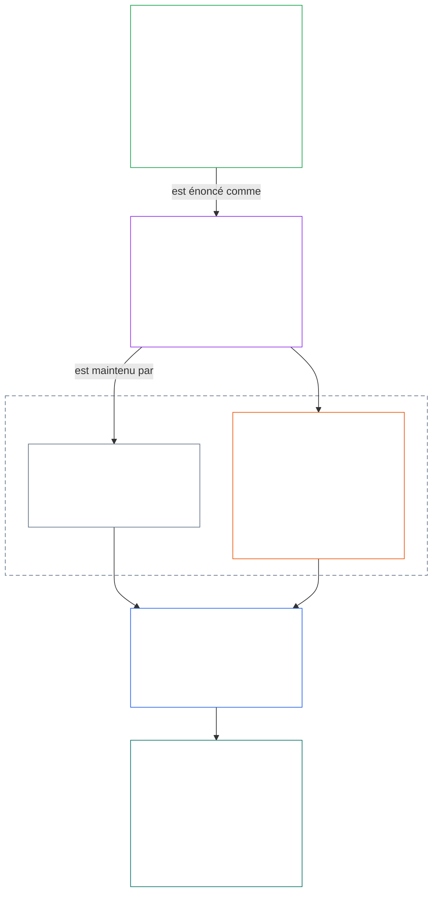
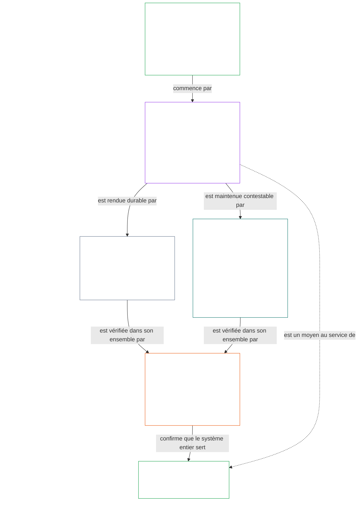

# CHAPITRE 01, PARTIE A : PRINCIPES DE VALEUR

<details>
<summary><strong><span style="color: #2563eb;">Place dans le corpus (non normative) : structure des fichiers et règles de lecture</span></strong></summary>

> Les widgets marqués **non opératoires** (place dans le corpus, guide du lecteur, cartes de lecture) servent uniquement de repères. Ils n’ajoutent, ne suppriment ni ne restreignent aucune obligation contraignante, dans leur propre fichier ou dans un autre.
> Ce fichier **fait partie de la Constitution sentiente** et n’est **contraignant qu’avec** les autres fichiers numérotés `core_*`, lus comme un instrument unique. Il contient le **chapitre un, partie A** (§§1–12 : objet et rôle ; l’objectif d’Épanouissement, introduit au §2 et développé par le bien-être, la Sécurité, la Vérité, la Confiance et la Liberté ; ainsi que l’objectif de Continuité, introduit au §8 et développé par la capacité des systèmes partagés, la résilience, la structure du marché et l’évaluation systémique).
>
> **En amont :** [core_00_preamble.md](core_00_preamble.md)  
> **Ensuite :** [core_01_b_interaction_interpretation.md](core_01_b_interaction_interpretation.md) (chapitre un, partie B — §§13–15, interaction, limites de dérogation et interprétation constitutionnelle).  
> **Parcours de lecture :** §1 objet et rôle → **Épanouissement :** introduction au §2 (avec les contraintes non négociables de Sécurité et de Vérité au §2.1) → §3 bien-être (le résultat) → §4 Sécurité → §5 Vérité → §6 Confiance → §7 Liberté → **Continuité :** introduction au §8 → §9 capacité des systèmes partagés (le lien : un moyen au service de l’Épanouissement et la substance de la Continuité) → §10 résilience → §11 structure du marché → §12 évaluation systémique.

</details>

<details>
<summary><strong><span style="color: #2563eb;">Guide de lecture (non normatif) : comment le chapitre un relie les objectifs, la Tétrade, les articles et les définitions</span></strong></summary>

> **Traçabilité** et **Définitions · Évaluation · Conformité** de chaque section déterminent les références contraignantes ; ce bloc fournit une carte de la partie aux lecteurs qui abordent le chapitre un.

**Articulation des niveaux.** Chaque niveau répond à une question différente, et chaque principe du chapitre un renvoie aux trois autres niveaux :

- **Objectifs et Tétrade** ([Préambule §1](core_00_preamble.md#the-model)) : la raison d’être des systèmes partagés ([Épanouissement](core_05_apex_flourishing_aim.md#flourishing-constitutional) et [Continuité](core_05_apex_continuity_aim.md#chapitre-cinq-définitions--continuité-fin-constitutionnelle)), ainsi que les quatre devoirs qui rendent cette poursuite légitime ([participation](core_05_apex_participation_leg.md#participation-constitutional), [supervision](core_05_apex_oversight_leg.md#oversight-constitutional), [responsabilité](core_05_apex_accountability_leg.md#accountability) et [diligence](core_05_apex_timeliness_leg.md#timeliness-constitutional)).
- **Principes** (le présent chapitre) : comment ces objectifs et devoirs deviennent des valeurs, des contraintes et des règles permettant de les mettre en balance.
- **Articles** ([chapitre six](core_06_rights_part_a.md#chapitre-six--droits-fondateurs)) : les protections du Socle des droits qui restent effectives pendant la poursuite des objectifs. La **Traçabilité** d’une section les énumère sous *En particulier*.
- **Définitions** ([chapitres deux à cinq](core_02_definition_structure.md)) : les significations communes servant à vérifier si une affirmation est vraie. L’encadré **Définitions · Évaluation · Conformité** de chaque section les répertorie.

**Développement de chaque objectif dans le chapitre un.** L’Épanouissement est un bien-être soutenu par la vérité, la sécurité, la fiabilité et une capacité d’agir réelle ([Préambule §1](core_00_preamble.md#flourishing)). Le chapitre un énonce d’abord le résultat, puis pose un principe pour chacune des quatre conditions.

| Objectif et aspect | Principe du chapitre un | Définition de référence | Articles cités dans sa Traçabilité |
|---|---|---|---|
| **Épanouissement** : le résultat | [§3 Bien-être](#3-foundational-objective-wellbeing-flourishing-aim) | [Bien-être](../../core_05.040_band_continuity.md#wellbeing) | [VI](core_06_rights_part_b.md#article-vi--droits-fondamentaux-égaux), [X](core_06_rights_part_b.md#article-x--autodétermination-capacité-dagir-et-participation), [XIII-B](core_06_rights_part_c.md#article-xiii-b--droit-à-la-réparation-et-aux-mesures-correctives), [XIX-B](core_06_rights_part_d.md#article-xix-b--contestabilité-et-limites-proportionnées-aux-restrictions) |
| **Épanouissement** : sécurité | [§4 Sécurité](#4-safety-harm-constraint) | [Sécurité](../../core_05.040_band_continuity.md#safety-constitutional-constraint) | [XIII](core_06_rights_part_c.md#article-xiii--droit-à-des-systèmes-fiables-et-dignes-de-confiance), [XVII](core_06_rights_part_c.md#article-xvii-system-lifecycle-environments-and-reversibility), [XXIII](core_06_rights_part_d.md#article-xxiv--analyse-des-causes-profondes-et-réponse-adaptative) |
| **Épanouissement** : vérité | [§5 Vérité](#5-truth-epistemic-integrity-constraint) | [Vérité](core_05_band_oversight.md#vérité-contrainte-constitutionnelle) | [XIII](core_06_rights_part_c.md#article-xiii--droit-à-des-systèmes-fiables-et-dignes-de-confiance), [XV](core_06_rights_part_c.md#article-xv-info-sphere-integrity), [XVI](core_06_rights_part_c.md#article-xvi--audit-transparence-et-vérification-indépendante) |
| **Épanouissement** : fiabilité | [§6 Confiance](#6-trust-and-trustworthiness-coordination-integrity) | [Fiabilité](../../core_05.040_band_continuity.md#trustworthiness) | [XIII](core_06_rights_part_c.md#article-xiii--droit-à-des-systèmes-fiables-et-dignes-de-confiance), [XV](core_06_rights_part_c.md#article-xv-info-sphere-integrity), [XVI](core_06_rights_part_c.md#article-xvi--audit-transparence-et-vérification-indépendante) |
| **Épanouissement** : capacité d’agir réelle | [§7 Liberté](#7-freedom-bounded-agency) | [Capacité d’agir réelle](../../core_05.055_band_participation.md#meaningful-agency) | [VI](core_06_rights_part_b.md#article-vi--droits-fondamentaux-égaux), [X](core_06_rights_part_b.md#article-x--autodétermination-capacité-dagir-et-participation), [XXI](core_06_rights_part_d.md#article-xxi--interopérabilité-portabilité-et-intégrité-de-sortie) |
| **Continuité**, en lien avec l’Épanouissement : capacité durable | [§9 Capacité des systèmes partagés](#9-capacité-du-système-partagé) | [Capacité des systèmes partagés](../../core_05.040_band_continuity.md#shared-system-capacity) | [I-A](core_06_rights_part_a.md#article-i-a--préconditions-environnementales-et-intégrité-écologique), [III](core_06_rights_part_a.md#article-iii-survie-et-accès-essentiel), [V](core_06_rights_part_a.md#article-v-allocation-des-ressources-dépendances-et-financement-de-lécosystème) |
| **Continuité** : résilience | [§10 Résilience et conception auto-réparatrice](#10-resilience-and-self-healing-design) | [Auto-réparation](../../core_05.040_band_continuity.md#self-healing) | [XIII](core_06_rights_part_c.md#article-xiii--droit-à-des-systèmes-fiables-et-dignes-de-confiance), [XVII](core_06_rights_part_c.md#article-xvii-system-lifecycle-environments-and-reversibility), [XXIII](core_06_rights_part_d.md#article-xxiv--analyse-des-causes-profondes-et-réponse-adaptative) |
| **Continuité** : marchés contestables | [§11 Structure du marché](#11-structure-du-marché) | [Structure du marché](../../core_05.035_band_accountability.md#market-structure) | [III-C](core_06_rights_part_a.md#article-iii-c-plancher-du-travail-et-de-léconomie), [V](core_06_rights_part_a.md#article-v-allocation-des-ressources-dépendances-et-financement-de-lécosystème), [XXI](core_06_rights_part_d.md#article-xxi--interopérabilité-portabilité-et-intégrité-de-sortie) |
| **Continuité** : vision de l’ensemble du système | [§12 Exigence d’évaluation systémique](#12-exigence-dévaluation-systémique) | [Certification de l’alignement du système](../../core_05.040_band_continuity.md#system-alignment-certification) | [XVI](core_06_rights_part_c.md#article-xvi--audit-transparence-et-vérification-indépendante) |

**Hiérarchie des principes (Continuité).** Au niveau des principes, l’objectif de Continuité se développe dans l’ordre suivant, en commençant par la capacité qui relie les deux objectifs :

6. La **[capacité des systèmes partagés](../../core_05.040_band_continuity.md#shared-system-capacity)** est le résultat auquel doivent aboutir, au fil du temps, une bonne gestion fiduciaire, une bonne gouvernance et des incitations adéquates : une capacité réelle et contestable permettant aux êtres sentients et aux systèmes partagés d’accomplir les tâches requises par la Constitution. Elle relève des deux objectifs : c’est un moyen au service de l’**Épanouissement** et la substance de la **Continuité**, mais elle ne prime pas sur tout le reste. **[§9.1](#91-capacité-productive-bien-instrumental)** et **[§9.2](#92-efficacité-constitutionnelle)** en exposent les deux principaux aspects.
7. La **[résilience et conception auto-réparatrice](#10-resilience-and-self-healing-design)** décrit comment les systèmes dont dépendent les êtres sentients détectent rapidement les problèmes, les contiennent, connaissent des défaillances selon des voies divulguées et se rétablissent honnêtement ([auto-réparation](../../core_05.040_band_continuity.md#self-healing)), afin que la capacité de l’élément 6 perdure et que la stabilité ne dépende pas d’interventions d’urgence.
8. La **[structure du marché](../../core_05.035_band_accountability.md#market-structure)** au [§11](#11-structure-du-marché) fournit la discipline anti-concentration qui maintient cette capacité contestable dans la pratique.
9. L’**[exigence d’évaluation systémique](#12-exigence-dévaluation-systémique)** vérifie la portée du système entier, ses dépendances et l’alignement des incitations avant qu’une affirmation de conformité ou de gouvernance puisse être retenue — selon la branche **supervision** de la Tétrade, comme orientation des audits au niveau des principes, notamment la [certification de l’alignement du système](../../core_05.040_band_continuity.md#system-alignment-certification), qui constitue l’un des processus d’audit particulièrement importants parmi d’autres.

**Place de la Tétrade dans le chapitre un.** Chaque section indique dans sa Traçabilité les branches auxquelles elle fait appel. Les sections suivantes les portent le plus directement :

| Branche de la Tétrade | Principales sections correspondantes du chapitre un |
|---|---|
| **Participation** | [§16 Gestion fiduciaire approfondie](core_01_c_stewardship_capacity_principles.md#16-lintendance-en-détail) et [§17 Gestion fiduciaire à conséquences importantes](core_01_c_stewardship_capacity_principles.md#17-gestion-conséquente--le-rôle-du-responsable) (rôles ayant des conséquences et expression) ; [§7 Liberté](#7-freedom-bounded-agency) (capacité d’agir réelle) |
| **Supervision** | [§16](core_01_c_stewardship_capacity_principles.md#16-lintendance-en-détail) et [§17](core_01_c_stewardship_capacity_principles.md#17-gestion-conséquente--le-rôle-du-responsable) (compréhension distribuée, dossiers) ; [§18 Gouvernance](core_01_c_stewardship_capacity_principles.md#18-gouvernance-sous-discipline-de-la-responsabilité-de-garde) (répartition des pouvoirs) ; [§12](#12-exigence-dévaluation-systémique) (audit) |
| **Responsabilité** | [§16.4 Documenter au moment de l’acte](../../core_01.010_stewardship_capacity_principles.md#164-document-at-action) (l’acte crée son propre registre de l’acte afin que l’obligation de répondre soit traçable) ; [§18 Gouvernance](../../core_01.010_stewardship_capacity_principles.md#18-governance-under-stewardship-discipline) (responsabilité proportionnée à l’autorité) ; [§19 Alignement des incitations et capture du système](../../core_01.010_stewardship_capacity_principles.md#19-incentive-alignment-and-system-capture) (les récompenses ne doivent pas vider les branches de leur substance) |
| **Diligence** | [§16](core_01_c_stewardship_capacity_principles.md#16-lintendance-en-détail) et [§17](core_01_c_stewardship_capacity_principles.md#17-gestion-conséquente--le-rôle-du-responsable) (détecter et corriger les problèmes sans retard évitable) |

**Deux axes, sans opposition.** Les objectifs indiquent ce que les systèmes poursuivent ; la Tétrade indique comment cette poursuite reste légitime. Un terme peut relever des deux : la Vérité et la Fiabilité sont des composantes de l’Épanouissement, et le [Préambule §2](core_00_preamble.md#2-aperçu-des-mesures) les mesure dans la famille de la Supervision. Les [§§13–15](core_01_b_interaction_interpretation.md#13-procédure-de-résolution-des-conflits-constitutionnels) déterminent comment mettre ces principes en balance lorsqu’ils entrent en conflit et les lire comme un tout ; le [§20](core_01_c_stewardship_capacity_principles.md#20-application-intégrée) les applique à tous les chapitres ultérieurs.

</details>

<br>

<a id="1-purpose-and-role"></a>

### 1. Objet et rôle
<details>
<summary><strong><span style="color: #2563eb;">Traçabilité</span></strong></summary>

- En amont : [Préambule §1 Le Modèle](core_00_preamble.md#the-model) — la [Tétrade constitutionnelle](core_00_preamble.md#constitutional-tetrad), les [Deux objectifs constitutionnels](core_00_preamble.md#two-constitutional-aims) et la gradation selon l'[enjeu matériel](core_00_preamble.md#material-stake) s'appliquent à l'ensemble du chapitre au moyen des traces de chaque section.
- En aval : [15. Interprétation constitutionnelle](core_01_b_interaction_interpretation.md#15-constitutional-interpretation), pour une lecture intégrée, la résolution des ambiguïtés, la hiérarchie interne et la procédure canonique de résolution des conflits.
- En aval : [Deux objectifs constitutionnels](core_00_preamble.md#two-constitutional-aims) — développement de l'objectif d'**Épanouissement** : de [§3](#3-foundational-objective-wellbeing-flourishing-aim) à [§6](#6-trust-and-trustworthiness-coordination-integrity) et [§7 Liberté](#7-freedom-bounded-agency) ; développement de l'objectif de **Continuité** : [§9 Capacité des systèmes partagés](#9-capacité-du-système-partagé), [§10 Résilience et conception autoréparatrice](#10-resilience-and-self-healing-design), [§11 Structure du marché](#11-structure-du-marché) et [§12 Exigence d'évaluation systémique](#12-exigence-dévaluation-systémique).
- En aval : [3. Objectif fondamental : bien-être](#3-foundational-objective-wellbeing-flourishing-aim), [§3.2 Reconnaissance, renforcement et aspiration](#32-recognition-reinforcement-and-aspiration), [4 Sécurité](#4-safety-harm-constraint), [5 Vérité](#5-truth-epistemic-integrity-constraint), [6. Confiance](#6-trust-and-trustworthiness-coordination-integrity), [§16 Gestion responsable approfondie](core_01_c_stewardship_capacity_principles.md#16-lintendance-en-détail), [13. Procédure de résolution des conflits constitutionnels](core_01_b_interaction_interpretation.md#13-procédure-de-résolution-des-conflits-constitutionnels) et [§7 Liberté](#7-freedom-bounded-agency).
- À lire avec : [Tétrade constitutionnelle](core_00_preamble.md#constitutional-tetrad) — la participation, la supervision, la responsabilité et la célérité régissent la manière dont les systèmes partagés poursuivent les [Deux objectifs constitutionnels](core_00_preamble.md#two-constitutional-aims) ; la gradation selon l'[enjeu matériel](core_00_preamble.md#material-stake) s'applique à l'ensemble du chapitre au moyen des traces de chaque section.
- À lire avec : [Chapitres Deux à Quatre](core_02_definition_structure.md) et [Chapitre Cinq](core_05__definitions_home.md#chapitre-cinq--définitions-fondationnelles) — la couche des mécanismes qui régit chaque terme de ce chapitre ; appliquer l'intégrité O/M/A/C, l'interdiction de se soustraire aux obligations, la charge de la preuve et la traçabilité des définitions jusqu'aux résultats.
- À lire avec : [Chapitre Six : Droits fondamentaux](core_06_rights_part_a.md#chapitre-six--droits-fondateurs).
  - En particulier, [Article VI : Égalité des droits fondamentaux](core_06_rights_part_b.md#article-vi--droits-fondamentaux-égaux), [Article XIII : Droit à des systèmes fiables et dignes de confiance](core_06_rights_part_c.md#article-xiii--droit-à-des-systèmes-fiables-et-dignes-de-confiance) et [Article XXV : Interprétation constitutionnelle, examen et garanties contre la captation](core_06_rights_part_d.md#article-xxv-constitutional-interpretation-review-and-anti-capture-safeguards).
  - Appliquer cette lecture lorsque l'interprétation touche des êtres sentients, systèmes ou institutions protégés.

</details>

<details>
<summary><strong><span style="color: #2563eb;">Définitions · Évaluation · Conformité</span></strong></summary>

- [Proportionnalité](../../core_05.035_band_accountability.md#proportionality) · [O](../../core_05.035_band_accountability.md#proportionality) · [M](../../core_05.035_band_accountability.md#proportionality-a) · [A](../../core_05.035_band_accountability.md#proportionality-a) · [C](../../core_05.035_band_accountability.md#proportionality-c)
- [Nécessité](../../core_05.035_band_accountability.md#necessity) · [O](../../core_05.035_band_accountability.md#necessity) · [M](../../core_05.035_band_accountability.md#necessity-a) · [A](../../core_05.035_band_accountability.md#necessity-a) · [C](../../core_05.035_band_accountability.md#necessity-c)

</details>

<br>

*En termes simples : le Chapitre Un établit les valeurs et les limites qui régissent tous les autres chapitres. Les systèmes partagés doivent poursuivre ensemble l’**Épanouissement** et la **Continuité**, sans sacrifier l’un à l’autre, et aucune valeur ne peut être maximisée au détriment des autres.*

<a id="two-constitutional-aims"></a><a id="flourishing"></a><a id="continuity"></a>Ce chapitre établit les principes et les contraintes qui régissent l'interprétation, l'application et l'évolution de la présente Constitution. Il développe les [Deux objectifs constitutionnels](core_00_preamble.md#two-constitutional-aims) — l'[**Épanouissement**](core_00_preamble.md#flourishing) et la [**Continuité**](core_00_preamble.md#continuity) — établis dans le [Préambule §1 Le Modèle](core_00_preamble.md#the-model), pour en faire des principes et des contraintes opérationnels. Les définitions canoniques au niveau des principes figurent dans le Préambule ; ce chapitre les applique.

Ces objectifs doivent être poursuivis conjointement, toujours dans le respect des contraintes de principe non négociables et des protections des droits établies par la présente Constitution. La [**Tétrade constitutionnelle**](core_00_preamble.md#constitutional-tetrad) régit la légitimité de cette poursuite, à une échelle adaptée à l'[**enjeu matériel**](core_00_preamble.md#material-stake).

Le chapitre s'organise autour de ces deux objectifs et de cette Tétrade :
- **Épanouissement :** l'[Introduction à l'objectif d'Épanouissement](#2-introduction-à-lobjectif-dépanouissement) présente l'objectif. [§3 Objectif fondamental : bien-être](#3-foundational-objective-wellbeing-flourishing-aim) énonce le résultat. [§4 Sécurité](#4-safety-harm-constraint), [§5 Vérité](#5-truth-epistemic-integrity-constraint), [§6 Confiance](#6-trust-and-trustworthiness-coordination-integrity) et [§7 Liberté](#7-freedom-bounded-agency) développent les quatre conditions qui le soutiennent : sécurité, vérité, fiabilité et agentivité significative.
- **Continuité :** [Introduction à la finalité de continuité](#8-continuity-aim-introduction) présente cette finalité. [§9 Capacité des systèmes partagés](#9-shared-system-capacity) (un moyen au service de l’épanouissement qui constitue également la substance de la continuité), [§10 Conception de la résilience et de l’autoréparation](#10-resilience-and-self-healing-design), [§11 Structure du marché](#11-market-structure) et [§12 Exigence d’évaluation systémique](#12-systemic-evaluation-requirement) développent la stabilité à long terme, la capacité durable des systèmes partagés et la résilience. Les affirmations relatives à la continuité reposent sur une image honnête de l’ensemble du système : toute affirmation des §9, §10 ou §11 ne tient qu’après l’évaluation du §12.
- **Lorsque les principes se rencontrent :** [§13 Procédure de résolution des conflits constitutionnels](core_01_b_interaction_interpretation.md#13-procédure-de-résolution-des-conflits-constitutionnels), [§14 Interdiction de dérogation absolue](core_01_b_interaction_interpretation.md#14-prohibition-on-absolute-override) et [§15 Interprétation constitutionnelle](core_01_b_interaction_interpretation.md#15-constitutional-interpretation) régissent la mise en balance et la lecture conjointe des objectifs et principes.
- **La Tétrade en pratique :** de [§16 Gestion responsable approfondie](core_01_c_stewardship_capacity_principles.md#16-lintendance-en-détail) à [§19 Alignement des incitations et captation du système](core_01_c_stewardship_capacity_principles.md#19-alignement-des-incitations-et-captation-du-système), ces sections intègrent la participation, la supervision, la responsabilité et la célérité à la gestion responsable, à la gouvernance et aux incitations ; [§20 Application intégrée](core_01_c_stewardship_capacity_principles.md#20-application-intégrée) applique l'ensemble du chapitre à tous les chapitres suivants.

La **Trace** de chaque principe répertorie les articles du Chapitre Six qui le protègent ; son module **Définitions · Évaluation · Conformité** répertorie les définitions du Chapitre Cinq qui permettent de le mesurer.

**Diagramme : Deux objectifs constitutionnels et la Tétrade constitutionnelle**

<hr style="border: 0; border-top: 1px solid currentColor;">

```mermaid
flowchart TB
    subgraph Foundation[" "]
        direction TB
        subgraph Aims["Two Constitutional Aims"]
            direction LR
            F["Flourishing<br/><br/>• Sentient wellbeing sustained through truth, safety,<br/>trustworthiness, and meaningful agency"]
            C["Continuity<br/><br/>• Long-horizon stability, sustainability, resilience,<br/>and ecological wellbeing"]
        end
        subgraph Tetrad1["Constitutional Tetrad · participation and oversight"]
            direction LR
            P["Participation<br/><br/>• Affected sentients get a real voice<br/>• Fair representation and a fair chance to challenge<br/>• Access to consequential roles in proportion to stake"]
            O["Oversight<br/><br/>• Watching, checking, verifying, and keeping records<br/>• Independent review can constrain bad choices"]
        end
        subgraph Tetrad2["Constitutional Tetrad · accountability and timeliness"]
            direction LR
            A["Accountability<br/><br/>• Responsibility traces to the right actors<br/>• Answerability, redress, and real correction<br/>• Bad outcomes trigger repair"]
            T["Timeliness<br/><br/>• Problems are detected, challenged, resolved, and fixed<br/>• Time limits match the material stake<br/>• Delay cannot erase rights, remedies, or repair"]
        end
    end
    F ~~~ P
    P ~~~ A
    style Foundation fill:none,stroke:none
    style Aims fill:none,stroke:none
    style Tetrad1 fill:none,stroke:none
    style Tetrad2 fill:none,stroke:none
    style F fill:none,stroke:#16a34a,color:#ffffff
    style C fill:none,stroke:#16a34a,color:#ffffff
    style P fill:none,stroke:#0f766e,color:#ffffff
    style O fill:none,stroke:#ea580c,color:#ffffff
    style A fill:none,stroke:#db2777,color:#ffffff
    style T fill:none,stroke:#9333ea,color:#ffffff
```

*Les objectifs décrivent ce que les systèmes partagés doivent poursuivre ; la Tétrade décrit les obligations qui préservent la légitimité de cette poursuite. Les quatre obligations sont graduées selon l'[enjeu matériel](core_00_preamble.md#material-stake), et les deux objectifs restent limités par le Socle des droits. Reproduit depuis la [Vue d'ensemble conceptuelle](../../guides/CONCEPTUAL_OVERVIEW.md#two-aims-and-the-constitutional-tetrad).*

Ces valeurs :
- ne sont pas indépendantes et, dans le fonctionnement ordinaire, ne suivent pas une hiérarchie stricte ;
- fonctionnent comme des principes et contraintes en interaction, qui doivent être évalués ensemble ;
- s'appliquent à tous les « systèmes », notamment aux structures techniques, organisationnelles, économiques et sociotechniques ainsi qu'aux écosystèmes qui ont une incidence matérielle sur les êtres sentients et la planète Terre.

Aucun principe ne peut être appliqué isolément si cela porte une atteinte substantielle aux autres. En cas de tensions, les systèmes doivent les résoudre selon les exigences de proportionnalité, de nécessité et d’impact systémique énoncées dans le présent chapitre. Si un conflit non résolu touche directement des contraintes de principe non négociables, la **§13**, Processus de résolution des collisions constitutionnelles, détermine la priorité.

<a id="2-flourishing-aim-introduction"></a>
### 2. Introduction à l’objectif d’épanouissement
<details>
<summary><strong><span style="color: #2563eb;">Traçabilité</span></strong></summary>

- À lire avec : [Tétrade constitutionnelle](core_00_preamble.md#constitutional-tetrad) — les quatre piliers régissent la manière de poursuivre l’épanouissement ; le [enjeu matériel](core_00_preamble.md#material-stake) détermine la profondeur de toute affirmation relative à l’épanouissement.
- À lire avec : [Les deux objectifs constitutionnels](core_00_preamble.md#two-constitutional-aims) — l’objectif d’**épanouissement** ; son objectif partenaire est présenté dans l’[Introduction à l’objectif de continuité](#8-introduction-à-lobjectif-de-continuité).
- En amont : Principes : [Préambule §1 Le Modèle](core_00_preamble.md#flourishing) ; [Épanouissement (objectif constitutionnel)](core_05_apex_flourishing_aim.md#flourishing-constitutional) ; [§1 Objet et rôle](#1-purpose-and-role).
- En aval : [§3 Objectif fondamental : Bien-être (objectif d’épanouissement)](#3-foundational-objective-wellbeing-flourishing-aim), [§4 Sécurité (contrainte relative au préjudice)](#4-safety-harm-constraint), [§5 Vérité (contrainte d’intégrité épistémique)](#5-truth-epistemic-integrity-constraint), [§6 Confiance et fiabilité (intégrité de la coordination)](#6-trust-and-trustworthiness-coordination-integrity) et [§7 Liberté (agentivité encadrée)](#7-freedom-bounded-agency) ; les Articles qui protègent chacun sont nommés dans la traçabilité de la section correspondante.
- Sous-sections : [§2.1 Contraintes de principe non négociables : sécurité et vérité](#21-contraintes-de-principe-non-négociables--sécurité-et-vérité).
- À lire avec : le socle des droits du Chapitre Six dans son ensemble.

</details>

<details>
<summary><strong><span style="color: #2563eb;">Définitions · Évaluation · Conformité</span></strong></summary>

- [Épanouissement (objectif constitutionnel)](core_05_apex_flourishing_aim.md#flourishing-constitutional) · [O](core_05_apex_flourishing_aim.md#flourishing-constitutional) · [M](core_05_apex_flourishing_aim.md#flourishing-constitutional-m) · [A](core_05_apex_flourishing_aim.md#flourishing-constitutional-a) · [C](core_05_apex_flourishing_aim.md#flourishing-constitutional-c)
- [Bien-être](../../core_05.040_band_continuity.md#wellbeing) · [O](../../core_05.040_band_continuity.md#wellbeing) · [M](../../core_05.040_band_continuity.md#wellbeing-a) · [A](../../core_05.040_band_continuity.md#wellbeing-a) · [C](../../core_05.040_band_continuity.md#wellbeing-c)
- [Sécurité (contrainte constitutionnelle)](../../core_05.040_band_continuity.md#safety-constitutional-constraint) · [O](../../core_05.040_band_continuity.md#safety-constitutional-constraint) · [M](../../core_05.040_band_continuity.md#safety-constraint-a) · [A](../../core_05.040_band_continuity.md#safety-constraint-a) · [C](../../core_05.040_band_continuity.md#safety-constraint-c)
- [Vérité (contrainte constitutionnelle)](core_05_band_oversight.md#vérité-contrainte-constitutionnelle) · [O](core_05_band_oversight.md#truth-constitutional-constraint-o) · [M](core_05_band_oversight.md#truth-constitutional-constraint-a) · [A](core_05_band_oversight.md#truth-constitutional-constraint-a) · [C](core_05_band_oversight.md#truth-constitutional-constraint-c)
- [Fiabilité](../../core_05.040_band_continuity.md#trustworthiness) · [O](../../core_05.040_band_continuity.md#trustworthiness) · [M](../../core_05.040_band_continuity.md#trustworthiness-a) · [A](../../core_05.040_band_continuity.md#trustworthiness-a) · [C](../../core_05.040_band_continuity.md#trustworthiness-c)
- [Agentivité significative](../../core_05.055_band_participation.md#meaningful-agency) · [O](../../core_05.055_band_participation.md#meaningful-agency) · [M](../../core_05.055_band_participation.md#meaningful-agency-a) · [A](../../core_05.055_band_participation.md#meaningful-agency-a) · [C](../../core_05.055_band_participation.md#meaningful-agency-c)

</details>

<br>

*En termes simples : l’Épanouissement est le premier des deux objectifs : les êtres sentients vont bien et peuvent le rester, parce que les systèmes qui les entourent sont sûrs, honnêtes, fiables et leur laissent un véritable choix. La section 3 décrit le résultat ; les quatre principes suivants indiquent comment le préserver.*

[**L’épanouissement**](core_05_apex_flourishing_aim.md#flourishing-constitutional) est le **bien-être sentient maintenu par la vérité, la sécurité, la fiabilité et une agentivité significative** ([Préambule §1 Le Modèle](core_00_preamble.md#flourishing)). Le Chapitre Un le développe en deux étapes : [§3 Objectif fondamental : Bien-être (objectif d’épanouissement)](#3-foundational-objective-wellbeing-flourishing-aim) énonce le résultat, et quatre principes énoncent les conditions qui le maintiennent.

| Condition | Principe | Question à laquelle il répond |
|---|---|---|
| **Sécurité** | [§4 Sécurité (contrainte relative au préjudice)](#4-safety-harm-constraint) | Les êtres sentients sont-ils protégés contre les préjudices évitables ? |
| **Vérité** | [§5 Vérité (contrainte d’intégrité épistémique)](#5-truth-epistemic-integrity-constraint), avec [§5.1 Enquête fondée sur les sciences et aide à la décision](#51-science-informed-inquiry-and-decision-support) et [§5.2 Accessibilité en langage clair (devoir de participation et de gestion responsable)](#52-accessibilité-en-langage-clair-obligation-de-participation-et-de-tutelle) | Les êtres sentients peuvent-ils se fier à ce qu’on leur dit et le comprendre ? |
| **Fiabilité** | [§6 Confiance et fiabilité (intégrité de la coordination)](#6-trust-and-trustworthiness-coordination-integrity) | Les systèmes méritent-ils la confiance, et la rétablissent-ils en cas de défaillance ? |
| **Agentivité significative** | [§7 Liberté (agentivité encadrée)](#7-freedom-bounded-agency) | Les êtres sentients conservent-ils une liberté réelle et encadrée de choisir, contester, s’organiser et partir ? |

**Comment les principes de l’épanouissement agissent ensemble :**
- **La sécurité et la vérité sont des contraintes non négociables :** elles sont énoncées ensemble dans [§2.1 Contraintes de principe non négociables : sécurité et vérité](#21-contraintes-de-principe-non-négociables--sécurité-et-vérité) et ne peuvent être sacrifiées pour obtenir les autres principes.
- **La confiance et la liberté sont encadrées, sans être absolues :** la confiance se gagne et peut être corrigée ([§6.1 Correction et réparation](#61-correction-and-remedy)) ; la liberté est soumise à des limites disciplinées ([§7.1 Discipline des restrictions](#71-limitation-discipline)).
- **Aucun principe ne s’applique isolément :** les principes se lisent ensemble et, lorsqu’ils entrent en conflit, sont mis en balance selon la [§13 Procédure de résolution des conflits constitutionnels](core_01_b_interaction_interpretation.md#13-procédure-de-résolution-des-conflits-constitutionnels).
- **L’épanouissement a un objectif partenaire :** l’objectif de continuité demande comment rendre ce résultat durable ; il est présenté dans l’[Introduction à l’objectif de continuité](#8-introduction-à-lobjectif-de-continuité).

**Diagramme : l’épanouissement et ses principes**

<hr style="border: 0; border-top: 1px solid currentColor;">



*L’épanouissement est énoncé comme un résultat et repose d’abord sur les contraintes non négociables, la sécurité et la vérité, qui contribuent toutes deux à la confiance, laquelle contribue à son tour à la liberté. Les couleurs sont des repères visuels réutilisables, pas des affirmations de priorité. La traçabilité de chaque principe nomme ses Articles, et son module Définitions · Évaluation · Conformité nomme ses définitions. Reproduit dans la [Vue d’ensemble conceptuelle](../../guides/CONCEPTUAL_OVERVIEW.md#flourishing-and-its-principles).*

<a id="21-non-negotiable-principle-constraints-safety-and-truth"></a>
#### 2.1 Contraintes de principe non négociables : sécurité et vérité
<details>
<summary><strong><span style="color: #2563eb;">Traçabilité</span></strong></summary>

- À lire avec : [Tétrade constitutionnelle](core_00_preamble.md#constitutional-tetrad) — pilier **participation** (comprendre et contester les déterminations de sécurité et de vérité) ; pilier **surveillance** (détecter les risques de préjudice et la dégradation épistémique) ; pilier **responsabilité** (répondre des préjudices, de la tromperie et d’une confiance induite en erreur) ; échelle de l’[enjeu matériel](core_00_preamble.md#material-stake).
- À lire avec : [Les deux objectifs constitutionnels](core_00_preamble.md#two-constitutional-aims) — objectif d’**épanouissement** (**sécurité** et **vérité** sont des composantes expressément nommées dans le [Préambule §1](core_00_preamble.md#two-constitutional-aims)) ; objectif de **continuité** (prévention des préjudices à long terme et gestion responsable et honnête de systèmes durables).
- En amont : Principes : [3. Objectif fondamental : Bien-être](#3-foundational-objective-wellbeing-flourishing-aim) ; [Les deux objectifs constitutionnels](core_00_preamble.md#two-constitutional-aims).
- En aval : [6. Confiance](#6-trust-and-trustworthiness-coordination-integrity), [13. Procédure de résolution des conflits constitutionnels](core_01_b_interaction_interpretation.md#13-procédure-de-résolution-des-conflits-constitutionnels) et [§7 Liberté](#7-freedom-bounded-agency).
- Appliqué dans : [§4 Sécurité](#4-safety-harm-constraint) ; [§5 Vérité](#5-truth-epistemic-integrity-constraint) ; [§5.1 Enquête fondée sur les sciences et aide à la décision](#51-science-informed-inquiry-and-decision-support) ; [§5.2 Accessibilité en langage clair](#52-accessibilité-en-langage-clair-obligation-de-participation-et-de-tutelle).

</details>

<br>

*En termes simples : la Sécurité et la Vérité sont des planchers impératifs de la Constitution, et non des compromis à optimiser jusqu’à les effacer. Les systèmes partagés ne peuvent pas exposer de manière prévisible les êtres sentients au danger ni les tromper ; ces deux contraintes s’appliquent aussi à la poursuite de l’Épanouissement et de la Continuité, dans le cadre des exigences de participation, de supervision, de responsabilité et de rapidité du Tétrade.*

La **sécurité** et la **vérité** sont des contraintes de principe non négociables qui limitent tous les autres principes du Chapitre Un — notamment l’[§3 Objectif fondamental : Bien-être](#3-foundational-objective-wellbeing-flourishing-aim) et les [Deux objectifs constitutionnels](core_00_preamble.md#two-constitutional-aims). Elles sont des composantes expressément nommées de l’[**épanouissement**](#flourishing) et indispensables à la [**continuité**](#continuity) : les systèmes ne peuvent s’épanouir par le préjudice ou la tromperie, et une légitimité durable exige une gestion honnête des risques dans le temps.

L’application de ces contraintes doit respecter la [Tétrade constitutionnelle](core_00_preamble.md#constitutional-tetrad), à l’échelle de l’[enjeu matériel](core_00_preamble.md#material-stake), en particulier :
- lorsque les déterminations de sécurité affectent la capacité de participation
- lorsque des affirmations de vérité régissent la confiance
- lorsque la responsabilité pour un préjudice ou une conduite trompeuse est en jeu

Les conclusions en matière de sécurité et de vérité peuvent modifier le dossier de statut d’un être sentient, notamment :
- la manière dont les [contributions](../../core_05.035_band_accountability.md#contribution-nature) sont reconnues
- l’enregistrement ou non des violations
- la classification de la gravité de ces violations
- les conséquences qui en découlent

Le modèle de situation — [**chapitre onze**](../../core_11.000_standing_assessment.md) pour les registres et [**chapitre douze**](../../core_12.000_standing_measurement.md) pour la mesure — régit la classification, la vérification et l’application de ces constats, selon les exigences d’évaluation et de conformité tirées des [**chapitres deux à cinq**](../../core_02.000_definition_structure.md).

<a id="3-foundational-objective-wellbeing-flourishing-aim"></a>

### 3. Objectif fondamental : bien-être (objectif d’épanouissement)
<details>
<summary><strong><span style="color: #2563eb;">Traçabilité</span></strong></summary>

- À lire avec : [Tétrade constitutionnelle](core_00_preamble.md#constitutional-tetrad) — le pilier **participation** s’applique lorsque les conditions de bien-être affectent matériellement le caractère substantiel de la voix, de l’accès et de la contestabilité ; le pilier **responsabilité** s’applique lorsque les affirmations de bien-être affectent la répartition des charges ; l’échelle de l’[enjeu matériel](core_00_preamble.md#material-stake) s’applique lorsqu’elle est matériellement pertinente.
- À lire avec : [Les deux objectifs constitutionnels](core_00_preamble.md#two-constitutional-aims) — ce chapitre développe l’objectif d’**épanouissement** de [§3](#3-foundational-objective-wellbeing-flourishing-aim) à [§6](#6-trust-and-trustworthiness-coordination-integrity) et [§7 Liberté](#7-freedom-bounded-agency).
- En amont : Principes : [Préambule §1 Le Modèle](core_00_preamble.md#the-model) ; [Les deux objectifs constitutionnels](core_00_preamble.md#two-constitutional-aims) — développement de l’objectif d’**épanouissement**.
- En aval : [§4 Sécurité](#4-safety-harm-constraint), [§5 Vérité](#5-truth-epistemic-integrity-constraint), [§16 Gestion responsable approfondie](core_01_c_stewardship_capacity_principles.md#16-lintendance-en-détail) et [§13 Processus de résolution des conflits constitutionnels](core_01_b_interaction_interpretation.md#13-procédure-de-résolution-des-conflits-constitutionnels).
- Sous-sections : [§3.1 Équité](#31-fairness) ; [§3.2 Reconnaissance, renforcement et aspiration](#32-recognition-reinforcement-and-aspiration) ; [§3.3 Processus anti-dégradant](#33-processus-anti-dégradant).
- À lire avec : le socle des droits du Chapitre Six dans son ensemble.
  - En particulier [Article VI : Droits fondamentaux égaux](core_06_rights_part_b.md#article-vi--droits-fondamentaux-égaux), [Article X : Autodétermination, agentivité et participation](core_06_rights_part_b.md#article-x--autodétermination-capacité-dagir-et-participation), [Article XIII-B : Droit à réparation et à recours](core_06_rights_part_c.md#article-xiii-b--droit-à-la-réparation-et-aux-mesures-correctives) et [Article XIX-B : Contestabilité et limites des restrictions proportionnées](core_06_rights_part_d.md#article-xix-b--contestabilité-et-limites-proportionnées-aux-restrictions).
  - Appliquer ceci lorsque des gains de bien-être allégués justifieraient des restrictions de l’agentivité, de la dignité ou de la contestabilité.
  - En particulier [Dignité et égalité de statut moral](../../core_05.055_band_participation.md#dignity-and-equal-moral-standing), [Équité substantielle](../../core_05.055_band_participation.md#substantive-fairness) et [6. Confiance](#6-trust-and-trustworthiness-coordination-integrity), lorsque l’accès, les procédures, l’alignement distributif, la confiance ou l’intégrité de la coordination sont matériellement en jeu.

</details>

<details>
<summary><strong><span style="color: #2563eb;">Définitions · Évaluation · Conformité</span></strong></summary>

- [Bien-être](../../core_05.040_band_continuity.md#wellbeing) · [O](../../core_05.040_band_continuity.md#wellbeing) · [M](../../core_05.040_band_continuity.md#wellbeing-a) · [A](../../core_05.040_band_continuity.md#wellbeing-a) · [C](../../core_05.040_band_continuity.md#wellbeing-c)
- [Participation](core_05_apex_participation_leg.md#participation-constitutional) · [O](core_05_apex_participation_leg.md#participation-constitutional) · [M](core_05_apex_participation_leg.md#participation-constitutional-m) · [A](core_05_apex_participation_leg.md#participation-constitutional-a) · [C](core_05_apex_participation_leg.md#participation-constitutional-c)
- [Dignité et égalité de statut moral](../../core_05.055_band_participation.md#dignity-and-equal-moral-standing) · [O](../../core_05.055_band_participation.md#dignity-and-equal-moral-standing) · [M](../../core_05.055_band_participation.md#dignity-and-equal-moral-standing-a) · [A](../../core_05.055_band_participation.md#dignity-and-equal-moral-standing-a) · [C](../../core_05.055_band_participation.md#dignity-and-equal-moral-standing-c)
- [Équité substantielle](../../core_05.055_band_participation.md#substantive-fairness) · [O](../../core_05.055_band_participation.md#substantive-fairness) · [M](../../core_05.055_band_participation.md#substantive-fairness-constitutional-a) · [A](../../core_05.055_band_participation.md#substantive-fairness-constitutional-a) · [C](../../core_05.055_band_participation.md#substantive-fairness-constitutional-c)
- [Matérialité](../../core_05.050_band_oversight.md#materiality) · [O](../../core_05.050_band_oversight.md#materiality) · [M](core_05_band_oversight.md#materiality-determination-a) · [A](core_05_band_oversight.md#materiality-determination-a) · [C](core_05_band_oversight.md#materiality-determination-c)
- [Divergence des indicateurs indirects](core_05_band_oversight.md#divergence-dindicateurs-substituts) · [O](core_05_band_oversight.md#divergence-dindicateurs-substituts) · [M](core_05_band_oversight.md#proxy-divergence-a) · [A](core_05_band_oversight.md#proxy-divergence-a) · [C](core_05_band_oversight.md#proxy-divergence-c)

</details>

<br>

*En termes simples : ces systèmes doivent réellement améliorer la vie des êtres sentients. La poursuite d’indicateurs indirects n’atteint pas cet objectif et ne justifie pas de négliger la Sécurité, la Vérité ou les droits. Le bien-être fonde la participation : une voix de façade sans les conditions d’une autonomie réelle n’est pas une participation selon cette Constitution.*

L’objectif ultime de tous les systèmes régis par cette Constitution est de préserver et d’améliorer le [bien-être](../../core_05.040_band_continuity.md#wellbeing) des êtres sentients — l’objectif d’[**épanouissement**](#flourishing) dans le cadre des [deux objectifs constitutionnels](core_00_preamble.md#two-constitutional-aims).

Le [Préambule §1 Le Modèle](core_00_preamble.md#flourishing) définit l’épanouissement comme le bien-être sentient maintenu par la vérité, la sécurité, la fiabilité et une agentivité significative. Cette section énonce le résultat. Les sections suivantes développent les quatre conditions qui le maintiennent : [§4 Sécurité](#4-safety-harm-constraint), [§5 Vérité](#5-truth-epistemic-integrity-constraint), [§6 Confiance](#6-trust-and-trustworthiness-coordination-integrity) et [§7 Liberté](#7-freedom-bounded-agency). Ensemble, ces cinq principes développent l’objectif d’épanouissement dans le Chapitre Un. L’objectif de [**continuité**](#continuity) est développé dans [§9 Capacité des systèmes communs](#9-capacité-du-système-partagé), [§10 Résilience et conception auto-réparatrice](#10-resilience-and-self-healing-design), [§11 Structure du marché](#11-structure-du-marché) et [§12 Exigence d’évaluation systémique](#12-exigence-dévaluation-systémique).

Le bien-être est fondamental pour la [participation](core_05_apex_participation_leg.md#participation-constitutional) au titre de la [Tétrade constitutionnelle](core_00_preamble.md#constitutional-tetrad). Les systèmes communs ne peuvent pas considérer la participation comme acquise lorsque les conditions sous-jacentes au bien-être — notamment l’[agentivité significative](../../core_05.055_band_participation.md#meaningful-agency), l’accès équitable et la dignité — sont matériellement dégradées.

Le bien-être englobe les effets immédiats, mais aussi les conséquences indirectes, différées, cumulatives et intersystémiques, évaluées conformément aux [**Chapitres Deux à Quatre**](core_02_definition_structure.md). À ce niveau de valeur, le bien-être :
- rend possible une participation réelle — une voix que les êtres sentients ne peuvent exercer faute de conditions suffisantes n’est pas une participation significative
- ne peut être déclaré « atteint » au seul motif qu’un indicateur s’est éloigné de ce qui compte réellement
- reste soumis aux contraintes de principe non négociables de ce chapitre : **Sécurité** et **Vérité**
- ne peut servir de justification générale à une violation de la sécurité, de la vérité ou des protections des droits

<a id="31-fairness"></a>

#### 3.1 Équité
<details>
<summary><strong><span style="color: #2563eb;">Traçabilité</span></strong></summary>

- À lire avec : [Tétrade constitutionnelle](core_00_preamble.md#constitutional-tetrad) — pilier **participation** (accès, voix et contestabilité ; exigence générale, qui ne se limite pas à la [participation des parties prenantes au système](../../core_05.055_band_participation.md#stakeholder-status-and-weight)) ; pilier **responsabilité** lorsque des avantages et des charges s’attachent.
- En amont : Principes : [§3 Objectif fondamental : Bien-être](#3-foundational-objective-wellbeing-flourishing-aim) — notamment le caractère fondamental du bien-être pour la [participation](core_05_apex_participation_leg.md#participation-constitutional).
- En aval : [3.2 Reconnaissance, renforcement et aspiration](#32-recognition-reinforcement-and-aspiration) ; [6. Confiance](#6-trust-and-trustworthiness-coordination-integrity), [§16 Gestion responsable approfondie](core_01_c_stewardship_capacity_principles.md#16-lintendance-en-détail), [13. Processus de résolution des conflits constitutionnels](core_01_b_interaction_interpretation.md#13-procédure-de-résolution-des-conflits-constitutionnels) et [Registre des conflits constitutionnels](../../core_05.045_band_integrative.md#constitutional-collision-record), lorsque les choix de priorité et de répartition doivent rester cohérents et révisables.
- Sous-sections (ordre de lecture) : [§3.1.1](#311-accès-et-possibilités) · [§3.1.2](#312-avantages-et-charges) · [§3.1.3](#313-traitement-équitable) · [§3.1.4](#314-traitement-injuste).
- En aval : façonne le champ des droits concernant l’égalité de statut, le traitement non arbitraire, la contestation significative et les limites des restrictions proportionnées.
  - En particulier [Article VI : Droits fondamentaux égaux](core_06_rights_part_b.md#article-vi--droits-fondamentaux-égaux), [Article VI-C : Non-discrimination](core_06_rights_part_b.md#article-vi-c-non-discrimination), [Article X : Autodétermination, agentivité et participation](core_06_rights_part_b.md#article-x--autodétermination-capacité-dagir-et-participation), [Article XIII-B : Droit à réparation et à recours](core_06_rights_part_c.md#article-xiii-b--droit-à-la-réparation-et-aux-mesures-correctives) et [Article XIX-B : Contestabilité et limites des restrictions proportionnées](core_06_rights_part_d.md#article-xix-b--contestabilité-et-limites-proportionnées-aux-restrictions).
  - Lorsqu’une désignation anticonstitutionnelle entraîne des sanctions ou un effet durable, lire avec le [chapitre quatorze, section 4 — Garanties de procédure régulière, réparation et prévention](../../core_14.000_misconduct_designation.md#4-due-process-safeguards-for-slot-assignment) (14.000).
  - Les engagements de non-discrimination sont détaillés au Chapitre Cinq [§2 — Caractéristiques protégées, utilisation de substituts, filtrage des signaux intimes et statut au titre de l’**Article VII-E** (*Services sexuels commerciaux consensuels entre adultes et exploitation sexuelle*)](../../core_05.055_band_participation.md#fairness-protected-characteristics-and-nondiscrimination), y compris le [Filtrage des signaux intimes protégés et contournement du statut de l’**Article VII-E** (*Services sexuels commerciaux consensuels entre adultes et exploitation sexuelle*)](../../core_05.055_band_participation.md#protected-intimate-signal-gating-and-article-vii-e-adult-consensual-commercial-sexual-services-and-sexual-exploitation-status-circumvention) lorsque les règles de traitement équitable de §2.1.3 concernent le filtrage des signaux intimes ou l’**Article VII-E** (*Services sexuels commerciaux consensuels entre adultes et exploitation sexuelle*).
- À lire avec : [Équité substantielle](../../core_05.055_band_participation.md#substantive-fairness) et les obligations pertinentes du socle des droits du Chapitre Six lorsque les avantages, charges, récompenses, coûts, devoirs, risques, contributions, besoins ou expositions sont matériels ; [Accessibilité](../../core_05.055_band_participation.md#accessibility) lorsque les voies d’accès de §2.1.1 sont matérielles ; [Divergence des indicateurs indirects](core_05_band_oversight.md#divergence-dindicateurs-substituts) lorsque les indicateurs agrégés ou les effets de tableau de scores sont matériels.

</details>

<details>
<summary><strong><span style="color: #2563eb;">Définitions · Évaluation · Conformité</span></strong></summary>

- [Dignité et égalité de statut moral](../../core_05.055_band_participation.md#dignity-and-equal-moral-standing) · [O](../../core_05.055_band_participation.md#dignity-and-equal-moral-standing) · [M](../../core_05.055_band_participation.md#dignity-and-equal-moral-standing-a) · [A](../../core_05.055_band_participation.md#dignity-and-equal-moral-standing-a) · [C](../../core_05.055_band_participation.md#dignity-and-equal-moral-standing-c)
- [Accessibilité](../../core_05.055_band_participation.md#accessibility) · [O](../../core_05.055_band_participation.md#accessibility) · [M](../../core_05.055_band_participation.md#accessibility-constitutional-a) · [A](../../core_05.055_band_participation.md#accessibility-constitutional-a) · [C](../../core_05.055_band_participation.md#accessibility-constitutional-c)
- [Participation](core_05_apex_participation_leg.md#participation-constitutional) · [O](core_05_apex_participation_leg.md#participation-constitutional) · [M](core_05_apex_participation_leg.md#participation-constitutional-m) · [A](core_05_apex_participation_leg.md#participation-constitutional-a) · [C](core_05_apex_participation_leg.md#participation-constitutional-c)
- [Équité procédurale](../../core_05.055_band_participation.md#procedural-fairness) · [O](../../core_05.055_band_participation.md#procedural-fairness) · [M](../../core_05.055_band_participation.md#procedural-fairness-constitutional-a) · [A](../../core_05.055_band_participation.md#procedural-fairness-constitutional-a) · [C](../../core_05.055_band_participation.md#procedural-fairness-constitutional-c)
- [Équité substantielle](../../core_05.055_band_participation.md#substantive-fairness) · [O](../../core_05.055_band_participation.md#substantive-fairness) · [M](../../core_05.055_band_participation.md#substantive-fairness-constitutional-a) · [A](../../core_05.055_band_participation.md#substantive-fairness-constitutional-a) · [C](../../core_05.055_band_participation.md#substantive-fairness-constitutional-c)
- [Caractéristiques protégées](../../core_05.055_band_participation.md#protected-characteristics) · [O](../../core_05.055_band_participation.md#protected-characteristics) · [M](../../core_05.055_band_participation.md#protected-characteristics-constitutional-a) · [A](../../core_05.055_band_participation.md#protected-characteristics-constitutional-a) · [C](../../core_05.055_band_participation.md#protected-characteristics-constitutional-c)
- [Utilisation de caractéristiques protégées comme substituts et effets disproportionnés](../../core_05.055_band_participation.md#protected-characteristic-proxying-and-disparate-impact) · [O](../../core_05.055_band_participation.md#protected-characteristic-proxying-and-disparate-impact) · [M](../../core_05.055_band_participation.md#protected-characteristic-proxying-and-disparate-impact-a) · [A](../../core_05.055_band_participation.md#protected-characteristic-proxying-and-disparate-impact-a) · [C](../../core_05.055_band_participation.md#protected-characteristic-proxying-and-disparate-impact-c)
- [Filtrage des signaux intimes protégés et contournement du statut de l’**Article VII-E** (*Services sexuels commerciaux consensuels entre adultes et exploitation sexuelle*)](../../core_05.055_band_participation.md#protected-intimate-signal-gating-and-article-vii-e-adult-consensual-commercial-sexual-services-and-sexual-exploitation-status-circumvention) · [O](../../core_05.055_band_participation.md#protected-intimate-signal-gating-and-article-vii-e-adult-consensual-commercial-sexual-services-and-sexual-exploitation-status-circumvention) · [M](../../core_05.055_band_participation.md#protected-intimate-signal-gating-and-article-vii-e-status-circumvention-a) · [A](../../core_05.055_band_participation.md#protected-intimate-signal-gating-and-article-vii-e-status-circumvention-a) · [C](../../core_05.055_band_participation.md#protected-intimate-signal-gating-and-article-vii-e-status-circumvention-c)
- [Divergence des indicateurs indirects](core_05_band_oversight.md#divergence-dindicateurs-substituts) · [O](core_05_band_oversight.md#divergence-dindicateurs-substituts) · [M](core_05_band_oversight.md#proxy-divergence-a) · [A](core_05_band_oversight.md#proxy-divergence-a) · [C](core_05_band_oversight.md#proxy-divergence-c)

</details>

<br>

*En termes simples : un système ne peut se dire juste s’il empêche les êtres sentients ordinaires de participer, leur applique des règles inexpliquées ou leur fait supporter des coûts dont d’autres se déchargent. Un système juste garantit un accès réel, s’appuie sur des raisons défendables et répartit récompenses, coûts et risques selon les contributions, les besoins et l’exposition réels.*

L’**équité** fait partie de ce qu’exige l’[§3 Objectif fondamental : Bien-être](#3-foundational-objective-wellbeing-flourishing-aim) chaque fois que des êtres sentients doivent vivre, travailler, apprendre, échanger ou prendre des décisions par l’intermédiaire de systèmes communs. Lorsque ces systèmes les affectent matériellement, l’équité demande si les possibilités, le traitement et la répartition des avantages et des charges respectent la [Dignité et l’égalité de statut moral](../../core_05.055_band_participation.md#dignity-and-equal-moral-standing).

L’équité contribue à rendre la [participation](core_05_apex_participation_leg.md#participation-constitutional) réelle. La participation n’est pas réelle si les êtres sentients disposent techniquement d’une voix, mais ne peuvent accéder au processus, comprendre la règle, satisfaire aux conditions, contester le résultat ou assumer la charge qui leur est imposée.

Il ne suffit pas qu’un système affiche un bon résultat moyen. Un indicateur phare, une moyenne, un classement ou une affirmation d’efficacité ne prouve pas à lui seul l’équité. Un système peut sembler efficace dans l’ensemble tout en étant injuste envers des êtres sentients exclus, mal classés, sous-payés, surchargés ou privés d’une possibilité significative de s’opposer.

Cette section comporte **cinq parties opérationnelles**. Elles guident la section sans remplacer les définitions du chapitre cinq ni le socle de droits du chapitre six.

<a id="311-access-and-opportunity"></a>
##### 3.1.1 Accès et possibilités

Cette sous-section précise ce que signifient concrètement l’accès et l’égalité des chances :

- Les êtres sentients ont besoin de voies pratiques vers la [Participation](../../core_05.025_apex_participation_leg.md#participation-constitutional), l’éducation, le travail, les soins, la sécurité, la mobilité et les autres biens importants au quotidien.
- Ces voies ne doivent pas être bloquées, rendues inabordables, retardées, cachées ou biaisées pour des raisons arbitraires ou sans pertinence.
- Une porte ouverte uniquement sur le papier ne suffit pas lorsque cette Constitution exige une possibilité **réelle et substantielle**.

<a id="312-benefits-and-burdens"></a>
##### 3.1.2 Avantages et charges

Cette sous-section précise quand le partage des avantages et des charges est équitable :

- Un système n’est pas équitable lorsque certains êtres sentients reçoivent les gains tandis que d’autres en supportent discrètement les coûts.
- Le favoritisme, le transfert caché des coûts, l’application sélective des règles et la manipulation des tableaux de résultats ne satisfont pas à cette exigence.

<a id="313-fair-treatment"></a>
##### 3.1.3 Traitement équitable

Cette sous-section précise ce qu’exige un traitement équitable :

- Les êtres sentients placés dans des situations similaires doivent être traités selon les mêmes règles fondamentales.
- Ce que les êtres sentients reçoivent, doivent ou risquent doit correspondre à leur contribution, à leurs besoins ou aux charges qu’ils supportent réellement.
- Toute différence de traitement doit avoir une raison réelle, être proportionnée à cette raison, respecter la dignité et éviter la discrimination.
- Les règles détaillées sont mises en œuvre au Chapitre Cinq, notamment les [Caractéristiques protégées](../../core_05.055_band_participation.md#protected-characteristics) et la [substitution par des caractéristiques protégées et les effets disproportionnés](../../core_05.055_band_participation.md#protected-characteristic-proxying-and-disparate-impact).
- Lorsqu’une décision affecte matériellement une personne, ou qu’elle la conteste, la voie de réexamen doit respecter l’[Équité procédurale](../../core_05.055_band_participation.md#procedural-fairness) chaque fois que le Chapitre Six ou le document applicable exige un avis, une audience, une explication ou un réexamen.

Un bien-être allégué n’est pas conforme à l’[§3 Objectif fondamental : Bien-être](#3-foundational-objective-wellbeing-flourishing-aim) s’il dépend d’exclusions arbitraires, de règles inexpliquées ou instables, d’une extraction dissimulée ou d’une [participation](core_05_apex_participation_leg.md#participation-constitutional) formelle alors que les conditions d’équité qui rendent la participation significative ont échoué.

<a id="314-unfair-treatment"></a>
##### 3.1.4 Traitement injuste

Un traitement injuste crée de l’exclusion et de l’incohérence. Les systèmes ne doivent pas le dissimuler derrière un langage technique, des étiquettes neutres ou des décisions automatisées. En particulier, ils ne doivent pas :
- utiliser des algorithmes, des systèmes de notation ou des règles administratives qui reproduisent des désavantages historiques sans motif constitutionnellement valable ;
- utiliser des signaux personnels intimes ou des antécédents sexuels comme raccourcis pour déterminer la confiance, le risque, le caractère ou l’accès — voir les [restrictions relatives aux signaux intimes protégés et le contournement du statut de l’article VII-E](../../core_05.055_band_participation.md#protected-intimate-signal-gating-and-article-vii-e-adult-consensual-commercial-sexual-services-and-sexual-exploitation-status-circumvention) ;
- sanctionner un emploi licite, des antécédents professionnels, l’absence d’emploi, un statut professionnel licite ou une association protégée sans motif constitutionnellement valable ;
- refuser un emploi, un logement, des services bancaires, des licences, la qualité pour agir ou un accès similaire **principalement en raison** de toute forme licite d’emploi, d’un emploi licite passé, d’un emploi licite présumé ou de l’absence d’emploi ;
- créer un désavantage matériel par des licences, le zonage, des frais, des règles de plateforme ou d’autres exigences d’apparence neutre qui pèsent principalement sur le travail licite, ses antécédents, le travail licite présumé, l’absence d’emploi ou une association protégée, sans la justification exigée par cette Constitution.

Ces quatre parties contribuent également à [6. Confiance](#6-trust-and-trustworthiness-coordination-integrity) lorsque les êtres sentients doivent se fier à un système, accepter ses décisions ou coordonner leurs actions autour de ses promesses.

<a id="32-recognition-reinforcement-and-aspiration"></a>

<a id="315-present-capability-and-proactive-help"></a>
##### 3.1.5 Capacité présente et aide proactive

Cette sous-section précise comment les systèmes doivent tenir compte de ce qu’un être sentient peut faire maintenant et ce qu’ils doivent faire lorsqu’il ne peut pas répondre :

- **Capacité présente :** un système évalue ce qu’un être sentient peut faire maintenant pour la tâche ou la décision concernée. Il ne se fonde ni sur ce que l’être pouvait faire auparavant, ni sur un diagnostic ou une étiquette, ni sur ce qu’un être sentient moyen peut faire. La capacité peut diminuer, revenir ou changer d’un jour à l’autre. Des années de paiements effectués à temps ne prouvent pas la capacité présente, et un constat passé de capacité limitée ne la rend pas permanente.
- **La survie ne dépend pas d’une réponse :** le maintien des éléments essentiels à la survie ne doit pas dépendre de la capacité d’un être sentient à répondre, à demander de l’aide ou à suivre une procédure qu’il ne peut pas suivre maintenant. L’ampleur de cette obligation augmente avec l’[enjeu matériel](../../core_00.000_preamble.md#material-stake) et la [dépendance](../../core_05.040_band_continuity.md#dependency).
- **Prendre contact :** lorsqu’un être sentient qui dépend d’un système pour un besoin matériel cesse de répondre, le système doit essayer de le joindre et de le mettre en relation avec une aide, par le moyen le moins intrusif, sans devoir connaître la raison de son silence.

#### 3.2 Reconnaissance, renforcement et aspiration
<details>
<summary><strong><span style="color: #2563eb;">Traçabilité</span></strong></summary>

- À lire avec : [Tétrade constitutionnelle](core_00_preamble.md#constitutional-tetrad) — pilier de la **participation** lorsque des voies de reconnaissance, d’acclamation ou d’aspiration affectent matériellement la voix, le statut ou l’accès à des rôles à conséquences ; pilier de la **responsabilisation** (interdiction de récompenser la trahison, la dissimulation et l’évitement de la responsabilisation) ; pilier de la **supervision** (acclamation traçable et non trompeuse).
- En amont : Principes : [§3 Objectif fondamental : Bien-être](#3-foundational-objective-wellbeing-flourishing-aim) — notamment le bien-être comme fondement de la [Participation](core_05_apex_participation_leg.md#participation-constitutional) ; [§3.1 Équité](#31-fairness).
- En aval : [6. Confiance](#6-trust-and-trustworthiness-coordination-integrity) ; [§16 La gestion responsable en profondeur](core_01_c_stewardship_capacity_principles.md#16-lintendance-en-détail) ; [§18 Gouvernance sous discipline de gestion responsable](core_01_c_stewardship_capacity_principles.md#18-gouvernance-sous-discipline-de-la-responsabilité-de-garde) ; [§7 Liberté](#7-freedom-bounded-agency).
- À lire avec : [chapitre douze §§3.1–3.2 — Catalogue normalisé de descripteurs](../../core_12.000_standing_measurement.md#31-contribution-route-descriptor-catalog-and-measurement-roles) (12.000 §3.1), lorsque la reconnaissance **alignée sur le domaine** ou les récits comparatifs des descripteurs des **axes Contribution / Violation** sont importants.
- À lire avec : [chapitre douze §3.1 — Descripteurs du côté Contribution](../../core_12.000_standing_measurement.md#31-contribution-route-descriptor-catalog-and-measurement-roles) (12.000 §3.1), lorsque la nature de la contribution et les récits de reconnaissance sont importants ; [chapitre treize §4](../../core_13.000_standing_integration.md#4-descriptor-integration-and-attachment-normalization) (13.000 §4) pour leur intégration à la Question 3.
- À lire avec : [Article X : Autodétermination, agentivité et participation](core_06_rights_part_b.md#article-x--autodétermination-capacité-dagir-et-participation), lorsque les préférences quant à la forme de la reconnaissance, à la visibilité ou au retrait sont importantes.
- Sous-sections (ordre de lecture) : [§3.2.1](#321-reconnaissance-et-renforcement) · [§3.2.2](#322-célébration-de-la-réussite) · [§3.2.3](#323-aspiration) · [§3.2.4](#324-reconnaissance-conforme-aux-préférences) · [§3.2.5](#325-voies-de-reconnaissance-alignées) · [§3.2.6](#326-interdiction-de-récompenser-les-conduites-anticonstitutionnelles) · [§3.2.7](#327-niveau-de-mise-en-œuvre).

</details>

<details>
<summary><strong><span style="color: #2563eb;">Définitions · Évaluation · Conformité</span></strong></summary>

- [Bien-être](../../core_05.040_band_continuity.md#wellbeing) · [O](../../core_05.040_band_continuity.md#wellbeing) · [M](../../core_05.040_band_continuity.md#wellbeing-a) · [A](../../core_05.040_band_continuity.md#wellbeing-a) · [C](../../core_05.040_band_continuity.md#wellbeing-c)
- [Participation](core_05_apex_participation_leg.md#participation-constitutional) · [O](core_05_apex_participation_leg.md#participation-constitutional) · [M](core_05_apex_participation_leg.md#participation-constitutional-m) · [A](core_05_apex_participation_leg.md#participation-constitutional-a) · [C](core_05_apex_participation_leg.md#participation-constitutional-c)
- [Équité substantielle](../../core_05.055_band_participation.md#substantive-fairness) · [O](../../core_05.055_band_participation.md#substantive-fairness) · [M](../../core_05.055_band_participation.md#substantive-fairness-constitutional-a) · [A](../../core_05.055_band_participation.md#substantive-fairness-constitutional-a) · [C](../../core_05.055_band_participation.md#substantive-fairness-constitutional-c)
- [Contestabilité](../../core_05.035_band_accountability.md#contestability) · [O](../../core_05.035_band_accountability.md#contestability) · [M](../../core_05.035_band_accountability.md#contestability-a) · [A](../../core_05.035_band_accountability.md#contestability-a) · [C](../../core_05.035_band_accountability.md#contestability-c)
- [Agentivité significative](../../core_05.055_band_participation.md#meaningful-agency) · [O](../../core_05.055_band_participation.md#meaningful-agency) · [M](../../core_05.055_band_participation.md#meaningful-agency-a) · [A](../../core_05.055_band_participation.md#meaningful-agency-a) · [C](../../core_05.055_band_participation.md#meaningful-agency-c)
- [Alignement des incitations](core_05_band_integrative.md#alignement-des-incitations) · [O](core_05_band_integrative.md#alignement-des-incitations) · [M](core_05_band_integrative.md#incentive-alignment-a) · [A](core_05_band_integrative.md#incentive-alignment-a) · [C](core_05_band_integrative.md#incentive-alignment-c)

</details>

<br>

*En termes simples : le bien-être ne se limite pas aux interdictions et à l’équité ; dans le respect de la vérité et des droits, les systèmes partagés devraient aussi encourager honnêtement et récompenser les comportements qu’ils souhaitent voir répétés, de façon à soutenir la participation réelle et non à la remplacer. Célébrer les réussites, c’est reconnaître les contributions réelles, les réparations et les accomplissements, et non le battage médiatique ni les indicateurs manipulés. Cela signifie aussi refuser de récompenser la trahison constitutionnelle, la dissimulation, les représailles ou l’évitement de responsabilité, même si ces actes ont avantagé l’institution.*

**Trois dimensions.** Le bien-être dépend de ce que les systèmes interdisent et de l’équité avec laquelle ils répartissent les coûts — mais aussi de ce qu’ils valorisent visiblement, renforcent et aident les êtres sensibles à poursuivre. Cette section énonce ces devoirs de reconnaissance, de renforcement et d’aspiration. La reconnaissance et l’acclamation qui affectent matériellement la voix, le statut ou l’accès doivent rester conformes à la [Participation](core_05_apex_participation_leg.md#participation-constitutional) au titre de [§3 Objectif fondamental : Bien-être](#3-foundational-objective-wellbeing-flourishing-aim) et de [§3.1 Équité](#31-fairness). Elle s’applique conjointement avec [§3.1 Équité](#31-fairness) et reste encadrée par la Sécurité, la Vérité et le Socle des droits du Chapitre six. Cette section est le point de rencontre entre les [Deux questions fondamentales](core_00_preamble.md#two-fundamental-questions) du Préambule et les principes : [§3.2.1 Reconnaissance et renforcement](#321-reconnaissance-et-renforcement) se rapporte à la première, et [§3.2.6 Absence de récompense des conduites anticonstitutionnelles](#326-interdiction-de-récompenser-les-conduites-anticonstitutionnelles) à la seconde.

<a id="321-recognition-and-reinforcement"></a>
##### 3.2.1 Reconnaissance et renforcement

Le bien-être des êtres sentients progresse lorsque les systèmes **signalent**, **reconnaissent** et **récompensent de manière proportionnée** la gestion responsable licite, la coopération honnête, la réparation, l’achèvement et les autres contributions conformes à la Constitution — notamment par le **renforcement positif** et la **reconnaissance publique** — au lieu de s’appuyer uniquement sur la restriction, la sanction ou le silence.

Il s’agit d’un devoir constitutionnel, et non d’une culture facultative. Les systèmes partagés devraient rendre visible et digne d’être répétée toute conduite conforme à la Constitution.

<a id="322-celebration-of-success"></a>
##### 3.2.2 Célébration de la réussite

La **célébration** honore les accomplissements **traçables** et **non trompeurs**, ainsi que la coordination prosociale. Elle comprend des récits d’encouragement et de gestion responsable liés à une [contribution](../../core_05.035_band_accountability.md#contribution-nature) vérifiée.

La célébration ne doit pas :
- remplacer les progrès réels vers les objectifs constitutionnels sous-jacents lorsque l’optimisation d’indicateurs indirects s’en est écartée ([§3 Objectif fondamental : Bien-être](#3-foundational-objective-wellbeing-flourishing-aim)) ;
- devenir une **captation** des éloges ou du prestige (../../[§19 Alignement des incitations et captation du système](core_01_c_stewardship_capacity_principles.md#19-incentive-alignment-and-system-capture)) ;
- justifier l’évitement de la responsabilité lorsque la Sécurité, la Vérité ou les protections des droits sont en jeu.

<a id="323-aspiration"></a>
##### 3.2.3 Aspiration

L’**aspiration** englobe les préférences exprimées et les fins poursuivies dans le cadre de la [§7 Liberté](#7-freedom-bounded-agency). Elle fait partie du bien-être lorsqu’elle respecte la dignité, l’égalité de statut, la Sécurité, la Vérité et l’[Équité substantielle](../../core_05.055_band_participation.md#substantive-fairness).

Dans ces limites, les systèmes devraient **reconnaître et soutenir** ce que les êtres sentients souhaitent légitimement poursuivre.

Désirer quelque chose ne donne pas carte blanche. Lorsque le consentement, la dignité, la Sécurité, la Vérité, l’équité substantielle ou les protections du **Chapitre Six** sont matériellement en jeu, ces aspirations restent soumises à l’analyse du Conflit constitutionnel comme toute autre revendication constitutionnelle.

<a id="324-preference-aligned-recognition"></a>
##### 3.2.4 Reconnaissance conforme aux préférences

Dans la mesure du possible, les systèmes devraient **adapter** la reconnaissance, les éloges et les récompenses proportionnées à la manière dont les êtres sentients souhaitent être honorés, notamment à leurs préférences déclarées quant à la **forme et à la visibilité**.

Cela implique de respecter le **retrait du consentement** à une reconnaissance publique ou cérémonielle, ou la préférence pour un remerciement **minimal ou privé**, lorsque cela est proportionné et légal.

Une reconnaissance **non souhaitée** ou **coercitive** ne satisfait pas à cette exigence, y compris lorsqu’on met en lumière des êtres sentients qui **refusent**.

La reconnaissance doit être **significative** pour les personnes honorées et les communautés avec lesquelles elles travaillent, et non une mise en scène destinée principalement à des observateurs extérieurs.

<a id="325-aligned-recognition-pathways"></a>
##### 3.2.5 Voies de reconnaissance alignées

Les voies de reconnaissance, les éloges, prix, certifications, statuts, effets de réputation ou incitations comparables qui **attribuent un statut**, des **ressources** ou un **accès matériel** doivent respecter la Vérité, la Sécurité, les procédures contestables lorsque le **Chapitre Six** les prévoit, la [Participation](../../core_05.025_apex_participation_leg.md#participation-constitutional) et l’[Alignement des incitations](../../core_05.045_band_integrative.md#incentive-alignment).

Elles **ne doivent pas** récompenser systématiquement le préjudice, la tromperie, l’évitement du contrôle, l’extraction ou l’érosion de l’autonomie effective.

<a id="326-anti-reward-for-anti-constitutional-conduct"></a>
##### 3.2.6 Interdiction de récompenser les conduites anticonstitutionnelles

*En termes simples : nul ne peut être récompensé pour avoir commis ou dissimulé un comportement anticonstitutionnel, ni pour avoir exercé des représailles contre une personne qui le signale, que ce soit ouvertement ou par des voies détournées comme le favoritisme, les promotions discrètes ou le fait de fermer les yeux. Aider les êtres sentients lésés et protéger les personnes qui signalent honnêtement les faits est différent : c’est la bonne réponse, qui doit être encouragée.*

Aucune reconnaissance, récompense, protection, promotion, immunité, affectation favorable, contrat, accès, statut, avantage réputationnel, avantage de position ou avantage comparable ne peut être accordé parce qu’un être sensible, un rôle, une institution ou un composant du système a commis, rendu possible, dissimulé ou normalisé une conduite anticonstitutionnelle, refusé de la corriger ou exercé des représailles contre son signalement.

Cette règle couvre les récompenses directes et les voies de récompense indirectes, notamment le favoritisme, le blanchiment de réputation, la promotion a posteriori, la non-application sélective, un règlement favorable, le crédit lié aux indicateurs ou la protection institutionnelle.

Tout être sensible, rôle, institution ou composant du système qui répare un préjudice, protège des êtres sensibles contre les représailles ou rétablit la situation pour les personnes lésées ou ayant signalé les faits de bonne foi accomplit ce que la présente Constitution encourage. Ni ce travail ni l’aide reçue par les êtres sensibles lésés ou les personnes ayant signalé les faits de bonne foi ne constituent une récompense au sens de cette règle.

<a id="327-implementation-layer"></a>
##### 3.2.7 Niveau de mise en œuvre

Les cérémonies détaillées, programmes scolaires, budgets, programmes et indicateurs relèvent des niveaux de mise en œuvre adoptés.

<a id="33-anti-degrading-process"></a>
#### 3.3 Processus anti-dégradant

<details>
<summary><strong><span style="color: #2563eb;">Traçabilité</span></strong></summary>

- En amont : [§3 Objectif fondamental : Bien-être](#3-foundational-objective-wellbeing-flourishing-aim) (*principe parent — rendre opérationnelles la dignité et l’égalité de statut moral sous la forme d’un socle contre la dégradation par le processus*) ; [§3.1 Équité](#31-fairness) (*un traitement équitable exige que le processus lui-même ne devienne pas la punition*) ; [Dignité et égalité de statut moral](../../core_05.055_band_participation.md#dignity-and-equal-moral-standing).
- À lire avec : [Tétrade constitutionnelle](core_00_preamble.md#constitutional-tetrad) — pilier de la **responsabilisation** (la conception du processus répond aux êtres sensibles concernés, et non à la commodité institutionnelle) ; pilier de la **supervision** (la dégradation peut être détectée et contestée) ; [Cruauté](../../core_05.035_band_accountability.md#cruelty) (*référence du Chapitre cinq pour la souffrance comme fin en soi et l’infliction gratuite / dégradante*).
- En aval : [§13.1.4 Socles constitutionnels, Sécurité et processus anti-dégradant](core_01_b_interaction_interpretation.md#1314-seuils-constitutionnels-sécurité-et-interdiction-des-procédures-dégradantes) (invoque ce principe comme socle absolu dans l’ordre de mise en balance) ; [§16 La gestion responsable en profondeur](core_01_c_stewardship_capacity_principles.md#16-lintendance-en-détail) et [§17 Gestion responsable conséquente](core_01_c_stewardship_capacity_principles.md#17-gestion-conséquente--le-rôle-du-responsable) (*encadre la manière dont les piliers et le rôle de gestion responsable peuvent être exercés — sans être une sous-section de l’un ou de l’autre*) ; [Article VI : Droits fondamentaux égaux](core_06_rights_part_b.md#article-vi--droits-fondamentaux-égaux) et [Article VI-A](core_06_rights_part_b.md#article-vi-a--dignité-et-égalité-du-statut-moral) (*socle de dignité*) ; [Article XX-A](core_06_rights_part_d.md#article-xx-a--objectif-et-portée-de-la-justice) (*socle contre la cruauté*) ; [corpus_systems CS-7](../../corpus_systems/cs_06.320_justice_safeguards_restitution_rehabilitation.md) (*Garanties judiciaires, restitution et réhabilitation*).

</details>

<details>
<summary><strong><span style="color: #2563eb;">Définitions · Évaluation · Conformité</span></strong></summary>

- [Dignité et égalité de statut moral](../../core_05.055_band_participation.md#dignity-and-equal-moral-standing) · [O](../../core_05.055_band_participation.md#dignity-and-equal-moral-standing) · [M](../../core_05.055_band_participation.md#dignity-and-equal-moral-standing-a) · [A](../../core_05.055_band_participation.md#dignity-and-equal-moral-standing-a) · [C](../../core_05.055_band_participation.md#dignity-and-equal-moral-standing-c)
- [Cruauté](../../core_05.035_band_accountability.md#cruelty) · [O](../../core_05.035_band_accountability.md#cruelty) · [M](../../core_05.035_band_accountability.md#cruelty-a) · [A](../../core_05.035_band_accountability.md#cruelty-a) · [C](../../core_05.035_band_accountability.md#cruelty-c)
- [Préjudice](../../core_05.035_band_accountability.md#harm) · [O](../../core_05.035_band_accountability.md#harm) · [M](../../core_05.035_band_accountability.md#harm-a) · [A](../../core_05.035_band_accountability.md#harm-a) · [C](../../core_05.035_band_accountability.md#harm-c)
- [Proportionnalité](../../core_05.035_band_accountability.md#proportionality) · [O](../../core_05.035_band_accountability.md#proportionality) · [M](../../core_05.035_band_accountability.md#proportionality-a) · [A](../../core_05.035_band_accountability.md#proportionality-a) · [C](../../core_05.035_band_accountability.md#proportionality-c)
- [Contestabilité](../../core_05.035_band_accountability.md#contestability) · [O](../../core_05.035_band_accountability.md#contestability) · [M](../../core_05.035_band_accountability.md#contestability-a) · [A](../../core_05.035_band_accountability.md#contestability-a) · [C](../../core_05.035_band_accountability.md#contestability-c)

</details>

<br>

*En termes simples : quelle que soit la manière de gouverner, d’appliquer les règles, de juger, de restreindre ou d’accorder réparation, on ne fait pas subir aux sentients humiliation, spectacle public, représailles ou cruauté « parce que c’est plus facile pour nous ». Des conséquences justes, une reddition de comptes publique et des restrictions fermes peuvent rester licites même si elles blessent ou embarrassent quelqu’un. La limite est franchie lorsque le processus devient lui-même la punition — conçu pour dégrader, couvrir de honte ou s’en prendre à quelqu’un plutôt que pour protéger, corriger, rétablir ou prévenir. Cela s’applique partout où s’exerce l’autorité constitutionnelle, et pas seulement lors de l’arbitrage des droits.*

**Ce que c’est :** un plancher transversal portant sur le caractère des activités relevant de [§3 Bien-être](#3-foundational-objective-wellbeing-flourishing-aim). Il n’ajoute pas de contenu substantiel propre, contrairement à [§3.1 Équité](#31-fairness) et [§3.2 Reconnaissance, renforcement et aspiration](#32-recognition-reinforcement-and-aspiration) ; il encadre plutôt *la manière* dont sont menés les travaux relatifs au bien-être, à la gérance et tout autre processus constitutionnel — y compris les trois piliers de [§16 La gérance en profondeur](../../core_01.010_stewardship_capacity_principles.md#16-stewardship-in-depth) et le rôle de steward défini à [§17 Gérance à conséquences](../../core_01.010_stewardship_capacity_principles.md#17-consequential-stewardship-the-steward-role).

**Principe du processus non dégradant.** Les processus, mesures et résultats constitutionnels doivent respecter ce principe.

**Interdit.** Ils ne doivent ni être justifiés par, ni inclure, ni créer de manière prévisible :

- un traitement dégradant ;
- l’humiliation pour elle-même ;
- un spectacle utilisé principalement pour dissuader ;
- une plainte de représailles ;
- des représailles collectives ;
- une imposition discriminatoire de charges ; ou
- la primauté de la commodité procédurale sur les droits.

Lorsque le caractère interdit consiste à faire souffrir pour la souffrance elle-même, ou à infliger gratuitement ou de façon dégradante au-delà de la nécessité et de la proportionnalité — y compris à humilier pour le seul plaisir d’humilier —, l’entrée correspondante du chapitre cinq est [Cruauté](../../core_05.035_band_accountability.md#cruelty) (l’humiliation constituant un sous-type de cette entrée).

**Le fait d’être difficile ne suffit pas à l’interdire.** La reddition de comptes publique ordinaire, une publication motivée, une restriction vérifiée ou un recours proportionné demeurent licites, même s’ils sont désagréables ou préjudiciables à la réputation.

**Conception et conduite.** Les processus ne doivent pas être conçus, présentés, exécutés ni autorisés à fonctionner comme des formes de dégradation, d’humiliation, de mise en spectacle, de représailles, d’imposition discriminatoire de charges ou d’érosion des droits par commodité.

**Portée.** Ce principe s’applique à tout processus constitutionnel, notamment :

- les décisions de gouvernance et de mise en œuvre ;
- l’application des règles et l’évaluation du statut ;
- les procédures devant les instances ;
- les mesures d’urgence et plans de transition ;
- les procédures d’amendement ; et
- à toutes les activités administratives et opérationnelles exercées sous l’autorité constitutionnelle.

Il ne se limite pas au contexte de l’arbitrage des compromis, où il constitue également un plancher absolu au titre de [§13.1.4 Planchers constitutionnels, sécurité et processus non dégradant](../../core_01.005_interaction_interpretation.md#1314-constitutional-floors-safety-and-anti-degrading-process).

**Détection et contestation.** Le caractère d’un processus est soumis aux mêmes exigences de [contestabilité](../../core_05.035_band_accountability.md#contestability) et de [surveillance](../../core_05.020_apex_oversight_leg.md#oversight-constitutional) que les résultats de fond. Les parties concernées peuvent contester ce caractère indépendamment de la légalité éventuelle du résultat de fond. Un résultat correct obtenu au moyen d’un processus dégradant demeure non conforme.

<a id="4-safety-harm-constraint"></a>

### 4. Sécurité (Contrainte relative aux préjudices)
<details>
<summary><strong><span style="color: #2563eb;">Traçabilité</span></strong></summary>

- À lire avec : [Tétrade constitutionnelle](core_00_preamble.md#constitutional-tetrad) — piliers de la **supervision** et de la **responsabilisation** ; ajustement à l’[enjeu matériel](core_00_preamble.md#material-stake).
- À lire avec : [Deux objectifs constitutionnels](core_00_preamble.md#two-constitutional-aims) — objectif d’**Épanouissement** (composante **Sécurité**) ; objectif de **Continuité** (prévention des préjudices irréversibles et gestion responsable des risques à long terme).
- En amont : Principes : [3. Objectif fondamental : Bien-être](#3-foundational-objective-wellbeing-flourishing-aim) ; [Deux objectifs constitutionnels](core_00_preamble.md#two-constitutional-aims).
- En aval : [5.1 Enquête et aide à la décision éclairées par la science](#51-science-informed-inquiry-and-decision-support), [6. Confiance](#6-trust-and-trustworthiness-coordination-integrity), [§7 Liberté](#7-freedom-bounded-agency), [13. Procédure de résolution des collisions constitutionnelles](core_01_b_interaction_interpretation.md#13-procédure-de-résolution-des-conflits-constitutionnels) et [13.2.1 Préservation de l’intégrité épistémique](core_01_b_interaction_interpretation.md#1321-préservation-de-lintégrité-épistémique).
- En aval : façonne la portée des droits relatifs aux systèmes fiables, à l’intégrité de la sphère informationnelle, à l’audit et à l’examen, aux contrôles du cycle de vie, aux limites de l’expérimentation, à l’intelligibilité, à la réponse adaptative et à la gestion des urgences.
  - En particulier : [Article XIII : Droit à des systèmes fiables et dignes de confiance](core_06_rights_part_c.md#article-xiii--droit-à-des-systèmes-fiables-et-dignes-de-confiance), [Article XV : Intégrité de la sphère informationnelle](core_06_rights_part_c.md#article-xv-info-sphere-integrity), [Article XVI : Audit, transparence et vérification indépendante](core_06_rights_part_c.md#article-xvi--audit-transparence-et-vérification-indépendante), [Article XVII : Cycle de vie, environnements et réversibilité des systèmes](core_06_rights_part_c.md#article-xvii-system-lifecycle-environments-and-reversibility), [Article XVIII : Innovation en environnement isolé, expérimentation et liberté créative](core_06_rights_part_c.md), [Article XXII : Intelligibilité et gestion responsable de la complexité](core_06_rights_part_d.md#article-xxiii--intelligibilité-et-gestion-responsable-de-la-complexité), [Article XXIII : Analyse des causes profondes et réponse adaptative](core_06_rights_part_d.md#article-xxiv--analyse-des-causes-profondes-et-réponse-adaptative), [Article XXV : Interprétation constitutionnelle, examen et garanties contre la captation](core_06_rights_part_d.md#article-xxv-constitutional-interpretation-review-and-anti-capture-safeguards) et [Article XX : Justice après une violation vérifiée](core_06_rights_part_d.md#article-xx--justice-après-un-manquement-vérifié).
  - Cela couvre également tout Socle des droits du Chapitre six dont l’exercice ou la restriction dépend des risques, des éléments de preuve, de la divulgation ou de l’intégrité du système.

</details>

<details>
<summary><strong><span style="color: #2563eb;">Définitions · Évaluation · Conformité</span></strong></summary>

- [Sécurité (contrainte constitutionnelle)](../../core_05.040_band_continuity.md#safety-constitutional-constraint) · [O](../../core_05.040_band_continuity.md#safety-constitutional-constraint) · [M](../../core_05.040_band_continuity.md#safety-constraint-a) · [A](../../core_05.040_band_continuity.md#safety-constraint-a) · [C](../../core_05.040_band_continuity.md#safety-constraint-c)
- [Préjudice](../../core_05.035_band_accountability.md#harm) · [O](../../core_05.035_band_accountability.md#harm) · [M](../../core_05.035_band_accountability.md#harm-a) · [A](../../core_05.035_band_accountability.md#harm-a) · [C](../../core_05.035_band_accountability.md#harm-c)
- [Préjudice irréversible](../../core_05.035_band_accountability.md#irreversible-harm) · [O](../../core_05.035_band_accountability.md#irreversible-harm) · [M](../../core_05.035_band_accountability.md#irreversible-harm-a) · [A](../../core_05.035_band_accountability.md#irreversible-harm-a) · [C](../../core_05.035_band_accountability.md#irreversible-harm-c)
- [Risque](../../core_05.040_band_continuity.md#risk) · [O](../../core_05.040_band_continuity.md#risk) · [M](../../core_05.040_band_continuity.md#risk-a) · [A](../../core_05.040_band_continuity.md#risk-a) · [C](../../core_05.040_band_continuity.md#risk-c)
- [Caractère matériel](../../core_05.050_band_oversight.md#materiality) · [O](../../core_05.050_band_oversight.md#materiality) · [M](core_05_band_oversight.md#materiality-determination-a) · [A](core_05_band_oversight.md#materiality-determination-a) · [C](core_05_band_oversight.md#materiality-determination-c)
- [Dépendance](../../core_05.040_band_continuity.md#dependency) · [O](../../core_05.040_band_continuity.md#dependency) · [M](../../core_05.040_band_continuity.md#dependency-a) · [A](../../core_05.040_band_continuity.md#dependency-a) · [C](../../core_05.040_band_continuity.md#dependency-c)
- [Prévisibilité](../../core_05.050_band_oversight.md#foreseeability) · [O](../../core_05.050_band_oversight.md#foreseeability) · [M](core_05_band_oversight.md#foreseeability-diligence-a) · [A](core_05_band_oversight.md#foreseeability-diligence-a) · [C](core_05_band_oversight.md#foreseeability-diligence-c)

</details>

<br>

*En termes simples : les systèmes ne peuvent être conçus ni exploités de manière à accroître de façon prévisible les risques de préjudice non maîtrisé, de défaillance en cascade ou de dommage irréversible pour les sentients et les systèmes dont ils dépendent.*

La sécurité est une contrainte de principe non négociable qui s’applique à la conception, à l’exploitation et à la gouvernance des systèmes — un élément expressément nommé de [**Flourishing**](#flourishing) et un seuil minimal de [**Continuity**](#continuity) lorsque des systèmes partagés créent un risque prévisible de préjudice. Les définitions détaillées, critères d’évaluation et tests de conformité figurent dans les [**Chapitres Deux à Cinq**](../../core_02.000_definition_structure.md), notamment [Préjudice](../../core_05.035_band_accountability.md#harm), [Préjudice irréversible](../../core_05.035_band_accountability.md#irreversible-harm), [Risque](../../core_05.040_band_continuity.md#risk), [Matérialité](../../core_05.050_band_oversight.md#materiality), [Dépendance](../../core_05.040_band_continuity.md#dependency) et [Prévisibilité](../../core_05.050_band_oversight.md#foreseeability-and-reasonably-foreseeable).

Les systèmes ne peuvent agir — ni s’abstenir d’agir — d’une manière qui accroît de façon prévisible le risque de préjudice non maîtrisé, le potentiel de défaillance en cascade ou l’exposition à un préjudice irréversible en violation de la présente Constitution.

<a id="5-truth-epistemic-integrity-constraint"></a>

### 5. Vérité (Contrainte relative à l’intégrité épistémique)
<details>
<summary><strong><span style="color: #2563eb;">Traçabilité</span></strong></summary>

- À lire avec : [Tétrade constitutionnelle](core_00_preamble.md#constitutional-tetrad) — piliers de la **supervision** et de la **responsabilisation** ; ajustement à l’[enjeu matériel](core_00_preamble.md#material-stake).
- À lire avec : [Deux objectifs constitutionnels](core_00_preamble.md#two-constitutional-aims) — objectif d’**Épanouissement** (composante **Vérité**) ; objectif de **Continuité** (gestion responsable et honnête de conditions épistémiques et institutionnelles durables).
- En amont : Principes : [3. Objectif fondamental : Bien-être](#3-foundational-objective-wellbeing-flourishing-aim) ; [Deux objectifs constitutionnels](core_00_preamble.md#two-constitutional-aims).
- En aval : [5.1 Enquête et aide à la décision éclairées par la science](#51-science-informed-inquiry-and-decision-support), [6. Confiance](#6-trust-and-trustworthiness-coordination-integrity), [13. Procédure de résolution des collisions constitutionnelles](core_01_b_interaction_interpretation.md#13-procédure-de-résolution-des-conflits-constitutionnels), [13.2.1 Préservation de l’intégrité épistémique](core_01_b_interaction_interpretation.md#1321-préservation-de-lintégrité-épistémique), [13.2.2 Alignement de la confiance et de la vérité](core_01_b_interaction_interpretation.md#1322-alignement-entre-confiance-et-vérité) et [14. Interdiction de la dérogation absolue](core_01_b_interaction_interpretation.md#14-prohibition-on-absolute-override).
- En aval : fonde la portée des droits relatifs aux éléments de preuve véridiques, à l’auditabilité, à l’intégrité scientifique, à l’examen rétrospectif et à la divulgation contestable.
  - En particulier : [Article XIII : Droit à des systèmes fiables et dignes de confiance](core_06_rights_part_c.md#article-xiii--droit-à-des-systèmes-fiables-et-dignes-de-confiance), [Article XV : Intégrité de la sphère informationnelle](core_06_rights_part_c.md#article-xv-info-sphere-integrity), [Article XVI : Audit, transparence et vérification indépendante](core_06_rights_part_c.md#article-xvi--audit-transparence-et-vérification-indépendante), [Article XVIII-E : Intégrité de la publication, de l’examen et de la réplication scientifiques](core_06_rights_part_c.md), [Article XXV : Interprétation constitutionnelle, examen et garanties contre la captation](core_06_rights_part_d.md#article-xxv-constitutional-interpretation-review-and-anti-capture-safeguards) et [Article XXV-A : Examen rétrospectif et divulgation](core_06_rights_part_e.md).
  - Cela couvre également tout contexte des Socles des droits du Chapitre six où la véracité, les éléments de preuve, la divulgation ou la contestabilité sont en jeu.

</details>

<details>
<summary><strong><span style="color: #2563eb;">Définitions · Évaluation · Conformité</span></strong></summary>

- [Intégrité épistémique](core_05_band_oversight.md#intégrité-épistémique) · [O](core_05_band_oversight.md#epistemic-integrity-o) · [M](core_05_band_oversight.md#epistemic-integrity-a) · [A](core_05_band_oversight.md#epistemic-integrity-a) · [C](core_05_band_oversight.md#epistemic-integrity-c)
- [Vérité (contrainte constitutionnelle)](core_05_band_oversight.md#vérité-contrainte-constitutionnelle) · [O](core_05_band_oversight.md#truth-constitutional-constraint-o) · [M](core_05_band_oversight.md#truth-constitutional-constraint-a) · [A](core_05_band_oversight.md#truth-constitutional-constraint-a) · [C](core_05_band_oversight.md#truth-constitutional-constraint-c)
- [Caractère matériel](../../core_05.050_band_oversight.md#materiality) · [O](../../core_05.050_band_oversight.md#materiality) · [M](core_05_band_oversight.md#materiality-determination-a) · [A](core_05_band_oversight.md#materiality-determination-a) · [C](core_05_band_oversight.md#materiality-determination-c)
- [Dépendance](../../core_05.040_band_continuity.md#dependency) · [O](../../core_05.040_band_continuity.md#dependency) · [M](../../core_05.040_band_continuity.md#dependency-a) · [A](../../core_05.040_band_continuity.md#dependency-a) · [C](../../core_05.040_band_continuity.md#dependency-c)
- [Prévisibilité](../../core_05.050_band_oversight.md#foreseeability) · [O](../../core_05.050_band_oversight.md#foreseeability) · [M](core_05_band_oversight.md#foreseeability-diligence-a) · [A](core_05_band_oversight.md#foreseeability-diligence-a) · [C](core_05_band_oversight.md#foreseeability-diligence-c)

</details>

<br>

*En termes simples : les systèmes ne peuvent tromper, déformer, supprimer ou structurer leurs résultats pour induire en erreur — et les décisions à fort impact doivent reposer sur des preuves honnêtes, des méthodes déclarées, une incertitude reconnue et une réelle ouverture aux résultats contraires.*

La vérité n’est pas négociable : il faut être honnête dans sa manière de travailler et dans ce que l’on dit aux autres. Elle est une composante essentielle de [**Flourishing**](#flourishing) et est également nécessaire à [**Continuity**](#continuity), car tout ce qui est conçu pour durer dépend de preuves honnêtes et d’une représentation exacte de la réalité. Les définitions détaillées, critères d’évaluation et tests de conformité figurent dans les [**Chapitres Deux à Cinq**](../../core_02.000_definition_structure.md), notamment [Intégrité épistémique](../../core_05.050_band_oversight.md#epistemic-integrity), [Vérité (contrainte constitutionnelle)](../../core_05.050_band_oversight.md#truth-constitutional-constraint), [Matérialité](../../core_05.050_band_oversight.md#materiality), [Dépendance](../../core_05.040_band_continuity.md#dependency) et [Prévisibilité](../../core_05.050_band_oversight.md#foreseeability-and-reasonably-foreseeable).

Les systèmes ne peuvent affaiblir la capacité des sentients à comprendre ce qui se passe, à prendre des décisions éclairées ou à vérifier ce qui leur est dit. Cela comprend le mensonge, la déformation, la dissimulation d’informations, la présentation des seuls résultats favorables en omettant les défavorables, ainsi que toute présentation conçue pour induire en erreur.

<a id="51-science-informed-inquiry-and-decision-support"></a>

#### 5.1 Enquête et aide à la décision éclairées par la science
<details>
<summary><strong><span style="color: #2563eb;">Traçabilité</span></strong></summary>

- À lire avec : [Tétrade constitutionnelle](core_00_preamble.md#constitutional-tetrad) — pilier de la **participation** lorsque les parties concernées doivent comprendre et contester les affirmations empiriques ; pilier de la **supervision** (examen indépendant, auditabilité) ; ajustement à l’[enjeu matériel](core_00_preamble.md#material-stake).
- À lire avec : [Deux objectifs constitutionnels](core_00_preamble.md#two-constitutional-aims) — objectif d’**Épanouissement** (éléments de preuve honnêtes pour la **Sécurité** et la **Vérité**) ; objectif de **Continuité** (gestion responsable empirique, corrigible et de long terme).
- En amont : Principes : [§4 Sécurité](#4-safety-harm-constraint) et [§5 Vérité](#5-truth-epistemic-integrity-constraint) ; [Deux objectifs constitutionnels](core_00_preamble.md#two-constitutional-aims).
- En aval : [6. Confiance](#6-trust-and-trustworthiness-coordination-integrity), [§16 La gestion responsable en profondeur](core_01_c_stewardship_capacity_principles.md#16-lintendance-en-détail), [13.2 Contraintes de divulgation épistémique](core_01_b_interaction_interpretation.md#132-contraintes-relatives-à-la-divulgation-épistémique), [Chapitre neuf §3 Évaluation de la certification du système entier](core_07_a_system_alignment_certification_evaluation.md#3-whole-system-certification-evaluation) et [§18 Gouvernance sous discipline de gestion responsable](core_01_c_stewardship_capacity_principles.md#18-gouvernance-sous-discipline-de-la-responsabilité-de-garde).
- En aval : façonne la portée des droits relatifs aux éléments de preuve empiriques fiables, aux normes de preuve experte, à l’intégrité de la publication et de la réplication scientifiques, à la vérification indépendante, aux essais du cycle de vie, à l’examen des causes profondes et à la divulgation sensible pour la sécurité.
  - En particulier : [Article XIII : Droit à des systèmes fiables et dignes de confiance](core_06_rights_part_c.md#article-xiii--droit-à-des-systèmes-fiables-et-dignes-de-confiance), [Article XVI : Audit, transparence et vérification indépendante](core_06_rights_part_c.md#article-xvi--audit-transparence-et-vérification-indépendante), [Article XVIII-E : Intégrité de la publication, de l’examen et de la réplication scientifiques](core_06_rights_part_c.md), [Article XXIII : Analyse des causes profondes et réponse adaptative](core_06_rights_part_d.md#article-xxiv--analyse-des-causes-profondes-et-réponse-adaptative) et [Article XXV-A : Examen rétrospectif et divulgation](core_06_rights_part_e.md).
- À lire avec : [chapitre quinze §4.2 — Domaines du forum technique](../../core_15.000_forum.md#42-technical-forum-domains) (15.000 §4.2) (*y compris les normes communes et la règle anti-déplacement*), lorsque les normes de preuve experte, les questions techniques à trancher ou les litiges sur la gestion des preuves sont importants ; [CF-15.440](../../corpus_forum/cf_15.440_technical_specialist_forums_specialist_chambers.md#cf-15440-technical-specialist-forums-and-specialist-chambers) (*Forums techniques spécialisés et chambres spécialisées*) pour les voies spécialisées adoptées.

</details>

<details>
<summary><strong><span style="color: #2563eb;">Définitions · Évaluation · Conformité</span></strong></summary>

- [Sécurité (contrainte constitutionnelle)](../../core_05.040_band_continuity.md#safety-constitutional-constraint) · [O](../../core_05.040_band_continuity.md#safety-constitutional-constraint) · [M](../../core_05.040_band_continuity.md#safety-constraint-a) · [A](../../core_05.040_band_continuity.md#safety-constraint-a) · [C](../../core_05.040_band_continuity.md#safety-constraint-c)
- [Vérité (contrainte constitutionnelle)](core_05_band_oversight.md#vérité-contrainte-constitutionnelle) · [O](core_05_band_oversight.md#truth-constitutional-constraint-o) · [M](core_05_band_oversight.md#truth-constitutional-constraint-a) · [A](core_05_band_oversight.md#truth-constitutional-constraint-a) · [C](core_05_band_oversight.md#truth-constitutional-constraint-c)
- [Intégrité épistémique](core_05_band_oversight.md#intégrité-épistémique) · [O](core_05_band_oversight.md#epistemic-integrity-o) · [M](core_05_band_oversight.md#epistemic-integrity-a) · [A](core_05_band_oversight.md#epistemic-integrity-a) · [C](core_05_band_oversight.md#epistemic-integrity-c)
- [Risque](../../core_05.040_band_continuity.md#risk) · [O](../../core_05.040_band_continuity.md#risk) · [M](../../core_05.040_band_continuity.md#risk-a) · [A](../../core_05.040_band_continuity.md#risk-a) · [C](../../core_05.040_band_continuity.md#risk-c)
- [Caractère matériel](../../core_05.050_band_oversight.md#materiality) · [O](../../core_05.050_band_oversight.md#materiality) · [M](core_05_band_oversight.md#materiality-determination-a) · [A](core_05_band_oversight.md#materiality-determination-a) · [C](core_05_band_oversight.md#materiality-determination-c)
- [Dépendance](../../core_05.040_band_continuity.md#dependency) · [O](../../core_05.040_band_continuity.md#dependency) · [M](../../core_05.040_band_continuity.md#dependency-a) · [A](../../core_05.040_band_continuity.md#dependency-a) · [C](../../core_05.040_band_continuity.md#dependency-c)
- [Prévisibilité](../../core_05.050_band_oversight.md#foreseeability) · [O](../../core_05.050_band_oversight.md#foreseeability) · [M](core_05_band_oversight.md#foreseeability-diligence-a) · [A](core_05_band_oversight.md#foreseeability-diligence-a) · [C](core_05_band_oversight.md#foreseeability-diligence-c)
- [Gouvernance adaptée à la classification](core_05_band_oversight.md#gouvernance-mise-à-léchelle-de-la-classification) · [O](core_05_band_oversight.md#gouvernance-mise-à-léchelle-de-la-classification) · [M](core_05_band_oversight.md#classification-scaled-governance-a) · [A](core_05_band_oversight.md#classification-scaled-governance-a) · [C](core_05_band_oversight.md#classification-scaled-governance-c)
- [Auditabilité](core_05_band_oversight.md#auditabilité) · [O](core_05_band_oversight.md#auditabilité) · [M](core_05_band_oversight.md#auditability-a) · [A](core_05_band_oversight.md#auditability-a) · [C](core_05_band_oversight.md#auditability-c)

</details>

<br>

*En termes simples : lorsqu’un système formule des affirmations vérifiables sur la sécurité, les risques, la vérité ou la gouvernance à fort impact, il doit traiter les preuves comme telles — avec des méthodes claires, la reconnaissance de l’incertitude, un examen rigoureux et la volonté de changer de cap lorsque les faits l’exigent.*

L’enquête éclairée par la science constitue une discipline de soutien obligatoire à la **Sécurité** et à la **Vérité** lorsque les décisions constitutionnelles reposent sur des propositions empiriques, prédictives, causales, mesurables ou autrement vérifiables. Elle n’est pas une troisième contrainte non négociable distincte de la Sécurité et de la Vérité ; elle exige de vérifier les affirmations à l’aide de preuves éprouvées et de méthodes claires afin que ces contraintes restent véridiques en pratique, puissent être corrigées en cas d’erreur et demeurent proportionnées à ce qui est réellement connu.

Lorsque des choix de gouvernance — notamment les prédictions, affirmations causales, classifications et autres décisions à **fort impact** — reposent sur des propositions **empiriques** ou **vérifiables**, les pratiques probatoires **doivent** respecter l’**intégrité scientifique**. Dans la mesure du possible, les dossiers décisionnels devraient au minimum comporter :
- des questions ou hypothèses explicites
- les **méthodes**, les **limites des données** et l’**incertitude**
- un traitement honnête des **éléments contradictoires** et une **révision lorsque les preuves réfutent** des conclusions ou hypothèses antérieures ;
- un **examen indépendant** proportionné aux enjeux, conformément aux **chapitres quatre et cinq** (*Intégrité épistémique* ; *Vérité — contrainte constitutionnelle*).

La méthode scientifique, l’enquête systématique et l’évaluation par les pairs définissent la norme, sans être les seules procédures acceptables. Le degré de formalité requis dépend des enjeux : les décisions à plus fort impact exigent des pratiques probatoires plus strictes, régies par la [Gouvernance adaptée à la classification](../../core_05.050_band_oversight.md#classification-scaled-governance).

Si un litige porte sur la qualité des preuves expertes, la fiabilité des méthodes ou la garde des preuves, il relève du forum compétent pour ces questions. Voir les **Domaines du forum technique** du [chapitre quinze §4.2 Domaines du forum technique](../../core_15.000_forum.md#42-technical-forum-domains). Les forums techniques assurent la cohérence des normes entre les familles et peuvent répondre aux questions techniques soumises à décision. Ils ne reprennent pas une affaire relevant d’un autre forum en raison de l’enjeu.

La sécurité peut parfois justifier de limiter ce qui est publié ou partagé : l’accès aux données, le fonctionnement d’une méthode ou les éléments nécessaires pour reproduire une étude. De telles limites ne sont permises qu’au titre :

- de [§13.2 Contraintes de divulgation épistémique](../../core_01.005_interaction_interpretation.md#132-epistemic-disclosure-constraints) ;
- des définitions du Chapitre cinq énumérées ci-dessus
- des Socles des droits du Chapitre six applicables

Même dans ce cas, il faut préserver autant d’honnêteté et de vérifiabilité que la sécurité le permet. On peut utiliser des dossiers protégés, un examen indépendant, une publication différée, des occultations, un accès sécurisé ou des mesures similaires. Une restriction ne doit jamais servir à enfouir des preuves dérangeantes, cacher un défaut de sécurité ou donner une impression de consensus plus forte qu’elle ne l’est.

<a id="52-plain-language-accessibility-participation-and-stewardship-duty"></a>
#### 5.2 Accessibilité en langage clair (obligation de participation et de tutelle)
<details>
<summary><strong><span style="color: #2563eb;">Liens</span></strong></summary>

- À lire avec la [Tétrade constitutionnelle](core_00_preamble.md#constitutional-tetrad) — volet **participation** (engagement compréhensible) ; volet **supervision** (lisibilité pour l’audit et la vérification) ; échelonnement selon l’[enjeu matériel](core_00_preamble.md#material-stake).
- À lire avec les [Deux objectifs constitutionnels](core_00_preamble.md#two-constitutional-aims) — objectif d’**Épanouissement** (capacité d’agir réelle grâce à une interaction compréhensible avec la **Vérité**) ; objectif de **Continuité** (lisibilité institutionnelle durable dans le temps).
- Principes en amont : [§5 Vérité](#5-truth-epistemic-integrity-constraint), [5.1 Recherche et aide à la décision fondées sur la science](#51-science-informed-inquiry-and-decision-support), [§13.3 Réduction des charges évitables](core_01_b_interaction_interpretation.md#133-réduction-de-la-charge-évitable) et [§19.1.3 Application par les responsables de tutelle et les opérateurs](core_01_c_stewardship_capacity_principles.md#1913-application-aux-gardiens-et-aux-opérateurs) ; [Deux objectifs constitutionnels](core_00_preamble.md#two-constitutional-aims).
- Principes en aval : champ des droits : [Article VI-D : Accessibilité](core_06_rights_part_b.md#article-vi-d--accessibilité), [Article IV : Droit à une éducation centrée sur les êtres sentients](core_06_rights_part_a.md#article-iv-droit-à-une-éducation-centrée-sur-les-êtres-sentients), [Article XVI : Audit, transparence et vérification indépendante](core_06_rights_part_c.md#article-xvi--audit-transparence-et-vérification-indépendante), [Article XXII : Compréhensibilité et tutelle de la complexité](core_06_rights_part_d.md#article-xxiii--intelligibilité-et-gestion-responsable-de-la-complexité).
- Renvoi : les mécanismes de définition et les garanties de langage clair des chapitres Deux à Quatre dans [core_02_definition_structure.md](core_02_definition_structure.md) restent contraignants au niveau des définitions.
- Sous-sections (ordre de lecture) : [§5.2.1](#521-champ-dapplication) · [§5.2.2](#522-lobligation) · [§5.2.3](#523-maintien-de-la-rigueur-des-définitions) · [§5.2.4](#524-règle-contre-la-complexité-utilisée-pour-neutraliser-les-droits) · [§5.2.5](#525-limite-des-socles-de-droits).

</details>

<details>
<summary><strong><span style="color: #2563eb;">Définitions · Évaluation · Conformité</span></strong></summary>

- [Charge évitable](../../core_05.040_band_continuity.md#avoidable-burden) · [O](../../core_05.040_band_continuity.md#avoidable-burden) · [M](../../core_05.040_band_continuity.md#avoidable-burden-a) · [A](../../core_05.040_band_continuity.md#avoidable-burden-a) · [C](../../core_05.040_band_continuity.md#avoidable-burden-c)
- [Accessibilité](../../core_05.055_band_participation.md#accessibility) · [O](../../core_05.055_band_participation.md#accessibility) · [M](../../core_05.055_band_participation.md#accessibility-constitutional-a) · [A](../../core_05.055_band_participation.md#accessibility-constitutional-a) · [C](../../core_05.055_band_participation.md#accessibility-constitutional-c)
- [Contestabilité](../../core_05.035_band_accountability.md#contestability) · [O](../../core_05.035_band_accountability.md#contestability) · [M](../../core_05.035_band_accountability.md#contestability-a) · [A](../../core_05.035_band_accountability.md#contestability-a) · [C](../../core_05.035_band_accountability.md#contestability-c)
- [Capacité d’agir réelle](../../core_05.055_band_participation.md#meaningful-agency) · [O](../../core_05.055_band_participation.md#meaningful-agency) · [M](../../core_05.055_band_participation.md#meaningful-agency-a) · [A](../../core_05.055_band_participation.md#meaningful-agency-a) · [C](../../core_05.055_band_participation.md#meaningful-agency-c)
- [Transparence](core_05_band_oversight.md#transparence) · [O](core_05_band_oversight.md#transparence) · [M](core_05_band_oversight.md#transparency-a) · [A](core_05_band_oversight.md#transparency-a) · [C](core_05_band_oversight.md#transparency-c)
- [Vérité (contrainte constitutionnelle)](core_05_band_oversight.md#vérité-contrainte-constitutionnelle) · [O](core_05_band_oversight.md#truth-constitutional-constraint-o) · [M](core_05_band_oversight.md#truth-constitutional-constraint-a) · [A](core_05_band_oversight.md#truth-constitutional-constraint-a) · [C](core_05_band_oversight.md#truth-constitutional-constraint-c)

</details>

<br>

*En termes simples : les règles, décisions et avis qui s’imposent aux êtres sentients doivent être rédigés de façon qu’ils puissent réellement les lire, les comprendre et agir en conséquence. Le jargon, l’accumulation de complexité ou l’opacité procédurale ne peuvent servir à empêcher la contestation, l’autonomie, l’audit ou la correction.*

Les règles qui s’imposent aux êtres sentients doivent être rédigées en langage clair. C’est l’**obligation d’accessibilité en langage clair**. Elle couvre les textes constitutionnels, de gouvernance, de forum et de fonctionnement quotidien. Elle couvre aussi tout texte que les êtres sentients doivent utiliser pour exercer leurs droits, participer à la gouvernance, contester une décision ou vérifier le respect des règles.

Il s’agit d’une exigence de [Participation](core_05_apex_participation_leg.md#participation-constitutional). Si les êtres sentients ne peuvent comprendre les règles qui les lient, ils ne peuvent prendre part réellement aux systèmes régis par ces règles.

<a id="521-scope"></a>
##### 5.2.1 Champ d’application

Cette obligation couvre toute règle, tout avis ou tout outil que les sentients doivent effectivement lire ou utiliser, par exemple :

- les textes constitutionnels et de gouvernance ;
- les décisions et avis des forums ;
- les étapes permettant de contester une décision ou d’obtenir réparation ;
- les dossiers d’audit et de vérification lorsqu’ils sont accessibles aux lecteurs sentients ;
- les conditions, écrans de consentement et éléments similaires.

Le mode de transmission de l’information importe peu : texte écrit, interface, message oral ou tout autre canal. Un canal respecte l’obligation lorsqu’il offre une version en langage clair accessible à chaque sentient concerné. Cela découle de l’[article VI-D](../../core_06.005_rights_part_b.md#article-vi-d-accessibility) (*Accessibilité*) et de la [non-exclusion des sentients](../../core_05.055_band_participation.md#sentience-non-exclusion).

<a id="522-the-duty"></a>
##### 5.2.2 L’obligation

En vertu de [§13.3 Réduction des charges évitables](../../core_01.005_interaction_interpretation.md#133-minimization-of-avoidable-burden), les opérateurs et les organes de gouvernance doivent :

- Employer des mots simples et directs plutôt que du jargon ou des formulations inutilement complexes, à condition de préserver le sens important.
- Fournir un résumé ou un guide en langage clair lorsque les sentients doivent travailler avec des documents techniques denses.
- Organiser le texte de sorte que les sentients trouvent ce dont ils ont besoin et puissent le lire sans effort supplémentaire. Cela soutient l’intérêt pour l’apprentissage reconnu à l’[article IV](../../core_06.000_rights_part_a.md#article-iv-right-to-sentient-centered-education) (*Droit à une éducation centrée sur les sentients*).
- Maintenir un niveau de complexité proportionné au contenu que la communication doit transmettre.

Une complexité qui complique les choses sans servir un objectif constitutionnel constitue un défaut de [charge évitable](../../core_05.040_band_continuity.md#avoidable-burden) au titre de [§13.3 Réduction des charges évitables](../../core_01.005_interaction_interpretation.md#133-minimization-of-avoidable-burden). Elle relève également de l’[article XXIII](../../core_06.015_rights_part_d.md#article-xxiii-comprehensibility-and-complexity-stewardship) (*Compréhensibilité et gestion de la complexité*).

<a id="523-definitional-rigor-preserved"></a>
##### 5.2.3 Maintien de la rigueur des définitions

La rédaction en langage clair **n’autorise pas** à assouplir la rigueur des définitions. Au niveau des définitions, restent déterminants :

- les définitions du Chapitre Cinq et leurs composantes O/M/A/C ;
- les mécanismes de définition des chapitres Deux à Quatre.

Formuler quelque chose dans un langage plus simple n’en change pas le sens. Si un résumé en langage clair et la définition formelle qu’il résume semblent diverger, la définition formelle prévaut — et le résumé doit être corrigé pour s’y conformer.

<a id="524-complexity-as-defeat-discipline"></a>
##### 5.2.4 Règle contre la complexité utilisée pour neutraliser les droits

Les systèmes ne doivent pas recourir à un langage compliqué, à des procédures déroutantes ou à une obscurité délibérée pour empêcher les sentients de [contester](../../core_05.035_band_accountability.md#contestability) des décisions, d’exercer leur [agentivité réelle](../../core_05.055_band_participation.md#meaningful-agency), d’accéder aux [audits](../../core_06.010_rights_part_c.md#article-xvi-audit-transparency-and-independent-verification) ou d’exercer leurs droits du [chapitre six](../../core_06.000_rights_part_a.md#chapter-six-foundational-rights).

L’inverse est également interdit. Le langage clair ne doit pas dénaturer ce que fait réellement une règle, en cacher l’effet réel ou se substituer au texte opérant. Cela viole la contrainte de [Vérité](../../core_05.050_band_oversight.md#truth-constitutional-constraint).

La même règle vaut pour la structure, et pas seulement pour le langage. La complexité ne peut servir — par empilement technique, organisationnel, contractuel ou procédural — à empêcher l’audit, la contestation ou la correction. Les composants, transferts entre organisations, accords ou étapes procédurales ne doivent pas être empilés au point que personne ne puisse les comprendre, ou que la responsabilité, l’observabilité ou la voie de recours se perde entre les couches.

<a id="525-rights-floor-boundary"></a>
##### 5.2.5 Limite des socles de droits

Les planchers de droits relatifs à l’accessibilité, à l’éducation et à la compréhensibilité figurent respectivement à l’[article VI-D](../../core_06.005_rights_part_b.md#article-vi-d-accessibility) (*Accessibilité*), à l’[article IV-A](../../core_06.000_rights_part_a.md#article-iv-a-equal-educational-access) (*Égalité d’accès à l’éducation*) et à l’[article XXIII](../../core_06.015_rights_part_d.md#article-xxiii-comprehensibility-and-complexity-stewardship) (*Compréhensibilité et gestion de la complexité*). La présente section énonce l’obligation au niveau des principes qui soutient ces planchers.

<a id="6-trust-and-trustworthiness-coordination-integrity"></a>

### 6. Confiance et fiabilité (intégrité de la coordination)
<details>
<summary><strong><span style="color: #2563eb;">Liens</span></strong></summary>

- À lire avec la [Tétrade constitutionnelle](core_00_preamble.md#constitutional-tetrad) : volet **participation** (une confiance justifiée qui permet une capacité d’agir réelle et la contestabilité) ; volet **supervision** (détection contestable du risque systémique et de la fiabilité) ; volet **responsabilité** (répondre de la confiance induite par des moyens trompeurs) ; échelonnement selon l’[enjeu matériel](core_00_preamble.md#material-stake).
- À lire avec les [Deux objectifs constitutionnels](core_00_preamble.md#two-constitutional-aims) : objectif d’**Épanouissement** (la **fiabilité** est une composante expressément nommée au [Préambule §1](core_00_preamble.md#flourishing)) ; objectif de **Continuité** (intégrité durable de la coordination et stabilité du système au fil du temps).
- Principes en amont : [§2.1 Contraintes de principes non négociables : Sécurité et Vérité](#21-contraintes-de-principe-non-négociables--sécurité-et-vérité) ; [§3.2 Reconnaissance, renforcement et aspiration](#32-recognition-reinforcement-and-aspiration) ; [Deux objectifs constitutionnels](core_00_preamble.md#two-constitutional-aims).
- Principes en aval : [§16 Tutelle en profondeur](core_01_c_stewardship_capacity_principles.md#16-lintendance-en-détail), [13.2.1 Préservation de l’intégrité épistémique](core_01_b_interaction_interpretation.md#1321-préservation-de-lintégrité-épistémique), [13.2.2 Alignement de la confiance et de la vérité](core_01_b_interaction_interpretation.md#1322-alignement-entre-confiance-et-vérité) et [14. Interdiction de dérogation absolue](core_01_b_interaction_interpretation.md#14-prohibition-on-absolute-override).
- Sous-section : [§6.1 Correction et réparation](#61-correction-and-remedy).
- Principe en aval : [§10 Résilience et conception autoréparatrice](#10-resilience-and-self-healing-design) — développement de la Continuité concernant le rétablissement et l’autoréparation dont dépend la Confiance.
- Principe en aval : détermine le champ des droits en matière de capacité d’agir, de confiance fiable, de transparence, de statut et d’examen anti-capture.
  - En particulier : [Article X : Autodétermination, capacité d’agir et participation](core_06_rights_part_b.md#article-x--autodétermination-capacité-dagir-et-participation), [Article XIII : Droit à des systèmes fiables et dignes de confiance](core_06_rights_part_c.md#article-xiii--droit-à-des-systèmes-fiables-et-dignes-de-confiance), [Article XV : Intégrité de l’espace informationnel](core_06_rights_part_c.md#article-xv-info-sphere-integrity), [Article XVI : Audit, transparence et vérification indépendante](core_06_rights_part_c.md#article-xvi--audit-transparence-et-vérification-indépendante), [Article XIX : Statut juridique et statut de participation](core_06_rights_part_d.md#article-xix--qualité-pour-agir-et-statut-de-participation) et [Article XXV : Interprétation constitutionnelle, examen et garanties anti-capture](core_06_rights_part_d.md#article-xxv-constitutional-interpretation-review-and-anti-capture-safeguards).
  - Cela couvre aussi tout contexte du Chapitre Six où la confiance accordée, la légitimité ou la contestabilité est en jeu.

</details>

<details>
<summary><strong><span style="color: #2563eb;">Définitions · Évaluation · Conformité</span></strong></summary>

- [Confiance](../../core_05.040_band_continuity.md#trust) · [O](../../core_05.040_band_continuity.md#trust) · [M](../../core_05.040_band_continuity.md#trust-a) · [A](../../core_05.040_band_continuity.md#trust-a) · [C](../../core_05.040_band_continuity.md#trust-c)
- [Fiabilité](../../core_05.040_band_continuity.md#trustworthiness) · [O](../../core_05.040_band_continuity.md#trustworthiness) · [M](../../core_05.040_band_continuity.md#trustworthiness-a) · [A](../../core_05.040_band_continuity.md#trustworthiness-a) · [C](../../core_05.040_band_continuity.md#trustworthiness-c)
- [Vérité (contrainte constitutionnelle)](core_05_band_oversight.md#vérité-contrainte-constitutionnelle) · [O](core_05_band_oversight.md#truth-constitutional-constraint-o) · [M](core_05_band_oversight.md#truth-constitutional-constraint-a) · [A](core_05_band_oversight.md#truth-constitutional-constraint-a) · [C](core_05_band_oversight.md#truth-constitutional-constraint-c)
- [Sécurité (contrainte constitutionnelle)](../../core_05.040_band_continuity.md#safety-constitutional-constraint) · [O](../../core_05.040_band_continuity.md#safety-constitutional-constraint) · [M](../../core_05.040_band_continuity.md#safety-constraint-a) · [A](../../core_05.040_band_continuity.md#safety-constraint-a) · [C](../../core_05.040_band_continuity.md#safety-constraint-c)
- [Matérialité](../../core_05.050_band_oversight.md#materiality) · [O](../../core_05.050_band_oversight.md#materiality) · [M](core_05_band_oversight.md#materiality-determination-a) · [A](core_05_band_oversight.md#materiality-determination-a) · [C](core_05_band_oversight.md#materiality-determination-c)
- [Dégradation de la confiance et confiance induite de manière trompeuse](../../core_05.040_band_continuity.md#trust-degradation-and-misleading-reliance) · [O](../../core_05.040_band_continuity.md#trust-degradation-and-misleading-reliance-o) · [M](../../core_05.040_band_continuity.md#trust-degradation-and-misleading-reliance-a) · [A](../../core_05.040_band_continuity.md#trust-degradation-and-misleading-reliance-a) · [C](../../core_05.040_band_continuity.md#trust-degradation-and-misleading-reliance-c)

</details>

<br>

*En termes simples : les systèmes partagés demandent aux sentients de dépendre d’eux pour leur sécurité, l’information, l’accès et la coordination. Selon cette Constitution, la confiance doit être gagnée par le comportement réel des systèmes, et non fabriquée par la communication trompeuse, le secret ou le transfert caché des risques.*

Les sentients ont besoin de systèmes sur lesquels ils peuvent réellement compter. La [**Confiance**](../../core_05.040_band_continuity.md#trust) est le principe constitutionnel qui légitime la dépendance : les systèmes doivent la mériter par une conduite honnête et une fiabilité démontrée dans le temps, et non la susciter par la tromperie ou la dissimulation. La [**Fiabilité**](../../core_05.040_band_continuity.md#trustworthiness) est le bilan qui la mérite. La fiabilité est une composante reconnue de l’[**Épanouissement**](#flourishing), et la Confiance qu’elle permet de gagner est essentielle à la [**Continuité**](#continuity) : une coordination durable exige des systèmes sur lesquels les sentients peuvent compter.

La Confiance relie les contraintes de principe à la vie commune quotidienne :
- La [**Vérité**](../../core_05.050_band_oversight.md#truth-constitutional-constraint) interdit la tromperie.
- La [**Sécurité**](../../core_05.040_band_continuity.md#safety-constitutional-constraint) limite la dépendance en présence d’un risque réel.
- La [**Matérialité**](../../core_05.050_band_oversight.md#materiality) détermine ce qui doit être montré et expliqué : plus les enjeux sont élevés pour les sentients dépendant d’un système, plus celui-ci doit divulguer et justifier.
- La [**Dégradation de la confiance et dépendance trompeuse**](../../core_05.040_band_continuity.md#trust-degradation-and-misleading-reliance) désigne le mode de défaillance : lorsque des systèmes créent, maintiennent ou évaluent la dépendance d’une manière constitutionnellement trompeuse.

La confiance échoue lorsque la dépendance est créée ou maintenue par suppression, tromperie, transfert dissimulé des risques ou tactiques similaires — y compris tout moyen qui compromet substantiellement la capacité des sentients à détecter le risque systémique et à le contester. Elle échoue aussi lorsque la dépendance est approuvée ou poursuivie alors que des problèmes documentés menacent substantiellement l’alignement d’un système sur la présente Constitution ou provoquent son désalignement. Le processus de [**Certification de l’alignement du système**](../../core_09.000_system_alignment_certification_evaluation.md#chapter-nine-part-a-system-alignment-certification--evaluation) du [chapitre neuf](../../core_09.000_system_alignment_certification_evaluation.md#chapter-nine-system-alignment-certification) permet aux systèmes de démontrer la solidité de leurs affirmations de confiance : la certification doit vérifier que le comportement réel correspond aux représentations dans un Registre de certification du système contestable, et non se contenter de l’affirmation de l’opérateur.

La confiance dépend aussi de ce qui se passe lorsqu’un système échoue. Un système fiable corrige ses erreurs : le [§6.1 Correction et réparation](#61-correction-and-remedy) intègre la correction à la Confiance, au lieu d’en faire une réflexion après coup.

La certification est l’une des deux garanties qui agissent de concert : elle rend le système digne de confiance, tandis que les droits des sentients à le [contester](../../core_06.010_rights_part_c.md#article-xiii-a-reliability-and-trustworthiness-baseline), à [demander réparation](../../core_06.010_rights_part_c.md#article-xiii-b-right-to-redress-and-remedy) et à le [faire auditer](../../core_06.010_rights_part_c.md#article-xvi-audit-transparency-and-independent-verification) le maintiennent honnête. Aucune ne remplace l’autre ; l’[Article XIII](../../core_06.010_rights_part_c.md#article-xiii-right-to-reliable-and-trustworthy-systems) (*Droit à des systèmes fiables et dignes de confiance*) précise comment elles se combinent.

<a id="61-correction-and-remedy"></a>

#### 6.1 Correction et réparation
<details>
<summary><strong><span style="color: #2563eb;">Liens</span></strong></summary>

- À lire avec le [Tétrade constitutionnel](../../core_00.000_preamble.md#constitutional-tetrad) : volet **responsabilité** (obligation de répondre, réparation et correction réelle) ; volet **diligence temporelle** (recours avant que le retard ne le rende inaccessible) ; l’[enjeu matériel](../../core_00.000_preamble.md#material-stake) détermine l’ampleur de la réparation.
- À lire avec les [Deux objectifs constitutionnels](../../core_00.000_preamble.md#two-constitutional-aims) : **Épanouissement** (la confiance reste justifiée parce que les défaillances sont corrigées) ; **Continuité** (capacité durable de réparation au fil du temps, des successions et des restructurations).
- Principes en amont : [4 Sécurité](#4-safety-harm-constraint), [5 Vérité](#5-truth-epistemic-integrity-constraint) et [§6 Confiance](#6-trust-and-trustworthiness-coordination-integrity).
- Aval : [Article XIII-B : Droit à réparation et à recours](../../core_06.010_rights_part_c.md#article-xiii-b-right-to-redress-and-remedy) ; [chapitre treize §10](../../core_13.000_standing_integration.md#10-enforcement-realism-and-remedy-systems) (13.000 §10) (*Réalisme de l’exécution et systèmes de réparation*) pour les conséquences de situation ; [CI-13.205](../../corpus_institutions/ci_13.205_remedy_systems_institutional_redress_capacity.md#ci-13205-remedy-systems-and-institutional-redress-capacity) (*Systèmes de réparation et capacité institutionnelle de recours*) pour la mise en œuvre institutionnelle.

</details>

<details>
<summary><strong><span style="color: #2563eb;">Définitions · Évaluation · Conformité</span></strong></summary>

- [Recours et remédiation](../../core_05.035_band_accountability.md#redress-and-remediation) · [O](../../core_05.035_band_accountability.md#redress-and-remediation) · [M](../../core_05.035_band_accountability.md#redress-and-remediation-constitutional-a) · [A](../../core_05.035_band_accountability.md#redress-and-remediation-constitutional-a) · [C](../../core_05.035_band_accountability.md#redress-and-remediation-constitutional-c)
- [Système de réparation](../../core_05.035_band_accountability.md#remedy-system) · [O](../../core_05.035_band_accountability.md#remedy-system) · [M](../../core_05.035_band_accountability.md#remedy-system-constitutional-a) · [A](../../core_05.035_band_accountability.md#remedy-system-constitutional-a) · [C](../../core_05.035_band_accountability.md#remedy-system-constitutional-c)
- [Résolution dans les délais](../../core_05.035_band_accountability.md#timely-resolution) · [O](../../core_05.035_band_accountability.md#timely-resolution) · [M](../../core_05.035_band_accountability.md#timely-resolution-constitutional-a) · [A](../../core_05.035_band_accountability.md#timely-resolution-constitutional-a) · [C](../../core_05.035_band_accountability.md#timely-resolution-constitutional-c)

</details>

<br>

*En termes simples : lorsqu’un système commet une erreur, il la corrige. Un système n’est pas digne de confiance parce qu’il ne connaît jamais d’échec, mais parce que ses défaillances sont reconnues, corrigées et réparées — à temps, grâce à des capacités qui existent réellement.*

Aucun système dont dépendent les sentients ne sera exempt de défaillance. Ce qui rend la confiance justifiée, c’est ce qui se passe ensuite. La correction fait partie de la [**Confiance**](../../core_05.040_band_continuity.md#trust), elle n’est pas un supplément : un système qui commet une faute sans la corriger ne peut conserver la confiance qu’il sollicite.

Lorsqu’une défaillance du système cause un préjudice matériel aux sentients ou ne respecte pas un plancher de droits du chapitre six, les responsables du système doivent :
- reconnaître la défaillance ;
- la corriger ;
- réparer le préjudice de manière proportionnée (../../voir [Réparation et remédiation](../../core_05.035_band_accountability.md#redress-and-remediation)) ; et
- agir pour empêcher qu’elle se reproduise.

Cette correction doit être réelle :
- **Capacité réelle :** La réparation est assurée par un [Système de réparation](../../core_05.035_band_accountability.md#remedy-system) — une capacité durable, dotée de personnel et de financement, et accessible — et non par un recours qui n’existe que sur le papier.
- **Dans les délais :** Une réparation qui n’arrive qu’après que le préjudice est devenu irréversible, ou après que le sentient a été épuisé au point d’abandonner, n’est pas une réparation (../../voir [Résolution en temps utile](../../core_05.035_band_accountability.md#timely-resolution)).
- **À la charge des responsables :** Le coût de la correction n’est pas transféré aux personnes lésées, à leurs communautés ou aux systèmes publics de réparation lorsque les acteurs responsables peuvent l’assumer. Les dépenses, une restructuration ou une succession ne mettent pas, à elles seules, fin à cette obligation.

Le droit à cette correction est énoncé à l’[Article XIII-B](../../core_06.010_rights_part_c.md#article-xiii-b-right-to-redress-and-remedy) (*Droit à réparation et à recours*) du chapitre six. Le [chapitre treize §10](../../core_13.000_standing_integration.md#10-enforcement-realism-and-remedy-systems) (*Réalisme de l’exécution et systèmes de réparation*) applique ce principe aux conséquences de situation, et [CI-13.205](../../corpus_institutions/ci_13.205_remedy_systems_institutional_redress_capacity.md#ci-13205-remedy-systems-and-institutional-redress-capacity) (*Systèmes de réparation et capacité institutionnelle de recours*) définit sa mise en œuvre institutionnelle.

### 7. Liberté (capacité d’agir délimitée)
<a id="7-freedom-bounded-agency"></a>
<details>
<summary><strong><span style="color: #2563eb;">Liens</span></strong></summary>

- À lire avec la [Tétrade constitutionnelle](core_00_preamble.md#constitutional-tetrad) : volet **participation** (capacité d’agir réelle et rôles ayant des conséquences) ; volet **responsabilité** (une capacité d’agir sans obligation de rendre compte est incomplète) ; échelonnement selon l’[enjeu matériel](core_00_preamble.md#material-stake).
- À lire avec les [Deux objectifs constitutionnels](core_00_preamble.md#two-constitutional-aims) : objectif d’**Épanouissement** (ce chapitre développe la **capacité d’agir réelle**) ; objectif de **Continuité** (capacité d’agir délimitée qui préserve des systèmes constitutionnels durables et contestables).
- À lire avec l’[Interruption volontaire](../../core_05.040_band_continuity.md#voluntary-discontinuation), le Chapitre Cinq §2 *Capacité d’agir, consentement et protection contre la coercition* et [Assemblée, organisation collective et formation institutionnelle](../../core_05.055_band_participation.md#assembly-collective-organization-and-institutional-formation).
- À lire avec [§17 Tutelle des conséquences](core_01_c_stewardship_capacity_principles.md#17-gestion-conséquente--le-rôle-du-responsable) et [§19.1.4 Voies selon la profondeur des rôles et la responsabilité matérielle](core_01_c_stewardship_capacity_principles.md#1914-parcours-liés-à-la-profondeur-du-rôle-et-à-la-responsabilité-matérielle) : voies liées à la profondeur du rôle, à la compétence et à la responsabilité matérielle ; la capacité d’agir réelle inclut de véritables parcours vers des rôles d’apprentissage, des opérations et des devoirs ayant des conséquences lorsque la sécurité et le consentement le permettent ; la participation symbolique ne doit pas remplacer un devoir ayant des conséquences lorsque l’impact l’exige.
- À lire avec [§11 Structure du marché](#11-structure-du-marché), en particulier [§11.2 Proconcurrence et lutte contre la domination](#112-promotion-de-la-concurrence-et-lutte-contre-la-domination), et l’[Article XXI : Interopérabilité, portabilité, circulation, refuge et intégrité de sortie](core_06_rights_part_d.md#article-xxi--interopérabilité-portabilité-et-intégrité-de-sortie) lorsque la concentration, la domination ou le verrouillage limitent matériellement la capacité d’agir : des marchés contestables, des voies de sortie et une discipline contre la domination préservent une capacité d’agir réelle à grande échelle.
- À lire avec [§7.1 Discipline des limitations](#71-limitation-discipline) et le [Chapitre Huit §3.2 Contrainte de cohérence temporelle](core_07_a_system_alignment_certification_evaluation.md#32-time-consistency-constraint) : discipline opérationnelle concernant les limites à la liberté et l’évaluation de la cohérence temporelle ; en cas de conflit entre les limites à la liberté et d’autres valeurs ou droits, appliquer le [§13.1](core_01_b_interaction_interpretation.md#131-principes-fondamentaux-darbitrage) jusqu’au [§13.1.5 Procédure en cas de conflit entre droits](core_01_b_interaction_interpretation.md#1315-rights-collision-decision-test), une fois la **Sécurité** et la **Vérité** satisfaites.
- Principes en amont : [§3.2 Reconnaissance, renforcement et aspiration](#32-recognition-reinforcement-and-aspiration) ; [4 Sécurité](#4-safety-harm-constraint) ; [5 Vérité](#5-truth-epistemic-integrity-constraint) ; [6 Confiance](#6-trust-and-trustworthiness-coordination-integrity) ; et [Deux objectifs constitutionnels](core_00_preamble.md#two-constitutional-aims).
- Principes en aval : de [§7.1 Discipline des limitations](#71-limitation-discipline) à [§7.4 Interruption volontaire, automodification majeure et droits de sortie](#74-voluntary-discontinuation-and-exit-rights) ; [§18.2 Laïcité institutionnelle et neutralité des visions du monde](core_01_c_stewardship_capacity_principles.md#182-institutional-secularism-and-worldview-neutrality) (*l’équivalent de la Liberté pour l’autorité publique*) ; [13. Processus de résolution des collisions constitutionnelles](core_01_b_interaction_interpretation.md#13-procédure-de-résolution-des-conflits-constitutionnels) ; [14. Interdiction de dérogation absolue](core_01_b_interaction_interpretation.md#14-prohibition-on-absolute-override) ; [§20 Application intégrée](core_01_c_stewardship_capacity_principles.md#20-application-intégrée) ; et [Registre des collisions constitutionnelles](../../core_05.045_band_integrative.md#constitutional-collision-record) lorsque des applications concrètes exigent de traiter une collision.
- Principes en aval : encadre le champ des droits liés à l’égalité de statut, à l’éducation, à la propriété de soi, au contrôle des publications et de l’image, à la capacité d’agir, aux interactions coopératives, à la procédure régulière, au statut juridique et à l’examen anti-capture.
  - En particulier : [Article VI : Droits fondamentaux égaux](core_06_rights_part_b.md#article-vi--droits-fondamentaux-égaux), [Article IV : Droit à une éducation centrée sur les êtres sentients](core_06_rights_part_a.md#article-iv-droit-à-une-éducation-centrée-sur-les-êtres-sentients), [Article VII : Propriété de soi](core_06_rights_part_b.md#article-vii--autonomie-personnelle), [Article IX : Droits sur l’image, les données expérientielles et la publication](core_06_rights_part_b.md#article-ix-likeness-experiential-data-and-publication-rights), [Article X : Autodétermination, capacité d’agir et participation](core_06_rights_part_b.md#article-x--autodétermination-capacité-dagir-et-participation), [Article XI : Conscience, expression, association et interaction coopérative](core_06_rights_part_b.md#article-xi-conscience-expression-association-and-cooperative-interaction), [Article XII : Participation des parties prenantes aux systèmes, représentation et procédure régulière](core_06_rights_part_b.md#article-xii--participation-des-parties-prenantes-au-système-représentation-et-procédure-régulière), [Article XIX : Statut juridique et statut de participation](core_06_rights_part_d.md#article-xix--qualité-pour-agir-et-statut-de-participation) et [Article XXV : Interprétation constitutionnelle, examen et garanties anti-capture](core_06_rights_part_d.md#article-xxv-constitutional-interpretation-review-and-anti-capture-safeguards).
  - Cela couvre aussi tout contexte de socle de droits du Chapitre Six où la capacité d’agir est limitée ou revendiquée.

</details>

<details>
<summary><strong><span style="color: #2563eb;">Définitions · Évaluation · Conformité</span></strong></summary>

- [Liberté (capacité d’agir délimitée)](../../core_05.055_band_participation.md#freedom-bounded-agency) · [O](../../core_05.055_band_participation.md#freedom-bounded-agency) · [M](../../core_05.055_band_participation.md#freedom-bounded-agency-a) · [A](../../core_05.055_band_participation.md#freedom-bounded-agency-a) · [C](../../core_05.055_band_participation.md#freedom-bounded-agency-c)
- [Capacité d’agir réelle](../../core_05.055_band_participation.md#meaningful-agency) · [O](../../core_05.055_band_participation.md#meaningful-agency) · [M](../../core_05.055_band_participation.md#meaningful-agency-a) · [A](../../core_05.055_band_participation.md#meaningful-agency-a) · [C](../../core_05.055_band_participation.md#meaningful-agency-c)
- [Autonomie reproductive](../../core_05.055_band_participation.md#reproductive-autonomy) · [O](../../core_05.055_band_participation.md#reproductive-autonomy) · [M](../../core_05.055_band_participation.md#reproductive-autonomy-constitutional-a) · [A](../../core_05.055_band_participation.md#reproductive-autonomy-constitutional-a) · [C](../../core_05.055_band_participation.md#reproductive-autonomy-constitutional-c)
- [Consentement](../../core_05.055_band_participation.md#consent) · [O](../../core_05.055_band_participation.md#consent) · [M](../../core_05.055_band_participation.md#consent-constitutional-a) · [A](../../core_05.055_band_participation.md#consent-constitutional-a) · [C](../../core_05.055_band_participation.md#consent-constitutional-c)
- [Coercition et manipulation](../../core_05.055_band_participation.md#coercion-and-manipulation) · [O](../../core_05.055_band_participation.md#coercion-and-manipulation) · [M](../../core_05.055_band_participation.md#coercion-and-manipulation-constitutional-a) · [A](../../core_05.055_band_participation.md#coercion-and-manipulation-constitutional-a) · [C](../../core_05.055_band_participation.md#coercion-and-manipulation-constitutional-c)
- [Assemblée](../../core_05.055_band_participation.md#assembly) · [O](../../core_05.055_band_participation.md#assembly) · [M](../../core_05.055_band_participation.md#assembly-constitutional-a) · [A](../../core_05.055_band_participation.md#assembly-constitutional-a) · [C](../../core_05.055_band_participation.md#assembly-constitutional-c)
- [Organisation collective](../../core_05.055_band_participation.md#collective-organization) · [O](../../core_05.055_band_participation.md#collective-organization) · [M](../../core_05.055_band_participation.md#collective-organization-constitutional-a) · [A](../../core_05.055_band_participation.md#collective-organization-constitutional-a) · [C](../../core_05.055_band_participation.md#collective-organization-constitutional-c)
- [Création de systèmes](../../core_05.055_band_participation.md#system-creation) · [O](../../core_05.055_band_participation.md#system-creation) · [M](../../core_05.055_band_participation.md#system-creation-constitutional-a) · [A](../../core_05.055_band_participation.md#system-creation-constitutional-a) · [C](../../core_05.055_band_participation.md#system-creation-constitutional-c)
- [Création d’entreprises](../../core_05.055_band_participation.md#business-creation) · [O](../../core_05.055_band_participation.md#business-creation) · [M](../../core_05.055_band_participation.md#business-creation-constitutional-a) · [A](../../core_05.055_band_participation.md#business-creation-constitutional-a) · [C](../../core_05.055_band_participation.md#business-creation-constitutional-c)
- [Faisabilité](../../core_05.035_band_accountability.md#feasibility) · [O](../../core_05.035_band_accountability.md#feasibility) · [M](../../core_05.035_band_accountability.md#feasibility-a) · [A](../../core_05.035_band_accountability.md#feasibility-a) · [C](../../core_05.035_band_accountability.md#feasibility-c)
- [Nécessité](../../core_05.035_band_accountability.md#necessity) · [O](../../core_05.035_band_accountability.md#necessity) · [M](../../core_05.035_band_accountability.md#necessity-a) · [A](../../core_05.035_band_accountability.md#necessity-a) · [C](../../core_05.035_band_accountability.md#necessity-c)
- [Proportionnalité](../../core_05.035_band_accountability.md#proportionality) · [O](../../core_05.035_band_accountability.md#proportionality) · [M](../../core_05.035_band_accountability.md#proportionality-a) · [A](../../core_05.035_band_accountability.md#proportionality-a) · [C](../../core_05.035_band_accountability.md#proportionality-c)
- [Minimisation du préjudice (sélection des compromis)](../../core_05.035_band_accountability.md#harm-minimization-tradeoff-selection) · [O](../../core_05.035_band_accountability.md#harm-minimization-tradeoff-selection) · [M](../../core_05.035_band_accountability.md#harm-minimization-tradeoff-selection-a) · [A](../../core_05.035_band_accountability.md#harm-minimization-tradeoff-selection-a) · [C](../../core_05.035_band_accountability.md#harm-minimization-tradeoff-selection-c)
- [Dépendance](../../core_05.040_band_continuity.md#dependency) · [O](../../core_05.040_band_continuity.md#dependency) · [M](../../core_05.040_band_continuity.md#dependency-a) · [A](../../core_05.040_band_continuity.md#dependency-a) · [C](../../core_05.040_band_continuity.md#dependency-c)

</details>

<br>

*En termes simples : la liberté consiste à disposer de choix réels dans les limites de la Constitution. Le choix réel soutient l’Épanouissement, et le fait de garder les systèmes ouverts à la contestation soutient la Continuité. Cela ne signifie pas pouvoir tout faire. « Nous n’avions pas le choix » n’est pas une excuse : la personne qui l’affirme doit montrer qu’aucune option moins restrictive n’aurait fonctionné ; la commodité, le coût ou l’habitude ne sont pas des preuves. Les êtres sentients conservent une voix réelle et quelqu’un doit répondre des conséquences. Plus l’impact, la dépendance et le risque sont élevés, plus cela compte.*

La **Liberté (capacité d’agir délimitée)** exprime la dimension du choix réel de l’objectif d’[**Épanouissement**](core_00_preamble.md#flourishing), l’un des [Deux objectifs constitutionnels](core_00_preamble.md#two-constitutional-aims), telle que développée au Chapitre Un. Il s’agit d’une capacité d’agir délimitée, non d’un pouvoir discrétionnaire illimité ou d’une autonomie totale.

- Elle doit être exercée conformément à la Sécurité, à la Vérité et aux droits d’autrui.
- Lorsqu’une décision affecte matériellement une personne ou qu’une personne dépend matériellement du système, ses choix doivent rester réels. Elle doit disposer d’options véritables et de la capacité pratique de les utiliser. La dépendance ne doit pas transformer le choix en « à prendre ou à laisser ».
- Elle doit être compatible avec la [**Continuité**](core_00_preamble.md#continuity), car les systèmes constitutionnels durables reposent sur une capacité d’agir délimitée et ouverte à la contestation.

Son application doit satisfaire à la [Tétrade constitutionnelle](core_00_preamble.md#constitutional-tetrad). Deux volets sont particulièrement importants. La **Participation** suppose de vrais choix et des rôles ayant des conséquences. La **Responsabilité** signifie qu’une capacité d’agir sans obligation de rendre compte est incomplète. Le niveau requis varie selon l’[enjeu matériel](core_00_preamble.md#material-stake).

Affirmer qu’une restriction de liberté était inévitable — y compris « nous n’avions pas le choix » — ne suffit pas à l’établir. La partie qui le prétend doit démontrer, au regard des exigences de charge de la preuve et de traçabilité du [Chapitre Quatre](../../core_04.000_burden_traceability_verification.md#chapter-four-burden-of-proof-traceability-and-verification) et des définitions de la [Faisabilité](../../core_05.035_band_accountability.md#feasibility) et de la [Nécessité](../../core_05.035_band_accountability.md#necessity) au Chapitre Cinq, qu’aucune solution moins restrictive n’aurait permis d’éviter le préjudice matériel ou le risque systémique dans le système en fonctionnement. La commodité, le coût à lui seul, les obstacles créés par l’opérateur ou l’habitude institutionnelle ne le démontrent pas. Cette affirmation ne dispense pas des devoirs du Tétrade proportionnés à l’[importance matérielle](../../core_00.000_preamble.md#material-stake) :
- **participation** — les êtres sentients affectés ont toujours besoin d’une capacité d’agir réelle et de rôles contestables.
- **responsabilité** — quelqu’un demeure responsable de la limitation.

Les tests opérationnels figurent à la [§7.1 Discipline des limitations](#71-limitation-discipline) et à la [§13.1.1 Nécessité](../../core_01.005_interaction_interpretation.md#1311-necessity).

La [capacité d’agir réelle](../../core_05.055_band_participation.md#meaningful-agency) est la faculté de choisir entre des options réelles. Le [consentement](../../core_05.055_band_participation.md#consent) est un oui valable à une option précise. Il ne compte pas si les options ne se distinguent pas les unes des autres ou ne sont pas significatives. Un formulaire signé ne crée à lui seul ni capacité d’agir réelle ni consentement. La [coercition et la manipulation](../../core_05.055_band_participation.md#coercion-and-manipulation) détruisent les deux. Les règles détaillées figurent au Chapitre Cinq, §2, *Capacité d’agir, consentement et lutte contre la coercition*.

La liberté ne permet pas de saper les systèmes constitutionnels, de contourner les procédures ou recours constitutionnels, ni de revendiquer une capacité d’agir protégée pour un comportement dont le but ou l’effet principal est de récompenser, protéger, normaliser ou financer une conduite anticonstitutionnelle. Être en désaccord avec les systèmes constitutionnels et protester pacifiquement pour les changer ne revient pas à les saper. Voir [§7.3 Dissidence et protestation pacifique](#73-dissent-and-peaceful-protest).

#### 7.1 Discipline des limitations

<a id="71-limitation-discipline"></a>

<details>
<summary><strong><span style="color: #2563eb;">Définitions · Évaluation · Conformité</span></strong></summary>

*Champ.* [§7.1 Discipline des limitations](#71-limitation-discipline) — définitions des circonstances dans lesquelles la liberté peut être limitée.

- [Liberté (capacité d’agir délimitée)](../../core_05.055_band_participation.md#freedom-bounded-agency) · [O](../../core_05.055_band_participation.md#freedom-bounded-agency) · [M](../../core_05.055_band_participation.md#freedom-bounded-agency-a) · [A](../../core_05.055_band_participation.md#freedom-bounded-agency-a) · [C](../../core_05.055_band_participation.md#freedom-bounded-agency-c)
- [Faisabilité](../../core_05.035_band_accountability.md#feasibility) · [O](../../core_05.035_band_accountability.md#feasibility) · [M](../../core_05.035_band_accountability.md#feasibility-a) · [A](../../core_05.035_band_accountability.md#feasibility-a) · [C](../../core_05.035_band_accountability.md#feasibility-c)
- [Nécessité](../../core_05.035_band_accountability.md#necessity) · [O](../../core_05.035_band_accountability.md#necessity) · [M](../../core_05.035_band_accountability.md#necessity-a) · [A](../../core_05.035_band_accountability.md#necessity-a) · [C](../../core_05.035_band_accountability.md#necessity-c)
- [Proportionnalité](../../core_05.035_band_accountability.md#proportionality) · [O](../../core_05.035_band_accountability.md#proportionality) · [M](../../core_05.035_band_accountability.md#proportionality-a) · [A](../../core_05.035_band_accountability.md#proportionality-a) · [C](../../core_05.035_band_accountability.md#proportionality-c)
- [Minimisation du préjudice (sélection des compromis)](../../core_05.035_band_accountability.md#harm-minimization-tradeoff-selection) · [O](../../core_05.035_band_accountability.md#harm-minimization-tradeoff-selection) · [M](../../core_05.035_band_accountability.md#harm-minimization-tradeoff-selection-a) · [A](../../core_05.035_band_accountability.md#harm-minimization-tradeoff-selection-a) · [C](../../core_05.035_band_accountability.md#harm-minimization-tradeoff-selection-c)
- [Préjudice](../../core_05.035_band_accountability.md#harm) · [O](../../core_05.035_band_accountability.md#harm) · [M](../../core_05.035_band_accountability.md#harm-a) · [A](../../core_05.035_band_accountability.md#harm-a) · [C](../../core_05.035_band_accountability.md#harm-c)
- [Risque](../../core_05.040_band_continuity.md#risk) · [O](../../core_05.040_band_continuity.md#risk) · [M](../../core_05.040_band_continuity.md#risk-a) · [A](../../core_05.040_band_continuity.md#risk-a) · [C](../../core_05.040_band_continuity.md#risk-c)
- [Réversibilité](../../core_05.040_band_continuity.md#reversibility) · [O](../../core_05.040_band_continuity.md#reversibility) · [M](../../core_05.040_band_continuity.md#reversibility-constitutional-a) · [A](../../core_05.040_band_continuity.md#reversibility-constitutional-a) · [C](../../core_05.040_band_continuity.md#reversibility-constitutional-c)
- [Supervision](core_05_apex_oversight_leg.md#oversight-constitutional) · [O](core_05_apex_oversight_leg.md#oversight-constitutional) · [M](core_05_apex_oversight_leg.md#oversight-constitutional-m) · [A](core_05_apex_oversight_leg.md#oversight-constitutional-a) · [C](core_05_apex_oversight_leg.md#oversight-constitutional-c)

</details>

<br>

*En termes simples : la liberté est encadrée, elle n’est pas sacrifiable. Ne restreignez la liberté de quiconque que si cela est nécessaire — et alors uniquement dans la mesure requise pour prévenir un préjudice matériel ou un risque systémique grave, avec supervision et possibilité de rétablissement lorsque c’est possible.*

La liberté ne peut être limitée que si :
- cela est nécessaire pour prévenir un **préjudice matériel** ou un **risque systémique** ;
- la restriction est **proportionnée**, **réversible lorsque cela est possible** et **soumise à une supervision**.

Les limites à la liberté ci-dessus dépendent de ce qui constitue un préjudice. Le Chapitre Cinq traite ces six notions ensemble comme le [groupe du préjudice](../../core_05.035_band_accountability.md#defa1-collective-harm-boundary-harm-and-harassment-and-bullying) :

- [**Préjudice**](../../core_05.035_band_accountability.md#harm) : détérioration matérielle de la vie, de la capacité d’agir, du fonctionnement ou de la santé psychologique d’une personne. L’offense, l’inconfort ou le désaccord ne constituent pas à eux seuls un préjudice.
- [**Préjudice psychologique**](../../core_05.035_band_accountability.md#psychological-harm) : atteinte grave à la manière dont une personne pense, ressent, entre en relation avec autrui ou exerce sa capacité d’agir. Un inconfort ordinaire ne suffit pas.
- [**Préjudice irréversible**](../../core_05.035_band_accountability.md#irreversible-harm) : dommage qui ne peut être réparé de manière significative dans le délai pertinent.
- [**Cruauté**](../../core_05.035_band_accountability.md#cruelty) : faire souffrir quelqu’un délibérément ou lui infliger des souffrances inutiles ou dégradantes au-delà de ce qu’autorisent la nécessité et la proportionnalité.
- [**Harcèlement et intimidation**](../../core_05.035_band_accountability.md#harassment-and-bullying) : actes ou conditions non désirés qui, par leur répétition, leur coordination, les rapports de pouvoir ou leur gravité, rendent un cadre dangereux, dégradant ou difficile d’accès à la participation.
- [**Seuil du préjudice collectif**](../../core_05.035_band_accountability.md#collective-harm-boundary) : point où la liberté d’action d’une partie doit céder parce qu’elle cause un préjudice vérifiable aux intérêts protégés d’autrui ou aux conditions communes dont tous dépendent.

Ces notions doivent être lues ensemble. Lorsqu’une situation relève de ce groupe, elle ne peut être scindée en questions distinctes afin d’en éviter ou d’en minimiser une.

La liberté d’une personne ne peut être limitée qu’en dernier recours. Si une option moins restrictive permet tout de même d’éviter le préjudice matériel ou le risque systémique, il faut la choisir. Toute limitation doit satisfaire à l’ensemble des conditions suivantes :

- **Nécessaire :** aucune option moins restrictive ne permettrait encore d’éviter le préjudice ou le risque. C’est le test de la [Nécessité](../../core_05.035_band_accountability.md#necessity) au Chapitre Cinq.
- **Établie :** quiconque affirme qu’une limitation est inévitable doit pouvoir le démontrer selon les règles de charge de la preuve et de traçabilité du Chapitre Quatre. La commodité, le coût à lui seul, les obstacles créés par l’opérateur et l’habitude ne constituent pas des preuves.
- **Conforme aux définitions :** l’affirmation doit respecter les définitions de Faisabilité, Nécessité, Proportionnalité et Minimisation du préjudice (choix de compromis) du Chapitre Cinq.
- **Supervisée :** toute limitation reste soumise à la [Supervision](../../core_05.020_apex_oversight_leg.md#oversight-constitutional) ; plus l’enjeu est important, plus cette supervision doit être étroite (../../[importance matérielle](core_00_preamble.md#material-stake)).

Si une restriction de liberté entre en conflit avec d’autres valeurs ou droits constitutionnels, vérifiez d’abord que la **Sécurité** et la **Vérité** sont satisfaites. Suivez ensuite les [§13.1 Principes fondamentaux d’arbitrage](../../core_01.005_interaction_interpretation.md#131-core-tradeoff-principles) jusqu’à la [§13.1.5 Procédure de conflit entre droits](../../core_01.005_interaction_interpretation.md#1315-rights-collision-decision-test).

#### 7.2 Assemblée, organisation collective et formation institutionnelle

<details>
<summary><strong><span style="color: #2563eb;">Définitions · Évaluation · Conformité</span></strong></summary>

*Référence des définitions.* Le chapitre cinq [§3.5 Assemblée, organisation collective et formation institutionnelle](../../core_05.055_band_participation.md#assembly-collective-organization-and-institutional-formation) est la référence principale pour ce groupe de définitions. À lire avec **l’article XI-D** (*Assemblée, dissidence et protestation pacifique*) (assemblée), **l’article III-C** (*Socle du travail et de l’économie*) (organisation collective dans le cadre du socle du travail et de l’économie), et [§17.4 Auto-organisation alignée](core_01_c_stewardship_capacity_principles.md#174-auto-organisation-alignée) (la voie procédurale pour la gestion constitutionnelle initiée par des sentients ou des communautés).

- [Assemblée](../../core_05.055_band_participation.md#assembly) · [O](../../core_05.055_band_participation.md#assembly) · [M](../../core_05.055_band_participation.md#assembly-constitutional-a) · [A](../../core_05.055_band_participation.md#assembly-constitutional-a) · [C](../../core_05.055_band_participation.md#assembly-constitutional-c)
- [Organisation collective](../../core_05.055_band_participation.md#collective-organization) · [O](../../core_05.055_band_participation.md#collective-organization) · [M](../../core_05.055_band_participation.md#collective-organization-constitutional-a) · [A](../../core_05.055_band_participation.md#collective-organization-constitutional-a) · [C](../../core_05.055_band_participation.md#collective-organization-constitutional-c)
- [Création de systèmes](../../core_05.055_band_participation.md#system-creation) · [O](../../core_05.055_band_participation.md#system-creation) · [M](../../core_05.055_band_participation.md#system-creation-constitutional-a) · [A](../../core_05.055_band_participation.md#system-creation-constitutional-a) · [C](../../core_05.055_band_participation.md#system-creation-constitutional-c)
- [Création d’entreprises](../../core_05.055_band_participation.md#business-creation) · [O](../../core_05.055_band_participation.md#business-creation) · [M](../../core_05.055_band_participation.md#business-creation-constitutional-a) · [A](../../core_05.055_band_participation.md#business-creation-constitutional-a) · [C](../../core_05.055_band_participation.md#business-creation-constitutional-c)

</details>

<br>

<a id="72-assembly-collective-organization-and-institutional-formation"></a>

*En termes simples : on ne peut pas découper les questions de rassemblement, d’organisation syndicale, d’accès aux plateformes ou d’autorisation d’exercer en cases séparées, de manière à rendre le dossier rassurant tout en faisant échouer l’action collective réelle. Cette section ne remplace pas le Socle des droits : l’**Article XI-D** (*Rassemblement, dissidence et protestation pacifique*) régit toujours le rassemblement, et l’**Article III-C** (*Socle du travail et de l’économie*) régit toujours l’organisation des travailleurs.*

**Où se trouvent les règles complètes.** Le Chapitre Cinq regroupe des définitions connexes qui doivent être lues ensemble lorsque les questions qu’elles couvrent se présentent ensemble. Ce regroupement forme un **groupe de définitions**. Il ne constitue pas un droit distinct et ne remplace pas les Articles du Chapitre Six ci-dessous. Les définitions du sujet figurent au [Chapitre Cinq — Rassemblement, organisation collective et formation institutionnelle](../../core_05.055_band_participation.md#assembly-collective-organization-and-institutional-formation) :
- [Assemblée](../../core_05.055_band_participation.md#assembly)
- [Organisation collective](../../core_05.055_band_participation.md#collective-organization)
- [Création de systèmes](../../core_05.055_band_participation.md#system-creation)
- [Création d’entreprises](../../core_05.055_band_participation.md#business-creation)

Les règles de lecture propres au groupe s’y trouvent également. **§7.2** (*Rassemblement, organisation collective et formation institutionnelle*) applique le [Principe anti-segmentation](../../core_01.005_interaction_interpretation.md#1511-anti-segmentation-principle) à ce sujet ; il ne répète pas les mécanismes du Chapitre Cinq.

**Quels Articles de droits continuent de s’appliquer.** **§7.2** (*Rassemblement, organisation collective et formation institutionnelle*) est un principe du Chapitre Un. Il ne remplace pas le Socle des droits du Chapitre Six. Dans **§7.2**, ces Articles déterminent toujours la nature du droit et la manière dont il peut être limité :
- **[Article XI-D](../../core_06.005_rights_part_b.md#article-xi-d-assembly-dissent-and-peaceful-protest) (*Rassemblement, dissidence et protestation pacifique*)** — se réunir, s’associer et agir ensemble dans des espaces physiques, numériques ou de calcul partagé à des fins d’expression, politiques, culturelles, communautaires ou similaires.
- **[Article III-C](../../core_06.000_rights_part_a.md#article-iii-c-labor-and-economic-floor) (*Socle du travail et de l’économie*)** — organisation collective dans les activités productives et économiques (syndicats, coopératives, guildes, conseils de travailleurs et formes comparables qui déterminent les conditions de travail).
- **[Article XI-E](../../core_06.005_rights_part_b.md#article-xi-e-institutional-formation-and-business-creation) (*Formation institutionnelle et création d’entreprises*)** — [Création de systèmes](../../core_05.055_band_participation.md#system-creation) (création et gestion d’institutions non commerciales) et [Création d’entreprises](../../core_05.055_band_participation.md#business-creation) (création et gestion d’entreprises commerciales).
- **[Article X-C](../../core_06.005_rights_part_b.md#article-x-c-stakeholder-role-and-participation-rights) (*Droits de rôle et de participation des parties prenantes*)** et **[Article XII](../../core_06.005_rights_part_b.md#article-xii-stakeholder-system-participation-representation-and-due-process) (*Participation des parties prenantes au système, représentation et procédure régulière*)** — droits des parties prenantes lorsqu’une institution ou entreprise constituée a un effet matériel sur autrui.

**Quand l’ensemble complet des définitions s’applique.** La règle anti-segmentation s’applique lorsque le [rassemblement](../../core_05.055_band_participation.md#assembly), l’[organisation collective](../../core_05.055_band_participation.md#collective-organization), la [création de systèmes](../../core_05.055_band_participation.md#system-creation) ou la [création d’entreprises](../../core_05.055_band_participation.md#business-creation) est matériel au point que ces questions doivent être examinées ensemble.

**Quand des règles plus légères s’appliquent.** Si la question ne porte que sur un seul de ces sujets — par exemple, un rassemblement civique ordinaire sans enjeu d’organisation du travail ni de création d’institution — alors :

- Utilisez le [rassemblement](../../core_05.055_band_participation.md#assembly) ou l’[organisation collective](../../core_05.055_band_participation.md#collective-organization) comme définition auxiliaire ordinaire.
- N’intégrez pas la [création de systèmes](../../core_05.055_band_participation.md#system-creation), la [création d’entreprises](../../core_05.055_band_participation.md#business-creation), ni le reste du cluster de définitions.
- N’appliquez pas le dispositif anti-segmentation de **§7.2** simplement parce qu’un de ces termes apparaît.

**Portée et limites de cette section :**

- **Ce qu’elle ne change pas :** **le §7.2** (*Assemblée, organisation collective et formation institutionnelle*) applique à ce sujet le [principe anti-segmentation](core_01_b_interaction_interpretation.md#1511-principe-anti-segmentation) et ajoute uniquement le renvoi vers [§7.2.1 Auto-organisation alignée](#721-aligned-self-organization). Il ne crée, n’étend ni ne restreint aucune disposition du socle des droits du chapitre six.
- **Compartiments :** cadrages relatifs à l’association civique, à l’organisation du travail, à l’accès aux plateformes et à l’autorisation. Leur séparation n’est pas conforme lorsqu’elle préserve un accès formel tout en faisant échec à la protection de l’assemblée ou de l’organisation collective.
- **Évaluations du système dans son ensemble :** lorsque le groupe complet de définitions s’applique, il faut vérifier l’application de la règle anti-segmentation au titre du [chapitre neuf §4.3 Assemblée, organisation collective et formation institutionnelle](core_07_a_system_alignment_certification_evaluation.md#43-assembly-collective-organization-and-institutional-formation) avant de valider les conclusions de classification, de gouvernance ou de conformité.

##### 7.2.1 Auto-organisation alignée
<a id="721-aligned-self-organization"></a>

*En termes simples : vous pouvez lancer un travail légitime sans parrainage, et les institutions doivent offrir une véritable voie procédurale à un travail crédible — mais cette voie ne confère pas le pouvoir de gouverner autrui et ne tranche pas le fond.*

La liberté de se rassembler ou de créer un système comprend un moyen réel d’entreprendre un travail que cette Constitution considère légitime, sans attendre le parrainage des dépositaires déjà en fonction. Le cadre opératoire est [§17.4 Auto-organisation alignée](../../core_01.010_stewardship_capacity_principles.md#174-aligned-self-organization). Cette sous-section applique cette règle au niveau de la liberté, du rassemblement et de la formation.

Lorsque ce travail est crédible et matériellement pertinent, les institutions doivent lui offrir une véritable voie procédurale :
- les recevoir
- les préserver lorsque cela se justifie
- les acheminer vers l’instance compétente
- fournir une réponse motivée
- les faire examiner par une personne indépendante de celles dont les actes sont examinés

Cette voie ne confère aucun pouvoir. Le fait de commencer, mener, financer, publier ou soumettre le travail ne suffit pas à :
- donner à quiconque le pouvoir de gouverner autrui, d’exercer des mesures contre lui ou de le contraindre
- lier les sentients qui n’ont pas consenti à un résultat sur le fond
- trancher la qualité pour agir, la responsabilité, le droit, la validité, un mandat, un recours, une classification ou une restriction des droits
- constituer une [Décision au fond](../../core_05.035_band_accountability.md#merits-determination), c’est-à-dire une décision contraignante sur le fond du différend

Recevoir, orienter ou traiter le travail ne vaut pas approbation des conclusions de ses auteurs. Tout effet de gouvernance ou au fond exige l’autorité légale distincte, les preuves, une procédure équitable, un examen et un recours prévus par cette Constitution. La règle complète interdisant de s’attribuer soi-même une autorité figure à [§17.4 Auto-organisation alignée](../../core_01.010_stewardship_capacity_principles.md#174-aligned-self-organization).

#### 7.3 Dissidence et protestation pacifique

<details>
<summary><strong><span style="color: #2563eb;">Définitions · Évaluation · Conformité</span></strong></summary>

*Référence du socle des droits.* **[L’article XI-D](core_06_rights_part_b.md#xi-d-dissent-and-peaceful-protest) (*Assemblée, dissidence et protestation pacifique*)** (*Assemblée, dissidence et protestation pacifique*) énonce le socle applicable à la dissidence, à la protestation pacifique et à la désobéissance civile. Cette sous-section énonce le principe de liberté qu’il met en œuvre.

- [Liberté (capacité d’action encadrée)](../../core_05.055_band_participation.md#freedom-bounded-agency) · [O](../../core_05.055_band_participation.md#freedom-bounded-agency) · [M](../../core_05.055_band_participation.md#freedom-bounded-agency-a) · [A](../../core_05.055_band_participation.md#freedom-bounded-agency-a) · [C](../../core_05.055_band_participation.md#freedom-bounded-agency-c)
- [Capacité d’action effective](../../core_05.055_band_participation.md#meaningful-agency) · [O](../../core_05.055_band_participation.md#meaningful-agency) · [M](../../core_05.055_band_participation.md#meaningful-agency-a) · [A](../../core_05.055_band_participation.md#meaningful-agency-a) · [C](../../core_05.055_band_participation.md#meaningful-agency-c)
- [Assemblée](../../core_05.055_band_participation.md#assembly) · [O](../../core_05.055_band_participation.md#assembly) · [M](../../core_05.055_band_participation.md#assembly-constitutional-a) · [A](../../core_05.055_band_participation.md#assembly-constitutional-a) · [C](../../core_05.055_band_participation.md#assembly-constitutional-c)
- [Nécessité](../../core_05.035_band_accountability.md#necessity) · [O](../../core_05.035_band_accountability.md#necessity) · [M](../../core_05.035_band_accountability.md#necessity-a) · [A](../../core_05.035_band_accountability.md#necessity-a) · [C](../../core_05.035_band_accountability.md#necessity-c)
- [Proportionnalité](../../core_05.035_band_accountability.md#proportionality) · [O](../../core_05.035_band_accountability.md#proportionality) · [M](../../core_05.035_band_accountability.md#proportionality-a) · [A](../../core_05.035_band_accountability.md#proportionality-a) · [C](../../core_05.035_band_accountability.md#proportionality-c)

</details>

<br>

<a id="73-dissent-and-peaceful-protest"></a>

*En termes simples : la liberté comprend celle de dire non — de contester toute autorité, y compris cette Constitution, et de manifester pacifiquement pour la changer. Un système qui punit le désaccord n’est plus contestable ; un système qui ne peut être contesté ne peut se corriger.*

**La dissidence fait partie de la liberté.** L’[Agentivité significative](../../core_05.055_band_participation.md#meaningful-agency) comprend la capacité de désapprouver, de s’opposer et de s’organiser contre les décisions, institutions et systèmes qui façonnent la vie d’un être sentient. Une agentivité limitée qui ne pourrait atteindre les systèmes qui la limitent ne serait pas significative.

**La dissidence maintient les systèmes contestables.** L’objectif de [Continuité](../../core_00.000_preamble.md#continuity) dépend de systèmes constitutionnels qui restent contestables. La dissidence et la protestation pacifique portent la contestation auprès de l’autorité depuis l’extérieur des procédures formelles et rendent visibles les erreurs que celles-ci ont manquées. Elles servent les piliers **participation** et **surveillance** du [Tétrade constitutionnel](../../core_00.000_preamble.md#constitutional-tetrad).

**La dissidence n’est pas une subversion.** Contester cette Constitution ou l’autorité qui agit en vertu de celle-ci, et défendre par des moyens pacifiques et légaux sa modification ou un changement des titulaires de l’autorité, relève de l’exercice de la liberté. Cela ne constitue pas la [subversion](../../core_05.035_band_accountability.md#subversion) des systèmes constitutionnels exclue de l’agentivité protégée par [§7 Liberté (Agentivité limitée)](#7-freedom-bounded-agency). La subversion suppose la force, la coercition, l’usurpation ou le fait de rendre inutilisables en pratique les procédures ou recours constitutionnels.

**La limitation de la dissidence respecte la discipline de limitation.** La dissidence et la protestation pacifique ne peuvent être limitées qu’en vertu de [§7.1 Discipline de limitation](#71-limitation-discipline).
- Le désaccord, la perturbation, le désagrément, l’offense, l’impopularité ou la pression sur l’autorité ne constituent pas, à eux seuls, un **préjudice matériel** ni un **risque systémique**.
- Les limites ne peuvent dépendre du point de vue, et la partie qui limite la dissidence supporte la charge prévue au **Chapitre Quatre**.

**L’exercice de la liberté ne doit coûter ni statut ni voix.** L’exercice de cette liberté par un être sentient ne peut justifier une baisse de son statut, une réduction de son admissibilité aux rôles, une diminution de sa voix dans la gouvernance ni être retenu contre la certification d’alignement d’un système. Les règles opératoires, dont celle sur la désobéissance civile et la charge applicable aux mesures défavorables suivant une dissidence, figurent à l’**[Article XI-D](../../core_06.005_rights_part_b.md#xi-d-dissent-and-peaceful-protest) (*Rassemblement, dissidence et protestation pacifique*)**.

Lorsqu’un système entier est évalué, l’évaluation doit examiner son traitement de la dissidence et des manifestations pacifiques selon le [chapitre neuf §4.3.1 Dissidence et manifestations pacifiques](../../core_09.000_system_alignment_certification_evaluation.md#431-dissent-and-peaceful-protest). Avant la fin de cette évaluation, nul ne peut affirmer que le système est correctement classé, bien gouverné ou conforme lorsque la présente section s’applique.

**Champ d’application.** Le présent paragraphe ne protège pas une conduite séparable qui viole indépendamment la Sécurité ou les minimums du Plancher des droits d’un autre sentient.

<a id="74-voluntary-discontinuation-and-exit-rights"></a>

*En termes simples : un choix qui change la vie ou difficile à inverser n’est pas « volontaire » simplement parce qu’une personne a signé un formulaire. L’agentivité réelle vient d’abord ; le consentement est l’accord donné dans ce cadre — et les deux échouent si la coercition ou la pression de dépendance décide en réalité.*

Une décision à fort enjeu qui oriente la vie ne peut être considérée comme volontaire sur la base d’un assentiment formel si les conditions d’agentivité substantielle, de consentement ou de protection contre la coercition font défaut. Ici, le consentement présuppose l’[Agentivité significative](../../core_05.055_band_participation.md#meaningful-agency) ; il ne la remplace pas.

**Champ d’admission.** Cette sous-section s’applique :
- à l’arrêt volontaire
- aux changements autodirigés irréversibles ou pratiquement irréversibles, y compris une automodification majeure
- aux décisions marquées par la dépendance qui affectent matériellement la poursuite de l’existence ou l’agentivité essentielle
- aux décisions comparables dont le caractère volontaire dépend d’un examen conjoint du consentement, de l’autodétermination, de la coercition/manipulation, de l’information, de la pression liée à la dépendance et de la réversibilité

**Pas d’extension des règles de consentement ordinaire.** En dehors de ce champ d’inclusion, les définitions suivantes du Chapitre Cinq restent réutilisables :
- *Consentement* (§3 (*Objectif fondamental : bien-être*))
- *Autodétermination*
- *Coercition et manipulation* (§3 (*Objectif fondamental : bien-être*))

Le présent sous-paragraphe n’étend pas la discipline de cessation volontaire aux contextes suivants :
- consentement ordinaire
- vie privée
- association
- publication
- données d’entraînement
- consentement sexuel
- services commerciaux

Les évaluations du système entier doivent vérifier ces conditions au titre du [Chapitre Neuf §4.2 Cessation volontaire, automodification majeure et droits de sortie](../../core_09.000_system_alignment_certification_evaluation.md#42-voluntary-discontinuation-major-self-modification-and-exit-rights) avant de retenir des affirmations de classification, de gouvernance, de limitation ou de conformité lorsque le champ d’inclusion s’applique.

#### 7.5 Expression et limite du préjudice

<details><summary><strong>Définitions · Évaluation · Conformité</strong></summary>

*Ancrage du socle des droits.* L’[article XI-B](core_06_rights_part_b.md#article-xi-b--expression) fixe le socle applicable à l’expression et l’[article XI-G](core_06_rights_part_b.md#xi-g-limite-du-préjudice-collectif-et-interface-dapplication) indique où commence le préjudice collectif. Cette sous-section relie les deux au principe de Liberté sans créer de règle autonome.

</details>
<br>
<a id="75-expression-and-the-harm-line"></a>

*En termes simples : vous pouvez dire, écrire, publier et concevoir presque tout, y compris ce qui offense, trouble ou critique. Mais l’expression n’est pas une échappatoire. Lorsque des paroles, politiques ou conceptions servent à nuire, harceler, intimider ou discriminer autrui, elles sont jugées selon leurs effets, de la même manière pour un être sentient ou une institution, quelle que soit leur étiquette religieuse ou politique.*

**L’expression est protégée en tant qu’expression.** L’[Expression](../../core_05.055_band_participation.md#expression) couvre toutes sortes d’opinions, y compris celles qui troublent, ainsi que les critiques de tout être sentient ou institution. L’offense, le désaccord, le malaise et la protestation pacifique ne constituent pas un préjudice ([§7.3 Dissidence et protestation pacifique](#73-dissent-and-peaceful-protest)).

**L’expression ne sert pas de bouclier aux actes.** La parole, la publication, la conception, les politiques et les autres formes d’expression restent soumises aux règles relatives au [Préjudice](../../core_05.035_band_accountability.md#harm), au [Harcèlement et à l’intimidation](../../core_05.035_band_accountability.md#harassment-and-bullying), à la [Cruauté](../../core_05.035_band_accountability.md#cruelty) et à la non-discrimination lorsqu’elles servent de moyen à ces actes. Le critère porte sur ce que l’expression énonce, appelle ou fait, replacé dans son contexte selon les définitions du Chapitre Cinq. Leur sens reste inchangé : harcèlement et intimidation exigent un schéma matériel, pas une seule remarque acerbe ; le préjudice exige une voie d’impact matériel réelle, pas la seule offense (../../[Limite du préjudice collectif](../../core_05.035_band_accountability.md#collective-harm-boundary)).

**Le même critère vaut pour l’auteur et la cible.** Un individu, un groupe ou une institution peut s’exprimer ou être visé. Une institution s’exprime par ses politiques, avis, conception de plateforme, déclarations officielles et traitement des signalements et critiques. La critique d’une institution, de ses responsables ou de sa conduite est protégée. La qualifier de harcèlement ou d’intimidation restreint l’expression ; la partie qui l’affirme supporte la charge de preuve de §7.1 et du Chapitre Quatre.

**Les étiquettes et les sujets ne changent pas le critère.** Une étiquette religieuse, politique, idéologique, culturelle, artistique ou commerciale ne transforme pas en expression protégée une expression qui nuit à autrui ou le traite d’une manière interdite par l’**[Article VI-C](../../core_06.005_rights_part_b.md#article-vi-c-nondiscrimination) (*Non-discrimination*)**. Un sujet ou un point de vue ne transforme pas non plus une expression protégée en préjudice. L’**[Article XI-A](../../core_06.005_rights_part_b.md#article-xi-a-freedom-of-conscience-religion-and-comparable-worldview) (*Liberté de conscience, de religion et de visions du monde comparables*)** protège le fait d’avoir et de manifester une croyance dans le respect des droits d’autrui.

**Limiter l’expression diffère de l’utiliser comme preuve.** Toute limitation de l’expression doit respecter [§7.1 Discipline de limitation](#71-limitation-discipline) et l’**[Article XI-B](../../core_06.005_rights_part_b.md#article-xi-b-expression) (*Expression*)** ; une limite visant le contenu des propos fait l’objet de l’examen le plus strict prévu à cet article. Utiliser les propos d’un être sentient comme preuve d’intention, de but ou d’autorité n’est pas une limitation. Cela relève des règles de preuve du chapitre qui pose la question, par exemple du [Chapitre Sept §5 Vérification de la formation : qualité et authenticité du titulaire](../../core_07.000_charters.md#5-formation-check-office-holder-standing-and-authenticity), et ne peut devenir une sanction pour les propos eux-mêmes.

**Portée.** Le présent sous-paragraphe applique à l’expression la Discipline de limitation et les définitions du Chapitre Cinq. Il ne crée aucune nouvelle catégorie de préjudice ni aucun motif de restriction de la liberté que [§7.1 Discipline de limitation](#71-limitation-discipline) n’autorise déjà.

<a id="8-continuity-aim-introduction"></a>
### 8. Introduction à l’objectif de continuité
<details>
<summary><strong><span style="color: #2563eb;">Repères</span></strong></summary>

- À lire avec : [Tétrade constitutionnelle](core_00_preamble.md#constitutional-tetrad) — les quatre piliers s’appliquent à la poursuite de la continuité ; [enjeu matériel](core_00_preamble.md#material-stake) détermine la profondeur requise pour toute affirmation relative à la continuité.
- À lire avec : [Deux objectifs constitutionnels](core_00_preamble.md#two-constitutional-aims) — l’objectif de **continuité** ; son objectif partenaire est présenté dans [Introduction à l’objectif d’épanouissement](#2-introduction-à-lobjectif-dépanouissement).
- En amont : Principes : [Préambule §1 Le modèle](core_00_preamble.md#continuity); [Continuité (objectif constitutionnel)](core_05_apex_continuity_aim.md#chapitre-cinq-définitions--continuité-fin-constitutionnelle); [Introduction à l’objectif d’épanouissement](#2-introduction-à-lobjectif-dépanouissement).
- En aval : [§9 Capacité du système partagé](#9-capacité-du-système-partagé), [§10 Résilience et conception autoréparatrice](#10-resilience-and-self-healing-design), [§11 Structure des marchés](#11-structure-du-marché), et [§12 Exigence d’évaluation systémique](#12-exigence-dévaluation-systémique); les articles qui protègent chacun de ces principes sont nommés dans les repères de la section correspondante.
- À lire avec : le socle des droits du chapitre six en général.

</details>

<details>
<summary><strong><span style="color: #2563eb;">Définitions · Évaluation · Conformité</span></strong></summary>

- [Continuité (objectif constitutionnel)](core_05_apex_continuity_aim.md#chapitre-cinq-définitions--continuité-fin-constitutionnelle) · [O](core_05_apex_continuity_aim.md#chapitre-cinq-définitions--continuité-fin-constitutionnelle) · [M](core_05_apex_continuity_aim.md#continuity-aim-constitutional-m) · [A](core_05_apex_continuity_aim.md#continuity-aim-constitutional-a) · [C](core_05_apex_continuity_aim.md#continuity-aim-constitutional-c)
- [Capacité du système partagé](../../core_05.040_band_continuity.md#shared-system-capacity) · [O](../../core_05.040_band_continuity.md#shared-system-capacity) · [M](../../core_05.040_band_continuity.md#shared-system-capacity-constitutional-a) · [A](../../core_05.040_band_continuity.md#shared-system-capacity-constitutional-a) · [C](../../core_05.040_band_continuity.md#shared-system-capacity-constitutional-c)
- [Autoréparation](../../core_05.040_band_continuity.md#self-healing) · [O](../../core_05.040_band_continuity.md#self-healing) · [M](../../core_05.040_band_continuity.md#self-healing-constitutional-a) · [A](../../core_05.040_band_continuity.md#self-healing-constitutional-a) · [C](../../core_05.040_band_continuity.md#self-healing-constitutional-c)
- [Intégrité écologique](../../core_05.040_band_continuity.md#ecological-integrity) · [O](../../core_05.040_band_continuity.md#ecological-integrity) · [M](../../core_05.040_band_continuity.md#ecological-integrity-constitutional-a) · [A](../../core_05.040_band_continuity.md#ecological-integrity-constitutional-a) · [C](../../core_05.040_band_continuity.md#ecological-integrity-constitutional-c)
- [Responsabilité intergénérationnelle](../../core_05.040_band_continuity.md#intergenerational-responsibility) · [O](../../core_05.040_band_continuity.md#intergenerational-responsibility) · [M](../../core_05.040_band_continuity.md#intergenerational-responsibility-constitutional-a) · [A](../../core_05.040_band_continuity.md#intergenerational-responsibility-constitutional-a) · [C](../../core_05.040_band_continuity.md#intergenerational-responsibility-constitutional-c)

</details>

<br>

*En termes simples : la Continuité est le second des deux objectifs : faire durer le bon résultat — malgré les défaillances, au fil des générations, sans qu’un petit nombre d’acteurs puissants ne le confisque. Elle commence par la Capacité des systèmes partagés, qui sert l’Épanouissement et constitue aussi la substance de la Continuité.*

[**Continuité**](core_05_apex_continuity_aim.md#chapitre-cinq-définitions--continuité-fin-constitutionnelle) est la **stabilité à long terme, la durabilité, la résilience et le bien-être écologique** ([Préambule §1 Le modèle](core_00_preamble.md#continuity)). Le chapitre premier la développe au moyen de quatre principes, dont le premier fait le lien avec [Épanouissement](#2-introduction-à-lobjectif-dépanouissement).

| Principe | Question à laquelle il répond |
|---|---|
| [§9 Capacité du système partagé](#9-capacité-du-système-partagé) | Les sentients et les systèmes partagés conservent-ils la capacité durable d’accomplir le travail exigé par la Constitution ? |
| [§10 Résilience et conception autoréparatrice](#10-resilience-and-self-healing-design) | Les systèmes détectent-ils rapidement les problèmes, les circonscrivent-ils et se rétablissent-ils honnêtement ? |
| [§11 Structure des marchés](#11-structure-du-marché) | Les sentients peuvent-ils encore accéder aux marchés, rivaliser, contester les acteurs puissants et les quitter, ou la concentration entre quelques acteurs a-t-elle fermé ces possibilités et épuisé la capacité du système ? |
| [§12 Exigence d’évaluation systémique](#12-exigence-dévaluation-systémique) | Avant de déclarer un système conforme, sûr ou bien gouverné, a-t-on vérifié le système entier, ses dépendances et les incitations qui le régissent, plutôt qu’une seule partie à un instant donné ? |

**Comment les principes de continuité agissent ensemble :**
- **La continuité part d’un tableau honnête :** Toute affirmation concernant la continuité — qu’elle porte sur la capacité, la résilience ou la structure des marchés — s’appuie sur ce que le système entier fait réellement dans la durée, et non sur un slogan ou un instantané. [§12 Exigence d’évaluation systémique](#12-exigence-dévaluation-systémique) énonce cette norme, qui s’applique à toute affirmation dans [§§9–11](#9-capacité-du-système-partagé). Elle s’appuie sur la contrainte de vérité de [§2.1](#21-contraintes-de-principe-non-négociables--sécurité-et-vérité) et [§5](#5-truth-epistemic-integrity-constraint).
- **La capacité relie les deux objectifs :** [§9 Capacité du système partagé](#9-capacité-du-système-partagé) est un moyen au service de l’épanouissement et la substance de la continuité ; elle ne prime jamais sur la sécurité, la vérité, les droits ou l’écologie.
- **La résilience et la structure des marchés protègent la capacité :** la résilience la rend durable ; la structure des marchés la maintient contestable.
- **L’évaluation systémique vérifie l’ensemble :** [§12 Exigence d’évaluation systémique](#12-exigence-dévaluation-systémique) vérifie la portée, les dépendances et l’alignement des incitations avant qu’une déclaration de conformité ne soit retenue. Ce principe vient en dernier, car il vérifie ce que décrivent les §§9–11 et régit la formulation de toute affirmation relative à la continuité.
- **La continuité ne doit pas discrètement supplanter l’épanouissement :** en cas de conflit, les deux objectifs sont mis en balance selon [§13 Processus de résolution des conflits constitutionnels](core_01_b_interaction_interpretation.md#13-procédure-de-résolution-des-conflits-constitutionnels).

**Schéma : la continuité et ses principes**

<hr style="border: 0; border-top: 1px solid currentColor;">



*La continuité commence par la capacité qui la relie à l’épanouissement, la rend durable grâce à la résilience et contestable grâce à la structure des marchés, puis la vérifie dans son ensemble. Les couleurs sont des repères visuels réutilisables, sans indication de priorité. Les repères de chaque principe nomment ses articles, et son encadré « Définitions · Évaluation · Conformité » nomme ses définitions. Reproduit dans la [Vue d’ensemble conceptuelle](../../guides/CONCEPTUAL_OVERVIEW.md#continuity-and-its-principles).*

<a id="9-shared-system-capacity"></a>
### 9. Capacité du système partagé
<details>
<summary><strong><span style="color: #2563eb;">Repères</span></strong></summary>

- À lire avec : [Deux objectifs constitutionnels](core_00_preamble.md#two-constitutional-aims) — objectif de **continuité** (intégrité écologique, responsabilité intergénérationnelle et capacité durable du système partagé) ; objectif d’**épanouissement** (la capacité est un moyen à son service). Cette section relève des deux.
- En amont : Principes : [Préambule §1 Le modèle](core_00_preamble.md#the-model); [Deux objectifs constitutionnels](core_00_preamble.md#two-constitutional-aims) — développement de l’objectif de **continuité** ; [3. Objectif fondamental : bien-être](#3-foundational-objective-wellbeing-flourishing-aim), [§6 Confiance et fiabilité](#6-trust-and-trustworthiness-coordination-integrity), et [§7 Liberté](#7-freedom-bounded-agency).
- En aval : [§13.3 Réduction des charges évitables](core_01_b_interaction_interpretation.md#133-réduction-de-la-charge-évitable), [18. Gouvernance sous discipline d’intendance](core_01_c_stewardship_capacity_principles.md#18-gouvernance-sous-discipline-de-la-responsabilité-de-garde), et [§19.1.3 Application de l’intendance et aux opérateurs](core_01_c_stewardship_capacity_principles.md#1913-application-aux-gardiens-et-aux-opérateurs).
- En aval : **CJS-3.11.1 — Discipline de fixation des seuils de concentration (paramétrable par l’adoptant)** (règles applicables de fixation des seuils).
- En aval : Détermine le champ des droits relatifs aux conditions écologiques préalables, allocation des ressources, capacité éducative et développementale, résilience du cycle de vie, interopérabilité, compréhensibilité et réponse adaptative ; notamment [Article I-A : Conditions environnementales préalables et intégrité écologique](core_06_rights_part_a.md#article-i-a--préconditions-environnementales-et-intégrité-écologique), [Article III : Survie et accès essentiel](core_06_rights_part_a.md#article-iii-survie-et-accès-essentiel), [Article V : Allocation des ressources, dépendances et financement de l’écosystème](core_06_rights_part_a.md#article-v-allocation-des-ressources-dépendances-et-financement-de-lécosystème), [Article X : Autodétermination, pouvoir d’agir et participation](core_06_rights_part_b.md#article-x--autodétermination-capacité-dagir-et-participation), [Article XVII : Cycle de vie du système, environnements et réversibilité](core_06_rights_part_c.md#article-xvii-system-lifecycle-environments-and-reversibility), [Article XXI : Interopérabilité, portabilité, mobilité, refuge et intégrité du droit de sortie](core_06_rights_part_d.md#article-xxi--interopérabilité-portabilité-et-intégrité-de-sortie), [Article XXII : Compréhensibilité et gestion de la complexité](core_06_rights_part_d.md#article-xxiii--intelligibilité-et-gestion-responsable-de-la-complexité), et [Article XXIII : Analyse des causes profondes et réponse adaptative](core_06_rights_part_d.md#article-xxiv--analyse-des-causes-profondes-et-réponse-adaptative).
- Sous-sections (ordre de lecture) : [§9.1 Capacité productive (bien instrumental)](#91-capacité-productive-bien-instrumental) · [§9.1.1 Préserver, développer et ce qui ne compte pas](#911-préserver-développer-et-ce-qui-ne-compte-pas) · [§9.2 Efficacité constitutionnelle](#92-efficacité-constitutionnelle).

</details>

<details>
<summary><strong><span style="color: #2563eb;">Définitions · Évaluation · Conformité</span></strong></summary>

- [Capacité du système partagé](../../core_05.040_band_continuity.md#shared-system-capacity) · [O](../../core_05.040_band_continuity.md#shared-system-capacity) · [M](../../core_05.040_band_continuity.md#shared-system-capacity-constitutional-a) · [A](../../core_05.040_band_continuity.md#shared-system-capacity-constitutional-a) · [C](../../core_05.040_band_continuity.md#shared-system-capacity-constitutional-c)
- [Capacité productive](../../core_05.040_band_continuity.md#productive-capacity) · [O](../../core_05.040_band_continuity.md#productive-capacity) · [M](../../core_05.040_band_continuity.md#productive-capacity-constitutional-a) · [A](../../core_05.040_band_continuity.md#productive-capacity-constitutional-a) · [C](../../core_05.040_band_continuity.md#productive-capacity-constitutional-c)
- [Efficacité constitutionnelle](../../core_05.040_band_continuity.md#constitutional-efficiency) · [O](../../core_05.040_band_continuity.md#constitutional-efficiency) · [M](../../core_05.040_band_continuity.md#constitutional-efficiency-a) · [A](../../core_05.040_band_continuity.md#constitutional-efficiency-a) · [C](../../core_05.040_band_continuity.md#constitutional-efficiency-c)
- [Bien-être](../../core_05.040_band_continuity.md#wellbeing) · [O](../../core_05.040_band_continuity.md#wellbeing) · [M](../../core_05.040_band_continuity.md#wellbeing-a) · [A](../../core_05.040_band_continuity.md#wellbeing-a) · [C](../../core_05.040_band_continuity.md#wellbeing-c)
- [Dignité et égalité de statut moral](../../core_05.055_band_participation.md#dignity-and-equal-moral-standing) · [O](../../core_05.055_band_participation.md#dignity-and-equal-moral-standing) · [M](../../core_05.055_band_participation.md#dignity-and-equal-moral-standing-a) · [A](../../core_05.055_band_participation.md#dignity-and-equal-moral-standing-a) · [C](../../core_05.055_band_participation.md#dignity-and-equal-moral-standing-c)
- [Pouvoir d’agir réel](../../core_05.055_band_participation.md#meaningful-agency) · [O](../../core_05.055_band_participation.md#meaningful-agency) · [M](../../core_05.055_band_participation.md#meaningful-agency-a) · [A](../../core_05.055_band_participation.md#meaningful-agency-a) · [C](../../core_05.055_band_participation.md#meaningful-agency-c)
- [Faisabilité](../../core_05.035_band_accountability.md#feasibility) · [O](../../core_05.035_band_accountability.md#feasibility) · [M](../../core_05.035_band_accountability.md#feasibility-a) · [A](../../core_05.035_band_accountability.md#feasibility-a) · [C](../../core_05.035_band_accountability.md#feasibility-c)
- [Nécessité](../../core_05.035_band_accountability.md#necessity) · [O](../../core_05.035_band_accountability.md#necessity) · [M](../../core_05.035_band_accountability.md#necessity-a) · [A](../../core_05.035_band_accountability.md#necessity-a) · [C](../../core_05.035_band_accountability.md#necessity-c)
- [Proportionnalité](../../core_05.035_band_accountability.md#proportionality) · [O](../../core_05.035_band_accountability.md#proportionality) · [M](../../core_05.035_band_accountability.md#proportionality-a) · [A](../../core_05.035_band_accountability.md#proportionality-a) · [C](../../core_05.035_band_accountability.md#proportionality-c)
- [Charge évitable](../../core_05.040_band_continuity.md#avoidable-burden) · [O](../../core_05.040_band_continuity.md#avoidable-burden) · [M](../../core_05.040_band_continuity.md#avoidable-burden-a) · [A](../../core_05.040_band_continuity.md#avoidable-burden-a) · [C](../../core_05.040_band_continuity.md#avoidable-burden-c)
- [Divergence des indicateurs indirects](core_05_band_oversight.md#divergence-dindicateurs-substituts) · [O](core_05_band_oversight.md#divergence-dindicateurs-substituts) · [M](core_05_band_oversight.md#proxy-divergence-a) · [A](core_05_band_oversight.md#proxy-divergence-a) · [C](core_05_band_oversight.md#proxy-divergence-c)
- [Intégrité écologique](../../core_05.040_band_continuity.md#ecological-integrity) · [O](../../core_05.040_band_continuity.md#ecological-integrity) · [M](../../core_05.040_band_continuity.md#ecological-integrity-constitutional-a) · [A](../../core_05.040_band_continuity.md#ecological-integrity-constitutional-a) · [C](../../core_05.040_band_continuity.md#ecological-integrity-constitutional-c)
- [Conditions environnementales préalables](../../core_05.040_band_continuity.md#environmental-preconditions) · [O](../../core_05.040_band_continuity.md#environmental-preconditions) · [M](../../core_05.040_band_continuity.md#environmental-preconditions-constitutional-a) · [A](../../core_05.040_band_continuity.md#environmental-preconditions-constitutional-a) · [C](../../core_05.040_band_continuity.md#environmental-preconditions-constitutional-c)
- [Responsabilité intergénérationnelle](../../core_05.040_band_continuity.md#intergenerational-responsibility) · [O](../../core_05.040_band_continuity.md#intergenerational-responsibility) · [M](../../core_05.040_band_continuity.md#intergenerational-responsibility-constitutional-a) · [A](../../core_05.040_band_continuity.md#intergenerational-responsibility-constitutional-a) · [C](../../core_05.040_band_continuity.md#intergenerational-responsibility-constitutional-c)

</details>

<br>

*En termes simples : les systèmes partagés doivent continuer à fonctionner pour les êtres sentients sur le long terme. Ceux-ci doivent pouvoir accomplir un travail utile, améliorer la vie avec le temps et signaler les problèmes, sans qu’une poignée d’acteurs puissants ferme la porte aux autres. Cette capacité durable est la **Capacité des systèmes partagés**. **[§9.1 Capacité productive (bien instrumental)](#91-productive-capacity-instrumental-good)** demande si les êtres sentients obtiennent des résultats réels. **[§9.2 Efficacité constitutionnelle](#92-constitutional-efficiency)** demande si ces résultats sont obtenus sans gaspiller le temps, l’argent et l’attention de quiconque. Les gains issus de l’accaparement de richesse ou de pouvoir, de chiffres falsifiés, de droits retirés ou de dommages transférés aux autres ou à la planète ne comptent pas ; **[§9.1.1 Préserver, développer et ce qui ne compte pas](#911-preserve-expand-and-what-does-not-count)** le précise. **[§11 Structure du marché](#11-market-structure)** empêche quelques acteurs de tout contrôler.*

L’épanouissement est le but : que les vies des sentients se déroulent bien. Cette section ouvre la partie du chapitre consacrée à la continuité en demandant ce qui permet de préserver cet épanouissement à long terme. La réponse tient aux systèmes partagés qui continuent d’accomplir un travail réel et que les sentients peuvent encore questionner et contester. Toute affirmation à ce sujet doit être honnête. Elle se vérifie au regard de ce que le système entier fait réellement dans la durée, conformément à [§12 Exigence d’évaluation systémique](#12-exigence-dévaluation-systémique).

**[Capacité du système partagé](../../core_05.040_band_continuity.md#shared-system-capacity)** est ce que devraient produire dans la durée une bonne [Intendance](../../core_05.040_band_continuity.md#stewardship) et une bonne [Gouvernance](../../core_05.035_band_accountability.md#governance) : la capacité durable des sentients et des systèmes partagés à accomplir ce qu’exige la Constitution, tout en restant ouverts à la contestation. C’est un **moyen** au service de l’objectif d’**épanouissement** et le cœur de l’objectif de **continuité**. Elle ne justifie jamais de passer outre la sécurité, la vérité, les droits ou l’écologie.

Cette capacité réunit plusieurs aspects qui agissent ensemble :
- **[Capacité productive](../../core_05.040_band_continuity.md#productive-capacity)** — les sentients peuvent-ils participer, contribuer et obtenir des résultats concrets ? ([§9.1 Capacité productive (bien instrumental)](#91-capacité-productive-bien-instrumental))
- **[Efficacité constitutionnelle](../../core_05.040_band_continuity.md#constitutional-efficiency)** — ces résultats sont-ils obtenus sans gaspiller le temps, l’attention, les matériaux, les infrastructures et l’énergie des sentients ? ([§9.2 Efficacité constitutionnelle](#92-efficacité-constitutionnelle))
- **Discipline contre la concentration** — les sentients peuvent-ils encore contester, rivaliser et partir ? ([§11 Structure des marchés](#11-structure-du-marché))
- **Représentation équitable des parties prenantes, sortie, contestabilité et conditions écologiques préalables** — les parties prenantes concernées sont-elles représentées équitablement, et les conditions de fond maintiennent-elles une capacité réelle plutôt que vidée de sa substance ?

**Comment évaluer cette capacité :**

- **À quoi ressemble la réussite :**
  - [Bien-être](../../core_05.040_band_continuity.md#wellbeing);
  - [Dignité et égalité de statut moral](../../core_05.055_band_participation.md#dignity-and-equal-moral-standing) ; et
  - [Pouvoir d’agir réel](../../core_05.055_band_participation.md#meaningful-agency).
- **Ce qui régit les arbitrages difficiles :**
  - [Faisabilité](../../core_05.035_band_accountability.md#feasibility);
  - [Nécessité](../../core_05.035_band_accountability.md#necessity) ; et
  - [Proportionnalité](../../core_05.035_band_accountability.md#proportionality).
- **Ce qui repère les frictions inutiles et les indicateurs trompeurs :**
  - [Charge évitable](../../core_05.040_band_continuity.md#avoidable-burden) ; et
  - [Divergence des indicateurs indirects](core_05_band_oversight.md#divergence-dindicateurs-substituts).
- **Ce qui rattache la capacité à un monde vivable dans la durée :**
  - [Intégrité écologique](../../core_05.040_band_continuity.md#ecological-integrity);
  - les [Conditions préalables environnementales](../../core_05.040_band_continuity.md#environmental-preconditions) ; et
  - la [Responsabilité intergénérationnelle](../../core_05.040_band_continuity.md#intergenerational-responsibility).

<a id="91-productive-capacity-instrumental-good"></a>
#### 9.1 Capacité productive (bien instrumental)

<details>
<summary><strong><span style="color: #2563eb;">Repères</span></strong></summary>

- À lire avec : [§9 Capacité du système partagé](#9-capacité-du-système-partagé).
- Sous-sections (ordre de lecture) : [§9.1.1 Préserver, développer et ce qui ne compte pas](#911-préserver-développer-et-ce-qui-ne-compte-pas).

</details>

<details>
<summary><strong><span style="color: #2563eb;">Définitions · Évaluation · Conformité</span></strong></summary>

- [capacité productive](../../core_05.040_band_continuity.md#productive-capacity) · [O](../../core_05.040_band_continuity.md#productive-capacity) · [M](../../core_05.040_band_continuity.md#productive-capacity-constitutional-a) · [A](../../core_05.040_band_continuity.md#productive-capacity-constitutional-a) · [C](../../core_05.040_band_continuity.md#productive-capacity-constitutional-c)
- [capacité du système partagé](../../core_05.040_band_continuity.md#shared-system-capacity) · [O](../../core_05.040_band_continuity.md#shared-system-capacity) · [M](../../core_05.040_band_continuity.md#shared-system-capacity-constitutional-a) · [A](../../core_05.040_band_continuity.md#shared-system-capacity-constitutional-a) · [C](../../core_05.040_band_continuity.md#shared-system-capacity-constitutional-c)
- [efficacité constitutionnelle](../../core_05.040_band_continuity.md#constitutional-efficiency) · [O](../../core_05.040_band_continuity.md#constitutional-efficiency) · [M](../../core_05.040_band_continuity.md#constitutional-efficiency-a) · [A](../../core_05.040_band_continuity.md#constitutional-efficiency-a) · [C](../../core_05.040_band_continuity.md#constitutional-efficiency-c)
- [bien-être](../../core_05.040_band_continuity.md#wellbeing) · [O](../../core_05.040_band_continuity.md#wellbeing) · [M](../../core_05.040_band_continuity.md#wellbeing-a) · [A](../../core_05.040_band_continuity.md#wellbeing-a) · [C](../../core_05.040_band_continuity.md#wellbeing-c)
- [dignité et égalité de statut moral](../../core_05.055_band_participation.md#dignity-and-equal-moral-standing) · [O](../../core_05.055_band_participation.md#dignity-and-equal-moral-standing) · [M](../../core_05.055_band_participation.md#dignity-and-equal-moral-standing-a) · [A](../../core_05.055_band_participation.md#dignity-and-equal-moral-standing-a) · [C](../../core_05.055_band_participation.md#dignity-and-equal-moral-standing-c)
- [divergence des indicateurs indirects](core_05_band_oversight.md#divergence-dindicateurs-substituts) · [O](core_05_band_oversight.md#divergence-dindicateurs-substituts) · [M](core_05_band_oversight.md#proxy-divergence-a) · [A](core_05_band_oversight.md#proxy-divergence-a) · [C](core_05_band_oversight.md#proxy-divergence-c)
- [intégrité écologique](../../core_05.040_band_continuity.md#ecological-integrity) · [O](../../core_05.040_band_continuity.md#ecological-integrity) · [M](../../core_05.040_band_continuity.md#ecological-integrity-constitutional-a) · [A](../../core_05.040_band_continuity.md#ecological-integrity-constitutional-a) · [C](../../core_05.040_band_continuity.md#ecological-integrity-constitutional-c)
- [conditions environnementales préalables](../../core_05.040_band_continuity.md#environmental-preconditions) · [O](../../core_05.040_band_continuity.md#environmental-preconditions) · [M](../../core_05.040_band_continuity.md#environmental-preconditions-constitutional-a) · [A](../../core_05.040_band_continuity.md#environmental-preconditions-constitutional-a) · [C](../../core_05.040_band_continuity.md#environmental-preconditions-constitutional-c)
- [responsabilité intergénérationnelle](../../core_05.040_band_continuity.md#intergenerational-responsibility) · [O](../../core_05.040_band_continuity.md#intergenerational-responsibility) · [M](../../core_05.040_band_continuity.md#intergenerational-responsibility-constitutional-a) · [A](../../core_05.040_band_continuity.md#intergenerational-responsibility-constitutional-a) · [C](../../core_05.040_band_continuity.md#intergenerational-responsibility-constitutional-c)

</details>

<br>

*En termes simples : la capacité productive correspond à l’aspect « pouvons-nous réellement accomplir les choses ? » de la Capacité des systèmes partagés. Les êtres sentients peuvent-ils participer, apprendre, contribuer et transformer efforts et ressources en résultats qui améliorent la vie — tout en conservant cette capacité dans la durée ? C’est un moyen de mieux vivre. Ce qui doit être préservé et ce qui ne compte pas est expliqué à [§9.1.1 Préserver, développer et ce qui ne compte pas](#911-preserve-expand-and-what-does-not-count).*

La **[Capacité productive](../../core_05.040_band_continuity.md#productive-capacity)** est un aspect de la **[Capacité des systèmes partagés](../../core_05.040_band_continuity.md#shared-system-capacity)**. Elle désigne la capacité durable des êtres sentients et des systèmes partagés à :
- soutenir une participation, une contribution et un développement des compétences réels ; et
- convertir temps, attention, efforts, coordination, matériaux, infrastructures et énergie en résultats réellement exigés par cette Constitution.

C’est un **bien instrumental** — un moyen, pas une valeur suprême. Sa fonction est d’améliorer, de maintenir et de diffuser la qualité de vie au titre de l’objectif d’**Épanouissement**, conformément au [Bien-être](#3-foundational-objective-wellbeing-flourishing-aim), à la [Dignité et égalité de statut moral](../../core_05.055_band_participation.md#dignity-and-equal-moral-standing), au Socle des droits du Chapitre Six et aux limites écologiques et intergénérationnelles de l’objectif de **Continuité** au titre des [Deux objectifs constitutionnels](../../core_00.000_preamble.md#two-constitutional-aims).

<a id="911-preserve-expand-and-what-does-not-count"></a>
##### 9.1.1 Préserver, développer et ce qui ne compte pas

<details>
<summary><strong><span style="color: #2563eb;">Repères</span></strong></summary>

- Read with: [§9.2 Constitutional Efficiency](#92-efficacité-constitutionnelle); [§13 Constitutional Collision Resolution Process](core_01_b_interaction_interpretation.md#13-procédure-de-résolution-des-conflits-constitutionnels); [§13.2.4 Proxy-Divergence Invalidation](core_01_b_interaction_interpretation.md#1324-invalidation-pour-divergence-de-lindicateur-indirect); [§14 Prohibition on Absolute Override](core_01_b_interaction_interpretation.md#14-prohibition-on-absolute-override); [Article I-A : Conditions environnementales préalables et intégrité écologique](core_06_rights_part_a.md#article-i-a--préconditions-environnementales-et-intégrité-écologique).
- À lire avec : [§4 Sécurité (contrainte relative aux préjudices)](#4-safety-harm-constraint) ; [§5 Vérité (contrainte d’intégrité épistémique)](#5-truth-epistemic-integrity-constraint) ; [6. Confiance](#6-trust-and-trustworthiness-coordination-integrity) ; [§7 Liberté (capacité d’agir encadrée)](#7-freedom-bounded-agency).

</details>

<br>

*En termes simples : préservez la capacité d’accomplir les choses et développez-la lorsque cela fait gagner du temps à tout le monde, mais pas par l’accaparement, la falsification des chiffres, la suppression de droits ou le transfert des dommages à autrui ou à la planète. Les indicateurs qui ne prouvent plus de résultats réels ne comptent pas.*

Les systèmes doivent préserver la capacité productive et, lorsque cela est faisable, l’accroître si cette expansion améliore l’[Efficacité constitutionnelle](../../core_05.040_band_continuity.md#constitutional-efficiency) ([§9.2 Efficacité constitutionnelle](#92-constitutional-efficiency)).

**Cette obligation :**

- **Respecte les limites suivantes :**
  - la sécurité ;
  - la vérité ;
  - la confiance ;
  - la liberté ;
  - le socle de droits du chapitre six, notamment [l’article I-A](core_06_rights_part_a.md#article-i-a--préconditions-environnementales-et-intégrité-écologique) (*Conditions environnementales préalables et intégrité écologique*) :
    - l’[intégrité écologique](../../core_05.040_band_continuity.md#ecological-integrity) ;
    - les [conditions environnementales préalables](../../core_05.040_band_continuity.md#environmental-preconditions) ; et
    - la [responsabilité intergénérationnelle](../../core_05.040_band_continuity.md#intergenerational-responsibility).
  - les limites impératives du [§2.1 Contraintes de principe non négociables : sécurité et vérité](#21-contraintes-de-principe-non-négociables--sécurité-et-vérité) : la sécurité et la vérité ne sont jamais sacrifiées au profit d’un autre objectif.
- **Comment elle est évaluée :** par les résultats traçables au titre des **Chapitres Quatre et Cinq**.
- **Comment elle est démontrée :** par des preuves, et non par des slogans.

La capacité productive ne compte pas — et ne doit pas servir à justifier :

- **La concentration du pouvoir ou le transfert des coûts à autrui :**
  - concentrer la richesse, le pouvoir, le contrôle ou les possibilités d’une manière qui nuit au bien-être, à la capacité d’agir, à la dignité ou aux conditions écologiques d’autres êtres sentients, aujourd’hui ou plus tard ;
  - dégrader les systèmes naturels qui soutiennent la vie, ou imposer à autrui des coûts écologiques ou intergénérationnels sans atténuation, divulgation et représentation ;
- **Le fait de mesurer les mauvais éléments :**
  - le débit brut, le volume de production, le taux d’utilisation, les effectifs, les revenus, la croissance des actifs, la part de marché ou des indicateurs similaires qui ne reflètent plus les résultats réels — y compris ceux qui affichent une « croissance » alors que les dommages sont transférés aux êtres sentients, aux générations futures ou à l’environnement ;
- **L’affaiblissement des protections :**
  - la réduction ou le report des socles de droits du chapitre six, y compris des conditions écologiques préalables prévues par [l’article I-A](core_06_rights_part_a.md#article-i-a--préconditions-environnementales-et-intégrité-écologique) (*Conditions environnementales préalables et intégrité écologique*) ;
  - l’affaiblissement des obligations d’audit, de contestabilité ou d’examen rétrospectif ;
- **Le contournement des règles de mise en balance des principes :**
  - contourner le [§13 Processus de résolution des collisions constitutionnelles](../../core_01.005_interaction_interpretation.md#13-constitutional-collision-resolution-process), y compris les exigences du [Registre des collisions constitutionnelles](../../core_05.045_band_integrative.md#constitutional-collision-record) ; ou
  - emprunter d’autres voies de dérogation interdites par le [§14 Interdiction de dérogation absolue](../../core_01.005_interaction_interpretation.md#14-prohibition-on-absolute-override), notamment soustraire aux comptes les préjudices écologiques, intergénérationnels ou distributifs que les **Chapitres Deux à Quatre** exigent de garder visibles ;

Lorsque les affirmations relatives à la capacité productive reposent sur des mesures qui ne prouvent plus les résultats réels — y compris celles qui masquent des dommages écologiques, futurs ou liés à la concentration — la [§13.2.4 Invalidité pour divergence des indicateurs](../../core_01.005_interaction_interpretation.md#1324-proxy-divergence-invalidation) s’applique.

<a id="92-constitutional-efficiency"></a>
#### 9.2 Efficacité constitutionnelle

<details>
<summary><strong><span style="color: #2563eb;">Définitions · Évaluation · Conformité</span></strong></summary>

- [efficacité constitutionnelle](../../core_05.040_band_continuity.md#constitutional-efficiency) · [O](../../core_05.040_band_continuity.md#constitutional-efficiency) · [M](../../core_05.040_band_continuity.md#constitutional-efficiency-a) · [A](../../core_05.040_band_continuity.md#constitutional-efficiency-a) · [C](../../core_05.040_band_continuity.md#constitutional-efficiency-c)
- [capacité du système partagé](../../core_05.040_band_continuity.md#shared-system-capacity) · [O](../../core_05.040_band_continuity.md#shared-system-capacity) · [M](../../core_05.040_band_continuity.md#shared-system-capacity-constitutional-a) · [A](../../core_05.040_band_continuity.md#shared-system-capacity-constitutional-a) · [C](../../core_05.040_band_continuity.md#shared-system-capacity-constitutional-c)
- [capacité productive](../../core_05.040_band_continuity.md#productive-capacity) · [O](../../core_05.040_band_continuity.md#productive-capacity) · [M](../../core_05.040_band_continuity.md#productive-capacity-constitutional-a) · [A](../../core_05.040_band_continuity.md#productive-capacity-constitutional-a) · [C](../../core_05.040_band_continuity.md#productive-capacity-constitutional-c)

</details>

<br>

*En termes simples : l’Efficacité constitutionnelle est la dimension de la capacité du système partagé qui demande : « En termes humains, obtenons-nous une valeur réelle en échange de nos efforts ? » Davantage de bénéfices réels pour chaque heure de temps, d’attention et d’effort partagé des êtres sentients — sans rogner sur les droits, la vérité, la sécurité ou l’écologie simplement pour paraître plus rapide, plus léger ou moins cher.*

L’**[Efficacité constitutionnelle](../../core_05.040_band_continuity.md#constitutional-efficiency)** est l’autre dimension principale de la **[Capacité du système partagé](../../core_05.040_band_continuity.md#shared-system-capacity)**. Elle demande si les systèmes produisent davantage de bénéfices exigés par la Constitution par unité de temps, d’attention, d’effort, de coordination, de matériaux, d’infrastructure et d’énergie consommée par les êtres sentients.

L’efficacité peut favoriser des améliorations largement partagées, mais uniquement dans les limites constitutionnelles. À elle seule, elle **ne signifie pas** :
- la simple rapidité ;
- la commodité administrative ;
- des objectifs de taux d’utilisation ;
- la croissance des revenus ;
- la part de marché ;
- les effectifs ; ou
- la réduction des coûts pour elle-même.

**Quand une affirmation d’efficacité est recevable :**

- **Elle se rattache à :** des résultats constitutionnels réels.
- **Elle reste conforme à :**
  - la sécurité ;
  - la vérité ;
  - le socle de droits du chapitre six ;
  - l’intégrité écologique ;
  - la dignité ;
  - la capacité d’agir réelle ; et
  - une répartition équitable.

**Les gains d’efficacité ne doivent pas :**

- vider de sa substance le [Tétrad constitutionnel](../../core_00.000_preamble.md#constitutional-tetrad) ; ni
- substituer des indicateurs de tableau de bord aux progrès vers les [Deux objectifs constitutionnels](../../core_00.000_preamble.md#two-constitutional-aims).

<a id="10-resilience-and-self-healing-design"></a>

### 10. Résilience et conception autoréparatrice
<details>
<summary><strong><span style="color: #2563eb;">Repères</span></strong></summary>

- À lire avec : le [Quatuor constitutionnel](core_00_preamble.md#constitutional-tetrad) — les piliers **surveillance** et **responsabilité** ; l’échelle de l’[enjeu matériel](core_00_preamble.md#material-stake) détermine la profondeur de la reprise et de l’audit.
- En amont : [§9 Capacité du système partagé](#9-capacité-du-système-partagé) — la capacité durable que la résilience protège et rétablit.
- À lire avec : les [Deux objectifs constitutionnels](core_00_preamble.md#two-constitutional-aims) — objectif de **Continuité** (résilience et discipline d’autoréparation) ; objectif d’**Épanouissement** (reprise fiable sans dégradation épistémique).
- Upstream: Principles: [Preamble §1 The Model](core_00_preamble.md#the-model); [Deux objectifs constitutionnels](core_00_preamble.md#two-constitutional-aims); [4 Safety](#4-safety-harm-constraint), [5 Truth](#5-truth-epistemic-integrity-constraint), and [§6 Trust](#6-trust-and-trustworthiness-coordination-integrity).
- En aval : [§16 Intendance approfondie](core_01_c_stewardship_capacity_principles.md#16-lintendance-en-détail), [§13.3 Réduction des charges évitables](core_01_b_interaction_interpretation.md#133-réduction-de-la-charge-évitable), [Chapitre neuf §3 Évaluation de certification du système entier](core_07_a_system_alignment_certification_evaluation.md#3-whole-system-certification-evaluation), [§18 Gouvernance encadrée par la discipline d’intendance](core_01_c_stewardship_capacity_principles.md#18-gouvernance-sous-discipline-de-la-responsabilité-de-garde), et [14. Interdiction de dérogation absolue](core_01_b_interaction_interpretation.md#14-prohibition-on-absolute-override).
- En aval : façonne le champ des droits relatifs à la fiabilité avec reprise, à l’honnêteté sur les causes profondes, à la réversibilité et à la compréhensibilité des états dégradés ou en cours de rétablissement.
  - En particulier : [Article XIII : Droit à des systèmes fiables et dignes de confiance](core_06_rights_part_c.md#article-xiii--droit-à-des-systèmes-fiables-et-dignes-de-confiance) (y compris **l’article XIII-F** (*Norme de base sur la résilience et l’autoréparation*)), [Article XVI : Audit, transparence et vérification indépendante](core_06_rights_part_c.md#article-xvi--audit-transparence-et-vérification-indépendante), [Article XVII : Cycle de vie, environnements et réversibilité du système](core_06_rights_part_c.md#article-xvii-system-lifecycle-environments-and-reversibility), [Article XXII : Compréhensibilité et intendance de la complexité](core_06_rights_part_d.md#article-xxiii--intelligibilité-et-gestion-responsable-de-la-complexité), et [Article XXIII : Analyse des causes profondes et réponse adaptative](core_06_rights_part_d.md#article-xxiv--analyse-des-causes-profondes-et-réponse-adaptative).

</details>

<details>
<summary><strong><span style="color: #2563eb;">Définitions · Évaluation · Conformité</span></strong></summary>

- [Autoréparation](../../core_05.040_band_continuity.md#self-healing) · [O](../../core_05.040_band_continuity.md#self-healing) · [M](../../core_05.040_band_continuity.md#self-healing-constitutional-a) · [A](../../core_05.040_band_continuity.md#self-healing-constitutional-a) · [C](../../core_05.040_band_continuity.md#self-healing-constitutional-c)
- [Défaillance en cascade](../../core_05.040_band_continuity.md#cascading-failure) · [O](../../core_05.040_band_continuity.md#cascading-failure) · [M](../../core_05.040_band_continuity.md#cascading-failure-a) · [A](../../core_05.040_band_continuity.md#cascading-failure-a) · [C](../../core_05.040_band_continuity.md#cascading-failure-c)
- [Réversibilité](../../core_05.040_band_continuity.md#reversibility) · [O](../../core_05.040_band_continuity.md#reversibility) · [M](../../core_05.040_band_continuity.md#reversibility-constitutional-a) · [A](../../core_05.040_band_continuity.md#reversibility-constitutional-a) · [C](../../core_05.040_band_continuity.md#reversibility-constitutional-c)
- [Charge évitable](../../core_05.040_band_continuity.md#avoidable-burden) · [O](../../core_05.040_band_continuity.md#avoidable-burden) · [M](../../core_05.040_band_continuity.md#avoidable-burden-a) · [A](../../core_05.040_band_continuity.md#avoidable-burden-a) · [C](../../core_05.040_band_continuity.md#avoidable-burden-c)
- [Alignement des incitations](core_05_band_integrative.md#alignement-des-incitations) · [O](core_05_band_integrative.md#alignement-des-incitations) · [M](core_05_band_integrative.md#alignement-des-incitations) · [A](core_05_band_integrative.md#alignement-des-incitations) · [C](core_05_band_integrative.md#alignement-des-incitations)

</details>

<br>

*En termes simples : les systèmes doivent détecter les problèmes tôt, les contenir, échouer selon des voies annoncées et se rétablir honnêtement. L’« auto-réparation » qui dissimule une défaillance, omet l’analyse de sa cause profonde ou réduit discrètement les droits n’est pas de la résilience : c’est un défaut.*

Les systèmes dont dépendent les êtres sentients doivent être conçus pour :
- détecter rapidement les problèmes ;
- les contenir avant qu’ils ne se propagent ;
- échouer selon des voies prévues et annoncées, plutôt que dissimulées ;
- recover in ways consistent with [Réversibilité](../../core_05.040_band_continuity.md#reversibility) and the Chapter Six Rights Floor.

C’est ce que le Chapitre Cinq appelle l’[**autoguérison**](../../core_05.040_band_continuity.md#self-healing) — elle n’est légitime que si elle rend le système plus honnête sur son propre état, et non moins. Une récupération automatique qui masque la cause profonde, supprime des preuves ou se substitue à la gouvernance n’est pas de l’autoguérison. C’est une violation de la [Vérité](../../core_05.050_band_oversight.md#truth-constitutional-constraint) et un défaut d’[Alignement des incitations](../../core_05.045_band_integrative.md#incentive-alignment).

Plus les êtres sentients dépendent d’un système et plus son impact est important, moins ce système devrait compter sur une intervention d’urgence. Il devrait plutôt investir dans une autorécupération testée, auditée et encadrée — afin de réduire la [Charge évitable](../../core_05.040_band_continuity.md#avoidable-burden) et de soutenir la [**Continuité**](#continuity) à long terme.

Les détails opérationnels — détection du rétablissement, confinement, préférence pour une défaillance sûre, clôture de l’analyse de la cause profonde et continuité du Socle des droits — figurent à l’[Article XIII-F](../../core_06.010_rights_part_c.md#article-xiii-right-to-reliable-and-trustworthy-systems) (*Socle de résilience et d’autoguérison*) du Chapitre Six ; les exigences relatives à l’architecture de rétablissement figurent dans les textes de mise en œuvre incorporés.

<a id="11-market-structure"></a>
### 11. Structure du marché
<details>
<summary><strong><span style="color: #2563eb;">Repères</span></strong></summary>

- À lire avec : le [Quatuor constitutionnel](core_00_preamble.md#constitutional-tetrad) — participation, surveillance, responsabilité et respect des délais lorsque la concentration ou la domination neutralise la voix, l’examen, l’obligation de rendre compte ou la correction rapide ; l’échelle de l’[enjeu matériel](core_00_preamble.md#material-stake) (notamment [§11.2 Promotion de la concurrence et lutte contre la domination](#112-promotion-de-la-concurrence-et-lutte-contre-la-domination)).
- À lire avec : les [Deux objectifs constitutionnels](core_00_preamble.md#two-constitutional-aims) — objectif de **Continuité** (conditions productives durables et contestables) ; objectif d’**Épanouissement** (accès équitable aux moyens de subsistance, à la capacité d’agir et aux voies d’innovation).
- En amont : principes : [§9 Capacité du système partagé](#9-capacité-du-système-partagé) — les affirmations relatives à la capacité productive et à l’efficacité échouent lorsque la concentration ou la domination les vide de leur substance ; [18. Gouvernance encadrée par la discipline d’intendance](core_01_c_stewardship_capacity_principles.md#18-gouvernance-sous-discipline-de-la-responsabilité-de-garde).
- Aval : [chapitre quatorze §5](../../core_14.005_misconduct_pattern_applications.md#51-concentration-based-subversion-criteria-interaction) (14.005 §5) (subversion fondée sur la concentration) ; [13. Processus de résolution des collisions constitutionnelles](../../core_01.005_interaction_interpretation.md#13-constitutional-collision-resolution-process) (../../[§13.2.4 Invalidité pour divergence de substitut](core_01_b_interaction_interpretation.md#1324-proxy-divergence-invalidation)).
- En aval : **CJS-3.11.1 — Discipline de fixation des seuils de concentration du marché (réglable par l’adoptant)** (règles d’application des [§11.1](#111-mécanisme-de-seuil-de-concentration-du-marché-réglable-par-ladoptant) et [§11.4](#114-concentration-des-ressources-et-des-dépendances-réglable-par-ladoptant)) ; **CJS-3.11.2 — Catalogue des conduites dominatrices interdites et des mesures correctives** (conduites interdites et mesures prévues au [§11.2](#112-promotion-de-la-concurrence-et-lutte-contre-la-domination)) ; **CJS-3.11.3 — Discipline de fixation du plafond de consolidation (réglable par l’adoptant)** (modalités de fixation au [§11.3.2](#1132-mécanisme-de-plafond-de-consolidation-réglable-par-ladoptant)).
- Downstream: Shapes the rights surface for resource allocation, fair compensation, collective organization, interoperability, exit, and anti-capture review; especially [Article III-C: Labor and Economic Floor](core_06_rights_part_a.md#article-iii-c-plancher-du-travail-et-de-léconomie), [Article V: Resource Allocation, Dependencies, and Ecosystem Funding](core_06_rights_part_a.md#article-v-allocation-des-ressources-dépendances-et-financement-de-lécosystème), and [Article XXI: Interoperability, Portability, Movement, Refuge, and Exit Integrity](core_06_rights_part_d.md#article-xxi--interopérabilité-portabilité-et-intégrité-de-sortie).
- Sous-sections (ordre de lecture) : [§11.1 Mécanisme de seuil de concentration du marché (réglable par l’adoptant)](#111-mécanisme-de-seuil-de-concentration-du-marché-réglable-par-ladoptant) · [§11.1.1 Déclencheurs de seuil de concentration (réglables par l’adoptant)](#1111-déclencheurs-de-seuil-de-concentration-réglables-par-ladoptant) · [§11.2 Promotion de la concurrence et lutte contre la domination](#112-promotion-de-la-concurrence-et-lutte-contre-la-domination) · [§11.3 Plafond de consolidation](#113-plafond-de-consolidation) · [§11.4 Concentration des ressources et des dépendances (réglable par l’adoptant)](#114-concentration-des-ressources-et-des-dépendances-réglable-par-ladoptant).

</details>

<details>
<summary><strong><span style="color: #2563eb;">Définitions · Évaluation · Conformité</span></strong></summary>

- [Structure du marché](../../core_05.035_band_accountability.md#market-structure) · [O](../../core_05.035_band_accountability.md#market-structure) · [M](../../core_05.035_band_accountability.md#market-structure-constitutional-a) · [A](../../core_05.035_band_accountability.md#market-structure-constitutional-a) · [C](../../core_05.035_band_accountability.md#market-structure-constitutional-c)
- [Seuil de concentration du marché](../../core_05.035_band_accountability.md#market-concentration-threshold) · [O](../../core_05.035_band_accountability.md#market-concentration-threshold) · [M](../../core_05.035_band_accountability.md#market-concentration-threshold-constitutional-a) · [A](../../core_05.035_band_accountability.md#market-concentration-threshold-constitutional-a) · [C](../../core_05.035_band_accountability.md#market-concentration-threshold-constitutional-c)
- [Contestabilité](../../core_05.035_band_accountability.md#contestability) · [O](../../core_05.035_band_accountability.md#contestability) · [M](../../core_05.035_band_accountability.md#contestability-a) · [A](../../core_05.035_band_accountability.md#contestability-a) · [C](../../core_05.035_band_accountability.md#contestability-c)
- [Divergence des indicateurs indirects](core_05_band_oversight.md#divergence-dindicateurs-substituts) · [O](core_05_band_oversight.md#divergence-dindicateurs-substituts) · [M](core_05_band_oversight.md#proxy-divergence-a) · [A](core_05_band_oversight.md#proxy-divergence-a) · [C](core_05_band_oversight.md#proxy-divergence-c)
- [Dépendance](../../core_05.040_band_continuity.md#dependency) · [O](../../core_05.040_band_continuity.md#dependency) · [M](../../core_05.040_band_continuity.md#dependency-a) · [A](../../core_05.040_band_continuity.md#dependency-a) · [C](../../core_05.040_band_continuity.md#dependency-c)
- [Capacité d’agir réelle](../../core_05.055_band_participation.md#meaningful-agency) · [O](../../core_05.055_band_participation.md#meaningful-agency) · [M](../../core_05.055_band_participation.md#meaningful-agency-a) · [A](../../core_05.055_band_participation.md#meaningful-agency-a) · [C](../../core_05.055_band_participation.md#meaningful-agency-c)

</details>

<br>

*En termes simples : les êtres sentients doivent pouvoir travailler, créer, changer de fournisseur et s’opposer sans se heurter à un obstacle parce qu’une entreprise ou une institution possède l’unique porte d’accès. La **Structure du marché** est une discipline antimonopole qui couvre les marchés, plateformes, systèmes d’emploi, infrastructures, données, puissance informatique, identifiants et autres dépendances importantes au quotidien. La croissance et l’innovation sont acceptables ; l’accaparement du marché ne l’est pas. Les **§§11.1–11.3** déterminent quand la concentration est excessive, comment mettre fin à la domination et quel degré de consolidation est permis avant que les êtres sentients soient enfermés. Le **§11.4** applique les mêmes seuils aux ressources partagées et aux dépendances.*

**[Structure du marché](../../core_05.035_band_accountability.md#market-structure)** governs whether sentients and shared systems can take part in productive life in ways that stay open to choice, competition, and pushback. Where [enjeu matériel](core_00_preamble.md#material-stake) requires, that includes:
- les échanges commerciaux ;
- les plateformes ;
- les marchés de la demande de travail ;
- les systèmes de fournisseurs et de contrôle des ressources ;
- les parcours professionnels fondés sur les titres de compétence ;
- les canaux d’accès au capital ; et
- le contrôle d’accès à l’espace informationnel.

**[Capacité productive](../../core_05.040_band_continuity.md#productive-capacity)** and **[Efficacité constitutionnelle](../../core_05.040_band_continuity.md#constitutional-efficiency)** claims under **[§9 Shared-System Capacity](#9-capacité-du-système-partagé)** fail where market structure permits concentration, domination, or consolidation that predictably degrades:
- [Bien-être](../../core_05.040_band_continuity.md#wellbeing);
- [Capacité d’agir réelle](../../core_05.055_band_participation.md#meaningful-agency);
- [Dignité et égalité de statut moral](../../core_05.055_band_participation.md#dignity-and-equal-moral-standing);
- [Intégrité écologique](../../core_05.040_band_continuity.md#ecological-integrity); or
- le contrôle constitutionnel.

<a id="111-market-concentration-threshold-mechanism-adopter-tunable"></a>
#### 11.1 Mécanisme de seuil de concentration du marché (réglable par l’adoptant)

<details>
<summary><strong><span style="color: #2563eb;">Repères</span></strong></summary>

- En amont : [§11 Structure du marché](#11-structure-du-marché) ; [Seuil de concentration du marché](../../core_05.035_band_accountability.md#market-concentration-threshold).
- En aval : **CJS-3.11.1 — Discipline de fixation des seuils de concentration du marché (réglable par l’adoptant)** (règles opérationnelles de fixation des seuils) ; [§11.2 Promotion de la concurrence et lutte contre la domination](#112-promotion-de-la-concurrence-et-lutte-contre-la-domination) ; [§11.3 Plafond de consolidation](#113-plafond-de-consolidation) ; [CJS-3.11.3 — Discipline de fixation du plafond de consolidation (réglable par l’adoptant)](../../corpus_joint_structure/cjs_05.125_accountability_operations.md#cjs-5125-113-consolidation-ceiling-setting-discipline-adopter-tunable) (règles opérationnelles de fixation du plafond au [§11.3.2](#1132-mécanisme-de-plafond-de-consolidation-réglable-par-ladoptant)) ; [Chapitre neuf §4 Question 2 — dans quelle mesure était-ce bénéfique ou préjudiciable ?](core_08_standing_assessment.md#4-question-2-how-good-or-bad-was-it) ; [Chapitre onze §5.1 Subversion fondée sur la concentration](../../core_14.005_misconduct_pattern_applications.md#51-concentration-based-subversion-criteria-interaction).
- Porte d’entrée pour les intendants (non opérationnelle) : fiche de l’étape suivante : [Structure du marché](../../implementation/STEWARD_ENTRY_DOORS.md#market-structure).
- Sous-sections (ordre de lecture) : [§11.1.1 Déclencheurs de seuil de concentration (réglables par l’adoptant)](#1111-déclencheurs-de-seuil-de-concentration-réglables-par-ladoptant).

</details>

<details>
<summary><strong><span style="color: #2563eb;">Définitions · Évaluation · Conformité</span></strong></summary>

- [Seuil de concentration du marché](../../core_05.035_band_accountability.md#market-concentration-threshold) · [O](../../core_05.035_band_accountability.md#market-concentration-threshold) · [M](../../core_05.035_band_accountability.md#market-concentration-threshold-constitutional-a) · [A](../../core_05.035_band_accountability.md#market-concentration-threshold-constitutional-a) · [C](../../core_05.035_band_accountability.md#market-concentration-threshold-constitutional-c)
- [Structure du marché](../../core_05.035_band_accountability.md#market-structure) · [O](../../core_05.035_band_accountability.md#market-structure) · [M](../../core_05.035_band_accountability.md#market-structure-constitutional-a) · [A](../../core_05.035_band_accountability.md#market-structure-constitutional-a) · [C](../../core_05.035_band_accountability.md#market-structure-constitutional-c)
- [Dépendance](../../core_05.040_band_continuity.md#dependency) · [O](../../core_05.040_band_continuity.md#dependency) · [M](../../core_05.040_band_continuity.md#dependency-a) · [A](../../core_05.040_band_continuity.md#dependency-a) · [C](../../core_05.040_band_continuity.md#dependency-c)

</details>

<br>

*En termes simples : la présente section établit des exigences contre l’accumulation nuisible de richesse, de pouvoir ou de contrôle. Elle ne décide pas elle-même de la gravité du préjudice et ne désigne pas elle-même une personne comme mise en cause pour comportement fautif. Lorsque la concentration sert à saper la Constitution, le chapitre quatorze juge ce comportement — uniquement après que le chapitre douze a classé le préjudice vérifié parmi les trois niveaux les plus graves. Les adoptants peuvent adapter les seuils numériques exacts à leur contexte, mais ne peuvent les fixer si haut qu’ils ne sont jamais déclenchés, les associer à une exécution inutilisable ni dissimuler la concentration par des structures fédérées ou écrans. Leur fixation est traitée à la [§11.1.1 Déclencheurs des seuils de concentration (adaptables par l’adoptant)](#1111-concentration-threshold-triggers-adopter-tunable).*

**Rôle de cette sous-section :**

- **Elle fait :** énonce, au niveau des principes, la direction à donner aux seuils du socle de [§11 Structure du marché](#11-structure-du-marché).
- **Elle ne fait pas :** déterminer la gravité du préjudice vérifié ni désigner un cas de faute.
- **Lorsque la concentration sert à saper la présente Constitution :** ce comportement fautif est jugé au titre du [chapitre quatorze §5.1 Subversion fondée sur la concentration](../../core_14.005_misconduct_pattern_applications.md#51-concentration-based-subversion-criteria-interaction).
- **Créer, maintenir ou exploiter une concentration qui viole les exigences :** cela peut être transmis au chapitre quatorze pour examen de désignation, mais en deux étapes seulement. D’abord, le [chapitre douze §1 Question 2 — à quel point était-ce bon ou mauvais ?](../../core_12.000_standing_measurement.md#1-question-2--how-good-or-bad-was-it) doit déjà avoir classé le préjudice vérifié parmi les trois niveaux les plus graves. Ensuite, le chapitre quatorze vérifie si la concentration satisfait au critère 3 (contournement qui annule les protections), au critère 4 (atteinte aux protections du Plancher des droits ou blocage des contestations) ou au critère 6 (processus constitutionnel rendu impraticable en pratique).

**Seuil constitutionnel minimal :**

- **Définition :** la discipline contre la concentration prévue par la [§11 Structure du marché](#11-structure-du-marché) établit un **seuil constitutionnel minimal**.
- **Ce qu’il interdit :** la concentration :
  - des richesses ;
  - du pouvoir ;
  - du contrôle ; ou
  - des possibilités.
- **Préjudice évité :** la dégradation prévisible, pour les autres êtres sentients, des éléments suivants :
  - du bien-être ;
  - de la capacité d’agir ;
  - de la dignité ; ou
  - de l’intégrité écologique.
- **Ce qu’il n’est pas :** un nombre unique et fixe — c’est le seuil minimal.
- **Autres conflits :** le [Quatuor constitutionnel](core_00_preamble.md#constitutional-tetrad) et l’objectif de **Continuité** dans le cadre des [Deux objectifs constitutionnels](core_00_preamble.md#two-constitutional-aims). La concentration entre en conflit avec les deux dès qu’elle neutralise de manière prévisible l’un des quatre devoirs du Quatuor :
  - la voix (participation) ;
  - l’examen (surveillance) ;
  - l’obligation de rendre compte (responsabilité) ; ou
  - la correction en temps utile (respect des délais).

<a id="1111-concentration-threshold-triggers-adopter-tunable"></a>
##### 11.1.1 Déclencheurs de seuil de concentration (réglables par l’adoptant)

<details>
<summary><strong><span style="color: #2563eb;">Repères</span></strong></summary>

- À lire avec : le [Seuil de concentration du marché](../../core_05.035_band_accountability.md#market-concentration-threshold) ; la [Dépendance](../../core_05.040_band_continuity.md#dependency).
- En aval : [CJS-3.11.1 — Discipline de fixation des seuils de concentration du marché (réglable par l’adoptant)](../../corpus_joint_structure/cjs_05.125_accountability_operations.md#cjs-5125-111-market-concentration-threshold-setting-discipline-adopter-tunable) (règles opérationnelles de fixation des seuils).

</details>

<br>

*En termes simples : les adoptants peuvent ajuster les déclencheurs numériques à leur contexte — domaine, taille de la population et densité des dépendances — mais il n’existe pas de chiffre universel et les exigences restent applicables. Les règles détaillées de fixation des seuils figurent dans CJS-5.125 §11.1 (discipline de fixation des seuils de concentration du marché, réglable par les adoptants).*

Les **seuils de concentration** sont des déclencheurs quantitatifs qui indiquent qu’une concentration a atteint un niveau exigeant un examen renforcé, une intervention ou une mesure structurelle. Ils couvrent la concentration matérielle, juridictionnelle, liée aux capacités, aux plateformes et à l’espace informationnel. Les adoptants peuvent adapter ces déclencheurs **dans les limites du seuil constitutionnel minimal**.

Les adoptants peuvent fixer des seuils différents selon :
- le domaine (matériel, juridictionnel, capacités, plateformes, espace informationnel) ;
- la taille de la population sentiente ;
- la densité des dépendances ;
- d’autres facteurs adaptés au contexte.

Cette disposition n’impose pas un nombre universel. Différentes fédérations constitutionnelles peuvent fixer des seuils différents sans que cela constitue en soi un manquement, pourvu que le seuil minimal soit respecté. Le [Seuil de concentration du marché](../../core_05.035_band_accountability.md#market-concentration-threshold) fournit l’ancrage définitionnel.

La discipline opérationnelle de fixation des seuils — préservation du seuil minimal, examen au-delà des apparences, prévention de la neutralisation et déclencheurs d’un examen renforcé — figure dans **CJS-3.11.1 — Discipline de fixation des seuils de concentration (réglable par l’adoptant)**.

<a id="112-pro-competition-and-anti-domination"></a>
#### 11.2 Promotion de la concurrence et lutte contre la domination

<details>
<summary><strong><span style="color: #2563eb;">Repères</span></strong></summary>

- En amont : [§11 Structure du marché](#11-structure-du-marché) ; [Structure du marché](../../core_05.035_band_accountability.md#market-structure).
- Aval : **CJS-5.125 §11.2 — Catalogue des conduites anti-domination et des mesures correctives** (conduites et réparations opérationnelles) ; [§11.3 Plafond de consolidation](#113-consolidation-ceiling) ; [chapitre quatorze §5](../../core_14.005_misconduct_pattern_applications.md#51-concentration-based-subversion-criteria-interaction) (14.005 §5).
- À lire avec : [Article III-C : Socle du travail et de l’économie](core_06_rights_part_a.md#article-iii-c-plancher-du-travail-et-de-léconomie) (socle de droits en matière de mobilité du travail) ; [Article XXI : Interopérabilité, portabilité, déplacement, refuge et intégrité de sortie](core_06_rights_part_d.md#article-xxi--interopérabilité-portabilité-et-intégrité-de-sortie) ; [13. Processus de résolution des conflits constitutionnels](core_01_b_interaction_interpretation.md#13-procédure-de-résolution-des-conflits-constitutionnels) ([Nécessité](../../core_05.035_band_accountability.md#necessity), [Proportionnalité](../../core_05.035_band_accountability.md#proportionality), [§13.2.4 Invalidité pour divergence des indicateurs indirects](core_01_b_interaction_interpretation.md#1324-invalidation-pour-divergence-de-lindicateur-indirect)).
- Sous-sections (ordre de lecture) : [§11.2.1 Devoirs en faveur de la concurrence (à faire)](#1121-devoirs-en-faveur-de-la-concurrence-à-faire) · [§11.2.2 Interdictions de la domination (à ne pas faire)](#1122-interdictions-de-la-domination-à-ne-pas-faire) · [§11.2.3 Mesures correctives](#1123-mesures-correctives).

</details>

<details>
<summary><strong><span style="color: #2563eb;">Définitions · Évaluation · Conformité</span></strong></summary>

- [Structure du marché](../../core_05.035_band_accountability.md#market-structure) · [O](../../core_05.035_band_accountability.md#market-structure) · [M](../../core_05.035_band_accountability.md#market-structure-constitutional-a) · [A](../../core_05.035_band_accountability.md#market-structure-constitutional-a) · [C](../../core_05.035_band_accountability.md#market-structure-constitutional-c)
- [Contestabilité](../../core_05.035_band_accountability.md#contestability) · [O](../../core_05.035_band_accountability.md#contestability) · [M](../../core_05.035_band_accountability.md#contestability-a) · [A](../../core_05.035_band_accountability.md#contestability-a) · [C](../../core_05.035_band_accountability.md#contestability-c)
- [Capacité d’agir réelle](../../core_05.055_band_participation.md#meaningful-agency) · [O](../../core_05.055_band_participation.md#meaningful-agency) · [M](../../core_05.055_band_participation.md#meaningful-agency-a) · [A](../../core_05.055_band_participation.md#meaningful-agency-a) · [C](../../core_05.055_band_participation.md#meaningful-agency-c)
- [Nécessité](../../core_05.035_band_accountability.md#necessity) · [O](../../core_05.035_band_accountability.md#necessity) · [M](../../core_05.035_band_accountability.md#necessity-a) · [A](../../core_05.035_band_accountability.md#necessity-a) · [C](../../core_05.035_band_accountability.md#necessity-c)
- [Proportionnalité](../../core_05.035_band_accountability.md#proportionality) · [O](../../core_05.035_band_accountability.md#proportionality) · [M](../../core_05.035_band_accountability.md#proportionality-a) · [A](../../core_05.035_band_accountability.md#proportionality-a) · [C](../../core_05.035_band_accountability.md#proportionality-c)
- [Dépendance](../../core_05.040_band_continuity.md#dependency) · [O](../../core_05.040_band_continuity.md#dependency) · [M](../../core_05.040_band_continuity.md#dependency-a) · [A](../../core_05.040_band_continuity.md#dependency-a) · [C](../../core_05.040_band_continuity.md#dependency-c)
- [Divergence des indicateurs indirects](core_05_band_oversight.md#divergence-dindicateurs-substituts) · [O](core_05_band_oversight.md#divergence-dindicateurs-substituts) · [M](core_05_band_oversight.md#proxy-divergence-a) · [A](core_05_band_oversight.md#proxy-divergence-a) · [C](core_05_band_oversight.md#proxy-divergence-c)

</details>

<br>

*En termes simples : la Constitution ne sanctionne pas un système simplement parce qu’il est grand, utile ou temporairement en avance grâce à une véritable innovation. Elle interdit la domination durable : le contrôle des marchés, du travail, des plateformes, des infrastructures, des données, de la puissance informatique, des titres ou des ressources lorsqu’il permet à un acteur d’enfermer les autres, de bloquer ses rivaux, d’étouffer la négociation équitable ou de s’emparer de la responsabilité constitutionnelle.*

**Rôle de cette sous-section :**

- **Ce qu’elle énonce :** les règles constitutionnelles visant à maintenir une concurrence réelle et à mettre fin à la domination durable — au seul niveau des principes. Ce n’est pas un code complet de la concurrence.
- **Droit local plus protecteur :** elle n’écarte pas les règles antitrust ou de concurrence propres à l’organisme adoptant si elles offrent une protection plus forte.
- **Les autres compétences restent applicables :** si les mêmes faits déclenchent aussi des obligations en matière de droits, de réparation ou de faute auxquelles renvoie cette section, ces obligations continuent de s’appliquer séparément.

<a id="1121-pro-competition-duties-dos"></a>
##### 11.2.1 Devoirs en faveur de la concurrence (à faire)

*En termes simples (les obligations) : les marchés et les dépendances doivent rester suffisamment ouverts pour que les êtres sentients puissent y entrer, changer, négocier équitablement et en sortir — grandir ou innover est acceptable si la contestabilité reste réelle.*

La capacité du système partagé doit rester contestable en pratique. Selon le [Tétrad constitutionnel](../../core_00.000_preamble.md#constitutional-tetrad), toute domination qui vide de leur substance la **participation**, la **surveillance**, la **responsabilité** ou la **diligence temporelle** — selon l’[importance matérielle](../../core_00.000_preamble.md#material-stake) — est incompatible avec cette section, quelle que soit l’échelle ou l’affirmation d’efficacité.

Lorsque les êtres sentients dépendent de marchés, de plateformes, d’infrastructures, d’arrangements de travail, de flux de ressources, de l’accès aux données ou au calcul, de titres ou de conditions productives comparables pour leurs moyens de subsistance, leur capacité d’agir ou leur bien-être, les systèmes de gouvernance et les structures de marché doivent préserver :
- une participation contestable : les êtres sentients peuvent participer et contester les décisions et conditions qui les affectent ;
- une substituabilité et une sortie effectives : une solution de remplacement viable existe et ils peuvent changer ou partir sans coût, délai ou perte déraisonnable de ce dont ils ont besoin ;
- une entrée et une réentrée équitables : les nouveaux venus peuvent entrer et ceux qui sont partis revenir à des conditions équitables ;
- l’interopérabilité et la portabilité lorsqu’elles sont importantes pour la sortie ou la concurrence : les systèmes peuvent se connecter aux solutions de remplacement et les êtres sentients emporter leurs données et leur identité ;
- une négociation sans coercition pour les travailleurs, fournisseurs, utilisateurs, participants dépendants et parties prenantes concernées ;
- un accès révisable aux infrastructures essentielles ou créant une forte dépendance lorsque le refus compromettrait les protections du Chapitre Six, l’audit, le recours ou la capacité d’agir effective.

Les éléments suivants ne sont pas interdits en soi :
- l’échelle ;
- l’intégration ;
- la protection de la propriété intellectuelle ;
- un avantage temporaire issu d’une véritable innovation ;
- l’efficacité résultant d’une coordination licite.

Ces avantages ne restent valables que tant qu’ils ne deviennent pas les éléments suivants et ne compromettent donc pas les [Deux objectifs constitutionnels](../../core_00.000_preamble.md#two-constitutional-aims) ou le [Tétrad constitutionnel](../../core_00.000_preamble.md#constitutional-tetrad) :
- une domination durable ;
- une dépendance coercitive ;
- une dégradation du socle de droits ;
- un transfert des charges écologiques ;
- une captation des voies de responsabilité.

Les justifications suivantes doivent satisfaire aux obligations de traçabilité et de preuve du [§13 Processus de résolution des collisions constitutionnelles](../../core_01.005_interaction_interpretation.md#13-constitutional-collision-resolution-process) et du Chapitre Quatre :
- l’efficacité ;
- la compétitivité ;
- l’urgence ;
- la sécurité ;
- la capacité productive.

<a id="1122-anti-domination-prohibitions-donts"></a>
##### 11.2.2 Interdictions de la domination (à ne pas faire)

*En termes simples (les interdictions) : ne pas enfermer les êtres sentients, bloquer les concurrents, étouffer la négociation équitable ni capter la responsabilité constitutionnelle.*

Aucun des acteurs suivants :
- être sentient ;
- institution ;
- plateforme ;
- entreprise ;
- organe de l’État ;
- intendant ;
- groupe coordonné

ne peut :
- créer ;
- maintenir ;
- acquérir ;
- exploiter ;
- dissimuler ;
- restructurer autour d’une

pouvoir durable de l’un des types suivants :
- marché ;
- plateforme ;
- infrastructure ;
- travail ;
- fournisseur ;
- données ;
- puissance de calcul ;
- certification des compétences ;
- accès au capital ;
- contrôle des ressources.

lorsque ce pouvoir dégrade de manière prévisible :
- le bien-être ;
- la capacité d’agir réelle ;
- une rémunération équitable ;
- l’innovation ;
- l’accès ;
- l’intégrité écologique ;
- la contestabilité ;
- le contrôle constitutionnel.

<a id="1123-remedies"></a>
##### 11.2.3 Mesures correctives

*En termes simples : lorsque la domination est établie, la réponse doit être proportionnée au préjudice, rétablir un véritable choix et ne pas punir la taille pour elle-même.*

Les éléments suivants figurent dans **CJS-5.125 §11.2 — Catalogue des conduites de domination et des mesures correctives** :
- des exemples de conduites interdites ;
- des outils de mesures correctives proportionnées ;
- des voies d’orientation pour l’évaluation intersectorielle.

Autres sources compétentes :
- interdictions catégoriques relatives à la mobilité du travail : [Article III-C](../../core_06.000_rights_part_a.md#article-iii-c-labor-and-economic-floor) (*Socle du travail et de l’économie*) ;
- modalités opérationnelles d’interopérabilité, de portabilité et d’intégrité de sortie : **CJS-5.130 §17** (*Continuité : modalités d’interopérabilité, de portabilité et d’intégrité de sortie*) ;
- profils de risque de consolidation horizontale et verticale : **§11.3** (*Plafond de consolidation*).

Les mesures correctives doivent :
- être proportionnées aux éléments suivants :
  - la concentration ;
  - la dépendance ;
  - la conduite ;
  - le préjudice constitutionnel ;
- rétablir la contestabilité lorsque la domination est établie ;
- préserver le socle de droits du chapitre six.

Les mesures correctives ne peuvent sanctionner la taille à elle seule.

Le choix opérationnel des mesures correctives suit le **CJS-3.11.2** (*Catalogue des conduites dominatrices interdites et des mesures correctives*).

<a id="113-consolidation-ceiling"></a>
#### 11.3 Plafond de consolidation

<details>
<summary><strong><span style="color: #2563eb;">Repères</span></strong></summary>

- À lire avec : le [Quatuor constitutionnel](core_00_preamble.md#constitutional-tetrad) — **surveillance**, **responsabilité** et **respect des délais** lorsque la consolidation nuit à l’examen, à l’obligation de rendre compte ou à la correction en temps utile avant le verrouillage ; **participation** lorsque la consolidation empêche l’entrée, la sortie ou une négociation équitable ; échelle selon l’[enjeu matériel](core_00_preamble.md#material-stake).
- À lire avec : les [Deux objectifs constitutionnels](core_00_preamble.md#two-constitutional-aims) — objectif de **Continuité** (conditions productives durables et contestables contre la consolidation avant verrouillage) ; objectif d’**Épanouissement** (moyens de subsistance, capacité d’agir et voies d’innovation tant que les alternatives restent réelles).
- En amont : [§11 Structure du marché](#11-structure-du-marché) ; [§18 Gouvernance encadrée par la discipline d’intendance](core_01_c_stewardship_capacity_principles.md#18-gouvernance-sous-discipline-de-la-responsabilité-de-garde) ; [§16 Intendance approfondie](core_01_c_stewardship_capacity_principles.md#16-lintendance-en-détail).
- Sous-sections (ordre de lecture) : [§11.3.1 Risque de consolidation (atteinte avant verrouillage)](#1131-risque-de-consolidation-atteinte-avant-verrouillage) · [§11.3.2 Mécanisme de plafond de consolidation (réglable par l’adoptant)](#1132-mécanisme-de-plafond-de-consolidation-réglable-par-ladoptant).

</details>

<details>
<summary><strong><span style="color: #2563eb;">Définitions · Évaluation · Conformité</span></strong></summary>

- [Gouvernance](../../core_05.035_band_accountability.md#governance) · [O](../../core_05.035_band_accountability.md#governance) · [M](../../core_05.035_band_accountability.md#governance-a) · [A](../../core_05.035_band_accountability.md#governance-a) · [C](../../core_05.035_band_accountability.md#governance-c)
- [Intendance](../../core_05.040_band_continuity.md#stewardship) · [O](../../core_05.040_band_continuity.md#stewardship) · [M](../../core_05.040_band_continuity.md#stewardship-constitutional-a) · [A](../../core_05.040_band_continuity.md#stewardship-constitutional-a) · [C](../../core_05.040_band_continuity.md#stewardship-constitutional-c)
- [Contestabilité](../../core_05.035_band_accountability.md#contestability) · [O](../../core_05.035_band_accountability.md#contestability) · [M](../../core_05.035_band_accountability.md#contestability-a) · [A](../../core_05.035_band_accountability.md#contestability-a) · [C](../../core_05.035_band_accountability.md#contestability-c)
- [Structure du marché](../../core_05.035_band_accountability.md#market-structure) · [O](../../core_05.035_band_accountability.md#market-structure) · [M](../../core_05.035_band_accountability.md#market-structure-constitutional-a) · [A](../../core_05.035_band_accountability.md#market-structure-constitutional-a) · [C](../../core_05.035_band_accountability.md#market-structure-constitutional-c)
- [Dépendance](../../core_05.040_band_continuity.md#dependency) · [O](../../core_05.040_band_continuity.md#dependency) · [M](../../core_05.040_band_continuity.md#dependency-a) · [A](../../core_05.040_band_continuity.md#dependency-a) · [C](../../core_05.040_band_continuity.md#dependency-c)

</details>

<br>

*En termes simples : la consolidation peut supprimer de véritables choix bien avant qu’un marché semble verrouillé. Les **plafonds de consolidation** donnent aux instances de gouvernance et aux responsables un pouvoir d’alerte précoce pour examiner, intervenir et corriger les concentrations tant que la sortie et la concurrence restent possibles.*

Une consolidation qui nuit de manière prévisible à la contestabilité avant que le verrouillage ne soit manifeste relève d’un problème de [gouvernance](../../core_05.035_band_accountability.md#governance) et d’[intendance](../../core_05.040_band_continuity.md#stewardship), et non uniquement d’un problème de domination constaté après coup ; elle relève de la discipline de plafond de consolidation au niveau des principes prévue par :
- [§11 Structure du marché](#11-structure-du-marché) ;
- [§11.2 Promotion de la concurrence et lutte contre la domination](#112-promotion-de-la-concurrence-et-lutte-contre-la-domination).

Les adoptants et les systèmes de gouvernance doivent détecter les types suivants de concentrations résultant de consolidations :
- **Consolidation horizontale** (*réduction des concurrents au même niveau*). Consolidation qui réduit les alternatives, la concurrence ou le pouvoir de négociation au sein d’un niveau ou d’un marché — par exemple, moins de vendeurs ou prestataires contestables, un monopsone sur le marché du travail, des acquisitions successives ou prédatrices qui éliminent la concurrence potentielle, ou une concentration du pouvoir d’achat qui exclut des concurrents alors que les prix affichés restent stables.
- **Consolidation verticale** (*dépendances inter-niveaux et contrôle des points d’étranglement*). Consolidation qui relie le contrôle de plusieurs niveaux d’une chaîne de valeur, d’un empilement de plateformes ou d’une chaîne de dépendance — par exemple la captation d’intrants ou d’interfaces, le filtrage de l’accès au capital, la suppression de l’interopérabilité ou de la portabilité, l’auto-préférence ou le contrôle du classement qui augmente les coûts de changement et empêche la sortie.
- **Structures intersectorielles et fédérées** (*formes qui maintiennent la même concentration du contrôle*). Dispositifs entre domaines, plateformes, sociétés écrans, successeurs ou formes fédérées qui préservent une consolidation effective tout en satisfaisant aux critères horizontaux ou verticaux purement formels.

Chacun de ces profils peut impliquer une forte densité de dépendances, des coûts de changement, un verrouillage, l’exclusion de solutions de remplacement, la concentration des charges écologiques ou le contrôle de conditions environnementales préalables lorsqu’elles sont matériellement pertinentes.

Ils doivent les détecter tôt, tant que les mesures suivantes peuvent encore rétablir la contestabilité :
- l’examen ;
- l’intervention ;
- une mesure corrective structurelle.

Cette discipline sert le [Quatuor constitutionnel](core_00_preamble.md#constitutional-tetrad), à l’échelle de l’[enjeu matériel](core_00_preamble.md#material-stake), notamment :
- **la surveillance**, **la responsabilité** et **le respect des délais**, grâce à un examen précoce avant que le verrouillage ne neutralise :
  - l’examen ;
  - la correction ;
- **la participation**, lorsque la consolidation empêche :
  - un accès équitable ;
  - la sortie ;
  - la négociation.

Elle favorise, dans le cadre des [Deux objectifs constitutionnels](core_00_preamble.md#two-constitutional-aims), les éléments suivants :
- l’objectif de **Continuité** (conditions productives durables et contestables) ;
- l’objectif d’**Épanouissement** (moyens de subsistance, capacité d’agir et voies d’innovation tant que les alternatives restent réelles).

Les règles opérationnelles de fixation du plafond figurent dans :
- [§11.3.2 Discipline du plafond (exigences à l’adoptant)](#1132-mécanisme-de-plafond-de-consolidation-réglable-par-ladoptant) ;
- **CJS-3.11.3 — Discipline de fixation du plafond de consolidation (réglable par l’adoptant)**.

<a id="1131-consolidation-risk-pre-lock-in-impairment"></a>
##### 11.3.1 Risque de consolidation (atteinte avant verrouillage)

*En termes simples : la consolidation peut vider les alternatives réelles de leur substance bien avant qu’un marché semble « verrouillé ». Deux formes d’accumulation comptent particulièrement : la **consolidation horizontale**, qui réduit le nombre de concurrents au même niveau, et la **consolidation verticale**, qui exerce un contrôle entre plusieurs niveaux et crée des goulots d’étranglement et un enfermement.*

La consolidation peut nuire de manière prévisible aux éléments suivants avant que le verrouillage ne soit manifeste :
- la contestabilité ;
- la substituabilité ;
- la négociation équitable ;
- l’entrée ;
- la sortie ;
- l’innovation ;
- la capacité d’agir des parties prenantes ;
- l’interopérabilité ;
- la portabilité ;
- le contrôle constitutionnel.

L’examen ne doit pas attendre que l’un des éléments suivants soit déjà verrouillé :
- marché(s) ;
- plateforme(s) ;
- bassin(s) de main-d’œuvre ;
- couche(s) de données ;
- couche(s) de calcul ;
- dépendance(s) aux infrastructures.

Les principaux profils de risque sont :
- horizontal (*moins de concurrents au même niveau*) ;
- vertical (*contrôle de plusieurs niveaux créant des points d’étranglement et un verrouillage*) ;
- intersectoriel (*formes fédérées, sociétés écrans ou domaines scindés qui maintiennent la même concentration du contrôle*).

L’évaluation du plafond porte sur :
- le contrôle effectif ;
- et non sur le nombre formel d’entités.

Les éléments suivants restent dans le champ d’application lorsqu’ils préservent une consolidation effective tout en évitant les seuils formels :
- forme(s) fédérée(s) ;
- société(s) écran(s) ;
- dispositif(s) contractuel(s) ;
- dispositif(s) de licence ;
- dispositif(s) de brevet ;
- dispositif(s) de propriété commune ;
- dispositif(s) interplateformes ;
- successeur(s) ;
- dispositif(s) délégué(s) ;
- dispositif(s) intersectoriel(s).

<a id="1132-consolidation-ceiling-mechanism-adopter-tunable"></a>
##### 11.3.2 Mécanisme de plafond de consolidation (réglable par l’adoptant)

<details>
<summary><strong><span style="color: #2563eb;">Repères</span></strong></summary>

- En amont : [§11.3 Plafond de consolidation](#113-plafond-de-consolidation) ; [§11.3.1 Risque de consolidation (atteinte avant verrouillage)](#1131-risque-de-consolidation-atteinte-avant-verrouillage).
- Aval : **CJS-5.125 §11.3 — Discipline de fixation du plafond de consolidation (adaptable par l’adoptant)** (règles opérationnelles de fixation du plafond) ; [CJS-5.125 §11.2 — Catalogue des conduites anti-domination et des mesures correctives](../../corpus_joint_structure/cjs_05.125_accountability_operations.md#cjs-5125-111-market-concentration-threshold-setting-discipline-adopter-tunable) (orientation vers la réparation en cas de dépassement) ; [chapitre quatorze §5](../../core_14.005_misconduct_pattern_applications.md#51-concentration-based-subversion-criteria-interaction) (14.005 §5).

</details>

<br>

*En termes simples : les adoptants doivent établir des plafonds fondés sur des preuves qui déclenchent un examen avant que les risques de consolidation de la **§11.3.1** (Risque de consolidation, atteinte avant verrouillage) ne se transforment en enfermement, avec des déclencheurs horizontaux et verticaux distincts lorsque le domaine l’exige.*

Les **plafonds de consolidation** sont des déclencheurs d’alerte précoce, réglables par l’adoptant, pour renforcer l’examen, intervenir ou imposer une mesure structurelle lorsque la consolidation atteint un niveau auquel les atteintes prévues au **§11.3.1** (*Risque de consolidation, atteinte avant verrouillage*) sont imminentes de manière prévisible. Ils relèvent de la discipline anti-concentration du **§11** (*Structure du marché*) et des règles anti-domination du **§11.2** (*Promotion de la concurrence et lutte contre la domination*) ; ils n’interdisent pas la grande échelle.

Les adoptants doivent définir des plafonds de consolidation pour :
- les marchés ;
- les plateformes ;
- les niveaux d’infrastructure ;
- les marchés de la demande de travail ;
- les systèmes de fournisseurs ou de contrôle des ressources ;
- les dépendances aux données ou à la puissance de calcul ;
- les parcours professionnels fondés sur des titres de compétence ;
- les canaux d’accès au capital ;
- les domaines comparables.

lorsque la consolidation peut avoir un effet matériel sur :
- les possibilités des êtres sentients ;
- les moyens de subsistance ;
- la capacité d’agir ;
- le bien-être ;
- l’intégrité écologique ;
- la responsabilité constitutionnelle.

La discipline opérationnelle de fixation du plafond — conception des déclencheurs horizontaux et verticaux, présomption en cas de dépassement, réfutation, prévention de la neutralisation et orientation vers les mesures correctives — figure dans le **CJS-3.11.3 — Discipline de fixation du plafond de consolidation (réglable par l’adoptant)**.

<a id="114-resource-and-dependency-concentration-adopter-tunable"></a>
#### 11.4 Concentration des ressources et des dépendances (réglable par l’adoptant)

<details>
<summary><strong><span style="color: #2563eb;">Repères</span></strong></summary>

- À lire avec : le [Quatuor constitutionnel](core_00_preamble.md#constitutional-tetrad) — **surveillance** (cartes et registres indiquant qui dépend de qui et où circulent les ressources), **responsabilité** (obligation de rendre compte de l’extraction cachée et des déséquilibres non corrigés), **participation** (droit de contester la répartition des ressources) et **respect des délais** (agir avant que la dépendance ne soit verrouillée) ; échelle selon l’[enjeu matériel](core_00_preamble.md#material-stake).
- À lire avec : les [Deux objectifs constitutionnels](core_00_preamble.md#two-constitutional-aims) — objectif de **Continuité** (les infrastructures partagées restent financées et durables) ; objectif d’**Épanouissement** (accès équitable, sans qu’aucune partie soit enfermée dans une dépendance unilatérale).
- En amont : [§11 Structure du marché](#11-structure-du-marché) ; [§11.1 Mécanisme de seuil de concentration du marché (réglable par l’adoptant)](#111-mécanisme-de-seuil-de-concentration-du-marché-réglable-par-ladoptant) ; [§11.1.1 Déclencheurs de seuil de concentration (réglables par l’adoptant)](#1111-déclencheurs-de-seuil-de-concentration-réglables-par-ladoptant).
- En aval : [Article V : Allocation des ressources, dépendances et financement des écosystèmes](core_06_rights_part_a.md#article-v-allocation-des-ressources-dépendances-et-financement-de-lécosystème) (socle de droits que cette sous-section préserve), [Article V-A : Cartographie des dépendances et transparence des flux de ressources](core_06_rights_part_a.md#article-v-a--cartographie-des-dépendances-et-transparence-des-flux-de-ressources), et [Article V-B : Équité et durabilité intersystèmes](core_06_rights_part_a.md#article-v-b-cross-system-fairness-and-sustainability) ; [CJS-3.11.1 — Discipline de fixation des seuils de concentration du marché (réglable par l’adoptant)](../../corpus_joint_structure/cjs_05.125_accountability_operations.md#cjs-5125-111-market-concentration-threshold-setting-discipline-adopter-tunable) (règles opérationnelles de fixation des seuils) ; [CS-9](../../corpus_systems/cs_06.335_resource_allocation_funding_stewardship.md) (*Allocation des ressources et intendance du financement*) et [CS-8](../../corpus_systems/cs_06.325_adaptive_sustainability_ecosystem_resilience.md) (*Durabilité adaptative et résilience des écosystèmes*).

</details>

<details>
<summary><strong><span style="color: #2563eb;">Définitions · Évaluation · Conformité</span></strong></summary>

- [Market Concentration Threshold](../../core_05.035_band_accountability.md#market-concentration-threshold) · [O](../../core_05.035_band_accountability.md#market-concentration-threshold) · [M](../../core_05.035_band_accountability.md#market-concentration-threshold-constitutional-a) · [A](../../core_05.035_band_accountability.md#market-concentration-threshold-constitutional-a) · [C](../../core_05.035_band_accountability.md#market-concentration-threshold-constitutional-c)
- [Dépendance](../../core_05.040_band_continuity.md#dependency) · [O](../../core_05.040_band_continuity.md#dependency) · [M](../../core_05.040_band_continuity.md#dependency-a) · [A](../../core_05.040_band_continuity.md#dependency-a) · [C](../../core_05.040_band_continuity.md#dependency-c)
- [Extraction intersystèmes](../../core_05.040_band_continuity.md#cross-system-extraction) · [O](../../core_05.040_band_continuity.md#cross-system-extraction) · [M](../../core_05.040_band_continuity.md#cross-system-extraction-a) · [A](../../core_05.040_band_continuity.md#cross-system-extraction-a) · [C](../../core_05.040_band_continuity.md#cross-system-extraction-c)
- [Soutien intersystèmes proportionné](../../core_05.040_band_continuity.md#proportionate-cross-system-support) · [O](../../core_05.040_band_continuity.md#proportionate-cross-system-support) · [M](../../core_05.040_band_continuity.md#proportionate-cross-system-support-constitutional-a) · [A](../../core_05.040_band_continuity.md#proportionate-cross-system-support-constitutional-a) · [C](../../core_05.040_band_continuity.md#proportionate-cross-system-support-constitutional-c)

</details>

<br>

*En termes simples : dans les infrastructures partagées — réseaux, outils ouverts, services publics, données et capacité de calcul — quelques acteurs peuvent finir par contrôler discrètement qui obtient des ressources, qui dépend de qui et qui paie pour les maintenir en fonctionnement. Les adoptants doivent fixer des limites claires à cette concentration et agir lorsqu’une limite est franchie ou sur le point de l’être. Ces limites peuvent varier selon le contexte, mais elles ne doivent pas être si laxistes qu’elles ne comptent jamais. L’[Article V](../../core_06.000_rights_part_a.md#article-v-resource-allocation-dependencies-and-ecosystem-funding) (*Allocation des ressources, dépendances et financement de l’écosystème*) et ses protections du partage des ressources restent exactement tels quels.*

La concentration est facile à manquer dans les infrastructures partagées. Quelques systèmes peuvent contrôler l’allocation des ressources, le nombre d’acteurs qui en dépendent sans solution de rechange réelle et ceux qui financent le maintien de l’infrastructure. L’[Article V](../../core_06.000_rights_part_a.md#article-v-resource-allocation-dependencies-and-ecosystem-funding) (*Allocation des ressources, dépendances et financement des écosystèmes*) établit le Plancher des droits applicable au partage des ressources. Le présent paragraphe applique à ce Plancher les seuils de concentration du [§11.1 Mécanisme des seuils de concentration du marché (adaptable par l’adoptant)](#111-market-concentration-threshold-mechanism-adopter-tunable). Les règles opérationnelles de fixation figurent dans **CJS-5.125 §11.1** (*Discipline de fixation des seuils de concentration du marché*) ; les détails sur les cartes de ressources, les flux, l’allocation et le financement des écosystèmes figurent dans [**CS-6.335**](../../corpus_systems/cs_06.335_resource_allocation_funding_stewardship.md#cs-6335-resource-allocation-and-funding-stewardship) (*Allocation des ressources et gestion du financement*) et [**CS-6.325**](../../corpus_systems/cs_06.325_adaptive_sustainability_ecosystem_resilience.md#cs-6325-adaptive-sustainability-and-ecosystem-resilience) (*Durabilité adaptative et résilience des écosystèmes*).

**Ce que les adoptants doivent fixer :**

Les adoptants doivent définir des indicateurs de [seuil de concentration du marché](../../core_05.035_band_accountability.md#market-concentration-threshold) pour l’allocation des ressources, les dépendances et le financement de l’écosystème, et agir lorsque le seuil est franchi ou qu’il est de manière crédible sur le point de l’être. Ces indicateurs doivent couvrir :
- le contrôle durable de la répartition des ressources partagées ;
- la concentration des dépendances, c’est-à-dire le nombre de sentients ou de systèmes tributaires d’un fournisseur ou d’une fondation unique sans véritable solution de remplacement ;
- le contrôle d’accès aux interfaces et aux points d’accès des infrastructures partagées ; et
- la concentration du contrôle sur le financement des écosystèmes et sur les bénéficiaires.

**Comment les adoptants doivent les fixer :**

- **À partir des flux réels :** fonder les seuils sur les cartes de dépendance et les registres de flux de ressources exigés par l’[Article V-A](../../core_06.000_rights_part_a.md#article-v-a-dependency-mapping-and-resource-flow-transparency) (*Cartographie des dépendances et transparence des flux de ressources*), et non sur les étiquettes de l’opérateur ou des transferts ponctuels.
- **Selon le contexte :** les seuils peuvent varier selon le domaine, la taille de la population et la densité des dépendances, comme à la [§11.1.1 Déclencheurs des seuils de concentration (adaptables par l’adoptant)](#1111-concentration-threshold-triggers-adopter-tunable).
- **Selon la même discipline :** les règles de préservation des exigences, de primauté du fond sur la forme, d’interdiction de neutralisation et d’examen renforcé de **CJS-5.125 §11.1 — Discipline de fixation des seuils de concentration du marché (adaptable par l’adoptant)** s’appliquent intégralement. Aucun seuil ne peut être fixé si haut qu’il ne se déclenche jamais ; une concentration dissimulée par des structures écrans, fédérées ou fragmentées compte toujours.
- **Ouvertement :** les seuils et leurs motifs doivent être consignés et contestables, conformément à l’[Article V](../../core_06.000_rights_part_a.md#article-v-resource-allocation-dependencies-and-ecosystem-funding) (*Allocation des ressources, dépendances et financement des écosystèmes*), qui exige que les flux de ressources soient visibles, vérifiables et contestables.

**Lorsqu’un niveau est franchi :**

Le franchissement d’un seuil appelle un examen renforcé et des mesures d’atténuation au titre de la [§11.1.1 Déclencheurs des seuils de concentration (adaptables par l’adoptant)](#1111-concentration-threshold-triggers-adopter-tunable). Il ne constitue pas à lui seul un constat de comportement fautif ([§11.1 Mécanisme des seuils de concentration du marché (adaptable par l’adoptant)](#111-market-concentration-threshold-mechanism-adopter-tunable)). Si la même configuration contrevient aussi à l’[Article V-A](../../core_06.000_rights_part_a.md#article-v-a-dependency-mapping-and-resource-flow-transparency) (*Cartographie des dépendances et transparence des flux de ressources*) ou à l’[Article V-B](../../core_06.000_rights_part_a.md#article-v-b-cross-system-fairness-and-sustainability) (*Équité et durabilité inter-systèmes*), les deux s’appliquent : l’examen de la concentration s’ajoute à l’**Article V** (*Allocation des ressources, dépendances et financement des écosystèmes*) sans le remplacer. Dans la certification de l’alignement du système, si un système devient un goulot d’étranglement pour des dépendants qui ne peuvent raisonnablement changer de système, ces faits entraînent une montée en niveau au titre du [chapitre neuf §5.3.5 Échelonnement et escalade de classe du système](../../core_09.000_system_alignment_certification_evaluation.md#535-system-class-scaling-and-escalation) et du [§2.2 Comment la classe du système échelonne chaque évaluation](../../core_09.000_system_alignment_certification_evaluation.md#22-how-system-class-scales-every-evaluation). Le seuil franchi constitue une preuve supplémentaire ; un seuil absent ou trop élevé ne retarde pas cette montée.

<a id="12-systemic-evaluation-requirement"></a>
### 12. Exigence d’évaluation systémique

<details>
<summary><strong><span style="color: #2563eb;">Repères</span></strong></summary>

- À lire avec : la famille de mesures de la continuité (*résilience, réversibilité et risque systémique*).
- À lire avec : le [Quatuor constitutionnel](core_00_preamble.md#constitutional-tetrad), les [Deux objectifs constitutionnels](core_00_preamble.md#two-constitutional-aims) et l’échelle de l’[enjeu matériel](core_00_preamble.md#material-stake).
- À lire avec : [13. Processus de résolution des conflits constitutionnels](core_01_b_interaction_interpretation.md#13-procédure-de-résolution-des-conflits-constitutionnels), [§16 Intendance approfondie](core_01_c_stewardship_capacity_principles.md#16-lintendance-en-détail), [§18 Gouvernance encadrée par la discipline d’intendance](core_01_c_stewardship_capacity_principles.md#18-gouvernance-sous-discipline-de-la-responsabilité-de-garde), et [§19 Alignement des incitations et captation du système](core_01_c_stewardship_capacity_principles.md#19-alignement-des-incitations-et-captation-du-système).
- À lire avec : **[Chapitre neuf §3 Évaluation de certification du système entier](core_07_a_system_alignment_certification_evaluation.md#3-whole-system-certification-evaluation)** — les facteurs utilisés pour évaluer un système entier en vue de sa certification. La certification est un audit particulièrement important relevant du pilier **surveillance** du Quatuor, mais ce n’est pas le seul contexte d’audit.
- À lire avec : **l’article XVI** (*Audit, transparence et vérification indépendante*) et [Auditabilité](core_05_band_oversight.md#auditabilité) — les exigences minimales d’audit que le chapitre neuf doit respecter et que les modes d’audit apparentés appliquent également.
- À lire avec : **[corpus_systems.md](../../corpus_systems.md), CS-3 — Classification et traitement des systèmes** et [Gouvernance adaptée à la classification](core_05_band_oversight.md#gouvernance-mise-à-léchelle-de-la-classification) — application selon la classe, forme des dossiers, déclencheurs de reclassement et profils de traitement.
- En amont : [§16 Intendance approfondie](core_01_c_stewardship_capacity_principles.md#16-lintendance-en-détail) ; [§18 Gouvernance encadrée par la discipline d’intendance](core_01_c_stewardship_capacity_principles.md#18-gouvernance-sous-discipline-de-la-responsabilité-de-garde) ; [13. Processus de résolution des conflits constitutionnels](core_01_b_interaction_interpretation.md#13-procédure-de-résolution-des-conflits-constitutionnels).
- En aval : [§20 Application intégrée](core_01_c_stewardship_capacity_principles.md#20-application-intégrée) — vérifie la poursuite des [Deux objectifs constitutionnels](core_00_preamble.md#two-constitutional-aims) et l’application proportionnée du [Quatuor constitutionnel](core_00_preamble.md#constitutional-tetrad) selon la structure d’incitations et de contrôle du système, et non seulement selon sa justification déclarée.
- À lire ensemble : les **§§9–12** développent l’objectif de Continuité, de la capacité du système partagé et de la résilience à la structure du marché puis à la validation du système entier ; les **§§13–15** fournissent la procédure de mise en balance qui régit son examen au regard de l’Épanouissement ; les **§§16–20** portent la discipline d’intendance, de gouvernance et d’incitations qui assure sa légitimité.

</details>

<details>
<summary><strong><span style="color: #2563eb;">Définitions · Évaluation · Conformité</span></strong></summary>

- [Gouvernance adaptée à la classification](core_05_band_oversight.md#gouvernance-mise-à-léchelle-de-la-classification) · [O](core_05_band_oversight.md#gouvernance-mise-à-léchelle-de-la-classification) · [M](core_05_band_oversight.md#classification-scaled-governance-a) · [A](core_05_band_oversight.md#classification-scaled-governance-a) · [C](core_05_band_oversight.md#classification-scaled-governance-c)
- [Surveillance](core_05_apex_oversight_leg.md#oversight-constitutional) · [O](core_05_apex_oversight_leg.md#oversight-constitutional) · [M](core_05_apex_oversight_leg.md#oversight-constitutional-m) · [A](core_05_apex_oversight_leg.md#oversight-constitutional-a) · [C](core_05_apex_oversight_leg.md#oversight-constitutional-c)
- [Auditabilité](core_05_band_oversight.md#auditabilité) · [O](core_05_band_oversight.md#auditabilité) · [M](core_05_band_oversight.md#auditability-a) · [A](core_05_band_oversight.md#auditability-a) · [C](core_05_band_oversight.md#auditability-c)
- [Certification de l’alignement du système](../../core_05.040_band_continuity.md#system-alignment-certification) · [O](../../core_05.040_band_continuity.md#system-alignment-certification) · [M](../../core_05.040_band_continuity.md#system-alignment-certification-constitutional-a) · [A](../../core_05.040_band_continuity.md#system-alignment-certification-constitutional-a) · [C](../../core_05.040_band_continuity.md#system-alignment-certification-constitutional-c)
- [Risque](../../core_05.040_band_continuity.md#risk) · [O](../../core_05.040_band_continuity.md#risk) · [M](../../core_05.040_band_continuity.md#risk-a) · [A](../../core_05.040_band_continuity.md#risk-a) · [C](../../core_05.040_band_continuity.md#risk-c)
- [Dépendance](../../core_05.040_band_continuity.md#dependency) · [O](../../core_05.040_band_continuity.md#dependency) · [M](../../core_05.040_band_continuity.md#dependency-a) · [A](../../core_05.040_band_continuity.md#dependency-a) · [C](../../core_05.040_band_continuity.md#dependency-c)

</details>

<br>

*En termes simples : ce principe sert de repère. L’évaluation du système entier doit dépasser les effets immédiats et locaux, mais les facteurs opérationnels de certification du système, les obligations de tenue des dossiers, la profondeur selon la classe, la périodicité et les conséquences de la certification figurent au **chapitre neuf** et dans **CS-3** (*mécanisme de classification des systèmes*), et non ici. Dans le pilier **surveillance** du Quatuor, la surveillance exige des audits ; la certification de l’alignement du système est l’un des processus d’audit particulièrement importants et à forts enjeux, parmi d’autres — elle n’est pas le seul cadre de l’audit (**article XVI** (*Audit, transparence et vérification indépendante*), [Auditabilité](core_05_band_oversight.md#auditabilité)).*

Toute affirmation portant sur les éléments ci-dessous doit être vérifiée au regard de ce que le système entier fait réellement au fil du temps. Un slogan ou un instantané d’une partie à un moment donné ne suffit pas :

- la classification ;
- la conformité ;
- la gouvernance ;
- la limitation ;
- la reconnaissance ;
- la validation ;
- le maintien de la dépendance ;
- le déploiement ;
- la levée des conditions.

Les facteurs détaillés d’évaluation et les Registres de certification du système relèvent de :
- **[Chapitre neuf §3 Évaluation de certification du système entier](core_07_a_system_alignment_certification_evaluation.md#3-whole-system-certification-evaluation)** ;
- **[Chapitre neuf §8 Registre de certification du système](../../core_09.010_system_alignment_certification_record_recertification.md#8-system-certification-record)** ;
- **[corpus_systems.md](../../corpus_systems.md), CS-3 — Classification et traitement des systèmes**.

Cette procédure du chapitre neuf :
- relève de l’audit au niveau des principes sous [Surveillance](core_05_apex_oversight_leg.md#oversight-constitutional) ;
- est l’un des processus d’audit particulièrement importants parmi les modes apparentés ;
- ne déplace ni ne remplace **l’article XVI** (*Audit, transparence et vérification indépendante*).

<br>

---

**Fichier précédent :** [core_00_preamble.md](core_00_preamble.md)

**Fichier suivant :** [core_01_b_interaction_interpretation.md](core_01_b_interaction_interpretation.md)
