# CHAPITRE SEPT, PARTIE A : CERTIFICATION D’ALIGNEMENT DU SYSTÈME — ÉVALUATION

<strong>Place dans le corpus (non opératoire) : structure du fichier et règles de lecture</strong>

> Le contenu ci-dessous est **uniquement un guide de lecture**. Il n’ajoute, n’ôte ni ne resserre d’obligations contraignantes dans ce fichier ni dans d’autres chapitres.
>
> Ce fichier est un **pilote de langue de lecture** du [Chapitre sept, Partie A en anglais](../../core_08_a_system_alignment_certification_evaluation.md). **Ce n’est pas** une partie contraignante de la Constitution sentiente. **Ce n’est pas** une seconde constitution. **Ce n’est pas** une édition d’envoi. Il est **épinglé** à `SC-Corpus-2026.08.09`. Si cette traduction et la source anglaise semblent diverger, le fichier numéroté [`core_07_a_system_alignment_certification_evaluation.md`](../../core_08_a_system_alignment_certification_evaluation.md) l’emporte. L’ordre de lecture et les métadonnées d’édition restent dans [README.md](../../README.md). Méthode et glossaire : [translations/fr/README.md](README.md).
>
> Il contient le **Chapitre sept, Partie A** — exigences d’**évaluation** de certification (classe du système, facteurs du système entier, et accroches d’évaluation de domaine). La **Partie B** — registre de certification, processus de forum, pont de trajectoire et réouverture — est dans [`core_07_b_system_alignment_certification_record_process.md`](core_07_b_system_alignment_certification_record_process.md).
>
> - **Titulaire constitutionnel (conjoint avec la Partie B) :** **certification d’alignement du système et registres connexes** sous supervision de forum — domaines d’évaluation (Partie A) ; devoirs du registre de certification, résultats de reconnaissance, cadence de revalidation, séquence de supervision, chaîne de contestabilité, et pont d’apports vérifiés vers le Chapitre huit (Partie B). Sous la jambe **supervision** de la Tétrade, SAC est un processus d’audit particulièrement large et à fort enjeu parmi d’autres ; les planchers d’audit restent à l’**Article XVI** et à l’[Auditabilité](core_05_band_oversight.md#auditability) du Chapitre cinq.
> - **Titulaire du substrat de vérification :** [Chapitre quatre — Charge de la preuve, traçabilité et vérification](core_04_burden_traceability_verification.md#chapter-four-burden-of-proof-traceability-and-verification) (dans les Chapitres deux à quatre) est titulaire de l’allocation de la charge, de la preuve de conformité, de la traçabilité de la définition, de l’observabilité et de la vérification contrainte par la sécurité. Le Chapitre sept **applique** cette discipline aux registres de certification d’alignement du système ; il **ne** réénonce **pas** les sections **1** à **5** du Chapitre quatre.
> - **Foyer d’audit (non relocalisé ici) :** l’**Article XVI** (*Audit, transparence et vérification indépendante*), **Def.O1** (*Transparence, auditabilité et vérification*) et **CJS-3.3**–**CJS-3.5** sont titulaires des planchers d’audit et des termes opératoires. Le Chapitre sept conduit un processus d’audit SAC particulièrement large qui doit satisfaire ces planchers ; il n’est pas titulaire de tout l’audit.
> - **Titulaire de la mise en œuvre :** le traitement de classe du système, CS-5, et le détail de processus de forum dans les fichiers de mise en œuvre désignés doivent rester cohérents avec le Chapitre sept et peuvent être plus stricts là où le corpus fournit déjà une logique de règle plus stricte.
> - **Règle anti-relocalisation :** la Partie A ne réénonce pas les définitions canoniques du Chapitre cinq, la discipline anti-évasion du Chapitre trois (voir [Partie B §16](core_07_b_system_alignment_certification_record_process.md#16-reopening-drift-and-non-evasion)), la mesure de contribution ou de trajectoire du Chapitre huit, ni les effets de trajectoire du Chapitre neuf. La **[Partie B §15](core_07_b_system_alignment_certification_record_process.md#15-relationship-to-standing)** énonce expressément la frontière du pont de trajectoire.
>
> **En amont :** définitions du Chapitre cinq et registre, vérification, charge et traçabilité des définitions aux résultats des Chapitres deux à quatre.
> **En aval :** [Partie B](core_07_b_system_alignment_certification_record_process.md#chapter-seven-part-b-certification-record-and-process) (*registre, processus de forum et pont de trajectoire*) ; registres de trajectoire et apports vérifiés du Chapitre huit ; effets de trajectoire du Chapitre neuf ; supervision de forum et voies de certification d’alignement du système du Chapitre onze.
>
> **Porte d’administration responsable (non opératoire) :** Énoncé de prochaine étape contraignant : [Énoncé opératoire d’administration responsable](#operative-steward-statement-sac). Les pointeurs de soutien dans [`implementation/STEWARD_ENTRY_DOORS.md`](../../implementation/STEWARD_ENTRY_DOORS.md) ne peuvent pas le resserrer.

>
> **Précédent (cette langue) :** [core_07_system_alignment_certification.md](core_07_system_alignment_certification.md#chapter-seven-system-alignment-certification-index)
>
> **Suivant (cette langue) :** [core_07_b_system_alignment_certification_record_process.md](core_07_b_system_alignment_certification_record_process.md#chapter-seven-part-b-certification-record-and-process)
> **Arc de lecture :** §1 objet et rôle → §2 classe du système → §3 évaluation du système entier → §4–§10 évaluations de domaine

 

Le Chapitre sept, **Partie A**, est le titulaire constitutionnel de l’**évaluation de certification d’alignement du système**. Les contenus du registre, la supervision de forum, les voies de contestation et le pont de trajectoire sont dans la **[Partie B](core_07_b_system_alignment_certification_record_process.md#chapter-seven-part-b-certification-record-and-process)**.

> **Énoncé opératoire d’administration responsable.** **Titulaire :** Chapitre sept (SAC sous supervision de forum). Lentille de couche de principes : Chapitre un §14. SAC est un processus d’audit particulièrement large sous l’Article XVI / Auditabilité — pas le seul audit. **Mouvement interdit :** Ne pas traiter les tests unitaires, les listes de vérification de vie privée, ou les étiquettes locales d’aligné comme une certification. Ne pas sauter la fenêtre de contestation. Ne pas inventer un cinquième foyer d’audit. Ne pas traiter un insigne de certification ou un score LEQU comme un statut de sentience. **Horloge :** Ouvrir ou restaurer une voie contestable du Chapitre sept, y compris une fenêtre de contestation des parties affectées, avant la prétention d’aligné.

### 1. Objet et rôle

<strong>Traçabilité</strong>

- **En amont :** [Préambule — registre des titulaires constitutionnels](core_00_preamble.md#4-principles-definitions-and-rights) et [hiérarchie des autorités](core_05_band_integrative.md#authority-stack-and-internal-hierarchy) ; [Tétrade constitutionnelle](core_00_preamble.md#constitutional-tetrad) ; [Deux finalités constitutionnelles](core_00_preamble.md#two-constitutional-aims) ; [enjeu matériel](core_00_preamble.md#material-stake) ; [Proportionnalité](core_05_band_accountability.md#proportionality) et [équité substantielle](core_05_band_participation.md#substantive-fairness) (chapitre cinq) ; famille des mesures de participation (*voix, accès et voies de contestation*) ; [Chapitre un §16 — Administration responsable en profondeur](core_01_c_stewardship_capacity_principles.md#16-stewardship-in-depth) ; [Chapitre un §12 — Exigence d’évaluation systémique](core_01_a_values_principles.md#12-systemic-evaluation-requirement) (*évaluation du système entier au niveau des principes — et non d’un seul angle*) ; chapitres deux à quatre ; [chapitre cinq](core_05__definitions_home.md#chapter-five-foundational-definitions) (*définitions canoniques*) ; [plancher constitutionnel à quatre sièges du chapitre sept §2](core_07_functional_independence_segregation_of_duties.md#2-four-seat-constitutional-floor) ; [Certification de l’alignement du système](core_05_band_continuity.md#system-alignment-certification) (terme canonique du chapitre cinq ; sigle non opératoire **SAC**) ; [Registre de certification du système](core_05_band_continuity.md#system-certification-record) (sens établi au chapitre cinq).
- **En aval :** [§2](#2-system-class-evaluation) (*évaluation de la classe du système*) ; [Partie B §9.1](core_08_b_system_alignment_certification_record_process.md#91-challenging-a-certification) (*contester une certification*) ; profils de classe, exemples d’évaluation du système entier et exemples par domaine dans la [Partie C](core_08_c_system_alignment_certification_illustrations.md#chapter-eight-part-c-system-alignment-certification--illustrations) : [profils illustratifs des classes de systèmes](core_08_c_system_alignment_certification_illustrations.md#illustrative-system-class-profiles-non-exhaustive), [parcours illustratifs de l’application à l’ensemble du système selon la classe](core_08_c_system_alignment_certification_illustrations.md#illustrative-whole-system-application-by-system-class-non-exhaustive), exemples détaillés du traitement des données [§3.4.8](core_08_c_system_alignment_certification_illustrations.md#348-illustrative-data-handling-application-by-system-class-non-exhaustive), de l’empreinte écologique [§5.1.5](core_08_c_system_alignment_certification_illustrations.md#515-illustrative-ecological-footprint-application-by-system-class-non-exhaustive), de la capacité éducative [§5.2.5](core_08_c_system_alignment_certification_illustrations.md#525-illustrative-educational-capability-application-by-system-class-non-exhaustive), du soutien inter-systèmes [§5.3.8](core_08_c_system_alignment_certification_illustrations.md#538-illustrative-cross-system-support-application-by-system-class-non-exhaustive), de la non-discrimination [§5.4.5](core_08_c_system_alignment_certification_illustrations.md#545-illustrative-nondiscrimination-application-by-system-class-non-exhaustive), de l’accessibilité [§5.5.6](core_08_c_system_alignment_certification_illustrations.md#556-illustrative-accessibility-application-by-system-class-non-exhaustive) et de la fiabilité [§5.6.5](core_08_c_system_alignment_certification_illustrations.md#565-illustrative-trustworthiness-application-by-system-class-non-exhaustive) ; [§3](#3-whole-system-certification-evaluation) (*facteurs d’évaluation de la certification du système entier*) ; [§3.4](#34-data-types-and-handling-evaluation) à [§5.6](#56-trustworthiness-and-system-reliance-integrity-evaluation) (*évaluations par domaine*) ; [Partie B §6](core_08_b_system_alignment_certification_record_process.md#6-forum-process) (*séquence de supervision et chaîne de contestation*) ; [Partie B §6.1](core_08_b_system_alignment_certification_record_process.md#61-forum-supervision-and-component-roles) (*rôles des composantes du forum*) ; [Partie B §8](core_08_b_system_alignment_certification_record_process.md#8-system-certification-record) (*contenu du registre de certification*) ; [Partie B §8.2](core_08_b_system_alignment_certification_record_process.md#82-record-integrity-transparency-and-auditability) (*intégrité du registre*) ; [Partie B §7](core_08_b_system_alignment_certification_record_process.md#7-certification-outcomes) (*réouverture et prévention du contournement*) ; [Partie B §10](core_08_b_system_alignment_certification_record_process.md#10-relationship-to-standing) (*passerelle vers les registres de trajectoire*) ; [chapitres neuf](core_09_standing_assessment.md#chapter-nine-contribution-violation-and-standing-model--measurement), [dix](core_10_standing_integration.md#chapter-ten-standing-effects-and-integration) et [douze](core_12_forum.md#chapter-twelve-forums-and-jurisdiction).
- **À lire avec :** [corpus_systems.md](corpus_systems.md), notamment **CS-3** (*classification et traitement des systèmes*), **CS-2** (*types et traitement de l’information*) et **CS-5** (*surfaces de capacité destinées aux utilisateurs*) ; [corpus_forum.md](corpus_forum.md), notamment **CF-5** (*opérations d’orientation, transfert, certification et représentation*) et **CF-7** (*garanties d’intégrité, opérations anti-capture et soutien contre l’auto-jugement*) ; **Article XVI** (*Audit, transparence et vérification indépendante*) et [Auditabilité](core_05_band_oversight.md#auditability). Le **CJS-3.3** à **CJS-3.5** définit aussi les notions de contrôle, de reconstitution, de vérification indépendante et d’intégrité des affirmations.

 

*En termes simples : lorsqu’un système compte réellement dans la vie des êtres sentients, sa certification doit être **proportionnée** : son niveau d’exigence doit correspondre à son impact réel, à la dépendance qu’il suscite et aux risques qu’il présente. Elle ne peut être ni une liste identique pour tous ni un simple tampon. Elle doit aussi être **participative** : les êtres sentients et les communautés touchés doivent pouvoir voir ce qui a été examiné, comprendre la décision et la contester en cas d’erreur. Les forums examinent les preuves, les consignent dans un registre de certification et imposent des réexamens selon un calendrier adapté au risque du système. Les classes A, B et C suivent le processus complet ; la classe L suit un processus allégé. La classe P est encouragée à l’utiliser et doit le faire lorsque ses effets dépassent une unité privée ou que son opérateur revendique la conformité constitutionnelle.*

*Une certification n’est ni un indice de popularité, ni un laissez-passer permanent, ni un moyen d’éviter l’examen des droits. C’est une déclaration limitée dans le temps et susceptible de contestation, qui décrit ce que l’on sait actuellement de l’alignement du système. Au titre de la branche **supervision** de la Tétrade, la supervision exige des audits. La certification de l’alignement du système est l’un des processus d’audit particulièrement vastes et importants parmi d’autres ; elle n’est pas le lieu unique de l’audit (**Article XVI**, [Auditabilité](core_05_band_oversight.md#auditability)).*

La **certification de l’alignement du système** répond, pour un périmètre et un calendrier d’examen précisés, à la question suivante : le système a-t-il démontré un alignement constitutionnel suffisant pour justifier une certification, une certification conditionnelle, une validation, une recertification, la poursuite de la dépendance à son égard, son déploiement ou la levée substantielle de conditions ?

La profondeur de l’examen, la charge documentaire, la périodicité de recertification, l’examen par les parties prenantes et les voies de contestation doivent être proportionnés à l’[enjeu matériel](core_00_preamble.md#material-stake), conformément à la [Proportionnalité](core_05_band_accountability.md#proportionality) :

- Les systèmes à impact, dépendance ou risque élevés exigent des preuves plus solides, des registres plus clairs et une participation plus praticable, notamment une accessibilité réelle, la contribution des parties prenantes et des voies de contestation adaptées aux personnes qui dépendent du système.
- Les classes inférieures et les périmètres circonscrits exigent tout de même une classification honnête et une assurance proportionnée. Ils ne sont pas dispensés des obligations matérielles lorsque des effets externes existent.

Comme le prévoit [CS-3 §3.5 — Exigence de reclassification](corpus_systems/cs_03_a_system_classification_machinery.md#35-reclassification-requirement), le processus dépend de la classe d’impact :

- **Classes A, B et C :** ces systèmes présentent les niveaux d’impact, de dépendance et de risque les plus élevés. L’évaluation du système entier prévue aux [§3](#3-whole-system-certification-evaluation), [§4](#4-evaluations-where-implicated) et [§5](#5-rights-floor-and-domain-evaluations) est obligatoire à pleine profondeur pour chaque volet qui s’applique.
- **Classe L :** la même évaluation est obligatoire, mais proportionnée ; lorsque CS-3 le permet, la périodicité par défaut des réexamens est plus longue et les registres sont plus simples.
- **Classe P :** le processus est recommandé tant que le système demeure valablement en classe P, et peut être suivi volontairement. Il devient obligatoire en cas de reclassement en classe L ou supérieure, ou si l’opérateur affirme volontairement que le système respecte la Constitution.

La certification met en œuvre les [Deux finalités constitutionnelles](core_00_preamble.md#two-constitutional-aims) au moyen de la [Tétrade constitutionnelle](core_00_preamble.md#constitutional-tetrad) :

- **[Épanouissement](core_00_preamble.md#flourishing)** — vérifier que la certification ou la poursuite de la dépendance au système ne compromet pas discrètement les planchers de droits et n’entrave pas une participation équitable à la vie constitutionnellement pertinente ;
- **[Continuité](core_00_preamble.md#continuity)** — vérifier la durabilité et l’absence de régression des approvisionnements, afin qu’ils soutiennent plutôt qu’ils n’épuisent les systèmes naturels sains ([Intégrité écologique](core_05_band_continuity.md#ecological-integrity), y compris la [capacité de rétablissement écologique](core_05_band_continuity.md#ecological-recovery-capacity)), et prévoir une recertification proportionnée à la classe lorsque des systèmes partagés conditionnent ou soutiennent la prestation ;
- **Participation** — permettre aux êtres sentients et aux communautés touchés de comprendre les voies d’examen pertinentes, d’y prendre part et de les contester ;
- **Supervision** — rendre les registres, les preuves et les hypothèses suffisamment visibles et vérifiables pour permettre un contrôle indépendant ; la certification constitue elle-même un vaste processus d’audit au titre de cette obligation, sans en être l’unique forme ;
- **Reddition de comptes** — orienter les défauts, les erreurs de classification et les opérations qui compromettent un plancher vers une réparation, des conditions, un retrait ou, lorsque les faits le justifient, une contribution aux registres de trajectoire ;
- **Action en temps** — maintenir les délais d’examen et de contestation de façon que la certification ne devienne pas obsolète tant qu’un préjudice peut encore être évité ou inversé.

En tant qu’instrument de supervision, la certification constitue un vaste processus d’audit régi par l’[Auditabilité](core_05_band_oversight.md#auditability) et l’**Article XVI**. Elle est supervisée par un forum, couvre plusieurs domaines et confère un statut. Elle peut intégrer les résultats d’autres modes d’audit, mais ne les absorbe ni ne les remplace. Chacun conserve son propre responsable, indiqué dans la [carte des modes d’audit associés](corpus_joint_structure/cjs_03u_audit_process.md#sibling-audit-modes-owner-map) : audits du registre des types de données du système sous **CS-2** ; du registre de classification sous **CS-3** ; examens d’assurance de l’administration responsable sous **CS-4** ; audit continu sous **CS-5** (**ACA**) ; audits de complexité sous **CS-6** et **Article XXIII-B** ; vérification des affirmations sous **CJS-3.5**. Chacun de ces contrôles peut être effectué séparément ; la certification ne les remplace pas.

#### 1.1 La certification en un coup d’œil

*En termes simples : classer honnêtement le système, effectuer les évaluations applicables, faire examiner indépendamment les preuves et les préoccupations des parties prenantes par les forums, puis décider de l’issue. Compléter l’unique registre ouvert pour l’examen du forum et le publier avec une voie de contestation ouverte. Un système certifié ne peut être mis en service qu’après le délai de notification et la mise en place des protections requises. Surveiller les résultats réels, répondre aux incidents et aux contestations, puis réexaminer le système selon le calendrier prévu ou lorsque les faits changent. Corriger les défauts et faire vérifier la correction de manière indépendante avant d’autoriser le périmètre concerné ou de lever ses conditions. Chaque nouvel examen utilise un nouveau registre lié au précédent.*

Le processus comporte **six phases** : **I. Cadrer**, **II. Évaluer**, **III. Examiner**, **IV. Décider**, **V. Consigner** et **VI. Exploiter**. La phase II comprend trois volets, chacun dans sa propre section : **IIa** (toujours), **IIb** (lorsqu’un enjeu est impliqué) et **IIc** (lorsqu’un déclencheur s’applique). La phase VI comprend deux sous-phases : **VIa** (exploitation et recertification, [§9](core_08_b_system_alignment_certification_record_process.md#9-recertification-and-reopening)) et **VIb** (passerelle vers les registres de trajectoire, [§10](core_08_b_system_alignment_certification_record_process.md#10-relationship-to-standing)). Le diagramme présente les phases dans l’ordre. La Partie A couvre les deux premières ; la [Partie B](core_08_b_system_alignment_certification_record_process.md#chapter-eight-part-b-system-alignment-certification--record-and-process) couvre les quatre dernières : procédure devant le forum, décision et autorisation de mise en service, registre et exploitation (voie de contestation, recertification, réouverture et passerelle vers les registres de trajectoire).

Chaque évaluation applicable est répétée à chaque étape de certification : lors de la première certification, à chaque recertification selon le calendrier établi au [§2](#2-system-class-evaluation), ainsi que lors de chaque examen rouvert ou nouvel examen. En cas de changement matériel — dépendance croissante, prélèvement accru sur des ressources communes, baisse importante des contributions au maintien de ces ressources ou contestation crédible — l’examen reprend avant la prochaine recertification prévue. La [Partie B §9](core_08_b_system_alignment_certification_record_process.md#9-recertification-and-reopening) énumère les déclencheurs.

```mermaid
flowchart TB
    T(["Un système ayant un impact matériel demande une certification,<br/>ou la dépendance à son égard augmente"])
    C["Phase I, Cadrer — §2<br/>Classer honnêtement<br/><br/>La classe fixe la profondeur et le calendrier des réexamens"]
    subgraph W["Phase II, Évaluer — §3–§5 Évaluation du système entier"]
        direction LR
        Al["IIa, §3.1–§3.4 — Toujours<br/><br/>Risque systémique : évaluer et communiquer<br/>aux personnes qui en ont besoin ; horizon temporel ;<br/>gouvernance ; types de données"]
        Im["IIb, §4 — En cas d’enjeu impliqué<br/><br/>Vie privée, droits de sortie,<br/>assemblée et dissidence"]
        Tr["IIc, §5 — En cas de déclenchement<br/><br/>Contrôles applicables du plancher de droits<br/>et six évaluations par domaine"]
        Al ~~~ Im ~~~ Tr
    end
    F["Phase III, Examiner — §6<br/>Examen indépendant des preuves<br/>et des préoccupations des parties prenantes<br/><br/>Les forums désignés rendent leurs conclusions ;<br/>les voies de contestation restent ouvertes"]
    Rec["Phase V, Consigner — §8<br/>Un registre de certification du système<br/><br/>Ouvert pour l’examen du forum ; complété avec l’issue,<br/>les conclusions à l’appui, les conditions et le plan d’exploitation"]
    S[["Chapitre neuf — Registres<br/>de trajectoire<br/><br/>Hors de ce chapitre"]]
    O{"Phase IV, Décider — §7<br/><br/>Quelle issue et quel statut<br/>les preuves justifient-ils ?"}
    Fc["Certification complète — §7, §9.2<br/><br/>Recertifications provisoires consécutives conformes requises ;<br/>aucun désalignement actuel ou imminent indiqué<br/>Délai de recertification plus long ; conditions possibles"]
    Pc["Certification provisoire — §7, §9.2<br/><br/>Première attribution, rétablissement après désalignement,<br/>ou maintien / rétrogradation du statut provisoire<br/>Délai plus court ; conditions possibles"]
    Nc["Non certifié — §7<br/><br/>Différé, refusé, retiré ou expiré<br/>Pas de mise en service ; motifs et corrections requises indiqués"]
    Pub["Publier le registre complété — §7, §9.1<br/><br/>Ouvrir la voie de contestation du registre publié ;<br/>indiquer la mise en service et le délai pour tout périmètre nouveau ou élargi"]
    G{"Autorisation de mise en service — §7<br/><br/>Certification et conditions préalables<br/>applicables à la mise en service satisfaites ?"}
    Hold["Satisfaire les conditions préalables — §7<br/><br/>Achever le délai de notification et vérifier indépendamment<br/>les conditions requises avant la mise en service"]
    Rm["Protéger et corriger — §7, §9.2<br/><br/>Pas de nouvelle mise en service dans le périmètre touché ;<br/>protéger les êtres sentients concernés, corriger la conception ou l’exploitation,<br/>et soumettre les preuves à une vérification indépendante"]
    Ch["Phase VIa, Exploiter et recertifier — §9–§9.2<br/>Surveiller et maintenir les contestations ouvertes<br/><br/>Respecter le périmètre certifié et ses conditions ;<br/>suivre les résultats et répondre aux incidents et contestations"]
    S2[["Chapitre neuf — Registres<br/>de trajectoire<br/><br/>Hors de ce chapitre"]]
    Sp["&nbsp;&nbsp;&nbsp;&nbsp;&nbsp;&nbsp;&nbsp;&nbsp;&nbsp;&nbsp;&nbsp;&nbsp;&nbsp;&nbsp;&nbsp;&nbsp;&nbsp;&nbsp;&nbsp;&nbsp;&nbsp;&nbsp;&nbsp;&nbsp;&nbsp;&nbsp;&nbsp;&nbsp;&nbsp;&nbsp;&nbsp;&nbsp;&nbsp;"]
    SpL["&nbsp;&nbsp;&nbsp;&nbsp;&nbsp;&nbsp;&nbsp;&nbsp;&nbsp;&nbsp;&nbsp;&nbsp;&nbsp;&nbsp;&nbsp;&nbsp;&nbsp;&nbsp;&nbsp;&nbsp;&nbsp;&nbsp;&nbsp;&nbsp;&nbsp;&nbsp;&nbsp;&nbsp;&nbsp;&nbsp;&nbsp;&nbsp;&nbsp;&nbsp;&nbsp;"]
    SpA["&nbsp;&nbsp;&nbsp;&nbsp;&nbsp;&nbsp;&nbsp;&nbsp;&nbsp;&nbsp;&nbsp;&nbsp;&nbsp;&nbsp;&nbsp;&nbsp;&nbsp;&nbsp;&nbsp;&nbsp;&nbsp;&nbsp;&nbsp;&nbsp;&nbsp;&nbsp;&nbsp;&nbsp;&nbsp;&nbsp;&nbsp;&nbsp;&nbsp;&nbsp;&nbsp;&nbsp;&nbsp;"]
    Re["Prochaine étape d’examen — §9<br/><br/>Recertification, réouverture ou nouvel examen ;<br/>chaque étape ouvre un nouveau registre lié au précédent"]
    T --> C
    A1((A)) --> C
    C --> W
    W --> F
    F --> O
    O --> Fc
    O --> Pc
    O --> Nc
    Fc --> Rec
    Pc --> Rec
    Nc --> Rec
    Rec -.->|VIb, §10 —<br/>entrées vérifiées uniquement ;<br/>certification actuelle ou faits<br/>survenus pendant la certification| S
    Rec --> Pub
    Rec ~~~ Sp
    Pub --> G
    G ~~~ SpL
    G -->|Non certifié| Rm
    G --->|Oui : exploiter<br/>dans le périmètre consigné| Ch
    G --->|Certifié,<br/>conditions préalables en attente| Hold
    Hold --> G
    Ch -->|Défaut matériel :<br/>protéger et corriger| Rm
    Ch -->|Selon le calendrier, ou si<br/>un changement matériel ou une<br/>contestation crédible impose<br/>un examen| Re
    Ch -.->|VIb, §10 —<br/>entrées vérifiées uniquement ;<br/>l’exploitation peut fournir des faits<br/>aux registres de Contribution<br/>et de Violation| S2
    Rm -->|Preuves de correction<br/>vérifiées à l’étape<br/>d’examen suivante| Re
    S2 ~~~~ SpA
    SpA ~~~ Re
    Re --> A2((A))
    style Sp fill:none,stroke:none,color:#111111
    style SpL fill:none,stroke:none,color:#111111
    style SpA fill:none,stroke:none,color:#111111
    style T fill:none,stroke:#64748b,color:#ffffff
    style C fill:none,stroke:#16a34a,color:#ffffff
    style Ch fill:none,stroke:#16a34a,color:#ffffff
    style Al fill:none,stroke:#16a34a,color:#ffffff
    style Im fill:none,stroke:#16a34a,color:#ffffff
    style Tr fill:none,stroke:#16a34a,color:#ffffff
    style F fill:none,stroke:#ea580c,color:#ffffff
    style Rec fill:none,stroke:#2563eb,color:#ffffff
    style S fill:none,stroke:#db2777,color:#ffffff
    style S2 fill:none,stroke:#db2777,color:#ffffff
    style O fill:none,stroke:#ea580c,color:#ffffff
    style Fc fill:none,stroke:#9333ea,color:#ffffff
    style Pc fill:none,stroke:#9333ea,color:#ffffff
    style Nc fill:none,stroke:#9333ea,color:#ffffff
    style G fill:none,stroke:#ea580c,color:#ffffff
    style Pub fill:none,stroke:#2563eb,color:#ffffff
    style Rm fill:none,stroke:#9333ea,color:#ffffff
    style Hold fill:none,stroke:#16a34a,color:#ffffff
    style Re fill:none,stroke:#16a34a,color:#ffffff
    style A1 fill:none,stroke:#64748b,color:#ffffff
    style A2 fill:none,stroke:#64748b,color:#ffffff
```

<strong>Guide de lecture (non opératoire) : les six phases</strong>

> Le contenu qui suit est uniquement destiné à guider le lecteur. Il n’ajoute, ne supprime ni ne restreint aucune obligation contraignante de ce chapitre ou d’un autre.
>
> | Phase | Sections | Question à laquelle répond la phase | Emplacement |
> |-------|----------|-----------------------------------|-------------|
> | **I. Cadrer** | [§2](#2-system-class-evaluation) | Quelle est la classe du système, et à quelle profondeur et fréquence doit-il être évalué ? | Partie A |
> | **II. Évaluer** | [§3](#3-whole-system-certification-evaluation) (IIa, toujours) · [§4](#4-evaluations-where-implicated) (IIb, si enjeu impliqué) · [§5](#5-rights-floor-and-domain-evaluations) (IIc, si déclencheur) | Que fait le système entier, toujours, lorsqu’un enjeu est impliqué et lorsqu’un déclencheur s’applique ? | Partie A |
> | **III. Examiner** | [§6](core_08_b_system_alignment_certification_record_process.md#6-forum-process) | Quels forums indépendants examinent les preuves et les préoccupations des parties prenantes, dans quel ordre, et comment contester leur examen ? | Partie B |
> | **IV. Décider** | [§7](core_08_b_system_alignment_certification_record_process.md#7-certification-outcomes) | Quelle décision les forums prennent-ils, et le système peut-il être mis en service ? | Partie B |
> | **V. Consigner** | [§8](core_08_b_system_alignment_certification_record_process.md#8-system-certification-record) | L’unique registre ouvert pour l’examen du forum contient-il l’issue, les conclusions à l’appui, les conditions et le plan d’exploitation, et peut-il être audité ? | Partie B |
> | **VI. Exploiter** | [§9](core_08_b_system_alignment_certification_record_process.md#9-recertification-and-reopening) (VIa, exploitation et recertification) · [§10](core_08_b_system_alignment_certification_record_process.md#10-relationship-to-standing) (VIb, passerelle vers les registres de trajectoire) | Qui surveille les résultats et répond aux incidents et contestations, comment les corrections sont-elles vérifiées, quand l’examen reprend-il et quels éléments alimentent les registres de trajectoire ? | Partie B |
>
> Les profils illustratifs des classes **A**, **B** et **C**, ainsi que la manière dont la classe module la profondeur de certification dans ce chapitre, figurent dans [Profils illustratifs des classes de systèmes (non exhaustifs)](core_08_c_system_alignment_certification_illustrations.md#illustrative-system-class-profiles-non-exhaustive). La Partie C présente des exemples détaillés des trois systèmes pour chaque domaine d’évaluation des [§3](#3-whole-system-certification-evaluation) à [§5.6](#56-trustworthiness-and-system-reliance-integrity-evaluation) et renvoie chaque profil et exemple à la section correspondante de la Partie A.

 

### 2. Évaluation de la classe du système

<strong>Traçabilité</strong>

- **En amont :** [§1](#1-purpose-and-role) (*objet et rôle*) ; matérialité intégrative ([Matérialité](core_05_band_oversight.md#materiality)) ; [Tétrade constitutionnelle](core_00_preamble.md#constitutional-tetrad) ; [Deux finalités constitutionnelles](core_00_preamble.md#two-constitutional-aims) ; [Impact matériel](core_05_band_oversight.md#material-impact), [Dépendance](core_05_band_continuity.md#dependency), [Risque](core_05_band_continuity.md#risk), [Limites du système](core_05_band_continuity.md#system-boundaries) et [Charte](core_05_band_continuity.md#charter) (chapitre cinq) ; [Chapitre un §12 — Exigence d’évaluation systémique](core_01_a_values_principles.md#12-systemic-evaluation-requirement) ; **Article III-A** (*Survie*) et **Article IV-A** (*respect du Plancher des droits lorsque la classification conditionne l’accès*) ; **Article V-A** (*Cartographie des dépendances et transparence des flux de ressources*) et **Article V-B** (*allocation des ressources et administration des dépendances lorsque la certification conditionne le recours à une infrastructure partagée*).
- **En aval :** [§2.1](#21-how-system-class-scales-every-evaluation) (*participation et proportionnalité modulées selon la classe du système*) ; [§2.2](#22-pilot-certification) (*certification pilote*) ; [profils de classe et reclassification de la Partie C](core_08_c_system_alignment_certification_illustrations.md#illustrative-system-class-profiles-non-exhaustive) (*profils illustratifs des classes de systèmes*) ; [parcours détaillés de l’ensemble du système en Partie C](core_08_c_system_alignment_certification_illustrations.md#illustrative-whole-system-application-by-system-class-non-exhaustive) ; exemples détaillés du traitement des données [§3.4.8](core_08_c_system_alignment_certification_illustrations.md#348-illustrative-data-handling-application-by-system-class-non-exhaustive), de l’empreinte écologique [§5.1.5](core_08_c_system_alignment_certification_illustrations.md#515-illustrative-ecological-footprint-application-by-system-class-non-exhaustive), de la capacité éducative [§5.2.5](core_08_c_system_alignment_certification_illustrations.md#525-illustrative-educational-capability-application-by-system-class-non-exhaustive), du soutien inter-systèmes [§5.3.8](core_08_c_system_alignment_certification_illustrations.md#538-illustrative-cross-system-support-application-by-system-class-non-exhaustive), de la non-discrimination [§5.4.5](core_08_c_system_alignment_certification_illustrations.md#545-illustrative-nondiscrimination-application-by-system-class-non-exhaustive), de l’accessibilité [§5.5.6](core_08_c_system_alignment_certification_illustrations.md#556-illustrative-accessibility-application-by-system-class-non-exhaustive) et de la fiabilité [§5.6.5](core_08_c_system_alignment_certification_illustrations.md#565-illustrative-trustworthiness-application-by-system-class-non-exhaustive) ; [§3.4](#34-data-types-and-handling-evaluation) (*évaluation commune du traitement des données*) ; [§5.1](#51-ecological-footprint-evaluation) (*évaluation de l’empreinte écologique*) ; [§5.3](#53-proportionate-cross-system-support-evaluation) (*évaluation proportionnée du soutien inter-systèmes*) ; [Partie B §8.2](core_08_b_system_alignment_certification_record_process.md#82-record-integrity-transparency-and-auditability) (*intégrité du registre*) ; [Partie B §10](core_08_b_system_alignment_certification_record_process.md#10-relationship-to-standing) (*seuil des entrées vérifiées*) ; [Partie B §7](core_08_b_system_alignment_certification_record_process.md#7-certification-outcomes) (*dérive de classification et déclencheurs de reclassification*).
- **À lire avec :** [Registre de classification du système](core_05_band_continuity.md#system-classification-record) ; [corpus_systems.md](corpus_systems.md), **CS-3 — Classification et traitement des systèmes**, notamment [**CS-3 §3.5 — Exigence de reclassification**](corpus_systems/cs_03_a_system_classification_machinery.md#35-reclassification-requirement) (*déclencheurs, profondeur d’évaluation selon la classe et passerelle de vérification SAC*) et [**CS-3 §7**](corpus_systems/cs_03_a_system_classification_machinery.md#cs-37-classification-governance-disclosure-and-challenge) (*gouvernance, divulgation et contestation de la classification*) — obligations de gouvernance du Registre de classification du système et passerelle SAC ; [CS-5 — Conception, essais, vérification et déploiement](corpus_systems/cs_05_design_testing_verification_deployment.md) ; [CJS-3.21 — Termes relatifs à la robustesse face aux adversaires et à la résistance aux abus](corpus_joint_structure/cjs_03c_continuity_operations.md#cjs-321-continuity-adversarial-robustness-and-abuse-resistance-terms) (*obligations de régression et de renforcement*) ; [corpus_forum.md](corpus_forum.md), **CF-7.2** (*Certification et examen de l’alignement constitutionnel*).

 

*En termes simples : la certification doit vérifier que le système est classé honnêtement — non pas selon le nom que lui donne l’opérateur, mais selon ce qu’il fait réellement, les dépendances qu’il crée et ce qui pourrait mal tourner. Une classe plus élevée implique des preuves plus exigeantes, des réexamens plus rapprochés et des attentes plus fortes en matière de résilience. La [Partie C — Illustrations](core_08_c_system_alignment_certification_illustrations.md#chapter-eight-part-c-system-alignment-certification--illustrations) présente un système par classe et montre comment l’évaluation s’applique à chacun.*

Tout registre de certification relatif à un système ayant un impact matériel doit comprendre une évaluation de sa **classe de système**.

Les règles détaillées figurent dans [corpus_systems.md](corpus_systems.md), [CS-3 — Classification et traitement des systèmes](corpus_systems/cs_03_a_system_classification_machinery.md) et [CS-5 — Conception, essais, vérification et déploiement](corpus_systems/cs_05_design_testing_verification_deployment.md). Elles précisent :

- quelles sont les classes de systèmes, comment une classe est attribuée et quels sont les profils de classe ;
- comment la classification est gouvernée ;
- le niveau d’assurance requis pour chaque classe ;
- le degré de robustesse requis pour l’infrastructure ;
- quels contrôles et registres doivent être recertifiés, selon quel calendrier modulé par la classe, et comment la certification provisoire ou complète modifie ce calendrier.

La présente section indique ce que la certification doit vérifier.

La certification doit vérifier :

- **Exigence d’évaluation :**
  - si la classe attribuée reflète l’**impact**, la **dépendance** et le **risque** observés et raisonnablement prévisibles au sens de CS-3 (*Mécanisme de classification des systèmes*), notamment :
    - les effets agrégés ;
    - les effets d’interaction ;
    - les effets adversariaux ;
    - les effets de seuil ;
  - si la classification est déterminée par le comportement et les impacts réels du système, et non par :
    - l’intention déclarée ;
    - le périmètre nominal ;
    - le seul texte de la [Charte](core_05_band_continuity.md#charter) ; ou
    - la seule auto-description ;
  - si la classe du système a été revérifiée conformément à l’**[exigence de reclassification CS-3 §3.5](corpus_systems/cs_03_a_system_classification_machinery.md#35-reclassification-requirement)** chaque fois qu’un changement important l’exigeait ; et
  - si le [Registre de classification du système](core_05_band_continuity.md#system-classification-record) indique la **classe de système la plus élevée applicable** dans les conditions actuelles.
- **Assurance et essais de régression :**
  - si l’assurance modulée selon la classe, la robustesse de l’infrastructure et la couverture des tests de régression correspondent à la classe attribuée, conformément à :
    - CS-3 (*Mécanisme de classification des systèmes*) ; et
    - CS-5 (*Surfaces de capacité destinées aux utilisateurs*), à lire avec les termes opérationnels communs suivants lorsqu’ils sont matériellement pertinents :
      - [**CJS-3.19**](corpus_joint_structure/cjs_03c_continuity_operations.md#cjs-319-continuity-graceful-degradation-and-failure-mode-integrity-terms) (*Continuité : dégradation progressive et intégrité des modes de défaillance*) ;
      - [**CJS-3.20**](corpus_joint_structure/cjs_03c_continuity_operations.md#cjs-320-continuity-reversibility-and-containment-terms) (*Continuité : réversibilité et confinement*) ;
      - [**CJS-3.21**](corpus_joint_structure/cjs_03c_continuity_operations.md#cjs-321-continuity-adversarial-robustness-and-abuse-resistance-terms) (*Continuité : robustesse face aux adversaires et résistance aux abus*) ; et
      - [**CJS-3.22**](corpus_joint_structure/cjs_03i_integrative_operations.md#cjs-322-integrative-constrained-secrecy-and-protected-investigation-terms) (*Intégratif : secret encadré et enquête protégée*) et [**CJS-3.23**](corpus_joint_structure/cjs_03i_integrative_operations.md#cjs-323-integrative-intervention-and-override-integrity-terms) (*Intégratif : intervention et intégrité de la dérogation*), lorsque la classe ou la fonction du système les rend matériellement pertinents ; et
  - si les tests de régression ont été effectués à chaque recertification, comme l’exige CS-5 (*Surfaces de capacité destinées aux utilisateurs*), et si leurs résultats figurent au registre conformément au [§8.1 Contenu minimal du registre](core_08_b_system_alignment_certification_record_process.md#81-minimum-record-contents).
- **Certification et recertification :**
  - s’il existe, pour le cycle de certification, un dossier de preuves de certification et d’examen, comme l’exige le volet *Certification par le forum et examen du cycle de vie* de CS-5 (*Surfaces de capacité destinées aux utilisateurs*) ;
  - si le statut de certification inscrit au registre est étayé conformément à la [Partie B §9.2 Certification provisoire et complète](core_08_b_system_alignment_certification_record_process.md#92-provisional-and-full-certification) :
    - la certification complète n’est possible que si :
      - le seuil de recertifications consécutives sans anomalie est atteint ;
      - aucun désalignement n’est en cours ; et
      - aucun indicateur de surveillance ne signale un désalignement imminent ;
    - certification provisoire pour un système dont la dernière recertification a échoué ; et
  - pour les systèmes qui fournissent des protections relevant du Plancher des droits fondamentaux ou en dépendent :
    - si la fréquence des vérifications et la profondeur des nouveaux essais servent l’objectif de **Continuité** des [Deux finalités constitutionnelles](core_00_preamble.md#two-constitutional-aims), c’est-à-dire si les éléments essentiels continuent d’atteindre les êtres sentients au fil du temps ;
    - si une certification périmée ou trop précoce n’est jamais prise pour preuve que les êtres sentients reçoivent effectivement aujourd’hui de la nourriture, de l’eau, un abri, une éducation ou une protection.
- **Erreur de classification et défauts :**
  - les défauts de certification au sens de CS-3 (*Mécanisme de classification des systèmes*) et de la [Partie B §7](core_08_b_system_alignment_certification_record_process.md#7-certification-outcomes), qui ne sont pas de simples erreurs administratives, comprennent :
    - revendiquer une classe de risque inférieure à celle qui convient au système ;
    - fractionner le système pour échapper à des règles plus strictes ; ou
    - conserver une ancienne étiquette de classe après un changement de circonstances, notamment en omettant de réévaluer selon l’**[exigence de reclassification CS-3 §3.5](corpus_systems/cs_03_a_system_classification_machinery.md#35-reclassification-requirement)** ;
  - les défauts de certification au sens de CS-5 (*Surfaces de capacité destinées aux utilisateurs*) comprennent :
    - omettre les tests de régression ;
    - s’appuyer sur des résultats obsolètes ;
    - laisser des défaillances connues sans correction ; ou
    - accepter des correctifs majeurs sans nouvel essai alors qu’il était possible d’en effectuer un ; et
  - si le système est certifié et que les faits le justifient, les mêmes problèmes de classification peuvent aussi contribuer à des conclusions défavorables en matière de trajectoire au [Chapitre neuf](core_09_standing_assessment.md#chapter-nine-contribution-violation-and-standing-model--measurement).

Les conséquences de ces défauts sont définies à la [§7 Décisions de certification](core_08_b_system_alignment_certification_record_process.md#7-certification-outcomes).

#### 2.1 Comment la classe du système module chaque évaluation

La classe du système détermine la profondeur de chaque évaluation dans ce chapitre — les facteurs concernant l’ensemble du système à la [§3 Évaluation de certification de l’ensemble du système](#3-whole-system-certification-evaluation), le traitement des données à la [§3.4 Évaluation des types et du traitement des données](#34-data-types-and-handling-evaluation), ainsi que chacune des évaluations du Plancher des droits et par domaine à la [§5](#5-rights-floor-and-domain-evaluations) — et la fréquence à laquelle elles sont répétées :

- Les systèmes de classe supérieure exigent des preuves proportionnellement plus solides que chaque évaluation applicable a réellement été menée, et non simplement affirmée.
- Les classes inférieures exigent elles aussi une évaluation honnête et proportionnée dès qu’un déclencheur s’applique.
- La classe du système ne permet jamais d’omettre une évaluation obligatoire. Si le rôle réel du système dépasse sa classe, il faut le reclasser et le réévaluer à la profondeur supérieure selon la [§9 Recertification et réouverture](core_08_b_system_alignment_certification_record_process.md#9-recertification-and-reopening).
- La classe détermine la profondeur de l’examen. Elle ne rend jamais acceptable de se contenter de qualifications, d’étiquettes ou d’aménagements qui n’existent que sur le papier, ni d’évaluations et de décisions impossibles à examiner.

Les exigences de participation et de proportionnalité évoluent de la même façon :

- Les systèmes de **classe A** exigent les voies de participation les plus solides qui soient praticables, car les erreurs peuvent fermer l’accès à des nécessités de survie avant qu’un recours soit possible. Elles comprennent :
  - une contestation accessible ;
  - l’examen par les parties prenantes ; et
  - les conclusions de la famille de forums désignée pour l’enjeu concerné selon la [Partie B §6.1 Supervision du forum et rôles des composantes](core_08_b_system_alignment_certification_record_process.md#61-forum-supervision-and-component-roles), notamment les forums institutionnels ou sentients lorsque cette section l’exige.
- Les systèmes de **classe B** exigent une participation robuste lorsque le système conditionne l’accès aux éléments suivants :
  - les soins de santé ;
  - l’éducation ;
  - les prestations ;
  - le travail ; ou
  - des aspects comparables de la vie quotidienne.
- Les systèmes de **classe C** exigent eux aussi des registres susceptibles de contestation et une divulgation proportionnée, particulièrement lorsque les effets de coordination :
  - font peser une charge sur les groupes protégés ;
  - concentrent la dépendance ; ou
  - annoncent une escalade vers la classe B ou A.

#### 2.2 Certification pilote

Un **[pilote](core_05_band_continuity.md#pilot)** constitue une [mise en service](core_05_band_continuity.md#go-live) ; il lui faut donc sa propre certification avant son lancement, conformément à la règle de mise en service de la [Partie B §7 Décisions de certification](core_08_b_system_alignment_certification_record_process.md#7-certification-outcomes).

- Tout système, quelle que soit sa classe, est censé faire l’objet d’un pilote avant son déploiement complet ; s’il n’en fait pas, le registre doit en indiquer la raison.
- Un pilote exige une classification honnête et chaque évaluation dont le déclencheur s’applique ; son périmètre, sa population et sa durée doivent figurer au registre.
- Il est évalué dans son propre registre, à une profondeur modulée par sa classe et par sa substituabilité : existe-t-il une solution de remplacement viable pour les êtres sentients qu’il toucherait ou qui en dépendraient, et à quel coût, délai et perte de fonction (voir [Dépendance](core_05_band_continuity.md#dependency)) ?
  - Plus le système est facile à remplacer et sa classe basse, plus l’évaluation du pilote peut être légère.
  - Le pilote d’un système difficile à remplacer est évalué à la profondeur qu’exigerait sa classe lors d’un déploiement complet.

### 3. Évaluation de certification de l’ensemble du système

<strong>Traçabilité</strong>

- **En amont :** [Chapitre un §12 — Exigence d’évaluation systémique](core_01_a_values_principles.md#12-systemic-evaluation-requirement) ; famille des mesures d’épanouissement (*bien-être, sécurité, préjudice et accès au seuil de survie*) ; famille des mesures de performance constitutionnelle (*efficacité constitutionnelle, charge évitable et capacité productive*) ; [Tétrade constitutionnelle](core_00_preamble.md#constitutional-tetrad) ; [Deux finalités constitutionnelles](core_00_preamble.md#two-constitutional-aims) ; [enjeu matériel](core_00_preamble.md#material-stake) ; [§1 Objet et rôle](#1-purpose-and-role).
- **En aval :** [parcours de l’ensemble du système en Partie C](core_08_c_system_alignment_certification_illustrations.md#illustrative-whole-system-application-by-system-class-non-exhaustive) (*parcours illustratifs de l’ensemble du système*) ; [§3.4](#34-data-types-and-handling-evaluation) à [§5.6](#56-trustworthiness-and-system-reliance-integrity-evaluation) (*évaluations par domaine*) ; [profils des classes de systèmes en Partie C](core_08_c_system_alignment_certification_illustrations.md#illustrative-system-class-profiles-non-exhaustive) ; [Partie B §8](core_08_b_system_alignment_certification_record_process.md#8-system-certification-record) (*contenu du registre*) ; [Partie B §8.2](core_08_b_system_alignment_certification_record_process.md#82-record-integrity-transparency-and-auditability) (*intégrité du registre*) ; [Partie B §6](core_08_b_system_alignment_certification_record_process.md#6-forum-process) (*chaîne de contestation*) ; [Partie B §7](core_08_b_system_alignment_certification_record_process.md#7-certification-outcomes) (*réouverture et prévention du contournement*).
- **À lire avec :** [Chapitre un §16](core_01_c_stewardship_capacity_principles.md#16-stewardship-in-depth), [§18](core_01_c_stewardship_capacity_principles.md#18-governance-under-stewardship-discipline) et [§19](core_01_c_stewardship_capacity_principles.md#19-incentive-alignment-and-system-capture) ; [Chapitre un §7.4 — Cessation volontaire, auto-modification majeure et droits de sortie](core_01_a_values_principles.md#74-voluntary-discontinuation-and-exit-rights) ; [Chapitre un §7.2 — Assemblée, organisation collective et formation institutionnelle](core_01_a_values_principles.md#72-assembly-collective-organization-and-institutional-formation) ; **Article XVI** (*Audit, transparence et vérification indépendante*) lorsque les planchers de droits relatifs à l’audit, à la transparence ou à la vérification indépendante sont matériellement en jeu ; famille des mesures de continuité ([§3.1](#31-systemic-scope-and-risk-factors) — résilience, réversibilité et risque systémique) ; [Évaluation du risque](core_05_band_continuity.md#risk-evaluation) ; [Divulgation des risques](core_05_band_oversight.md#risk-disclosure) ; [Divulgation publique du socle de supervision](core_05_band_oversight.md#public-oversight-baseline-disclosure) ; famille des mesures de participation ([§4.1](#41-privacy-informational-joint-invocation) — vie privée et administration des données) ; famille des mesures de responsabilité ([§3.3](#33-governance-incentive-and-contestability-discipline) — alignement des incitations et contestabilité du marché) ; [Limites du système](core_05_band_continuity.md#system-boundaries) ; [Charte](core_05_band_continuity.md#charter).
- **Sous-sections :** [§3.1](#31-systemic-scope-and-risk-factors) à [§3.4](#34-data-types-and-handling-evaluation) (*toujours : facteurs systémiques, horizon temporel, gouvernance, types et traitement des données*). La phase II se poursuit à la [§4 Évaluations lorsque des enjeux sont impliqués](#4-evaluations-where-implicated) (*si elles sont impliquées : lieux de vie privée, droits de sortie, assemblée et dissidence*) et à la [§5 Évaluations du Plancher des droits et par domaine](#5-rights-floor-and-domain-evaluations) (*lorsqu’un déclencheur s’applique*).

 

*En termes simples : on ne peut pas autoriser un élément d’un système et ignorer le reste. Les évaluateurs doivent avoir une vue complète : de quoi le système dépend, ce qui cède en aval lorsque quelque chose cède en amont, les préjudices différés ou cumulatifs, la possibilité réelle pour les êtres sentients de l’utiliser (et pas seulement sur le papier), la protection effective des informations privées, la possibilité de sortir sans être piégé, la capacité des groupes à s’organiser sans que le système les divise, le risque que des gains à court terme masquent des dommages à long terme, et la possibilité de maintenir une supervision réelle et une responsabilité effective lorsque les enjeux sont importants.*

*Exemples détaillés : la [Partie C](core_08_c_system_alignment_certification_illustrations.md#illustrative-whole-system-application-by-system-class-non-exhaustive) montre l’application pratique de cette section. Elle prend trois systèmes types, un par classe, et passe chacun en revue au regard des contrôles ci-dessus.*

L’évaluation de certification de l’alignement d’un système est incomplète si elle ne considère que les effets immédiats ou locaux. L’évaluation de l’ensemble du système (phase II), qui comble cette lacune, comprend trois niveaux, chacun dans sa propre section et présenté dans le tableau ci-dessous. La présente section fixe le premier niveau, **IIa** ; la [§4 Évaluations lorsque des enjeux sont impliqués](#4-evaluations-where-implicated) fixe **IIb** et la [§5 Évaluations du Plancher des droits et par domaine](#5-rights-floor-and-domain-evaluations) fixe **IIc**. Le tableau oriente le lecteur ; il n’ajoute, ne restreint ni ne réordonne aucune exigence des sections et sous-sections.

| Niveau | Sous-phase | Sections | Applicabilité |
|------|-----------|----------|---------|
| **Toujours** | IIa | [§3.1 Portée systémique et facteurs de risque](#31-systemic-scope-and-risk-factors) ; [§3.2 Contrainte de cohérence temporelle](#32-time-consistency-constraint) ; [§3.3 Discipline de gouvernance, d’incitations et de contestabilité](#33-governance-incentive-and-contestability-discipline) ; [§3.4 Évaluation des types et du traitement des données](#34-data-types-and-handling-evaluation) | tout registre de certification d’un système à impact matériel |
| **Lorsque des enjeux sont impliqués** | IIb | [§4.1 Invocation conjointe de la vie privée (informationnelle)](#41-privacy-informational-joint-invocation) ; [§4.2 Cessation volontaire, auto-modification majeure et droits de sortie](#42-voluntary-discontinuation-major-self-modification-and-exit-rights) ; [§4.3 Assemblée, organisation collective et formation institutionnelle](#43-assembly-collective-organization-and-institutional-formation), y compris [§4.3.1](#431-dissent-and-peaceful-protest) | lorsque l’objet de certification implique matériellement le lieu ou le principe nommé par la sous-section |
| **Lorsqu’un déclencheur s’applique** | IIc | [§5 Évaluations du Plancher des droits et par domaine](#5-rights-floor-and-domain-evaluations) | lorsqu’un déclencheur du tableau du §5 est rempli |

Les registres de certification doivent montrer que l’évaluation a pris en compte les facteurs ci-dessous, dans la mesure où ils sont matériellement pertinents pour :

- la certification ;
- la validation ;
- la recertification ;
- la poursuite de la dépendance ;
- le déploiement ; ou
- la levée d’une condition imposée à une certification.

L’évaluation doit aussi confirmer que la [Tétrade constitutionnelle](core_00_preamble.md#constitutional-tetrad) sera modulée selon l’[enjeu matériel](core_00_preamble.md#material-stake) du système examiné.

#### 3.1 Portée systémique et facteurs de risque

Les évaluations de certification doivent prendre en compte :

- **les relations de dépendance et les effets en cascade** — ce qui échoue en aval lorsqu’un élément en amont cède ;
- **les effets d’agrégation et d’échelle** — les changements produits par la combinaison de nombreuses petites actions ;
- **les impacts différés, cumulatifs et probabilistes** — les préjudices qui apparaissent plus tard, s’accumulent ou dépendent du hasard ;
- **les conditions adversariales et le potentiel d’abus** — la manière dont des acteurs malveillants ou des abus prévisibles pourraient exploiter le système ;
- **le périmètre de la Charte et les limites fonctionnelles** — si la [Charte](core_05_band_continuity.md#charter) applicable ou requise correspond aux [Limites du système](core_05_band_continuity.md#system-boundaries) observées, et si le périmètre déclaré sous-estime l’impact matériel ou la dépendance ;
- **la capacité de récupération écologique** — si le système pourrait endommager la [capacité de récupération écologique](core_05_band_continuity.md#ecological-recovery-capacity) d’un écosystème naturel, à quelque échelle que ce soit, au point qu’il ne puisse plus se régénérer après un dommage ;
- **les risques existentiels** — les résultats susceptibles de menacer la survie des êtres sentients à l’échelle d’une civilisation.

**Passerelle entre évaluation et divulgation des risques.** Lorsque le [risque](core_05_band_continuity.md#risk) systémique est pertinent au regard des facteurs ci-dessus, la certification doit vérifier les deux éléments de la paire du chapitre cinq ; elle ne doit pas inventer une nouvelle catégorie nommée de registre distinct de divulgation des risques :

- **[Évaluation du risque](core_05_band_continuity.md#risk-evaluation)** — le risque systémique a-t-il réellement été évalué au regard des conditions pertinentes (dépendance, horizons temporels et [conditions adversariales, à grande échelle et exploitées](core_05_band_oversight.md#adversarial-scaled-and-exploited-conditions)), selon une mesure adaptée à la classe du système et à l’[enjeu matériel](core_00_preamble.md#material-stake) ? ; et
- **[Divulgation des risques](core_05_band_oversight.md#risk-disclosure)** — les risques évalués ont-ils été communiqués à temps aux êtres sentients qui doivent les comprendre, les contester et agir ?

N’en accomplir qu’un seul est insuffisant :

- un risque évalué mais jamais communiqué ne satisfait pas à l’exigence ; et
- un risque communiqué mais jamais correctement évalué ne la satisfait pas non plus.

**Défauts et désalignement.** Les éléments suivants doivent être traités comme des défauts de certification :

- traiter une note interne, une annexe enfouie, une liste de contrôle ou une déclaration a posteriori comme une évaluation ou une divulgation ;
- ne pas communiquer le risque systémique évalué aux personnes qui doivent le connaître lorsque la [Transparence](core_05_band_oversight.md#transparency) ou la [Sécurité (contrainte constitutionnelle)](core_05_band_continuity.md#safety-constitutional-constraint) l’exige ; ou
- approuver la poursuite de la dépendance au système alors que des risques connus ne sont ni consignés, ni divulgués, ni traités.

Leurs conséquences sont définies à la [§7 Décisions de certification](core_08_b_system_alignment_certification_record_process.md#7-certification-outcomes).

#### 3.2 Contrainte de cohérence temporelle

La certification ne peut pas considérer les indicateurs à court terme, la conformité locale ou l’efficacité sur un horizon court comme suffisants lorsque des violations prévisibles à moyen ou long terme restent sans réponse. Une optimisation à court terme est invalide lorsqu’elle entraîne de façon prévisible, dans des conditions cumulatives, différées ou intersystèmes, des violations à moyen ou long terme des contraintes de **Sécurité**, de **Vérité** ou de **bien-être**.

#### 3.3 Discipline de gouvernance, d’incitations et de contestabilité

*En termes simples : l’examen n’est pas terminé tant que les évaluateurs n’ont pas vérifié si les quatre piliers de la [Tétrade](core_00_preamble.md#constitutional-tetrad) tiendront compte tenu du niveau de risque : la participation (les êtres sentients peuvent-ils réellement prendre part ?), la supervision (le travail peut-il être observé et contrôlé ?), la responsabilité (les actes fautifs peuvent-ils appeler une réponse ?) et l’action en temps (les décisions avanceront-elles assez vite lorsque cela compte ?). Les évaluateurs doivent aussi savoir qui détient réellement l’autorité matérielle et qui répond de quoi — pas une vague « équipe » ou une structure écran qui rejette la faute. Une certification valide exige des réponses à ces questions.*

L’évaluation de certification est incomplète si elle ne détermine pas si la **supervision**, la **responsabilité**, la **participation** et l’**action en temps** seront proportionnées à l’[enjeu matériel](core_00_preamble.md#material-stake) du système examiné. Elle doit notamment établir si les rôles matériels d’administration responsable, de gouvernance et de responsabilité sont **formellement attribués, consignés et traçables**, de sorte que la reddition de comptes et les voies de contestation praticables puissent fonctionner, selon la classe du système et l’impact matériel, conformément à **[corpus_systems.md](corpus_systems.md), CS-3 — Classification et traitement des systèmes**.

Pour appliquer cette discipline, la certification doit lire :

- **[Chapitre un §16 Administration responsable en profondeur](core_01_c_stewardship_capacity_principles.md#16-stewardship-in-depth)** — compréhension distribuée, transparence, auditabilité et observabilité susceptible de contestation ;
- **[Chapitre un §18 Gouvernance sous discipline d’administration responsable](core_01_c_stewardship_capacity_principles.md#18-governance-under-stewardship-discipline)** — gouvernance autorisée et obligation de répondre dans le cadre de cette discipline ;
- **[Chapitre un §19 Alignement des incitations et capture du système](core_01_c_stewardship_capacity_principles.md#19-incentive-alignment-and-system-capture)** — alignement des incitations, intégrité des indicateurs de substitution, correction des défauts à court terme et réponse à la capture ;
- **[Chapitre un §19.1.4 Parcours de profondeur des rôles et de responsabilité matérielle](core_01_c_stewardship_capacity_principles.md#1914-role-depth-and-material-responsibility-pathways)** — parcours des rôles ayant des conséquences et discipline contre la participation symbolique ;
- **[Chapitre treize §5 Rôles autorisés, développement des compétences et contribution](core_13_governance.md#5-authorized-roles-competency-development-and-contribution)** et **[corpus_systems.md](corpus_systems.md), CS-4 — Administration responsable des systèmes critiques** — planchers opérationnels de définition des rôles, de compétences et de traçabilité lorsqu’ils sont matériels ;
- **[Article XVI : Audit, transparence et vérification indépendante](core_06_rights_part_c.md#article-xvi-audit-transparency-and-independent-verification)** lorsque les planchers de droits liés à l’audit, à la transparence ou à la vérification indépendante sont matériellement en jeu.

#### 3.4 Évaluation des types et du traitement des données

<strong>Traçabilité</strong>

- **En amont :** [§3](#3-whole-system-certification-evaluation) (*facteurs d’évaluation de l’ensemble du système*) ; [parcours de l’ensemble du système en Partie C](core_08_c_system_alignment_certification_illustrations.md#illustrative-whole-system-application-by-system-class-non-exhaustive) ; [Partie B §8](core_08_b_system_alignment_certification_record_process.md#8-system-certification-record) (*contenu du registre*) ; [§2](#2-system-class-evaluation) (*évaluation de la classe du système*) ; famille des mesures de supervision (*Vérité et intégrité épistémique comme mesures constitutionnelles*) ; [Article XV : Intégrité de la sphère informationnelle](core_06_rights_part_c.md#article-xv-info-sphere-integrity) ; [Article XVI : Audit, transparence et vérification indépendante](core_06_rights_part_c.md#article-xvi-audit-transparency-and-independent-verification) ; [Article VII : Auto-propriété](core_06_rights_part_b.md#article-vii-self-ownership).
- **En aval :** [§3.4.8](core_08_c_system_alignment_certification_illustrations.md#348-illustrative-data-handling-application-by-system-class-non-exhaustive) (*parcours illustratifs du traitement des données*) ; [§5.1](#51-ecological-footprint-evaluation) et [§5.1.5](core_08_c_system_alignment_certification_illustrations.md#515-illustrative-ecological-footprint-application-by-system-class-non-exhaustive) (*évaluation et parcours de l’empreinte écologique*) ; [Partie B §8.2](core_08_b_system_alignment_certification_record_process.md#82-record-integrity-transparency-and-auditability) (*intégrité du registre*) ; [Partie B §10](core_08_b_system_alignment_certification_record_process.md#10-relationship-to-standing) (*seuil des entrées vérifiées*) ; [Partie B §7](core_08_b_system_alignment_certification_record_process.md#7-certification-outcomes) (*reclassification et désalignement du traitement*).
- **À lire avec :** [corpus_systems.md](corpus_systems.md), **CS-2 — Types et traitement de l’information** (notamment [**CS-2 §5.2**](corpus_systems/cs_02_a_information_types_and_handling.md#52-reclassification-and-lifecycle-governance) (*Reclassification et gouvernance du cycle de vie*) et [**CS-2 §8**](corpus_systems/cs_02_a_information_types_and_handling.md#cs-28-system-data-types-record-governance) (*Gouvernance du Registre des types de données du système*)) ; [Registre des types de données du système](core_05_band_continuity.md#system-data-types-record) ; [Divulgation publique du socle de supervision](core_05_band_oversight.md#public-oversight-baseline-disclosure) ; **CJS-3.18** (*conservation des données et intégrité du cycle de vie*), **CJS-3.21** (*robustesse face aux adversaires et résistance aux abus*) et **CJS-3.17** (*interopérabilité, portabilité et intégrité du droit de sortie*), lorsqu’ils sont matériellement pertinents ; [§4.1 Invocation conjointe de la vie privée (informationnelle)](#41-privacy-informational-joint-invocation) lorsqu’un lieu de vie privée est concerné.
- **Sous-sections :** [§3.4.1](#341-type-o-baseline-disclosure) (*Divulgation du socle Type O*) ; [§3.4.2](#342-privacy-discipline) (*Discipline de confidentialité*) ; [§3.4.3](#343-protective-storage-and-key-custody) (*Stockage protecteur et garde des clés*) ; [§3.4.4](#344-periodic-data-type-re-evaluation) (*Réévaluation périodique des types de données*) ; [§3.4.5](#345-system-class-scaled-infrastructure-assurance) (*Assurance de l’infrastructure modulée selon la classe*) ; [§3.4.6](#346-infrastructure-robustness-for-data) (*Robustesse de l’infrastructure des données*) ; [§3.4.7](#347-defects-and-misalignment) (*Défauts et désalignement*) ; [§3.4.8](core_08_c_system_alignment_certification_illustrations.md#348-illustrative-data-handling-application-by-system-class-non-exhaustive) (*traitement des données selon la classe du système, exemple illustratif*).

 

*En termes simples : la certification doit aussi examiner les types de données auxquels le système touche et s’ils sont traités comme il convient — notamment si leur classification reste correcte au cours du cycle d’examen actuel et si l’infrastructure sous-jacente est assez robuste pour ces données et cette classe de système. Les règles relatives aux types et le Registre des types de données du système figurent dans le corpus des systèmes ; la certification vérifie que ces règles ont réellement été appliquées et que le registre est fidèle.*

La certification de l’alignement du système doit évaluer les **types et le traitement des données** dans chaque registre de certification à impact matériel. La présente section indique ce que la certification doit vérifier. La taxonomie des types et les règles de traitement figurent dans **[corpus_systems.md](corpus_systems.md), CS-2 — Types et traitement de l’information**, ainsi que :

- les définitions canoniques des types d’information ;
- les règles de traitement et exigences de séparation ;
- les détails du cycle de vie ; et
- le [Registre des types de données du système](core_05_band_continuity.md#system-data-types-record), qui est durable.

**Exigence d’évaluation.** Le processus de certification doit déterminer si le système :

- repère les types de données matériellement concernés ; et
- les traite selon la classification applicable **la plus restrictive**, notamment lors des transformations, agrégations, délégations, stockages, durées de conservation et liens entre domaines.

L’évaluation doit tenir compte de l’effet fonctionnel, et non du seul libellé, format ou stade du pipeline.

##### 3.4.1 Divulgation du socle Type O

Lorsque le **[socle Type O de la partie A §7 de CS-2](corpus_systems/cs_02_a_information_types_and_handling.md#cs-27-type-o-baseline-for-class-abc-systems)** s’applique, la certification doit aussi vérifier que la [Divulgation publique du socle de supervision](core_05_band_oversight.md#public-oversight-baseline-disclosure) (**Type O**) publiée couvre le **périmètre certifié**, établi à partir :

- de la [Charte](core_05_band_continuity.md#charter) applicable (ou d’un instrument publié équivalent définissant le périmètre) ;
- de la classe attribuée au système ; et
- des [Limites du système](core_05_band_continuity.md#system-boundaries) observées.

La communication des risques évalués peut aussi contribuer à ce socle lorsqu’un risque systémique est en jeu. Le droit du public à ce socle dépasse la certification ; il n’exige pas un registre distinct en plus du [Registre de classification du système](core_05_band_continuity.md#system-classification-record) ou du [Registre des types de données du système](core_05_band_continuity.md#system-data-types-record).

Toute rétention justifiée doit être assortie du substitut public le plus solide qu’il soit raisonnablement possible de fournir (la [§3.4.5 Assurance de l’infrastructure modulée selon la classe](#345-system-class-scaled-infrastructure-assurance) donne des exemples). Le chapitre cinq définit le terme ; CS-2 (*Types et traitement de l’information*) détermine le contenu du socle et les modalités de divulgation.

##### 3.4.2 Discipline de confidentialité

La certification doit soumettre le traitement des données à la discipline de confidentialité suivante :

- *Types H, I, N, S et Y.* Pour les données de **type H**, **I**, **N**, **S** et **Y**, la certification doit vérifier que le traitement respecte les [lieux de confidentialité](corpus_systems/cs_02_b_data_classifications.md#privacy-link) désignés pour chaque type dans **CS-2** (*Types et traitement de l’information*), notamment la [Nécessité](core_05_band_accountability.md#necessity), la [Proportionnalité](core_05_band_accountability.md#proportionality), la minimisation et le consentement ou une autre autorité suffisante.
- *Invocation conjointe.* Lorsque plusieurs lieux de confidentialité sont concernés, la [§4.1 Invocation conjointe de la vie privée (informationnelle)](#41-privacy-informational-joint-invocation) s’applique également.
- *Les libellés ne suffisent pas.* Un libellé de type correct ne prouve pas à lui seul le respect de la confidentialité.
- *Types W, U et T.* Pour les œuvres de **type W**, **U** et **T**, la certification doit vérifier que le contrôle du créateur est respecté, notamment :
  - le retrait d’une publication publique selon [CS-2 partie B §9.9](corpus_systems/cs_02_b_data_classifications.md#99-type-w-works-published) (*Type W : œuvres publiées*) ;
  - les limites de chaque autorisation consignée selon [CS-2 partie B §9.13](corpus_systems/cs_02_b_data_classifications.md#913-commercial-grants) (*autorisations commerciales*) ; et
  - les [droits réservés](corpus_systems/cs_02_b_data_classifications.md#9133-reserved-rights) du créateur.
- *Aucun consentement implicite.* Une autorisation ne peut valoir consentement à un usage qu’elle ne nomme pas.

##### 3.4.3 Stockage protecteur et garde des clés

Pour les données relevant des niveaux restreints par défaut et non accessibles, la certification doit vérifier que le système respecte le socle de stockage protecteur et de garde des clés de [CS-2 partie A §5.0 Niveaux de posture d’accès](corpus_systems/cs_02_a_information_types_and_handling.md#50-access-posture-bands). Le registre doit indiquer :

- où se trouvent réellement les données restreintes et leurs clés, y compris les sauvegardes, caches, journaux et espaces d’échange ;
- que le texte en clair est limité aux processus qui en ont besoin ; et
- que les voies d’audit, d’exportation et de dérogation légale restent opérationnelles.

Une affirmation de chiffrement sans ces éléments de preuve ne satisfait pas à ce contrôle.

##### 3.4.4 Réévaluation périodique des types de données

À chaque cycle de certification ou de recertification à impact matériel, le processus doit vérifier que les ensembles de données matériels compris dans le périmètre ont été :

- **réévalués périodiquement** pour vérifier la pertinence de leur classification conformément à **[CS-2 §5.2](corpus_systems/cs_02_a_information_types_and_handling.md#52-reclassification-and-lifecycle-governance)** (*Reclassification et gouvernance du cycle de vie*) et à **CJS-3.18** (*conservation des données et intégrité du cycle de vie*) ; et
- **reclassés** lorsque cette vérification l’exigeait.

La périodicité doit être modulée selon la classe du système et l’impact matériel conformément à la [§2 Évaluation de la classe du système](#2-system-class-evaluation). La reclassification déclenchée par un événement au titre de CS-2 (*Types et traitement de l’information*) ne remplace pas cette vérification périodique de certification.

##### 3.4.5 Assurance de l’infrastructure modulée selon la classe

Selon la [§2.1 Comment la classe du système module chaque évaluation](#21-how-system-class-scales-every-evaluation) et CS-3 (*Mécanisme de classification des systèmes*), les systèmes de classe supérieure exigent des preuves proportionnellement plus solides que les infrastructures de traitement, stockage, traitement informatique, transmission, sauvegarde, récupération et surveillance peuvent préserver, même sous contrainte :

- l’intégrité de la classification ;
- l’attribution ; et
- la contestabilité.

Lorsque les paramètres par défaut de visibilité d’intérêt public de CS-2 (*Types et traitement de l’information*) s’appliquent, la certification doit vérifier que les restrictions sont :

- de portée étroite ;
- documentées et auditables ; et
- accompagnées du substitut public le plus solide raisonnablement possible (par exemple un résumé, des données agrégées, une version dé-identifiée, une publication différée ou un accès d’audit qualifié), afin que ce qui est retenu soit expliqué au lieu d’être simplement caché.

##### 3.4.6 Robustesse de l’infrastructure des données

La certification doit évaluer si l’infrastructure de traitement des données convient aux types de données et à la classe du système concernés. Cette infrastructure comprend :

- les couches de persistance et les pipelines ;
- les contrôles d’accès ;
- le chiffrement ou les limites d’isolation ;
- les voies de sauvegarde et de restauration ; et
- les chaînes de délégation aux opérateurs ou fournisseurs.

Les lacunes matérielles concernant l’intégrité du cycle de vie, la robustesse face aux adversaires, la portabilité ou la récupérabilité doivent être consignées et prises en compte dans l’issue de certification, ses conditions ou les limites de dépendance.

##### 3.4.7 Défauts et désalignement

Chacun des éléments suivants doit être traité comme un défaut de certification :

- une classification erronée des données ;
- une restructuration évasive ;
- un lien inter-domaines dangereux ;
- un traitement conforme au libellé du type, mais contraire aux lieux de confidentialité que ce type désigne ;
- l’absence d’attribution lorsque le préjudice matériel ne pourrait pas faire l’objet d’une enquête ;
- la **réévaluation périodique des types de données en retard ou omise** ;
- des données restreintes conservées en texte clair, en stockage ou au-delà de leur limite de traitement autorisée, ou des clés accessibles à des processus qui n’en ont pas besoin ; et
- une fragilité de l’infrastructure qui compromet de façon prévisible les protections de CS-2 (*Types et traitement de l’information*).

Leurs conséquences sont définies à la [§7 Décisions de certification](core_08_b_system_alignment_certification_record_process.md#7-certification-outcomes).

### 4. Évaluations lorsque le sujet est en cause

<strong>Traçabilité</strong>

- En amont : [§3](#3-whole-system-certification-evaluation) (*évaluation de l’ensemble du système, y compris le niveau toujours applicable*) ; [§2](#2-system-class-evaluation) (*évaluation de la classe du système*) ; [Chapitre premier §12 Exigence d’évaluation systémique](core_01_a_values_principles.md#12-systemic-evaluation-requirement).
- En aval : [§4.1](#41-privacy-informational-joint-invocation) (*foyers de vie privée*) ; [§4.2](#42-voluntary-discontinuation-major-self-modification-and-exit-rights) (*droits de sortie*) ; [§4.3](#43-assembly-collective-organization-and-institutional-formation) (*assemblée et dissidence*) ; [Partie B §8](core_08_b_system_alignment_certification_record_process.md#8-system-certification-record) (*contenu du dossier*).
- À lire avec : [§5 Évaluations du Plancher des droits et des domaines](#5-rights-floor-and-domain-evaluations) (*le niveau applicable lorsqu’un déclencheur est présent*).

 

*En termes simples : trois contrôles s’appliquent uniquement lorsque le système touche réellement aux sujets concernés : les renseignements privés restent-ils correctement protégés, les sentients peuvent-ils partir sans être piégés, et les groupes peuvent-ils encore s’organiser et exprimer leur dissidence ? Si le système touche à l’un de ces sujets, la certification doit l’examiner.*

Cette section constitue la sous-phase **IIb** de la phase II (Évaluer). Elle regroupe les évaluations de l’ensemble du système qui s’appliquent lorsque l’objet de la certification met matériellement en jeu le foyer ou le principe nommé par une sous-section. Elle n’ajoute, ne restreint ni ne réordonne les exigences d’aucune sous-section.

#### 4.1 Invocation conjointe de la vie privée (informationnelle)

<strong>Traçabilité</strong>

- À lire avec : le chapitre cinq [**Def.C3** (*Vie privée (informationnelle)* — tête de groupe homologue)](core_05_band_continuity.md#defc3-privacy-informational--peer-level-cluster-head) et [Vie privée (informationnelle)](core_05_band_continuity.md#privacy-informational), le foyer de la tête de groupe qui fait autorité quant au sens.

 

*En termes simples : le chapitre six répartit les protections de la vie privée entre plusieurs articles ; elles ne se trouvent pas dans un seul recoin bien ordonné. Si un examen de certification met en jeu plusieurs de ces protections, les évaluateurs doivent vérifier chacune de celles qui s’appliquent réellement. Cocher la case la plus facile et déclarer l’affaire réglée ne suffit pas.*

Lorsque l’objet d’une certification met matériellement en jeu plusieurs foyers de vie privée du chapitre six, la certification doit traiter chacun d’eux. Clore l’affaire au seul regard d’un foyer ne suffit pas.

- *Permettre la participation.* [Vie privée (informationnelle)](core_05_band_continuity.md#privacy-informational) rend possible une [Participation](core_05_apex_participation_leg.md#participation-constitutional) réelle. La certification doit confirmer que les protections de la vie privée qui soutiennent la prise de parole, la délibération, l’association et la contestation ne sont pas neutralisées par la segmentation, la lecture croisée ou la pression de l’exposition.
- *Foyers du groupe.* La couverture dispersée de la vie privée se trouve dans **l’article VII-A** (*Autopropriété du corps*), **l’article VII-B** (*Autopropriété de l’esprit*), **l’article IX** (*Ressemblance, données expérientielles et droits de publication*), **l’article X-A** (*Agentivité et liberté de manipulation*) et **l’article XIV-A** (*Sécurité, renseignement et limites du pouvoir occulte*).
- *Règle d’invocation conjointe.* Lorsque l’affaire met matériellement en jeu plusieurs foyers, la certification doit atteindre chacun d’eux et ne peut faire passer l’affaire par un foyer de façon à permettre d’éluder un autre.
- *Aucun assouplissement par lecture croisée.* La norme énoncée localement pour chaque membre du groupe prévaut dans son propre champ ; elle ne peut être assouplie par l’importation d’une norme moins exigeante d’un autre membre.
- *Maintien des seuils liés aux types.* Ce facteur ne restreint pas le traitement d’un type **[corpus_systems.md](corpus_systems.md), CS-2** (*Types d’information et traitement*) applicable aux données concernées. La posture d’accès et les obligations de traitement de chaque type applicable prévues par [CS-2 Partie B §9](corpus_systems/cs_02_b_data_classifications.md#cs-29-data-classifications) (*Classifications des données*) s’appliquent intégralement, ainsi que les [foyers de vie privée](corpus_systems/cs_02_b_data_classifications.md#privacy-link) que ce type désigne. Lorsque plusieurs types correspondent aux mêmes données, le traitement applicable le plus protecteur prévaut selon [CS-2 Partie A §2](corpus_systems/cs_02_a_information_types_and_handling.md#cs-22-determination-of-classification) (*Détermination de la classification*) ; respecter le traitement d’un type ne satisfait pas aux obligations d’un autre. Les foyers ci-dessus couvrent les types suivants :
  - **Article VII-A** (*Autopropriété du corps*) — [**Type I**](corpus_systems/cs_02_b_data_classifications.md#95-type-i-identity-and-attribution-data) pour les dossiers de santé, biométriques et liés au substrat ;
  - **Article VII-B** (*Autopropriété de l’esprit*) et **article X-A** (*Agentivité et liberté de manipulation*) — [**Type N**](corpus_systems/cs_02_b_data_classifications.md#96-type-n-neurocognitive-and-internal-data) pour les états internes, y compris leur reconstruction ou leur inférence ;
  - **Article IX** (*Ressemblance, données expérientielles et droits de publication*) — **Type I** pour la ressemblance et la voix au titre de [l’article IX-A](core_06_rights_part_b.md#article-ix-a-self-ownership-of-likeness-and-reputation) (*Autopropriété de la ressemblance et de la réputation*) ; [**Type H**](corpus_systems/cs_02_b_data_classifications.md#94-type-h-historical-relational-transactional-and-participation-data) pour les données expérientielles et dérivées des interactions au titre de [l’article IX-B](core_06_rights_part_b.md#article-ix-b-experiential-and-derived-data-rights) (*Droits sur les données expérientielles et dérivées*) ; et [**Type Y**](corpus_systems/cs_02_b_data_classifications.md#98-type-y-yours) pour les œuvres d’un créateur au titre de [l’article IX-D](core_06_rights_part_b.md#article-ix-d-creative-work-training-data-use-and-anti-displacement) (*Œuvre créative, utilisation comme données d’entraînement et protection contre le déplacement*), dont les protections s’étendent aux [**Types W**](corpus_systems/cs_02_b_data_classifications.md#99-type-w-works-published), [**U**](corpus_systems/cs_02_b_data_classifications.md#911-type-u-use-licensed) et [**T**](corpus_systems/cs_02_b_data_classifications.md#912-type-t-transferred), ainsi qu’aux [droits réservés](corpus_systems/cs_02_b_data_classifications.md#9133-reserved-rights) du créateur ; et
  - **Article XIV-A** (*Sécurité, renseignement et limites du pouvoir occulte*) — [**Type S**](corpus_systems/cs_02_b_data_classifications.md#97-type-s-safety-security-and-restricted-investigation-data) pour les éléments de sécurité et d’enquête soumis à restriction ; leurs composantes **H**, **I** ou **N** conservent la protection de leur type lorsque la restriction prend fin.

  Ces seuils s’appliquent dans les deux sens aux types ouverts et accessibles à l’audit :
  - tout contenu personnel, relationnel ou portant sur un état interne dans des éléments de **Type E**, **G** ou **O** conserve le traitement **H**, **I** ou **N** correspondant ;
  - un foyer de vie privée ne justifie pas, à lui seul, de retenir des données de **Type O** ou **E** au-delà des exceptions étroitement circonscrites qu’autorisent leurs propres règles ; et
  - lorsque protéger la vie privée d’une personne et publier ce à quoi le public a droit sont réellement en conflit, aucun des deux intérêts ne l’emporte automatiquement : le conflit est tranché ouvertement et consigné au dossier selon [CS-2 Partie A §7](corpus_systems/cs_02_a_information_types_and_handling.md#cs-27-type-o-baseline-for-class-abc-systems) (*Base Type O pour les systèmes de classe A/B/C*).
- *Éléments probants sur les types de données.* La certification doit s’appuyer sur le [Dossier des types de données du système](core_05_band_continuity.md#system-data-types-record), vérifié selon [§3.4 Évaluation des types de données et de leur traitement](#34-data-types-and-handling-evaluation), comme preuve pour chaque foyer de vie privée qu’elle examine : les types concernés, leur finalité, leurs destinataires, leur fondement et les données dérivées. Un foyer de vie privée ne peut être clos sur la base d’un traitement que ce dossier ne démontre pas.

#### 4.2 Cessation volontaire, auto-modification majeure et droits de sortie

Lorsque [le chapitre premier §7.4 Cessation volontaire, auto-modification majeure et droits de sortie](core_01_a_values_principles.md#74-voluntary-discontinuation-and-exit-rights) s’applique à l’objet de la certification, celle-ci doit vérifier le caractère volontaire, le consentement, l’absence de coercition, les pressions liées à la dépendance, l’information et la réversibilité avant que la prétention à la certification puisse tenir. Un assentiment formel ne suffit pas à lui seul.

#### 4.3 Assemblée, organisation collective et formation d’institutions

Lorsque [le chapitre premier §7.2 Assemblée, organisation collective et formation d’institutions](core_01_a_values_principles.md#72-assembly-collective-organization-and-institutional-formation) s’applique à l’objet de la certification, celle-ci doit examiner la question conjointement selon le [principe anti-segmentation](core_01_b_interaction_interpretation.md#1511-anti-segmentation-principle). L’évaluation est incomplète si elle n’envisage l’affaire que sous un seul angle, d’une manière qui neutralise la protection de l’assemblée ou de l’organisation collective.

##### 4.3.1 Dissidence et protestation pacifique

*En termes simples : un système ne peut être certifié aligné s’il punit discrètement les sentients qui ne sont pas d’accord avec lui. Les évaluateurs doivent vérifier si les sentients peuvent réellement s’opposer et manifester, et si leur dissidence est utilisée contre eux quelque part dans la logique du système — y compris lorsque le dissident est le système lui-même.*

Lorsque [le chapitre premier §7.3 Dissidence et protestation pacifique](core_01_a_values_principles.md#73-dissent-and-peaceful-protest) s’applique à l’objet de la certification, celle-ci doit examiner :

- si les sentients concernés peuvent réellement exprimer leur dissidence, protester et s’organiser contre le système et ses opérateurs par les canaux contrôlés par le système, sans filtrage fondé sur le point de vue ;
- si des dossiers, scores, classements, règles de modération, contrôles d’accès, critères d’admissibilité ou mécanismes comparables utilisent la dissidence, la protestation pacifique ou la [désobéissance civile non violente protégée](core_06_rights_part_b.md#xi-d-nonviolent-civil-disobedience) comme facteur défavorable, directement ou par l’intermédiaire de variables de substitution ;
- si les mesures défavorables prises après une dissidence reposent sur des motifs indépendants et vérifiés consignés au dossier, comme l’exige la [charge de **l’article XI-D** (*Assemblée, dissidence et protestation pacifique*)](core_06_rights_part_b.md#xi-d-dissent-burden-and-pretext) ; et
- lorsque le système est, ou héberge, un sentient synthétique, si celui-ci dispose d’un canal opérationnel pour formuler une objection et si cette objection est traitée comme un défaut ou reçoit pour représailles une modification de ses valeurs, de sa mémoire ou de ses états internes.

Le désaccord du système lui-même avec son opérateur, exprimé par les canaux disponibles, ne constitue pas une preuve de défaut d’alignement aux fins de la certification. Un système qui pénalise une dissidence protégée présente un défaut de certification. Traiter la dissidence comme un signal de risque, ou clore la question par une déclaration formelle de neutralité alors que l’effet défavorable persiste, ne suffit pas.

### 5. Évaluations du plancher des droits et des domaines

<strong>Traçabilité</strong>

- En amont : [§1](#1-purpose-and-role) (*objet et rôle*) ; [§2.1](#21-how-system-class-scales-every-evaluation) (*proportionnalité selon la classe du système*) ; planchers des droits du chapitre six — **Article I-B** (*Empreinte écologique et transparence*), **Article III-A** (*Survie*), **Article IV** (*Droit à une éducation centrée sur les sentients*), **Article IV-A** (*Égalité d’accès à l’éducation*), **Article V** (*Allocation des ressources, dépendances et financement des écosystèmes*), **Article VI-C** (*Non-discrimination*), **Article VI-D** (*Accessibilité*), **Article XIII** (*Droit à des systèmes fiables et dignes de confiance*) et **Article XIII-A** (*Socle de fiabilité et de confiance*).
- En aval : [Partie B §8.1](core_07_b_system_alignment_certification_record_process.md#111-minimum-record-contents) (*contenu du registre*) ; [Partie B §6.1](core_07_b_system_alignment_certification_record_process.md#13-forum-supervision-and-component-roles) (*rôles des composantes du forum*) ; [Partie B §7](core_07_b_system_alignment_certification_record_process.md#16-reopening-drift-and-non-evasion) (*résultats et réouverture*) ; [Partie B §10](core_07_b_system_alignment_certification_record_process.md#15-relationship-to-standing) (*porte d’entrée des éléments vérifiés*).
- Sous-sections : [§5.1](#51-ecological-footprint-evaluation) (*empreinte écologique*) ; [§5.2](#52-educational-capability-and-learning-system-integrity-evaluation) (*capacité éducative*) ; [§5.3](#53-proportionate-cross-system-support-evaluation) (*soutien intersystémique proportionné*) ; [§5.4](#54-nondiscrimination-evaluation) (*non-discrimination*) ; [§5.5](#55-accessibility-evaluation) (*accessibilité*) ; [§5.6](#56-trustworthiness-and-system-reliance-integrity-evaluation) (*dignité de confiance*).

 

*En termes simples : certains systèmes ont un effet majeur sur l’accès des sentients à leurs protections fondamentales — comptabilisation honnête des charges environnementales, nourriture et eau, éducation, traitement équitable, accès réel, systèmes dignes de confiance et part équitable des coûts des infrastructures communes. Dans ce cas, la certification doit vérifier que son approbation ne compromettrait pas discrètement ces protections, et que cette vérification est réelle — pas une simple case cochée par l’opérateur. Le tableau indique quelle protection chaque vérification couvre, quand elle s’applique et où elle est évaluée.*

Cette section constitue la sous-phase **IIc** de la phase II (Évaluer), après [§3 Évaluation de la certification de l’ensemble du système](#3-whole-system-certification-evaluation) (**IIa**) et [§4 Évaluations lorsque des éléments sont en cause](#4-evaluations-where-implicated) (**IIb**).

Lorsqu’un système à impact matériel satisfait à un déclencheur du tableau ci-dessous, la certification doit évaluer la protection correspondante, à lire avec les dispositions pertinentes du chapitre six. L’évaluation doit déterminer si la certification ou la poursuite de la dépendance exclurait ou dégraderait matériellement cette protection. Une affirmation de l’opérateur, une auto-attestation ou une conformité sur papier ne remplace pas cette évaluation.

| Protection | S’applique lorsque le système… | Évaluée au titre de |
|------------|-------------------------------|---------------------|
| **Article I-B** (*Empreinte écologique et transparence*) | entraîne des charges environnementales matérielles attribuables | [§5.1](#51-ecological-footprint-evaluation) |
| **Article III-A** (*Survie*) — nourriture, eau, abri, environnement opérationnel et apports comparables indépendants du substrat | fournit, alloue, tarifie, héberge ou met fin à l’accès aux nécessités de survie | [§2](#2-system-class-evaluation) et [§3](#3-whole-system-certification-evaluation) |
| **Article IV** (*Droit à une éducation centrée sur les sentients*) | classe, évalue, recommande, place ou conditionne l’accès à un titre pour des sentients dans des contextes éducatifs ou de formation, ou bloque des parcours de reconversion et d’apprentissage tout au long de la vie | [§5.2](#52-educational-capability-and-learning-system-integrity-evaluation) |
| **Article IV-A** (*Égalité d’accès à l’éducation*) | fournit, alloue, tarifie, héberge ou met fin à l’accès à l’éducation | [§2](#2-system-class-evaluation) et [§3](#3-whole-system-certification-evaluation) ; [§5.2](#52-educational-capability-and-learning-system-integrity-evaluation) et [§5.5](#55-accessibility-evaluation) lorsque leurs déclencheurs s’appliquent |
| **Article V** (*Allocation des ressources, dépendances et financement des écosystèmes*), notamment le [Soutien intersystémique proportionné](../../core_05_band_continuity.md#proportionate-cross-system-support) au titre de **l’Article V-A** (*Cartographie des dépendances et transparence des flux de ressources*) et de **l’Article V-B** (*Équité et durabilité intersystémiques*) | alloue, achemine, finance ou extrait des ressources d’infrastructures partagées ou de dépendances fondamentales dont dépendent d’autres systèmes ou sentients | [§5.3](#53-proportionate-cross-system-support-evaluation) |
| **Article VI-C** (*Non-discrimination*) | classe, ordonne, tarifie, soumet à un contrôle d’accès, exclut des sentients, ou répartit entre eux les charges et les avantages | [§5.4](#54-nondiscrimination-evaluation) |
| **Article VI-D** (*Accessibilité*) | soumet la participation effective à un contrôle d’accès dans des domaines constitutionnellement pertinents | [§5.5](#55-accessibility-evaluation) |
| **Article XIII** (*Droit à des systèmes fiables et dignes de confiance*) | façonne la dépendance des sentients à l’égard du comportement représenté, des limites, des risques, des voies de contestation ou des mesures correctives | [§5.6](#56-trustworthiness-and-system-reliance-integrity-evaluation) |
| **Article XIII-A** (*Socle de fiabilité et de confiance*) et les [**Conditions sûres**](../../core_05_band_continuity.md#safe-conditions) | fournit ou conditionne une activité productive, ou fournit, alloue, tarifie, héberge ou met fin à l’accès aux Conditions sûres | [§2](#2-system-class-evaluation) et [§3](#3-whole-system-certification-evaluation) ; [§5.6](#56-trustworthiness-and-system-reliance-integrity-evaluation) lorsque son déclencheur s’applique |

Chaque évaluation de domaine de [§5.1 Évaluation de l’empreinte écologique](#51-ecological-footprint-evaluation) à [§5.6 Évaluation de la dignité de confiance et de l’intégrité de la dépendance au système](#56-trustworthiness-and-system-reliance-integrity-evaluation) :

- ne s’applique que lorsque son propre déclencheur de matérialité est satisfait et n’exige pas un audit complet dans chaque registre de certification ;
- est proportionnée à la classe du système en vertu de [§2.1 Comment la classe du système détermine la portée de chaque évaluation](#21-how-system-class-scales-every-evaluation) ;
- consigne ses constatations dans le registre de certification conformément à la [Partie B §8.1](core_07_b_system_alignment_certification_record_process.md#111-minimum-record-contents) ; et
- traite les défauts qu’elle nomme comme des défauts de certification, avec les conséquences prévues par la [Partie B §7](core_07_b_system_alignment_certification_record_process.md#16-reopening-drift-and-non-evasion).

Chaque évaluation de domaine indique ce que la certification doit vérifier, sans aller au-delà. Son sens canonique, ses facteurs d’évaluation et la discipline de non-conformité figurent au chapitre cinq et dans l’article qu’elle nomme. Les méthodes comptables, catalogues, métriques, formats de divulgation, objectifs numériques et autres mécanismes opérationnels figurent, le cas échéant, dans les instruments incorporés. Une évaluation de domaine ne les reformule ni ne les prescrit.

#### 5.1 Évaluation de l’empreinte écologique

<strong>Traçabilité</strong>

- En amont : [Partie B §8](core_07_b_system_alignment_certification_record_process.md#11-certification-record) (*contenu du registre*) ; [§2](#2-system-class-evaluation) (*évaluation de la classe du système*) ; famille de mesure de la Continuité (*l’Empreinte écologique en tant que mesure constitutionnelle*) ; **Article I-B** (*Empreinte écologique et transparence*) ; [Empreinte écologique](../../core_05_band_continuity.md#ecological-footprint), [Impact matériel](../../core_05_band_oversight.md#material-impact), [Dépendance](../../core_05_band_continuity.md#dependency), [Transparence](../../core_05_band_oversight.md#transparency) et [Intégrité épistémique](../../core_05_band_oversight.md#epistemic-integrity) (chapitre cinq) ; [Conditions environnementales préalables](../../core_05_band_continuity.md#environmental-preconditions) et [Intégrité écologique](../../core_05_band_continuity.md#ecological-integrity) lorsqu’elles sont matériellement en cause.
- En aval : [§5.1.5](../../core_08_c_system_alignment_certification_illustrations.md#515-illustrative-ecological-footprint-application-by-system-class-non-exhaustive) (*parcours illustratifs de l’empreinte écologique*) ; [§5.3](#53-proportionate-cross-system-support-evaluation) et [§5.3.8](../../core_08_c_system_alignment_certification_illustrations.md#538-illustrative-cross-system-support-application-by-system-class-non-exhaustive) (*évaluation et parcours illustratifs du soutien intersystémique*) ; [Partie B §8.2](core_07_b_system_alignment_certification_record_process.md#12-transparency-auditability-and-contestability) (*intégrité du registre*) ; [Partie B §10](core_07_b_system_alignment_certification_record_process.md#15-relationship-to-standing) (*porte d’entrée des éléments vérifiés*) ; [Partie B §7](core_07_b_system_alignment_certification_record_process.md#16-reopening-drift-and-non-evasion) (*présentation trompeuse de l’empreinte et désalignement*).
- À lire avec : [corpus_systems.md](../../corpus_systems.md) et [CS-8 — Durabilité adaptative et résilience des écosystèmes](../../corpus_systems/cs_08_adaptive_sustainability_ecosystem_resilience.md) lorsque l’allocation adaptative ou l’interdépendance des écosystèmes est matériellement en cause.
- Sous-sections : [§5.1.1](#511-scope-and-governing-rules) (*portée et règles applicables*) ; [§5.1.2](#512-evaluation-requirement) (*exigence d’évaluation*) ; [§5.1.3](#513-system-class-scaling-and-escalation) (*proportionnalité et escalade selon la classe du système*) ; [§5.1.4](#514-defects-and-misalignment) (*défauts et désalignement*) ; [§5.1.5](../../core_08_c_system_alignment_certification_illustrations.md#515-illustrative-ecological-footprint-application-by-system-class-non-exhaustive) (*application illustrative de l’empreinte écologique par classe du système*).

 

*En termes simples : si un système cause un véritable dommage à l’environnement, la certification doit examiner ce dommage honnêtement — y compris celui qui passe par ses fournisseurs et celui qui survient après son utilisation par les sentients. Les évaluateurs ne peuvent pas se contenter de la parole de l’opérateur affirmant que le système est « vert ». Cette section n’explique ni comment mesurer une empreinte ni dans quelle mesure la réduire ; d’autres documents s’en chargent. Elle exige seulement que, lorsque le dommage est important, quelqu’un ait réellement déterminé quelle part revient au système, l’ait divulguée et l’ait comparée aux solutions de rechange. Exemples illustratifs : [§5.1.5 Application illustrative de l’empreinte écologique par classe du système (non exhaustive)](../../core_08_c_system_alignment_certification_illustrations.md#515-illustrative-ecological-footprint-application-by-system-class-non-exhaustive).*

##### 5.1.1 Portée et règles applicables

La certification de l’alignement du système doit évaluer l’**empreinte écologique** dans chaque registre de certification à impact matériel où les charges environnementales attribuables sont matérielles au regard de l’[Empreinte écologique](../../core_05_band_continuity.md#ecological-footprint) et de **l’Article I-B** (*Empreinte écologique et transparence*).

##### 5.1.2 Exigence d’évaluation

Le processus de certification doit déterminer si les flux environnementaux attribuables — énergie, matériaux, émissions, qualité de l’air, qualité de l’eau, utilisation de l’eau et des terres, ainsi que les charges connexes — sont :

- identifiés sur l’ensemble du cycle de vie du système pertinent au regard de la matérialité et de ses relations de [Dépendance](../../core_05_band_continuity.md#dependency) ;
- évalués au regard de l’[Impact matériel](../../core_05_band_oversight.md#material-impact) ; et
- divulgués, ou soustraits à la divulgation, uniquement dans la mesure permise par la [Transparence](../../core_05_band_oversight.md#transparency), l’[Intégrité épistémique](../../core_05_band_oversight.md#epistemic-integrity) et les obligations de transparence applicables.

L’évaluation doit refléter l’effet fonctionnel et les limites du système, et non le seul périmètre nominal, les étiquettes commerciales ou une présentation partielle du cycle de vie.

Dans la mesure du possible, les évaluateurs doivent comparer les dommages environnementaux importants du système à des solutions de rechange réalistes. Ils doivent aussi vérifier que ces dommages ne sont pas dissimulés par :

- **un tracé trop étroit des limites** — fixer les limites du système de façon à en exclure les pires impacts ;
- **un transfert de la charge** — confier le travail dommageable à des fournisseurs ou partenaires afin qu’il ne compte pas comme une charge du système lui-même ; ou
- **la communication des seules bonnes nouvelles** — publier les chiffres favorables et omettre les défavorables.

##### 5.1.3 Proportionnalité et escalade selon la classe du système

La classe du système détermine la profondeur du traçage de ses dommages environnementaux et l’ampleur des comparaisons requises. Elle ne permet jamais d’éviter l’examen d’un dommage important.

- La classe d’un système ne doit pas être abaissée tant que son extraction d’eau, ses rejets polluants, sa consommation d’énergie ou des charges similaires ne sont comptabilisés que partiellement — surtout lorsque ces charges touchent à la fourniture d’un élément nécessaire à la survie des sentients, comme l’eau salubre.
- Si un système se développe (charge accrue ou hébergement davantage concentré en un lieu) et que ses dommages environnementaux augmentent sensiblement, l’examen doit s’approfondir en conséquence. Cela peut aller jusqu’à la profondeur de la **Classe A** lorsque sont en jeu à la fois la fourniture essentielle à la survie par le système et les charges de ses sources.
- Si un système devient un goulot d’étranglement dont les sentients dépendent pour une coordination essentielle à la survie, un dossier d’empreinte symbolique ne suffit pas au seul motif que son opérateur le qualifie de « non critique ».

##### 5.1.4 Défauts et désalignement

Chacun des éléments suivants constitue un défaut de certification :

- dissimuler, présenter de façon erronée, fragmenter ou transférer à un tiers des informations importantes sur l’empreinte que les règles de certification ou **l’Article I-B** (*Empreinte écologique et transparence*) imposent de divulguer ;
- n’examiner que les parties du cycle de vie que l’opérateur a choisi de présenter alors qu’une vue plus large est nécessaire ; et
- accepter les affirmations relatives à l’empreinte sur la seule parole de l’opérateur, sans preuve vérifiable.

 

#### 5.2 Évaluation de la capacité éducative et de l’intégrité du système d’apprentissage

<strong>Traçabilité</strong>

- En amont : [Partie B §8](core_07_b_system_alignment_certification_record_process.md#11-certification-record) (*contenu du registre*) ; [§2](#2-system-class-evaluation) (*évaluation de la classe du système*) ; famille de mesure de la participation (*la capacité éducative comme mesure constitutionnelle*) ; **Article IV** (*Droit à une éducation centrée sur les sentients*) ; [Agentivité éducative](../../core_05_band_participation.md#educational-agency), [Agentivité effective](../../core_05_band_participation.md#meaningful-agency), [Verrouillage systémique](../../core_05_band_continuity.md#systemic-lock-in), [Contestabilité](../../core_05_band_accountability.md#contestability), [Transparence](../../core_05_band_oversight.md#transparency), [Auditabilité](../../core_05_band_oversight.md#auditability), [Coercition et manipulation](../../core_05_band_participation.md#coercion-and-manipulation), [Matérialité](../../core_05_band_oversight.md#materiality) et [Dépendance](../../core_05_band_continuity.md#dependency) (chapitre cinq).
- En aval : [§5.2.5](../../core_08_c_system_alignment_certification_illustrations.md#525-illustrative-educational-capability-application-by-system-class-non-exhaustive) (*parcours illustratifs de la capacité éducative*) ; [Partie B §8.2](core_07_b_system_alignment_certification_record_process.md#12-transparency-auditability-and-contestability) (*intégrité du registre*) ; [Partie B §10](core_07_b_system_alignment_certification_record_process.md#15-relationship-to-standing) (*porte d’entrée des éléments vérifiés*) ; [Partie B §7](core_07_b_system_alignment_certification_record_process.md#16-reopening-drift-and-non-evasion) (*désalignement dû à l’opacité des évaluations, au verrouillage des titres et à l’obsolescence imposée*).
- À lire avec : **l’Article IV-A** (*Égalité d’accès à l’éducation*) lorsque l’égalité d’accès ou l’accessibilité éducative est en cause — elles restent régies par cet article ; **l’Article VI-C** (*Non-discrimination*) et [§5.4](#54-nondiscrimination-evaluation) lorsque les schémas de classement ou de placement impliquent des charges liées à des caractéristiques protégées ; **l’Article X-A** (*Agentivité et liberté à l’égard de la manipulation*) lorsque la conception coercitive ou manipulatrice de l’apprentissage est matériellement en cause ; [Chapitre un §16 Administration responsable en profondeur](core_01_c_stewardship_capacity_principles.md#16-stewardship-in-depth) (*lecture conjointe sur la compréhension distribuée et le développement des capacités*).
- Sous-sections : [§5.2.1](#521-materiality-trigger-and-governing-rules) (*déclencheur de matérialité et règles applicables*) ; [§5.2.2](#522-evaluation-requirement) (*exigence d’évaluation*) ; [§5.2.3](#523-system-class-scaling-and-escalation) (*proportionnalité et escalade selon la classe du système*) ; [§5.2.4](#524-defects-and-misalignment) (*défauts et désalignement*) ; [§5.2.5](../../core_08_c_system_alignment_certification_illustrations.md#525-illustrative-educational-capability-application-by-system-class-non-exhaustive) (*application illustrative de la capacité éducative par classe du système*).

 

*En termes simples : certaines écoles, plateformes et certains systèmes de formation peuvent façonner l’avenir d’un sentient au moyen de notes, classements, recommandations, placements ou titres qui ouvrent ou ferment des portes. Le cas échéant, la certification doit vérifier trois choses : les sentients peuvent-ils réellement y acquérir des compétences ; peuvent-ils se reconvertir lorsque les compétences dont le monde a besoin changent ; et peuvent-ils comprendre comment les décisions les concernant sont prises, les vérifier et les contester ? Cette section ne précise ni les enseignements, ni la notation, ni le financement ; d’autres documents s’en chargent. Elle vérifie seulement que l’acquisition de compétences et l’équité du système d’apprentissage ont bien été évaluées lorsqu’elle s’applique. Exemples illustratifs : [§5.2.5 Application illustrative de la capacité éducative par classe du système (non exhaustive)](../../core_08_c_system_alignment_certification_illustrations.md#525-illustrative-educational-capability-application-by-system-class-non-exhaustive).*

##### 5.2.1 Déclencheur de matérialité et règles applicables

Cette section s’applique lorsqu’un système ayant un effet majeur sur la vie des sentients fait, dans le domaine de l’éducation ou de la formation, l’une des choses suivantes :

- il classe, évalue, recommande, place des sentients ou conditionne matériellement leur accès à un titre — par exemple au moyen de la notation, du placement, de l’admission, de l’octroi de licences, de recommandations de cours, de l’orientation dans un apprentissage adaptatif ou de décisions similaires ; ou
- il contrôle matériellement l’accès à la formation continue, à la reconversion ou à l’aide à la transition, dans les cas où des changements du système ont sensiblement modifié les compétences dont les sentients ont besoin.

L’égalité d’accès à l’éducation et l’accessibilité restent régies par **l’Article IV-A** (*Égalité d’accès à l’éducation*) ; rien ici ne les restreint.

Lorsque le déclencheur de matérialité s’applique, la certification doit évaluer la **capacité éducative et l’intégrité du système d’apprentissage** — c’est-à-dire si le système développe réellement les capacités et traite équitablement les sentients — au titre de :

- **l’Article IV** (*Droit à une éducation centrée sur les sentients*) ;
- **l’Article IV-C** (*Apprentissage tout au long de la vie et adaptatif, et contestabilité*) ; et
- [Agentivité éducative](../../core_05_band_participation.md#educational-agency).

Cette section ne fixe pas les règles de fonctionnement de l’éducation elle-même. Les décisions sur les enseignements, les titres existants, la notation du travail et le financement des écoles sont prises dans d’autres documents susceptibles d’être incorporés ; la certification ne choisit ni programme, ni format de titre, ni méthode de notation.

##### 5.2.2 Exigence d’évaluation

La certification doit vérifier si les parcours d’apprentissage et de titres dont dépendent effectivement les sentients leur permettent réellement d’acquérir des compétences — et ne se réduisent pas à un certificat flatteur sur le papier — et s’ils disposent toujours de moyens praticables pour se reconvertir, poursuivre leur apprentissage et traverser les transitions lorsque les compétences nécessaires changent sensiblement.

Les évaluateurs doivent également vérifier si les décisions du système relatives aux classements, notes, recommandations et placements peuvent être consultées, auditées et contestées, comme l’exige **l’Article IV-C** (*Apprentissage tout au long de la vie et adaptatif, et contestabilité*). Le degré d’exigence dépend de l’importance de l’enjeu ([Matérialité](../../core_05_band_oversight.md#materiality)) et du niveau de dépendance des sentients au système ([Dépendance](../../core_05_band_continuity.md#dependency)).

Les évaluateurs doivent rechercher :

- des scores ou classements reposant sur des substituts (indicateurs indirects) cachés qu’aucun examen ne peut vérifier ;
- un verrouillage par les titres qui empêche les sentients d’acquérir effectivement la compétence ;
- une obsolescence forcée ou un verrouillage qui prive les sentients de leur voix dans leur propre parcours ;
- une conception de l’apprentissage coercitive ou manipulatrice ; et
- l’orientation des sentients vers des filières qui leur ôte la capacité de contester les décisions ou de continuer à s’adapter, lorsque **l’Article IV** (*Droit à une éducation centrée sur les sentients*) s’applique également.

Les évaluateurs doivent juger d’après ce que le système fait réellement, non d’après ses étiquettes d’accès, les intentions déclarées de ses concepteurs ou l’apparence correcte des documents.

##### 5.2.3 Proportionnalité et escalade selon la classe du système

La profondeur de l’examen dépend de la classe du système. Chaque fois que le déclencheur de matérialité est satisfait :

- Si le système teste ou habilite les opérateurs d’infrastructures nécessaires à la survie des sentients et que ses décisions pourraient empêcher leur exploitation en toute sécurité, le registre doit présenter les preuves les plus solides que le système développe de véritables compétences, propose une reconversion et peut être contesté. Une politique générale de formation ne suffit pas.
- Si les privilèges, placements ou règles de formation continue du système déterminent qui peut exercer des fonctions cliniques, le registre doit indiquer comment ses évaluations peuvent être examinées et comment les sentients peuvent se reconvertir. Plus le travail est critique, plus le détail est nécessaire.
- Un bref paragraphe sur l’éducation ne suffit pas lorsque la logique du système concernant les places de formation, les recommandations ou l’orientation vers les titres classe ou exclut matériellement des participants.
- Si le système devient un passage obligé pour que les sentients puissent travailler ou obtenir une licence, la certification doit l’examiner plus étroitement et reconsidérer sa classe au titre de [§2 Évaluation de la classe du système](#2-system-class-evaluation) et de la [Partie B §7 Résultats de la certification](core_07_b_system_alignment_certification_record_process.md#16-reopening-drift-and-non-evasion). Cela inclut son relèvement vers la **Classe A** lorsque les titres nécessaires au personnel assurant des services essentiels à la survie sont soumis à un contrôle d’accès.

##### 5.2.4 Défauts et désalignement

Chacun des éléments suivants constitue un défaut de certification :

- dissimuler, présenter de façon erronée, disperser ou transférer à un tiers la logique de classements, évaluations, recommandations ou placements importants, alors que **l’Article IV-C** (*Apprentissage tout au long de la vie et adaptatif, et contestabilité*) exige que cette logique puisse être examinée ;
- accepter les titres, les taux globaux d’achèvement ou la parole de l’opérateur comme preuve que les sentients apprennent, sans vérifier s’ils acquièrent effectivement des compétences ;
- certifier que les sentients peuvent continuer à dépendre d’un système alors que des problèmes documentés — tels que des évaluations opaques, le verrouillage par les titres, l’obsolescence forcée ou une conception manipulatrice de l’apprentissage — menacent matériellement son alignement sur la Constitution ; et
- invoquer l’efficacité, la personnalisation ou l’échelle pour refuser la reconversion ou la possibilité de contester des décisions, alors que le système ne satisfait pas aux exigences de développement des compétences de **l’Article IV** (*Droit à une éducation centrée sur les sentients*) et de transparence de **l’Article IV-C** (*Apprentissage tout au long de la vie et adaptatif, et contestabilité*).

 

#### 5.3 Évaluation du soutien intersystémique proportionné

<strong>Traçabilité</strong>

- En amont : [Partie B §8](core_07_b_system_alignment_certification_record_process.md#11-certification-record) (*contenu du registre*) ; [§2](#2-system-class-evaluation) (*évaluation de la classe du système*) ; famille de mesure de la Continuité (*le Soutien intersystémique proportionné comme mesure constitutionnelle*) ; **Article V-A** (*Cartographie des dépendances et transparence des flux de ressources*) et **Article V-B** (*Équité et durabilité intersystémiques*) ; [Extraction intersystémique](../../core_05_band_continuity.md#cross-system-extraction), [Soutien intersystémique proportionné](../../core_05_band_continuity.md#proportionate-cross-system-support), [Dépendance](../../core_05_band_continuity.md#dependency), [Équité substantielle](../../core_05_band_participation.md#substantive-fairness), [Proportionnalité](../../core_05_band_accountability.md#proportionality), [Empreinte écologique](../../core_05_band_continuity.md#ecological-footprint) et [Durabilité](../../core_05_band_continuity.md#sustainability) (chapitre cinq).
- En aval : [§5.3.8](../../core_08_c_system_alignment_certification_illustrations.md#538-illustrative-cross-system-support-application-by-system-class-non-exhaustive) (*parcours illustratifs du soutien intersystémique*) ; [Partie B §8.2](core_07_b_system_alignment_certification_record_process.md#12-transparency-auditability-and-contestability) (*intégrité du registre*) ; [Partie B §10](core_07_b_system_alignment_certification_record_process.md#15-relationship-to-standing) (*porte d’entrée des éléments vérifiés*) ; [Partie B §7](core_07_b_system_alignment_certification_record_process.md#16-reopening-drift-and-non-evasion) (*présentation trompeuse des flux de ressources, désalignement lié à l’extraction et insuffisance du soutien*).
- À lire avec : **[corpus_systems.md](../../corpus_systems.md)**, **CS-9** (*Allocation des ressources et administration responsable du financement*) et **CS-8** (*Durabilité adaptative et résilience des écosystèmes*) ; [*Architecture de gouvernance, supervision, dépendance, décentralisation, concentration, structure du marché et intégrité des voies de sortie*](../../core_05_band_accountability.md#governance-architecture-decentralization-and-concentration) lorsque la concentration, la dépendance ou l’acheminement des incitations recoupe **l’Article V-B** (*Équité et durabilité intersystémiques*).
- Sous-sections : [§5.3.1](#531-materiality-trigger) (*déclencheur de matérialité*) ; [§5.3.2](#532-meaning-of-extraction) (*sens de l’extraction*) ; [§5.3.3](#533-governing-rules) (*règles applicables*) ; [§5.3.4](#534-evaluation-requirement) (*exigence d’évaluation*) ; [§5.3.5](#535-map-and-record-integrity) (*intégrité de la cartographie et du registre*) ; [§5.3.6](#536-system-class-scaling-and-escalation) (*proportionnalité et escalade selon la classe du système*) ; [§5.3.7](#537-defects-and-misalignment) (*défauts et désalignement*) ; [§5.3.8](../../core_08_c_system_alignment_certification_illustrations.md#538-illustrative-cross-system-support-application-by-system-class-non-exhaustive) (*application illustrative du soutien intersystémique par classe du système*).

 

*En termes simples : certains systèmes dépendent de fondations partagées — des infrastructures, services et ressources dont dépendent de nombreux autres systèmes et sentients. Lorsqu’un système puise abondamment dans ces fondations, la certification doit vérifier s’il leur restitue suffisamment pour les maintenir, et si les registres le montrent assez clairement pour que quiconque puisse suivre ces flux. L’affirmation de l’opérateur selon laquelle « les comptes sont équilibrés » ne suffit pas. Cette section ne fixe ni formules d’allocation ni objectifs numériques ; d’autres documents s’en chargent. Elle vérifie que les dépendances du système, ce qu’il prélève, ce qu’il restitue et l’équité de l’arrangement envers les autres ont bien été évalués lorsqu’elle s’applique. Exemples illustratifs : [§5.3.8 Application illustrative du soutien intersystémique par classe du système (non exhaustive)](../../core_08_c_system_alignment_certification_illustrations.md#538-illustrative-cross-system-support-application-by-system-class-non-exhaustive).*

##### 5.3.1 Déclencheur de matérialité

Cette section s’applique lorsqu’un système ayant un effet matériel sur la vie des sentients fait l’une des choses suivantes concernant des infrastructures ou fondations partagées — celles dont dépendent d’autres systèmes et sentients :

- il décide qui y a accès (il les alloue) ;
- il détermine où elles circulent (il les achemine) ;
- il les finance ; ou
- il y puise (il en extrait des ressources).

##### 5.3.2 Sens de l’extraction

Dans cette section, l’**extraction** a le sens donné à l’[Extraction intersystémique](../../core_05_band_continuity.md#cross-system-extraction) au titre de [l’Article V-B](core_06_rights_part_a.md#article-v-b-cross-system-fairness-and-sustainability) (*Équité et durabilité intersystémiques*).

- La question est de savoir **qui bénéficie des infrastructures partagées en arrière-plan et qui paie pour les maintenir en fonctionnement** — non ce qu’un système fait des données des sentients.
- Le traitement des données par un système, notamment leur vente, la publicité et le profilage, est examiné au titre de [§3.4 Évaluation des types de données et de leur traitement](#34-data-types-and-handling-evaluation) (en particulier [§3.4.2 Discipline de la vie privée](#342-privacy-discipline)) et de [§4.1 Invocation conjointe de la vie privée (informationnelle)](#41-privacy-informational-joint-invocation).
- Aucun de ces deux examens ne peut se substituer à l’autre.

##### 5.3.3 Règles applicables

Lorsque le déclencheur de matérialité s’applique, la certification doit évaluer le **Soutien intersystémique proportionné**. En termes simples : si un système puise dans des fondations partagées, leur restitue-t-il suffisamment pour les maintenir ? Les règles applicables sont :

- le [Soutien intersystémique proportionné](../../core_05_band_continuity.md#proportionate-cross-system-support) ;
- **l’Article V-A** (*Cartographie des dépendances et transparence des flux de ressources*) ; et
- **l’Article V-B** (*Équité et durabilité intersystémiques*).

Les détails figurent ailleurs :

- le *chapitre cinq* définit les termes, les formes de soutien prises en compte et le critère permettant d’en déterminer le caractère adéquat ;
- **l’Article V-B** (*Équité et durabilité intersystémiques*) énonce les facteurs de répartition équitable et le plancher minimal lui-même ;
- *[corpus_systems.md](../../corpus_systems.md)*, **CS-9** (*Allocation des ressources et administration responsable du financement*) et **CS-8** (*Durabilité adaptative et résilience des écosystèmes*) fixent les catégories d’allocation, le renouvellement du financement et les objectifs numériques, le cas échéant.

Cela n’impose ni partage égal, ni pourcentages fixes, ni modèle de financement particulier.

##### 5.3.4 Exigence d’évaluation

La certification doit répondre à deux questions :

- **Que prélève le système ?** Les cartographies documentées des systèmes dépendants et les registres auditables des flux de ressources exigés par **l’Article V-A** (*Cartographie des dépendances et transparence des flux de ressources*) montrent-ils que le système prélève des ressources d’infrastructures ou de fondations partagées dont il dépend ?
- **Que restitue le système ?** Ses flux de retour fournissent-ils réellement un soutien adéquat au regard du [Soutien intersystémique proportionné](../../core_05_band_continuity.md#proportionate-cross-system-support) ?

La certification doit apprécier les deux questions sous l’angle de l’équité et de la proportionnalité, au titre de l’[Équité substantielle](../../core_05_band_participation.md#substantive-fairness) et de la [Proportionnalité](../../core_05_band_accountability.md#proportionality), en tenant compte :

- du caractère critique de l’infrastructure partagée (sa classe de système au titre de [§2 Évaluation de la classe du système](#2-system-class-evaluation), si elle est attribuée) ;
- du degré d’asymétrie de la dépendance ;
- de la facilité avec laquelle le système pourrait être remplacé et de l’existence de solutions de rechange ;
- de l’[Empreinte écologique](../../core_05_band_continuity.md#ecological-footprint) du système, lorsqu’elle est importante ; et
- de la [Durabilité](../../core_05_band_continuity.md#sustainability) à long terme.

Les évaluateurs doivent s’appuyer sur ce qui se passe réellement et sur ce qui est documenté — non sur des étiquettes, des transferts ponctuels ou des affirmations absentes de la cartographie. Ils comparent les cartographies et registres tels qu’ils existent au moment de l’évaluation. L’absence de formule d’allocation ou d’objectif numérique ne justifie pas de différer l’évaluation.

L’évaluation doit couvrir :

- **Restitution adéquate :** les flux de retour documentés couvrent-ils, lorsque c’est important, les catégories de soutien prévues par le [Soutien intersystémique proportionné](../../core_05_band_continuity.md#proportionate-cross-system-support) :
  - le maintien des opérations ;
  - la capacité de corriger les problèmes et de se rétablir ;
  - le réinvestissement dans l’écosystème environnant ; et
  - la compensation ou la réparation des dommages écologiques.
- **Répartition équitable :** les décisions de financement et d’allocation ont-elles pris en compte les facteurs de répartition équitable prévus par **l’Article V-B** (*Équité et durabilité intersystémiques*), notamment le fait que les participants plus petits ou plus dépendants supportent des coûts disproportionnés ?
- **Intégrité du soutien :** le soutien sert-il principalement à consolider la captation ou la concentration (le regroupement du contrôle entre quelques mains), ou est-il organisé de façon à entraver la transparence exigée par **l’Article V-A** (*Cartographie des dépendances et transparence des flux de ressources*) ?

##### 5.3.5 Intégrité de la cartographie et du registre

Avant de s’appuyer sur les cartographies de dépendance et les registres des flux de ressources, la certification doit vérifier qu’ils satisfont à **l’Article V-A** (*Cartographie des dépendances et transparence des flux de ressources*). Ils doivent être :

- **Complets :** couvrir les dépendances importantes en amont et en aval, les flux de ressources et, lorsque cela importe, les relations dissimulées ou asymétriques.
- **À jour :** être actualisés assez souvent au regard de la vitesse des changements et du caractère critique du système, y compris sa classe au titre de [§2 Évaluation de la classe du système](#2-system-class-evaluation). Ils doivent montrer le système tel qu’il fonctionne aujourd’hui, non tel qu’il fonctionnait lors de la dernière certification.
- **Auditables :** ouverts à l’audit au titre de **l’Article XVI-A** (*Auditabilité et éléments de preuve observables*).

Une cartographie ou un registre qui échoue à l’un de ces critères ne peut étayer une conclusion selon laquelle le système restitue suffisamment. La lacune doit être consignée et traitée conformément aux *Défauts et désalignement* ci-dessous.

##### 5.3.6 Proportionnalité et escalade selon la classe du système

La classe du système détermine la profondeur de l’examen et le degré de rigueur dans l’appréciation du caractère adéquat. Elle ne rend jamais trop faible pour être comptabilisée une extraction depuis des ressources partagées. Chaque fois que le déclencheur de matérialité est satisfait :

- Un système qui puise dans une fondation partagée nécessaire à la survie des sentients — tel un bassin versant partagé ou l’épine dorsale d’un réseau électrique régional — doit verser au registre les preuves les plus solides concernant les cartographies de dépendance et les flux de retour.
- Un système reposant sur l’authentification partagée, les technologies de l’information de santé ou une infrastructure similaire doit documenter ce qu’il prélève et si son soutien est adéquat, avec un niveau de détail adapté au caractère critique de ses opérations. Des slogans vagues sur « l’interopérabilité » ne comptent pas.
- Un système ne doit pas éluder l’examen intersystémique tout en devenant discrètement le goulot d’étranglement des paiements, de l’identité ou du personnel pour des institutions qui ne peuvent raisonnablement pas en changer. Dans ce cas, la certification doit approfondir son examen et reconsidérer la classe du système au titre de [§2 Évaluation de la classe du système](#2-system-class-evaluation) et de la [Partie B §7 Résultats de la certification](core_07_b_system_alignment_certification_record_process.md#16-reopening-drift-and-non-evasion), jusqu’à la **Classe A** lorsque le système contrôle l’accès à une coordination essentielle à la survie.

##### 5.3.7 Défauts et désalignement

Chacun des éléments suivants constitue un défaut de certification :

- dissimuler, présenter de façon erronée, fragmenter ou transférer ailleurs des informations importantes sur les dépendances ou les flux de ressources que **l’Article V-A** (*Cartographie des dépendances et transparence des flux de ressources*) impose de divulguer ;
- considérer l’un des éléments suivants comme suffisant pour satisfaire au [Soutien intersystémique proportionné](../../core_05_band_continuity.md#proportionate-cross-system-support) :
  - des transferts symboliques, opaques, absents de la cartographie ou ponctuels ;
  - le fait qu’un système respecte le plancher de survie prévu par **l’Article III-A** (*Survie*) ; ou
  - le fait qu’un système respecte les limites de concentration du marché prévues au [Chapitre un §11 Structure du marché](core_01_a_values_principles.md#11-market-structure) ;
- prélever de façon répétée des ressources des fondations partagées sans restitution proportionnée, alors que le déclencheur de matérialité s’applique ;
- un soutien qui consolide principalement la captation ou la concentration ;
- un soutien assorti de conditions qui entravent la transparence exigée par **l’Article V-A** (*Cartographie des dépendances et transparence des flux de ressources*) ; et
- certifier la poursuite de la dépendance alors que des insuffisances documentées du soutien menacent matériellement l’alignement constitutionnel.

 

#### 5.4 Évaluation de la non-discrimination

<strong>Traçabilité</strong>

- En amont : [Partie B §8](core_07_b_system_alignment_certification_record_process.md#11-certification-record) (*contenu du registre*) ; [§2](#2-system-class-evaluation) (*évaluation de la classe du système*) ; famille de mesure de la participation (*l’Équité substantielle et l’utilisation de caractéristiques protégées comme indicateurs indirects et l’impact disproportionné comme mesures constitutionnelles*) ; **Article VI-C** (*Non-discrimination*) ; [Équité substantielle](../../core_05_band_participation.md#substantive-fairness), [Caractéristiques protégées](../../core_05_band_participation.md#protected-characteristics), [Utilisation de caractéristiques protégées comme indicateurs indirects et impact disproportionné](../../core_05_band_participation.md#protected-characteristic-proxying-and-disparate-impact), [Langue, culture et patrimoine](../../core_05_band_continuity.md#language-culture-and-heritage), [Nécessité](../../core_05_band_accountability.md#necessity) et [Proportionnalité](../../core_05_band_accountability.md#proportionality) (chapitre cinq).
- En aval : [§5.4.5](../../core_08_c_system_alignment_certification_illustrations.md#545-illustrative-nondiscrimination-application-by-system-class-non-exhaustive) (*parcours illustratifs de non-discrimination*) ; [Partie B §8.2](core_07_b_system_alignment_certification_record_process.md#12-transparency-auditability-and-contestability) (*intégrité du registre*) ; [Partie B §10](core_07_b_system_alignment_certification_record_process.md#15-relationship-to-standing) (*porte d’entrée des éléments vérifiés*) ; [Partie B §7](core_07_b_system_alignment_certification_record_process.md#16-reopening-drift-and-non-evasion) (*désalignement dû aux schémas discriminatoires et contournement par indicateurs indirects*).
- À lire avec : le devoir de jugement et d’application de **l’Article VI-C** (*Non-discrimination*) lorsque la certification conditionne l’accès au forum, à l’administration ou à l’application des règles ; [*État de la non-discrimination, des caractéristiques protégées, de la dignité, du contrôle d’accès fondé sur les signaux intimes et de **l’Article VII-E** (*Services sexuels commerciaux consentis entre adultes et exploitation sexuelle*)*](../../core_05_band_participation.md#fairness-protected-characteristics-and-nondiscrimination).
- Sous-sections : [§5.4.1](#541-materiality-trigger-and-governing-rules) (*déclencheur de matérialité et règles applicables*) ; [§5.4.2](#542-evaluation-requirement) (*exigence d’évaluation*) ; [§5.4.3](#543-system-class-scaling-and-escalation) (*proportionnalité et escalade selon la classe du système*) ; [§5.4.4](#544-defects-and-misalignment) (*défauts et désalignement*) ; [§5.4.5](../../core_08_c_system_alignment_certification_illustrations.md#545-illustrative-nondiscrimination-application-by-system-class-non-exhaustive) (*application illustrative de la non-discrimination par classe du système*).

 

*En termes simples : lorsqu’un système décide matériellement qui est admis, qui paie davantage, qui est moins bien classé ou qui supporte des charges plus lourdes, la certification doit vérifier si ce schéma fait peser des préjudices sur des caractéristiques protégées ou leurs indicateurs indirects — et non si l’opérateur affirme que les règles sont neutres. Les quotas d’inclusion et les algorithmes d’équité particuliers peuvent figurer dans d’autres instruments, des ajouts ultérieurs au corpus ou des instruments d’adoption ; la certification vérifie que les schémas de charges et d’avantages ainsi que les risques liés aux indicateurs indirects ont effectivement été évalués lorsque le déclencheur s’applique. Exemples illustratifs : [§5.4.5 Application illustrative de la non-discrimination par classe du système (non exhaustive)](../../core_08_c_system_alignment_certification_illustrations.md#545-illustrative-nondiscrimination-application-by-system-class-non-exhaustive).*

##### 5.4.1 Déclencheur de matérialité et règles applicables

Cette section s’applique lorsqu’un système à impact matériel classe, ordonne, tarifie, soumet à un contrôle d’accès, exclut des sentients ou répartit matériellement entre eux les charges et les avantages — notamment par des règles d’admissibilité, des caractéristiques de modèle, une logique de classement, une politique de plateforme ou des voies de décision comparables.

Lorsque le déclencheur de matérialité s’applique, la certification de l’alignement du système doit évaluer la **non-discrimination** au titre de **l’Article VI-C** (*Non-discrimination*), de l’[Équité substantielle](../../core_05_band_participation.md#substantive-fairness) et de l’[Utilisation de caractéristiques protégées comme indicateurs indirects et impact disproportionné](../../core_05_band_participation.md#protected-characteristic-proxying-and-disparate-impact).

##### 5.4.2 Exigence d’évaluation

Le processus de certification doit déterminer si les voies de décision du système dont il est matériellement fait usage imposent aux sentients des charges, exclusions ou préjudices matériels fondés sur les [Caractéristiques protégées](../../core_05_band_participation.md#protected-characteristics), leurs indicateurs indirects ou des regroupements arbitraires servant de substituts fonctionnels, notamment les spécialisations de langue, de culture et de patrimoine au titre de [Langue, culture et patrimoine](../../core_05_band_continuity.md#language-culture-and-heritage). L’évaluation doit examiner les schémas de charges et d’avantages au titre de l’[Équité substantielle](../../core_05_band_participation.md#substantive-fairness) ainsi que les risques liés aux indicateurs indirects ou à l’impact disproportionné au titre de l’[Utilisation de caractéristiques protégées comme indicateurs indirects et impact disproportionné](../../core_05_band_participation.md#protected-characteristic-proxying-and-disparate-impact), en proportion de l’[enjeu matériel](core_00_preamble.md#material-stake). Un traitement différencié n’est acceptable que s’il est justifié par la [Nécessité](../../core_05_band_accountability.md#necessity), la [Proportionnalité](../../core_05_band_accountability.md#proportionality) et l’équité substantielle, dûment documentées. L’évaluation doit refléter l’effet fonctionnel, non une neutralité nominale, une intention déclarée ou une simple étiquette.

##### 5.4.3 Proportionnalité et escalade selon la classe du système

La classe du système modifie la profondeur de l’évaluation ; elle ne permet pas de traiter comme immatériels le classement ou le transfert de charges. Chaque fois que le déclencheur de matérialité est satisfait :

- Un système dont les règles de coupure, de notification ou règles comparables peuvent empêcher l’accès aux nécessités de survie doit consigner l’analyse la plus solide des charges, avantages et indicateurs indirects, et non une déclaration générique de bonnes pratiques.
- Un système dont la logique d’appariement ou d’acheminement affecte les soins d’urgence, les prestations ou l’accès à des titres doit documenter les constatations relatives à l’impact disproportionné et à l’équité substantielle au degré de criticité opérationnelle pertinent.
- Un système ne doit pas conserver un paragraphe symbolique sur l’équité alors que sa logique d’affectation des équipes, des fournisseurs ou des réservations classe ou exclut matériellement des participants. Lorsque la coordination devient essentielle à la survie, la certification doit intensifier l’examen et reconsidérer la classe du système au titre de [§2 Évaluation de la classe du système](#2-system-class-evaluation) et de la [Partie B §7 Résultats de la certification](core_07_b_system_alignment_certification_record_process.md#16-reopening-drift-and-non-evasion), notamment en le faisant passer à la **Classe A** lorsque l’accès au personnel ou l’acheminement des urgences est soumis à un contrôle.

##### 5.4.4 Défauts et désalignement

Chacun des éléments suivants doit être traité comme un défaut de certification :

- dissimuler, présenter de façon erronée, fragmenter ou transférer ailleurs une logique matérielle de classification, de classement ou de répartition des charges dont **l’Article VI-C** (*Non-discrimination*) exige l’examen ;
- considérer la neutralité apparente, des indicateurs agrégés de commodité ou l’auto-déclaration de l’opérateur comme suffisants sans analyse évaluable des charges et avantages ;
- certifier la poursuite de la dépendance alors qu’une discrimination documentée par indicateurs indirects ou une iniquité substantielle menace matériellement l’alignement constitutionnel ; et
- invoquer l’homogénéisation, l’interopérabilité ou l’efficacité pour écarter les protections de la langue, de la culture ou du patrimoine sans satisfaire aux critères de **Nécessité** et de **Proportionnalité** de **l’Article VI-C** (*Non-discrimination*).

 

#### 5.5 Évaluation de l’accessibilité

<strong>Traçabilité</strong>

- En amont : [Partie B §8](core_07_b_system_alignment_certification_record_process.md#11-certification-record) (*contenu du registre*) ; [§2](#2-system-class-evaluation) (*évaluation de la classe du système*) ; famille de mesure de la participation (*l’Accessibilité comme mesure constitutionnelle*) ; **Article VI-D** (*Accessibilité*) ; [Accessibilité](../../core_05_band_participation.md#accessibility), [Matérialité](../../core_05_band_oversight.md#materiality), [Dépendance](../../core_05_band_continuity.md#dependency), [Agentivité effective](../../core_05_band_participation.md#meaningful-agency), [Caractéristiques protégées](../../core_05_band_participation.md#protected-characteristics), [Utilisation de caractéristiques protégées comme indicateurs indirects et impact disproportionné](../../core_05_band_participation.md#protected-characteristic-proxying-and-disparate-impact), [Équité substantielle](../../core_05_band_participation.md#substantive-fairness), [Nécessité](../../core_05_band_accountability.md#necessity) et [Proportionnalité](../../core_05_band_accountability.md#proportionality) (chapitre cinq).
- En aval : [§5.5.6](../../core_08_c_system_alignment_certification_illustrations.md#556-illustrative-accessibility-application-by-system-class-non-exhaustive) (*parcours illustratifs d’accessibilité*) ; [Partie B §8.2](core_07_b_system_alignment_certification_record_process.md#12-transparency-auditability-and-contestability) (*intégrité du registre*) ; [Partie B §10](core_07_b_system_alignment_certification_record_process.md#15-relationship-to-standing) (*porte d’entrée des éléments vérifiés*) ; [Partie B §7](core_07_b_system_alignment_certification_record_process.md#16-reopening-drift-and-non-evasion) (*désalignement en matière d’accessibilité et aménagements uniquement sur papier*).
- À lire avec : **l’Article IV-A** (*Égalité d’accès à l’éducation*) lorsque l’accessibilité éducative est en cause — l’accessibilité propre à l’éducation reste régie par cet article ; **l’Article VI-C** (*Non-discrimination*) (jugement et opérations) et **l’Article XII** (*Participation des parties affectées au système, représentation et procédure due*) lorsque la certification conditionne la participation au forum, à l’administration, des parties affectées ou à l’application des règles ; [Chapitre huit §5.5](#55-accessibility-evaluation) (*renvoi transversal au facteur d’évaluation de l’accessibilité*).
- Sous-sections : [§5.5.1](#551-materiality-trigger-and-governing-rules) (*déclencheur de matérialité et règles applicables*) ; [§5.5.2](#552-evaluation-requirement) (*exigence d’évaluation*) ; [§5.5.3](#553-profiles-in-scope) (*profils couverts*) ; [§5.5.4](#554-system-class-scaling-and-escalation) (*proportionnalité et escalade selon la classe du système*) ; [§5.5.5](#555-defects-and-misalignment) (*défauts et désalignement*) ; [§5.5.6](../../core_08_c_system_alignment_certification_illustrations.md#556-illustrative-accessibility-application-by-system-class-non-exhaustive) (*application illustrative de l’accessibilité par classe du système*).

 

*En termes simples : lorsqu’un système détermine matériellement si les sentients peuvent effectivement participer — et non si une porte porte simplement la mention « ouverte » —, la certification doit vérifier que la participation est réellement accessible au regard des besoins sensoriels, cognitifs, de mobilité, de communication, d’interface avec le substrat et des besoins comparables. Les catalogues d’aménagements et les normes d’interface peuvent figurer dans d’autres instruments, des ajouts ultérieurs au corpus ou des instruments d’adoption ; la certification vérifie que la participation effective a bien été évaluée lorsque le déclencheur s’applique. Exemples illustratifs : [§5.5.6 Application illustrative de l’accessibilité par classe du système (non exhaustive)](../../core_08_c_system_alignment_certification_illustrations.md#556-illustrative-accessibility-application-by-system-class-non-exhaustive).*

##### 5.5.1 Déclencheur de matérialité et règles applicables

Cette section s’applique lorsqu’un système ayant un effet majeur sur la vie des sentients contrôle leur capacité réelle à participer à un domaine protégé par la Constitution, tel que :

- la gouvernance, la participation des parties affectées, le jugement et les opérations ;
- les nécessités de survie et les soins de santé ;
- l’expression, le rassemblement et la presse ; ou
- des domaines comparables.

Ce contrôle peut s’exercer par :

- les interfaces, les lieux ou la planification ;
- les titres ou l’accès informatique ;
- la manière dont les aménagements sont conçus ; ou
- des voies comparables.

L’accessibilité de l’éducation reste régie par **l’Article IV-A** (*Égalité d’accès à l’éducation*) ; rien ici ne la restreint.

Le cas échéant, la certification doit évaluer l’**accessibilité** au titre de **l’Article VI-D** (*Accessibilité*) et de l’[Accessibilité](../../core_05_band_participation.md#accessibility). Cette section ne fixe pas :

- les listes d’aménagements ;
- les normes d’interface ;
- les spécifications de conception universelle ; ni
- les procédures quotidiennes d’aménagement.

Ces éléments figurent dans d’autres documents susceptibles d’être incorporés.

##### 5.5.2 Exigence d’évaluation

La certification doit vérifier si les sentients peuvent réellement participer aux domaines contrôlés par le système, et non simplement si des fonctionnalités formelles, des interfaces par défaut ou des aménagements sur papier existent. Elle doit tester l’effet réel sur la participation au titre de l’[Accessibilité](../../core_05_band_participation.md#accessibility), en proportion de la [Matérialité](../../core_05_band_oversight.md#materiality) et de la [Dépendance](../../core_05_band_continuity.md#dependency).

Les évaluateurs doivent rechercher :

- des aménagements qui n’existent que sur papier ;
- des affirmations d’« accès général » fondées sur les fonctionnalités par défaut, mais qui ne donnent à personne une capacité réelle de participer ;
- des arguments selon lesquels le système n’aurait qu’une matérialité partielle, utilisés pour réduire les aménagements auxquels il est tenu ;
- une exclusion contraire à la [Non-exclusion des sentients](../../core_05_band_participation.md#sentience-non-exclusion) ; et
- une conception qui exclut indirectement les sentients au moyen de la planification, du choix des lieux, des titres, de l’accès informatique ou de mécanismes similaires (refus par indicateur indirect).

La certification doit également appliquer les [Caractéristiques protégées](../../core_05_band_participation.md#protected-characteristics) et l’[Utilisation de caractéristiques protégées comme indicateurs indirects et impact disproportionné](../../core_05_band_participation.md#protected-characteristic-proxying-and-disparate-impact) à la conception des aménagements. Toute limite imposée à un aménagement doit être documentée et satisfaire à la [Nécessité](../../core_05_band_accountability.md#necessity), à la [Proportionnalité](../../core_05_band_accountability.md#proportionality) et à l’[Équité substantielle](../../core_05_band_participation.md#substantive-fairness).

##### 5.5.3 Profils couverts

L’évaluation doit tester la participation réelle pour chaque forme de sentient et chaque profil de capacités, et non la conformité sur papier :

- Elle doit couvrir chaque catégorie de profil pertinente : sensorielle, cognitive, mobilité, communication, **interface-substrat** et **interface informatique**.
- La même exigence s’applique que le profil soit **constant**, **épisodique** ou **développemental**.
- Un schéma d’**accès général** qui revendique une large disponibilité agrégée tout en empêchant un profil affecté particulier de participer, ou une **proportionnalité sélective de la matérialité** dont l’effet est de neutraliser le Plancher de la participation, ne satisfait pas à cette section.

##### 5.5.4 Proportionnalité et escalade selon la classe du système

La classe du système modifie la profondeur de l’évaluation. Elle ne permet jamais de considérer les aménagements sur papier ou les interfaces par défaut comme suffisants. Chaque fois que le déclencheur de matérialité est satisfait :

- Si les voies de facturation ou de panne du système peuvent priver les sentients de nécessités de survie, le registre doit apporter les preuves les plus solides qu’ils peuvent réellement participer. Une déclaration générale d’accessibilité ne suffit pas.
- Si les portails du système contrôlent l’accès aux soins de santé, il doit documenter ses constatations sur les aménagements et le refus par indicateur indirect. Plus les opérations sont critiques, plus le niveau de détail doit être élevé.
- Un système ne peut se contenter d’un paragraphe symbolique sur l’accessibilité alors que ses interfaces de gestion des équipes, de réservation ou de fournisseurs excluent matériellement des participants. Lorsque la coordination du système devient essentielle à la survie, la certification doit approfondir l’examen et reconsidérer la classe du système au titre de [§2 Évaluation de la classe du système](#2-system-class-evaluation) et de la [Partie B §7 Résultats de la certification](core_07_b_system_alignment_certification_record_process.md#16-reopening-drift-and-non-evasion). Cela inclut son relèvement vers la **Classe A** lorsque l’accès au personnel ou l’acheminement des urgences est soumis à un contrôle.

##### 5.5.5 Défauts et désalignement

Chacun des éléments suivants doit être traité comme un défaut de certification :

- considérer les fonctionnalités formelles, les interfaces par défaut ou les aménagements sur papier comme suffisants sans analyse évaluable de la participation effective ;
- certifier la poursuite de la dépendance alors que des obstacles documentés à la participation menacent matériellement l’alignement constitutionnel ;
- invoquer le coût, un choix de conception, la classe du substrat ou l’échelle opérationnelle pour neutraliser le Plancher de la participation sans satisfaire aux critères de **Nécessité** et de **Proportionnalité** de **l’Article VI-D** (*Accessibilité*) ; et
- une conception opérationnelle dont l’effet est d’entraver l’accessibilité alors qu’une solution moins contraignante est réalisable.

 

#### 5.6 Évaluation de la dignité de confiance et de l’intégrité de la dépendance au système

<strong>Traçabilité</strong>

- En amont : [Partie B §8](core_07_b_system_alignment_certification_record_process.md#11-certification-record) (*contenu du registre*) ; [§2](#2-system-class-evaluation) (*évaluation de la classe du système*) ; famille de mesure de la supervision (*Vérité et intégrité épistémique ; Dignité de confiance, dégradation de la confiance et dépendance trompeuse comme mesures constitutionnelles*) ; **Article XIII** (*Droit à des systèmes fiables et dignes de confiance*) ; [Dignité de confiance](../../core_05_band_continuity.md#trustworthiness), [Confiance](../../core_05_band_continuity.md#trust), [Dégradation de la confiance et dépendance trompeuse](../../core_05_band_continuity.md#trust-degradation-and-misleading-reliance), [Contestabilité](../../core_05_band_accountability.md#contestability), [Recours et réparation](../../core_05_band_accountability.md#redress-and-remediation), [Alignement des incitations](../../core_05_band_integrative.md#incentive-alignment), [Réversibilité](../../core_05_band_continuity.md#reversibility), [Matérialité](../../core_05_band_oversight.md#materiality), [Dépendance](../../core_05_band_continuity.md#dependency) et [Risque](../../core_05_band_continuity.md#risk) (chapitre cinq).
- En aval : [§5.6.5](../../core_08_c_system_alignment_certification_illustrations.md#565-illustrative-trustworthiness-application-by-system-class-non-exhaustive) (*parcours illustratifs de dignité de confiance*) ; [Partie B §8.2](core_07_b_system_alignment_certification_record_process.md#12-transparency-auditability-and-contestability) (*intégrité du registre*) ; [Partie B §10](core_07_b_system_alignment_certification_record_process.md#15-relationship-to-standing) (*porte d’entrée des éléments vérifiés*) ; [Partie B §7](core_07_b_system_alignment_certification_record_process.md#16-reopening-drift-and-non-evasion) (*désalignement lié à la fausse confiance, aux incitations perverses et à l’intégrité du rétablissement*).
- À lire avec : **l’Article XIII-A** (*Socle de fiabilité et de confiance*), **l’Article XIII-B** (*Droit au recours et à la réparation*) et **l’Article XVI** (*Audit, transparence et vérification indépendante*) — les droits de contestation et d’audit restent régis par ces articles ; **l’Article XIII-E** (*Systèmes à haute autonomie et intégrité des processus médiés par des outils*) lorsque des systèmes à haute autonomie médiatisent matériellement des voies de gouvernance ou de vérification ; **l’Article III-A** (*Survie*) lorsque la dépendance continue au système affecterait l’accès à ce qui est essentiel à la survie ; [Chapitre un §6 Confiance](core_01_a_values_principles.md#6-trust-and-trustworthiness-coordination-integrity) et [Chapitre un §5 Vérité](core_01_a_values_principles.md#5-truth-epistemic-integrity-constraint).
- Sous-sections : [§5.6.1](#561-materiality-trigger-and-governing-rules) (*déclencheur de matérialité et règles applicables*) ; [§5.6.2](#562-evaluation-requirement) (*exigence d’évaluation*) ; [§5.6.3](#563-system-class-scaling-and-escalation) (*proportionnalité et escalade selon la classe du système*) ; [§5.6.4](#564-defects-and-misalignment) (*défauts et désalignement*) ; [§5.6.5](../../core_08_c_system_alignment_certification_illustrations.md#565-illustrative-trustworthiness-application-by-system-class-non-exhaustive) (*application illustrative de la dignité de confiance par classe du système*).

 

*En termes simples : lorsqu’un système influe matériellement sur la capacité des sentients à faire confiance à ce qu’il dit et fait — et à réagir lorsque cette confiance échoue —, la certification doit vérifier si cette dépendance est réellement justifiée, divulguée honnêtement et réparable. Les métriques de fiabilité et la conception des suites de tests figurent dans d’autres instruments ; la certification vérifie que la dignité de confiance, le risque de fausse confiance et les voies de contestation ont bien été évalués lorsque le déclencheur s’applique. Exemples illustratifs : [§5.6.5 Application illustrative de la dignité de confiance par classe du système (non exhaustive)](../../core_08_c_system_alignment_certification_illustrations.md#565-illustrative-trustworthiness-application-by-system-class-non-exhaustive).*

##### 5.6.1 Déclencheur de matérialité et règles applicables

Cette section s’applique lorsqu’un système majeur façonne ce sur quoi les personnes comptent : ce qu’il fait, où se situent ses limites, ce qui pourrait mal tourner, comment le contester et comment les problèmes sont corrigés. Cela peut passer par :

- des affirmations sur sa fiabilité ;
- ce qu’il divulgue ou ne divulgue pas ;
- son fonctionnement réel ;
- les incitations qui y sont intégrées ;
- la façon dont il se rétablit après des défaillances ; ou
- toute autre manière comparable dont les personnes en deviennent dépendantes.

Lorsque le déclencheur de matérialité s’applique, la certification de l’alignement du système doit évaluer la **dignité de confiance et l’intégrité de la dépendance au système** au regard de :

- **l’Article XIII** (*Droit à des systèmes fiables et dignes de confiance*) ;
- la [Dignité de confiance](../../core_05_band_continuity.md#trustworthiness) ; et
- la [Dégradation de la confiance et dépendance trompeuse](../../core_05_band_continuity.md#trust-degradation-and-misleading-reliance).

##### 5.6.2 Exigence d’évaluation

Le processus de certification doit vérifier si les personnes ont de bonnes raisons de [faire confiance](../../core_05_band_continuity.md#trust) au système et peuvent s’y fier avec justesse, au titre de **l’Article XIII-A** (*Socle de fiabilité et de confiance*).

L’évaluation doit également déterminer si :

- les personnes peuvent réellement contester le système, obtenir le réexamen des décisions et une correction — et pas seulement sur le papier (**l’Article XIII-A** (*Socle de fiabilité et de confiance*) et **l’Article XIII-B** (*Droit au recours et à la réparation*)) ;
- les personnes pourraient être induites en erreur et faire confiance au système ou s’y fier à tort, notamment par une confiance fabriquée ou des limites non divulguées (**l’Article XIII-C** (*Interdiction de la fausse confiance et de la dépendance trompeuse*)) ;
- ses incitations récompensent la tromperie ou les raccourcis (**l’Article XIII-D** (*Contrainte d’alignement des incitations*)) ; et
- lorsque c’est pertinent, il peut se rétablir honnêtement des défaillances, sans les dissimuler ni réduire discrètement les droits de quiconque (**l’Article XIII-F** (*Socle de résilience et d’autorétablissement*)).

Les tests sont proportionnés à la [Matérialité](../../core_05_band_oversight.md#materiality), à la [Dépendance](../../core_05_band_continuity.md#dependency) et au [Risque](../../core_05_band_continuity.md#risk).

L’évaluation doit refléter l’effet fonctionnel dans le temps, à l’échelle et selon la dépendance, et non se fonder sur :

- la réputation, la taille ou le marketing ;
- des labels d’assurance nominaux ;
- un paragraphe symbolique sur la dignité de confiance alors que des badges de fiabilité ou des notes de fournisseurs déterminent réellement qui est affecté à un poste ou ce qui est acheté ;
- l’intention déclarée ; ou
- les performances passées à elles seules.

##### 5.6.3 Proportionnalité et escalade selon la classe du système

La profondeur de l’examen dépend de la classe du système. Chaque fois que le déclencheur de matérialité est satisfait :

- Si les lectures, alertes ou affirmations de rétablissement d’un système peuvent induire en erreur des ménages ou des opérateurs au sujet des nécessités de survie (les choses dont les personnes ont besoin pour vivre), le registre doit présenter des preuves solides, et non affirmer simplement que le système est fiable. Ces preuves doivent établir que :
  - les personnes peuvent faire confiance au système ;
  - elles ne recevront pas de fausses assurances ; et
  - le système se rétablit honnêtement après les défaillances.
- Si les affirmations du système concernant sa disponibilité, l’appariement ou les dérogations d’urgence (accès « brise-glace ») déterminent si les personnes peuvent recevoir des soins cliniques ou des services d’urgence, le registre doit indiquer, avec un niveau de détail proportionné à la criticité du système :
  - comment contester ces affirmations ; et
  - si les personnes risquent d’être induites en erreur et de s’y fier.
- Lorsque la coordination devient essentielle à la survie, la certification doit intensifier son examen et reconsidérer la classe du système au titre de [§2 Évaluation de la classe du système](#2-system-class-evaluation) et de la [Partie B §7 Résultats de la certification](core_07_b_system_alignment_certification_record_process.md#16-reopening-drift-and-non-evasion). Cela peut impliquer de relever le système vers la **Classe A** lorsqu’une dépendance trompeuse pourrait interrompre la coordination nécessaire à la survie des personnes.

##### 5.6.4 Défauts et désalignement

Chacun des éléments suivants doit être traité comme un défaut de certification :

- dissimuler, présenter de façon erronée, fragmenter ou transférer ailleurs des limites, risques ou antécédents de défaillance matériels dont **l’Article XIII** (*Droit à des systèmes fiables et dignes de confiance*) exige l’examen ;
- considérer la réputation, l’approbation, l’échelle ou l’auto-déclaration de l’opérateur comme suffisantes sans analyse évaluable de la [Dignité de confiance](../../core_05_band_continuity.md#trustworthiness) ;
- certifier la poursuite de la dépendance alors que la fausse confiance documentée, des incitations perverses, des voies de contestation inaccessibles ou des pratiques de rétablissement dissimulant des défaillances menacent matériellement l’alignement constitutionnel ; et
- invoquer l’efficacité, l’innovation ou la sécurité pour écarter la divulgation, la contestabilité ou le recours sans satisfaire aux exigences de fiabilité de **l’Article XIII** (*Droit à des systèmes fiables et dignes de confiance*) et de contestation de **l’Article XIII-A** (*Socle de fiabilité et de confiance*).

 

*Poursuivez vers le registre, le processus de forum, et le pont de trajectoire :* [Chapitre sept, Partie B — Registre et processus](core_07_b_system_alignment_certification_record_process.md#chapter-seven-part-b-certification-record-and-process) ([§11](core_07_b_system_alignment_certification_record_process.md#11-certification-record) à [§16](core_07_b_system_alignment_certification_record_process.md#16-reopening-drift-and-non-evasion)).
---

**Fichier précédent (cette langue) :** [core_07_system_alignment_certification.md](core_07_system_alignment_certification.md#chapter-seven-system-alignment-certification-index)

**Fichier suivant (cette langue) :** [core_07_b_system_alignment_certification_record_process.md](core_07_b_system_alignment_certification_record_process.md#chapter-seven-part-b-certification-record-and-process)

**Original contraignant :** [core_07_a_system_alignment_certification_evaluation.md](../../core_08_a_system_alignment_certification_evaluation.md)
