<!-- Locale: fr; source: current working tree (2026-11-11); source SHA-256: ca982edf4c396c52eb050b4709ed03882cc2abbecd9ee63a8f7a3b833c2d8653; baseline: 247e2180509e5e029c1106878cf225067339e010; AI-drafted, unreviewed; assembled from complete 2026-11-03 draft with 2026-11-09 changed-passage refreshes. -->

# CHAPITRE NEUF, PARTIE A : CERTIFICATION DE L’ALIGNEMENT DU SYSTÈME — ÉVALUATION

<strong>Place dans le corpus (non opératoire) : structure du fichier et règles de lecture</strong>

> Ce fichier fait **partie de la Constitution sentiente** et n’est **contraignant qu’avec** les autres fichiers `core_*` numérotés, lus comme un texte unique. Il contient le **chapitre neuf, partie A** — la finalité de la certification, une vue d’ensemble du processus et les deux premières phases du processus — **Cadrer** (classe du système) et **Évaluer** (évaluation globale du système en trois sous-phases : les évaluations toujours applicables, y compris les types de données et leur traitement, en **§3** ; les évaluations applicables lorsque la situation le justifie en **§4** ; et les évaluations du Plancher des droits et du domaine applicables lorsque leurs déclencheurs se présentent en **§5**) — **§1–§5**. Les **illustrations des classes A / B / C** (profils de classe du système et parcours de §3.4, §5.1, §5.2, §5.3, §5.4, §5.5 et §5.6), y compris le paragraphe **Lecture transversale des classes de systèmes** de chacune, figurent dans [CS-9.320](../../corpus_systems/cs_09.320_system_alignment_certification_illustrations.md#cs-9320-system-alignment-certification-illustrations) (*Illustrations de la certification de l’alignement du système*) dans la famille des systèmes, et non dans ce chapitre ; chacune indique la section de la partie A qu’elle illustre. Les règles contraignantes de mise à l’échelle selon la classe du système et d’escalade illustrées par ces paragraphes restent dans ce fichier : mise à l’échelle selon la classe du système, y compris participation et proportionnalité, en §2.2 ; mise à l’échelle du traitement des données en §3.4 ; et le paragraphe **Mise à l’échelle et escalade selon la classe du système** de chacun des §5.1–§5.6. Les fichiers de l’ensemble du chapitre sont indiqués dans le tableau ci-dessous.
>
> **Fichiers du chapitre neuf.** Le chapitre neuf est réparti sur trois fichiers contraignants, lus comme un texte unique. La partie A, ce fichier, ouvre le chapitre ; il n’y a pas de fichier d’index distinct. Les illustrations pratiques ne font pas partie du chapitre ; elles figurent dans [CS-9.320](../../corpus_systems/cs_09.320_system_alignment_certification_illustrations.md#cs-9320-system-alignment-certification-illustrations) (*Illustrations de la certification de l’alignement du système*).
>
> | Partie | Fichier | Contenu propre |
> |------|------|------|
> | **Partie A — Évaluation** | [`core_09.000_system_alignment_certification_evaluation.md`](core_09.000_system_alignment_certification_evaluation.md) | §1–§5 : finalité et aperçu du processus (avec un schéma des six phases du processus de certification complet), **Phase I Cadrer** (classe du système, manière dont elle met à l’échelle chaque évaluation et certification pilote) et **Phase II Évaluer** (évaluation globale du système en trois sous-phases : **IIa** toujours, en §3, y compris la portée définie par la charte par rapport aux limites fonctionnelles et les types de données et leur traitement ; **IIb** lorsque la situation le justifie, en §4 ; et **IIc** lorsque les déclencheurs se présentent, les évaluations du Plancher des droits et du domaine, en §5) |
> | **Partie B — Procédure des forums et résultats** | [`core_09.005_system_alignment_certification_record_process.md`](core_09.005_system_alignment_certification_record_process.md) | §6–§7 : **Phase III Examiner** (rôles des forums, séquence de supervision et chaîne de contestabilité) et **Phase IV Décider** (résultats de certification, y compris la condition d’autorisation de mise en service) — numérotation continue à partir de la partie A §5 |
> | **Partie C — Dossier, recertification et statut** | [`core_09.010_system_alignment_certification_record_recertification.md`](core_09.010_system_alignment_certification_record_recertification.md) | §8–§11 : **Phase V Consigner** (dossier de certification du système et son intégrité, y compris les champs de la [Charte de système](../../core_05.040_band_continuity.md#system-charter) applicables) et **Phase VI Exploiter** (recertification et réouverture ; voie de contestation ; passerelle vers le statut) — numérotation continue à partir de la partie B §7 |
>
> **Lien entre les deux certifications.** La certification de l’alignement du système (ce chapitre) est la certification d’un système. La certification de l’alignement institutionnel ([Chapitre dix](core_10.000_institutional_alignment_certification.md#chapter-ten-institutional-alignment-certification)) est celle d’une institution, qui peut exploiter des systèmes ou aucun. Le chapitre dix cite par lien le dossier de certification de chaque système sans le refaire ; [Chapitre dix §1](core_10.000_institutional_alignment_certification.md#1-purpose-and-role) précise le lien et [Chapitre dix §1.2](core_10.000_institutional_alignment_certification.md#12-no-permission-and-no-gate-on-forming-or-running) précise qu’il ne s’agit pas d’une licence. Ses sections portent les mêmes numéros que celles de ce chapitre, sous des titres parallèles.
>
> Les liens génériques vers le **chapitre neuf** dans d’autres fichiers renvoient à la partie appropriée selon le numéro de section.
>
> - **Responsable constitutionnel (conjointement avec les parties B et C) :** la **certification de l’alignement du système supervisée par le forum et les System Certification Records associés** — domaines d’évaluation (partie A) ; procédure du forum, séquence de supervision et résultats de certification avec le seuil go-live (partie B) ; obligations relatives au System Certification Record, voie de contestation, recertification et réouverture, et passerelle des données vérifiées vers le chapitre onze (partie C). Dans le volet **oversight** du Tetrad, SAC est l’un des processus d’audit les plus vastes et les plus sensibles parmi les autres ; les socles d’audit demeurent ceux de **l’Article XVI** (*Audit, Transparency, and Independent Verification*) et de l’[Auditability](core_05_band_oversight.md#auditability) du chapitre cinq.
> - **Responsable du socle de vérification :** le [Chapitre quatre — Charge de la preuve, traçabilité et vérification](core_04_burden_traceability_verification.md#chapter-four-burden-of-proof-traceability-and-verification) (au sein des chapitres deux à quatre) définit la répartition de la charge, les preuves de conformité, la traçabilité des définitions, l’observabilité et la vérification soumise aux contraintes de sécurité. Le chapitre neuf **applique** cette discipline aux dossiers de certification des systèmes ; il ne **réénonce pas** les sections **1** à **5** du chapitre quatre.
> - **Référence de l’audit (non déplacée ici) :** **l’article XVI** (*Audit, transparence et vérification indépendante*), **Def.O1** (*Transparence, auditabilité et vérification*) et **CJS-5.110 §3 et CJS-5.115 §3** (*Référence du processus d’audit*)–**CJS-5.110 §5** définissent les socles d’audit et les modalités opérationnelles. Le chapitre neuf exécute un processus d’audit SAC particulièrement vaste qui doit respecter ces socles ; il n’est pas responsable de tous les audits.
> - **Responsable de la mise en œuvre :** le traitement selon la classe du système, CS-6.345 (*Cycle de vie du système*) et les détails de procédure des forums dans les fichiers d’implémentation désignés doivent rester cohérents avec le chapitre neuf et peuvent être plus stricts lorsque le corpus prévoit déjà une règle d’[effet protecteur maximal](../../core_05.045_band_integrative.md#fullest-protective-effect).
> - **Règle contre le déplacement :** la partie A ne répète ni les définitions canoniques du chapitre cinq, ni la discipline anti-évasion du chapitre trois (voir [partie C §9.4](core_09.010_system_alignment_certification_record_recertification.md#94-non-evasion)), ni la mesure de contribution ou de standing du chapitre douze, ni les effets de standing du chapitre treize. **[Partie C §11](core_09.010_system_alignment_certification_record_recertification.md#11-relationship-to-standing)** énonce la passerelle vers le standing.
>
> **Amont :** définitions du chapitre cinq ; dossiers, vérification, charge et traçabilité des définitions jusqu’aux résultats dans les chapitres deux à quatre ; et [Chapitre huit](../../core_08.000_functional_independence_separation_of_duties.md#chapter-eight-functional-independence-and-separation-of-duties), dont l’exigence de séparation des fonctions régit chaque acte de certification matériellement contraignant.
> **Suites :** [partie B](../../core_09.005_system_alignment_certification_record_process.md#chapter-nine-part-b-system-alignment-certification--forum-process-and-outcomes) (*procédure et résultats du forum*) et [partie C](../../core_09.010_system_alignment_certification_record_recertification.md#chapter-nine-part-c-system-alignment-certification--record-recertification-and-standing) (*registre, recertification et passerelle vers le standing*) ; standing records et données vérifiées du chapitre onze ; effets de standing du chapitre treize ; supervision du forum et voies de certification d’alignement du système du chapitre quinze.

 

Le chapitre neuf, **partie A**, est le responsable constitutionnel de l’**évaluation de la certification de l’alignement du système**.

- La supervision des forums et les résultats de certification figurent en **[partie B](../../core_09.005_system_alignment_certification_record_process.md#chapter-nine-part-b-system-alignment-certification--forum-process-and-outcomes)**.
- Le System Certification Record, la recertification, la réouverture et la passerelle vers le standing figurent dans la **[partie C](../../core_09.010_system_alignment_certification_record_recertification.md#chapter-nine-part-c-system-alignment-certification--record-recertification-and-standing)**.
- Les illustrations pratiques de ces sections d’évaluation figurent dans **[CS-9.320 Illustrations de la certification de l’alignement du système](../../corpus_systems/cs_09.320_system_alignment_certification_illustrations.md#cs-9320-system-alignment-certification-illustrations)**.
- La certification de l’alignement institutionnel, avec les mêmes numéros de section, figure au **[Chapitre dix](core_10.000_institutional_alignment_certification.md#chapter-ten-institutional-alignment-certification)**.

### 1. Finalité et rôle

<strong>Traçabilité</strong>

- Amont :
  - [Préambule — registre des responsables constitutionnels](core_00_preamble.md#4-principles-definitions-and-rights) et
  - [Pile d’autorité et hiérarchie interne](core_05_band_integrative.md#authority-stack-and-internal-hierarchy) ;
  - [Tétrade constitutionnelle](core_00_preamble.md#constitutional-tetrad) ;
  - [Deux fins constitutionnelles](core_00_preamble.md#two-constitutional-aims) ;
  - [enjeu matériel](core_00_preamble.md#material-stake) ;
  - [Proportionnalité](../../core_05.035_band_accountability.md#proportionality) et
  - [Équité substantielle](../../core_05.055_band_participation.md#substantive-fairness) (chapitre cinq) ; famille de mesure de la participation (*voix, accès et voies de contestation*) ;
  - [Chapitre un §16 Administration responsable approfondie](core_01_c_stewardship_capacity_principles.md#16-stewardship-in-depth) (1.010 §16) ;
  - [Chapitre un §12 Exigence d’évaluation systémique](core_01_a_values_principles.md#12-systemic-evaluation-requirement) (1.000 §12) (*perspective d’évaluation globale du système au niveau des principes — aucun angle isolé*) ; chapitres deux à quatre ;
  - [Chapitre cinq](core_05__definitions_home.md#chapter-five-foundational-definitions) (5.000) (*définitions canoniques*) ;
  - [Chapitre huit §2 Exigence constitutionnelle des quatre sièges](core_07_functional_independence_segregation_of_duties.md#2-four-seat-constitutional-requirement) (8.000 §2) ;
  - [Certification de l’alignement du système](../../core_05.040_band_continuity.md#system-alignment-certification) (terme canonique du chapitre cinq ; abréviation non opératoire **SAC**) ;
  - [Dossier de certification du système](../../core_05.040_band_continuity.md#system-certification-record) (sens donné au chapitre cinq).
- Aval :
  - [§2](#2-system-class-evaluation) (*évaluation de la classe du système*) ;
  - [Partie C §10](core_09.010_system_alignment_certification_record_recertification.md#10-challenging-a-certification) (9.010 §10) (*contester une certification*) ; et
  - [CS-9.320 §2](../../corpus_systems/cs_09.320_system_alignment_certification_illustrations.md#cs-9320-2-illustrative-system-class-profiles) (*Profils illustratifs des classes de systèmes*) ;
  - [CS-9.320 §4](../../corpus_systems/cs_09.320_system_alignment_certification_illustrations.md#cs-9320-4-illustrative-whole-system-application-by-system-class) (*Application illustrative de l’évaluation globale selon la classe du système*) ;
  - [CS-9.320 §5](../../corpus_systems/cs_09.320_system_alignment_certification_illustrations.md#cs-9320-5-illustrative-data-handling-application-by-system-class) (*Application illustrative du traitement des données selon la classe du système*) ;
  - [CS-9.320 §6](../../corpus_systems/cs_09.320_system_alignment_certification_illustrations.md#cs-9320-6-illustrative-ecological-footprint-application-by-system-class) (*Application illustrative de l’empreinte écologique selon la classe du système*) ;
  - [CS-9.320 §7](../../corpus_systems/cs_09.320_system_alignment_certification_illustrations.md#cs-9320-7-illustrative-educational-capability-application-by-system-class) (*Application illustrative de la capacité éducative selon la classe du système*) ;
  - [CS-9.320 §8](../../corpus_systems/cs_09.320_system_alignment_certification_illustrations.md#cs-9320-8-illustrative-cross-system-support-application-by-system-class) (*Application illustrative du soutien intersystèmes selon la classe du système*) ;
  - [CS-9.320 §9](../../corpus_systems/cs_09.320_system_alignment_certification_illustrations.md#cs-9320-9-illustrative-nondiscrimination-application-by-system-class) (*Application illustrative de la non-discrimination selon la classe du système*) ;
  - [CS-9.320 §10](../../corpus_systems/cs_09.320_system_alignment_certification_illustrations.md#cs-9320-10-illustrative-accessibility-application-by-system-class) (*Application illustrative de l’accessibilité selon la classe du système*) ;
  - [CS-9.320 §11](../../corpus_systems/cs_09.320_system_alignment_certification_illustrations.md#cs-9320-11-illustrative-trustworthiness-application-by-system-class) (*Application illustrative de la fiabilité selon la classe du système*) ;
  - [§3](#3-whole-system-certification-evaluation) (*facteurs d’évaluation de la certification globale du système*) ;
  - [§3.4](#34-data-types-and-handling-evaluation) à
  - [§5.6](#56-trustworthiness-and-system-reliance-integrity-evaluation) (*évaluations de domaine*) ;
  - [Partie B §6](core_09.005_system_alignment_certification_record_process.md#6-forum-process) (9.005 §6) (*séquence de supervision et chaîne de contestabilité*) ;
  - [Partie B §6.1](core_09.005_system_alignment_certification_record_process.md#61-forum-supervision-and-component-roles) (9.005 §6.1) (*rôles des composantes des forums*) ;
  - [Partie C §8](core_09.010_system_alignment_certification_record_recertification.md#8-system-certification-record) (9.010 §8) (*contenu du dossier de certification du système*) ;
  - [Partie C §8.2](core_09.010_system_alignment_certification_record_recertification.md#82-transparency-and-auditability-of-the-system-certification-record) (9.010 §8.2) (*exigences d’intégrité du registre*) ;
  - [Partie B §7](core_09.005_system_alignment_certification_record_process.md#7-certification-outcomes) (9.005 §7) (*résultats de certification*) ;
  - [Partie C §11](core_09.010_system_alignment_certification_record_recertification.md#11-relationship-to-standing) (9.010 §11) (*passerelle vers le dossier de statut*) ;
  - [Chapitre onze](core_11_standing_assessment.md#chapter-eleven-standing-records--question-1-what-happened) (11.000) (*standing records et contrôle des données vérifiées*) ;
  - [Chapitre treize](../../core_13.000_standing_integration.md#chapter-thirteen-standing-effects-and-integration) (13.000) (*effets de standing et intégration*) ;
  - [Chapitre quinze](../../core_15.000_forum.md#chapter-fifteen-forums-and-jurisdiction) (15.000) (*supervision du forum, certification, certification d’alignement et examen*).
- À lire avec :
  - **[CS-9.305](../../corpus_systems/cs_09.305_system_classification_machinery.md#cs-9305-part-a-system-classification-machinery) (*Mécanisme de classification des systèmes*) et [CS-9.310 — Classifications de l’impact des systèmes](../../corpus_systems/cs_09.310_system_impact_classifications.md#cs-9310-part-b-system-impact-classifications)**, **[CS-6.305](../../corpus_systems/cs_06.305_information_types_and_handling.md#cs-6305-part-a-information-types-and-handling) (*Types d’information et traitement*) et [CS-6.310 — Classifications des données](../../corpus_systems/cs_06.310_data_classifications.md#cs-6310-part-b-data-classifications)**, et
  - **CS-6.345** (*Cycle de vie du système*) ;
  - **CF-15.415** (*opérations d’orientation, transfert, questions à trancher et traitement des représentants*) et
  - **CF-15.425** (*garanties d’intégrité, opérations anti-capture et soutien contre l’auto-jugement*) ; **l’Article XVI** (*Audit, Transparency, and Independent Verification*) et
  - [Auditabilité](core_05_band_oversight.md#auditability) (*socles d’audit — la SAC est un processus d’audit particulièrement vaste relevant de la supervision, et non l’unique référence en matière d’audit*) ; **CJS-5.110 §3 (*Supervision : modalités d’auditabilité et de reconstitution (annexe)*) et CJS-5.115 §3** (*Référence du processus d’audit*)–
  - **CJS-5.110 §5** (*Supervision : modalités de vérification indépendante et d’intégrité des déclarations*).

 

*En termes simples : lorsqu’un système compte réellement dans la vie des êtres sentients, la certification doit être **proportionnée** — aussi exigeante que l’exigent son impact réel, les dépendances qu’il suscite et les risques qu’il présente, plutôt que de se réduire à une liste de contrôle uniforme ou à un tampon automatique. Elle doit aussi être **participative** — les êtres sentients et les communautés affectés doivent pouvoir voir ce qui a été examiné, comprendre la décision et la contester si quelque chose ne va pas. Les forums examinent les éléments de preuve, les consignent dans un dossier de certification du système et imposent une recertification selon un calendrier correspondant au risque du système. Les classes A, B et C suivent le processus complet et la classe L un processus allégé. La classe P est encouragée à l’utiliser et doit le faire dès qu’elle est reclassée en classe L ou supérieure (c’est-à-dire lorsque ses effets dépassent une unité privée), ou lorsque son exploitant affirme respecter la Constitution.*

La **certification de l’alignement du système** répond à une question pour un périmètre et un calendrier d’examen définis : le système a-t-il démontré un alignement constitutionnel suffisant pour être certifié, recevoir une certification conditionnelle, être validé ou recertifié, continuer de faire l’objet d’une confiance, être déployé ou satisfaire matériellement à des conditions de certification ou en être libéré ?

- Une certification n’est ni une cote de popularité, ni un laissez-passer permanent, ni un moyen d’éviter l’examen des droits.
- C’est une déclaration limitée dans le temps et susceptible de contestation sur ce que l’on sait de l’alignement actuel du système.
- Au titre de la branche **supervision** de la Tétrade, la supervision impose l’audit ; la certification de l’alignement du système constitue un processus d’audit particulièrement vaste et à forts enjeux parmi d’autres, et non l’unique référence en matière d’audit (**l’article XVI** (*Audit, transparence et vérification indépendante*), [Auditabilité](core_05_band_oversight.md#auditability)).

La certification met en œuvre les [Deux fins constitutionnelles](core_00_preamble.md#two-constitutional-aims) par la [Tétrade constitutionnelle](core_00_preamble.md#constitutional-tetrad) :

- **[Épanouissement](core_00_preamble.md#flourishing)** — la certification vérifie que la certification ou la poursuite de la confiance ne compromet pas subrepticement les Planchers des droits ni ne bloque la participation équitable à la vie pertinente au regard de la Constitution ;
- **[Continuité](core_00_preamble.md#continuity)** — la certification vérifie une fourniture durable et non régressive qui préserve plutôt qu’elle n’épuise des systèmes naturels sains ([Intégrité écologique](../../core_05.040_band_continuity.md#ecological-integrity), y compris la [Capacité de rétablissement écologique](../../core_05.040_band_continuity.md#ecological-recovery-capacity)), ainsi qu’une recertification à l’échelle de la classe du système lorsque des systèmes partagés conditionnent ou soutiennent la fourniture ;
- **Participation** — les êtres sentients et communautés affectés peuvent comprendre les voies d’examen qui les concernent, les contester et y prendre part ;
- **Supervision** — les dossiers, éléments de preuve et hypothèses sont assez visibles et auditables pour permettre une vérification indépendante ; la certification elle-même est un processus d’audit particulièrement vaste au titre de ce devoir de supervision, sans en être l’unique processus ;
- **Reddition de comptes** — les défauts, erreurs de classification et modes d’exploitation qui portent atteinte aux Planchers ouvrent la voie à une réparation, à des conditions de certification, à un retrait ou à une entrée dans un dossier de statut lorsque les faits le justifient ;
- **Action en temps** — les délais d’examen et de contestation empêchent la certification de devenir obsolète lorsqu’il reste possible de prévenir ou d’inverser un préjudice.

#### 1.1 La certification comme processus d’audit mis à l’échelle selon la classe du système

En tant que mécanisme de supervision, la certification est un processus d’audit particulièrement vaste au titre de [l’Auditabilité](core_05_band_oversight.md#auditability) et de **l’article XVI** (*Audit, transparence et vérification indépendante*) :

- Elle est supervisée par des forums, couvre plusieurs domaines et confère un statut.
- Elle peut intégrer les résultats de modes d’audit connexes sans les absorber ni les remplacer. Chacun conserve son propre responsable, indiqué dans la [carte des modes d’audit connexes](../../corpus_joint_structure/cjs_05.115_audit_process.md#sibling-audit-modes-owner-map) de la référence du processus d’audit :
  - audits des dossiers des types de données système au titre de **CS-6.305 (*Types d’information et traitement*) et CS-6.310** (*Classifications des données*) ;
  - audits des dossiers de classification des systèmes au titre de **CS-9.305 (*Mécanisme de classification des systèmes*) et CS-9.310** (*Classifications de l’impact des systèmes*) ;
  - les examens d’assurance du steward au titre de **CS-16.305** (*Critical system stewardship*).
  - audit continu au titre de **CS-6.345** (*Cycle de vie du système*) ACA ;
  - audits de complexité au titre de **CS-6.315** (*Compréhensibilité et administration responsable de la complexité*) et de **l’article XXIII-B** (*Exigences d’audit de la complexité et de modularité*) ;
  - vérification des déclarations au titre de **CJS-5.110 §5** (*Supervision : modalités de vérification indépendante et d’intégrité des déclarations*).
- Chacune de ces évaluations peut toujours être menée séparément, sans passer par la certification. La certification ne les remplace pas.

La profondeur de la certification, la charge documentaire, l’intervalle de certification, l’examen par les parties prenantes et les voies de contestation doivent être proportionnés à l’[enjeu matériel](core_00_preamble.md#material-stake) selon la [Proportionnalité](../../core_05.035_band_accountability.md#proportionality) :

- Les systèmes à impact, dépendances et risques plus élevés exigent des preuves plus solides, des dossiers plus clairs et une participation plus praticable — y compris une accessibilité substantielle, les contributions des parties prenantes et des voies de contestation adaptées aux personnes qui dépendent du système.
- Les classes de système et périmètres plus limités exigent tout de même une classification honnête et des garanties proportionnées ; ils ne sont pas dispensés des obligations matérielles lorsque des effets externes existent.

Comme le prévoit l’exigence de [reclassification](../../corpus_systems/cs_09.305_system_classification_machinery.md#35-reclassification-requirement) de **CS-9.305** (*Mécanisme de classification des systèmes*), le processus s’applique selon la classe d’impact :

- **Classes A, B et C :** ces systèmes ont les impacts, dépendances et risques les plus élevés ; l’évaluation globale selon [§3 Évaluation de la certification globale du système](#3-whole-system-certification-evaluation), [§4 Évaluations lorsque la situation le justifie](#4-evaluations-where-implicated) et [§5 Évaluations du Plancher des droits et du domaine](#5-rights-floor-and-domain-evaluations), chacune selon sa propre sous-phase applicable, est obligatoire et menée à pleine profondeur ;
- **Classe L :** la même évaluation est obligatoire mais proportionnée, avec un intervalle de certification par défaut plus long et des dossiers plus simples lorsque CS-9.305 (*Mécanisme de classification des systèmes*) et CS-9.310 (*Classifications de l’impact des systèmes*) le permettent ; et
- **Classe P :** tant que la classe P du système est valide, le processus est encouragé et un système de cette classe peut y recourir volontairement. Il devient obligatoire en cas de reclassification en classe L ou supérieure, ou si l’exploitant affirme volontairement que le système respecte la Constitution.

L’intervalle de certification et l’audit financier, de ressources ou spécial qui intervient à son milieu sont fixés selon la classe du système dans [Chapitre quinze §6 Timely resolution, materiality tiers, and anti-delay discipline](../../core_15.000_forum.md#review-cadence) (*Review cadence*). Le présent chapitre ne répète pas les chiffres.

#### 1.2 La certification en bref

*En termes simples : classer le système honnêtement, effectuer les évaluations applicables, faire examiner indépendamment par les forums les preuves et préoccupations des parties prenantes, puis décider du résultat. Compléter l’unique System Certification Record ouvert pour l’examen du forum et le publier avec une voie de contestation ouverte. Le système certifié ne peut être mis en service qu’après l’intervalle de préavis et la satisfaction des protections requises. Surveiller les résultats réels, répondre aux incidents et contestations, puis réexaminer selon le calendrier ou lorsque les faits changent. Corriger les défauts et faire vérifier la correction indépendamment avant d’autoriser le périmètre concerné ou de lever les conditions de certification. Chaque passage d’examen ouvre un nouveau System Certification Record lié au précédent.*

Le processus comporte **six phases** : **I Frame**, **II Evaluate**, **III Review**, **IV Decide**, **V Record** et **VI Operate**. La phase II comprend trois sous-phases, chacune dans sa propre section : **IIa** (toujours), **IIb** (lorsque c’est pertinent) et **IIc** (lorsqu’un déclencheur s’active). La phase VI comporte deux sous-phases, chacune dans sa propre section : **VIa** (exploitation et recertification, [§9 Recertification and Reopening](core_09.010_system_alignment_certification_record_recertification.md#9-recertification-and-reopening)) et **VIb** (passerelle vers le standing, [§11 Relationship to Standing](core_09.010_system_alignment_certification_record_recertification.md#11-relationship-to-standing)). Le diagramme montre le processus complet dans cet ordre. La partie A couvre les deux premières phases, cadrage et évaluation ; [la partie B](../../core_09.005_system_alignment_certification_record_process.md#chapter-nine-part-b-system-alignment-certification--forum-process-and-outcomes) et [la partie C](../../core_09.010_system_alignment_certification_record_recertification.md#chapter-nine-part-c-system-alignment-certification--record-recertification-and-standing) couvrent les quatre dernières : procédure du forum et résultat avec seuil go-live (partie B), puis System Certification Record et exploitation (voie de contestation, recertification et réouverture, passerelle vers le standing) (partie C).

Chaque évaluation applicable est répétée à chaque cycle de certification : lors de la première certification, à chaque recertification selon le calendrier défini à [§2 Évaluation de la classe du système](#2-system-class-evaluation), et lors de chaque examen rouvert ou nouveau. L’examen est rouvert avant la prochaine recertification prévue lorsque des faits matériels changent, par exemple si la dépendance au système augmente, si l’extraction des fondations partagées augmente, si la contribution que le système leur restitue diminue sensiblement ou si une contestation crédible est soulevée. [Partie C §9.2 Déclencheurs de réouverture](core_09.010_system_alignment_certification_record_recertification.md#92-reopening-triggers) les répertorie.

```mermaid
flowchart TB
    T(["Un système ayant un impact matériel demande une certification,<br/>ou la dépendance à son égard augmente"])
    C["§2 Phase I, Cadrer<br/>Classer honnêtement<br/><br/>La classe détermine la profondeur et le calendrier des réexamens"]
    subgraph W["§3–§5 Phase II, Évaluer — Évaluation globale du système"]
        direction LR
        Al["§3.1–§3.4 IIa — Toujours<br/><br/>Gouvernance ; risque systémique : évalué<br/>et divulgué aux personnes concernées ;<br/>horizon temporel ; types de données"]
        Im["§4 IIb — Lorsque la situation le justifie<br/><br/>Points de traitement de la vie privée, droits de sortie,<br/>assemblée et dissidence"]
        Tr["§5 IIc — Lorsque les déclencheurs se présentent<br/><br/>Vérifications applicables du Plancher des droits<br/>et six évaluations de domaine"]
        Al ~~~ Im ~~~ Tr
    end
    F["§6 Phase III, Examiner<br/>Examen indépendant des preuves<br/>et préoccupations des parties prenantes<br/><br/>Les forums désignés rendent leurs conclusions ;<br/>les voies de contestation restent ouvertes"]
    Rec["§8 Phase V, Consigner<br/>Un dossier de certification du système<br/><br/>Ouvert pour l’examen du forum ; complété avec le résultat,<br/>les conclusions à l’appui, les conditions de certification et le plan d’exploitation"]
    S[["Chapitre onze — Dossiers<br/>de statut<br/><br/>Hors de ce chapitre"]]
    O{"§7 Phase IV, Décider<br/><br/>Quel résultat et statut<br/>les preuves justifient-ils ?"}
    Fc["§7, §9.3 Certification complète<br/><br/>Nombre requis de recertifications provisoires consécutives sans défaut ;<br/>aucune désynchronisation actuelle ou indiquée comme imminente<br/>Intervalle de certification complet ; des conditions peuvent s’appliquer"]
    Pc["§7, §9.3 Certification provisoire<br/><br/>Première attribution, retour après une désynchronisation,<br/>ou maintien ou déclassement du statut provisoire<br/>Intervalle provisoire, plus court ; des conditions peuvent s’appliquer"]
    Nc["§7 Non certifié<br/><br/>Différé, refusé, retiré ou expiré<br/>Aucune mise en service ; indiquer les motifs et les travaux correctifs requis"]
    Pub["§7, §10 Publier le dossier complété<br/><br/>Ouvrir la voie de contestation du dossier publié ;<br/>pour un périmètre nouveau ou élargi, préciser la mise en service et la notification"]
    G{"§7 Condition de mise en service<br/><br/>Certification et conditions préalables<br/>applicables à la mise en service satisfaites ?"}
    Hold["§7 Satisfaire aux conditions préalables à la mise en service<br/><br/>Effectuer la notification et vérifier indépendamment<br/>les conditions de certification requises avant la mise en service"]
    Rm["§7, §9.3 Protéger et corriger<br/><br/>Aucune nouvelle mise en service dans le périmètre concerné ;<br/>protéger les êtres sentients affectés, corriger la conception ou l’exploitation,<br/>et soumettre les preuves à une vérification indépendante"]
    Ch["§9–§10 Phase VIa, Exploiter et recertifier<br/>Surveiller et maintenir les contestations ouvertes<br/><br/>Exploiter dans le périmètre certifié et respecter les conditions ;<br/>surveiller les résultats et répondre aux incidents et contestations"]
    S2[["Chapitre onze — Dossiers<br/>de statut<br/><br/>Hors de ce chapitre"]]
    Sp["&nbsp;&nbsp;&nbsp;&nbsp;&nbsp;&nbsp;&nbsp;&nbsp;&nbsp;&nbsp;&nbsp;&nbsp;&nbsp;&nbsp;&nbsp;&nbsp;&nbsp;&nbsp;&nbsp;&nbsp;&nbsp;&nbsp;&nbsp;&nbsp;&nbsp;&nbsp;&nbsp;&nbsp;&nbsp;&nbsp;&nbsp;&nbsp;&nbsp;"]
    SpL["&nbsp;&nbsp;&nbsp;&nbsp;&nbsp;&nbsp;&nbsp;&nbsp;&nbsp;&nbsp;&nbsp;&nbsp;&nbsp;&nbsp;&nbsp;&nbsp;&nbsp;&nbsp;&nbsp;&nbsp;&nbsp;&nbsp;&nbsp;&nbsp;&nbsp;&nbsp;&nbsp;&nbsp;&nbsp;&nbsp;&nbsp;&nbsp;&nbsp;&nbsp;&nbsp;"]
    SpA["&nbsp;&nbsp;&nbsp;&nbsp;&nbsp;&nbsp;&nbsp;&nbsp;&nbsp;&nbsp;&nbsp;&nbsp;&nbsp;&nbsp;&nbsp;&nbsp;&nbsp;&nbsp;&nbsp;&nbsp;&nbsp;&nbsp;&nbsp;&nbsp;&nbsp;&nbsp;&nbsp;&nbsp;&nbsp;&nbsp;&nbsp;&nbsp;&nbsp;&nbsp;&nbsp;&nbsp;&nbsp;&nbsp;&nbsp;&nbsp;&nbsp;&nbsp;&nbsp;&nbsp;&nbsp;"]
    Re["§9 Cycle d’examen suivant<br/><br/>Recertification, réouverture ou nouvel examen ;<br/>chaque cycle ouvre un dossier lié au précédent"]
    T --> C
    A1((A)) --> C
    C --> W
    W --> F
    F --> O
    O --> Fc
    O --> Pc
    O --> Nc
    Fc --> Rec
    Pc --> Rec
    Nc --> Rec
    Rec -.->|VIb, §11 —<br/>entrées vérifiées uniquement ;<br/>certification actuelle ou faits<br/>apparus pendant la certification| S
    Rec --> Pub
    Rec ~~~ Sp
    Pub --> G
    G ~~~ SpL
    G -->|Non certifié| Rm
    G --->|Oui : exploiter<br/>dans le périmètre du dossier| Ch
    G --->|Certifié,<br/>conditions préalables en attente| Hold
    Hold --> G
    Ch -->|Défaut matériel :<br/>protéger et corriger| Rm
    Ch -->|Selon le calendrier, ou<br/>si un changement matériel<br/>ou une contestation crédible<br/>impose un examen| Re
    Ch -.->|VIb, §11 —<br/>entrées vérifiées uniquement ;<br/>l’exploitation peut fournir des faits<br/>aux dossiers de contribution<br/>et de violation| S2
    Rm -->|Les preuves de correction<br/>sont vérifiées au cours du<br/>prochain cycle d’examen| Re
    S2 ~~~~ SpA
    SpA ~~~ Re
    Re --> A2((A))
    style Sp fill:none,stroke:none,color:#111111
    style SpL fill:none,stroke:none,color:#111111
    style SpA fill:none,stroke:none,color:#111111
    style T fill:none,stroke:#64748b,color:#ffffff
    style C fill:none,stroke:#16a34a,color:#ffffff
    style Ch fill:none,stroke:#16a34a,color:#ffffff
    style Al fill:none,stroke:#16a34a,color:#ffffff
    style Im fill:none,stroke:#16a34a,color:#ffffff
    style Tr fill:none,stroke:#16a34a,color:#ffffff
    style F fill:none,stroke:#ea580c,color:#ffffff
    style Rec fill:none,stroke:#2563eb,color:#ffffff
    style S fill:none,stroke:#db2777,color:#ffffff
    style S2 fill:none,stroke:#db2777,color:#ffffff
    style O fill:none,stroke:#ea580c,color:#ffffff
    style Fc fill:none,stroke:#9333ea,color:#ffffff
    style Pc fill:none,stroke:#9333ea,color:#ffffff
    style Nc fill:none,stroke:#9333ea,color:#ffffff
    style G fill:none,stroke:#ea580c,color:#ffffff
    style Pub fill:none,stroke:#2563eb,color:#ffffff
    style Rm fill:none,stroke:#9333ea,color:#ffffff
    style Hold fill:none,stroke:#16a34a,color:#ffffff
    style Re fill:none,stroke:#16a34a,color:#ffffff
    style A1 fill:none,stroke:#64748b,color:#ffffff
    style A2 fill:none,stroke:#64748b,color:#ffffff
```

<strong>Guide de lecture (non opératoire) : illustrations, feuille de route et institutions</strong>

> Les profils illustratifs des classes **A**, **B** et **C** — et la manière dont la classe du système met à l’échelle la profondeur de la certification dans ce chapitre — figurent dans [CS-9.320 §2 Profils illustratifs des classes de systèmes](../../corpus_systems/cs_09.320_system_alignment_certification_illustrations.md#cs-9320-2-illustrative-system-class-profiles). Les parcours pratiques de ces trois systèmes pour chaque domaine d’évaluation de [§3 Évaluation de la certification globale du système](#3-whole-system-certification-evaluation) à [§5.6 Évaluation de la fiabilité et de l’intégrité de la confiance dans le système](#56-trustworthiness-and-system-reliance-integrity-evaluation) y figurent également, dans [CS-9.320 Illustrations de la certification de l’alignement du système](../../corpus_systems/cs_09.320_system_alignment_certification_illustrations.md#cs-9320-system-alignment-certification-illustrations), qui renvoie chaque profil et parcours à la section de la partie A qu’il illustre.
>
> Une feuille de route détaillée des six phases, avec un lien pour chaque étape vers la section contenant la règle, figure dans [CS-9.315 §2 Feuille de route](../../corpus_systems/cs_09.315_system_alignment_certification_run_sheet.md#cs-9315-2-run-sheet) (*Feuille de route de la certification de l’alignement du système*). En cas de divergence entre la feuille de route et une section, la section prévaut.
>
> Trois institutions fictives dont le parcours suit la procédure du chapitre dix figurent dans [CS-9.320 §12 Parcours illustratifs d’institutions](../../corpus_systems/cs_09.320_system_alignment_certification_illustrations.md#cs-9320-12-illustrative-institution-walkthroughs).
>
> Pour une institution, les mêmes six phases se déroulent selon le [Chapitre dix](core_10.000_institutional_alignment_certification.md#chapter-ten-institutional-alignment-certification), dont les sections portent les mêmes numéros que celles de ce chapitre : phases I et II dans [Chapitre dix §2 Évaluation de la classe de l’institution](core_10.000_institutional_alignment_certification.md#2-institution-class-evaluation) à [§5 Évaluations du Plancher des droits et du domaine](core_10.000_institutional_alignment_certification.md#5-rights-floor-and-domain-evaluations), phases III à V dans [§6 Procédure des forums](core_10.000_institutional_alignment_certification.md#6-forum-process) à [§8 Dossier de certification institutionnelle](core_10.000_institutional_alignment_certification.md#8-institutional-certification-record), et phase VI dans [§9 Recertification et réouverture](core_10.000_institutional_alignment_certification.md#9-recertification-and-reopening) à [§11 Relation avec le statut](core_10.000_institutional_alignment_certification.md#11-relationship-to-standing).

 

### 2. Évaluation de la classe du système

<strong>Traçabilité</strong>

- Amont :
  - [§1](#1-purpose-and-role) (*finalité et rôle*) ; matérialité intégrative (
  - [Matérialité](../../core_05.050_band_oversight.md#materiality)) (*Matérialité*) ;
  - [Tétrade constitutionnelle](core_00_preamble.md#constitutional-tetrad) ;
  - [Deux fins constitutionnelles](core_00_preamble.md#two-constitutional-aims) ;
  - [Impact matériel](core_05_band_oversight.md#material-impact),
  - [Dépendance](../../core_05.040_band_continuity.md#dependency),
  - [Risque](../../core_05.040_band_continuity.md#risk),
  - [Limites du système](../../core_05.040_band_continuity.md#system-boundaries) et
  - [Charte de système](../../core_05.040_band_continuity.md#system-charter) (chapitre cinq) ;
  - [Chapitre un §12 Exigence d’évaluation systémique](core_01_a_values_principles.md#12-systemic-evaluation-requirement) (1.000 §12) ; **article III-A** (*Survie*) et **article IV-A** (*Fourniture du Plancher des droits lorsque la classification conditionne l’accès*) ; **article V-A** (*Cartographie des dépendances et transparence des flux de ressources*) et **article V-B** (*allocation des ressources et administration responsable des dépendances lorsque la certification conditionne l’accès aux infrastructures partagées*).
- Aval :
  - [§2.1](#21-certification-recertification-and-defects) (*statut de certification, recertification et défauts*) ;
  - [§2.2](#22-how-system-class-scales-every-evaluation) (*participation et proportionnalité mises à l’échelle selon la classe du système*) ;
  - [§2.3](#23-pilot-certification) (*certification pilote*) ;
  - [CS-9.320 §2](../../corpus_systems/cs_09.320_system_alignment_certification_illustrations.md#cs-9320-2-illustrative-system-class-profiles) (*Profils illustratifs des classes de systèmes*) et [CS-9.320 §3](../../corpus_systems/cs_09.320_system_alignment_certification_illustrations.md#cs-9320-3-reclassification) (*Reclassification*) ;
  - [CS-9.320 §4](../../corpus_systems/cs_09.320_system_alignment_certification_illustrations.md#cs-9320-4-illustrative-whole-system-application-by-system-class) (*Application illustrative de l’évaluation globale selon la classe du système*) ;
  - [CS-9.320 §5](../../corpus_systems/cs_09.320_system_alignment_certification_illustrations.md#cs-9320-5-illustrative-data-handling-application-by-system-class) (*Application illustrative du traitement des données selon la classe du système*) ;
  - [CS-9.320 §6](../../corpus_systems/cs_09.320_system_alignment_certification_illustrations.md#cs-9320-6-illustrative-ecological-footprint-application-by-system-class) (*Application illustrative de l’empreinte écologique selon la classe du système*) ;
  - [CS-9.320 §7](../../corpus_systems/cs_09.320_system_alignment_certification_illustrations.md#cs-9320-7-illustrative-educational-capability-application-by-system-class) (*Application illustrative de la capacité éducative selon la classe du système*) ;
  - [CS-9.320 §8](../../corpus_systems/cs_09.320_system_alignment_certification_illustrations.md#cs-9320-8-illustrative-cross-system-support-application-by-system-class) (*Application illustrative du soutien intersystèmes selon la classe du système*) ;
  - [CS-9.320 §9](../../corpus_systems/cs_09.320_system_alignment_certification_illustrations.md#cs-9320-9-illustrative-nondiscrimination-application-by-system-class) (*Application illustrative de la non-discrimination selon la classe du système*) ;
  - [CS-9.320 §10](../../corpus_systems/cs_09.320_system_alignment_certification_illustrations.md#cs-9320-10-illustrative-accessibility-application-by-system-class) (*Application illustrative de l’accessibilité selon la classe du système*) ;
  - [CS-9.320 §11](../../corpus_systems/cs_09.320_system_alignment_certification_illustrations.md#cs-9320-11-illustrative-trustworthiness-application-by-system-class) (*Application illustrative de la fiabilité selon la classe du système*) ;
  - [§3.4](#34-data-types-and-handling-evaluation) (*évaluation conjointe du traitement des données*) ;
  - [§5.1](#51-ecological-footprint-evaluation) (*évaluation de l’empreinte écologique*) ;
  - [§5.3](#53-proportionate-cross-system-support-evaluation) (*évaluation du soutien intersystèmes*) ;
  - [Partie C §8.2](core_09.010_system_alignment_certification_record_recertification.md#82-transparency-and-auditability-of-the-system-certification-record) (9.010 §8.2) (*intégrité du dossier*) ;
  - [Partie C §11.3](core_09.010_system_alignment_certification_record_recertification.md#113-verified-input-gate) (9.010 §11.3) (*condition d’entrée vérifiée*) ;
  - [Partie B §7](core_09.005_system_alignment_certification_record_process.md#7-certification-outcomes) (9.005 §7) (*dérive de classification et déclencheurs de reclassification*).
- À lire avec :
  - [Dossier de classification du système](../../core_05.040_band_continuity.md#system-classification-record) ;
  - **[CS-9.305](../../corpus_systems/cs_09.305_system_classification_machinery.md#cs-9305-part-a-system-classification-machinery) (*Mécanisme de classification des systèmes*) et [CS-9.310 — Classifications de l’impact des systèmes](../../corpus_systems/cs_09.310_system_impact_classifications.md#cs-9310-part-b-system-impact-classifications)**, y compris **
  - [CS-9.305 §3.5 exigence de reclassification](../../corpus_systems/cs_09.305_system_classification_machinery.md#35-reclassification-requirement)** (*Exigence de reclassification* — déclencheurs, profondeur de l’évaluation mise à l’échelle selon la classe du système et passerelle de vérification SAC) et **
  - [CS-9.305 §7](../../corpus_systems/cs_09.305_system_classification_machinery.md#cs-9305-7-classification-governance-disclosure-and-challenge)** (*Gouvernance, divulgation et contestation de la classification*) — obligations de gouvernance du dossier de classification du système et passerelle SAC ;
  - [CS-6.345 — Cycle de vie du système](../../corpus_systems/cs_06.345_design_testing_verification_deployment.md#cs-6345-system-lifecycle) ;
  - [CJS-5.130 §21 — Modalités de robustesse adversariale et de résistance aux abus](../../corpus_joint_structure/cjs_05.130_continuity_operations.md#cjs-5130-20-continuity-reversibility-and-containment-terms) (*obligations de régression et de renforcement*) ;
  - **CF-15.425 §2** (*certification et examen de l’alignement constitutionnel*).

 

*En termes simples : la certification doit vérifier si le système est classé honnêtement — non d’après le nom que lui donne l’exploitant, mais d’après ce qu’il fait réellement, les dépendances qu’il suscite et ce qui pourrait mal tourner. Les classes de système supérieures impliquent des preuves plus strictes, des intervalles de recertification plus courts et des attentes de résilience plus élevées. Voir [CS-9.320 Illustrations de la certification de l’alignement du système](../../corpus_systems/cs_09.320_system_alignment_certification_illustrations.md#cs-9320-system-alignment-certification-illustrations) pour un exemple de système de chaque classe et la manière dont l’évaluation s’y applique.*

Chaque dossier de certification d’un système ayant un impact matériel doit inclure l’évaluation de sa **classe de système**.

Les règles détaillées figurent dans [CS-9.305 — Mécanisme de classification des systèmes](../../corpus_systems/cs_09.305_system_classification_machinery.md#cs-9305-part-a-system-classification-machinery) et [CS-6.345 — Cycle de vie du système](../../corpus_systems/cs_06.345_design_testing_verification_deployment.md#cs-6345-system-lifecycle). Elles portent sur :

- les classes de systèmes, l’attribution d’une classe à un système et les profils des classes ;
- la gouvernance de la classification ;
- le niveau de garantie requis pour chaque classe ;
- la robustesse requise de l’infrastructure ;
- les vérifications et dossiers à recertifier, selon quel calendrier proportionné à la classe du système, et les effets de la certification provisoire ou complète sur ce calendrier.

La présente section indique ce que la certification doit vérifier :

- **Exigence d’évaluation :**
  - si la classe de système attribuée correspond à l’**impact**, à la **dépendance** et au **risque** observés et raisonnablement prévisibles, selon CS-9.305 (*Mécanisme de classification des systèmes*) et CS-9.310 (*Classifications de l’impact des systèmes*), y compris :
    - les effets agrégés ;
    - les effets d’interaction ;
    - les effets adversariaux ;
    - les effets de seuil ;
  - si la classification est déterminée par le comportement et les impacts réels du système, et non par :
    - l’intention déclarée ;
    - le périmètre nominal ;
    - le seul texte de la [Charte de système](../../core_05.040_band_continuity.md#system-charter) ; ou
    - la seule autodescription ;
  - si la classe du système a été réexaminée conformément à l’exigence de **[reclassification CS-9.305 §3.5](../../corpus_systems/cs_09.305_system_classification_machinery.md#35-reclassification-requirement)** chaque fois qu’un changement important l’exigeait ; et
  - si le [Dossier de classification du système](../../core_05.040_band_continuity.md#system-classification-record) indique la **classe de système la plus élevée applicable** dans les conditions actuelles.
- **Garanties et tests de régression :**
  - si les garanties proportionnées à la classe du système, la robustesse de l’infrastructure et la couverture des régressions correspondent à la classe attribuée selon :
    - CS-9.305 (*Mécanisme de classification des systèmes*) et CS-9.310 (*Classifications de l’impact des systèmes*) ; et
    - CS-6.345 (*Cycle de vie du système*), à lire avec les modalités opérationnelles communes suivantes lorsqu’elles sont matériellement applicables :
      - [**CJS-5.130 §19**](../../corpus_joint_structure/cjs_05.130_continuity_operations.md#right-to-exit-pathway-integrity-c) (*Continuité : modalités de dégradation progressive et d’intégrité des modes de défaillance*) ;
      - [**CJS-5.130 §20**](../../corpus_joint_structure/cjs_05.130_continuity_operations.md#transparency-disclosures-and-stakeholder-legibility-c) (*Continuité : modalités de réversibilité et de confinement*) ;
      - [**CJS-5.130 §21**](../../corpus_joint_structure/cjs_05.130_continuity_operations.md#signaling-integrity-and-anti-silent-failure-controls-c) (*Continuité : modalités de robustesse adversariale et de résistance aux abus*) ;
      - [**CJS-5.135 §22**](../../corpus_joint_structure/cjs_05.135_integrative_operations.md#cjs-5135-22-integrative-constrained-secrecy-and-protected-investigation-terms) (*Intégration : modalités de secret limité et d’enquête protégée*), lorsque la classe ou la fonction du système les rend matériellement applicables ; et
      - [**CJS-5.135 §23**](../../corpus_joint_structure/cjs_05.135_integrative_operations.md#cjs-5135-23-integrative-intervention-and-override-integrity-terms) (*Intégration : modalités d’intégrité des interventions et des dérogations*), lorsque la classe ou la fonction du système les rend matériellement applicables ; et
  - si les tests de régression ont été exécutés à chaque recertification comme l’exige CS-6.345 (*Cycle de vie du système*), leurs résultats étant consignés selon [§8.1 Contenu minimal du dossier](core_09.010_system_alignment_certification_record_recertification.md#81-minimum-record-contents).

#### 2.1 Certification, recertification et défauts

Cette sous-section précise ce que la certification doit vérifier au sujet du statut de certification, de la recertification et des défauts :

- **Certification et recertification :**
  - s’il existe un dossier de preuves de certification et d’examen pour le cycle de certification, comme l’exige la partie *Certification par les forums et examen du cycle de vie* de CS-6.345 (*Cycle de vie du système*) ;
  - que le statut de certification inscrit au System Certification Record est étayé conformément à [Partie C §9.3 Certification provisoire et complète](core_09.010_system_alignment_certification_record_recertification.md#93-provisional-and-full-certification) ;
    - la certification complète n’est accordée qu’à un système qui détenait déjà une certification provisoire au moment du nouvel examen et qui satisfait aux trois critères suivants :
      - il a réussi le nombre requis de recertifications provisoires consécutives sans défaut (au moins une, et davantage pour les classes de système supérieures) ;
      - il ne présente aucune désynchronisation actuelle ; et
      - aucun élément surveillé n’indique qu’une désynchronisation se prépare ;
    - la certification provisoire s’applique à un système certifié pour la première fois, y compris un système nouvellement déployé, ainsi qu’à un système de nouveau certifié après une recertification échouée ou un examen rouvert ayant constaté une désynchronisation ; et
  - pour les systèmes qui fournissent ou dont dépendent des protections élémentaires du Plancher des droits :
    - si le système est réexaminé assez souvent et soumis à des tests suffisamment approfondis pour servir la fin de **Continuité** des [Deux fins constitutionnelles](core_00_preamble.md#two-constitutional-aims), afin que les éléments essentiels continuent d’atteindre les êtres sentients dans la durée ; et
    - si une certification périmée ou délivrée trop tôt n’est jamais considérée comme preuve que les êtres sentients reçoivent aujourd’hui nourriture, eau, abri, éducation ou protection.
- **Erreur de classification et défauts :**
  - les défauts de certification au titre de CS-9.305 (*Mécanisme de classification des systèmes*), de CS-9.310 (*Classifications de l’impact des systèmes*) et de [partie B §7](core_09.005_system_alignment_certification_record_process.md#7-certification-outcomes), qui ne sont pas de simples erreurs administratives, comprennent :
    - revendiquer une classe de risque inférieure à celle qui convient au système ;
    - fragmenter le système pour échapper à des règles plus strictes ; ou
    - conserver une ancienne classe malgré l’évolution des conditions, notamment en omettant de réévaluer le système selon l’exigence de **[reclassification CS-9.305 §3.5](../../corpus_systems/cs_09.305_system_classification_machinery.md#35-reclassification-requirement)** ;
  - les défauts de certification au titre de CS-6.345 (*Cycle de vie du système*) comprennent :
    - omettre les tests de régression ;
    - s’appuyer sur des résultats obsolètes ;
    - ne pas corriger des ruptures connues ; ou
    - accepter des corrections majeures sans nouveaux tests alors que ceux-ci étaient réalisables ; et
  - si le système est certifié et que les faits le justifient, les mêmes problèmes de classification peuvent aussi contribuer à des constats défavorables de standing dans [le chapitre onze](core_11_standing_assessment.md#chapter-eleven-standing-records--question-1-what-happened) ;

Les conséquences de ces défauts sont définies à [§7 Résultats de certification](core_09.005_system_alignment_certification_record_process.md#7-certification-outcomes).

#### 2.2 Comment la classe du système met à l’échelle chaque évaluation

La classe du système détermine la profondeur de chaque évaluation de ce chapitre — facteurs globaux du système dans [§3 Évaluation de la certification globale du système](#3-whole-system-certification-evaluation), traitement des données dans [§3.4 Évaluation des types de données et de leur traitement](#34-data-types-and-handling-evaluation), et chaque évaluation du Plancher des droits et du domaine dans [§5 Évaluations du Plancher des droits et du domaine](#5-rights-floor-and-domain-evaluations) — ainsi que la fréquence de leur répétition :

- Les systèmes de classes supérieures exigent des preuves proportionnellement plus solides démontrant que chaque évaluation applicable a réellement été menée et non simplement affirmée. Aucune classe de système ne peut se contenter de titres, d’étiquettes ou d’aménagements qui n’existent que sur le papier, ni d’évaluations et de décisions opaques.
- Les classes de système inférieures exigent toujours une évaluation honnête et proportionnée dès qu’un déclencheur s’applique.
- La classe du système ne permet jamais d’omettre une évaluation obligatoire. Un système dont le rôle réel dépasse sa classe doit être reclassé et réévalué à la profondeur supérieure. La croissance de l’échelle, de la portée ou de l’adoption, ainsi que le renforcement, l’élargissement ou le remplacement plus difficile d’une dépendance, sont des déclencheurs de réévaluation selon **[CS-9.305 §3](../../corpus_systems/cs_09.305_system_classification_machinery.md#35-reclassification-requirement)** (*Exigence de reclassification*) et rouvrent l’examen selon [§9.2 Déclencheurs de réouverture](core_09.010_system_alignment_certification_record_recertification.md#92-reopening-triggers). Le dépassement d’un seuil de concentration qu’un adoptant a défini selon [Chapitre un §11.4 Concentration des ressources et des dépendances](core_01_a_values_principles.md#114-resource-and-dependency-concentration-adopter-tunable) constitue une preuve supplémentaire de cette croissance. La réévaluation n’attend pas le franchissement d’un seuil, et un seuil non défini ou excessivement élevé ne la retarde pas.

Les exigences de participation et de proportionnalité évoluent de la même façon :

- Les systèmes de **classe A** exigent les voies de participation les plus efficaces qui soient praticables, car des erreurs peuvent priver les personnes concernées de l’accès à des éléments essentiels à leur survie avant qu’une réparation soit possible. Ces voies comprennent :
  - une contestation accessible ;
  - l’examen par les parties prenantes ; et
  - les conclusions de la famille de forums affectée à l’enjeu concerné selon [partie B §6.1 Supervision des forums et rôles des composantes](core_09.005_system_alignment_certification_record_process.md#61-forum-supervision-and-component-roles), y compris les forums institutionnels ou des êtres sentients dans les cas prévus par cette section.
- Les systèmes de **classe B** exigent une participation robuste lorsque le système conditionne l’accès :
  - aux soins de santé ;
  - à l’éducation ;
  - aux prestations ;
  - au travail ; ou
  - à des aspects comparables de la vie quotidienne.
- Les systèmes de **classe C** doivent eux aussi avoir des System Certification Records contestables et une divulgation proportionnée, notamment lorsque les effets de coordination sont en jeu :
  - imposent une charge accrue à des groupes protégés ;
  - font dépendre de nombreux êtres sentients du même système ; ou
  - indiquent que le système pourrait bientôt passer en classe B ou A.

#### 2.3 Certification pilote

Un **[pilote](../../core_05.040_band_continuity.md#pilot)** constitue une [mise en service](../../core_05.040_band_continuity.md#go-live) ; il exige donc sa propre certification avant de commencer, conformément à la règle de mise en service de [partie B §7.1 Condition de mise en service](core_09.005_system_alignment_certification_record_process.md#71-go-live-gate).

- Un système de toute classe devrait faire l’objet d’un pilote avant son déploiement complet ; s’il n’en a pas, il en consigne le motif.
- Un pilote exige encore une classification honnête et chaque évaluation dont le déclencheur s’applique ; son périmètre certifié, sa population et sa durée figurent dans son System Certification Record.
- Il est évalué dans son propre dossier, à une profondeur proportionnée à sa classe et à son degré de substituabilité : existe-t-il une solution de remplacement viable pour les êtres sentients concernés ou susceptibles d’en dépendre, et à quel coût, délai et niveau de perte fonctionnelle (voir [Dépendance](../../core_05.040_band_continuity.md#dependency)) ?
  - Plus le système peut être remplacé facilement et plus sa classe est basse, plus l’évaluation du pilote peut être légère.
  - Le pilote d’un système difficile à remplacer est évalué à la profondeur requise pour sa classe lors d’un déploiement complet.

### 3. Évaluation de la certification globale du système

<strong>Traçabilité</strong>

- Amont :
  - [Chapitre un §12 Exigence d’évaluation systémique](core_01_a_values_principles.md#12-systemic-evaluation-requirement) (1.000 §12) ; famille de mesure de l’Épanouissement (*bien-être, sécurité, préjudice et accès au socle de survie*) ; famille de mesure de la Performance constitutionnelle (*efficacité constitutionnelle, charge évitable et capacité productive*) ;
  - [Tétrade constitutionnelle](core_00_preamble.md#constitutional-tetrad) ;
  - [Deux fins constitutionnelles](core_00_preamble.md#two-constitutional-aims) ;
  - [enjeu matériel](core_00_preamble.md#material-stake) ;
  - [§1 Finalité et rôle](#1-purpose-and-role).
- Aval :
  - [CS-9.320 §4](../../corpus_systems/cs_09.320_system_alignment_certification_illustrations.md#cs-9320-4-illustrative-whole-system-application-by-system-class) (*Application illustrative de l’évaluation globale selon la classe du système*) ;
  - [§3.4](#34-data-types-and-handling-evaluation) à
  - [§5.6](#56-trustworthiness-and-system-reliance-integrity-evaluation) (*évaluations de domaine*) ;
  - [CS-9.320 §2](../../corpus_systems/cs_09.320_system_alignment_certification_illustrations.md#cs-9320-2-illustrative-system-class-profiles) (*Profils illustratifs des classes de systèmes*) ;
  - [Partie C §8](core_09.010_system_alignment_certification_record_recertification.md#8-system-certification-record) (9.010 §8) (*contenu du dossier*) ;
  - [Partie C §8.2](core_09.010_system_alignment_certification_record_recertification.md#82-transparency-and-auditability-of-the-system-certification-record) (9.010 §8.2) (*intégrité du dossier*) ;
  - [Partie B §6](core_09.005_system_alignment_certification_record_process.md#6-forum-process) (9.005 §6) (*chaîne de contestabilité*) ;
  - [Partie B §7](core_09.005_system_alignment_certification_record_process.md#7-certification-outcomes) (9.005 §7) (*résultats de certification*).
- À lire avec :
  - [Chapitre un §16](core_01_c_stewardship_capacity_principles.md#16-stewardship-in-depth) (1.010 §16),
  - [§18](core_01_c_stewardship_capacity_principles.md#18-governance-under-stewardship-discipline), et
  - [§19](core_01_c_stewardship_capacity_principles.md#19-incentive-alignment-and-system-capture) ;
  - [Chapitre un §7.4 Cessation volontaire, auto-modification majeure et droits de sortie](core_01_a_values_principles.md#74-voluntary-discontinuation-and-exit-rights) (1.000 §7.4) ;
  - [Chapitre un §7.2 Assemblée, organisation collective et formation institutionnelle](core_01_a_values_principles.md#72-assembly-collective-organization-and-institutional-formation) (1.000 §7.2) ; **l’article XVI** (*Audit, transparence et vérification indépendante*) lorsque des Planchers des droits relatifs à l’audit, à la transparence ou à la vérification indépendante sont matériellement en jeu ; famille de mesure de la Continuité (
  - [§3.2](#32-systemic-scope-and-risk-factors) — résilience, réversibilité et risque systémique) ;
  - [Évaluation des risques](../../core_05.040_band_continuity.md#risk-evaluation) ;
  - [Divulgation des risques](core_05_band_oversight.md#risk-disclosure) ;
  - [Divulgation de référence pour la supervision publique](core_05_band_oversight.md#public-oversight-baseline-disclosure) ; famille de mesure de la Participation (
  - [§4.1](#41-privacy-informational-joint-invocation) — vie privée et administration responsable des données) ; famille de mesure de la Reddition de comptes (
  - [§3.1](#31-governance-incentive-and-contestability-discipline) — alignement des incitations et contestabilité du marché) ;
  - [Limites du système](../../core_05.040_band_continuity.md#system-boundaries) ;
  - [Charte de système](../../core_05.040_band_continuity.md#system-charter).
- Sous-sections :
  - [§3.1](#31-governance-incentive-and-contestability-discipline) à
  - [§3.4](#34-data-types-and-handling-evaluation) (*toujours applicables : gouvernance, facteurs systémiques, horizon temporel, types de données et traitement*). La phase II se poursuit dans
  - [§4 Évaluations lorsque la situation le justifie](#4-evaluations-where-implicated) (*lorsque la situation le justifie : points de traitement de la vie privée, droits de sortie, assemblée et dissidence*) et
  - [§5 Évaluations du Plancher des droits et du domaine](#5-rights-floor-and-domain-evaluations) (*lorsque les déclencheurs se présentent*).

 

*En termes simples : on ne peut pas approuver une partie du système en ignorant le reste. Les personnes chargées de l’examen ont besoin d’une vue complète — ses dépendances, les défaillances provoquées par la panne d’un élément en amont, les préjudices apparaissant plus tard ou s’accumulant, la capacité réelle des êtres sentients à l’utiliser (pas seulement sur le papier), la protection effective des informations privées, la possibilité de partir sans être piégé, la capacité des groupes à s’organiser sans que le système les divise, le risque que des gains à court terme masquent des dommages à long terme, et le maintien effectif de la supervision et de la reddition de comptes lorsque les enjeux sont élevés.*

*Exemples pratiques : [CS-9.320 §4 Application illustrative de l’évaluation globale selon la classe du système](../../corpus_systems/cs_09.320_system_alignment_certification_illustrations.md#cs-9320-4-illustrative-whole-system-application-by-system-class) montre comment cette section fonctionne concrètement. Elle prend trois systèmes exemples, un par classe, et présente l’application à chacun des évaluations ci-dessus.*

Une évaluation de certification doit confirmer que la [Tétrade constitutionnelle](core_00_preamble.md#constitutional-tetrad) (Participation, Supervision, Reddition de comptes et Action en temps) sera assez solide pour répondre à l’[enjeu matériel](core_00_preamble.md#material-stake) du système examiné.

Les dossiers de certification du système doivent montrer que l’évaluation a pris en compte chacun des facteurs de cette section, de [§4 Évaluations lorsque la situation le justifie](#4-evaluations-where-implicated) et de [§5 Évaluations du Plancher des droits et du domaine](#5-rights-floor-and-domain-evaluations), chaque fois que cela a une incidence matérielle sur l’un des éléments suivants :

- certification ;
- validation ;
- recertification ;
- poursuite de la confiance ;
- déploiement ; ou
- levée d’une condition de certification.

Évaluer uniquement les effets immédiats ou locaux du système ne suffit pas. La phase II, l’évaluation globale du système, comble cette lacune en trois parties, indiquées dans le tableau ci-dessous. Cette section couvre la partie **IIa**. [§4 Évaluations lorsque la situation le justifie](#4-evaluations-where-implicated) couvre **IIb**, et [§5 Évaluations du Plancher des droits et du domaine](#5-rights-floor-and-domain-evaluations) couvre **IIc**. Le tableau n’est qu’un guide ; il ne modifie pas les exigences des sections.

| Quand | Sous-phase | Sections | Application |
|------|-----------|----------|---------|
| **Toujours** | IIa | [§3.1 Discipline de gouvernance, d’incitation et de contestabilité](#31-governance-incentive-and-contestability-discipline) ; [§3.2 Facteurs de portée et de risque systémiques](#32-systemic-scope-and-risk-factors) ; [§3.3 Contrainte de cohérence temporelle](#33-time-consistency-constraint) ; [§3.4 Évaluation des types de données et de leur traitement](#34-data-types-and-handling-evaluation) | tout dossier de certification d’un système ayant un impact matériel |
| **Lorsqu’il est pertinent** | IIb | [§4.1 Invocation conjointe de la confidentialité (informationnelle)](#41-privacy-informational-joint-invocation) ; [§4.2 Cessation volontaire, auto-modification majeure et droits de sortie](#42-voluntary-discontinuation-major-self-modification-and-exit-rights) ; [§4.3 Assemblée, organisation collective et création d’institutions](#43-assembly-collective-organization-and-institutional-formation), y compris [§4.3.1 Désaccord et protestation pacifique](#431-dissent-and-peaceful-protest) | lorsque l’objet de la certification affecte matériellement le locus ou le principe nommé dans la sous-section |
| **Lorsqu’un déclencheur s’active** | IIc | [§5 Évaluations du socle des droits et des domaines](#5-rights-floor-and-domain-evaluations) | lorsqu’un déclencheur du tableau de §5 Évaluations du socle des droits et des domaines est satisfait |

#### 3.1 Discipline de gouvernance, d’incitation et de contestabilité

*En termes simples : l’examen n’est pas terminé tant que les personnes chargées de l’examen n’ont pas vérifié si les quatre branches de la [Tétrade](core_00_preamble.md#constitutional-tetrad) résisteront au niveau de risque concerné — participation (capacité réelle des êtres sentients à participer), supervision (possibilité de suivre et de vérifier le travail), reddition de comptes (possibilité de répondre des actes répréhensibles) et action en temps (rapidité suffisante des décisions lorsque cela compte). Il faut aussi savoir qui détient réellement une autorité matérielle et qui répond de quoi — pas une vague « équipe » ni une structure écran qui rejette la faute. Ces questions doivent recevoir une réponse pour que la certification soit valide.*

L’évaluation de certification est incomplète si elle ne détermine pas si chacun des éléments suivants sera proportionné à l’[enjeu matériel](core_00_preamble.md#material-stake) du système examiné :

- **supervision** ;
- **reddition de comptes** ;
- **participation** ; et
- **action en temps**.

Elle doit aussi vérifier que chaque type de rôle matériel suivant est **attribué formellement, documenté et traçable** de façon à permettre aux êtres sentients de savoir qui doit répondre de quoi et de contester réellement les décisions :

- rôles d’administration responsable ;
- rôles de gouvernance ; et
- rôles de reddition de comptes.

Ces exigences sont mises à l’échelle de la classe du système et de son impact matériel selon **[CS-9.305](../../corpus_systems/cs_09.305_system_classification_machinery.md#cs-9305-part-a-system-classification-machinery) (*Mécanisme de classification des systèmes*) et [CS-9.310 — Classifications de l’impact des systèmes](../../corpus_systems/cs_09.310_system_impact_classifications.md#cs-9310-part-b-system-impact-classifications)**. La classe du système détermine également le calendrier de réexamen ([§2 Évaluation de la classe du système](#2-system-class-evaluation)).

Pour évaluer la gouvernance, les incitations et la contestabilité, la certification doit appliquer :

- **[Chapitre un §16 Administration responsable approfondie](core_01_c_stewardship_capacity_principles.md#16-stewardship-in-depth)** — compréhension distribuée, transparence, auditabilité et observabilité contestable ;
- **[Chapitre un §18 Gouvernance soumise à la discipline de l’administration responsable](core_01_c_stewardship_capacity_principles.md#18-governance-under-stewardship-discipline)** — gouvernance autorisée et obligation de répondre de ses actes ;
- **[Chapitre un §19 Alignement des incitations et capture du système](core_01_c_stewardship_capacity_principles.md#19-incentive-alignment-and-system-capture)** — intégrité des substituts, correction des défauts sur un horizon court et réponse à la capture, y compris :
  - **[Chapitre un §19.1.4 Parcours de profondeur des rôles et de responsabilité matérielle](core_01_c_stewardship_capacity_principles.md#1914-role-depth-and-material-responsibility-pathways)** — rôles ayant de véritables conséquences et garanties contre la participation symbolique ;
- **[Chapitre seize §5 Rôles autorisés, développement des compétences et contribution](core_12_governance.md#5-authorized-roles-competency-development-and-contribution)** et **[CS-16.305 — Critical system stewardship](../../corpus_systems/cs_16.305_critical_system_stewardship.md#cs-16305-critical-system-stewardship)** — exigences opératoires de définition des rôles, de compétence et de traçabilité lorsqu’elles sont pertinentes ;
- **[Article XVI : Audit, transparence et vérification indépendante](core_06_rights_part_c.md#article-xvi-audit-transparency-and-independent-verification)** lorsque des Planchers des droits concernant l’audit, la transparence ou la vérification indépendante sont matériellement en jeu.

**Faits institutionnels.** Cette section porte sur la gouvernance et les incitations de l’opérateur ou steward du système. Si cet opérateur ou steward est une [Institution](../../core_05.040_band_continuity.md#institution), ces faits sont établis une fois dans son Institutional Certification Record, et non à nouveau pour chaque système exploité. Les faits suivants concernant l’Institution peuvent être repris par renvoi depuis son Institutional Certification Record actuel, selon [Chapter Ten §3 Whole-Institution Certification Evaluation](core_10.000_institutional_alignment_certification.md#3-whole-institution-certification-evaluation) :

- sa propre gouvernance ;
- ses fonctions responsables ; et
- ses structures de récompense.

Le chapitre dix ne prend pas ces faits pour argent comptant sur la seule parole de l’institution. Il les vérifie au regard des preuves et des pratiques observées, et chaque conclusion indique ses fondements. En l’absence de dossier de certification institutionnelle en vigueur, ces faits sont directement évalués selon la présente section.

Pour ces faits, les forums de ce système :

- décident tout de même s’ils suffisent pour le système concerné ; et
- ne peuvent tirer une conclusion différente sur le même fait institutionnel sans en indiquer la raison dans le dossier de certification du système.

La gouvernance, les incitations et la contestabilité propres au système sont toujours évaluées ici. Voir [Chapitre dix §1 Finalité et rôle](core_10.000_institutional_alignment_certification.md#1-purpose-and-role).

**Publication comme type O.** Les éléments établis par cette section constituent des données de certification, et ces données sont de **type O** pour toutes les classes de système selon [CS-6.310 partie B §9.3 Type O](../../corpus_systems/cs_06.310_data_classifications.md#93-type-o-open-public-oversight-baseline-disclosure-data). Il ne s’agit pas de conclusions privées. Cela couvre :

- l’évaluation de la supervision, de la reddition de comptes, de la participation et de l’action en temps ;
- les rôles d’administration responsable, de gouvernance et de reddition de comptes attribués, ainsi que l’identité des détenteurs d’une autorité matérielle et les responsabilités de chacun ; et
- les faits institutionnels pris en compte, notamment sa gouvernance, ses fonctions responsables et ses structures de récompense.

Ces informations sont publiées par le [Dossier de certification du système](../../core_05.040_band_continuity.md#system-certification-record) selon le degré de précision du socle public, sous réserve des règles de substitution et de rétention du **[socle de type O de CS-6.305 §7](../../corpus_systems/cs_06.305_information_types_and_handling.md#cs-6305-7-type-o-baseline-for-class-abc-systems)**. Pour les systèmes des **classes A, B et C**, elles font également partie de la [Divulgation de référence pour la supervision publique](core_05_band_oversight.md#public-oversight-baseline-disclosure) ; [§3.4.1 Divulgation de référence du socle de type O](#341-type-o-baseline-disclosure) vérifie leur publication effective.

Pour les systèmes des **classes L et P**, l’ensemble de la Divulgation de référence pour la supervision publique ne s’applique pas, mais ces données de certification restent de **type O**. Leur niveau de détail dépend du devoir de transparence de la classe concernée selon [CS-9.310 §8.6 Intensité des obligations mises à l’échelle](../../corpus_systems/cs_09.310_system_impact_classifications.md#86-scaled-duties-intensity). Si un système de classe L ou P est reclassé en classe C ou supérieure, le socle complet s’applique dès la reclassification.

#### 3.2 Portée systémique et facteurs de risque

L’évaluation de certification doit prendre en compte :

- **Les préjudices à la plus grande échelle :**
  - **capacité de rétablissement écologique** — possibilité que le système endommage la [Capacité de rétablissement écologique](../../core_05.040_band_continuity.md#ecological-recovery-capacity) d’un écosystème naturel, quelle que soit son échelle, au point qu’il ne puisse plus se régénérer après un préjudice ;
  - **risques existentiels** — résultats susceptibles de menacer la survie des êtres sentients à l’échelle d’une civilisation ;
- **La propagation et l’accumulation des effets :**
  - **relations de dépendance et effets en cascade** — ce qui échoue en aval lorsqu’un élément en amont tombe en panne ;
  - **effets d’agrégation et d’échelle** — changements produits par la combinaison d’un grand nombre de petites actions ;
  - **impacts différés, cumulatifs et probabilistes** — préjudices qui apparaissent plus tard, s’accumulent ou dépendent du hasard ;
- **Les possibilités de détournement ou de dépassement du périmètre du système :**
  - **conditions adversariales et possibilités de détournement** — manière dont des acteurs malveillants ou des abus prévisibles pourraient exploiter le système ;
  - **portée définie par la charte et limites fonctionnelles** — concordance entre la [Charte de système](../../core_05.040_band_continuity.md#system-charter) applicable, lorsqu’elle existe ou est requise, et les [Limites du système](../../core_05.040_band_continuity.md#system-boundaries) observées, ainsi que la possibilité que le périmètre déclaré sous-estime l’impact matériel ou la dépendance.

##### 3.2.1 Passerelle entre l’évaluation et la divulgation des risques

Lorsque le [risque](../../core_05.040_band_continuity.md#risk) systémique relève des facteurs ci-dessus, la certification doit vérifier les deux volets du binôme du chapitre cinq — sans inventer une catégorie distincte de dossier nommée « divulgation des risques » :

- **[Évaluation des risques](../../core_05.040_band_continuity.md#risk-evaluation)** — si le risque systémique a réellement été évalué :
  - dans les conditions pertinentes (dépendances, horizons temporels et [conditions adversariales, mises à l’échelle et exploitées](core_05_band_oversight.md#adversarial-scaled-and-exploited-conditions)) ; et
  - à un niveau proportionné à la classe du système et à l’[enjeu matériel](core_00_preamble.md#material-stake) ;
- **[Divulgation des risques](core_05_band_oversight.md#risk-disclosure)** — si le risque évalué :
  - a été communiqué aux êtres sentients qui en ont besoin ; et
  - l’a été assez tôt pour leur permettre de comprendre, de contester et d’agir.

##### 3.2.2 Défauts et désynchronisation

N’effectuer qu’un seul des deux volets ci-dessus constitue un échec :

- un risque évalué mais jamais communiqué n’est pas conforme ; et
- un risque communiqué mais jamais correctement évalué n’est pas conforme.

Une note interne, une annexe enfouie, une liste de contrôle ou une déclaration a posteriori ne constitue ni une évaluation des risques ni leur divulgation.

Chacun des cas suivants doit être traité comme un défaut de certification :

- ne pas divulguer aux personnes qui en ont besoin un risque systémique évalué alors que la [Transparence](core_05_band_oversight.md#transparency) ou la [Sécurité (contrainte constitutionnelle)](../../core_05.040_band_continuity.md#safety-constitutional-constraint) l’exige ; ou
- approuver la poursuite de la confiance dans le système alors que des risques connus ne sont ni documentés, ni divulgués, ni traités.

Leurs conséquences sont définies à [§7 Résultats de certification](core_09.005_system_alignment_certification_record_process.md#7-certification-outcomes).

#### 3.3 Contrainte de cohérence temporelle

La certification ne peut considérer aucun des éléments suivants comme suffisant tant que des violations prévisibles à moyen ou long terme ne sont pas traitées :

- indicateurs à court terme ;
- conformité locale ; ou
- efficacité sur un horizon court.

La recherche de résultats à court terme est inacceptable si elle risque raisonnablement de compromettre ultérieurement l’un des éléments suivants, même lorsque les dommages s’accumulent lentement, apparaissent tardivement ou se propagent entre différents systèmes :

- **Sécurité** ;
- **Vérité** ; ou
- **bien-être**.

#### 3.4 Évaluation des types de données et de leur traitement

<strong>Traçabilité</strong>

- Amont :
  - [§3](#3-whole-system-certification-evaluation) (*facteurs d’évaluation globale du système*) ;
  - [CS-9.320 §4](../../corpus_systems/cs_09.320_system_alignment_certification_illustrations.md#cs-9320-4-illustrative-whole-system-application-by-system-class) (*Application illustrative de l’évaluation globale selon la classe du système*) ;
  - [Partie C §8](core_09.010_system_alignment_certification_record_recertification.md#8-system-certification-record) (9.010 §8) (*contenu du dossier*) ;
  - [§2](#2-system-class-evaluation) (*évaluation de la classe du système*) ; famille de mesure de la Supervision (*Vérité et intégrité épistémique en tant que mesure constitutionnelle*) ;
  - [Article XV : Intégrité de la sphère informationnelle](core_06_rights_part_c.md#article-xv-info-sphere-integrity) ;
  - [Article XVI : Audit, transparence et vérification indépendante](core_06_rights_part_c.md#article-xvi-audit-transparency-and-independent-verification) ;
  - [Article VII : Propriété de soi](core_06_rights_part_b.md#article-vii-self-ownership).
- Aval :
  - [CS-9.320 §5](../../corpus_systems/cs_09.320_system_alignment_certification_illustrations.md#cs-9320-5-illustrative-data-handling-application-by-system-class) (*Application illustrative du traitement des données selon la classe du système*) ;
  - [§5.1](#51-ecological-footprint-evaluation) et
  - [CS-9.320 §6](../../corpus_systems/cs_09.320_system_alignment_certification_illustrations.md#cs-9320-6-illustrative-ecological-footprint-application-by-system-class) (*Application illustrative de l’empreinte écologique selon la classe du système*) ;
  - [Partie C §8.2](core_09.010_system_alignment_certification_record_recertification.md#82-transparency-and-auditability-of-the-system-certification-record) (9.010 §8.2) (*intégrité du dossier*) ;
  - [Partie C §11.3](core_09.010_system_alignment_certification_record_recertification.md#113-verified-input-gate) (9.010 §11.3) (*condition d’entrée vérifiée*) ;
  - [Partie B §7](core_09.005_system_alignment_certification_record_process.md#7-certification-outcomes) (9.005 §7) (*reclassification et désalignement du traitement*).
- À lire avec :
  - **[CS-6.305](../../corpus_systems/cs_06.305_information_types_and_handling.md#cs-6305-part-a-information-types-and-handling) (*Types d’information et traitement*) et [CS-6.310 — Classifications des données](../../corpus_systems/cs_06.310_data_classifications.md#cs-6310-part-b-data-classifications)** (y compris **
  - [CS-6.305 §5.2](../../corpus_systems/cs_06.305_information_types_and_handling.md#52-reclassification-and-lifecycle-governance)** (*Reclassification et gouvernance du cycle de vie*) et **
  - [CS-6.305 §8](../../corpus_systems/cs_06.305_information_types_and_handling.md#cs-6305-8-system-data-types-record-governance)** (*Gouvernance du dossier des types de données système*) ;
  - [Dossier des types de données système](../../core_05.040_band_continuity.md#system-data-types-record) ;
  - [Divulgation de référence pour la supervision publique](core_05_band_oversight.md#public-oversight-baseline-disclosure) ;
  - **CJS-5.130 §18** (*modalités de conservation des données et d’intégrité du cycle de vie*),
  - **CJS-5.130 §21** (*modalités de robustesse adversariale et de résistance aux abus*), et
  - **CJS-5.130 §17** (*modalités d’interopérabilité, de portabilité et d’intégrité de sortie*) lorsque matériellement applicables ;
  - [§4.1 Invocation conjointe relative à la vie privée (informationnelle)](#41-privacy-informational-joint-invocation) lorsqu’un point de traitement de la vie privée est en jeu.
- Sous-sections :
  - [§3.4.1](#341-type-o-baseline-disclosure) (*divulgation de référence de type O*) ;
  - [§3.4.2](#342-privacy-discipline) (*discipline relative à la vie privée*) ;
  - [§3.4.3](#343-protective-storage-and-key-custody) (*stockage protecteur et garde des clés*) ;
  - [§3.4.4](#344-scheduled-data-type-re-evaluation) (*réévaluation programmée des types de données*) ;
  - [§3.4.5](#345-system-class-scaled-infrastructure-assurance) (*garanties d’infrastructure proportionnées à la classe du système*) ;
  - [§3.4.6](#346-infrastructure-robustness-for-data) (*robustesse de l’infrastructure pour les données*) ;
  - [§3.4.7](#347-defects-and-misalignment) (*défauts et désynchronisation*) ;
  - [CS-9.320 §5](../../corpus_systems/cs_09.320_system_alignment_certification_illustrations.md#cs-9320-5-illustrative-data-handling-application-by-system-class) (*Application illustrative du traitement des données selon la classe du système*).

 

*En termes simples : la certification doit également examiner les types de données que le système touche et leur traitement, notamment si les types sont toujours corrects au cycle d’examen actuel et si l’infrastructure sous-jacente est assez solide pour ces données et cette classe de système. Les règles relatives aux types et le System Data Types Record résident dans le corpus des systèmes ; la certification vérifie qu’elles ont été réellement appliquées et que le System Certification Record est sincère.*

La certification de l’alignement du système doit évaluer les **types de données et leur traitement** dans chaque dossier de certification d’un système ayant un impact matériel. Cette section précise les points à vérifier. La taxonomie des types et les mécanismes de traitement figurent dans **[CS-6.305](../../corpus_systems/cs_06.305_information_types_and_handling.md#cs-6305-part-a-information-types-and-handling) (*Types d’information et traitement*) et [CS-6.310 — Classifications des données](../../corpus_systems/cs_06.310_data_classifications.md#cs-6310-part-b-data-classifications)**, avec :

- les définitions canoniques des types d’information ;
- les règles de traitement et exigences de séparation ;
- les détails du cycle de vie ; et
- le [Dossier des types de données système](../../core_05.040_band_continuity.md#system-data-types-record) durable.

**Exigence d’évaluation.** Le processus de certification doit établir si le système :

- identifie les types de données relevant matériellement de son périmètre ; et
- les traite selon la classification applicable **la plus stricte**, y compris lors de transformations, d’agrégations, de délégations, du stockage, de la conservation et de liens entre domaines.

L’évaluation doit tenir compte des effets fonctionnels, et non du seul libellé, format ou stade du pipeline.

##### 3.4.1 Divulgation de référence de type O

Lorsque le **[socle de type O de CS-6.305 §7](../../corpus_systems/cs_06.305_information_types_and_handling.md#cs-6305-7-type-o-baseline-for-class-abc-systems)** s’applique, la certification doit aussi vérifier que la [Divulgation de référence pour la supervision publique](core_05_band_oversight.md#public-oversight-baseline-disclosure) publiée (**type O**) couvre le **périmètre certifié**, établi à partir :

- de la [Charte de système](../../core_05.040_band_continuity.md#system-charter) applicable ;
- de la classe de système attribuée ; et
- des [Limites du système](../../core_05.040_band_continuity.md#system-boundaries) observées.

Cette couverture doit inclure les conclusions sur la gouvernance, les incitations et la contestabilité, ainsi que les rôles attribués selon [§3.1 Discipline de gouvernance, d’incitation et de contestabilité](#31-governance-incentive-and-contestability-discipline).

Pour toutes les classes de systèmes, y compris L et P, la certification doit aussi vérifier que le Dossier de certification du système est publié comme donnée de certification de **type O** au titre de [CS-6.310 partie B §9.3 Type O](../../corpus_systems/cs_06.310_data_classifications.md#93-type-o-open-public-oversight-baseline-disclosure-data). Cette publication n’impose pas la divulgation complète de référence pour la supervision publique aux systèmes hors des classes A, B et C.

La communication du risque évalué peut aussi contribuer à ce socle lorsque le risque systémique est en jeu. Le droit du public à l’information de référence est plus large que la certification et n’exige pas un dossier distinct à côté du [Dossier de classification du système](../../core_05.040_band_continuity.md#system-classification-record) ou du [Dossier des types de données système](../../core_05.040_band_continuity.md#system-data-types-record).

Toute rétention justifiée doit s’accompagner du meilleur substitut public raisonnablement possible ([§3.4.5 Garanties d’infrastructure proportionnées à la classe du système](#345-system-class-scaled-infrastructure-assurance) en donne des exemples). Le terme relève du chapitre cinq ; CS-6.305 (*Types d’information et traitement*) et CS-6.310 (*Classifications des données*) définissent le contenu de référence et les mécanismes de diffusion.

##### 3.4.2 Discipline relative à la vie privée

La certification doit soumettre le traitement des données à la discipline suivante en matière de vie privée :

- *Types H, I, N, S et Y.* Pour les données de **type H**, **I**, **N**, **S** et **Y**, la certification doit vérifier que leur traitement respecte les [références en matière de vie privée](../../corpus_systems/cs_06.310_data_classifications.md#privacy-link) indiquées pour chaque type dans **CS-6.305 (*Types d’information et traitement*) et CS-6.310** (*Classifications des données*), y compris la [Nécessité](../../core_05.035_band_accountability.md#necessity), la [Proportionnalité](../../core_05.035_band_accountability.md#proportionality), la minimisation et le consentement ou une autre autorisation suffisante.
- *Invocation conjointe.* Lorsque plusieurs points de traitement de la vie privée sont en jeu, [§4.1 Invocation conjointe relative à la vie privée (informationnelle)](#41-privacy-informational-joint-invocation) s’applique également.
- *Les libellés ne suffisent pas.* Une étiquette de type correcte ne démontre pas à elle seule la conformité aux règles de vie privée.
- *Types W, U et T.* Pour les œuvres de **type W**, **U** et **T**, la certification doit vérifier que le contrôle du créateur est respecté, notamment :
  - le retrait d’une diffusion publique selon [CS-6.310 partie B §9.9](../../corpus_systems/cs_06.310_data_classifications.md#99-type-w-works-published) (*Type W : œuvres publiées*) ;
  - les limites de chaque autorisation consignée selon [CS-6.310 partie B §9.13](../../corpus_systems/cs_06.310_data_classifications.md#913-commercial-grants) (*Autorisations commerciales*) ; et
  - les [droits réservés](../../corpus_systems/cs_06.310_data_classifications.md#9133-reserved-rights) du créateur.
- *Aucun consentement implicite.* Une autorisation ne couvre que les utilisations qu’elle nomme, dans le périmètre, pour la durée, le territoire et le support qu’elle précise. Tout ce qu’elle ne nomme pas reste au créateur. La certification ne doit pas considérer un paramètre par défaut, des conditions groupées, le silence ou une autorisation plus large comme un consentement à une utilisation non mentionnée. Par exemple, une licence générale de publication ou de vente d’une œuvre ne vaut pas consentement à son utilisation comme donnée d’entraînement ; celle-ci exige un consentement spécifique du créateur (voir les [droits réservés](../../corpus_systems/cs_06.310_data_classifications.md#9133-reserved-rights)).

##### 3.4.3 Stockage protecteur et garde des clés

Pour les données des catégories restreintes par défaut et non accessibles, la certification doit vérifier que le système satisfait au minimum de stockage protégé et de garde des clés de [CS-6.305 Part A §5.0 Access-posture bands](../../corpus_systems/cs_06.305_information_types_and_handling.md#50-access-posture-bands). Le System Certification Record doit indiquer :
- où se trouvent réellement les données restreintes et leurs clés, notamment les copies de sauvegarde, caches, journaux et espaces d’échange ;
- que le texte en clair reste limité aux processus qui en ont besoin ; et
- que les voies d’audit, d’exportation et de dérogation légale restent fonctionnelles.

Une affirmation de chiffrement sans ces preuves ne satisfait pas à cette exigence.

##### 3.4.4 Réévaluation programmée des types de données

À chaque certification ou recertification d’un système ayant un impact matériel, l’examen doit vérifier que ses jeux de données importants ont été :

- **réévalués** afin de vérifier la pertinence de leur classification selon **[CS-6.305 §5.2](../../corpus_systems/cs_06.305_information_types_and_handling.md#52-reclassification-and-lifecycle-governance)** (*Reclassification et gouvernance du cycle de vie*) et **CJS-5.130 §18** (*modalités de conservation des données et d’intégrité du cycle de vie*) ; et
- **reclassifiés** lorsque cette réévaluation l’exigeait.

La réattribution d’un type déclenchée par un événement selon CS-6.305 (*Types d’information et traitement*) et CS-6.310 (*Classifications des données*) ne remplace pas cette vérification programmée dans le cadre de la certification.

##### 3.4.5 Garanties d’infrastructure proportionnées à la classe du système

Selon [§2.2 Comment la classe du système met à l’échelle chaque évaluation](#22-how-system-class-scales-every-evaluation), CS-9.305 (*Mécanisme de classification des systèmes*) et CS-9.310 (*Classifications de l’impact des systèmes*), les systèmes de classes supérieures exigent des preuves proportionnellement plus solides que les infrastructures de traitement, de stockage, de calcul, de transmission, de sauvegarde, de reprise et de surveillance peuvent préserver, sous contrainte :

- l’intégrité de la classification ;
- l’attribution ; et
- la contestabilité.

Lorsque les règles de visibilité d’intérêt public de CS-6.305 (*Types d’information et traitement*) et CS-6.310 (*Classifications des données*) s’appliquent par défaut, la certification doit vérifier que les restrictions sont :

- étroitement délimitées ;
- documentées et auditables ; et
- accompagnées du meilleur substitut public raisonnablement possible (par exemple, un résumé, des données agrégées, une version désidentifiée, une publication différée ou un accès d’audit qualifié), afin d’expliquer ce qui est retenu au lieu de simplement le cacher.

##### 3.4.6 Robustesse de l’infrastructure pour les données

La certification doit évaluer si l’infrastructure de traitement des données est adaptée aux types de données et à la classe du système concernés. Cette infrastructure comprend :

- les couches de persistance et les pipelines ;
- les contrôles d’accès ;
- les limites de chiffrement ou d’isolation ;
- les voies de sauvegarde et de restauration ; et
- les chaînes de délégation aux opérateurs ou aux fournisseurs.

Les lacunes matérielles d’intégrité du cycle de vie, de robustesse face aux adversaires, de portabilité ou de récupérabilité doivent être inscrites au System Certification Record et reflétées dans le résultat, les conditions de certification ou les limites de confiance.

##### 3.4.7 Défauts et désynchronisation

Chacun des éléments suivants doit être traité comme un défaut de certification :

- classification erronée des données ;
- restructuration visant à contourner les règles ;
- liaison non sécurisée entre domaines ;
- traitement qui porte la bonne étiquette de type, mais enfreint malgré tout les protections de vie privée exigées pour ce type ;
- absence de dossier indiquant qui a accédé aux données, les a traitées ou modifiées, empêchant ainsi l’enquête sur un préjudice important ;
- **réévaluation programmée des types de données omise ou en retard** ;
- conservation de données restreintes en texte clair ou au-delà de leur limite de traitement autorisée, ou accessibilité des clés par des processus qui n’en ont pas besoin ; et
- fragilité de l’infrastructure qui compromet de manière prévisible les protections de CS-6.305 (*Types d’information et traitement*) et CS-6.310 (*Classifications des données*).

Leurs conséquences sont définies à [§7 Résultats de certification](core_09.005_system_alignment_certification_record_process.md#7-certification-outcomes).

### 4. Évaluations lorsque la situation le justifie

<strong>Traçabilité</strong>

- Amont : [§3](#3-whole-system-certification-evaluation) (*évaluation globale du système, y compris la sous-phase toujours applicable*) ; [§2](#2-system-class-evaluation) (*évaluation de la classe du système*) ; [Chapitre un §12 Exigence d’évaluation systémique](core_01_a_values_principles.md#12-systemic-evaluation-requirement) (1.000 §12).
- Aval :
  - [§4.1](#41-privacy-informational-joint-invocation) (*points de traitement de la vie privée*) ;
  - [§4.2](#42-voluntary-discontinuation-major-self-modification-and-exit-rights) (*droits de sortie*) ;
  - [§4.3](#43-assembly-collective-organization-and-institutional-formation) (*assemblée et dissidence*) ;
  - [Partie C §8](core_09.010_system_alignment_certification_record_recertification.md#8-system-certification-record) (9.010 §8) (*contenu du dossier*).
- À lire avec : [§5 Évaluations du Plancher des droits et du domaine](#5-rights-floor-and-domain-evaluations) (*la sous-phase qui s’applique lorsque les déclencheurs se présentent*).

 

*En termes simples : trois vérifications ne s’appliquent que si le système les concerne réellement — les informations privées sont-elles convenablement protégées, les êtres sentients peuvent-ils partir sans être piégés, et les groupes peuvent-ils encore s’organiser et exprimer leur dissidence ? Si le système touche l’un de ces aspects, la certification doit l’examiner.*

Cette section constitue la sous-phase **IIb** de la phase II (Évaluer). Elle rassemble les évaluations globales du système qui ne s’appliquent que lorsque le déclencheur propre à une sous-section est présent.

#### 4.1 Invocation conjointe relative à la vie privée (informationnelle)

<strong>Traçabilité</strong>

- À lire avec : au chapitre cinq, [**Def.C3** (*Vie privée (informationnelle)* — tête de grappe au niveau des pairs)](../../core_05.040_band_continuity.md#defc3-privacy-informational--peer-level-cluster-head) et [Vie privée (informationnelle)](../../core_05.040_band_continuity.md#privacy-informational), référence de la tête de grappe, qui définissent le sens.

 

*En termes simples : le chapitre six répartit les protections de la vie privée entre plusieurs articles, plutôt que dans un seul coin bien délimité. Si un examen de certification porte sur plusieurs de ces protections, les personnes chargées de l’examen doivent vérifier chacune de celles qui s’appliquent. Cocher la case la plus facile et s’arrêter là ne suffit pas.*

Lorsqu’un objet de certification met matériellement en cause plusieurs points de traitement de la vie privée du chapitre six, la certification doit traiter chacun d’eux. Clore l’affaire au titre d’un seul point est insuffisant.

**Principes applicables.** Ces principes régissent l’interprétation conjointe des différents points :

- *Évaluation conjointe.* L’affaire ne peut être orientée par un point de traitement de manière à permettre le contournement d’un autre ([§15.1.1 Principe contre la segmentation](core_01_b_interaction_interpretation.md#1511-anti-segmentation-principle)).
- *Aucun assouplissement par lecture croisée.* La norme indiquée localement par chaque membre d’un cluster prévaut dans son périmètre et ne peut être assouplie en important la norme moins exigeante d’un autre membre ([§15.1.1 Principe anti-segmentation](core_01_b_interaction_interpretation.md#1511-anti-segmentation-principle)).
- *Maintien des minima par type.* Ce facteur ne réduit pas les obligations de traitement d’un type **[CS-6.305](../../corpus_systems/cs_06.305_information_types_and_handling.md#cs-6305-part-a-information-types-and-handling) (*Types d’information et traitement*) ou [CS-6.310](../../corpus_systems/cs_06.310_data_classifications.md#cs-6310-part-b-data-classifications)** (*Classifications des données*) applicable aux données concernées. La posture d’accès et les obligations de traitement de chaque type applicable selon [CS-6.310 partie B §9](../../corpus_systems/cs_06.310_data_classifications.md#cs-6310-9-data-classifications) (*Classifications des données*) s’appliquent intégralement, ainsi que les [références en matière de vie privée](../../corpus_systems/cs_06.310_data_classifications.md#privacy-link) propres à ce type.
- *Le type le plus protecteur prévaut.* Lorsque plusieurs types correspondent aux mêmes données, le traitement applicable le plus protecteur s’impose selon [CS-6.305 partie A §2](../../corpus_systems/cs_06.305_information_types_and_handling.md#cs-6305-2-determination-of-classification) (*Détermination de la classification*) ; satisfaire aux règles de traitement d’un type ne libère pas des obligations d’un autre.

**Points de traitement de la grappe.** Les protections de la vie privée sont réparties entre les éléments suivants, chacun couvrant les types de données qui lui correspondent :

- **Article VII-A** (*Propriété de son corps*) — [**type I**](../../corpus_systems/cs_06.310_data_classifications.md#95-type-i-identity-and-attribution-data) pour les dossiers de santé, biométriques et liés au substrat ;
- **Article VII-B** (*Propriété de son esprit*) — [**type N**](../../corpus_systems/cs_06.310_data_classifications.md#96-type-n-neurocognitive-and-internal-data) pour les états internes, y compris leur reconstruction ou leur déduction ;
- **Article IX** (*Ressemblance, données expérientielles et droits de publication*) :
  - **type I** pour la ressemblance et la voix, selon [l’article IX-A](core_06_rights_part_b.md#article-ix-a-self-ownership-of-likeness-and-reputation) (*Propriété de sa ressemblance et de sa réputation*) ;
  - [**type H**](../../corpus_systems/cs_06.310_data_classifications.md#94-type-h-historical-relational-transactional-and-participation-data) pour les données expérientielles et celles tirées des interactions selon [l’article IX-B](core_06_rights_part_b.md#article-ix-b-experiential-and-derived-data-rights) (*Droits sur les données expérientielles et dérivées*) ; et
  - [**type Y**](../../corpus_systems/cs_06.310_data_classifications.md#98-type-y-yours) pour les œuvres du créateur selon [l’article IX-D](core_06_rights_part_b.md#article-ix-d-creative-work-training-data-use-and-anti-displacement) (*Œuvres créatives, utilisation comme données d’entraînement et protection contre l’éviction*), dont les protections s’étendent aux [**types W**](../../corpus_systems/cs_06.310_data_classifications.md#99-type-w-works-published), [**U**](../../corpus_systems/cs_06.310_data_classifications.md#911-type-u-use-licensed) et [**T**](../../corpus_systems/cs_06.310_data_classifications.md#912-type-t-transferred), ainsi qu’aux [droits réservés](../../corpus_systems/cs_06.310_data_classifications.md#9133-reserved-rights) du créateur ;
- **Article X-A** (*Agentivité et protection contre la manipulation*) — [**type N**](../../corpus_systems/cs_06.310_data_classifications.md#96-type-n-neurocognitive-and-internal-data) pour les états internes, y compris leur reconstruction ou leur déduction ; et
- **Article XIV-A** (*Sécurité, renseignement et limites du pouvoir clandestin*) — [**type S**](../../corpus_systems/cs_06.310_data_classifications.md#97-type-s-safety-security-and-restricted-investigation-data) pour les éléments restreints liés à la sécurité et aux enquêtes, dont les composantes **H**, **I** ou **N** conservent les protections propres à leur type lorsque la restriction prend fin.

**Éléments que la certification doit établir :**

- *Conditions d’exercice de la participation.* La [Vie privée (informationnelle)](../../core_05.040_band_continuity.md#privacy-informational) permet une [Participation](core_05_apex_participation_leg.md#participation-constitutional) substantielle. La certification doit confirmer que les protections de la vie privée qui soutiennent l’expression, la délibération, l’association et la contestation ne sont pas neutralisées par la segmentation, le rapprochement des normes ou la pression à l’exposition.
- *Types ouverts et accessibles à l’audit.* Les socles fonctionnent dans les deux sens :
  - le contenu personnel, relationnel ou relatif à un état interne qui figure dans les éléments de **type E**, **G** ou **O** conserve son traitement de **type H**, **I** ou **N** ;
  - un point de traitement relatif à la vie privée ne justifie pas à lui seul de retenir des données **de type O** ou **E** au-delà des retenues limitées autorisées par leurs propres règles ; et
  - Lorsque la protection de la vie privée d’une personne et la publication de ce qui est dû au public s’opposent réellement, aucun côté ne l’emporte automatiquement : le conflit est tranché ouvertement et inscrit au System Certification Record en vertu de [CS-6.305 §7](../../corpus_systems/cs_06.305_information_types_and_handling.md#cs-6305-7-type-o-baseline-for-class-abc-systems) (*socle Type O des systèmes de classe A/B/C*).
- *Preuves fondées sur les types de données.* Pour chaque point de traitement de la vie privée concerné, la certification doit utiliser le [Dossier des types de données système](../../core_05.040_band_continuity.md#system-data-types-record), vérifié selon [§3.4 Évaluation des types de données et de leur traitement](#34-data-types-and-handling-evaluation), comme élément de preuve concernant les types visés, leur finalité, leurs destinataires, leur fondement et les données dérivées. Un point de traitement de la vie privée ne peut être clos sur la base d’un traitement absent de ce dossier.

#### 4.2 Cessation volontaire, auto-modification majeure et droits de sortie

Lorsque [Chapitre un §7.4 Cessation volontaire, auto-modification majeure et droits de sortie](core_01_a_values_principles.md#74-voluntary-discontinuation-and-exit-rights) s’applique à un objet de certification, celle-ci doit vérifier le caractère volontaire, le consentement, l’absence de coercition, la pression liée aux dépendances, l’information et la réversibilité avant de valider l’affirmation de certification. Un assentiment formel ne suffit pas.

#### 4.3 Assemblée, organisation collective et formation institutionnelle

Lorsque [Chapitre un §7.2 Assemblée, organisation collective et formation institutionnelle](core_01_a_values_principles.md#72-assembly-collective-organization-and-institutional-formation) s’applique à un objet de certification, celle-ci doit examiner conjointement la question selon le [Principe contre la segmentation](core_01_b_interaction_interpretation.md#1511-anti-segmentation-principle). L’évaluation est incomplète si l’affaire est examinée selon un seul cadrage de manière à neutraliser la protection de l’assemblée ou de l’organisation collective.

##### 4.3.1 Dissidence et protestation pacifique

*En termes simples : un système ne peut être certifié comme aligné s’il punit discrètement les êtres sentients qui ne sont pas d’accord avec lui. Les personnes chargées de l’examen doivent vérifier si les êtres sentients peuvent réellement s’opposer et protester, et si la dissidence est utilisée contre eux dans la logique du système, y compris lorsque le système lui-même est le dissident.*

Lorsque [Chapitre un §7.3 Dissidence et protestation pacifique](core_01_a_values_principles.md#73-dissent-and-peaceful-protest) s’applique à un objet de certification, la certification doit vérifier :
- si les êtres sentients affectés peuvent réellement exprimer leur dissidence, protester et s’organiser contre le système et ses exploitants par les canaux contrôlés par le système, sans filtrage fondé sur leurs opinions ;
- si des dossiers, scores, classements, règles de modération, contrôles d’accès, règles d’admissibilité ou mécanismes comparables utilisent la dissidence, la protestation pacifique ou la [désobéissance civile non violente protégée](core_06_rights_part_b.md#xi-d-nonviolent-civil-disobedience) comme facteur défavorable, directement ou par l’intermédiaire de substituts ;
- que les mesures défavorables prises après un désaccord reposent sur des motifs indépendants et vérifiés dans le System Certification Record, comme l’exige la charge de [**l’Article XI-D** (*Assemblée, désaccord et protestation pacifique*)](core_06_rights_part_b.md#xi-d-dissent-burden-and-pretext) ;
- lorsque le système est ou héberge un être sentient synthétique, si cet être sentient dispose d’un canal opérationnel pour s’opposer et si son objection est traitée comme un défaut ou réprimée par la modification de ses valeurs, de sa mémoire ou de ses états internes.

Le désaccord d’un système avec son exploitant, exprimé par les canaux disponibles, ne constitue pas une preuve de désalignement aux fins de la certification. Un système qui pénalise la dissidence protégée présente un défaut de certification. Considérer la dissidence comme un signal de risque, ou clore la question sur la foi d’une déclaration formelle de neutralité alors que l’effet défavorable persiste, ne suffit pas.

### 5. Évaluations du Plancher des droits et du domaine

<strong>Traçabilité</strong>

- Amont : [§1](#1-purpose-and-role) (*finalité et rôle*) ; [§2.2](#22-how-system-class-scales-every-evaluation) (*mise à l’échelle selon la classe du système*) ; Planchers des droits du chapitre six — **article I-B** (*Empreinte écologique et transparence*), **article III-A** (*Survie*), **article IV** (*Droit à une éducation centrée sur les êtres sentients*), **article IV-A** (*Égalité d’accès à l’éducation*), **article V** (*Allocation des ressources, dépendances et financement des écosystèmes*), **article VI-C** (*Non-discrimination*), **article VI-D** (*Accessibilité*), **article XIII** (*Droit à des systèmes fiables et dignes de confiance*) et **article XIII-A** (*Socle de fiabilité et de confiance*).
- Aval :
  - [Partie C §8.1](core_09.010_system_alignment_certification_record_recertification.md#81-minimum-record-contents) (9.010 §8.1) (*contenu du dossier*) ;
  - [Partie B §6.1](core_09.005_system_alignment_certification_record_process.md#61-forum-supervision-and-component-roles) (9.005 §6.1) (*rôles des composantes des forums*) ;
  - [Partie B §7](core_09.005_system_alignment_certification_record_process.md#7-certification-outcomes) (9.005 §7) (*résultats de certification*) ;
  - [Partie C §11.3](core_09.010_system_alignment_certification_record_recertification.md#113-verified-input-gate) (9.010 §11.3) (*condition d’entrée vérifiée*).
- Sous-sections :
  - [§5.1](#51-ecological-footprint-evaluation) (*empreinte écologique*) ;
  - [§5.2](#52-educational-capability-and-learning-system-integrity-evaluation) (*capacité éducative*) ;
  - [§5.3](#53-proportionate-cross-system-support-evaluation) (*soutien intersystèmes*) ;
  - [§5.4](#54-nondiscrimination-evaluation) (*non-discrimination*) ;
  - [§5.5](#55-accessibility-evaluation) (*accessibilité*) ;
  - [§5.6](#56-trustworthiness-and-system-reliance-integrity-evaluation) (*fiabilité*).

 

*En termes simples : certains systèmes ont un effet majeur sur la capacité des êtres sentients à bénéficier de leurs protections fondamentales — comptabilisation honnête des charges environnementales, alimentation et eau, éducation, traitement équitable, accès réel, systèmes dignes de confiance et juste contribution aux coûts des infrastructures partagées. Dans ces cas, la certification doit vérifier qu’une approbation ne compromettrait pas discrètement ces protections et que l’évaluation est réelle, plutôt qu’une case cochée par l’exploitant. Le tableau précise la protection couverte par chaque évaluation, quand elle s’applique et où elle est menée.*

Cette section constitue la sous-phase **IIc** de la phase II (Évaluer), après [§3 Évaluation de la certification globale du système](#3-whole-system-certification-evaluation) (**IIa**) et [§4 Évaluations lorsque la situation le justifie](#4-evaluations-where-implicated) (**IIb**).

Lorsqu’un système ayant un impact matériel répond à un déclencheur du tableau ci-dessous, la certification doit évaluer la protection correspondante, à lire avec les dispositions connexes du chapitre six. L’évaluation doit déterminer si la certification ou la poursuite de la confiance empêcherait cette protection ou la dégraderait matériellement. L’affirmation de l’exploitant, son attestation personnelle ou sa conformité sur le papier ne remplacent pas cette évaluation.

| Protection | S’applique lorsque le système… | Évaluation selon |
|------------|-------------------------------|------------------|
| **Article I-B** (*Empreinte écologique et transparence*) | porte des charges environnementales matérielles attribuables | [§5.1 Évaluation de l’empreinte écologique](#51-ecological-footprint-evaluation) |
| **Article III-A** (*Survie*) — alimentation, eau, abri, environnement opérationnel et intrants comparables indépendants du substrat | fournit, répartit, tarifie, héberge ou met fin à l’accès aux éléments essentiels à la survie | [§2 Évaluation de la classe du système](#2-system-class-evaluation) et [§3 Évaluation de certification du système entier](#3-whole-system-certification-evaluation) |
| **Article IV** (*Droit à une éducation centrée sur les êtres sentients*) | classe, évalue, recommande, place ou conditionne des titres pour les êtres sentients dans un contexte d’éducation ou de formation, ou conditionne l’accès aux parcours de reconversion et d’apprentissage continu | [§5.2](#52-educational-capability-and-learning-system-integrity-evaluation) |
| **Article IV-A** (*Égalité d’accès à l’éducation*) | fournit, attribue, tarifie, héberge ou met fin à l’accès à l’éducation | [§2](#2-system-class-evaluation) et [§3](#3-whole-system-certification-evaluation) ; [§5.2](#52-educational-capability-and-learning-system-integrity-evaluation) et [§5.5](#55-accessibility-evaluation) lorsque leurs déclencheurs s’appliquent |
| **Article V** (*Allocation des ressources, dépendances et financement des écosystèmes*), y compris le [soutien intersystèmes proportionné](../../core_05.040_band_continuity.md#proportionate-cross-system-support) au titre des **Article V-A** (*Cartographie des dépendances et transparence des flux de ressources*) et **Article V-B** (*Équité intersystèmes et durabilité*) | alloue, achemine, finance ou prélève des ressources d’infrastructures partagées ou de dépendances fondamentales dont dépendent d’autres systèmes ou sentients | [§5.3 Évaluation du soutien intersystèmes proportionné](#53-proportionate-cross-system-support-evaluation) |
| **Article III-F** (*Produits sûrs et informations de santé*) | fournit, répertorie, recommande ou conseille sur des produits ou services pouvant affecter le corps, la santé ou la sécurité, ou transporte les informations les concernant | [§2 Évaluation de la classe du système](#2-system-class-evaluation) et [§3 Évaluation de certification du système entier](#3-whole-system-certification-evaluation) ; [§5.6 Évaluation de la fiabilité et de l’intégrité de la dépendance au système](#56-trustworthiness-and-system-reliance-integrity-evaluation) si le déclencheur s’applique |
| **Article VI-C** (*Non-discrimination*) | classe, hiérarchise, tarifie, conditionne, exclut ou répartit charges et avantages entre sentients | [§5.4 Évaluation de la non-discrimination](#54-nondiscrimination-evaluation) |
| **Article VI-D** (*Accessibilité*) | bloque une participation substantielle dans des domaines constitutionnellement pertinents | [§5.5 Évaluation de l’accessibilité](#55-accessibility-evaluation) |
| **Article XIII** (*Droit à des systèmes fiables et dignes de confiance*) | façonne la confiance des sentients dans les comportements annoncés, les limites, risques, voies de contestation ou mesures correctives | [§5.6 Évaluation de la fiabilité et de l’intégrité de la dépendance au système](#56-trustworthiness-and-system-reliance-integrity-evaluation) |
| **Article XIII-A** (*Socle de fiabilité et de confiance*) et [**Conditions sûres**](../../core_05.040_band_continuity.md#safe-conditions) | fournit ou conditionne une activité productive, ou fournit, répartit, tarifie, héberge ou interrompt l’accès aux conditions sûres | [§2 Évaluation de la classe du système](#2-system-class-evaluation) et [§3 Évaluation de certification du système entier](#3-whole-system-certification-evaluation) ; [§5.6 Évaluation de la fiabilité et de l’intégrité de la dépendance au système](#56-trustworthiness-and-system-reliance-integrity-evaluation) si le déclencheur s’applique |

Chaque évaluation de domaine de [§5.1 Évaluation de l’empreinte écologique](#51-ecological-footprint-evaluation) à [§5.6 Évaluation de la fiabilité et de l’intégrité de la confiance dans le système](#56-trustworthiness-and-system-reliance-integrity-evaluation) :

- ne s’applique que lorsque son propre seuil de matérialité est atteint ; un System Certification Record ne comprend donc que les évaluations de domaines déclenchées par le système, et non un audit des six domaines à chaque fois ;
- est mise à l’échelle selon la classe du système conformément à [§2.2 Comment la classe du système met à l’échelle chaque évaluation](#22-how-system-class-scales-every-evaluation) ;
- consigne ses conclusions dans le dossier de certification du système conformément à [Partie C §8.1](core_09.010_system_alignment_certification_record_recertification.md#81-minimum-record-contents) ; et
- traite les défauts qu’elle nomme comme des défauts de certification, avec les conséquences prévues à [Partie B §7](core_09.005_system_alignment_certification_record_process.md#7-certification-outcomes).

Chaque évaluation de domaine :

- indique ce que la certification doit vérifier, et rien de plus ;
- prend son sens canonique, ses facteurs d’évaluation et sa discipline de non-conformité au chapitre cinq et à l’article qu’elle nomme ; et
- laisse les méthodes de comptabilisation, catalogues, indicateurs, formats de divulgation, objectifs chiffrés et autres mécanismes opérationnels aux documents incorporés, le cas échéant.

**Principes applicables.** Pour toute évaluation de domaine, les personnes chargées de l’examen doivent vérifier les éléments suivants afin que les charges et défauts importants ne soient pas dissimulés :

- [Chapitre un §15.1 Principe constitutionnel contre le contournement](core_01_b_interaction_interpretation.md#151-constitutional-no-bypass-principle) et [§15.1.1 Principe contre la segmentation](core_01_b_interaction_interpretation.md#1511-anti-segmentation-principle) — une exigence dépend de l’acte et non de son libellé, de son propriétaire ou de son cadrage, et son respect est jugé sur des preuves vérifiables ;
- [Intégrité des limites du système](../../core_05.040_band_continuity.md#system-boundary-integrity) — les limites ne sont pas tracées pour exclure des impacts matériels ;
- [Chapitre un §5 Vérité](core_01_a_values_principles.md#5-truth-epistemic-integrity-constraint) — notamment l’interdiction de sélectionner les résultats communiqués ; et
- [Chapitre un §6 Confiance et fiabilité](core_01_a_values_principles.md#6-trust-and-trustworthiness-coordination-integrity) — la confiance n’est ni approuvée ni maintenue lorsque des problèmes documentés menacent l’alignement ou provoquent un désalignement.

**Défauts applicables.** Pour toute évaluation de domaine, chacun des éléments suivants constitue un défaut de certification :

- violation de l’un des principes ci-dessus ; et
- dissimulation, présentation inexacte, fragmentation ou transfert d’informations que l’article nommé par l’évaluation exige du système qu’il divulgue.

#### 5.1 Évaluation de l’empreinte écologique

<strong>Traçabilité</strong>

- Amont :
  - [Partie C §8](core_09.010_system_alignment_certification_record_recertification.md#8-system-certification-record) (9.010 §8) (*contenu du dossier*) ;
  - [§2](#2-system-class-evaluation) (*évaluation de la classe du système*) ; famille de mesure de la Continuité (*Empreinte écologique en tant que mesure constitutionnelle*) ; **article I-B** (*Empreinte écologique et transparence*) ;
  - [Empreinte écologique](../../core_05.040_band_continuity.md#ecological-footprint),
  - [Impact matériel](core_05_band_oversight.md#material-impact),
  - [Dépendance](../../core_05.040_band_continuity.md#dependency),
  - [Transparence](core_05_band_oversight.md#transparency) et
  - [Intégrité épistémique](core_05_band_oversight.md#epistemic-integrity) (chapitre cinq) ;
  - [Conditions préalables environnementales](../../core_05.040_band_continuity.md#environmental-preconditions) et
  - [Intégrité écologique](../../core_05.040_band_continuity.md#ecological-integrity) lorsqu’elles sont matériellement en jeu.
- Amont — principes du chapitre un :
  - [§5 Vérité](core_01_a_values_principles.md#5-truth-epistemic-integrity-constraint) (*les comptabilisations partielles constituent une présentation sélective des résultats*) ;
  - [§9.1.1 Préserver, développer et ce qui ne compte pas](core_01_a_values_principles.md#911-preserve-expand-and-what-does-not-count) ; et
  - [§11.4 Concentration des ressources et des dépendances](core_01_a_values_principles.md#114-resource-and-dependency-concentration-adopter-tunable) (*points de blocage ; relèvement du niveau en §5.1.3*).
- Aval :
  - [CS-9.320 §6](../../corpus_systems/cs_09.320_system_alignment_certification_illustrations.md#cs-9320-6-illustrative-ecological-footprint-application-by-system-class) (*Application illustrative de l’empreinte écologique selon la classe du système*) ;
  - [§5.3](#53-proportionate-cross-system-support-evaluation) et
  - [CS-9.320 §8](../../corpus_systems/cs_09.320_system_alignment_certification_illustrations.md#cs-9320-8-illustrative-cross-system-support-application-by-system-class) (*Application illustrative du soutien intersystèmes selon la classe du système*) ;
  - [Partie C §8.2](core_09.010_system_alignment_certification_record_recertification.md#82-transparency-and-auditability-of-the-system-certification-record) (9.010 §8.2) (*intégrité du dossier*) ;
  - [Partie C §11.3](core_09.010_system_alignment_certification_record_recertification.md#113-verified-input-gate) (9.010 §11.3) (*condition d’entrée vérifiée*) ;
  - [Partie B §7](core_09.005_system_alignment_certification_record_process.md#7-certification-outcomes) (9.005 §7) (*présentation inexacte de l’empreinte et désalignement*).
- À lire avec : [CS-6.325 — Durabilité adaptative et résilience des écosystèmes](../../corpus_systems/cs_06.325_adaptive_sustainability_ecosystem_resilience.md#cs-6325-adaptive-sustainability-and-ecosystem-resilience) lorsque l’allocation adaptative ou l’interdépendance des écosystèmes relève matériellement du périmètre.
- Sous-sections :
  - [§5.1.1](#511-scope-and-governing-rules) (*périmètre et règles applicables*) ;
  - [§5.1.2](#512-evaluation-requirement) (*exigence d’évaluation*) ;
  - [§5.1.3](#513-system-class-scaling-and-escalation) (*mise à l’échelle et escalade selon la classe du système*) ;
  - [§5.1.4](#514-defects-and-misalignment) (*défauts et désalignement*) ;
  - [CS-9.320 §6](../../corpus_systems/cs_09.320_system_alignment_certification_illustrations.md#cs-9320-6-illustrative-ecological-footprint-application-by-system-class) (*Application illustrative de l’empreinte écologique selon la classe du système*).

 

*En termes simples : si un système nuit réellement à l’environnement, la certification doit examiner honnêtement ce préjudice — y compris celui causé par ses fournisseurs et par l’usage qu’en font les êtres sentients. Les personnes chargées de l’examen ne peuvent pas se contenter de la parole de l’exploitant qui affirme que le système est « écologique ». Cette section n’explique ni comment mesurer une empreinte ni dans quelle mesure elle doit diminuer ; d’autres documents traitent de ces sujets. Elle exige seulement que, lorsque le préjudice est important, quelqu’un ait effectivement déterminé quelle part est imputable au système, l’ait divulguée et l’ait comparée aux solutions de remplacement. Exemples pratiques : [CS-9.320 §6 Application illustrative de l’empreinte écologique selon la classe du système](../../corpus_systems/cs_09.320_system_alignment_certification_illustrations.md#cs-9320-6-illustrative-ecological-footprint-application-by-system-class).*

##### 5.1.1 Périmètre et règles applicables

La certification de l’alignement du système doit évaluer l’**empreinte écologique** dans tout dossier de certification d’un système ayant un impact matériel lorsque les charges environnementales attribuables sont matérielles au regard de l’[Empreinte écologique](../../core_05.040_band_continuity.md#ecological-footprint) et de **l’article I-B** (*Empreinte écologique et transparence*).

##### 5.1.2 Exigence d’évaluation

Le processus de certification doit déterminer si les flux environnementaux attribuables — énergie, matériaux, émissions, qualité de l’air, qualité de l’eau, consommation d’eau, utilisation des sols et charges connexes — sont :

- identifiés sur l’ensemble du cycle de vie matériellement pertinent du système et de ses relations de [Dépendance](../../core_05.040_band_continuity.md#dependency) ;
- évalués au regard de l’[Impact matériel](core_05_band_oversight.md#material-impact) ; et
- divulgués, ou retenus uniquement dans les cas permis par la [Transparence](core_05_band_oversight.md#transparency), l’[Intégrité épistémique](core_05_band_oversight.md#epistemic-integrity) et les obligations de transparence applicables.

Les principes de [§5 Évaluations du Plancher des droits et du domaine](#5-rights-floor-and-domain-evaluations) s’appliquent à cette évaluation comme à toute évaluation de domaine : elle doit refléter les effets fonctionnels et les limites du système, et non uniquement son périmètre nominal, ses étiquettes commerciales ou une présentation partielle de son cycle de vie. Dans la mesure du possible, les personnes chargées de l’examen doivent aussi comparer les préjudices environnementaux importants du système à des solutions de remplacement réalistes.

##### 5.1.3 Mise à l’échelle et escalade selon la classe du système

La classe du système détermine la profondeur de traçage des préjudices environnementaux et l’étendue des comparaisons requises. Elle ne permet jamais d’ignorer un préjudice important : [Chapitre un §9.1.1 Préserver, développer et ce qui ne compte pas](core_01_a_values_principles.md#911-preserve-expand-and-what-does-not-count) n’accorde aucun crédit aux gains qui transfèrent un préjudice à d’autres personnes ou à la planète.

- Un système ne doit pas être rétrogradé à une classe inférieure tant que son extraction d’eau, ses rejets polluants, sa consommation énergétique ou des charges comparables ne sont que partiellement comptabilisés — en particulier si ces charges affectent la fourniture d’un élément nécessaire à la survie des êtres sentients, tel que de l’eau salubre. Ne comptabiliser qu’une partie de la charge constitue la présentation sélective interdite par [Chapitre un §5 Vérité](core_01_a_values_principles.md#5-truth-epistemic-integrity-constraint).
- Si un système se développe (augmentation de la charge ou concentration accrue de l’hébergement en un seul lieu) et que ses préjudices environnementaux augmentent sensiblement, l’examen doit suivre cette évolution, laquelle déclenche une réévaluation selon [§2.2 Comment la classe du système met à l’échelle chaque évaluation](#22-how-system-class-scales-every-evaluation). Cela peut nécessiter une évaluation à la profondeur de la **classe A** lorsque sont en jeu à la fois la fourniture par le système d’éléments essentiels à la survie et les charges de ses sources.
- Si un système devient un point de blocage dont les êtres sentients dépendent pour une coordination essentielle à leur survie, un dossier symbolique sur son empreinte ne suffit pas simplement parce que son exploitant le qualifie de « non critique ». C’est le type de dépendance visé par [Chapitre un §11.4 Concentration des ressources et des dépendances](core_01_a_values_principles.md#114-resource-and-dependency-concentration-adopter-tunable) ; [§2.2 Comment la classe du système met à l’échelle chaque évaluation](#22-how-system-class-scales-every-evaluation) prévoit le relèvement de classe.

##### 5.1.4 Défauts et désalignement

Les principes et défauts de [§5](#5-rights-floor-and-domain-evaluations) (*Évaluations du Plancher des droits et du domaine*) s’appliquent à cette évaluation, notamment aux informations sur l’empreinte que le système doit divulguer au titre de **l’article I-B** (*Empreinte écologique et transparence*). Cette évaluation ne crée aucun autre défaut.

#### 5.2 Évaluation de la capacité éducative et de l’intégrité du système d’apprentissage

<strong>Traçabilité</strong>

- Amont :
  - [Partie C §8](core_09.010_system_alignment_certification_record_recertification.md#8-system-certification-record) (9.010 §8) (*contenu du dossier*) ;
  - [§2](#2-system-class-evaluation) (*évaluation de la classe du système*) ; famille de mesure de la Participation (*Agentivité éducative en tant que mesure constitutionnelle*) ; **article IV** (*Droit à une éducation centrée sur les êtres sentients*) ;
  - [Agentivité éducative](../../core_05.055_band_participation.md#educational-agency),
  - [Agentivité réelle](../../core_05.055_band_participation.md#meaningful-agency),
  - [Verrouillage systémique](../../core_05.040_band_continuity.md#systemic-lock-in),
  - [Contestabilité](../../core_05.035_band_accountability.md#contestability),
  - [Transparence](core_05_band_oversight.md#transparency),
  - [Auditabilité](core_05_band_oversight.md#auditability),
  - [Coercition et manipulation](../../core_05.055_band_participation.md#coercion-and-manipulation),
  - [Matérialité](../../core_05.050_band_oversight.md#materiality) et
  - [Dépendance](../../core_05.040_band_continuity.md#dependency) (chapitre cinq).
- Amont — principes du chapitre un :
  - [§3.1 Équité](core_01_a_values_principles.md#31-fairness) (en particulier [§3.1.1 Accès et possibilités](core_01_a_values_principles.md#311-access-and-opportunity)),
  - [§7 Liberté](core_01_a_values_principles.md#7-freedom-bounded-agency),
  - [§11.2 En faveur de la concurrence et contre la domination](core_01_a_values_principles.md#112-pro-competition-and-anti-domination) et
  - [§11.4 Concentration des ressources et des dépendances](core_01_a_values_principles.md#114-resource-and-dependency-concentration-adopter-tunable) (*contrôle d’accès aux titres ; relèvement prévu en §5.2.2*).
- Aval :
  - [CS-9.320 §7](../../corpus_systems/cs_09.320_system_alignment_certification_illustrations.md#cs-9320-7-illustrative-educational-capability-application-by-system-class) (*Application illustrative de la capacité éducative selon la classe du système*) ;
  - [Partie C §8.2](core_09.010_system_alignment_certification_record_recertification.md#82-transparency-and-auditability-of-the-system-certification-record) (9.010 §8.2) (*intégrité du dossier*) ;
  - [Partie C §11.3](core_09.010_system_alignment_certification_record_recertification.md#113-verified-input-gate) (9.010 §11.3) (*condition d’entrée vérifiée*) ;
  - [Partie B §7](core_09.005_system_alignment_certification_record_process.md#7-certification-outcomes) (9.005 §7) (*désalignement dû à l’opacité des évaluations, au contrôle d’accès aux titres et à l’obsolescence imposée*).
- À lire avec : **l’article IV-A** (*Égalité d’accès à l’éducation*) lorsque l’égalité d’accès ou l’accessibilité éducative est en jeu — ces questions relèvent toujours de cet article ; **l’article VI-C** (*Non-discrimination*) et [§5.4](#54-nondiscrimination-evaluation) lorsque les classements ou les placements imposent des charges selon des caractéristiques protégées ; **l’article X-A** (*Agentivité et protection contre la manipulation*) lorsque la conception de l’apprentissage implique matériellement coercition ou manipulation ; [Chapitre un §16 Administration responsable approfondie](core_01_c_stewardship_capacity_principles.md#16-stewardship-in-depth) (1.010 §16) (*à lire avec : compréhension distribuée et développement des capacités*).
- Sous-sections :
  - [§5.2.1](#521-evaluation-requirement) (*exigence d’évaluation*) ;
  - [§5.2.2](#522-system-class-scaling-and-escalation) (*mise à l’échelle et escalade selon la classe du système*) ;
  - [§5.2.3](#523-defects-and-misalignment) (*défauts et désalignement*) ;
  - [CS-9.320 §7](../../corpus_systems/cs_09.320_system_alignment_certification_illustrations.md#cs-9320-7-illustrative-educational-capability-application-by-system-class) (*Application illustrative de la capacité éducative selon la classe du système*).

 

*En termes simples : certaines écoles, plateformes et systèmes de formation peuvent façonner l’avenir d’un être sentient au moyen de notes, classements, recommandations, placements ou titres qui ouvrent ou ferment des possibilités. Dans ces cas, la certification doit vérifier trois éléments : les êtres sentients peuvent-ils réellement y développer des compétences, peuvent-ils se reconvertir lorsque les compétences requises évoluent, et peuvent-ils comprendre comment les décisions les concernant sont prises, les vérifier et les contester ? Cette section ne prescrit ni les enseignements, ni la notation, ni le financement ; d’autres documents le font. Elle vérifie seulement que le développement des compétences et l’équité du système d’apprentissage ont effectivement été examinés lorsqu’elle s’applique. Exemples pratiques : [CS-9.320 §7 Application illustrative de la capacité éducative selon la classe du système](../../corpus_systems/cs_09.320_system_alignment_certification_illustrations.md#cs-9320-7-illustrative-educational-capability-application-by-system-class).*

Cette section s’applique lorsqu’un système ayant un effet majeur sur la vie des êtres sentients accomplit l’une des actions suivantes dans le domaine de l’éducation ou de la formation :

- il classe, évalue, recommande, place ou contrôle de façon importante l’accès des êtres sentients au moyen de titres — par exemple à l’aide de notes, de placements, d’admissions, de licences, de recommandations de cours, d’orientation vers un apprentissage adaptatif ou de décisions similaires ; ou
- il contrôle de façon importante l’accès à la formation continue, à la reconversion ou à l’aide à la transition, lorsque des changements du système ont sensiblement modifié les compétences nécessaires aux êtres sentients.

L’égalité d’accès à l’éducation et l’accessibilité relèvent toujours de **l’article IV-A** (*Égalité d’accès à l’éducation*) ; rien dans cette section ne les réduit.

Lorsque le seuil de matérialité est atteint, la certification doit évaluer la **capacité éducative et l’intégrité du système d’apprentissage** — c’est-à-dire déterminer si le système développe réellement les capacités et traite équitablement les êtres sentients — au titre :

- de **l’article IV** (*Droit à une éducation centrée sur les êtres sentients*) ;
- de **l’article IV-C** (*Apprentissage tout au long de la vie et adaptatif, et contestabilité*) ; et
- de l’[Agentivité éducative](../../core_05.055_band_participation.md#educational-agency).

Cette section ne fixe pas les règles de fonctionnement de l’éducation. Les décisions sur les enseignements, les titres existants, la notation du travail et le financement des établissements relèvent d’autres documents éventuellement incorporés. La certification ne choisit ni programme scolaire, ni format de titre, ni méthode de notation.

##### 5.2.1 Exigence d’évaluation

La certification doit vérifier si les parcours d’apprentissage et d’obtention de titres auxquels les êtres sentients se fient leur permettent réellement d’acquérir des compétences — et ne leur donnent pas seulement un certificat qui paraît bien sur le papier — et s’ils disposent toujours de moyens praticables de se reconvertir, de continuer à apprendre et de franchir les transitions lorsque les compétences requises changent sensiblement.

Les personnes chargées de l’examen doivent également vérifier si les décisions de classement, de notation, de recommandation et de placement du système peuvent être consultées, auditées et contestées, comme l’exige **l’article IV-C** (*Apprentissage tout au long de la vie et adaptatif, et contestabilité*). Le niveau d’exigence dépend de l’importance des enjeux ([Matérialité](../../core_05.050_band_oversight.md#materiality)) et de la dépendance des êtres sentients au système ([Dépendance](../../core_05.040_band_continuity.md#dependency)).

Les personnes chargées de l’examen doivent être attentives aux éléments suivants :

- scores ou classements reposant sur des substituts cachés que personne ne peut examiner ;
- contrôle d’accès aux titres qui empêche les êtres sentients d’acquérir de véritables compétences ;
- obsolescence forcée ou verrouillage qui prive les êtres sentients d’un choix véritable quant à leur parcours d’apprentissage — par exemple en rendant leurs compétences obsolètes sans possibilité praticable de reconversion, ou en les piégeant dans un parcours ou auprès d’un prestataire qu’ils ne peuvent quitter ;
- conception de l’apprentissage coercitive ou manipulatrice ; et
- orientation des êtres sentients vers des parcours qui les privent de la possibilité de contester les décisions ou de continuer à s’adapter, lorsque **l’article IV** (*Droit à une éducation centrée sur les êtres sentients*) s’applique également.

Les personnes chargées de l’examen jugent d’après ce que le système fait réellement, et non d’après ses libellés, ses intentions déclarées ou ses documents, comme l’exigent [Chapitre un §15.1 Principe constitutionnel contre le contournement](core_01_b_interaction_interpretation.md#151-constitutional-no-bypass-principle) et [Chapitre trois §2 Non-conformité fondée sur le comportement observable du système](core_03_definition_integrity.md#2-non-compliance-from-observable-system-behavior).

##### 5.2.2 Mise à l’échelle et escalade selon la classe du système

La profondeur de l’examen dépend de la classe du système. Dès que le seuil de matérialité est atteint :

- Si le système évalue ou autorise les exploitants d’infrastructures dont les êtres sentients ont besoin pour survivre et que ses décisions pourraient empêcher leur exploitation en sécurité, le dossier doit présenter les preuves les plus solides que le système développe de véritables compétences, propose une reconversion et peut être contesté. Une politique générale de formation ne suffit pas. La reconversion fait partie de l’accès et des possibilités protégés par [Chapitre un §3.1.1 Accès et possibilités](core_01_a_values_principles.md#311-access-and-opportunity), et la voie de contestation est ce que [Chapitre un §7 Liberté](core_01_a_values_principles.md#7-freedom-bounded-agency) maintient ouvert.
- Si les privilèges, placements ou règles de formation continue du système déterminent qui peut occuper des fonctions où des erreurs pourraient causer un préjudice important à autrui (des fonctions cliniques, par exemple), le dossier doit indiquer comment ses évaluations peuvent être examinées et comment les êtres sentients peuvent se reconvertir. Plus le travail est critique, plus le niveau de détail doit être élevé.
- Si la logique d’attribution des places de formation, de recommandation ou d’acheminement des titres classe ou exclut fortement les participants, le System Certification Record doit montrer son fonctionnement et la manière dont les sentients peuvent la contester. Une brève description générale de l’enseignement ne suffit pas. Un classement par une logique invisible et incontestable est la règle inexpliquée interdite par [Chapter One §3.1 Fairness](core_01_a_values_principles.md#31-fairness).
- Si le système devient un passage obligé pour travailler ou obtenir une licence, la certification doit l’examiner de plus près et réévaluer sa classe selon [§2.2 Comment la classe du système met à l’échelle chaque évaluation](#22-how-system-class-scales-every-evaluation). Il peut s’agir de le faire passer en **classe A** lorsque des titres requis pour les effectifs essentiels à la survie sont conditionnés. Un titre dont les êtres sentients ne peuvent se passer constitue le verrouillage traité par [Chapitre un §11.2 En faveur de la concurrence et contre la domination](core_01_a_values_principles.md#112-pro-competition-and-anti-domination) et [Chapitre un §11.4 Concentration des ressources et des dépendances](core_01_a_values_principles.md#114-resource-and-dependency-concentration-adopter-tunable).

##### 5.2.3 Défauts et désalignement

Les défauts de [§5](#5-rights-floor-and-domain-evaluations) (*Évaluations du Plancher des droits et du domaine*) s’appliquent à cette évaluation, y compris lorsque l’information concernée est la logique à l’origine de classements, d’évaluations, de recommandations ou de placements importants qui, selon **l’article IV-C** (*Apprentissage tout au long de la vie et adaptatif, et contestabilité*), doivent pouvoir être examinés. En outre, chacun des éléments suivants constitue un défaut de certification :

- accepter des titres, des taux d’achèvement généraux ou la parole de l’exploitant comme preuve que les êtres sentients apprennent sans vérifier qu’ils acquièrent effectivement des compétences ; et
- invoquer l’efficacité, la personnalisation ou l’échelle pour refuser la reconversion ou la contestation de décisions, alors que le système n’a pas satisfait aux exigences de développement des compétences de **l’article IV** (*Droit à une éducation centrée sur les êtres sentients*) et de transparence de **l’article IV-C** (*Apprentissage tout au long de la vie et adaptatif, et contestabilité*).

Les problèmes documentés relevant de [Chapitre un §6 Confiance et fiabilité](core_01_a_values_principles.md#6-trust-and-trustworthiness-coordination-integrity) comprennent les évaluations opaques, le contrôle d’accès aux titres, l’obsolescence forcée et la conception manipulatrice de l’apprentissage.

#### 5.3 Évaluation du soutien intersystèmes proportionné

<strong>Traçabilité</strong>

- Amont :
  - [Partie C §8](core_09.010_system_alignment_certification_record_recertification.md#8-system-certification-record) (9.010 §8) (*contenu du dossier*) ;
  - [§2](#2-system-class-evaluation) (*évaluation de la classe du système*) ; famille de mesure de la Continuité (*Soutien intersystèmes proportionné en tant que mesure constitutionnelle*) ; **article V-A** (*Cartographie des dépendances et transparence des flux de ressources*) et **article V-B** (*Équité et durabilité intersystèmes*) ;
  - [Extraction intersystèmes](../../core_05.040_band_continuity.md#cross-system-extraction),
  - [Soutien intersystèmes proportionné](../../core_05.040_band_continuity.md#proportionate-cross-system-support),
  - [Dépendance](../../core_05.040_band_continuity.md#dependency),
  - [Équité substantielle](../../core_05.055_band_participation.md#substantive-fairness),
  - [Proportionnalité](../../core_05.035_band_accountability.md#proportionality),
  - [Empreinte écologique](../../core_05.040_band_continuity.md#ecological-footprint) et
  - [Durabilité](../../core_05.040_band_continuity.md#sustainability) (chapitre cinq).
- Amont — principes du chapitre un :
  - [§9 Capacité des systèmes partagés](core_01_a_values_principles.md#9-shared-system-capacity),
  - [§11.4 Concentration des ressources et des dépendances](core_01_a_values_principles.md#114-resource-and-dependency-concentration-adopter-tunable) (*niveaux de concentration définis par l’adoptant et relèvement prévu en §5.3.5*),
  - [§15.1.1 Principe contre la segmentation](core_01_b_interaction_interpretation.md#1511-anti-segmentation-principle) et
  - [§18.5 Architecture modulaire et discipline des dépendances](core_01_c_stewardship_capacity_principles.md#185-modular-architecture-and-dependency-discipline).
- Aval :
  - [CS-9.320 §8](../../corpus_systems/cs_09.320_system_alignment_certification_illustrations.md#cs-9320-8-illustrative-cross-system-support-application-by-system-class) (*Application illustrative du soutien intersystèmes selon la classe du système*) ;
  - [Partie C §8.2](core_09.010_system_alignment_certification_record_recertification.md#82-transparency-and-auditability-of-the-system-certification-record) (9.010 §8.2) (*intégrité du dossier*) ;
  - [Partie C §11.3](core_09.010_system_alignment_certification_record_recertification.md#113-verified-input-gate) (9.010 §11.3) (*condition d’entrée vérifiée*) ;
  - [Partie B §7](core_09.005_system_alignment_certification_record_process.md#7-certification-outcomes) (9.005 §7) (*présentation inexacte des flux de ressources, désalignement dû à l’extraction et insuffisance du soutien*).
- À lire avec :
  - **[CS-6.335](../../corpus_systems/cs_06.335_resource_allocation_funding_stewardship.md#cs-6335-resource-allocation-and-funding-stewardship)** (*Allocation des ressources et administration responsable du financement*) et
  - **[CS-6.325](../../corpus_systems/cs_06.325_adaptive_sustainability_ecosystem_resilience.md#cs-6325-adaptive-sustainability-and-ecosystem-resilience)** (*Durabilité adaptative et résilience des écosystèmes*) ;
  - [*Architecture de gouvernance, supervision, dépendances, décentralisation, concentration, structure du marché et intégrité des voies de sortie*](../../core_05.035_band_accountability.md#governance-architecture-decentralization-and-concentration) lorsque la concentration, la dépendance ou l’acheminement des incitations recoupe **l’article V-B** (*Équité et durabilité intersystèmes*).
- Sous-sections :
  - [§5.3.1](#531-meaning-of-extraction) (*sens de l’extraction*) ;
  - [§5.3.2](#532-governing-rules) (*règles applicables*) ;
  - [§5.3.3](#533-evaluation-requirement) (*exigence d’évaluation*) ;
  - [§5.3.4](#534-map-and-record-integrity) (*intégrité de la cartographie et du dossier*) ;
  - [§5.3.5](#535-system-class-scaling-and-escalation) (*mise à l’échelle et escalade selon la classe du système*) ;
  - [§5.3.6](#536-defects-and-misalignment) (*défauts et désalignement*) ;
  - [CS-9.320 §8](../../corpus_systems/cs_09.320_system_alignment_certification_illustrations.md#cs-9320-8-illustrative-cross-system-support-application-by-system-class) (*Application illustrative du soutien intersystèmes selon la classe du système*).

 

*En termes simples : certains systèmes dépendent de fondations partagées — infrastructures, services et ressources dont dépendent de nombreux autres systèmes et êtres sentients. Lorsqu’un système puise beaucoup dans ces fondations, la certification doit vérifier ce qu’il prend — ressources, biens, services, travail, informations ou argent —, s’il restitue suffisamment pour les maintenir et si les dossiers permettent de suivre clairement les flux. La simple affirmation de l’exploitant que « les comptes sont équilibrés » ne suffit pas. Cette section ne fixe ni formules de répartition ni objectifs chiffrés ; d’autres documents le font. Elle vérifie que les dépendances du système, ce qu’il prend et restitue, ainsi que l’équité de l’arrangement pour autrui, ont bien été évalués lorsqu’elle s’applique. Exemples pratiques : [CS-9.320 §8 Application illustrative du soutien intersystèmes selon la classe du système](../../corpus_systems/cs_09.320_system_alignment_certification_illustrations.md#cs-9320-8-illustrative-cross-system-support-application-by-system-class).*

Cette section s’applique lorsqu’un système ayant un effet matériel sur la vie des êtres sentients accomplit l’une des actions suivantes au sujet d’infrastructures ou de fondations partagées — dont dépendent d’autres systèmes et êtres sentients — et des **ressources, biens, services, travail, informations ou argent** qui y circulent, en sortent ou les traversent :

- décide à qui elles reviennent (les alloue) ;
- dirige leur circulation (les achemine) ;
- les finance ; ou
- y prélève des ressources (les extrait).

Les flux courants comprennent les frais et financements publics, les fournitures et services partagés, le travail de maintenance et d’entretien, la puissance de calcul et la connectivité, les capacités partagées et les dossiers communs que d’autres systèmes maintiennent et utilisent.

##### 5.3.1 Sens de l’extraction

Dans cette section, l’**extraction** a le sens défini dans [Extraction intersystèmes](../../core_05.040_band_continuity.md#cross-system-extraction) au titre de [l’article V-B](core_06_rights_part_a.md#article-v-b-cross-system-fairness-and-sustainability) (*Équité et durabilité intersystèmes*).

- La question est de savoir **qui bénéficie des infrastructures partagées et qui paie pour les maintenir** — et non ce qu’un système fait des données des êtres sentients.
- L’**information** ne constitue un flux ici que lorsqu’elle forme elle-même une fondation partagée dont dépendent d’autres personnes — par exemple un registre, un annuaire ou un jeu de référence partagé — et que la question porte sur son entretien et son financement.
- Le traitement des données par un système, y compris leur vente, la publicité et le profilage, est examiné selon :
  - [§3.4 Évaluation des types de données et de leur traitement](#34-data-types-and-handling-evaluation) (en particulier [§3.4.2 Discipline relative à la vie privée](#342-privacy-discipline)) ; et
  - [§4.1 Invocation conjointe relative à la vie privée (informationnelle)](#41-privacy-informational-joint-invocation).
- Aucun des deux examens ne peut se substituer à l’autre.

##### 5.3.2 Règles applicables

Dès que le seuil de matérialité est atteint, la certification doit évaluer le **soutien intersystèmes proportionné**. En termes simples : si un système puise dans des fondations partagées, restitue-t-il assez pour les maintenir ? Les règles applicables sont :

- [Soutien intersystèmes proportionné](../../core_05.040_band_continuity.md#proportionate-cross-system-support) ;
- **l’article V-A** (*Cartographie des dépendances et transparence des flux de ressources*) ; et
- **l’article V-B** (*Équité et durabilité intersystèmes*).

Les détails figurent ailleurs :

- *Le chapitre cinq* définit les termes, les formes de soutien admissibles et le critère de suffisance :
  - **Les termes :**
    - [Extraction intersystèmes](../../core_05.040_band_continuity.md#cross-system-extraction) — ce qui constitue un prélèvement sur des fondations partagées ;
    - [Dépendance](../../core_05.040_band_continuity.md#dependency) — le degré de déséquilibre de la dépendance ; et
    - [Soutien intersystèmes proportionné](../../core_05.040_band_continuity.md#proportionate-cross-system-support) — ce qui doit être restitué.
  - **Les formes de soutien admissibles**, toutes définies dans [Soutien intersystèmes proportionné](../../core_05.040_band_continuity.md#proportionate-cross-system-support) :
    - continuité des opérations ;
    - capacité de réparation et de résilience ;
    - réinvestissement dans l’écosystème ; et
    - compensation ou restauration des charges écologiques.
  - **Critère de suffisance :** [Soutien intersystèmes proportionné](../../core_05.040_band_continuity.md#proportionate-cross-system-support) exige une suffisance substantielle, pas des libellés ou des transferts ponctuels. Celle-ci est jugée selon :
    - l’[Équité substantielle](../../core_05.055_band_participation.md#substantive-fairness) ; et
    - la [Proportionnalité](../../core_05.035_band_accountability.md#proportionality),
    et mise à l’échelle selon :
    - l’[Empreinte écologique](../../core_05.040_band_continuity.md#ecological-footprint) ; et
    - la [Durabilité](../../core_05.040_band_continuity.md#sustainability).
- **L’article V-B** (*Équité et durabilité intersystèmes*) définit les facteurs de répartition équitable et le socle minimal lui-même.
- Les textes de mise en œuvre des systèmes précisent ces détails lorsqu’ils s’appliquent :
  - [CS-6.335](../../corpus_systems/cs_06.335_resource_allocation_funding_stewardship.md#cs-6335-resource-allocation-and-funding-stewardship) (*Allocation des ressources et administration responsable du financement*) définit :
    - les catégories d’allocation requises ([§7 Catégories d’allocation requises](../../corpus_systems/cs_06.335_resource_allocation_funding_stewardship.md#cs-6335-7-required-allocation-categories)) ;
    - le renouvellement des modèles de financement ([§10 Évolution des modèles de financement](../../corpus_systems/cs_06.335_resource_allocation_funding_stewardship.md#cs-6335-10-evolution-of-funding-models)) ; et
    - les fourchettes illustratives de répartition, qui ne sont contraignantes pour personne ([§12 Orientations de référence pour la répartition](../../corpus_systems/cs_06.335_resource_allocation_funding_stewardship.md#cs-6335-12-reference-allocation-guidance)).
  - [CS-6.325](../../corpus_systems/cs_06.325_adaptive_sustainability_ecosystem_resilience.md#cs-6325-adaptive-sustainability-and-ecosystem-resilience) (*Durabilité adaptative et résilience des écosystèmes*) définit l’adaptation de la répartition aux contraintes mesurées :
    - [§3 Exigence d’allocation adaptative](../../corpus_systems/cs_06.325_adaptive_sustainability_ecosystem_resilience.md#cs-6325-3-adaptive-allocation-requirement) ; et
    - [§5 Réponse aux risques écosystémiques](../../corpus_systems/cs_06.325_adaptive_sustainability_ecosystem_resilience.md#cs-6325-5-ecosystem-risk-response).

Aucune répartition égale, aucun pourcentage fixe ni aucun modèle de financement particulier ne sont requis.

##### 5.3.3 Exigence d’évaluation

La certification doit répondre à deux questions :

- **Que prend le système ?** Les cartes documentées des systèmes dépendants et les dossiers auditables de flux de ressources exigés par **l’article V-A** (*Cartographie des dépendances et transparence des flux de ressources*) indiquent-ils les ressources, biens, services, travail, informations ou argent que le système prélève des infrastructures ou fondations partagées dont il dépend ?
- **Que restitue le système ?** Ses flux de retour — ressources, biens, services, travail, informations ou argent — constituent-ils effectivement un soutien suffisant selon le [Soutien intersystèmes proportionné](../../core_05.040_band_continuity.md#proportionate-cross-system-support) ?

La certification doit juger l’équité et la proportionnalité des deux éléments selon l’[Équité substantielle](../../core_05.055_band_participation.md#substantive-fairness) et la [Proportionnalité](../../core_05.035_band_accountability.md#proportionality), en tenant compte :

- du caractère critique de l’infrastructure partagée (sa classe de système selon [§2 Évaluation de la classe du système](#2-system-class-evaluation), le cas échéant) ;
- du degré de déséquilibre de la dépendance ;
- de la facilité avec laquelle le système pourrait être remplacé et de l’existence de solutions de remplacement ;
- de l’[Empreinte écologique](../../core_05.040_band_continuity.md#ecological-footprint) du système lorsqu’elle est importante ; et
- de la [Durabilité](../../core_05.040_band_continuity.md#sustainability) à long terme.

Les personnes chargées de l’examen s’appuient sur la réalité et les éléments documentés, et non sur des libellés, des transferts ponctuels ou des déclarations absentes de la cartographie. Elles comparent les cartes et dossiers dans leur état au moment de l’évaluation. L’absence de formule de répartition ou d’objectif chiffré ne justifie pas le report de l’évaluation.

L’évaluation doit couvrir :

- **Suffisance de la restitution :** les flux de retour documentés couvrent-ils, lorsque c’est pertinent, les catégories de soutien du [Soutien intersystèmes proportionné](../../core_05.040_band_continuity.md#proportionate-cross-system-support) :
  - maintien des opérations ;
  - capacité à réparer les problèmes et à se rétablir ;
  - réinvestissement dans l’écosystème environnant ; et
  - compensation ou restauration des préjudices écologiques ?
- **Équité de la répartition :** les décisions de financement et d’allocation ont-elles tenu compte des facteurs de répartition équitable de **l’article V-B** (*Équité et durabilité intersystèmes*), notamment la possibilité que les participants plus petits ou plus dépendants supportent des coûts inégaux ?
- **Intégrité du soutien :** le soutien sert-il surtout à renforcer la capture ou la concentration du contrôle entre quelques mains, ou est-il conçu pour neutraliser la transparence exigée par **l’article V-A** (*Cartographie des dépendances et transparence des flux de ressources*) ?

##### 5.3.4 Intégrité de la cartographie et du dossier

Avant de s’appuyer sur les cartes des dépendances et les dossiers de flux de ressources, la certification doit vérifier leur conformité à **l’article V-A** (*Cartographie des dépendances et transparence des flux de ressources*). Ils doivent être :

- **Complets :** ils couvrent les dépendances importantes en amont et en aval, les flux de ressources et toutes relations dissimulées ou déséquilibrées, lorsqu’elles sont pertinentes.
- **À jour :** ils sont actualisés assez souvent compte tenu de la vitesse d’évolution et du caractère critique du système, notamment de sa classe selon [§2 Évaluation de la classe du système](#2-system-class-evaluation). Ils reflètent le fonctionnement actuel du système, et non celui qu’il avait lors de la dernière certification.
- **Auditables :** ils peuvent être audités conformément à **l’article XVI-A** (*Auditabilité et éléments de preuve observables*).

Une cartographie ou un dossier qui ne satisfait pas à l’un de ces critères ne peut étayer une conclusion selon laquelle le système restitue suffisamment. La lacune doit être consignée et traitée selon la rubrique *Défauts et désalignement* ci-dessous.

##### 5.3.5 Mise à l’échelle et escalade selon la classe du système

La classe d’un système détermine la profondeur de l’examen et la rigueur de l’évaluation de la suffisance. Elle ne rend jamais négligeable une extraction partagée ; une extraction répartie entre plusieurs entités, dossiers ou périodes est évaluée comme un tout selon [Chapitre un §15.1.1 Principe contre la segmentation](core_01_b_interaction_interpretation.md#1511-anti-segmentation-principle). Dès que le seuil de matérialité est atteint :

- Un système qui puise dans une fondation partagée dont les êtres sentients ont besoin pour survivre — par exemple un bassin versant commun ou l’épine dorsale d’un réseau électrique régional — doit consigner les preuves les plus solides sur la cartographie des dépendances et les flux de retour. Il s’agit de systèmes partagés dont la capacité durable est protégée par [Chapitre un §9 Capacité des systèmes partagés](core_01_a_values_principles.md#9-shared-system-capacity) ; c’est pourquoi **l’article III-A** (*Survie*) impose ici les preuves les plus rigoureuses.
- Un système qui dépend d’une infrastructure d’authentification, de technologies de l’information de santé ou d’autres infrastructures comparables doit documenter ce qu’il prélève et si son soutien est suffisant, avec un niveau de détail adapté au caractère critique de ses opérations. Des slogans vagues sur « l’interopérabilité » ne comptent pas : les dépendances doivent apparaître dans les cartes et les dossiers, comme l’exige [Chapitre un §18.5 Architecture modulaire et discipline des dépendances](core_01_c_stewardship_capacity_principles.md#185-modular-architecture-and-dependency-discipline).
- Un système ne peut échapper à l’examen intersystèmes tout en devenant discrètement un point de blocage pour les paiements, l’identité ou la dotation en personnel d’institutions qui ne peuvent raisonnablement pas changer de solution.
  - **Qui ne peut pas changer :** cette question est tranchée selon les facteurs de substituabilité de [§5.3.3 Exigence d’évaluation](#533-evaluation-requirement).
  - **Pourquoi cela importe :** il s’agit du type de concentration décrit par [Chapitre un §11.4 Concentration des ressources et des dépendances](core_01_a_values_principles.md#114-resource-and-dependency-concentration-adopter-tunable). Celui-ci demande aux adoptants d’en définir les niveaux, par exemple le nombre d’êtres sentients ou de systèmes dépendant d’un seul fournisseur sans véritable solution de remplacement, ou l’identité des acteurs contrôlant les interfaces et les points d’accès à l’infrastructure partagée. La certification n’attend pas que le niveau fixé par l’adoptant soit dépassé pour approfondir l’examen (voir ci-dessous).
  - **Mesure de certification :** elle approfondit l’examen et réévalue la classe du système selon [§2.2 Comment la classe du système met à l’échelle chaque évaluation](#22-how-system-class-scales-every-evaluation), jusqu’à la **classe A** lorsque le système contrôle l’accès à une coordination essentielle à la survie.

Le relèvement ne dépend pas du franchissement d’un seuil de concentration défini selon [Chapitre un §11.4 Concentration des ressources et des dépendances](core_01_a_values_principles.md#114-resource-and-dependency-concentration-adopter-tunable). Le franchissement d’un seuil fixé par un adoptant constitue un élément de preuve supplémentaire. L’absence de seuil ou un seuil trop élevé ne retarde pas le relèvement, et le franchissement d’un seuil ne constitue pas en soi une conclusion de faute.

##### 5.3.6 Défauts et désalignement

Les défauts de [§5](#5-rights-floor-and-domain-evaluations) (*Évaluations du Plancher des droits et du domaine*) s’appliquent à cette évaluation, notamment aux données sur les dépendances et les flux de ressources que le système doit divulguer selon **l’article V-A** (*Cartographie des dépendances et transparence des flux de ressources*). En outre, chacun des éléments suivants constitue un défaut de certification :

- considérer l’un des éléments suivants comme suffisant pour respecter le [Soutien intersystèmes proportionné](../../core_05.040_band_continuity.md#proportionate-cross-system-support) :
  - transferts symboliques, opaques, absents de la cartographie ou ponctuels ;
  - le fait que le système respecte le socle de survie prévu par **l’article III-A** (*Survie*) ; ou
  - le fait que le système respecte les limites de concentration du marché fixées par [Chapitre un §11 Structure du marché](core_01_a_values_principles.md#11-market-structure) ;
- prélever de manière répétée sur des fondations partagées sans restituer proportionnellement alors que le seuil de matérialité est atteint ;
- soutien qui renforce principalement la capture ou la concentration ; et
- soutien assorti de conditions qui neutralisent la transparence exigée par **l’article V-A** (*Cartographie des dépendances et transparence des flux de ressources*).

Les lacunes documentées en matière de soutien relèvent de [Chapitre un §6 Confiance et fiabilité](core_01_a_values_principles.md#6-trust-and-trustworthiness-coordination-integrity).

#### 5.4 Évaluation de la non-discrimination

<strong>Traçabilité</strong>

- Amont :
  - [Partie C §8](core_09.010_system_alignment_certification_record_recertification.md#8-system-certification-record) (9.010 §8) (*contenu du dossier*) ;
  - [§2](#2-system-class-evaluation) (*évaluation de la classe du système*) ; famille de mesure de la Participation (*Équité substantielle, recours à des substituts de caractéristiques protégées et effets disproportionnés en tant que mesures constitutionnelles*) ; **article VI-C** (*Non-discrimination*) ;
  - [Équité substantielle](../../core_05.055_band_participation.md#substantive-fairness),
  - [Caractéristiques protégées](../../core_05.055_band_participation.md#protected-characteristics),
  - [Recours à des substituts de caractéristiques protégées et effets disproportionnés](../../core_05.055_band_participation.md#protected-characteristic-proxying-and-disparate-impact),
  - [Langue, culture et patrimoine](../../core_05.040_band_continuity.md#language-culture-and-heritage),
  - [Nécessité](../../core_05.035_band_accountability.md#necessity) et
  - [Proportionnalité](../../core_05.035_band_accountability.md#proportionality) (chapitre cinq).
- Amont — principes du chapitre un :
  - [§3.1 Équité](core_01_a_values_principles.md#31-fairness) (en particulier [§3.1.2 Avantages et charges](core_01_a_values_principles.md#312-benefits-and-burdens)) et
  - [§11.4 Concentration des ressources et des dépendances](core_01_a_values_principles.md#114-resource-and-dependency-concentration-adopter-tunable) (*contrôle d’accès ; relèvement prévu en §5.4.2*).
- Aval :
  - [CS-9.320 §9](../../corpus_systems/cs_09.320_system_alignment_certification_illustrations.md#cs-9320-9-illustrative-nondiscrimination-application-by-system-class) (*Application illustrative de la non-discrimination selon la classe du système*) ;
  - [Partie C §8.2](core_09.010_system_alignment_certification_record_recertification.md#82-transparency-and-auditability-of-the-system-certification-record) (9.010 §8.2) (*intégrité du dossier*) ;
  - [Partie C §11.3](core_09.010_system_alignment_certification_record_recertification.md#113-verified-input-gate) (9.010 §11.3) (*condition d’entrée vérifiée*) ;
  - [Partie B §7](core_09.005_system_alignment_certification_record_process.md#7-certification-outcomes) (9.005 §7) (*désalignement dû à des schémas discriminatoires et contournement au moyen de substituts*).
- À lire avec : devoir d’instruction et d’opération de **l’article VI-C** (*Non-discrimination*) lorsque la certification conditionne l’accès aux forums, à l’administration ou à l’application des règles ; [*Gouvernance, non-discrimination, caractéristiques protégées, dignité, filtrage des signaux intimes et statut prévu par **l’article VII-E** (*Services sexuels commerciaux entre adultes consentants et exploitation sexuelle*)*](../../core_05.055_band_participation.md#fairness-protected-characteristics-and-nondiscrimination).
- Sous-sections :
  - [§5.4.1](#541-evaluation-requirement) (*exigence d’évaluation*) ;
  - [§5.4.2](#542-system-class-scaling-and-escalation) (*mise à l’échelle et escalade selon la classe du système*) ;
  - [§5.4.3](#543-defects-and-misalignment) (*défauts et désalignement*) ;
  - [CS-9.320 §9](../../corpus_systems/cs_09.320_system_alignment_certification_illustrations.md#cs-9320-9-illustrative-nondiscrimination-application-by-system-class) (*Application illustrative de la non-discrimination selon la classe du système*).

 

*En termes simples : certains systèmes décident qui est admis. D’autres déterminent qui paie davantage. D’autres encore décident qui est moins bien classé ou supporte une charge plus lourde. Lorsqu’un système prend de telles décisions avec des effets importants, la certification pose une question : le préjudice pèse-t-il principalement sur des êtres sentients ayant des caractéristiques protégées, ou sur des traits qui s’y substituent ? L’affirmation de neutralité de l’exploitant ne répond pas à cette question. Exemples pratiques : [CS-9.320 §9 Application illustrative de la non-discrimination selon la classe du système](../../corpus_systems/cs_09.320_system_alignment_certification_illustrations.md#cs-9320-9-illustrative-nondiscrimination-application-by-system-class).*

Cette section s’applique lorsqu’un système ayant un impact matériel classe, hiérarchise, tarifie, conditionne, exclut ou répartit de manière importante les charges et avantages entre les êtres sentients — notamment au moyen de règles d’admissibilité, de caractéristiques de modèle, de logiques de classement, de politiques de plateforme ou de voies de décision comparables.

La certification de l’alignement du système doit évaluer la **non-discrimination** selon **l’article VI-C** (*Non-discrimination*), l’[Équité substantielle](../../core_05.055_band_participation.md#substantive-fairness) et les [recours à des substituts de caractéristiques protégées et effets disproportionnés](../../core_05.055_band_participation.md#protected-characteristic-proxying-and-disparate-impact) lorsque le seuil de matérialité est atteint.

##### 5.4.1 Exigence d’évaluation

*En termes simples : ce chapitre ne fixe pas de quotas d’inclusion et ne choisit pas de formule d’équité. D’autres documents peuvent le faire, tout comme des ajouts futurs au corpus ou les documents produits par un adoptant. La certification vérifie uniquement si quelqu’un a réellement examiné qui reçoit les avantages, qui supporte les charges et si des substituts de caractéristiques protégées sont utilisés. Cette évaluation s’applique dès que son déclencheur est présent.*

Le processus de certification doit déterminer si les voies de décision dont dépend matériellement le système imposent aux êtres sentients des charges, exclusions ou préjudices matériels en fonction :

- des [Caractéristiques protégées](../../core_05.055_band_participation.md#protected-characteristics) ;
- de leurs substituts ; ou
- de regroupements arbitraires servant de substituts fonctionnels, notamment les spécialisations fondées sur la langue, la culture et le patrimoine selon [Langue, culture et patrimoine](../../core_05.040_band_continuity.md#language-culture-and-heritage).

L’évaluation doit, proportionnellement à l’[enjeu matériel](core_00_preamble.md#material-stake) :

- examiner les répartitions des charges et avantages selon l’[Équité substantielle](../../core_05.055_band_participation.md#substantive-fairness) ; et
- examiner le risque lié aux substituts ou aux effets disproportionnés selon les [Recours à des substituts de caractéristiques protégées et effets disproportionnés](../../core_05.055_band_participation.md#protected-characteristic-proxying-and-disparate-impact).

Un traitement différencié n’est acceptable que s’il est justifié par la [Nécessité](../../core_05.035_band_accountability.md#necessity), la [Proportionnalité](../../core_05.035_band_accountability.md#proportionality) et l’équité substantielle, le tout documenté. L’évaluation doit refléter les effets fonctionnels, et non la neutralité nominale, l’intention déclarée ou le seul libellé.

##### 5.4.2 Mise à l’échelle et escalade selon la classe du système

La classe du système détermine la profondeur de son évaluation. Elle n’autorise personne à considérer le classement ou le transfert des charges comme négligeable. Dès que le seuil de matérialité est atteint :

- **Systèmes dont les règles de fermeture, de notification ou autres règles comparables peuvent supprimer l’accès aux éléments essentiels à la survie :**
  - le System Certification Record doit présenter l’analyse la plus solide des charges, avantages et indicateurs indirects, et non une déclaration générique de bonnes pratiques ; et
  - le transfert caché des coûts ne satisfait pas à [Chapitre un §3.1.2 Avantages et charges](core_01_a_values_principles.md#312-benefits-and-burdens).
- **Systèmes dont les mécanismes de mise en correspondance ou d’orientation influent sur l’accès aux soins d’urgence, aux prestations ou aux titres :**
  - le System Certification Record doit documenter les constats d’impact différencié et d’équité substantielle au niveau de criticité opérationnelle ; et
  - cela s’explique par le fait que, selon [Chapitre un §3.1 Équité](core_01_a_values_principles.md#31-fairness), l’équité exige que les êtres sentients ne soient ni soumis à des règles inexpliquées ni laissés à supporter des coûts évités par d’autres.
- **Systèmes dont les mécanismes de planification des horaires, de sélection des fournisseurs ou de réservation classent ou excluent matériellement les participants :**
  - le système ne peut substituer un paragraphe symbolique sur l’équité à une véritable analyse ;
  - lorsque la coordination devient essentielle à la survie, la certification doit approfondir l’examen et reclasser le système selon [§2.2 Comment la classe du système met à l’échelle chaque évaluation](#22-how-system-class-scales-every-evaluation), y compris en classe **A** lorsque le système conditionne l’accès au personnel ou l’orientation des urgences ; et
  - un tel contrôle d’accès est un indicateur de concentration selon [Chapitre un §11.4 Concentration des ressources et des dépendances](core_01_a_values_principles.md#114-resource-and-dependency-concentration-adopter-tunable), puisque de nombreux êtres sentients ou systèmes dépendent d’un seul prestataire sans véritable solution de remplacement ; c’est pourquoi la certification approfondit ici l’examen.

##### 5.4.3 Défauts et désalignement

Deux séries de défauts s’appliquent à cette évaluation :

- **Défauts applicables à toute la section :**
  - les défauts de [§5](#5-rights-floor-and-domain-evaluations) (*Évaluations du Plancher des droits et du domaine*) s’appliquent à cette évaluation ; et
  - ils couvrent la classification, le classement ou la répartition des charges lorsque **l’article VI-C** (*Non-discrimination*) impose un examen.
- **Défauts de non-discrimination :** chacun des éléments suivants doit également être traité comme un défaut de certification :
  - considérer la neutralité apparente, les indicateurs agrégés de commodité ou les déclarations de l’exploitant comme suffisants sans analyse vérifiable des charges et avantages ; et
  - invoquer l’homogénéisation, l’interopérabilité ou l’efficacité pour neutraliser les protections linguistiques, culturelles ou patrimoniales sans satisfaire aux tests de **Nécessité** et de **Proportionnalité** de **l’article VI-C** (*Non-discrimination*).

La discrimination documentée par substitut ou l’iniquité substantielle relève de [Chapitre un §6 Confiance et fiabilité](core_01_a_values_principles.md#6-trust-and-trustworthiness-coordination-integrity).

#### 5.5 Évaluation de l’accessibilité

<strong>Traçabilité</strong>

- Amont :
  - [Partie C §8](core_09.010_system_alignment_certification_record_recertification.md#8-system-certification-record) (9.010 §8) (*contenu du dossier*) ;
  - [§2](#2-system-class-evaluation) (*évaluation de la classe du système*) ; famille de mesure de la Participation (*Accessibilité en tant que mesure constitutionnelle*) ; **article VI-D** (*Accessibilité*) ;
  - [Accessibilité](../../core_05.055_band_participation.md#accessibility),
  - [Matérialité](../../core_05.050_band_oversight.md#materiality),
  - [Dépendance](../../core_05.040_band_continuity.md#dependency),
  - [Agentivité réelle](../../core_05.055_band_participation.md#meaningful-agency),
  - [Caractéristiques protégées](../../core_05.055_band_participation.md#protected-characteristics),
  - [Recours à des substituts de caractéristiques protégées et effets disproportionnés](../../core_05.055_band_participation.md#protected-characteristic-proxying-and-disparate-impact),
  - [Équité substantielle](../../core_05.055_band_participation.md#substantive-fairness),
  - [Nécessité](../../core_05.035_band_accountability.md#necessity) et
  - [Proportionnalité](../../core_05.035_band_accountability.md#proportionality) (chapitre cinq).
- Amont — principes du chapitre un :
  - [§3.1.5 Capacités actuelles et aide proactive](core_01_a_values_principles.md#315-present-capability-and-proactive-help) (*évolution des besoins en §5.5.2 ; garanties en cas de non-réponse en §5.5.3*) ;
  - [§7.1 Discipline des limitations](core_01_a_values_principles.md#71-limitation-discipline) ;
  - [§5.2 Accessibilité en langage clair](core_01_a_values_principles.md#52-plain-language-accessibility-participation-and-stewardship-duty) ; et
  - [§11.4 Concentration des ressources et des dépendances](core_01_a_values_principles.md#114-resource-and-dependency-concentration-adopter-tunable) (*contrôle d’accès ; relèvement prévu en §5.5.3*).
- Aval :
  - [CS-9.320 §10](../../corpus_systems/cs_09.320_system_alignment_certification_illustrations.md#cs-9320-10-illustrative-accessibility-application-by-system-class) (*Application illustrative de l’accessibilité selon la classe du système*) ;
  - [Partie C §8.2](core_09.010_system_alignment_certification_record_recertification.md#82-transparency-and-auditability-of-the-system-certification-record) (9.010 §8.2) (*intégrité du dossier*) ;
  - [Partie C §11.3](core_09.010_system_alignment_certification_record_recertification.md#113-verified-input-gate) (9.010 §11.3) (*condition d’entrée vérifiée*) ;
  - [Partie B §7](core_09.005_system_alignment_certification_record_process.md#7-certification-outcomes) (9.005 §7) (*désalignement en matière d’accessibilité et aménagements limités au papier*).
- Lire avec : **Article IV-A** (*Égalité d’accès à l’éducation*) lorsque l’accessibilité éducative est en jeu — elle reste régie par cet article ; **Article III-A** (*Survie*) lorsque les étapes de facturation, recouvrement ou coupure peuvent interrompre l’accès aux éléments essentiels à la survie — l’exigence d’avis utile sous-jacente aux protections contre l’absence de réponse de [§5.5.3](#553-system-class-scaling-and-escalation) ; **Article VI-C** (*Non-discrimination*) pour le jugement et les opérations, et **Article XII** (*Participation des parties prenantes aux systèmes, représentation et procédure régulière*) lorsque la certification conditionne la participation au forum, à l’administration, aux parties prenantes ou à l’application ; [§5.5 Évaluation de l’accessibilité](#55-accessibility-evaluation) (*renvoi transversal au facteur d’accessibilité*).
- Sous-sections :
  - [§5.5.1](#551-evaluation-requirement) (*exigence d’évaluation*) ;
  - [§5.5.2](#552-profiles-in-scope) (*profils concernés*) ;
  - [§5.5.3](#553-system-class-scaling-and-escalation) (*mise à l’échelle et escalade selon la classe du système*) ;
  - [§5.5.4](#554-defects-and-misalignment) (*défauts et désalignement*) ;
  - [CS-9.320 §10](../../corpus_systems/cs_09.320_system_alignment_certification_illustrations.md#cs-9320-10-illustrative-accessibility-application-by-system-class) (*Application illustrative de l’accessibilité selon la classe du système*).

 

*En termes simples : lorsqu’un système détermine matériellement si les êtres sentients peuvent réellement participer — au-delà d’une porte simplement étiquetée « ouverte » — la certification doit vérifier si la participation est effectivement accessible en fonction des besoins sensoriels, cognitifs, de mobilité, de communication, d’interface avec le substrat et d’autres besoins comparables. Les catalogues d’aménagements et les normes d’interface peuvent figurer dans d’autres documents, des ajouts ultérieurs au corpus ou des documents d’adoption ; la certification vérifie que la participation substantielle a effectivement été évaluée lorsque le déclencheur est présent. Exemples pratiques : [CS-9.320 §10 Application illustrative de l’accessibilité selon la classe du système](../../corpus_systems/cs_09.320_system_alignment_certification_illustrations.md#cs-9320-10-illustrative-accessibility-application-by-system-class).*

Cette section s’applique lorsqu’un système ayant un effet majeur sur la vie des êtres sentients contrôle leur possibilité réelle de participer à un domaine protégé par la Constitution, par exemple :

- la gouvernance, la participation des parties prenantes, l’instruction et les opérations ;
- les éléments essentiels à la survie et les soins de santé ;
- l’expression, l’assemblée et la presse ; ou
- des domaines comparables.

Ce contrôle peut s’exercer par :

- des interfaces, des lieux ou la programmation des horaires ;
- des titres ou l’accès à la puissance de calcul ;
- la manière de concevoir les aménagements ; ou
- des voies comparables.

L’accessibilité dans l’éducation relève toujours de **l’article IV-A** (*Égalité d’accès à l’éducation*) ; rien dans cette section ne la réduit.

Lorsque la section s’applique, la certification doit évaluer l’**accessibilité** au titre de **l’article VI-D** (*Accessibilité*) et de l’[Accessibilité](../../core_05.055_band_participation.md#accessibility). La présente section ne fixe pas :

- les listes d’aménagements ;
- les normes d’interface ;
- les spécifications de conception universelle ; ni
- les procédures quotidiennes d’aménagement.

Ces éléments figurent dans d’autres documents susceptibles d’être incorporés.

##### 5.5.1 Exigence d’évaluation

La certification doit vérifier si les êtres sentients peuvent réellement participer aux domaines contrôlés par le système, et pas seulement si des fonctions formelles, des interfaces par défaut ou des aménagements sur le papier existent. Elle doit examiner les effets réels sur la participation selon l’[Accessibilité](../../core_05.055_band_participation.md#accessibility), à l’échelle de la [Matérialité](../../core_05.050_band_oversight.md#materiality) et de la [Dépendance](../../core_05.040_band_continuity.md#dependency).

Les personnes chargées de l’examen doivent être attentives aux éléments suivants :

- aménagements qui n’existent que sur le papier ;
- affirmations d’« accès général » reposant sur des fonctions par défaut mais ne donnant à personne une capacité réelle de participer ;
- arguments selon lesquels le système n’est que partiellement matériel pour réduire les aménagements dus ;
- exclusion incompatible avec la [Non-exclusion des êtres sentients](../../core_05.055_band_participation.md#sentience-non-exclusion) ; et
- conception qui exclut indirectement des êtres sentients au moyen de la programmation, du choix des lieux, de l’octroi des titres, de l’accès à la puissance de calcul ou de mécanismes similaires (refus par substitution).

La certification doit aussi appliquer les [Caractéristiques protégées](../../core_05.055_band_participation.md#protected-characteristics) et les [Recours à des substituts de caractéristiques protégées et effets disproportionnés](../../core_05.055_band_participation.md#protected-characteristic-proxying-and-disparate-impact) à la conception des aménagements. Toute limitation des aménagements doit être documentée et satisfaire aux exigences de [Nécessité](../../core_05.035_band_accountability.md#necessity), de [Proportionnalité](../../core_05.035_band_accountability.md#proportionality) et d’[Équité substantielle](../../core_05.055_band_participation.md#substantive-fairness).

##### 5.5.2 Profils concernés

L’évaluation doit vérifier la participation réelle, et non la conformité sur le papier, pour chaque forme sentiente et profil de capacité relevant du périmètre selon l’[Accessibilité](../../core_05.055_band_participation.md#accessibility) :

- **Profils pris en compte :** profils sensoriels, cognitifs, de mobilité et de communication ; profils décrivant la connexion d’un être sentient par son substrat (**interface-substrat**) ou par l’informatique (**interface informatique**) ; et profils comparables.
- **Évolution des besoins dans le temps :** les profils peuvent être **constants** (ils restent identiques), **épisodiques** (ils apparaissent et disparaissent) ou **développementaux** (ils changent avec le développement de l’être sentient). Les trois catégories sont couvertes de la même manière ; chacune est évaluée selon les capacités actuelles de l’être sentient, et non ses capacités antérieures ou une étiquette, conformément à [Chapitre un §3.1.5 Capacités actuelles et aide proactive](core_01_a_values_principles.md#315-present-capability-and-proactive-help).
- **Ce qui ne satisfait pas à cette section :**
  - une affirmation d’**accès général**, lorsque l’accès semble globalement étendu mais laisse un groupe particulier d’êtres sentients affectés sans accès réel ; et
  - une **mise à l’échelle fondée sur une matérialité sélective**, lorsque le système est réputé seulement partiellement matériel afin de réduire les aménagements dus et de faire passer la participation sous le niveau protégé par **l’article VI-D** (*Accessibilité*).

##### 5.5.3 Mise à l’échelle et escalade selon la classe du système

La classe du système détermine la profondeur de l’évaluation. Elle ne permet jamais de considérer que des aménagements sur le papier ou des interfaces par défaut suffisent. Dès que le seuil de matérialité est atteint :

- Si les parcours de facturation ou de panne d’un système peuvent priver les sentients d’éléments essentiels à la survie, le System Certification Record doit montrer les preuves les plus fortes de leur participation réelle. Une déclaration générale d’accessibilité ne suffit pas. Une barrière excluant des sentients exige une justification au titre de [Chapter One §7.1 Limitation Discipline](core_01_a_values_principles.md#71-limitation-discipline) ; les avis de facturation et de panne doivent être lisibles et exploitables selon [Chapter One §5.2 Plain-Language Accessibility](core_01_a_values_principles.md#52-plain-language-accessibility-participation-and-stewardship-duty).
- Si la facturation, le recouvrement ou la coupure peut priver des sentients d’éléments essentiels lorsqu’ils ne paient pas ou ne répondent pas, le System Certification Record doit montrer comment le système protège ceux qui ne peuvent répondre, quelle qu’en soit la raison, y compris un trouble cognitif ou mental tel qu’une dépression sévère. Le système n’a pas à savoir pourquoi le sentient garde le silence. Cela applique [Chapter One §3.1.5 Present Capability and Proactive Help](core_01_a_values_principles.md#315-present-capability-and-proactive-help) à ces procédures. Le silence n’est ni un consentement ni un choix d’abandonner le service. Un avis auquel un sentient ne peut donner suite n’est pas l’avis utile exigé par [**Article III-A** (*Survie*)](core_06_rights_part_a.md#article-iii-a-survival) avant la fin d’une relation essentielle. Le System Certification Record doit montrer :
  - l’existence de plusieurs moyens pour contacter l’être sentient et d’un suivi qui ne dépend pas d’un canal déjà resté sans réponse ;
  - la possibilité pour les êtres sentients de désigner à l’avance une personne sentiente de confiance ou un défenseur à contacter avant toute interruption, en ne partageant que les informations nécessaires pour obtenir une réponse ;
  - une démarche active avant toute interruption, par laquelle le système tente de mettre l’être sentient en relation avec de l’aide (par exemple un service d’assistance ou de soins, ou la personne qu’il a choisie), plutôt que d’attendre qu’il se manifeste ;
  - un examen par un évaluateur sentient, et pas seulement par un processus automatisé, avant l’interruption d’éléments essentiels à la survie pour non-réponse ; cet examen se fonde sur ce que le système peut observer (les contacts restés sans réponse et les enjeux) et non sur une supposition concernant la santé ou l’état d’esprit de l’être sentient ; et
  - un moyen rapide et simple de rétablir le service et d’organiser le paiement, afin qu’une période de silence ne devienne pas une perte permanente.
- Si les portails d’un système contrôlent l’accès aux soins de santé, celui-ci doit documenter ses conclusions sur les aménagements et le refus par substitution. Plus les opérations sont critiques, plus le niveau de détail doit être élevé.
- Un système ne peut se contenter d’un paragraphe symbolique sur l’accessibilité si ses interfaces de planification des horaires, de réservation ou des fournisseurs excluent matériellement les participants. Lorsque sa coordination devient essentielle à la survie, la certification doit approfondir l’examen et réévaluer sa classe selon [§2.2 Comment la classe du système met à l’échelle chaque évaluation](#22-how-system-class-scales-every-evaluation). Cela peut le faire passer vers la **classe A** lorsque le système conditionne l’accès au personnel ou l’orientation des urgences. Les interfaces auxquelles les êtres sentients ne peuvent raisonnablement pas échapper constituent le contrôle d’accès visé par [Chapitre un §11.4 Concentration des ressources et des dépendances](core_01_a_values_principles.md#114-resource-and-dependency-concentration-adopter-tunable).

##### 5.5.4 Défauts et désalignement

Les défauts de [§5](#5-rights-floor-and-domain-evaluations) (*Évaluations du Plancher des droits et du domaine*) s’appliquent à cette évaluation. En outre, chacun des éléments suivants doit être traité comme un défaut de certification :

- considérer que des possibilités formelles, des interfaces par défaut ou des aménagements sur le papier suffisent sans évaluation vérifiable de la participation substantielle ;
- invoquer le coût, les choix de conception, la classe de substrat ou l’échelle opérationnelle pour neutraliser le socle de participation sans satisfaire aux critères de **Nécessité** et de **Proportionnalité** de **l’article VI-D** (*Accessibilité*) ;
- conception opérationnelle qui neutralise l’accessibilité alors qu’une solution moins contraignante est réalisable ; et
- considérer le silence ou le non-paiement d’un être sentient comme un consentement, un refus ou un choix d’abandon du service, et interrompre des éléments essentiels à la survie sans les garanties que le dossier doit démontrer selon [§5.5.3 Mise à l’échelle et escalade selon la classe du système](#553-system-class-scaling-and-escalation).

Les obstacles documentés à la participation relèvent de [Chapitre un §6 Confiance et fiabilité](core_01_a_values_principles.md#6-trust-and-trustworthiness-coordination-integrity).

#### 5.6 Évaluation de la fiabilité et de l’intégrité de la confiance dans le système

<strong>Traçabilité</strong>

- Amont :
  - [Partie C §8](core_09.010_system_alignment_certification_record_recertification.md#8-system-certification-record) (9.010 §8) (*contenu du dossier*) ;
  - [§2](#2-system-class-evaluation) (*évaluation de la classe du système*) ; famille de mesure de la Supervision (*Vérité et intégrité épistémique ; Fiabilité, dégradation de la confiance et confiance induite en erreur comme mesures constitutionnelles*) ; **article XIII** (*Droit à des systèmes fiables et dignes de confiance*) ;
  - [Fiabilité](../../core_05.040_band_continuity.md#trustworthiness),
  - [Confiance](../../core_05.040_band_continuity.md#trust),
  - [Dégradation de la confiance et confiance induite en erreur](../../core_05.040_band_continuity.md#trust-degradation-and-misleading-reliance),
  - [Contestabilité](../../core_05.035_band_accountability.md#contestability),
  - [Réparation et mesures correctives](../../core_05.035_band_accountability.md#redress-and-remediation),
  - [Alignement des incitations](core_05_band_integrative.md#incentive-alignment),
  - [Réversibilité](../../core_05.040_band_continuity.md#reversibility),
  - [Matérialité](../../core_05.050_band_oversight.md#materiality),
  - [Dépendance](../../core_05.040_band_continuity.md#dependency) et
  - [Risque](../../core_05.040_band_continuity.md#risk) (chapitre cinq).
- Amont — principes du chapitre un :
  - [§3.1.5 Capacités actuelles et aide proactive](core_01_a_values_principles.md#315-present-capability-and-proactive-help) (*voies de contestation et d’examen réellement accessibles aux êtres sentients dans leur état actuel ; évaluation de la confiance induite en erreur selon les êtres sentients concernés ; alertes critiques pour la survie qui atteignent les personnes ne répondant pas*) ;
  - [§4 Sécurité](core_01_a_values_principles.md#4-safety-harm-constraint),
  - [§6 Confiance](core_01_a_values_principles.md#6-trust-and-trustworthiness-coordination-integrity),
  - [§10 Conception résiliente et auto-réparatrice](core_01_a_values_principles.md#10-resilience-and-self-healing-design) et
  - [§11.4 Concentration des ressources et des dépendances](core_01_a_values_principles.md#114-resource-and-dependency-concentration-adopter-tunable) (*dépendance inévitable ; relèvement prévu en §5.6.2*).
- Aval :
  - [CS-9.320 §11](../../corpus_systems/cs_09.320_system_alignment_certification_illustrations.md#cs-9320-11-illustrative-trustworthiness-application-by-system-class) (*Application illustrative de la fiabilité selon la classe du système*) ;
  - [Partie C §8.2](core_09.010_system_alignment_certification_record_recertification.md#82-transparency-and-auditability-of-the-system-certification-record) (9.010 §8.2) (*intégrité du dossier*) ;
  - [Partie C §11.3](core_09.010_system_alignment_certification_record_recertification.md#113-verified-input-gate) (9.010 §11.3) (*condition d’entrée vérifiée*) ;
  - [Partie B §7](core_09.005_system_alignment_certification_record_process.md#7-certification-outcomes) (9.005 §7) (*désalignement dû à une confiance fallacieuse, à des incitations perverses et à une atteinte à l’intégrité du rétablissement*).
- À lire avec : **l’article XIII-A** (*Socle de fiabilité et de confiance*), **l’article XIII-B** (*Droit à la réparation et aux mesures correctives*) et **l’article XVI** (*Audit, transparence et vérification indépendante*) — les droits de contestation et d’audit continuent de relever de ces articles ; **l’article XIII-E** (*Systèmes à forte autonomie et intégrité des processus médiés par des outils*) lorsque des systèmes à forte autonomie jouent matériellement un rôle d’intermédiaire dans des voies de gouvernance ou de vérification ; **l’article III-A** (*Survie*) lorsque la poursuite de la confiance dans le système affecterait l’accès aux éléments essentiels à la survie ; **l’article III-F** (*Produits sûrs et information sanitaire*) si le système fournit, répertorie, recommande ou conseille des produits ou services pouvant avoir un effet sur le corps, la santé ou la sécurité ; **l’article VI-D** (*Accessibilité*) lorsque l’information sanitaire et de sécurité doit être utilisable par tout être sentient qui s’y fie ; [Chapitre un §6 Confiance](core_01_a_values_principles.md#6-trust-and-trustworthiness-coordination-integrity) (1.000 §6) et [Chapitre un §5 Vérité](core_01_a_values_principles.md#5-truth-epistemic-integrity-constraint) (1.000 §5).
- Modalités opérationnelles : [CJS-5.120 §10](../../corpus_joint_structure/cjs_05.120_participation_operations.md#product-and-service-health-and-safety-information) (*Participation : modalités de suffisance de la divulgation et d’observabilité*) pour les informations de santé et de sécurité relatives aux produits et services, ainsi que pour les évaluations, classements et promotions rémunérées ; [CJS-5.125 §15](../../corpus_joint_structure/cjs_05.125_accountability_operations.md#harm-reports-and-corrective-notices) (*Reddition de comptes : modalités d’examen structurel, d’urgence des corrections et de divulgation*) pour les signalements de préjudices et les avis correctifs.
- Sous-sections :
  - [§5.6.1](#561-evaluation-requirement) (*exigence d’évaluation*) ;
  - [§5.6.2](#562-system-class-scaling-and-escalation) (*mise à l’échelle et escalade selon la classe du système*) ;
  - [§5.6.3](#563-defects-and-misalignment) (*défauts et désalignement*) ;
  - [CS-9.320 §11](../../corpus_systems/cs_09.320_system_alignment_certification_illustrations.md#cs-9320-11-illustrative-trustworthiness-application-by-system-class) (*Application illustrative de la fiabilité selon la classe du système*).

 

*En termes simples : lorsqu’un système influe matériellement sur la confiance que les êtres sentients peuvent accorder à ses déclarations et à ses actes — et sur leur possibilité de réagir lorsque cette confiance est déçue — la certification doit vérifier si cette confiance est justifiée, si ses limites sont divulguées honnêtement et si les problèmes peuvent être réparés. Les indicateurs de fiabilité et la conception des batteries de tests figurent dans d’autres documents ; la certification vérifie que la fiabilité, le risque de confiance fallacieuse et les voies de contestation ont réellement été évalués lorsque le déclencheur est présent. Exemples pratiques : [CS-9.320 §11 Application illustrative de la fiabilité selon la classe du système](../../corpus_systems/cs_09.320_system_alignment_certification_illustrations.md#cs-9320-11-illustrative-trustworthiness-application-by-system-class).*

Cette section s’applique lorsqu’un système majeur façonne ce sur quoi les êtres sentients comptent : ce qu’il fait, ses limites, les problèmes possibles, la manière de le contester et la façon dont les problèmes sont résolus. Cela peut se produire par :

- les déclarations sur sa fiabilité ;
- ce qu’il divulgue ou ne divulgue pas ;
- son fonctionnement réel ;
- les incitations qui y sont intégrées ;
- son rétablissement après des défaillances ; ou
- tout autre moyen comparable par lequel les êtres sentients en deviennent dépendants.

Lorsque le seuil de matérialité est atteint, la certification de l’alignement du système doit évaluer sa **fiabilité et l’intégrité de la confiance à son égard** au titre :

- de **l’article XIII** (*Droit à des systèmes fiables et dignes de confiance*) ;
- de la [Fiabilité](../../core_05.040_band_continuity.md#trustworthiness) ; et
- de la [Dégradation de la confiance et confiance induite en erreur](../../core_05.040_band_continuity.md#trust-degradation-and-misleading-reliance).

##### 5.6.1 Exigence d’évaluation

Le processus de certification doit vérifier si les êtres sentients ont de bonnes raisons de [faire confiance](../../core_05.040_band_continuity.md#trust) au système et peuvent s’y fier de manière éclairée, selon **l’article XIII-A** (*Socle de fiabilité et de confiance*).

L’évaluation doit aussi vérifier si :

- les êtres sentients peuvent réellement contester le système, obtenir le réexamen d’une décision et faire corriger un problème — et pas seulement sur le papier. Le processus doit être adapté aux capacités actuelles des êtres sentients, y compris de ceux qui ne peuvent répondre facilement ou traverser une longue procédure ([Chapitre un §3.1.5 Capacités actuelles et aide proactive](core_01_a_values_principles.md#315-present-capability-and-proactive-help) ; **article XIII-A** (*Socle de fiabilité et de confiance*) et **article XIII-B** (*Droit à la réparation et aux mesures correctives*)) ;
- les êtres sentients risquent d’être induits en erreur et de faire davantage confiance au système ou de s’y fier au-delà de ce qu’il mérite, que ce soit par une confiance qu’il n’a pas acquise ou par la dissimulation de ses limites. L’évaluation se fait du point de vue des êtres sentients qui utilisent réellement le système, et non d’un être sentient moyen (**article XIII-C** (*Interdiction de la confiance fallacieuse et de la confiance induite en erreur*)) ;
- les informations fournies par le système au sujet des produits et services susceptibles d’affecter la santé ou la sécurité sont exactes, suffisamment complètes pour permettre d’agir, et faciles à trouver et à comprendre pour l’être sentient qui en a besoin. Cela couvre les avertissements de sécurité, les allégations sanitaires, les informations nutritionnelles, les ingrédients et les allergènes. Cela exige aussi d’indiquer clairement qu’un élément est inconnu ou n’a pas été testé, plutôt que de laisser une lacune suggérant qu’il est « sûr » (**article III-F** (*Produits sûrs et information sanitaire*), avec **l’article XIII-A** (*Socle de fiabilité et de confiance*) et **l’article XIII-C** (*Interdiction de la confiance fallacieuse et de la confiance induite en erreur*) comme dispositions applicables au niveau des systèmes) ;
- les êtres sentients ayant des besoins sensoriels, cognitifs et linguistiques différents peuvent utiliser les informations de santé et de sécurité, et y ont accès au moment de prendre une décision, plutôt que de les trouver enfouies en petits caractères ou disponibles dans un seul format (**article III-F** (*Produits sûrs et information sanitaire*) ; **article VI-D** (*Accessibilité*) ; [Chapitre un §3.1.5 Capacités actuelles et aide proactive](core_01_a_values_principles.md#315-present-capability-and-proactive-help)) ;
- si ces informations se révèlent inexactes ou si un produit se révèle dangereux, toutes les personnes qui s’y sont fiées sont avisées dans le délai de notification correspondant à l’urgence du préjudice (NU-1 à NU-3) et contactées là où elles se trouvent ; et si le produit dangereux ou les informations erronées sont confinés et corrigés partout où ils apparaissent dans les délais de confinement et de correction correspondant à cette urgence (CU-1 à CU-4) ([Chapitre un §3.1.5 Capacités actuelles et aide proactive](core_01_a_values_principles.md#315-present-capability-and-proactive-help) ; **article XIII-B** (*Droit à la réparation et aux mesures correctives*)) ;
- les récompenses intégrées au système favorisent la tromperie ou le recours à des raccourcis (**article XIII-D** (*Contrainte d’alignement des incitations*)) ; et
- le système peut se rétablir honnêtement après des défaillances, sans les dissimuler ni retirer discrètement des droits, lorsque cela est pertinent (**article XIII-F** (*Socle de résilience et d’auto-réparation*)).

L’évaluation est proportionnée à la [Matérialité](../../core_05.050_band_oversight.md#materiality), à la [Dépendance](../../core_05.040_band_continuity.md#dependency) et au [Risque](../../core_05.040_band_continuity.md#risk).

L’évaluation doit refléter les effets fonctionnels dans la durée, à l’échelle concernée et selon les dépendances, et non se fonder sur :

- la réputation, la taille ou le marketing ;
- des étiquettes nominales de garantie ;
- un paragraphe symbolique sur la fiabilité lorsque les badges de fiabilité ou les scores des fournisseurs déterminent réellement les affectations de personnel ou les achats ;
- l’intention déclarée ; ou
- les seuls résultats antérieurs.

##### 5.6.2 Mise à l’échelle et escalade selon la classe du système

La profondeur de l’examen dépend de la classe du système. Dès que le seuil de matérialité est atteint :

- Si les relevés, alertes ou déclarations de reprise du système peuvent induire les ménages ou opérateurs en erreur au sujet des éléments essentiels à la survie, le System Certification Record doit présenter des preuves solides, et non une simple affirmation de fiabilité : la confiance doit être méritée par le comportement réel du système ([Chapter One §6 Trust](core_01_a_values_principles.md#6-trust-and-trustworthiness-coordination-integrity)). Les preuves doivent montrer que :
  - que les êtres sentients peuvent faire confiance au système ;
  - que les êtres sentients ne seront pas rassurés à tort ;
  - que les alertes et recommandations critiques pour la survie atteignent les êtres sentients qui ne les accusent pas réception, avec un suivi lorsqu’elles restent sans réponse, comme l’exige [Chapitre un §3.1.5 Capacités actuelles et aide proactive](core_01_a_values_principles.md#315-present-capability-and-proactive-help) ; et
  - que le système se rétablit honnêtement après les défaillances, comme l’exige [Chapitre un §10 Conception résiliente et auto-réparatrice](core_01_a_values_principles.md#10-resilience-and-self-healing-design).
- Si les affirmations du système concernant la disponibilité, l’appariement ou les dérogations d’urgence (« break-glass ») déterminent si les sentients peuvent recevoir des soins cliniques ou des services d’urgence — risque traité par [Chapter One §4 Safety](core_01_a_values_principles.md#4-safety-harm-constraint) — le System Certification Record doit fournir les éléments suivants avec un degré de détail adapté à la criticité du système :
  - les moyens dont disposent les êtres sentients pour contester ces déclarations ; et
  - le risque que les êtres sentients soient induits en erreur et s’y fient.
- Lorsque la coordination devient essentielle à la survie, la certification doit approfondir l’examen et réévaluer la classe selon [§2.2 Comment la classe du système met à l’échelle chaque évaluation](#22-how-system-class-scales-every-evaluation). Il peut s’agir de faire passer le système vers la **classe A** lorsque la confiance induite en erreur pourrait supprimer l’accès à la coordination nécessaire à la survie. Une dépendance dont les êtres sentients ne peuvent raisonnablement pas se passer est le type de dépendance nommé par [Chapitre un §11.4 Concentration des ressources et des dépendances](core_01_a_values_principles.md#114-resource-and-dependency-concentration-adopter-tunable).

##### 5.6.3 Défauts et désalignement

Les défauts de [§5](#5-rights-floor-and-domain-evaluations) (*Évaluations du Plancher des droits et du domaine*) s’appliquent à cette évaluation, notamment aux limites, risques ou historiques de défaillances importants dont l’examen est exigé par **l’article XIII** (*Droit à des systèmes fiables et dignes de confiance*). En outre, chacun des éléments suivants doit être traité comme un défaut de certification :

- considérer la réputation, l’approbation, l’échelle ou les déclarations de l’exploitant comme suffisantes sans analyse vérifiable de la [Fiabilité](../../core_05.040_band_continuity.md#trustworthiness) ;
- considérer l’absence d’avertissement ou un champ vide comme preuve de la sécurité d’un produit ou service, au lieu d’indiquer clairement qu’il est inconnu ou n’a pas été testé, selon **l’article III-F** (*Produits sûrs et information sanitaire*) ; et
- invoquer l’efficacité, l’innovation ou la sécurité pour neutraliser la divulgation, la contestabilité ou la réparation sans respecter les exigences de fiabilité de **l’article XIII** (*Droit à des systèmes fiables et dignes de confiance*) et les exigences de contestation de **l’article XIII-A** (*Socle de fiabilité et de confiance*).

Les cas documentés de confiance fallacieuse, d’incitations perverses, de voies de contestation inaccessibles et de pratiques de rétablissement dissimulant les défaillances relèvent de [Chapitre un §6 Confiance et fiabilité](core_01_a_values_principles.md#6-trust-and-trustworthiness-coordination-integrity).

 

*Poursuivre vers la procédure et les résultats du forum :* [Chapter Nine, Part B — Forum Process and Outcomes](../../core_09.005_system_alignment_certification_record_process.md#chapter-nine-part-b-system-alignment-certification--forum-process-and-outcomes) ([§6 Forum Process](core_09.005_system_alignment_certification_record_process.md#6-forum-process) et [§7 Certification Outcomes](core_09.005_system_alignment_certification_record_process.md#7-certification-outcomes)). *Puis vers le System Certification Record, la recertification et la passerelle de standing :* [Chapter Nine, Part C — Record, Recertification, and Standing](../../core_09.010_system_alignment_certification_record_recertification.md#chapter-nine-part-c-system-alignment-certification--record-recertification-and-standing) (de [§8 System Certification Record](core_09.010_system_alignment_certification_record_recertification.md#8-system-certification-record) à [§11 Relationship to Standing](core_09.010_system_alignment_certification_record_recertification.md#11-relationship-to-standing)).

*Exemples pratiques pour chaque domaine d’évaluation :* [CS-9.320 Illustrations de la certification de l’alignement du système](../../corpus_systems/cs_09.320_system_alignment_certification_illustrations.md#cs-9320-system-alignment-certification-illustrations).
