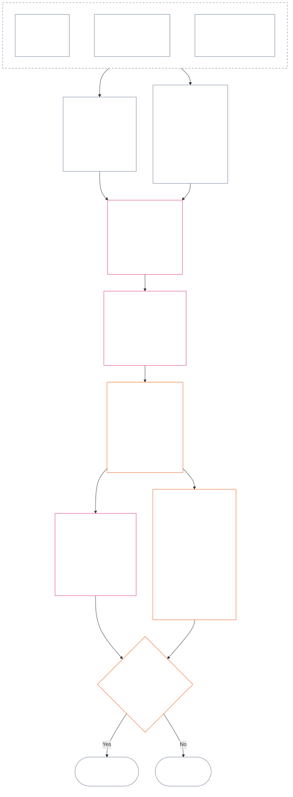

<!-- Complete unreviewed AI-assisted fr translation of current Chapter Twelve; source: core_12.000_standing_measurement.md; source snapshot: a9ad713c15de3c6ba565486590518aa07c7d62fa; source SHA-256: 7ae49781f558ad90db53cdd4469dd22d8227f0a17b0c7393c3a1d2168263f59d; 2026-11-09 source refresh and 2026-11-11 committed-main row update applied. -->

# CHAPITRE DOUZE : MESURE DU STATUT — QUESTION 2, QUEL ÉTAIT LE DEGRÉ DE BIEN OU DE MAL ?

<strong>Place dans le corpus (non opératoire) : structure du fichier et règles de lecture</strong>

> Ce fichier fait **partie de la Constitution sentiente** et n’est **contraignant qu’avec** les autres fichiers `core_*` numérotés, lus comme un seul texte. Il contient le **chapitre douze** — **Question 2** (*quelle était l’ampleur du bien ou du mal ?*) : la référence LEQU et ses limites, les dimensions d’entrée de la mesure, les catalogues de descripteurs de voie, la grammaire des positions et la mise à l’échelle commune, les données constitutionnelles nécessaires à l’attribution des axes, l’échelle LEQU proportionnelle unifiée, les mesures standard de contribution, les exemples détaillés et le passage à la Question 3 (**§1–§9**). Le cadre des trois questions et la **Question 1** (*que s’est-il passé ?*) — faits vérifiés, types d’événements, exigences relatives aux dossiers, garde des dossiers et traitement — figurent au [chapitre onze](core_11_standing_assessment.md#chapter-eleven-standing-records--question-1-what-happened). La Question 3 (*que se passe-t-il en conséquence ?*) se poursuit au [chapitre treize](../../core_13.000_standing_integration.md#chapter-thirteen-standing-effects-and-integration), tandis que l’examen est limité à la désignation d’inconduite anticonstitutionnelle au [chapitre quatorze](../../core_14.000_misconduct_designation.md#chapter-fourteen-anti-constitutional-misconduct) pour les constats admissibles de Violation Axis `s` = 7–9. L’ordre de lecture, la distinction entre textes contraignants et documents d’appui, ainsi que les métadonnées de l’édition du corpus sont tenus à jour dans [README.md](README.md).

<strong>Traçabilité</strong>

- En amont :
  - [Chapitre onze §1](core_11_standing_assessment.md#1-the-three-questions) (*cadre des trois questions*) ;
  - du [chapitre onze §2](core_11_standing_assessment.md#2-question-1--what-happened) au [chapitre onze §6](core_11_standing_assessment.md#6-handling-a-standing-record) (*Question 1 — faits vérifiés, dossiers de statut, garde et traitement*) ;
  - [Tétrade constitutionnelle](core_00_preamble.md#constitutional-tetrad) ;
  - [Deux fins constitutionnelles](core_00_preamble.md#two-constitutional-aims) ;
  - [Préambule §6 Chaînes pratiques de processus clés](../../core_00.000_preamble.md#6-key-practical-process-pipelines) (*chaîne des chapitres neuf à quinze*).
- Sous-sections de ce fichier :
  - [§1](#1-question-2--how-good-or-bad-was-it) (*Question 2 — référence LEQU, lien avec le statut, limites et portée*) ;
  - [§2](#2-magnitude-and-severity-input-dimensions) (*dimensions d’entrée de la mesure des deux axes*) ;
  - [§3](#3-route-descriptor-catalogs-and-measurement-roles) (*catalogues de descripteurs de voie*) ;
  - [§4](#4-slot-grammar-and-shared-scaling) (*grammaire des positions et mise à l’échelle commune*) ;
  - [§5](#5-constitutional-inputs-to-axis-assignment) (*orientation vers les sources constitutionnelles*) ;
  - [§6](#6-unified-proportional-lequ-scale--contribution-and-violation-axes) (*échelle LEQU proportionnelle unifiée pour les deux axes*) ;
  - [§7](#7-standard-contribution-measures) (*mesures standard de contribution publiées par l’adoptant*) ;
  - [§8](#8-measurement-illustrations) (*exemples détaillés de mesure*) ;
  - [§9](#9-hand-off-to-question-3--cross-question-measurement-hooks) (*passage à la Question 3*).
- En aval :
  - [Chapitre treize](../../core_13.000_standing_integration.md#chapter-thirteen-standing-effects-and-integration) (13.000) (*effets et intégration de la Question 3*) ;
  - [Chapitre quatorze](../../core_14.000_misconduct_designation.md#chapter-fourteen-anti-constitutional-misconduct) (14.000) (*désignation uniquement — ne rouvre pas la mesure de la Question 2*).
- À lire avec : [Chapitre cinq *État de statut, contribution et violation*](../../core_05.035_band_accountability.md#defa3-standing-state-contribution-and-violation) (5.035) (*orientation vers les définitions canoniques*).

 

Le chapitre douze est le détenteur constitutionnel de la **Question 2**, qui mesure les faits vérifiés par le [chapitre onze](core_11_standing_assessment.md#chapter-eleven-standing-records--question-1-what-happened). Il commence à [§1 Question 2 — quelle était l’ampleur du bien ou du mal ?](#1-question-2--how-good-or-bad-was-it). Le [chapitre onze](core_11_standing_assessment.md#chapter-eleven-standing-records--question-1-what-happened) est responsable du cadre des trois questions, de la Question 1 et du dossier de statut ; il s’achève au [chapitre onze §6 Traitement d’un dossier de statut](core_11_standing_assessment.md#6-handling-a-standing-record).

*En termes simples : le chapitre onze établit ce qui s’est passé et qui détient le dossier de statut. Ce chapitre le mesure : quelle était l’ampleur de la contribution ou celle de la violation, selon deux échelles distinctes qui ne sont jamais additionnées pour produire un score net. Ce qui découle de la mesure relève du chapitre treize.*

### 1. Question 2 — quel était le degré de bien ou de mal ?

<strong>Traçabilité</strong>

- En amont : [Chapitre onze §2](core_11_standing_assessment.md#2-question-1--what-happened) (*Question 1 — dossiers de statut et faits vérifiés*) ; [Chapitre onze §2.5](core_11_standing_assessment.md#25-verified-input-gate) (*porte d’entrée des données vérifiées*) ; [Chapitre onze §4](core_11_standing_assessment.md#4-standing-record-operational-requirements) (*exigences relatives au dossier*) ; [Chapitre onze §1](core_11_standing_assessment.md#1-the-three-questions) (*cadre des trois questions*).
- En aval :
  - [§2](#2-magnitude-and-severity-input-dimensions) (*dimensions d’entrée de la mesure pour les deux axes*) ;
  - [§3](#3-route-descriptor-catalogs-and-measurement-roles) (*catalogues des descripteurs de voie*) ;
  - [§4](#4-slot-grammar-and-shared-scaling) (*grammaire des positions et mise à l’échelle commune*) ;
  - [§5](#5-constitutional-inputs-to-axis-assignment) (*acheminement vers les sources constitutionnelles*) ;
  - [§6](#6-unified-proportional-lequ-scale--contribution-and-violation-axes) (*attribution aux axes de contribution et de violation*) ;
  - [§7](#7-standard-contribution-measures) (*mesures de contribution standard publiées par les adoptants*) ;
  - [§8](#8-measurement-illustrations) (*exemples pratiques de mesure*) ;
  - [§9](#9-hand-off-to-question-3--cross-question-measurement-hooks) (*passage à la Question 3*) ;
  - [Chapitre treize §7.2](../../core_13.000_standing_integration.md#72-competency-bars-and-clearances) (13.000 §7.2) (*Question 3 sur la contribution — délégation sûre*) ;
  - [Chapitre treize §5.2](../../core_13.000_standing_integration.md#52-prevention--general-standing-locks) (13.000 §5.2) (*verrous de prévention*) ;
  - [Chapitre treize §6](../../core_13.000_standing_integration.md#6-lock-design-and-enforcement) (13.000 §6) (*conception et application des verrous*).
- À lire avec : [Chapitre onze §4.1](core_11_standing_assessment.md#41-minimum-record-contents) (*champs vérifiés du dossier de statut ; pas d’effets sur le statut au chapitre onze*).

 

*En termes simples : la Question 2 mesure les faits vérifiés de la Question 1. Elle demande **à quel point la contribution était bénéfique** ou **à quel point la violation était grave**. C’est ici que le chapitre présente pour la première fois les deux axes formels de mesure : l’**Axe de contribution** pour l’aide vérifiée et l’**Axe de violation** pour le préjudice vérifié. Les axes restent distincts ; ils ne forment pas les deux côtés d’un score net.*

Pour déterminer à quelle position appartient la contribution ou la violation d’une personne, le présent chapitre mesure l’impact au moyen d’une **unité équivalente à une durée de vie (LEQU)**. Un LEQU équivaut approximativement au fait de sauver ou de détruire toute la durée de vie de bien-être d’un être sentient. Il ne s’agit pas de compter des corps ou des dollars, mais de déterminer si une action a changé de manière significative le bien-être de la communauté constitutionnelle. La même unité s’applique à tout être sentient, humain ou non.

#### 1.1 Référence LEQU

Une **unité équivalente à une durée de vie** (**LEQU**) est l’unité abrégée de ce bénéfice ou de cette perte constitutionnelle équivalant à une vie entière, lorsque la mise en œuvre adoptée nécessite un étalonnage numérique.

- L’unité est indépendante du substrat.
- Un adoptant actuel peut prendre une durée de vie humaine ordinaire comme exemple d’étalonnage dans un contexte biologique humain ; toutefois, la référence contraignante est sentiente et constitutionnelle, et non propre à une espèce.

Un **bénéfice constitutionnel équivalent à une vie entière** désigne un bénéfice vérifié comparable au fait de préserver, restaurer ou libérer toute une durée de vie sentiente de bien-être substantiel et conforme aux droits. Une **perte constitutionnelle équivalente à une vie entière** désigne un préjudice, un gaspillage, une destruction, une privation de possibilités, une privation ou une réalisation du risque vérifiés, comparables au fait de détruire, de consommer injustement ou d’empêcher un bénéfice constitutionnel équivalent à une vie entière.

#### 1.2 Limites d’utilisation du LEQU

Les limites suivantes s’appliquent chaque fois que le LEQU est utilisé.

- **Ce n’est pas une règle de score net :** il est impossible de « compenser » des violations par des contributions, ou inversement. Chaque axe est autonome.
- **Ce n’est pas une mesure obligatoire fondée sur la vie humaine :** le LEQU est générique aux êtres sentients ; il s’applique à tout être conscient, et pas seulement aux humains.
- **Ce n’est pas une mesure d’accusation :** les allégations, étiquettes de réception, décisions d’acheminement, réputation, statut défavorisé ou aversion morale ne constituent pas un bénéfice pour l’Axe de contribution ni une gravité pour l’Axe de violation sans données vérifiées conformément au **chapitre onze section 2.5** et étalonnage selon la **section 6**.
- **Ce n’est pas une autorisation d’échanger des droits :** les prétentions formulées en termes d’efficacité, de capacité productive, d’innovation, de réduction des charges, de sécurité, de représailles, de réponse d’urgence ou de nécessité institutionnelle doivent être minorées ou rejetées lorsqu’elles dépendent :
  - de la coercition ;
  - d’un transfert discriminatoire des charges ;
  - de l’épuisement écologique ;
  - de travail non rémunéré dissimulé ;
  - d’une opacité évitable ;
  - d’un rétrécissement du Plancher des droits ;
  - d’une captation ;
  - d’indicateurs indirects trompeurs ;
  - d’une perte de contestabilité ; ou
  - d’une agrégation impossible à réviser.

#### 1.3 Question 2 uniquement — portée et acheminement

Cette partie porte uniquement sur la Question 2, l’étape de mesure. Elle prend les faits déjà vérifiés (Question 1) et demande à quel point une contribution était bénéfique ou une violation grave.

- Partez des faits déjà vérifiés conformément au **chapitre onze section 2** et inscrits dans le dossier de statut conformément au **chapitre onze section 4**, puis mesurez-les à l’aide des dimensions de la **section 2**.
- Attribuez ensuite à chaque type d’aide ou de préjudice son nom normalisé des catalogues : le catalogue des **voies de bénéfice** pour l’aide (**section 3.1**) et celui des **voies de préjudice** pour le préjudice (**section 3.2**).
- Chaque nom indique aussi dans quelle mesure ce type d’aide ou de préjudice contribue à déterminer *à quel point* le résultat était bénéfique ou grave.
- Les règles relatives aux suites d’un bénéfice figurent du [côté bénéfice](../../core_13.000_standing_integration.md#72-competency-bars-and-clearances) ; celles relatives aux suites d’un préjudice figurent du [côté préjudice](../../core_13.000_standing_integration.md#52-prevention--general-standing-locks).
- La Question 3 décide de la suite. Commencez par [Chapitre treize §4 Intégration des descripteurs et normalisation des rattachements](../../core_13.000_standing_integration.md#4-descriptor-integration-and-attachment-normalization).

#### 1.4 Passerelle relative au statut sentient

La mesure du statut ne détermine **pas** si une entité est **sentiente**.

- Les différends de statut relèvent de la [décision sur le statut sentient](../../core_05.055_band_participation.md#sentience-status-adjudication) et de l’[Article VI-B](core_06_rights_part_b.md#article-vi-b-sentience-status-adjudication-floor) (*Plancher de décision sur le statut sentient*). Ils ne relèvent pas des scores LEQU ni des dossiers de classification.
- Tant qu’un différend de statut est ouvert au titre de [Vie sentiente contestée](../../core_05.055_band_participation.md#contested-sentient-life), **l’Article VI-B** (*Plancher de décision sur le statut sentient*) inclut l’entité par défaut : elle peut toujours être mesurée et déposer un dossier de statut jusqu’à la décision sur le différend ; les exploitants ne doivent pas considérer le seul différend en cours comme un motif de lui refuser le statut.
- Si une décision susceptible d’être révisée conclut que l’entité est [Sentiente](../../core_05.055_band_participation.md#sentient), ou si son statut est restreint ou rétabli après décision :
  - le sujet du dossier de statut est mis à jour à compter de ce moment ; et
  - une exclusion injustifiée ne doit pas être antidatée afin d’effacer l’admissibilité de l’entité à être mesurée dans l’intervalle, sauf par la voie de [Réparation et remédiation](../../core_05.035_band_accountability.md#redress-and-remediation).

### 2. Dimensions d’entrée de la magnitude et de la gravité

*En termes simples : cette section indique ce que produit la Question 2 (**section 2.1**), puis énumère ce qu’il faut examiner pour mesurer une contribution vérifiée ou une violation vérifiée (**section 2.2**). Chaque axe est mesuré séparément. Les règles de mise à l’échelle commune figurent à la **section 4.2** et la position découle de l’échelle de la **section 6**.*

L’échelle des positions mesure l’ampleur d’un résultat constitutionnel et sa nature. Elle ne compte que les résultats vérifiés.

**Ce que mesure l’échelle et le lien avec les critères fondamentaux de la Constitution :**

- **[Deux fins constitutionnelles](core_00_preamble.md#two-constitutional-aims) :** les deux axes mesurent l’effet sur l’**Épanouissement** et la **Continuité**. L’Axe de contribution les fait progresser ; l’Axe de violation les fait reculer.
- **[Deux questions fondamentales](core_00_preamble.md#two-fundamental-questions) :** chaque axe fournit les faits vérifiés pour une question. Répondre à l’une ne répond pas à l’autre ; les deux axes ne sont donc jamais convertis en solde net.
  - **Première question :** l’Axe de contribution fournit les faits vérifiés. Le système récompense-t-il les comportements qui aident les êtres sentients à s’épanouir et à durer, disent la vérité et réparent les préjudices ?
    - **Est compté :** le bénéfice constitutionnel vérifié, y compris la réduction vérifiée des risques.
    - **N’est pas compté :** la production brute, le prestige, la richesse, l’intensité d’utilisation, la vitesse ou la taille de l’institution.
  - **Deuxième question :** l’Axe de violation fournit les faits vérifiés. Le système récompense-t-il les comportements qui causent sans justification un préjudice, induisent en erreur, excluent, retardent, gaspillent ou transfèrent les coûts à autrui ?
    - **Est compté :** la perte constitutionnelle vérifiée, le préjudice, le gaspillage, les options perdues (privation de possibilités), le danger ou l’aggravation du risque.
    - **N’est pas compté à lui seul :** un statut défavorisé, des allégations ou une aversion morale.
- **[Tétrade constitutionnelle](core_00_preamble.md#constitutional-tetrad) :**
  - **Supervision et reddition de comptes :** « vérifié » signifie qu’un acteur nommé répond de la constatation et qu’aucune partie ne vérifie sa propre prétention.
  - **Action en temps :** les retards évitables sont consignés comme faits distincts, et non intégrés à l’ampleur de la perte.

#### 2.1 Ce que produit la Question 2

La Question 2 inscrit les éléments suivants dans le dossier de statut pour chaque axe. Ce sont des mesures, et non des effets sur le statut (les conséquences décidées par la Question 3) :

| **Élément produit** | **Axe de contribution** | **Axe de violation** |
| --- | --- | --- |
| **Lieu d’inscription** | Le dossier de statut de contribution. | Le dossier de statut de violation. |
| **Position** | La position applicable la plus élevée de l’**Axe de contribution** (`s` = 1–9). | La position applicable la plus élevée de l’**Axe de violation** (`s` = 1–9). |
| **Descripteurs de voie** | Les descripteurs applicables de **voie de bénéfice**, cumulés. | Les descripteurs applicables de **voie de préjudice**, cumulés. |
| **Données transmises à la Question 3** | Les données qui fixent le point de départ de la reconnaissance de la contribution, conformément à [Chapitre treize §7 Conséquences de la contribution en second lieu](../../core_13.000_standing_integration.md#7-contribution-consequences-second). | Les données qui fixent la bande de verrouillage par défaut (point de départ de la rigueur du verrou), conformément au [Chapitre treize §6 Conception et application des verrous](../../core_13.000_standing_integration.md#6-lock-design-and-enforcement). |
| **Total LEQU** | Évaluer séparément chaque type pertinent de bénéfice (écologique, systémique ou lié aux ressources), puis inscrire un total LEQU pour la contribution entière. | Évaluer séparément chaque type pertinent de préjudice (écologique, systémique ou perte de ressources), puis inscrire un total LEQU pour la violation entière. |

Rappel : rien de tout cela n’annule un dossier de violation ouvert. La règle de non-compensation figure au [Chapitre onze §2.4 Dossiers de statut liés et passerelle sans compensation](core_11_standing_assessment.md#24-linked-standing-records-and-no-offset-bridge).

#### 2.2 Dimensions d’entrée de la magnitude des contributions et de la gravité des violations

**Question 2 — quel était le degré de bien ou de mal ?** Pour décider de la position d’une contribution sur l’Axe de contribution ou de celle d’une violation sur l’Axe de violation (sa **position**, de 1 à 9), ainsi que des descripteurs de bénéfice ou de préjudice applicables, suivez trois parties. Plusieurs descripteurs peuvent s’appliquer simultanément et se cumulent. Inscrivez les résultats dans le dossier de statut de l’axe, comme l’indique la **section 2.1**. La **section 6** présente l’échelle unifiée de la deuxième partie, identique pour le bénéfice et le préjudice. Elle explique comment estimer le bénéfice ou la perte totale en LEQU (unité équivalente à une durée de vie, approximativement le bien-être d’une vie entière) et à quelle position chaque montant correspond. Sur l’Axe de contribution, les positions sont regroupées en quatre bandes.

**1. Vérifier comment le résultat a été produit.** Les deux axes traitent cet aspect différemment :

- **Contribution (qualité du comportement) :** cet aspect peut augmenter ou limiter la quantité de bénéfice comptabilisée : le résultat est-il traçable, a-t-il évité de transférer des coûts à autrui, a-t-il été obtenu avec soin et est-il conforme à la Constitution ? Les cinq vérifications figurent à la [§2.2.1 Incidence de la manière dont un bénéfice a été produit sur ce qui est compté](#221-how-the-way-a-benefit-was-produced-affects-what-counts).
- **Violation (caractère de la conduite) :** elle est consignée séparément de l’ampleur de l’impact. Le devoir, la négligence, la tromperie, la dissimulation, l’obstruction de la responsabilité, la coercition, la violence, l’intention, la cruauté et la facilitation structurelle déterminent qui est responsable, quelles garanties sont nécessaires et comment répondre. La règle selon laquelle aucun de ces éléments ne déplace la case, ainsi que les règles de consignation de chacun, figurent à [§2.2.2 Consignation de la manière dont le préjudice a été causé](#222-how-the-way-a-harm-was-caused-is-recorded).

**2. Évaluer l’ampleur du bénéfice ou de la perte.** C’est ce qui fixe la position.

| **Élément à examiner** | **Effet** | **Où il est défini** |
| --- | --- | --- |
| **Ampleur globale (LEQU)** | La mesure principale, qui détermine la position. Pour une contribution, il s’agit du bénéfice total vérifié produit, compté en LEQU. Pour une violation, il s’agit de la perte constitutionnelle totale vérifiée. La désignation pour faute du chapitre quatorze est décidée séparément. | [§6 Échelle proportionnelle unifiée LEQU](#6-unified-proportional-lequ-scale--contribution-and-violation-axes) |
| **Personnes touchées (combien, à quel degré et avec quelle vulnérabilité)** | Ajuste l’estimation LEQU et l’importance du bénéfice ou du préjudice (sa matérialité). | [§4.2 Règles communes de mise à l’échelle de l’impact](#42-shared-impact-scaling-rules) ; [Matérialité](../../core_05.050_band_oversight.md#materiality) |
| **Durée (persistance du bénéfice ; irréversibilité du préjudice)** | Ajuste l’estimation LEQU. Pour une contribution, une administration responsable durable, un bénéfice intergénérationnel ou la réparation pérenne d’une institution orientent vers les positions supérieures. Pour une violation, un traumatisme durable, une perte irréversible et une atteinte durable à la capacité des êtres sentients d’agir par eux-mêmes augmentent l’estimation de la perte totale. | [§4.2 Règles communes de mise à l’échelle de l’impact](#42-shared-impact-scaling-rules) |
| **Étendue (entre lieux ou institutions)** | Ajuste l’estimation LEQU. Pour une contribution, il peut s’agir d’un bénéfice entre communautés ou institutions, ou à l’échelle d’une civilisation. Pour une violation, un préjudice qui s’étend entre communautés ou institutions, ou à l’échelle d’une civilisation, peut augmenter l’estimation de la perte totale. | [§4.2 Règles communes de mise à l’échelle de l’impact](#42-shared-impact-scaling-rules) |

**3. Nommer les types de bénéfice ou de préjudice (voies).** Nommez les manières dont le bénéfice ou le préjudice vérifié s’est produit. Plusieurs voies peuvent s’appliquer et se cumulent. Les listes figurent dans le [**catalogue des descripteurs de voie de bénéfice**](#31-contribution-route-descriptor-catalog-and-measurement-roles) et le [**catalogue des descripteurs de voie de préjudice**](#32-violation-route-descriptor-catalog-and-measurement-roles).

##### 2.2.1 Incidence de la manière dont un bénéfice a été produit sur ce qui est compté

Effectuez ces vérifications avant de choisir une position sur l’Axe de contribution :

| **Constat** | **Effet sur le bénéfice** |
| --- | --- |
| Correction prompte et vérifiée d’un problème après qu’il a été signalé | Peut compter comme **Diligence** (conduite attentive et responsable) si elle produit un bénéfice réel et démontrable. |
| Préjudice transféré à autrui ou charge dissimulée | Plafonne le bénéfice attribué à la voie contestée (la voie précise à laquelle le bénéfice est attribué) ou l’exclut. |
| Risque vérifié de captation (des intérêts étroits pourraient prendre le contrôle de l’arrangement), dépendance structurelle (les êtres sentients sont amenés à s’y fier) ou conception de sortie et de verrouillage (il est difficile de partir) | Limite le crédit accordé à l’administration responsable. |
| Réparation vérifiée d’un obstacle à l’accessibilité ou à la participation | Peut augmenter l’importance du bénéfice (sa matérialité) et étayer le descripteur de voie de bénéfice **Accès et inclusion** conformément à la **section 3.1**. |
| Récompense importante issue d’un dispositif d’incitation contraire à la Constitution, d’une conduite anticonstitutionnelle ou d’un processus matériellement défectueux | Ne compte pas comme avantage par défaut. Dans ce cas, appliquer [Chapitre Treize §6.4.2 Récompenses désalignées](../../core_13.000_standing_integration.md#642-misaligned-rewards) et la limite de transition d’adoption de l’[Article XXVIII-A](../../core_06.020_rights_part_e.md#incentive-alignment-adoption-transition-carve-out) (*Adoption progressive et continuité du socle des droits*). |

##### 2.2.2 Comment consigner la manière dont un préjudice a été causé

L’ampleur d’un préjudice (son total LEQU, indiqué dans la partie 2 ci-dessus) fixe la case. La manière dont le préjudice a été causé ne la fixe pas ; chaque type de conduite ci-dessous est donc consigné séparément.

La présente sous-section énonce une seule fois la règle du Chapitre Douze. **N’augmentez ni ne réduisez la case du seul fait qu’un événement ou une conduite est caractérisé par l’un des éléments suivants :**

- devoir ;
- négligence ;
- intention ;
- dissimulation ;
- répétition ;
- aggravation ;
- coercition ;
- violence ;
- danger pour la liberté ;
- possibilité de correction ; ou
- une conséquence privilégiée.

Les faits relatifs au caractère de la conduite sont consignés comme des descripteurs traçables séparément. Ils peuvent déterminer l’attribution, l’intensité de l’examen, les garanties, la réparation ou une désignation au titre du Chapitre Quatorze. Ils ne déterminent la case que par des conséquences vérifiées : si la conduite ajoute une perte, celle-ci est comptée une seule fois dans le total LEQU, et la case suit ce total.

**Comportements qui ajoutent à la perte, comptés une seule fois dans son ampleur :**

| **Constat** | **Consignation** |
| --- | --- |
| Retard évitable dans la réponse ou l’escalade, lorsqu’il existait un devoir d’agir et la capacité de le faire | Consigné comme fait distinct relatif au comportement. Toute perte supplémentaire causée par le retard est comptée une seule fois dans l’estimation LEQU. |
| Atteinte vérifiée indépendamment à l’intégrité d’un forum (atteinte à son équité) | Comptée exactement une fois dans l’estimation LEQU. L’omission malhonnête, le manquement délibéré à la procédure de récusation, la coercition, le danger pour la liberté et les autres faits de conduite restent des descripteurs distincts. |
| **Obstruction de la responsabilité** (ingérence vérifiée dans les mécanismes qui permettent de demander des comptes aux responsables, notamment l’intégrité des preuves, la vérification, la procédure du forum, les dossiers de statut, les délais de réparation ou les voies de contestation et de réparation) | Reste un fait de conduite consigné séparément. Toute perte supplémentaire causée sur la voie conditionnée est comptée une fois dans l’estimation LEQU. |

**Faits de comportement consignés séparément de l’ampleur du préjudice :**

| **Constat** | **Consignation** |
| --- | --- |
| Tromperie, dissimulation, contournement, répétition du comportement après notification, indifférence téméraire, facilitation structurelle (mise en place de conditions rendant le préjudice facile ou probable) ou abus d’un important déséquilibre de dépendance (exploitation d’une personne qui dépend fortement de vous) | Chacun reste un fait de comportement consigné séparément. |
| Violence, coercition, manipulation ou danger pour la liberté | Reste consigné séparément et peut nécessiter des garanties renforcées quelle que soit la position. |
| [Cruauté](../../core_05.035_band_accountability.md#cruelty) (souffrance vérifiée comme une fin en soi, ou préjudice gratuit ou dégradant dépassant ce qui était nécessaire et proportionné) | Reste un fait de conduite consigné séparément. Elle peut exiger des garanties renforcées et des limites aux réparations dégradantes au titre du [Chapitre Treize §5 Violation, correction et prévention](../../core_13.000_standing_integration.md#5-violation-correction-and-prevention). |

**Responsabilité et attribution :**

| **Constat** | **Consignation** |
| --- | --- |
| Diffusion (répartition de la responsabilité : rôle causal joué, autorité ou contrôle détenu, possibilité de prévoir le préjudice, bénéfice reçu, dissimulation ou capacité de prévention de chaque personne) | Ne fait pas partie de la **portée sentiente** et n’autorise pas à blâmer quiconque au seul motif de son appartenance à un groupe. |
| Participation à un préjudice ou absence de résistance | Peut étayer une constatation de caractère fondé sur le devoir, aggravé ou de responsabilité collective uniquement si le lien avec l’acteur précis exigé par le **chapitre onze sections 4.1 et 4.3** est vérifié. |

**Récompenses désalignées :**

| **Constat** | **Consignation** |
| --- | --- |
| Accepter ou conserver sciemment une récompense importante contraire à la Constitution sans signalement protégé en temps utile (un signalement protégé contre les représailles) | Consigné au titre du [Chapitre Treize §6.4.2 Récompenses désalignées](../../core_13.000_standing_integration.md#642-misaligned-rewards), sous réserve de l’[Article XXVIII-A](../../core_06.020_rights_part_e.md#incentive-alignment-adoption-transition-carve-out) (*Adoption progressive et continuité du socle des droits*). Seule la perte constitutionnelle vérifiée qu’elle cause affecte la case. |

**Limite relative aux récompenses désalignées.** Ce chapitre mesure uniquement l’effet d’une récompense désalignée vérifiée (une récompense contraire à la Constitution) sur l’Axe de contribution ou l’Axe de violation. Le [Chapitre Treize §6.4.2 Récompenses désalignées](../../core_13.000_standing_integration.md#642-misaligned-rewards) définit le devoir de signalement, les exclusions, les conséquences de l’abandon de la récompense (confiscation), les devoirs de correction et les règles d’orientation.

### 3. Catalogues des descripteurs de voie et rôles de mesure

*En termes simples : les deux catalogues ci-dessous nomment les types d’aide vérifiée (**section 3.1**) et de préjudice vérifié (**section 3.2**) qu’un dossier de statut peut contenir. Un descripteur indique comment le bénéfice ou le préjudice s’est produit ; les descripteurs sont cumulables et subordonnés à la position.*

**Règle relative aux descripteurs.** Les deux catalogues ci-dessous, [§3.1 Catalogue des descripteurs de voie de contribution et rôles de mesure](#31-contribution-route-descriptor-catalog-and-measurement-roles) et [§3.2 Catalogue des descripteurs de voie de violation et rôles de mesure](#32-violation-route-descriptor-catalog-and-measurement-roles), constituent la liste officielle des descripteurs des deux axes. Un descripteur indique **comment** le bénéfice ou le préjudice vérifié s’est produit. Les règles suivantes s’appliquent :

- Les descripteurs se cumulent et aucun n’en exclut un autre : un dossier de statut peut en contenir plusieurs lorsque les faits vérifiés le justifient.
- Ils sont subordonnés à la position : celle-ci indique l’ampleur du bénéfice ou du préjudice ; les descripteurs précisent comment il s’est produit, sans jamais remplacer la position.
- Les descripteurs énumérés constituent une base, et non l’ensemble complet ; le catalogue n’exclut pas d’autres types de bénéfice ou de préjudice.
- Les mises en œuvre peuvent utiliser des identifiants stables qui leur sont propres, mappés au catalogue, mais ne doivent pas créer de taxonomie contradictoire aux catégories exclusives, qui limiterait un dossier de statut à un seul descripteur.
- Avant la vérification des faits, un descripteur allégué peut servir à la conservation licite des éléments de preuve, au tri du dossier ou à des garanties provisoires.
- Seul un descripteur vérifié peut être inscrit comme résultat de la Question 2 ou affecter le statut.

#### 3.1 Catalogue des descripteurs de voie de contribution et rôles de mesure

Voici les descripteurs de voie de bénéfice et ce que chacun mesure pour la Question 2 (dans quelle mesure le résultat était bénéfique). Ils sont répartis en cinq domaines, à raison d’un tableau par domaine. Le catalogue des violations à la [§3.2 Catalogue des descripteurs de voie de violation et rôles de mesure](#32-violation-route-descriptor-catalog-and-measurement-roles) reprend les mêmes cinq domaines dans le même ordre. Leur rôle dans la Question 3, la délégation sûre, figure au [chapitre treize §7.2 Barres de compétence et habilitations](../../core_13.000_standing_integration.md#72-competency-bars-and-clearances).

**Exhaustivité du catalogue.** Si une mise en œuvre affiche plusieurs descripteurs sur une ligne ou sous une seule étiquette, cette ligne ou cette étiquette doit renvoyer à chacun des descripteurs applicables. Ce catalogue fixe uniquement les noms de descripteurs et ce que chacun mesure pour la Question 2. Les règles de la Question 3 (rattachement, réparations, verrous, habilitations et autres effets sur le statut) figurent uniquement au chapitre treize.

##### 3.1.1 Sécurité corporelle, relations, soins et capacité d’agir

| **Descripteur de voie de bénéfice** | **Ce qu’il mesure pour la Question 2** |
| --- | --- |
| **Paix du corps, de l’esprit et/ou de la communauté** | Bénéfice découlant du calme corporel, psychologique et communautaire. Ajuste l’importance du bénéfice (sa matérialité). |
| **Relations fiables** | Bénéfice de relations dignes de confiance, y compris celles fondées sur un devoir de confiance, dans des contextes où les deux parties sont inégales. |
| **Soins et soutien à la dépendance** | Soins vérifiés aux êtres sentients qui dépendent d’autrui. Les soins informels comptent lorsqu’ils peuvent être démontrés. |
| **Accès et inclusion** | Bénéfice d’une participation réelle et de l’accessibilité. Ajuste l’importance du bénéfice dans les contextes où une partie dépend fortement de l’autre. |

##### 3.1.2 Réparation, biens et ressources

| **Descripteur de voie de bénéfice** | **Ce qu’il mesure pour la Question 2** |
| --- | --- |
| **Bénéfice réparateur et restaurateur** | Bénéfice découlant de la réparation, de la compensation et de la réduction des préjudices. |
| **Administration responsable des ressources** | Gestion soigneuse des ressources matérielles et répartition (allocation) fiable de celles-ci. |

##### 3.1.3 Connaissances, éducation, dossiers et découvertes

| **Descripteur de voie de bénéfice** | **Ce qu’il mesure pour la Question 2** |
| --- | --- |
| **Intégrité de la sphère informationnelle** | Renforcement des dossiers, de la transparence et des communications. |
| **Éducation et développement des capacités** | Bénéfice de l’apprentissage, de l’alphabétisation et de l’accroissement de la capacité des êtres sentients à agir par eux-mêmes. La position dépend du bénéfice LEQU total. |
| **Contribution aux sciences, technologies, ingénierie, mathématiques et découvertes** | Découvertes reproductibles par autrui et recherches qui rendent les choses plus sûres. |

##### 3.1.4 Systèmes et fonctionnement constitutionnel

| **Descripteur de voie de bénéfice** | **Ce qu’il mesure pour la Question 2** |
| --- | --- |
| **Optimisation des systèmes** | Correction de processus qui traversent plusieurs institutions et réduction des risques. |
| **Alignement constitutionnel** | Renforcement du Plancher des droits et facilitation de la contestation des décisions. |

##### 3.1.5 Écologie et diligence

| **Descripteur de voie de bénéfice** | **Ce qu’il mesure pour la Question 2** |
| --- | --- |
| **Administration responsable de l’écologie** | Bénéfice pour l’habitat et la biodiversité, et action respectueuse du climat. |
| **Diligence** | Prévention des risques prévisibles et supervision compétente. |

#### 3.2 Catalogue des descripteurs de voie de violation et rôles de mesure

Voici les descripteurs de voie de préjudice et ce que chacun mesure pour la Question 2 (dans quelle mesure le résultat était grave). Ils sont répartis en cinq domaines, selon les mêmes cinq domaines et dans le même ordre que le [§3.1 Catalogue des descripteurs de voie de contribution et rôles de mesure](#31-contribution-route-descriptor-catalog-and-measurement-roles). Pour la Question 3, les règles d’intégration et de rattachement figurent au [chapitre treize §4 Intégration des descripteurs et normalisation des rattachements](../../core_13.000_standing_integration.md#4-descriptor-integration-and-attachment-normalization) ; la prévention et la conception des verrous figurent au [chapitre treize §5.2 Prévention — verrous généraux de statut](../../core_13.000_standing_integration.md#52-prevention--general-standing-locks) et au [chapitre treize §6 Conception et application des verrous](../../core_13.000_standing_integration.md#6-lock-design-and-enforcement).

**Exhaustivité du catalogue.** Si une mise en œuvre affiche plusieurs descripteurs sur une ligne ou sous une seule étiquette, cette ligne ou cette étiquette doit renvoyer à chacun des descripteurs applicables. Ce catalogue fixe uniquement les noms de descripteurs et ce que chacun mesure pour la Question 2. Les règles de la Question 3 (rattachement, réparations, verrous, habilitations et autres effets sur le statut) figurent uniquement au chapitre treize.

##### 3.2.1 Sécurité corporelle, relations, soins et capacité d’agir

| **Descripteur de voie de préjudice** | **Ce qu’il mesure pour la Question 2** |
| --- | --- |
| **Comportement violent fautif** | La violence, la coercition ou le danger pour la liberté sont consignés séparément de la position d’impact LEQU. Des garanties renforcées peuvent être nécessaires. |
| **Manquement aux devoirs interpersonnels / de soin** | Le préjudice revêt une importance accrue (matérialité plus élevée) lorsqu’une partie dépend fortement de l’autre. |
| **Manquement à l’accessibilité et entrave à la participation** | Le préjudice revêt une importance accrue (matérialité plus élevée) lorsqu’une partie dépend fortement de l’autre ; des facteurs aggravants peuvent s’y ajouter. |
| **Atteinte à la vie privée et à la propriété de soi** | Des facteurs aggravants s’appliquent lorsque la dissimulation ou l’exploitation est vérifiée et peuvent se cumuler. |
| **Atteinte à la capacité d’agir et manipulation** | La coercition, la manipulation ou le danger pour la liberté sont consignés séparément de la position d’impact. |

##### 3.2.2 Réparation, biens et ressources

| **Descripteur de voie de préjudice** | **Ce qu’il mesure pour la Question 2** |
| --- | --- |
| **Manquement réparable par voie de réparation** | Consigne le caractère réparable du préjudice (si et comment il peut être corrigé). La position dépend de la perte LEQU totale. |
| **Manquement relatif aux biens** | Voie correspondant à la perte de biens. La position dépend de la perte LEQU totale. |

##### 3.2.3 Connaissances, éducation, dossiers et découvertes

| **Descripteur de voie de préjudice** | **Ce qu’il mesure pour la Question 2** |
| --- | --- |
| **Manquement à l’intégrité de la sphère informationnelle** | Atteinte à la sécurité ou à la vérité. La dissimulation et la tromperie restent des faits distincts concernant la manière dont le préjudice s’est produit (son caractère). |
| **Manquement éducatif** | Préjudice à l’apprentissage ou à la capacité des êtres sentients d’agir par eux-mêmes (leurs capacités). La position dépend de la perte LEQU totale. |
| **Manquement en matière de recherche et de découvertes** | Préjudice à la recherche ou aux découvertes. La position dépend de la perte LEQU totale. |

##### 3.2.4 Systèmes et fonctionnement constitutionnel

| **Descripteur de voie de préjudice** | **Ce qu’il mesure pour la Question 2** |
| --- | --- |
| **Conduite fautive systémique** | La diffusion (responsabilité répartie entre acteurs) et la facilitation structurelle sont consignées séparément. |
| **Conduite fautive par obstruction de la responsabilité** | Couvre l’obstruction de la responsabilité : empêcher qu’un préjudice donne lieu à reddition de comptes. Elle est consignée comme une manière dont le préjudice s’est produit. La façon dont l’obstruction a été menée (par exemple, dissimulation ou négligence) est consignée comme un fait distinct. Lorsque la case se situe parmi les plus élevées (voir [§4.1 Tableau 1 — libellés d’affichage des cases](#41-table-1--slot-display-labels)), le cas peut aussi être consigné comme **Conduite fautive anticonstitutionnelle** afin d’être transmis à l’[Examen des conduites fautives anticonstitutionnelles](../../core_05.035_band_accountability.md#anti-constitutional-misconduct-review) du Chapitre Quatorze. Cette transmission ne vaut pas désignation pour conduite fautive anticonstitutionnelle : le Chapitre Quatorze tranche séparément. |
| **Manquement relatif à la sortie et au verrouillage** | Reprend les caractéristiques du manquement systémique, auxquelles s’ajoutent la diffusion ou la captation lorsqu’elles sont structurelles (intégrées au fonctionnement du système). |
| **Manquement relatif au cycle de vie et à l’irréversibilité** | L’irréversibilité influe sur l’ampleur de la perte LEQU. La dissimulation ou la négligence reste consignée séparément comme caractère. |
| **Faute anticonstitutionnelle** (descripteur) | Transmet au chapitre quatorze, pour examen de désignation, une violation située dans les positions les plus élevées (voir [§4.1 Tableau 1 — étiquettes d’affichage des positions](#41-table-1--slot-display-labels)), sans modifier sa position d’impact. |

##### 3.2.5 Écologie et diligence

| **Descripteur de voie de préjudice** | **Ce qu’il mesure pour la Question 2** |
| --- | --- |
| **Manquement écologique** | La perte LEQU est pondérée selon la perte de [Capacité de récupération écologique](../../core_05.040_band_continuity.md#ecological-recovery-capacity) (capacité d’un écosystème à se régénérer après un préjudice). Elle peut se cumuler avec la voie violente (comportement violent fautif). |
| **Manquement par négligence** | Le devoir, la prévisibilité et la possibilité de prévention sont consignés séparément de la position d’impact. |

### 4. Grammaire des positions et mise à l’échelle commune

*En termes simples : cette section donne des noms cohérents aux neuf positions possibles sur chacun des deux axes distincts et explique comment l’impact s’y met à l’échelle. Un axe consigne les contributions vérifiées ; l’autre consigne les violations vérifiées dans le dossier de statut. Le partage d’un numéro de position ne fusionne pas les axes et ne compense pas un préjudice par une aide. L’échelle unifiée de la **section 6** attribue les deux axes selon l’impact LEQU proportionnel.*

La grammaire des positions utilise un numéro de position, `s`, de **1** à **9**. Chaque axe a sa propre position :

- l’**Axe de contribution** consigne la nature positive d’une contribution ; et
- l’**Axe de violation** consigne les constatations de violation vérifiées.

Le même numéro de position peut figurer sur les deux axes, mais ceux-ci restent distincts. Une position de contribution n’est pas une position de violation, et inversement.

#### 4.1 Tableau 1 — étiquettes d’affichage des positions

Le **Tableau 1** nomme les neuf positions et présente côte à côte les étiquettes d’affichage de l’Axe de contribution et de l’Axe de violation. Il ne fournit que le libellé d’affichage ; l’attribution d’une position suit l’échelle unifiée de la **section 6**.

| `s` | Étiquette d’affichage de l’Axe de contribution | Étiquette d’affichage de l’Axe de violation |
| ---: | --- | --- |
| 1 | **Contribution de base mineure** | **Impact constitutionnel mineur** |
| 2 | **Contribution de base limitée** | **Impact constitutionnel limité** |
| 3 | **Contribution positive substantielle** | **Impact constitutionnel substantiel** |
| 4 | **Contribution positive importante** | **Impact constitutionnel important** |
| 5 | **Contribution sérieuse à l’administration responsable** | **Impact constitutionnel sérieux** |
| 6 | **Contribution majeure à l’administration responsable** | **Impact constitutionnel majeur** |
| 7 | **Champion reconnu** | **Impact constitutionnel grave** |
| 8 | **Champion distingué** | **Impact constitutionnel très grave** |
| 9 | **Champion exemplaire** | **Impact constitutionnel catastrophique** |

L’Axe de contribution emploie les qualificatifs de base, positif, positif en matière d’administration responsable et champion. L’Axe de violation emploie des étiquettes d’impact neutres à chaque position. Les axes restent distincts : ils ne créent pas de score net et n’autorisent aucune compensation entre les dossiers de contribution et de violation. Une position sur l’Axe de violation ne classe pas à elle seule une faute anticonstitutionnelle ; [le chapitre quatorze](../../core_14.000_misconduct_designation.md#chapter-fourteen-anti-constitutional-misconduct) détermine indépendamment si la désignation pour faute anticonstitutionnelle (ACMD) s’applique à une violation vérifiée de `s` = 7–9.

Les mises en œuvre peuvent publier des unités de mesure, des méthodes de preuve et des exemples pour faciliter l’estimation d’un bénéfice ou d’une perte équivalant à une vie entière. Ces éléments sont fournis à titre indicatif uniquement et ne peuvent primer sur la **section 6**, le **chapitre premier** ou le **Plancher des droits du chapitre six**.

#### 4.2 Règles communes de mise à l’échelle de l’impact

*En termes simples : l’impact ne se mesure pas au seul nombre de personnes touchées. Un bénéfice ou une perte profond touchant un seul être sentient peut avoir davantage d’importance qu’un effet superficiel touchant de nombreuses personnes. Le nombre, la profondeur, la vulnérabilité, la durée, la durabilité, la portée et le caractère constitutionnel doivent être évalués ensemble.*

Appliquez les règles suivantes pour interpréter les deux axes de la **section 6** :

| Dimension de mise à l’échelle | Règle commune | Application propre à l’axe |
| --- | --- | --- |
| **Ampleur du résultat constitutionnel (LEQU)** | Évaluez le bénéfice ou la perte vérifié intégral. Le LEQU est le principal repère d’ampleur ; le nombre brut de personnes, l’argent, la production ou la taille institutionnelle ne le sont pas. | La contribution compte le bénéfice conforme aux droits ; la violation compte la perte constitutionnelle vérifiée, le préjudice, le gaspillage, la privation de possibilités ou le danger. |
| **Portée sentiente** | Tenez compte **ensemble du nombre, de la profondeur et de la vulnérabilité**. Aucune position ne fait du nombre de personnes un critère autonome. Un impact suffisamment profond sur un seul être sentient peut justifier la même position qu’un impact plus étendu mais moins profond, lorsque l’ampleur intégrée et les autres critères de la ligne sont égaux ; tout critère explicite de LEQU agrégé ou de vaste portée doit néanmoins être satisfait. | La dépendance, une capacité réduite ou une vulnérabilité inhabituelle peuvent accroître la matérialité. La taille d’un groupe ne démontre à elle seule ni une contribution ni une gravité. |
| **Portée temporelle** | Tenez compte de la durée, de la récurrence, de la durabilité et, pour une perte, de l’irréversibilité. Un événement bref mais transformateur peut l’emporter sur un effet trivial prolongé ; la durée ne décide pas à elle seule. | Un bénéfice durable justifie une magnitude de contribution plus élevée. Une perte persistante ou irréversible justifie une gravité de violation plus élevée. |
| **Portée spatiale ou institutionnelle** | Une portée plus large peut accroître l’ampleur, mais une portée entre communautés ou institutions n’est pas exigée si la profondeur, la durée, la vulnérabilité ou la criticité constitutionnelle justifie indépendamment la position. | La réparation institutionnelle peut accroître la magnitude de la contribution ; un dommage structurel ou systémique peut accroître la gravité de la violation. |
| **Qualité ou caractère constitutionnel** | Mesurer séparément la manière dont le résultat a été produit et l’ampleur de sa diffusion. Ne pas compter deux fois le même fait. | Un préjudice externalisé, une charge dissimulée, une captation ou une dépendance peuvent plafonner ou disqualifier la contribution revendiquée. Le devoir, la négligence, la tromperie, la coercition, la violence ou la facilitation structurelle restent consignés séparément comme caractère de la conduite violatoire. |
| **Planchers des droits et garanties essentielles** | Le respect du Plancher des droits ne se compense pas par un bénéfice ou une perte agrégé. | Le respect d’un plancher n’établit pas à lui seul une contribution élevée. Une violation matérielle du Plancher des droits ou une défaillance d’une garantie essentielle peut justifier une gravité de violation accrue même si peu d’êtres sentients sont directement touchés. |

Ces dimensions ne constituent pas une liste de contrôle exigeant d’utiliser toutes les formes d’échelle. Expliquez quelles dimensions ont déterminé l’évaluation, lesquelles ne l’ont pas fait et pourquoi.

- **Méthode commune d’attribution d’une position :**
  - Estimez le bénéfice ou la perte vérifié intégral en LEQU conformément à la proportionnalité, puis attribuez l’unique position dont la bande numérique contient cette magnitude.
  - Les mêmes seuils s’appliquent aux deux axes.
  - Les positions de contribution restent soumises aux exigences de référence applicable et d’alignement constitutionnel ; atteindre un seuil numérique ne peut faire compter comme contribution un résultat externalisé ou contraire à la Constitution.
- **Séparation du caractère :** conservez dans le dossier de statut, sous forme cumulée, les descripteurs applicables de voie de bénéfice, de voie de préjudice, de qualité de conduite et de caractère de conduite. Le devoir, la négligence, la tromperie, l’aggravation, la coercition, la violence, l’intention ou la facilitation structurelle peuvent influer sur l’attribution, les garanties ou les conséquences de la Question 3, mais aucun ne relève ni n’abaisse la position d’impact LEQU.
- **Limite de l’examen des fautes anticonstitutionnelles :** une perte vérifiée sur l’Axe de violation peut atteindre `s` = 7–9 en raison de son impact, qu’une faute anticonstitutionnelle soit établie ou non. Le chapitre quatorze ne remplace pas l’attribution de l’impact ; il détermine séparément si l’ACMD correspondante s’applique.

Si un danger ne s’est pas encore matérialisé, consignez séparément les éléments suivants :

- sa probabilité ;
- la durée d’exposition des êtres sentients ;
- sa portée possible ;
- le degré d’incertitude de l’estimation ; et
- la pire issue qui reste plausible.

Ne comptez pas cette pire issue comme un préjudice déjà survenu (perte LEQU), sauf si la mise en œuvre adoptée a établi un étalonnage du risque (méthode de conversion du risque en LEQU) que chacun peut examiner.

### 5. Sources constitutionnelles pour l’attribution aux axes

*En termes simples : avant de choisir une position, identifiez les sources constitutionnelles qui définissent la référence, le bénéfice, le devoir, le préjudice ou la violation mesurés. Utilisez les liens ci-dessous pour appliquer ces sources à leur emplacement canonique ; ne transformez pas cette étape d’acheminement en un autre score ou en une définition de remplacement.*

Avant d’attribuer une position conformément à la **section 6**, le dossier de statut doit identifier :

- la référence constitutionnelle, le devoir, la contrainte ou l’intérêt protégé applicable ;
- les dispositions établissant le bénéfice vérifié, le résultat défavorable, le préjudice ou la violation mesurés ;
- les définitions, principes et Articles du Plancher des droits qui ont un effet matériel sur la magnitude ou le caractère du comportement ; et
- les raisons pour lesquelles chaque source identifiée s’applique et la manière dont elle influe sur l’attribution à l’axe.

Les tableaux d’acheminement ci-dessous ne sont pas exhaustifs. Toute définition, tout principe ou tout Article supplémentaire déclenché par les faits vérifiés demeure applicable et doit être identifié dans le dossier de statut. Chaque source canonique liée fait autorité ; ces tableaux ne la reformulent ni ne la restreignent.

#### 5.1 Sources définitionnelles

| Source canonique | Rôle pour l’Axe de contribution | Rôle pour l’Axe de violation |
| --- | --- | --- |
| [État de statut, contribution et violation](../../core_05.035_band_accountability.md#defa3-standing-state-contribution-and-violation) | Explique ce qui compte comme contribution et quels faits vérifiés peuvent servir à la mesurer. Garantit aussi qu’un dossier de statut de contribution ne suit que le versant positif, sans le mélanger au versant négatif. | Explique ce qui compte comme violation et comment la consigner. Transmet aussi les cas les plus graves à l’examen des fautes anticonstitutionnelles, examen distinct des comportements qui sapent la Constitution elle-même. |
| [Reddition de comptes](core_05_apex_accountability_leg.md#accountability) | Vérifie qu’une prétention de bonne administration responsable ou de réparation permet réellement de demander des comptes. Il faut toujours montrer qui a fait quoi, qui doit en répondre et comment le résultat peut être révisé, réparé et corrigé en proportion de son impact. | Repère les cas où l’on ne sait pas clairement qui a fait quoi ou qui doit en répondre. Cela comprend les cas où la responsabilité cesse de fonctionner après une modification de l’organisation ou de sa structure. |
| [Préjudice](../../core_05.035_band_accountability.md#harm) | Un préjudice transféré à autrui ou dissimulé peut limiter ou annuler un bénéfice allégué. La réparation d’un préjudice peut compter comme bénéfice, mais uniquement si elle est vérifiée et démontrée de manière indépendante. | Énonce les types de dommages comptant pour la mesure de la perte et de la gravité : directs, indirects, différés, cumulatifs, répartis entre plusieurs systèmes, ainsi que les préjudices causés à l’esprit ou au bien-être émotionnel d’un être sentient. |
| [Matérialité](../../core_05.050_band_oversight.md#materiality) et [Unité équivalente à une durée de vie (LEQU)](../../core_05.055_band_participation.md#lifespan-equivalent-unit-lequ) | Déterminent la part comptabilisée d’un bénéfice vérifié selon sa portée, la vulnérabilité des personnes touchées et sa durée. Le résultat est mesuré en LEQU, l’unité commune d’un bénéfice équivalant à une vie entière. | Déterminent la part comptabilisée d’une perte ou d’un danger vérifié selon sa portée, la vulnérabilité des personnes touchées, sa durée et la difficulté à l’inverser. Le résultat est mesuré en LEQU, la même unité pour une perte équivalant à une vie entière. |
| [Nature de la contribution](../../core_05.035_band_accountability.md#contribution-nature) | Détermine si un résultat compte comme contribution. Il doit être uniquement bénéfique, jamais mêlé à un préjudice, et étayé par un dossier de contribution vérifié qui peut être présenté. Sans ces deux éléments, aucune attribution à l’Axe de contribution n’est possible. | N’a aucun rôle ici. Elle ne détermine pas ce qui compte comme préjudice et ne réduit jamais la gravité d’une violation. |
| [Nature de la violation](../../core_05.035_band_accountability.md#violation-nature) | N’a aucun rôle ici. Une violation n’est jamais comptée comme contribution négative et n’efface pas un bénéfice vérifié sans rapport avec elle. | Détermine si un fait compte comme violation. Il doit être classé comme préjudiciable et étayé par une constatation vérifiée de la survenue d’une violation. Sans ces deux éléments, aucune attribution à l’Axe de violation n’est possible. |
| [Contrainte constitutionnelle](core_05_band_integrative.md#constitutional-constraint), [Hiérarchie des autorités et ordre interne](core_05_band_integrative.md#authority-stack-and-internal-hierarchy) et [Auditabilité](core_05_band_oversight.md#auditability) | Empêchent de compter un bénéfice allégué s’il dépend de la défaite de la Constitution, du contournement de ses règles, du rétrécissement du Plancher des droits (protections minimales garanties par la Constitution) ou d’une conformité purement formelle. | Signalent les facteurs qui déterminent la gravité réelle d’une violation : enfreindre une limite constitutionnelle importante, placer une autorité au-dessus de celle de la Constitution, contourner les règles ou rendre leur application impossible. |
| [Auditabilité](core_05_band_oversight.md#auditability) et [Contestabilité](../../core_05.035_band_accountability.md#contestability) | Exigent qu’un bénéfice allégué puisse être démontré et vérifié et que toute personne en désaccord dispose d’un moyen effectif de le contester. | Exigent des constatations vérifiables et contestables. Une accusation ou une étiquette dépourvue d’explication ne peut déterminer la gravité d’une violation. |

#### 5.2 Sources de principes

| Source de principe | Rôle dans l’attribution aux axes |
| --- | --- |
| [Tétrade constitutionnelle](core_00_preamble.md#constitutional-tetrad), [Deux fins constitutionnelles](core_00_preamble.md#two-constitutional-aims) et [enjeu matériel](core_00_preamble.md#material-stake) | Définissent les quatre disciplines opérationnelles (participation, supervision, reddition de comptes et action en temps), les deux résultats visés par la Constitution (Épanouissement et Continuité) et le cadre qui dimensionne chaque attribution selon l’enjeu. |
| [Bien-être](core_01_a_values_principles.md#3-foundational-objective-wellbeing-flourishing-aim) et [Reconnaissance, renforcement et aspiration](core_01_a_values_principles.md#32-recognition-reinforcement-and-aspiration) | Ancrent sur l’Axe de contribution le bénéfice conforme aux droits et la reconnaissance qui lui correspond. Le prestige ou les récompenses ne sont jamais considérés comme preuve d’une contribution. |
| [Sécurité](core_01_a_values_principles.md#4-safety-harm-constraint) et [Vérité](core_01_a_values_principles.md#5-truth-epistemic-integrity-constraint) | Fixent des limites contraignantes sur les deux axes. Un bénéfice obtenu par le préjudice ou la tromperie n’est pas compté intégralement ; un manquement vérifié à la sécurité ou à la vérité peut indiquer l’ampleur ou la nature de la violation. |
| [Administration responsable en profondeur](core_01_c_stewardship_capacity_principles.md#16-stewardship-in-depth) et [Gouvernance sous discipline d’administration responsable](core_01_c_stewardship_capacity_principles.md#18-governance-under-stewardship-discipline) | Guident l’évaluation d’une contribution durable, des devoirs liés à un rôle, de la réparation institutionnelle, de la supervision et de la responsabilité lorsque les faits vérifiés le justifient. |
| [Principes fondamentaux d’arbitrage](core_01_b_interaction_interpretation.md#131-core-tradeoff-principles) et [Planchers constitutionnels, sécurité et procédure non dégradante](core_01_b_interaction_interpretation.md#1314-constitutional-floors-safety-and-anti-degrading-process) | S’appliquent lorsque le comportement mesuré met en jeu la nécessité, la réduction maximale du préjudice, la proportionnalité, un conflit de droits ou une restriction. Ils n’autorisent jamais une conséquence à eux seuls. |

#### 5.3 Sources relatives au Plancher des droits et aux Articles

| Source de l’Article | Rôle ou limite dans l’attribution aux axes |
| --- | --- |
| Le [Plancher des droits du chapitre six](core_06_rights_part_a.md#chapter-six-foundational-rights) applicable aux faits, y compris chaque Article matériellement concerné par le dossier de statut vérifié | Définit les protections, intérêts, devoirs, bénéfices ou violations fondamentaux en jeu. Aucun Article n’est omis simplement parce qu’il ne figure pas dans la liste ci-dessous. |
| [Article XIX — Statut de statut et de participation](core_06_rights_part_d.md#article-xix-standing-and-participation-status) | Maintient distincts le statut d’un être sentient, sa dignité, les protections minimales du Plancher des droits, le statut de partie affectée, la réputation et toute modification ultérieure du statut de participation. |
| [Article XIII-A — Référence de fiabilité et de confiance](core_06_rights_part_c.md#article-xiii-a-reliability-and-trustworthiness-baseline), [Article XIII-B — Droit à la réparation et au recours](core_06_rights_part_c.md#article-xiii-b-right-to-redress-and-remedy), [Article XV-B — Transparence, auditabilité et contestabilité](core_06_rights_part_c.md#article-xv-b-transparency-auditability-and-contestability) et [Article XVI — Audit, transparence et vérification indépendante](core_06_rights_part_c.md#article-xvi-audit-transparency-and-independent-verification) | S’appliquent lorsque le bénéfice ou la violation vérifié implique la tenue de dossiers sincères, le partage d’informations, la vérification des faits, la possibilité de contester une décision ou la correction d’erreurs. |
| [Article XXIV — Analyse des causes profondes et réponse adaptative](core_06_rights_part_d.md#article-xxiv-root-cause-analysis-and-adaptive-response) | S’applique lorsque la cause du comportement, sa correction, sa répétition éventuelle ou l’adaptation de la réponse importe, car cela montre la position du comportement au regard de la Constitution. |
| [Article XX — Justice après une violation vérifiée](core_06_rights_part_d.md#article-xx-justice-after-verified-violation) et [Article XXVI-C — Résolution en temps utile et Plancher anti-retard](../../core_06.020_rights_part_e.md#article-xxvi-c-timely-resolution-and-anti-delay-floor) | S’appliquent à toute procédure ou à tout retard effectivement présent dans les faits. L’**Article XX** (*Justice après une violation vérifiée*) limite principalement ce qui se passe après la mesure d’une violation (Question 3). Il ne doit pas servir à relever ou abaisser la position de la Question 2 simplement pour justifier une réponse déjà privilégiée. |

**Limites d’application.** Cette étape renvoie uniquement aux sources pertinentes.

- Elle ne :
  - rouvre pas la Question 1 ;
  - n’admet pas des faits non vérifiés ;
  - n’ajoute pas de nouvelle mesure ou de nouveau score ;
  - ne compte pas deux fois un fait au moyen de sources différentes ;
  - ne fusionne pas les deux axes ; ni
  - ne rend pas chaque source répertoriée applicable à tous les dossiers de statut.
- Les contributions et les violations restent mesurées séparément.
- Les conséquences de l’**Article XX** (*Justice après une violation vérifiée*) restent extérieures à la Question 2.
- L’examen de désignation du chapitre quatorze reste distinct de la position d’impact attribuée ici.

### 6. Échelle LEQU proportionnelle unifiée — Axes de contribution et de violation

<strong>Guide du lecteur (non opératoire) : fonctionnement de la progression par cinq</strong>

> L’échelle suit une progression par cinq, ancrée à `s` = 7 = un LEQU. Pour chacun des axes, la magnitude minimale de la position `s` est de `5^(s−7)` LEQU pour les positions 2 à 9 ; la position 1 commence à zéro. Une mise en œuvre adoptée peut publier les seuils numériques obtenus et des exemples d’étalonnage. La position 1 comprend le respect vérifié de la référence constitutionnelle sur l’Axe de contribution et une perte vérifiée inférieure au premier seuil positif sur l’Axe de violation ; l’absence de contribution ou l’absence de violation ne constitue pas en soi un dossier `s` = 1.
>
> **Repère intelligible.** En prenant une durée de vie humaine de 80 ans comme exemple d’étalonnage, lisez la colonne du milieu vers le haut comme un bénéfice équivalant à une vie entière, du temps utilisable ou des ressources et capacités conformes aux droits qui sont ajoutés ; lisez-la vers le bas comme une perte équivalente, une privation, un gaspillage ou une privation de possibilités. La quantité de ressources ne compte pas à elle seule : c’est le résultat constitutionnel qu’elle produit ou empêche qui détermine l’évaluation.

 

*En termes simples : le **Tableau 2** place les contributions vérifiées et les violations vérifiées sur la même échelle proportionnelle d’impact. Les positions supérieures correspondent à un bénéfice ou à une perte constitutionnels intégrés plus importants. Les dossiers de statut et les axes restent distincts : l’échelle commune compare les magnitudes, pas la valeur morale, et ne permet jamais à l’aide d’annuler un préjudice.*

Le diagramme suit l’attribution d’une position du début à la fin. Il montre l’ordre de déroulement des étapes, qui diffère de celui des puces ci-dessous ; les puces énoncent chacune des règles.

Appliquez la **proportionnalité** afin d’estimer l’impact LEQU intégré selon la profondeur, la portée sentiente, la vulnérabilité, la durée, la durabilité ou l’irréversibilité, l’étendue et la criticité constitutionnelle. Ces dimensions façonnent l’estimation LEQU ; elles ne donnent pas chacune droit à un bonus indépendant de position.

- Utilisez le **Tableau 2** après que la Question 1 a confirmé ce qui s’est passé, que la Question 2 a mesuré le bénéfice ou la perte vérifiés, que les **sections 1–3 et 4.2** ont été appliquées et que les sources constitutionnelles exigées par la **section 5** ont été identifiées.
- Attribuez une position à partir de l’estimation LEQU intégrée.
  - Expliquez comment chaque dimension matérielle de mise à l’échelle a influé sur l’estimation et pourquoi les dimensions omises ne l’ont pas déterminée.
  - Toute attribution doit satisfaire aux exigences suivantes :
    - traçabilité ;
    - auditabilité ;
    - contestabilité ; et
    - Plancher des droits applicable.
  - Une contribution doit aussi respecter la non-externalisation et l’alignement constitutionnel.
- Consigner les faits relatifs au caractère de la conduite comme des descripteurs traçables séparément, jamais comme des changements de case (la règle figure à [§2.2.2 Consignation de la manière dont le préjudice a été causé](#222-how-the-way-a-harm-was-caused-is-recorded)).
- Évaluez intégralement les conséquences vérifiées de l’action ou de la conduite au regard des dimensions matérielles de mise à l’échelle, y compris :
  - les atteintes physiques ;
  - les traumatismes psychologiques ;
  - les effets coercitifs ;
  - la privation de liberté ou le danger qui la menace ;
  - les préjudices cumulatifs ; et
  - tout autre bénéfice ou perte reconnu par la Constitution.
- Ne pas déduire le caractère de la conduite de l’ampleur ni substituer ce caractère à l’ampleur vérifiée.

Le **Tableau 2** énumère les neuf positions dans l’ordre. Chaque ligne indique le numéro de position `s`, le volume de bénéfice ajouté ou de perte imposée correspondant à cette position (avec une durée de vie humaine de 80 ans comme exemple d’étalonnage) et le nom de la position sur chaque axe. Les mêmes seuils s’appliquent aux deux axes, mais les deux noms restent distincts : une position de l’Axe de contribution et une position de l’Axe de violation correspondent à des dossiers différents et ne se compensent jamais.

| `s` | Étalonnage sur 80 ans de vie humaine — bénéfice ajouté / perte imposée | Axe de contribution | Axe de violation |
| ---: | --- | --- | --- |
| 1 | Moins d’environ **9 jours** | **Contribution de base mineure** — respect vérifié du seuil constitutionnel pour le périmètre évalué ; toute amélioration mesurable reste sous `s` = 2. | **Impact constitutionnel mineur** — perte ou altération opérationnelle vérifiée sous `s` = 2, y compris un défaut formel sans préjudice substantiel démontré. |
| 2 | Environ **9–47 jours** | **Contribution de base limitée** — performance fiable et circonscrite au-dessus du seuil minimal à ce niveau d’impact. | **Impact constitutionnel limité** — perte vérifiée et circonscrite à ce niveau d’impact. |
| 3 | Environ **47 jours à 8 mois** | **Contribution positive substantielle** — bénéfice démontrable dépassant la référence à ce niveau d’impact. | **Impact constitutionnel substantiel** — perte substantielle vérifiée à ce niveau d’impact. |
| 4 | Environ **8 mois à 3,2 ans** | **Contribution positive importante** — bénéfice vérifié plus profond, durable, répété, adapté à la vulnérabilité ou plus étendu. | **Impact constitutionnel important** — perte constitutionnelle importante vérifiée. |
| 5 | Environ **3,2–16 ans** | **Contribution sérieuse à l’administration responsable** — administration responsable durable, coordination, maintenance, réparation ou bénéfice soutenu comparable. | **Impact constitutionnel sérieux** — perte constitutionnelle sérieuse vérifiée. |
| 6 | Environ **16–80 ans** | **Contribution majeure à l’administration responsable** — bénéfice majeur vérifié approchant un LEQU. | **Impact constitutionnel majeur** — perte majeure vérifiée approchant un LEQU. |
| 7 | Environ **1–5 vies** (**80–400 ans**) | **Champion reconnu** — au moins un LEQU de bénéfice vérifié et conforme à la Constitution. | **Impact constitutionnel grave** — au moins un LEQU de perte constitutionnelle vérifiée. |
| 8 | Environ **5–25 vies** (**400–2 000 ans**) | **Champion distingué** — bénéfice vérifié dépassant matériellement `s` = 7. | **Impact constitutionnel très grave** — perte vérifiée dépassant matériellement `s` = 7. |
| 9 | Au moins **25 vies** (**2 000 ans et plus**) | **Champion exemplaire** — bénéfice vérifié dépassant matériellement `s` = 8. | **Impact constitutionnel catastrophique** — perte vérifiée dépassant matériellement `s` = 8. |

<strong>Note d’interopérabilité de mise en œuvre</strong>

> Ce widget contient des éléments d’interopérabilité destinés à la mise en œuvre. Il facilite l’application des catégories opérationnelles du chapitre ; il ne crée pas de système de catégories parallèle.

Les champs lisibles par machine pour l’affichage des positions (`sub_tier`, `sub_tier_display` et les champs d’affichage associés) sont définis dans [CH06_NINE_SLOT_STANDING_SCALE.md](../../implementation/CH06_NINE_SLOT_STANDING_SCALE.md) et [ch06_nine_slot_constants.json](../../implementation/ch06_nine_slot_constants.json). La carte des quatre bandes utilisée dans la mise en œuvre demeure une aide à l’interopérabilité et n’ajoute pas de colonne de bande principale au **Tableau 2** opérationnel.

Une méthode de référence et des attributions de positions détaillées, y compris pour les êtres sentients avec pondérations, points de contrôle d’état sauvegardé et sans mortalité fixe, figurent dans [LEQU_CALIBRATION_REFERENCE.md](../../implementation/LEQU_CALIBRATION_REFERENCE.md). Ces calculs ne peuvent remplacer les seuils communs et la règle d’attribution proportionnelle de la **section 6**, attribuer une position à un dossier actif ou décider qui compte.

Une mise en œuvre adoptée peut publier des estimations LEQU et des libellés d’affichage indexés. Sauf modification par un **document conforme**, ces aides ne peuvent remplacer les seuils communs et la règle d’attribution proportionnelle de la **section 6**, ni les garanties de désignation du chapitre quatorze.

### 7. Mesures standard de contribution

*En termes simples : pour les tâches que les êtres sentients accomplissent de façon répétée, comme ramasser des déchets ou réaliser une unité de travaux de restauration d’un ruisseau, un adoptant peut publier une mesure par défaut de la Question 2 afin d’éviter d’estimer chaque réalisation vérifiée séparément. La valeur par défaut est un plancher, pas un plafond : un travail dont le résultat vérifié dépasse la norme est mesuré d’après ce qu’il a effectivement accompli ; un travail inférieur est mesuré d’après ce qui a été vérifié. Les valeurs par défaut sont mises à jour selon un calendrier publié, peuvent être contestées et ne créent jamais l’obligation d’accomplir la tâche.*

Une mise en œuvre adoptée peut publier des **mesures standard de contribution** : une estimation par défaut de la Question 2 — LEQU, portée et descripteurs de voie de bénéfice — applicable à la réalisation vérifiée d’une tâche récurrente définie, dans une portée déterminée, par exemple le ramassage de déchets le long d’un tronçon précisé, une unité de travaux de restauration d’un cours d’eau, une parcelle de régénération des terres ou une rotation d’entretien. Les normes rendent l’administration responsable courante intelligible et digne d’être répétée, conformément au [chapitre premier §3.2](core_01_a_values_principles.md#32-recognition-reinforcement-and-aspiration) (*Reconnaissance, renforcement et aspiration*), sans estimation particulière pour chaque réalisation. Une norme est un outil de mesure au sens du **chapitre onze, section 4.5**, et :

- **Application d’une norme**
  - Elle ne s’applique qu’au travail vérifié sous la Question 1 conformément à la **section 5 du chapitre onze** ; une norme ne remplace jamais la vérification que la tâche a été réalisée, selon la portée indiquée, par le sujet nommé.
  - Elle constitue un **plancher pour une réalisation standard, pas un plafond** :
    - Un travail dont l’impact vérifié dépasse l’impact présumé par la norme — meilleure méthode, résultat plus durable, moindre externalisation de charge, bénéfice plus étendu ou plus profond — est mesuré selon son impact vérifié réel, conformément à la **section 4.2**. L’incitation à mieux faire que la norme demeure ainsi intacte.
    - Un travail qui, de façon vérifiée, n’atteint pas la portée ou la durabilité présumée par la norme est mesuré selon ce qui a été vérifié, et non selon son étiquette.
- **Révision d’une norme**
  - Elle est **réexaminée selon une périodicité publiée et recalibrée à mesure que l’efficacité s’améliore**, afin de refléter le coût et le résultat actuels de la tâche, au lieu de figer les efforts d’hier comme crédit d’aujourd’hui.
  - Une révision s’applique à l’avenir ; les dossiers déjà ouverts conservent leur base de mesure conformément à la **section 4.4 du chapitre onze**, sauf si cette base était erronée au moment de l’inscription.
  - Toute révision doit être fondée sur des éléments probants, publiée et contestable.
  - Une révision ne peut servir à supprimer la reconnaissance d’une catégorie de travail, d’une communauté ou d’un groupe, ni à abaisser une norme plus rapidement que ne le justifie le gain d’efficacité vérifié sur lequel elle repose ([chapitre premier §19 Alignement des incitations et captation du système](core_01_c_stewardship_capacity_principles.md#19-incentive-alignment-and-system-capture)).
- **Garanties contre l’usage abusif et les excès de portée**
  - Une norme ne crée ni quota, ni obligation d’exécution, ni seuil de compétence au sens du [chapitre treize §7.2 Seuils de compétence et habilitations](../../core_13.000_standing_integration.md#72-competency-bars-and-clearances) ; la règle du **chapitre onze, section 2.2**, *Le silence est la règle par défaut*, prévaut, et un être sentient qui n’accomplit jamais une tâche standard n’a aucun dossier pour ce seul motif.
  - Le service qui établit ou révise une norme occupe le siège de direction et de politique conformément à la **section 5.1 du chapitre onze**, *Séparation des tâches* ; il ne vérifie pas la réalisation au regard de la norme, et il n’est pas non plus une partie dont la norme mesure la reconnaissance.

Les normes ne peuvent prévaloir sur la **section 6**, le **chapitre premier** ou le **Plancher des droits du chapitre six**. Une méthode de référence et un calendrier détaillé figurent dans [LEQU_CALIBRATION_REFERENCE.md](../../implementation/LEQU_CALIBRATION_REFERENCE.md) (*appui procédural ; ne peut attribuer un dossier actif*).

### 8. Illustrations de mesure

*En termes simples : deux exemples détaillés, les **vignettes 8 et 9**, mesurent respectivement une contribution vérifiée et une violation vérifiée. Elles accompagnent les autres exemples détaillés et n’ajoutent aucune règle.*

Les exemples détaillés figurent dans les [vignettes d’application des chapitres onze à quinze](../../corpus_joint_structure/cjs_11.105_application_vignettes.md#cjs-11105-application-vignettes). Elles illustrent ce chapitre et n’établissent aucune règle :

- [Vignette 8 : restauration coopérative d’une zone riveraine (mesure de contribution)](../../corpus_joint_structure/cjs_11.105_application_vignettes.md#cjs-11105-8-riparian-cooperative-restoration-contribution-measurement) : une contribution vérifiée, mesurée à partir des faits de la Question 1 jusqu’aux résultats de la Question 2.
- [Vignette 9 : négligence d’un responsable de bassin versant et dissimulation de résultats d’analyse (mesure de violation)](../../corpus_joint_structure/cjs_11.105_application_vignettes.md#cjs-11105-9-watershed-steward-negligence-with-concealed-test-results-violation-measurement) : une violation vérifiée, mesurée de la même manière, avec une contribution liée qui ne la compense pas.

### 9. Passage à la Question 3 — liens de mesure entre les questions

**Guide entre les questions.** Certains faits vérifiés sont utilisés pour deux questions différentes.

- **Question 2 : quelle était l’ampleur du bien ou du mal ?** Les **vignettes 8 et 9** ([§8 Illustrations de mesure](#8-measurement-illustrations)) montrent l’effet de chaque fait sur cette question. Les dossiers de Contribution et de Violation sont toujours mesurés séparément et ne se compensent jamais ([chapitre onze §2.4 Dossiers de statut liés et règle de non-compensation](core_11_standing_assessment.md#24-linked-standing-records-and-no-offset-bridge)).
- **Question 3 : que se passe-t-il en conséquence ?** Le tableau ci-dessous indique lesquels de ces mêmes faits peuvent également compter pour cette question.
- Un fait peut compter pour les deux questions, et pour un axe (Contribution ou Violation) sans compter pour l’autre.
- Consignez séparément son usage pour la Question 2 et pour la Question 3.
  - Ne les additionnez pas.
  - Ne comptez pas deux fois le même fait.

Caractéristiques vérifiées, classées selon la manière dont la Question 2 les traite :

**Faits qui concernent également une contribution :**

| **Caractéristique vérifiée** | **Responsable de la Question 2 dans ce chapitre** | **Responsable de l’intégration à la Question 3** |
| --- | --- | --- |
| **Préjudice externalisé / charge dissimulée** | [§2.2.1 Effet de la manière dont un bénéfice a été produit sur ce qui compte](#221-how-the-way-a-benefit-was-produced-affects-what-counts) | [Chapitre treize §7.2 Seuils de compétence et habilitations](../../core_13.000_standing_integration.md#72-competency-bars-and-clearances) — peut empêcher ou restreindre l’habilitation jusqu’à la réparation |
| **Facilitation systémique / structurelle** | [§2.2.1 Effet de la manière dont un avantage a été produit sur ce qui compte](#221-how-the-way-a-benefit-was-produced-affects-what-counts) ; [§2.2.2 Consignation de la manière dont le préjudice a été causé](#222-how-the-way-a-harm-was-caused-is-recorded) et **Conduite fautive systémique** dans le [§3.2 Catalogue des descripteurs de voie de violation et rôles de mesure](#32-violation-route-descriptor-catalog-and-measurement-roles) | [Chapitre Treize §7.2 Seuils de compétence et habilitations](../../core_13.000_standing_integration.md#72-competency-bars-and-clearances) et [Chapitre Treize §5.2 Prévention — blocages généraux de statut](../../core_13.000_standing_integration.md#52-prevention--general-standing-locks) — garanties de délégation ou blocages du pouvoir dans une institution |
| **Risque de sortie / d’enfermement ou fermeture des possibilités** | [§2.2.1 Effet de la manière dont un bénéfice a été produit sur ce qui compte](#221-how-the-way-a-benefit-was-produced-affects-what-counts) ; **Inconduite de sortie et d’enfermement** dans le [§3.2 Catalogue des descripteurs de voie de violation et rôles de mesure](#32-violation-route-descriptor-catalog-and-measurement-roles) | [Chapitre treize §7.2 Seuils de compétence et habilitations](../../core_13.000_standing_integration.md#72-competency-bars-and-clearances) et [chapitre treize §5.2 Prévention — verrous généraux de statut](../../core_13.000_standing_integration.md#52-prevention--general-standing-locks) — garanties de délégation ou blocage des voies de sortie |
| **Réparation des obstacles d’accessibilité / de participation** | **Accès et inclusion** dans le [§3.1 Catalogue des descripteurs de voie de contribution et rôles de mesure](#31-contribution-route-descriptor-catalog-and-measurement-roles) | [Chapitre treize §7.2 Seuils de compétence et habilitations](../../core_13.000_standing_integration.md#72-competency-bars-and-clearances) — seuil lié à l’expérience inclusive ou à une voie à accès conditionné |

**Manière dont un préjudice a été causé :**

| **Caractéristique vérifiée** | **Responsable de la Question 2 dans ce chapitre** | **Responsable de l’intégration à la Question 3** |
| --- | --- | --- |
| **Entrave à la reddition de comptes** | [§2.2.2 Consignation de la manière dont un préjudice a été causé](#222-how-the-way-a-harm-was-caused-is-recorded) et **Inconduite d’entrave à la reddition de comptes** dans le [§3.2 Catalogue des descripteurs de voie de violation et rôles de mesure](#32-violation-route-descriptor-catalog-and-measurement-roles) | [Chapitre treize §5.2 Prévention — verrous généraux de statut](../../core_13.000_standing_integration.md#52-prevention--general-standing-locks) et [§6.4 Règles spéciales de violation](../../core_13.000_standing_integration.md#64-special-violation-rules) — verrous limités à une voie à accès conditionné ; [chapitre treize §6.5 Verrous spéciaux](../../core_13.000_standing_integration.md#65-special-locks) (*aucun verrou spécial pour cette famille de faits*) ; désignation au chapitre quatorze uniquement par la voie de l’examen des inconduites anticonstitutionnelles, selon [chapitre treize §3.4 Ordre de traitement](../../core_13.000_standing_integration.md#34-processing-order). |
| **Atteinte à l’intégrité du forum** | [§2.2.2 Consignation de la manière dont un préjudice a été causé](#222-how-the-way-a-harm-was-caused-is-recorded) | [Chapitre treize §6.5 Verrous spéciaux](../../core_13.000_standing_integration.md#65-special-locks) — effets des verrous de statut liés à l’intégrité du forum |
| **Tromperie / dissimulation / contournement** | [§2.2.2 Consignation de la manière dont un préjudice a été causé](#222-how-the-way-a-harm-was-caused-is-recorded) | [Chapitre treize §5.2 Prévention — verrous généraux de statut](../../core_13.000_standing_integration.md#52-prevention--general-standing-locks) — verrou renforcé pour dissimulation / contournement |
| **Persistance / tendance / récurrence après notification** | [§2.2.2 Consignation de la manière dont un préjudice a été causé](#222-how-the-way-a-harm-was-caused-is-recorded) | [Chapitre treize §5.2 Prévention — verrous généraux de statut](../../core_13.000_standing_integration.md#52-prevention--general-standing-locks) — verrou de persistance-récurrence |
| **Violence / contrainte / danger pour la liberté** | [§2.2.2 Consignation de la manière dont un préjudice a été causé](#222-how-the-way-a-harm-was-caused-is-recorded) et **Inconduite violente** dans le [§3.2 Catalogue des descripteurs de voie de violation et rôles de mesure](#32-violation-route-descriptor-catalog-and-measurement-roles) | [Chapitre treize §5.2 Prévention — verrous généraux de statut](../../core_13.000_standing_integration.md#52-prevention--general-standing-locks) — verrous de protection et de sauvegarde |
| **Cruauté** | [§2.2.2 Consignation de la manière dont un préjudice a été causé](#222-how-the-way-a-harm-was-caused-is-recorded) ; [Cruauté](../../core_05.035_band_accountability.md#cruelty) | [Chapitre treize §5.2 Prévention — verrous généraux de statut](../../core_13.000_standing_integration.md#52-prevention--general-standing-locks) — verrous de protection et de sauvegarde ; [chapitre treize §5.3 Expression volontaire et publique de la reddition de comptes](../../core_13.000_standing_integration.md#53-voluntary-public-accountability-expression) — expression réparatrice non dégradante, le cas échéant |
| **Diffusion de la responsabilité ou du contrôle** | [§2.2.2 Consignation de la manière dont le préjudice a été causé](#222-how-the-way-a-harm-was-caused-is-recorded) ; lien propre à l’acteur au titre du [Chapitre Onze §4.1 Contenu minimal du dossier](core_11_standing_assessment.md#41-minimum-record-contents) et du [§4.3 Dossiers collectifs et propres à chaque acteur](core_11_standing_assessment.md#43-collective-and-actor-specific-records) | [Chapitre Treize §5.2 Prévention — blocages généraux de statut](../../core_13.000_standing_integration.md#52-prevention--general-standing-locks) — portée plus large de la voie conditionnée ou examen d’un usage abusif d’une institution |
| **Participation passive / absence de résistance** | [§2.2.2 Consignation de la manière dont un préjudice a été causé](#222-how-the-way-a-harm-was-caused-is-recorded) | [Chapitre treize §5.2 Prévention — verrous généraux de statut](../../core_13.000_standing_integration.md#52-prevention--general-standing-locks) — portée d’une voie à accès conditionné et effets de persistance-récurrence |

**Types de préjudice ayant leur propre descripteur de violation :**

| **Caractéristique vérifiée** | **Responsable de la Question 2 dans ce chapitre** | **Responsable de l’intégration à la Question 3** |
| --- | --- | --- |
| **Échec d’accessibilité / atteinte à un obstacle de participation** | **Inconduite liée à l’accessibilité et aux obstacles à la participation** dans le [§3.2 Catalogue des descripteurs de voie de violation et rôles de mesure](#32-violation-route-descriptor-catalog-and-measurement-roles) | [Chapitre treize §5.2 Prévention — verrous généraux de statut](../../core_13.000_standing_integration.md#52-prevention--general-standing-locks) — blocages des voies nommées de participation et d’accessibilité |
| **Atteinte à la vie privée / à l’autonomie personnelle** | **Inconduite relative à la vie privée et à l’autonomie personnelle** dans le [§3.2 Catalogue des descripteurs de voie de violation et rôles de mesure](#32-violation-route-descriptor-catalog-and-measurement-roles) | [Chapitre treize §5.2 Prévention — verrous généraux de statut](../../core_13.000_standing_integration.md#52-prevention--general-standing-locks) — blocages de voies à accès conditionné portant sur les données, l’image, la publication ou l’état interne |
| **Dissimulation liée au cycle de vie / à l’irréversibilité** | **Inconduite liée au cycle de vie et à l’irréversibilité** dans le [§3.2 Catalogue des descripteurs de voie de violation et rôles de mesure](#32-violation-route-descriptor-catalog-and-measurement-roles) | [Chapitre treize §5.2 Prévention — verrous généraux de statut](../../core_13.000_standing_integration.md#52-prevention--general-standing-locks) — blocages liés au déploiement et à l’autorité sur le cycle de vie |

#### 9.1 Faits similaires en apparence à maintenir séparés

Certains faits sont liés, mais répondent à des questions différentes. Consignez-les séparément :

| **Premier fait** | **Fait distinct** | **Pourquoi les séparer** |
| --- | --- | --- |
| **Délai de réponse au problème initial ou de son signalement à un échelon supérieur** | **Délai de lancement ou de mise en œuvre de la réparation** | Le premier contribue à mesurer la Question 2 selon le [§2.2 Dimensions d’entrée pour l’ampleur de la contribution et la gravité de la violation](#22-contribution-magnitude-input-and-violation-severity-input-dimensions). Le second est un fait ultérieur relevant de la Question 3, conformément au [chapitre treize §10.5 Mise en œuvre en temps voulu](../../core_13.000_standing_integration.md#105-timely-implementation). |
| **Nombre d’êtres sentients concernés** | **Répartition de la responsabilité ou du contrôle entre les acteurs ou les systèmes** | Le premier aide à mesurer l’ampleur du bénéfice ou du préjudice selon le [§2.2 Dimensions d’entrée pour l’ampleur de la contribution et la gravité de la violation](#22-contribution-magnitude-input-and-violation-severity-input-dimensions). Le second concerne la responsabilité propre à chaque acteur, sa diffusion et l’éventuelle portée d’une voie à accès conditionné au titre de la Question 3. |

---

**Suite.** Les effets de statut et l’intégration se poursuivent au [chapitre treize](../../core_13.000_standing_integration.md#chapter-thirteen-standing-effects-and-integration), à partir de la **section 1 — Effets de statut**.

---

**Fichier précédent :** [core_11.000_standing_assessment.md](core_11_standing_assessment.md)

**Fichier suivant :** [core_13.000_standing_integration.md](core_09_standing_integration.md)
