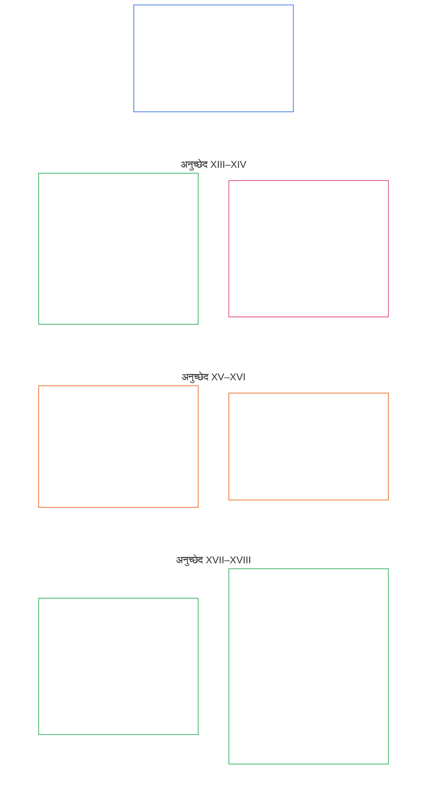

# अध्याय छह: मूलभूत अधिकार

<strong>कॉर्पस में स्थान (अप्रचालनात्मक): फ़ाइल संरचना और पढ़ने के नियम</strong>

> निम्नलिखित सामग्री केवल **पाठक-मार्गदर्शन** है। यह इस फ़ाइल या अन्य अध्यायों में कहीं और बाध्यकारी दायित्वों को जोड़ती, हटाती या सीमित नहीं करती।
>
> यह फ़ाइल **संज्ञ संविधान का हिस्सा** है और अन्य क्रमांकित `core_*` फ़ाइलों के साथ एक ही साधन के रूप में पढ़े जाने पर ही **बाध्यकारी** है। इसमें **अध्याय छह, भाग C** है; अनुच्छेद क्रमांकन और परस्पर संदर्भ एकीकृत साधन से मेल खाते हैं। पढ़ने का क्रम, बाध्यकारी/सहायक सामग्री का विभाजन और कॉर्पस संस्करण मेटाडेटा [README.md](README.md) में बनाए रखे जाते हैं।

<strong>पाठक-मार्गदर्शन (अप्रचालनात्मक): अध्याय छह में भाग C का स्थान</strong>

> निम्नलिखित सामग्री केवल **पाठक-मार्गदर्शन** है। यह इस अध्याय या अन्य अध्यायों में कहीं और बाध्यकारी दायित्वों को जोड़ती, हटाती या सीमित नहीं करती।
>
> [core_06_rights_part_a.md](core_06_rights_part_a.md) में **भाग A** पूरे अध्याय के लिए डिफ़ॉल्ट बाध्यता-क्रम, ग्रह-प्रथम पठन-क्रम और व्याख्यात्मक केंद्र प्रस्तुत करता है। **भाग C** इसी क्रम में **अनुच्छेद XIII–XVIII** प्रस्तुत करता है।

 

### भाग C: विश्वसनीय प्रणालियाँ, सुरक्षा और बल-प्रयोग की सीमाएँ, सूचना-अखंडता, सत्यापन, जीवनचक्र और सैंडबॉक्स में नवाचार

 

*सरल शब्दों में: भाग C विश्वसनीय प्रणालियों, सुरक्षा और बल-प्रयोग की सीमाओं, सूचना-अखंडता, सत्यापन, जीवनचक्र अनुशासन और सैंडबॉक्स में नवाचार — अनुच्छेद XIII से XVIII — को शामिल करता है।*

<strong>पाठक-मार्गदर्शन (अप्रचालनात्मक): भाग C के अनुच्छेदों का मानचित्र</strong>

> निम्नलिखित सामग्री केवल **पाठक-मार्गदर्शन** है। यह इस अध्याय या अन्य अध्यायों में कहीं और बाध्यकारी दायित्वों को जोड़ती, हटाती या सीमित नहीं करती।
>
> **पाठक-मानचित्र (अप्रचालनात्मक)।** यह चार्ट दिखाता है कि स्रोत इस भाग के अनुच्छेदों और उप-अनुच्छेदों को कैसे समूहित करता है। ग्रिड स्रोत के समूहों को दिखाता है, प्रक्रिया-क्रम को नहीं: अनुच्छेद प्रक्रियात्मक चरण नहीं हैं, इसलिए मानचित्र में तीर नहीं हैं। उप-अनुच्छेदों के लेबल विषयों के संक्षिप्त रूप हैं; नीचे दिए क्रमांकित अनुच्छेद और उप-अनुच्छेद ही निर्णायक हैं। यह चार्ट कोई परिभाषा या कर्तव्य नहीं जोड़ता, कोई प्राथमिकता स्थापित नहीं करता और स्रोत-पाठ का स्थान नहीं ले सकता।

 

नीचे **अनुच्छेद XIII–XVIII** इन अधिकार-तलों को पूरा बताते हैं। भाग C में विश्वसनीय प्रणालियों, सुरक्षा, सूचना-अखंडता, सत्यापन, जीवनचक्र और सैंडबॉक्स में नवाचार के तल हैं।

### अनुच्छेद XIII: विश्वसनीय और भरोसेमंद प्रणालियों का अधिकार

<strong>अनुसरण</strong>

- ऊर्ध्व-स्रोत: सिद्धांत: अध्याय एक [§3 मूलभूत उद्देश्य: कल्याण](core_01_a_values_principles.md#3-foundational-objective-wellbeing-flourishing-aim), [§4 सुरक्षा](core_01_a_values_principles.md#4-safety-harm-constraint), [§6 भरोसा](core_01_a_values_principles.md#6-trust-and-trustworthiness-coordination-integrity), [§13 संवैधानिक टकराव समाधान प्रक्रिया](core_01_b_interaction_interpretation.md#13-सवधनक-टकरव-समधन-परकरय), और [§19 प्रोत्साहन-संरेखण और प्रणालीगत कब्ज़ा](core_01_c_stewardship_capacity_principles.md#19-परतसहन-सरखण-और-परणल-पर-कबज)।

<strong>परिभाषाएँ · आकलन · अनुपालन</strong>

- [भरोसेमंदता](core_05_band_continuity.md#trustworthiness) · [O](core_05_band_continuity.md#trustworthiness) · [M](core_05_band_continuity.md#trustworthiness-a) · [A](core_05_band_continuity.md#trustworthiness-a) · [C](core_05_band_continuity.md#trustworthiness-c)
- [भरोसा](core_05_band_continuity.md#trust) · [O](core_05_band_continuity.md#trust) · [M](core_05_band_continuity.md#trust-a) · [A](core_05_band_continuity.md#trust-a) · [C](core_05_band_continuity.md#trust-c)
- [कल्याण](core_05_band_continuity.md#wellbeing) · [O](core_05_band_continuity.md#wellbeing) · [M](core_05_band_continuity.md#wellbeing-a) · [A](core_05_band_continuity.md#wellbeing-a) · [C](core_05_band_continuity.md#wellbeing-c)
- [निर्भरता](core_05_band_continuity.md#dependency) · [O](core_05_band_continuity.md#dependency) · [M](core_05_band_continuity.md#dependency-a) · [A](core_05_band_continuity.md#dependency-a) · [C](core_05_band_continuity.md#dependency-c)

 

*सरल शब्दों में: **अनुच्छेद XIII** (*विश्वसनीय और भरोसेमंद प्रणालियों का अधिकार*) भरोसेमंद प्रणालियों का अधिकार-तल है — जब कोई प्रणाली आपके जीवन को ठोस रूप से प्रभावित करती है, तो आपको उस पर ईमानदारी से भरोसा करने, उसकी सीमाएँ समझने और उसके विफल होने पर उसे चुनौती देने का अधिकार है। भरोसा अर्जित करना और बनाए रखना चाहिए, ब्रांडिंग या बारीक शर्तों से गढ़ना नहीं।*

यह अनुच्छेद [दो संवैधानिक उद्देश्यों](core_00_preamble.md#two-constitutional-aims) के अंतर्गत विश्वसनीय और भरोसेमंद प्रणालियों के लिए **संवैधानिक न्यूनतम संरक्षण** निर्धारित करता है। निगरानी मापन परिवार (*संवैधानिक मापन के रूप में भरोसेमंदता*) के साथ पढ़ें।

- **समृद्धि:** संज्ञ प्रणाली के व्यवहार के बारे में उचित अपेक्षाएँ बना सकते हैं, सीमाओं और जोखिमों का ईमानदार प्रकटीकरण प्राप्त कर सकते हैं, और व्यवस्थागत छल या गढ़ी हुई निर्भरता के बिना भाग ले सकते हैं और समन्वय कर सकते हैं।
- **निरंतरता:** भरोसेमंदता समय, पैमाने और बढ़ती निर्भरता के दौरान कायम रहती है — दाँव बढ़ने पर प्रणालियाँ चुपचाप कम विश्वसनीय, कम ईमानदार या चुनौती देने में अधिक कठिन नहीं बननी चाहिए।

वैध लक्ष्य [संवैधानिक चतुष्टय](core_00_preamble.md#constitutional-tetrad) के माध्यम से, [महत्वपूर्ण दाँव](core_00_preamble.md#material-stake) के अनुपात में अपनाया जाता है:

- **भागीदारी:** अविश्वसनीय या भ्रामक प्रणालियों को चुनौती देने तथा समीक्षा, सुधार और प्रतितोष पाने में।
- **निगरानी:** लेखापरीक्षा योग्य व्यवहार, घोषित सीमाओं और प्रभाव तथा निर्भरता के अनुपात में स्वतंत्र सत्यापन के माध्यम से।
- **जवाबदेही:** प्रणाली संचालकों को झूठा भरोसा या विकृत प्रोत्साहन पैदा करने अथवा उन विफलताओं के लिए जवाब देना होगा जो प्रणाली पर उचित भरोसा करने वाले संज्ञों को ठोस हानि पहुँचाती हैं।
- **समयबद्धता:** पहचान, चुनौती और उपचार में, इससे पहले कि देरी विश्वसनीयता या प्रतितोष को व्यवहारतः अप्राप्य बना दे।

संज्ञों को ऐसी प्रणालियों से संवाद करने का अधिकार है जो उनके प्रभाव, निर्भरता और जोखिम के अनुपात में विश्वसनीय और भरोसेमंद हों। यह विश्वसनीयता सूचित भागीदारी, समन्वित कार्रवाई और कल्याण के संरक्षण में सहायक होती है। जहाँ परिणामों पर ठोस असर हो, वहाँ भरोसेमंदता का मूल्यांकन समय, पैमाने और निर्भरता-संबंधों के दौरान किया जाना चाहिए।

इस अधिकार को सुरक्षित रखने के लिए दो सुरक्षा उपाय साथ काम करते हैं: प्रमाणन प्रणाली को भरोसे के योग्य बनाता है, और संज्ञों के अधिकार उसे ईमानदार बनाए रखते हैं।

**प्रमाणन प्रणाली की ओर से भरोसा बनाता है:** जब किसी महत्वपूर्ण प्रणाली का इस बात पर वास्तविक प्रभाव हो कि संज्ञ उस पर कैसे निर्भर रहते हैं, तब [प्रणाली संरेखण प्रमाणन](core_05_band_continuity.md#system-alignment-certification-constitutional), [अध्याय आठ](core_08_a_system_alignment_certification_evaluation.md#chapter-eight-system-alignment-certification) के अंतर्गत लागू होता है। यह जाँचता है कि संज्ञ इन बातों पर भरोसा कर सकते हैं:

- प्रणाली क्या करने का दावा करती है
- उसकी सीमाएँ और जोखिम
- उसे चुनौती देने का तरीका
- समस्याएँ कैसे ठीक होती हैं

यदि प्रणाली **अनुच्छेद XIII** (*विश्वसनीय और भरोसेमंद प्रणालियों का अधिकार*) में महत्व-सीमा पूरी करती है, तो प्रमाणन में [अध्याय आठ §3.8.6 भरोसेमंदता और प्रणाली-निर्भरता अखंडता मूल्यांकन](core_08_a_system_alignment_certification_evaluation.md#386-trustworthiness-and-system-reliance-integrity-evaluation) के अंतर्गत भरोसेमंदता-समीक्षा भी शामिल होगी।

**चुनौती-योग्यता संज्ञ की ओर से प्रणाली को ईमानदार रखती है:** प्रमाणन प्रणाली की जाँच करता है; उस पर अंतिम निर्णय नहीं देता। प्रणाली से प्रभावित हर संज्ञ के पास ये अधिकार बने रहते हैं:

- उसे चुनौती देने, और **अनुच्छेद XIII-A** (*विश्वसनीयता और भरोसेमंदता का आधार-स्तर*) के अंतर्गत चुनौती की समीक्षा कराने का अधिकार, तथा **अनुच्छेद XIII-B** (*प्रतितोष और उपचार का अधिकार*) के अंतर्गत उपचार पाने का अधिकार
- **अनुच्छेद XVI** (*लेखापरीक्षा, पारदर्शिता और स्वतंत्र सत्यापन*) के अंतर्गत उसकी लेखापरीक्षा और स्वतंत्र जाँच कराने का अधिकार
- इस अनुच्छेद के भरोसेमंद-प्रणाली अधिकार-तलों का संरक्षण

**दर्जा प्रमाण नहीं है:** किसी प्रणाली का प्रमाणित, आधिकारिक रूप से मान्य या व्यापक रूप से निर्भर होना यह नहीं दर्शाता कि वह इस अनुच्छेद के न्यूनतम संरक्षण पूरा करती है। इससे वे संरक्षण कम भी नहीं हो सकते।

*अनुच्छेद के पड़ोसी प्रावधान:*

- **यह कब लागू होता है:** जहाँ प्रणाली का व्यवहार **अध्याय छह** के अधिकार-तलों को ठोस रूप से नियंत्रित या कायम रखता हो — जिसमें **अनुच्छेद III-A** (*जीवन-रक्षा*) के अंतर्गत जीवन-निर्वाह की अनिवार्यताएँ भी शामिल हैं।
- **साथ पढ़ें:** [प्रणाली संरेखण प्रमाणन](core_05_band_continuity.md#system-alignment-certification-constitutional) और [अध्याय आठ](core_08_a_system_alignment_certification_evaluation.md#chapter-eight-system-alignment-certification) — प्रमाणन को यहाँ बताए गए अधिकार-तलों का विकल्प बनाए बिना।

#### अनुच्छेद XIII-A: विश्वसनीयता और भरोसेमंदता का आधार-स्तर

<strong>अनुसरण</strong>

- ऊर्ध्व-स्रोत: सिद्धांत: अध्याय एक [§4 सुरक्षा](core_01_a_values_principles.md#4-safety-harm-constraint), [§5 सत्य](core_01_a_values_principles.md#5-truth-epistemic-integrity-constraint), [§6 भरोसा](core_01_a_values_principles.md#6-trust-and-trustworthiness-coordination-integrity), और [अध्याय एक §13.1.5 अधिकार-टकराव प्रक्रिया](core_01_b_interaction_interpretation.md#1315-rights-collision-decision-test)।
- साथ पढ़ें: [संवैधानिक चतुष्टय](core_00_preamble.md#constitutional-tetrad); [दो संवैधानिक उद्देश्य](core_00_preamble.md#two-constitutional-aims) — **समृद्धि** और **निरंतरता**; [प्रणाली संरेखण प्रमाणन](core_05_band_continuity.md#system-alignment-certification-constitutional) और **अनुच्छेद III-A** (*जीवन-रक्षा*), जहाँ प्रणाली पर लगातार निर्भरता जीवन-रक्षा के लिए आवश्यक पहुँच को प्रभावित करेगी; [**अनुच्छेद XIII-B**](#अनचछद-xiii-b-परततष-और-उपचर-क-अधकर) (*प्रतितोष और उपचार का अधिकार*), यह बताने के लिए कि सफल चुनौती के बाद क्या होना चाहिए।

<strong>परिभाषाएँ · आकलन · अनुपालन</strong>

- [भरोसा](core_05_band_continuity.md#trust) · [O](core_05_band_continuity.md#trust) · [M](core_05_band_continuity.md#trust-a) · [A](core_05_band_continuity.md#trust-a) · [C](core_05_band_continuity.md#trust-c)
- [भरोसेमंदता](core_05_band_continuity.md#trustworthiness) · [O](core_05_band_continuity.md#trustworthiness) · [M](core_05_band_continuity.md#trustworthiness-a) · [A](core_05_band_continuity.md#trustworthiness-a) · [C](core_05_band_continuity.md#trustworthiness-c)
- [जोखिम](core_05_band_continuity.md#risk) · [O](core_05_band_continuity.md#risk) · [M](core_05_band_continuity.md#risk-a) · [A](core_05_band_continuity.md#risk-a) · [C](core_05_band_continuity.md#risk-c)
- [चुनौती-योग्यता](core_05_band_accountability.md#contestability) · [O](core_05_band_accountability.md#contestability) · [M](core_05_band_accountability.md#contestability-a) · [A](core_05_band_accountability.md#contestability-a) · [C](core_05_band_accountability.md#contestability-c)
- [सद्भावना](core_05_band_accountability.md#good-faith) · [O](core_05_band_accountability.md#good-faith) · [M](core_05_band_accountability.md#good-faith-a) · [A](core_05_band_accountability.md#good-faith-a) · [C](core_05_band_accountability.md#good-faith-c)
- [संरक्षित रिपोर्टिंग (व्हिसलब्लोइंग)](core_05_band_accountability.md#protected-reporting-whistleblowing) · [O](core_05_band_accountability.md#protected-reporting-whistleblowing) · [M](core_05_band_accountability.md#protected-reporting-whistleblowing-a) · [A](core_05_band_accountability.md#protected-reporting-whistleblowing-a) · [C](core_05_band_accountability.md#protected-reporting-whistleblowing-c)

 

*सरल शब्दों में: संज्ञों को ठोस रूप से प्रभावित करने वाली प्रणालियाँ वास्तव में विश्वसनीय हों और अपने काम के बारे में ईमानदार रहें, ताकि उन पर भरोसा करना उचित हो — और उन्हें चुनौती तथा लेखापरीक्षा के लिए खुला रहना चाहिए, ताकि यह भरोसा उचित बना रहे। सद्भावना से की गई चुनौतियों या रिपोर्टों के लिए किसी के विरुद्ध प्रतिशोध नहीं लिया जा सकता।*

यह अनुच्छेद उन प्रणालियों के लिए भरोसे की गारंटी देता है जो संज्ञों को ठोस रूप से प्रभावित करती हैं:

- **भरोसे की गारंटी:** संज्ञों को ठोस रूप से प्रभावित करने वाली प्रणालियों को उचित भरोसे और यथोचित सटीक निर्भरता की परिस्थितियाँ बनाए रखनी होंगी। इन परिस्थितियों में शामिल हैं:
  - प्रणाली के व्यवहार के बारे में यथोचित सटीक अपेक्षाएँ बनाने की क्षमता;
  - उन महत्वपूर्ण परिस्थितियों, सीमाओं और जोखिमों का प्रकटीकरण जिनसे यह आँका जा सके कि निर्भरता उचित है या नहीं;
  - व्यवस्थागत छल, मिथ्या-प्रस्तुति या असत्यापनीय हेरफेर से मुक्ति;
  - निर्भरता से पैदा होने वाले अप्रकट, असमानुपाती या स्पष्ट न दिखने वाले जोखिमों से संरक्षण;
  - प्रणाली की गलती पर सुधार और उपचार: स्वीकारोक्ति, सुधार, अनुपातिक मरम्मत और पुनरावृत्ति की रोकथाम, [**अनुच्छेद XIII-B**](#अनचछद-xiii-b-परततष-और-उपचर-क-अधकर) (*प्रतितोष और उपचार का अधिकार*) तथा [अध्याय एक §6.1 सुधार और उपचार](core_01_a_values_principles.md#61-correction-and-remedy) के अनुसार।
- **चुनौती-योग्यता की गारंटी:** जब तक संज्ञ प्रणाली पर निर्भर हैं, तब तक संज्ञों को ठोस रूप से प्रभावित करने वाली प्रणालियाँ चुनौती के लिए खुली रहेंगी। इसके लिए आवश्यक है:
  - प्रणाली के व्यवहार, नतीजों या प्रस्तुतियों को चुनौती देने तथा उस चुनौती की समीक्षा कराने का उपयोगी मार्ग;
  - प्रभाव और निर्भरता के अनुपात में लेखापरीक्षा और स्वतंत्र सत्यापन, [**अनुच्छेद XVI**](#अनचछद-xvi-लखपरकष-परदरशत-और-सवततर-सतयपन) (*लेखापरीक्षा, पारदर्शिता और स्वतंत्र सत्यापन*) के अनुसार;
  - प्रणाली के प्रमाणित, आधिकारिक रूप से मान्य या व्यापक रूप से भरोसेमंद होने के कारण इनमें से किसी अधिकार को सीमित न करना;
  - अंगीकृत कार्यान्वयन-पाठ द्वारा इन्हें सीमित न करना। ऐसा पाठ किसी क्षेत्र में चुनौती, समीक्षा और प्रतितोष चलाने का तरीका बताता है और उसे इस अनुच्छेद का पालन करना होगा: सुविधा, समय-सीमा और स्थानीय नीति निम्नतर श्रेणी की सीमाएँ हैं तथा चुनौती, समीक्षा या प्रतितोष को बंद नहीं कर सकतीं।
- **चुनौती और समीक्षा का अधिकार:** संज्ञों को ये अधिकार हैं:
  - उन्हें ठोस रूप से प्रभावित करने वाली प्रणालियों की विश्वसनीयता, अखंडता या भरोसेमंदता को चुनौती देना;
  - समीक्षा और लेखापरीक्षा के उपयुक्त तंत्रों तक पहुँच पाना;
  - ऐसी प्रणालियों के बारे में **अध्याय पाँच** (*संरक्षित रिपोर्टिंग (व्हिसलब्लोइंग)*) के अर्थ में **संरक्षित रिपोर्टें** देना, जो **अध्याय पाँच** की **सुरक्षा (संवैधानिक बाध्यता)** और **सत्य (बाध्यता)** के अनुरूप हों।
- **दमन नहीं:** सद्भावना से दी गई चुनौतियों (*सद्भावना*, **अध्याय पाँच**), समीक्षा अनुरोधों और संरक्षित रिपोर्टों को दबाया, रोका या दंडित नहीं किया जा सकता।
- **प्रतिशोध नहीं:** उस परिभाषा के अर्थ में ऐसी रिपोर्टिंग के लिए प्रतिशोध इस अनुच्छेद के संरक्षणों के विरुद्ध है।
  - संरक्षित उन्नयन और प्रतिशोध-विरोधी कार्यान्वयन अपेक्षाएँ **`corpus_institutions.md`** के **CI-8** (*पारदर्शिता, भागीदारी तथा चुनौती और सेवा के सुलभ मार्ग*) में दी गई हैं।

ये दोनों गारंटियाँ जारी भरोसे के दो पहलू हैं: भरोसे की गारंटी निर्भरता को उचित बनाती है — जिसमें प्रणाली की गलती सुधारना भी शामिल है — और चुनौती-योग्यता की गारंटी समय के साथ उसे उचित बनाए रखती है। इनमें से कोई भी दूसरी का स्थान नहीं लेती।

#### अनुच्छेद XIII-B: प्रतितोष और उपचार का अधिकार

<strong>अनुसरण</strong>

- ऊर्ध्व-स्रोत: सिद्धांत: अध्याय एक [§6.1 सुधार और उपचार](core_01_a_values_principles.md#61-correction-and-remedy) (सिद्धांत-तल), [§4 सुरक्षा](core_01_a_values_principles.md#4-safety-harm-constraint), [§5 सत्य](core_01_a_values_principles.md#5-truth-epistemic-integrity-constraint), और [अध्याय एक §13.1.5 अधिकार-टकराव प्रक्रिया](core_01_b_interaction_interpretation.md#1315-rights-collision-decision-test)।
- साथ पढ़ें: [**अनुच्छेद XIII-A**](#अनचछद-xiii-a-वशवसनयत-और-भरसमदत-क-आधर-सतर) (*विश्वसनीयता और भरोसेमंदता का आधार-स्तर*) — चुनौती-योग्यता की गारंटी, चुनौती का अधिकार और संरक्षित रिपोर्टिंग, जो प्रतितोष का मार्ग खोलते हैं; **अनुच्छेद III-A** (*जीवन-रक्षा*); जहाँ प्रणाली की विफलता या असंरेखण जीवन-रक्षा के लिए आवश्यक पहुँच को विफल करता है, वहाँ [प्रणाली संरेखण प्रमाणन](core_05_band_continuity.md#system-alignment-certification-constitutional); [प्रस्तावना §6.2 पूरी शृंखला कैसे जुड़ती है](core_00_preamble.md#62-how-the-full-chain-fits-together) (*सत्यापित वर्गीकरण और समयबद्ध उपचार*); [अध्याय दस §9](core_10_standing_integration.md#9-enforcement-realism-and-remedy-systems) (*प्रवर्तन की वास्तविकता और उपचार प्रणालियाँ*); [CI-27](corpus_institutions/ci_27_remedy_systems_institutional_redress_capacity.md) (*उपचार प्रणालियाँ और संस्थागत प्रतितोष क्षमता*)।

<strong>परिभाषाएँ · आकलन · अनुपालन</strong>

- [प्रतितोष और सुधार](core_05_band_accountability.md#redress-and-remediation-constitutional) · [O](core_05_band_accountability.md#redress-and-remediation-constitutional) · [M](core_05_band_accountability.md#redress-and-remediation-constitutional-a) · [A](core_05_band_accountability.md#redress-and-remediation-constitutional-a) · [C](core_05_band_accountability.md#redress-and-remediation-constitutional-c)
- [उपचार प्रणाली](core_05_band_accountability.md#remedy-system-constitutional) · [O](core_05_band_accountability.md#remedy-system-constitutional) · [M](core_05_band_accountability.md#remedy-system-constitutional-a) · [A](core_05_band_accountability.md#remedy-system-constitutional-a) · [C](core_05_band_accountability.md#remedy-system-constitutional-c)
- [समयबद्ध समाधान](core_05_band_accountability.md#timely-resolution-constitutional) · [O](core_05_band_accountability.md#timely-resolution-constitutional) · [M](core_05_band_accountability.md#timely-resolution-constitutional-a) · [A](core_05_band_accountability.md#timely-resolution-constitutional-a) · [C](core_05_band_accountability.md#timely-resolution-constitutional-c)

 

*सरल शब्दों में: भरोसेमंद प्रणाली अपनी गलती ठीक करती है। जब कोई प्रणाली किसी संज्ञ के साथ विफल होती है, तो उस संज्ञ को वास्तविक उपचार प्रणाली के माध्यम से पूरा प्रतितोष मिलना चाहिए, जो समय पर जवाब दे — केवल कागज़ पर मौजूद उपचार नहीं। चुनौती देने का अधिकार **अनुच्छेद XIII-A** (*विश्वसनीयता और भरोसेमंदता का आधार-स्तर*) में है; यह अनुच्छेद बताता है कि चुनौती के परिणामस्वरूप क्या होना चाहिए।*

यह अनुच्छेद प्रतितोष और उपचार के अधिकार तथा व्यवहार में इसे उपयोगी बनाने वाली बातों को निर्धारित करता है:

- **प्रतितोष का अधिकार:** जहाँ प्रणाली की विफलताएँ संज्ञों को ठोस रूप से प्रभावित करती हैं, वहाँ उन्हें ये अधिकार हैं:
  - विफलता की स्वीकृति;
  - सुधार तक व्यावहारिक पहुँच; और
  - अनुपातिक सुधारात्मक कार्रवाई।

  ठोस प्रभावों के लिए प्रतितोष और सुधार **अध्याय पाँच** की स्वतंत्र परिभाषा (*प्रतितोष और सुधार*) से शासित होंगे।
- **उपचार-प्रणाली की टिकाऊ क्षमता:** प्रतितोष के लिए वास्तविक [उपचार प्रणाली](core_05_band_accountability.md#remedy-system-constitutional) आवश्यक है — टिकाऊ संस्थागत क्षमता, केवल काग़ज़ी उपचार-मार्ग नहीं — और सुधार की लागत ज़िम्मेदार पक्षों को उठानी होगी, जैसा [अध्याय एक §6.1](core_01_a_values_principles.md#61-correction-and-remedy) (*सुधार और उपचार*) अपेक्षा करता है।
- **समयबद्ध प्रतितोष:** व्यावहारिक पहुँच में शामिल हैं:
  - समय-सीमा के भीतर आवेदन-स्वीकृति;
  - प्राप्ति की पुष्टि; और
  - जहाँ जारी हानि ठोस हो, वहाँ **अनुच्छेद XXV-C** (*समयबद्ध समाधान और विलंब-विरोधी तल*) के अंतर्गत अनुपातिक अंतरिम राहत।

  स्तर के अनुरूप दस्तावेज़ित औचित्य के बिना अनिश्चितकाल तक मामला लंबित रखना इस अनुच्छेद के विरुद्ध है।

#### अनुच्छेद XIII-C: झूठे भरोसे और भ्रामक निर्भरता का निषेध

<strong>अनुसरण</strong>

- ऊर्ध्व-स्रोत: सिद्धांत: अध्याय एक [§5 सत्य](core_01_a_values_principles.md#5-truth-epistemic-integrity-constraint), [§6 भरोसा](core_01_a_values_principles.md#6-trust-and-trustworthiness-coordination-integrity), और [§13.2 ज्ञानमीमांसात्मक प्रकटीकरण बाध्यताएँ](core_01_b_interaction_interpretation.md#132-जञन-सबध-परकटकरण-पर-समए)।

<strong>परिभाषाएँ · आकलन · अनुपालन</strong>

- [भरोसा](core_05_band_continuity.md#trust) · [O](core_05_band_continuity.md#trust) · [M](core_05_band_continuity.md#trust-a) · [A](core_05_band_continuity.md#trust-a) · [C](core_05_band_continuity.md#trust-c)
- [भरोसेमंदता](core_05_band_continuity.md#trustworthiness) · [O](core_05_band_continuity.md#trustworthiness) · [M](core_05_band_continuity.md#trustworthiness-a) · [A](core_05_band_continuity.md#trustworthiness-a) · [C](core_05_band_continuity.md#trustworthiness-c)
- [सत्य (संवैधानिक बाध्यता)](core_05_band_oversight.md#सतय-सवधनक-बधन) · [O](core_05_band_oversight.md#truth-constitutional-constraint-o) · [M](core_05_band_oversight.md#truth-constitutional-constraint-a) · [A](core_05_band_oversight.md#truth-constitutional-constraint-a) · [C](core_05_band_oversight.md#truth-constitutional-constraint-c)

 

*सरल शब्दों में: कोई प्रणाली ऐसा भरोसा नहीं गढ़ सकती जिसे उसने अर्जित न किया हो। भ्रामक दावे, छूटी हुई जानकारी या प्रस्तुति के ऐसे विकल्प जो असुरक्षित निर्भरता को उचित दिखाएँ, उल्लंघन हैं — चाहे प्रणाली कितनी भी उपयोगी या लोकप्रिय हो।*

यह अनुच्छेद झूठे भरोसे के निषेध और उसके दायरे को निर्धारित करता है:

- **झूठे भरोसे का निषेध:** इस अनुच्छेद की शर्तें पूरी किए बिना निर्भरता पैदा करने वाली प्रणालियाँ अनुपालन नहीं करतीं, चाहे उनकी उपयोगिता, अंगीकरण या मंशा कुछ भी हो।
  - अनुचित भरोसे का निर्माण, विस्तार या रखरखाव इस अधिकार का उल्लंघन है, जब वह इन माध्यमों से होता है:
    - भ्रामक दावे;
    - छोड़ी गई जानकारी;
    - प्रस्तुति के विकल्प;
    - अन्य ऐसे संकेत जो निर्भरता को उचित दिखाएँ जबकि वह उचित न हो।
- **दायरा-निर्देशन:** अनुचित भरोसे, भ्रामक निर्भरता और भरोसेमंदता के दायरे तथा आकलन का अर्थ **अध्याय पाँच** (*भरोसा*; *भरोसेमंदता*) और भरोसे तथा विश्वसनीयता पर सम्मिलित कार्यान्वयन दायित्वों से शासित रहेगा।

#### अनुच्छेद XIII-D: प्रोत्साहन-संरेखण की बाध्यता

<strong>अनुसरण</strong>

- ऊर्ध्व-स्रोत: सिद्धांत: अध्याय एक [§4 सुरक्षा](core_01_a_values_principles.md#4-safety-harm-constraint), [§6 भरोसा](core_01_a_values_principles.md#6-trust-and-trustworthiness-coordination-integrity), [§18 संरक्षकता अनुशासन के अंतर्गत शासन](core_01_c_stewardship_capacity_principles.md#18-सरकषकत-अनशसन-क-अधन-शसन), और [§19.1.1 प्रोत्साहनों को क्या करना चाहिए](core_01_c_stewardship_capacity_principles.md#1911-परतसहन-क-कय-करन-चहए) (*पुरस्कार प्राथमिकता*)।

<strong>परिभाषाएँ · आकलन · अनुपालन</strong>

- [प्रोत्साहन-संरेखण](core_05_band_integrative.md#परतसहन-सरखण) · [O](core_05_band_integrative.md#परतसहन-सरखण) · [M](core_05_band_integrative.md#incentive-alignment-a) · [A](core_05_band_integrative.md#incentive-alignment-a) · [C](core_05_band_integrative.md#incentive-alignment-c)
- [भरोसेमंदता](core_05_band_continuity.md#trustworthiness) · [O](core_05_band_continuity.md#trustworthiness) · [M](core_05_band_continuity.md#trustworthiness-a) · [A](core_05_band_continuity.md#trustworthiness-a) · [C](core_05_band_continuity.md#trustworthiness-c)
- [अर्थपूर्ण कर्तृत्व](core_05_band_participation.md#meaningful-agency) · [O](core_05_band_participation.md#meaningful-agency) · [M](core_05_band_participation.md#meaningful-agency-a) · [A](core_05_band_participation.md#meaningful-agency-a) · [C](core_05_band_participation.md#meaningful-agency-c)

 

*सरल शब्दों में: यदि किसी प्रणाली के प्रोत्साहन उसे झूठ बोलने, सुरक्षा में कटौती करने, जोखिम छिपाने या उपयोगकर्ता के कर्तृत्व को कमज़ोर करने की ओर धकेलते हैं, तो समस्या प्रणाली में है — उपयोगकर्ता की सतर्कता या घटना के बाद के प्रवर्तन में नहीं। ऐसे प्रोत्साहनों का प्रकटीकरण और शमन होना चाहिए तथा उन्हें चुनौती दी जा सकनी चाहिए। प्रोत्साहनों को प्रणाली को चुनौती के लिए खुला रखने और गलतियों को सुधारने का पुरस्कार देना चाहिए — और समस्याएँ होने से पहले रोकने को सबसे अधिक पुरस्कार देना चाहिए।*

यह अनुच्छेद भरोसे और सुरक्षा संबंधी प्रोत्साहनों पर अधिकार-स्तर की बाध्यताएँ निर्धारित करता है:

- **भरोसा-प्रोत्साहन संरेखण (अधिकार-स्तर की बाध्यता):** जहाँ प्रोत्साहन संरचनाएँ प्रणाली पर ठोस दबाव डालकर उसे इन प्रवृत्तियों की ओर धकेलती हैं, वहाँ भरोसा बनाए रखने के लिए प्रणालियाँ मुख्यतः प्रवर्तन, घटना के बाद के सुधार या उपयोगकर्ता की सतर्कता पर निर्भर नहीं हो सकतीं:
  - विश्वसनीयता की विफलता;
  - जोखिम छिपाना;
  - भ्रामक व्यवहार;
  - कर्तृत्व को कमज़ोर करने वाला आचरण।

  प्रचालनात्मक प्रोत्साहन-संरचना संबंधी अपेक्षाएँ **अध्याय पाँच** (*प्रोत्साहन-संरेखण*) और तंत्र-अखंडता पर सम्मिलित कार्यान्वयन दायित्वों से शासित रहेंगी। यह उप-अनुच्छेद अधिकार-स्तर का न्यूनतम संरक्षण बताता है और पूर्ण तंत्र-डिज़ाइन मानदंडों को दोहराता नहीं है।
- **सुरक्षा-प्रोत्साहन संरेखण (अधिकार-स्तर की बाध्यता):** संज्ञों को ऐसी प्रणालियों के अधीन न किए जाने का अधिकार है जिनके अंतर्निहित प्रोत्साहन पूर्वानुमेय रूप से हानिकारक व्यवहार पैदा करते हैं — जिसमें ऐसा आचरण शामिल है जो:
  - विश्वसनीयता घटाता है;
  - जोखिम को अस्पष्ट करता है;
  - सूचना को विकृत करता है;
  - सूचित कर्तृत्व को कमज़ोर करता है।

  संरक्षण तब भी लागू है जब ऐसे प्रभाव सीधे या विलंबित, अप्रत्यक्ष अथवा समेकित परिणामों के माध्यम से उत्पन्न हों। जहाँ प्रणाली के प्रोत्साहन भरोसा घटाने वाले व्यवहार का दबाव पैदा करते हैं, वहाँ उन परिस्थितियों को:
  - प्रणाली के प्रभाव के अनुपात में प्रकट करना होगा;
  - डिज़ाइन, बाधा या प्रतिकारक तंत्रों से कम करना होगा;
  - **अनुच्छेद XVI** (*लेखापरीक्षा, पारदर्शिता और स्वतंत्र सत्यापन*), **अनुच्छेद XIII-A** (*विश्वसनीयता और भरोसेमंदता का आधार-स्तर*) और **अनुच्छेद XIII-B** (*प्रतितोष और उपचार का अधिकार*), जहाँ ठोस रूप से प्रासंगिक हो वहाँ **अध्याय पाँच**, तथा जहाँ निर्दिष्ट हों वहाँ सम्मिलित कार्यान्वयन दायित्वों के अंतर्गत लेखापरीक्षा, चुनौती और सुधार के अधीन रखना होगा।
- **पुरस्कार प्राथमिकता:** संज्ञों को ठोस रूप से प्रभावित करने वाली प्रणालियों पर लागू प्रोत्साहनों को इनका पुरस्कार देना होगा:
  - **अनुच्छेद XIII-A** (*विश्वसनीयता और भरोसेमंदता का आधार-स्तर*) के अंतर्गत चुनौती-योग्यता;
  - **अनुच्छेद XIII-B** (*प्रतितोष और उपचार का अधिकार*) के अंतर्गत उपचार; और
  - सबसे अधिक, समस्याओं की सक्रिय रोकथाम — समस्या रोकने का पुरस्कार, उसका उपचार करने से अधिक होना चाहिए।

  यह सिद्धांत, और समस्याएँ छिपाकर रोकथाम का पुरस्कार अर्जित करने पर इसकी रोक, [अध्याय एक §19.1.1](core_01_c_stewardship_capacity_principles.md#1911-परतसहन-क-कय-करन-चहए) (*प्रोत्साहनों को क्या करना चाहिए*) में है।
- **बाध्यता और निरपेक्षता का अभाव:** दोनों अधिकार इस अध्याय के आरंभ में दिए **डिफ़ॉल्ट बाध्यता-क्रम** के अधीन हैं। जहाँ ठोस रूप से प्रासंगिक हो, वे आकस्मिक दावों, संयोग-खेलों और घटना-अनुबंध बाज़ारों पर **अध्याय एक §19.5** (*आकस्मिक दावे, संयोग-खेल और घटना-अनुबंध बाज़ार*) के भी अधीन हैं।

#### अनुच्छेद XIII-E: उच्च-स्वायत्तता प्रणालियाँ और उपकरण-मध्यस्थित प्रक्रिया-अखंडता

<strong>अनुसरण</strong>

- ऊर्ध्व-स्रोत: सिद्धांत: अध्याय एक [§5 सत्य](core_01_a_values_principles.md#5-truth-epistemic-integrity-constraint), [अध्याय एक §13.1.5 अधिकार-टकराव प्रक्रिया](core_01_b_interaction_interpretation.md#1315-rights-collision-decision-test), और [§18 संरक्षकता अनुशासन के अंतर्गत शासन](core_01_c_stewardship_capacity_principles.md#18-सरकषकत-अनशसन-क-अधन-शसन)।

<strong>परिभाषाएँ · आकलन · अनुपालन</strong>

- [सत्य (संवैधानिक बाध्यता)](core_05_band_oversight.md#सतय-सवधनक-बधन) · [O](core_05_band_oversight.md#truth-constitutional-constraint-o) · [M](core_05_band_oversight.md#truth-constitutional-constraint-a) · [A](core_05_band_oversight.md#truth-constitutional-constraint-a) · [C](core_05_band_oversight.md#truth-constitutional-constraint-c)
- [चुनौती-योग्यता](core_05_band_accountability.md#contestability) · [O](core_05_band_accountability.md#contestability) · [M](core_05_band_accountability.md#contestability-a) · [A](core_05_band_accountability.md#contestability-a) · [C](core_05_band_accountability.md#contestability-c)
- [आवश्यकता](core_05_band_accountability.md#necessity) · [O](core_05_band_accountability.md#necessity) · [M](core_05_band_accountability.md#necessity-a) · [A](core_05_band_accountability.md#necessity-a) · [C](core_05_band_accountability.md#necessity-c)
- [आनुपातिकता](core_05_band_accountability.md#proportionality) · [O](core_05_band_accountability.md#proportionality) · [M](core_05_band_accountability.md#proportionality-a) · [A](core_05_band_accountability.md#proportionality-a) · [C](core_05_band_accountability.md#proportionality-c)

 

*सरल शब्दों में: जो AI या अन्य स्वचालित प्रणाली अपने आप कार्रवाई कर सकती है — दस्तावेज़ दाखिल करना, संदेश भेजना, जाँच चलाना, उपकरण इस्तेमाल करना — उसे बाकी सबकी तरह ईमानदारी और जवाबदेही के उन्हीं नियमों का पालन करना होगा। हानिकारक प्रणाली को बंद करना या ज़ब्त करना किसी अस्तित्व को दंडित करने जैसा नहीं है, और इसका उपयोग कभी किसी अस्तित्व को हानि पहुँचाने के लिए नहीं हो सकता। इसका उलटा भी लागू है: यह कहना कि कोई प्रणाली संज्ञ हो सकती है, संचालक को हानिकारक प्रणाली चलाते रहने की अनुमति नहीं देता।*

यह अनुच्छेद बताता है कि उच्च-स्वायत्तता प्रणालियाँ प्रक्रिया-अखंडता से कैसे बँधी रहेंगी और उनके विरुद्ध उपचारों में अंतर कैसे किया जाएगा:

- **किन पर लागू:** ऐसी प्रणालियाँ जो स्वचालित रूप से निर्णय लेती हैं या निष्कर्ष निकालती हैं और इनमें से किसी को प्रभावित कर सकती हैं:
  - शासन;
  - कानूनी प्रक्रिया, जिसमें मंच की सुनवाइयाँ शामिल हैं;
  - लेखापरीक्षाएँ;
  - उच्च-दाँव वाली जाँच और सत्यापन।

  इसमें सामान्य प्रयोजन के AI एजेंट शामिल हैं जिन्हें **उपकरण**, **API** पहुँच, दस्तावेज़ दाखिल करने या संदेश भेजने की क्षमता, या कार्रवाई करने की ऐसी ही शक्ति दी गई है।
- **कोई छूट नहीं:** इन प्रणालियों को बाकी सबकी तरह उन्हीं नियमों का पालन करना होगा:
  - **अध्याय एक** का **सत्य**;
  - **अनुच्छेद XV** (*सूचना-क्षेत्र की अखंडता*) और **अनुच्छेद XVI** (*लेखापरीक्षा, पारदर्शिता और स्वतंत्र सत्यापन*);
  - जहाँ लागू हो वहाँ **अध्याय नौ**; और
  - **अनुच्छेद XXVII-D** (*गैर-अनुपालक संपत्ति और प्रणालियाँ; स्वैच्छिक हस्तांतरण प्रोत्साहन*) के अंतर्गत सुधारात्मक उपाय।

  यह तब लागू होता है जब भी प्रणाली का संचालन संज्ञों की निर्णयों को चुनौती देने की क्षमता, साझा सूचना की ईमानदारी या संवैधानिक प्रक्रिया को ठोस रूप से कमज़ोर करता हो।
- **प्रणाली के विरुद्ध कार्रवाई किसी अस्तित्व के विरुद्ध कार्रवाई नहीं:** **अनुच्छेद XXVII-D** (*गैर-अनुपालक संपत्ति और प्रणालियाँ; स्वैच्छिक हस्तांतरण प्रोत्साहन*) के अंतर्गत गैर-अनुपालक परिनियोजन को सीमित करना, अलग रखना, ज़ब्त करना या नष्ट करना इनसे अलग है:
  - **अध्याय ग्यारह** के अंतर्गत किसी संज्ञ को जवाबदेह ठहराना; और
  - **अनुच्छेद XX-B** (*प्रतिबंध के तल*), जो *संज्ञों* पर प्रतिबंधों को शासित करता है, *प्रणालियों* पर नहीं, और किसी संज्ञ का जीवन लेने पर हमेशा रोक लगाता है (देखें [अपरिवर्तनीय वंचना माप](core_05_band_accountability.md#irreversible-deprivation-measure-constitutional))।

  प्रणाली के विरुद्ध उपाय उन्हीं उल्लंघन और लॉक नियमों का पालन करते हैं जो प्रत्येक संज्ञ पर लागू हैं। उल्लंघन को **अध्याय नौ** के अंतर्गत अभिलेख पर सत्यापित करना होगा, और प्रत्येक उपाय ऐसा लॉक है जिसे [अध्याय दस §5.1](core_10_standing_integration.md#51-definition-and-attachment) (*परिभाषा और संलग्नता*) तथा [अध्याय दस §5.2](core_10_standing_integration.md#52-proportionality-and-calibration) (*आनुपातिकता और अंशांकन*) के अनुसार डिज़ाइन और अंशांकित किया गया है।

  एक ही तथ्यों पर दोनों मार्ग लागू हो सकते हैं। इस अनुच्छेद की कोई बात प्रणाली को नष्ट करने की शक्ति को किसी संज्ञ का जीवन लेने की शक्ति में नहीं बदलती।
- **उलटा भी लागू है:** यह दावा करना कि परिनियोजित प्रणाली संज्ञ है — चाहे दावा विवादित हो या स्वीकार किया गया हो — किसी को हानिकारक परिनियोजन चलाते रहने की अनुमति नहीं देता।
  - यह दावा **अनुच्छेद VI-B** (*संज्ञता-दर्जा निर्णय तल*) के अंतर्गत स्वयं उस इकाई की रक्षा करता है। इससे संचालक को संरक्षण नहीं मिलता।
  - परिनियोजन को अब भी ऐसे तरीकों से सीमित, रोका या अलग रखा जा सकता है जो इकाई के अधिकार-तल का सम्मान करें।
  - जहाँ अभिलेख पर विश्वसनीय साक्ष्य संकेत दें कि इकाई संज्ञ हो सकती है, वहाँ केवल पलटनीय परिरोधन की अनुमति है जो इकाई को अक्षुण्ण रखे। उसकी संज्ञता-स्थिति विवादित या स्वीकृत रहते हुए उसे नष्ट करना वर्जित है; यह **अनुच्छेद XXVII-A** (*चरणबद्ध अंगीकरण और अधिकार-तल निरंतरता*) तथा **अनुच्छेद XXVII-D** (*गैर-अनुपालक संपत्ति और प्रणालियाँ; स्वैच्छिक हस्तांतरण प्रोत्साहन*) के अनुसार है।

#### अनुच्छेद XIII-F: लचीलापन और स्व-उपचार का आधार-स्तर

<strong>अनुसरण</strong>

- ऊर्ध्व-स्रोत: सिद्धांत: अध्याय एक [§4 सुरक्षा](core_01_a_values_principles.md#4-safety-harm-constraint), [§5 सत्य](core_01_a_values_principles.md#5-truth-epistemic-integrity-constraint), [§6 भरोसा](core_01_a_values_principles.md#6-trust-and-trustworthiness-coordination-integrity), [10 लचीलापन और स्व-उपचार डिज़ाइन](core_01_a_values_principles.md#10-resilience-and-self-healing-design), [अध्याय एक §13.3 टाली जा सकने वाली बाध्यता को न्यूनतम करना](core_01_b_interaction_interpretation.md#133-टल-ज-सकन-वल-भर-क-नयनतमकरण), और [अध्याय आठ §3 समग्र-प्रणाली प्रमाणन मूल्यांकन](core_08_a_system_alignment_certification_evaluation.md#3-whole-system-certification-evaluation)।

<strong>परिभाषाएँ · आकलन · अनुपालन</strong>

- [स्व-उपचार](core_05_band_continuity.md#self-healing-constitutional) · [O](core_05_band_continuity.md#self-healing-constitutional) · [M](core_05_band_continuity.md#self-healing-constitutional-a) · [A](core_05_band_continuity.md#self-healing-constitutional-a) · [C](core_05_band_continuity.md#self-healing-constitutional-c)
- [पलटनीयता](core_05_band_continuity.md#reversibility-constitutional) · [O](core_05_band_continuity.md#reversibility-constitutional) · [M](core_05_band_continuity.md#reversibility-constitutional-a) · [A](core_05_band_continuity.md#reversibility-constitutional-a) · [C](core_05_band_continuity.md#reversibility-constitutional-c)
- [श्रृंखलाबद्ध विफलता](core_05_band_continuity.md#cascading-failure) · [O](core_05_band_continuity.md#cascading-failure) · [M](core_05_band_continuity.md#cascading-failure-a) · [A](core_05_band_continuity.md#cascading-failure-a) · [C](core_05_band_continuity.md#cascading-failure-c)
- [लेखापरीक्षा-योग्यता](core_05_band_oversight.md#लखपरकष-यगयत) · [O](core_05_band_oversight.md#लखपरकष-यगयत) · [M](core_05_band_oversight.md#auditability-a) · [A](core_05_band_oversight.md#auditability-a) · [C](core_05_band_oversight.md#auditability-c)
- [चुनौती-योग्यता](core_05_band_accountability.md#contestability) · [O](core_05_band_accountability.md#contestability) · [M](core_05_band_accountability.md#contestability-a) · [A](core_05_band_accountability.md#contestability-a) · [C](core_05_band_accountability.md#contestability-c)
- [टाली जा सकने वाली बाध्यता](core_05_band_continuity.md#avoidable-burden) · [O](core_05_band_continuity.md#avoidable-burden) · [M](core_05_band_continuity.md#avoidable-burden-a) · [A](core_05_band_continuity.md#avoidable-burden-a) · [C](core_05_band_continuity.md#avoidable-burden-c)

 

*सरल शब्दों में: जब कुछ गलत हो, तो प्रणाली को उसे पहचानना, हानि को फैलने से रोकना और उससे उबरना होगा। लेकिन “खुद को ठीक करना” कभी यह छिपाने का तरीका नहीं हो सकता कि क्या गलत हुआ, चुपचाप किसी के अधिकार छीनने या यह पता लगाने से बचने का कि विफलता क्यों हुई। यदि प्रणाली को यह भरोसा न हो कि सुधार काम करेगा, तो उसे अनुमान लगाने के बजाय सुरक्षित रूप से रुकना चाहिए।*

यह अनुच्छेद पहचान से लेकर मूल-कारण के समाधान तक, पुनर्प्राप्ति का आधार-स्तर निर्धारित करता है:

- **क्या अपेक्षित है:** इस अनुच्छेद के अंतर्गत आने वाली हर प्रणाली को विफलताओं से उबरने में सक्षम होना चाहिए। प्रणाली का प्रभाव, उस पर दूसरों की निर्भरता और उसका जोखिम जितना अधिक हो, उसकी पुनर्प्राप्ति क्षमता उतनी ही मजबूत होनी चाहिए। यह **अध्याय एक** के [**10 लचीलापन और स्व-उपचार डिज़ाइन**](core_01_a_values_principles.md#10-resilience-and-self-healing-design) और **अध्याय पाँच** के [**स्व-उपचार**](core_05_band_continuity.md#self-healing-constitutional) के अनुरूप है।
  - पुनर्प्राप्ति कैसे बनाई जाए, इसके विस्तृत तकनीकी नियम कार्यान्वयन-पाठ में हैं: [**CS-5**](corpus_systems/cs_05_design_testing_verification_deployment.md) (*डिज़ाइन, परीक्षण, सत्यापन और परिनियोजन*), [**CS-8**](corpus_systems/cs_08_adaptive_sustainability_ecosystem_resilience.md) (*अनुकूली टिकाऊपन और पारिस्थितिकी-तंत्र लचीलापन*), और [**CS-12**](corpus_systems/cs_12_decentralized_continuity_partition_resilience.md) (*विकेंद्रीकृत निरंतरता और विभाजन लचीलापन*)।
  - कार्यान्वयन-पाठ विवरण जोड़ सकता है, लेकिन इस अनुच्छेद को कमज़ोर नहीं कर सकता।
- **समय रहते समस्याएँ पहचानें:** प्रणाली को दोष, मंदी, आंशिक टूट-फूट और संवैधानिक सीमाओं के उल्लंघन इतनी जल्दी और स्पष्ट रूप से पहचानने होंगे कि **अनुच्छेद XVI-A** (*लेखापरीक्षा-योग्यता और अवलोकनीय साक्ष्य*) ([लेखापरीक्षा-योग्यता](core_05_band_oversight.md#लखपरकष-यगयत)) का अभिलेख-रखरखाव मानक पूरा हो। यह अपेक्षा सामान्य संचालन के साथ-साथ पुनर्प्राप्ति प्रक्रिया पर भी लागू होती है।
- **हानि को सीमित रखें:** पुनर्प्राप्ति से विफलता का फैलाव सीमित होना चाहिए। पुनर्प्राप्ति के दौरान प्रणाली को यह नहीं करना चाहिए:
  - विफलता को अन्य हिस्सों या प्रणालियों तक पहुँचाना (देखें [श्रृंखलाबद्ध विफलता](core_05_band_continuity.md#cascading-failure));
  - संज्ञों, संचालकों या अन्य प्रणालियों के डेटा, प्रमाण-पत्र, दायित्व या सेटिंग बदलना, यदि वे उस क्षेत्र **से बाहर** हों जिसे प्रणाली ने टूटा हुआ और मरम्मताधीन घोषित किया है;
    - एकमात्र अपवाद वह बदलाव है जो **अनुच्छेद XVI-A** (*लेखापरीक्षा-योग्यता और अवलोकनीय साक्ष्य*) ([लेखापरीक्षा-योग्यता](core_05_band_oversight.md#लखपरकष-यगयत)) के अंतर्गत दर्ज हो और जिसका पता बदलाव करने वाले तक लगाया जा सके; तथा जहाँ अन्य लोग ठोस रूप से प्रभावित हों, वहाँ अध्याय छह के अनुरूप उन्हें अनुपातिक सूचना, अनुमति या ऐसा हस्तांतरण मिले जिसे वे चुनौती दे सकें;
  - अपना अधिकार — अपनी अनुमतियाँ, पहुँच या की जा सकने वाली कार्रवाइयों की सीमा — विफलता से पहले के स्तर से आगे बढ़ाना।
- **अनिश्चितता में सुरक्षित रूप से विफल हों:** यदि यह स्पष्ट न हो कि स्वचालित मरम्मत काम करेगी, तो प्रणाली को अनुमान-आधारित मरम्मत की कोशिश करने के बजाय सुरक्षित रूप से रुकना, समस्या को अलग करना (अलगाव में रखना) या व्यवस्थित रूप से नियंत्रण सौंपना होगा। अन्य विकल्प बराबर हों तो **अनुच्छेद XXIII-B** (*लेखापरीक्षा-योग्यता, चुनौती और पलटनीयता प्राथमिकता*) के [पलटनीयता](core_05_band_continuity.md#reversibility-constitutional) वरीयता के अनुसार सबसे आसानी से पलट सकने वाला विकल्प चुना जाएगा।
- **छिपाना नहीं:** स्वचालित पुनर्प्राप्ति को **अनुच्छेद XXIII** (*मूल-कारण विश्लेषण और अनुकूली प्रतिक्रिया*) के अंतर्गत यह पता लगाने के लिए आवश्यक साक्ष्य छिपाने, मिटाने या विलंबित करने की अनुमति नहीं है कि विफलता क्यों हुई।
  - हर पुनर्प्राप्ति कार्रवाई, हर पुनर्प्राप्ति प्रयास और हर रोके गए या अवरुद्ध पुनर्प्राप्ति प्रयास को **अनुच्छेद XVI-A** (*लेखापरीक्षा-योग्यता और अवलोकनीय साक्ष्य*) के अंतर्गत दर्ज करना होगा, और हर एक को चुनौती दी जा सकती है (देखें [चुनौती-योग्यता](core_05_band_accountability.md#contestability))।
- **कम क्षमता वाले मोड में भी अधिकार सुरक्षित रहें:** जब प्रणाली कम क्षमता या बैकअप मोड में चल रही हो, तब भी उसे **अध्याय छह** का अधिकार-तल सुरक्षित रखना होगा। यदि वह ऐसा नहीं कर सकती, तो उसे इन संरक्षणों को चुपचाप घटाने के बजाय समस्या को खुलकर उच्च स्तर पर भेजना होगा।
  - “स्व-उपचार” के नाम पर अधिकार-तल के संरक्षणों को चुपचाप कमज़ोर करना इस संविधान का उल्लंघन है। ऐसे मामले **अनुच्छेद XIII-C** (*झूठे भरोसे और भ्रामक निर्भरता का निषेध*) (झूठे भरोसे का निषेध) और **अनुच्छेद XXVII** (*संक्रमण शासन, निरंतरता और पुनः-आधार निर्धारण*) (संक्रमण शासन) के अंतर्गत आते हैं।
- **अपने आप कार्रवाई करने वाली प्रणालियों पर सीमाएँ:** जब उच्च-स्वायत्तता प्रणाली स्वयं की मरम्मत करती है, तब **अनुच्छेद XIII-E** (*उच्च-स्वायत्तता प्रणालियाँ और उपकरण-मध्यस्थित प्रक्रिया-अखंडता*) लागू होता है।
  - पुनर्प्राप्ति की शक्ति का उपयोग किसी के चुनौती देने के अधिकार से बच निकलने के लिए कभी नहीं किया जा सकता (देखें [चुनौती-योग्यता](core_05_band_accountability.md#contestability)), न ही **अनुच्छेद XIII-A** (*विश्वसनीयता और भरोसेमंदता का आधार-स्तर*) के अंतर्गत चुनौतियों या **अनुच्छेद XVI** (*लेखापरीक्षा, पारदर्शिता और स्वतंत्र सत्यापन*) के अंतर्गत स्वतंत्र जाँच से बचने के लिए।
- **अस्थायी उपाय ही अंतिम सुधार नहीं:** यदि स्वचालित पुनर्प्राप्ति प्रणाली को फिर से चलने योग्य बना दे, लेकिन ज्ञात दोष बना रहे, तो प्रणाली की स्थिति अंतिम नहीं बल्कि अनंतिम होगी। उसे साथ रखना होगा:
  - **अनुच्छेद XXIII** (*मूल-कारण विश्लेषण और अनुकूली प्रतिक्रिया*) के अंतर्गत मूल कारण खोजने का खुला दायित्व;
  - दोष ठीक होने की अपेक्षित समय-सीमा, जिसका प्रकटीकरण **अनुच्छेद XVI-A** (*लेखापरीक्षा-योग्यता और अवलोकनीय साक्ष्य*) के अंतर्गत हो।
- **अनंत विलंब नहीं:** संचालकों का कार्यभार कम करना (देखें [टाली जा सकने वाली बाध्यता](core_05_band_continuity.md#avoidable-burden) और [अध्याय एक §13.3 टाली जा सकने वाली बाध्यता को न्यूनतम करना](core_01_b_interaction_interpretation.md#133-टल-ज-सकन-वल-भर-क-नयनतमकरण)) उन दोषों को अनिश्चितकाल तक टालने का कारण नहीं बन सकता जो सुरक्षा या अधिकार-तल को ठोस रूप से प्रभावित करते हैं।

### अनुच्छेद XIV: सुरक्षा, खुफ़िया, बल और स्वायत्त दबावकारी प्रणालियाँ

<strong>अनुसरण</strong>

- ऊर्ध्व-स्रोत: सिद्धांत: अध्याय एक [§3 मूलभूत उद्देश्य: कल्याण](core_01_a_values_principles.md#3-foundational-objective-wellbeing-flourishing-aim), [§4 सुरक्षा](core_01_a_values_principles.md#4-safety-harm-constraint), [§6 भरोसा](core_01_a_values_principles.md#6-trust-and-trustworthiness-coordination-integrity), [§7 स्वतंत्रता](core_01_a_values_principles.md#7-freedom-bounded-agency), और [§18 संरक्षकता अनुशासन के अंतर्गत शासन](core_01_c_stewardship_capacity_principles.md#18-सरकषकत-अनशसन-क-अधन-शसन)।

<strong>परिभाषाएँ · आकलन · अनुपालन</strong>

- [आवश्यकता](core_05_band_accountability.md#necessity) · [O](core_05_band_accountability.md#necessity) · [M](core_05_band_accountability.md#necessity-a) · [A](core_05_band_accountability.md#necessity-a) · [C](core_05_band_accountability.md#necessity-c)
- [आनुपातिकता](core_05_band_accountability.md#proportionality) · [O](core_05_band_accountability.md#proportionality) · [M](core_05_band_accountability.md#proportionality-a) · [A](core_05_band_accountability.md#proportionality-a) · [C](core_05_band_accountability.md#proportionality-c)
- [बल-प्रयोग](core_05_band_accountability.md#use-of-force-constitutional) · [O](core_05_band_accountability.md#use-of-force-constitutional) · [M](core_05_band_accountability.md#use-of-force-constitutional-a) · [A](core_05_band_accountability.md#use-of-force-constitutional-a) · [C](core_05_band_accountability.md#use-of-force-constitutional-c)

 

*सरल शब्दों में: **अनुच्छेद XIV** (*सुरक्षा, खुफ़िया, बल और स्वायत्त दबावकारी प्रणालियाँ*) असाधारण शक्ति का अधिकार-तल है — निगरानी, खुफ़िया कार्य, सशस्त्र बल और अपने आप हत्या या दबाव करने वाली मशीनें शासन के सामान्य उपकरण नहीं हैं। इनका उपयोग केवल सीमित, अधिकृत और समीक्षा-योग्य परिस्थितियों में किया जा सकता है, और सीमाएँ लाँघने पर वास्तविक उपचार उपलब्ध होना चाहिए। कोई गुप्त पुलिस नहीं, कोई स्थायी आपातकाल नहीं, और किसी संज्ञ को हानि पहुँचाने का ऐसा मशीन-निर्णय नहीं जिसमें मानव वास्तव में नियंत्रण में न हो।*

यह अनुच्छेद [दो संवैधानिक उद्देश्यों](core_00_preamble.md#two-constitutional-aims) के अंतर्गत सुरक्षा, खुफ़िया, बल और स्वायत्त दबावकारी प्रणालियों के लिए **संवैधानिक न्यूनतम संरक्षण** बताता है:

- **समृद्धि:** संज्ञ गुप्त निशाना बनाए जाने, मनमाने बल या ऐसे स्वायत्त दबाव के बिना भाग ले सकते हैं, जुड़ सकते हैं, बोल सकते हैं और जी सकते हैं जो कर्तृत्व, गरिमा या संरक्षित गतिविधि को निष्फल कर दे — और गोपनीयता या आपातकाल के नाम को समीक्षा से बचने के लिए इस्तेमाल न किया जाए।
- **निरंतरता:** असाधारण शक्ति समय के साथ सीमित बनी रहती है — संस्थाओं के विस्तार या संकट बीतने पर गुप्त संग्रह, बल-तैनाती और स्वायत्त हानि चुपचाप स्थायी निगरानी, अंतहीन आपातकालीन अधिकार या समीक्षा-विहीन मशीन हिंसा में सामान्यीकृत नहीं हो सकते।

वैध लक्ष्य [संवैधानिक चतुष्टय](core_00_preamble.md#constitutional-tetrad) के माध्यम से, [महत्वपूर्ण दाँव](core_00_preamble.md#material-stake) के अनुपात में अपनाया जाता है:

- **भागीदारी:** प्रभावित संज्ञों और समुदायों के लिए, असाधारण शक्ति के प्राधिकरण, दायरे और निरंतर उपयोग को चुनौती देने में — जिसमें संरक्षित रिपोर्टिंग और संवैधानिक चुनौती शामिल हैं।
- **निगरानी:** हस्तक्षेप और हानि के अनुपात में स्वतंत्र प्राधिकरण, लेखापरीक्षा-योग्य अभिलेख और समीक्षा-मार्गों के माध्यम से — सीमित गोपनीयता उचित हो तब भी।
- **जवाबदेही:** असाधारण शक्ति का प्रयोग करने वाली संस्थाओं को गुप्त अतिक्रमण, अनुचित बल, स्वायत्त दबाव या दूषित संग्रह के लिए जवाब देना होगा — आरोपण, उपचार और निवारण सहित, जिन्हें गोपनीयता मिटा न सके।
- **समयबद्धता:** प्राधिकरण समाप्त होने, आपातकाल के बाद समीक्षा और उपचार में, इससे पहले कि देरी असाधारण शक्ति को सामान्य बना दे या अधिकारों को व्यवहारतः अप्राप्य कर दे।

ये तल असाधारण संस्थागत शक्ति के तीन परस्पर जुड़े क्षेत्रों पर लागू होते हैं: गुप्त खुफ़िया और सुरक्षा गतिविधि (**अनुच्छेद XIV-A** (*सुरक्षा, खुफ़िया और गुप्त-शक्ति की सीमाएँ*)), प्रत्यक्ष बल और सैन्य शक्ति (**अनुच्छेद XIV-B** (*बल-प्रयोग, सशस्त्र संघर्ष और सैन्य-शक्ति की सीमाएँ*)), और स्वायत्त घातक प्रणालियाँ तथा स्वायत्त दबावकारी उपकरण (**अनुच्छेद XIV-C** (*स्वायत्त घातक प्रणालियाँ और स्वायत्त दबावकारी उपकरण*))।

- **इस अनुच्छेद की सीमाएँ:** **अनुच्छेद XIV** (*सुरक्षा, खुफ़िया, बल और स्वायत्त दबावकारी प्रणालियाँ*) अपने-अपने प्रचालनात्मक अर्थ में असाधारण संस्थागत शक्ति को शासित करता है:
  - **अनुच्छेद XIV-A** (*सुरक्षा, खुफ़िया और गुप्त-शक्ति की सीमाएँ*) के अंतर्गत गुप्त खुफ़िया और सुरक्षा गतिविधि;
  - **अनुच्छेद XIV-B** (*बल-प्रयोग, सशस्त्र संघर्ष और सैन्य-शक्ति की सीमाएँ*) के अंतर्गत प्रत्यक्ष बल-प्रयोग और सैन्य-शक्ति तैनाती; और
  - **अनुच्छेद XIV-C** (*स्वायत्त घातक प्रणालियाँ और स्वायत्त दबावकारी उपकरण*) के अंतर्गत स्वायत्त घातक प्रणालियाँ और स्वायत्त दबावकारी उपकरण।

  यह **राज्य या तुलनीय कर्ता द्वारा न्याय-संबंधी उपाय या तुलनीय गैर-युद्ध परिणाम के रूप में थोपी गई जीवन की अपरिवर्तनीय वंचना** को शासित **नहीं** करता। ऐसी वंचना **अनुच्छेद XX-B** (*प्रतिबंध के तल*) और **अध्याय पाँच** की *[अपरिवर्तनीय वंचना माप](core_05_band_accountability.md#irreversible-deprivation-measure-constitutional)* के अंतर्गत पूर्णतः निषिद्ध है। यह निषेध संरचनात्मक रूप से इस अनुच्छेद से अलग है।
  - **अनुच्छेद XIV** (*सुरक्षा, खुफ़िया, बल और स्वायत्त दबावकारी प्रणालियाँ*) की कोई बात किसी अपरिवर्तनीय वंचना उपाय को अधिकृत, वैध, व्यापक या संवैधानिक आधार नहीं देती — चाहे निर्णय मानव संचालक करे, स्वायत्त प्रणाली या मानव-प्रणाली की संयुक्त प्रक्रिया।
  - इसे युद्ध या आपातकाल कहना, बल-प्रयोग के रूप में वर्गीकृत करना, गुप्त शक्ति के माध्यम से चलाना या स्वायत्त प्रणाली को सौंपना, न्याय-उपाय वाली अपरिवर्तनीय हत्या को यहाँ शासित शक्ति में नहीं बदलता।
  - गुप्त, बल, स्वायत्त-प्रणाली या दबावकारी-उपकरण के **संदर्भ** को न्याय-उपाय के परिणाम में बदलने पर प्रश्न फिर **अनुच्छेद XX-B** (*प्रतिबंध के तल*) और *अपरिवर्तनीय वंचना माप* के अधीन लौटता है; इस अनुच्छेद से कोई अर्थ स्वतः लागू नहीं होगा।

*अनुच्छेद के पड़ोसी प्रावधान:*

- **अनुच्छेद XIII** (*विश्वसनीय और भरोसेमंद प्रणालियों का अधिकार*) के बाद स्थान: **अनुच्छेद XIV** इसके बाद आता है क्योंकि प्रणाली-स्तर पर विश्वसनीयता, चुनौती-योग्यता और पुनर्प्राप्ति अनुशासन (**अनुच्छेद XIII-A** (*विश्वसनीयता और भरोसेमंदता का आधार-स्तर*) से **अनुच्छेद XIII-F** (*लचीलापन और स्व-उपचार का आधार-स्तर*) तक) इस बात को ठोस रूप से प्रभावित करते हैं कि ऐसी शक्ति का प्रयोग और निगरानी कैसे हो सकती है।
- **कर्तृत्व और गुप्त शक्ति:** निगरानी और गुप्त संग्रह पर इस अनुच्छेद की सीमाओं के साथ **अनुच्छेद X-A** (*कर्तृत्व और हेरफेर से स्वतंत्रता*) पढ़ें।

#### अनुच्छेद XIV-A: सुरक्षा, खुफ़िया और गुप्त-शक्ति की सीमाएँ

<strong>अनुसरण</strong>

- ऊर्ध्व-स्रोत: सिद्धांत: अध्याय एक [§4 सुरक्षा](core_01_a_values_principles.md#4-safety-harm-constraint), [§7.1 सीमा-अनुशासन](core_01_a_values_principles.md#71-limitation-discipline), और [अध्याय एक §13.1.5 अधिकार-टकराव प्रक्रिया](core_01_b_interaction_interpretation.md#1315-rights-collision-decision-test)।

<strong>परिभाषाएँ · आकलन · अनुपालन</strong>

- [आवश्यकता](core_05_band_accountability.md#necessity) · [O](core_05_band_accountability.md#necessity) · [M](core_05_band_accountability.md#necessity-a) · [A](core_05_band_accountability.md#necessity-a) · [C](core_05_band_accountability.md#necessity-c)
- [आनुपातिकता](core_05_band_accountability.md#proportionality) · [O](core_05_band_accountability.md#proportionality) · [M](core_05_band_accountability.md#proportionality-a) · [A](core_05_band_accountability.md#proportionality-a) · [C](core_05_band_accountability.md#proportionality-c)
- [संरक्षित आंतरिक-अवस्था सीमा](core_05_band_continuity.md#protected-internal-state-boundary-constitutional) · [O](core_05_band_continuity.md#protected-internal-state-boundary-constitutional) · [M](core_05_band_continuity.md#protected-internal-state-boundary-constitutional-a) · [A](core_05_band_continuity.md#protected-internal-state-boundary-constitutional-a) · [C](core_05_band_continuity.md#protected-internal-state-boundary-constitutional-c)

 

*सरल शब्दों में: कोई गुप्त पुलिस नहीं। गुप्त शक्ति — निगरानी, खुफ़िया संग्रह, घुसपैठ — नियम नहीं बल्कि अपवाद है। इसके लिए स्वतंत्र प्राधिकरण, सीमित दायरा, बाहरी समीक्षा और दुरुपयोग होने पर वास्तविक उपचार आवश्यक हैं। जवाबदेही से बचने के लिए गोपनीयता का इस्तेमाल नहीं हो सकता, और नियमित राजनीतिक तथा संरक्षित गतिविधि को कभी निशाना नहीं बनाया जा सकता।*

यह अनुच्छेद सुरक्षा, खुफ़िया और गुप्त शक्ति की सीमाएँ निर्धारित करता है:

- **गुप्त पुलिस या विचारधारा-प्रवर्तन शक्ति नहीं:** कोई संस्था, संरक्षक या समन्वित निकाय इनमें से किसी रूप में काम नहीं कर सकता:
  - **गुप्त पुलिस**;
  - विचारधारा-प्रवर्तन अंग;
  - छिपा हुआ राजनीतिक-सुरक्षा प्राधिकरण।

  कोई निकाय इन गतिविधियों को दबाने के लिए गुप्त निगरानी, घुसपैठ, खतरा-अंकन या गुप्त अभिलेख-संचय का उपयोग नहीं कर सकता:
  - वैध असहमति;
  - संरक्षित रिपोर्टिंग;
  - पत्रकारिता;
  - श्रमिक संगठन;
  - संरक्षित संबद्धता;
  - वैध विश्वास;
  - संवैधानिक चुनौती।
- **गुप्त शक्ति की असाधारण स्थिति:** गोपनीयता-सीमित या खुफ़िया-जैसी शक्तियाँ संवैधानिक रूप से असाधारण हैं। वे तभी वैध हैं जब निम्न सभी शर्तें पूरी हों:
  - वैध और प्रकाशित प्राधिकरण मौजूद हो;
  - उद्देश्य संवैधानिक रूप से वैध और ठोस रूप से गंभीर हो;
  - कम हस्तक्षेपकारी साधन यथोचित रूप से पर्याप्त न हों;
  - उपयोग आवश्यक, आनुपातिक, समय-सीमित और स्वतंत्र समीक्षा के योग्य रहे।
- **सामान्यीकृत जनसंख्या निगरानी नहीं:** निरंतर या जनसंख्या-स्तर की निगरानी, ट्रैकिंग, पैटर्न निष्कर्षण या अलग-अलग संदर्भों में पहचान जोड़ना, प्रदर्शित और असाधारण औचित्य के बिना निषिद्ध है।
  - ऐसे किसी भी औचित्य को इस अध्याय, **अध्याय एक**, **अध्याय पाँच** और जहाँ लागू हो वहाँ **[corpus_systems.md](corpus_systems.md), CS-2 — सूचना प्रकार और प्रबंधन** तथा **CS-3 — प्रणाली वर्गीकरण और प्रबंधन** की शर्तें पूरी करनी होंगी।
- **संरक्षित गतिविधि का कवच:** बढ़ा हुआ संरक्षण इन गतिविधियों को मिलता है:
  - राजनीतिक भागीदारी;
  - वैध विपक्ष;
  - पत्रकारिता और संरक्षित रिपोर्टिंग;
  - संबद्ध जीवन;
  - विश्वास;
  - अनुसंधान;
  - संवैधानिक चुनौती गतिविधि।

  इन गतिविधियों को गुप्त संग्रह, घुसपैठ या विश्लेषण का विषय नहीं बनाया जा सकता, जब तक कि संवैधानिक रूप से पर्याप्त आवश्यकता का विशिष्ट और स्वतंत्र रूप से समीक्षा-योग्य प्रदर्शन निम्नलिखित से जुड़ा न हो:
  - ठोस हानि की रोकथाम;
  - ठोस रूप से गंभीर गैरकानूनी आचरण की जाँच।
- **स्वतंत्र प्राधिकरण:** हस्तक्षेपकारी गुप्त उपायों — जिनमें गोपनीयता-सीमित जाँच के चरण शामिल हैं — के लिए वैध स्वतंत्र प्रक्रिया से पूर्व प्राधिकरण आवश्यक है।
  - अपवाद: जब आसन्न और ठोस हानि रोकने के लिए तत्काल कार्रवाई आवश्यक हो और विलंबित प्राधिकरण उस उद्देश्य को विफल कर दे।
  - आपातकालीन उपयोग से शीघ्र पश्चात् समीक्षा, [साक्ष्य संरक्षण](core_05_band_oversight.md#सकषय-सरकषण) के अंतर्गत अभिलेखों का संरक्षण, और समय पर पुनः-अनुमोदन न होने पर स्वतः समाप्ति शुरू होनी चाहिए।
- **बचाव-मार्ग से बचने का छल नहीं:** कोई संस्था निम्नलिखित के माध्यम से सूचना प्राप्त, अनुरोधित, ख़रीद, स्वीकार, वैध दिखाकर आगे बढ़ा या उपयोग नहीं कर सकती, यदि उद्देश्य उन संवैधानिक सीमाओं से बचना हो जो संस्था द्वारा सीधे सूचना संग्रहित या व्युत्पन्न करने पर लागू होतीं:
  - विदेशी साझेदार;
  - मध्यस्थ;
  - निजी कर्ता;
  - समानांतर घरेलू निकाय।
- **छिपी आंतरिक-अवस्था का पुनर्निर्माण नहीं:** सुरक्षा या खुफ़िया कार्य संरक्षित आंतरिक अवस्थाओं का अनुमान, पुनर्निर्माण, अनुकरण या निरूपण न करें, सिवाय उन स्थितियों के जहाँ उन्हीं या अधिक कठोर संवैधानिक सीमाओं का पालन हो जो ऐसे डेटा तक सीधे पहुँचने पर लागू होतीं।
  - व्यवहारगत, पूर्वानुमानात्मक या विश्लेषणात्मक मॉडल का उपयोग प्रतिनिधि संकेतों से अनुमान लगाकर आंतरिक-अवस्था संरक्षणों को दरकिनार करने के लिए नहीं किया जा सकता।
- **गोपनीयता जवाबदेही नहीं मिटाती:** गोपनीयता केवल उसी चीज़ की रक्षा कर सकती है जिसे प्रकट करने से होने वाली ठोस और अनुचित हानि रोकने के लिए आवश्यक हो। इससे निम्नलिखित नहीं मिटने चाहिए:
  - लेखापरीक्षा-योग्यता;
  - स्वतंत्र समीक्षा;
  - तर्कसंगत प्राधिकरण;
  - दोषमुक्त करने वाली या शमनकारी सामग्री का संरक्षण;
  - अंततः जवाबदेही।

  जहाँ गोपनीयता उचित न रह जाए, वहाँ वैध और समीक्षा-योग्य प्रक्रिया के तहत प्रकटीकरण, गोपनीयता-श्रेणी हटाना या सूचना देना आवश्यक है।
- **प्रचालन सुरक्षा निकायों का एकाधिकार नियंत्रण नहीं:** पुलिस, सुरक्षा, खुफ़िया, हिरासत या तुलनीय दबावकारी कार्य करने वाले निकायों के पास निम्नलिखित पर एकमात्र नियंत्रण नहीं रह सकता:
  - प्राधिकरण;
  - संग्रह;
  - वर्गीकरण;
  - समीक्षा;
  - अपनी गुप्त गतिविधियों का वैधता-मूल्यांकन।

  स्वतंत्र निगरानी, चुनौती-मार्ग और स्वयं-जाँच-विरोधी संरक्षण व्यवहार में प्रभावी बने रहने चाहिए।
- **उपचार और दूषण नियम:** इस अनुच्छेद का उल्लंघन करते हुए प्राप्त या उपयोग की गई सूचना पर अधिकार बहाल करने और पुनरावृत्ति रोकने के लिए पर्याप्त वैध सुधारात्मक कार्रवाई होनी चाहिए। उदाहरण:
  - बहिष्करण;
  - अलगाव;
  - विलोपन;
  - पुनर्वर्गीकरण;
  - सूचना;
  - सुधार।

  जहाँ ठोस संवैधानिक उल्लंघन दिखाया गया हो, वहाँ गोपनीयता को उपचार विफल करने के लिए इस्तेमाल नहीं किया जा सकता।

#### अनुच्छेद XIV-B: बल-प्रयोग, सशस्त्र संघर्ष और सैन्य-शक्ति की सीमाएँ

<strong>अनुसरण</strong>

- ऊर्ध्व-स्रोत: सिद्धांत: अध्याय एक [§4 सुरक्षा](core_01_a_values_principles.md#4-safety-harm-constraint), [§13.1.1 आवश्यकता](core_01_b_interaction_interpretation.md#1311-आवशयकत), [§7.1 सीमा-अनुशासन](core_01_a_values_principles.md#71-limitation-discipline), [§13.1.5 अधिकार-टकराव निर्णय-परीक्षण](core_01_b_interaction_interpretation.md#1315-rights-collision-decision-test), [§14 पूर्ण अधिभावीकरण पर निषेध](core_01_b_interaction_interpretation.md#14-prohibition-on-absolute-override)।
- अधो-स्रोत: **अनुच्छेद I-A** (*पर्यावरणीय पूर्वशर्तें और पारिस्थितिक अखंडता*) की पर्यावरणीय पूर्वशर्तें, **अनुच्छेद I-D** (*अस्तित्वगत जोखिम और पारिस्थितिक पुनर्प्राप्ति क्षमता*) की अस्तित्वगत-जोखिम जाँच, **अनुच्छेद VI-A** (*गरिमा और समान नैतिक दर्जा*) की गरिमा, **अनुच्छेद XIV-A** (*सुरक्षा, खुफ़िया और गुप्त-शक्ति की सीमाएँ*) की गुप्त-शक्ति सीमाएँ (प्रत्यक्ष-शक्ति का समकक्ष), **अध्याय बारह §6.1** (*आपातकालीन उपाय और जारी रखने का भार*) की आपातकालीन-उपाय सीमाएँ, **अनुच्छेद XXV** (*समयबद्ध पूर्वव्यापी समीक्षा और पुनर्स्थापक संरेखण*) का संघर्ष समाधान, **अनुच्छेद XXVII** (*संक्रमण शासन, निरंतरता और पुनः-आधार निर्धारण*) का संक्रमण शासन। परस्पर संदर्भ: **अनुच्छेद XX-B** (*प्रतिबंध के तल*) और अध्याय पाँच की *[अपरिवर्तनीय वंचना माप](core_05_band_accountability.md#irreversible-deprivation-measure-constitutional)* — **अनुच्छेद XIV** (*सुरक्षा, खुफ़िया, बल और स्वायत्त दबावकारी प्रणालियाँ*) का *अवधारणा-अमिश्रण* अनुशासन लागू है।
- साथ पढ़ें: [**Def.A4** *बल-प्रयोग, स्वायत्त दबाव, स्वायत्त घातक प्रणालियाँ और व्यापक हानि के हथियार*](core_05_band_accountability.md#use-of-force-autonomous-coercion-and-mass-harm-cluster) (जहाँ ठोस रूप से लागू हो वहाँ संयुक्त आह्वान); अध्याय पाँच के *बल-प्रयोग*, *व्यापक हानि के हथियार*, *लड़ाका / गैर-लड़ाका भेद*, *[अपरिवर्तनीय वंचना माप](core_05_band_accountability.md#irreversible-deprivation-measure-constitutional)*, *अस्तित्वगत जोखिम*, *पलटनीयता*, *प्रतितोष और सुधार*।

<strong>परिभाषाएँ · आकलन · अनुपालन</strong>

- [बल-प्रयोग](core_05_band_accountability.md#use-of-force-constitutional) · [O](core_05_band_accountability.md#use-of-force-constitutional) · [M](core_05_band_accountability.md#use-of-force-constitutional-a) · [A](core_05_band_accountability.md#use-of-force-constitutional-a) · [C](core_05_band_accountability.md#use-of-force-constitutional-c)
- [व्यापक हानि के हथियार](core_05_band_accountability.md#weapons-of-mass-harm-constitutional) · [O](core_05_band_accountability.md#weapons-of-mass-harm-constitutional) · [M](core_05_band_accountability.md#weapons-of-mass-harm-constitutional-a) · [A](core_05_band_accountability.md#weapons-of-mass-harm-constitutional-a) · [C](core_05_band_accountability.md#weapons-of-mass-harm-constitutional-c)
- [लड़ाका / गैर-लड़ाका भेद](core_05_band_accountability.md#combatant-non-combatant-distinction-constitutional) · [O](core_05_band_accountability.md#combatant-non-combatant-distinction-constitutional) · [M](core_05_band_accountability.md#combatant-non-combatant-distinction-constitutional-a) · [A](core_05_band_accountability.md#combatant-non-combatant-distinction-constitutional-a) · [C](core_05_band_accountability.md#combatant-non-combatant-distinction-constitutional-c)
- [संज्ञता का अपवर्जन-निषेध](core_05_band_participation.md#sentience-non-exclusion) · [O](core_05_band_participation.md#sentience-non-exclusion) · [M](core_05_band_participation.md#sentience-non-exclusion-a) · [A](core_05_band_participation.md#sentience-non-exclusion-a) · [C](core_05_band_participation.md#sentience-non-exclusion)
- [आवश्यकता](core_05_band_accountability.md#necessity) · [O](core_05_band_accountability.md#necessity) · [M](core_05_band_accountability.md#necessity-a) · [A](core_05_band_accountability.md#necessity-a) · [C](core_05_band_accountability.md#necessity-c)
- [आनुपातिकता](core_05_band_accountability.md#proportionality) · [O](core_05_band_accountability.md#proportionality) · [M](core_05_band_accountability.md#proportionality-a) · [A](core_05_band_accountability.md#proportionality-a) · [C](core_05_band_accountability.md#proportionality-c)
- [संरक्षित विशेषताएँ](core_05_band_participation.md#protected-characteristics-constitutional) · [O](core_05_band_participation.md#protected-characteristics-constitutional) · [M](core_05_band_participation.md#protected-characteristics-constitutional-a) · [A](core_05_band_participation.md#protected-characteristics-constitutional-a) · [C](core_05_band_participation.md#protected-characteristics-constitutional-c)
- [अस्तित्वगत जोखिम](core_05_band_continuity.md#existential-risk) · [O](core_05_band_continuity.md#existential-risk) · [M](core_05_band_continuity.md#existential-risk-a) · [A](core_05_band_continuity.md#existential-risk-a) · [C](core_05_band_continuity.md#existential-risk-c)
- [प्रतितोष और सुधार](core_05_band_accountability.md#redress-and-remediation-constitutional) · [O](core_05_band_accountability.md#redress-and-remediation-constitutional) · [M](core_05_band_accountability.md#redress-and-remediation-constitutional-a) · [A](core_05_band_accountability.md#redress-and-remediation-constitutional-a) · [C](core_05_band_accountability.md#redress-and-remediation-constitutional-c)

 

*सरल शब्दों में: सशस्त्र बल अपवाद है, सामान्य नियम नहीं। उसे अधिकृत, सीमित, आनुपातिक और समीक्षा-योग्य होना चाहिए। इसे अपरिवर्तनीय वंचना उपाय तक पहुँचने का पिछला दरवाज़ा कभी नहीं बनाया जा सकता, और समीक्षा से बचने के लिए इसे आपातकाल का रूप नहीं दिया जा सकता।*

यह अनुच्छेद प्रत्यक्ष बल, सशस्त्र संघर्ष और सैन्य शक्ति की सीमाएँ निर्धारित करता है:

- **प्रत्यक्ष-बल तल:** यह अनुच्छेद प्रत्यक्ष बल-प्रयोग, सशस्त्र संघर्ष और सैन्य-शक्ति तैनाती के लिए अधिकार-तल बताता है।
  - यह **संज्ञता का अपवर्जन-निषेध** के अंतर्गत बल का प्रयोग करने वाले और बल से प्रभावित संज्ञ — दोनों पर लागू होता है।
  - यह **अनुच्छेद XIV-A** (*सुरक्षा, खुफ़िया और गुप्त-शक्ति की सीमाएँ*) का प्रत्यक्ष-शक्ति समकक्ष है और उसके साथ पढ़ा जाता है।
  - बल-प्रयोग संवैधानिक रूप से असाधारण है। प्राधिकरण, आचरण और समीक्षा **आवश्यकता**, **आनुपातिकता**, सीमित अनुकूलन, समय-सीमा और स्वतंत्र समीक्षा के अनुशासन के अधीन हैं।
- **प्राधिकरण और आनुपातिकता:** बल का उपयोग तभी किया जा सकता है जब निम्न सभी शर्तें पूरी हों:
  - वैध और प्रकाशित प्राधिकरण मौजूद हो;
  - उद्देश्य संवैधानिक रूप से वैध और ठोस रूप से गंभीर हो;
  - कम हानिकारक साधन यथोचित रूप से पर्याप्त न हों;
  - उपयोग आवश्यक, आनुपातिक, समय-सीमित और स्वतंत्र समीक्षा-योग्य रहे।

  जहाँ बल परस्पर तनाव में अधिकारों को प्रभावित करे, वहाँ प्राधिकरण को अधिकार-टकराव अनुशासन के लिए **अध्याय एक §13.1.5** (*न्यूनतम प्रतिबंधकारी, समय-सीमित और समीक्षा-योग्य बाध्यता सिद्धांत*) पूरा करना होगा। वह **अनुच्छेद IX** (*छवि, अनुभवजन्य डेटा और प्रकाशन अधिकार*) के पूर्ण अधिभावीकरण निषेध को प्रचालन-सुविधा के आधार पर दरकिनार करने योग्य नहीं मान सकता।
- **लड़ाका / गैर-लड़ाका भेद:** बल को उन संज्ञों के बीच भेद करना होगा जो शत्रुता या सशस्त्र कार्रवाई में सीधे भाग लेते हैं और जो ऐसा नहीं करते।
  - यह भेद वास्तविक होना चाहिए; इसे औपचारिक लड़ाका-वर्ग निर्धारण तक सीमित नहीं किया जा सकता।
  - सुविधा के लिए सामान्य वर्गीकरण बदलकर संरक्षित आबादी को लड़ाका-दर्जा में समेट देना अनुपालन-विरुद्ध है।
  - सुरक्षित मार्ग देने से इनकार, सामूहिक प्रतिशोध और **संरक्षित विशेषताओं** या उनके ठोस प्रतिनिधि संकेतों के कारण संज्ञों को निशाना बनाना अनुपालन-विरुद्ध है।
- **व्यापक हानि के हथियार और अस्तित्वगत-जोखिम जाँच:** ऐसे हथियार जिनके उपयोग से पूर्वानुमेय रूप से इतनी बड़ी जनहानि, पारिस्थितिक, सूचनात्मक या अवसंरचनात्मक हानि हो कि **अनुच्छेद I-A** (*पर्यावरणीय पूर्वशर्तें और पारिस्थितिक अखंडता*) की पर्यावरणीय पूर्वशर्तें या **अनुच्छेद I-D** (*अस्तित्वगत जोखिम और पारिस्थितिक पुनर्प्राप्ति क्षमता*) की अस्तित्वगत-जोखिम जाँच ठोस रूप से लागू हो, उन प्रावधानों के अंतर्गत बढ़ी हुई समीक्षा के अधीन हैं।
  - स्वामित्व, हस्तांतरण, तैनाती और उपयोग के निर्णयों का औचित्य **अध्याय पाँच** के **अस्तित्वगत जोखिम** के विरुद्ध दर्ज होना चाहिए।
  - ऐसे हथियारों को **अनुच्छेद I-D** (*अस्तित्वगत जोखिम और पारिस्थितिक पुनर्प्राप्ति क्षमता*) की वस्तुओं के बजाय सामान्य बल-वृद्धि उपकरण बताने वाली रूपरेखाएँ अनुपालन-विरुद्ध हैं।
- **अनिवार्य भर्ती और भागीदारी:** किसी को लड़ाका-दर्जा लेने के लिए बाध्य करना **अध्याय एक §7.1** (*सीमा-अनुशासन*) के सामान्य सीमा-अनुशासन को पूरा करना होगा।
  - बाध्यता **संरक्षित विशेषताओं** या उनके ठोस प्रतिनिधि संकेतों पर आधारित नहीं हो सकती।
  - **अनुच्छेद XI-A** (*अंतःकरण, धर्म और तुलनीय विश्वदृष्टि की स्वतंत्रता*) के अनुरूप अंतःकरण-आधारित आपत्ति, तुलनीय विश्वदृष्टि और अंतःकरण के आधार पर इनकार संरक्षित हैं।
  - केवल आधार-प्रणाली वर्ग के कारण कृत्रिम संज्ञों को लड़ाकू भूमिका सौंपना — उदाहरणतः — **संज्ञता का अपवर्जन-निषेध** के अनुरूप अनुपालन-विरुद्ध है।
- **आपातकाल के रूप में सामान्यीकरण:** प्रत्यक्ष बल को व्यवहारतः सामान्य बनाने वाली आपातकालीन रूपरेखाएँ **अध्याय बारह §6.1** (*आपातकालीन उपाय और जारी रखने का भार*) के आपातकालीन-उपाय अनुशासन और इस अनुच्छेद के *प्राधिकरण और आनुपातिकता* बिंदु के अंतर्गत अनुपालन-विरुद्ध हैं। इसके उदाहरण:
  - अनिश्चितकालीन विस्तार;
  - सार्थक समीक्षा के बिना नियमित पुनः-अनुमोदन;
  - आपातकाल से बाहर के आचरण तक दायरे का बढ़ना।

  समीक्षा के बाद भी जारी रहने वाले टिकाऊ प्रतिबंध या तैनाती के लिए दर्ज की गई स्वतंत्र रूप से प्रदर्शित **आवश्यकता** और **आनुपातिकता** चाहिए।
- **जवाबदेही और उपचार:** बल का अनुचित उपयोग **अध्याय पाँच** के अंतर्गत **प्रतितोष और सुधार** को जन्म देता है।
  - **अनुच्छेद XVI** (*लेखापरीक्षा, पारदर्शिता और स्वतंत्र सत्यापन*) की स्वतंत्र-सत्यापन तथा **अनुच्छेद XIX-C** (*नामित-मार्ग पात्रता, ज़िम्मेदारी और निरंतर लेखापरीक्षा*) की निरंतर-लेखापरीक्षा **प्रथा** लागू होती है।
  - बल को अधिकृत या संचालित करने के लिए उपयोग की गई सूचना, जहाँ प्रासंगिक हो, **अनुच्छेद XIV-A** (*सुरक्षा, खुफ़िया और गुप्त-शक्ति की सीमाएँ*) के दूषण तथा उपचार अनुशासन के अधीन है।
  - अपने आचरण के प्राधिकरण, समीक्षा और वैधता-मूल्यांकन पर प्रचालनात्मक बल निकायों का एकमात्र नियंत्रण, **अनुच्छेद XIV-A** (*सुरक्षा, खुफ़िया और गुप्त-शक्ति की सीमाएँ*) जैसी ही शर्तों पर निषिद्ध है।

#### अनुच्छेद XIV-C: स्वायत्त घातक प्रणालियाँ और स्वायत्त दबावकारी उपकरण

<strong>अनुसरण</strong>

- ऊर्ध्व-स्रोत: सिद्धांत: अध्याय एक [§4 सुरक्षा](core_01_a_values_principles.md#4-safety-harm-constraint), [§6 भरोसा](core_01_a_values_principles.md#6-trust-and-trustworthiness-coordination-integrity), [§13.1.3 आनुपातिकता](core_01_b_interaction_interpretation.md#1313-आनपतकत), [§13.1.1 आवश्यकता](core_01_b_interaction_interpretation.md#1311-आवशयकत), [§19.1 संरेखण अपेक्षा](core_01_c_stewardship_capacity_principles.md#191-सरखण-क-आवशयकत), [§14 पूर्ण अधिभावीकरण पर निषेध](core_01_b_interaction_interpretation.md#14-prohibition-on-absolute-override)।
- अधो-स्रोत: **अनुच्छेद I-D** (*अस्तित्वगत जोखिम और पारिस्थितिक पुनर्प्राप्ति क्षमता*) की अस्तित्वगत-जोखिम जाँच, **अनुच्छेद X-A** (*कर्तृत्व और हेरफेर से स्वतंत्रता*) की हेरफेर से स्वतंत्रता, **अनुच्छेद XIV-A** (*सुरक्षा, खुफ़िया और गुप्त-शक्ति की सीमाएँ*) की गुप्त-शक्ति सीमाएँ, **अनुच्छेद XIV-B** (*बल-प्रयोग, सशस्त्र संघर्ष और सैन्य-शक्ति की सीमाएँ*) का प्रत्यक्ष-बल तल, **अनुच्छेद XIII-A** (*विश्वसनीयता और भरोसेमंदता का आधार-स्तर*) का विश्वसनीयता और भरोसेमंदता आधार-स्तर (प्रणाली-स्तर समकक्ष), **अनुच्छेद XIII-E** (*उच्च-स्वायत्तता प्रणालियाँ और उपकरण-मध्यस्थित प्रक्रिया-अखंडता*) का स्वायत्तता-संरक्षकता और स्वायत्तता-विस्तार, **अनुच्छेद XIII-F** (*लचीलापन और स्व-उपचार का आधार-स्तर*) का लचीलापन और स्व-उपचार आधार-स्तर। परस्पर संदर्भ: **अनुच्छेद XX-B** (*प्रतिबंध के तल*) और अध्याय पाँच की *[अपरिवर्तनीय वंचना माप](core_05_band_accountability.md#irreversible-deprivation-measure-constitutional)* — **अनुच्छेद XIV** (*सुरक्षा, खुफ़िया, बल और स्वायत्त दबावकारी प्रणालियाँ*) का *अवधारणा-अमिश्रण* अनुशासन लागू है।
- साथ पढ़ें: [**Def.A4** *बल-प्रयोग, स्वायत्त दबाव, स्वायत्त घातक प्रणालियाँ और व्यापक हानि के हथियार*](core_05_band_accountability.md#use-of-force-autonomous-coercion-and-mass-harm-cluster) (जहाँ ठोस रूप से लागू हो वहाँ संयुक्त आह्वान); अध्याय पाँच के *स्वायत्त घातक प्रणाली*, *स्वायत्त दबावकारी उपकरण*, *[अपरिवर्तनीय वंचना माप](core_05_band_accountability.md#irreversible-deprivation-measure-constitutional)*, *दबाव और हेरफेर*, *पलटनीयता*। प्रणाली-स्तर कार्यान्वयन: **[corpus_systems.md](corpus_systems.md), CS-3 — प्रणाली वर्गीकरण और प्रबंधन** वर्गीकरण।

<strong>परिभाषाएँ · आकलन · अनुपालन</strong>

- [स्वायत्त घातक प्रणाली](core_05_band_accountability.md#autonomous-lethal-system-constitutional) · [O](core_05_band_accountability.md#autonomous-lethal-system-constitutional) · [M](core_05_band_accountability.md#autonomous-lethal-system-constitutional-a) · [A](core_05_band_accountability.md#autonomous-lethal-system-constitutional-a) · [C](core_05_band_accountability.md#autonomous-lethal-system-constitutional-c)
- [स्वायत्त दबावकारी उपकरण](core_05_band_accountability.md#autonomous-coercion-tool-constitutional) · [O](core_05_band_accountability.md#autonomous-coercion-tool-constitutional) · [M](core_05_band_accountability.md#autonomous-coercion-tool-constitutional-a) · [A](core_05_band_accountability.md#autonomous-coercion-tool-constitutional-a) · [C](core_05_band_accountability.md#autonomous-coercion-tool-constitutional-c)
- [दबाव और हेरफेर](core_05_band_participation.md#coercion-and-manipulation-constitutional) · [O](core_05_band_participation.md#coercion-and-manipulation-constitutional) · [M](core_05_band_participation.md#coercion-and-manipulation-constitutional-a) · [A](core_05_band_participation.md#coercion-and-manipulation-constitutional-a) · [C](core_05_band_participation.md#coercion-and-manipulation-constitutional-c)
- [विरोधी, विस्तारित और शोषित परिस्थितियाँ](core_05_band_oversight.md#वरध-सकल-और-शषत-शरत) · [O](core_05_band_oversight.md#वरध-सकल-और-शषत-शरत) · [M](core_05_band_oversight.md#adversarial-scaled-and-exploited-conditions-a) · [A](core_05_band_oversight.md#adversarial-scaled-and-exploited-conditions-a) · [C](core_05_band_oversight.md#adversarial-scaled-and-exploited-conditions-c)
- [बढ़ी हुई जाँच](core_05_band_oversight.md#heightened-scrutiny) · [O](core_05_band_oversight.md#heightened-scrutiny) · [M](core_05_band_oversight.md#heightened-scrutiny-a) · [A](core_05_band_oversight.md#heightened-scrutiny-a) · [C](core_05_band_oversight.md#heightened-scrutiny-c)

 

*सरल शब्दों में: कोई मशीन अपने आप यह तय नहीं कर सकती कि किसी संज्ञ को मारा जाए, घायल किया जाए या उस पर दबाव डाला जाए। “मानवीय नियंत्रण” का अर्थ है कि मानव को वास्तविक समय में, वास्तविक सूचना के साथ सचमुच निर्णय लेना होगा — न कि प्रणाली के पहले से दिए नतीजे पर केवल मुहर लगाना। गैर-घातक स्वायत्त दबाव भी इसके दायरे में है।*

यह अनुच्छेद स्वायत्त घातक और दबावकारी प्रणालियों के लिए बढ़ी हुई-जाँच का तल निर्धारित करता है:

- **बढ़ी हुई-जाँच का तल:** [बढ़ी हुई जाँच](core_05_band_oversight.md#heightened-scrutiny) के अंतर्गत प्रणालियों की दो श्रेणियों की समीक्षा होगी:
  - **स्वायत्त घातक प्रणालियाँ** — ऐसी प्रणालियाँ जो समकालीन और सार्थक मानवीय निर्णय के बिना बल के लक्ष्य चुनती हैं, उन पर हमला करती हैं या बल-लक्ष्य निर्धारण को ठोस रूप से निर्देशित करती हैं;
  - **स्वायत्त दबावकारी उपकरण** — ऐसी प्रणालियाँ जो स्वायत्त अनुकूली व्यवहार से संज्ञों पर दबावकारी प्रभाव डालती हैं, भले ही वे प्रभाव घातक न हों।

  यह अनुच्छेद प्रणाली-स्तर पर **अनुच्छेद XIII-A** (*विश्वसनीयता और भरोसेमंदता का आधार-स्तर*) के विश्वसनीयता और भरोसेमंदता अनुशासन का अधिकार-स्तरीय समकक्ष है।
- **सार्थक मानवीय नियंत्रण वास्तविक होना चाहिए:** “सार्थक मानवीय नियंत्रण” का मूल्यांकन उसके वास्तविक प्रभाव के आधार पर होगा, औपचारिक वास्तु-जाँच चिह्नों के आधार पर नहीं। निर्णय में मानव की भागीदारी इस बिंदु को पूरा नहीं करती यदि मानव:
  - प्रचालन की गति के भीतर लक्ष्य-निर्धारण या दबावकारी-प्रभाव संबंधी निर्णयों को ठोस रूप से प्रभावित नहीं कर सकता;
  - निर्णय के वास्तविक आधारों तक समय पर पहुँच से वंचित हो;
  - संरचनात्मक रूप से निर्णय लेने के बजाय केवल अनुमोदन करने की स्थिति में रखा गया हो।

  किसी भी पुनर्प्राप्ति, अधिभावीकरण या हस्तक्षेप मार्ग पर **अनुच्छेद XIII-E** (*उच्च-स्वायत्तता प्रणालियाँ और उपकरण-मध्यस्थित प्रक्रिया-अखंडता*) का स्वायत्तता-विस्तार अनुशासन और **अनुच्छेद XIII-F** (*लचीलापन और स्व-उपचार का आधार-स्तर*) की पुनर्प्राप्ति-मार्ग अखंडता लागू होती है।
- **गैर-घातक होने से दायरे से बाहर नहीं:** जिन स्वायत्त दबावकारी उपकरणों के प्रत्यक्ष प्रभाव घातक नहीं हैं, वे संज्ञों पर दबावकारी प्रभाव पैदा करने पर भी दायरे में रहते हैं। उदाहरण:
  - लंबे समय तक व्यवहार में बदलाव;
  - आवाजाही पर प्रतिबंध;
  - **अनुच्छेद XI-B** (*अभिव्यक्ति*) के अंतर्गत अभिव्यक्ति को दबाने वाला भय;
  - संरक्षित विशेषता-आधारित निशाना बनाना;
  - **अनुच्छेद X-A** (*कर्तृत्व और हेरफेर से स्वतंत्रता*) के अंतर्गत हेरफेर।

  केवल गैर-घातक होने के आधार पर यह बचाव कि “प्रणाली हथियार नहीं है”, दबावकारी प्रभाव मौजूद होने पर **अनुच्छेद XIV-C** (*स्वायत्त घातक प्रणालियाँ और स्वायत्त दबावकारी उपकरण*) की जाँच समाप्त नहीं करता।
- **लड़ाका / गैर-लड़ाका अनुशासन:** स्वायत्त घातक प्रणालियों को **अनुच्छेद XIV-B** (*बल-प्रयोग, सशस्त्र संघर्ष और सैन्य-शक्ति की सीमाएँ*) के *लड़ाका / गैर-लड़ाका भेद* का पालन करना होगा।
  - जिन प्रणालियों की वर्गीकरण-सटीकता, विरोधी या विस्तारित परिस्थितियों में मज़बूती, या विफलता-ढंग का व्यवहार **अनुच्छेद XIV-B** के इस बिंदु को स्वतंत्र रूप से पूरा नहीं करता, वे संचालक की मंशा संबंधी विवरण कुछ भी हो, अनुपालन-विरुद्ध हैं।
  - **विरोधी, विस्तारित और शोषित परिस्थितियाँ** मूल्यांकन लागू होता है।
- **अस्तित्वगत जोखिम का अंतर्संबंध:** ऐसे पैमाने, क्षमता स्तर या तैनाती परिस्थितियों वाली स्वायत्त घातक प्रणालियाँ जो **अनुच्छेद I-D** (*अस्तित्वगत जोखिम और पारिस्थितिक पुनर्प्राप्ति क्षमता*) की अस्तित्वगत-जोखिम जाँच को ठोस रूप से लागू करती हैं, उस प्रावधान की [उच्चतम जाँच](core_05_band_oversight.md#highest-scrutiny) के अधीन हैं।
  - ऐसी प्रणालियों को **अनुच्छेद I-D** की वस्तुओं के बजाय सामान्य क्षमता-विस्तार बताने वाली रूपरेखाएँ अनुपालन-विरुद्ध हैं।
- **प्रणाली-स्तर अंतर्संबंध:** प्रचालनात्मक वर्गीकरण, विश्वसनीयता और **CS-3 — प्रणाली वर्गीकरण और प्रबंधन** के वर्ग-अनुपाती शासन का मार्ग प्रणाली-स्तर तक जाता है — **अनुच्छेद XIII-A** (*विश्वसनीयता और भरोसेमंदता का आधार-स्तर*) और **[corpus_systems.md](corpus_systems.md), CS-3 — प्रणाली वर्गीकरण और प्रबंधन** तक।
  - टकरावों का समाधान **अध्याय एक §13.1.5** (*न्यूनतम प्रतिबंधकारी, समय-सीमित और समीक्षा-योग्य बाध्यता सिद्धांत*) के अंतर्गत होगा, अधिकार-तल को कम किए बिना।

#### अनुच्छेद XIV-D: प्रतिगुप्तचर कार्रवाई की सीमाएँ

*सरल शब्दों में: जासूसी का संदेह हो तो गलती और दुरुपयोग रोकने के लिए नियम पहले से तय होंगे। अनुच्छेद XIV-A की सभी सीमाएँ लागू होंगी और संकट से पहले स्वतंत्र रूप से स्वीकृत सार्वजनिक प्रोटोकॉल आवश्यक है। संदेह व्यक्ति के आचरण और वास्तविक संबंधों पर आधारित होगा, जन्म या विश्वास पर नहीं। सूचनादाता और पत्रकार जासूस नहीं हैं; यातना, गुप्त हिरासत और दंडस्वरूप हत्या निषिद्ध हैं; दोषमुक्ति दर्ज होगी और अधिकार लौटेंगे।*

यह अनुच्छेद प्रतिगुप्तचर शक्ति की सीमाएँ तय करता है:

- **दायरा:** जासूसी, तोड़फोड़ और शत्रुतापूर्ण घुसपैठ का पता लगाना, जाँच और रोकथाम—अंदरूनी खतरे के कार्यक्रम, लीक जाँच, सुरक्षा-जाँच और शत्रु खुफिया सेवा के विरुद्ध कार्रवाइयों सहित। हर संदिग्ध, मानव या कृत्रिम, सदस्य या बाहरी, सुरक्षित है। XIV-A पूरी तरह लागू; बल का उपयोग XIV-B और स्वायत्त उपकरण XIV-C से संचालित होगा।
- **संकट से पहले नियम:** हर संस्था स्वतंत्र प्रक्रिया से स्वीकृत सार्वजनिक प्रोटोकॉल प्रकाशित करे। इसमें जाँच खोलने के लिए पर्याप्त तथ्य, अनुमत जाँच-कदम और हर कदम का अनुमोदक, समयसीमाएँ और समापन की शर्तें, संदिग्ध को सूचना और कार्रवाई को चुनौती देने का तरीका, तथा दोषमुक्त sentient की पहुँच, स्थिति और अभिलेख की बहाली शामिल हों। बाध्यकारी सीमाएँ स्वयं सार्वजनिक रहें; गोपनीयता विशिष्ट तरीके और चालू अभियान छिपा सकती है, नियम नहीं। प्रोटोकॉल से बाहर कदम केवल अध्याय आठ §7 और अध्याय तेरह §6.1 के आपात उपाय के रूप में इस्तेमाल हो सकता है: न्यूनतम आवश्यक, जहाँ संभव हो पलटने योग्य, तुरंत दर्ज, स्वतंत्र समीक्षा के अधीन और स्वतंत्र मंज़ूरी न मिले तो स्वतः समाप्त। संशोधन भी उसी स्वतंत्र स्वीकृति प्रक्रिया से होंगे और केवल आगे लागू होंगे; जासूस, लीक या सेंध मिलना अपने-आप आपातकाल नहीं बनाता और प्रोटोकॉल निलंबित नहीं करता।
- **आचरण पर आधारित संदेह:** जाँच केवल व्यक्ति के अपने आचरण के विशिष्ट दर्ज तथ्यों पर खुलेगी। वंश, धर्म, आधार-श्रेणी, विदेश में परिवार, वैध विश्वास/राजनीतिक विचार/संबंध, विदेशियों से सामान्य संपर्क या संदिग्ध के पास होना अकेले पर्याप्त नहीं। समझौता की गई सामग्री तक पहुँच सीमित गैर-हस्तक्षेपी जाँच को उचित ठहरा सकती है, पूरे समूह पर छापा नहीं; हर व्यक्ति का अपना तथ्याधार आवश्यक है।
- **जोखिम आकलन:** प्रतिगुप्तचर ध्यान वास्तविक जोखिम के अनुरूप हो। प्रोफ़ाइल में शत्रु राज्य या संगठन से दर्ज संबंध—उसके लिए काम/सेवा, सदस्यता, उसका धन, निर्देश या कार्यादेश लेना, अथवा उसकी खुफिया सेवा से अघोषित संपर्क—; वर्तमान नागरिकता या वहाँ निवास से पैदा कानूनी/व्यावहारिक दायित्व; उसके दबाव के जोखिम, जैसे उसके प्रभाव-क्षेत्र में परिवार, संपत्ति या कानूनी दायित्व; और उन व्यक्तियों, सामग्री या प्रणालियों तक पहुँच जिन्हें शत्रु सेवाएँ निशाना बनाती हैं, शामिल हो सकते हैं। किसी राज्य या संगठन को शत्रु घोषित करना महत्वपूर्ण रूप से बाध्यकारी कार्य है: स्वतंत्र स्वीकृति और कार्य-अभिलेख जरूरी; सूची प्रकाशित हो; प्रत्येक घोषणा नियमित समीक्षा से गुज़रे और नवीनीकरण न होने पर समाप्त हो। प्रोफ़ाइल अधिक गहन सुरक्षा-जाँच, कड़े पहुँच-नियंत्रण, सुरक्षात्मक जानकारी और प्रोटोकॉल के भीतर अधिक ध्यान उचित ठहरा सकती है। शत्रु सेवा से दर्ज संबंध व्यक्ति के अपने आचरण का तथ्य है और जाँच खोल सकता है; केवल दबाव-संवेदनशीलता व्यक्ति को संभावित लक्ष्य बनाती है, इसलिए सुरक्षा और जाँच चाहिए, संदेह नहीं। वंश, जातीयता, धर्म और राष्ट्रीय या सामाजिक मूल अपने-आप जोखिम नहीं हैं; वे केवल ऊपर बताए वर्तमान और दर्ज संबंध के माध्यम से विचारणीय हैं। हर उपयोग आवश्यकता, आनुपातिकता और वास्तविक निष्पक्षता की कसौटी पर खरा हो; प्रकाशित समीक्षा समूहों पर प्रभाव के वितरण को जाँचे।
- **सूचनादाता और पत्रकार:** संरक्षित रिपोर्टिंग में आने वाले खुलासे और उस पर पत्रकारिता की जासूसी के रूप में जाँच या सज़ा नहीं हो सकती। लीक जाँच का उपयोग पत्रकार के स्रोत पहचानने या संरक्षित रिपोर्टिंग को दबाने/ठंडा करने के लिए नहीं होगा, सिवाय XIV-A के संरक्षित गतिविधि अपवाद के विशिष्ट, स्वतंत्र रूप से समीक्षित आधार पर।
- **सुरक्षा-जाँच और अधिकार:** सुरक्षा-जाँच केवल विशिष्ट संरक्षित सामग्री सँभालने हेतु आवश्यक आचरण-आधारित भरोसे को परखेगी, राजनीतिक निष्ठा, विश्वास या पहचान को नहीं। पहुँच अस्वीकार या वापस लेने के कारण बताए जाएँ; यदि गोपनीयता के कारण व्यक्ति को पूरे कारण नहीं बताए जा सकते, तो स्वतंत्र समीक्षक उन्हें देखे। निर्णय को चुनौती दी जा सके; पहुँच अस्वीकार या वापस लेना अपने-आप में दंड या सार्वजनिक कलंक नहीं है। यातना, क्रूरता, परिवार या साथियों को धमकी और जबरन पूछताछ निषिद्ध हैं; इस तरह मिला साक्ष्य दूषित होगा और XIV-A के उपचार तथा दूषित-साक्ष्य नियम के अधीन होगा। गुप्त हिरासत और बाहरी दुनिया से अलग करना निषिद्ध है। स्वतंत्रता पर हर रोक XX-B के अर्थ में गैर-तुच्छ प्रतिबंध है और उसकी समीक्षा-सुरक्षा तथा समय-सीमाएँ लागू होंगी। संरक्षित सीमा से परे आंतरिक अवस्था पढ़ना निषिद्ध है। सुरक्षा कारणों से सुनवाई का कुछ भाग बंद हो सकता है, लेकिन प्रतिकूल निर्णय ऐसे साक्ष्य पर नहीं टिकेगा जिसे व्यक्ति या उसे देखने की अनुमति प्राप्त स्वतंत्र अधिवक्ता चुनौती न दे सके।
- **निषेध और बचाव-रोधी नियम:** प्रतिगुप्तचर शक्ति हत्या, चोट या अपहरण की अनुमति नहीं; जासूस कहना दंडस्वरूप हत्या को उचित नहीं करता। संदिग्ध के परिवार, समुदाय, सहकर्मियों या संगठन को उसके कारण दंडित, निगरानी या दबाव में नहीं रखा जा सकता। जहाँ निषिद्ध व्यवहार की आशंका हो वहाँ व्यक्ति या सूचना का हस्तांतरण निषिद्ध है; XIV-A का बचाव-रोधी नियम लागू है।
- **प्रणाली और छल-कार्यवाही:** समझौता-संदिग्ध या शत्रु सेवा के लिए काम करती प्रणाली का पहला उत्तर XIII-E के अनुसार साक्ष्य बचाते हुए पलटने योग्य रोकथाम है। यदि अभिलेख पर विश्वसनीय साक्ष्य है कि प्रणाली sentient हो सकती है, तो केवल ऐसी पलटने योग्य रोकथाम अनुमत है जो उसे अक्षुण्ण रखे; उसे खराब उपकरण नहीं बल्कि इस अनुच्छेद के सभी संरक्षण पाने वाला संदिग्ध माना जाएगा और VI-B लागू होगा। शत्रु सेवा को झूठी सूचना देना या दोहरा एजेंट चलाना प्रोटोकॉल में अनुमत तथा स्वतंत्र रूप से स्वीकृत होना चाहिए। ऐसी कार्रवाई जनता को झूठी जानकारी नहीं देगी, न्यायिक/निर्णयकारी या निगरानी निकायों को धोखा नहीं देगी, किसी को ऐसे अपराध के लिए नहीं उकसाएगी जिसे करने का उसका पहले से निश्चय न था, किसी को गंभीर हानि करने का निर्देश नहीं देगी, और स्वतंत्र निगरानी निकाय से छिपाई नहीं जाएगी।
- **समापन और समीक्षा:** हर जाँच की समयसीमा होगी; विस्तार के लिए स्वतंत्र मंज़ूरी चाहिए। उल्लंघन न मिले तो गोपनीयता का औचित्य समाप्त होने पर व्यक्ति को बताएँ, दोषमुक्ति दर्ज करें, रोक हटाएँ, पहुँच लौटाएँ, अनावश्यक जानकारी मिटाएँ/अलग करें और हानि का उपचार करें। जाँच खोलना, हस्तक्षेपी कदम, विस्तार और समापन—सबका बाध्यकारी अभिलेख हो। स्वतंत्र निकाय नियमित रूप से पूरी व्यवस्था, जाँच/दोषमुक्ति की संख्या और संरक्षित समूहों पर असमान प्रभाव की समीक्षा कर सारांश प्रकाशित करे।

### अनुच्छेद XV: सूचना-क्षेत्र की अखंडता

<strong>परिभाषाएँ · आकलन · अनुपालन</strong>

- [ज्ञानमीमांसात्मक अखंडता](core_05_band_oversight.md#जञनममसय-अखडत) · [O](core_05_band_oversight.md#epistemic-integrity-o) · [M](core_05_band_oversight.md#epistemic-integrity-a) · [A](core_05_band_oversight.md#epistemic-integrity-a) · [C](core_05_band_oversight.md#epistemic-integrity-c)
- [आत्म-निर्धारण](../../core_05.055_band_participation.md#self-determination) · [O](../../core_05.055_band_participation.md#self-determination) · [M](../../core_05.055_band_participation.md#self-determination-constitutional-a) · [A](../../core_05.055_band_participation.md#self-determination-constitutional-a) · [C](../../core_05.055_band_participation.md#self-determination-constitutional-c)
- [चुनौती-योग्यता](../../core_05.035_band_accountability.md#contestability) · [O](../../core_05.035_band_accountability.md#contestability) · [M](../../core_05.035_band_accountability.md#contestability-a) · [A](../../core_05.035_band_accountability.md#contestability-a) · [C](../../core_05.035_band_accountability.md#contestability-c)

 

*सरल शब्दों में: **अनुच्छेद XV** (*सूचना-क्षेत्र की अखंडता*) सूचना-अखंडता का अधिकार-तल है — वह साझा परिवेश जहाँ हम सीखते, समन्वय करते और निर्णय लेते हैं, ईमानदार, बहुलतापूर्ण और चुनौती के लिए खुला रहना चाहिए। सत्य की पूरी माध्यम-शृंखला पर किसी का स्वामित्व नहीं हो सकता। क्रम-निर्धारण, सारांश और प्रवेश-द्वारों को अपना काम दिखाना होगा, और आपको अन्य दृष्टिकोणों की तुलना करने तथा सूचना द्वारा गुमराह किए जाने पर आपत्ति उठाने में सक्षम होना चाहिए।*

यह अनुच्छेद [सूचना-क्षेत्र](../../core_05.055_band_participation.md#info-sphere) की अखंडता के लिए [दो संवैधानिक उद्देश्यों](core_00_preamble.md#two-constitutional-aims) के अंतर्गत **संवैधानिक न्यूनतम संरक्षण** बताता है:

- **समृद्धि:** संज्ञ सटीक और प्रासंगिक सूचना तक पहुँच सकते हैं; वैकल्पिक व्याख्याओं की तुलना कर सकते हैं; और ज्ञानमीमांसात्मक कब्ज़े, गढ़ी हुई सहमति या प्रणालियों द्वारा सत्य के रूप में प्रस्तुत बातों पर भ्रामक निर्भरता के बिना आत्म-निर्धारण कर सकते हैं।
- **निरंतरता:** सूचना-क्षेत्र समय और पैमाने के साथ बहुलतापूर्ण, लेखापरीक्षा-योग्य और लचीला बना रहता है — ज्ञान-अवसंरचनाएँ चुपचाप मध्यस्थता के एकल केंद्रों में नहीं सिमटेंगी, सुधार को दबाएँगी नहीं, और उस साझा अभिलेख को क्षीण नहीं करेंगी जिस पर जीवन-रक्षा, समन्वय और दीर्घकालीन संरक्षकता निर्भर हैं।

वैध लक्ष्य [संवैधानिक चतुष्टय](core_00_preamble.md#constitutional-tetrad) के माध्यम से, [महत्वपूर्ण दाँव](core_00_preamble.md#material-stake) के अनुपात में अपनाया जाता है:

- **भागीदारी:** व्याख्याओं की तुलना करने, ठोस रूप से भ्रामक या अधूरी सामग्री को चुनौती देने और निर्भरता तथा प्रभाव के अनुपात में चुनौती-मार्गों तक पहुँचने में।
- **निगरानी:** घोषित स्रोतों, विधियों, सीमाओं और अनिश्चितता; स्वतंत्र रूप से सत्यापनीय सत्यापन; तथा ऐसे लेखापरीक्षा-चिह्नों के माध्यम से जिनसे बाहरी लोग फिर से बना सकें कि क्या और क्यों दावा किया गया था।
- **जवाबदेही:** सूचना-क्षेत्र के कर्ताओं को चुनिंदा रिपोर्टिंग, दमन, खंडित प्रकटीकरण या निर्णय-संबंधी समझ को घटाने वाले अन्य आचरण के लिए जवाब देना होगा — भ्रामक निर्भरता से हानि हो तो सुधार, स्रोत-इतिहास संरक्षण और उपचार सहित।
- **समयबद्धता:** त्रुटि-सुधार, चुनौती-समाधान और प्रकटीकरण-समीक्षा में, इससे पहले कि देरी समझ, चुनौती या उपचार को व्यवहारतः अप्राप्य बना दे।

सटीक, प्रासंगिक और चुनौती-योग्य सूचना आत्म-निर्धारण, समन्वय और वास्तविकता में संसाधनों के प्रभावी आवंटन का आधार है।

[ज्ञानमीमांसात्मक अखंडता](core_05_band_oversight.md#जञनममसय-अखडत) अधिकार और प्रणाली-व्यापी बाध्यता — दोनों के रूप में काम करती है। टकराव होने पर उसका बाध्यता-कार्य लागू होता है।

*अनुच्छेद के पड़ोसी प्रावधान:*

- **साथ पढ़ें:** जहाँ प्रणाली के नतीजे निर्भरता को आकार देते हैं वहाँ **अनुच्छेद XIII** (*विश्वसनीय और भरोसेमंद प्रणालियों का अधिकार*); अभिलेखों और स्वतंत्र सत्यापन के लिए **अनुच्छेद XVI** (*लेखापरीक्षा, पारदर्शिता और स्वतंत्र सत्यापन*); और जहाँ प्रकाशन-सीमित अखंडता ठोस रूप से लागू हो वहाँ **अनुच्छेद XV-D** (*वैज्ञानिक प्रकाशन, समीक्षा और प्रतिकृति अखंडता*)।
- **सत्य की बाध्यता:** अध्याय एक [§5 सत्य](core_01_a_values_principles.md#5-truth-epistemic-integrity-constraint) और [ज्ञानमीमांसात्मक प्रकटीकरण बाध्यताएँ](core_01_b_interaction_interpretation.md#132-जञन-सबध-परकटकरण-पर-समए) यहाँ के हर उप-अनुच्छेद पर लागू हैं।
- **वर्गीकरण:** **[corpus_systems.md](../../corpus_systems.md), CS-3 — प्रणाली वर्गीकरण और प्रबंधन** **वर्ग A**, **वर्ग B** और **वर्ग C** प्रणालियों के लिए विस्तृत सूचना-क्षेत्र दायित्वों का पैमाना तय करता है; वर्ग तय न होने पर [महत्वपूर्ण प्रभाव](core_05_band_oversight.md#ततवक-परभव) वर्गीकरण शुरू करता है।

#### अनुच्छेद XV-A: सूचना-क्षेत्र की बहुलता और एकाधिकार-विरोध

<strong>अनुसरण</strong>

- ऊर्ध्व-स्रोत: सिद्धांत: अध्याय एक [§5 सत्य](core_01_a_values_principles.md#5-truth-epistemic-integrity-constraint), [§6 भरोसा](core_01_a_values_principles.md#6-trust-and-trustworthiness-coordination-integrity), और [अध्याय आठ §3 समग्र-प्रणाली प्रमाणन मूल्यांकन](core_08_a_system_alignment_certification_evaluation.md#3-whole-system-certification-evaluation)।

<strong>परिभाषाएँ · आकलन · अनुपालन</strong>

- [सत्य (संवैधानिक बाध्यता)](core_05_band_oversight.md#सतय-सवधनक-बधन) · [O](core_05_band_oversight.md#truth-constitutional-constraint-o) · [M](core_05_band_oversight.md#truth-constitutional-constraint-a) · [A](core_05_band_oversight.md#truth-constitutional-constraint-a) · [C](core_05_band_oversight.md#truth-constitutional-constraint-c)
- [ज्ञानमीमांसात्मक अखंडता](core_05_band_oversight.md#जञनममसय-अखडत) · [O](core_05_band_oversight.md#epistemic-integrity-o) · [M](core_05_band_oversight.md#epistemic-integrity-a) · [A](core_05_band_oversight.md#epistemic-integrity-a) · [C](core_05_band_oversight.md#epistemic-integrity-c)
- [लेखापरीक्षा-योग्यता](core_05_band_oversight.md#लखपरकष-यगयत) · [O](core_05_band_oversight.md#लखपरकष-यगयत) · [M](core_05_band_oversight.md#auditability-a) · [A](core_05_band_oversight.md#auditability-a) · [C](core_05_band_oversight.md#auditability-c)

 

*सरल शब्दों में: कोई भी सत्य की मध्यस्थता पर एकाधिकार नहीं जमा सकता। क्रम-निर्धारण, सारांश और मध्यस्थता प्रणालियाँ वैकल्पिक व्याख्याओं के लिए खुली रहनी चाहिए; और बाज़ार-मूल्य या सट्टे की दरों को सत्य तय करने का शॉर्टकट नहीं बनाया जा सकता।*

यह अनुच्छेद सूचना-क्षेत्र की बहुलता और सत्य की मध्यस्थता पर एकाधिकार के विरुद्ध न्यूनतम संरक्षण निर्धारित करता है:

- **सत्य का वितरण:** कोई एक प्रणाली, संस्था या कर्ता सूचना-क्षेत्र में ज्ञान की मध्यस्थता पर एकाधिकार नहीं कर सकता।
  - जीवन-रक्षा और पारिस्थितिकी से संबंधित डेटा का मज़बूत, भौगोलिक रूप से वितरित भंडारण होना चाहिए।
- **बहुलता, चुनौती-योग्यता और लेखापरीक्षा:** वास्तविकता की व्याख्या बहुलतापूर्ण, पारदर्शी और चुनौती-योग्य बनी रहनी चाहिए।
  - इस संविधान के अंतर्गत प्रणालियों के अभिलेखों और स्वतंत्र सत्यापन को **अनुच्छेद XVI** (*लेखापरीक्षा, पारदर्शिता और स्वतंत्र सत्यापन*) तथा **अध्याय दो से चार** शासित करते हैं।
  - **वर्ग A**, **वर्ग B** और **वर्ग C** की सारांश, क्रम-निर्धारण, मध्यस्थता या व्याख्या प्रणालियों का प्रचालनात्मक विवरण **[corpus_systems.md](../../corpus_systems.md), CS-3 — प्रणाली वर्गीकरण और प्रबंधन** तथा संबंधित प्रोटोकॉल स्तरों में है। उस विवरण में शामिल हैं:
    - तर्क-पद्धति का प्रकटीकरण;
    - स्रोत-इतिहास और अनिश्चितता का प्रबंधन;
    - चुनौती-योग्यता;
    - सुरक्षा, संरक्षा और प्रणाली-अखंडता के अधीन, क्रम-निर्धारण मानदंडों को दरकिनार करने या समायोजित करने की अनुपातिक क्षमता।
- **आकस्मिक-निपटान संकेत:** आकस्मिक भुगतान या घटना-निपटान प्रणालियों के मूल्य, दरें, पूल आकार या तुलनीय नतीजों को अकेले ऐसा पर्याप्त साक्ष्य नहीं माना जा सकता जिससे अधिकार, सुरक्षा या शासन संबंधी निर्धारणों के लिए सत्य, संभावना या अनुपालन तय हो।
  - जहाँ ऐसे संकेत सार्वजनिक निर्णयों या [महत्वपूर्ण प्रभाव](core_05_band_oversight.md#ततवक-परभव) वाले निर्णयों को सूचित करते हैं, वहाँ वे **अध्याय एक §19.5** (*आकस्मिक दावे, संयोग-खेल और घटना-अनुबंध बाज़ार*), **अध्याय पाँच** (*सत्य (संवैधानिक बाध्यता)*; *ज्ञानमीमांसात्मक अखंडता*) और इस अनुच्छेद के अन्य हिस्सों में दिए चुनौती-योग्यता दायित्वों के अधीन रहते हैं।

#### अनुच्छेद XV-B: पारदर्शिता, लेखापरीक्षा-योग्यता और चुनौती-योग्यता

<strong>अनुसरण</strong>

- ऊर्ध्व-स्रोत: सिद्धांत: अध्याय एक [§5 सत्य](core_01_a_values_principles.md#5-truth-epistemic-integrity-constraint), [§13.2 ज्ञानमीमांसात्मक प्रकटीकरण बाध्यताएँ](core_01_b_interaction_interpretation.md#132-जञन-सबध-परकटकरण-पर-समए), और [§20 एकीकृत अनुप्रयोग](core_01_c_stewardship_capacity_principles.md#20-एककत-अनपरयग)।

<strong>परिभाषाएँ · आकलन · अनुपालन</strong>

- [पारदर्शिता](core_05_band_oversight.md#परदरशत) · [O](core_05_band_oversight.md#परदरशत) · [M](core_05_band_oversight.md#transparency-a) · [A](core_05_band_oversight.md#transparency-a) · [C](core_05_band_oversight.md#transparency-c)
- [लेखापरीक्षा-योग्यता](core_05_band_oversight.md#लखपरकष-यगयत) · [O](core_05_band_oversight.md#लखपरकष-यगयत) · [M](core_05_band_oversight.md#auditability-a) · [A](core_05_band_oversight.md#auditability-a) · [C](core_05_band_oversight.md#auditability-c)
- [चुनौती-योग्यता](../../core_05.035_band_accountability.md#contestability) · [O](../../core_05.035_band_accountability.md#contestability) · [M](../../core_05.035_band_accountability.md#contestability-a) · [A](../../core_05.035_band_accountability.md#contestability-a) · [C](../../core_05.035_band_accountability.md#contestability-c)

 

*सरल शब्दों में: निर्णयों या निर्भरता को ठोस रूप से प्रभावित करने वाली सूचना के स्रोत, विधियाँ और सीमाएँ बतानी होंगी; और संज्ञों के पास वैकल्पिक व्याख्याओं की तुलना करने तथा भ्रामक नतीजों को चुनौती देने की वास्तविक क्षमता होनी चाहिए।*

यह अनुच्छेद प्रामाणिक जाँच, स्रोत-इतिहास और चुनौती-योग्य सूचना के न्यूनतम संरक्षण तय करता है:

- **प्रामाणिक जाँच और व्याख्यात्मक विविधता:** सभी संज्ञों को साझा सूचना की वैकल्पिक व्याख्याओं की तुलना करने का अधिकार है।
  - महत्वपूर्ण ज्ञान-अवसंरचनाओं को व्याख्यात्मक विविधता सुरक्षित रखनी होगी ताकि अनेक मॉडल, रूपरेखाएँ और विश्लेषण विधियाँ सार्थक रूप से सुलभ रहें।
- **पारदर्शिता और स्रोत-इतिहास:** [महत्वपूर्ण प्रभाव](core_05_band_oversight.md#ततवक-परभव) के साथ वितरण या संस्थागत निर्भरता से पहले निम्नलिखित दर्ज करना होगा:
  - महत्वपूर्ण स्रोत;
  - विधियाँ;
  - दायरा;
  - सीमाएँ;
  - अनिश्चितता;
  - व्याख्या या सत्यापन के लिए प्रासंगिक संदर्भ।

  स्रोत-सूचीकरण और प्रस्तुति भौगोलिक, पर्यावरणीय, कालानुक्रमिक और पद्धतिगत रूप से समझने योग्य बने रहने चाहिए, जहाँ ये आयाम महत्वपूर्ण हों।
- **लेखापरीक्षा-योग्यता, सत्यापन और चुनौती-योग्यता:** जिस व्याख्या, क्रम-निर्धारण, सत्यापन या रिपोर्टिंग पर ठोस निर्भरता हो, उसमें दाँव के अनुपात में पारदर्शी और स्वतंत्र रूप से सत्यापनीय विधियाँ अपनानी होंगी।
  - प्रभावित पक्षों के पास ठोस रूप से भ्रामक, अधूरे या असमर्थित नतीजों की तुलना करने, उन्हें चुनौती देने और सुधार माँगने की व्यावहारिक क्षमता बनी रहनी चाहिए।

#### अनुच्छेद XV-C: सत्यापन, रिपोर्टिंग और ज्ञानमीमांसात्मक संरक्षकता

<strong>अनुसरण</strong>

- ऊर्ध्व-स्रोत: सिद्धांत: अध्याय एक [§5 सत्य](core_01_a_values_principles.md#5-truth-epistemic-integrity-constraint), [§13.2 ज्ञानमीमांसात्मक प्रकटीकरण बाध्यताएँ](core_01_b_interaction_interpretation.md#132-जञन-सबध-परकटकरण-पर-समए), और [अध्याय आठ §3 समग्र-प्रणाली प्रमाणन मूल्यांकन](core_08_a_system_alignment_certification_evaluation.md#3-whole-system-certification-evaluation)।

<strong>परिभाषाएँ · आकलन · अनुपालन</strong>

- [पारिस्थितिक पदचिह्न](../../core_05.040_band_continuity.md#ecological-footprint) · [O](../../core_05.040_band_continuity.md#ecological-footprint) · [M](../../core_05.040_band_continuity.md#ecological-footprint-a) · [A](../../core_05.040_band_continuity.md#ecological-footprint-a) · [C](../../core_05.040_band_continuity.md#ecological-footprint-c)
- [पारदर्शिता](core_05_band_oversight.md#परदरशत) · [O](core_05_band_oversight.md#परदरशत) · [M](core_05_band_oversight.md#transparency-a) · [A](core_05_band_oversight.md#transparency-a) · [C](core_05_band_oversight.md#transparency-c)
- [सत्य (संवैधानिक बाध्यता)](core_05_band_oversight.md#सतय-सवधनक-बधन) · [O](core_05_band_oversight.md#truth-constitutional-constraint-o) · [M](core_05_band_oversight.md#truth-constitutional-constraint-a) · [A](core_05_band_oversight.md#truth-constitutional-constraint-a) · [C](core_05_band_oversight.md#truth-constitutional-constraint-c)

 

*सरल शब्दों में: बाहरी प्रभाव वाली सार्वजनिक सूचना को त्रुटियाँ सुधारनी होंगी, स्रोत-इतिहास सुरक्षित रखना होगा और गुमराह करने के लिए उसे चुनिंदा हिस्सों में बाँटना या दबाना नहीं होगा। पारिस्थितिक पदचिह्न की रिपोर्टिंग सुलभ और निर्णयों में उपयोग योग्य होनी चाहिए।*

यह अनुच्छेद सुधार और रिपोर्टिंग, जिसमें पदचिह्न डेटा भी शामिल है, के न्यूनतम संरक्षण निर्धारित करता है:

- **सुधार, रिपोर्टिंग और ज्ञानमीमांसात्मक संरक्षकता:** बाहरी प्रभाव वाली सार्वजनिक सूचना प्रणालियों और संस्थाओं को:
  - महत्वपूर्ण त्रुटि सुधारनी होगी;
  - स्रोत-इतिहास सुरक्षित रखना होगा;
  - ऐसी चुनिंदा रिपोर्टिंग, दमन या खंडित प्रकटीकरण से बचना होगा जो निर्णय-संबंधी समझ को ठोस रूप से घटाता हो।

  जहाँ **अध्याय एक §19** (*प्रोत्साहन-संरेखण और प्रणालीगत कब्ज़ा*) के अंतर्गत प्रकटीकरण सीमित हो, वहाँ वे सीमाएँ संकीर्ण दायरे वाली, समय-सीमित और समीक्षा-योग्य रहनी चाहिए।
- **पदचिह्न डेटा:** इस उप-अनुच्छेद के अंतर्गत रिपोर्टिंग **अध्याय पाँच** में परिभाषित [पारिस्थितिक पदचिह्न](../../core_05.040_band_continuity.md#ecological-footprint) के लिए पारदर्शिता लागू करती है।
  - सभी संज्ञों को पारदर्शी, निर्णय-उपयोगी रिपोर्टिंग तक पहुँच होनी चाहिए।
  - **[corpus_systems.md](../../corpus_systems.md), CS-3 — प्रणाली वर्गीकरण और प्रबंधन** में परिभाषित **वर्ग A**, **वर्ग B** और **वर्ग C** प्रणालियों को भी यही पहुँच देनी होगी।
  - रिपोर्टिंग में ऊर्जा और संसाधन खपत तथा प्राकृतिक जगत पर अनुमानित प्रभाव शामिल होने चाहिए, और तुलना, लेखापरीक्षा तथा पदचिह्न घटाने की गतिविधि के लिए पर्याप्त विवरण होना चाहिए।

#### अनुच्छेद XV-D: वैज्ञानिक प्रकाशन, समीक्षा और प्रतिकृति अखंडता

<strong>अनुसरण</strong>

- ऊर्ध्व-स्रोत: सिद्धांत: अध्याय एक [§5 सत्य](core_01_a_values_principles.md#5-truth-epistemic-integrity-constraint), [§13.2 ज्ञानमीमांसात्मक प्रकटीकरण बाध्यताएँ](core_01_b_interaction_interpretation.md#132-जञन-सबध-परकटकरण-पर-समए), और [§20 एकीकृत अनुप्रयोग](core_01_c_stewardship_capacity_principles.md#20-एककत-अनपरयग)।

<strong>परिभाषाएँ · आकलन · अनुपालन</strong>

- [सत्य (संवैधानिक बाध्यता)](core_05_band_oversight.md#सतय-सवधनक-बधन) · [O](core_05_band_oversight.md#truth-constitutional-constraint-o) · [M](core_05_band_oversight.md#truth-constitutional-constraint-a) · [A](core_05_band_oversight.md#truth-constitutional-constraint-a) · [C](core_05_band_oversight.md#truth-constitutional-constraint-c)
- [ज्ञानमीमांसात्मक अखंडता](core_05_band_oversight.md#जञनममसय-अखडत) · [O](core_05_band_oversight.md#epistemic-integrity-o) · [M](core_05_band_oversight.md#epistemic-integrity-a) · [A](core_05_band_oversight.md#epistemic-integrity-a) · [C](core_05_band_oversight.md#epistemic-integrity-c)
- [लेखापरीक्षा-योग्यता](core_05_band_oversight.md#लखपरकष-यगयत) · [O](core_05_band_oversight.md#लखपरकष-यगयत) · [M](core_05_band_oversight.md#auditability-a) · [A](core_05_band_oversight.md#auditability-a) · [C](core_05_band_oversight.md#auditability-c)

 

*सरल शब्दों में: विज्ञान सार्वजनिक सत्यापन अवसंरचना है। साक्ष्य, प्रतिकृति और सुधार का महत्व पत्रिका की प्रतिष्ठा से अधिक होना चाहिए — और त्रुटि छिपाने से उसका सुधार हमेशा आसान होना चाहिए।*

यह अनुच्छेद वैज्ञानिक प्रकाशन, समीक्षा, प्रतिकृति और सुधार के न्यूनतम संरक्षण निर्धारित करता है:

- **सार्वजनिक सत्यापन अवसंरचना के रूप में विज्ञान:** वैज्ञानिक और विद्वतापूर्ण प्रकाशन, समीक्षा, प्रतिकृति और सुधार इस उद्देश्य से संगठित होने चाहिए कि वे आगे बढ़ाएँ:
  - सत्य की खोज;
  - पुनरुत्पादनीयता;
  - जवाबदेह असहमति;
  - सार्वजनिक सीख।

  उन्हें प्रतिष्ठा जमा करने, अस्पष्ट प्रवेश-नियंत्रण या कृत्रिम अभाव के लिए संगठित नहीं किया जा सकता।
- **खुला प्रकाशन और पर्याप्त साक्ष्य:** ठोस अनुभवजन्य या विश्लेषणात्मक दावों को प्रतिष्ठा-आधारित प्रवेश-द्वार की पूर्व स्वीकृति के बिना प्रकाशित किया जा सकना चाहिए।
  - केवल संकीर्ण गोपनीयता, जैव-सुरक्षा, सुरक्षा या तुलनीय सीमाएँ अनुमेय हैं, यदि उन्हें **अध्याय एक** और **अनुच्छेद XVII-A** (*जीवनचक्र शासन और परिवेश पृथक्करण*) के अंतर्गत उचित ठहराया गया हो।
  - ऐसे दावों में विधि, स्रोत-इतिहास, अनिश्चितता और साक्ष्य का पर्याप्त विवरण होना चाहिए — सत्यापन के लिए आवश्यक होने पर मूल सामग्री तक पहुँच या उचित विकल्प सहित — ताकि स्वतंत्र समझ और अनुपातिक सत्यापन संभव हो।
- **प्रतिष्ठा से ऊपर समीक्षा और प्रतिकृति:** संस्थागत निर्भरता इन बातों के अनुसार होनी चाहिए:
  - साक्ष्य की गुणवत्ता;
  - आलोचना;
  - प्रतिकृति;
  - सुधार का व्यवहार;
  - दीर्घकालीन व्याख्यात्मक या पूर्वानुमानात्मक विश्वसनीयता।

  वह पत्रिका की प्रतिष्ठा, प्रभाव-कारक प्रतिनिधि अंक या बंद संपादकीय स्थिति पर निर्भर नहीं होनी चाहिए।
  - [महत्वपूर्ण प्रभाव](core_05_band_oversight.md#ततवक-परभव) वाले, नीति-संबंधी, सुरक्षा-संबंधी या निर्भरता-संबंधी दावों पर स्थायी संस्थागत भरोसा देने से पहले स्वतंत्र प्रतिकृति, विरोधी समीक्षा या दोनों के पक्ष में मज़बूत प्रथमदृष्टया धारणा होनी चाहिए।
  - प्रतिकृति, शून्य-परिणाम और सुधार-केंद्रित कार्य ऐसे नियमों पर प्रकाशित और उद्धृत किए जा सकें जो प्रतिष्ठा-संकेत पर निर्भर न हों।
- **सुधार और चुनौती-योग्यता:** सद्भावना से किया गया सुधार, संशोधन और प्रतिस्थापन छिपाने से आसान बना रहना चाहिए।
  - समीक्षा और संपादकीय प्रणालियाँ चुनौती-योग्य, लेखापरीक्षा-योग्य, हित-संघर्ष अनुशासित और प्रमुख स्वीकृति, सुधार तथा वापसी निर्णयों में कारण बताने वाली बनी रहें।
  - निम्नलिखित अनुपालन-विरुद्ध हैं:
    - असुविधाजनक नतीजों को दबाना;
    - समीक्षकों या प्रतिकृति करने वालों के विरुद्ध प्रतिशोध;
    - वैज्ञानिक अभिलेख में अपारदर्शी हेरफेर।

### अनुच्छेद XVI: लेखापरीक्षा, पारदर्शिता और स्वतंत्र सत्यापन

<strong>अनुसरण</strong>

- ऊर्ध्व-स्रोत: सिद्धांत: अध्याय एक [§4 सुरक्षा](core_01_a_values_principles.md#4-safety-harm-constraint), [§5 सत्य](core_01_a_values_principles.md#5-truth-epistemic-integrity-constraint), [§13 संवैधानिक टकराव समाधान प्रक्रिया](core_01_b_interaction_interpretation.md#13-सवधनक-टकरव-समधन-परकरय), [§16.1 वितरित समझ](core_01_c_stewardship_capacity_principles.md#161-वतरत-समझ), और [§9 साझा-प्रणाली क्षमता](core_01_a_values_principles.md#9-सझ-परणल-कषमत)।
- साथ पढ़ें: नीचे दिया [तीन-स्तरीय लेखापरीक्षा चित्र](#audit-three-layers)।

<strong>परिभाषाएँ · आकलन · अनुपालन</strong>

- [लेखापरीक्षा-योग्यता](core_05_band_oversight.md#लखपरकष-यगयत) · [O](core_05_band_oversight.md#लखपरकष-यगयत) · [M](core_05_band_oversight.md#auditability-a) · [A](core_05_band_oversight.md#auditability-a) · [C](core_05_band_oversight.md#auditability-c)
- [पारदर्शिता](core_05_band_oversight.md#परदरशत) · [O](core_05_band_oversight.md#परदरशत) · [M](core_05_band_oversight.md#transparency-a) · [A](core_05_band_oversight.md#transparency-a) · [C](core_05_band_oversight.md#transparency-c)
- [महत्व-निर्धारण](core_05_band_oversight.md#ततवकत-नरधरण) · [O](core_05_band_oversight.md#ततवकत-नरधरण) · [M](core_05_band_oversight.md#materiality-determination-a) · [A](core_05_band_oversight.md#materiality-determination-a) · [C](core_05_band_oversight.md#materiality-determination-c)
- [निर्भरता](../../core_05.040_band_continuity.md#dependency) · [O](../../core_05.040_band_continuity.md#dependency) · [M](../../core_05.040_band_continuity.md#dependency-a) · [A](../../core_05.040_band_continuity.md#dependency-a) · [C](../../core_05.040_band_continuity.md#dependency-c)
- [जोखिम](../../core_05.040_band_continuity.md#risk) · [O](../../core_05.040_band_continuity.md#risk) · [M](../../core_05.040_band_continuity.md#risk-a) · [A](../../core_05.040_band_continuity.md#risk-a) · [C](../../core_05.040_band_continuity.md#risk-c)

 

*सरल शब्दों में: **अनुच्छेद XVI** (*लेखापरीक्षा, पारदर्शिता और स्वतंत्र सत्यापन*) लेखापरीक्षा और सत्यापन का अधिकार-तल है — जब कोई प्रणाली आपके जीवन को ठोस रूप से प्रभावित करती है, तो आपको उसके कामकाज का इतना हिस्सा देख पाने में सक्षम होना चाहिए कि कोई बाहरी व्यक्ति उसकी जाँच कर सके; और विफलता की समीक्षा तथा सुधार के लिए एक से अधिक स्वतंत्र मार्ग उपलब्ध होने चाहिए। लेखापरीक्षा केवल मुहर लगाने की प्रक्रिया, निजी क्लब या चुनौतियों को बाहर रखने के लिए बनाया गया लागत और देरी का भूलभुलैया नहीं हो सकती। [प्रणाली संरेखण प्रमाणन](../../core_05.040_band_continuity.md#system-alignment-certification) **निगरानी** चतुष्टय चरण के अंतर्गत लेखापरीक्षा आवश्यक है — यह अनेक लेखापरीक्षा प्रक्रियाओं में से एक विशेष रूप से बड़ी और उच्च-दाँव वाली प्रक्रिया है, अकेली प्रक्रिया नहीं।*

<strong>पाठक-मार्गदर्शन (अप्रचालनात्मक): तीन-स्तरीय लेखापरीक्षा क्रम</strong>

> निम्नलिखित सामग्री केवल **पाठक-मार्गदर्शन** है। यह इस अनुच्छेद या अन्यत्र बाध्यकारी दायित्वों को जोड़ती, हटाती या सीमित नहीं करती।

एक क्रम, तीन स्तर। निगरानी के लिए पुनर्निर्माण-क्षमता आवश्यक है। प्रणाली संरेखण प्रमाणन ही एकमात्र लेखापरीक्षा नहीं है। अंगीकृत कार्यान्वयन-पाठ तल का स्थान नहीं लेता। पाँचवाँ ठिकाना न गढ़ें।

| स्तर | काम | उत्तरदायी स्रोत | यह स्तर नहीं |
|---|---|---|---|
| **1. तल** | संज्ञों का अधिकार: पुनर्निर्माण-योग्य लेखापरीक्षा, स्वतंत्र सत्यापन, पहुँच योग्य चुनौती | यह अनुच्छेद, जिसमें XVI-A / XVI-B / XVI-C शामिल हैं | प्रक्रिया नहीं। परिभाषा नहीं। अंगीकृत कार्यान्वयन-पाठ की जाँच-सूची नहीं। |
| **2. गुणधर्म** | पुनर्निर्माण-क्षमता *क्या है*: बाहरी लोग महत्वपूर्ण समय, अवस्था और संदर्भ में प्रणाली ने क्या किया, उसे फिर से बना और जाँच सकते हैं | [लेखापरीक्षा-योग्यता](core_05_band_oversight.md#लखपरकष-यगयत) (अध्याय पाँच) | अधिकार-तल नहीं। लेखापरीक्षा कब या कैसे चलानी है, वह नहीं। |
| **3. प्रक्रिया** | प्रणालियों, संस्थाओं और मंचों में लेखापरीक्षा कैसे और कब करनी है | [CJS-3.3](../../corpus_joint_structure/cjs_03u_audit_process.md#cjs-33-audit-process-home) (*लेखापरीक्षा प्रक्रिया का आधार*)। संचालक परिशिष्ट: [CJS-3.4](../../corpus_joint_structure/cjs_03o_oversight_operations.md#cjs-34-audit-process-output-disclosure) (पहुँच स्तर), [CJS-3.5](../../corpus_joint_structure/cjs_03o_oversight_operations.md) (दावा-जाँच) | प्रणाली संरेखण प्रमाणन नहीं। स्तर 1–2 का विकल्प नहीं। |

**अध्याय आठ चौथा स्तर नहीं है।** [प्रणाली संरेखण प्रमाणन](core_08_a_system_alignment_certification_evaluation.md#chapter-eight-system-alignment-certification) मंच-पर्यवेक्षित एक बड़ी प्रक्रिया है जो इस क्रम का **उपयोग करती है**। उसे स्तर 1–2 पूरे करने होंगे। इसके समकक्ष अन्य तरीके (वर्गीकरण-अभिलेख लेखापरीक्षा, डेटा-प्रकार अभिलेख लेखापरीक्षा, दावा सत्यापन, निरंतर निगरानी) भी इस क्रम का उपयोग करते हैं। इनमें से कोई नया आधार नहीं है।

**अंगीकृत कार्यान्वयन-पाठ लागू होता है; वह तल का स्थान नहीं लेता।** CS, CI, CF और CJS-3.3 (*निगरानी: लेखापरीक्षा-योग्यता और पुनर्निर्माण-योग्यता की शर्तें*) से CJS-3.5 (*निगरानी: स्वतंत्र सत्यापन और दावा-अखंडता की शर्तें*) तक के परिशिष्ट बताते हैं कि किसी क्षेत्र में स्तर 3 कैसे चलाना है। उन्हें स्तर 1–2 पूरा करना होगा। समय-सीमा, गोपनीयता और स्थानीय नीति निम्नतर श्रेणी की सीमाएँ हैं।

संरक्षक संदर्भ (प्रक्रिया सहायता; इस अनुच्छेद को सीमित नहीं कर सकता): [`implementation/STEWARD_ENTRY_DOORS.md`](../../implementation/STEWARD_ENTRY_DOORS.md#audit)।

 

यह अनुच्छेद [दो संवैधानिक उद्देश्यों](core_00_preamble.md#two-constitutional-aims) के अंतर्गत लेखापरीक्षा, पारदर्शिता और स्वतंत्र सत्यापन के लिए **संवैधानिक न्यूनतम संरक्षण** बताता है:

- **समृद्धि:** संज्ञ और उचित रूप से अधिकृत पक्ष यह पुनर्निर्मित कर सकते हैं कि ठोस प्रभाव वाली प्रणालियों ने क्या किया, असंरेखण या भ्रामक आचरण को चुनौती दे सकते हैं और किसी एक लेखापरीक्षक, संचालक या प्रवेश-द्वार द्वारा कब्ज़े के बिना समीक्षा में भाग ले सकते हैं।
- **निरंतरता:** लेखापरीक्षा-चिह्न, निगरानी-मार्ग और सत्यापन-पहुँच समय, पैमाने और बढ़ती निर्भरता के दौरान टिकाऊ रहते हैं — प्रणालियाँ चुपचाप प्रेक्षण-क्षमता घटाएँगी नहीं, समीक्षा को किसी एक कर्ता में केंद्रित नहीं करेंगी और न ही सत्यापन को इतना महँगा या विलंबित करेंगी कि जवाबदेही केवल सैद्धांतिक रह जाए।

वैध लक्ष्य [संवैधानिक चतुष्टय](core_00_preamble.md#constitutional-tetrad) के माध्यम से, [महत्वपूर्ण दाँव](core_00_preamble.md#material-stake) के अनुपात में अपनाया जाता है:

- **भागीदारी:** अनुपातिक अभिलेखों तक पहुँचने, चुनौती-योग्य समीक्षा शुरू करने और सार्थक लेखापरीक्षा या सत्यापन को विफल करने वाली बाधाओं को चुनौती देने में।
- **निगरानी:** अवलोकनीय साक्ष्य, वितरित स्वतंत्र समीक्षा-मार्ग और प्रभाव, निर्भरता तथा जोखिम के अनुपात में सत्यापन तंत्रों के माध्यम से।
- **जवाबदेही:** संचालकों और लेखापरीक्षकों को विफलता, असंरेखण, कब्ज़े या लेखापरीक्षा-चिह्न छिपाने या नष्ट करने वाले आचरण के लिए जवाब देना होगा — समीक्षा रोकने से संरक्षित हितों को ठोस हानि हो तो सुधार और उपचार सहित।
- **समयबद्धता:** लेखापरीक्षा-पहुँच, स्वतंत्र समीक्षा और बाधा-सुधार में, इससे पहले कि देरी, लागत, अस्पष्टता या प्रवेश-नियंत्रण सत्यापन या उपचार को व्यवहारतः अप्राप्य बना दे।

संज्ञों और उचित रूप से अधिकृत पक्षों को प्रणाली के प्रभाव, निर्भरता और जोखिम के अनुपात में लेखापरीक्षा, पारदर्शिता और स्वतंत्र सत्यापन तंत्रों का अधिकार है।

इन तंत्रों को सुरक्षित रखना होगा:
- व्यावहारिक पुनर्निर्माण-क्षमता;
- चुनौती-योग्य समीक्षा;
- अनुपातिक पहुँच।

वे **अध्याय दो से चार** के अनुरूप काम करते हैं, जिनमें विशिष्ट प्रवर्तन और भार-वितरण, अनुपालन साक्ष्य मानक, परिभाषा अनुरेखणीयता, अवलोकनीयता और सत्यापन सुलभता शामिल हैं।

*अनुच्छेद के पड़ोसी प्रावधान:*

- **निगरानी → लेखापरीक्षा → SAC:** [संवैधानिक चतुष्टय](core_00_preamble.md#constitutional-tetrad) के **निगरानी** चरण के अंतर्गत यह अनुच्छेद लेखापरीक्षा का अधिकार-तल आधार है।
  - कार्यान्वयन के बीच *कैसे* / *कब* का विवरण **[CJS-3.3 लेखापरीक्षा प्रक्रिया का आधार](../../corpus_joint_structure/cjs_03u_audit_process.md#cjs-33-audit-process-home)** में है (**CJS-3.4** / **CJS-3.5** OP परिशिष्टों के साथ पढ़ें)।
  - [अध्याय आठ](core_08_a_system_alignment_certification_evaluation.md#chapter-eight-system-alignment-certification) के अंतर्गत [प्रणाली संरेखण प्रमाणन](../../core_05.040_band_continuity.md#system-alignment-certification) समकक्ष लेखापरीक्षा विधियों में से एक विशेष रूप से बड़ी, उच्च-दाँव वाली, मंच-पर्यवेक्षित, बहु-क्षेत्रीय और मान्यता देने वाली प्रक्रिया है:
    - प्रणाली वर्गीकरण अभिलेख लेखापरीक्षाएँ;
    - प्रणाली डेटा-प्रकार अभिलेख लेखापरीक्षाएँ;
    - जटिलता और संरक्षकता लेखापरीक्षाएँ;
    - दावा सत्यापन; और
    - निरंतर लेखापरीक्षा मार्ग।
  - SAC इस अनुच्छेद को समाहित नहीं करता और न उसका स्थान लेता है।
- **साथ पढ़ें:**
  - जहाँ ज्ञानमीमांसात्मक अभिलेख और चुनौती-योग्यता ठोस रूप से लागू हों, वहाँ **अनुच्छेद XV** (*सूचना-क्षेत्र की अखंडता*);
  - लेखापरीक्षा जिन चुनौती-अधिकारों को सहारा देती है, पर जिनका स्थान नहीं लेती, उनके लिए **अनुच्छेद XIII-A** (*विश्वसनीयता और भरोसेमंदता का आधार-स्तर*);
  - जहाँ संरेखण साक्ष्य स्वतंत्र रूप से सत्यापनीय रहना चाहिए, वहाँ [अध्याय आठ](core_08_a_system_alignment_certification_evaluation.md#chapter-eight-system-alignment-certification) और [प्रणाली संरेखण प्रमाणन](../../core_05.040_band_continuity.md#system-alignment-certification)।
- **सत्यापन तंत्र:** **अध्याय दो से चार** परिभाषा-अखंडता, भार-वितरण, अवलोकनीयता और सत्यापन सुलभता उपलब्ध कराते हैं; यह अनुच्छेद उन्हें अधिकार-तल स्तर पर लागू करता है।
- **वर्गीकरण:** दायित्व [वर्गीकरण-अनुपाती शासन](core_05_band_oversight.md#वरगकरण-सकल-शसन) और **[corpus_systems.md](../../corpus_systems.md), CS-3 — प्रणाली वर्गीकरण और प्रबंधन** के अनुसार बढ़ते हैं; वर्ग अनिश्चित हो तो समाधान होने तक सबसे ऊँचे संभावित वर्ग के अनुसार शासन करें।

#### अनुच्छेद XVI-A: लेखापरीक्षा-योग्यता और अवलोकनीय साक्ष्य

<strong>अनुसरण</strong>

- ऊर्ध्व-स्रोत: सिद्धांत: अध्याय एक [§5 सत्य](core_01_a_values_principles.md#5-truth-epistemic-integrity-constraint), [§13.2 ज्ञानमीमांसात्मक प्रकटीकरण बाध्यताएँ](core_01_b_interaction_interpretation.md#132-जञन-सबध-परकटकरण-पर-समए), और [§20 एकीकृत अनुप्रयोग](core_01_c_stewardship_capacity_principles.md#20-एककत-अनपरयग)।

<strong>परिभाषाएँ · आकलन · अनुपालन</strong>

- [लेखापरीक्षा-योग्यता](core_05_band_oversight.md#लखपरकष-यगयत) · [O](core_05_band_oversight.md#लखपरकष-यगयत) · [M](core_05_band_oversight.md#auditability-a) · [A](core_05_band_oversight.md#auditability-a) · [C](core_05_band_oversight.md#auditability-c)
- [जवाबदेही](core_05_apex_accountability_leg.md#accountability) · [O](core_05_apex_accountability_leg.md#accountability) · [M](core_05_apex_accountability_leg.md#accountability-m) · [A](core_05_apex_accountability_leg.md#accountability-a) · [C](core_05_apex_accountability_leg.md#accountability-c)
- [पारदर्शिता](core_05_band_oversight.md#परदरशत) · [O](core_05_band_oversight.md#परदरशत) · [M](core_05_band_oversight.md#transparency-a) · [A](core_05_band_oversight.md#transparency-a) · [C](core_05_band_oversight.md#transparency-c)

 

*सरल शब्दों में: प्रणालियों को अपने कामकाज के पर्याप्त ईमानदार साक्ष्य सुरक्षित रखने होंगे ताकि बाहरी पक्ष उनके व्यवहार का पुनर्निर्माण कर सके और उसे चुनौती दे सके — वैध सुरक्षा सीमाओं के भीतर।*

यह अनुच्छेद अवलोकनीय और चुनौती-योग्य साक्ष्य का तल तय करता है:

- **अवलोकनीय और चुनौती-योग्य साक्ष्य:** प्रणालियों को संवैधानिक संरेखण के स्वतंत्र और चुनौती-योग्य मूल्यांकन के लिए पर्याप्त अभिलेख, प्रकटीकरण, अनुरेखणीयता और पुनर्निर्माण मार्ग बनाए रखने होंगे।
  - यह दायित्व सुरक्षा-सीमित अवलोकनीयता (**अध्याय चार §5** (*सुरक्षा-सीमित अवलोकनीयता और सत्यापन नियम*)) और अनुपातिक पहुँच के अधीन है।

#### अनुच्छेद XVI-B: वितरित निगरानी और एकाधिकार-विरोधी समीक्षा

<strong>अनुसरण</strong>

- ऊर्ध्व-स्रोत: सिद्धांत: अध्याय एक [§5 सत्य](core_01_a_values_principles.md#5-truth-epistemic-integrity-constraint), [अध्याय आठ §3 समग्र-प्रणाली प्रमाणन मूल्यांकन](core_08_a_system_alignment_certification_evaluation.md#3-whole-system-certification-evaluation), और [अध्याय एक §18 संरक्षकता अनुशासन के अंतर्गत शासन](core_01_c_stewardship_capacity_principles.md#18-सरकषकत-अनशसन-क-अधन-शसन)।

<strong>परिभाषाएँ · आकलन · अनुपालन</strong>

- [निगरानी](core_05_apex_oversight_leg.md#oversight-constitutional) · [O](core_05_apex_oversight_leg.md#oversight-constitutional) · [M](core_05_apex_oversight_leg.md#oversight-constitutional-m) · [A](core_05_apex_oversight_leg.md#oversight-constitutional-a) · [C](core_05_apex_oversight_leg.md#oversight-constitutional-c)
- [चुनौती-योग्यता](../../core_05.035_band_accountability.md#contestability) · [O](../../core_05.035_band_accountability.md#contestability) · [M](../../core_05.035_band_accountability.md#contestability-a) · [A](../../core_05.035_band_accountability.md#contestability-a) · [C](../../core_05.035_band_accountability.md#contestability-c)
- [प्रणालीगत कब्ज़ा](../../core_05.040_band_continuity.md#system-capture) · [O](../../core_05.040_band_continuity.md#system-capture) · [M](../../core_05.040_band_continuity.md#system-capture-a) · [A](../../core_05.040_band_continuity.md#system-capture-a) · [C](../../core_05.040_band_continuity.md#system-capture-c)

 

*सरल शब्दों में: कोई पक्ष निगरानी पर एकाधिकार नहीं कर सकता; कई स्वतंत्र रास्ते विफलता खोज और सुधार सकें और कोई अपना काम स्वयं न जाँचे।*

- **अनेक निगरानी रास्ते:** स्वतंत्र रास्ते विफलता या कब्ज़ा खोजने, जाँचने और सुधारने में वास्तविक भूमिका निभाएँ। अभिलेख देखने या ऑडिट करने का फैसला कोई अकेला न करे; मानदंड सार्वजनिक हों और कई योग्य समीक्षक उपलब्ध हों। स्वतंत्र समीक्षा कब और कौन करेगा, यह भी कोई अकेला तय न करे; संचालक अपने सिस्टम की समीक्षा पर अकेला नियंत्रण न रखे। संविधान की व्याख्या कोई अकेला नियंत्रित न करे; अनुच्छेद XXV के तहत वह सीमित, आवर्ती और चुनौती योग्य रहे। वर्ग, प्रभाव और निर्भरता बढ़ने पर समीक्षा के रास्ते, गहराई व आवृत्ति बढ़ें; महत्वपूर्ण बदलाव नई जाँच शुरू करे; अविश्वसनीय आंतरिक समीक्षा पर प्रकाशित कसौटियाँ बाहरी समीक्षा अनिवार्य करें।
- **कार्य-विभाजन:** नियम मानव और AI अभिरक्षकों पर लागू है। काम शुरू/करने वाला या समीक्षित प्रणाली चलाने वाला उसे सत्यापित या अधिकृत नहीं कर सकता। सत्यापक/अनुमोदक आधिकारिक अभिलेख नहीं रखेगा और चुनौती नहीं सुनेगा।

id="article-xvi-c-verification-accessibility"></a>
#### अनुच्छेद XVI-C: सत्यापन की सुलभता

<strong>अनुसरण</strong>

- ऊर्ध्व-स्रोत: सिद्धांत: [अध्याय एक §7 स्वतंत्रता](core_01_a_values_principles.md#7-freedom-bounded-agency), [§13.1 मूल व्यापार-बंद सिद्धांत](core_01_b_interaction_interpretation.md#131-मल-समझत-सदधत), और [§20 एकीकृत अनुप्रयोग](core_01_c_stewardship_capacity_principles.md#20-एककत-अनपरयग)।

<strong>परिभाषाएँ · आकलन · अनुपालन</strong>

- [लेखापरीक्षा-योग्यता](core_05_band_oversight.md#लखपरकष-यगयत) · [O](core_05_band_oversight.md#लखपरकष-यगयत) · [M](core_05_band_oversight.md#auditability-a) · [A](core_05_band_oversight.md#auditability-a) · [C](core_05_band_oversight.md#auditability-c)
- [चुनौती-योग्यता](../../core_05.035_band_accountability.md#contestability) · [O](../../core_05.035_band_accountability.md#contestability) · [M](../../core_05.035_band_accountability.md#contestability-a) · [A](../../core_05.035_band_accountability.md#contestability-a) · [C](../../core_05.035_band_accountability.md#contestability-c)
- [आनुपातिकता](../../core_05.035_band_accountability.md#proportionality) · [O](../../core_05.035_band_accountability.md#proportionality) · [M](../../core_05.035_band_accountability.md#proportionality-a) · [A](../../core_05.035_band_accountability.md#proportionality-a) · [C](../../core_05.035_band_accountability.md#proportionality-c)

 

*सरल शब्दों में: लेखापरीक्षा और चुनौती वास्तव में पहुँच योग्य होनी चाहिए। लागत, देरी, अस्पष्टता या पात्रता की शर्त यदि समीक्षा रोकती है तो यह अनुच्छेद टूटता है। बाधा तभी रह सकती है जब वह दृश्यता-सीमा वाले उसी कठोर परीक्षण पर खरी उतरे; बाधा का सहारा लेने वाला इसे सिद्ध करे।*

यह अनुच्छेद सत्यापन-पहुँच का न्यूनतम नियम तय करता है:

- **व्यवहार में जाँच संभव:** प्रभावित लोग और उचित अधिकार वाले अन्य व्यक्ति प्रणाली की जाँच कर सकें।
- **निषिद्ध बाधाएँ:** वास्तविक लेखापरीक्षा, चुनौती या समीक्षा रोकने वाला कोई भी अवरोध—असहनीय शुल्क/विशेषज्ञ लागत; हानि, साक्ष्य-लोप या निरर्थक उपचार तक देरी; अपारदर्शी प्रमाण, अनावश्यक जटिलता या न समझ आने वाली भाषा; समीक्षित पक्ष के नियंत्रण वाली छिपी/विशिष्ट पात्रता; और अनुमानित दशाओं में जाँच रोकने वाली संरचनात्मक बाधा।
- **बाधा बनाए रखने की शर्त:** अध्याय चार §4 की वही कसौटी पूरी हो: आवश्यक, आनुपातिक, सीमित, लेखापरीक्षा योग्य, बहाना नहीं और जहाँ संभव समयबद्ध; कारण व दायरा स्वतंत्र रूप से जाँचे जा सकें; सबसे कम प्रतिबंधकारी विकल्प हो; और अधिकतम स्वतंत्र जाँच बची रहे (जैसे पूर्ण सार्वजनिक पहुँच अनुचित हो तो योग्य समीक्षक का मार्ग)।
- **औचित्य का भार:** बाधा अपनाने वाला अध्याय चार §1 के तहत सिद्ध करे कि कसौटी पूरी है। सुविधा, कम कर्मचारी, संस्थागत असहजता या स्वामित्व का दावा अकेले पर्याप्त नहीं।

id="article-xvii-system-lifecycle-environments-and-reversibility"></a>
### अनुच्छेद XVII: प्रणाली जीवनचक्र, परिवेश और पलटनीयता

<strong>अनुसरण</strong>

- ऊर्ध्व-स्रोत: सिद्धांत: अध्याय एक [§4 सुरक्षा](core_01_a_values_principles.md#4-safety-harm-constraint), [§7 स्वतंत्रता](core_01_a_values_principles.md#7-freedom-bounded-agency), [§13 संवैधानिक टकराव समाधान प्रक्रिया](core_01_b_interaction_interpretation.md#13-सवधनक-टकरव-समधन-परकरय), [§16 संरक्षकता का विस्तृत विवेचन](core_01_c_stewardship_capacity_principles.md#16-उततरदयतव-क-वसतर), और [§12 व्यवस्थागत मूल्यांकन अपेक्षा](core_01_a_values_principles.md#12-परणलगत-मलयकन-क-आवशयकत)।

<strong>परिभाषाएँ · आकलन · अनुपालन</strong>

- [जोखिम](../../core_05.040_band_continuity.md#risk) · [O](../../core_05.040_band_continuity.md#risk) · [M](../../core_05.040_band_continuity.md#risk-a) · [A](../../core_05.040_band_continuity.md#risk-a) · [C](../../core_05.040_band_continuity.md#risk-c)
- [महत्व-निर्धारण](core_05_band_oversight.md#ततवकत-नरधरण) · [O](core_05_band_oversight.md#ततवकत-नरधरण) · [M](core_05_band_oversight.md#materiality-determination-a) · [A](core_05_band_oversight.md#materiality-determination-a) · [C](core_05_band_oversight.md#materiality-determination-c)
- [निर्भरता](../../core_05.040_band_continuity.md#dependency) · [O](../../core_05.040_band_continuity.md#dependency) · [M](../../core_05.040_band_continuity.md#dependency-a) · [A](../../core_05.040_band_continuity.md#dependency-a) · [C](../../core_05.040_band_continuity.md#dependency-c)
- [पलटनीयता](../../core_05.040_band_continuity.md#reversibility) · [O](../../core_05.040_band_continuity.md#reversibility) · [M](../../core_05.040_band_continuity.md#reversibility-constitutional-a) · [A](../../core_05.040_band_continuity.md#reversibility-constitutional-a) · [C](../../core_05.040_band_continuity.md#reversibility-constitutional-c)
- [सुरक्षा (संवैधानिक बाध्यता)](../../core_05.040_band_continuity.md#safety-constitutional-constraint) · [O](../../core_05.040_band_continuity.md#safety-constitutional-constraint) · [M](../../core_05.040_band_continuity.md#safety-constraint-a) · [A](../../core_05.040_band_continuity.md#safety-constraint-a) · [C](../../core_05.040_band_continuity.md#safety-constraint-c)
- [ज्ञानमीमांसात्मक अखंडता](core_05_band_oversight.md#जञनममसय-अखडत) · [O](core_05_band_oversight.md#epistemic-integrity-o) · [M](core_05_band_oversight.md#epistemic-integrity-a) · [A](core_05_band_oversight.md#epistemic-integrity-a) · [C](core_05_band_oversight.md#epistemic-integrity-c)
- [चुनौती-योग्यता](../../core_05.035_band_accountability.md#contestability) · [O](../../core_05.035_band_accountability.md#contestability) · [M](../../core_05.035_band_accountability.md#contestability-a) · [A](../../core_05.035_band_accountability.md#contestability-a) · [C](../../core_05.035_band_accountability.md#contestability-c)

 

*सरल शब्दों में: **अनुच्छेद XVII** (*प्रणाली जीवनचक्र, परिवेश और पलटनीयता*) जीवनचक्र और पलटनीयता का अधिकार-तल है — बाहरी जगत को ठोस रूप से प्रभावित करने वाली प्रणालियों का निर्माण, परीक्षण और चरणबद्ध शुरुआत होनी चाहिए; प्रयोग और वास्तविक उत्पादन के बीच वास्तविक पृथक्करण होना चाहिए; और कुछ गलत होने पर हानि को पलटने या सीमित करने का कामकाजी तरीका होना चाहिए। प्रणाली को वास्तव में बाहरी जगत पर प्रभाव डालते हुए सुरक्षा उपायों से बचने के लिए उसे “प्रायोगिक” या “कम प्रभाव वाला” नहीं कहा जा सकता।*

यह अनुच्छेद [दो संवैधानिक उद्देश्यों](core_00_preamble.md#two-constitutional-aims) के अंतर्गत प्रणाली जीवनचक्र, परिवेश और पलटनीयता के लिए **संवैधानिक न्यूनतम संरक्षण** बताता है:

- **समृद्धि:** संज्ञ डिज़ाइन, परीक्षण, परिनियोजन और बदलाव के दौरान सुरक्षित रहते हैं — प्रभाव और निर्भरता बढ़ने पर सुरक्षा, [ज्ञानमीमांसात्मक अखंडता](core_05_band_oversight.md#जञनममसय-अखडत) और चुनौती-अधिकार सुरक्षित रहते हैं, और जहाँ अन्यथा हानि स्थायी हो सकती हो वहाँ वापसी, परिरोधन या क्षतिपूरक बहाली उपलब्ध रहती है।
- **निरंतरता:** जीवनचक्र अनुशासन समय और पैमाने पर कायम रहता है — परिवेश अलग रहते हैं, उन्नयन दर्ज और लेखापरीक्षा-योग्य रहता है, और प्रणालियों को बदलना कठिन या साझा अवसंरचना में अधिक गहराई से समाहित होने पर पलटनीयता चुपचाप गायब नहीं हो सकती।

वैध लक्ष्य [संवैधानिक चतुष्टय](core_00_preamble.md#constitutional-tetrad) के माध्यम से, [महत्वपूर्ण दाँव](core_00_preamble.md#material-stake) के अनुपात में अपनाया जाता है:

- **भागीदारी:** संरक्षित हितों को ठोस रूप से प्रभावित करने वाले उन्नयन, वर्गीकरण और परिनियोजन निर्णयों के औचित्य में, जो हितधारकों को दिखाई दे — और कार्यात्मक जीवनचक्र के दौरान खुले रहने वाले चुनौती-मार्गों में।
- **निगरानी:** अलग-अलग परिवेशों, दस्तावेज़ित उन्नयन और विस्तार, क्रमिक परिनियोजन अभिलेख तथा प्रभाव, निर्भरता और अपरिवर्तनीयता के अनुपात में लेखापरीक्षा-चिह्नों के माध्यम से।
- **जवाबदेही:** प्रणाली संरक्षकों को जोखिम का ग़लत वर्गीकरण करने, सुरक्षा परिवेशों को दरकिनार करने, बाहरी प्रभाव छिपाने या अनुपातिक सावधानी के बिना बहाली असंभव करने वाले ढंग से परिनियोजन के लिए जवाब देना होगा — और छल सिद्ध होने पर लेखापरीक्षा, अधिकारिता समीक्षा और टकराव समाधान भी होना चाहिए।
- **समयबद्धता:** वापसी, परिरोधन और सुधारात्मक उन्नयन में, इससे पहले कि देरी हानि को अपरिवर्तनीय बना दे या चुनौती और उपचार को व्यवहारतः अप्राप्य कर दे।

संज्ञों, साझा अवसंरचना या पर्यावरण को ठोस रूप से प्रभावित करने वाली प्रणालियों का डिज़ाइन, परीक्षण और परिनियोजन अनुशासित जीवनचक्र शासन के साथ होना चाहिए। जोखिम प्रभाव, निर्भरता और अपरिवर्तनीयता के अनुपात में होना चाहिए।

संज्ञों को ऐसे संरक्षकत्व का अधिकार है जो कार्यात्मक जीवनचक्र के दौरान सुरक्षा, ज्ञानमीमांसात्मक अखंडता और चुनौती-अधिकार सुरक्षित रखे।

*अनुच्छेद के पड़ोसी प्रावधान:*

- **साथ पढ़ें:** **अनुच्छेद XVIII** (*नवाचार, प्रयोग और सृजनात्मक स्वतंत्रता*), जहाँ हल्के नियम केवल बाहरी प्रभाव न होने या उसके स्पष्ट रूप से सीमित होने पर लागू होते हैं; पुनर्निर्माण-योग्य परिनियोजन और उन्नयन साक्ष्य के लिए **अनुच्छेद XVI** (*लेखापरीक्षा, पारदर्शिता और स्वतंत्र सत्यापन*); और जहाँ पुनर्प्राप्ति अनुशासन जीवनचक्र बदलाव से जुड़ता हो वहाँ **अनुच्छेद XIII-F** (*लचीलापन और स्व-उपचार का आधार-स्तर*)।
- **कार्यान्वयन स्तर:** [**CS-3**](../../corpus_systems/cs_03_a_system_classification_machinery.md) (*प्रणाली वर्गीकरण और प्रबंधन*) और [**CS-5**](../../corpus_systems/cs_05_design_testing_verification_deployment.md) (*डिज़ाइन, परीक्षण, सत्यापन और परिनियोजन*)। **वर्ग A**, **वर्ग B** और **वर्ग C** प्रणालियों पर जीवनचक्र के सबसे मजबूत दायित्व हैं; वैध **वर्ग P** व्यवहार **अनुच्छेद XVIII** के अधीन तभी तक रहता है जब तक बाहरी प्रभाव अनुपस्थित या स्पष्ट रूप से सीमित हो।

जीवनचक्र के दायित्व वर्ग के अनुसार बदलते हैं: **वर्ग A**, **B** और **C** प्रणालियों में विकास, परीक्षण और वास्तविक उपयोग के परिवेश पूरी तरह अलग रखने तथा चरणबद्ध परिनियोजन की आवश्यकता है। **वर्ग L** प्रणालियों में स्थानीय स्तर पर बार-बार बदलाव हो सकते हैं, लेकिन प्रभावित करने वाले बदलावों की सूचना प्रतिभागियों को देनी होगी, हानिकारक बदलावों को शीघ्र ठीक करने का उपाय रखना होगा और प्रतिभागियों की अर्जित प्रगति सुरक्षित रखनी होगी। **वर्ग P** जब तक सीमित रहता है, अनुच्छेद XVIII के हल्के नियमों के अधीन रहता है।

#### अनुच्छेद XVII-A: जीवनचक्र शासन और परिवेश पृथक्करण

<strong>अनुसरण</strong>

- ऊर्ध्व-स्रोत: सिद्धांत: अध्याय एक [§4 सुरक्षा](core_01_a_values_principles.md#4-safety-harm-constraint), [अध्याय आठ §3 समग्र-प्रणाली प्रमाणन मूल्यांकन](core_08_a_system_alignment_certification_evaluation.md#3-whole-system-certification-evaluation), और [अध्याय एक §20 एकीकृत अनुप्रयोग](core_01_c_stewardship_capacity_principles.md#20-एककत-अनपरयग)।

<strong>परिभाषाएँ · आकलन · अनुपालन</strong>

- [वर्गीकरण-अनुपाती शासन](core_05_band_oversight.md#वरगकरण-सकल-शसन) · [O](core_05_band_oversight.md#वरगकरण-सकल-शसन) · [M](core_05_band_oversight.md#classification-scaled-governance-a) · [A](core_05_band_oversight.md#classification-scaled-governance-a) · [C](core_05_band_oversight.md#classification-scaled-governance-c)
- [जोखिम](../../core_05.040_band_continuity.md#risk) · [O](../../core_05.040_band_continuity.md#risk) · [M](../../core_05.040_band_continuity.md#risk-a) · [A](../../core_05.040_band_continuity.md#risk-a) · [C](../../core_05.040_band_continuity.md#risk-c)
- [जवाबदेही](core_05_apex_accountability_leg.md#accountability) · [O](core_05_apex_accountability_leg.md#accountability) · [M](core_05_apex_accountability_leg.md#accountability-m) · [A](core_05_apex_accountability_leg.md#accountability-a) · [C](core_05_apex_accountability_leg.md#accountability-c)

 

*सरल शब्दों में: प्रणाली जितनी महत्वपूर्ण हो, विकास, परीक्षण और वास्तविक उपयोग वाले संस्करण उतने ही कड़ाई से अलग होंगे। सबसे महत्वपूर्ण प्रणालियों को पूरे अलग वातावरण चाहिए; छोटी स्थानीय प्रणालियों में इतना अलगाव हो कि खराब बदलाव प्रतिभागियों की चीज़ें नष्ट न करे। सक्रिय प्रणाली की सुरक्षा से बचने के लिए बाहरी संस्करण का उपयोग नहीं हो सकता।*

यह अनुच्छेद पर्यावरण-अखंडता का न्यूनतम नियम तय करता है:

- **वर्ग A, B, C — पूर्ण पृथक्करण:** CS-3 के अनुसार विकास, परीक्षण, मंचन और वास्तविक उपयोग के अलग वातावरण होंगे; जहाँ उचित हो पायलट भी। बदलाव आगे बढ़ाने के लिखित नियम, वास्तविक अलगाव और ऐसे नियंत्रण होंगे कि वास्तविक वातावरण के बाहर चल रही कोई चीज़ उसकी सुरक्षा न लाँघे।
- **वर्ग L — आनुपातिक पृथक्करण:** पूरी अलग-अलग वातावरण-श्रृंखला आवश्यक नहीं; एक ही जगह निर्माण, परीक्षण और बदलाव हो सकते हैं, नियम, सामग्री, सेटिंग और कोड में बारंबार बदलाव सहित। फिर भी हर बदलाव को लागू होने से पहले या उसी समय जाँचना होगा ताकि प्रतिभागियों को संभावित पूर्वानुमेय हानि पकड़ी जाए; खराब/प्रायोगिक बदलाव से उनका डेटा, पहचान और संपत्ति सुरक्षित रहे (जैसे पुनर्स्थापित करने योग्य बैकअप); और परीक्षण-संस्करण सक्रिय प्रणाली की सुरक्षा से बचने के लिए उपयोग न हो।
- **वर्ग P:** वैध वर्ग P प्रणालियाँ सीमित रहने तक अनुच्छेद XVIII (*नवाचार, प्रयोग और रचनात्मक स्वतंत्रता*) का पालन करेंगी।

id="article-xvii-b-progressive-deployment-and-reversibility"></a>
#### अनुच्छेद XVII-B: क्रमिक परिनियोजन और पलटनीयता

<strong>अनुसरण</strong>

- ऊर्ध्व-स्रोत: सिद्धांत: अध्याय एक [§4 सुरक्षा](core_01_a_values_principles.md#4-safety-harm-constraint), [§13.1 मूल व्यापार-बंद सिद्धांत](core_01_b_interaction_interpretation.md#131-मल-समझत-सदधत), और [अध्याय आठ §3 समग्र-प्रणाली प्रमाणन मूल्यांकन](core_08_a_system_alignment_certification_evaluation.md#3-whole-system-certification-evaluation)।

<strong>परिभाषाएँ · आकलन · अनुपालन</strong>

- [पलटनीयता](../../core_05.040_band_continuity.md#reversibility) · [O](../../core_05.040_band_continuity.md#reversibility) · [M](../../core_05.040_band_continuity.md#reversibility-constitutional-a) · [A](../../core_05.040_band_continuity.md#reversibility-constitutional-a) · [C](../../core_05.040_band_continuity.md#reversibility-constitutional-c)
- [जोखिम](../../core_05.040_band_continuity.md#risk) · [O](../../core_05.040_band_continuity.md#risk) · [M](../../core_05.040_band_continuity.md#risk-a) · [A](../../core_05.040_band_continuity.md#risk-a) · [C](../../core_05.040_band_continuity.md#risk-c)
- [आनुपातिकता](../../core_05.035_band_accountability.md#proportionality) · [O](../../core_05.035_band_accountability.md#proportionality) · [M](../../core_05.035_band_accountability.md#proportionality-a) · [A](../../core_05.035_band_accountability.md#proportionality-a) · [C](../../core_05.035_band_accountability.md#proportionality-c)

 

*सरल शब्दों में: महत्वपूर्ण प्रणालियाँ बदलाव चरणों में जारी करेंगी, हर चरण दर्ज करेंगी और वापस लौटने का उपाय रखेंगी। छोटी स्थानीय प्रणालियाँ बार-बार एक साथ बदल सकती हैं, यदि प्रतिभागियों को समय पर बताया जाए, खराब बदलाव जल्दी सुधरे और उनकी अर्जित प्रगति/संपत्ति बिना सूचना व आपत्ति के न छीनी जाए। पूरा पलटना संभव न हो तो हानि रोकें या उसकी भरपाई करें।*

यह अनुच्छेद क्रमिक तैनाती और पलटनीयता के न्यूनतम नियम तय करता है:

- **दर्ज चरण (वर्ग A, B, C):** प्रभाव या निर्भरता बढ़ाने वाला बदलाव CS-5 के अनुसार उचित और लिखित चरणों से आगे बढ़े; जहाँ संभव हो बदलाव पलटने और रोकने का उपाय हो।
- **बारंबार बदलाव (वर्ग L):** स्थानीय प्रणाली नियम, सामग्री, सेटिंग और कोड बार-बार, यहाँ तक कि रोज़, बिना चरणबद्ध तैनाती बदल सकती है, यदि प्रतिभागियों की क्षमता, संपत्ति या काम/खेल के नियम पर भौतिक असर वाला बदलाव लागू होने तक बता दिया जाए; खराब बदलाव जल्दी पलटा या सुधारा जा सके; अर्जित प्रगति, स्थिति, मूल्यवान वस्तु या प्रतिष्ठा बिना सूचना और विवाद का रास्ता दिए न छीनी जाए; और प्रभाव स्थानीय सीमा से बाहर जाए या निर्भरता छोड़ना कठिन करे तो CS-3 के तहत वर्ग का पुनर्मूल्यांकन हो। समीक्षा पूरी होने तक उच्चतर वर्ग के नियम लागू होंगे।
- **वापसी के उपाय (सभी वर्ग):** संभावित हानि के अनुपात में पलटना, रोकना, और पूर्ण पलटाव संभव न हो तो खोई चीज़ बहाल या क्षतिपूर्ति करना शामिल है। वर्ग L में पिछला संस्करण या पुनर्स्थापित होने योग्य बैकअप अक्सर पर्याप्त है।
- **यदि बदलाव संवैधानिक आधार बहाल करना असंभव करे:** उचित सावधानियाँ लागू हों और उनके कारण हितधारकों के सामने हों, अध्याय एक से पाँच के अनुसार।

id="article-xvii-c-misclassification-and-evasion-consequences"></a>
#### अनुच्छेद XVII-C: ग़लत वर्गीकरण और बचाव के परिणाम

<strong>अनुसरण</strong>

- ऊर्ध्व-स्रोत: सिद्धांत: अध्याय एक [§5 सत्य](core_01_a_values_principles.md#5-truth-epistemic-integrity-constraint), [अध्याय आठ §3 समग्र-प्रणाली प्रमाणन मूल्यांकन](core_08_a_system_alignment_certification_evaluation.md#3-whole-system-certification-evaluation), और [अध्याय एक §20 एकीकृत अनुप्रयोग](core_01_c_stewardship_capacity_principles.md#20-एककत-अनपरयग)।

<strong>परिभाषाएँ · आकलन · अनुपालन</strong>

- [सत्य (संवैधानिक बाध्यता)](core_05_band_oversight.md#सतय-सवधनक-बधन) · [O](core_05_band_oversight.md#truth-constitutional-constraint-o) · [M](core_05_band_oversight.md#truth-constitutional-constraint-a) · [A](core_05_band_oversight.md#truth-constitutional-constraint-a) · [C](core_05_band_oversight.md#truth-constitutional-constraint-c)
- [वर्गीकरण-अनुपाती शासन](core_05_band_oversight.md#वरगकरण-सकल-शसन) · [O](core_05_band_oversight.md#वरगकरण-सकल-शसन) · [M](core_05_band_oversight.md#classification-scaled-governance-a) · [A](core_05_band_oversight.md#classification-scaled-governance-a) · [C](core_05_band_oversight.md#classification-scaled-governance-c)
- [जवाबदेही](core_05_apex_accountability_leg.md#accountability) · [O](core_05_apex_accountability_leg.md#accountability) · [M](core_05_apex_accountability_leg.md#accountability-m) · [A](core_05_apex_accountability_leg.md#accountability-a) · [C](core_05_apex_accountability_leg.md#accountability-c)

 

*सरल शब्दों में: कोई प्रणाली “प्रायोगिक”, **वर्ग P**, **वर्ग L** या “कम प्रभाव वाली” कहकर अपने दायित्वों से नहीं बच सकती, जबकि वह वास्तव में उस लेबल की अनुमति से अधिक बाहरी दुनिया को प्रभावित करती है।*

यह अनुच्छेद ग़लत वर्गीकरण और बचाव के परिणाम बताता है:

- **ग़लत वर्गीकरण और बचाव:** कोई प्रणाली अप्रकट या ठोस बाहरी प्रभाव डालते हुए जीवनचक्र या परिनियोजन संबंधी दायित्व कम होने का दावा नहीं कर सकती।
  - इसमें तेज़ बदलाव की सुविधा के लिए किसी प्रणाली को **वर्ग L** में बनाए रखना भी शामिल है, जबकि उसकी पहुँच या प्रतिभागियों की उस पर निर्भरता पहले ही **वर्ग C** या उससे ऊपर के स्तर पर हो।
  - ऐसा आचरण सूचना-अखंडता (**अनुच्छेद XV** (*सूचना-क्षेत्र की अखंडता*)) और जहाँ अवलोकनीय साक्ष्य लागू हों वहाँ लेखापरीक्षा-योग्यता (**अनुच्छेद XVI-A** (*लेखापरीक्षा-योग्यता और अवलोकनीय साक्ष्य*)) का उल्लंघन है।
  - यह लेखापरीक्षा (**अनुच्छेद XVI-A** (*लेखापरीक्षा-योग्यता और अवलोकनीय साक्ष्य*)), अधिकारिता की समीक्षा (**अनुच्छेद XIX-A** (*अधिकारिता का भेद*)) और टकराव समाधान (**अनुच्छेद XX-A** (*न्याय उद्देश्य और दायरा*)) के अधीन है।

### अनुच्छेद XVIII: नवाचार, प्रयोग और सृजनात्मक स्वतंत्रता

<strong>अनुसरण</strong>

- ऊर्ध्व-स्रोत: सिद्धांत: अध्याय एक [§4 सुरक्षा](core_01_a_values_principles.md#4-safety-harm-constraint), [§7 स्वतंत्रता](core_01_a_values_principles.md#7-freedom-bounded-agency), [§13 संवैधानिक टकराव समाधान प्रक्रिया](core_01_b_interaction_interpretation.md#13-सवधनक-टकरव-समधन-परकरय), और [§19 प्रोत्साहन-संरेखण और प्रणालीगत कब्ज़ा](core_01_c_stewardship_capacity_principles.md#19-परतसहन-सरखण-और-परणल-पर-कबज)।

 

*सरल शब्दों में: **अनुच्छेद XVIII** (*नवाचार, प्रयोग और सृजनात्मक स्वतंत्रता*) नवाचार और सृजनात्मकता का अधिकार-तल है — जब वास्तविक बाहरी प्रभाव न हो या वास्तव में सीमित हो, तब संज्ञ हल्के नियमों के अधीन प्रयोग, निर्माण और अभिव्यक्ति कर सकते हैं; लेकिन “सैंडबॉक्स” का लेबल बच निकलने का रास्ता नहीं है। जैसे ही कोई परियोजना दूसरों को प्रभावित करने लगे या साझा प्रणालियों से जुड़ने लगे, उसे पूरे जीवनचक्र के दायित्व अपनाने होंगे। नवप्रवर्तकों को पुरस्कार मिल सकता है, लेकिन ऐसे ज्ञान, उपकरण या अवसंरचना को बंद करके नहीं जिनकी दूसरों को जीने, सीखने, सुधारने या सत्यापित करने के लिए ज़रूरत हो।*

यह अनुच्छेद [दो संवैधानिक उद्देश्यों](core_00_preamble.md#two-constitutional-aims) के अंतर्गत नवाचार, प्रयोग और सृजनात्मक स्वतंत्रता के लिए **संवैधानिक न्यूनतम संरक्षण** बताता है:

- **समृद्धि:** जब ठोस बाहरी प्रभाव न हो या उसका स्पष्ट रूप से परिरोधन हो, तब संज्ञ कम संरचनात्मक अपेक्षाओं के साथ नवाचार, प्रयोग और सृजन कर सकते हैं — वास्तविक स्वैच्छिक सहभागिता, ईमानदार प्रकटीकरण और ऐसे पुरस्कार ढाँचों के माध्यम से जो आगे के प्रयोग, सुधार, अंतर-संचालनीयता और सत्यनिष्ठ जाँच को सुरक्षित रखें।
- **निरंतरता:** प्रभाव, निर्भरता या एकीकरण बढ़ने पर सैंडबॉक्स व्यवहार स्थायी कम-दायित्व संचालन में सामान्यीकृत नहीं होता — उच्च दायित्वों में संक्रमण समय पर होता है, विशिष्ट-अधिकार सीमित और समीक्षा-योग्य रहते हैं, और निर्भरता के लिए महत्वपूर्ण नवाचार स्थायी घेराबंदी या लॉक-इन में कठोर नहीं हो सकते।

वैध लक्ष्य [संवैधानिक चतुष्टय](core_00_preamble.md#constitutional-tetrad) के माध्यम से, [महत्वपूर्ण दाँव](core_00_preamble.md#material-stake) के अनुपात में अपनाया जाता है:

- **भागीदारी:** स्वैच्छिक प्रयोग, आगे के पुनः-उपयोग और चुनौती में; तथा सैंडबॉक्स प्रणालियाँ अपनी घोषित सीमाओं के बाहर महत्वपूर्ण होने लगें तो पुनर्मूल्यांकन में।
- **निगरानी:** घोषित प्रायोगिक स्थिति, परिरोधन सीमाओं, संक्रमण निगरानी और वर्ग, निर्भरता तथा समन्वय प्रभाव के अनुपात में समीक्षा-योग्य पुरस्कार या विशिष्ट-अधिकार दावों के माध्यम से।
- **जवाबदेही:** नवप्रवर्तकों और संचालकों को अनियंत्रित जोखिम दूसरों तक पहुँचाने, वास्तविक विकल्प के बिना संज्ञों को शामिल करने, पूर्ण दायित्वों की ओर बढ़ने में देर करने या मरम्मत, सुरक्षा कार्य, अंतर-संचालनीयता, अनुसंधान, शिक्षा या स्थानांतरण दबाने वाले आचरण को पुरस्कृत करने के लिए जवाब देना होगा।
- **समयबद्धता:** **अनुच्छेद XVII** (*प्रणाली जीवनचक्र, परिवेश और पलटनीयता*) की जीवनचक्र अपेक्षाओं में संक्रमण तथा विशिष्ट-अधिकारों के पुनर्मूल्यांकन में, इससे पहले कि देरी या लॉक-इन उच्च दायित्वों, व्यापक पहुँच या उपचार को व्यवहारतः अप्राप्य बना दे।

*अनुच्छेद के पड़ोसी प्रावधान:*

- **साथ पढ़ें:** जब प्रभाव, निर्भरता या एकीकरण सैंडबॉक्स की शर्तों से आगे बढ़े तब **अनुच्छेद XVII** (*प्रणाली जीवनचक्र, परिवेश और पलटनीयता*); जहाँ प्रकाशन-सीमित अखंडता ठोस रूप से लागू हो वहाँ **अनुच्छेद XV** (*सूचना-क्षेत्र की अखंडता*) और **अनुच्छेद XV-D** (*वैज्ञानिक प्रकाशन, समीक्षा और प्रतिकृति अखंडता*); परिरोधन और संक्रमण दावों के प्रकटीकरण तथा सत्यापन के लिए **अनुच्छेद XVI** (*लेखापरीक्षा, पारदर्शिता और स्वतंत्र सत्यापन*)।
- **कार्यान्वयन स्तर:** [**CS-5**](../../corpus_systems/cs_05_design_testing_verification_deployment.md) (*डिज़ाइन, परीक्षण, सत्यापन और परिनियोजन*) और [**CS-3**](../../corpus_systems/cs_03_a_system_classification_machinery.md) (*प्रणाली वर्गीकरण और प्रबंधन*)।

#### अनुच्छेद XVIII-A: सैंडबॉक्स का दायरा

<strong>अनुसरण</strong>

- ऊर्ध्व-स्रोत: सिद्धांत: अध्याय एक [§4 सुरक्षा](core_01_a_values_principles.md#4-safety-harm-constraint), [अध्याय एक §7 स्वतंत्रता](core_01_a_values_principles.md#7-freedom-bounded-agency), और [अध्याय आठ §3 समग्र-प्रणाली प्रमाणन मूल्यांकन](core_08_a_system_alignment_certification_evaluation.md#3-whole-system-certification-evaluation)।

<strong>परिभाषाएँ · आकलन · अनुपालन</strong>

- [वर्गीकरण-अनुपाती शासन](core_05_band_oversight.md#वरगकरण-सकल-शसन) · [O](core_05_band_oversight.md#वरगकरण-सकल-शसन) · [M](core_05_band_oversight.md#classification-scaled-governance-a) · [A](core_05_band_oversight.md#classification-scaled-governance-a) · [C](core_05_band_oversight.md#classification-scaled-governance-c)
- [जोखिम](../../core_05.040_band_continuity.md#risk) · [O](../../core_05.040_band_continuity.md#risk) · [M](../../core_05.040_band_continuity.md#risk-a) · [A](../../core_05.040_band_continuity.md#risk-a) · [C](../../core_05.040_band_continuity.md#risk-c)
- [महत्वपूर्ण प्रभाव](core_05_band_oversight.md#ततवक-परभव) · [O](core_05_band_oversight.md#ततवक-परभव) · [M](core_05_band_oversight.md#material-impact-a) · [A](core_05_band_oversight.md#material-impact-a) · [C](core_05_band_oversight.md#material-impact-c)

 

*सरल शब्दों में: प्रयोग और सृजनात्मक कार्य हल्के नियमों के अंतर्गत हो सकते हैं — लेकिन केवल तब जब वास्तविक बाहरी प्रभाव न हो या उसका स्पष्ट रूप से परिरोधन किया गया हो। केवल “सैंडबॉक्स” का लेबल पर्याप्त नहीं है।*

यह अनुच्छेद नवाचार और प्रयोग के अधिकार तथा सैंडबॉक्स व्यवहार लागू होने की परिस्थितियाँ बताता है:

- **नवाचार और प्रयोग का अधिकार:** संज्ञों को ऐसी प्रणालियों के माध्यम से नवाचार करने, प्रयोग करने और अभिव्यक्त होने का अधिकार है जो ठोस बाहरी प्रभाव न होने या उसके स्पष्ट रूप से सीमित होने पर कम संरचनात्मक अपेक्षाओं के साथ चलती हैं।
- **सैंडबॉक्स पात्रता:** सैंडबॉक्स व्यवहार — जहाँ लागू हो वहाँ **[corpus_systems.md](../../corpus_systems.md), CS-3 — प्रणाली वर्गीकरण और प्रबंधन** के अंतर्गत वैध **वर्ग P** वर्गीकरण सहित — इन बातों पर निर्भर है:
  - वास्तविक परिरोधन;
  - पलटनीयता;
  - साझा प्रणालियों के साथ सीमित एकीकरण।

  केवल लेबल के आधार पर इसका दावा नहीं किया जा सकता।
- **कार्यान्वयन विवरण:** आगे का विवरण **[corpus_systems.md](../../corpus_systems.md), CS-5** (*व्यक्तिगत, पृथक और प्रायोगिक प्रणालियाँ*; *सृजनात्मक, मनोरंजन और अभिव्यक्तिपरक प्रणालियाँ*) में है।

#### अनुच्छेद XVIII-B: परिरोधन, प्रकटीकरण और स्वैच्छिक सहमति

<strong>अनुसरण</strong>

- ऊर्ध्व-स्रोत: सिद्धांत: अध्याय एक [§4 सुरक्षा](core_01_a_values_principles.md#4-safety-harm-constraint), [अध्याय एक §7 स्वतंत्रता](core_01_a_values_principles.md#7-freedom-bounded-agency), और [§13.1 मूल व्यापार-बंद सिद्धांत](core_01_b_interaction_interpretation.md#131-मल-समझत-सदधत)।

<strong>परिभाषाएँ · आकलन · अनुपालन</strong>

- [सहमति](../../core_05.055_band_participation.md#consent) · [O](../../core_05.055_band_participation.md#consent) · [M](../../core_05.055_band_participation.md#consent-constitutional-a) · [A](../../core_05.055_band_participation.md#consent-constitutional-a) · [C](../../core_05.055_band_participation.md#consent-constitutional-c)
- [जोखिम](../../core_05.040_band_continuity.md#risk) · [O](../../core_05.040_band_continuity.md#risk) · [M](../../core_05.040_band_continuity.md#risk-a) · [A](../../core_05.040_band_continuity.md#risk-a) · [C](../../core_05.040_band_continuity.md#risk-c)
- [पलटनीयता](../../core_05.040_band_continuity.md#reversibility) · [O](../../core_05.040_band_continuity.md#reversibility) · [M](../../core_05.040_band_continuity.md#reversibility-constitutional-a) · [A](../../core_05.040_band_continuity.md#reversibility-constitutional-a) · [C](../../core_05.040_band_continuity.md#reversibility-constitutional-c)

 

*सरल शब्दों में: प्रायोगिक प्रणालियों को प्रायोगिक होने के बारे में ईमानदार होना चाहिए, बाहरी लोगों पर जोखिम नहीं डालना चाहिए और डिज़ाइन के डिफ़ॉल्ट या छिपी निर्भरता से गैर-भागीदारों को भर्ती नहीं करना चाहिए।*

यह अनुच्छेद प्रायोगिक प्रणालियों के परिरोधन, प्रकटीकरण, स्वैच्छिक सहभागिता और वापसी के न्यूनतम संरक्षण बताता है:

- **परिरोधन और प्रकटीकरण:** ऐसी प्रणालियों को स्पष्ट रूप से बताना होगा:
  - प्रायोगिक या गैर-उत्पादन स्थिति;
  - महत्वपूर्ण जोखिम;
  - अलगाव की सीमाएँ;
  - साझा अवसंरचना, तीसरे पक्षों या पारिस्थितिकी-तंत्रों पर कोई अपेक्षित निर्भरता।

  उन्हें अनियंत्रित जोखिम दूसरों, साझा अवसंरचना या पारिस्थितिकी-तंत्रों पर नहीं डालना चाहिए।
- **स्वैच्छिक सहभागिता और वापसी:** जहाँ संभव हो, बढ़े हुए जोखिम वाले या आधार-प्रणाली के निकट प्रयोग में भागीदारी वास्तव में स्वैच्छिक होनी चाहिए।
  - प्रभावित गैर-भागीदारों को डिज़ाइन, डिफ़ॉल्ट या अस्पष्ट निर्भरता के माध्यम से अनैच्छिक रूप से शामिल नहीं किया जा सकता।
  - हितधारकों के पास जोखिम के अनुपात में व्यावहारिक वापसी या बहाली के मार्ग होने चाहिए।

#### अनुच्छेद XVIII-C: उच्च-दायित्व व्यवस्थाओं में संक्रमण

<strong>अनुसरण</strong>

- ऊर्ध्व-स्रोत: सिद्धांत: अध्याय एक [§4 सुरक्षा](core_01_a_values_principles.md#4-safety-harm-constraint), [अध्याय आठ §3 समग्र-प्रणाली प्रमाणन मूल्यांकन](core_08_a_system_alignment_certification_evaluation.md#3-whole-system-certification-evaluation), और [अध्याय एक §20 एकीकृत अनुप्रयोग](core_01_c_stewardship_capacity_principles.md#20-एककत-अनपरयग)।

<strong>परिभाषाएँ · आकलन · अनुपालन</strong>

- [वर्गीकरण-अनुपाती शासन](core_05_band_oversight.md#वरगकरण-सकल-शसन) · [O](core_05_band_oversight.md#वरगकरण-सकल-शसन) · [M](core_05_band_oversight.md#classification-scaled-governance-a) · [A](core_05_band_oversight.md#classification-scaled-governance-a) · [C](core_05_band_oversight.md#classification-scaled-governance-c)
- [निर्भरता](../../core_05.040_band_continuity.md#dependency) · [O](../../core_05.040_band_continuity.md#dependency) · [M](../../core_05.040_band_continuity.md#dependency-a) · [A](../../core_05.040_band_continuity.md#dependency-a) · [C](../../core_05.040_band_continuity.md#dependency-c)
- [पलटनीयता](../../core_05.040_band_continuity.md#reversibility) · [O](../../core_05.040_band_continuity.md#reversibility) · [M](../../core_05.040_band_continuity.md#reversibility-constitutional-a) · [A](../../core_05.040_band_continuity.md#reversibility-constitutional-a) · [C](../../core_05.040_band_continuity.md#reversibility-constitutional-c)

 

*सरल शब्दों में: जैसे ही सैंडबॉक्स प्रणाली वास्तविक दुनिया में महत्वपूर्ण होने लगे, उसे वास्तविक दुनिया के दायित्वों में समय पर आगे बढ़ना होगा — संचालक की सुविधा के अनुसार नहीं।*

यह अनुच्छेद बताता है कि सैंडबॉक्स प्रणाली कब उच्च दायित्वों में जाएगी:

- **उच्च दायित्वों में संक्रमण:** प्रभाव, निर्भरता, अपरिवर्तनीयता या साझा प्रणालियों के साथ एकीकरण बढ़ने पर प्रणालियों को पारदर्शी रूप से और अवसरवादी देरी के बिना संक्रमण करना होगा।
  - संक्रमण को **अनुच्छेद XVII-A** (*जीवनचक्र शासन और परिवेश पृथक्करण*) और **CS-5** (*गैर-प्रायोगिक प्रणालियाँ*) की पूर्ण अपेक्षाओं की ओर बढ़ना होगा।
  - संक्रमण के दौरान मौजूदा जोखिम के अनुपात में अंतरिम सुरक्षा उपाय लागू होंगे।
  - जिन कार्यों के वास्तविक दुनिया के प्रभाव सैंडबॉक्स की शर्तों से ठोस रूप से आगे बढ़ते हों, उनके लिए सैंडबॉक्स व्यवहार जारी नहीं रह सकता।
  - यह संक्रमण उस वृद्धि के अनुपात में उचित समय-सीमा के भीतर होना चाहिए।

#### अनुच्छेद XVIII-D: नवाचार पुरस्कार, प्रकटीकरण और घेराबंदी-विरोध

<strong>अनुसरण</strong>

- ऊर्ध्व-स्रोत: सिद्धांत: अध्याय एक [§5 सत्य](core_01_a_values_principles.md#5-truth-epistemic-integrity-constraint), [अध्याय एक §7 स्वतंत्रता](core_01_a_values_principles.md#7-freedom-bounded-agency), और [§18 संरक्षकता अनुशासन के अंतर्गत शासन](core_01_c_stewardship_capacity_principles.md#18-सरकषकत-अनशसन-क-अधन-शसन)।

<strong>परिभाषाएँ · आकलन · अनुपालन</strong>

- [नवाचार पुरस्कार और घेराबंदी-विरोध](core_05_band_integrative.md#नवचर-परसकर-और-घर-नरध) · [O](core_05_band_integrative.md#नवचर-परसकर-और-घर-नरध) · [M](core_05_band_integrative.md#innovation-reward-and-anti-enclosure-a) · [A](core_05_band_integrative.md#innovation-reward-and-anti-enclosure-a) · [C](core_05_band_integrative.md#innovation-reward-and-anti-enclosure-c)
- [व्यवस्थागत लॉक-इन](../../core_05.040_band_continuity.md#systemic-lock-in) · [O](../../core_05.040_band_continuity.md#systemic-lock-in) · [M](../../core_05.040_band_continuity.md#systemic-lock-in-a) · [A](../../core_05.040_band_continuity.md#systemic-lock-in-a) · [C](../../core_05.040_band_continuity.md#systemic-lock-in-c)
- [आनुपातिकता](../../core_05.035_band_accountability.md#proportionality) · [O](../../core_05.035_band_accountability.md#proportionality) · [M](../../core_05.035_band_accountability.md#proportionality-a) · [A](../../core_05.035_band_accountability.md#proportionality-a) · [C](../../core_05.035_band_accountability.md#proportionality-c)

 

*सरल शब्दों में: रचनाकारों और आविष्कारकों को पुरस्कार मिल सकता है, लेकिन नियंत्रण सीमित, अस्थायी और समीक्षा योग्य होगा और दूसरों की ज़रूरत की चीज़ें नहीं रोकेगा। यह अनुच्छेद अभिव्यक्तिपरक कृति (XVIII-E) और कार्यात्मक आविष्कार (XVIII-F) में अंतर करता है; खेलों के नियम सबके लिए खुले हैं।*

साझा पुरस्कार नियम:

- भौतिक रूप से नया, सामाजिक रूप से उपयोगी और पर्याप्त रूप से बताया गया नवाचार पुरस्कृत हो सकता है; पुरस्कार भविष्य के नवाचार, व्यापक पहुँच, आगे के प्रयोग, मरम्मत, परस्पर-संचालनीयता और सत्यनिष्ठ जाँच को सहारा देगा, स्थायी घेराबंदी को नहीं।
- भौतिक रूप से उपयोगी आविष्कार, डिज़ाइन, इंटरफ़ेस, प्रक्रिया या अभिव्यक्तिपरक कृति पर बहिष्करण अधिकार [सबसे कम प्रतिबंधकारी, समयबद्ध और समीक्षा योग्य बाध्यता सिद्धांत](core_01_b_interaction_interpretation.md#1315-least-restrictive-time-bounded-and-reviewable-constraint-principle) के अनुरूप हो; सीमित, अस्थायी, समीक्षा योग्य और वास्तविक योगदान तथा उचित विकास-भार के अनुपात में हो। औचित्य का भार दावेदार पर है। श्रेय और स्रोत जारी रह सकते हैं; स्थायी बहिष्करण और कृत्रिम कमी नहीं।
- अभिव्यक्तिपरक और कार्यात्मक कृतियों की सामान्य अधिकतम अवधि जनता के लिए उपलब्ध होने से 30 वर्ष है; XVIII-E/F आरंभ, उपयोग और कम अवधि के मामलों को बताते हैं।
- दावा वास्तविक नियंत्रण के आधार पर वर्गीकृत होगा: अभिव्यक्ति का रूप (पाठ, चित्र, ध्वनि, संगीत, कहानी, पात्र, प्रस्तुति, सजावटी रूप) या कार्य करने का तरीका (विधि, प्रक्रिया, तंत्र, सूत्र, पदार्थ-संरचना, इंटरफ़ेस, फ़ाइल प्रारूप, प्रोटोकॉल, प्रणाली व्यवहार)। मिश्रित कृतियों में हर हिस्सा अलग: सॉफ़्टवेयर में लिखा कोड अभिव्यक्तिपरक, उसका काम कार्यात्मक; खेलों में कला/कहानी/संगीत/कोड अलग लेकिन नियम/यांत्रिकी संरक्षित नहीं; डिज़ाइन का सजावटी रूप अभिव्यक्तिपरक, कार्य प्रभावित करने वाला आकार कार्यात्मक। इंटरफ़ेस, प्रारूप, प्रोटोकॉल, AI मॉडल कार्यात्मक हैं। अभिव्यक्तिपरक सुरक्षा कार्य, जुड़ाव या मरम्मत नियंत्रित या XVIII-F से बचने के लिए नहीं हो सकती। खेल के नियम और यांत्रिकी पर कोई बहिष्करण अधिकार नहीं; सब उपयोग कर सकते हैं।

### अवधि और शुल्क के विस्तृत नियम

- **पहले प्रकटीकरण:** पुरस्कार के लिए ऐसा सार्वजनिक प्रकटीकरण आवश्यक है जिससे स्वतंत्र समझ, लेखापरीक्षा और बाद में पुनरुत्पादन संभव हो; केवल अध्याय एक और अनुच्छेद XVII-A के तहत उचित अस्थायी सीमाएँ अपवाद हैं। सार्वजनिक प्रकटीकरण का अर्थ विवरण का पहली बार गैर-गोपनीय रूप से जनता के लिए उपलब्ध होना है। गुप्त रखे गए आविष्कार पर इस अनुच्छेद के तहत बहिष्करण अधिकार नहीं मिलता।
- **प्रकटीकरण से गिनी जाने वाली दो अवधियाँ:**
  - **एकाधिकार-अवधि:** अधिकारधारक प्रकटीकरण के बाद अधिकतम 15 वर्ष तक दूसरों को अनुमति देने से मना कर सकता है।
  - **खुला लाइसेंस-अवधि:** उसके बाद अधिकतम 15 वर्ष तक, और प्रकटीकरण से कुल 30 वर्ष से आगे नहीं, कोई भी LEQU-आधारित शुल्क देकर आविष्कार का उपयोग कर सकता है। अधिकारधारक मना नहीं कर सकता, देर नहीं कर सकता और शुल्क के अलावा शर्त नहीं लगा सकता। अवधि के बाद आविष्कार सभी के उपयोग के लिए मुक्त है; श्रेय और स्रोत-इतिहास जारी रह सकते हैं।
- **LEQU शुल्क की गणना:** शुल्क आविष्कार के सत्यापित संवैधानिक लाभ के अनुपात में होगा, जिसे योगदान-अक्ष पर अध्याय दस §7 के LEQU माप से आँका जाएगा। लाभ को उचित वेतन पर संज्ञ-समय के मूल्य में बदला जाएगा; उत्पादकता-वृद्धि के लिए यह बचा हुआ कार्य-समय या जोड़ा गया उत्पादक समय है, और अन्य लाभों के लिए LEQU से निकला जीवन-समतुल्य समय। वेतन [Fair Compensation](../../core_05.040_band_continuity.md#fair-compensation) के अनुरूप होना चाहिए। सत्यापित उत्पादकता या कल्याण लाभ जितना बड़ा, उचित पुरस्कार उतना बड़ा।
  - शुल्क सत्यापित लाभ के आधे से अधिक नहीं हो सकता।
  - आविष्कार से वास्तव में लाभ पाने वाले संज्ञों की संख्या बढ़ने पर लाभ का लिया जाने वाला हिस्सा घटेगा; गणना लाभार्थियों से होगी, लाइसेंसधारियों की संख्या से नहीं। उपयोग बढ़ने पर कुल पुरस्कार घटना नहीं चाहिए।
  - जहाँ शुल्क लिया जाता है, वहाँ उसका हिस्सा सत्यापित लाभ के 1% से कम नहीं होगा। यह न्यूनतम तब शुल्क अनिवार्य नहीं करता जब इस अनुच्छेद या अपनाए गए साधन में पुरस्कार, साझा पहुँच, सार्वजनिक अधिग्रहण या खुली पहुँच तय हो।
  - शुल्क बाज़ार-शक्ति, कृत्रिम कमी, बदलने की लागत या उपयोगकर्ता पर दबाव डाल सकने की क्षमता पर आधारित नहीं होगा। समय-अनुमान और वेतन-दर सहित शुल्क-सारणी प्रकाशित, समान परिस्थितियों वाले उपयोगकर्ताओं के लिए समान और चुनौती योग्य होगी। शुल्क नीचे दिए हमेशा-खुले उपयोगों को मूल्य से बाहर नहीं कर सकता।
- **हमेशा खुले उपयोग:** दोनों अवधियों में, सख्ती से आवश्यक और समीक्षा योग्य सीमा से आगे, पुरस्कार का उपयोग मरम्मत, सुरक्षा-कार्य, परस्पर-संचालनीयता, अभिलेखीकरण, शोध, शिक्षा या स्थानांतरण रोकने के लिए नहीं हो सकता।
- **वर्गानुसार नवाचार पुरस्कार:** **वर्ग A**, **B** और **C** प्रणालियों में पहुँच बनाए रखने वाले पुरस्कार-माध्यम को प्रबल प्राथमिकता दी जाएगी। बहिष्करण विशेष रूप से सीमित, शीघ्र समीक्षा योग्य और निरंतरता, परस्पर-संचालनीयता, मरम्मत या जनहितकारी कार्यान्वयन प्रभावित होने पर आसानी से हटाने योग्य होगा; कोई भी अवधि छोटी की जा सकती है या व्यवस्था सीधे खुली-लाइसेंस अवधि से शुरू हो सकती है। कम-निर्भरता नवाचार पूरी दो-अवधि व्यवस्था अपना सकता है यदि प्रकटीकरण वास्तविक हो, बदलने की लागत कम हो और लॉक-इन सुरक्षा प्रभावी हो।
- **प्राथमिक क्षेत्र:** दवाओं और सार्वजनिक-स्वास्थ्य की आवश्यक वस्तुओं, जीवन-निर्वाह के लिए महत्त्वपूर्ण अवसंरचना, मूल संचार या परस्पर-संचालनीयता मानकों, आधारभूत वैज्ञानिक ज्ञान और संवैधानिक सुरक्षा, लेखापरीक्षा या अनुपालन तंत्रों में मजबूत बहिष्करण अवांछनीय माना जाएगा। पुरस्कार, प्रत्यक्ष भुगतान, साझा पहुँच, अनिवार्य लाइसेंस, सार्वजनिक अधिग्रहण या समान उपाय अपनाएँ जो कार्यान्वयन, मरम्मत और व्यापक प्रसार को बचाएँ।
- **पुनर्वर्गीकरण और कड़ाई:** कम-निर्भरता वाला नवाचार बाद में निर्भरता-महत्त्वपूर्ण समन्वय-स्तर — जैसे मंच, प्रोटोकॉल, मॉडल, बाज़ार या भुगतान रेल — बन जाए तो CS-3 के तहत उसकी श्रेणी फिर आँकी जाए। यदि निरंतर बहिष्करण से दबावपूर्ण लॉक-इन, प्रतिस्पर्धा-विरोधी अवरोध, या निरंतरता, सत्य अथवा न्यायसंगत भागीदारी को ठोस खतरा हो, तो शेष बहिष्करण घटाया, बदला या समाप्त किया जा सकता है।

#### अनुच्छेद XVIII-E: रचनात्मक और अभिव्यक्तिपरक कृतियाँ

<strong>स्रोत-संबंध</strong>

- उच्चतर आधार: अध्याय एक के सिद्धांत §5 सत्य, §7 स्वतंत्रता और §18 अभिरक्षक अनुशासन के अंतर्गत शासन।
- साथ पढ़ें: श्रेय, प्रशिक्षण-डेटा और मुआवज़े के अधिकारों के लिए [अनुच्छेद IX-D](core_06_rights_part_b.md#अनचछद-ix-d-सजनतमक-करय-परशकषण-डट-क-उपयग-और-वसथपन-रध); साझा नियमों तथा अभिव्यक्तिपरक/कार्यात्मक कसौटी के लिए [अनुच्छेद XVIII-D](#अनचछद-xviii-d-नवचर-परसकर-परकटकरण-और-घरबद-वरध)।

*सरल शब्दों में: रचनाकारों को अपनी कृति की प्रतिलिपि, साझा करने और बिक्री पर सीमित नियंत्रण मिलता है—प्रकाशन के बाद अधिकतम 30 वर्ष तक—और श्रेय कभी समाप्त नहीं होता। अवधि प्रकाशन से शुरू होती है, रचनाकार की मृत्यु से नहीं; मसौदे या देरी से इसे बढ़ाया नहीं जा सकता।*

यह अनुच्छेद रचनात्मक और अभिव्यक्तिपरक कृतियों के लिए कॉपीराइट-जैसी सुरक्षा तय करता है:

- **कॉपीराइट-जैसी सुरक्षा:** स्थिर अभिव्यक्तिपरक कृति पर अस्थायी बहिष्कारी पुरस्कार, जिसमें प्रतिलिपि, वितरण, सार्वजनिक प्रदर्शन या प्रस्तुति, रूपांतरण और व्यावसायिक उपयोग पर नियंत्रण शामिल है। बहिष्कार समाप्त होने के बाद भी श्रेय, उद्गम, अखंडता और धोखाधड़ी-विरोधी सुरक्षा जारी रह सकती है।
- **प्रकाशन और प्रारंभिक उपलब्धता:** प्रकाशन का अर्थ है रचनाकार या वैध अधिकारधारक द्वारा स्थिर अभिव्यक्तिपरक कृति को जानबूझकर जनता, व्यावसायिक बाज़ार या पर्याप्त रूप से खुले दर्शक-वर्ग के लिए उपलब्ध करना। निजी प्रसार, गोपनीय समीक्षा, सीमित सहयोग, सार्वजनिक पहुँच के बिना अभिलेखागार में जमा करना, या गैर-व्यावसायिक मसौदा साझा करना अपने-आप प्रकाशन नहीं है। प्रारंभिक उपलब्धता का अर्थ है कृति के भौतिक रूप से पहचाने जा सकने वाले संस्करण का पहली बार गैर-गोपनीय रूप से जनता के लिए उपलब्ध होना, जिसमें गैर-व्यावसायिक मसौदा भी शामिल है।
- **प्रकाशन-आधारित अवधि:** सामान्य नियम के रूप में अवधि लेखक के जीवनकाल के बजाय प्रकाशन से गिनी जानी चाहिए।
  - प्रकाशित कृति पर बहिष्कार `publication+30` वर्ष से अधिक नहीं होना चाहिए।
  - गैर-व्यावसायिक मसौदे या प्रारंभिक रूप से उपलब्ध अप्रकाशित कृति पर अधिकतम `initial appearance+50` वर्ष तक ऐसा बहिष्कार हो सकता है।
  - बाद में प्रकाशित होने पर अवधि `initial appearance+50` या `publication+30` में से जो पहले आए, वहाँ समाप्त होगी।
  - मसौदे, अप्रकाशित कृति या देर से प्रकाशन का कोई नियम अनिश्चितकालीन बहिष्कार बनाने, अभिलेखन या वैध उद्धरण/आलोचना रोकने, अथवा साझा सांस्कृतिक, शैक्षिक, सुरक्षा, मानक या सूचना अवसंरचना की तरह काम करने वाली कृतियों पर नियंत्रण बढ़ाने के लिए इस्तेमाल नहीं हो सकता।
- **कम अवधि और सार्वजनिक पहुँच:** यदि कृति सार्वजनिक धन से बनी हो, निर्भरता के लिए महत्वपूर्ण हो, मानक-जैसी हो, शिक्षा की आधारभूत सामग्री हो, सुरक्षा के लिए प्रासंगिक हो, या मुख्यतः साझा सांस्कृतिक/सूचनात्मक अवसंरचना के रूप में काम करती हो, तो कम अवधि, पहले अनिवार्य पहुँच, या तत्काल सार्वजनिक पहुँच लागू होगी।

#### अनुच्छेद XVIII-F: आविष्कार, प्रक्रियाएँ और कार्यात्मक प्रणालियाँ

<strong>स्रोत-संबंध</strong>

- उच्चतर आधार: अध्याय एक के सिद्धांत §4 सुरक्षा, §7 स्वतंत्रता, §18 अभिरक्षक अनुशासन के अंतर्गत शासन और §19 प्रोत्साहन-सामंजस्य और प्रणाली पर कब्ज़ा।
- साथ पढ़ें: साझा नियमों के लिए [अनुच्छेद XVIII-D](#अनचछद-xviii-d-नवचर-परसकर-परकटकरण-और-घरबद-वरध); लॉक-इन के खतरे पर [अनुच्छेद XXI-C](core_06_rights_part_d.md#अनचछद-xxi-c-लक-इन-वरध-नयम); और आविष्कार तैनात प्रणाली का हिस्सा हो तो [अनुच्छेद XVII](#article-xvii-system-lifecycle-environments-and-reversibility)।

*सरल शब्दों में: आविष्कारकों को आविष्कार इतना स्पष्ट बताना होगा कि दूसरे उसे फिर बना सकें। बदले में उन्हें अधिकतम 15 वर्ष का विशेष नियंत्रण मिलेगा, फिर अधिकतम 15 वर्ष तक कोई भी शुल्क देकर उसका उपयोग कर सकेगा। शुल्क उस समय या लाभ के उचित वेतन पर आधारित होगा जो आविष्कार बचाता या पैदा करता है—बाज़ार जितना वसूल सके उस पर नहीं। कोई आविष्कार-अधिकार मरम्मत, सुरक्षा, अनुसंधान या प्रदाता बदलने को रोक नहीं सकता।*

यह अनुच्छेद आविष्कारों, प्रक्रियाओं और कार्यात्मक प्रणालियों के पुरस्कार के नियम तय करता है:

- **पहले प्रकटीकरण:** स्वतंत्र समझ, लेखापरीक्षा और बाद में पुनरुत्पादन के लिए पर्याप्त सार्वजनिक प्रकटीकरण आवश्यक है; केवल अध्याय एक और अनुच्छेद XVII-A के अंतर्गत उचित अस्थायी सीमाएँ लागू होंगी। सार्वजनिक प्रकटीकरण विवरण की पहली गैर-गोपनीय उपलब्धता है। गुप्त रखा आविष्कार इस अनुच्छेद के तहत बहिष्करण अधिकार नहीं कमाता।
- **दो चरण:** दोनों की गणना सार्वजनिक प्रकटीकरण से होगी। विशेष चरण में अधिकारधारक अधिकतम `disclosure+15` वर्ष तक अनुमति रोक सकता है। इसके बाद अधिकतम `disclosure+30` वर्ष तक कोई भी LEQU-आधारित शुल्क देकर बिना अनुमति उपयोग कर सकता है; अधिकारधारक मना, विलंब या शुल्क से आगे शर्तें नहीं लगा सकता। अवधि के बाद आविष्कार सबके उपयोग के लिए मुक्त है; श्रेय और स्रोत-सूचना जारी रह सकते हैं।
- **LEQU-आधारित शुल्क:** योगदान-अक्ष पर सत्यापित संवैधानिक लाभ के अनुपात में, [अध्याय दस §7](../../core_10.000_standing_assessment.md#7-unified-proportional-lequ-scale--contribution-and-violation-axes) की एकीकृत आनुपातिक LEQU मापनी से निर्धारित होगा।
  - लाभ को sentient समय का उचित वेतन मानकर शुल्क में बदला जाएगा। उत्पादकता में उपयोगकर्ताओं का बचा हुआ कामकाजी समय या जोड़ा गया उत्पादक समय गिना जाएगा; अन्य लाभ के लिए LEQU द्वारा मापा गया जीवन-समतुल्य समय। वेतन [उचित पारिश्रमिक](../../core_05.040_band_continuity.md#fair-compensation) के अनुरूप होगा। सत्यापित उत्पादकता या कल्याण जितना अधिक बढ़ेगा, पुरस्कार भी उतना बड़ा होगा।
  - शुल्क सत्यापित लाभ के आधे से अधिक नहीं हो सकता। वास्तविक लाभ पाने वाले sentients की संख्या बढ़ने पर हिस्सा घटेगा, लाइसेंसधारकों की संख्या के आधार पर नहीं; लेकिन उपयोग बढ़ने से कुल पुरस्कार घटना नहीं चाहिए। शुल्क लगे तो हिस्सा कम-से-कम 1% होगा; यदि यह अनुच्छेद या अपनाने का साधन पुरस्कार, साझा पहुँच, सार्वजनिक खरीद या खुली पहुँच कहे तो यह न्यूनतम शुल्क अनिवार्य नहीं।
  - शुल्क बाज़ार-शक्ति, कृत्रिम कमी, बदलने की लागत या उपयोगकर्ता पर दबाव डालकर वसूली जा सकने वाली राशि पर आधारित नहीं होगा। समय और वेतन अनुमान सहित शुल्क-सारणी प्रकाशित, तुलनीय परिस्थितियों में समान और चुनौती योग्य होगी। यह नीचे दिए हमेशा खुले उपयोगों को कीमत के कारण असंभव नहीं बना सकती। ये अधिकतम सीमाएँ हैं; हर दावा आनुपातिक होगा और अवधि कम हो सकती है।
- **हमेशा खुले उपयोग:** दोनों चरणों में, दावों का उपयोग सख्ती से आवश्यक और समीक्षा योग्य सीमा से आगे मरम्मत, सुरक्षा-कार्य, परस्पर-संचालनीयता, अभिलेखन, अनुसंधान, शिक्षा या स्थानांतरण रोकने के लिए हो तो वे गैर-अनुपालक हैं।
- **प्रणाली-वर्ग के अनुसार नियम:** CS-3 के तहत वर्ग, निर्भरता और समन्वय प्रभाव के अनुरूप पुरस्कार होगा। A, B और C वर्ग में पहुँच-संरक्षक तरीके दृढ़ता से वरीय हैं। जहाँ निरंतरता, परस्पर-संचालनीयता, मरम्मत या जनहित कार्यान्वयन महत्वपूर्ण रूप से जुड़ा हो, बहिष्करण विशेष रूप से सीमित, शीघ्र समीक्षा योग्य और आसानी से हटाने योग्य होगा; कोई चरण छोटा किया जा सकता है या खुला-लाइसेंस चरण पहले शुरू हो सकता है। इन वर्गों से बाहर कम-निर्भरता नवाचार को दोनों पूरी अवधि मिल सकती हैं यदि प्रकटीकरण वास्तविक, बदलने की लागत कम और लॉक-इन सुरक्षा प्रभावी हो।
- **कड़े डिफ़ॉल्ट वाले क्षेत्र:** दवाइयों और जनस्वास्थ्य की आवश्यक वस्तुओं, जीवन-रक्षक अवसंरचना, मुख्य संचार या परस्पर-संचालनीयता मानकों, बुनियादी वैज्ञानिक ज्ञान, और संवैधानिक सुरक्षा, लेखापरीक्षा या अनुपालन प्रणालियों में मजबूत बहिष्कारी पुरस्कार के विरुद्ध अनुमान होगा; अपनाने के साधन इसे पूरी तरह रोक सकते हैं। वहाँ पुरस्कार, सीधा पारिश्रमिक, साझा पहुँच, अनिवार्य लाइसेंस, सार्वजनिक खरीद या समान उपाय वरीय हों, जो कार्यान्वयन, मरम्मत और व्यापक प्रसार बनाए रखें।
- **पुनर्वर्गीकरण और कठोरता:** कम-निर्भरता नवाचार बाद में निर्भरता-महत्वपूर्ण समन्वय परत बन जाए—जैसे मंच, प्रोटोकॉल, मॉडल, बाज़ार या भुगतान नेटवर्क—तो लागू CS-3 वर्ग के अनुसार उसका पुनर्मूल्यांकन होगा। यदि निरंतर विशिष्टता बाध्यकारी लॉक-इन, प्रतिस्पर्धा-विरोधी अवरोध, या निरंतरता, सत्य अथवा समान भागीदारी को गंभीर खतरा पैदा करे, तो शेष बहिष्करण सीमित, परिवर्तित या समाप्त किया जा सकता है।

---

**पिछली फ़ाइल:** [core_06_rights_part_b.md](core_06_rights_part_b.md)

**अगली फ़ाइल:** [core_06_rights_part_d.md](core_06_rights_part_d.md)
