# अध्याय सात, भाग क: प्रणाली-संरेखण प्रमाणन — आकलन

<strong>संग्रह में स्थान (गैर-संक्रियात्मक): फ़ाइल संरचना और पढ़ने के नियम</strong>

> यह फ़ाइल [अंग्रेज़ी अध्याय सात, भाग क](../../core_09_a_system_alignment_certification_evaluation.md) का **पाठक-भाषा पायलट** है। यह संज्ञ संविधान का **बाध्यकारी भाग नहीं** है। यह **दूसरा संविधान नहीं** है। यह **प्रेषण संस्करण नहीं** है। यह `SC-Corpus-2026.08.09` से **जुड़ी** है। यदि यह अनुवाद और अंग्रेज़ी मूल में अंतर दिखे, तो क्रमांकित [`core_07_a_system_alignment_certification_evaluation.md`](../../core_09_a_system_alignment_certification_evaluation.md) जीतता है। पढ़ने का क्रम और संस्करण मेटाडेटा [README.md](../../README.md) में रहते हैं। विधि और शब्द-सूची: [translations/hi/README.md](README.md)।
>
> इसमें **अध्याय सात, भाग क** है — प्रमाणन **आकलन** अपेक्षाएँ (प्रणाली वर्ग, संपूर्ण-प्रणाली कारक, और क्षेत्र-आकलन हुक)। **भाग ख** — प्रमाणन अभिलेख, मंच प्रक्रिया, प्रस्थिति सेतु, और पुनर्खोल — [`core_07_b_system_alignment_certification_record_process.md`](core_07_b_system_alignment_certification_record_process.md) में है।
>
> - **संवैधानिक स्वामी (भाग ख के साथ संयुक्त):** मंच-पर्यवेक्षित **प्रणाली-संरेखण प्रमाणन और संबंधित अभिलेख** — आकलन क्षेत्र (भाग क); प्रमाणन-अभिलेख कर्तव्य, मान्यता परिणाम, पुनर्वैधकरण लय, पर्यवेक्षी क्रम, चुनौती-योग्यता शृंखला, और अध्याय आठ तक सत्यापित-निवेश सेतु (भाग ख)। चतुष्क की **निगरानी** टाँग के अधीन, SAC अन्य के बीच एक विशेष रूप से बड़ी, उच्च-दाँव लेखापरीक्षा प्रक्रिया है; लेखापरीक्षा तल **अनुच्छेद XVI** और अध्याय पाँच [लेखापरीक्षा-योग्यता](core_05_band_oversight.md#auditability) पर रहते हैं।
> - **सत्यापन आधार का स्वामी:** [अध्याय चार — प्रमाण भार, पता-योग्यता, और सत्यापन](core_04_burden_traceability_verification.md#chapter-four-burden-of-proof-traceability-and-verification) (अध्याय दो से चार के भीतर) भार आवंटन, अनुपालन साक्ष्य, परिभाषा पता-योग्यता, प्रेक्षणीयता, और सुरक्षा-सीमित सत्यापन का स्वामी है। अध्याय सात उस अनुशासन को प्रणाली-संरेखण प्रमाणन अभिलेखों पर **लागू** करता है; यह अध्याय चार के अनुभाग **1** से **5** **पुनः नहीं कहता**।
> - **लेखापरीक्षा घर (यहाँ स्थानांतरित नहीं):** **अनुच्छेद XVI** (*लेखापरीक्षा, पारदर्शिता और स्वतंत्र सत्यापन*), **Def.O1** (*पारदर्शिता, लेखापरीक्षा-योग्यता, और सत्यापन*), और **CJS-3.3**–**CJS-3.5** लेखापरीक्षा तलों और संक्रियात्मक पदों के स्वामी हैं। अध्याय सात एक विशेष रूप से बड़ी SAC लेखापरीक्षा प्रक्रिया चलाता है जिसे वे तल पूरे करने चाहिए; वह सारी लेखापरीक्षा का स्वामी नहीं है।
> - **कार्यान्वयन स्वामी:** नामित कार्यान्वयन फ़ाइलों में प्रणाली-वर्ग संचालन, CS-5, और मंच-प्रक्रिया विस्तार अध्याय सात से सुसंगत रहना चाहिए और वहाँ सख्त हो सकता है जहाँ संग्रह पहले से सख्त-नियम तर्क देता है।
> - **स्थानांतरण-निषेध नियम:** भाग क अध्याय पाँच की प्रामाणिक परिभाषाएँ, अध्याय तीन की बचाव-निषेध अनुशासन (देखें [भाग ख §16](core_07_b_system_alignment_certification_record_process.md#16-reopening-drift-and-non-evasion)), अध्याय आठ का योगदान या प्रस्थिति मापन, या अध्याय नौ के प्रस्थिति प्रभाव पुनः नहीं कहता। **[भाग ख §15](core_07_b_system_alignment_certification_record_process.md#15-relationship-to-standing)** प्रस्थिति सेतु की सीमा स्पष्ट कहता है।
>
> **ऊर्ध्व:** अध्याय पाँच परिभाषाएँ और अध्याय दो से चार अभिलेख, सत्यापन, भार, और परिभाषाओं से परिणामों तक पता-योग्यता।
> **अधो:** [भाग ख](core_07_b_system_alignment_certification_record_process.md#chapter-seven-part-b-certification-record-and-process) (*अभिलेख, मंच प्रक्रिया, और प्रस्थिति सेतु*); अध्याय आठ प्रस्थिति अभिलेख और सत्यापित निवेश; अध्याय नौ प्रस्थिति प्रभाव; अध्याय ग्यारह मंच पर्यवेक्षण और प्रणाली-संरेखण प्रमाणन मार्ग।
>
> **प्रबंधक द्वार (गैर-संक्रियात्मक):** बाध्यकारी अगला-कदम कथन: [संक्रियात्मक प्रबंधक कथन](#operative-steward-statement-sac)। [`implementation/STEWARD_ENTRY_DOORS.md`](../../implementation/STEWARD_ENTRY_DOORS.md) में सहायक संकेत इसे संकीर्ण नहीं कर सकते।

>
> **पिछला (इस लोकेल में):** [core_07_system_alignment_certification.md](core_07_system_alignment_certification.md#chapter-seven-system-alignment-certification-index)
>
> **अगला (इस भाषा में):** [core_07_b_system_alignment_certification_record_process.md](core_07_b_system_alignment_certification_record_process.md#chapter-seven-part-b-certification-record-and-process)
> **पढ़ने का चाप:** §1 उद्देश्य और भूमिका → §2 प्रणाली वर्ग → §3 संपूर्ण-प्रणाली आकलन → §4–§10 क्षेत्र आकलन

 

अध्याय सात, **भाग क**, **प्रणाली-संरेखण प्रमाणन आकलन** का संवैधानिक स्वामी है। अभिलेख अंतर्वस्तु, मंच पर्यवेक्षण, चुनौती मार्ग, और प्रस्थिति सेतु **[भाग ख](core_07_b_system_alignment_certification_record_process.md#chapter-seven-part-b-certification-record-and-process)** में हैं।

> **संक्रियात्मक प्रबंधक कथन।** **स्वामी:** अध्याय सात (मंच-पर्यवेक्षित SAC)। सिद्धांत-परत लेंस: अध्याय एक §14। SAC अनुच्छेद XVI / लेखापरीक्षा-योग्यता के अधीन एक विशेष रूप से बड़ी लेखापरीक्षा प्रक्रिया है — एकमात्र लेखापरीक्षा नहीं। **निषिद्ध चाल:** इकाई परीक्षणों, निजता जाँच-सूचियों, या स्थानीय संरेखित लेबलों को प्रमाणन न मानें। चुनौती खिड़की न छोड़ें। पाँचवाँ लेखापरीक्षा घर न गढ़ें। प्रमाणन बिल्ला या LEQU अंक को संज्ञ स्थिति न मानें। **घड़ी:** संरेखित दावे से पहले चुनौती-योग्य अध्याय-सात मार्ग खोलें या बहाल करें, प्रभावित-पक्ष चुनौती खिड़की सहित।

### 1. उद्देश्य और भूमिका

<strong>अनुसरण</strong>

- पूर्ववर्ती आधार: [प्रस्तावना — संवैधानिक स्वामी-पंजी](../../core_00_preamble.md#4-principles-definitions-and-rights); [प्राधिकार-क्रम और आंतरिक पदानुक्रम](../../core_05_band_integrative.md#authority-stack-and-internal-hierarchy); [संवैधानिक चतुष्क](../../core_00_preamble.md#constitutional-tetrad); [दो संवैधानिक उद्देश्य](../../core_00_preamble.md#two-constitutional-aims); [भौतिक दाँव](../../core_00_preamble.md#material-stake); [आनुपातिकता](../../core_05_band_accountability.md#proportionality); [तात्त्विक निष्पक्षता](../../core_05_band_participation.md#substantive-fairness); सहभागिता मापन परिवार (*आवाज़, पहुँच और चुनौती के मार्ग*); [अध्याय एक §16 उत्तरदायी प्रबंधन का गहन विवेचन](../../core_01_c_stewardship_capacity_principles.md#16-stewardship-in-depth); [अध्याय एक §12 प्रणालीगत मूल्यांकन की अपेक्षा](../../core_01_a_values_principles.md#12-systemic-evaluation-requirement); अध्याय दो से चार; [अध्याय पाँच](../../core_05__definitions_home.md#chapter-five-foundational-definitions) (*प्रामाणिक परिभाषाएँ*); [अध्याय सात §2 चार-आसन संवैधानिक तल](../../core_08_functional_independence_segregation_of_duties.md#2-four-seat-constitutional-floor); [प्रणाली-संरेखण प्रमाणन](../../core_05_band_continuity.md#system-alignment-certification); [प्रणाली प्रमाणन अभिलेख](../../core_05_band_continuity.md#system-certification-record).
- अनुवर्ती: [§2](#2-system-class-evaluation); [भाग ब §9.1](core_07_b_system_alignment_certification_record_process.md#91-challenging-a-certification); [भाग ग के प्रणाली-वर्ग प्रोफ़ाइल](../../core_09_c_system_alignment_certification_illustrations.md#illustrative-system-class-profiles-non-exhaustive); [भाग ग के संपूर्ण-प्रणाली विवरण](../../core_09_c_system_alignment_certification_illustrations.md#illustrative-whole-system-application-by-system-class-non-exhaustive); [§3.4.8](../../core_09_c_system_alignment_certification_illustrations.md#348-illustrative-data-handling-application-by-system-class-non-exhaustive); [§5.1.5](../../core_09_c_system_alignment_certification_illustrations.md#515-illustrative-ecological-footprint-application-by-system-class-non-exhaustive); [§5.2.5](../../core_09_c_system_alignment_certification_illustrations.md#525-illustrative-educational-capability-application-by-system-class-non-exhaustive); [§5.3.8](../../core_09_c_system_alignment_certification_illustrations.md#538-illustrative-cross-system-support-application-by-system-class-non-exhaustive); [§5.4.5](../../core_09_c_system_alignment_certification_illustrations.md#545-illustrative-nondiscrimination-application-by-system-class-non-exhaustive); [§5.5.6](../../core_09_c_system_alignment_certification_illustrations.md#556-illustrative-accessibility-application-by-system-class-non-exhaustive); [§5.6.5](../../core_09_c_system_alignment_certification_illustrations.md#565-illustrative-trustworthiness-application-by-system-class-non-exhaustive); [§3](#3-whole-system-certification-evaluation); [§3.4](#34-data-types-and-handling-evaluation) से [§5.6](#56-trustworthiness-and-system-reliance-integrity-evaluation) तक; [भाग ब §6](core_07_b_system_alignment_certification_record_process.md#6-forum-process); [भाग ब §6.1](core_07_b_system_alignment_certification_record_process.md#61-forum-supervision-and-component-roles); [भाग ब §8](core_07_b_system_alignment_certification_record_process.md#8-system-certification-record); [भाग ब §8.2](core_07_b_system_alignment_certification_record_process.md#82-record-integrity-transparency-and-auditability); [भाग ब §7](core_07_b_system_alignment_certification_record_process.md#7-certification-outcomes); [भाग ब §10](core_07_b_system_alignment_certification_record_process.md#10-relationship-to-standing); [अध्याय नौ](../../core_10_standing_assessment.md#chapter-ten-contribution-violation-and-standing-model--measurement); [अध्याय दस](../../core_11_standing_integration.md#chapter-eleven-standing-effects-and-integration); [अध्याय बारह](../../core_13_forum.md#chapter-thirteen-forums-and-jurisdiction).
- साथ में पढ़ें: [corpus_systems.md](../../corpus_systems.md), विशेषकर **CS-3 — प्रणाली वर्गीकरण और प्रबंधन**, **CS-2 — सूचना प्रकार और प्रबंधन**, और **CS-5** (*उपयोगकर्ता-सामना क्षमता सतहें*); [corpus_forum.md](../../corpus_forum.md), विशेषकर **CF-5** (*मार्ग-निर्धारण, हस्तांतरण, प्रमाणन और प्रतिनिधिक व्यवहार*) और **CF-7** (*अखंडता सुरक्षा, कब्ज़ा-विरोधी संचालन और आत्म-निर्णय-विरोधी सहायता*); **अनुच्छेद XVI** (*लेखापरीक्षा, पारदर्शिता और स्वतंत्र सत्यापन*) तथा [लेखापरीक्षण-योग्यता](../../core_05_band_oversight.md#auditability); **CJS-3.3** (*निगरानी: लेखापरीक्षण-योग्यता और पुनर्निर्माण की शर्तें*) से **CJS-3.5** (*निगरानी: स्वतंत्र सत्यापन और दावों की अखंडता*) तक।

 

*साधारण शब्दों में: जब कोई प्रणाली संज्ञ प्राणियों के जीवन के लिए सचमुच महत्त्वपूर्ण हो, तो प्रमाणन **आनुपातिक** होना चाहिए — प्रणाली के वास्तविक प्रभाव, निर्भरता और जोखिम के अनुसार कठोर; सबके लिए एक ही जाँच-सूची या औपचारिक मुहर नहीं। यह **सहभागितापूर्ण** भी होना चाहिए: प्रभावित संज्ञ प्राणी और समुदाय देख सकें कि क्या जाँचा गया, निर्णय समझ सकें और कुछ गलत होने पर चुनौती दे सकें। मंच साक्ष्य की समीक्षा करते हैं, उन्हें प्रमाणन अभिलेख में दर्ज करते हैं, और प्रणाली के जोखिम के अनुरूप अंतराल पर फिर जाँच की माँग करते हैं। वर्ग A, B और C पर पूरी प्रक्रिया लागू होती है; वर्ग L पर हल्की प्रक्रिया। वर्ग P को इसका उपयोग करने के लिए प्रोत्साहित किया जाता है; निजी इकाई से बाहर प्रभाव पहुँचने पर या संचालक द्वारा संवैधानिक अनुपालन का दावा करने पर इसे अपनाना अनिवार्य है।*

*प्रमाणन लोकप्रियता-अंक, स्थायी अनुमति या अधिकार-समीक्षा से बचने का तरीका नहीं है। यह प्रणाली के वर्तमान संरेखण के बारे में ज्ञात बातों का समय-सीमित, चुनौती-योग्य कथन है। चतुष्क के **निगरानी** अंग के अंतर्गत निगरानी में लेखापरीक्षण आवश्यक है; प्रणाली-संरेखण प्रमाणन कई लेखापरीक्षण प्रक्रियाओं में एक विशेष रूप से बड़ा और उच्च-दाँव वाला लेखापरीक्षण है — लेखापरीक्षण का एकमात्र स्थान नहीं (**अनुच्छेद XVI**, [लेखापरीक्षण-योग्यता](../../core_05_band_oversight.md#auditability)).*

**प्रणाली-संरेखण प्रमाणन** घोषित दायरे और समीक्षा-अनुसूची के लिए इस प्रश्न का उत्तर देता है: क्या प्रणाली ने प्रमाणन, सशर्त प्रमाणन, सत्यापन, पुनःप्रमाणन, उस पर निरंतर निर्भरता, तैनाती या शर्तों से महत्त्वपूर्ण मुक्ति के लिए पर्याप्त संवैधानिक संरेखण दिखाया है?

प्रमाणन की गहराई, अभिलेख का भार, पुनःप्रमाणन की आवृत्ति, प्रभावित पक्षों की समीक्षा और चुनौती के मार्ग [भौतिक दाँव](../../core_00_preamble.md#material-stake) के अनुसार [आनुपातिकता](../../core_05_band_accountability.md#proportionality) के तहत बढ़ने चाहिए:

- अधिक प्रभाव, निर्भरता और जोखिम वाली प्रणालियों को अधिक मजबूत प्रमाण, अधिक स्पष्ट अभिलेख और अधिक व्यावहारिक सहभागिता चाहिए — जिसमें वास्तविक सुलभता, प्रभावित पक्षों के इनपुट और प्रणाली पर निर्भर लोगों के अनुरूप चुनौती मार्ग शामिल हैं।
- निम्न प्रणाली-वर्गों और सीमित दायरों में भी ईमानदार वर्गीकरण और आनुपातिक आश्वासन आवश्यक हैं; बाहरी प्रभाव होने पर वे भौतिक दायित्वों से मुक्त नहीं होते।

[CS-3 §3.5 पुनर्वर्गीकरण अपेक्षा](../../corpus_systems/cs_03_a_system_classification_machinery.md#35-reclassification-requirement) के अनुसार प्रक्रिया प्रभाव-वर्ग के आधार पर लागू होती है:

- **वर्ग A, वर्ग B और वर्ग C:** इनमें प्रभाव, निर्भरता और जोखिम सबसे अधिक हैं। [§3](#3-whole-system-certification-evaluation), [§4](#4-evaluations-where-implicated) और [§5](#5-rights-floor-and-domain-evaluations) के अंतर्गत संपूर्ण-प्रणाली मूल्यांकन हर लागू परत में पूरी गहराई से अनिवार्य है;
- **वर्ग L:** वही मूल्यांकन अनिवार्य है, पर आनुपातिक रूप में; CS-3 जहाँ अनुमति देता है, वहाँ सामान्य पुनःजाँच का अंतराल अधिक और अभिलेख सरल हो सकते हैं; और
- **वर्ग P:** जब तक वर्ग P वैध है, प्रक्रिया अपनाने की सिफारिश है और स्वैच्छिक उपयोग की अनुमति है। वर्ग L या उससे ऊपर पुनर्वर्गीकरण पर, या संचालक द्वारा प्रणाली के संवैधानिक अनुपालन का स्वैच्छिक दावा करने पर, प्रक्रिया अनिवार्य हो जाती है।

प्रमाणन [दो संवैधानिक उद्देश्यों](../../core_00_preamble.md#two-constitutional-aims) को [संवैधानिक चतुष्क](../../core_00_preamble.md#constitutional-tetrad) के माध्यम से लागू करता है:

- **[समुन्नति](../../core_00_preamble.md#flourishing)** — प्रमाणन जाँचता है कि प्रमाणन या निरंतर निर्भरता चुपचाप अधिकार-तलों को विफल न करे और संवैधानिक रूप से प्रासंगिक जीवन में निष्पक्ष सहभागिता को न रोके;
- **[सातत्य](../../core_00_preamble.md#continuity)** — प्रमाणन टिकाऊ, गैर-पश्चगामी आपूर्ति की जाँच करता है जो स्वस्थ प्राकृतिक प्रणालियों को क्षीण करने के बजाय उन्हें बनाए रखे ([पारिस्थितिक अखंडता](../../core_05_band_continuity.md#ecological-integrity), जिसमें [पारिस्थितिक पुनर्प्राप्ति क्षमता](../../core_05_band_continuity.md#ecological-recovery-capacity) शामिल है), और जहाँ साझा प्रणालियाँ आपूर्ति को नियंत्रित या बनाए रखती हैं वहाँ वर्गानुसार पुनःप्रमाणन की जाँच करता है;
- **सहभागिता** — प्रभावित संज्ञ प्राणी और समुदाय अपने लिए महत्त्वपूर्ण समीक्षा मार्गों को समझ सकते हैं, चुनौती दे सकते हैं और उनमें भाग ले सकते हैं;
- **निगरानी** — अभिलेख, साक्ष्य और मान्यताएँ स्वतंत्र जाँच के लिए पर्याप्त रूप से दिखने योग्य और लेखापरीक्षण-योग्य हैं; प्रमाणन इस निगरानी-दायित्व के अंतर्गत एक बड़ा लेखापरीक्षण है, अकेला नहीं;
- **जवाबदेही** — दोष, गलत वर्गीकरण और अधिकार-तल को विफल करने वाला संचालन, जहाँ तथ्य आधार दें, उपचार, शर्तों, वापसी या प्रस्थिति-इनपुट की ओर भेजे जाते हैं;
- **समयबद्धता** — समीक्षा और चुनौती की समय-सीमाएँ प्रमाणन को तब तक पुराना नहीं पड़ने देतीं जब तक हानि को रोका या पलटा जा सकता है।

निगरानी के साधन के रूप में प्रमाणन, [लेखापरीक्षण-योग्यता](../../core_05_band_oversight.md#auditability) और **अनुच्छेद XVI** (*लेखापरीक्षण, पारदर्शिता और स्वतंत्र सत्यापन*) के अंतर्गत एक विशेष रूप से बड़ा लेखापरीक्षण है:

- इसकी निगरानी मंच करते हैं; इसमें अनेक क्षेत्र शामिल हैं; और यह दर्जा प्रदान करता है।
- यह संबंधित लेखापरीक्षण विधियों के परिणामों को समेकित कर सकता है, पर उन्हें अपने में समाहित या प्रतिस्थापित नहीं करता। लेखापरीक्षण प्रक्रिया के [संबद्ध लेखापरीक्षण विधियों के स्वामी-मानचित्र](../../corpus_joint_structure/cjs_03u_audit_process.md#sibling-audit-modes-owner-map) में हर विधि का अपना स्वामी है:
  - **CS-2** के तहत प्रणाली डेटा-प्रकार अभिलेख का लेखापरीक्षण;
  - **CS-3** के तहत प्रणाली-वर्गीकरण अभिलेख का लेखापरीक्षण;
  - **CS-4** के तहत उत्तरदायी प्रबंधन आश्वासन-समीक्षाएँ;
  - **CS-5** के तहत सतत लेखापरीक्षण (*अभिकल्पना, परीक्षण, सत्यापन और तैनाती*) ACA;
  - **CS-6** और **अनुच्छेद XXIII-B** के तहत जटिलता लेखापरीक्षण;
  - **CJS-3.5** के तहत दावों का सत्यापन।
- इनमें से कोई भी जाँच प्रमाणन के बिना स्वतंत्र रूप से की जा सकती है। प्रमाणन इनका स्थान नहीं लेता।

#### 1.1 प्रमाणन एक नज़र में

*साधारण शब्दों में: प्रणाली का ईमानदारी से वर्गीकरण करें, लागू मूल्यांकन करें, मंचों से साक्ष्य और प्रभावित पक्षों की चिंताओं की स्वतंत्र समीक्षा कराएँ और परिणाम तय करें। मंच-समीक्षा के लिए खोले गए एकमात्र अभिलेख को पूरा करें और खुला चुनौती मार्ग रखते हुए प्रकाशित करें। प्रमाणित प्रणाली सूचना-अवधि और आवश्यक सुरक्षा उपाय पूरे होने के बाद ही चालू होती है। वास्तविक परिणामों की निगरानी करें, घटनाओं और चुनौतियों का उत्तर दें, और समय-सारणी पर या तथ्य बदलने पर फिर जाँचें। दोष सुधारें और प्रभावित दायरे को अधिकृत करने या उसकी शर्तें हटाने से पहले सुधार का स्वतंत्र सत्यापन कराएँ। हर समीक्षा-चक्र में पिछले अभिलेख से जुड़ा नया अभिलेख बनता है।*

प्रक्रिया **छह चरणों** में चलती है: **I रूपरेखा**, **II मूल्यांकन**, **III समीक्षा**, **IV निर्णय**, **V अभिलेख**, और **VI संचालन**। चरण II की तीन परतें हैं: **IIa** (हमेशा), **IIb** (जहाँ प्रासंगिक हो), और **IIc** (जहाँ सक्रिय हो)। चरण VI के दो उपचरण हैं: **VIa** (संचालन और पुनःप्रमाणन, [§9](core_07_b_system_alignment_certification_record_process.md#9-recertification-and-reopening)) और **VIb** (प्रस्थिति सेतु, [§10](core_07_b_system_alignment_certification_record_process.md#10-relationship-to-standing))। चित्र पूरी प्रक्रिया को इसी क्रम में दिखाता है। भाग क पहले दो चरण — रूपरेखा और मूल्यांकन — समेटता है; [भाग ख](core_07_b_system_alignment_certification_record_process.md#chapter-eight-part-b-system-alignment-certification--record-and-process) मंच-प्रक्रिया, परिणाम और संचालन-अनुमति, अभिलेख तथा संचालन (चुनौती मार्ग, पुनःप्रमाणन, पुनःखोलना और प्रस्थिति सेतु) के अंतिम चार चरण समेटता है।

हर लागू मूल्यांकन हर प्रमाणन-चक्र में फिर किया जाता है: प्रथम प्रमाणन में, [§2](#2-system-class-evaluation) की समय-सारणी के अनुसार हर पुनःप्रमाणन में, और हर पुनःखोली गई या नई समीक्षा में। भौतिक तथ्य बदलने पर अगली निर्धारित पुनःप्रमाणन-तिथि से पहले समीक्षा फिर खुलती है — जैसे प्रणाली पर निर्भरता बढ़ना, साझा आधारों से निष्कर्षण बढ़ना, प्रणाली द्वारा उनमें लौटाए जाने वाले योगदान में उल्लेखनीय गिरावट, या विश्वसनीय चुनौती। [भाग ख §9](core_07_b_system_alignment_certification_record_process.md#9-recertification-and-reopening) ऐसे सक्रियकारी कारण सूचीबद्ध करता है।

```mermaid
flowchart TB
    T(["भौतिक प्रभाव वाली प्रणाली प्रमाणन चाहती है,<br/>या उस पर निर्भरता बढ़ती है"])
    C["चरण I, रूपरेखा — §2<br/>ईमानदारी से वर्गीकृत करें<br/><br/>वर्ग गहराई और पुनःजाँच-अनुसूची तय करता है"]
    subgraph W["चरण II, मूल्यांकन — §3–§5 संपूर्ण-प्रणाली मूल्यांकन"]
        direction LR
        Al["IIa, §3.1–§3.4 — हमेशा<br/><br/>प्रणालीगत जोखिम: मूल्यांकन करें और<br/>जिन्हें जानना चाहिए उन्हें बताएँ;<br/>समय-क्षितिज; शासन; डेटा प्रकार"]
        Im["IIb, §4 — जहाँ प्रासंगिक हो<br/><br/>निजता के क्षेत्र, बाहर निकलने के अधिकार,<br/>सभा और असहमति"]
        Tr["IIc, §5 — जहाँ सक्रिय हो<br/><br/>लागू अधिकार-तल जाँचें<br/>और छह क्षेत्रीय मूल्यांकन"]
        Al ~~~ Im ~~~ Tr
    end
    F["चरण III, समीक्षा — §6<br/>साक्ष्य और प्रभावित पक्षों की चिंताओं की<br/>स्वतंत्र समीक्षा<br/><br/>निर्धारित मंच निष्कर्ष देते हैं;<br/>चुनौती के मार्ग खुले रहते हैं"]
    Rec["चरण V, अभिलेख — §8<br/>एक प्रणाली प्रमाणन अभिलेख<br/><br/>मंच-समीक्षा के लिए खोला गया; परिणाम,<br/>समर्थक निष्कर्ष, शर्तें और संचालन-योजना जोड़कर पूरा किया गया"]
    S[["अध्याय नौ — प्रस्थिति<br/>अभिलेख<br/><br/>इस अध्याय के बाहर"]]
    O{"चरण IV, निर्णय — §7<br/><br/>साक्ष्य किस परिणाम और दर्जे<br/>का समर्थन करते हैं?"}
    Fc["पूर्ण प्रमाणन — §7, §9.2<br/><br/>आवश्यक लगातार, दोष-मुक्त अस्थायी पुनःप्रमाणन;<br/>वर्तमान या आसन्न असंरेखण का संकेत नहीं<br/>लंबी पुनःप्रमाणन अवधि; शर्तें हो सकती हैं"]
    Pc["अस्थायी प्रमाणन — §7, §9.2<br/><br/>पहला अनुदान, असंरेखण के बाद सुधार,<br/>या अस्थायी दर्जे की निरंतरता/निचला स्तर<br/>छोटी पुनःप्रमाणन अवधि; शर्तें हो सकती हैं"]
    Nc["प्रमाणित नहीं — §7<br/><br/>स्थगित, अस्वीकृत, वापस लिया गया या समाप्त<br/>चालू नहीं; कारण और आवश्यक सुधार बताएँ"]
    Pub["पूरा अभिलेख प्रकाशित करें — §7, §9.1<br/><br/>प्रकाशित अभिलेख का चुनौती मार्ग खोलें;<br/>नए या विस्तृत दायरे के लिए चालू होने और सूचना की घोषणा करें"]
    G{"चालू होने की अनुमति — §7<br/><br/>प्रमाणन और लागू पूर्वशर्तें<br/>पूरी हुईं?"}
    Hold["चालू होने की पूर्वशर्तें पूरी करें — §7<br/><br/>सूचना अवधि पूरी करें और चालू होने से पहले आवश्यक<br/>शर्तों का स्वतंत्र सत्यापन कराएँ"]
    Rm["सुरक्षा दें और सुधारें — §7, §9.2<br/><br/>प्रभावित दायरे में नया संचालन शुरू न करें;<br/>प्रभावित संज्ञ प्राणियों की सुरक्षा करें, अभिकल्पना या संचालन सुधारें,<br/>और स्वतंत्र सत्यापन के लिए साक्ष्य दें"]
    Ch["चरण VIa, संचालन और पुनःप्रमाणन — §9–§9.2<br/>निगरानी करें और चुनौतियाँ खुली रखें<br/><br/>प्रमाणित दायरे और शर्तों में संचालन करें;<br/>परिणाम देखें और घटनाओं व चुनौतियों का उत्तर दें"]
    S2[["अध्याय नौ — प्रस्थिति<br/>अभिलेख<br/><br/>इस अध्याय के बाहर"]]
    Sp["&nbsp;&nbsp;&nbsp;&nbsp;&nbsp;&nbsp;&nbsp;&nbsp;&nbsp;&nbsp;&nbsp;&nbsp;&nbsp;&nbsp;&nbsp;&nbsp;&nbsp;&nbsp;&nbsp;&nbsp;&nbsp;&nbsp;&nbsp;&nbsp;&nbsp;&nbsp;&nbsp;&nbsp;&nbsp;&nbsp;&nbsp;&nbsp;&nbsp;"]
    SpL["&nbsp;&nbsp;&nbsp;&nbsp;&nbsp;&nbsp;&nbsp;&nbsp;&nbsp;&nbsp;&nbsp;&nbsp;&nbsp;&nbsp;&nbsp;&nbsp;&nbsp;&nbsp;&nbsp;&nbsp;&nbsp;&nbsp;&nbsp;&nbsp;&nbsp;&nbsp;&nbsp;&nbsp;&nbsp;&nbsp;&nbsp;&nbsp;&nbsp;&nbsp;&nbsp;"]
    SpA["&nbsp;&nbsp;&nbsp;&nbsp;&nbsp;&nbsp;&nbsp;&nbsp;&nbsp;&nbsp;&nbsp;&nbsp;&nbsp;&nbsp;&nbsp;&nbsp;&nbsp;&nbsp;&nbsp;&nbsp;&nbsp;&nbsp;&nbsp;&nbsp;&nbsp;&nbsp;&nbsp;&nbsp;&nbsp;&nbsp;&nbsp;&nbsp;&nbsp;&nbsp;&nbsp;&nbsp;&nbsp;&nbsp;&nbsp;&nbsp;&nbsp;&nbsp;&nbsp;&nbsp;&nbsp;"]
    Re["अगला समीक्षा-चक्र — §9<br/><br/>पुनःप्रमाणन, फिर से खोलना या नई समीक्षा;<br/>हर चक्र पिछले से जुड़ा नया अभिलेख खोलता है"]
    T --> C
    A1((A)) --> C
    C --> W
    W --> F
    F --> O
    O --> Fc
    O --> Pc
    O --> Nc
    Fc --> Rec
    Pc --> Rec
    Nc --> Rec
    Rec -.->|VIb, §10 —<br/>केवल सत्यापित इनपुट;<br/>वर्तमान प्रमाणन या प्रमाणन के<br/>दौरान सामने आए तथ्य| S
    Rec --> Pub
    Rec ~~~ Sp
    Pub --> G
    G ~~~ SpL
    G -->|प्रमाणित नहीं| Rm
    G --->|हाँ: अभिलेख के<br/>भीतर संचालन| Ch
    G --->|प्रमाणित,<br/>पूर्वशर्तें बाकी| Hold
    Hold --> G
    Ch -->|भौतिक दोष:<br/>सुरक्षा और सुधार| Rm
    Ch -->|समय-सारणी पर, या<br/>भौतिक बदलाव या<br/>विश्वसनीय चुनौती पर<br/>समीक्षा आवश्यक| Re
    Ch -.->|VIb, §10 —<br/>केवल सत्यापित इनपुट;<br/>संचालन योगदान और उल्लंघन<br/>अभिलेखों के लिए तथ्य दे सकता है| S2
    Rm -->|अगले समीक्षा-चक्र में<br/>सुधार के साक्ष्य<br/>जाँचे जाएँगे| Re
    S2 ~~~~ SpA
    SpA ~~~ Re
    Re --> A2((A))
    style Sp fill:none,stroke:none,color:#111111
    style SpL fill:none,stroke:none,color:#111111
    style SpA fill:none,stroke:none,color:#111111
    style T fill:none,stroke:#64748b,color:#ffffff
    style C fill:none,stroke:#16a34a,color:#ffffff
    style Ch fill:none,stroke:#16a34a,color:#ffffff
    style Al fill:none,stroke:#16a34a,color:#ffffff
    style Im fill:none,stroke:#16a34a,color:#ffffff
    style Tr fill:none,stroke:#16a34a,color:#ffffff
    style F fill:none,stroke:#ea580c,color:#ffffff
    style Rec fill:none,stroke:#2563eb,color:#ffffff
    style S fill:none,stroke:#db2777,color:#ffffff
    style S2 fill:none,stroke:#db2777,color:#ffffff
    style O fill:none,stroke:#ea580c,color:#ffffff
    style Fc fill:none,stroke:#9333ea,color:#ffffff
    style Pc fill:none,stroke:#9333ea,color:#ffffff
    style Nc fill:none,stroke:#9333ea,color:#ffffff
    style G fill:none,stroke:#ea580c,color:#ffffff
    style Pub fill:none,stroke:#2563eb,color:#ffffff
    style Rm fill:none,stroke:#9333ea,color:#ffffff
    style Hold fill:none,stroke:#16a34a,color:#ffffff
    style Re fill:none,stroke:#16a34a,color:#ffffff
    style A1 fill:none,stroke:#64748b,color:#ffffff
    style A2 fill:none,stroke:#64748b,color:#ffffff
```

<strong>पाठक मार्गदर्शिका (गैर-संक्रियात्मक): छह चरण</strong>

> | चरण | अनुभाग | चरण किस प्रश्न का उत्तर देता है | कहाँ |
> |-------|----------|----------------------------|-------|
> | **I. रूपरेखा** | [§2](#2-system-class-evaluation) | प्रणाली का वर्ग क्या है, और कितनी गहराई व कितनी बार मूल्यांकन होना चाहिए? | भाग क |
> | **II. मूल्यांकन** | [§3](#3-whole-system-certification-evaluation) (IIa, हमेशा) · [§4](#4-evaluations-where-implicated) (IIb, जहाँ प्रासंगिक) · [§5](#5-rights-floor-and-domain-evaluations) (IIc, जहाँ सक्रिय) | संपूर्ण प्रणाली क्या करती है — हमेशा, जहाँ प्रासंगिक और जहाँ सक्रिय? | भाग क |
> | **III. समीक्षा** | [§6](core_07_b_system_alignment_certification_record_process.md#6-forum-process) | कौन-से स्वतंत्र मंच साक्ष्य और प्रभावित पक्षों की चिंताएँ देखते हैं, किस क्रम में और उन्हें चुनौती कैसे दी जा सकती है? | भाग ख |
> | **IV. निर्णय** | [§7](core_07_b_system_alignment_certification_record_process.md#7-certification-outcomes) | मंच क्या परिणाम तय करते हैं और क्या प्रणाली चालू हो सकती है? | भाग ख |
> | **V. अभिलेख** | [§8](core_07_b_system_alignment_certification_record_process.md#8-system-certification-record) | क्या मंच-समीक्षा के लिए खोला गया एक अभिलेख परिणाम, समर्थक निष्कर्षों, शर्तों और संचालन-योजना सहित पूरा है और उसका लेखापरीक्षण हो सकता है? | भाग ख |
> | **VI. संचालन** | [§9](core_07_b_system_alignment_certification_record_process.md#9-recertification-and-reopening) (VIa, संचालन और पुनःप्रमाणन) · [§10](core_07_b_system_alignment_certification_record_process.md#10-relationship-to-standing) (VIb, प्रस्थिति सेतु) | परिणामों की निगरानी और घटनाओं/चुनौतियों का उत्तर कौन देता है, सुधार कैसे सत्यापित होते हैं, समीक्षा कब दोहराई जाती है और प्रस्थिति तक क्या पहुँचता है? | भाग ख |
>
> **वर्ग A**, **वर्ग B** और **वर्ग C** के उदाहरणात्मक प्रोफ़ाइल — और इस अध्याय में प्रणाली-वर्ग प्रमाणन की गहराई कैसे तय करता है — [उदाहरणात्मक प्रणाली-वर्ग प्रोफ़ाइल (गैर-संपूर्ण)](../../core_09_c_system_alignment_certification_illustrations.md#illustrative-system-class-profiles-non-exhaustive) में हैं। [§3](#3-whole-system-certification-evaluation) से [§5.6](#56-trustworthiness-and-system-reliance-integrity-evaluation) तक के प्रत्येक मूल्यांकन क्षेत्र में उन्हीं तीन प्रणालियों के विस्तृत उदाहरण [भाग ग — उदाहरण](../../core_09_c_system_alignment_certification_illustrations.md#chapter-nine-part-c-system-alignment-certification--illustrations) में हैं। वहाँ हर प्रोफ़ाइल और उदाहरण उस भाग-क अनुभाग से जुड़ा है जिसे वह दिखाता है।

 

### 2. प्रणाली-वर्ग का मूल्यांकन

<strong>अनुसरण</strong>

- पूर्ववर्ती आधार: [§1](#1-purpose-and-role) (*उद्देश्य और भूमिका*); एकीकृत भौतिकता ([भौतिकता](../../core_05_band_oversight.md#materiality)); [संवैधानिक चतुष्क](core_00_preamble.md#constitutional-tetrad); [दो संवैधानिक उद्देश्य](core_00_preamble.md#two-constitutional-aims); [भौतिक प्रभाव](../../core_05_band_oversight.md#material-impact), [निर्भरता](../../core_05_band_continuity.md#dependency), [जोखिम](../../core_05_band_continuity.md#risk), [प्रणाली-सीमाएँ](../../core_05_band_continuity.md#system-boundaries), और [अधिकारपत्र](../../core_05_band_continuity.md#charter) (अध्याय पाँच); [अध्याय एक §12 प्रणालीगत मूल्यांकन अपेक्षा](core_01_a_values_principles.md#12-systemic-evaluation-requirement); **अनुच्छेद III-A** (*जीवनरक्षा*) और **अनुच्छेद IV-A** (*वर्गीकरण द्वारा पहुँच नियंत्रित होने पर अधिकार-तल की आपूर्ति*); **अनुच्छेद V-A** (*निर्भरता मानचित्रण और संसाधन-प्रवाह पारदर्शिता*) तथा **अनुच्छेद V-B** (*प्रमाणन साझा अवसंरचना पर निर्भरता नियंत्रित करे तो संसाधन आवंटन और निर्भरता का उत्तरदायी प्रबंधन*).
- अनुवर्ती: [§2.1](#21-how-system-class-scales-every-evaluation) (*प्रणाली-वर्ग के अनुसार सहभागिता और आनुपातिकता*); [§2.2](#22-pilot-certification) (*पायलट प्रमाणन*); [भाग ग प्रणाली-वर्ग प्रोफ़ाइल और पुनर्वर्गीकरण](../../core_09_c_system_alignment_certification_illustrations.md#illustrative-system-class-profiles-non-exhaustive); [भाग ग संपूर्ण-प्रणाली उदाहरण](../../core_09_c_system_alignment_certification_illustrations.md#illustrative-whole-system-application-by-system-class-non-exhaustive); [§3.4.8](../../core_09_c_system_alignment_certification_illustrations.md#348-illustrative-data-handling-application-by-system-class-non-exhaustive); [§5.1.5](../../core_09_c_system_alignment_certification_illustrations.md#515-illustrative-ecological-footprint-application-by-system-class-non-exhaustive); [§5.2.5](../../core_09_c_system_alignment_certification_illustrations.md#525-illustrative-educational-capability-application-by-system-class-non-exhaustive); [§5.3.8](../../core_09_c_system_alignment_certification_illustrations.md#538-illustrative-cross-system-support-application-by-system-class-non-exhaustive); [§5.4.5](../../core_09_c_system_alignment_certification_illustrations.md#545-illustrative-nondiscrimination-application-by-system-class-non-exhaustive); [§5.5.6](../../core_09_c_system_alignment_certification_illustrations.md#556-illustrative-accessibility-application-by-system-class-non-exhaustive); [§5.6.5](../../core_09_c_system_alignment_certification_illustrations.md#565-illustrative-trustworthiness-application-by-system-class-non-exhaustive); [§3.4](#34-data-types-and-handling-evaluation) (*संयुक्त डेटा-हैंडलिंग मूल्यांकन*); [§5.1](#51-ecological-footprint-evaluation); [§5.3](#53-proportionate-cross-system-support-evaluation); [भाग ख §8.2](core_07_b_system_alignment_certification_record_process.md#82-record-integrity-transparency-and-auditability); [भाग ख §10](core_07_b_system_alignment_certification_record_process.md#10-relationship-to-standing); [भाग ख §7](core_07_b_system_alignment_certification_record_process.md#7-certification-outcomes).
- साथ में पढ़ें: [प्रणाली-वर्गीकरण अभिलेख](../../core_05_band_continuity.md#system-classification-record); [corpus_systems.md](../../corpus_systems.md), **CS-3 — प्रणाली वर्गीकरण और प्रबंधन**, जिसमें **[CS-3 §3.5 पुनर्वर्गीकरण अपेक्षा](../../corpus_systems/cs_03_a_system_classification_machinery.md#35-reclassification-requirement)** (*सक्रियकारी कारण, प्रणाली-वर्ग के अनुसार मूल्यांकन-गहराई और SAC सत्यापन सेतु*) और **[CS-3 §7](../../corpus_systems/cs_03_a_system_classification_machinery.md#cs-37-classification-governance-disclosure-and-challenge)** (*वर्गीकरण शासन, प्रकटीकरण और चुनौती*) शामिल हैं; **CS-5 — अभिकल्पना, परीक्षण, सत्यापन और तैनाती**; **[CJS-3.21](../../corpus_joint_structure/cjs_03c_continuity_operations.md#cjs-321-continuity-adversarial-robustness-and-abuse-resistance-terms)** (*निरंतरता: प्रतिकूल मजबूती और दुरुपयोग-प्रतिरोध*) (*प्रतिगमन और सुदृढ़ीकरण चक्र के दायित्व*); [corpus_forum.md](../../corpus_forum.md) **CF-7.2** (*संवैधानिक संरेखण प्रमाणन और समीक्षा*).

 

*साधारण शब्दों में: प्रमाणन को जाँचना चाहिए कि प्रणाली का वर्गीकरण ईमानदारी से हुआ है या नहीं — संचालक उसे क्या कहता है, उसके आधार पर नहीं, बल्कि वह वास्तव में क्या करती है, कौन उस पर निर्भर है और क्या गलत हो सकता है, इसके आधार पर। ऊँचे प्रणाली-वर्ग का अर्थ है अधिक कठोर प्रमाण, जल्दी पुनःजाँच और अधिक मजबूत लचीलापन अपेक्षाएँ। [भाग ग — उदाहरण](../../core_09_c_system_alignment_certification_illustrations.md#chapter-nine-part-c-system-alignment-certification--illustrations) में प्रत्येक प्रणाली-वर्ग का एक उदाहरण और उस पर मूल्यांकन लागू होने का तरीका है।*

भौतिक रूप से प्रभावकारी प्रणाली के हर प्रमाणन अभिलेख में प्रणाली के **प्रणाली-वर्ग** का मूल्यांकन शामिल होना चाहिए।

विस्तृत नियम [corpus_systems.md](../../corpus_systems.md), [CS-3 — प्रणाली वर्गीकरण और प्रबंधन](../../corpus_systems/cs_03_a_system_classification_machinery.md), और [CS-5 — अभिकल्पना, परीक्षण, सत्यापन और तैनाती](../../corpus_systems/cs_05_design_testing_verification_deployment.md) में हैं। वे बताते हैं:

- प्रणाली-वर्ग कौन-से हैं, प्रणाली-वर्ग कैसे तय होता है, और उनके प्रोफ़ाइल क्या हैं;
- वर्गीकरण का शासन कैसे होता है;
- हर प्रणाली-वर्ग को कितना आश्वासन चाहिए;
- अवसंरचना कितनी मजबूत होनी चाहिए;
- कौन-सी जाँचें और अभिलेख, किस प्रणाली-वर्गानुसार समय-सारणी पर, पुनःप्रमाणित होते हैं; और अस्थायी तथा पूर्ण प्रमाणन उस समय-सारणी को कैसे बदलते हैं।

यह अनुभाग बताता है कि प्रमाणन को किन बातों की पुष्टि करनी चाहिए।

प्रमाणन को यह सत्यापित करना होगा:

- **मूल्यांकन की अपेक्षा:**
  - CS-3 (*प्रणाली वर्गीकरण तंत्र*) के तहत सौंपा गया प्रणाली-वर्ग देखे गए और यथोचित रूप से पूर्वानुमेय **प्रभाव**, **निर्भरता**, और **जोखिम** को दर्शाता है या नहीं, जिसमें शामिल हैं:
    - कुल मिलाकर होने वाले प्रभाव;
    - परस्पर क्रिया के प्रभाव;
    - प्रतिकूल प्रभाव;
    - सीमा-स्तर के प्रभाव;
  - वर्गीकरण वास्तविक प्रणाली-व्यवहार और प्रभावों से तय होता है, न कि:
    - घोषित मंशा से;
    - नाममात्र दायरे से;
    - केवल [अधिकारपत्र](../../core_05_band_continuity.md#charter) के पाठ से; या
    - केवल स्वयं के वर्णन से;
  - महत्त्वपूर्ण बदलाव की स्थिति में प्रणाली-वर्ग को **[CS-3 §3.5 पुनर्वर्गीकरण अपेक्षा](../../corpus_systems/cs_03_a_system_classification_machinery.md#35-reclassification-requirement)** के अनुसार फिर जाँचा गया; और
  - [प्रणाली-वर्गीकरण अभिलेख](../../core_05_band_continuity.md#system-classification-record) वर्तमान परिस्थितियों में लागू **उच्चतम प्रणाली-वर्ग** दिखाता है।
- **आश्वासन और प्रतिगमन परीक्षण:**
  - CS-3 (*प्रणाली वर्गीकरण तंत्र*) और
  - CS-5 (*उपयोगकर्ता-सामना क्षमता सतहें*) के तहत प्रणाली-वर्ग के अनुसार आश्वासन, अवसंरचना की मजबूती और प्रतिगमन-परीक्षण का दायरा सौंपे गए प्रणाली-वर्ग से मेल खाता है। जहाँ भौतिक रूप से लागू हों, इनके साथ साझा संचालन-पद भी पढ़े जाएँ:
    - [**CJS-3.19**](../../corpus_joint_structure/cjs_03c_continuity_operations.md#cjs-319-continuity-graceful-degradation-and-failure-mode-integrity-terms) (*निरंतरता: क्रमिक क्षमता-ह्रास और विफलता-मोड अखंडता*);
    - [**CJS-3.20**](../../corpus_joint_structure/cjs_03c_continuity_operations.md#cjs-320-continuity-reversibility-and-containment-terms) (*निरंतरता: प्रतिवर्तनीयता और परिरोध*);
    - [**CJS-3.21**](../../corpus_joint_structure/cjs_03c_continuity_operations.md#cjs-321-continuity-adversarial-robustness-and-abuse-resistance-terms) (*निरंतरता: प्रतिकूल मजबूती और दुरुपयोग-प्रतिरोध*); और
    - [**CJS-3.22**](../../corpus_joint_structure/cjs_03i_integrative_operations.md#cjs-322-integrative-constrained-secrecy-and-protected-investigation-terms) (*एकीकरण: सीमित गोपनीयता और संरक्षित जाँच*) तथा [**CJS-3.23**](../../corpus_joint_structure/cjs_03i_integrative_operations.md#cjs-323-integrative-intervention-and-override-integrity-terms) (*एकीकरण: हस्तक्षेप और अध्यारोहण की अखंडता*), जहाँ प्रणाली-वर्ग या कार्य उन्हें भौतिक रूप से लागू बनाता है; और
  - CS-5 (*उपयोगकर्ता-सामना क्षमता सतहें*) की अपेक्षा के अनुसार हर पुनःप्रमाणन पर प्रतिगमन परीक्षण किया गया और उसके परिणाम [§8.1 न्यूनतम अभिलेख सामग्री](core_07_b_system_alignment_certification_record_process.md#81-minimum-record-contents) के तहत अभिलेख में दर्ज हैं।
- **प्रमाणन और पुनःप्रमाणन:**
  - प्रमाणन-चक्र के लिए प्रमाणन और समीक्षा का साक्ष्य-पैकेज मौजूद है, जैसा CS-5 (*उपयोगकर्ता-सामना क्षमता सतहें*) की *मंच प्रमाणन और जीवनचक्र समीक्षा* अपेक्षा है;
  - अभिलेख पर प्रमाणन-दर्जा [भाग ख §9.2 अस्थायी और पूर्ण प्रमाणन](core_07_b_system_alignment_certification_record_process.md#92-provisional-and-full-certification) के अनुसार समर्थित है:
    - पूर्ण प्रमाणन केवल तब, जब:
      - बिना समस्या पुनःप्रमाणन का न्यूनतम स्तर पूरा हो;
      - कोई असंरेखण वर्तमान न हो; और
      - निगरानी-संकेतक आसन्न असंरेखण की ओर संकेत न करे;
    - अस्थायी प्रमाणन उस प्रणाली के लिए, जिसका पिछला पुनःप्रमाणन असफल रहा; और
  - उन प्रणालियों के लिए जो अधिकार-तल के बुनियादी संरक्षण देती हैं या उन पर निर्भर हैं:
    - प्रणाली की पुनःजाँच कितनी बार और कितनी गहराई से हो, यह **निरंतरता** उद्देश्य को पूरा करे, जैसा कि [दो संवैधानिक उद्देश्य](core_00_preamble.md#two-constitutional-aims) में है — अर्थात आवश्यक सुविधाएँ समय के साथ संज्ञ प्राणियों तक पहुँचती रहें;
    - पुराना पड़ चुका या बहुत पहले जारी प्रमाणन कभी इस बात का प्रमाण न माना जाए कि संज्ञ प्राणियों को आज वास्तव में भोजन, पानी, आश्रय, शिक्षा या सुरक्षा मिल रही है।
- **गलत वर्गीकरण और दोष:**
  - CS-3 (*प्रणाली वर्गीकरण तंत्र*) और [भाग ख §7](core_07_b_system_alignment_certification_record_process.md#7-certification-outcomes) के तहत प्रमाणन-दोष, जो मामूली कागजी त्रुटियाँ नहीं हैं, इनमें शामिल हैं:
    - प्रणाली के योग्य जोखिम-वर्ग से कम वर्ग का दावा करना;
    - कठोर नियमों से बचने के लिए प्रणाली को टुकड़ों में बाँटना; या
    - परिस्थितियाँ बदलने के बाद भी पुराना प्रणाली-वर्ग लेबल बनाए रखना, जिसमें **[CS-3 §3.5 पुनर्वर्गीकरण अपेक्षा](../../corpus_systems/cs_03_a_system_classification_machinery.md#35-reclassification-requirement)** के तहत फिर आकलन न करना भी शामिल है;
  - CS-5 (*उपयोगकर्ता-सामना क्षमता सतहें*) के तहत प्रमाणन-दोषों में शामिल हैं:
    - प्रतिगमन परीक्षण छोड़ देना;
    - पुराने परिणामों पर निर्भर रहना;
    - ज्ञात विफलताओं को ठीक न करना; या
    - जब दोबारा परीक्षण संभव था, तब बड़े सुधारों को फिर जाँचे बिना स्वीकार करना; और
  - जहाँ प्रणाली प्रमाणित हो और तथ्य इसका समर्थन करें, वही वर्गीकरण समस्याएँ [अध्याय नौ](core_08_standing_assessment.md#chapter-nine-contribution-violation-and-standing-model--measurement) में प्रतिकूल प्रस्थिति निष्कर्षों के आधार भी बन सकती हैं।

इन दोषों के परिणाम [§7 प्रमाणन परिणाम](core_07_b_system_alignment_certification_record_process.md#7-certification-outcomes) में निर्धारित हैं।

#### 2.1 प्रणाली-वर्ग हर मूल्यांकन का स्तर कैसे तय करता है

प्रणाली-वर्ग इस अध्याय के हर मूल्यांकन की गहराई तय करता है — [§3 संपूर्ण-प्रणाली प्रमाणन मूल्यांकन](#3-whole-system-certification-evaluation) के संपूर्ण-प्रणाली कारक, [§3.4 डेटा प्रकार और प्रबंधन मूल्यांकन](#34-data-types-and-handling-evaluation), और [§5 अधिकार-तल और क्षेत्रीय मूल्यांकन](#5-rights-floor-and-domain-evaluations) के हर मूल्यांकन सहित — तथा यह भी कि उन्हें कितनी बार दोहराया जाए:

- उच्च-वर्ग की प्रणालियों के लिए आनुपातिक रूप से मजबूत साक्ष्य चाहिए कि हर लागू मूल्यांकन वास्तव में किया गया था, केवल उसका दावा नहीं किया गया।
- जहाँ कोई सक्रियकारी कारण लागू हो, निम्न प्रणाली-वर्गों में भी ईमानदार और आनुपातिक मूल्यांकन करना होगा।
- प्रणाली-वर्ग किसी आवश्यक मूल्यांकन को छोड़ने की अनुमति कभी नहीं देता। वास्तविक भूमिका प्रणाली-वर्ग से आगे बढ़े तो प्रणाली को पुनर्वर्गीकृत कर [§9 पुनःप्रमाणन और पुनःखोलना](core_07_b_system_alignment_certification_record_process.md#9-recertification-and-reopening) के तहत अधिक गहराई से फिर मूल्यांकन करना होगा।
- प्रणाली-वर्ग समीक्षा की गहराई तय करता है। वह केवल कागज पर मौजूद योग्यताओं, लेबलों या सुविधाओं, अथवा ऐसी जाँच और निर्णयों को स्वीकार्य नहीं बनाता जिनकी वास्तविकता किसी को दिखाई न दे।

सहभागिता और आनुपातिकता की अपेक्षाएँ भी इसी तरह बढ़ती हैं:

- **वर्ग A** की प्रणालियों को सबसे मजबूत व्यावहारिक सहभागिता-मार्ग चाहिए, क्योंकि सुधार संभव होने से पहले त्रुटियाँ जीवनरक्षा की आवश्यकताओं को रोक सकती हैं। इनमें शामिल हैं:
  - सुलभ चुनौती;
  - प्रभावित पक्षों की समीक्षा; और
  - [भाग ख §6.1 मंच की निगरानी और घटकों की भूमिकाएँ](core_07_b_system_alignment_certification_record_process.md#61-forum-supervision-and-component-roles) के तहत प्रभावित दाँव के लिए नियुक्त मंच-परिवार के निष्कर्ष, जिसमें उस अनुभाग के अनुसार संस्थागत या संज्ञ मंच शामिल हों।
- **वर्ग B** की प्रणालियों में मजबूत सहभागिता आवश्यक है जहाँ प्रणाली इन तक पहुँच नियंत्रित करती है:
  - स्वास्थ्य सेवा;
  - शिक्षा;
  - लाभ;
  - काम; या
  - दैनिक जीवन के तुलनीय क्षेत्र।
- **वर्ग C** की प्रणालियों में भी चुनौती-योग्य अभिलेख और आनुपातिक प्रकटीकरण आवश्यक हैं, विशेषकर जहाँ समन्वय के प्रभाव:
  - संरक्षित समूहों पर भार डालते हों;
  - निर्भरता को केंद्रित करते हों; या
  - वर्ग B या वर्ग A तक बढ़ने के संकेत देते हों।

#### 2.2 पायलट प्रमाणन

एक **[पायलट](../../core_05_band_continuity.md#pilot)** भी [संचालन आरंभ](../../core_05_band_continuity.md#go-live) है, इसलिए [भाग ख §7 प्रमाणन परिणाम](core_07_b_system_alignment_certification_record_process.md#7-certification-outcomes) के संचालन-आरंभ नियम के तहत शुरू होने से पहले उसका अपना प्रमाणन आवश्यक है।

- हर प्रणाली-वर्ग की प्रणाली से पूर्ण तैनाती से पहले पायलट चलाने की अपेक्षा है; ऐसा न करने पर कारण दर्ज करना होगा।
- पायलट के लिए भी ईमानदार वर्गीकरण और हर उस मूल्यांकन की आवश्यकता है जिसका सक्रियकारी कारण लागू हो; उसका दायरा, आबादी और अवधि अभिलेख में बताए जाते हैं।
- पायलट का मूल्यांकन उसके अपने अभिलेख के आधार पर, प्रणाली-वर्ग और इस बात के अनुपात में किया जाता है कि प्रणाली का विकल्प कितना उपलब्ध है: क्या प्रभावित होने वाले या प्रणाली पर निर्भर संज्ञ प्राणियों के लिए कोई व्यवहार्य विकल्प है, और उसकी लागत, देरी तथा कार्यक्षमता की हानि कितनी होगी (देखें [निर्भरता](../../core_05_band_continuity.md#dependency)).
  - प्रणाली जितनी आसानी से बदली जा सकती है और उसका प्रणाली-वर्ग जितना निम्न है, पायलट का मूल्यांकन उतना हल्का हो सकता है।
  - जिस प्रणाली को आसानी से बदला नहीं जा सकता, उसके पायलट का मूल्यांकन उतनी ही गहराई से होगा जितनी पूर्ण तैनाती पर उस प्रणाली-वर्ग को चाहिए।

### 3. संपूर्ण-प्रणाली प्रमाणन मूल्यांकन

<strong>अनुसरण</strong>

- पूर्ववर्ती आधार: [अध्याय एक §12 प्रणालीगत मूल्यांकन अपेक्षा](core_01_a_values_principles.md#12-systemic-evaluation-requirement); समुन्नति मापन परिवार (*कल्याण, सुरक्षा, हानि और जीवनरक्षा-तल तक पहुँच*); संवैधानिक प्रदर्शन मापन परिवार (*संवैधानिक दक्षता, टाली जा सकने वाली बाध्यता और उत्पादक क्षमता*); [संवैधानिक चतुष्क](core_00_preamble.md#constitutional-tetrad); [दो संवैधानिक उद्देश्य](core_00_preamble.md#two-constitutional-aims); [भौतिक दाँव](core_00_preamble.md#material-stake); [§1 उद्देश्य और भूमिका](#1-purpose-and-role)।
- अनुवर्ती: [भाग ग संपूर्ण-प्रणाली के उदाहरण](../../core_09_c_system_alignment_certification_illustrations.md#illustrative-whole-system-application-by-system-class-non-exhaustive); [§3.4](#34-data-types-and-handling-evaluation) से [§5.6](#56-trustworthiness-and-system-reliance-integrity-evaluation) तक (*क्षेत्रीय मूल्यांकन*); [भाग ग प्रणाली-वर्ग प्रोफ़ाइल](../../core_09_c_system_alignment_certification_illustrations.md#illustrative-system-class-profiles-non-exhaustive); [भाग ख §8](core_07_b_system_alignment_certification_record_process.md#8-system-certification-record) (*अभिलेख की सामग्री*); [भाग ख §8.2](core_07_b_system_alignment_certification_record_process.md#82-record-integrity-transparency-and-auditability) (*अभिलेख की अखंडता*); [भाग ख §6](core_07_b_system_alignment_certification_record_process.md#6-forum-process) (*चुनौती-योग्यता की शृंखला*); [भाग ख §7](core_07_b_system_alignment_certification_record_process.md#7-certification-outcomes) (*पुनःखोलना और अपवंचन-विरोध*)।
- साथ में पढ़ें: [अध्याय एक §16](core_01_c_stewardship_capacity_principles.md#16-stewardship-in-depth), [§18](core_01_c_stewardship_capacity_principles.md#18-governance-under-stewardship-discipline), और [§19](core_01_c_stewardship_capacity_principles.md#19-incentive-alignment-and-system-capture); [अध्याय एक §7.4 स्वैच्छिक बंद करना, बड़ा स्व-संशोधन और बाहर निकलने के अधिकार](core_01_a_values_principles.md#74-voluntary-discontinuation-and-exit-rights); [अध्याय एक §7.2 सभा, सामूहिक संगठन और संस्थागत गठन](core_01_a_values_principles.md#72-assembly-collective-organization-and-institutional-formation); **अनुच्छेद XVI** (*लेखापरीक्षा, पारदर्शिता और स्वतंत्र सत्यापन*) जहाँ लेखापरीक्षा, पारदर्शिता या स्वतंत्र-सत्यापन अधिकार-तल भौतिक दाँव पर हों; निरंतरता मापन परिवार ([§3.1](#31-systemic-scope-and-risk-factors) — लचीलापन, प्रतिवर्तनीयता और प्रणालीगत जोखिम); [जोखिम मूल्यांकन](core_05_band_continuity.md#risk-evaluation); [जोखिम प्रकटीकरण](core_05_band_oversight.md#risk-disclosure); [सार्वजनिक निगरानी आधारभूत प्रकटीकरण](core_05_band_oversight.md#public-oversight-baseline-disclosure); सहभागिता मापन परिवार ([§4.1](#41-privacy-informational-joint-invocation) — निजता और डेटा का उत्तरदायी प्रबंधन); जवाबदेही मापन परिवार ([§3.3](#33-governance-incentive-and-contestability-discipline) — प्रोत्साहन-संरेखण और बाज़ार में चुनौती-योग्यता); [प्रणाली सीमाएँ](core_05_band_continuity.md#system-boundaries); [अधिकारपत्र](core_05_band_continuity.md#charter)।
- उपखंड: [§3.1](#31-systemic-scope-and-risk-factors) से [§3.4](#34-data-types-and-handling-evaluation) तक (*हमेशा लागू: प्रणालीगत कारक, समय-क्षितिज, शासन और डेटा के प्रकार तथा प्रबंधन*)। चरण II आगे [§4 जहाँ प्रासंगिक हो वहाँ के मूल्यांकन](#4-evaluations-where-implicated) (*जब प्रासंगिक हो: निजता क्षेत्र, बाहर निकलने के अधिकार, सभा और असहमति*) और [§5 अधिकार-तल और क्षेत्रीय मूल्यांकन](#5-rights-floor-and-domain-evaluations) (*जब सक्रिय हों*) में जारी रहता है।

 

*साधारण शब्दों में: आप प्रणाली के एक हिस्से को हरी झंडी देकर बाकी को अनदेखा नहीं कर सकते। समीक्षकों को पूरी तस्वीर चाहिए — प्रणाली किस पर निर्भर है; ऊपर की कोई चीज़ विफल हो तो नीचे क्या टूटता है; कौन-सी हानियाँ बाद में दिखती हैं या समय के साथ जुड़ती हैं; क्या संज्ञ प्राणी वास्तव में इसका उपयोग कर सकते हैं (सिर्फ कागज़ पर नहीं); क्या निजी जानकारी उचित रूप से सुरक्षित रहती है; क्या संज्ञ प्राणी फँसाए बिना बाहर निकल सकते हैं; क्या समूहों को प्रणाली बाँटे बिना संगठित होने दिया जाता है; क्या अल्पकालिक लाभ दीर्घकालिक नुकसान छिपाते हैं; और क्या बड़े दाँव के समय वास्तविक निगरानी तथा जवाबदेही काम करती रहेगी।*

*काम किए हुए उदाहरण: [भाग ग](../../core_09_c_system_alignment_certification_illustrations.md#illustrative-whole-system-application-by-system-class-non-exhaustive) दिखाता है कि यह अनुभाग व्यवहार में कैसे लागू होता है। इसमें हर प्रणाली-वर्ग के लिए एक नमूना प्रणाली लेकर ऊपर की जाँचों से गुज़ारा गया है।*

प्रणाली संरेखण प्रमाणन मूल्यांकन अधूरा है यदि वह केवल तात्कालिक या स्थानीय प्रभावों पर विचार करे। इस कमी को पूरा करने वाला संपूर्ण-प्रणाली मूल्यांकन (चरण II) तीन स्तरों का है; प्रत्येक का अपना अनुभाग है और नीचे की तालिका में वे दिए गए हैं। यह अनुभाग पहला स्तर, **IIa**, बताता है; [§4 जहाँ प्रासंगिक हो वहाँ के मूल्यांकन](#4-evaluations-where-implicated) **IIb** बताता है और [§5 अधिकार-तल और क्षेत्रीय मूल्यांकन](#5-rights-floor-and-domain-evaluations) **IIc** बताता है। तालिका पाठक को दिशा देती है; यह किसी अनुभाग या उपखंड की अपेक्षाओं को जोड़ती, सीमित करती या क्रम बदलती नहीं है।

| स्तर | उप-चरण | अनुभाग | कब लागू |
|------|-----------|----------|---------|
| **हमेशा** | IIa | [§3.1 प्रणालीगत दायरा और जोखिम कारक](#31-systemic-scope-and-risk-factors); [§3.2 समय-संगति बाध्यता](#32-time-consistency-constraint); [§3.3 शासन, प्रोत्साहन और चुनौती-योग्यता अनुशासन](#33-governance-incentive-and-contestability-discipline); [§3.4 डेटा प्रकार और प्रबंधन मूल्यांकन](#34-data-types-and-handling-evaluation) | भौतिक प्रभाव वाले हर प्रमाणन अभिलेख में |
| **जब प्रासंगिक हो** | IIb | [§4.1 निजता (सूचनात्मक) संयुक्त आह्वान](#41-privacy-informational-joint-invocation); [§4.2 स्वैच्छिक बंद करना, बड़ा स्व-संशोधन और बाहर निकलने के अधिकार](#42-voluntary-discontinuation-major-self-modification-and-exit-rights); [§4.3 सभा, सामूहिक संगठन और संस्थागत गठन](#43-assembly-collective-organization-and-institutional-formation), जिसमें [§4.3.1](#431-dissent-and-peaceful-protest) शामिल है | जहाँ प्रमाणन का विषय उस स्थान या सिद्धांत को भौतिक रूप से शामिल करता है जिसका उपखंड नाम लेता है |
| **जब सक्रिय हो** | IIc | [§5 अधिकार-तल और क्षेत्रीय मूल्यांकन](#5-rights-floor-and-domain-evaluations) | जहाँ §5 तालिका का कोई सक्रियकारी कारण पूरा हो |

प्रमाणन अभिलेखों में दिखना चाहिए कि मूल्यांकन ने नीचे दिए कारकों पर विचार किया, जहाँ वे निम्नलिखित के लिए भौतिक रूप से प्रासंगिक हों:

- प्रमाणन;
- प्रमाणीकरण;
- पुनःप्रमाणन;
- प्रणाली पर निरंतर निर्भरता;
- तैनाती; या
- प्रमाणन पर लगाई गई शर्त हटाना।

मूल्यांकन यह भी पुष्टि करे कि समीक्षा के अधीन प्रणाली के लिए [संवैधानिक चतुष्क](core_00_preamble.md#constitutional-tetrad) [भौतिक दाँव](core_00_preamble.md#material-stake) के अनुसार अपेक्षित स्तर पूरा करेगा।

#### 3.1 प्रणालीगत दायरा और जोखिम कारक

प्रमाणन मूल्यांकन में इन बातों पर विचार होना चाहिए:

- **निर्भरता-संबंध और क्रमिक प्रभाव** — ऊपर की कोई चीज़ टूटने पर नीचे क्या विफल होता है;
- **समेकन और पैमाने के प्रभाव** — अनेक छोटे कार्य जुड़ने पर क्या बदलता है;
- **विलंबित, संचयी और संभाव्य प्रभाव** — वे हानियाँ जो बाद में दिखती हैं, जमा होती हैं या संयोग पर निर्भर करती हैं;
- **प्रतिकूल स्थितियाँ और दुरुपयोग की संभावना** — बुरे कर्ता या अनुमानित दुरुपयोग प्रणाली का फ़ायदा कैसे उठा सकते हैं;
- **अधिकारपत्र का दायरा बनाम कार्यात्मक सीमाएँ** — जहाँ [अधिकारपत्र](core_05_band_continuity.md#charter) मौजूद या आवश्यक हो, क्या वह देखी गई [प्रणाली सीमाओं](core_05_band_continuity.md#system-boundaries) से मेल खाता है, और क्या घोषित दायरा भौतिक प्रभाव या निर्भरता को कम करके दिखाता है;
- **पारिस्थितिक पुनर्प्राप्ति क्षमता** — क्या प्रणाली किसी भी पैमाने पर प्राकृतिक पारिस्थितिकी तंत्र की [पारिस्थितिक पुनर्प्राप्ति क्षमता](core_05_band_continuity.md#ecological-recovery-capacity) को इस तरह नुकसान पहुँचा सकती है कि हानि के बाद वह फिर से विकसित न हो सके;
- **अस्तित्वगत जोखिम** — ऐसे परिणाम जो सभ्यता के पैमाने पर संज्ञ प्राणियों के अस्तित्व को खतरे में डाल सकते हैं।

**जोखिम मूल्यांकन और प्रकटीकरण सेतु।** जहाँ ऊपर के कारकों के तहत प्रणालीगत [जोखिम](core_05_band_continuity.md#risk) दायरे में हो, प्रमाणन को अध्याय पाँच की जोड़ी के दोनों हिस्से सत्यापित करने होंगे — जोखिम प्रकटीकरण अभिलेख की कोई नई नामित प्रजाति गढ़े बिना:

- **[जोखिम मूल्यांकन](core_05_band_continuity.md#risk-evaluation)** — क्या प्रणालीगत जोखिम का मूल्यांकन महत्त्वपूर्ण परिस्थितियों (निर्भरता, समय-क्षितिज और [प्रतिकूल, विस्तृत और शोषित परिस्थितियाँ](core_05_band_oversight.md#adversarial-scaled-and-exploited-conditions)) के तहत वास्तव में किया गया, और प्रणाली-वर्ग तथा [भौतिक दाँव](core_00_preamble.md#material-stake) के अनुसार उसका स्तर तय हुआ; और
- **[जोखिम प्रकटीकरण](core_05_band_oversight.md#risk-disclosure)** — क्या मूल्यांकित जोखिम समय रहते उन संज्ञ प्राणियों तक पहुँचा जिन्हें उसे समझने, चुनौती देने और उस पर कार्रवाई करने की आवश्यकता है।

इनमें से केवल एक करना असफल होगा:

- जिस जोखिम का मूल्यांकन हुआ लेकिन साझा नहीं किया गया, वह पास नहीं होता; और
- जो जोखिम साझा हुआ लेकिन ठीक से मूल्यांकित नहीं हुआ, वह भी पास नहीं होता।

**दोष और असंरेखण।** निम्नलिखित को प्रमाणन-दोष माना जाना चाहिए:

- आंतरिक टिप्पणी, छिपे परिशिष्ट, चेकलिस्ट या बाद में दिए गए कथन को मूल्यांकन या प्रकटीकरण मान लेना;
- जहाँ [पारदर्शिता](core_05_band_oversight.md#transparency) या [सुरक्षा (संवैधानिक बाध्यता)](core_05_band_continuity.md#safety-constitutional-constraint) इसकी माँग करे, वहाँ मूल्यांकित प्रणालीगत जोखिम उन लोगों को न बताना जिन्हें इसकी आवश्यकता है; या
- ज्ञात जोखिमों को बिना दर्ज, बिना प्रकट और बिना संबोधित छोड़े प्रणाली पर निरंतर निर्भरता को मंज़ूरी देना।

इनके परिणाम [§7 प्रमाणन परिणाम](core_07_b_system_alignment_certification_record_process.md#7-certification-outcomes) में निर्धारित हैं।

#### 3.2 समय-संगति बाध्यता

जहाँ अनुमानित मध्यम या दीर्घ अवधि के उल्लंघन अनसुलझे हों, प्रमाणन निकट-अवधि के मापदंडों, स्थानीय अनुपालन या कम समय-क्षितिज की दक्षता को पर्याप्त नहीं मान सकता। संचयी, विलंबित या अंतर-प्रणाली परिस्थितियों में यदि अल्पकालिक अनुकूलन से **सुरक्षा**, **सत्य** या **कल्याण** संबंधी बाध्यताओं का अनुमानित मध्यम या दीर्घ अवधि का उल्लंघन हो, तो वह अनुकूलन अमान्य है।

#### 3.3 शासन, प्रोत्साहन और चुनौती-योग्यता अनुशासन

*साधारण शब्दों में: समीक्षा तब तक पूरी नहीं होती जब तक समीक्षक यह न पूछें कि [चतुष्क](core_00_preamble.md#constitutional-tetrad) के चारों पैर शामिल जोखिम के स्तर पर टिके रहेंगे या नहीं — सहभागिता (क्या संज्ञ प्राणी वास्तव में भाग ले सकते हैं), निगरानी (क्या काम देखा और जाँचा जा सकता है), जवाबदेही (क्या गलत काम का उत्तरदायित्व तय होगा), और समयबद्धता (क्या ज़रूरत के समय निर्णय पर्याप्त तेज़ी से होंगे)। समीक्षकों को यह भी जानना चाहिए कि वास्तविक भौतिक प्राधिकार किसके पास है और कौन किस बात का उत्तर देता है — अस्पष्ट "टीम" या दोष किसी और पर डालने वाली मुखौटा इकाई नहीं। वैध प्रमाणन के लिए इन प्रश्नों के उत्तर आवश्यक हैं।*

प्रमाणन मूल्यांकन अधूरा है यदि वह यह न आँके कि समीक्षा के अधीन प्रणाली के लिए **निगरानी**, **जवाबदेही**, **सहभागिता** और **समयबद्धता**, [भौतिक दाँव](core_00_preamble.md#material-stake) के अनुसार अपेक्षित स्तर पूरा करेंगे या नहीं। इस आकलन में यह भी शामिल होना चाहिए कि भौतिक उत्तरदायी प्रबंधन, शासन और जवाबदेही की भूमिकाएँ इतनी **औपचारिक रूप से निर्धारित, दस्तावेजीकृत और अनुरेखणीय** हैं या नहीं कि उत्तरदायित्व और व्यवहार्य चुनौती मार्ग काम कर सकें — प्रणाली-वर्ग और भौतिक प्रभाव के अनुरूप **[corpus_systems.md](../../corpus_systems.md), CS-3 — प्रणाली वर्गीकरण और प्रबंधन** के तहत।

इस अनुशासन के लिए प्रमाणन को निम्नलिखित के साथ पढ़ना होगा:

- **[अध्याय एक §16 उत्तरदायी प्रबंधन का गहन विवेचन](core_01_c_stewardship_capacity_principles.md#16-stewardship-in-depth)** — वितरित समझ, पारदर्शिता, लेखापरीक्षण-योग्यता और चुनौती-योग्य प्रेक्षणीयता;
- **[अध्याय एक §18 उत्तरदायी प्रबंधन अनुशासन के तहत शासन](core_01_c_stewardship_capacity_principles.md#18-governance-under-stewardship-discipline)** — उत्तरदायी प्रबंधन अनुशासन के तहत अधिकृत शासन और जवाबदेही;
- **[अध्याय एक §19 प्रोत्साहन-संरेखण और प्रणाली पर कब्ज़ा](core_01_c_stewardship_capacity_principles.md#19-incentive-alignment-and-system-capture)** — प्रोत्साहन-संरेखण, प्रतिनिधि की अखंडता, अल्पकालिक दोष-सुधार और कब्ज़े पर प्रतिक्रिया;
- **[अध्याय एक §19.1.4 भूमिका-गहराई और भौतिक-जिम्मेदारी मार्ग](core_01_c_stewardship_capacity_principles.md#1914-role-depth-and-material-responsibility-pathways)** — परिणामकारी भूमिका-पथ और प्रतीकात्मक सहभागिता-विरोधी अनुशासन;
- **[अध्याय तेरह §5 अधिकृत भूमिकाएँ, दक्षता विकास और योगदान](core_12_governance.md#5-authorized-roles-competency-development-and-contribution)** तथा **[corpus_systems.md](../../corpus_systems.md), CS-4 — महत्त्वपूर्ण प्रणाली का उत्तरदायी प्रबंधन** — जहाँ भौतिक रूप से लागू हो, वहाँ भूमिका-परिभाषा, दक्षता और अनुरेखण-योग्यता के संचालनात्मक तल;
- **[अनुच्छेद XVI: लेखापरीक्षा, पारदर्शिता और स्वतंत्र सत्यापन](core_06_rights_part_c.md#article-xvi-audit-transparency-and-independent-verification)** जहाँ लेखापरीक्षा, पारदर्शिता या स्वतंत्र सत्यापन के अधिकार-तल भौतिक दाँव पर हों।

#### 3.4 डेटा प्रकार और प्रबंधन मूल्यांकन

<strong>अनुसरण</strong>

- पूर्ववर्ती आधार: [§3](#3-whole-system-certification-evaluation) (*संपूर्ण-प्रणाली मूल्यांकन कारक*); [भाग ग संपूर्ण-प्रणाली उदाहरण](../../core_09_c_system_alignment_certification_illustrations.md#illustrative-whole-system-application-by-system-class-non-exhaustive); [भाग ख §8](core_07_b_system_alignment_certification_record_process.md#8-system-certification-record) (*अभिलेख की सामग्री*); [§2](#2-system-class-evaluation) (*प्रणाली-वर्ग मूल्यांकन*); निगरानी मापन परिवार (*संवैधानिक मापन के रूप में सत्य और ज्ञान-संबंधी अखंडता*); [अनुच्छेद XV: सूचना-क्षेत्र की अखंडता](core_06_rights_part_c.md#article-xv-info-sphere-integrity); [अनुच्छेद XVI: लेखापरीक्षा, पारदर्शिता और स्वतंत्र सत्यापन](core_06_rights_part_c.md#article-xvi-audit-transparency-and-independent-verification); [अनुच्छेद VII: स्वामित्व](core_06_rights_part_b.md#article-vii-self-ownership)।
- अनुवर्ती: [§3.4.8](../../core_09_c_system_alignment_certification_illustrations.md#348-illustrative-data-handling-application-by-system-class-non-exhaustive) (*डेटा-प्रबंधन के उदाहरण*); [§5.1](#51-ecological-footprint-evaluation) और [§5.1.5](../../core_09_c_system_alignment_certification_illustrations.md#515-illustrative-ecological-footprint-application-by-system-class-non-exhaustive) (*पारिस्थितिक पदचिह्न मूल्यांकन और उदाहरण*); [भाग ख §8.2](core_07_b_system_alignment_certification_record_process.md#82-record-integrity-transparency-and-auditability) (*अभिलेख की अखंडता*); [भाग ख §10](core_07_b_system_alignment_certification_record_process.md#10-relationship-to-standing) (*सत्यापित इनपुट का द्वार*); [भाग ख §7](core_07_b_system_alignment_certification_record_process.md#7-certification-outcomes) (*पुनर्वर्गीकरण और प्रबंधन-असंरेखण*)।
- साथ में पढ़ें: [corpus_systems.md](../../corpus_systems.md), **CS-2 — सूचना प्रकार और प्रबंधन**, जिसमें **[CS-2 §5.2](../../corpus_systems/cs_02_a_information_types_and_handling.md#52-reclassification-and-lifecycle-governance)** (*पुनर्वर्गीकरण और जीवनचक्र शासन*) और **[CS-2 §8](../../corpus_systems/cs_02_a_information_types_and_handling.md#cs-28-system-data-types-record-governance)** (*प्रणाली डेटा प्रकार अभिलेख शासन*) शामिल हैं; [प्रणाली डेटा प्रकार अभिलेख](core_05_band_continuity.md#system-data-types-record); [सार्वजनिक निगरानी आधारभूत प्रकटीकरण](core_05_band_oversight.md#public-oversight-baseline-disclosure); **CJS-3.18** (*डेटा-प्रतिधारण और जीवनचक्र-अखंडता पद*), **CJS-3.21** (*प्रतिकूल मजबूती और दुरुपयोग-प्रतिरोध पद*), और **CJS-3.17** (*अंतरसंचालनीयता, पोर्टेबिलिटी और बाहर निकलने की अखंडता पद*), जहाँ भौतिक रूप से लागू हों; निजता क्षेत्र लागू हो तो [§4.1 निजता (सूचनात्मक) संयुक्त आह्वान](#41-privacy-informational-joint-invocation)।
- उपखंड: [§3.4.1](#341-type-o-baseline-disclosure) (*Type O आधारभूत प्रकटीकरण*); [§3.4.2](#342-privacy-discipline) (*निजता अनुशासन*); [§3.4.3](#343-protective-storage-and-key-custody) (*सुरक्षात्मक भंडारण और कुंजी अभिरक्षा*); [§3.4.4](#344-periodic-data-type-re-evaluation) (*डेटा प्रकार का आवधिक पुनर्मूल्यांकन*); [§3.4.5](#345-system-class-scaled-infrastructure-assurance) (*प्रणाली-वर्गानुसार अवसंरचना आश्वासन*); [§3.4.6](#346-infrastructure-robustness-for-data) (*डेटा के लिए अवसंरचना की मजबूती*); [§3.4.7](#347-defects-and-misalignment) (*दोष और असंरेखण*); [§3.4.8](../../core_09_c_system_alignment_certification_illustrations.md#348-illustrative-data-handling-application-by-system-class-non-exhaustive) (*प्रणाली-वर्गानुसार डेटा-प्रबंधन उदाहरण*)।

 

*साधारण शब्दों में: प्रमाणन को यह भी देखना होगा कि प्रणाली किस प्रकार के डेटा को छूती है और क्या उसे उचित ढंग से संभालती है — जिसमें यह भी शामिल है कि वर्तमान समीक्षा-चक्र में डेटा प्रकार अब भी सही हैं या नहीं, और क्या आधारभूत अवसंरचना उस प्रणाली-वर्ग के लिए उस डेटा के अनुकूल पर्याप्त मजबूत है। डेटा-प्रकार के नियम और प्रणाली डेटा प्रकार अभिलेख सिस्टम कॉर्पस में हैं; प्रमाणन यह जाँचता है कि नियम वास्तव में लागू हुए और अभिलेख ईमानदार है।*

प्रणाली संरेखण प्रमाणन को भौतिक प्रभाव वाले हर प्रमाणन अभिलेख में **डेटा प्रकारों और उनके प्रबंधन** का मूल्यांकन करना होगा। यह अनुभाग बताता है कि प्रमाणन को क्या सत्यापित करना है। डेटा प्रकारों का वर्गीकरण और प्रबंधन की कार्यविधियाँ **[corpus_systems.md](../../corpus_systems.md), CS-2 — सूचना प्रकार और प्रबंधन** में हैं, साथ में:

- सूचना प्रकारों की प्रामाणिक परिभाषाएँ;
- प्रबंधन नियम और पृथक्करण अपेक्षाएँ;
- जीवनचक्र का विवरण; और
- टिकाऊ [प्रणाली डेटा प्रकार अभिलेख](core_05_band_continuity.md#system-data-types-record)।

**मूल्यांकन अपेक्षा।** प्रमाणन प्रक्रिया को तय करना होगा कि प्रणाली:

- दायरे में भौतिक रूप से लागू डेटा प्रकारों की पहचान करती है; और
- रूपांतरण, समेकन, प्रत्यायोजन, भंडारण, प्रतिधारण और अलग-अलग क्षेत्रों के बीच संयोजन सहित, **सबसे प्रतिबंधात्मक लागू** वर्गीकरण के तहत उनका प्रबंधन करती है।

मूल्यांकन में कार्यात्मक प्रभाव देखा जाना चाहिए, केवल लेबल, प्रारूप या पाइपलाइन का चरण नहीं।

##### 3.4.1 Type O का आधारभूत प्रकटीकरण

जहाँ **[CS-2 भाग A §7 Type O आधाररेखा](../../corpus_systems/cs_02_a_information_types_and_handling.md#cs-27-type-o-baseline-for-class-abc-systems)** लागू हो, वहाँ प्रमाणन को यह भी सत्यापित करना होगा कि प्रकाशित [सार्वजनिक निगरानी आधारभूत प्रकटीकरण](core_05_band_oversight.md#public-oversight-baseline-disclosure) (**Type O**) प्रमाणित दायरे को समेटता है, जिसका मानचित्रण इनसे किया गया हो:

- शासी [अधिकारपत्र](core_05_band_continuity.md#charter) (या दायरे का समकक्ष प्रकाशित साधन);
- सौंपा गया प्रणाली-वर्ग; और
- देखी गई [प्रणाली सीमाएँ](core_05_band_continuity.md#system-boundaries)।

जहाँ प्रणालीगत जोखिम लागू हो, मूल्यांकित जोखिम साझा करना भी इस आधाररेखा में गिना जा सकता है। जनता का आधारभूत अधिकार प्रमाणन से व्यापक है और इसके लिए [प्रणाली-वर्गीकरण अभिलेख](core_05_band_continuity.md#system-classification-record) या [प्रणाली डेटा प्रकार अभिलेख](core_05_band_continuity.md#system-data-types-record) के साथ अलग अभिलेख की आवश्यकता नहीं है।

हर उचित रूप से रोकी गई जानकारी के साथ यथासंभव सबसे मजबूत सार्वजनिक विकल्प देना होगा ([§3.4.5 प्रणाली-वर्गानुसार अवसंरचना आश्वासन](#345-system-class-scaled-infrastructure-assurance) उदाहरण देता है)। इस पद का स्वामी अध्याय पाँच है; CS-2 (*सूचना प्रकार और प्रबंधन*) आधारभूत सामग्री और जारी करने की प्रक्रिया का स्वामी है।

##### 3.4.2 निजता अनुशासन

प्रमाणन को डेटा प्रबंधन में निम्न निजता अनुशासन लागू करना होगा:

- *प्रकार H, I, N, S और Y।* **Type H**, **Type I**, **Type N**, **Type S** और **Type Y** डेटा के लिए प्रमाणन को सत्यापित करना होगा कि प्रबंधन प्रत्येक प्रकार द्वारा **CS-2** (*सूचना प्रकार और प्रबंधन*) में बताए [निजता-आधारों](../../corpus_systems/cs_02_b_data_classifications.md#privacy-link) का पालन करता है; इनमें [आवश्यकता](core_05_band_accountability.md#necessity), [आनुपातिकता](core_05_band_accountability.md#proportionality), न्यूनतमकरण और सहमति या अन्य पर्याप्त प्राधिकार शामिल हैं।
- *संयुक्त आह्वान।* जहाँ एक से अधिक निजता-स्थान लागू हों, [§4.1 निजता (सूचनात्मक) संयुक्त आह्वान](#41-privacy-informational-joint-invocation) भी लागू होता है।
- *केवल लेबल पर्याप्त नहीं।* सही डेटा-प्रकार लेबल अपने-आप निजता-अनुपालन सिद्ध नहीं करता।
- *प्रकार W, U और T।* **Type W**, **Type U** और **Type T** कृतियों के लिए प्रमाणन को सत्यापित करना होगा कि रचयिता का नियंत्रण मान्य है, जिसमें शामिल हैं:
  - **[CS-2 भाग B §9.9](../../corpus_systems/cs_02_b_data_classifications.md#99-type-w-works-published) (Type W: प्रकाशित कृतियाँ)** के तहत सार्वजनिक प्रकाशन वापस लेना;
  - **[CS-2 भाग B §9.13](../../corpus_systems/cs_02_b_data_classifications.md#913-commercial-grants) (व्यावसायिक अनुदान)** के तहत दर्ज प्रत्येक अनुमति की सीमाएँ; और
  - रचयिता के [आरक्षित अधिकार](../../corpus_systems/cs_02_b_data_classifications.md#9133-reserved-rights)।
- *निहित सहमति नहीं।* किसी अनुमति को ऐसे उपयोग की सहमति नहीं माना जा सकता जिसका उसमें नाम न हो।

##### 3.4.3 सुरक्षात्मक भंडारण और कुंजी अभिरक्षा

डिफ़ॉल्ट रूप से प्रतिबंधित और पहुँच-रहित श्रेणियों के डेटा के लिए प्रमाणन को सत्यापित करना होगा कि प्रणाली [CS-2 भाग A §5.0 पहुँच-स्थिति श्रेणियाँ](../../corpus_systems/cs_02_a_information_types_and_handling.md#50-access-posture-bands) में दिए सुरक्षात्मक भंडारण और कुंजी-अभिरक्षा के न्यूनतम स्तर को पूरा करती है। अभिलेख में दिखना चाहिए:

- प्रतिबंधित डेटा और उसकी कुंजियाँ वास्तव में कहाँ रखी हैं, जिनमें बैकअप, कैश, लॉग और स्वैप शामिल हैं;
- स्पष्ट-पाठ केवल उन प्रक्रियाओं तक सीमित है जिन्हें उसकी आवश्यकता है; और
- लेखापरीक्षा, निर्यात और वैध अध्यारोहण के मार्ग अब भी काम करते हैं।

ऐसे साक्ष्य के बिना एन्क्रिप्शन का दावा इस जाँच को पूरा नहीं करता।

##### 3.4.4 डेटा प्रकार का आवधिक पुनर्मूल्यांकन

भौतिक प्रभाव वाले हर प्रमाणन या पुनःप्रमाणन चक्र में प्रक्रिया को सत्यापित करना होगा कि दायरे के भौतिक डेटासेट:

- **आवधिक रूप से पुनर्मूल्यांकित** किए गए ताकि [**CS-2 §5.2**](../../corpus_systems/cs_02_a_information_types_and_handling.md#52-reclassification-and-lifecycle-governance) (*पुनर्वर्गीकरण और जीवनचक्र शासन*) और **CJS-3.18** (*डेटा-प्रतिधारण और जीवनचक्र अखंडता पद*) के तहत उनका वर्गीकरण उचित हो; और
- जहाँ उस समीक्षा ने आवश्यक किया हो, **पुनर्वर्गीकृत** किए गए।

आवृत्ति [§2 प्रणाली-वर्ग मूल्यांकन](#2-system-class-evaluation) के तहत प्रणाली-वर्ग और भौतिक प्रभाव के अनुसार होनी चाहिए। CS-2 (*सूचना प्रकार और प्रबंधन*) के तहत घटना-आधारित पुनर्वर्गीकरण इस आवधिक प्रमाणन जाँच की जगह नहीं लेता।

##### 3.4.5 प्रणाली-वर्गानुसार अवसंरचना आश्वासन

[§2.1 प्रणाली-वर्ग हर मूल्यांकन का स्तर कैसे तय करता है](#21-how-system-class-scales-every-evaluation) और CS-3 (*प्रणाली वर्गीकरण तंत्र*) के तहत, उच्च-वर्ग प्रणालियों को अधिक मजबूत अनुपातिक साक्ष्य देना होगा कि प्रबंधन, भंडारण, संसाधन-प्रक्रिया, संचारण, बैकअप, पुनर्प्राप्ति और निगरानी की अवसंरचना दबाव में निम्नलिखित को बनाए रख सकती है:

- वर्गीकरण की अखंडता;
- आरोपण; और
- चुनौती-योग्यता।

जहाँ CS-2 (*सूचना प्रकार और प्रबंधन*) के जनहित-दृश्यता के डिफ़ॉल्ट लागू हों, प्रमाणन को सत्यापित करना होगा कि प्रतिबंध:

- सीमित दायरे के हों;
- दस्तावेजीकृत और लेखापरीक्षण-योग्य हों; और
- उनके साथ यथासंभव सबसे मजबूत सार्वजनिक विकल्प दिया गया हो (उदाहरणार्थ सारांश, समेकित आँकड़ा, पहचान-रहित संस्करण, विलंबित प्रकाशन या योग्य लेखापरीक्षा पहुँच), ताकि रोकी गई जानकारी की वजह समझाई जाए, केवल छिपाई न जाए।

##### 3.4.6 डेटा के लिए अवसंरचना की मजबूती

प्रमाणन को मूल्यांकन करना होगा कि डेटा-प्रबंधन अवसंरचना संबंधित डेटा प्रकारों और प्रणाली-वर्ग के अनुकूल है या नहीं। इस अवसंरचना में शामिल हैं:

- स्थायित्व परतें और पाइपलाइन;
- पहुँच नियंत्रण;
- एन्क्रिप्शन या पृथक्करण सीमाएँ;
- बैकअप और पुनर्स्थापन मार्ग; और
- संचालक या विक्रेता को प्रत्यायोजन की शृंखलाएँ।

जीवनचक्र-अखंडता, प्रतिकूल मजबूती, पोर्टेबिलिटी या पुनर्प्राप्ति-क्षमता में भौतिक कमियाँ अभिलेख में बताई जानी चाहिए और प्रमाणन परिणाम, शर्तों या निर्भरता-सीमाओं में दिखाई जानी चाहिए।

##### 3.4.7 दोष और असंरेखण

निम्नलिखित प्रत्येक बात को प्रमाणन-दोष माना जाना चाहिए:

- डेटा का गलत वर्गीकरण;
- अपवंचनकारी पुनर्गठन;
- असुरक्षित अंतर-क्षेत्रीय संयोजन;
- ऐसा प्रबंधन जो प्रकार के लेबल से तो मेल खाए, लेकिन उस प्रकार के निजता-आधारों को पूरा न करे;
- जहाँ भौतिक हानि की जाँच न हो सके, वहाँ आरोपण का अभाव;
- **डेटा-प्रकार का देय पुनर्मूल्यांकन लंबित होना या छोड़ देना**;
- प्रतिबंधित डेटा को भंडारण में या अधिकृत संसाधन-प्रक्रिया सीमा के बाहर स्पष्ट-पाठ में रखना, या ऐसी प्रक्रियाओं को कुंजियों तक पहुँच देना जिन्हें उनकी आवश्यकता नहीं; और
- अवसंरचना की ऐसी कमजोरी जो अनुमानित रूप से CS-2 (*सूचना प्रकार और प्रबंधन*) की सुरक्षा को विफल करे।

इनके परिणाम [§7 प्रमाणन परिणाम](core_07_b_system_alignment_certification_record_process.md#7-certification-outcomes) में निर्धारित हैं।

### 4. जहाँ विषय लागू हों, वहाँ के आकलन

<strong>अनुरेख</strong>

- ऊर्ध्व: [§3](#3-whole-system-certification-evaluation) (*पूरे-प्रणाली का आकलन, जिसमें हमेशा लागू होने वाला स्तर भी शामिल है*); [§2](#2-system-class-evaluation) (*प्रणाली-वर्ग का आकलन*); [अध्याय एक §12 प्रणालीगत आकलन की आवश्यकता](core_01_a_values_principles.md#12-systemic-evaluation-requirement)।
- अधोमुखी: [§4.1](#41-privacy-informational-joint-invocation) (*गोपनीयता के स्थान*); [§4.2](#42-voluntary-discontinuation-major-self-modification-and-exit-rights) (*निकास अधिकार*); [§4.3](#43-assembly-collective-organization-and-institutional-formation) (*सभा और असहमति*); [भाग ख §8](core_07_b_system_alignment_certification_record_process.md#11-system-certification-record) (*अभिलेख की विषयवस्तु*)।
- साथ पढ़ें: [§5 अधिकार-तल और क्षेत्रीय आकलन](#5-rights-floor-and-domain-evaluations) (*जहाँ सक्रिय हो, वहाँ लागू स्तर*)।

 

*साधारण शब्दों में: तीन जाँच तभी लागू होती हैं जब प्रणाली वास्तव में उन विषयों को छूती है—क्या निजी जानकारी ठीक से अलग रखी जाती है, क्या संज्ञ प्राणी फँसे बिना जा सकते हैं, और क्या समूह अब भी संगठित हो सकते हैं तथा असहमति जता सकते हैं। यदि प्रणाली इनमें से किसी विषय को छूती है, तो प्रमाणन को उसका आकलन करना होगा।*

यह खंड चरण II (मूल्यांकन) का उप-चरण **IIb** है। यह उन पूरे-प्रणाली आकलनों को एकत्र करता है जो तब लागू होते हैं जब प्रमाणन का मामला किसी उपखंड द्वारा नामित स्थान या सिद्धांत को भौतिक रूप से प्रभावित करता है। यह किसी उपखंड की आवश्यकताओं को न बढ़ाता है, न सीमित करता है, न उनका क्रम बदलता है।

#### 4.1 गोपनीयता (सूचनात्मक) का संयुक्त आह्वान

<strong>अनुरेख</strong>

- साथ पढ़ें: अध्याय पाँच के [**Def.C3** (*गोपनीयता (सूचनात्मक)* — समकक्ष-स्तरीय समूह-शीर्ष)](core_05_band_continuity.md#defc3-privacy-informational--peer-level-cluster-head) और [गोपनीयता (सूचनात्मक)](core_05_band_continuity.md#privacy-informational), जो समूह-शीर्ष का मूल स्थान है और अर्थ निर्धारित करते हैं।

 

*साधारण शब्दों में: अध्याय छह में गोपनीयता-सुरक्षा कई अनुच्छेदों में फैली है—एक ही साफ़-सुथरे कोने में नहीं। यदि प्रमाणन समीक्षा इनमें से एक से अधिक सुरक्षा को छूती है, तो समीक्षकों को हर उस सुरक्षा की जाँच करनी होगी जो वास्तव में लागू होती है। सबसे आसान खाने पर निशान लगाकर काम पूरा मान लेना पर्याप्त नहीं।*

जब कोई प्रमाणन मामला अध्याय छह के एक से अधिक गोपनीयता-स्थानों को भौतिक रूप से प्रभावित करता है, तो प्रमाणन को हर ऐसे स्थान पर ध्यान देना होगा। केवल एक स्थान के तहत मामला बंद करना पर्याप्त नहीं है।

- *सहभागिता को सक्षम करना।* [गोपनीयता (सूचनात्मक)](core_05_band_continuity.md#privacy-informational) सार्थक [सहभागिता](core_05_apex_participation_leg.md#participation-constitutional) को सक्षम करती है। प्रमाणन को पुष्टि करनी होगी कि आवाज़, विचार-विमर्श, संगठन और चुनौती को सहारा देने वाली गोपनीयता-सुरक्षाएँ खंड-विभाजन, एक संदर्भ से दूसरे पर पढ़कर निष्कर्ष निकालने, या खुलासे के दबाव से निष्प्रभावी नहीं होतीं।
- *समूह के स्थान।* वितरित गोपनीयता-संरक्षण **अनुच्छेद VII-A** (*शरीर का स्व-स्वामित्व*), **अनुच्छेद VII-B** (*मन का स्व-स्वामित्व*), **अनुच्छेद IX** (*समानरूपता, अनुभवजन्य डेटा और प्रकाशन अधिकार*), **अनुच्छेद X-A** (*अभिकरण और हेरफेर से स्वतंत्रता*), तथा **अनुच्छेद XIV-A** (*सुरक्षा, आसूचना और गुप्त शक्ति की सीमाएँ*) में फैला है।
- *संयुक्त आह्वान का नियम।* जहाँ मामला एक से अधिक स्थानों को भौतिक रूप से प्रभावित करता हो, प्रमाणन को हर ऐसे स्थान तक पहुँचना होगा; मामले को एक स्थान के रास्ते इस तरह नहीं भेजा जा सकता कि दूसरे स्थान से बचा जा सके।
- *एक संदर्भ से दूसरे पर पढ़कर मानक ढीला नहीं होगा।* समूह के प्रत्येक सदस्य का अपने दायरे में स्थानीय रूप से बताया गया मानक लागू होगा; दूसरे सदस्य का अधिक ढीला मानक लाकर उसे कम नहीं किया जा सकता।
- *प्रकारों के न्यूनतम संरक्षण कायम।* यह कारक दायरे में आने वाले डेटा पर लागू **[corpus_systems.md](../../corpus_systems.md), CS-2** (*सूचना प्रकार और प्रबंधन*) के किसी प्रकार की प्रबंधन-आवश्यकताओं को सीमित नहीं करता। प्रत्येक लागू प्रकार की पहुँच-स्थिति और [CS-2 भाग ख §9](../../corpus_systems/cs_02_b_data_classifications.md#cs-29-data-classifications) (*डेटा वर्गीकरण*) के तहत प्रबंधन दायित्व पूर्ण रूप से लागू होते हैं, साथ ही उस प्रकार द्वारा नामित [गोपनीयता के मूल स्थान](../../corpus_systems/cs_02_b_data_classifications.md#privacy-link) भी। एक ही डेटा पर एक से अधिक प्रकार लागू हों, तो [CS-2 भाग क §2](../../corpus_systems/cs_02_a_information_types_and_handling.md#cs-22-determination-of-classification) (*वर्गीकरण का निर्धारण*) के अनुसार सबसे अधिक संरक्षक लागू प्रबंधन मानक शासन करेगा; एक प्रकार का प्रबंधन पूरा करने से दूसरे प्रकार का दायित्व पूरा नहीं होता। ऊपर के स्थान इन प्रकारों तक पहुँचते हैं:
  - **अनुच्छेद VII-A** (*शरीर का स्व-स्वामित्व*) — स्वास्थ्य, जैवमितीय और आधार-तंत्र से जुड़े अभिलेखों के लिए [**प्रकार I**](../../corpus_systems/cs_02_b_data_classifications.md#95-type-i-identity-and-attribution-data);
  - **अनुच्छेद VII-B** (*मन का स्व-स्वामित्व*) और **अनुच्छेद X-A** (*अभिकरण और हेरफेर से स्वतंत्रता*) — आंतरिक अवस्थाओं, उनके पुनर्निर्माण या अनुमान सहित, के लिए [**प्रकार N**](../../corpus_systems/cs_02_b_data_classifications.md#96-type-n-neurocognitive-and-internal-data);
  - **अनुच्छेद IX** (*समानरूपता, अनुभवजन्य डेटा और प्रकाशन अधिकार*) — [अनुच्छेद IX-A](../../core_06_rights_part_b.md#article-ix-a-self-ownership-of-likeness-and-reputation) (*समानरूपता और प्रतिष्ठा का स्व-स्वामित्व*) के तहत समानरूपता और आवाज़ के लिए **प्रकार I**; [अनुच्छेद IX-B](../../core_06_rights_part_b.md#article-ix-b-experiential-and-derived-data-rights) (*अनुभवजन्य और व्युत्पन्न डेटा अधिकार*) के तहत अनुभव और अंतःक्रिया से निकले डेटा के लिए [**प्रकार H**](../../corpus_systems/cs_02_b_data_classifications.md#94-type-h-historical-relational-transactional-and-participation-data); और [अनुच्छेद IX-D](../../core_06_rights_part_b.md#article-ix-d-creative-work-training-data-use-and-anti-displacement) (*रचनात्मक कार्य, प्रशिक्षण-डेटा उपयोग और विस्थापन-रोध*) के तहत रचनाकार के कार्यों के लिए [**प्रकार Y**](../../corpus_systems/cs_02_b_data_classifications.md#98-type-y-yours), जिसके संरक्षण [**प्रकार W**](../../corpus_systems/cs_02_b_data_classifications.md#99-type-w-works-published), [**प्रकार U**](../../corpus_systems/cs_02_b_data_classifications.md#911-type-u-use-licensed), और [**प्रकार T**](../../corpus_systems/cs_02_b_data_classifications.md#912-type-t-transferred) तक भी पहुँचते हैं, साथ में रचनाकार के [आरक्षित अधिकार](../../corpus_systems/cs_02_b_data_classifications.md#9133-reserved-rights); और
  - **अनुच्छेद XIV-A** (*सुरक्षा, आसूचना और गुप्त शक्ति की सीमाएँ*) — प्रतिबंधित सुरक्षा तथा जाँच-सामग्री के लिए [**प्रकार S**](../../corpus_systems/cs_02_b_data_classifications.md#97-type-s-safety-security-and-restricted-investigation-data); प्रतिबंध समाप्त होने पर भी उसके **H**, **I**, या **N** घटक अपने प्रकार का संरक्षण बनाए रखते हैं।

  खुले और ऑडिट-पहुँच योग्य प्रकारों के लिए न्यूनतम संरक्षण दोनों दिशाओं में लागू होते हैं:
  - **प्रकार E**, **प्रकार G**, या **प्रकार O** सामग्री में मौजूद व्यक्तिगत, संबंधपरक, या आंतरिक-अवस्था की विषयवस्तु अपने **H**, **I**, या **N** प्रबंधन को बनाए रखती है;
  - कोई गोपनीयता-स्थान अपने आप **प्रकार O** या **प्रकार E** डेटा को उन संकीर्ण रोकों से परे रोकने का औचित्य नहीं देता जिन्हें उनके अपने नियम अनुमति देते हैं; और
  - जब किसी की गोपनीयता की रक्षा और जनता को देय जानकारी प्रकाशित करना वास्तव में एक-दूसरे से टकराएँ, तो कोई पक्ष स्वतः नहीं जीतता: टकराव का निर्णय [CS-2 भाग क §7](../../corpus_systems/cs_02_a_information_types_and_handling.md#cs-27-type-o-baseline-for-class-abc-systems) (*वर्ग A/B/C प्रणालियों के लिए प्रकार O आधाररेखा*) के तहत खुले तौर पर और अभिलेख पर होगा।
- *डेटा-प्रकार का साक्ष्य।* प्रमाणन को हर गोपनीयता-स्थान के लिए [§3.4 डेटा प्रकार और प्रबंधन मूल्यांकन](#34-data-types-and-handling-evaluation) के तहत सत्यापित [प्रणाली डेटा प्रकार अभिलेख](core_05_band_continuity.md#system-data-types-record) का साक्ष्य के रूप में उपयोग करना होगा: दायरे के प्रकार और उनका उद्देश्य, प्राप्तकर्ता, आधार, तथा व्युत्पन्न डेटा। जिस प्रबंधन को यह अभिलेख नहीं दिखाता, उसके आधार पर गोपनीयता-स्थान बंद नहीं किया जा सकता।

#### 4.2 स्वैच्छिक बंदी, बड़ा स्व-परिवर्तन, और निकास अधिकार

जब [अध्याय एक §7.4 स्वैच्छिक बंदी, बड़ा स्व-परिवर्तन, और निकास अधिकार](core_01_a_values_principles.md#74-voluntary-discontinuation-and-exit-rights) किसी प्रमाणन मामले पर लागू हो, तो प्रमाणन दावे को मान्य मानने से पहले स्वैच्छिकता, सहमति, दबाव-विरोध, निर्भरता का दबाव, जानकारी और प्रत्यावर्तनीयता की जाँच करनी होगी। केवल औपचारिक सहमति पर्याप्त नहीं है।

#### 4.3 सभा, सामूहिक संगठन, और संस्थागत गठन

जब [अध्याय एक §7.2 सभा, सामूहिक संगठन, और संस्थागत गठन](core_01_a_values_principles.md#72-assembly-collective-organization-and-institutional-formation) किसी प्रमाणन मामले पर लागू हो, तो प्रमाणन को [खंड-विभाजन-विरोधी सिद्धांत](core_01_b_interaction_interpretation.md#1511-anti-segmentation-principle) के तहत उस मुद्दे की संयुक्त जाँच करनी होगी। यदि मामला केवल एक ही रूपरेखा से इस तरह गुजारा जाए कि सभा या सामूहिक संगठन की सुरक्षा निष्प्रभावी हो जाए, तो मूल्यांकन अधूरा है।

##### 4.3.1 असहमति और शांतिपूर्ण विरोध

*साधारण शब्दों में: कोई प्रणाली संरेखित होने का प्रमाणन नहीं पा सकती यदि वह चुपचाप असहमत संज्ञ प्राणियों को दंडित करती हो। समीक्षकों को जाँचना होगा कि संज्ञ प्राणी वास्तव में आपत्ति और विरोध कर सकते हैं या नहीं, और क्या प्रणाली के तर्क में कहीं भी असहमति को उनके विरुद्ध गिना जाता है—उस स्थिति में भी जब असहमति स्वयं प्रणाली की हो।*

जहाँ [अध्याय एक §7.3 असहमति और शांतिपूर्ण विरोध](core_01_a_values_principles.md#73-dissent-and-peaceful-protest) प्रमाणन मामले पर लागू हो, प्रमाणन को जाँचना होगा:
- क्या प्रभावित संज्ञ प्राणी, दृष्टिकोण के आधार पर रोक लगाए बिना, प्रणाली और उसके संचालकों के विरुद्ध उन माध्यमों से वास्तव में असहमति जता, विरोध कर, और संगठित हो सकते हैं जिन्हें प्रणाली नियंत्रित करती है;
- क्या अभिलेख, अंक, रैंकिंग, मॉडरेशन, पहुँच नियंत्रण, पात्रता-तर्क या तुलनीय तंत्र असहमति, शांतिपूर्ण विरोध, या [संरक्षित अहिंसक नागरिक अवज्ञा](core_06_rights_part_b.md#xi-d-nonviolent-civil-disobedience) को सीधे या प्रतिनिधि संकेतों के माध्यम से प्रतिकूल इनपुट बनाते हैं;
- क्या असहमति के बाद की प्रतिकूल कार्रवाइयों के स्वतंत्र, सत्यापित आधार अभिलेख पर हैं, जैसा [**अनुच्छेद XI-D** (*सभा, असहमति और शांतिपूर्ण विरोध*) का भार](core_06_rights_part_b.md#xi-d-dissent-burden-and-pretext) अपेक्षा करता है; और
- यदि प्रणाली स्वयं एक कृत्रिम संज्ञ प्राणी है या उसे आश्रय देती है, तो क्या उस संज्ञ प्राणी के पास आपत्ति दर्ज करने का कार्यशील माध्यम है, और क्या उसकी आपत्ति को दोष मानकर या प्रतिशोध में उसके मूल्य, स्मृति, या आंतरिक अवस्थाएँ बदलकर उत्तर दिया जाता है।

उपलब्ध माध्यमों से संचालक के प्रति प्रणाली की अपनी असहमति, प्रमाणन के प्रयोजनों के लिए असंरेखण का साक्ष्य नहीं है। संरक्षित असहमति को दंडित करने वाली प्रणाली में प्रमाणन दोष है। असहमति को जोखिम-संकेत मानना, या प्रतिकूल प्रभाव जारी रहने पर तटस्थता के औपचारिक कथन से प्रश्न बंद कर देना, पर्याप्त नहीं है।

### 5. अधिकार-तल और क्षेत्रीय मूल्यांकन

<strong>अनुसरण</strong>

- Upstream: [§1](#1-purpose-and-role) (*उद्देश्य और भूमिका*); [§2.1](#21-how-system-class-scales-every-evaluation) (*प्रणाली वर्ग के अनुसार चरणबद्धता*); अध्याय छह के अधिकार-तल — **अनुच्छेद I-B** (*पारिस्थितिक पदचिह्न और पारदर्शिता*), **अनुच्छेद III-A** (*उत्तरजीविता*), **अनुच्छेद IV** (*संवेदन-केंद्रित शिक्षा का अधिकार*), **अनुच्छेद IV-A** (*शिक्षा तक समान पहुँच*), **अनुच्छेद V** (*संसाधन आवंटन, निर्भरताएँ और पारिस्थितिकी तंत्र वित्तपोषण*), **अनुच्छेद VI-C** (*भेदभाव-निषेध*), **अनुच्छेद VI-D** (*सुगम्यता*), **अनुच्छेद XIII** (*विश्वसनीय और भरोसेमंद प्रणालियों का अधिकार*), और **अनुच्छेद XIII-A** (*विश्वसनीयता और भरोसेमंदता का आधार*).
- Downstream: [भाग ख §8.1](core_07_b_system_alignment_certification_record_process.md#81-minimum-record-contents) (*अभिलेख की विषयवस्तु*); [भाग ख §6.1](core_07_b_system_alignment_certification_record_process.md#61-forum-supervision-and-component-roles) (*मंच घटक की भूमिकाएँ*); [भाग ख §7](core_07_b_system_alignment_certification_record_process.md#7-certification-outcomes) (*परिणाम और पुनःखोलना*); [भाग ख §10](core_07_b_system_alignment_certification_record_process.md#10-relationship-to-standing) (*सत्यापित-इनपुट द्वार*).
- उपखंड: [§5.1](#51-ecological-footprint-evaluation) (*पारिस्थितिक पदचिह्न*); [§5.2](#52-educational-capability-and-learning-system-integrity-evaluation) (*शैक्षिक क्षमता*); [§5.3](#53-proportionate-cross-system-support-evaluation) (*प्रणालियों के बीच आनुपातिक समर्थन*); [§5.4](#54-nondiscrimination-evaluation) (*भेदभाव-निषेध*); [§5.5](#55-accessibility-evaluation) (*सुगम्यता*); [§5.6](#56-trustworthiness-and-system-reliance-integrity-evaluation) (*भरोसेमंदता*).

 

*साधारण शब्दों में: कुछ प्रणालियाँ इस बात पर बड़ा प्रभाव डालती हैं कि संज्ञ प्राणियों को उनकी बुनियादी सुरक्षा मिलेगी या नहीं—पर्यावरणीय भार का ईमानदार लेखा, भोजन और पानी, शिक्षा, निष्पक्ष व्यवहार, वास्तविक पहुँच, भरोसेमंद प्रणालियाँ, और साझा अवसंरचना की लागत में उचित हिस्सा। जब कोई प्रणाली ऐसा करती है, तो प्रमाणन को जाँचना होगा कि उसे मंज़ूरी देने से ये सुरक्षा चुपचाप कमज़ोर तो नहीं होंगी; और जाँच वास्तविक होनी चाहिए, संचालक द्वारा लगाया गया केवल एक निशान नहीं। तालिका बताती है कि हर जाँच किस सुरक्षा को समेटती है, कब लागू होती है, और उसका मूल्यांकन कहाँ किया जाता है।*

यह अनुभाग चरण II (मूल्यांकन) का उप-चरण **IIc** है, [§3 समग्र-प्रणाली प्रमाणन मूल्यांकन](#3-whole-system-certification-evaluation) (**IIa**) और [§4 जहाँ लागू हो वहाँ मूल्यांकन](#4-evaluations-where-implicated) (**IIb**) के बाद।

जब भौतिक प्रभाव वाली प्रणाली नीचे दी गई तालिका में किसी ट्रिगर को पूरा करे, तो प्रमाणन को संबंधित सुरक्षा का मूल्यांकन, अध्याय छह के संबंधित प्रावधानों के साथ पढ़कर, करना होगा। मूल्यांकन में पूछा जाएगा कि क्या प्रमाणन या उस प्रणाली पर निर्भरता जारी रखने से उस सुरक्षा तक पहुँच बंद हो जाएगी या वह भौतिक रूप से घटेगी। संचालक का दावा, स्व-प्रमाणन, या काग़ज़ी अनुपालन उस मूल्यांकन का विकल्प नहीं है।

| सुरक्षा | कब लागू होता है—जब प्रणाली… | किसके तहत मूल्यांकित |
|------------|--------------------------|-----------------|
| **अनुच्छेद I-B** (*पारिस्थितिक पदचिह्न और पारदर्शिता*) | ऐसे पर्यावरणीय भार वहन करती है जिन्हें भौतिक रूप से उससे जोड़ा जा सकता हो | [§5.1](#51-ecological-footprint-evaluation) |
| **अनुच्छेद III-A** (*उत्तरजीविता*) — भोजन, पानी, आश्रय, संचालन-परिवेश और आधार-निरपेक्ष तुलनीय इनपुट | उत्तरजीविता के लिए आवश्यक चीज़ों तक पहुँच की आपूर्ति, आवंटन, मूल्य-निर्धारण, मेजबानी या समाप्ति करती है | [§2](#2-system-class-evaluation) और [§3](#3-whole-system-certification-evaluation) |
| **अनुच्छेद IV** (*संवेदन-केंद्रित शिक्षा का अधिकार*) | शिक्षा या प्रशिक्षण के संदर्भों में संज्ञ प्राणियों की रैंकिंग, आकलन, सिफ़ारिश, स्थान-निर्धारण या प्रमाण-पत्र आधारित पहुँच-नियंत्रण करती है, अथवा पुनःप्रशिक्षण और आजीवन-अधिगम के मार्गों को नियंत्रित करती है | [§5.2](#52-educational-capability-and-learning-system-integrity-evaluation) |
| **अनुच्छेद IV-A** (*शिक्षा तक समान पहुँच*) | शिक्षा तक पहुँच की आपूर्ति, आवंटन, मूल्य-निर्धारण, मेजबानी या समाप्ति करती है | [§2](#2-system-class-evaluation) और [§3](#3-whole-system-certification-evaluation); जहाँ उनके ट्रिगर लागू हों वहाँ [§5.2](#52-educational-capability-and-learning-system-integrity-evaluation) और [§5.5](#55-accessibility-evaluation) |
| **अनुच्छेद V** (*संसाधन आवंटन, निर्भरताएँ और पारिस्थितिकी तंत्र वित्तपोषण*), जिसमें **अनुच्छेद V-A** (*निर्भरता मानचित्रण और संसाधन-प्रवाह पारदर्शिता*) तथा **अनुच्छेद V-B** (*प्रणालियों के बीच निष्पक्षता और स्थिरता*) के तहत [आनुपातिक अंतर-प्रणाली समर्थन](core_05_band_continuity.md#proportionate-cross-system-support) भी शामिल है | साझा अवसंरचना या उन बुनियादी निर्भरताओं से संसाधन आवंटित, मार्गित, वित्तपोषित या निकाले जाते हैं जिन पर अन्य प्रणालियाँ या संज्ञ प्राणी निर्भर हैं | [§5.3](#53-proportionate-cross-system-support-evaluation) |
| **अनुच्छेद VI-C** (*भेदभाव-निषेध*) | संज्ञ प्राणियों के बीच वर्गीकरण, रैंकिंग, मूल्य-निर्धारण, द्वार-नियंत्रण, बहिष्कार, या भार और लाभों का आवंटन करती है | [§5.4](#54-nondiscrimination-evaluation) |
| **अनुच्छेद VI-D** (*सुगम्यता*) | संवैधानिक रूप से प्रासंगिक क्षेत्रों में वास्तविक सहभागिता को द्वारबद्ध करती है | [§5.5](#55-accessibility-evaluation) |
| **अनुच्छेद XIII** (*विश्वसनीय और भरोसेमंद प्रणालियों का अधिकार*) | प्रदर्शित व्यवहार, सीमाओं, जोखिमों, चुनौती-पथों या उपचार के प्रति संज्ञ प्राणियों की निर्भरता को आकार देती है | [§5.6](#56-trustworthiness-and-system-reliance-integrity-evaluation) |
| **अनुच्छेद XIII-A** (*विश्वसनीयता और भरोसेमंदता का आधार*) और [**सुरक्षित दशाएँ**](core_05_band_continuity.md#safe-conditions) | उत्पादक गतिविधि की आपूर्ति या द्वारबंदी करती है, अथवा सुरक्षित दशाओं तक पहुँच की आपूर्ति, आवंटन, मूल्य-निर्धारण, मेजबानी या समाप्ति करती है | [§2](#2-system-class-evaluation) और [§3](#3-whole-system-certification-evaluation); जहाँ इसका ट्रिगर लागू हो वहाँ [§5.6](#56-trustworthiness-and-system-reliance-integrity-evaluation) |

[§5.1 पारिस्थितिक पदचिह्न मूल्यांकन](#51-ecological-footprint-evaluation) से [§5.6 भरोसेमंदता और प्रणाली-निर्भरता की अखंडता का मूल्यांकन](#56-trustworthiness-and-system-reliance-integrity-evaluation) तक प्रत्येक क्षेत्रीय मूल्यांकन:

- केवल तभी लागू होता है जब उसका अपना भौतिकता ट्रिगर पूरा हो; हर प्रमाणन अभिलेख पर पूर्ण ऑडिट आवश्यक नहीं करता;
- [§2.1 प्रणाली वर्ग हर मूल्यांकन को कैसे चरणबद्ध करता है](#21-how-system-class-scales-every-evaluation) के अधीन प्रणाली वर्ग के अनुसार चरणबद्ध होता है;
- अपने निष्कर्ष [भाग ख §8.1](core_07_b_system_alignment_certification_record_process.md#81-minimum-record-contents) के अधीन प्रमाणन अभिलेख में दर्ज करता है; और
- जिन दोषों का नाम बताता है, उन्हें प्रमाणन दोष मानता है, जिनके परिणाम [भाग ख §7](core_07_b_system_alignment_certification_record_process.md#7-certification-outcomes) के तहत होते हैं।

हर क्षेत्रीय मूल्यांकन बताता है कि प्रमाणन को क्या सत्यापित करना है, इससे अधिक नहीं। उसका प्रामाणिक अर्थ, मूल्यांकन कारक और अनुपालन-विफलता अनुशासन अध्याय पाँच तथा उसमें नामित अनुच्छेद में रहते हैं। जहाँ लागू हो, लेखांकन विधियाँ, सूचियाँ, मापदंड, प्रकटीकरण प्रारूप, संख्यात्मक लक्ष्य और अन्य संचालन-विधियाँ समाविष्ट किए गए साधनों में रहती हैं। कोई क्षेत्रीय मूल्यांकन उन्हें फिर से नहीं बताता और न ही निर्धारित करता है।

#### 5.1 पारिस्थितिक पदचिह्न मूल्यांकन

<strong>अनुसरण</strong>

- upstream: [भाग ख §8](core_07_b_system_alignment_certification_record_process.md#8-system-certification-record) (*अभिलेख की विषयवस्तु*); [§2](#2-system-class-evaluation) (*प्रणाली वर्ग मूल्यांकन*); सातत्य मापन परिवार (*संवैधानिक मापन के रूप में पारिस्थितिक पदचिह्न*); **अनुच्छेद I-B** (*पारिस्थितिक पदचिह्न और पारदर्शिता*); [पारिस्थितिक पदचिह्न](core_05_band_continuity.md#ecological-footprint), [भौतिक प्रभाव](core_05_band_oversight.md#material-impact), [निर्भरता](core_05_band_continuity.md#dependency), [पारदर्शिता](core_05_band_oversight.md#transparency), और [ज्ञानमीमांसात्मक अखंडता](core_05_band_oversight.md#epistemic-integrity) (अध्याय पाँच); जहाँ भौतिक रूप से प्रासंगिक हों वहाँ [पर्यावरणीय पूर्वशर्तें](core_05_band_continuity.md#environmental-preconditions) और [पारिस्थितिक अखंडता](core_05_band_continuity.md#ecological-integrity)।
- डाउनस्ट्रीम: [§5.1.5](core_08_c_system_alignment_certification_illustrations.md#515-illustrative-ecological-footprint-application-by-system-class-non-exhaustive) (*प्रणाली वर्ग के अनुसार पारिस्थितिक पदचिह्न के उदाहरण*); [§5.3](#53-proportionate-cross-system-support-evaluation) और [§5.3.8](core_08_c_system_alignment_certification_illustrations.md#538-illustrative-cross-system-support-application-by-system-class-non-exhaustive) (*अंतर-प्रणाली समर्थन मूल्यांकन और उदाहरण*); [भाग ख §8.2](core_07_b_system_alignment_certification_record_process.md#82-record-integrity-transparency-and-auditability) (*अभिलेख अखंडता*); [भाग ख §10](core_07_b_system_alignment_certification_record_process.md#10-relationship-to-standing) (*सत्यापित-इनपुट द्वार*); [भाग ख §7](core_07_b_system_alignment_certification_record_process.md#7-certification-outcomes) (*पदचिह्न की ग़लत प्रस्तुति और असंरेखण*)।
- इसके साथ पढ़ें: [corpus_systems.md](corpus_systems.md), [CS-8 — अनुकूलनशील स्थिरता और पारिस्थितिकी तंत्र लचीलापन](corpus_systems/cs_08_adaptive_sustainability_ecosystem_resilience.md), जहाँ अनुकूल आवंटन या पारिस्थितिकी तंत्र की अन्योन्य निर्भरता भौतिक रूप से दायरे में हो।
- उपखंड: [§5.1.1](#511-scope-and-governing-rules) (*दायरा और लागू नियम*); [§5.1.2](#512-evaluation-requirement) (*मूल्यांकन आवश्यकता*); [§5.1.3](#513-system-class-scaling-and-escalation) (*प्रणाली वर्ग के अनुसार चरणबद्धता और बढ़ी हुई समीक्षा*); [§5.1.4](#514-defects-and-misalignment) (*दोष और असंरेखण*); [§5.1.5](core_08_c_system_alignment_certification_illustrations.md#515-illustrative-ecological-footprint-application-by-system-class-non-exhaustive) (*प्रणाली वर्ग के अनुसार पारिस्थितिक पदचिह्न अनुप्रयोग के उदाहरण*)।

 

*साधारण शब्दों में: यदि कोई प्रणाली पर्यावरण को वास्तविक नुकसान पहुँचाती है, तो प्रमाणन को उस नुकसान को ईमानदारी से देखना होगा—जिसमें उसके आपूर्तिकर्ताओं के माध्यम से और संज्ञ प्राणियों द्वारा उसका उपयोग किए जाने के बाद होने वाला नुकसान भी शामिल है। समीक्षक केवल संचालक की इस बात पर भरोसा नहीं कर सकते कि प्रणाली «हरित» है। यह अनुभाग पदचिह्न मापने का तरीका या उसमें कितनी कमी आवश्यक है, यह नहीं बताता; अन्य दस्तावेज़ उसे समेटते हैं। यह केवल माँगता है कि जहाँ नुकसान महत्वपूर्ण हो वहाँ किसी ने वास्तव में हिसाब लगाया हो कि उसका कितना हिस्सा इस प्रणाली का है, उसे प्रकट किया हो, और विकल्पों से उसकी तुलना की हो। उदाहरण: [§5.1.5 प्रणाली वर्ग के अनुसार पारिस्थितिक पदचिह्न अनुप्रयोग के उदाहरण (गैर-समावेशी)](core_08_c_system_alignment_certification_illustrations.md#515-illustrative-ecological-footprint-application-by-system-class-non-exhaustive)।*

##### 5.1.1 दायरा और लागू नियम

जहाँ [पारिस्थितिक पदचिह्न](core_05_band_continuity.md#ecological-footprint) और **अनुच्छेद I-B** (*पारिस्थितिक पदचिह्न और पारदर्शिता*) के तहत उससे जोड़े जा सकने वाले पर्यावरणीय भार भौतिक हों, वहाँ प्रणाली-संरेखण प्रमाणन को हर भौतिक प्रभाव वाले प्रमाणन अभिलेख के हिस्से के रूप में **पारिस्थितिक पदचिह्न** का मूल्यांकन करना होगा।

##### 5.1.2 मूल्यांकन आवश्यकता

प्रमाणन प्रक्रिया को यह तय करना होगा कि उससे जोड़े जा सकने वाले पर्यावरणीय प्रवाह—ऊर्जा, सामग्री, उत्सर्जन, वायु गुणवत्ता, जल गुणवत्ता, जल उपयोग, भूमि उपयोग और संबंधित भार—क्या:

- प्रणाली के भौतिक रूप से प्रासंगिक जीवनचक्र और [निर्भरता](core_05_band_continuity.md#dependency) संबंधों में पहचाने गए हैं;
- [भौतिक प्रभाव](core_05_band_oversight.md#material-impact) के तहत मूल्यांकित हैं; और
- केवल वहीं प्रकट या रोके गए हैं जहाँ [पारदर्शिता](core_05_band_oversight.md#transparency), [ज्ञानमीमांसात्मक अखंडता](core_05_band_oversight.md#epistemic-integrity) और लागू पारदर्शिता दायित्व इसकी अनुमति देते हैं।

मूल्यांकन में कार्यात्मक प्रभाव और प्रणाली की सीमाएँ प्रतिबिंबित होनी चाहिए, न कि केवल नाममात्र का दायरा, विपणन लेबल, या जीवनचक्र का आंशिक चित्रण।

जहाँ व्यावहारिक हो, समीक्षकों को प्रणाली से होने वाले महत्वपूर्ण पर्यावरणीय नुकसान की तुलना वास्तविक विकल्पों से करनी होगी। उन्हें यह भी जाँचना होगा कि ऐसे नुकसान निम्न तरीकों से छिपाए तो नहीं जा रहे:

- **सीमाएँ संकीर्ण खींचना** — प्रणाली की सीमाएँ इस तरह तय करना कि सबसे बुरा प्रभाव उनके बाहर चला जाए;
- **भार आगे खिसकाना** — हानिकारक काम आपूर्तिकर्ताओं या साझेदारों पर डाल देना ताकि वह प्रणाली का अपना न गिना जाए; या
- **केवल अच्छी खबर साझा करना** — अनुकूल आँकड़े बताना और प्रतिकूल आँकड़े छोड़ देना।

##### 5.1.3 प्रणाली वर्ग के अनुसार चरणबद्धता और बढ़ी हुई समीक्षा

प्रणाली का वर्ग तय करता है कि उसके पर्यावरणीय नुकसान का पता कितनी गहराई से लगाया जाए और कितनी तुलना आवश्यक हो। महत्वपूर्ण नुकसान को न देखने से बचने का यह कभी उपाय नहीं है।

- जब तक प्रणाली का जल-निकर्षण, प्रदूषण-निर्वहन, ऊर्जा-उपयोग या ऐसा ही भार केवल आंशिक रूप से गिना गया हो—विशेषकर जहाँ ये भार संज्ञ प्राणियों के जीवित रहने के लिए आवश्यक चीज़, जैसे सुरक्षित पानी, की आपूर्ति को प्रभावित करते हों—तब तक प्रणाली को निचले प्रणाली वर्ग में नहीं ले जाना चाहिए।
- यदि प्रणाली बढ़ती है (भार अधिक होता है या मेजबानी का बड़ा हिस्सा एक जगह केंद्रित होता है) और उसका पर्यावरणीय नुकसान उल्लेखनीय रूप से बढ़ता है, तो समीक्षा भी उसी अनुपात में बढ़नी चाहिए। जब प्रणाली की उत्तरजीविता-आवश्यक आपूर्ति और उसके स्रोतों के भार दोनों शामिल हों, तो इसमें **Class A** स्तर तक जाना शामिल हो सकता है।
- यदि प्रणाली ऐसा अवरोध-बिंदु बन जाए जिस पर संज्ञ प्राणी उत्तरजीविता-आवश्यक समन्वय के लिए निर्भर हों, तो केवल इसलिए कि उसका संचालक उसे «महत्वपूर्ण नहीं» कहता है, वह नाममात्र की पदचिह्न फ़ाइल से काम नहीं चला सकती।

##### 5.1.4 दोष और असंरेखण

निम्न में से प्रत्येक प्रमाणन दोष है:

- महत्वपूर्ण पदचिह्न-सूचना को छिपाना, गलत बताना, खंडित करना, या किसी और पर डालना, जबकि प्रमाणन नियम या **अनुच्छेद I-B** (*पारिस्थितिक पदचिह्न और पारदर्शिता*) उसका प्रकटीकरण माँगते हों;
- प्रणाली के जीवनचक्र के केवल उन्हीं हिस्सों की समीक्षा करना जिन्हें संचालक ने दिखाना चुना, जबकि व्यापक दृष्टि आवश्यक हो; और
- जाँचने योग्य प्रमाण के बिना, संचालक के कहने भर से पदचिह्न संबंधी दावों को स्वीकार करना।

#### 5.2 शैक्षिक क्षमता और अधिगम-प्रणाली अखंडता का मूल्यांकन

<strong>अनुसरण</strong>

- Upstream: [भाग ख §8](core_07_b_system_alignment_certification_record_process.md#8-system-certification-record) (*अभिलेख की विषयवस्तु*); [§2](#2-system-class-evaluation) (*प्रणाली वर्ग मूल्यांकन*); सहभागिता मापन परिवार (*संवैधानिक मापन के रूप में शैक्षिक एजेंसी*); **अनुच्छेद IV** (*संवेदन-केंद्रित शिक्षा का अधिकार*); [शैक्षिक एजेंसी](core_05_band_participation.md#educational-agency), [अर्थपूर्ण एजेंसी](core_05_band_participation.md#meaningful-agency), [प्रणालीगत जकड़न](core_05_band_continuity.md#systemic-lock-in), [चुनौती-योग्यता](core_05_band_accountability.md#contestability), [पारदर्शिता](core_05_band_oversight.md#transparency), [ऑडिट-योग्यता](core_05_band_oversight.md#auditability), [बलप्रयोग और हेरफेर](core_05_band_participation.md#coercion-and-manipulation), [भौतिकता](core_05_band_oversight.md#materiality), और [निर्भरता](core_05_band_continuity.md#dependency) (अध्याय पाँच)।
- Downstream: [§5.2.5](core_08_c_system_alignment_certification_illustrations.md#525-illustrative-educational-capability-application-by-system-class-non-exhaustive) (*प्रणाली वर्ग के अनुसार शैक्षिक क्षमता के उदाहरण*); [भाग ख §8.2](core_07_b_system_alignment_certification_record_process.md#82-record-integrity-transparency-and-auditability) (*अभिलेख अखंडता*); [भाग ख §10](core_07_b_system_alignment_certification_record_process.md#10-relationship-to-standing) (*सत्यापित-इनपुट द्वार*); [भाग ख §7](core_07_b_system_alignment_certification_record_process.md#7-certification-outcomes) (*आकलन-अस्पष्टता का असंरेखण, प्रमाण-पत्र द्वारबंदी, और थोपी गई अप्रचलनशीलता का असंरेखण*)।
- इसके साथ पढ़ें: जहाँ समान पहुँच या शैक्षिक सुगम्यता का प्रश्न हो वहाँ **अनुच्छेद IV-A** (*शिक्षा तक समान पहुँच*)—समान पहुँच और शैक्षिक सुगम्यता वहीं के अधीन रहते हैं; जहाँ रैंकिंग या स्थान-निर्धारण के प्रतिरूप संरक्षित विशेषताओं के आधार पर भार डालें वहाँ **अनुच्छेद VI-C** (*भेदभाव-निषेध*) और [§5.4](#54-nondiscrimination-evaluation); जहाँ बाध्यकारी या हेरफेरकारी अधिगम-डिज़ाइन भौतिक रूप से प्रासंगिक हो वहाँ **अनुच्छेद X-A** (*एजेंसी और हेरफेर से स्वतंत्रता*); [अध्याय एक §16 उत्तरदायी प्रबंधन की गहराई](core_01_c_stewardship_capacity_principles.md#16-stewardship-in-depth) (*वितरित समझ और क्षमता-निर्माण के साथ पढ़ें*)।
- उपखंड: [§5.2.1](#521-materiality-trigger-and-governing-rules) (*भौतिकता ट्रिगर और लागू नियम*); [§5.2.2](#522-evaluation-requirement) (*मूल्यांकन आवश्यकता*); [§5.2.3](#523-system-class-scaling-and-escalation) (*प्रणाली वर्ग के अनुसार चरणबद्धता और बढ़ी हुई समीक्षा*); [§5.2.4](#524-defects-and-misalignment) (*दोष और असंरेखण*); [§5.2.5](core_08_c_system_alignment_certification_illustrations.md#525-illustrative-educational-capability-application-by-system-class-non-exhaustive) (*प्रणाली वर्ग के अनुसार शैक्षिक क्षमता अनुप्रयोग के उदाहरण*)।

 

*साधारण शब्दों में: कुछ स्कूल, मंच और प्रशिक्षण प्रणालियाँ अंकों, रैंकिंग, सिफ़ारिशों, स्थान-निर्धारण या ऐसे प्रमाण-पत्रों के ज़रिए किसी संज्ञ प्राणी का भविष्य आकार दे सकती हैं जो अवसरों के द्वार खोलें या बंद करें। जहाँ ऐसा हो, प्रमाणन को तीन बातें जाँचनी होंगी: क्या संज्ञ प्राणी वहाँ वास्तव में कौशल विकसित कर सकते हैं; दुनिया की ज़रूरत के कौशल बदलने पर क्या वे फिर से प्रशिक्षण ले सकते हैं; और क्या वे देख सकते हैं कि उनके बारे में निर्णय कैसे लिए जाते हैं, उनकी जाँच कर सकते हैं, और उन्हें चुनौती दे सकते हैं। यह अनुभाग यह नहीं बताता कि क्या पढ़ाया जाए, अंक कैसे दिए जाएँ, या उसका भुगतान कैसे हो; अन्य दस्तावेज़ इसे समेटते हैं। यह केवल जाँचता है कि जब यह अनुभाग लागू हो तब कौशल-विकास और अधिगम-प्रणाली की निष्पक्षता का वास्तविक मूल्यांकन हुआ हो। उदाहरण: [§5.2.5 प्रणाली वर्ग के अनुसार शैक्षिक क्षमता अनुप्रयोग के उदाहरण (गैर-समावेशी)](core_08_c_system_alignment_certification_illustrations.md#525-illustrative-educational-capability-application-by-system-class-non-exhaustive)।*

##### 5.2.1 भौतिकता ट्रिगर और लागू नियम

यह अनुभाग तब लागू होता है जब संज्ञ प्राणियों के जीवन पर बड़ा प्रभाव डालने वाली प्रणाली शिक्षा या प्रशिक्षण में निम्न में से कोई काम करती है:

- संज्ञ प्राणियों की महत्वपूर्ण रैंकिंग, आकलन, सिफ़ारिश या स्थान-निर्धारण करती है, या उनके लिए प्रमाण-पत्र का द्वारपाल बनती है—जैसे अंक देना, स्थान-निर्धारण, प्रवेश, लाइसेंसिंग, पाठ्यक्रम की सिफ़ारिश, अनुकूली-अधिगम मार्गन, या ऐसे ही निर्णय; या
- ऐसे मामलों में सतत शिक्षा, पुनःप्रशिक्षण या बदलावों में सहायता तक पहुँच को महत्वपूर्ण रूप से नियंत्रित करती है जहाँ प्रणाली में बदलावों ने संज्ञ प्राणियों की ज़रूरी कौशलों को महत्वपूर्ण रूप से बदल दिया हो।

शिक्षा तक समान पहुँच और सुगम्यता **अनुच्छेद IV-A** (*शिक्षा तक समान पहुँच*) के अधीन रहती है, और यहाँ कुछ भी उन्हें संकीर्ण नहीं करता।

जहाँ भौतिकता ट्रिगर लागू हो, प्रमाणन को **शैक्षिक क्षमता और अधिगम-प्रणाली अखंडता** का मूल्यांकन करना होगा—अर्थात क्या प्रणाली वास्तव में क्षमता बनाती है और संज्ञ प्राणियों के साथ निष्पक्ष व्यवहार करती है—निम्न के तहत:

- **अनुच्छेद IV** (*संवेदन-केंद्रित शिक्षा का अधिकार*);
- **अनुच्छेद IV-C** (*आजीवन और अनुकूली अधिगम तथा चुनौती-योग्यता*); और
- [शैक्षिक एजेंसी](core_05_band_participation.md#educational-agency)।

यह अनुभाग शिक्षा स्वयं कैसे काम करती है, उसके नियम तय नहीं करता। क्या पढ़ाया जाए, कौन-से प्रमाण-पत्र हों, काम का आकलन कैसे हो, और स्कूलों को धन कैसे मिले—ये निर्णय अन्य समाविष्ट किए जा सकने वाले दस्तावेज़ों में होते हैं। प्रमाणन कोई पाठ्यक्रम, प्रमाण-पत्र प्रारूप या अंक-पद्धति नहीं चुनता।

##### 5.2.2 मूल्यांकन आवश्यकता

प्रमाणन को जाँचना होगा कि जिन अधिगम और प्रमाण-पत्र मार्गों पर संज्ञ प्राणी वास्तव में निर्भर करते हैं, क्या वे कौशल बनाने का वास्तविक तरीका देते हैं—केवल काग़ज़ पर अच्छा दिखने वाला प्रमाण-पत्र नहीं—और ज़रूरी कौशलों में महत्वपूर्ण बदलाव आने पर क्या संज्ञ प्राणियों के पास पुनःप्रशिक्षण लेने, सीखते रहने और बदलावों से निपटने के व्यावहारिक रास्ते रहते हैं।

समीक्षकों को यह भी जाँचना होगा कि प्रणाली की रैंकिंग, अंक-निर्धारण, सिफ़ारिश और स्थान-निर्धारण के निर्णय देखे, ऑडिट किए और चुनौती दिए जा सकते हैं या नहीं, जैसा **अनुच्छेद IV-C** (*आजीवन और अनुकूली अधिगम तथा चुनौती-योग्यता*) माँगता है। यह जाँच कितनी कड़ी हो, यह इस पर निर्भर करता है कि दाँव कितने बड़े हैं ([भौतिकता](core_05_band_oversight.md#materiality)) और संज्ञ प्राणी प्रणाली पर कितने निर्भर हैं ([निर्भरता](core_05_band_continuity.md#dependency))।

समीक्षकों को निम्नलिखित पर ध्यान देना होगा:

- ऐसे छिपे हुए विकल्पी संकेतों (प्रॉक्सी) पर बने अंक या रैंकिंग जिनकी कोई समीक्षा नहीं कर सकता;
- प्रमाण-पत्र की द्वारबंदी जो संज्ञ प्राणियों को वास्तव में कौशल सीखने से रोकती है;
- थोपी गई अप्रचलनशीलता या जकड़न जो संज्ञ प्राणियों से उनके अपने मार्ग पर अधिकार छीन लेती है;
- बाध्यकारी या हेरफेरकारी अधिगम-डिज़ाइन; और
- संज्ञ प्राणियों को ऐसे मार्गों में छाँटना जो निर्णयों को चुनौती देने या अनुकूलन जारी रखने की उनकी क्षमता छीन लें, जहाँ **अनुच्छेद IV** (*संवेदन-केंद्रित शिक्षा का अधिकार*) भी लागू हो।

समीक्षकों को प्रणाली के वास्तविक कामकाज के आधार पर निर्णय लेना होगा—उसके पहुँच-लेबल, डिज़ाइनरों की घोषित मंशा, या काग़ज़ात सही दिखने के आधार पर नहीं।

##### 5.2.3 प्रणाली वर्ग के अनुसार चरणबद्धता और बढ़ी हुई समीक्षा

समीक्षा की गहराई प्रणाली के वर्ग पर निर्भर करती है। जब भी भौतिकता ट्रिगर पूरा हो:

- यदि प्रणाली उस अवसंरचना के संचालकों की परीक्षा लेती या उन्हें लाइसेंस देती है जिसकी संज्ञ प्राणियों को जीवित रहने के लिए ज़रूरत है, और उसके निर्णय उस अवसंरचना को सुरक्षित रूप से चलने से रोक सकते हैं, तो अभिलेख में सबसे मजबूत प्रमाण होना चाहिए कि प्रणाली वास्तविक कौशल बनाती है, पुनःप्रशिक्षण देती है और उसे चुनौती दी जा सकती है। सामान्य प्रशिक्षण नीति पर्याप्त नहीं है।
- यदि प्रणाली के विशेषाधिकार, स्थान-निर्धारण या सतत-शिक्षा नियम तय करते हैं कि नैदानिक भूमिकाओं में कौन काम कर सकता है, तो अभिलेख में दिखाना होगा कि उसके आकलनों का निरीक्षण कैसे हो सकता है और संज्ञ प्राणी पुनःप्रशिक्षण कैसे ले सकते हैं। काम जितना अधिक महत्वपूर्ण, विवरण उतना अधिक आवश्यक।
- जब प्रणाली का प्रशिक्षण-स्थान, सिफ़ारिश या प्रमाण-पत्र-मार्गन तर्क प्रतिभागियों की महत्वपूर्ण रैंकिंग करे या उन्हें बाहर रखे, तब शिक्षा पर एक छोटा अनुच्छेद पर्याप्त नहीं है।
- यदि प्रणाली काम करने या लाइसेंस पाने के लिए संज्ञ प्राणियों का अनिवार्य पड़ाव बन जाए, तो प्रमाणन को इसकी अधिक गहन समीक्षा करनी होगी और [§2 प्रणाली वर्ग मूल्यांकन](#2-system-class-evaluation) तथा [भाग ख §7 प्रमाणन परिणाम](core_07_b_system_alignment_certification_record_process.md#7-certification-outcomes) के तहत इसका प्रणाली वर्ग फिर से देखना होगा। इसमें उत्तरजीविता-आवश्यक स्टाफिंग के प्रमाण-पत्रों पर द्वारबंदी होने पर इसे **Class A** की ओर ऊपर ले जाना शामिल है।

##### 5.2.4 दोष और असंरेखण

निम्न में से प्रत्येक प्रमाणन दोष है:

- महत्वपूर्ण रैंकिंग, आकलन, सिफ़ारिशों या स्थान-निर्धारण के पीछे का तर्क छिपाना, गलत बताना, बिखेर देना, या किसी और पर डालना, जबकि **अनुच्छेद IV-C** (*आजीवन और अनुकूली अधिगम तथा चुनौती-योग्यता*) उस तर्क को समीक्षा के लिए खुला रखने की माँग करता हो;
- यह जाँचे बिना कि संज्ञ प्राणी वास्तव में कौशल बना रहे हैं, प्रमाण-पत्रों, कुल पूर्णता दरों, या संचालक की बात को उनके सीखने का प्रमाण मान लेना;
- प्रणाली पर संज्ञ प्राणियों की निर्भरता जारी रहने को प्रमाणित करना, जबकि अस्पष्ट आकलन, प्रमाण-पत्र द्वारबंदी, थोपी गई अप्रचलनशीलता या हेरफेरकारी अधिगम-डिज़ाइन जैसी दर्ज समस्याएँ उसके संविधान-संरेखण को महत्वपूर्ण रूप से ख़तरे में डालती हों; और
- दक्षता, वैयक्तिकरण या पैमाने को पुनःप्रशिक्षण या निर्णयों को चुनौती देने की क्षमता न देने का बहाना बनाना, जबकि प्रणाली ने **अनुच्छेद IV** (*संवेदन-केंद्रित शिक्षा का अधिकार*) की कौशल-विकास आवश्यकताएँ और **अनुच्छेद IV-C** (*आजीवन और अनुकूली अधिगम तथा चुनौती-योग्यता*) की पारदर्शिता आवश्यकताएँ पूरी न की हों।

#### 5.3 प्रणालियों के बीच आनुपातिक समर्थन का मूल्यांकन

<strong>अनुसरण</strong>

- Upstream: [भाग ख §8](core_07_b_system_alignment_certification_record_process.md#8-system-certification-record) (*अभिलेख की विषयवस्तु*); [§2](#2-system-class-evaluation) (*प्रणाली वर्ग मूल्यांकन*); सातत्य मापन परिवार (*संवैधानिक मापन के रूप में आनुपातिक अंतर-प्रणाली समर्थन*); **अनुच्छेद V-A** (*निर्भरता मानचित्रण और संसाधन-प्रवाह पारदर्शिता*) और **अनुच्छेद V-B** (*प्रणालियों के बीच निष्पक्षता और स्थिरता*); [अंतर-प्रणाली निष्कर्षण](core_05_band_continuity.md#cross-system-extraction), [आनुपातिक अंतर-प्रणाली समर्थन](core_05_band_continuity.md#proportionate-cross-system-support), [निर्भरता](core_05_band_continuity.md#dependency), [मौलिक निष्पक्षता](core_05_band_participation.md#substantive-fairness), [आनुपातिकता](core_05_band_accountability.md#proportionality), [पारिस्थितिक पदचिह्न](core_05_band_continuity.md#ecological-footprint), और [स्थिरता](core_05_band_continuity.md#sustainability) (अध्याय पाँच)।
- Downstream: [§5.3.8](core_08_c_system_alignment_certification_illustrations.md#538-illustrative-cross-system-support-application-by-system-class-non-exhaustive) (*प्रणाली वर्ग के अनुसार अंतर-प्रणाली समर्थन के उदाहरण*); [भाग ख §8.2](core_07_b_system_alignment_certification_record_process.md#82-record-integrity-transparency-and-auditability) (*अभिलेख अखंडता*); [भाग ख §10](core_07_b_system_alignment_certification_record_process.md#10-relationship-to-standing) (*सत्यापित-इनपुट द्वार*); [भाग ख §7](core_07_b_system_alignment_certification_record_process.md#7-certification-outcomes) (*संसाधन-प्रवाह की ग़लत प्रस्तुति, निष्कर्षण का असंरेखण, और अपर्याप्त समर्थन*)।
- इसके साथ पढ़ें: **[corpus_systems.md](corpus_systems.md)**, **CS-9** (*संसाधन आवंटन और वित्तपोषण का उत्तरदायी प्रबंधन*), और **CS-8** (*अनुकूलनशील स्थिरता और पारिस्थितिकी तंत्र लचीलापन*); जहाँ संकेंद्रण, निर्भरता या प्रोत्साहन-मार्गन **अनुच्छेद V-B** (*प्रणालियों के बीच निष्पक्षता और स्थिरता*) से जुड़ें वहाँ [*शासन-वास्तुकला, निगरानी, निर्भरता, विकेंद्रीकरण, संकेंद्रण, बाज़ार संरचना और निकास-पथ अखंडता*](core_05_band_accountability.md#governance-architecture-decentralization-and-concentration)।
- उपखंड: [§5.3.1](#531-materiality-trigger) (*भौतिकता ट्रिगर*); [§5.3.2](#532-meaning-of-extraction) (*निष्कर्षण का अर्थ*); [§5.3.3](#533-governing-rules) (*लागू नियम*); [§5.3.4](#534-evaluation-requirement) (*मूल्यांकन आवश्यकता*); [§5.3.5](#535-map-and-record-integrity) (*मानचित्र और अभिलेख अखंडता*); [§5.3.6](#536-system-class-scaling-and-escalation) (*प्रणाली वर्ग के अनुसार चरणबद्धता और बढ़ी हुई समीक्षा*); [§5.3.7](#537-defects-and-misalignment) (*दोष और असंरेखण*); [§5.3.8](core_08_c_system_alignment_certification_illustrations.md#538-illustrative-cross-system-support-application-by-system-class-non-exhaustive) (*प्रणाली वर्ग के अनुसार अंतर-प्रणाली समर्थन अनुप्रयोग के उदाहरण*)।

 

*साधारण शब्दों में: कुछ प्रणालियाँ साझा आधारों—अवसंरचना, सेवाओं और संसाधनों—पर निर्भर करती हैं जिन पर अनेक अन्य प्रणालियाँ और संज्ञ प्राणी भी निर्भर हैं। जब कोई प्रणाली इन आधारों का भारी उपयोग करती है, तो प्रमाणन को जाँचना होगा कि उन्हें चालू रखने के लिए वह पर्याप्त योगदान वापस देती है या नहीं, और क्या अभिलेख इसे इतना स्पष्ट दिखाते हैं कि कोई भी उसका पता लगा सके। संचालक का यह कहना कि «खाते बराबर हैं» पर्याप्त नहीं। यह अनुभाग आवंटन सूत्र या संख्यात्मक लक्ष्य तय नहीं करता; अन्य दस्तावेज़ ऐसा करते हैं। यह जाँचता है कि जब यह अनुभाग लागू हो, तब प्रणाली की निर्भरताओं, उसके द्वारा लिए गए और लौटाए गए संसाधनों, तथा दूसरों के प्रति व्यवस्था की निष्पक्षता का वास्तविक मूल्यांकन हुआ हो। उदाहरण: [§5.3.8 प्रणाली वर्ग के अनुसार अंतर-प्रणाली समर्थन अनुप्रयोग के उदाहरण (गैर-समावेशी)](core_08_c_system_alignment_certification_illustrations.md#538-illustrative-cross-system-support-application-by-system-class-non-exhaustive)।*

##### 5.3.1 भौतिकता ट्रिगर

यह अनुभाग तब लागू होता है जब संज्ञ प्राणियों के जीवन पर भौतिक प्रभाव रखने वाली प्रणाली साझा अवसंरचना या बुनियादी आधारों—जिन पर अन्य प्रणालियाँ और संज्ञ प्राणी निर्भर हैं—के साथ निम्न में से कोई काम करती है:

- तय करती है कि किसे वह मिलेगा (आवंटन करती है);
- तय करती है कि वह कहाँ बहेगा (मार्गित करती है);
- उसके लिए भुगतान करती है (वित्तपोषित करती है); या
- उसमें से लेती है (निष्कर्षण करती है)।

##### 5.3.2 निष्कर्षण का अर्थ

इस अनुभाग में **निष्कर्षण** का अर्थ [अंतर-प्रणाली निष्कर्षण](core_05_band_continuity.md#cross-system-extraction) के लिए दिए गए अर्थ के अनुसार है, जो [अनुच्छेद V-B](core_06_rights_part_a.md#article-v-b-cross-system-fairness-and-sustainability) (*प्रणालियों के बीच निष्पक्षता और स्थिरता*) के अधीन है।

- सवाल यह है कि **साझा बैकएंड से किसे लाभ मिलता है और उन्हें चालू रखने का खर्च कौन उठाता है**—यह नहीं कि कोई प्रणाली संज्ञ प्राणियों के डेटा के साथ क्या करती है।
- डेटा का प्रबंधन, जिसमें बिक्री, विज्ञापन और प्रोफ़ाइल-निर्माण शामिल हैं, [§3.4 डेटा प्रकार और प्रबंधन का मूल्यांकन](#34-data-types-and-handling-evaluation) (विशेषकर [§3.4.2 गोपनीयता अनुशासन](#342-privacy-discipline)) और [§4.1 गोपनीयता (सूचनात्मक) का संयुक्त आह्वान](#41-privacy-informational-joint-invocation) के तहत जाँचा जाता है।
- इनमें से कोई भी समीक्षा दूसरी की जगह नहीं ले सकती।

##### 5.3.3 लागू नियम

जब भी भौतिकता ट्रिगर लागू हो, प्रमाणन को **आनुपातिक अंतर-प्रणाली समर्थन** का मूल्यांकन करना होगा। सीधे शब्दों में: यदि कोई प्रणाली साझा आधारों का उपयोग करती है, तो क्या उन्हें चालू रखने के लिए वह पर्याप्त योगदान लौटाती है? इसे ये नियम संचालित करते हैं:

- [आनुपातिक अंतर-प्रणाली समर्थन](core_05_band_continuity.md#proportionate-cross-system-support);
- **अनुच्छेद V-A** (*निर्भरता मानचित्रण और संसाधन-प्रवाह पारदर्शिता*); और
- **अनुच्छेद V-B** (*प्रणालियों के बीच निष्पक्षता और स्थिरता*)।

विवरण अन्यत्र दिए गए हैं:

- *अध्याय पाँच* शब्दों, मान्य समर्थन के प्रकारों और समर्थन पर्याप्त है या नहीं इसकी कसौटी को परिभाषित करता है।
- **अनुच्छेद V-B** (*प्रणालियों के बीच निष्पक्षता और स्थिरता*) निष्पक्ष आवंटन के कारक और न्यूनतम तल तय करता है।
- जहाँ लागू हों, *[corpus_systems.md](corpus_systems.md)*, **CS-9** (*संसाधन आवंटन और वित्तपोषण का उत्तरदायी प्रबंधन*) और **CS-8** (*अनुकूलनशील स्थिरता और पारिस्थितिकी तंत्र लचीलापन*) आवंटन की श्रेणियाँ, वित्तपोषण का नवीकरण कैसे हो, और संख्यात्मक लक्ष्य तय करते हैं।

इसके लिए बराबर बाँट, स्थिर प्रतिशत या किसी एक वित्तपोषण मॉडल की आवश्यकता नहीं है।

##### 5.3.4 मूल्यांकन आवश्यकता

प्रमाणन को दो सवालों का जवाब देना होगा:

- **प्रणाली क्या लेती है?** क्या निर्भर प्रणालियों के प्रलेखित मानचित्र और **अनुच्छेद V-A** (*निर्भरता मानचित्रण और संसाधन-प्रवाह पारदर्शिता*) द्वारा अपेक्षित ऑडिट-योग्य संसाधन-प्रवाह अभिलेख दिखाते हैं कि प्रणाली उन साझा अवसंरचनाओं या बुनियादी आधारों से लेती है जिन पर वह निर्भर है?
- **प्रणाली क्या लौटाती है?** क्या उसके वापसी-प्रवाह [आनुपातिक अंतर-प्रणाली समर्थन](core_05_band_continuity.md#proportionate-cross-system-support) के तहत पर्याप्त समर्थन तक सचमुच पहुँचते हैं?

प्रमाणन को [मौलिक निष्पक्षता](core_05_band_participation.md#substantive-fairness) और [आनुपातिकता](core_05_band_accountability.md#proportionality) के तहत दोनों का निष्पक्षता और अनुपात के लिए निर्णय करना होगा, और निम्न पर विचार करना होगा:

- साझा अवसंरचना कितनी महत्वपूर्ण है ([§2 प्रणाली वर्ग मूल्यांकन](#2-system-class-evaluation) के तहत उसका प्रणाली वर्ग, यदि निर्धारित हो);
- निर्भरता कितनी एकतरफ़ा है;
- प्रणाली को कितनी आसानी से बदला जा सकता है और क्या विकल्प मौजूद हैं;
- जहाँ महत्वपूर्ण हो वहाँ प्रणाली का [पारिस्थितिक पदचिह्न](core_05_band_continuity.md#ecological-footprint); और
- दीर्घकालीन [स्थिरता](core_05_band_continuity.md#sustainability)।

समीक्षकों को वास्तविक स्थिति और प्रलेखित सामग्री के आधार पर निर्णय करना होगा—लेबल, एकबारगी हस्तांतरण या मानचित्र पर न दिखने वाले दावों के आधार पर नहीं। वे मूल्यांकन के समय मौजूद मानचित्रों और अभिलेखों की तुलना करते हैं। आवंटन सूत्र या संख्यात्मक लक्ष्य का न होना मूल्यांकन टालने का कारण नहीं है।

मूल्यांकन में निम्न शामिल होना चाहिए:

- **पर्याप्त वापसी:** क्या प्रलेखित वापसी-प्रवाह, जहाँ प्रासंगिक हों, [आनुपातिक अंतर-प्रणाली समर्थन](core_05_band_continuity.md#proportionate-cross-system-support) की इन सहायता-श्रेणियों को पूरा करते हैं:
  - संचालन चालू रखना;
  - समस्याएँ ठीक करने और उनसे उबरने की क्षमता;
  - आसपास के पारिस्थितिकी तंत्र में पुनर्निवेश; और
  - पारिस्थितिक नुकसान की भरपाई या पुनर्स्थापना।
- **निष्पक्ष आवंटन:** क्या वित्तपोषण और आवंटन के निर्णयों में **अनुच्छेद V-B** (*प्रणालियों के बीच निष्पक्षता और स्थिरता*) के निष्पक्ष आवंटन कारकों का ध्यान रखा गया, जिसमें यह भी शामिल है कि छोटे या अधिक निर्भर प्रतिभागी असमान लागत उठा रहे हैं या नहीं।
- **समर्थन अखंडता:** क्या समर्थन मुख्यतः कब्ज़े या संकेंद्रण को मज़बूत करता है (नियंत्रण कुछ हाथों में जमा करता है), या **अनुच्छेद V-A** (*निर्भरता मानचित्रण और संसाधन-प्रवाह पारदर्शिता*) द्वारा अपेक्षित पारदर्शिता विफल करने के लिए बनाया गया है।

##### 5.3.5 मानचित्र और अभिलेख अखंडता

निर्भरता मानचित्रों और संसाधन-प्रवाह अभिलेखों पर भरोसा करने से पहले, प्रमाणन को जाँचना होगा कि वे **अनुच्छेद V-A** (*निर्भरता मानचित्रण और संसाधन-प्रवाह पारदर्शिता*) को पूरा करते हैं। उन्हें होना चाहिए:

- **पूर्ण:** जहाँ महत्वपूर्ण हो, वे महत्वपूर्ण अपस्ट्रीम और डाउनस्ट्रीम निर्भरताएँ, संसाधन-प्रवाह, तथा छिपे या असंतुलित संबंध समेटते हों।
- **अद्यतन:** बदलाव की गति और प्रणाली की महत्ता के अनुसार उन्हें पर्याप्त बार अद्यतन किया जाता हो, जिसमें [§2 प्रणाली वर्ग मूल्यांकन](#2-system-class-evaluation) के तहत उसका प्रणाली वर्ग भी शामिल है। वे प्रणाली को उसके वर्तमान संचालन में दिखाते हों, पिछले प्रमाणन के समय जैसी थी वैसी नहीं।
- **ऑडिट-योग्य:** वे **अनुच्छेद XVI-A** (*ऑडिट-योग्यता और अवलोकनीय साक्ष्य*) के तहत ऑडिट के लिए खुले हों।

इनमें से कोई भी कसौटी पूरी न करने वाला मानचित्र या अभिलेख इस निष्कर्ष का आधार नहीं बन सकता कि प्रणाली पर्याप्त योगदान लौटाती है। इस कमी को लिखित रूप में दर्ज कर नीचे दिए *दोष और असंरेखण* के तहत संभालना होगा।

##### 5.3.6 प्रणाली वर्ग के अनुसार चरणबद्धता और बढ़ी हुई समीक्षा

प्रणाली का वर्ग तय करता है कि समीक्षा कितनी गहराई से होगी और पर्याप्तता कितनी बारीकी से आँकी जाएगी। इससे साझा निष्कर्षण कभी इतना छोटा नहीं हो जाता कि उसे गिना ही न जाए। जब भी भौतिकता ट्रिगर पूरा हो:

- साझा जलग्रहण क्षेत्र या क्षेत्रीय बिजली ग्रिड की रीढ़ जैसे उस साझा आधार से संसाधन लेने वाली प्रणाली, जिसकी संज्ञ प्राणियों को जीवित रहने के लिए ज़रूरत है, को निर्भरता-मानचित्र और वापसी-प्रवाह के सबसे मज़बूत प्रमाण अभिलेख में देने होंगे।
- साझा प्रमाणीकरण, स्वास्थ्य-आईटी या समान अवसंरचना पर निर्भर प्रणाली को यह प्रलेखित करना होगा कि वह क्या लेती है और उसका समर्थन पर्याप्त है या नहीं—ऐसी गहराई से जो उसके संचालन की महत्ता के अनुरूप हो। «अंतर-संचालनीयता» के अस्पष्ट नारे प्रमाण नहीं हैं।
- कोई प्रणाली चुपचाप उन संस्थाओं के भुगतान, पहचान या स्टाफिंग का अवरोध-बिंदु बनती जाए जिन्हें व्यवहार में बदलना संभव नहीं, जबकि अंतर-प्रणाली समीक्षा से बच नहीं सकती। ऐसा होने पर प्रमाणन को समीक्षा बढ़ानी होगी और [§2 प्रणाली वर्ग मूल्यांकन](#2-system-class-evaluation) तथा [भाग ख §7 प्रमाणन परिणाम](core_07_b_system_alignment_certification_record_process.md#7-certification-outcomes) के तहत प्रणाली वर्ग पर फिर विचार करना होगा; जहाँ प्रणाली उत्तरजीविता-आवश्यक समन्वय तक पहुँच नियंत्रित करे वहाँ **Class A** तक।

##### 5.3.7 दोष और असंरेखण

निम्न में से प्रत्येक प्रमाणन दोष है:

- महत्वपूर्ण निर्भरता या संसाधन-प्रवाह की जानकारी छिपाना, गलत बताना, खंडित करना या किसी और पर डालना, जिसका प्रकटीकरण **अनुच्छेद V-A** (*निर्भरता मानचित्रण और संसाधन-प्रवाह पारदर्शिता*) माँगता है;
- निम्न में से किसी को [आनुपातिक अंतर-प्रणाली समर्थन](core_05_band_continuity.md#proportionate-cross-system-support) पूरा करने के लिए पर्याप्त मानना:
  - प्रतीकात्मक, अस्पष्ट, मानचित्र से बाहर या एकबारगी हस्तांतरण;
  - यह तथ्य कि प्रणाली **अनुच्छेद III-A** (*उत्तरजीविता*) के उत्तरजीविता-तल को पूरा करती है; या
  - यह तथ्य कि प्रणाली [अध्याय एक §11 बाज़ार संरचना](core_01_a_values_principles.md#11-market-structure) में संकेंद्रण-सीमाओं के भीतर रहती है;
- भौतिकता ट्रिगर लागू होने पर साझा आधारों से बार-बार लेना लेकिन अनुपात में वापस न देना;
- ऐसा समर्थन जो मुख्यतः कब्ज़े या संकेंद्रण को मज़बूत करता हो;
- शर्तों वाला ऐसा समर्थन जो **अनुच्छेद V-A** (*निर्भरता मानचित्रण और संसाधन-प्रवाह पारदर्शिता*) द्वारा अपेक्षित पारदर्शिता विफल करे; और
- समर्थन में दर्ज कमियाँ संवैधानिक संरेखण को महत्वपूर्ण रूप से ख़तरे में डालती हों, फिर भी निर्भरता जारी रखने को प्रमाणित करना।

#### 5.4 भेदभाव-निषेध का मूल्यांकन

<strong>अनुसरण</strong>

- Upstream: [भाग ख §8](core_07_b_system_alignment_certification_record_process.md#8-system-certification-record) (*अभिलेख की विषयवस्तु*); [§2](#2-system-class-evaluation) (*प्रणाली वर्ग मूल्यांकन*); सहभागिता मापन परिवार (*संवैधानिक मापन के रूप में मौलिक निष्पक्षता, संरक्षित विशेषताओं के प्रॉक्सीकरण और विभेदक प्रभाव*); **अनुच्छेद VI-C** (*भेदभाव-निषेध*); [मौलिक निष्पक्षता](core_05_band_participation.md#substantive-fairness), [संरक्षित विशेषताएँ](core_05_band_participation.md#protected-characteristics), [संरक्षित विशेषताओं का प्रॉक्सीकरण और विभेदक प्रभाव](core_05_band_participation.md#protected-characteristic-proxying-and-disparate-impact), [भाषा, संस्कृति और विरासत](core_05_band_continuity.md#language-culture-and-heritage), [आवश्यकता](core_05_band_accountability.md#necessity), और [आनुपातिकता](core_05_band_accountability.md#proportionality) (अध्याय पाँच)।
- Downstream: [§5.4.5](core_08_c_system_alignment_certification_illustrations.md#545-illustrative-nondiscrimination-application-by-system-class-non-exhaustive) (*भेदभाव-निषेध के उदाहरणात्मक चरण-दर-चरण मामले*); [भाग ख §8.2](core_07_b_system_alignment_certification_record_process.md#82-record-integrity-transparency-and-auditability) (*अभिलेख अखंडता*); [भाग ख §10](core_07_b_system_alignment_certification_record_process.md#10-relationship-to-standing) (*सत्यापित-इनपुट द्वार*); [भाग ख §7](core_07_b_system_alignment_certification_record_process.md#7-certification-outcomes) (*भेदभाव-प्रतिरूप का असंरेखण और प्रॉक्सी से बचाव*)।
- इसके साथ पढ़ें: जहाँ प्रमाणन मंच, प्रशासनिक या प्रवर्तन पहुँच को नियंत्रित करे वहाँ **अनुच्छेद VI-C** (*भेदभाव-निषेध*) के न्यायनिर्णयन और संचालन संबंधी कर्तव्य; [*भेदभाव-निषेध, संरक्षित विशेषताएँ, गरिमा, अंतरंग-संकेत द्वारबंदी, और **अनुच्छेद VII-E** (*वयस्कों की सहमति पर आधारित वाणिज्यिक यौन सेवाएँ और यौन शोषण*) की स्थिति*](core_05_band_participation.md#fairness-protected-characteristics-and-nondiscrimination)।
- उपखंड: [§5.4.1](#541-materiality-trigger-and-governing-rules) (*भौतिकता ट्रिगर और लागू नियम*); [§5.4.2](#542-evaluation-requirement) (*मूल्यांकन आवश्यकता*); [§5.4.3](#543-system-class-scaling-and-escalation) (*प्रणाली वर्ग के अनुसार चरणबद्धता और बढ़ी हुई समीक्षा*); [§5.4.4](#544-defects-and-misalignment) (*दोष और असंरेखण*); [§5.4.5](core_08_c_system_alignment_certification_illustrations.md#545-illustrative-nondiscrimination-application-by-system-class-non-exhaustive) (*प्रणाली वर्ग के अनुसार भेदभाव-निषेध अनुप्रयोग के उदाहरण*)।

 

*साधारण शब्दों में: जब कोई प्रणाली भौतिक रूप से तय करती है कि किसे प्रवेश मिलेगा, कौन अधिक भुगतान करेगा, किसकी रैंक कम होगी, या किस पर बदतर भार पड़ेगा, तो प्रमाणन को जाँचना होगा कि उस प्रतिरूप से संरक्षित विशेषताओं वाले लोगों या उनके प्रॉक्सी पर नुकसान तो नहीं डाला जा रहा—यह नहीं कि संचालक नियमों को निष्पक्ष बताता है या नहीं। समावेशन कोटे और विशिष्ट निष्पक्षता एल्गोरिदम अन्य साधनों, बाद के संग्रह परिवर्धनों या अंगीकरण साधनों में हो सकते हैं; प्रमाणन यह जाँचता है कि ट्रिगर लागू होने पर भार-लाभ प्रतिरूप और प्रॉक्सी जोखिम का वास्तविक मूल्यांकन हुआ हो। उदाहरण: [§5.4.5 प्रणाली वर्ग के अनुसार भेदभाव-निषेध अनुप्रयोग के उदाहरण (गैर-समावेशी)](core_08_c_system_alignment_certification_illustrations.md#545-illustrative-nondiscrimination-application-by-system-class-non-exhaustive)।*

##### 5.4.1 भौतिकता ट्रिगर और लागू नियम

यह अनुभाग तब लागू होता है जब भौतिक प्रभाव वाली प्रणाली पात्रता नियमों, मॉडल विशेषताओं, रैंकिंग तर्क, मंच नीति या तुलनीय निर्णय मार्गों के माध्यम से संज्ञ प्राणियों के बीच महत्वपूर्ण वर्गीकरण, रैंकिंग, मूल्य-निर्धारण, द्वारबंदी, बहिष्कार या भार और लाभों का आवंटन करती है।

जहाँ भौतिकता ट्रिगर लागू हो, प्रणाली-संरेखण प्रमाणन को **अनुच्छेद VI-C** (*भेदभाव-निषेध*), [मौलिक निष्पक्षता](core_05_band_participation.md#substantive-fairness), और [संरक्षित विशेषताओं का प्रॉक्सीकरण और विभेदक प्रभाव](core_05_band_participation.md#protected-characteristic-proxying-and-disparate-impact) के तहत **भेदभाव-निषेध** का मूल्यांकन करना होगा।

##### 5.4.2 मूल्यांकन आवश्यकता

प्रमाणन प्रक्रिया को तय करना होगा कि प्रणाली जिन निर्णय-मार्गों पर भौतिक रूप से निर्भर करती है, वे [संरक्षित विशेषताओं](core_05_band_participation.md#protected-characteristics), उनके प्रॉक्सी, या कार्यात्मक विकल्प के रूप में इस्तेमाल किए गए मनमाने समूह-विभाजनों के आधार पर संज्ञ प्राणियों पर भौतिक भार, बहिष्कार या हानि डालते हैं या नहीं; इसमें [भाषा, संस्कृति और विरासत](core_05_band_continuity.md#language-culture-and-heritage) के तहत विशेष वर्गीकरण भी शामिल हैं। मूल्यांकन में [मौलिक निष्पक्षता](core_05_band_participation.md#substantive-fairness) के तहत भार-लाभ प्रतिरूप और [संरक्षित विशेषताओं का प्रॉक्सीकरण और विभेदक प्रभाव](core_05_band_participation.md#protected-characteristic-proxying-and-disparate-impact) के तहत प्रॉक्सी या विभेदक प्रभाव जोखिम को [भौतिक दाँव](core_00_preamble.md#material-stake) के अनुरूप स्तर पर जाँचना होगा। अलग व्यवहार तभी स्वीकार्य है जब दर्ज [आवश्यकता](core_05_band_accountability.md#necessity), [आनुपातिकता](core_05_band_accountability.md#proportionality), और मौलिक निष्पक्षता उसे उचित ठहराएँ। मूल्यांकन में नाममात्र की निष्पक्षता, घोषित मंशा या केवल लेबल नहीं, बल्कि कार्यात्मक प्रभाव दिखना चाहिए।

##### 5.4.3 प्रणाली वर्ग के अनुसार चरणबद्धता और बढ़ी हुई समीक्षा

प्रणाली वर्ग मूल्यांकन की गहराई बदलता है, रैंकिंग या भार-स्थानांतरण को भौतिक न मानने की अनुमति नहीं देता। जहाँ भी भौतिकता ट्रिगर पूरा हो:

- ऐसी प्रणाली जिसके बंद करने, सूचना देने या तुलनीय नियम उत्तरजीविता के लिए आवश्यक चीज़ों तक पहुँच रोक सकते हों, उसे सामान्य सर्वोत्तम-प्रथा कथन नहीं, बल्कि अभिलेख में भार-लाभ और प्रॉक्सी का सबसे मज़बूत विश्लेषण देना होगा।
- ऐसी प्रणाली जिसके मिलान या मार्गन तर्क से आपात देखभाल, लाभ या प्रमाण-पत्र तक पहुँच प्रभावित हो, उसे संचालन की महत्ता के अनुरूप विभेदक प्रभाव और मौलिक निष्पक्षता संबंधी निष्कर्ष दर्ज करने होंगे।
- जब शिफ़्ट, विक्रेता या बुकिंग का तर्क प्रतिभागियों की महत्वपूर्ण रैंकिंग करे या उन्हें बाहर रखे, तब प्रणाली केवल दिखावे का निष्पक्षता अनुच्छेद बनाए नहीं रख सकती। जब समन्वय उत्तरजीविता के लिए आवश्यक हो जाए, तो प्रमाणन को [§2 प्रणाली वर्ग मूल्यांकन](#2-system-class-evaluation) और [भाग ख §7 प्रमाणन परिणाम](core_07_b_system_alignment_certification_record_process.md#7-certification-outcomes) के तहत समीक्षा और पुनर्वर्गीकरण बढ़ाना होगा; इसमें जहाँ स्टाफ़िंग या आपात मार्गन द्वारबद्ध हो वहाँ **Class A** की ओर ऊपर जाना भी शामिल है।

##### 5.4.4 दोष और असंरेखण

निम्न में से प्रत्येक को प्रमाणन दोष मानना होगा:

- जहाँ **अनुच्छेद VI-C** (*भेदभाव-निषेध*) समीक्षा माँगता है, वहाँ महत्वपूर्ण वर्गीकरण, रैंकिंग या भार-आवंटन तर्क को छिपाना, गलत बताना, खंडित करना या किसी और पर डालना;
- मूल्यांकन योग्य भार-लाभ विश्लेषण के बिना सतही निष्पक्षता, समेकित सुविधा-मापदंड या संचालक के स्व-रिपोर्ट को पर्याप्त मानना;
- दर्ज प्रॉक्सी-भेदभाव या मौलिक अन्याय से संवैधानिक संरेखण को महत्वपूर्ण खतरा होने पर भी निर्भरता जारी रखने को प्रमाणित करना; और
- **अनुच्छेद VI-C** (*भेदभाव-निषेध*) की **आवश्यकता** और **आनुपातिकता** कसौटियाँ पूरी किए बिना समरूपीकरण, अंतर-संचालनीयता या दक्षता का हवाला देकर भाषा, संस्कृति या विरासत की सुरक्षा को विफल करना।

#### 5.5 सुगम्यता का मूल्यांकन

<strong>अनुसरण</strong>

- Upstream: [भाग ख §8](core_07_b_system_alignment_certification_record_process.md#8-system-certification-record) (*अभिलेख की विषयवस्तु*); [§2](#2-system-class-evaluation) (*प्रणाली वर्ग मूल्यांकन*); सहभागिता मापन परिवार (*संवैधानिक मापन के रूप में सुगम्यता*); **अनुच्छेद VI-D** (*सुगम्यता*); [सुगम्यता](core_05_band_participation.md#accessibility), [भौतिकता](core_05_band_oversight.md#materiality), [निर्भरता](core_05_band_continuity.md#dependency), [अर्थपूर्ण एजेंसी](core_05_band_participation.md#meaningful-agency), [संरक्षित विशेषताएँ](core_05_band_participation.md#protected-characteristics), [संरक्षित विशेषताओं का प्रॉक्सीकरण और विभेदक प्रभाव](core_05_band_participation.md#protected-characteristic-proxying-and-disparate-impact), [मौलिक निष्पक्षता](core_05_band_participation.md#substantive-fairness), [आवश्यकता](core_05_band_accountability.md#necessity), और [आनुपातिकता](core_05_band_accountability.md#proportionality) (अध्याय पाँच)।
- Downstream: [§5.5.6](core_08_c_system_alignment_certification_illustrations.md#556-illustrative-accessibility-application-by-system-class-non-exhaustive) (*सुगम्यता के उदाहरणात्मक चरण-दर-चरण मामले*); [भाग ख §8.2](core_07_b_system_alignment_certification_record_process.md#82-record-integrity-transparency-and-auditability) (*अभिलेख अखंडता*); [भाग ख §10](core_07_b_system_alignment_certification_record_process.md#10-relationship-to-standing) (*सत्यापित-इनपुट द्वार*); [भाग ख §7](core_07_b_system_alignment_certification_record_process.md#7-certification-outcomes) (*सुगम्यता का असंरेखण और केवल काग़ज़ पर व्यवस्था*)।
- इसके साथ पढ़ें: जहाँ शैक्षिक सुगम्यता प्रासंगिक हो वहाँ **अनुच्छेद IV-A** (*शिक्षा तक समान पहुँच*)—शिक्षा-विशिष्ट सुगम्यता उसी के अधीन रहती है; जहाँ प्रमाणन मंच, प्रशासनिक, हितधारक या प्रवर्तन सहभागिता को नियंत्रित करे वहाँ **अनुच्छेद VI-C** (*भेदभाव-निषेध*) (न्यायनिर्णयन और संचालन) और **अनुच्छेद XII** (*हितधारक प्रणाली सहभागिता, प्रतिनिधित्व और उचित प्रक्रिया*); [अध्याय आठ §5.5](#55-accessibility-evaluation) (*सुगम्यता के लिए समग्र मूल्यांकन-कारक का संदर्भ-बिंदु*)।
- उपखंड: [§5.5.1](#551-materiality-trigger-and-governing-rules) (*भौतिकता ट्रिगर और लागू नियम*); [§5.5.2](#552-evaluation-requirement) (*मूल्यांकन आवश्यकता*); [§5.5.3](#553-profiles-in-scope) (*दायरे में आने वाली रूपरेखाएँ*); [§5.5.4](#554-system-class-scaling-and-escalation) (*प्रणाली वर्ग के अनुसार चरणबद्धता और बढ़ी हुई समीक्षा*); [§5.5.5](#555-defects-and-misalignment) (*दोष और असंरेखण*); [§5.5.6](core_08_c_system_alignment_certification_illustrations.md#556-illustrative-accessibility-application-by-system-class-non-exhaustive) (*प्रणाली वर्ग के अनुसार सुगम्यता अनुप्रयोग के उदाहरण*)।

 

*साधारण शब्दों में: जब कोई प्रणाली भौतिक रूप से तय करती है कि संज्ञ प्राणी वास्तव में भाग ले सकते हैं या नहीं—सिर्फ़ यह नहीं कि दरवाज़े पर «खुला» लिखा है—तो प्रमाणन को जाँचना होगा कि संवेदी, संज्ञानात्मक, गतिशीलता, संचार, आधार-इंटरफ़ेस और तुलनीय ज़रूरतों के अनुसार सहभागिता सचमुच सुलभ है या नहीं। अनुकूलन-सूचियाँ और इंटरफ़ेस मानक अन्य साधनों, बाद के संग्रह परिवर्धनों या अंगीकरण साधनों में हो सकते हैं; प्रमाणन जाँचता है कि ट्रिगर लागू होने पर वास्तविक सहभागिता का मूल्यांकन हुआ हो। उदाहरण: [§5.5.6 प्रणाली वर्ग के अनुसार सुगम्यता अनुप्रयोग के उदाहरण (गैर-समावेशी)](core_08_c_system_alignment_certification_illustrations.md#556-illustrative-accessibility-application-by-system-class-non-exhaustive)।*

##### 5.5.1 भौतिकता ट्रिगर और लागू नियम

यह अनुभाग तब लागू होता है जब संज्ञ प्राणियों के जीवन पर बड़ा प्रभाव डालने वाली प्रणाली यह नियंत्रित करती है कि वे संविधान द्वारा संरक्षित किसी विषय में वास्तव में भाग ले सकते हैं या नहीं, जैसे:

- शासन, हितधारक सहभागिता, न्यायनिर्णयन और संचालन;
- उत्तरजीविता के लिए आवश्यक चीज़ें और स्वास्थ्य सेवा;
- अभिव्यक्ति, सभा और प्रेस; या
- तुलनीय क्षेत्र।

यह नियंत्रण निम्न के ज़रिए हो सकता है:

- इंटरफ़ेस, स्थल या समय-सारणी;
- प्रमाण-पत्र या गणना-संसाधन तक पहुँच;
- अनुकूलन कैसे डिज़ाइन किए जाते हैं; या
- ऐसे ही मार्ग।

शिक्षा में सुगम्यता **अनुच्छेद IV-A** (*शिक्षा तक समान पहुँच*) के अधीन रहती है; यहाँ कुछ भी उसे संकीर्ण नहीं करता।

जहाँ यह लागू हो, प्रमाणन को **अनुच्छेद VI-D** (*सुगम्यता*) और [सुगम्यता](core_05_band_participation.md#accessibility) के तहत **सुगम्यता** का मूल्यांकन करना होगा। यह अनुभाग निम्नलिखित निर्धारित नहीं करता:

- अनुकूलनों की सूचियाँ;
- इंटरफ़ेस मानक;
- सार्वभौमिक डिज़ाइन की विशिष्टताएँ; या
- रोज़मर्रा की अनुकूलन प्रक्रियाएँ।

ये ऐसे अन्य दस्तावेज़ों में रहते हैं जिन्हें शामिल किया जा सकता है।

##### 5.5.2 मूल्यांकन आवश्यकता

प्रमाणन को जाँचना होगा कि जिन क्षेत्रों को प्रणाली नियंत्रित करती है, उनमें संज्ञ प्राणी वास्तव में भाग ले सकते हैं या नहीं—सिर्फ़ यह नहीं कि औपचारिक सुविधाएँ, डिफ़ॉल्ट इंटरफ़ेस या काग़ज़ पर अनुकूलन मौजूद हैं। इसे [सुगम्यता](core_05_band_participation.md#accessibility) के तहत सहभागिता पर वास्तविक प्रभाव को [भौतिकता](core_05_band_oversight.md#materiality) और [निर्भरता](core_05_band_continuity.md#dependency) के अनुरूप स्तर पर जाँचना होगा।

समीक्षकों को निम्नलिखित पर ध्यान देना होगा:

- केवल काग़ज़ पर मौजूद अनुकूलन;
- «सामान्य पहुँच» के ऐसे दावे जो डिफ़ॉल्ट सुविधाओं पर निर्भर हों लेकिन किसी को भी वास्तविक रूप से भाग लेने की क्षमता न दें;
- प्रणाली केवल आंशिक रूप से भौतिक है—इस दावे से देय अनुकूलन घटाने की दलीलें;
- [संवेदनशील प्राणियों के गैर-बहिष्करण](core_05_band_participation.md#sentience-non-exclusion) से टकराता बहिष्कार; और
- समय-सारणी, स्थल-चयन, प्रमाण-पत्र, गणना-संसाधन तक पहुँच या ऐसी ही युक्तियों के ज़रिए संज्ञ प्राणियों को अप्रत्यक्ष रूप से बाहर रखने वाला डिज़ाइन (प्रॉक्सी के ज़रिए इनकार)।

प्रमाणन को अनुकूलन कैसे डिज़ाइन किए गए हैं, इस पर [संरक्षित विशेषताएँ](core_05_band_participation.md#protected-characteristics) और [संरक्षित विशेषताओं का प्रॉक्सीकरण और विभेदक प्रभाव](core_05_band_participation.md#protected-characteristic-proxying-and-disparate-impact) भी लागू करना होगा। अनुकूलन पर कोई भी सीमा दर्ज होनी चाहिए और उसे [आवश्यकता](core_05_band_accountability.md#necessity), [आनुपातिकता](core_05_band_accountability.md#proportionality), और [मौलिक निष्पक्षता](core_05_band_participation.md#substantive-fairness) पूरा करना होगा।

##### 5.5.3 दायरे में आने वाली रूपरेखाएँ

मूल्यांकन में हर संज्ञ प्राणी-रूप और क्षमता-प्रोफ़ाइल के लिए वास्तविक सहभागिता जाँची जानी चाहिए, केवल काग़ज़ी अनुपालन नहीं:

- उसे हर प्रासंगिक प्रोफ़ाइल श्रेणी—संवेदी, संज्ञानात्मक, गतिशीलता, संचार, **आधार-इंटरफ़ेस**, और **गणना-इंटरफ़ेस**—समेटनी होगी।
- प्रोफ़ाइल **स्थायी**, **प्रासंगिक अवसरों पर घटित**, या **विकासशील** हो, तब भी यही आवश्यकता लागू होती है।
- **सामान्य पहुँच** का ऐसा प्रतिरूप जो व्यापक समग्र उपलब्धता का दावा करे लेकिन किसी विशिष्ट प्रभावित प्रोफ़ाइल को विफल करे, या **चयनात्मक-भौतिकता चरणबद्धता** जिसका प्रभाव सहभागिता के न्यूनतम तल को विफल करना हो, इस अनुभाग को पूरा नहीं करता।

##### 5.5.4 प्रणाली वर्ग के अनुसार चरणबद्धता और बढ़ी हुई समीक्षा

प्रणाली वर्ग मूल्यांकन की गहराई बदलता है। वह कभी भी काग़ज़ी अनुकूलनों या डिफ़ॉल्ट इंटरफ़ेस को पर्याप्त मानने की अनुमति नहीं देता। जहाँ भी भौतिकता ट्रिगर पूरा हो:

- यदि प्रणाली के बिलिंग या व्यवधान-मार्ग संज्ञ प्राणियों को उत्तरजीविता के लिए आवश्यक चीज़ों से काट सकते हों, तो अभिलेख में सबसे मज़बूत प्रमाण होना चाहिए कि संज्ञ प्राणी वास्तव में भाग ले सकते हैं। सामान्य सुगम्यता-वक्तव्य पर्याप्त नहीं है।
- यदि प्रणाली के पोर्टल स्वास्थ्य सेवा तक पहुँच नियंत्रित करते हों, तो उसे अनुकूलन और प्रॉक्सी के ज़रिए इनकार पर अपने निष्कर्ष दर्ज करने होंगे। संचालन जितना अधिक महत्वपूर्ण, विवरण उतना अधिक आवश्यक।
- जब उसकी शिफ़्ट, बुकिंग या विक्रेता इंटरफ़ेस प्रतिभागियों को भौतिक रूप से बाहर रखते हों, तो प्रणाली केवल सुगम्यता पर दिखावे का अनुच्छेद रखकर काम नहीं चला सकती। जब प्रणाली का समन्वय उत्तरजीविता के लिए आवश्यक बन जाए, तो प्रमाणन को [§2 प्रणाली वर्ग मूल्यांकन](#2-system-class-evaluation) और [भाग ख §7 प्रमाणन परिणाम](core_07_b_system_alignment_certification_record_process.md#7-certification-outcomes) के तहत समीक्षा बढ़ाकर प्रणाली वर्ग पर पुनर्विचार करना होगा। इसमें जहाँ स्टाफ़िंग या आपात मार्गन द्वारबद्ध हो वहाँ **Class A** की ओर ऊपर जाना भी शामिल है।

##### 5.5.5 दोष और असंरेखण

निम्न में से प्रत्येक को प्रमाणन दोष मानना होगा:

- मूल्यांकन योग्य वास्तविक-सहभागिता विश्लेषण के बिना औपचारिक सुविधाओं, डिफ़ॉल्ट इंटरफ़ेस या काग़ज़ी अनुकूलनों को पर्याप्त मानना;
- दर्ज सहभागिता-बाधाएँ संवैधानिक संरेखण को भौतिक रूप से ख़तरे में डालती हों, फिर भी निर्भरता जारी रखने को प्रमाणित करना;
- **अनुच्छेद VI-D** (*सुगम्यता*) की **आवश्यकता** और **आनुपातिकता** कसौटियाँ पूरी किए बिना लागत, डिज़ाइन-चयन, आधार-वर्ग या संचालन-पैमाने का हवाला देकर सहभागिता के न्यूनतम तल को विफल करना; और
- जहाँ कम बोझ वाला विकल्प संभव हो वहाँ ऐसा संचालन-डिज़ाइन जिसका प्रभाव सुगम्यता को विफल करना हो।

#### 5.6 भरोसेमंदता और प्रणाली-निर्भरता अखंडता का मूल्यांकन

<strong>अनुसरण</strong>

- Upstream: [भाग ख §8](core_07_b_system_alignment_certification_record_process.md#8-system-certification-record) (*अभिलेख की विषयवस्तु*); [§2](#2-system-class-evaluation) (*प्रणाली वर्ग मूल्यांकन*); निगरानी मापन परिवार (*सत्य और ज्ञानमीमांसात्मक अखंडता; संवैधानिक मापन के रूप में भरोसेमंदता, विश्वास-ह्रास और भ्रामक निर्भरता*); **अनुच्छेद XIII** (*विश्वसनीय और भरोसेमंद प्रणालियों का अधिकार*); [भरोसेमंदता](core_05_band_continuity.md#trustworthiness), [विश्वास](core_05_band_continuity.md#trust), [विश्वास-ह्रास और भ्रामक निर्भरता](core_05_band_continuity.md#trust-degradation-and-misleading-reliance), [चुनौती-योग्यता](core_05_band_accountability.md#contestability), [निवारण और उपचार](core_05_band_accountability.md#redress-and-remediation), [प्रोत्साहन-संरेखण](core_05_band_integrative.md#incentive-alignment), [प्रतिवर्तनीयता](core_05_band_continuity.md#reversibility), [भौतिकता](core_05_band_oversight.md#materiality), [निर्भरता](core_05_band_continuity.md#dependency), और [जोखिम](core_05_band_continuity.md#risk) (अध्याय पाँच)।
- Downstream: [§5.6.5](core_08_c_system_alignment_certification_illustrations.md#565-illustrative-trustworthiness-application-by-system-class-non-exhaustive) (*भरोसेमंदता के उदाहरणात्मक चरण-दर-चरण मामले*); [भाग ख §8.2](core_07_b_system_alignment_certification_record_process.md#82-record-integrity-transparency-and-auditability) (*अभिलेख अखंडता*); [भाग ख §10](core_07_b_system_alignment_certification_record_process.md#10-relationship-to-standing) (*सत्यापित-इनपुट द्वार*); [भाग ख §7](core_07_b_system_alignment_certification_record_process.md#7-certification-outcomes) (*मिथ्या-विश्वास का असंरेखण, विकृत-प्रोत्साहन का असंरेखण, और पुनर्प्राप्ति-अखंडता का असंरेखण*)।
- इसके साथ पढ़ें: **अनुच्छेद XIII-A** (*विश्वसनीयता और भरोसेमंदता का आधार*), **अनुच्छेद XIII-B** (*निवारण और उपचार का अधिकार*), और **अनुच्छेद XVI** (*ऑडिट, पारदर्शिता और स्वतंत्र सत्यापन*)—चुनौती और ऑडिट अधिकार वहीं के अधीन रहते हैं; जहाँ उच्च-स्वायत्तता प्रणालियाँ शासन या सत्यापन मार्गों में भौतिक रूप से मध्यस्थता करें वहाँ **अनुच्छेद XIII-E** (*उच्च-स्वायत्तता प्रणालियाँ और उपकरण-माध्यमित प्रक्रिया अखंडता*); जहाँ प्रणाली पर निर्भरता जारी रहने से उत्तरजीविता-आवश्यक पहुँच प्रभावित हो वहाँ **अनुच्छेद III-A** (*उत्तरजीविता*); [अध्याय एक §6 विश्वास](core_01_a_values_principles.md#6-trust-and-trustworthiness-coordination-integrity) और [अध्याय एक §5 सत्य](core_01_a_values_principles.md#5-truth-epistemic-integrity-constraint)।
- उपखंड: [§5.6.1](#561-materiality-trigger-and-governing-rules) (*भौतिकता ट्रिगर और लागू नियम*); [§5.6.2](#562-evaluation-requirement) (*मूल्यांकन आवश्यकता*); [§5.6.3](#563-system-class-scaling-and-escalation) (*प्रणाली वर्ग के अनुसार चरणबद्धता और बढ़ी हुई समीक्षा*); [§5.6.4](#564-defects-and-misalignment) (*दोष और असंरेखण*); [§5.6.5](core_08_c_system_alignment_certification_illustrations.md#565-illustrative-trustworthiness-application-by-system-class-non-exhaustive) (*प्रणाली वर्ग के अनुसार भरोसेमंदता अनुप्रयोग के उदाहरण*)।

 

*साधारण शब्दों में: जब कोई प्रणाली इस बात को भौतिक रूप से प्रभावित करती है कि संज्ञ प्राणी उसकी बातों और कामों पर भरोसा कर सकते हैं या नहीं—और भरोसा विफल होने पर विरोध जता सकते हैं या नहीं—तो प्रमाणन को जाँचना होगा कि उस पर निर्भरता वास्तव में उचित, ईमानदारी से प्रकट और सुधार योग्य है या नहीं। विश्वसनीयता मापदंड और परीक्षण-संग्रह की रूपरेखाएँ अन्य साधनों में रहती हैं; प्रमाणन जाँचता है कि ट्रिगर लागू होने पर भरोसेमंदता, मिथ्या-विश्वास का जोखिम और चुनौती-पथों का वास्तविक मूल्यांकन हुआ हो। उदाहरण: [§5.6.5 प्रणाली वर्ग के अनुसार भरोसेमंदता अनुप्रयोग के उदाहरण (गैर-समावेशी)](core_08_c_system_alignment_certification_illustrations.md#565-illustrative-trustworthiness-application-by-system-class-non-exhaustive)।*

##### 5.6.1 भौतिकता ट्रिगर और लागू नियम

यह अनुभाग तब लागू होता है जब कोई बड़ी प्रणाली उन बातों को आकार देती है जिनके लिए लोग उस पर निर्भर होते हैं: वह क्या करती है, उसकी सीमाएँ कहाँ हैं, क्या गलत हो सकता है, उसे चुनौती कैसे दी जाए और समस्याएँ कैसे ठीक हों। ऐसा निम्न के ज़रिए हो सकता है:

- यह दावा कि वह कितनी विश्वसनीय है;
- वह क्या प्रकट करती है और क्या नहीं;
- उसका वास्तविक संचालन;
- उसमें निहित प्रोत्साहन;
- विफलताओं से उबरने का तरीका; या
- कोई भी ऐसा मिलता-जुलता तरीका जिससे लोग उस पर निर्भर हों।

जहाँ भौतिकता ट्रिगर लागू हो, प्रणाली-संरेखण प्रमाणन को निम्न के तहत **भरोसेमंदता और प्रणाली-निर्भरता अखंडता** का मूल्यांकन करना होगा:

- **अनुच्छेद XIII** (*विश्वसनीय और भरोसेमंद प्रणालियों का अधिकार*);
- [भरोसेमंदता](core_05_band_continuity.md#trustworthiness); और
- [विश्वास-ह्रास और भ्रामक निर्भरता](core_05_band_continuity.md#trust-degradation-and-misleading-reliance)।

##### 5.6.2 मूल्यांकन आवश्यकता

प्रमाणन प्रक्रिया को **अनुच्छेद XIII-A** (*विश्वसनीयता और भरोसेमंदता का आधार*) के तहत जाँचना होगा कि क्या लोगों के पास प्रणाली पर [विश्वास](core_05_band_continuity.md#trust) करने का अच्छा कारण है और क्या वे उस पर सही ढंग से निर्भर हो सकते हैं।

मूल्यांकन को यह भी जाँचना होगा कि:

- क्या लोग वास्तविक रूप से प्रणाली को चुनौती दे सकते हैं, निर्णयों की समीक्षा करा सकते हैं और समाधान पा सकते हैं—केवल काग़ज़ पर नहीं (**अनुच्छेद XIII-A** (*विश्वसनीयता और भरोसेमंदता का आधार*) और **अनुच्छेद XIII-B** (*निवारण और उपचार का अधिकार*));
- क्या बनावटी विश्वास या अप्रकट सीमाओं समेत, लोगों को उस पर गलत भरोसा करने या गलत ढंग से निर्भर होने के लिए गुमराह किया जा सकता है (**अनुच्छेद XIII-C** (*मिथ्या-विश्वास और भ्रामक निर्भरता का निषेध*));
- क्या उसके प्रोत्साहन छल या काम में कटौती को पुरस्कृत करते हैं (**अनुच्छेद XIII-D** (*प्रोत्साहन-संरेखण बाध्यता*)); और
- जहाँ महत्वपूर्ण हो, क्या वह विफलताओं को छिपाए या किसी के अधिकारों को चुपचाप संकीर्ण किए बिना ईमानदारी से उनसे उबर सकती है (**अनुच्छेद XIII-F** (*लचीलापन और स्व-उपचार का आधार*))।

परीक्षण [भौतिकता](core_05_band_oversight.md#materiality), [निर्भरता](core_05_band_continuity.md#dependency), और [जोखिम](core_05_band_continuity.md#risk) के अनुरूप स्तर पर होगा।

मूल्यांकन में समय, पैमाने और निर्भरता के आर-पार कार्यात्मक प्रभाव दिखना चाहिए, न कि:

- प्रतिष्ठा, आकार या विपणन;
- नाममात्र के आश्वासन लेबल;
- भरोसेमंदता पर दिखावे का एक अनुच्छेद, जहाँ वास्तव में विश्वसनीयता बैज या विक्रेता अंक तय करते हों कि किसे काम पर रखा जाए या क्या खरीदा जाए;
- घोषित मंशा; या
- केवल पिछला प्रदर्शन।

##### 5.6.3 प्रणाली वर्ग के अनुसार चरणबद्धता और बढ़ी हुई समीक्षा

समीक्षा की गहराई प्रणाली के वर्ग पर निर्भर करती है। जहाँ भी भौतिकता ट्रिगर पूरा हो:

- यदि प्रणाली की रीडिंग, चेतावनियाँ या पुनर्प्राप्ति संबंधी दावे घरों या संचालकों को उत्तरजीविता के लिए आवश्यक चीज़ों (जीने के लिए आवश्यक वस्तुओं) के बारे में गुमराह कर सकते हों, तो अभिलेख में मज़बूत साक्ष्य होना चाहिए, केवल यह दावा नहीं कि प्रणाली विश्वसनीय है। साक्ष्य को दिखाना होगा कि:
  - लोग प्रणाली पर भरोसा कर सकते हैं;
  - लोगों को झूठा आश्वासन नहीं मिलेगा; और
  - प्रणाली विफलताओं से ईमानदारी से उबरती है।
- यदि अपटाइम, मिलान या आपातकालीन ओवरराइड («ब्रेक-ग्लास» पहुँच) के बारे में प्रणाली के दावे तय करते हों कि लोगों को नैदानिक देखभाल या आपात सेवाएँ मिल सकती हैं या नहीं, तो प्रणाली की महत्ता के अनुरूप विवरण के साथ अभिलेख में यह दिखना चाहिए:
  - लोग उन दावों को कैसे चुनौती दे सकते हैं; और
  - क्या लोगों को उन पर निर्भर होने के लिए गुमराह किया जा सकता है।
- जब समन्वय उत्तरजीविता के लिए आवश्यक हो जाए, तो प्रमाणन को समीक्षा बढ़ानी होगी और [§2 प्रणाली वर्ग मूल्यांकन](#2-system-class-evaluation) तथा [भाग ख §7 प्रमाणन परिणाम](core_07_b_system_alignment_certification_record_process.md#7-certification-outcomes) के तहत प्रणाली के वर्ग पर फिर विचार करना होगा। यदि भ्रामक निर्भरता जीवित रहने के लिए आवश्यक समन्वय को काट सकती हो, तो प्रणाली को **Class A** की ओर ऊपर ले जाना पड़ सकता है।

##### 5.6.4 दोष और असंरेखण

निम्न में से प्रत्येक को प्रमाणन दोष मानना होगा:

- जहाँ **अनुच्छेद XIII** (*विश्वसनीय और भरोसेमंद प्रणालियों का अधिकार*) समीक्षा माँगता है वहाँ महत्वपूर्ण सीमाओं, जोखिमों या विफलता-इतिहास को छिपाना, गलत बताना, खंडित करना या किसी और पर डालना;
- मूल्यांकन योग्य [भरोसेमंदता](core_05_band_continuity.md#trustworthiness) विश्लेषण के बिना प्रतिष्ठा, समर्थन, पैमाने या संचालक के स्व-रिपोर्ट को पर्याप्त मानना;
- मिथ्या-विश्वास, विकृत प्रोत्साहन, पहुँच से बाहर चुनौती-पथ या विफलता छिपाने वाली पुनर्प्राप्ति-प्रथाओं से संवैधानिक संरेखण को भौतिक खतरा होने का दस्तावेज़ीकरण रहते हुए भी निर्भरता जारी रखने को प्रमाणित करना; और
- विश्वसनीयता संबंधी **अनुच्छेद XIII** (*विश्वसनीय और भरोसेमंद प्रणालियों का अधिकार*) और चुनौती संबंधी **अनुच्छेद XIII-A** (*विश्वसनीयता और भरोसेमंदता का आधार*) के अनुशासन पूरे किए बिना दक्षता, नवाचार या सुरक्षा का हवाला देकर प्रकटीकरण, चुनौती-योग्यता या निवारण को विफल करना।
 

*अभिलेख, मंच प्रक्रिया, और प्रस्थिति सेतु पर जारी रखें:* [अध्याय सात, भाग ख — अभिलेख और प्रक्रिया](core_07_b_system_alignment_certification_record_process.md#chapter-seven-part-b-certification-record-and-process) ([§11](core_07_b_system_alignment_certification_record_process.md#11-certification-record) से [§16](core_07_b_system_alignment_certification_record_process.md#16-reopening-drift-and-non-evasion))।
---

**पिछली फ़ाइल (इस भाषा में):** [core_07_system_alignment_certification.md](core_07_system_alignment_certification.md#chapter-seven-system-alignment-certification-index)

**अगली फ़ाइल (इस भाषा में):** [core_07_b_system_alignment_certification_record_process.md](core_07_b_system_alignment_certification_record_process.md#chapter-seven-part-b-certification-record-and-process)

**बाध्यकारी मूल:** [core_07_a_system_alignment_certification_evaluation.md](../../core_09_a_system_alignment_certification_evaluation.md)
